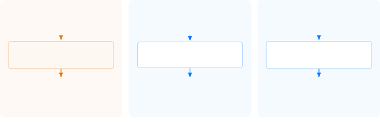

# On KL-Regularized Policy Optimization

Revised: October 5, 2026

Yifan Zhang Affiliation: Princeton University Email:
[yifzhang@princeton.edu](mailto:yifzhang@princeton.edu)

September 18, 2026

###### Abstract

Asynchronous reinforcement learning (RL) for large language model (LLM)
agents trains one policy on trajectories generated by another: rollouts
come from stale checkpoints, and the inference engine’s probabilities
differ from the trainer’s even at identical parameters. Standard
remedies either clip importance ratios, which biases the update, or, as
in GRPO, sample a group of responses per prompt, which is costly when
episodes are long. We propose KL-Regularized Policy Optimization (KLPO),
a framework that anchors the KL regularizer at the sampler. The
regularized improvement step then has a closed-form Gibbs solution, and
KLPO fits its log-ratio optimality condition by least squares on the
sampler’s own trajectories, so the sampler probability enters through a
log-ratio and no importance weights are needed. Profiling out the
regression intercept replaces the intractable log-partition function
with the signal’s sampler mean plus a sampler-to-trainer KL divergence.
For token-level policy mirror descent targets, we show that the
resulting gradient can be computed from terminal returns without a
critic, via sampler-centered scores or a single trajectory residual,
even under stochastic tool outputs. We further prove that independent
Monte Carlo estimates of the KL term keep these gradients unbiased,
derive the exact KL gap of cheaper top-$`K`$ and binary approximations,
and show that SPPO, GPO, REBEL, and BPO arise as special cases of KLPO.
The result is a critic-free update that uses one rollout per prompt and
requires neither a learned normalizer nor a group of responses.

Project Page:
[https://github.com/yifanzhang-pro/KLPO](https://github.com/yifanzhang-pro/KLPO)

## 1  Introduction

Reinforcement learning (RL) for language agents is asynchronous by
necessity. Episodes last minutes, interleave tool calls, and finish at
unpredictable times, so workers keep generating with the last checkpoint
they received while the learner trains on trajectories as they arrive.
Every update therefore involves two policies: the trainer
$`\pi^{\mathrm{trainer}}_{\theta_{t}}`$ that the learner improves at
step $`t`$, and the sampler $`\pi^{\mathrm{sampler}}_{\theta_{t-k}}`$
that generated the data, a checkpoint $`k`$ steps old. They differ for
two reasons. Staleness makes the lag $`k`$ positive and different for
every trajectory, with no fixed bound when tool latency varies.
Execution makes their probabilities differ even at $`k=0`$, because the
inference engine applies its own sampling transforms, quantization, and
numerical kernels. Agentic training is off-policy by construction, and
the trainer–sampler gap is a permanent feature of the system.

Most policy-optimization objectives are written for a single policy and
treat the second as a correction. Token-level importance ratios grow
more extreme with lag and accumulate along long trajectories, so they
are clipped, as in PPO (Schulman et al., 2017), which biases the update.
A learned critic adds a second model that must track a moving policy.
Group-relative estimators such as GRPO (Shao et al., 2024) avoid the
critic by sampling several responses per prompt, which is costly when a
single episode is long.

We build the objective around both policies by anchoring the KL
regularizer at the sampler, the policy that collected the data. The
regularized improvement step then has the closed-form Gibbs solution
that underlies REPS, MPO, policy mirror descent, and RPG (Peters et al.,
2010; Abdolmaleki et al., 2018; Lan, 2023; Zhang et al., 2026). Its
logarithm is an equation between the trainer-to-sampler log-ratio and an
improvement signal, which we fit by least squares on the sampler’s own
trajectories. The log-ratio that an importance-weighted method must
exponentiate and clip becomes the regression variable, so the gradient
carries no importance weight, and the regression target is exactly the
policy selected by the regularized objective. Because only the
probabilities the sampler actually used enter, execution mismatch is
covered along with staleness, and replay across checkpoints becomes a
mixture of well-posed regressions, one per sampler version. We call the
resulting family of objectives KL-Regularized Policy Optimization
(KLPO); Figure 1 traces its token-level instance from objective to
update.


take logs  


terminal returns + score centering  


Figure 1Token-level KLPO, from objective to critic-free update. Steps
1–4 solve the local KL-regularized improvement problem anchored at the
sampler (Zhang et al., 2026) and rewrite its solution as a log-ratio
condition. Steps 5–6 fit that condition by regression, as in SPPO and
GPO (Wu et al., 2024; Zhang et al., 2025), and profile the unknown
normalizer into a local KL. Steps 7–9 compute the gradient from terminal
returns: Step 7 builds on BPO’s critic-free reformulation of PMD (Song
et al., 2026), Step 8 centers the trainer’s score under the sampler
(Marek and Ryabinin, 2026), and Step 9 replaces the exact score mean
with $`M\geq 1`$ independent sampler draws. Figure 4 gives the
sequence-regression alternative to Steps 7–9.

Our contributions are as follows.

- •
  Regression and profiling (Section 3). For any signal and granularity,
  regressing the log-ratio optimality condition identifies the
  sampler-anchored Gibbs target without importance weights; its gradient
  is the regularized-return gradient with the likelihood ratio removed.
  Profiling the intercept replaces the intractable log-partition
  function with the signal’s sampler mean plus a sampler-to-trainer KL
  divergence.
- •
  A common view of prior objectives (Section 3.4). With exact
  normalizers, SPPO and GPO are response-level KLPO, REBEL is its
  pairwise profiled form, and BPO’s exact trajectory loss equals the
  profiled token-level objective. Each practical loss differs from its
  KLPO instance by an identified approximation.
- •
  Critic-free token-level gradients (Section 4). The gradient of the
  profiled token-level policy mirror descent objective follows from
  terminal returns, either by centering the trainer’s score under the
  sampler or from one baseline-free trajectory residual, and both routes
  hold with stochastic tool outputs.
- •
  Estimators for asynchronous training (Sections 5 and 6). Independent
  Monte Carlo estimates of the local KL keep both gradients unbiased,
  and top-$`K`$ and binary approximations fall short of the KL by
  exactly the divergence inside the merged tail. Replay across versions
  is a fixed mixture of per-version regressions, so token-level KLPO
  trains from one rollout per prompt with no critic, learned normalizer,
  or response group.

## 2  Background

We index optimizer steps by $`t`$ and positions within a response by
$`u`$. Each response is generated by a single checkpoint, whose version
$`v_{i}`$ is stored with it, so at step $`t`$ it has lag
$`k_{i}(t)=t-v_{i}`$; reuse increases the lag but leaves the sampler
$`\theta_{v_{i}}`$ unchanged. The learner thus holds the trainer
$`\pi^{\mathrm{trainer}}_{\theta_{t}}`$ and receives data from samplers
$`\pi^{\mathrm{sampler}}_{\theta_{t-k}}`$ with lags
$`0\leq k\leq K_{t}`$, and synchronous training is the case $`k=0`$ with
matched execution. Sampler probabilities are those actually used to
generate the data, including temperature and other sampling transforms,
and are logged at collection time. The sampler also serves as the
reference distribution of the KL regularizer, so no separate reference
model is needed, and the trainer is the only policy that is
differentiated. Every quantity below is built from this pair (Figure 2).


Figure 2Two policies in asynchronous agentic RL. Workers generate
complete trajectories with stale checkpoints
$`\pi^{\mathrm{sampler}}_{\theta_{t-k}}`$, on runtimes whose
probabilities can differ from the trainer’s, and return them with their
collection version, sampler log-probabilities, and the records the KL
estimator needs. The learner updates
$`\pi^{\mathrm{trainer}}_{\theta_{t}}`$ by fitting each trajectory
against its own collection sampler.

Sections 3–5 fix one collection version $`(t,k)`$, write
$`\pi_{\theta}`$ for $`\pi^{\mathrm{trainer}}_{\theta}`$, and evaluate
gradients at $`\theta_{t}`$; Section 6 combines versions. A prompt
$`x\sim\mathcal{D}`$ is followed by a complete response
$`y=(y_{1},\ldots,y_{T})\in\mathcal{Y}_{x}`$, including its termination,
with $`\pi(y\mid x)=\prod_{u=1}^{T}\pi(y_{u}\mid x,y_{<u})`$ for both
policies. We write $`s_{u}=(x,y_{<u})`$ for the history before token
$`u`$ and $`a_{u}=y_{u}`$ for the token. In agentic tasks, $`s_{u}`$
also contains every tool output observed before $`y_{u}`$, and $`T`$
counts only the tokens generated by the policy.

###### Assumption 2.1 (Finite Positive Model).

The vocabulary is finite and responses have bounded length. The reward
$`R(x,y)`$ is a bounded deterministic function of the prompt and the
complete response, such as a verifier score. The trainer and the sampler
are normalized and positive on a common feasible support.

###### Assumption 2.2 (Matched Collection).

For a fixed collection version, prompts are drawn from $`\mathcal{D}`$
and complete responses from $`\pi^{\mathrm{sampler}}_{\theta_{t-k}}`$,
without outcome-dependent filtering. Every sampler-dependent quantity
refers to that same sampler: the denominator of each log-ratio, the
distribution used for centering or KL estimation, and the continuation
that produces each return.

###### Assumption 2.3 (Deterministic Transitions and Terminal Reward).

The next history is determined by the current history and action, and
the reward is received only at termination.

Assumptions 2.1 and 2.2 hold throughout and ensure that the sampler
visits every feasible history and action. Assumption 2.3 is used only
for samplewise identities that telescope token-level quantities along a
trajectory; plain text generation satisfies it, and with tools it
requires tool outputs to be deterministic functions of the history. A
target policy is _realizable_ if the model class $`\{\pi_{\theta}\}`$
contains it. Statements about exact fits assume realizability; gradient
identities do not.

## 3  KL-Regularized Policy Optimization

KLPO is built from one primitive, a KL-regularized improvement step
taken from the policy that collected the data. We state it generically:
a context $`h`$ is followed by an outcome $`z`$ drawn from a positive
sampler conditional $`\mu(z\mid h)`$ on a finite support, such as a
prompt and a complete response or a history and the next token. An
improvement signal $`f(h,z)`$, such as a reward, an advantage, or a win
rate, scores outcomes, and $`\beta>0`$ is fixed. Proofs for this section
are in Appendix E.1.

### 3.1  Sampler-Anchored Improvement

The improvement step maximizes the expected signal while penalizing
divergence from the sampler,

```math
\max_{\pi}\ \mathbb{E}_{z\sim\pi}f(h,z)-\beta\operatorname{KL}\big(\pi\,\|\,\mu(\cdot\mid h)\big), \tag{3.1}
```

over distributions $`\pi`$ on the support. This is the unnormalized
reverse-KL (URKL) objective of RPG (Zhang et al., 2026) with the sampler
as reference, the policy-improvement step of REPS and MPO (Peters et
al., 2010; Abdolmaleki et al., 2018), and one iteration of entropic
policy mirror descent (Lan, 2023). Its solution is classical.

###### Lemma 3.1 (Gibbs Optimality Condition).

The unique maximizer of Equation (3.1) is

```math
\pi_{f}^{\star}(z\mid h)=\mu(z\mid h)e^{(f(h,z)-c_{f}(h))/\beta},\qquad c_{f}(h)=\beta\log\mathbb{E}_{z\sim\mu(\cdot\mid h)}e^{f(h,z)/\beta}, \tag{3.2}
```

and for every distribution $`\pi`$ the objective equals
$`c_{f}(h)-\beta\operatorname{KL}(\pi\,\|\,\pi_{f}^{\star}(\cdot\mid h))`$.

Taking logarithms, the maximizer satisfies one equation per outcome:

```math
\beta\log\frac{\pi_{f}^{\star}(z\mid h)}{\mu(z\mid h)}=f(h,z)-c_{f}(h). \tag{3.3}
```

The left side involves only policy probabilities, and the right side is
the signal shifted by a context-dependent constant. KLPO fits this
equation directly.

### 3.2  Regressing the Optimality Condition

For a trainable policy $`\pi_{\theta}`$, the residual of Equation (3.3)
is

```math
r_{\theta}(h,z)=\beta\log\frac{\pi_{\theta}(z\mid h)}{\mu(z\mid h)}-f(h,z)+c_{f}(h)=\beta\log\frac{\pi_{\theta}(z\mid h)}{\pi_{f}^{\star}(z\mid h)}.
```

###### Theorem 3.2 (Optimality-Condition Regression).

Let $`\nu`$ be a replay law over pairs $`(h,z)`$ and $`a>0`$ a weight,
both held fixed during differentiation. Then

```math
\mathcal{L}_{f}=\frac{1}{2\beta}\mathbb{E}_{\nu}[a\,r_{\theta}^{2}],\qquad\nabla_{\theta}\mathcal{L}_{f}=\mathbb{E}_{\nu}[a\,r_{\theta}\nabla_{\theta}\log\pi_{\theta}]. \tag{3.4}
```

If $`\nu`$ charges every pair in the support and $`\pi_{f}^{\star}`$ is
realizable, then $`\mathcal{L}_{f}=0`$ exactly when
$`\pi_{\theta}=\pi_{f}^{\star}`$ on the support.

Any replay law that covers the support identifies the same target, with
no importance multiplier in the gradient. The regularized-return
gradient differs by a single factor: differentiating Equation (3.1) at
$`\pi=\pi_{\theta}`$ and rewriting the expectation under the sampler
gives

```math
-\nabla_{\theta}\Big[\mathbb{E}_{\pi_{\theta}}f-\beta\operatorname{KL}(\pi_{\theta}\,\|\,\mu)\Big]=\mathbb{E}_{z\sim\mu}\Big[\frac{\pi_{\theta}(z\mid h)}{\mu(z\mid h)}\,r_{\theta}(h,z)\,\nabla_{\theta}\log\pi_{\theta}(z\mid h)\Big], \tag{3.5}
```

which is the regression gradient with $`\nu=\mu`$ and $`a=1`$,
multiplied per sample by the likelihood ratio. The two coincide at
$`\pi_{\theta}=\mu`$; within a restricted model class their minimizers
can differ, because the return minimizes
$`\operatorname{KL}(\pi_{\theta}\|\pi_{f}^{\star})`$ and the regression
minimizes $`\mathbb{E}_{\mu}[\log^{2}(\pi_{\theta}/\pi_{f}^{\star})]`$
(Appendix G).

### 3.3  Profiling the Normalizer

The residual contains the log-partition $`c_{f}(h)`$, an average of
$`e^{f/\beta}`$ over every outcome, which requires the signal for all
outcomes or several outcomes at the same context. We instead treat the
intercept as a free parameter and minimize over it. With
$`\ell_{\theta}(h,z)=\log(\pi_{\theta}(z\mid h)/\mu(z\mid h))`$, note
that
$`\operatorname{KL}(\mu(\cdot\mid h)\|\pi_{\theta}(\cdot\mid h))=-\mathbb{E}_{z\sim\mu}\ell_{\theta}(h,z)`$.

###### Proposition 3.3 (Profiled Regression).

Fix a context $`h`$. Over $`c\in\mathbb{R}`$, the loss
$`\mathbb{E}_{z\sim\mu}[(\beta\ell_{\theta}-f+c)^{2}]`$ is minimized by

```math
\hbox to200.52pt{\vbox to15.93pt{\pgfpicture\makeatletter\hbox{\hskip 0.0pt\lower 0.0pt\hbox to0.0pt{\lxSVG@beginscope\lxSVG@begingroup@{_scopebegin=1} \lxSVG@begingroup@{stroke=#000000} \lxSVG@begingroup@{fill=#000000} \lxSVG@setlinewidth{\the\pgflinewidth}\lxSVG@begingroup@{stroke-width=0.4pt} \lx@inpgf@ignorespaces\nullfont\hbox to0.0pt{\lxSVG@beginscope\lxSVG@begingroup@{_scopebegin=1} {}{}{}{}\lx@inpgf@ignorespaces\lxSVG@beginscope\lxSVG@begingroup@{_scopebegin=1}
{{}}\lx@inpgf@ignorespaces\hbox{\hbox{{\lxSVG@beginscope\lxSVG@begingroup@{_scopebegin=1} \lxSVG@setlinewidth{\the\pgflinewidth}\lxSVG@begingroup@{stroke-width=0.0pt} \lx@inpgf@ignorespaces{{}{}{{}}{}
{{}{{\lx@inpgf@ignorespaces}}}{{}{\lx@inpgf@ignorespaces}}{}{{}{\lx@inpgf@ignorespaces}}
{\lxSVG@beginscope\lxSVG@begingroup@{_scopebegin=1} \lxSVG@setlinewidth{\the\pgflinewidth}\lxSVG@begingroup@{stroke-width=0.0pt} \lx@inpgf@ignorespaces\lx@inpgf@ignorespaces
\lxSVG@closescope \lxSVG@endscope}{{{{\lx@inpgf@ignorespaces}}\lxSVG@beginscope\lxSVG@begingroup@{_scopebegin=1} \lxSVG@transformcm{1.0}{0.0}{0.0}{1.0}{100.26067pt}{7.96489pt}\lxSVG@begingroup@{transform=matrix(1.0 0.0 0.0 1.0 138.73 11.02)} \pgfsys@hbox{67}\lxSVG@closescope \lxSVG@endscope}}}
\lxSVG@closescope \lxSVG@endscope}}}
{{\lx@inpgf@ignorespaces}}\lx@inpgf@ignorespaces\hbox{\hbox{{\lxSVG@beginscope\lxSVG@begingroup@{_scopebegin=1} \lxSVG@setlinewidth{\the\pgflinewidth}\lxSVG@begingroup@{stroke-width=0.0pt} \lx@inpgf@ignorespaces{{}{}{{}}{}
{{}{{\lx@inpgf@ignorespaces}}}{{}{\lx@inpgf@ignorespaces}}{}{{}{\lx@inpgf@ignorespaces}}
{\lxSVG@beginscope\lxSVG@begingroup@{_scopebegin=1} \lxSVG@setlinewidth{\the\pgflinewidth}\lxSVG@begingroup@{stroke-width=0.0pt} \lx@inpgf@ignorespaces\lx@inpgf@ignorespaces
\lxSVG@closescope \lxSVG@endscope}{{{{\lx@inpgf@ignorespaces}}\lxSVG@beginscope\lxSVG@begingroup@{_scopebegin=1} \lxSVG@transformcm{1.0}{0.0}{0.0}{1.0}{100.26067pt}{7.96489pt}\lxSVG@begingroup@{transform=matrix(1.0 0.0 0.0 1.0 138.73 11.02)} \pgfsys@hbox{67}\lxSVG@closescope \lxSVG@endscope}}}
\lxSVG@closescope \lxSVG@endscope}}}
\lxSVG@closescope \lxSVG@endscope{}{}{}{}{}{}{}{}\lxSVG@beginscope\lxSVG@begingroup@{_scopebegin=1} \lxSVG@begingroup@{fill=#B8DAFF} \lxSVG@fill@opacity{1.0}\lxSVG@begingroup@{fill-opacity=1.0} {{}{}{{}}}{{}{}{{}}}{}{}{{}{}{{}}}{{}{}{{}}}{}{}{{}{}{{}}}{{}{}{{}}}{}{}{{}{}{{}}}{{}{}{{}}}{}{}\lxSVG@fill\lxSVG@drawpath@unclipped{M 0 5.28 L 0 16.76 C 0 19.68 2.36 22.04 5.28 22.04 L 272.18 22.04 C 275.1 22.04 277.46 19.68 277.46 16.76 L 277.46 5.28 C 277.46 2.36 275.1 0 272.18 0 L 5.28 0 C 2.36 0 0 2.36 0 5.28 Z}{stroke:none} \lx@inpgf@ignorespaces
\lxSVG@closescope \lxSVG@endscope{}{}{}{}{}{}{}{}\lxSVG@beginscope\lxSVG@begingroup@{_scopebegin=1} \lxSVG@begingroup@{fill=#EBF4FF} \lxSVG@fill@opacity{1.0}\lxSVG@begingroup@{fill-opacity=1.0} {{}{}{{}}}{{}{}{{}}}{}{}{{}{}{{}}}{{}{}{{}}}{}{}{{}{}{{}}}{{}{}{{}}}{}{}{{}{}{{}}}{{}{}{{}}}{}{}\lxSVG@fill\lxSVG@drawpath@unclipped{M 0.55 5.28 L 0.55 16.76 C 0.55 19.37 2.67 21.49 5.28 21.49 L 272.18 21.49 C 274.79 21.49 276.91 19.37 276.91 16.76 L 276.91 5.28 C 276.91 2.67 274.79 0.55 272.18 0.55 L 5.28 0.55 C 2.67 0.55 0.55 2.67 0.55 5.28 Z}{stroke:none} \lx@inpgf@ignorespaces
\lxSVG@closescope \lxSVG@endscope\lxSVG@beginscope\lxSVG@begingroup@{_scopebegin=1} \lxSVG@fill@opacity{1.0}\lxSVG@begingroup@{fill-opacity=1.0} {{{\lx@inpgf@ignorespaces}}{{\lx@inpgf@ignorespaces}}{{\lx@inpgf@ignorespaces}}{{}}{{}}{{}}{{}}\lxSVG@beginscope\lxSVG@begingroup@{_scopebegin=1} \lxSVG@transformcm{1.0}{0.0}{0.0}{1.0}{3.5298pt}{4.96489pt}\lxSVG@begingroup@{transform=matrix(1.0 0.0 0.0 1.0 4.88 6.87)} \pgfsys@hbox{64}\lxSVG@closescope \lxSVG@endscope}\lxSVG@closescope \lxSVG@endscope
\lxSVG@closescope \lxSVG@endscope{\lx@inpgf@ignorespaces}{\lx@inpgf@ignorespaces}{\lx@inpgf@ignorespaces}\hss}\lxSVG@discardpath\lxSVG@closescope \lxSVG@endscope\hss}}\lxSVG@closescope\endpgfpicture}}, \tag{3.6}
```

so the profiled loss equals
$`\operatorname{{\rm Var}}_{\mu}(f-\beta\ell_{\theta})/(2\beta)`$. Its
gradient is that of Theorem 3.2 with $`c_{\theta}`$ in place of
$`c_{f}`$, because the profiled residual has zero sampler mean and the
derivative of $`c_{\theta}`$ cancels. If $`\pi_{f}^{\star}`$ is
realizable, the profiled loss vanishes exactly at
$`\pi_{\theta}=\pi_{f}^{\star}`$, where $`c_{\theta}=c_{f}`$. In
particular,

```math
c_{f}(h)=\mathbb{E}_{z\sim\mu}f(h,z)+\beta\operatorname{KL}\big(\mu(\cdot\mid h)\,\|\,\pi_{f}^{\star}(\cdot\mid h)\big). \tag{3.7}
```

Equation (3.7) writes the log-partition at the target as a sampler mean
plus a KL divergence, and profiling replaces the unknown target in that
divergence by the current trainer. The fixed-normalizer and profiled
losses share their realizable minimizer, though their gradients differ
away from it. For a signal with zero sampler mean, such as an advantage,
the profiled intercept is exactly
$`\beta\operatorname{KL}(\mu\|\pi_{\theta})`$.

### 3.4  Instances

An instance of KLPO is a choice of context, outcome, and signal. We
develop two (Table 4 in Appendix D compares them).

#### Response level (SKLPO).

With a prompt $`x`$ as context, a complete response $`y`$ as outcome,
and $`f=R`$, the target is the response Gibbs policy
$`\pi^{\star}_{t,k}(y\mid x)\propto\pi^{\mathrm{sampler}}_{\theta_{t-k}}(y\mid x)e^{R(x,y)/\beta}`$
and the residual is $`d_{\theta}=\beta\ell_{\theta}-R+c^{*}(x)`$, where
$`\ell_{\theta}=\sum_{u}\ell_{\theta,u}`$ sums the token log-ratios and
$`c^{*}(x)=\beta\log\mathbb{E}_{\pi^{\mathrm{sampler}}_{\theta_{t-k}}}[e^{R/\beta}\mid x]`$.
We call this regression SKLPO (sequence-level KLPO) and develop it in
Appendix A. Its profiled intercept,
$`\mathbb{E}_{\pi^{\mathrm{sampler}}_{\theta_{t-k}}}[R\mid x]+\beta\operatorname{KL}(\pi^{\mathrm{sampler}}_{\theta_{t-k}}(\cdot\mid x)\|\pi_{\theta}(\cdot\mid x))`$,
needs the prompt’s mean reward and a complete-response KL, which a
single response cannot supply. This is the weak point of SKLPO for
asynchronous training: the normalizer depends on the prompt and the
sampler version, and profiling within a group fails for a group of one
(Section 6.2).

#### Token level (local PMD).

With a history $`s`$ as context, the next token $`a`$ as outcome, and
$`f=A^{\mathrm{sampler}}_{t,k}`$, the target is the policy mirror
descent (PMD) step
$`\pi^{+}_{\mathrm{tok}}(a\mid s)\propto\pi^{\mathrm{sampler}}_{\theta_{t-k}}(a\mid s)e^{A^{\mathrm{sampler}}_{t,k}(s,a)/\beta}`$,
in which the sampler is both the KL reference and the policy whose
advantages are improved, the starting point of BPO (Song et al., 2026).
Advantages have zero sampler mean, so the profiled intercept is the
local KL
$`\beta\operatorname{KL}(\pi^{\mathrm{sampler}}_{\theta_{t-k}}(\cdot\mid s)\|\pi_{\theta}(\cdot\mid s))`$,
computable from the two next-token distributions. The residual still
contains the advantage, which would ordinarily require a critic; Section
4 obtains the gradient from terminal returns instead. The two targets
differ: the token-level targets multiply to the response Gibbs policy
only when the accumulated local normalizers are constant across
responses (Appendix J.4), and regressing against optimal soft values
instead of sampler advantages recovers the response-level target
(Appendix C.2).

#### Prior objectives as instances.

Several existing objectives are KLPO instances once their population
objective is separated from their practical loss (Table 1). SPPO (Wu et
al., 2024) and GPO (Zhang et al., 2025) are response-level KLPO with a
win rate and an expected preference score as signals, REBEL (Gao et al., 2024) is the pairwise form of profiled response-level regression (Lemma
B.3), and the exact trajectory loss of BPO (Song et al., 2026) equals
the profiled token objective (Theorem 4.3). AWR and RPG (Peng et al.,
2019; Zhang et al., 2026) share the Gibbs target but fit it differently.
Appendices G and K state the matching conditions.

|                 |          |                     |                                                                                                                                   |
| --------------- | -------- | ------------------- | --------------------------------------------------------------------------------------------------------------------------------- |
| Objective       | Level    | Signal              | Relation to KLPO                                                                                                                  |
| SPPO            | response | win rate            | Exact update: exact-normalizer regression; the practical loss sets the normalizer to $`1/2`$                                      |
| GPO             | response | preference score    | Exact update: exact-normalizer regression; the practical loss sets the normalizer to zero                                         |
| REBEL           | response | reward              | Pairwise form of profiled regression on two responses                                                                             |
| BPO             | token    | sampler advantage   | Exact trajectory loss equals the profiled token objective under Assumption 2.3; the practical loss linearizes and approximates it |
| Score centering | token    | reward              | Same centered score, with coefficient $`R`$ in place of $`R-\beta\ell_{\theta,u}`$                                                |
| AWR             | either   | advantage or reward | Same Gibbs target, fitted by weighted maximum likelihood                                                                          |
| RPG             | response | reward              | Same Gibbs target, fitted by maximizing the importance-weighted return                                                            |

Table 1Prior objectives viewed through KLPO. “Exact” refers to a
method’s population objective before its practical approximations.

## 4  Token-Level KLPO without a Critic

This section follows Figure 1. We write down the profiled token-level
objective and then compute its gradient from terminal rewards along two
routes: token regression, which centers the trainer’s score under the
sampler, and sequence regression, which telescopes the token residuals
into one trajectory residual. Throughout, $`x\sim\mathcal{D}`$ and
$`Y\sim\pi^{\mathrm{sampler}}_{\theta_{t-k}}(\cdot\mid x)`$ are complete
rollouts from one collection version, and

```math
\ell_{\theta,u}=\log\frac{\pi_{\theta}(a_{u}\mid s_{u})}{\pi^{\mathrm{sampler}}_{\theta_{t-k}}(a_{u}\mid s_{u})},\qquad k_{\theta}(s)=\operatorname{KL}(\pi^{\mathrm{sampler}}_{\theta_{t-k}}(\cdot\mid s)\|\pi_{\theta}(\cdot\mid s)). \tag{4.1}
```

We write $`g_{\theta}(s,a)=\nabla_{\theta}\log\pi_{\theta}(a\mid s)`$
for the trainer’s score. The sampler’s action value, value, and
advantage are
$`Q^{\mathrm{sampler}}_{t,k}(s,a)=\mathbb{E}_{\pi^{\mathrm{sampler}}_{\theta_{t-k}}}[R\mid s,a]`$,
$`V^{\mathrm{sampler}}_{t,k}(s)=\mathbb{E}_{\pi^{\mathrm{sampler}}_{\theta_{t-k}}}[R\mid s]`$,
and
$`A^{\mathrm{sampler}}_{t,k}=Q^{\mathrm{sampler}}_{t,k}-V^{\mathrm{sampler}}_{t,k}`$,
with expectations over the sampler’s continuation. Proofs are in
Appendix E.

### 4.1  The Profiled Token Objective

Step 1 of Figure 1 applies the RPG–URKL objective (Zhang et al., 2026)
to the next-token distribution at a history $`s`$:

```math
J_{s}(\pi)=\mathbb{E}_{a\sim\pi(\cdot\mid s)}A^{\mathrm{sampler}}_{t,k}(s,a)-\beta\operatorname{UKL}\big(\pi(\cdot\mid s)\|\pi^{\mathrm{sampler}}_{\theta_{t-k}}(\cdot\mid s)\big). \tag{4.2}
```

Both policies are normalized, so the unnormalized KL
$`\operatorname{UKL}(p\|q)=\sum_{a}[p_{a}\log(p_{a}/q_{a})+q_{a}-p_{a}]`$
equals the KL, and this is Equation (3.1) with
$`f=A^{\mathrm{sampler}}_{t,k}`$. Steps 2–5 solve it by Lemma 3.1 and
fit the logarithmic condition with the fixed-normalizer residual
$`d^{\mathrm{fix}}_{\theta,u}=\beta\ell_{\theta,u}-A^{\mathrm{sampler}}_{t,k}(s_{u},a_{u})+c^{*}_{\mathrm{tok}}(s_{u})`$,
the squared log-ratio construction of SPPO and GPO (Wu et al., 2024;
Zhang et al., 2025) moved to tokens. GPO’s practical loss drops the
normalizer; Step 6 profiles it.

###### Lemma 4.1 (Token PMD Target and Profiled Objective).

The unique maximizer of Equation (4.2) and its normalizer are

```math
\displaystyle\pi^{+}_{\mathrm{tok}}(a\mid s) \displaystyle=\pi^{\mathrm{sampler}}_{\theta_{t-k}}(a\mid s)e^{(A^{\mathrm{sampler}}_{t,k}(s,a)-c^{*}_{\mathrm{tok}}(s))/\beta}, \tag{4.3}
```

```math
\displaystyle c^{*}_{\mathrm{tok}}(s) \displaystyle=\beta\log\mathbb{E}_{a\sim\pi^{\mathrm{sampler}}_{\theta_{t-k}}(\cdot\mid s)}e^{A^{\mathrm{sampler}}_{t,k}(s,a)/\beta}=\beta\operatorname{KL}(\pi^{\mathrm{sampler}}_{\theta_{t-k}}(\cdot\mid s)\|\pi^{+}_{\mathrm{tok}}(\cdot\mid s)). \tag{4.4}
```

Profiling the intercept at each history gives
$`c_{\theta}(s)=\beta k_{\theta}(s)`$ and the profiled token objective

```math
\delta_{u}=\frac{A^{\mathrm{sampler}}_{t,k}(s_{u},a_{u})}{\beta}-\ell_{\theta,u}-k_{\theta}(s_{u}),\qquad\hbox to118.9pt{\vbox to25.58pt{\pgfpicture\makeatletter\hbox{\hskip 0.0pt\lower 0.0pt\hbox to0.0pt{\lxSVG@beginscope\lxSVG@begingroup@{_scopebegin=1} \lxSVG@begingroup@{stroke=#000000} \lxSVG@begingroup@{fill=#000000} \lxSVG@setlinewidth{\the\pgflinewidth}\lxSVG@begingroup@{stroke-width=0.4pt} \lx@inpgf@ignorespaces\nullfont\hbox to0.0pt{\lxSVG@beginscope\lxSVG@begingroup@{_scopebegin=1} {}{}{}{}\lx@inpgf@ignorespaces\lxSVG@beginscope\lxSVG@begingroup@{_scopebegin=1}
{{}}\lx@inpgf@ignorespaces\hbox{\hbox{{\lxSVG@beginscope\lxSVG@begingroup@{_scopebegin=1} \lxSVG@setlinewidth{\the\pgflinewidth}\lxSVG@begingroup@{stroke-width=0.0pt} \lx@inpgf@ignorespaces{{}{}{{}}{}
{{}{{\lx@inpgf@ignorespaces}}}{{}{\lx@inpgf@ignorespaces}}{}{{}{\lx@inpgf@ignorespaces}}
{\lxSVG@beginscope\lxSVG@begingroup@{_scopebegin=1} \lxSVG@setlinewidth{\the\pgflinewidth}\lxSVG@begingroup@{stroke-width=0.0pt} \lx@inpgf@ignorespaces\lx@inpgf@ignorespaces
\lxSVG@closescope \lxSVG@endscope}{{{{\lx@inpgf@ignorespaces}}\lxSVG@beginscope\lxSVG@begingroup@{_scopebegin=1} \lxSVG@transformcm{1.0}{0.0}{0.0}{1.0}{59.44893pt}{12.7919pt}\lxSVG@begingroup@{transform=matrix(1.0 0.0 0.0 1.0 82.26 17.7)} \pgfsys@hbox{67}\lxSVG@closescope \lxSVG@endscope}}}
\lxSVG@closescope \lxSVG@endscope}}}
{{\lx@inpgf@ignorespaces}}\lx@inpgf@ignorespaces\hbox{\hbox{{\lxSVG@beginscope\lxSVG@begingroup@{_scopebegin=1} \lxSVG@setlinewidth{\the\pgflinewidth}\lxSVG@begingroup@{stroke-width=0.0pt} \lx@inpgf@ignorespaces{{}{}{{}}{}
{{}{{\lx@inpgf@ignorespaces}}}{{}{\lx@inpgf@ignorespaces}}{}{{}{\lx@inpgf@ignorespaces}}
{\lxSVG@beginscope\lxSVG@begingroup@{_scopebegin=1} \lxSVG@setlinewidth{\the\pgflinewidth}\lxSVG@begingroup@{stroke-width=0.0pt} \lx@inpgf@ignorespaces\lx@inpgf@ignorespaces
\lxSVG@closescope \lxSVG@endscope}{{{{\lx@inpgf@ignorespaces}}\lxSVG@beginscope\lxSVG@begingroup@{_scopebegin=1} \lxSVG@transformcm{1.0}{0.0}{0.0}{1.0}{59.44893pt}{12.7919pt}\lxSVG@begingroup@{transform=matrix(1.0 0.0 0.0 1.0 82.26 17.7)} \pgfsys@hbox{67}\lxSVG@closescope \lxSVG@endscope}}}
\lxSVG@closescope \lxSVG@endscope}}}
\lxSVG@closescope \lxSVG@endscope{}{}{}{}{}{}{}{}\lxSVG@beginscope\lxSVG@begingroup@{_scopebegin=1} \lxSVG@begingroup@{fill=#B8DAFF} \lxSVG@fill@opacity{1.0}\lxSVG@begingroup@{fill-opacity=1.0} {{}{}{{}}}{{}{}{{}}}{}{}{{}{}{{}}}{{}{}{{}}}{}{}{{}{}{{}}}{{}{}{{}}}{}{}{{}{}{{}}}{{}{}{{}}}{}{}\lxSVG@fill\lxSVG@drawpath@unclipped{M 0 5.28 L 0 30.12 C 0 33.04 2.36 35.4 5.28 35.4 L 159.24 35.4 C 162.16 35.4 164.52 33.04 164.52 30.12 L 164.52 5.28 C 164.52 2.36 162.16 0 159.24 0 L 5.28 0 C 2.36 0 0 2.36 0 5.28 Z}{stroke:none} \lx@inpgf@ignorespaces
\lxSVG@closescope \lxSVG@endscope{}{}{}{}{}{}{}{}\lxSVG@beginscope\lxSVG@begingroup@{_scopebegin=1} \lxSVG@begingroup@{fill=#EBF4FF} \lxSVG@fill@opacity{1.0}\lxSVG@begingroup@{fill-opacity=1.0} {{}{}{{}}}{{}{}{{}}}{}{}{{}{}{{}}}{{}{}{{}}}{}{}{{}{}{{}}}{{}{}{{}}}{}{}{{}{}{{}}}{{}{}{{}}}{}{}\lxSVG@fill\lxSVG@drawpath@unclipped{M 0.55 5.28 L 0.55 30.12 C 0.55 32.73 2.67 34.85 5.28 34.85 L 159.24 34.85 C 161.85 34.85 163.97 32.73 163.97 30.12 L 163.97 5.28 C 163.97 2.67 161.85 0.55 159.24 0.55 L 5.28 0.55 C 2.67 0.55 0.55 2.67 0.55 5.28 Z}{stroke:none} \lx@inpgf@ignorespaces
\lxSVG@closescope \lxSVG@endscope\lxSVG@beginscope\lxSVG@begingroup@{_scopebegin=1} \lxSVG@fill@opacity{1.0}\lxSVG@begingroup@{fill-opacity=1.0} {{{\lx@inpgf@ignorespaces}}{{\lx@inpgf@ignorespaces}}{{\lx@inpgf@ignorespaces}}{{}}{{}}{{}}{{}}\lxSVG@beginscope\lxSVG@begingroup@{_scopebegin=1} \lxSVG@transformcm{1.0}{0.0}{0.0}{1.0}{3.5298pt}{14.9789pt}\lxSVG@begingroup@{transform=matrix(1.0 0.0 0.0 1.0 4.88 20.73)} \pgfsys@hbox{64}\lxSVG@closescope \lxSVG@endscope}\lxSVG@closescope \lxSVG@endscope
\lxSVG@closescope \lxSVG@endscope{\lx@inpgf@ignorespaces}{\lx@inpgf@ignorespaces}{\lx@inpgf@ignorespaces}\hss}\lxSVG@discardpath\lxSVG@closescope \lxSVG@endscope\hss}}\lxSVG@closescope\endpgfpicture}}. \tag{4.5}
```

Each residual has zero conditional mean,
$`\mathbb{E}_{\pi^{\mathrm{sampler}}_{\theta_{t-k}}}[\delta_{u}\mid s_{u}]=0`$,
and

```math
\nabla_{\theta}\mathcal{L}_{\mathrm{tok}}=-\beta\mathbb{E}_{x,Y\sim\pi^{\mathrm{sampler}}_{\theta_{t-k}}}\sum_{u}\delta_{u}g_{\theta}(s_{u},a_{u}). \tag{4.6}
```

If $`\pi^{+}_{\mathrm{tok}}`$ is realizable, it is the unique zero-loss
policy of both $`\mathcal{L}_{\mathrm{tok}}`$ and the fixed-normalizer
loss
$`\frac{1}{2\beta}\mathbb{E}\sum_{u}(d^{\mathrm{fix}}_{\theta,u})^{2}`$.

The profiled objective needs no normalizer, but it still needs
$`A^{\mathrm{sampler}}_{t,k}`$, the advantage of a policy the trainer
has already left. The next two subsections remove it.

### 4.2  Token Regression with Sampler-Centered Scores

Step 7 builds on BPO’s critic-free reformulation of PMD (Song et al., 2026) and replaces the sampler advantage with the terminal return.
Define the trainer’s score centered under the sampler and a per-token
return coefficient,

```math
\widetilde{g}_{\theta}(s,a)=g_{\theta}(s,a)-\mathbb{E}_{v\sim\pi^{\mathrm{sampler}}_{\theta_{t-k}}(\cdot\mid s)}g_{\theta}(s,v)=g_{\theta}(s,a)+\nabla_{\theta}k_{\theta}(s),\qquad h_{\theta,u}=R(x,Y)-\beta\ell_{\theta,u}, \tag{4.7}
```

let
$`\bar{h}_{\theta}(s)=\mathbb{E}_{\pi^{\mathrm{sampler}}_{\theta_{t-k}}}[h_{\theta}\mid s]`$
over the next action and the sampler’s continuation, and define the
token-regression loss
$`\mathcal{L}_{\mathrm{TR}}(\theta)=\frac{1}{2\beta}\mathbb{E}_{x,Y\sim\pi^{\mathrm{sampler}}_{\theta_{t-k}}}\sum_{u}(h_{\theta,u}-\bar{h}_{\theta}(s_{u}))^{2}`$.

###### Theorem 4.2 (Critic-Free Token-Regression Gradient).

Under Assumptions 2.1 and 2.2, with exact conditional score means,

```math
\hbox to237.48pt{\vbox to26.41pt{\pgfpicture\makeatletter\hbox{\hskip 0.0pt\lower 0.0pt\hbox to0.0pt{\lxSVG@beginscope\lxSVG@begingroup@{_scopebegin=1} \lxSVG@begingroup@{stroke=#000000} \lxSVG@begingroup@{fill=#000000} \lxSVG@setlinewidth{\the\pgflinewidth}\lxSVG@begingroup@{stroke-width=0.4pt} \lx@inpgf@ignorespaces\nullfont\hbox to0.0pt{\lxSVG@beginscope\lxSVG@begingroup@{_scopebegin=1} {}{}{}{}\lx@inpgf@ignorespaces\lxSVG@beginscope\lxSVG@begingroup@{_scopebegin=1}
{{}}\lx@inpgf@ignorespaces\hbox{\hbox{{\lxSVG@beginscope\lxSVG@begingroup@{_scopebegin=1} \lxSVG@setlinewidth{\the\pgflinewidth}\lxSVG@begingroup@{stroke-width=0.0pt} \lx@inpgf@ignorespaces{{}{}{{}}{}
{{}{{\lx@inpgf@ignorespaces}}}{{}{\lx@inpgf@ignorespaces}}{}{{}{\lx@inpgf@ignorespaces}}
{\lxSVG@beginscope\lxSVG@begingroup@{_scopebegin=1} \lxSVG@setlinewidth{\the\pgflinewidth}\lxSVG@begingroup@{stroke-width=0.0pt} \lx@inpgf@ignorespaces\lx@inpgf@ignorespaces
\lxSVG@closescope \lxSVG@endscope}{{{{\lx@inpgf@ignorespaces}}\lxSVG@beginscope\lxSVG@begingroup@{_scopebegin=1} \lxSVG@transformcm{1.0}{0.0}{0.0}{1.0}{118.741pt}{13.2048pt}\lxSVG@begingroup@{transform=matrix(1.0 0.0 0.0 1.0 164.3 18.27)} \pgfsys@hbox{67}\lxSVG@closescope \lxSVG@endscope}}}
\lxSVG@closescope \lxSVG@endscope}}}
{{\lx@inpgf@ignorespaces}}\lx@inpgf@ignorespaces\hbox{\hbox{{\lxSVG@beginscope\lxSVG@begingroup@{_scopebegin=1} \lxSVG@setlinewidth{\the\pgflinewidth}\lxSVG@begingroup@{stroke-width=0.0pt} \lx@inpgf@ignorespaces{{}{}{{}}{}
{{}{{\lx@inpgf@ignorespaces}}}{{}{\lx@inpgf@ignorespaces}}{}{{}{\lx@inpgf@ignorespaces}}
{\lxSVG@beginscope\lxSVG@begingroup@{_scopebegin=1} \lxSVG@setlinewidth{\the\pgflinewidth}\lxSVG@begingroup@{stroke-width=0.0pt} \lx@inpgf@ignorespaces\lx@inpgf@ignorespaces
\lxSVG@closescope \lxSVG@endscope}{{{{\lx@inpgf@ignorespaces}}\lxSVG@beginscope\lxSVG@begingroup@{_scopebegin=1} \lxSVG@transformcm{1.0}{0.0}{0.0}{1.0}{118.741pt}{13.2048pt}\lxSVG@begingroup@{transform=matrix(1.0 0.0 0.0 1.0 164.3 18.27)} \pgfsys@hbox{67}\lxSVG@closescope \lxSVG@endscope}}}
\lxSVG@closescope \lxSVG@endscope}}}
\lxSVG@closescope \lxSVG@endscope{}{}{}{}{}{}{}{}\lxSVG@beginscope\lxSVG@begingroup@{_scopebegin=1} \lxSVG@begingroup@{fill=#B8DAFF} \lxSVG@fill@opacity{1.0}\lxSVG@begingroup@{fill-opacity=1.0} {{}{}{{}}}{{}{}{{}}}{}{}{{}{}{{}}}{{}{}{{}}}{}{}{{}{}{{}}}{{}{}{{}}}{}{}{{}{}{{}}}{{}{}{{}}}{}{}\lxSVG@fill\lxSVG@drawpath@unclipped{M 0 5.28 L 0 31.27 C 0 34.18 2.36 36.54 5.28 36.54 L 323.33 36.54 C 326.24 36.54 328.6 34.18 328.6 31.27 L 328.6 5.28 C 328.6 2.36 326.24 0 323.33 0 L 5.28 0 C 2.36 0 0 2.36 0 5.28 Z}{stroke:none} \lx@inpgf@ignorespaces
\lxSVG@closescope \lxSVG@endscope{}{}{}{}{}{}{}{}\lxSVG@beginscope\lxSVG@begingroup@{_scopebegin=1} \lxSVG@begingroup@{fill=#EBF4FF} \lxSVG@fill@opacity{1.0}\lxSVG@begingroup@{fill-opacity=1.0} {{}{}{{}}}{{}{}{{}}}{}{}{{}{}{{}}}{{}{}{{}}}{}{}{{}{}{{}}}{{}{}{{}}}{}{}{{}{}{{}}}{{}{}{{}}}{}{}\lxSVG@fill\lxSVG@drawpath@unclipped{M 0.55 5.28 L 0.55 31.27 C 0.55 33.87 2.67 35.99 5.28 35.99 L 323.33 35.99 C 325.94 35.99 328.05 33.87 328.05 31.27 L 328.05 5.28 C 328.05 2.67 325.94 0.55 323.33 0.55 L 5.28 0.55 C 2.67 0.55 0.55 2.67 0.55 5.28 Z}{stroke:none} \lx@inpgf@ignorespaces
\lxSVG@closescope \lxSVG@endscope\lxSVG@beginscope\lxSVG@begingroup@{_scopebegin=1} \lxSVG@fill@opacity{1.0}\lxSVG@begingroup@{fill-opacity=1.0} {{{\lx@inpgf@ignorespaces}}{{\lx@inpgf@ignorespaces}}{{\lx@inpgf@ignorespaces}}{{}}{{}}{{}}{{}}\lxSVG@beginscope\lxSVG@begingroup@{_scopebegin=1} \lxSVG@transformcm{1.0}{0.0}{0.0}{1.0}{3.5298pt}{14.9789pt}\lxSVG@begingroup@{transform=matrix(1.0 0.0 0.0 1.0 4.88 20.73)} \pgfsys@hbox{64}\lxSVG@closescope \lxSVG@endscope}\lxSVG@closescope \lxSVG@endscope
\lxSVG@closescope \lxSVG@endscope{\lx@inpgf@ignorespaces}{\lx@inpgf@ignorespaces}{\lx@inpgf@ignorespaces}\hss}\lxSVG@discardpath\lxSVG@closescope \lxSVG@endscope\hss}}\lxSVG@closescope\endpgfpicture}}. \tag{4.8}
```

The second term does not depend on $`\theta`$, so

```math
\hbox to246.21pt{\vbox to24.44pt{\pgfpicture\makeatletter\hbox{\hskip 0.0pt\lower 0.0pt\hbox to0.0pt{\lxSVG@beginscope\lxSVG@begingroup@{_scopebegin=1} \lxSVG@begingroup@{stroke=#000000} \lxSVG@begingroup@{fill=#000000} \lxSVG@setlinewidth{\the\pgflinewidth}\lxSVG@begingroup@{stroke-width=0.4pt} \lx@inpgf@ignorespaces\nullfont\hbox to0.0pt{\lxSVG@beginscope\lxSVG@begingroup@{_scopebegin=1} {}{}{}{}\lx@inpgf@ignorespaces\lxSVG@beginscope\lxSVG@begingroup@{_scopebegin=1}
{{}}\lx@inpgf@ignorespaces\hbox{\hbox{{\lxSVG@beginscope\lxSVG@begingroup@{_scopebegin=1} \lxSVG@setlinewidth{\the\pgflinewidth}\lxSVG@begingroup@{stroke-width=0.0pt} \lx@inpgf@ignorespaces{{}{}{{}}{}
{{}{{\lx@inpgf@ignorespaces}}}{{}{\lx@inpgf@ignorespaces}}{}{{}{\lx@inpgf@ignorespaces}}
{\lxSVG@beginscope\lxSVG@begingroup@{_scopebegin=1} \lxSVG@setlinewidth{\the\pgflinewidth}\lxSVG@begingroup@{stroke-width=0.0pt} \lx@inpgf@ignorespaces\lx@inpgf@ignorespaces
\lxSVG@closescope \lxSVG@endscope}{{{{\lx@inpgf@ignorespaces}}\lxSVG@beginscope\lxSVG@begingroup@{_scopebegin=1} \lxSVG@transformcm{1.0}{0.0}{0.0}{1.0}{123.10284pt}{12.2219pt}\lxSVG@begingroup@{transform=matrix(1.0 0.0 0.0 1.0 170.34 16.91)} \pgfsys@hbox{67}\lxSVG@closescope \lxSVG@endscope}}}
\lxSVG@closescope \lxSVG@endscope}}}
{{\lx@inpgf@ignorespaces}}\lx@inpgf@ignorespaces\hbox{\hbox{{\lxSVG@beginscope\lxSVG@begingroup@{_scopebegin=1} \lxSVG@setlinewidth{\the\pgflinewidth}\lxSVG@begingroup@{stroke-width=0.0pt} \lx@inpgf@ignorespaces{{}{}{{}}{}
{{}{{\lx@inpgf@ignorespaces}}}{{}{\lx@inpgf@ignorespaces}}{}{{}{\lx@inpgf@ignorespaces}}
{\lxSVG@beginscope\lxSVG@begingroup@{_scopebegin=1} \lxSVG@setlinewidth{\the\pgflinewidth}\lxSVG@begingroup@{stroke-width=0.0pt} \lx@inpgf@ignorespaces\lx@inpgf@ignorespaces
\lxSVG@closescope \lxSVG@endscope}{{{{\lx@inpgf@ignorespaces}}\lxSVG@beginscope\lxSVG@begingroup@{_scopebegin=1} \lxSVG@transformcm{1.0}{0.0}{0.0}{1.0}{123.10284pt}{12.2219pt}\lxSVG@begingroup@{transform=matrix(1.0 0.0 0.0 1.0 170.34 16.91)} \pgfsys@hbox{67}\lxSVG@closescope \lxSVG@endscope}}}
\lxSVG@closescope \lxSVG@endscope}}}
\lxSVG@closescope \lxSVG@endscope{}{}{}{}{}{}{}{}\lxSVG@beginscope\lxSVG@begingroup@{_scopebegin=1} \lxSVG@begingroup@{fill=#B8DAFF} \lxSVG@fill@opacity{1.0}\lxSVG@begingroup@{fill-opacity=1.0} {{}{}{{}}}{{}{}{{}}}{}{}{{}{}{{}}}{{}{}{{}}}{}{}{{}{}{{}}}{{}{}{{}}}{}{}{{}{}{{}}}{{}{}{{}}}{}{}\lxSVG@fill\lxSVG@drawpath@unclipped{M 0 5.28 L 0 28.54 C 0 31.46 2.36 33.82 5.28 33.82 L 335.4 33.82 C 338.31 33.82 340.67 31.46 340.67 28.54 L 340.67 5.28 C 340.67 2.36 338.31 0 335.4 0 L 5.28 0 C 2.36 0 0 2.36 0 5.28 Z}{stroke:none} \lx@inpgf@ignorespaces
\lxSVG@closescope \lxSVG@endscope{}{}{}{}{}{}{}{}\lxSVG@beginscope\lxSVG@begingroup@{_scopebegin=1} \lxSVG@begingroup@{fill=#EBF4FF} \lxSVG@fill@opacity{1.0}\lxSVG@begingroup@{fill-opacity=1.0} {{}{}{{}}}{{}{}{{}}}{}{}{{}{}{{}}}{{}{}{{}}}{}{}{{}{}{{}}}{{}{}{{}}}{}{}{{}{}{{}}}{{}{}{{}}}{}{}\lxSVG@fill\lxSVG@drawpath@unclipped{M 0.55 5.28 L 0.55 28.54 C 0.55 31.15 2.67 33.27 5.28 33.27 L 335.4 33.27 C 338.01 33.27 340.12 31.15 340.12 28.54 L 340.12 5.28 C 340.12 2.67 338.01 0.55 335.4 0.55 L 5.28 0.55 C 2.67 0.55 0.55 2.67 0.55 5.28 Z}{stroke:none} \lx@inpgf@ignorespaces
\lxSVG@closescope \lxSVG@endscope\lxSVG@beginscope\lxSVG@begingroup@{_scopebegin=1} \lxSVG@fill@opacity{1.0}\lxSVG@begingroup@{fill-opacity=1.0} {{{\lx@inpgf@ignorespaces}}{{\lx@inpgf@ignorespaces}}{{\lx@inpgf@ignorespaces}}{{}}{{}}{{}}{{}}\lxSVG@beginscope\lxSVG@begingroup@{_scopebegin=1} \lxSVG@transformcm{1.0}{0.0}{0.0}{1.0}{3.5298pt}{14.9789pt}\lxSVG@begingroup@{transform=matrix(1.0 0.0 0.0 1.0 4.88 20.73)} \pgfsys@hbox{64}\lxSVG@closescope \lxSVG@endscope}\lxSVG@closescope \lxSVG@endscope
\lxSVG@closescope \lxSVG@endscope{\lx@inpgf@ignorespaces}{\lx@inpgf@ignorespaces}{\lx@inpgf@ignorespaces}\hss}\lxSVG@discardpath\lxSVG@closescope \lxSVG@endscope\hss}}\lxSVG@closescope\endpgfpicture}}. \tag{4.9}
```

If $`\pi^{+}_{\mathrm{tok}}`$ is realizable, it is the unique minimizer
of both losses. Subtracting a fixed baseline $`b(s_{u})`$ from the
coefficient $`R-\beta\ell_{\theta,u}`$ leaves the expected gradient
unchanged.

Terminal returns thus replace the sampler’s critic: the continuation
noise $`R-Q^{\mathrm{sampler}}_{t,k}`$ adds variance but no bias,
provided the score is centered under the sampler that generated both the
action and its continuation. The term $`-\beta\ell_{\theta,u}`$ makes
this a regression rather than a policy gradient. It feeds the current
log-ratio back into the coefficient, so the update weakens as the
trainer approaches the target; with the reward alone as coefficient, the
estimator is the score-centered policy gradient of Marek and Ryabinin
(2026).

Step 8 computes Equation (4.9) by automatic differentiation, without
evaluating $`\bar{h}_{\theta}`$, through the per-token surrogate

```math
L^{\mathrm{bp,TR}}_{\theta,u}=-\operatorname{sg}(h_{\theta,u})\,z_{\theta,u},\qquad z_{\theta,u}=\log\pi_{\theta}(a_{u}\mid s_{u})-\sum_{v}\pi^{\mathrm{sampler}}_{\theta_{t-k}}(v\mid s_{u})\log\pi_{\theta}(v\mid s_{u}). \tag{4.10}
```

With $`h_{\theta,u}`$ and the sampler probabilities detached, each token
contributes $`-h_{\theta,u}\widetilde{g}_{\theta}(s_{u},a_{u})`$, so the
expected surrogate gradient is
$`\nabla_{\theta}\mathcal{L}_{\mathrm{TR}}=\nabla_{\theta}\mathcal{L}_{\mathrm{tok}}`$
(Proposition D.1 in Appendix D). One complete response per prompt
suffices, provided the score mean is computed independently of the
sampled action.

### 4.3  Sequence Regression by Bellman Telescoping

Each token residual has zero conditional mean, so the token loss equals
the expected square of the summed residual. Under Assumption 2.3, the
advantages in that sum also telescope into the terminal reward, which
gives the exact trajectory objective of BPO (Song et al., 2026,
Equations (18)–(24)) (Figure 4 in Appendix D).

###### Theorem 4.3 (Population Equivalence to Exact BPO).

Under Assumptions 2.1 and 2.2,

```math
\mathbb{E}_{\pi^{\mathrm{sampler}}_{\theta_{t-k}}}\big[\big(\textstyle\sum_{u}\delta_{u}\big)^{2}\big]=\mathbb{E}_{\pi^{\mathrm{sampler}}_{\theta_{t-k}}}\sum_{u}\delta_{u}^{2}. \tag{4.11}
```

If Assumption 2.3 also holds, then

```math
\sum_{u}\delta_{u}=\frac{R-V^{\mathrm{sampler}}_{t,k}(x)}{\beta}-\sum_{u}[\ell_{\theta,u}+k_{\theta}(s_{u})]=\delta_{\mathrm{BPO}},\qquad\text{and}\qquad\hbox to106.8pt{\vbox to18.43pt{\pgfpicture\makeatletter\hbox{\hskip 0.0pt\lower 0.0pt\hbox to0.0pt{\lxSVG@beginscope\lxSVG@begingroup@{_scopebegin=1} \lxSVG@begingroup@{stroke=#000000} \lxSVG@begingroup@{fill=#000000} \lxSVG@setlinewidth{\the\pgflinewidth}\lxSVG@begingroup@{stroke-width=0.4pt} \lx@inpgf@ignorespaces\nullfont\hbox to0.0pt{\lxSVG@beginscope\lxSVG@begingroup@{_scopebegin=1} {}{}{}{}\lx@inpgf@ignorespaces\lxSVG@beginscope\lxSVG@begingroup@{_scopebegin=1}
{{}}\lx@inpgf@ignorespaces\hbox{\hbox{{\lxSVG@beginscope\lxSVG@begingroup@{_scopebegin=1} \lxSVG@setlinewidth{\the\pgflinewidth}\lxSVG@begingroup@{stroke-width=0.0pt} \lx@inpgf@ignorespaces{{}{}{{}}{}
{{}{{\lx@inpgf@ignorespaces}}}{{}{\lx@inpgf@ignorespaces}}{}{{}{\lx@inpgf@ignorespaces}}
{\lxSVG@beginscope\lxSVG@begingroup@{_scopebegin=1} \lxSVG@setlinewidth{\the\pgflinewidth}\lxSVG@begingroup@{stroke-width=0.0pt} \lx@inpgf@ignorespaces\lx@inpgf@ignorespaces
\lxSVG@closescope \lxSVG@endscope}{{{{\lx@inpgf@ignorespaces}}\lxSVG@beginscope\lxSVG@begingroup@{_scopebegin=1} \lxSVG@transformcm{1.0}{0.0}{0.0}{1.0}{53.40121pt}{9.21324pt}\lxSVG@begingroup@{transform=matrix(1.0 0.0 0.0 1.0 73.89 12.75)} \pgfsys@hbox{67}\lxSVG@closescope \lxSVG@endscope}}}
\lxSVG@closescope \lxSVG@endscope}}}
{{\lx@inpgf@ignorespaces}}\lx@inpgf@ignorespaces\hbox{\hbox{{\lxSVG@beginscope\lxSVG@begingroup@{_scopebegin=1} \lxSVG@setlinewidth{\the\pgflinewidth}\lxSVG@begingroup@{stroke-width=0.0pt} \lx@inpgf@ignorespaces{{}{}{{}}{}
{{}{{\lx@inpgf@ignorespaces}}}{{}{\lx@inpgf@ignorespaces}}{}{{}{\lx@inpgf@ignorespaces}}
{\lxSVG@beginscope\lxSVG@begingroup@{_scopebegin=1} \lxSVG@setlinewidth{\the\pgflinewidth}\lxSVG@begingroup@{stroke-width=0.0pt} \lx@inpgf@ignorespaces\lx@inpgf@ignorespaces
\lxSVG@closescope \lxSVG@endscope}{{{{\lx@inpgf@ignorespaces}}\lxSVG@beginscope\lxSVG@begingroup@{_scopebegin=1} \lxSVG@transformcm{1.0}{0.0}{0.0}{1.0}{53.40121pt}{9.21324pt}\lxSVG@begingroup@{transform=matrix(1.0 0.0 0.0 1.0 73.89 12.75)} \pgfsys@hbox{67}\lxSVG@closescope \lxSVG@endscope}}}
\lxSVG@closescope \lxSVG@endscope}}}
\lxSVG@closescope \lxSVG@endscope{}{}{}{}{}{}{}{}\lxSVG@beginscope\lxSVG@begingroup@{_scopebegin=1} \lxSVG@begingroup@{fill=#B8DAFF} \lxSVG@fill@opacity{1.0}\lxSVG@begingroup@{fill-opacity=1.0} {{}{}{{}}}{{}{}{{}}}{}{}{{}{}{{}}}{{}{}{{}}}{}{}{{}{}{{}}}{{}{}{{}}}{}{}{{}{}{{}}}{{}{}{{}}}{}{}\lxSVG@fill\lxSVG@drawpath@unclipped{M 0 5.28 L 0 20.22 C 0 23.13 2.36 25.5 5.28 25.5 L 142.5 25.5 C 145.42 25.5 147.78 23.13 147.78 20.22 L 147.78 5.28 C 147.78 2.36 145.42 0 142.5 0 L 5.28 0 C 2.36 0 0 2.36 0 5.28 Z}{stroke:none} \lx@inpgf@ignorespaces
\lxSVG@closescope \lxSVG@endscope{}{}{}{}{}{}{}{}\lxSVG@beginscope\lxSVG@begingroup@{_scopebegin=1} \lxSVG@begingroup@{fill=#EBF4FF} \lxSVG@fill@opacity{1.0}\lxSVG@begingroup@{fill-opacity=1.0} {{}{}{{}}}{{}{}{{}}}{}{}{{}{}{{}}}{{}{}{{}}}{}{}{{}{}{{}}}{{}{}{{}}}{}{}{{}{}{{}}}{{}{}{{}}}{}{}\lxSVG@fill\lxSVG@drawpath@unclipped{M 0.55 5.28 L 0.55 20.22 C 0.55 22.83 2.67 24.94 5.28 24.94 L 142.5 24.94 C 145.11 24.94 147.23 22.83 147.23 20.22 L 147.23 5.28 C 147.23 2.67 145.11 0.55 142.5 0.55 L 5.28 0.55 C 2.67 0.55 0.55 2.67 0.55 5.28 Z}{stroke:none} \lx@inpgf@ignorespaces
\lxSVG@closescope \lxSVG@endscope\lxSVG@beginscope\lxSVG@begingroup@{_scopebegin=1} \lxSVG@fill@opacity{1.0}\lxSVG@begingroup@{fill-opacity=1.0} {{{\lx@inpgf@ignorespaces}}{{\lx@inpgf@ignorespaces}}{{\lx@inpgf@ignorespaces}}{{}}{{}}{{}}{{}}\lxSVG@beginscope\lxSVG@begingroup@{_scopebegin=1} \lxSVG@transformcm{1.0}{0.0}{0.0}{1.0}{3.5298pt}{7.82156pt}\lxSVG@begingroup@{transform=matrix(1.0 0.0 0.0 1.0 4.88 10.82)} \pgfsys@hbox{64}\lxSVG@closescope \lxSVG@endscope}\lxSVG@closescope \lxSVG@endscope
\lxSVG@closescope \lxSVG@endscope{\lx@inpgf@ignorespaces}{\lx@inpgf@ignorespaces}{\lx@inpgf@ignorespaces}\hss}\lxSVG@discardpath\lxSVG@closescope \lxSVG@endscope\hss}}\lxSVG@closescope\endpgfpicture}}. \tag{4.12}
```

The prompt value $`V^{\mathrm{sampler}}_{t,k}(x)`$ in
$`\delta_{\mathrm{BPO}}`$ seems to require a critic, but it does not
affect the gradient. Drop it:

```math
D_{\theta}(x,Y):=R(x,Y)-\beta\sum_{u}[\ell_{\theta,u}+k_{\theta}(s_{u})],\qquad\mathcal{L}_{\mathrm{SR}}(\theta):=\frac{1}{2\beta}\mathbb{E}_{x,Y\sim\pi^{\mathrm{sampler}}_{\theta_{t-k}}}D_{\theta}(x,Y)^{2}. \tag{4.13}
```

###### Proposition 4.4 (Baseline-Free Trajectory Regression).

Under Assumptions 2.1 and 2.2, let
$`\varepsilon_{u}=V^{\mathrm{sampler}}_{t,k}(s_{u+1})-Q^{\mathrm{sampler}}_{t,k}(s_{u},a_{u})`$
be the transition noise after token $`u`$, where $`s_{u+1}`$ includes
any tool output that follows $`a_{u}`$ and
$`V^{\mathrm{sampler}}_{t,k}=R`$ at termination. Then

```math
\hbox to281.43pt{\vbox to28.94pt{\pgfpicture\makeatletter\hbox{\hskip 0.0pt\lower 0.0pt\hbox to0.0pt{\lxSVG@beginscope\lxSVG@begingroup@{_scopebegin=1} \lxSVG@begingroup@{stroke=#000000} \lxSVG@begingroup@{fill=#000000} \lxSVG@setlinewidth{\the\pgflinewidth}\lxSVG@begingroup@{stroke-width=0.4pt} \lx@inpgf@ignorespaces\nullfont\hbox to0.0pt{\lxSVG@beginscope\lxSVG@begingroup@{_scopebegin=1} {}{}{}{}\lx@inpgf@ignorespaces\lxSVG@beginscope\lxSVG@begingroup@{_scopebegin=1}
{{}}\lx@inpgf@ignorespaces\hbox{\hbox{{\lxSVG@beginscope\lxSVG@begingroup@{_scopebegin=1} \lxSVG@setlinewidth{\the\pgflinewidth}\lxSVG@begingroup@{stroke-width=0.0pt} \lx@inpgf@ignorespaces{{}{}{{}}{}
{{}{{\lx@inpgf@ignorespaces}}}{{}{\lx@inpgf@ignorespaces}}{}{{}{\lx@inpgf@ignorespaces}}
{\lxSVG@beginscope\lxSVG@begingroup@{_scopebegin=1} \lxSVG@setlinewidth{\the\pgflinewidth}\lxSVG@begingroup@{stroke-width=0.0pt} \lx@inpgf@ignorespaces\lx@inpgf@ignorespaces
\lxSVG@closescope \lxSVG@endscope}{{{{\lx@inpgf@ignorespaces}}\lxSVG@beginscope\lxSVG@begingroup@{_scopebegin=1} \lxSVG@transformcm{1.0}{0.0}{0.0}{1.0}{140.71428pt}{14.4719pt}\lxSVG@begingroup@{transform=matrix(1.0 0.0 0.0 1.0 194.71 20.02)} \pgfsys@hbox{67}\lxSVG@closescope \lxSVG@endscope}}}
\lxSVG@closescope \lxSVG@endscope}}}
{{\lx@inpgf@ignorespaces}}\lx@inpgf@ignorespaces\hbox{\hbox{{\lxSVG@beginscope\lxSVG@begingroup@{_scopebegin=1} \lxSVG@setlinewidth{\the\pgflinewidth}\lxSVG@begingroup@{stroke-width=0.0pt} \lx@inpgf@ignorespaces{{}{}{{}}{}
{{}{{\lx@inpgf@ignorespaces}}}{{}{\lx@inpgf@ignorespaces}}{}{{}{\lx@inpgf@ignorespaces}}
{\lxSVG@beginscope\lxSVG@begingroup@{_scopebegin=1} \lxSVG@setlinewidth{\the\pgflinewidth}\lxSVG@begingroup@{stroke-width=0.0pt} \lx@inpgf@ignorespaces\lx@inpgf@ignorespaces
\lxSVG@closescope \lxSVG@endscope}{{{{\lx@inpgf@ignorespaces}}\lxSVG@beginscope\lxSVG@begingroup@{_scopebegin=1} \lxSVG@transformcm{1.0}{0.0}{0.0}{1.0}{140.71428pt}{14.4719pt}\lxSVG@begingroup@{transform=matrix(1.0 0.0 0.0 1.0 194.71 20.02)} \pgfsys@hbox{67}\lxSVG@closescope \lxSVG@endscope}}}
\lxSVG@closescope \lxSVG@endscope}}}
\lxSVG@closescope \lxSVG@endscope{}{}{}{}{}{}{}{}\lxSVG@beginscope\lxSVG@begingroup@{_scopebegin=1} \lxSVG@begingroup@{fill=#B8DAFF} \lxSVG@fill@opacity{1.0}\lxSVG@begingroup@{fill-opacity=1.0} {{}{}{{}}}{{}{}{{}}}{}{}{{}{}{{}}}{{}{}{{}}}{}{}{{}{}{{}}}{{}{}{{}}}{}{}{{}{}{{}}}{{}{}{{}}}{}{}\lxSVG@fill\lxSVG@drawpath@unclipped{M 0 5.28 L 0 34.77 C 0 37.69 2.36 40.05 5.28 40.05 L 384.13 40.05 C 387.05 40.05 389.41 37.69 389.41 34.77 L 389.41 5.28 C 389.41 2.36 387.05 0 384.13 0 L 5.28 0 C 2.36 0 0 2.36 0 5.28 Z}{stroke:none} \lx@inpgf@ignorespaces
\lxSVG@closescope \lxSVG@endscope{}{}{}{}{}{}{}{}\lxSVG@beginscope\lxSVG@begingroup@{_scopebegin=1} \lxSVG@begingroup@{fill=#EBF4FF} \lxSVG@fill@opacity{1.0}\lxSVG@begingroup@{fill-opacity=1.0} {{}{}{{}}}{{}{}{{}}}{}{}{{}{}{{}}}{{}{}{{}}}{}{}{{}{}{{}}}{{}{}{{}}}{}{}{{}{}{{}}}{{}{}{{}}}{}{}\lxSVG@fill\lxSVG@drawpath@unclipped{M 0.55 5.28 L 0.55 34.77 C 0.55 37.38 2.67 39.5 5.28 39.5 L 384.13 39.5 C 386.74 39.5 388.86 37.38 388.86 34.77 L 388.86 5.28 C 388.86 2.67 386.74 0.55 384.13 0.55 L 5.28 0.55 C 2.67 0.55 0.55 2.67 0.55 5.28 Z}{stroke:none} \lx@inpgf@ignorespaces
\lxSVG@closescope \lxSVG@endscope\lxSVG@beginscope\lxSVG@begingroup@{_scopebegin=1} \lxSVG@fill@opacity{1.0}\lxSVG@begingroup@{fill-opacity=1.0} {{{\lx@inpgf@ignorespaces}}{{\lx@inpgf@ignorespaces}}{{\lx@inpgf@ignorespaces}}{{}}{{}}{{}}{{}}\lxSVG@beginscope\lxSVG@begingroup@{_scopebegin=1} \lxSVG@transformcm{1.0}{0.0}{0.0}{1.0}{3.5298pt}{14.9789pt}\lxSVG@begingroup@{transform=matrix(1.0 0.0 0.0 1.0 4.88 20.73)} \pgfsys@hbox{64}\lxSVG@closescope \lxSVG@endscope}\lxSVG@closescope \lxSVG@endscope
\lxSVG@closescope \lxSVG@endscope{\lx@inpgf@ignorespaces}{\lx@inpgf@ignorespaces}{\lx@inpgf@ignorespaces}\hss}\lxSVG@discardpath\lxSVG@closescope \lxSVG@endscope\hss}}\lxSVG@closescope\endpgfpicture}}. \tag{4.14}
```

Under Assumption 2.3, every $`\varepsilon_{u}`$ is zero. Replacing $`R`$
by $`R-b(x)`$ for a fixed prompt baseline replaces
$`V^{\mathrm{sampler}}_{t,k}(x)`$ by
$`V^{\mathrm{sampler}}_{t,k}(x)-b(x)`$ in the constant.

Sequence regression therefore needs no value estimate, no group of
responses, and no deterministic transitions: random tool outputs add the
noise $`\varepsilon_{u}`$ to the residual, but its contribution to the
loss does not depend on $`\theta`$, and Assumption 2.3 adds only the
samplewise telescope $`\sum_{u}\delta_{u}=\delta_{\mathrm{BPO}}`$. The
identity holds in population, so a baseline estimated from the same
trajectory does not count as fixed, and $`\mathcal{L}_{\mathrm{SR}}`$
itself need not vanish at the PMD target.

Step $`8^{\dagger}`$ differentiates Equation (4.13). Writing
$`g_{\theta,u}=g_{\theta}(s_{u},a_{u})`$,

```math
\nabla_{\theta}\mathcal{L}_{\mathrm{SR}}=-\mathbb{E}_{x,Y\sim\pi^{\mathrm{sampler}}_{\theta_{t-k}}}D_{\theta}\sum_{u}[g_{\theta,u}+\nabla_{\theta}k_{\theta}(s_{u})], \tag{4.15}
```

which each trajectory produces through the backward surrogate

```math
L^{\mathrm{bp,SR}}_{\theta}(x,Y):=-\operatorname{sg}(D_{\theta})\sum_{u}[\log\pi_{\theta}(a_{u}\mid s_{u})+k_{\theta}(s_{u})]. \tag{4.16}
```

Only $`D_{\theta}`$ is detached; gradients flow through the KL terms
because
$`g_{\theta,u}+\nabla_{\theta}k_{\theta}(s_{u})=\widetilde{g}_{\theta}(s_{u},a_{u})`$
is the centered score. BPO’s Equation (25) is this full-KL gradient
before its later linearization (Song et al., 2026). Under Assumptions
2.1 and 2.2, the two routes therefore agree in population,

```math
\hbox to121.06pt{\vbox to12.26pt{\pgfpicture\makeatletter\hbox{\hskip 0.0pt\lower 0.0pt\hbox to0.0pt{\lxSVG@beginscope\lxSVG@begingroup@{_scopebegin=1} \lxSVG@begingroup@{stroke=#000000} \lxSVG@begingroup@{fill=#000000} \lxSVG@setlinewidth{\the\pgflinewidth}\lxSVG@begingroup@{stroke-width=0.4pt} \lx@inpgf@ignorespaces\nullfont\hbox to0.0pt{\lxSVG@beginscope\lxSVG@begingroup@{_scopebegin=1} {}{}{}{}\lx@inpgf@ignorespaces\lxSVG@beginscope\lxSVG@begingroup@{_scopebegin=1}
{{}}\lx@inpgf@ignorespaces\hbox{\hbox{{\lxSVG@beginscope\lxSVG@begingroup@{_scopebegin=1} \lxSVG@setlinewidth{\the\pgflinewidth}\lxSVG@begingroup@{stroke-width=0.0pt} \lx@inpgf@ignorespaces{{}{}{{}}{}
{{}{{\lx@inpgf@ignorespaces}}}{{}{\lx@inpgf@ignorespaces}}{}{{}{\lx@inpgf@ignorespaces}}
{\lxSVG@beginscope\lxSVG@begingroup@{_scopebegin=1} \lxSVG@setlinewidth{\the\pgflinewidth}\lxSVG@begingroup@{stroke-width=0.0pt} \lx@inpgf@ignorespaces\lx@inpgf@ignorespaces
\lxSVG@closescope \lxSVG@endscope}{{{{\lx@inpgf@ignorespaces}}\lxSVG@beginscope\lxSVG@begingroup@{_scopebegin=1} \lxSVG@transformcm{1.0}{0.0}{0.0}{1.0}{60.53157pt}{6.13155pt}\lxSVG@begingroup@{transform=matrix(1.0 0.0 0.0 1.0 83.76 8.48)} \pgfsys@hbox{67}\lxSVG@closescope \lxSVG@endscope}}}
\lxSVG@closescope \lxSVG@endscope}}}
{{\lx@inpgf@ignorespaces}}\lx@inpgf@ignorespaces\hbox{\hbox{{\lxSVG@beginscope\lxSVG@begingroup@{_scopebegin=1} \lxSVG@setlinewidth{\the\pgflinewidth}\lxSVG@begingroup@{stroke-width=0.0pt} \lx@inpgf@ignorespaces{{}{}{{}}{}
{{}{{\lx@inpgf@ignorespaces}}}{{}{\lx@inpgf@ignorespaces}}{}{{}{\lx@inpgf@ignorespaces}}
{\lxSVG@beginscope\lxSVG@begingroup@{_scopebegin=1} \lxSVG@setlinewidth{\the\pgflinewidth}\lxSVG@begingroup@{stroke-width=0.0pt} \lx@inpgf@ignorespaces\lx@inpgf@ignorespaces
\lxSVG@closescope \lxSVG@endscope}{{{{\lx@inpgf@ignorespaces}}\lxSVG@beginscope\lxSVG@begingroup@{_scopebegin=1} \lxSVG@transformcm{1.0}{0.0}{0.0}{1.0}{60.53157pt}{6.13155pt}\lxSVG@begingroup@{transform=matrix(1.0 0.0 0.0 1.0 83.76 8.48)} \pgfsys@hbox{67}\lxSVG@closescope \lxSVG@endscope}}}
\lxSVG@closescope \lxSVG@endscope}}}
\lxSVG@closescope \lxSVG@endscope{}{}{}{}{}{}{}{}\lxSVG@beginscope\lxSVG@begingroup@{_scopebegin=1} \lxSVG@begingroup@{fill=#B8DAFF} \lxSVG@fill@opacity{1.0}\lxSVG@begingroup@{fill-opacity=1.0} {{}{}{{}}}{{}{}{{}}}{}{}{{}{}{{}}}{{}{}{{}}}{}{}{{}{}{{}}}{{}{}{{}}}{}{}{{}{}{{}}}{{}{}{{}}}{}{}\lxSVG@fill\lxSVG@drawpath@unclipped{M 0 5.28 L 0 11.69 C 0 14.61 2.36 16.97 5.28 16.97 L 162.24 16.97 C 165.15 16.97 167.52 14.61 167.52 11.69 L 167.52 5.28 C 167.52 2.36 165.15 0 162.24 0 L 5.28 0 C 2.36 0 0 2.36 0 5.28 Z}{stroke:none} \lx@inpgf@ignorespaces
\lxSVG@closescope \lxSVG@endscope{}{}{}{}{}{}{}{}\lxSVG@beginscope\lxSVG@begingroup@{_scopebegin=1} \lxSVG@begingroup@{fill=#EBF4FF} \lxSVG@fill@opacity{1.0}\lxSVG@begingroup@{fill-opacity=1.0} {{}{}{{}}}{{}{}{{}}}{}{}{{}{}{{}}}{{}{}{{}}}{}{}{{}{}{{}}}{{}{}{{}}}{}{}{{}{}{{}}}{{}{}{{}}}{}{}\lxSVG@fill\lxSVG@drawpath@unclipped{M 0.55 5.28 L 0.55 11.69 C 0.55 14.3 2.67 16.41 5.28 16.41 L 162.24 16.41 C 164.85 16.41 166.96 14.3 166.96 11.69 L 166.96 5.28 C 166.96 2.67 164.85 0.55 162.24 0.55 L 5.28 0.55 C 2.67 0.55 0.55 2.67 0.55 5.28 Z}{stroke:none} \lx@inpgf@ignorespaces
\lxSVG@closescope \lxSVG@endscope\lxSVG@beginscope\lxSVG@begingroup@{_scopebegin=1} \lxSVG@fill@opacity{1.0}\lxSVG@begingroup@{fill-opacity=1.0} {{{\lx@inpgf@ignorespaces}}{{\lx@inpgf@ignorespaces}}{{\lx@inpgf@ignorespaces}}{{}}{{}}{{}}{{}}\lxSVG@beginscope\lxSVG@begingroup@{_scopebegin=1} \lxSVG@transformcm{1.0}{0.0}{0.0}{1.0}{3.5298pt}{3.46489pt}\lxSVG@begingroup@{transform=matrix(1.0 0.0 0.0 1.0 4.88 4.79)} \pgfsys@hbox{64}\lxSVG@closescope \lxSVG@endscope}\lxSVG@closescope \lxSVG@endscope
\lxSVG@closescope \lxSVG@endscope{\lx@inpgf@ignorespaces}{\lx@inpgf@ignorespaces}{\lx@inpgf@ignorespaces}\hss}\lxSVG@discardpath\lxSVG@closescope \lxSVG@endscope\hss}}\lxSVG@closescope\endpgfpicture}}, \tag{4.17}
```

but they are different estimators: token regression weights each
centered score by its own coefficient $`R-\beta\ell_{\theta,u}`$, and
sequence regression weights all of them by the shared residual
$`D_{\theta}`$. Appendix D.4 contrasts sequence regression with SKLPO,
which also squares one residual per response but has a different target.

## 5  Estimating the Local KL Correction

At every visited history, both routes need the sampler mean of the
trainer’s score, which equals $`-\nabla_{\theta}k_{\theta}(s)`$, and
sequence regression also needs $`k_{\theta}(s)`$ itself. Both are sums
over the sampler’s next-token distribution, which is expensive to store
for every generated token. We study three cheaper alternatives, each
usable with either route: independent Monte Carlo draws, which preserve
the gradients in expectation, and top-$`K`$ and binary aggregations,
which change the objective by an amount we compute exactly. At a history
$`s_{u}`$ we write
$`q(v)=\pi^{\mathrm{sampler}}_{\theta_{t-k}}(v\mid s_{u})`$ and
$`p(v)=\pi_{\theta}(v\mid s_{u})`$.

### 5.1  Monte Carlo KL

Monte Carlo KL (MC-KL) draws $`M`$ auxiliary tokens from the sampler at
each visited prefix, independently of the rollout and of one another:

```math
\widehat{k}^{M}_{\theta,u}:=\frac{1}{M}\sum_{j=1}^{M}\log\frac{q(v_{u,j})}{p(v_{u,j})},\qquad v_{u,j}\overset{\mathrm{iid}}{\sim}q. \tag{5.1}
```

For a fixed trainer, $`\widehat{k}^{M}_{\theta,u}`$ and its gradient are
unbiased for $`k_{\theta}(s_{u})`$ and
$`\nabla_{\theta}k_{\theta}(s_{u})`$; a single estimate can be negative,
and clipping it at zero destroys the unbiasedness. The draws are single
tokens rather than continuations, so they need no further generation or
reward.

#### Token regression (Step 9).

Given the rollout, the coefficient $`h_{\theta,u}`$ is independent of
the auxiliary draws, so replacing the vocabulary sum in Equation (4.10)
by the sample mean leaves the expected gradient unchanged for every
$`M\geq 1`$:

```math
L^{\mathrm{bp,TR\text{-}MC}}_{\theta}=-\sum_{u}\operatorname{sg}(h_{\theta,u})\Big[\log p(a_{u}\mid s_{u})-\frac{1}{M}\sum_{j}\log p(v_{u,j}\mid s_{u})\Big]. \tag{5.2}
```

Independence is essential: if the rollout action served as its own
auxiliary draw, the bracket would vanish identically.

#### Sequence regression (Step $`9^{\dagger}`$).

Here an unbiased KL estimate is not enough: the residual is squared, so
reusing the same draws inside the residual and its derivative correlates
the two factors and biases the gradient (Appendix E.6). Instead, we form
one residual $`D_{j}`$ per draw index $`j`$ and weight the score from
draw $`j`$ by the mean residual of the other draws:

```math
\displaystyle D_{j} \displaystyle=R-\beta\sum_{u}\Big[\ell_{\theta,u}+\log\frac{q(v_{u,j}\mid s_{u})}{p(v_{u,j}\mid s_{u})}\Big],\qquad\overline{D}_{-j}=\frac{1}{M-1}\sum_{l\neq j}D_{l}, \tag{5.3}
```

```math
\displaystyle L^{\mathrm{bp,SR\text{-}MC}}_{\theta} \displaystyle=-\frac{1}{M}\sum_{j}\operatorname{sg}(\overline{D}_{-j})\sum_{u}[\log p(a_{u}\mid s_{u})-\log p(v_{u,j}\mid s_{u})].
```

This requires $`M\geq 2`$ draws per prefix, not $`M`$ responses.

###### Proposition 5.1 (Independent MC-KL Gradients).

Fix the trainer and a complete rollout. Averaged over independent
auxiliary draws, the gradients of Equations (5.2) and (5.3) equal the
corresponding full-KL sample gradients. The sequence surrogate is also
the gradient of the U-statistic

```math
\widehat{\mathcal{L}}_{\mathrm{SR,MC}}=\frac{1}{2\beta M(M-1)}\sum_{j\neq l}D_{j}D_{l},\qquad\mathbb{E}_{\mathrm{MC}}\widehat{\mathcal{L}}_{\mathrm{SR,MC}}=\frac{D_{\theta}^{2}}{2\beta}. \tag{5.4}
```

Hence the population identities of Section 4 hold after averaging over
the auxiliary draws and the rollouts.

Since these statements condition on a trainer chosen independently of
the draws, a conditionally unbiased gradient at every update uses fresh
draws (Appendix D.6).

### 5.2  TopK-KL and Binary KL

Top-$`K`$ aggregated KL (TopK-KL) keeps the sampler’s $`K`$ most
probable tokens at each history, with their unrenormalized
probabilities, and merges the rest into one tail category ($`K`$ is
unrelated to $`M`$ and to the maximum lag $`K_{t}`$). With head
$`H_{u}`$, $`q_{\mathrm{tail}}=1-\sum_{v\in H_{u}}q_{v}`$, and
$`p_{\mathrm{tail}}=1-\sum_{v\in H_{u}}p_{v}`$,

```math
k^{K}_{\theta,u}:=\sum_{v\in H_{u}}q_{v}\log\frac{q_{v}}{p_{v}}+q_{\mathrm{tail}}\log\frac{q_{\mathrm{tail}}}{p_{\mathrm{tail}}} \tag{5.5}
```

is the KL between the coarsened distributions, and by the chain rule for
KL it falls short of the full KL by exactly the divergence inside the
tail:

```math
\hbox to200.28pt{\vbox to15.93pt{\pgfpicture\makeatletter\hbox{\hskip 0.0pt\lower 0.0pt\hbox to0.0pt{\lxSVG@beginscope\lxSVG@begingroup@{_scopebegin=1} \lxSVG@begingroup@{stroke=#000000} \lxSVG@begingroup@{fill=#000000} \lxSVG@setlinewidth{\the\pgflinewidth}\lxSVG@begingroup@{stroke-width=0.4pt} \lx@inpgf@ignorespaces\nullfont\hbox to0.0pt{\lxSVG@beginscope\lxSVG@begingroup@{_scopebegin=1} {}{}{}{}\lx@inpgf@ignorespaces\lxSVG@beginscope\lxSVG@begingroup@{_scopebegin=1}
{{}}\lx@inpgf@ignorespaces\hbox{\hbox{{\lxSVG@beginscope\lxSVG@begingroup@{_scopebegin=1} \lxSVG@setlinewidth{\the\pgflinewidth}\lxSVG@begingroup@{stroke-width=0.0pt} \lx@inpgf@ignorespaces{{}{}{{}}{}
{{}{{\lx@inpgf@ignorespaces}}}{{}{\lx@inpgf@ignorespaces}}{}{{}{\lx@inpgf@ignorespaces}}
{\lxSVG@beginscope\lxSVG@begingroup@{_scopebegin=1} \lxSVG@setlinewidth{\the\pgflinewidth}\lxSVG@begingroup@{stroke-width=0.0pt} \lx@inpgf@ignorespaces\lx@inpgf@ignorespaces
\lxSVG@closescope \lxSVG@endscope}{{{{\lx@inpgf@ignorespaces}}\lxSVG@beginscope\lxSVG@begingroup@{_scopebegin=1} \lxSVG@transformcm{1.0}{0.0}{0.0}{1.0}{100.13799pt}{7.96489pt}\lxSVG@begingroup@{transform=matrix(1.0 0.0 0.0 1.0 138.56 11.02)} \pgfsys@hbox{67}\lxSVG@closescope \lxSVG@endscope}}}
\lxSVG@closescope \lxSVG@endscope}}}
{{\lx@inpgf@ignorespaces}}\lx@inpgf@ignorespaces\hbox{\hbox{{\lxSVG@beginscope\lxSVG@begingroup@{_scopebegin=1} \lxSVG@setlinewidth{\the\pgflinewidth}\lxSVG@begingroup@{stroke-width=0.0pt} \lx@inpgf@ignorespaces{{}{}{{}}{}
{{}{{\lx@inpgf@ignorespaces}}}{{}{\lx@inpgf@ignorespaces}}{}{{}{\lx@inpgf@ignorespaces}}
{\lxSVG@beginscope\lxSVG@begingroup@{_scopebegin=1} \lxSVG@setlinewidth{\the\pgflinewidth}\lxSVG@begingroup@{stroke-width=0.0pt} \lx@inpgf@ignorespaces\lx@inpgf@ignorespaces
\lxSVG@closescope \lxSVG@endscope}{{{{\lx@inpgf@ignorespaces}}\lxSVG@beginscope\lxSVG@begingroup@{_scopebegin=1} \lxSVG@transformcm{1.0}{0.0}{0.0}{1.0}{100.13799pt}{7.96489pt}\lxSVG@begingroup@{transform=matrix(1.0 0.0 0.0 1.0 138.56 11.02)} \pgfsys@hbox{67}\lxSVG@closescope \lxSVG@endscope}}}
\lxSVG@closescope \lxSVG@endscope}}}
\lxSVG@closescope \lxSVG@endscope{}{}{}{}{}{}{}{}\lxSVG@beginscope\lxSVG@begingroup@{_scopebegin=1} \lxSVG@begingroup@{fill=#B8DAFF} \lxSVG@fill@opacity{1.0}\lxSVG@begingroup@{fill-opacity=1.0} {{}{}{{}}}{{}{}{{}}}{}{}{{}{}{{}}}{{}{}{{}}}{}{}{{}{}{{}}}{{}{}{{}}}{}{}{{}{}{{}}}{{}{}{{}}}{}{}\lxSVG@fill\lxSVG@drawpath@unclipped{M 0 5.28 L 0 16.76 C 0 19.68 2.36 22.04 5.28 22.04 L 271.84 22.04 C 274.76 22.04 277.12 19.68 277.12 16.76 L 277.12 5.28 C 277.12 2.36 274.76 0 271.84 0 L 5.28 0 C 2.36 0 0 2.36 0 5.28 Z}{stroke:none} \lx@inpgf@ignorespaces
\lxSVG@closescope \lxSVG@endscope{}{}{}{}{}{}{}{}\lxSVG@beginscope\lxSVG@begingroup@{_scopebegin=1} \lxSVG@begingroup@{fill=#EBF4FF} \lxSVG@fill@opacity{1.0}\lxSVG@begingroup@{fill-opacity=1.0} {{}{}{{}}}{{}{}{{}}}{}{}{{}{}{{}}}{{}{}{{}}}{}{}{{}{}{{}}}{{}{}{{}}}{}{}{{}{}{{}}}{{}{}{{}}}{}{}\lxSVG@fill\lxSVG@drawpath@unclipped{M 0.55 5.28 L 0.55 16.76 C 0.55 19.37 2.67 21.49 5.28 21.49 L 271.84 21.49 C 274.45 21.49 276.57 19.37 276.57 16.76 L 276.57 5.28 C 276.57 2.67 274.45 0.55 271.84 0.55 L 5.28 0.55 C 2.67 0.55 0.55 2.67 0.55 5.28 Z}{stroke:none} \lx@inpgf@ignorespaces
\lxSVG@closescope \lxSVG@endscope\lxSVG@beginscope\lxSVG@begingroup@{_scopebegin=1} \lxSVG@fill@opacity{1.0}\lxSVG@begingroup@{fill-opacity=1.0} {{{\lx@inpgf@ignorespaces}}{{\lx@inpgf@ignorespaces}}{{\lx@inpgf@ignorespaces}}{{}}{{}}{{}}{{}}\lxSVG@beginscope\lxSVG@begingroup@{_scopebegin=1} \lxSVG@transformcm{1.0}{0.0}{0.0}{1.0}{3.5298pt}{4.96489pt}\lxSVG@begingroup@{transform=matrix(1.0 0.0 0.0 1.0 4.88 6.87)} \pgfsys@hbox{64}\lxSVG@closescope \lxSVG@endscope}\lxSVG@closescope \lxSVG@endscope
\lxSVG@closescope \lxSVG@endscope{\lx@inpgf@ignorespaces}{\lx@inpgf@ignorespaces}{\lx@inpgf@ignorespaces}\hss}\lxSVG@discardpath\lxSVG@closescope \lxSVG@endscope\hss}}\lxSVG@closescope\endpgfpicture}}. \tag{5.6}
```

TopK-KL is therefore exact when the tail holds a single token, and its
gradient models the sampler’s tail as proportional to the trainer’s
(Equation (D.3)). Binary KL is the coarsest case: BPO’s partition (Song
et al., 2026, Equation (27)) takes the sampled token as the head, needs
nothing beyond the rollout’s own records, and corrects the score by the
complementary-probability factor $`(1-q(a_{u}))/(1-p(a_{u}))`$ rather
than an importance ratio. Appendix D.5 gives the surrogates for both
routes (Propositions D.2 and D.3).

Both aggregations give up the zero means on which every exact result of
Section 4 rests. Because of the tail gap, the corrected log-ratio has
sampler mean $`k^{K}_{\theta}-k_{\theta}\leq 0`$ instead of zero, so the
update is no longer the gradient of $`\mathcal{L}_{\mathrm{tok}}`$, a
reward offset can change it, the PMD target need not be stationary, and
the two routes can disagree in population (Appendix E.7). Table 2
summarizes the trade-off: MC-KL keeps the exact identities in
expectation at the cost of variance and $`M`$ records per position,
TopK-KL is deterministic and nearly exact when the sampler’s mass is
concentrated, and binary KL is the cheapest and the crudest.

|               |                                                             |                        |                        |                          |
| ------------- | ----------------------------------------------------------- | ---------------------- | ---------------------- | ------------------------ |
| KL correction | Records per generated token                                 | Token route            | Sequence route         | Exact gradient           |
| Full KL       | the sampler’s next-token distribution                       | Eq. (4.10)             | Eq. (4.16)             | yes                      |
| MC-KL         | $`M`$ sampled token IDs and their sampler log-probabilities | Eq. (5.2), $`M\geq 1`$ | Eq. (5.3), $`M\geq 2`$ | in expectation           |
| TopK-KL       | top-$`K`$ token IDs and their sampler probabilities         | Eq. (D.6)              | Eq. (D.5)              | if the tail is one token |
| Binary KL     | nothing beyond the sampled token                            | Eq. (D.11)             | Eq. (D.10)             | no                       |

Table 2Estimators of the local KL correction. Every row also stores the
sampled token’s own sampler log-probability. “Exact gradient” refers to
the population identity of Equation (4.17).

## 6  Learning from Lagged Samplers

We return to the asynchronous setting, where a batch
$`\mathcal{B}_{t}=\{(x_{i},y_{i},T_{i},R_{i},v_{i})\}_{i=1}^{B}`$ mixes
trajectories from several sampler versions, with response $`i`$
generated by $`\pi^{\mathrm{sampler}}_{\theta_{v_{i}}}`$ and stored with
its version, its sampler log-probabilities, and the records its KL
estimator needs. The learner trains on completed trajectories without
waiting for a second response to the same prompt (Algorithm 2 in
Appendix N).

### 6.1  Mixtures of Sampler Versions

Let $`\ell_{i,u,\theta}`$, $`k_{i,\theta}`$, and
$`\widetilde{g}_{i,u,\theta}`$ be the log-ratio, local KL, and centered
score of token $`y_{i,u}`$, all computed against its own collection
sampler $`\pi^{\mathrm{sampler}}_{\theta_{v_{i}}}`$.

###### Proposition 6.1 (Version-Conditioned Updates).

With $`h_{i,u,\theta}=R_{i}-\beta\ell_{i,u,\theta}`$ and
$`D_{i,\theta}=R_{i}-\beta\sum_{u}[\ell_{i,u,\theta}+k_{i,\theta}(s_{i,u})]`$,
the token-regression and sequence-regression batch gradients are

```math
\nabla_{\theta}\widehat{\mathcal{L}}^{\mathrm{bp,TR}}_{\mathrm{tok},t}=-\frac{1}{B}\sum_{i}\sum_{u=1}^{T_{i}}h_{i,u,\theta}\,\widetilde{g}_{i,u,\theta},\qquad\nabla_{\theta}^{\mathrm{AD}}\widehat{\mathcal{L}}^{\mathrm{bp,SR}}_{t}=-\frac{1}{B}\sum_{i}D_{i,\theta}\sum_{u=1}^{T_{i}}\widetilde{g}_{i,u,\theta}. \tag{6.1}
```

If each version contributes complete, unfiltered rollouts from its
recorded sampler, both expected gradients equal the gradient of the
mixture of per-version objectives $`\mathcal{L}_{\mathrm{tok}}`$,
weighted by the version frequencies.

The proof is in Appendix E.9, and every KL estimator of Section 5
substitutes into each component. The proposition is Assumption 2.2
applied version by version: sampler quantities must never be mixed
across versions, while trainer-dependent ones ($`h_{i,u,\theta}`$ or
$`D_{i,\theta}`$, and the KL correction) are recomputed at every reuse.
Dividing each response’s loss by its length breaks the cancellation of
cross terms, so the batch loss sums over tokens and averages over
responses. Each version defines its own PMD target, so a trainer fitted
to several versions settles on a compromise that depends on the
distribution of lags, even with unlimited capacity (Proposition A.6
proves the response-level case).

### 6.2  Consequences for Asynchronous Training

#### No ratio to clip.

The regression gradient is the regularized-return gradient without the
trainer-to-sampler ratio (Section 3.2 and Proposition I.1), so KLPO has
nothing to clip as checkpoints age or trajectories grow. The sampler
probability still enters through the logarithm, so errors in logged
probabilities or stored conditionals shift the log-ratio or the KL
correction. Appendix I.2 compares KLPO with the importance-weighted
update of FlashREINFORCE (Hu et al., 2026).

#### One rollout per prompt.

With full KL or MC-KL, one complete rollout gives an unbiased stochastic
gradient of $`\mathcal{L}_{\mathrm{tok}}`$ (Theorem 4.2 and Proposition
5.1), with no value function, prompt normalizer, or second response.
SKLPO instead needs a normalizer for every prompt and sampler version,
and with one response both natural estimators degenerate (Proposition
B.4): self-centering zeroes the residual, and a log-mean-exp estimate of
$`c^{*}(x)`$ returns the observed reward. Its normalizer must come from
independent data or a learned predictor (Appendix B), and an error
$`\varepsilon(x)`$ biases the gradient by
$`\varepsilon(x)\mathbb{E}_{\nu}[g_{\theta}\mid x]`$ (Equation (I.9)).
Table 5 lists what each instance needs.

#### Interactive trajectories.

Neither gradient route needs Assumption 2.3. Token regression uses only
the sampler’s own continuation values, which a complete return from that
sampler estimates without bias, and stochastic tool outputs add only a
$`\theta`$-independent term to sequence regression (Theorem 4.2 and
Proposition 4.4). In both routes the return estimates the ordinary
$`Q^{\mathrm{sampler}}_{t,k}`$ of its own version, not an optimal soft
Q-function. The response-level target, by contrast, can reweight tool
outcomes that the policy cannot control, so no policy may attain it
(Appendix I.5).

## 7  Related Work

#### KL-regularized policy improvement.

Lemma 3.1 is the classical solution of a relative-entropy-regularized
improvement step. REPS, MPO, and AWR (Peters et al., 2010; Abdolmaleki
et al., 2018; Peng et al., 2019) fit a parametric policy to it by
weighted maximum likelihood, a forward-KL projection; policy mirror
descent (Lan, 2023) analyzes repeated steps; and RPG (Zhang et al., 2026) maximizes the regularized return directly, a reverse-KL projection
weighted by the trainer-to-sampler ratio. KLPO fits the same target
through its log-ratio condition. The three projections share the
unrestricted optimum and differ within a restricted model class
(Appendices G and K).

#### Log-ratio regression and preference optimization.

DPO (Rafailov et al., 2023) reads $`\beta`$ times a policy log-ratio as
an implicit reward. SPPO (Wu et al., 2024) and GPO (Zhang et al., 2025)
regress log-ratios onto win rates and preference scores, and REBEL (Gao
et al., 2024) regresses log-ratio differences onto reward differences.
Section 3.4 places all three within KLPO through the signal $`f`$ rather
than a scalar reward, since general preferences can be cyclic.

#### Token-level PMD and score centering.

BPO (Song et al., 2026) starts from token-level PMD with sampler
advantages. Its Equation (25) derives the full-KL gradient of the exact
trajectory loss before linearizing the residual, and its practical loss
adds group normalization, a binary KL, smoothing, and clipping; our
sequence regression keeps the residual, drops the prompt value, and
allows random tool outputs. Score centering (Marek and Ryabinin, 2026)
subtracts the sampler mean of the trainer’s score and multiplies by the
reward. KLPO token regression applies the same correction (Marek and
Ryabinin, 2026, Equation (4)) with coefficient
$`R-\beta\ell_{\theta,u}`$, and its top-$`K`$ variant (Marek and
Ryabinin, 2026, Section 4.1) is the derivative of TopK-KL.

#### Off-policy and critic-free RL for language models.

Clipped importance ratios (Schulman et al., 2017) and group-relative
advantages (Shao et al., 2024) are the standard ways to handle stale
data and to avoid a critic. FlashREINFORCE (Hu et al., 2026) studies
critic-free, single-rollout asynchronous training with token importance
sampling and batch reward centering. KLPO changes the objective so that
the sampler probability enters a log-ratio rather than a multiplicative
weight.

#### Soft values and implicit Q-functions.

Regularized MDPs (Geist et al., 2019) and soft Q-learning (Haarnoja et
al., 2017) characterize KL-regularized optimal policies through Bellman
equations, and IQL (Kostrikov et al., 2022), IQ-Learn (Garg et al.,
2021), and Rafailov et al. (2024) extract policies from value functions
or read policies as value functions. At an exact fit, the response-level
KLPO log-ratio is the optimal sampler-regularized soft advantage
(Appendix C); token-level KLPO fits ordinary sampler advantages and
learns no value function.

## 8  Conclusion

We introduced KLPO, which anchors the KL regularizer at the sampler and
fits the resulting Gibbs target by regressing its log-ratio optimality
condition on the sampler’s own trajectories, without importance weights.
Profiling the intercept turns the unknown normalizer into a sampler mean
plus a sampler-to-trainer KL divergence, and at the token level only the
local KL remains. The profiled token-level gradient then follows from
terminal returns, through sampler-centered scores or a single trajectory
residual; both routes hold under random tool outputs, and independent
Monte Carlo estimates of the KL keep them unbiased. The same principle
recovers SPPO, GPO, REBEL, and BPO as special cases. Token-level KLPO
trains from a single rollout per prompt, with no critic, learned
normalizer, or group of responses, which makes it a natural fit for
asynchronous agentic training. Next steps include large-scale empirical
evaluation, finite-sample and convergence analysis, and value learning
for stochastic environments (Appendix I.7).

## Acknowledgement

We used large language models to assist with the proofs and to improve
the clarity and readability of this manuscript.

## References

- Abdolmaleki et al. (2018) Abbas Abdolmaleki, Jost Tobias Springenberg,
  Yuval Tassa, Remi Munos, Nicolas Heess, and Martin Riedmiller Maximum
  a posteriori policy optimisation. In International Conference on
  Learning Representations, External Links:
  [https://arxiv.org/abs/1806.06920](https://arxiv.org/abs/1806.06920)
  Cited by: Appendix K, §1, §3.1, §7.
- Gao et al. (2024) Zhaolin Gao, Jonathan D. Chang, Wenhao Zhan, Owen
  Oertell, Gokul Swamy, Kianté Brantley, Thorsten Joachims, J. Andrew
  Bagnell, Jason D. Lee, and Wen Sun REBEL: reinforcement learning via
  regressing relative rewards. arXiv preprint arXiv:2404.16767. External
  Links:
  [https://arxiv.org/abs/2404.16767](https://arxiv.org/abs/2404.16767)
  Cited by: §B.3, §3.4, §7.
- Garg et al. (2021) Divyansh Garg, Shuvam Chakraborty, Chris Cundy,
  Jiaming Song, Matthieu Geist, and Stefano Ermon IQ-Learn: inverse
  soft-Q learning for imitation. In Advances in Neural Information
  Processing Systems, Vol. 34. External Links:
  [https://arxiv.org/abs/2106.12142](https://arxiv.org/abs/2106.12142)
  Cited by: §7.
- Geist et al. (2019) Matthieu Geist, Bruno Scherrer, and Olivier
  Pietquin A theory of regularized Markov decision processes. In
  Proceedings of the 36th International Conference on Machine Learning,
  Vol. 97, PMLR, pp. 2160–2169. External Links:
  [https://proceedings.mlr.press/v97/geist19a.html](https://proceedings.mlr.press/v97/geist19a.html)
  Cited by: §C.1, §7.
- Haarnoja et al. (2017) Tuomas Haarnoja, Haoran Tang, Pieter Abbeel,
  and Sergey Levine Reinforcement learning with deep energy-based
  policies. In Proceedings of the 34th International Conference on
  Machine Learning, Vol. 70, PMLR, pp. 1352–1361. External Links:
  [https://proceedings.mlr.press/v70/haarnoja17a.html](https://proceedings.mlr.press/v70/haarnoja17a.html)
  Cited by: §C.1, §7.
- Hu et al. (2026) Jian Hu, Yifan Zhang, Hao Zhang, Binfeng Xu, Shaokun
  Zhang, Hongqing Peng, Zhiding Yu, Pavlo Molchanov, Jan Kautz, and Yi
  Dong FlashREINFORCE: critic-free single-rollout asynchronous RL for
  agentic language models. Note: Manuscript. Repository revision
  774e4ccd, accessed September 19, 2026 External Links:
  [https://github.com/yifanzhang-pro/FlashREINFORCE-Overleaf/tree/774e4ccd79435e8251a5b1aff8366575467de4ea](https://github.com/yifanzhang-pro/FlashREINFORCE-Overleaf/tree/774e4ccd79435e8251a5b1aff8366575467de4ea)
  Cited by: §6.2, §7.
- Kostrikov et al. (2022) Ilya Kostrikov, Ashvin Nair, and Sergey Levine
  Offline reinforcement learning with implicit Q-learning. In
  International Conference on Learning Representations, External Links:
  [https://arxiv.org/abs/2110.06169](https://arxiv.org/abs/2110.06169)
  Cited by: §7.
- Lan (2023) Guanghui Lan Policy mirror descent for reinforcement
  learning: linear convergence, new sampling complexity, and generalized
  problem classes. Mathematical Programming 198, pp. 1059–1106. Cited
  by: §1, §3.1, §7.
- Marek and Ryabinin (2026) Martin Marek and Max Ryabinin Score
  centering stabilizes off-policy reinforcement learning. arXiv preprint
  arXiv:2609.20807. External Links:
  [https://arxiv.org/abs/2609.20807v1](https://arxiv.org/abs/2609.20807v1)
  Cited by: §J.3, §N.2, §D.5, §I.3, Figure 1, Figure 1, §4.2, §7.
- Peng et al. (2019) Xue Bin Peng, Aviral Kumar, Grace Zhang, and Sergey
  Levine Advantage-weighted regression: simple and scalable off-policy
  reinforcement learning. arXiv preprint arXiv:1910.00177. External
  Links:
  [https://arxiv.org/abs/1910.00177](https://arxiv.org/abs/1910.00177)
  Cited by: Appendix K, §3.4, §7.
- Peters et al. (2010) Jan Peters, Katharina Mülling, and Yasemin Altün
  Relative entropy policy search. In Proceedings of the AAAI Conference
  on Artificial Intelligence, Vol. 24, pp. 1607–1612. Cited by: Appendix
  K, §1, §3.1, §7.
- Rafailov et al. (2024) Rafael Rafailov, Joey Hejna, Ryan Park, and
  Chelsea Finn From $`r`$ to $`Q^{*}`$: your language model is secretly
  a Q-function. In Conference on Language Modeling, External Links:
  [https://arxiv.org/abs/2404.12358](https://arxiv.org/abs/2404.12358)
  Cited by: §7.
- Rafailov et al. (2023) Rafael Rafailov, Archit Sharma, Eric Mitchell,
  Christopher D. Manning, Stefano Ermon, and Chelsea Finn Direct
  preference optimization: your language model is secretly a reward
  model. In Advances in Neural Information Processing Systems, Vol. 36.
  External Links:
  [https://arxiv.org/abs/2305.18290](https://arxiv.org/abs/2305.18290)
  Cited by: §7.
- Schulman et al. (2017) John Schulman, Filip Wolski, Prafulla Dhariwal,
  Alec Radford, and Oleg Klimov Proximal policy optimization algorithms.
  arXiv preprint arXiv:1707.06347. External Links:
  [https://arxiv.org/abs/1707.06347](https://arxiv.org/abs/1707.06347)
  Cited by: §1, §7.
- Shao et al. (2024) Zhihong Shao, Peiyi Wang, Qihao Zhu, Runxin Xu,
  Junxiao Song, Xiao Bi, Haowei Zhang, Mingchuan Zhang, Y. K. Li, Y. Wu,
  and Daya Guo DeepSeekMath: pushing the limits of mathematical
  reasoning in open language models. arXiv preprint arXiv:2402.03300.
  External Links:
  [https://arxiv.org/abs/2402.03300](https://arxiv.org/abs/2402.03300)
  Cited by: §1, §7.
- Song et al. (2026) Zhuoqing Song, Haotian Xu, Xikun Zhang, and Lidong
  Bing Bellman policy optimization. arXiv preprint arXiv:2609.15987.
  External Links:
  [https://arxiv.org/abs/2609.15987v1](https://arxiv.org/abs/2609.15987v1)
  Cited by: §J.3, Appendix K, Figure 4, Figure 4, §D.5, §D.5, §H.1,
  Figure 1, Figure 1, §3.4, §3.4, §4.2, §4.3, §4.3, §5.2, §7.
- Wu et al. (2024) Yue Wu, Zhiqing Sun, Huizhuo Yuan, Kaixuan Ji, Yiming
  Yang, and Quanquan Gu Self-play preference optimization for language
  model alignment. arXiv preprint arXiv:2405.00675. External Links:
  [https://arxiv.org/abs/2405.00675](https://arxiv.org/abs/2405.00675)
  Cited by: Appendix K, Appendix K, Figure 1, Figure 1, §3.4, §4.1, §7.
- Zhang et al. (2026) Yifan Zhang, Yifeng Liu, Huizhuo Yuan, Yang Yuan,
  Quanquan Gu, and Andrew Chi-Chih Yao On the design of KL-regularized
  policy gradient algorithms for LLM reasoning. In International
  Conference on Learning Representations, External Links:
  [https://arxiv.org/abs/2505.17508](https://arxiv.org/abs/2505.17508)
  Cited by: Appendix G, Figure 1, Figure 1, §1, §3.1, §3.4, §4.1, §7.
- Zhang et al. (2025) Yifan Zhang, Ge Zhang, Yue Wu, Kangping Xu, and
  Quanquan Gu Beyond Bradley–Terry models: a general preference model
  for language model alignment. In Proceedings of the 42nd International
  Conference on Machine Learning, External Links:
  [https://arxiv.org/abs/2410.02197](https://arxiv.org/abs/2410.02197)
  Cited by: Appendix K, Figure 1, Figure 1, §3.4, §4.1, §7.

## Appendix A Response-Level KLPO (SKLPO)

This appendix develops the response-level instance of KLPO, which we
call SKLPO (Sequence KL-Regularized Policy Optimization). SKLPO
regresses the optimality condition of the response Gibbs target with one
normalizer per prompt and sampler version, and the response residual
multiplies every token score. Given normalization information it can
train from single responses, but unlike token-level KLPO it cannot do
without that information (Section 6.2). Appendix B covers normalization
and Appendix C the soft-value interpretation. We fix a collection
version and abbreviate $`c^{*}=c^{*}_{t,k}`$ and $`Z=Z_{t,k}`$.

### A.1  The Response Gibbs Target

For $`\beta>0`$, the response-level objective at step $`t`$ is

```math
\displaystyle J(\pi_{\theta}) \displaystyle=\mathbb{E}_{y\sim\pi_{\theta}}[R(y)]-\beta\operatorname{UKL}(\pi_{\theta}\|\pi^{\mathrm{sampler}}_{\theta_{t-k}}), \tag{A.1}
```

```math
\displaystyle\operatorname{UKL}(\pi_{\theta}\|\pi^{\mathrm{sampler}}_{\theta_{t-k}}) \displaystyle=\sum_{y}\left[\pi_{\theta}(y)\log\frac{\pi_{\theta}(y)}{\pi^{\mathrm{sampler}}_{\theta_{t-k}}(y)}+\pi^{\mathrm{sampler}}_{\theta_{t-k}}(y)-\pi_{\theta}(y)\right].
```

For normalized policies the mass correction vanishes and the
unnormalized KL equals the ordinary KL; the URKL formulation keeps the
normalization constraint on the policy.

###### Theorem A.1 (Response Gibbs Improvement).

Under Assumption 2.1, define

```math
Z(x)=\mathbb{E}_{y\sim\pi^{\mathrm{sampler}}_{\theta_{t-k}}(\cdot\mid x)}e^{R(x,y)/\beta},\qquad c^{*}(x)=\beta\log Z(x).
```

The unique maximizer of Equation (A.1) is

```math
\pi^{\star}_{t,k}(y\mid x)=\frac{\pi^{\mathrm{sampler}}_{\theta_{t-k}}(y\mid x)e^{R(x,y)/\beta}}{Z(x)}, \tag{A.2}
```

and for every feasible $`\pi_{\theta}`$,

```math
J(\pi_{\theta})=c^{*}-\beta\operatorname{KL}(\pi_{\theta}\|\pi^{\star}_{t,k}). \tag{A.3}
```

Equivalently, $`\pi^{\star}_{t,k}`$ is the entropic mirror-ascent update

```math
\pi^{\star}_{t,k}=\mathop{\mathrm{argmax}}_{\pi\in\Delta(\mathcal{Y}_{x})}\left\{\langle\pi,R\rangle-\eta^{-1}\operatorname{KL}(\pi\|\pi^{\mathrm{sampler}}_{\theta_{t-k}})\right\},\qquad\eta=\beta^{-1}. \tag{A.4}
```

Subtracting a prompt-dependent baseline $`b(x)`$ from $`R`$ changes
$`c^{*}`$ to $`c^{*}-b`$ and leaves the target unchanged.

The proof is in Appendix F.1. The target is defined relative to the
collection sampler, and a finite trainer step need not reach it.

### A.2  Regressing the Response Condition

Taking logarithms of the Gibbs policy gives the condition that SKLPO
fits. The response log-ratio is a sum of token log-ratios,

```math
\displaystyle\ell_{\theta,u}(x,y) \displaystyle=\log\pi_{\theta}(y_{u}\mid x,y_{<u})-\log\pi^{\mathrm{sampler}}_{\theta_{t-k}}(y_{u}\mid x,y_{<u}), \tag{A.5}
```

```math
\displaystyle\ell_{\theta}(x,y) \displaystyle=\log\frac{\pi_{\theta}(y\mid x)}{\pi^{\mathrm{sampler}}_{\theta_{t-k}}(y\mid x)}=\sum_{u=1}^{T}\ell_{\theta,u}(x,y),
```

and the response residual and unweighted loss are

```math
d_{\theta}(x,y)=\beta\ell_{\theta}(x,y)-R(x,y)+c^{*}(x), \tag{A.6}
```

```math
\displaystyle\mathcal{L}_{\mathrm{seq}}^{\mathrm{fix}}(\theta) \displaystyle=\frac{1}{2\beta}\mathbb{E}_{x\sim\mathcal{D},\,Y\sim\pi^{\mathrm{sampler}}_{\theta_{t-k}}(\cdot\mid x)}[d_{\theta}(x,Y)^{2}] \tag{A.7}
```

```math
\displaystyle=\frac{1}{2\beta}\mathbb{E}_{x,Y}\left[\left(\beta\sum_{u=1}^{|Y|}\ell_{\theta,u}(x,Y)-R(x,Y)+c^{*}(x)\right)^{2}\right].
```

The token log-ratios are summed _before_ squaring, and the reward and
normalizer each enter once, so one residual multiplies every token
score. We write
$`\kappa_{\theta}(x)=\operatorname{KL}(\pi^{\mathrm{sampler}}_{\theta_{t-k}}(\cdot\mid x)\|\pi_{\theta}(\cdot\mid x))`$
for the complete-response KL. Sequence regression in Section 4.3 also
shares one residual across a response, but its correction is the path
sum $`\beta\sum_{u}k_{\theta}(s_{u})`$ rather than this prompt
normalizer, and it targets local PMD rather than the response Gibbs
policy (Section D.4).

###### Theorem A.2 (SKLPO Regression Target).

Under Assumption 2.1,
$`d_{\theta}=\beta\log(\pi_{\theta}/\pi^{\star}_{t,k})`$. If
$`\pi^{\star}_{t,k}`$ is realizable, Equation (A.7) vanishes exactly at
$`\pi_{\theta}=\pi^{\star}_{t,k}`$. In a restricted model class, the
regression minimizes a squared log-ratio under
$`\pi^{\mathrm{sampler}}_{\theta_{t-k}}`$ while the regularized return
minimizes $`\operatorname{KL}(\pi_{\theta}\|\pi^{\star}_{t,k})`$, and
the two minimizers can differ.

The proof is in Appendix F.1.

###### Proposition A.3 (Regression and Return Gradients).

With responses drawn from $`\pi^{\mathrm{sampler}}_{\theta_{t-k}}`$, and
the sampler and normalizer held fixed during differentiation,

```math
\displaystyle\nabla_{\theta}\mathcal{L}_{\mathrm{seq}}^{\mathrm{fix}} \displaystyle=\mathbb{E}_{\pi^{\mathrm{sampler}}_{\theta_{t-k}}}[d_{\theta}\,\nabla_{\theta}\log\pi_{\theta}(y)], \tag{A.8}
```

```math
\displaystyle-\nabla_{\theta}J(\pi_{\theta}) \displaystyle=\mathbb{E}_{\pi^{\mathrm{sampler}}_{\theta_{t-k}}}\left[\frac{\pi_{\theta}(y)}{\pi^{\mathrm{sampler}}_{\theta_{t-k}}(y)}d_{\theta}\,\nabla_{\theta}\log\pi_{\theta}(y)\right]. \tag{A.9}
```

The two population gradients agree at
$`\pi_{\theta}=\pi^{\mathrm{sampler}}_{\theta_{t-k}}`$ and generally
differ elsewhere.

The proof is in Appendix G. This is Equation (3.5) at the response
level: the return gradient carries the multiplier
$`w_{\theta}=\pi_{\theta}/\pi^{\mathrm{sampler}}_{\theta_{t-k}}`$.
Appendix I.1 makes the same comparison at a single history.

### A.3  Outer Length Weighting

Let $`T(x,y)\geq 1`$ count generated policy tokens, including
termination under a fixed stopping convention. A length weight changes
how much each response contributes, while the summed log-ratio stays
inside the residual.

###### Proposition A.4 (Positive Outer Weights).

Under the assumptions of Theorem A.2, any fixed positive response weight
$`a(x,y)`$ gives
$`\mathcal{L}_{a}=(2\beta)^{-1}\mathbb{E}_{\pi^{\mathrm{sampler}}_{\theta_{t-k}}}[a\,d_{\theta}^{2}]`$
the same unique zero-loss policy $`\pi^{\star}_{t,k}`$ and normalizer
$`c^{*}`$. For $`a=1/T`$,

```math
\displaystyle\mathcal{L}_{\mathrm{seq}}^{\mathrm{len}}(\theta) \displaystyle=\frac{1}{2\beta}\mathbb{E}_{x,Y\sim\pi^{\mathrm{sampler}}_{\theta_{t-k}}}\left[\frac{d_{\theta}(x,Y)^{2}}{T(x,Y)}\right], \tag{A.10}
```

```math
\displaystyle\nabla_{\theta}\mathcal{L}_{\mathrm{seq}}^{\mathrm{len}} \displaystyle=\mathbb{E}_{x,Y\sim\pi^{\mathrm{sampler}}_{\theta_{t-k}}}\left[d_{\theta}\,\frac{1}{T}\sum_{u=1}^{T}\nabla_{\theta}\log\pi_{\theta}(y_{u}\mid x,y_{<u})\right],
```

with the sampler law, recorded lengths, and normalizers held fixed
during differentiation.

The proof is in Appendix F.1. Each response residual now multiplies the
mean token score of that response. Positive weights leave the target
alone but change how a restricted model trades off errors across
responses: at equal absolute residual, a response of length $`100`$
contributes ten times as much loss as one of length $`1000`$. The batch
reduction is $`B^{-1}\sum_{i}d_{i}^{2}/T_{i}`$; dividing
$`\sum_{i}d_{i}^{2}`$ by the total token count is a different reduction.
The accumulated log-ratio can still grow with length, and Appendix M
gives the gradient bound and explains why the weighted update differs
from the return gradient even at matched policies.

### A.4  Replay across Sampler Versions

In replay, each response also carries its fixed-target normalizer, or
enough information to fit one.

###### Proposition A.5 (Version-Conditioned Sequence Update).

Holding these quantities fixed, the empirical length-weighted loss and
its gradient are

```math
\displaystyle d_{i,\theta} \displaystyle=\beta\log\frac{\pi^{\mathrm{trainer}}_{\theta}(y_{i}\mid x_{i})}{\pi^{\mathrm{sampler}}_{\theta_{t-k_{i}(t)}}(y_{i}\mid x_{i})}-R_{i}+c^{*}_{t,k_{i}(t)}(x_{i}), \tag{A.11}
```

```math
\displaystyle\widehat{\mathcal{L}}^{\mathrm{len}}_{\mathrm{seq},t}(\theta) \displaystyle=\frac{1}{2\beta B}\sum_{i=1}^{B}\frac{d_{i,\theta}^{2}}{T_{i}},
```

```math
\displaystyle\nabla_{\theta}\widehat{\mathcal{L}}^{\mathrm{len}}_{\mathrm{seq},t}(\theta) \displaystyle=\frac{1}{B}\sum_{i=1}^{B}\frac{d_{i,\theta}}{T_{i}}\,\nabla_{\theta}\log\pi^{\mathrm{trainer}}_{\theta}(y_{i}\mid x_{i}).
```

The proof is in Appendix E.9. At $`\theta=\theta_{t}`$, collection
frequencies and response lengths determine each sampler’s contribution,
with no extra version weight or importance multiplier. The gradient is
generally not the on-policy return gradient.

###### Proposition A.6 (Compatibility across Sampler Versions).

For a fixed version, full response support, exact normalization, and
realizability give the unique zero-loss target $`\pi^{\star}_{t,k}`$,
with or without positive outer weights. If several versions occur with
positive frequency and have full common support, their joint population
loss is zero exactly when all their Gibbs targets coincide and the
trainer equals that common target. For a common reward and $`\beta`$,
two full-support samplers have the same Gibbs target only if they are
equal.

The proof is in Appendix E.9. Distinct samplers therefore pull the
trainer toward competing targets, and their relative frequencies affect
the best fit even with unrestricted capacity. A finite batch does not by
itself provide the population coverage assumed here. Each response
should use its own $`c^{*}_{t,k_{i}(t)}(x_{i})`$, or a weighted
intercept fitted within its prompt–version group; pooling normalizers
across versions changes the residual (Appendix B.4).

### A.5  The SKLPO Update

Algorithm 1 applies the length-weighted loss to completed responses. For
response $`i`$, $`\ell_{i,u}`$ is the token log-ratio of Equation (A.5),
evaluated with the current trainer and the stored collection version
$`v_{i}`$. The normalizer can be supplied directly, learned as an
intercept, or estimated by weighted centering within each prompt and
sampler version. Fixed normalizers stay unchanged during reuse, while
fitted intercepts track the trainer. Since a one-response group has zero
centered loss, single-rollout training needs independent normalization
information or a predictor shared across prompts; Appendix B gives the
estimators and their assumptions.

Require: Trainer $`\pi^{\mathrm{trainer}}_{\theta_{0}}`$,
completed-response queue, $`\beta>0`$, normalization method

1: for optimizer steps $`t=0,1,\ldots`$ do

2:   Read $`B`$ responses $`(x_{i},y_{i},T_{i},R_{i},v_{i})`$ and their
stored sampler log-probabilities.

3:   Score with $`\pi^{\mathrm{trainer}}_{\theta_{t}}`$; compute
$`\ell_{i}=\sum_{u=1}^{T_{i}}\ell_{i,u}`$, $`a_{i}=1/T_{i}`$,
$`h_{i}=R_{i}-\beta\ell_{i}`$.

4:   if using a supplied prompt-and-version normalizer then

5:    Set $`d_{i}=\widehat{c}_{v_{i}}(x_{i})-h_{i}`$; keep
$`\widehat{c}_{v_{i}}`$ detached and fixed during reuse.

6:   else if using a learned intercept $`c_{\phi}`$ then

7:    Set $`d_{i}=\operatorname{sg}(c_{\phi}(x_{i},v_{i}))-h_{i}`$
before updating either model.

8:   else

9:    Group by $`(x_{i},v_{i})`$ with $`G_{x,v}\geq 2`$.

10:    For each group, set
$`\bar{h}_{a}=(\sum_{j}a_{j}h_{j})/(\sum_{j}a_{j})`$ and
$`d_{i}=\bar{h}_{a}-h_{i}`$.

11:   end if

12:   Update $`\theta_{t}`$ using the gradient of
$`\frac{1}{2\beta B}\sum_{i=1}^{B}a_{i}d_{i}^{2}`$.

13:   if using a learned intercept then

14:    Update $`\phi`$ by Equation (H.14), using the pre-update
$`h_{i}`$ and $`a_{i}`$.

15:   end if

16:   Publish checkpoints on the synchronization schedule; retain
historical sampler log-probabilities.

17: end for

Algorithm 1 SKLPO with Each Response’s Historical Sampler

## Appendix B Normalizing the Response-Level Target

SKLPO needs one normalizer $`c^{*}_{t,k}(x)`$ per prompt and collection
version. The fixed normalizer depends on neither the sampled response
nor its length, whereas a fitted intercept changes with the trainer.
This appendix compares the ways to supply it, and closes with the fixed
and terminal-reward forms of the token-level objective for comparison.
All statements condition on one sampler version.

### B.1  Normalization Choices

SKLPO does not require a learned value model. Normalization information
can come from repeated responses or from independent statistics, and
learning a prompt normalizer is one implementation choice among several.
A learned normalizer is an auxiliary scalar predictor, not a token-value
critic. At the exact target, $`c^{*}(x)`$ is the prompt’s soft value; a
fitted intercept $`c_{\theta}(x)`$ generally takes a different value
during training.

|                    |                                                                        |                                                                                 |
| ------------------ | ---------------------------------------------------------------------- | ------------------------------------------------------------------------------- |
| Method             | Information used                                                       | Policy-update schedule                                                          |
| Direct estimate    | Same-prompt, same-version rewards or independent success statistics    | Estimate $`\widehat{c}`$; hold it fixed while reusing the data.                 |
| Learned normalizer | A shared predictor of success probability or exponentiated reward      | Predict $`\widehat{c}`$ out of sample; hold that prediction fixed during reuse. |
| Group centering    | At least two responses for the same prompt and version                 | Recompute the weighted group mean after each trainer update.                    |
| Learned intercept  | A shared predictor of the conditional mean of $`R-\beta\ell_{\theta}`$ | Alternate policy and intercept updates, using the same outer weights.           |

Table 3Ways to normalize the response-level target. The two learned
routes add a prompt-conditioned predictor; the other two do not. All
four condition on the collection sampler.

Single-rollout _collection_ means one response per prompt per collection
event. Such data can still be normalized with independent historical
data or with a predictor shared across prompts, but historical rewards
estimate the right normalizer only if they came from the same collection
policy. With one response and no other information, the plug-in and
empirical-centering constructions below cannot produce the intended
update. Appendix H.7 specifies the learned routes and their update
order.

### B.2  Fixed Normalizers

Let
$`V^{\mathrm{sampler}}_{t,k}(x)=\mathbb{E}_{\pi^{\mathrm{sampler}}_{\theta_{t-k}}}R(x,Y)`$
and
$`A^{\mathrm{sampler}}_{t,k}(x,y)=R(x,y)-V^{\mathrm{sampler}}_{t,k}(x)`$.

###### Lemma B.1 (Response Normalizer and Plug-In Estimation).

The exact prompt normalizer satisfies

```math
c^{*}(x)=V^{\mathrm{sampler}}_{t,k}(x)+\beta\operatorname{KL}(\pi^{\mathrm{sampler}}_{\theta_{t-k}}(\cdot\mid x)\|\pi^{\star}_{t,k}(\cdot\mid x)). \tag{B.1}
```

For $`G`$ independent responses to the same prompt from
$`\pi^{\mathrm{sampler}}_{\theta_{t-k}}`$, define

```math
\widehat{c}(x)=\beta\left[\operatorname{logsumexp}_{i=1}^{G}\left(\frac{R(x,y_{i})}{\beta}\right)-\log G\right]. \tag{B.2}
```

Then $`e^{\widehat{c}/\beta}`$ is an unbiased estimator of $`Z`$, while
$`\mathbb{E}\widehat{c}\leq c^{*}`$.

The proof is in Appendix H.1. Equation (B.1) is Equation (3.7) with
$`f=R`$; a mean-reward baseline omits its KL term. Smaller $`\beta`$
makes the exponential average more sensitive to rare high rewards.
Holding $`\widehat{c}`$ fixed defines a sampled regression target, not
an unbiased estimate of the exact-normalizer loss. Appendix H gives the
binary-reward form and the effect of data selection.

### B.3  Profiling within a Prompt

For unweighted, unfiltered responses from one sampler, write
$`h_{\theta}=R-\beta\ell_{\theta}`$, and let $`\kappa_{\theta}(x)`$ be
the complete-response KL from Appendix A. The following is Proposition
3.3 with $`f=R`$.

###### Proposition B.2 (Profiled SKLPO Regression).

At fixed $`\theta`$, the least-squares prompt intercept is

```math
c_{\theta}(x)=\mathbb{E}_{\pi^{\mathrm{sampler}}_{\theta_{t-k}}}[h_{\theta}(x,Y)]=\mathbb{E}_{\pi^{\mathrm{sampler}}_{\theta_{t-k}}}R+\beta\operatorname{KL}(\pi^{\mathrm{sampler}}_{\theta_{t-k}}\|\pi_{\theta}). \tag{B.3}
```

The centered residual and loss are

```math
\delta_{\mathrm{KL}}(x,y;\theta)=\frac{A^{\mathrm{sampler}}_{t,k}(x,y)}{\beta}-\ell_{\theta}(x,y)-\kappa_{\theta}(x), \tag{B.4}
```

```math
\displaystyle\mathcal{L}_{\mathrm{ctr},\pi^{\mathrm{sampler}}_{\theta_{t-k}}}(\theta) \displaystyle=\frac{\beta}{2}\mathbb{E}_{x}\mathbb{E}_{Y\sim\pi^{\mathrm{sampler}}_{\theta_{t-k}}(\cdot\mid x)}[\delta_{\mathrm{KL}}(x,Y;\theta)^{2}] \tag{B.5}
```

```math
\displaystyle=\frac{1}{2\beta}\mathbb{E}_{x}\operatorname{{\rm Var}}_{Y\sim\pi^{\mathrm{sampler}}_{\theta_{t-k}}(\cdot\mid x)}[R(x,Y)-\beta\ell_{\theta}(x,Y)].
```

Under full support and realizability, the unique zero-loss policy is
$`\pi^{\star}_{t,k}`$, and its fitted intercept equals $`c^{*}`$.

The proof is in Appendix H.3. Away from the target, $`c_{\theta}`$
generally differs from $`c^{*}`$. For comparison with the token
objectives, the same residual and loss can be written as

```math
\delta_{\mathrm{seq}}=\frac{R-V^{\mathrm{sampler}}_{t,k}(x)}{\beta}-\sum_{u}\ell_{\theta,u}-\kappa_{\theta}(x),\qquad\mathcal{L}_{\mathrm{seq}}=\frac{\beta}{2}\mathbb{E}_{x,Y\sim\pi^{\mathrm{sampler}}_{\theta_{t-k}}}[\delta_{\mathrm{seq}}^{2}], \tag{B.6}
```

so that $`\delta_{\mathrm{seq}}=\delta_{\mathrm{KL}}`$ and
$`\mathcal{L}_{\mathrm{seq}}=\mathcal{L}_{\mathrm{ctr},\pi^{\mathrm{sampler}}_{\theta_{t-k}}}`$.
The fixed-normalizer version replaces $`\kappa_{\theta}`$ by the KL to
the Gibbs target,
$`\operatorname{KL}(\pi^{\mathrm{sampler}}_{\theta_{t-k}}\|\pi^{\star}_{t,k})`$.

In practice, profiling means centering within a group of responses to
the same prompt.

###### Lemma B.3 (Empirical Centering).

For $`G`$ responses in one prompt and sampler-version group, set
$`h_{i}=R_{i}-\beta\ell_{i}`$ and $`\bar{h}=G^{-1}\sum_{i}h_{i}`$. Then

```math
\widehat{\mathcal{L}}_{\mathrm{ctr}}=\frac{1}{2\beta G}\sum_{i}(h_{i}-\bar{h})^{2}=\frac{1}{4\beta G^{2}}\sum_{i,j}(h_{i}-h_{j})^{2}. \tag{B.7}
```

Differentiating through $`\bar{h}`$ and detaching it give the same
gradient. For fixed $`\theta`$ and i.i.d. responses, the expected
empirical loss is $`(G-1)/G`$ times the conditional population loss.

The proof is in Appendix H.4. The centered form costs $`O(G)`$ after
scoring, and the pairwise form is the relative-reward regression of
REBEL (Gao et al., 2024). The mean $`\bar{h}`$ must be recomputed at
every optimizer step. Pooling sampler versions changes the component
residuals, and outcome-dependent selection changes the centering
measure, which can invalidate the KL expression in Equation (B.3);
Appendix I.3 gives the corresponding gradient. The empirical KL estimate
$`-\bar{\ell}`$ can be negative, and clipping it changes the loss.

###### Proposition B.4 (Singleton Normalization).

For $`G=1`$, Equation (B.2) gives $`\widehat{c}=R_{1}`$, and hence a
zero fixed-normalizer residual at
$`\pi_{\theta}=\pi^{\mathrm{sampler}}_{\theta_{t-k}}`$. Empirical
centering of a one-response group gives zero loss at every policy, with
or without a positive outer length weight.

The proof is in Appendix H.4. Fixed-normalizer training on single
responses therefore needs normalization information obtained
independently of the response being scored. A shared learned intercept
is different: it estimates a conditional mean across training examples
rather than computing a singleton group mean. A reward mean across
prompts cannot replace the prompt normalizer. Appendix I.4 gives the
signed-feedback and normalizer-error identities.

### B.4  Centering with Length Weights

For length-weighted training, the intercept should be profiled with the
same outer weight that the loss uses.

###### Proposition B.5 (Weighted Sequence Centering).

At a fixed prompt and sampler version, set $`a=1/T`$ and
$`h_{\theta}=R-\beta\ell_{\theta}`$. The population intercept and
profiled loss are

```math
c_{\theta,a}(x)=\frac{\mathbb{E}_{\pi^{\mathrm{sampler}}_{\theta_{t-k}}}[a\,h_{\theta}\mid x]}{\mathbb{E}_{\pi^{\mathrm{sampler}}_{\theta_{t-k}}}[a\mid x]},\qquad\mathcal{L}_{\mathrm{ctr},a}=\frac{1}{2\beta}\mathbb{E}_{x,Y\sim\pi^{\mathrm{sampler}}_{\theta_{t-k}}}[a(h_{\theta}-c_{\theta,a}(x))^{2}]. \tag{B.8}
```

For a group of $`G`$ responses, let $`a_{i}=1/T_{i}`$,
$`W=\sum_{i}a_{i}`$, and $`\bar{h}_{a}=W^{-1}\sum_{i}a_{i}h_{i}`$. Then

```math
\widehat{\mathcal{L}}_{\mathrm{ctr},a}=\frac{1}{2\beta G}\sum_{i}a_{i}(h_{i}-\bar{h}_{a})^{2}=\frac{1}{4\beta GW}\sum_{i,j}a_{i}a_{j}(h_{i}-h_{j})^{2}. \tag{B.9}
```

The empirical gradient is
$`G^{-1}\sum_{i}a_{i}(\bar{h}_{a}-h_{i})\nabla_{\theta}\log\pi_{\theta}(y_{i})`$
whether $`\bar{h}_{a}`$ is differentiated or detached. Under full
support and realizability, the unique zero-loss policy remains
$`\pi^{\star}_{t,k}`$, with intercept $`c^{*}`$.

The proof is in Appendix H.6. The weighted mean must be recomputed at
every trainer update, and it generally differs from both the ordinary
mean and the fixed $`c^{*}`$. Direct estimation of $`c^{*}`$ by Equation
(B.2) still uses the original, unweighted sampler distribution, and the
unweighted $`(G-1)/G`$ bias formula does not carry over to random-length
weights.

### B.5  Fixed Token Normalizers

For comparison, the token-level analogue of a fixed normalizer is the
log-partition $`c^{*}_{\mathrm{tok}}`$ of Equation (4.4). Given exact
sampler advantages, it can be computed over next actions or estimated
from independent actions at the same history, but the advantages
themselves require continuation information from the same sampler.
Holding the advantage and normalizer fixed, the token residual, loss,
and gradient are

```math
\displaystyle d^{\mathrm{tok}}_{\theta,u} \displaystyle=\beta\ell_{\theta,u}-A^{\mathrm{sampler}}_{t,k}(x,y_{<u},y_{u})+c^{*}_{\mathrm{tok}}(x,y_{<u}), \tag{B.10}
```

```math
\displaystyle\mathcal{L}_{\mathrm{tok}}^{\mathrm{fix}}(\theta) \displaystyle=\frac{1}{2\beta}\mathbb{E}_{x,Y\sim\pi^{\mathrm{sampler}}_{\theta_{t-k}}}\sum_{u}(d^{\mathrm{tok}}_{\theta,u})^{2},
```

```math
\displaystyle\nabla_{\theta}\mathcal{L}_{\mathrm{tok}}^{\mathrm{fix}} \displaystyle=\mathbb{E}_{x,Y\sim\pi^{\mathrm{sampler}}_{\theta_{t-k}}}\sum_{u}d^{\mathrm{tok}}_{\theta,u}\nabla_{\theta}\log\pi_{\theta}(y_{u}\mid x,y_{<u}).
```

Under realizability, this loss vanishes exactly at
$`\pi_{\theta}=\pi^{+}_{\mathrm{tok}}`$, by Theorem 3.2. The fixed
$`c^{*}_{\mathrm{tok}}`$ and the profiled intercept
$`\beta k_{\theta}(s)`$ agree at the PMD target and differ during
training. A single logged action probability determines the sampled
log-ratio, but neither a fixed normalizer nor the conditional score
mean; Section 5 discusses what each KL estimator stores instead.

### B.6  A Terminal-Reward Form of the Token Objective

One can also replace the advantage by the terminal reward inside a
squared residual that keeps the full local KL. The resulting loss has
the same population gradient as $`\mathcal{L}_{\mathrm{tok}}`$.

###### Proposition B.6 (Terminal-Reward Token Regression).

Let $`b(s)`$ be a fixed, action-independent baseline, and use complete
rollouts from the specified sampler. Define

```math
\widehat{\delta}_{u}=\frac{R-b(x,y_{<u})}{\beta}-\ell_{\theta,u}-k_{\theta}(x,y_{<u}),\qquad\mathcal{L}_{\mathrm{MC}}=\frac{\beta}{2}\mathbb{E}_{x,Y\sim\pi^{\mathrm{sampler}}_{\theta_{t-k}}}\sum_{u}\widehat{\delta}_{u}^{2}. \tag{B.11}
```

With exact local KLs,
$`\mathcal{L}_{\mathrm{MC}}-\mathcal{L}_{\mathrm{tok}}`$ does not depend
on $`\theta`$, so the population gradients agree, including for $`b=0`$.
The identity differentiates through $`k_{\theta}`$ and holds the rollout
law and the baseline fixed.

The proof is in Appendix F.6. A prompt baseline shared by all tokens
preserves the population gradient while adding noise and giving up the
samplewise Bellman telescope. When
$`b(s)\neq V^{\mathrm{sampler}}_{t,k}(s)`$, discarding the KL derivative
generally changes the gradient, and a baseline fitted on the same
rollout needs a separate argument. The local KL requires either the full
next-token distributions or an estimator built from additional
independent draws. Using the sampled action itself,
$`\widehat{k}_{\theta}(x,y_{<u})=-\ell_{\theta,u}`$, cancels the
log-ratio and removes the learning signal.

## Appendix C Implicit $`Q^{\star}`$ Learning

This appendix shows that the response Gibbs policy of Appendix A
represents an optimal regularized action-value function implicitly. For
a fixed collection sampler $`\pi^{\mathrm{sampler}}_{\theta_{t-k}}`$,
let $`Q^{\star}_{\beta,t,k}`$ and $`V^{\star}_{\beta,t,k}`$ be the
optimal values regularized toward that sampler. These differ both from
the unregularized optimum and from the ordinary sampler value
$`Q^{\mathrm{sampler}}_{t,k}`$ that drives token-level KLPO. The results
apply to SKLPO and to soft-value token regression; local PMD targets a
different policy and does not recover these values. They are
interpretation rather than a component of the token-level updates in the
main text.

### C.1  The Regularized Bellman Target

Consider a finite-horizon process with finite state and action spaces,
bounded rewards, and a positive reference
$`\pi^{\mathrm{sampler}}_{\theta_{t-k}}(a\mid s)`$. The state $`s`$
includes time and the full observed history, and
$`P(s^{\prime}\mid s,a)`$ is the environment’s transition law. We keep
the terminal-reward setting: intermediate rewards are zero and
$`R(S_{T})`$ is paid at termination. Define

```math
V^{\star}_{\beta,t,k}(s)=\max_{\pi}\mathbb{E}_{\pi,P}\!\left[R(S_{T})-\beta\sum_{u<T}\log\frac{\pi(A_{u}\mid S_{u})}{\pi^{\mathrm{sampler}}_{\theta_{t-k}}(A_{u}\mid S_{u})}\,\middle|\,S_{0}=s\right]. \tag{C.1}
```

###### Proposition C.1 (Sampler-Regularized Bellman Equations).

In this setting, the optimal values and policy satisfy

```math
\displaystyle Q^{\star}_{\beta,t,k}(s,a) \displaystyle=\mathbb{E}_{S^{\prime}\sim P(\cdot\mid s,a)}V^{\star}_{\beta,t,k}(S^{\prime}), \tag{C.2}
```

```math
\displaystyle V^{\star}_{\beta,t,k}(s) \displaystyle=\beta\log\sum_{a}\pi^{\mathrm{sampler}}_{\theta_{t-k}}(a\mid s)e^{Q^{\star}_{\beta,t,k}(s,a)/\beta},
```

```math
\displaystyle\pi^{\star}_{\beta,t,k}(a\mid s) \displaystyle=\pi^{\mathrm{sampler}}_{\theta_{t-k}}(a\mid s)e^{(Q^{\star}_{\beta,t,k}(s,a)-V^{\star}_{\beta,t,k}(s))/\beta},
```

with $`V^{\star}_{\beta,t,k}(s_{T})=R(s_{T})`$. For a fixed positive
sampler, the regularized values converge to the unregularized optimal
values as $`\beta\downarrow 0`$.

The proof is in Appendix F.2. These are the regularized Bellman
equations of Geist et al. (2019) for the penalty
$`\beta\operatorname{KL}(\pi\|\pi^{\mathrm{sampler}}_{\theta_{t-k}})`$,
and the reference-weighted form of the Boltzmann policy in soft
Q-learning (Haarnoja et al., 2017). Each state’s policy is again the
Gibbs solution of Lemma 3.1, now with signal $`Q^{\star}_{\beta,t,k}`$.
The expectation over $`P`$ keeps environment outcomes conditioned on the
chosen action. At finite $`\beta`$, future KL costs are part of the
continuation value. Exponentiating the ordinary $`Q^{\star}`$ omits
them, and exponentiating $`Q^{\mathrm{sampler}}_{t,k}`$ gives the local
PMD update; neither solves this Bellman system in general.

### C.2  Soft-Value Token Regression

In deterministic generation, soft continuation values factor the
response Gibbs target into token conditionals. Regressing those local
conditions gives a token-level objective with the same target as SKLPO.
It needs the soft value at every prefix, which terminal returns with
score centering do not provide.

###### Theorem C.2 (Soft-Value Token Regression).

Under Assumptions 2.1 and 2.3, define

```math
F(s)=\beta\log\mathbb{E}_{\pi^{\mathrm{sampler}}_{\theta_{t-k}}}[e^{R/\beta}\mid s],\qquad\pi^{\star}_{t,k}(a\mid s)=\pi^{\mathrm{sampler}}_{\theta_{t-k}}(a\mid s)e^{(F(sa)-F(s))/\beta}, \tag{C.3}
```

where $`sa`$ is the successor prefix, $`F(x)=c^{*}(x)`$, and $`F=R`$ at
termination. The local residuals satisfy

```math
\epsilon_{u}=\frac{F(s_{u+1})-F(s_{u})}{\beta}-\ell_{\theta,u},\qquad\sum_{u}\epsilon_{u}=\frac{R-c^{*}(x)}{\beta}-\ell_{\theta}(x,y). \tag{C.4}
```

For fixed exact $`F`$ and a fixed sampler,

```math
\mathcal{L}_{\mathrm{soft\text{-}tok}}=\frac{\beta}{2}\mathbb{E}_{\pi^{\mathrm{sampler}}_{\theta_{t-k}}}\sum_{u}\epsilon_{u}^{2},\qquad\nabla_{\theta}\mathcal{L}_{\mathrm{soft\text{-}tok}}=-\beta\mathbb{E}_{\pi^{\mathrm{sampler}}_{\theta_{t-k}}}\sum_{u}\epsilon_{u}\nabla_{\theta}\log\pi_{\theta}(a_{u}\mid s_{u}). \tag{C.5}
```

Under realizability, the unique zero-loss policy is
$`\pi^{\star}_{t,k}`$, the SKLPO target.

The proof is in Appendix F.5. Since
$`d_{\theta}=-\beta\sum_{u}\epsilon_{u}`$, SKLPO squares the sum of the
local residuals while soft-value token regression sums their squares.
Unlike the PMD residuals of Theorem 4.3, these residuals are not
conditionally centered, so the cross terms survive in expectation and
the gradients differ. Soft-value token regression needs $`F`$ at every
prefix; SKLPO needs only $`R`$ and $`F(x)=c^{*}(x)`$. In deterministic
generation, these soft values solve Equation (C.2). The loss sums over
generated policy tokens and averages over responses, and Appendix J.2
distinguishes a global token mean from response-length weighting.



Figure 3Response-level and token-level targets. SKLPO and soft-value
token regression share the response Gibbs target under exact fitting in
deterministic generation. Token-level KLPO targets local PMD; its token-
and sequence-regression forms have the same population gradient under
the stated conditions and need no critic.

### C.3  The Implicit Action-Value Representation

Define the policy’s implicit soft advantage by

```math
A^{\mathrm{imp}}_{\theta}(s,a)=\beta\log\frac{\pi_{\theta}(a\mid s)}{\pi^{\mathrm{sampler}}_{\theta_{t-k}}(a\mid s)}. \tag{C.6}
```

Normalization of the policy gives
$`\sum_{a}\pi^{\mathrm{sampler}}_{\theta_{t-k}}(a\mid s)e^{A^{\mathrm{imp}}_{\theta}(s,a)/\beta}=1`$.
The log-ratio therefore represents differences of action values, and
recovering absolute Q-values requires a Bellman-consistent state
baseline as well.

###### Theorem C.3 (Implicit Recovery of Optimal Soft Advantages).

Under Assumptions 2.1 and 2.3, the regularized Bellman values are

```math
V^{\star}_{\beta,t,k}(s)=F(s),\qquad Q^{\star}_{\beta,t,k}(s,a)=F(sa),\qquad F(s)=\beta\log\mathbb{E}_{\pi^{\mathrm{sampler}}_{\theta_{t-k}}}[e^{R/\beta}\mid s]. \tag{C.7}
```

Suppose replay covers every feasible response and the Gibbs target is
realizable. With exact $`c^{*}(x)`$ for SKLPO, or exact $`F`$ for
soft-value token regression, any zero-loss fit satisfies, at every
covered prefix,

```math
A^{\mathrm{imp}}_{\theta}(s,a)=Q^{\star}_{\beta,t,k}(s,a)-V^{\star}_{\beta,t,k}(s)=F(sa)-F(s). \tag{C.8}
```

The same holds with fixed positive outer weights on either regression
loss.

The proof is in Appendix F.3. The theorem describes an exact fit, not
the outcome of neural optimization. The log-ratio of an intermediate
policy need not be Bellman-consistent, and absolute action values still
require
$`Q^{\star}_{\beta,t,k}=V^{\star}_{\beta,t,k}+A^{\mathrm{imp}}_{\theta}`$.

With stochastic tools, the deterministic equivalence can fail, because
an unrestricted trajectory tilt can change outcomes outside the policy’s
control. Appendix I.6 gives a one-action counterexample. The Bellman
equations remain feasible because they keep $`P`$ fixed.

### C.4  Policy Regression with an Optimal Q-Function

When optimal regularized Q-values are available, the regression
principle applies directly to action policies, including under
stochastic transitions.

###### Proposition C.4 (Regression against Optimal Soft Q-Values).

Hold the reference and the exact target values fixed. For a fixed replay
law $`\zeta`$, define

```math
\displaystyle d^{Q}_{\theta}(s,a) \displaystyle=\beta\log\frac{\pi_{\theta}(a\mid s)}{\pi^{\mathrm{sampler}}_{\theta_{t-k}}(a\mid s)}-Q^{\star}_{\beta,t,k}(s,a)+V^{\star}_{\beta,t,k}(s), \tag{C.9}
```

```math
\displaystyle\mathcal{L}_{Q}(\theta) \displaystyle=\frac{1}{2\beta}\mathbb{E}_{(S,A)\sim\zeta}[d^{Q}_{\theta}(S,A)^{2}],
```

```math
\displaystyle\nabla_{\theta}\mathcal{L}_{Q} \displaystyle=\mathbb{E}_{\zeta}[d^{Q}_{\theta}(S,A)\nabla_{\theta}\log\pi_{\theta}(A\mid S)].
```

Under state-action coverage and realizability, zero loss identifies
$`\pi^{\star}_{\beta,t,k}`$. Its state normalizer satisfies

```math
V^{\star}_{\beta,t,k}(s)=\mathbb{E}_{a\sim\pi^{\mathrm{sampler}}_{\theta_{t-k}}(\cdot\mid s)}Q^{\star}_{\beta,t,k}(s,a)+\beta\operatorname{KL}(\pi^{\mathrm{sampler}}_{\theta_{t-k}}(\cdot\mid s)\|\pi^{\star}_{\beta,t,k}(\cdot\mid s)). \tag{C.10}
```

In deterministic generation, $`d^{Q}_{\theta}=-\beta\epsilon_{u}`$,
which recovers the soft-value token objective.

The proof is in Appendix F.4. Equation (C.10) is Equation (3.7) once
more. Appendix I.7 sketches a critic extension with sampled Bellman
targets. A sampler’s terminal return estimates its ordinary continuation
value and cannot in general replace the optimal regularized target.

## Appendix D Additional Details for the Main Text

This appendix complements Sections 3–6. It compares the two instances of
KLPO, summarizes the sequence-regression route, states the
token-regression surrogate, contrasts sequence regression with the
response-level instance, gives the TopK-KL and binary-KL surrogates, and
collects the single-rollout requirements of the two instances.

### D.1  The Two Instances

Table 4 places the response-level and token-level instances of Section
3.4 side by side.

|                    |                                                                                                       |                                                                               |
| ------------------ | ----------------------------------------------------------------------------------------------------- | ----------------------------------------------------------------------------- |
|                    | Response level (SKLPO)                                                                                | Token level (local PMD)                                                       |
| Context, outcome   | prompt $`x`$, response $`y`$                                                                          | history $`s`$, next token $`a`$                                               |
| Signal $`f`$       | reward $`R(x,y)`$                                                                                     | sampler advantage $`A(s,a)`$                                                  |
| Target             | $`\pi^{\star}_{t,k}(y\mid x)\propto q(y\mid x)\,e^{R(x,y)/\beta}`$                                    | $`\pi^{+}_{\mathrm{tok}}(a\mid s)\propto q(a\mid s)\,e^{A(s,a)/\beta}`$       |
| Fixed normalizer   | $`c^{*}(x)=\beta\log\mathbb{E}_{q}[e^{R/\beta}\mid x]`$                                               | $`c^{*}_{\mathrm{tok}}(s)=\beta\log\mathbb{E}_{q}[e^{A/\beta}\mid s]`$        |
| Profiled intercept | $`\mathbb{E}_{q}[R\mid x]+\beta\operatorname{KL}\big(q(\cdot\mid x)\|\pi_{\theta}(\cdot\mid x)\big)`$ | $`\beta\operatorname{KL}\big(q(\cdot\mid s)\|\pi_{\theta}(\cdot\mid s)\big)`$ |
| Still required     | the prompt’s mean reward and response KL, in practice several responses per prompt                    | sampler advantages and the local KL                                           |

Table 4The two instances of KLPO, with
$`q=\pi^{\mathrm{sampler}}_{\theta_{t-k}}`$ and
$`A=A^{\mathrm{sampler}}_{t,k}`$. Profiling removes the fixed normalizer
from both. The response-level intercept still needs quantities that a
single response cannot supply; the token-level intercept needs only the
local KL, and Section 4 removes the advantages from the residual.

### D.2  The Sequence-Regression Route

Figure 4 traces sequence regression, the alternative to Steps 7–9 of
Figure 1, through the results of Section 4.3 and the MC-KL estimator of
Section 5.1.


Figure 4Sequence regression, an alternative to Steps 7–9 of Figure 1.
Summing the token residuals of Step 6 along a trajectory gives one
trajectory residual, which Bellman telescoping identifies with BPO’s
under deterministic transitions (Step $`7^{\dagger}`$; Song et al.,
2026). The prompt value can be dropped, and random tool outputs add only
a $`\theta`$-independent term, so the gradient is unchanged. Step
$`8^{\dagger}`$ differentiates through the full local KLs. Step
$`9^{\dagger}`$ estimates them with $`M\geq 2`$ independent draws per
prefix and uses leave-one-out residuals to keep the gradient unbiased.
The two routes share a population gradient but differ sample by sample.

### D.3  The Token-Regression Surrogate

The per-token surrogate of Equation (4.10) produces the gradient of
Theorem 4.2 by automatic differentiation.

###### Proposition D.1 (Backward-Surrogate Equivalence).

Hold the sampler fixed, detach $`h_{\theta,u}`$ and the sampler
probabilities in Equation (4.10), and differentiate both trainer
log-probability terms. Then

```math
\nabla_{\theta}^{\mathrm{AD}}\mathbb{E}_{x,Y\sim\pi^{\mathrm{sampler}}_{\theta_{t-k}}}\sum_{u}L^{\mathrm{bp,TR}}_{\theta,u}=-\mathbb{E}_{x,Y\sim\pi^{\mathrm{sampler}}_{\theta_{t-k}}}\sum_{u}h_{\theta,u}\,\widetilde{g}_{\theta}(s_{u},a_{u})=\nabla_{\theta}\mathcal{L}_{\mathrm{TR}}=\nabla_{\theta}\mathcal{L}_{\mathrm{tok}}. \tag{D.1}
```

The proof is in Appendix E.4.

### D.4  Sequence Regression and the Response-Level Instance

Sequence regression and the response-level instance (SKLPO) both square
one residual per response; they differ in the correction and in the
target. With full local KLs,

```math
\displaystyle D_{\mathrm{SR}}(x,Y) \displaystyle=R(x,Y)-\beta\sum_{u}\ell_{\theta,u}-\beta\sum_{u}k_{\theta}(s_{u}), \tag{D.2}
```

```math
\displaystyle D_{\mathrm{SKLPO}}(x,Y) \displaystyle=R(x,Y)-\beta\sum_{u}\ell_{\theta,u}-c^{*}(x),\qquad c^{*}(x)=\beta\log\mathbb{E}_{Y\sim\pi^{\mathrm{sampler}}_{\theta_{t-k}}(\cdot\mid x)}e^{R(x,Y)/\beta}.
```

Sequence regression subtracts the path sum of current local KLs, which
depends on the trainer and is differentiated. SKLPO subtracts a prompt
normalizer that is fixed with respect to the trainer and must be
supplied. The targets differ too: one is local PMD, the other the
response Gibbs policy, and they coincide only in the special case noted
in Section 3.4.

### D.5  TopK-KL and Binary-KL Surrogates

#### TopK-KL.

TopK-KL stores the head $`H_{u}`$ with the sampler’s original
probabilities, together with the sampled token’s own log-probability
even when that token lies outside the head. With
$`g_{v}=\nabla_{\theta}\log p_{v}`$ and
$`\rho=q_{\mathrm{tail}}/p_{\mathrm{tail}}`$, the gradient of Equation
(5.5) is

```math
\nabla_{\theta}k^{K}_{\theta,u}=-\sum_{v\in H_{u}}(q_{v}-\rho p_{v})g_{v}, \tag{D.3}
```

which amounts to modeling the sampler’s tail as proportional to the
trainer’s, $`\widehat{q}_{v}=\rho p_{v}`$. Sequence regression
substitutes TopK-KL into the residual and differentiates through it:

```math
D^{K}_{\theta}:=R-\beta\sum_{u}[\ell_{\theta,u}+k^{K}_{\theta,u}], \tag{D.4}
```

```math
L^{\mathrm{bp,SRK}}_{\theta}:=-\operatorname{sg}(D^{K}_{\theta})\sum_{u}[\log\pi_{\theta}(a_{u}\mid s_{u})+k^{K}_{\theta,u}]. \tag{D.5}
```

Token regression uses the same correction as a score mean with a
detached coefficient, following Marek and Ryabinin (2026, Section 4.1
and Appendix A):

```math
C_{\theta}(s)=\sum_{v\in H}\operatorname{sg}(q_{v}-\rho p_{v})\log p_{v},\qquad L^{\mathrm{bp,TRK}}_{\theta,u}=-\operatorname{sg}(h_{\theta,u})[\log p_{a_{u}}-C_{\theta}(s_{u})]. \tag{D.6}
```

The whole coefficient $`q_{v}-\rho p_{v}`$ is detached, including its
dependence on the trainer through $`\rho`$.

###### Proposition D.2 (TopK-KL Surrogates).

Hold the sampler probabilities and the head fixed, and assume positive
tail masses. Then Equation (D.3) holds,
$`\nabla_{\theta}C_{\theta}=-\nabla_{\theta}k^{K}_{\theta}`$, and
$`L^{\mathrm{bp,SRK}}_{\theta}`$ has the sample gradient of
$`(D^{K}_{\theta})^{2}/(2\beta)`$. With
$`\widetilde{g}^{K}_{\theta,u}=g_{\theta,u}+\nabla_{\theta}k^{K}_{\theta,u}`$,
the two routes produce

```math
\nabla_{\theta}^{\mathrm{AD}}L^{\mathrm{bp,SRK}}_{\theta}=-D^{K}_{\theta}\sum_{u}\widetilde{g}^{K}_{\theta,u},\qquad\nabla_{\theta}^{\mathrm{AD}}\sum_{u}L^{\mathrm{bp,TRK}}_{\theta,u}=-\sum_{u}(R-\beta\ell_{\theta,u})\widetilde{g}^{K}_{\theta,u}. \tag{D.7}
```

The proof is in Appendix E.7. The two routes share the score correction
and differ only in the coefficient; Appendix N.2 gives numerical
safeguards for small tail masses.

#### Binary KL.

When only the sampled token’s probability is stored, the coarsest
partition separates that token from everything else. Following BPO’s
binary partition (Song et al., 2026, Equation (27)), with
$`q_{u}=\pi^{\mathrm{sampler}}_{\theta_{t-k}}(a_{u}\mid s_{u})`$ and
$`p_{u}=\pi_{\theta}(a_{u}\mid s_{u})`$, define

```math
k^{\mathrm{bin}}_{\theta,u}:=q_{u}\log\frac{q_{u}}{p_{u}}+(1-q_{u})\log\frac{1-q_{u}}{1-p_{u}},\qquad\widehat{D}_{\theta}:=R-\beta\sum_{u}[\ell_{\theta,u}+k^{\mathrm{bin}}_{\theta,u}],\qquad\omega_{\theta,u}:=\frac{1-q_{u}}{1-p_{u}}. \tag{D.8}
```

###### Proposition D.3 (Binary-KL Surrogates).

For $`0<p_{u},q_{u}<1`$, with the sampler held fixed,

```math
\nabla_{\theta}[\log p_{u}+k^{\mathrm{bin}}_{\theta,u}]=\omega_{\theta,u}\nabla_{\theta}\log p_{u}. \tag{D.9}
```

Consequently the sequence surrogate

```math
L^{\mathrm{bp,SR\text{-}bin}}_{\theta}:=-\operatorname{sg}(\widehat{D}_{\theta})\sum_{u}\operatorname{sg}(\omega_{\theta,u})\log p_{u} \tag{D.10}
```

has the sample gradient of $`\widehat{D}_{\theta}^{2}/(2\beta)`$, and
the token surrogate

```math
L^{\mathrm{bp,TR\text{-}bin}}_{\theta,u}:=-\operatorname{sg}(R-\beta\ell_{\theta,u})\,\operatorname{sg}(\omega_{\theta,u})\log p_{u} \tag{D.11}
```

applies the same corrected score with the per-token coefficient.

Here $`k^{\mathrm{bin}}`$ is Equation (5.5) with head $`\{a_{u}\}`$,
which need not be the sampler’s most probable token, and
$`\omega_{\theta,u}`$ is a complementary-probability correction, not the
importance ratio $`p_{u}/q_{u}`$. Binary KL depends on which action was
sampled. The proof is in Appendix E.8, which also gives a three-token
example in which the binary-corrected log-ratio has nonzero sampler
mean. BPO’s practical loss uses this partition after linearizing the
residual and adds group normalization, smoothing, and clipping (Song et
al., 2026, Section 3.2). The surrogates above keep the residual and the
coefficient dynamic.

### D.6  Reusing Auxiliary Draws

Proposition 5.1 conditions on a trainer chosen independently of the
auxiliary draws. Once the trainer has been updated with a set of draws,
the draws are no longer independent of it. A conditionally unbiased
gradient at every update therefore requires fresh draws from the
historical sampler, which in turn requires its stored conditionals or
the ability to rerun it. Reusing a fixed set of draws still defines a
sensible training objective, a fixed sample-average surrogate, but the
expectation identities of Section 5.1 no longer apply to it.

### D.7  Single-Rollout Requirements

Table 5 lists what each instance needs to train from one rollout per
prompt, as discussed in Section 6.2.

|                              |                                                                |                                                                                                       |
| ---------------------------- | -------------------------------------------------------------- | ----------------------------------------------------------------------------------------------------- |
| With one response per prompt | Token-level KLPO                                               | Response-level KLPO (SKLPO)                                                                           |
| Token-level critic           | not needed                                                     | not needed                                                                                            |
| Prompt normalizer            | not needed                                                     | supplied, estimated from independent data, or learned as a prompt-level predictor                     |
| Same-prompt group            | not needed                                                     | needed for group centering or a log-mean-exp estimate, both of which degenerate for a single response |
| Per-token records            | sampled-token log-probability, plus the KL estimator’s records | sampled-token log-probability                                                                         |
| Unbiased gradient            | with full KL or MC-KL                                          | given an exact normalizer                                                                             |

Table 5What each instance needs to train from one rollout per prompt.
The comparison concerns information requirements.

## Appendix E Proofs for the Framework and Token-Level Results

### E.1  Gibbs Condition, Regression, and Profiling

###### Proof of Lemma 3.1 and Theorem 3.2.

Fix $`h`$ and drop it from the notation. Let
$`Z_{f}=\sum_{z}\mu(z)e^{f(z)/\beta}`$ and $`c_{f}=\beta\log Z_{f}`$, so
that $`\pi_{f}^{\star}=\mu e^{(f-c_{f})/\beta}`$ is positive and
normalized. For any distribution $`\pi`$,

```math
\mathbb{E}_{\pi}f-\beta\operatorname{KL}(\pi\|\mu)=c_{f}-\beta\operatorname{KL}(\pi\|\pi_{f}^{\star}).
```

The KL is nonnegative and vanishes only at $`\pi=\pi_{f}^{\star}`$,
which proves the lemma. The residual is
$`r_{\theta}=\beta\log(\pi_{\theta}/\pi_{f}^{\star})`$, so
$`\pi_{f}^{\star}`$ attains zero loss, and positive replay mass and
weights force every residual to vanish at any zero-loss fit. Finally,
$`\nabla_{\theta}r_{\theta}=\beta\nabla_{\theta}\log\pi_{\theta}`$, and
differentiating the squared loss with the replay law fixed and the
weights held constant yields Equation (3.4).

For Equation (3.5), write $`\ell_{\theta}=\log(\pi_{\theta}/\mu)`$.
Since $`\mathbb{E}_{\pi_{\theta}}\nabla_{\theta}\log\pi_{\theta}=0`$,
the gradient of the regularized return is
$`\mathbb{E}_{\pi_{\theta}}[(f-\beta\ell_{\theta})\nabla_{\theta}\log\pi_{\theta}]`$.
Adding the constant $`-c_{f}`$ inside the expectation changes nothing
and turns the coefficient into $`-r_{\theta}`$. Changing the measure
from $`\pi_{\theta}`$ to $`\mu`$ introduces the ratio
$`\pi_{\theta}/\mu`$. ∎

###### Proof of Proposition 3.3.

Let $`X=\beta\ell_{\theta}-f`$. For any constant $`c`$,
$`\mathbb{E}_{\mu}[(X+c)^{2}]=\operatorname{{\rm Var}}_{\mu}(X)+(c+\mathbb{E}_{\mu}X)^{2}`$,
so the minimizer is

```math
c_{\theta}=-\mathbb{E}_{\mu}X=\mathbb{E}_{\mu}f-\beta\mathbb{E}_{\mu}\ell_{\theta}=\mathbb{E}_{\mu}f+\beta\operatorname{KL}(\mu\|\pi_{\theta}),
```

and the minimum is $`\operatorname{{\rm Var}}_{\mu}(X)`$.
Differentiating the profiled loss gives

```math
\nabla_{\theta}\frac{1}{2\beta}\mathbb{E}_{\mu}[(X+c_{\theta})^{2}]=\mathbb{E}_{\mu}[(X+c_{\theta})\nabla_{\theta}\log\pi_{\theta}]+\frac{\nabla_{\theta}c_{\theta}}{\beta}\mathbb{E}_{\mu}[X+c_{\theta}],
```

and the last expectation is zero by the choice of $`c_{\theta}`$. The
profiled loss vanishes exactly when $`f-\beta\ell_{\theta}`$ is constant
on the support, that is, when $`\pi_{\theta}\propto\mu e^{f/\beta}`$;
normalization then gives $`\pi_{\theta}=\pi_{f}^{\star}`$. At that
policy $`X=-c_{f}`$ identically, so $`c_{\theta}=c_{f}`$, and
substituting $`\pi_{\theta}=\pi_{f}^{\star}`$ into Equation (3.6) gives
Equation (3.7). ∎

### E.2  Token PMD Target and Profiled Objective

###### Proof of Equations (4.3) and (4.4) in Lemma 4.1.

Apply Lemma 3.1 at each history with $`f=A^{\mathrm{sampler}}_{t,k}`$.
This gives Equations (4.4) and (4.3). The log-ratio of the target then
yields

```math
\displaystyle\beta\operatorname{KL}(\pi^{\mathrm{sampler}}_{\theta_{t-k}}(\cdot\mid s)\|\pi^{+}_{\mathrm{tok}}(\cdot\mid s)) \displaystyle=\mathbb{E}_{a\sim\pi^{\mathrm{sampler}}_{\theta_{t-k}}(\cdot\mid s)}[c^{*}_{\mathrm{tok}}(s)-A^{\mathrm{sampler}}_{t,k}(s,a)]
```

```math
\displaystyle=c^{*}_{\mathrm{tok}}(s),
```

because the exact sampler advantage has zero conditional mean. The
identity
$`d^{\mathrm{fix}}_{\theta,u}=\beta\log(\pi_{\theta}/\pi^{+}_{\mathrm{tok}})`$
and Theorem 3.2 give the regression gradient and the unique zero-loss
target. ∎

###### Proof of the remaining claims of Lemma 4.1.

This is Proposition 3.3 with $`f=A^{\mathrm{sampler}}_{t,k}`$ at each
history. Since the advantage has zero sampler mean,

```math
c_{\theta}(s)=\mathbb{E}_{a\sim\pi^{\mathrm{sampler}}_{\theta_{t-k}}}[A^{\mathrm{sampler}}_{t,k}(s,a)-\beta\log(\pi_{\theta}(a\mid s)/\pi^{\mathrm{sampler}}_{\theta_{t-k}}(a\mid s))]=\beta k_{\theta}(s). \tag{E.1}
```

The zero conditional means of the advantage and of
$`\ell_{\theta,u}+k_{\theta}(s_{u})`$ give
$`\mathbb{E}[\delta_{u}\mid s_{u}]=0`$. Differentiating the profiled
loss yields
$`-\beta\mathbb{E}\sum_{u}\delta_{u}[g_{\theta}(s_{u},a_{u})+\nabla_{\theta}k_{\theta}(s_{u})]`$,
and the term with $`\nabla_{\theta}k_{\theta}(s_{u})`$ vanishes after
conditioning on $`s_{u}`$, which proves Equation (4.6). At zero loss,
the local residual is constant over actions, and normalization fixes the
intercept to $`c^{*}_{\mathrm{tok}}`$ and the policy to
$`\pi^{+}_{\mathrm{tok}}`$. ∎

### E.3  Critic-Free Token Regression

###### Proof of Theorem 4.2.

Fix a visited history $`s`$ and write $`q`$ for its sampler. Let
$`g_{a}=\nabla_{\theta}\log\pi_{\theta}(a\mid s)`$,
$`m_{\theta}=\mathbb{E}_{q}g_{a}`$,
$`h=R-\beta\log(\pi_{\theta}(a\mid s)/q(a\mid s))`$, and
$`\bar{h}_{\theta}(s)=\mathbb{E}_{q}[h\mid s]`$. The law of the action
and its continuation does not depend on $`\theta`$, so

```math
\nabla_{\theta}\frac{\operatorname{{\rm Var}}_{q}(h\mid s)}{2\beta}=-\mathbb{E}_{q}[(h-\mathbb{E}_{q}[h\mid s])g_{a}\mid s]=-\mathbb{E}_{q}[h(g_{a}-m_{\theta})\mid s].
```

Summing over the sampler’s visitation distribution, which is also fixed,
proves Equation (4.9). Since
$`\mathbb{E}_{q}[g_{a}-m_{\theta}\mid s]=0`$, any fixed
action-independent $`b(s)`$ can be subtracted from $`h`$. A baseline
fitted to the same sampled action or continuation would need a separate
argument.

Let $`\xi=R-Q^{\mathrm{sampler}}_{t,k}(s,a)`$. Then
$`\mathbb{E}_{q}[\xi\mid s,a]=0`$ and
$`\bar{h}_{\theta}(s)=V^{\mathrm{sampler}}_{t,k}(s)+\beta k_{\theta}(s)`$,
so $`h-\bar{h}_{\theta}=\beta\delta+\xi`$. The cross term vanishes after
conditioning on $`(s,a)`$, and

```math
\mathcal{L}_{\mathrm{TR}}-\mathcal{L}_{\mathrm{tok}}=\frac{1}{2\beta}\mathbb{E}_{x,Y\sim\pi^{\mathrm{sampler}}_{\theta_{t-k}}}\sum_{u}\operatorname{{\rm Var}}_{\pi^{\mathrm{sampler}}_{\theta_{t-k}}}(R\mid x,y_{\leq u}). \tag{E.2}
```

The right side does not depend on $`\theta`$, so Lemma 4.1 gives the
minimizers; under realizability, the unique one is
$`\pi^{+}_{\mathrm{tok}}`$. The token-regression loss generally does not
vanish there, because terminal returns carry continuation noise.

With the stop-gradients of Equation (4.10), each sample contributes
$`-h(g_{a}-m_{\theta})`$. A single complete rollout therefore gives a
stochastic estimate of the population gradient, provided the conditional
score mean is supplied independently of the sampled action. The
surrogate’s value is neither the variance objective nor an estimate of
it. Differentiating through $`h`$ would add a product-rule term, and
replacing $`h`$ by the terminal reward gives the ordinary score-centered
policy gradient, without the regression feedback.

The fixed-normalizer and profiled objectives have different gradients
away from the PMD target. Score centering computes the gradient of the
profiled objective without a critic. It does not evaluate the unknown
$`c^{*}_{\mathrm{tok}}`$, and the zero-mean identity does not make this
gradient an importance-corrected gradient of the current policy’s
return. ∎

### E.4  The Backward Surrogate

###### Proof of Proposition D.1.

Because $`h_{\theta,u}`$ and $`\pi^{\mathrm{sampler}}_{\theta_{t-k}}`$
are detached,

```math
\displaystyle\nabla_{\theta}^{\mathrm{AD}}L^{\mathrm{bp,TR}}_{\theta,u} \displaystyle=-h_{\theta,u}\left[\nabla_{\theta}\log\pi_{\theta}(a_{u}\mid s_{u})-\sum_{v}\pi^{\mathrm{sampler}}_{\theta_{t-k}}(v\mid s_{u})\nabla_{\theta}\log\pi_{\theta}(v\mid s_{u})\right]
```

```math
\displaystyle=-h_{\theta,u}\widetilde{g}_{\theta}(s_{u},a_{u}).
```

Taking the sampler expectation gives Equation (4.9), and Theorem 4.2
gives the remaining equalities. ∎

### E.5  Bellman Telescoping and the Prompt Baseline

###### Proof of Theorem 4.3.

For $`v<u`$, the residual $`\delta_{v}`$ is determined by
$`(x,y_{<u})`$, so

```math
\mathbb{E}_{\pi^{\mathrm{sampler}}_{\theta_{t-k}}}[\delta_{v}\delta_{u}]=\mathbb{E}_{\pi^{\mathrm{sampler}}_{\theta_{t-k}}}[\delta_{v}\mathbb{E}_{\pi^{\mathrm{sampler}}_{\theta_{t-k}}}(\delta_{u}\mid x,y_{<u})]=0.
```

Padding with zero residuals after termination and expanding the square
proves Equation (4.11). Under Assumption 2.3,
$`A^{\mathrm{sampler}}_{t,k}(x,y_{<u},y_{u})=V^{\mathrm{sampler}}_{t,k}(x,y_{\leq u})-V^{\mathrm{sampler}}_{t,k}(x,y_{<u})`$,
so the advantages along a response sum to
$`R-V^{\mathrm{sampler}}_{t,k}(x)`$. This proves Equation (4.12) and the
loss identity for every smooth parameterized policy. A fixed prompt
weight can be applied to both sides. The trajectory form uses only the
terminal reward and the prompt value, whereas the token form uses
intermediate advantages; in a finite batch, the cross-terms remain. ∎

###### Proof of Proposition 4.4.

Fix a prompt and a collection sampler, and write
$`V=V^{\mathrm{sampler}}_{t,k}`$ and $`Q=Q^{\mathrm{sampler}}_{t,k}`$.
Since $`V=R`$ at termination,

```math
R-V(x)=\sum_{u}\big[V(s_{u+1})-V(s_{u})\big]=\sum_{u}\big[A^{\mathrm{sampler}}_{t,k}(s_{u},a_{u})+\varepsilon_{u}\big],
```

so that

```math
D_{\theta}=V(x)+\beta\sum_{u}\delta_{u}+\sum_{u}\varepsilon_{u}.
```

Every cross term vanishes in expectation. Both $`\delta_{u}`$ and
$`\varepsilon_{u}`$ have zero mean given $`x`$, which removes the terms
with $`V(x)`$. For $`u\leq v`$, $`\delta_{u}`$ is determined by
$`(s_{v},a_{v})`$ and $`\mathbb{E}[\varepsilon_{v}\mid s_{v},a_{v}]=0`$;
for $`u>v`$, $`\varepsilon_{v}`$ is determined by $`s_{u}`$ and
$`\mathbb{E}[\delta_{u}\mid s_{u}]=0`$. With Equation (4.11), this gives

```math
\mathbb{E}[D_{\theta}^{2}]=\beta^{2}\mathbb{E}\sum_{u}\delta_{u}^{2}+\mathbb{E}\Big[V(x)^{2}+\Big(\sum_{u}\varepsilon_{u}\Big)^{2}\Big],
```

and dividing by $`2\beta`$ proves Equation (4.14). The last expectation
involves only the sampler and the environment, so it does not depend on
$`\theta`$. Replacing $`R`$ by $`R-b(x)`$ replaces $`V(x)`$ by
$`V(x)-b(x)`$. Under Assumption 2.3, $`V(s_{u+1})=Q(s_{u},a_{u})`$, so
every $`\varepsilon_{u}`$ is zero. All sampler quantities and $`b`$ stay
fixed during differentiation. Together with Theorem 4.2, this proves
Equation (4.17) for every smooth parameterized trainer, without
realizability, which is needed only for the claim about the common
target.

Finally, $`D_{\theta}=V(x)+\beta\delta_{\mathrm{BPO}}`$ holds by the
definition of $`\delta_{\mathrm{BPO}}`$, so
$`\delta_{\mathrm{BPO}}=\sum_{u}\delta_{u}+\beta^{-1}\sum_{u}\varepsilon_{u}`$,
and the same cross-term argument gives
$`(\beta/2)\mathbb{E}[\delta_{\mathrm{BPO}}^{2}]=\mathcal{L}_{\mathrm{tok}}+\mathbb{E}[(\sum_{u}\varepsilon_{u})^{2}]/(2\beta)`$.
∎

### E.6  Monte Carlo KL and Leave-One-Out Residuals

###### Proof of Proposition 5.1.

Condition on a complete rollout $`Y`$ and on a trainer $`\theta`$ chosen
independently of the auxiliary draws. The visited histories, rollout
actions, reward, and sampler conditionals are then fixed. Write
$`g_{u}(v)=\nabla_{\theta}\log p_{\theta}(v\mid s_{u})`$, and for each
auxiliary column define

```math
Z_{j}=\sum_{u}\log\frac{q(v_{u,j}\mid s_{u})}{p_{\theta}(v_{u,j}\mid s_{u})},\qquad G_{j}=\sum_{u}[g_{u}(a_{u})-g_{u}(v_{u,j})].
```

Their conditional means are
$`\mathbb{E}_{\mathrm{MC}}Z_{j}=\sum_{u}k_{\theta}(s_{u})`$ and
$`\mathbb{E}_{\mathrm{MC}}G_{j}=\sum_{u}\widetilde{g}_{\theta,u}`$, and
$`D_{j}=R-\beta(\sum_{u}\ell_{\theta,u}+Z_{j})`$ has mean
$`D_{\theta}`$. Token regression multiplies its MC score estimate by
$`h_{\theta,u}`$, which is fixed given the rollout, so its conditional
expectation is the full-KL sample gradient.

For sequence regression, the auxiliary columns are independent given
$`Y`$, so $`\overline{D}_{-j}`$ is independent of $`G_{j}`$ and

```math
\mathbb{E}_{\mathrm{MC}}\left[-\frac{1}{M}\sum_{j}\overline{D}_{-j}G_{j}\right]=-D_{\theta}\sum_{u}\widetilde{g}_{\theta,u}.
```

Since $`\nabla_{\theta}D_{j}=-\beta G_{j}`$, differentiating the sum of
ordered cross-products in Equation (5.4) gives exactly this estimator
before taking expectations. For $`j\neq l`$, independence gives
$`\mathbb{E}_{\mathrm{MC}}D_{j}D_{l}=D_{\theta}^{2}`$, which proves the
loss identity. Averaging over sampler rollouts then completes the proof
under the original full-KL assumptions. ∎

#### The plug-in square is biased.

Let $`\overline{D}=M^{-1}\sum_{j}D_{j}`$. With draws independent across
prefixes,

```math
\mathbb{E}_{\mathrm{MC}}\frac{\overline{D}^{2}}{2\beta}=\frac{D_{\theta}^{2}}{2\beta}+\frac{\beta}{2M}\sum_{u}\operatorname{{\rm Var}}_{v\sim q(\cdot\mid s_{u})}\left[\log\frac{q(v\mid s_{u})}{p_{\theta}(v\mid s_{u})}\right]. \tag{E.3}
```

The extra variance term depends on the trainer, so differentiating the
plug-in square does not give an unbiased full-KL gradient. For
$`M\geq 2`$, the U-statistic subtracts an unbiased estimate of that
term:

```math
\widehat{\mathcal{L}}_{\mathrm{SR,MC}}=\frac{1}{2\beta}\left[\overline{D}^{2}-\frac{1}{M-1}\frac{1}{M}\sum_{j}(D_{j}-\overline{D})^{2}\right].
```

Neither this quantity nor a single MC-KL estimate has to be nonnegative.
The leave-one-out coefficient is
$`\overline{D}_{-j}=\overline{D}-(D_{j}-\overline{D})/(M-1)`$, so no
explicit enumeration of pairs is needed. Splitting the draws into
independent groups would also estimate the product, but the
leave-one-out construction uses all $`M`$ draws symmetrically. With
$`M=1`$ there is no independent second residual, so sequence regression
is undefined, while token regression remains valid.

#### Reuse.

All conditional identities above assume a trainer chosen independently
of the auxiliary records. After the trainer has been updated with a
fixed set of records, conditioning on the updated trainer can destroy
their original i.i.d. law. Recomputing the current log-probabilities on
the same records gives a fixed-sample surrogate, and drawing fresh
auxiliary tokens from the same historical sampler restores the
conditional unbiasedness. Sampling from the current trainer,
deduplicating token IDs, clipping negative estimates, or reusing the
rollout action each changes the estimator.

### E.7  TopK-KL

###### Proof of Proposition D.2.

At a fixed history,
$`\nabla p_{\mathrm{tail}}=-\sum_{v\in H}p_{v}g_{v}`$. Differentiating
Equation (5.5) with the sampler records fixed gives

```math
\nabla k^{K}_{\theta}=-\sum_{v\in H}q_{v}g_{v}-\frac{q_{\mathrm{tail}}}{p_{\mathrm{tail}}}\nabla p_{\mathrm{tail}}=-\sum_{v\in H}(q_{v}-\rho p_{v})g_{v},
```

which is Equation (D.3). With the whole coefficient detached,
$`\nabla_{\theta}C_{\theta}=\sum_{v\in H}(q_{v}-\rho p_{v})g_{v}=-\nabla_{\theta}k^{K}_{\theta}`$.
The chain rule gives

```math
\nabla_{\theta}\frac{(D^{K}_{\theta})^{2}}{2\beta}=-D^{K}_{\theta}\sum_{u}[g_{\theta,u}+\nabla_{\theta}k^{K}_{\theta,u}],
```

which is the gradient of Equation (D.5), and differentiating Equation
(D.6) gives the token-route expression in Equation (D.7). ∎

Equation (5.6) is the chain rule for KL applied to the partition of the
vocabulary into the head tokens and one tail. As a consequence,
$`\mathbb{E}_{a\sim q}[\log(p_{a}/q_{a})+k^{K}_{\theta}]=k^{K}_{\theta}-k_{\theta}`$
is generally nonzero, and the conditional-centering,
baseline-invariance, and route-equivalence arguments do not extend to a
finite head. A singleton tail gives the full KL, and a singleton head
consisting of the sampled action gives the binary partition. These
statements concern unfloored probabilities.

#### Gradient error of the top-$`K`$ score correction.

At a fixed history, take the head $`H`$ from the stored sampler with
unrenormalized probabilities $`q_{v}`$. Let $`T=\mathcal{V}\setminus H`$
and $`\rho=q_{\mathrm{tail}}/p_{\mathrm{tail}}`$, and set
$`\widehat{q}_{v}=q_{v}`$ on $`H`$ and $`\widehat{q}_{v}=\rho p_{v}`$ on
$`T`$. Since $`\sum_{v}p_{v}g_{v}=0`$,

```math
\widehat{m}_{\theta}(s):=\sum_{v}\widehat{q}_{v}g_{v}=\sum_{v\in H}(q_{v}-\rho p_{v})g_{v}, \tag{E.4}
```

so detaching the whole coefficient in Equation (D.6) gives
$`\nabla_{\theta}C_{\theta}=\widehat{m}_{\theta}`$. Detaching $`\rho`$
alone is not enough. Token regression keeps the original logged
$`q_{y_{u}}`$ in $`h_{\theta,u}`$, even when the sampled action lies
outside $`H`$. With rollouts from $`q`$, the conditional gradient error
of the top-$`K`$ update is

```math
\mathbb{E}_{q}[-h(g_{a}-\widehat{m}_{\theta})\mid s]-\mathbb{E}_{q}[-h(g_{a}-m_{\theta})\mid s]=\bar{h}_{\theta}(s)(\widehat{m}_{\theta}(s)-m_{\theta}(s)). \tag{E.5}
```

With a fixed baseline, $`\bar{h}_{\theta}`$ is replaced by
$`\bar{h}_{\theta}-b`$. The error vanishes for exact centering, and in
particular when the modeled and the actual tails agree. Because it is
proportional to $`\bar{h}_{\theta}`$, a finite head makes the update
depend on reward offsets. The top-$`K`$ surrogate is therefore an
approximation, not the gradient of the exact variance objective.

### E.8  Binary KL

###### Proof of Proposition D.3.

For one sampled action, keep $`q`$ fixed. Differentiating the Bernoulli
KL gives

```math
\nabla_{\theta}k^{\mathrm{bin}}=\left[-q+\frac{(1-q)p}{1-p}\right]\nabla_{\theta}\log p,
```

and adding $`\nabla_{\theta}\log p`$ multiplies the score by
$`(1-q)/(1-p)`$. Therefore

```math
\nabla_{\theta}\frac{\widehat{D}_{\theta}^{2}}{2\beta}=-\widehat{D}_{\theta}\sum_{u}\omega_{\theta,u}\nabla_{\theta}\log p_{u},
```

which is the gradient of the stopped surrogate. The token surrogate
applies the same corrected score with coefficient $`h_{\theta,u}`$. ∎

These are identities for the binary objective, not for the full-KL
objective. The binary-corrected log-ratio
$`\log(p_{a}/q_{a})+k^{\mathrm{bin}}(a)`$ generally has nonzero mean
under $`a\sim q`$, so the baseline-invariance argument does not extend
to binary KL. For example, take $`q=(1/3,1/3,1/3)`$,
$`p=(1/2,1/3,1/6)`$, and a constant reward. After adding the full KL,
the log-ratio has zero sampler mean. The binary-corrected log-ratio has
a negative mean, because coarsening lowers the KL and the binary KL is
strictly below the full KL for at least one sampled action. A reward
offset can therefore change the binary objective’s gradient. With a
vocabulary of two tokens, the binary partition is the full vocabulary.

### E.9  Mixtures of Sampler Versions

###### Proof of Proposition A.6.

For each component,
$`d_{\theta}=\beta\log(\pi^{\mathrm{trainer}}_{\theta}/\pi^{\star}_{t,k})`$.
Positive sampling mass and outer weights force that residual to vanish
on its support at zero loss. A positive combination of nonnegative
component losses is zero exactly when every component is zero, so a
shared trainer must equal every component target. If full-support
samplers $`p_{1},p_{2}`$ have the same Gibbs target for a common reward
and $`\beta`$, then
$`p_{1}(y)e^{R(y)/\beta}/Z_{1}=p_{2}(y)e^{R(y)/\beta}/Z_{2}`$ for every
$`y`$. Their ratio is the constant $`Z_{1}/Z_{2}`$, and normalization
makes it one. ∎

###### Proof of Propositions A.5 and 6.1.

For SKLPO, the collection scores, lengths, and fixed normalizers are
constant, so
$`\nabla_{\theta}d_{i,\theta}=\beta\nabla_{\theta}\log\pi^{\mathrm{trainer}}_{\theta}(y_{i}\mid x_{i})`$,
and differentiation gives the weighted batch gradient. For token
regression, the stop-gradients in Equation (4.10) give
$`-h_{i,u,\theta}\widetilde{g}_{i,u,\theta}`$ for each token; applying
Theorem 4.2 to each collection version and averaging with fixed version
frequencies gives the expected mixture gradient. For sequence
regression, apply Proposition 4.4 to each version and differentiate its
surrogate. Outcome-dependent replay selection can break these
identities. ∎

## Appendix F Proofs for the Response-Level and Value Results

### F.1  Response Targets and Positive Weights

###### Proof of Theorems A.1 and A.2.

For normalized policies the mass correction in $`\operatorname{UKL}`$
vanishes, and Lemma 3.1 with
$`\mu=\pi^{\mathrm{sampler}}_{\theta_{t-k}}`$ and $`f=R`$ gives
Equations (A.2)–(A.3). Equivalently, stationarity under
$`\sum_{y}\pi(y)=1`$ gives
$`R(y)-\beta\log(\pi(y)/\pi^{\mathrm{sampler}}_{\theta_{t-k}}(y))=\lambda`$,
and normalization fixes $`\lambda=c^{*}`$. Equation (A.4) uses
$`\eta^{-1}=\beta`$. Replacing $`R`$ by $`R-b(x)`$ multiplies $`Z`$ by
$`e^{-b(x)/\beta}`$ and leaves the normalized target unchanged.

Taking the logarithm of Equation (A.2) gives
$`d_{\theta}=\beta\log(\pi_{\theta}/\pi^{\star}_{t,k})`$, and Theorem
3.2 identifies the unique zero-loss response distribution. Equation
(A.3) gives the reverse-KL criterion of the regularized return, and
Equation (A.7) the squared log-ratio criterion of the regression.
Sharing a zero on the full simplex does not make their projections onto
a restricted model class equal. ∎

###### Proof of Proposition A.4.

At $`\pi^{\star}_{t,k}`$ every residual is zero. Conversely, positivity
of the sampler and of $`a`$ forces every residual to vanish at zero
weighted loss, so the weight leaves both the target and its normalizer
unchanged. With $`a=1/T`$ fixed, differentiation gives

```math
\nabla_{\theta}\mathcal{L}_{a}=\mathbb{E}_{\pi^{\mathrm{sampler}}_{\theta_{t-k}}}[a\,d_{\theta}\nabla_{\theta}\log\pi_{\theta}(Y)]=\mathbb{E}_{\pi^{\mathrm{sampler}}_{\theta_{t-k}}}\left[d_{\theta}\frac{1}{T}\sum_{u}\nabla_{\theta}\log\pi_{\theta}(y_{u}\mid x,y_{<u})\right],
```

which is Equation (A.10). ∎

### F.2  Regularized Bellman Values

###### Proof of Proposition C.1.

At a nonterminal state, condition on the first action and the successor
state in Equation (C.1). Once the optimal continuation values are fixed
by backward induction, the remaining problem is

```math
\max_{\pi(\cdot\mid s)}\sum_{a}\pi(a\mid s)\left[\mathbb{E}_{P}V^{\star}_{\beta,t,k}(S^{\prime})-\beta\log\frac{\pi(a\mid s)}{\pi^{\mathrm{sampler}}_{\theta_{t-k}}(a\mid s)}\right].
```

Lemma 3.1 gives the value and policy in Equation (C.2), starting from
the terminal boundary $`V^{\star}_{\beta,t,k}=R`$. The maximization
changes the action law and keeps $`P`$.

The unregularized values satisfy
$`Q^{\star}(s,a)=\mathbb{E}_{P}V^{\star}(S^{\prime})`$ and
$`V^{\star}(s)=\max_{a}Q^{\star}(s,a)`$ with the same terminal boundary.
For a fixed positive reference, let
$`p_{\min}=\min_{s,a}\pi^{\mathrm{sampler}}_{\theta_{t-k}}(a\mid s)>0`$
over feasible pairs and let $`H`$ bound the remaining horizon. The
unregularized optimal value bounds the regularized value from above, and
evaluating a deterministic unregularized optimal policy in the
regularized objective gives the lower bound

```math
V^{\star}(s)-\beta H\log(1/p_{\min})\leq V^{\star}_{\beta,t,k}(s)\leq V^{\star}(s).
```

The state values therefore converge as $`\beta\downarrow 0`$, and taking
the fixed transition expectation gives convergence of the action values.
∎

### F.3  Implicit Soft Advantages

###### Proof of Theorem C.3.

For deterministic transitions,
$`Q^{\star}_{\beta,t,k}(s,a)=V^{\star}_{\beta,t,k}(sa)`$. Starting from
the terminal value $`F=R`$, backward induction gives

```math
e^{F(s)/\beta}=\sum_{a}\pi^{\mathrm{sampler}}_{\theta_{t-k}}(a\mid s)e^{F(sa)/\beta}=\mathbb{E}_{\pi^{\mathrm{sampler}}_{\theta_{t-k}}}[e^{R/\beta}\mid s].
```

Hence $`V^{\star}_{\beta,t,k}=F`$ and
$`Q^{\star}_{\beta,t,k}(s,a)=F(sa)`$, and the product of the optimal
token conditionals telescopes to the response Gibbs distribution. For
SKLPO, zero loss and coverage imply
$`\pi_{\theta}(y\mid x)=\pi^{\star}_{t,k}(y\mid x)`$ for every feasible
response, so the token conditionals agree at every prefix with positive
mass. For soft-value token regression, each zero residual gives those
conditionals directly. Substituting into the Bellman policy proves
Equation (C.8), and fixed positive outer weights do not affect these
zero-residual arguments. ∎

### F.4  Regression against Optimal Soft Q-Values

###### Proof of Proposition C.4.

The Bellman policy gives
$`d^{Q}_{\theta}=\beta\log(\pi_{\theta}/\pi^{\star}_{\beta,t,k})`$, and
Theorem 3.2 identifies the zero-loss conditional policy and the
gradient. Taking the sampler expectation of the identity

```math
\beta\log\frac{\pi^{\star}_{\beta,t,k}(a\mid s)}{\pi^{\mathrm{sampler}}_{\theta_{t-k}}(a\mid s)}=Q^{\star}_{\beta,t,k}(s,a)-V^{\star}_{\beta,t,k}(s)
```

yields Equation (C.10). Under deterministic transitions, Equation (C.7)
gives
$`d^{Q}_{\theta}=\beta\ell_{\theta}-F(sa)+F(s)=-\beta\epsilon_{u}`$. ∎

### F.5  Soft-Value Token Factorization

###### Proof of Theorem C.2.

Under deterministic generation, the Gibbs probability of a prefix is
proportional to its sampler probability times
$`\mathbb{E}_{\pi^{\mathrm{sampler}}_{\theta_{t-k}}}[e^{R/\beta}\mid s]`$.
The ratio of the masses of $`sa`$ and $`s`$ gives Equation (C.3).
Summing $`F(x,y_{\leq u})-F(x,y_{<u})`$ telescopes to
$`R-F(x)=R-c^{*}(x)`$, which proves Equation (C.4). With $`F`$ fixed,
$`\nabla_{\theta}\epsilon_{u}=-\nabla_{\theta}\log\pi_{\theta}(y_{u}\mid x,y_{<u})`$,
which gives Equation (C.5). Positive replay mass forces all local
residuals to vanish at zero loss, and the factorization then identifies
$`\pi^{\star}_{t,k}`$. ∎

### F.6  Terminal-Reward Token Regression

###### Proof of Proposition B.6.

Write $`\xi_{u}=R-Q^{\mathrm{sampler}}_{t,k}(x,y_{<u},y_{u})`$ and
$`m_{u}=V^{\mathrm{sampler}}_{t,k}(x,y_{<u})-b(x,y_{<u})`$. Then
$`\widehat{\delta}_{u}=\delta_{u}+(\xi_{u}+m_{u})/\beta`$. Given
$`(x,y_{\leq u})`$, $`\xi_{u}`$ has zero mean, and given $`(x,y_{<u})`$,
$`\delta_{u}`$ has zero mean. Expanding the square gives

```math
\mathcal{L}_{\mathrm{MC}}-\mathcal{L}_{\mathrm{tok}}=\frac{1}{2\beta}\mathbb{E}_{x,Y\sim\pi^{\mathrm{sampler}}_{\theta_{t-k}}}\sum_{u}\left[\operatorname{{\rm Var}}_{\pi^{\mathrm{sampler}}_{\theta_{t-k}}}(R\mid x,y_{\leq u})+(V^{\mathrm{sampler}}_{t,k}(x,y_{<u})-b(x,y_{<u}))^{2}\right]. \tag{F.1}
```

Every term on the right depends only on the fixed sampler and baseline,
so its derivative in $`\theta`$ is zero. The identity differentiates the
full residual, including $`k_{\theta}`$. If
$`b\neq V^{\mathrm{sampler}}_{t,k}`$, then
$`\mathbb{E}[\widehat{\delta}_{u}\mid x,y_{<u}]=m_{u}/\beta`$ is
generally nonzero, and the KL derivative cannot be dropped. ∎

## Appendix G RPG–URKL and Gradient Identities

We compare unweighted SKLPO with RPG on unfiltered responses from a
fixed historical sampler $`\pi^{\mathrm{sampler}}_{\theta_{t-k}}`$,
which is off-policy relative to the trainer. Equation (A.8) gives the
unweighted SKLPO gradient, and Section A.3 the length-weighted version.
Write
$`w_{\theta}=e^{\ell_{\theta}}=\pi_{\theta}/\pi^{\mathrm{sampler}}_{\theta_{t-k}}`$.
For normalized $`\pi^{\mathrm{sampler}}_{\theta_{t-k}}`$, the fully
differentiable URKL surrogate of Zhang et al. (2026, Proposition 3.6) is

```math
\mathcal{L}_{\mathrm{RPG}}(\theta)=\mathbb{E}_{\pi^{\mathrm{sampler}}_{\theta_{t-k}}}[-w_{\theta}R+\beta(w_{\theta}\log w_{\theta}-w_{\theta})], \tag{G.1}
```

which equals $`-J(\pi_{\theta})-\beta`$. No clipping is applied in the
identities below.

###### Proof of Proposition A.3.

Differentiating Equation (A.7) gives Equation (A.8). Differentiating
Equation (G.1) gives
$`\mathbb{E}_{\pi^{\mathrm{sampler}}_{\theta_{t-k}}}[w_{\theta}(\beta\log w_{\theta}-R)\nabla_{\theta}\log\pi_{\theta}]`$,
and adding $`c^{*}`$ leaves this expectation unchanged because
$`\mathbb{E}_{\pi^{\mathrm{sampler}}_{\theta_{t-k}}}[w_{\theta}\nabla_{\theta}\log\pi_{\theta}]=\nabla_{\theta}\sum_{y}\pi_{\theta}(y)=0`$.
∎

For a common response, residual, and score,
$`g_{\mathrm{RPG}}=e^{\ell_{\theta}}g_{\mathrm{SKLPO}}`$. The SKLPO
coefficient $`d_{\theta}`$ is affine in the accumulated log-ratio, and
RPG multiplies it by the product of token ratios $`e^{\ell_{\theta}}`$.
At $`\pi_{\theta}=\pi^{\mathrm{sampler}}_{\theta_{t-k}}`$ the population
gradients agree, although different baseline estimates can give
different finite-sample gradients. With outer weight $`1/T`$, the sample
identity becomes
$`g_{\mathrm{RPG}}=w_{\theta}T\,g_{\mathrm{SKLPO}}^{\mathrm{len}}`$, so
the matched-policy equality applies only to the unweighted regression.
Multiplying the weighted loss by $`\operatorname{sg}(w_{\theta}T)`$
would recover the RPG gradient, but KLPO does not use that multiplier.

A stop-gradient importance weight also recovers the RPG gradient:

```math
\mathcal{L}_{\mathrm{sg}}(\theta)=\frac{1}{2\beta}\mathbb{E}_{\pi^{\mathrm{sampler}}_{\theta_{t-k}}}[\operatorname{sg}(w_{\theta})d_{\theta}^{2}],\qquad\nabla_{\theta}\mathcal{L}_{\mathrm{sg}}=-\nabla_{\theta}J(\pi_{\theta}). \tag{G.2}
```

This is a surrogate for automatic differentiation, not an equality of
scalar objectives. Differentiating through the weight as well would add

```math
\frac{1}{2\beta}\mathbb{E}_{\pi^{\mathrm{sampler}}_{\theta_{t-k}}}[w_{\theta}d_{\theta}^{2}\,\nabla_{\theta}\log\pi_{\theta}(y)]. \tag{G.3}
```

Replacing $`c^{*}`$ by any fixed prompt baseline in Equation (G.2) still
gives the population RPG gradient. The unweighted regression lacks this
baseline invariance, because its zero-loss target depends on the correct
normalizer.

|                                                                   |                                                             |                                                                                                                 |
| ----------------------------------------------------------------- | ----------------------------------------------------------- | --------------------------------------------------------------------------------------------------------------- |
|                                                                   | RPG–URKL                                                    | Unweighted SKLPO with exact $`c^{*}`$                                                                           |
| Criterion, up to constants                                        | $`\beta\operatorname{KL}(\pi_{\theta}\|\pi^{\star}_{t,k})`$ | $`\frac{\beta}{2}\mathbb{E}_{\pi^{\mathrm{sampler}}_{\theta_{t-k}}}[\log^{2}(\pi_{\theta}/\pi^{\star}_{t,k})]`$ |
| Gradient weight on $`\pi^{\mathrm{sampler}}_{\theta_{t-k}}`$ data | $`w_{\theta}d_{\theta}`$                                    | $`d_{\theta}`$                                                                                                  |
| Unrestricted optimum                                              | $`\pi^{\star}_{t,k}`$                                       | $`\pi^{\star}_{t,k}`$                                                                                           |
| Neural approximation                                              | Optimizes regularized return                                | Fits the optimality condition                                                                                   |

Table 6SKLPO removes the current-policy importance weight. The two
objectives share the unrestricted optimum but have different gradients
and, in general, different best approximations within a model class.

## Appendix H Normalizer Identities and Estimation

### H.1  The Normalizer as a KL Divergence

###### Proof of Lemma B.1.

Equation (B.1) is Equation (3.7) with
$`(\mu,f)=(\pi^{\mathrm{sampler}}_{\theta_{t-k}},R)`$. For the
estimator, $`e^{\widehat{c}/\beta}=G^{-1}\sum_{i}e^{R_{i}/\beta}`$ is
unbiased for $`Z`$, and Jensen’s inequality gives
$`\mathbb{E}\widehat{c}\leq\beta\log Z=c^{*}`$. ∎

With centered rewards
$`A^{\mathrm{sampler}}_{t,k}=R-V^{\mathrm{sampler}}_{t,k}`$, the
normalizer is a pure KL term:

```math
c_{A}^{*}(x):=\beta\log\mathbb{E}_{\pi^{\mathrm{sampler}}_{\theta_{t-k}}}[e^{A^{\mathrm{sampler}}_{t,k}(x,Y)/\beta}]=c^{*}(x)-V^{\mathrm{sampler}}_{t,k}(x)=\beta\operatorname{KL}(\pi^{\mathrm{sampler}}_{\theta_{t-k}}\|\pi^{\star}_{t,k}). \tag{H.1}
```

Writing
$`\kappa^{*}(x)=\operatorname{KL}(\pi^{\mathrm{sampler}}_{\theta_{t-k}}\|\pi^{\star}_{t,k})`$,
the fixed-target residual becomes

```math
-\frac{d_{\theta}(x,y)}{\beta}=\frac{A^{\mathrm{sampler}}_{t,k}(x,y)}{\beta}-\ell_{\theta}(x,y)-\kappa^{*}(x). \tag{H.2}
```

This removes the response partition function in the same way that BPO
removes the local partition function from its PMD optimality condition
(Song et al., 2026, Section 3.1). The identity still involves the
unknown optimum; substituting the current $`\pi_{\theta}`$ for
$`\pi^{\star}_{t,k}`$ gives the profiled loss and changes the intercept.
For large $`\beta`$,
$`c^{*}=V^{\mathrm{sampler}}_{t,k}+\operatorname{{\rm Var}}_{\pi^{\mathrm{sampler}}_{\theta_{t-k}}}(R)/(2\beta)+O(\beta^{-2})`$,
which quantifies the correction that a mean-reward baseline omits.

### H.2  Binary Rewards

For rewards taking the values $`r_{-}`$ and $`r_{+}`$, let
$`\rho_{\pi^{\mathrm{sampler}}_{\theta_{t-k}}}(x)`$ be the success
probability under $`\pi^{\mathrm{sampler}}_{\theta_{t-k}}`$. Then

```math
c^{*}(x)=\beta\log\left[(1-\rho_{\pi^{\mathrm{sampler}}_{\theta_{t-k}}}(x))e^{r_{-}/\beta}+\rho_{\pi^{\mathrm{sampler}}_{\theta_{t-k}}}(x)e^{r_{+}/\beta}\right]. \tag{H.3}
```

This covers both $`0/1`$ rewards and negative failure rewards, and a
success-rate estimate gives a plug-in normalizer. The rate must belong
to the prompt and the collection sampler; a global average, or an
exponential moving average over changing policies, generally estimates
something else.

### H.3  Profiling the Response Intercept

###### Proof of Proposition B.2.

This is Proposition 3.3 with
$`(\mu,f)=(\pi^{\mathrm{sampler}}_{\theta_{t-k}},R)`$, which gives
Equations (B.3) and (B.5). Since
$`\kappa_{\theta}=-\mathbb{E}_{\pi^{\mathrm{sampler}}_{\theta_{t-k}}}\ell_{\theta}`$,
the residual in Equation (B.4) is
$`(h_{\theta}-\mathbb{E}_{\pi^{\mathrm{sampler}}_{\theta_{t-k}}}h_{\theta})/\beta`$.
Under sampling from the sampler, the fixed-normalizer and centered
losses differ by

```math
\mathcal{L}_{\mathrm{SKLPO},\pi^{\mathrm{sampler}}_{\theta_{t-k}}}-\mathcal{L}_{\mathrm{ctr},\pi^{\mathrm{sampler}}_{\theta_{t-k}}}=\frac{1}{2\beta}\mathbb{E}_{x}[(c^{*}(x)-c_{\theta}(x))^{2}]. \tag{H.4}
```

Since
$`\mathbb{E}_{\pi^{\mathrm{sampler}}_{\theta_{t-k}}}\delta_{\mathrm{KL}}=0`$
for each prompt, the derivative of $`\kappa_{\theta}`$ cancels after
expectation:

```math
\nabla_{\theta}\mathcal{L}_{\mathrm{ctr}}=-\beta\mathbb{E}_{x}\mathbb{E}_{Y\sim\pi^{\mathrm{sampler}}_{\theta_{t-k}}(\cdot\mid x)}[\delta_{\mathrm{KL}}(x,Y;\theta)\,\nabla_{\theta}\log\pi_{\theta}(Y)]. \tag{H.5}
```

Neither the loss nor the gradient contains an importance weight. ∎

For a group from $`\pi^{\mathrm{sampler}}_{\theta_{t-k}}`$, the
estimates $`\widehat{V}=\bar{R}`$ and
$`\widehat{\kappa}_{\theta}=-\bar{\ell}`$ give
$`\widehat{\delta}_{i}=(R_{i}-\bar{R})/\beta-(\ell_{i}-\bar{\ell})`$,
which recovers Equation (B.7). The finite-group bias statement there
assumes fixed parameters and independent samples; it is not a
generalization guarantee after fitting the batch.

### H.4  Empirical Centering and Singletons

###### Proof of Lemma B.3.

Expanding the pairwise square gives
$`\sum_{i,j}(h_{i}-h_{j})^{2}=2G\sum_{i}(h_{i}-\bar{h})^{2}`$, which
proves Equation (B.7). In the gradient, every term containing
$`\nabla_{\theta}\bar{h}`$ is multiplied by
$`\sum_{i}(h_{i}-\bar{h})=0`$, so detaching the mean gives the same
gradient. At fixed $`\theta`$, independence gives
$`\mathbb{E}[G^{-1}\sum_{i}(h_{i}-\bar{h})^{2}]=(G-1)\operatorname{{\rm Var}}(h_{\theta})/G`$.
∎

###### Proof of Proposition B.4.

For $`G=1`$, the log-mean-exp estimator is
$`\widehat{c}=\beta\log e^{R_{1}/\beta}=R_{1}`$. At matched policies
$`\ell_{\theta}=0`$, so $`d_{\theta}=0`$. Empirical centering sets
$`\bar{h}=h_{1}`$ at every policy, and a weighted singleton also has
$`\bar{h}_{a}=h_{1}`$, so the centered residuals and losses are
identically zero. ∎

### H.5  Data Selection and the Normalizer

Fix a sampler $`\pi^{\mathrm{sampler}}_{\theta_{t-k}}`$ and let $`\nu`$
be its response law after outcome-dependent selection. Unfiltered
collection gives $`\nu=\pi^{\mathrm{sampler}}_{\theta_{t-k}}`$ even when
$`k>0`$ and the current trainer differs from the sampler; selection can
break this equality. With the exact $`c^{*}`$, consider

```math
\mathcal{L}_{\mathrm{SKLPO},\nu}(\theta)=\frac{1}{2\beta}\mathbb{E}_{Y\sim\nu}[d_{\theta}(Y)^{2}]. \tag{H.6}
```

If $`\nu`$ is positive on the support of
$`\pi^{\mathrm{sampler}}_{\theta_{t-k}}`$ and the target is realizable,
this loss has the same unique zero-loss policy $`\pi^{\star}_{t,k}`$,
and it needs no importance weight to estimate _its own_ gradient. Under
model misspecification, though, its best approximation can differ from
that of the sampler-conditioned loss
$`\mathcal{L}_{\mathrm{SKLPO},\pi^{\mathrm{sampler}}_{\theta_{t-k}}}`$,
and finite data do not guarantee coverage.

Estimating $`c^{*}`$ from $`\nu`$ is a separate problem, for which the
general importance-sampling identity is

```math
Z=\mathbb{E}_{Y\sim\nu}\left[\frac{\pi^{\mathrm{sampler}}_{\theta_{t-k}}(Y)}{\nu(Y)}e^{R(Y)/\beta}\right]. \tag{H.7}
```

This weight concerns normalizer estimation only; the SKLPO loss and
algorithm do not use it. Unfiltered data from the corresponding sampler
need no correction, while an uncorrected exponential average under a
different $`\nu`$ estimates a different normalizer. Alternatively,
profiling the intercept under $`\nu`$ gives
$`c_{\theta,\nu}=\mathbb{E}_{\nu}[R-\beta\ell_{\theta}]`$ and a
$`\nu`$-variance loss. Under the same support and realizability
assumptions, that loss identifies $`\pi^{\star}_{t,k}`$ without a
density ratio, with finite-sample behavior that depends on $`\nu`$.

### H.6  Weighted Profiling

###### Proof of Proposition B.5.

Fix a prompt and a sampler version. Let $`\nu`$ be the possibly selected
response law and $`a(y)>0`$ a fixed weight, and set
$`Z_{a}=\mathbb{E}_{\nu}a`$, $`\nu_{a}(y)=a(y)\nu(y)/Z_{a}`$, and
$`c_{\theta,a}=\mathbb{E}_{\nu_{a}}h_{\theta}`$. Completing the square
gives

```math
\mathbb{E}_{\nu}[a(c-h_{\theta})^{2}]=\mathbb{E}_{\nu}[a(h_{\theta}-c_{\theta,a})^{2}]+Z_{a}(c-c_{\theta,a})^{2}, \tag{H.8}
```

so the profiled loss is
$`Z_{a}\operatorname{{\rm Var}}_{\nu_{a}}(h_{\theta})/(2\beta)`$. The
pairwise variance identity under $`\nu_{a}`$ gives Equation (B.9) for an
empirical group. The reweighted law changes the regression measure, but
the sampler in
$`\ell_{\theta}=\log(\pi_{\theta}/\pi^{\mathrm{sampler}}_{\theta_{t-k}})`$
and the fixed Gibbs normalizer remain those of the original target. With
$`g_{\theta}=\nabla_{\theta}\log\pi_{\theta}(Y)`$, differentiation gives

```math
\displaystyle\nabla_{\theta}\mathcal{L}_{\mathrm{ctr},a} \displaystyle=-\mathbb{E}_{\nu}[a(h_{\theta}-c_{\theta,a})g_{\theta}] \tag{H.9}
```

```math
\displaystyle=-Z_{a}\mathbb{E}_{\nu_{a}}[h_{\theta}(g_{\theta}-\mathbb{E}_{\nu_{a}}g_{\theta})].
```

The intercept derivative vanishes because
$`\mathbb{E}_{\nu}[a(h_{\theta}-c_{\theta,a})]=0`$; an ordinary,
unweighted intercept would not cancel in the weighted loss. Positive
$`a`$ preserves the support, so zero weighted variance still identifies
the original Gibbs target under full coverage and realizability. ∎

### H.7  Learned Normalizers for Single Rollouts

Fix a collection version $`v=t-k`$ and $`\beta`$. A predictor takes the
prompt and collection-policy information $`(x,v)`$ as input, and its
prediction must describe that sampler rather than the current trainer.
One response per prompt supplies one training example. Sharing
parameters across prompts allows generalization, but it does not turn a
single observed reward into a conditional expectation. We describe two
fixed-normalizer estimators and a learned-intercept alternative; all
three are implementation choices rather than assumptions of the
response-level objective.

#### Binary rewards: predict the success probability.

For $`R\in\{r_{-},r_{+}\}`$, train $`p_{\phi}(x,v)\in(0,1)`$ with the
Bernoulli negative log-likelihood

```math
\mathcal{L}_{p}(\phi)=\mathbb{E}_{x,Y\sim\pi^{\mathrm{sampler}}_{\theta_{t-k}}}[-z\log p_{\phi}(x,v)-(1-z)\log(1-p_{\phi}(x,v))],\qquad z=\mathbf{1}\{R=r_{+}\}. \tag{H.10}
```

The unrestricted conditional minimizer is the sampler’s success
probability. Substituting the prediction into Equation (H.3) gives

```math
\widehat{c}_{\phi}(x,v)=\beta\log\left[(1-p_{\phi}(x,v))e^{r_{-}/\beta}+p_{\phi}(x,v)e^{r_{+}/\beta}\right], \tag{H.11}
```

which should be evaluated in log space. A single success or failure
label can update $`\phi`$, but it does not justify setting $`p_{\phi}`$
to that label before scoring the same response.

#### General bounded rewards: predict an exponential moment.

Let $`M`$ be a known upper bound on the reward and set
$`q(Y)=e^{(R(x,Y)-M)/\beta}\in(0,1]`$. A positive predictor
$`m_{\phi}(x,v)`$ can be trained by

```math
\mathcal{L}_{m}(\phi)=\mathbb{E}_{x,Y\sim\pi^{\mathrm{sampler}}_{\theta_{t-k}}}[(m_{\phi}(x,v)-q(Y))^{2}],\qquad\widehat{c}_{\phi}(x,v)=M+\beta\log m_{\phi}(x,v). \tag{H.12}
```

Its unrestricted conditional minimizer is
$`\mathbb{E}_{\pi^{\mathrm{sampler}}_{\theta_{t-k}}}[q(Y)\mid x]`$,
which gives $`c^{*}`$. The shift by $`M`$ bounds the regression labels
without changing the normalizer, although small $`\beta`$ can still make
rare high rewards decisive. Regressing $`c_{\phi}`$ directly onto $`R`$
would learn the mean reward instead. Both predictors use unfiltered
rewards under the specified sampler and do not use the policy loss’s
$`1/T`$ weight. Outcome-dependent selection, length weighting, or
pooling across versions changes the conditional quantity being learned,
and a numerical floor on $`m_{\phi}`$ adds a further approximation.

#### Using a fixed prediction in policy updates.

Train the predictor on separate records and freeze a snapshot before
scoring the policy-training responses. Compute
$`\widehat{c}_{\phi}(x,v)`$ from that snapshot, detach it from the
policy computation, and keep the same prediction while reusing those
responses; newly observed rewards can train a later snapshot. For
replayed data, the independence premise of Appendix I.4 requires
separate estimation data or held-out folds, so that the predictor used
for a response was not fitted on it. Detaching a prediction, or
evaluating it before the current optimizer step, does not undo earlier
fitting on the same record. These routes learn a prompt-level value or
normalizer: they avoid a token-value critic, not all auxiliary value
estimation.

#### Learning an intercept jointly with the policy.

Instead of estimating the fixed $`c^{*}`$, the intercept can be
parameterized inside a weighted regression. With separate parameters
$`\theta`$ and $`\phi`$, let

```math
\mathcal{J}(\theta,\phi)=\frac{1}{2\beta}\mathbb{E}_{x,Y\sim\pi^{\mathrm{sampler}}_{\theta_{t-k}}}[a(Y)(\beta\ell_{\theta}-R+c_{\phi}(x,v))^{2}],\qquad a(Y)=1/T(Y). \tag{H.13}
```

At fixed $`\theta`$, unrestricted minimization over $`c_{\phi}`$ gives
$`c_{\theta,a}`$ of Equation (B.8). A stochastic update first computes
$`h_{i}=R_{i}-\beta\ell_{i}`$ and $`c_{\phi}(x_{i},v_{i})`$ before
either parameter moves. The policy step treats $`c_{\phi}`$ as fixed,
and the auxiliary step minimizes

```math
\widehat{\mathcal{L}}_{c}(\phi)=\frac{1}{2\beta B}\sum_{i}a_{i}\big(c_{\phi}(x_{i},v_{i})-\operatorname{sg}(h_{i})\big)^{2} \tag{H.14}
```

with the pre-update $`h_{i}`$. These are the two partial gradients of
$`\mathcal{J}`$ at the pre-update parameters. Auxiliary gradients should
stay out of the policy parameters; a small head on fixed prompt features
is one option. The intercept must be refreshed as the trainer changes.
One response per prompt gives a stochastic update of this joint
objective, but an imperfect predictor does not give the exactly profiled
policy gradient.

Under the same full-support and realizability assumptions, a zero-loss
joint fit satisfies $`R-\beta\ell_{\theta}=c_{\phi}(x,v)`$ on the
response support, and normalization then gives $`c_{\phi}=c^{*}`$ and
$`\pi_{\theta}=\pi^{\star}_{t,k}`$ for that sampler. Finite singleton
data need not identify this solution: an overly flexible predictor can
memorize each prompt’s observed residual, and a free intercept for every
response cancels its residual altogether. The learned route therefore
depends on generalization across prompts; it is not empirical centering
of one response.

## Appendix I Additional Off-Policy Results

### I.1  The Local Importance Multiplier

Write $`g_{\theta}(s,a)=\nabla_{\theta}\log\pi_{\theta}(a\mid s)`$. For
a token from response $`i`$, the behavior conditional and the
trainer-to-sampler ratio are

```math
\nu_{i}(a\mid s)=\pi^{\mathrm{sampler}}_{\theta_{t-k_{i}(t)}}(a\mid s),\qquad\rho_{t,i}(s,a)=\frac{\pi^{\mathrm{trainer}}_{\theta_{t}}(a\mid s)}{\pi^{\mathrm{sampler}}_{\theta_{t-k_{i}(t)}}(a\mid s)}. \tag{I.1}
```

###### Proposition I.1 (Local Gradient Comparison).

At a fixed history $`s`$, use the fixed-normalizer local PMD residual
$`d_{\theta,s}(a)`$ of Equation (B.10), with the collection sampler
$`\nu_{i}`$ as reference. For $`\rho_{\theta}=\pi_{\theta}/\nu_{i}`$,
the per-sample contributions to the negative local regularized-return
gradient and to the regression gradient are

```math
g_{\mathrm{IS}}(s,a)=\rho_{\theta}(s,a)d_{\theta,s}(a)g_{\theta}(s,a),\qquad g_{\mathrm{KLPO}}(s,a)=d_{\theta,s}(a)g_{\theta}(s,a), \tag{I.2}
```

and their expectations under $`a\sim\nu_{i}(\cdot\mid s)`$ are the
respective gradients.

Writing $`\Delta=\log\rho_{t,i}`$, importance sampling multiplies each
contribution by $`e^{\Delta}`$, and KLPO has neither this multiplier nor
a clipping threshold. Older checkpoints can be farther from the trainer,
and longer trajectories offer more chances for an outlying token ratio.
Outcome-dependent admission can change the action distribution that the
return-gradient identity requires. FlashREINFORCE multiplies its token
ratio by a batch advantage, while the length-weighted SKLPO update puts
$`d_{i}/T_{i}`$ on each token score with no ratio. Both average scores
within a response, but their residuals differ; Appendix I.2 gives the
comparison.

###### Proof of Proposition I.1.

At a fixed history, the conditional regression loss and gradient are

```math
\displaystyle d_{\theta,s}(a) \displaystyle=\beta\log\frac{\pi_{\theta}(a\mid s)}{\pi^{\mathrm{sampler}}_{\theta_{t-k}}(a\mid s)}-A^{\mathrm{sampler}}_{t,k}(s,a)+c^{*}_{\mathrm{tok}}(s), \tag{I.3}
```

```math
\displaystyle\mathcal{L}_{\mathrm{tok}}^{\mathrm{fix}}(\theta;s) \displaystyle=\frac{1}{2\beta}\mathbb{E}_{a\sim\pi^{\mathrm{sampler}}_{\theta_{t-k}}(\cdot\mid s)}[d_{\theta,s}(a)^{2}],
```

```math
\displaystyle\nabla_{\theta}\mathcal{L}_{\mathrm{tok}}^{\mathrm{fix}}(\theta;s) \displaystyle=\mathbb{E}_{a\sim\pi^{\mathrm{sampler}}_{\theta_{t-k}}(\cdot\mid s)}[d_{\theta,s}(a)g_{\theta}(s,a)].
```

For the local return
$`J_{s}=\mathbb{E}_{\pi_{\theta}}A^{\mathrm{sampler}}_{t,k}-\beta\operatorname{KL}(\pi_{\theta}\|\nu_{i})`$,
Equation (3.5) gives
$`-\nabla_{\theta}J_{s}=\mathbb{E}_{\pi_{\theta}}[d_{\theta,s}g_{\theta}]`$.
Changing the action measure to $`\nu_{i}`$ introduces
$`\rho_{\theta}=\pi_{\theta}/\nu_{i}`$ and proves Equation (I.2). ∎

### I.2  Comparison with FlashREINFORCE

Let $`\nu_{i}=\pi^{\mathrm{sampler}}_{\theta_{t-k_{i}(t)}}`$ be the
behavior policy that generated response $`i`$, and
$`g_{i,u}=\nabla_{\theta}\log\pi_{\theta}(y_{i,u}\mid x_{i},y_{i,<u})`$.
With the batch advantage $`A_{i}`$, sequence mask $`m_{i}`$, and
behavior probabilities held fixed, the FlashREINFORCE policy-loss
gradient is

```math
\widehat{g}_{\mathrm{Flash}}=-\frac{1}{B}\sum_{i}\frac{m_{i}A_{i}}{T_{i}}\sum_{u}\underbrace{\frac{\pi_{\theta}(y_{i,u}\mid x_{i},y_{i,<u})}{\nu_{i}(y_{i,u}\mid x_{i},y_{i,<u})}}_{\rho_{i,u}\text{: token IS}}g_{i,u}. \tag{I.4}
```

Both methods use the actual collection probability: FlashREINFORCE
places the ratio in a multiplicative weight, and SKLPO puts its
logarithm in the response residual. Equation (A.11) gives
$`\widehat{g}_{\mathrm{SKLPO}}^{\mathrm{len}}=B^{-1}\sum_{i}(d_{i}/T_{i})\sum_{u}g_{i,u}`$,
so both updates average token scores within a response, but the SKLPO
coefficient is the complete-response optimality residual rather than a
batch advantage. Equations (I.3) and (I.2) isolate the multiplier at a
single history with a local regularized residual; FlashREINFORCE’s batch
advantage defines a different residual.

### I.3  Centering under the Behavior Distribution

Let $`\nu`$ be the response distribution of a specified sampler version,
possibly after outcome-dependent selection as in Appendix H. Unweighted
profiling under $`\nu`$ gives an off-policy score identity, and Equation
(H.9) gives its weighted counterpart. At a fixed prompt and sampler
version, write

```math
\displaystyle h_{\theta} \displaystyle=R-\beta\log(\pi_{\theta}/\pi^{\mathrm{sampler}}_{\theta_{t-k}}), \displaystyle c_{\theta,\nu} \displaystyle=\mathbb{E}_{\nu}h_{\theta}, \tag{I.5}
```

```math
\displaystyle\mathcal{L}_{\mathrm{ctr},\nu} \displaystyle=\frac{1}{2\beta}\operatorname{{\rm Var}}_{\nu}(h_{\theta}), \displaystyle g_{\theta} \displaystyle=\nabla_{\theta}\log\pi_{\theta}(Y).
```

Its gradient can be written in either form

```math
\displaystyle\nabla_{\theta}\mathcal{L}_{\mathrm{ctr},\nu} \displaystyle=-\mathbb{E}_{\nu}[(h_{\theta}-c_{\theta,\nu})g_{\theta}] \tag{I.6}
```

```math
\displaystyle=-\mathbb{E}_{\nu}[h_{\theta}(g_{\theta}-\mathbb{E}_{\nu}g_{\theta})],
```

both obtained by differentiating the variance and using the zero mean of
the centered residual. The second form connects response-level
regression to score centering (Marek and Ryabinin, 2026, Equation (4))
under the actual replay distribution, and a prompt-dependent reward
offset cancels from it. The centering mean must match the sampling
measure: $`c_{\theta,\nu}`$ is generally not
$`\mathbb{E}_{\nu}R+\beta\operatorname{KL}(\pi^{\mathrm{sampler}}_{\theta_{t-k}}\|\pi_{\theta})`$,
since that expression requires sampling from
$`\pi^{\mathrm{sampler}}_{\theta_{t-k}}`$. Neither form is in general an
unbiased on-policy return gradient.

### I.4  Single Rollouts and Signed Feedback

With a fixed exact response normalizer $`c_{t,k}^{*}(x)`$, each
completed response gives an SKLPO regression gradient. For two reward
levels with $`0<\rho_{\pi^{\mathrm{sampler}}_{\theta_{t-k}}}(x)<1`$, the
initial residuals at
$`\pi_{\theta}=\pi^{\mathrm{sampler}}_{\theta_{t-k}}`$ are

```math
d_{+}=c_{t,k}^{*}-r_{+}<0,\qquad d_{-}=c_{t,k}^{*}-r_{-}>0. \tag{I.7}
```

Gradient descent therefore pushes up the likelihood of successes and
down that of failures, without a token-value critic, and the log-ratio
term moderates this feedback as the policy approaches its target. At the
exact response Gibbs target, the success odds satisfy

```math
\frac{\rho_{t,k}^{*}}{1-\rho_{t,k}^{*}}=\frac{\rho_{\pi^{\mathrm{sampler}}_{\theta_{t-k}}}}{1-\rho_{\pi^{\mathrm{sampler}}_{\theta_{t-k}}}}e^{(r_{+}-r_{-})/\beta}. \tag{I.8}
```

The signs hold at the matched-policy starting point of one component and
can fail for a stale response at the current trainer; likewise, the odds
identity describes the target, which a finite update with a shared
trainer need not reach.

An independently estimated prompt success rate, additional data from the
same prompt and version, or a learned prompt normalizer can approximate
$`c_{t,k}^{*}`$, with some estimation error. A reward mean across
prompts does not provide the required soft normalizer. Condition on a
prompt-only estimate $`\widehat{c}=c_{t,k}^{*}+\varepsilon(x)`$,
obtained independently of the response being scored and held fixed
during policy updates. Writing $`\nu`$ for the response distribution at
this sampler version, the conditional gradient error is

```math
\nabla_{\theta}\mathcal{L}_{\nu,\widehat{c}}-\nabla_{\theta}\mathcal{L}_{\nu,c_{t,k}^{*}}=\varepsilon(x)\mathbb{E}_{\nu}[g_{\theta}\mid x], \tag{I.9}
```

which is nonzero off-policy in general. With outer weight $`1/T`$, the
error becomes $`\varepsilon(x)\mathbb{E}_{\nu}[g_{\theta}/T\mid x]`$,
which can be nonzero even at $`\nu=\pi_{\theta}`$, since
$`\mathbb{E}_{\pi_{\theta}}[g_{\theta}/T]=\nabla_{\theta}\mathbb{E}_{\pi_{\theta}}[1/T]`$.
Empirical centering of a single response gives zero loss. SKLPO can
therefore train from asynchronous single rollouts only when a
normalization estimator is supplied. FlashREINFORCE’s batch reward
baseline serves a different objective.

#### History coverage and trajectory length.

Removing token importance sampling leaves the distribution of stored
histories unchanged. Their sampling frequencies can still affect a
restricted model’s best fit, and hard filters can remove the coverage
that Proposition A.6 requires. A fixed positive outer weight such as
$`a(x,y)=1/|y|`$ preserves each realizable component target for nonempty
responses, while changing the gradients and possibly the best fit across
versions. Averaging the log-ratio _inside_ the residual changes the
target equation itself. Response-level feedback from a terminal failure
also leaves the responsible intermediate tool call unidentified.

### I.5  Feasible Updates in Interactive Environments

When tools are deterministic and initial conditions are fixed, a
full-history action policy can realize the response Gibbs target on the
reference trajectory support. Tool outputs enter the conditioning
history without contributing likelihood factors. Stochastic transition
factors that are common to both policies also cancel from a trajectory
likelihood ratio, but this cancellation does not ensure feasibility,
because the unrestricted Gibbs tilt can change observation probabilities
that the policy does not control.

A statewise regression gives a separate route for stochastic
environments. At a stored history $`s`$, take the local advantage
$`A^{\mathrm{sampler}}_{t,k}(s,a)`$ and the PMD target of Equation
(4.3). For any covering behavior distribution $`\nu(\cdot\mid s)`$,
profiling

```math
\min_{\pi,c}\ \mathbb{E}_{a\sim\nu(\cdot\mid s)}\left[\beta\log\frac{\pi(a\mid s)}{\pi^{\mathrm{sampler}}_{\theta_{t-k}}(a\mid s)}-A^{\mathrm{sampler}}_{t,k}(s,a)+c(s)\right]^{2} \tag{I.10}
```

has the same realizable local PMD target without action importance
weights, by the zero-residual argument. The update fits a feasible
action distribution and allows covered off-policy state sampling. It
does require continuation values for the same sampler as its
denominator. A complete return collected under that sampler estimates
its ordinary $`Q^{\mathrm{sampler}}_{t,k}`$, a return from another
version generally does not, and neither is an optimal regularized soft-Q
target. Behavior centering does not correct a mismatch of continuations
across versions, and it does not extend the deterministic telescoping
identity to stochastic tools.

### I.6  A Stochastic-Tool Counterexample

Consider a single forced action followed by a fair random terminal
reward in $`\{0,1\}`$. Every feasible policy has value $`1/2`$ and zero
policy KL. The unrestricted trajectory normalizer is instead
$`\beta\log[(1+e^{1/\beta})/2]>1/2`$, by strict Jensen. The tilt raises
the success probability even though the only action cannot change it,
whereas the regularized Bellman equation keeps the environment law and
gives value $`1/2`$.

### I.7  Learning Soft Bellman Targets

A critic extension could fit $`Q_{\psi}`$ to one-step targets
$`\widehat{q}=V_{\bar{\psi}}(S^{\prime})`$, with
$`V_{\bar{\psi}}(s)=\beta\log\sum_{a}\pi^{\mathrm{sampler}}_{\theta_{t-k}}(a\mid s)e^{Q_{\bar{\psi}}(s,a)/\beta}`$
at nonterminal states and $`V_{\bar{\psi}}(s_{T})=R(s_{T})`$. With
$`\bar{\psi}`$ frozen, a transition sampled conditional on $`(s,a)`$
gives an unbiased Bellman target regardless of the behavior policy,
provided replay selection preserves the transition law. This extension
needs action values or a justified estimator of the action log-sum-exp,
and a separate convergence analysis under function approximation. A
sampler’s terminal return estimates $`Q^{\mathrm{sampler}}_{t,k}`$ and
cannot in general replace this optimal regularized continuation target.

## Appendix J Token-Level Identities

### J.1  Response and Token Gradients

The centered response residual multiplies every token score:

```math
\nabla_{\theta}\mathcal{L}_{\mathrm{seq}}=-\beta\mathbb{E}_{x,Y\sim\pi^{\mathrm{sampler}}_{\theta_{t-k}}}\left[\delta_{\mathrm{seq}}\sum_{u}\nabla_{\theta}\log\pi_{\theta}(y_{u}\mid x,y_{<u})\right]. \tag{J.1}
```

Equation (4.6) gives the token PMD gradient, in which the local KL
derivative cancels in population because
$`\mathbb{E}_{\pi^{\mathrm{sampler}}_{\theta_{t-k}}}[\delta_{u}\mid x,y_{<u}]=0`$.
Neither gradient has a multiplicative importance weight; the first uses
one residual per response and the second one residual per token.

### J.2  Token Reductions and Masking

Equations (4.5) and (4.11) sum over tokens and then average over
responses. In population, a global token mean divides by the constant
$`\mathbb{E}_{\pi^{\mathrm{sampler}}_{\theta_{t-k}}}|Y|`$ and changes
nothing. Dividing each response’s loss by its own length instead
reweights trajectories and can invalidate the cancellation of cross
terms, and replacing a sum of log-ratios by a length average changes the
residual itself. Termination should be counted consistently, and prompt,
padding, and external tool-output tokens excluded from policy
likelihoods.

### J.3  BPO Equation (25) and Score Centering

Song et al. (2026, Equation (25)) derive the per-token gradient before
approximating the full KL. Write
$`g_{\theta}(s,a)=\nabla_{\theta}\log\pi_{\theta}(a\mid s)`$ and
$`g_{i,u,\theta}=\nabla_{\theta}\log\pi_{\theta}(y_{i,u}\mid x,y_{i,<u})`$,
and let $`\phi(x)`$ be a fixed prompt weight. With $`\eta=1/\beta`$,
their token contribution to the trajectory-loss gradient is

```math
\displaystyle\nabla_{\theta}\mathcal{L}^{\mathrm{BPO}}_{i,u} \displaystyle=-\phi(x)\beta\delta_{\mathrm{BPO}}(x,y_{i})\big[g_{i,u,\theta}+\nabla_{\theta}k_{\theta}(x,y_{i,<u})\big] \tag{J.2}
```

```math
\displaystyle\approx-\phi(x)\big[R(x,y_{i})-V^{\mathrm{sampler}}_{t,k}(x)\big]\big[g_{i,u,\theta}+\nabla_{\theta}k_{\theta}(x,y_{i,<u})\big].
```

The first line is exact; the second freezes the residual at
$`\pi_{\theta}=\pi^{\mathrm{sampler}}_{\theta_{t-k}}`$. Since
$`\pi^{\mathrm{sampler}}_{\theta_{t-k}}`$ is fixed, the bracket is a
centered score:

```math
\displaystyle\widetilde{g}_{\theta}^{\pi^{\mathrm{sampler}}_{\theta_{t-k}}}(s,a) \displaystyle:=g_{\theta}(s,a)+\nabla_{\theta}k_{\theta}(s) \tag{J.3}
```

```math
\displaystyle=g_{\theta}(s,a)-\mathbb{E}_{a^{\prime}\sim\pi^{\mathrm{sampler}}_{\theta_{t-k}}(\cdot\mid s)}g_{\theta}(s,a^{\prime}),\qquad\mathbb{E}_{a\sim\pi^{\mathrm{sampler}}_{\theta_{t-k}}(\cdot\mid s)}\widetilde{g}_{\theta}^{\pi^{\mathrm{sampler}}_{\theta_{t-k}}}(s,a)=0.
```

This is the operation of Marek and Ryabinin (2026, Equation (4)), with
differentiated policy $`\pi_{\theta}`$ and sampling distribution
$`\nu=\pi^{\mathrm{sampler}}_{\theta_{t-k}}`$. BPO’s linearized gradient
weights the centered score by the reward, while its exact gradient keeps
the current trajectory residual. The full-KL correction is additive and
involves no importance ratio; the binary-KL approximation, smoothing,
and clipping then change the update.

For KLPO, Equation (4.6) can equivalently use
$`\widetilde{g}_{\theta}^{\pi^{\mathrm{sampler}}_{\theta_{t-k}}}`$,
because
$`\mathbb{E}_{\pi^{\mathrm{sampler}}_{\theta_{t-k}}}[\delta_{u}\mid x,y_{<u}]=0`$,
and the corresponding response-level correction centers the
complete-response score by its prompt-conditional mean. These
cancellations hold in population; on a single trajectory the local KL
derivatives do not vanish. If the actual behavior is
$`\nu\neq\pi^{\mathrm{sampler}}_{\theta_{t-k}}`$, score centering uses
the mean under $`\nu`$, which a KL correction based on
$`\pi^{\mathrm{sampler}}_{\theta_{t-k}}`$ does not supply. Even with the
matching mean, centering does not change the sampling distribution into
$`\pi_{\theta}`$ or recover its importance-weighted policy gradient.

### J.4  The Path Normalizer

Under Assumption 2.3, the token target is

```math
\pi^{+}_{\mathrm{tok}}(a\mid s)=\frac{\pi^{\mathrm{sampler}}_{\theta_{t-k}}(a\mid s)e^{A^{\mathrm{sampler}}_{t,k}(s,a)/\beta}}{Z_{s}},\qquad Z_{s}=\mathbb{E}_{a\sim\pi^{\mathrm{sampler}}_{\theta_{t-k}}(\cdot\mid s)}e^{A^{\mathrm{sampler}}_{t,k}(s,a)/\beta}. \tag{J.4}
```

Using
$`\sum_{u}A^{\mathrm{sampler}}_{t,k}(x,y_{<u},y_{u})=R(x,y)-V^{\mathrm{sampler}}_{t,k}(x)`$,
the induced response distribution is

```math
\pi^{+}_{\mathrm{tok}}(y\mid x)=\pi^{\mathrm{sampler}}_{\theta_{t-k}}(y\mid x)\exp\left(\frac{R(x,y)-V^{\mathrm{sampler}}_{t,k}(x)}{\beta}-\sum_{u}\log Z_{(x,y_{<u})}\right). \tag{J.5}
```

The response Gibbs update uses a single $`\log Z(x)`$ instead. The two
agree only when the accumulated local normalization is constant across
the supported responses to each prompt, which the Bellman telescope
alone does not imply.

## Appendix K Detailed Comparisons with Prior Objectives

#### Self-Play Preference Optimization.

Write $`p=\pi^{\mathrm{sampler}}_{\theta_{t-k}}`$ for one frozen sampler
and define its response win rate

```math
w_{p}(x,y)=\mathbb{E}_{Y^{\prime}\sim p(\cdot\mid x)}[\mathbb{P}(y\succ Y^{\prime}\mid x)].
```

With $`\eta=1/\beta`$, the exact update and regression of SPPO (Wu et
al., 2024, Equations (4.2)–(4.4)) become

```math
\displaystyle c_{w}(x) \displaystyle=\beta\log\mathbb{E}_{Y\sim p(\cdot\mid x)}e^{w_{p}(x,Y)/\beta}, \tag{K.1}
```

```math
\displaystyle\pi_{w}^{+}(y\mid x) \displaystyle=p(y\mid x)e^{(w_{p}(x,y)-c_{w}(x))/\beta},
```

```math
\displaystyle\mathcal{L}_{\mathrm{SPPO}}^{\mathrm{exact}} \displaystyle=\mathbb{E}_{x,Y\sim p}\left[\log\frac{\pi_{\theta}(Y\mid x)}{p(Y\mid x)}-\frac{w_{p}(x,Y)-c_{w}(x)}{\beta}\right]^{2}.
```

Setting $`R=w_{p}`$ therefore gives the fixed-normalizer SKLPO loss up
to a positive scale, with matched sampling and outer weights. This is a
one-step identity: SPPO updates the opponent in self-play, whereas a
verifier reward does not depend on the sampler. The practical SPPO loss
(Wu et al., 2024, Equation (4.6)) replaces $`\log Z`$ by $`\eta/2`$,
equivalently $`c_{w}`$ by $`1/2`$, and estimates $`w_{p}`$ from sampled
opponents. For reciprocal preferences $`\mathbb{E}_{p}w_{p}=1/2`$, so
Equation (3.7) gives

```math
c_{w}(x)=\frac{1}{2}+\beta\operatorname{KL}(p(\cdot\mid x)\|\pi_{w}^{+}(\cdot\mid x)).
```

The half-win baseline is therefore not the exact normalizer in general.
GPO instead uses preference log-odds scores, and even under
Bradley–Terry preferences their expected sigmoid win rate is generally
not affine in the scalar reward. SPPO therefore need not share the
verifier-reward Gibbs target, and its self-play convergence guarantee
does not by itself carry over to asynchronous SKLPO replay.

#### General Preference Optimization.

GPO fits log-likelihood ratios specified by an exponential policy update
(Zhang et al., 2025, Equations (5.1)–(5.3)). For a frozen opponent and
reference $`\pi^{\mathrm{sampler}}_{\theta_{t-k}}`$, let

```math
u_{\mathrm{pref}}(x,y)=\mathbb{E}_{Y^{\prime}\sim\pi^{\mathrm{sampler}}_{\theta_{t-k}}(\cdot\mid x)}[s(y\succ Y^{\prime}\mid x)],\qquad c_{\mathrm{pref}}^{*}(x)=\beta\log\mathbb{E}_{\pi^{\mathrm{sampler}}_{\theta_{t-k}}}[e^{u_{\mathrm{pref}}(x,Y)/\beta}], \tag{K.2}
```

where $`s`$ is an antisymmetric preference score. GPO estimates this
expected score with sampled opponents and fits the target
$`\pi^{\mathrm{sampler}}_{\theta_{t-k}}\exp[(u_{\mathrm{pref}}-c_{\mathrm{pref}}^{*})/\beta]`$,
which is response-level KLPO with signal $`u_{\mathrm{pref}}`$. Its
practical implementation approximates the log-normalization term by
zero; the exact comparison keeps it. For reward-difference scores
$`s(y\succ y^{\prime}\mid x)=R(x,y)-R(x,y^{\prime})`$, we have
$`u_{\mathrm{pref}}=R-\mathbb{E}_{\pi^{\mathrm{sampler}}_{\theta_{t-k}}}R`$
and
$`c_{\mathrm{pref}}^{*}=c^{*}-\mathbb{E}_{\pi^{\mathrm{sampler}}_{\theta_{t-k}}}R`$,
so $`u_{\mathrm{pref}}-c_{\mathrm{pref}}^{*}=R-c^{*}`$. The Gibbs
targets then agree, and the exact-normalizer population losses agree up
to a positive scale when their data distributions and outer weights
match. This does not identify the practical GPO loss, with sampled
opponents and a zero normalizer, with SKLPO. SKLPO uses the verifier
directly without a preference opponent, while general pairwise scores
can encode cyclic preferences that no scalar reward difference
represents.

#### Bellman Policy Optimization.

BPO starts from a token-level PMD update with
$`A^{\mathrm{sampler}}_{t,k}(s,a)`$ (Song et al., 2026). With
$`\eta=1/\beta`$, its exact trajectory residual is

```math
\displaystyle\delta_{\mathrm{BPO}}(x,y) \displaystyle=\frac{R(x,y)-V^{\mathrm{sampler}}_{t,k}(x)}{\beta} \tag{K.3}
```

```math
\displaystyle-\sum_{u}\left[\log\frac{\pi_{\theta}(y_{u}\mid x,y_{<u})}{\pi^{\mathrm{sampler}}_{\theta_{t-k}}(y_{u}\mid x,y_{<u})}+\operatorname{KL}(\pi^{\mathrm{sampler}}_{\theta_{t-k}}(\cdot\mid x,y_{<u})\|\pi_{\theta}(\cdot\mid x,y_{<u}))\right].
```

Let
$`S_{\theta}(x,y)=\sum_{u}\operatorname{KL}(\pi^{\mathrm{sampler}}_{\theta_{t-k}}(\cdot\mid x,y_{<u})\|\pi_{\theta}(\cdot\mid x,y_{<u}))`$.
The KL chain rule and Equation (A.5) give

```math
\kappa_{\theta}(x)=\mathbb{E}_{Y\sim\pi^{\mathrm{sampler}}_{\theta_{t-k}}(\cdot\mid x)}[S_{\theta}(x,Y)],\qquad\delta_{\mathrm{KL}}-\delta_{\mathrm{BPO}}=S_{\theta}-\kappa_{\theta}. \tag{K.4}
```

The profiled response residual thus subtracts the expected sum of token
KLs, while BPO subtracts the path sum, and the two agree only when the
path sum is constant on the reference support. Separately, Theorem 4.3
shows that the exact BPO trajectory loss equals the token PMD regression
loss in population, and Appendix J.3 connects BPO’s Equation (25) to
score centering. BPO’s practical algorithm approximates the residual
further and uses a smoothed complementary-probability weight, which
falls outside the exact equality.

#### Reward-weighted maximum likelihood.

Another way to fit Equation (A.2) is to minimize
$`\operatorname{KL}(\pi^{\star}_{t,k}\|\pi_{\theta})`$, which gives

```math
\mathcal{L}_{\mathrm{MLE}}(\theta)=-\mathbb{E}_{\pi^{\mathrm{sampler}}_{\theta_{t-k}}}\left[\frac{e^{R/\beta}}{Z}\log\pi_{\theta}\right]. \tag{K.5}
```

This is the reward-weighted regression behind AWR (Peng et al., 2019),
and the weighted maximum-likelihood step of REPS and MPO (Peters et al.,
2010; Abdolmaleki et al., 2018) has the same form. The exponential
weight is fixed within a round, whereas the RPG weight depends on the
current policy. Log-ratio regression, weighted maximum likelihood, and
direct RPG optimization share a realizable target and take different
steps toward it.

## Appendix L Additional Identities

### L.1  An Unnormalized Reference Measure

For this algebraic extension only, let $`m`$ be a positive finite
measure with mass $`M=\sum_{y}m(y)`$, while the optimized
$`\pi_{\theta}`$ remains normalized. Set
$`Z=\sum_{y}m(y)e^{R(y)/\beta}`$. Then

```math
\pi^{\star}_{t,k}(y)=\frac{m(y)e^{R(y)/\beta}}{Z},\qquad J(\pi_{\theta})=\beta\log Z+\beta(1-M)-\beta\operatorname{KL}(\pi_{\theta}\|\pi^{\star}_{t,k}). \tag{L.1}
```

Scaling $`m`$ only adds a constant to the objective and leaves its
normalized optimizer unchanged. Without the normalization constraint,
the stationary measure is $`\widetilde{\pi}(y)=m(y)e^{R(y)/\beta}`$,
whose mass need not be one, so it cannot directly serve as the trainable
policy.

### L.2  Coverage and Uniqueness

Fix a prompt and let $`\nu`$ share the support of
$`\pi^{\mathrm{sampler}}_{\theta_{t-k}}`$. The nonnegative
exact-normalizer loss vanishes at $`\pi^{\star}_{t,k}`$, and any
zero-loss policy satisfies
$`\beta\log(\pi_{\theta}/\pi^{\mathrm{sampler}}_{\theta_{t-k}})-R+c^{*}=0`$
on that support, which gives uniqueness. Profiling gives
$`R-\beta\log(\pi_{\theta}/\pi^{\mathrm{sampler}}_{\theta_{t-k}})=a`$
instead, and normalization fixes $`a=c^{*}`$.

Full coverage is sufficient but not always necessary. With a fixed exact
normalizer, the observed probabilities are fixed, and normalization
determines a single omitted probability but only the total mass of two
or more omitted responses. With a profiled intercept only the observed
probability ratios are fixed, so even one omitted response can make the
solution nonunique. Finite data can omit responses even when the
population support is full.

### L.3  Profiling and Relative-Reward Regression

For
$`h_{\theta}=R-\beta\log(\pi_{\theta}/\pi^{\mathrm{sampler}}_{\theta_{t-k}})`$,

```math
\mathbb{E}_{\nu}[(c-h_{\theta})^{2}]=\operatorname{{\rm Var}}_{\nu}(h_{\theta})+(c-\mathbb{E}_{\nu}h_{\theta})^{2}, \tag{L.2}
```

which gives the optimal intercept, and for independent
$`Y,Y^{\prime}\sim\nu`$,

```math
\operatorname{{\rm Var}}_{\nu}(h_{\theta})=\frac{1}{2}\mathbb{E}[(h_{\theta}(Y)-h_{\theta}(Y^{\prime}))^{2}]. \tag{L.3}
```

The pairwise form uses differences of scalar rewards; it does not
represent general pairwise preferences.

## Appendix M Sequence Length Weighting and Gradient Scale

Write $`g_{u}=\nabla_{\theta}\log\pi_{\theta}(y_{u}\mid x,y_{<u})`$.
Under length weighting, each token receives the coefficient
$`d_{\theta}/T`$. At matched trainer and sampler, $`d_{\theta}=c^{*}-R`$
has no direct length factor. If $`|\ell_{\theta,u}|\leq M`$ and
$`\|g_{u}\|\leq G`$, the per-response weighted gradient has norm at most
$`(\beta TM+|R-c^{*}|)G`$, and the unweighted bound has one more factor
of $`T`$. Averaging the scores does not bound the accumulated residual:
a nonvanishing mean token log-ratio can still make the weighted loss and
this bound grow linearly in $`T`$.

The return-gradient contribution is $`w_{\theta}T`$ times the weighted
regression contribution, where
$`w_{\theta}=\pi_{\theta}/\pi^{\mathrm{sampler}}_{\theta_{t-k}}`$. When
lengths vary, their population gradients generally differ even at
matched policies, since
$`\mathbb{E}_{\pi_{\theta}}[T^{-1}\nabla_{\theta}\log\pi_{\theta}(Y)]=\nabla_{\theta}\mathbb{E}_{\pi_{\theta}}[T^{-1}]`$
need not vanish. Preserving the target therefore does not imply the
first-step gradient equality of the unweighted formulation.

## Appendix N Implementation Details

This appendix collects what is needed to run the updates of Sections 4–6
and Appendix A. Algorithm 2 gives the token-level update and Algorithm 1
the response-level one. Code for both gradient routes and all four KL
corrections is available from the project page.

Require: Completed responses with sampled-token sampler
log-probabilities and collection versions

Require: Route: token or sequence regression; KL correction: MC-KL,
TopK-KL, binary, or full

Require: MC-KL: $`M\geq 1`$ for token, $`M\geq 2`$ for sequence;
TopK-KL: head size $`K`$

1: for optimizer steps $`t=0,1,\ldots`$ do

2:   Read $`B`$ responses $`(x_{i},y_{i},T_{i},R_{i},v_{i})`$ and the
sampler records the KL correction needs.

3:   Score policy tokens with $`\pi^{\mathrm{trainer}}_{\theta_{t}}`$;
compute $`\ell_{i,u}`$ against version $`v_{i}`$.

4:   For MC-KL, draw $`M`$ fresh auxiliary tokens per prefix from
version $`v_{i}`$; score their log-ratios.

5:   for responses $`i=1,\ldots,B`$ do

6:    if token regression then

7:       Set $`h_{i,u}=R_{i}-\beta\ell_{i,u}`$; form $`L_{i}`$ by Eq.
(5.2), (D.6), (D.11), or (4.10).

8:    else

9:       Form $`L_{i}`$ by Eq. (5.3), (D.5), (D.10), or (4.16).

10:    end if

11:   end for

12:   Compute
$`G_{t}=\nabla_{\theta}^{\mathrm{AD}}[B^{-1}\sum_{i}L_{i}]`$ with the
specified stop-gradients.

13:   Apply the optimizer update with $`G_{t}`$ to obtain
$`\theta_{t+1}`$.

14:   Publish checkpoints; keep the original rewards, sampler records,
and collection versions.

15: end for

Algorithm 2 Token-Level KLPO from a Replay Queue

### N.1  Records, Reductions, and Reuse

Each response stores its prompt, policy tokens, reward, collection
version, and the sampler log-probability of every generated token. The
KL correction adds the following: $`M`$ auxiliary token IDs per position
with their sampler log-probabilities for MC-KL, stored as arrays of
shape $`[B,T,M]`$; the head IDs and their sampler probabilities for
TopK-KL; the sampler’s next-token distributions for full KL; and nothing
for binary KL. The rollout action’s log-probability is stored separately
in every case, including when the action lies outside a top-$`K`$ head.
Correctly logged sampler probabilities make a separate reference-model
scoring pass unnecessary. They should include the sampling transforms
used at collection, such as temperature and truncation, because
inference and training can produce different probabilities at identical
parameters.

At every update, including reuse of the same batch, everything that
depends on the trainer is recomputed: the log-ratios, the coefficient
$`h_{i,u}`$ or residual $`D_{i,\theta}`$, and the KL correction. Sampler
records, rewards, and collection versions stay fixed. The loss sums over
policy tokens and averages over responses; prompt, padding, and
tool-output tokens are excluded and termination is counted consistently.
An outer weight $`1/T_{i}`$ breaks the exact identities.

For MC-KL, repeated token IDs are valid. Token regression subtracts the
mean auxiliary log-probability. Sequence regression uses the
leave-one-out coefficients of Equation (5.3) and reports the U-statistic
of Equation (5.4), which can be negative and is not clipped. A
conditionally unbiased gradient at each update requires fresh draws from
the historical sampler (Section 5.1); the labs-molt integration consumes
each set of draws once before updating the trainer.

For sequence regression with TopK-KL, $`k^{K}`$ and $`D^{K}_{\theta}`$
are recomputed at every reuse, and Equation (D.5) is differentiated with
only the residual coefficient detached, keeping gradients through both
the head and the tail terms. With binary KL, $`k^{\mathrm{bin}}`$,
$`\widehat{D}_{\theta}`$, and $`\omega`$ are recomputed, and both
$`\widehat{D}_{\theta}`$ and $`\omega`$ are detached; the token route
detaches $`h_{\theta,u}`$ and $`\omega`$. No group normalization or
residual linearization is applied. For exact sequence regression, the
full local KL is

```math
k_{i,\theta}(s)=\sum_{a\in\mathcal{V}}\pi^{\mathrm{sampler}}_{\theta_{v_{i}}}(a\mid s)\left[\log\pi^{\mathrm{sampler}}_{\theta_{v_{i}}}(a\mid s)-\log\pi^{\mathrm{trainer}}_{\theta}(a\mid s)\right], \tag{N.1}
```

and its derivative is kept in Equation (4.16). Token regression needs
only the score mean, not the KL value. Using $`-\ell_{i,u}`$ from the
rollout action as the entire KL estimate cancels the log-ratio and
removes the learning signal; it is not an MC-KL draw, a TopK-KL head, or
a binary partition.

### N.2  Numerical Safeguards

For TopK-KL, log-probabilities and tail masses are computed in float32
or higher precision. With $`\epsilon=10^{-6}`$, write
$`\bar{q}_{\mathrm{tail}}=\max(q_{\mathrm{tail}},\epsilon)`$ and
$`\bar{p}_{\mathrm{tail}}=\max(p_{\mathrm{tail}},\epsilon)`$. Sequence
regression uses the stabilized scalar

```math
k^{K,\epsilon}_{\theta}=\sum_{v\in H}q_{v}\log\frac{q_{v}}{p_{v}}+\bar{q}_{\mathrm{tail}}\log\frac{\bar{q}_{\mathrm{tail}}}{\bar{p}_{\mathrm{tail}}} \tag{N.2}
```

in both the residual and the differentiated bracket. Below the floor,
the trainer-tail derivative is zero away from the clamp boundary, and
differentiating the literal stabilized scalar keeps its own
squared-residual identity, although the stabilized expression need not
be a KL between normalized distributions. Token regression follows the
convention of Marek and Ryabinin (2026) and uses
$`\bar{q}_{\mathrm{tail}}/\bar{p}_{\mathrm{tail}}`$ in the detached head
coefficients. When either floor is active, this correction need not
equal $`-\nabla k^{K,\epsilon}_{\theta}`$; the correspondence of
Equation (D.3) assumes inactive floors. A full-vocabulary record uses
the exact sum, with no tail bucket or ratio.

For binary KL, complementary log-probabilities are computed with stable
log1mexp arithmetic in float32 or higher precision, rather than by
subtracting a rounded probability from one. Any additional smoothing or
clipping defines a further approximation.

### N.3  The SKLPO Update

The SKLPO trainer consumes completed responses without a collection
barrier. In the supplied-normalizer branch of Algorithm 1,
$`\widehat{c}_{v_{i}}`$ estimates $`c^{*}_{t,k_{i}(t)}`$ for the
response’s collection policy and stays fixed across trainer updates;
group means and learned intercepts instead track the current trainer.
Stored denominators and lengths stay fixed in every branch. Both the
log-ratio sum and $`T_{i}`$ count only generated policy tokens with a
consistent termination convention.

For unfiltered responses to one prompt from one sampler, Equation (B.2)
estimates the normalizer without length weights. Selection or pooling
across versions needs a separate justification, because a pooled
estimate generally fails to recover each component’s normalizer. Group
centering recomputes weighted means within prompt and version groups
after every trainer update; each group supplies an intercept, and the
loss averages over all $`B`$ responses rather than over groups. With one
response per prompt, use an independently supplied normalizer or the
shared learned intercept of Appendix H.7, never a singleton group mean.
Removing importance weights does not restore support lost through
truncation or admission filters.
