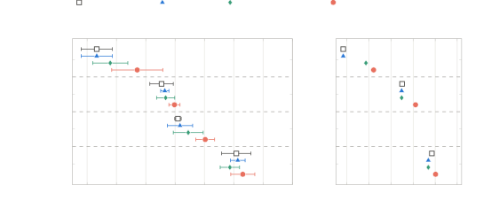
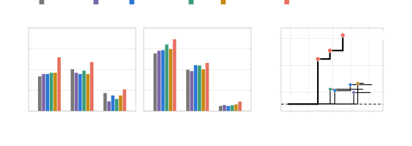

# FreeEvolve: Learning to Evolve Beyond Fixed Loops

Lecheng Kong ^(†)^(†)thanks: Equal contribution. Affiliation: AWS AI
Labs Email: [jkong@amazon.com](mailto:)    Like Hui¹¹footnotemark: 1
Affiliation: AWS AI Labs Email: [likehui@amazon.com](mailto:)    Nikos
Kanakaris Affiliation: AWS AI Labs Email: [nikosk@amazon.com](mailto:)
   Prithwish Jana ^(†)^(†)thanks: Work done as an intern at AWS AI Labs.
Affiliation: Georgia Institute of Technology
Email: [pjana7@gatech.edu](mailto:)    Sahika Genc Affiliation: AWS AI
Labs Email: [sahika@amazon.com](mailto:)    Narayanan Sadagopan
Affiliation: AWS AI Labs Email: [sdgpn@amazon.com](mailto:)

###### Abstract

Agent evolvers automate the design of the prompts, skills and workflows
around language model agents, yet the optimization process they follow
is still designed by hand: a fixed search loop decides how candidates
are evaluated, which are kept and when the search stops. We propose
FreeEvolve, which automates this process as well. An environment
specifies the goal, target agent, evaluator, data and resource limits;
within these limits, the evolver itself decides what to test, how much
evidence to collect, which candidates to pursue and when to stop. These
decisions follow an editable _evolution skill_, which we improve through
meta-evolution by scoring each candidate skill on the fresh target agent
it produces. The optimization process thus becomes a capability learned
from experience rather than a loop engineered in advance. On
$`\tau^{3}`$-bench, ARC-AGI-2, ARC-AGI-3 and Terminal-Bench 2.1,
FreeEvolve controls the evolution campaign by itself, yet improves the
primary held-out metric by 13.6 points on average and matches or exceeds
hand-designed evolvers. The learned process keeps improving with
experience: meta-evolved skills add $`6.9`$ points over the seed skill
on fresh target agents, demonstrating transferability across
environments.

|     |
| --- |
|     |

Project page w/ interactive demo:
[https://freeevolve.github.io/](https://freeevolve.github.io/)

## 1 Introduction

Large language models (LLMs) have enabled agents to solve a wide range
of tasks through reasoning and tool use. However, for a frozen LLM, the
performance of an agent depends heavily on the harness around it. The
harness determines how the model reasons, acts and recovers from
failures. Therefore, improving the harness can improve agent performance
without changing the model weights. Recent studies have started to
automate this process by treating prompts, skills and agent workflows as
editable components (Karten et al., 2026; Xu et al., 2026; Shen et al.,
2026; Zhang et al., 2026c). Following this direction, we focus on agent
evolvers. An evolver executes a target agent, examines its failures and
modifies its harness based on the collected evidence.

Although evolvers automate the design of agent harnesses, the
optimization process they follow is still designed by hand. Before
evolution begins, a human-designed search loop fixes which tasks are
evaluated, how often measurements are repeated, how candidates are
compared and when the search stops. On one hand this requires extensive
design expertise. On the other hand, a loop encodes assumptions about
evaluation noise, task difficulty, useful curricula and available
parallelism. These assumptions vary across agents and environments and
can change as evidence arrives, yet an evolver that only proposes edits
cannot act on that evidence, and adapting the loop means re-engineering
it by hand. We therefore ask: _Can the optimization process itself be
automated, so that the evolver organizes its own improvement campaign
and learns how to do so from experience?_

To this end, we propose FreeEvolve, a framework that automates the
optimization process of agent evolution. The main idea is to treat
campaign organization as a capability that the evolver exercises and
learns, rather than a loop that humans design. Our framework separates
the improvement problem from the procedure used to solve it. A bounded
environment defines the goal, editable target, available data and
resource constraints. The evolver is invoked once and remains in control
until it returns an improved target. After each environment execution,
it uses the collected evidence to decide what to do next. This control
allows the evolver to adapt the campaign without following an evolution
loop defined in advance.

Automating the process: campaign autonomy. Campaign autonomy allows the
improvement process to adapt as new evidence becomes available. During
evolution, the evolver can focus on tasks with frequent failures before
validating more broadly. It can repeat uncertain comparisons, explore
different candidates and reallocate resources based on the observed
results. It can also stop when additional evidence is unlikely to change
the best candidate. These decisions are made as evolution unfolds
instead of being fixed in advance by a predefined search loop.

Learning the process: meta-evolution. Campaign autonomy alone does not
guarantee an effective improvement process. The evolver still needs
guidance on how to use this control. To address this issue, we represent
the campaign policy as an editable _evolution skill_. We then improve
this skill through meta-evolution. Each candidate skill is used to run
complete improvement campaigns in target-agent environments. The
resulting agents and campaign traces are used to evaluate and refine the
skill. Meta-evolution therefore produces a self-contained evolution
skill that can be applied unchanged to new environments without
retaining the original agents or execution artifacts.

Figure 1: From prescribed loops to an automated, learned process. (a)
Prescribed loop. A prescribed loop fixes all campaign decisions and
their order before evolution begins. (b) Campaign autonomy. FreeEvolve
transfers control of these decisions to the evolver, allowing it to
adapt the campaign as new evidence becomes available. (c)
Meta-evolution. Campaign autonomy alone provides limited improvements.
With the hand-written seed skill, the evolver improves a fresh target
agent by at most $`1.1`$ points. Meta-evolution evaluates candidate
skills through complete improvement campaigns and the target agents they
produce. Once frozen and installed on fresh target agents, the learned
skills improve held-out performance by $`2.2`$ to $`13.8`$ points (see
Figure 3).

Experimental results. We evaluate FreeEvolve on $`\tau^{3}`$-bench (Shi
et al., 2026), ARC-AGI-2 (Chollet et al., 2026), ARC-AGI-3, and
Terminal-Bench 2.1 (Merrill et al., 2026). Without any hand-designed
loop, meta-evolution raises held-out mean performance from $`33.3\%`$ to
$`51.7\%`$, $`55.4\%`$ to $`69.1\%`$, $`61.0\%`$ to $`81.6\%`$, and
$`80.9\%`$ to $`82.5\%`$, respectively, matching or exceeding
hand-designed evolvers on six of seven metrics. The automated process is
also learnable and reusable. Installed on a fresh worker, the frozen
meta-evolved skill outperforms the seed skill on all four mean metrics
and all three available pass@3 metrics, and improves over a no-data LLM
rewrite in all four environments, so execution experience, not
instruction rewriting alone, drives the gain. A skill meta-evolved on
$`\tau^{3}`$-bench also reaches $`64.3\%`$ mean accuracy on ARC-AGI-2
and $`71.0\%`$ Relative Human Action Efficiency (RHAE) on ARC-AGI-3,
matching or exceeding the skills meta-evolved directly on those
environments.

#### Contributions.

- •
  Automating the optimization process. Conceptually, we identify the
  hand-designed search loop as the remaining manual component of agent
  evolution and recast it as a campaign policy that the evolver executes
  and that can be learned from improvement experience.
- •
  Campaign autonomy and meta-evolution. Technically, a bounded
  environment gives the evolver control of campaign decisions, while a
  self-contained evolution skill makes that control improvable through
  meta-evolution. Candidate skills are evaluated through the worker
  campaigns they organize.
- •
  A learnable and reusable process. Empirically, without a hand-designed
  loop, FreeEvolve matches or exceeds hand-designed evolvers on six of
  seven held-out metrics across four environments. Meta-evolution
  improves the process itself, which then transfers across environments,
  yields workers that transfer to cheaper models, reaches a stronger
  skill with fewer tokens, and benefits from more capable evolver
  models.

## 2 Related Work

Automating harness design. Recent systems automate the design of the
prompts, skills, code, and workflows around a fixed language model (Hu
et al., 2025; Zhang et al., 2025; Karten et al., 2026; Xu et al., 2026;
Du et al., 2026; Shen et al., 2026; Lou et al., 2026; Lin et al., 2026),
and evolutionary coding systems improve programs and agent harnesses
through model-generated edits (Sharma, 2025; Novikov et al., 2025;
Agrawal et al., 2025; Lee et al., 2026). They automate _what_ is edited;
the search process that decides what to evaluate, which candidates to
keep, and when to stop is typically specified in advance by the system
designer.

Automating the improver. Meta-evolution and self-improvement make the
improvement mechanism itself editable, evolving mutation prompts,
program improvers, self-editing agents, search strategies,
context-producing skills, or meta-agents (Fernando et al., 2024;
Zelikman et al., 2024; Yin et al., 2025; Zhang et al., 2026a; Robeyns et
al., 2025; Qu and Lu, 2026; Ye et al., 2026; Liu et al., 2026a; Zhang et
al., 2026b; Srikanth et al., 2026). Meta-Harness, does not do
meta-evolution, it lets a coding proposer read candidate code, scores,
and traces before editing (Lee et al., 2026). HyperAgents, like
FreeEvolve, evolves at the meta level, jointly evolving task agents and
the meta-agents that improve them, so its procedure can change across
outer iterations (Zhang et al., 2026b). These prior work focus on
improving a fixed campaign.

Automating the improvement process. FreeEvolve extends automation to the
process within a run: the evolver organizes its own campaign as results
arrive, and meta-evolution learns the skill that guides it from
completed campaigns. What is learned is neither a better artifact nor a
search procedure for the next run, but a reusable way of running
improvement campaigns. Appendix E discusses broader related work.

## 3 Method

In this section, we present the proposed FreeEvolve framework. Campaign
autonomy changes who organizes the evolution process. In a conventional
search loop, the framework invokes an evolver or proposer at predefined
stages and retains control over evaluation, candidate selection and
stopping. In FreeEvolve, the evolver is invoked once and remains in
control until it returns an improved target. Briefly, the framework
operates at two connected levels, as illustrated in Figure 2. At the
agent level, a bounded environment defines the improvement goal,
editable target, available data and resource constraints. The evolver
follows an evolution skill and organizes the complete improvement
campaign. It decides what to evaluate, how to allocate resources and
when to stop. At the meta level, the evolution skill becomes the
editable target. The meta-evolver evaluates candidate skills through
complete agent-level campaigns and uses the collected evidence to
improve the skill. Both levels use the same environment interface and
evolution operation.

### 3.1 A Bounded Interface for Campaign Autonomy

Giving control to the evolver requires a well-defined problem boundary.
Within this boundary, the evolver can explore the problem in different
ways. However, it cannot change the goal, evaluation rules or resource
limits. We define an environment initialized with target $`x_{0}`$ as

```math
\mathcal{E}[x_{0}]=\left(g,\mathcal{D},x_{0},R_{\mathcal{E}},\mathcal{C}_{\mathcal{E}}\right), \tag{1}
```

where $`g`$ is the improvement goal, $`\mathcal{D}`$ is the available
data and $`x_{0}`$ is the initial editable target. The execution
function $`R_{\mathcal{E}}`$ runs a candidate target $`x`$ under an
execution request $`u`$ and returns an artifact bundle $`a`$:

```math
a=R_{\mathcal{E}}(x,u). \tag{2}
```

The evolver chooses $`u`$, and $`\mathcal{C}_{\mathcal{E}}`$ defines
which requests are valid. The execution function determines which
interactions are possible; it does not prescribe when or in what order
they are used.

#### Worker environments.

For an agentic benchmark, $`\mathcal{D}`$ is the evolution partition of
the benchmark, $`x_{0}`$ is the initial worker harness, and $`g`$ is to
improve that harness under the benchmark’s evaluation rules.
$`R_{\mathcal{E}}`$ executes a candidate harness and returns its scores,
trajectories, and logs. The request $`u`$ makes execution choices part
of the interface: the evolver may select tasks, set repetitions and
seeds, and allocate concurrency and timeouts, subject to
$`\mathcal{C}_{\mathcal{E}}`$, which fixes the benchmark rules and
bounds resources. In a prescribed loop these choices are made before
evolution, so the evolver only ever sees $`R_{\mathcal{E}}(x)`$ under a
fixed $`u`$. Updating prior work to use $`u`$ adaptively would require
substantial domain knowledge and harness design expertise.

### 3.2 The Evolver Controls the Campaign

An evolver is an agent that receives this interface and runs the
campaign. We instantiate it as Claude Code equipped with a
self-contained evolution skill $`s`$, a markdown file of instructions. A
complete campaign is one invocation:

```math
x^{\star}=\operatorname{Evolve}\!\left(s;\mathcal{E}[x_{0}]\right)\equiv s\!\left(g,\mathcal{D},x_{0},R_{\mathcal{E}},\mathcal{C}_{\mathcal{E}}\right). \tag{3}
```

The framework invokes the evolver once, provides access to
$`R_{\mathcal{E}}`$, and takes no further role. The evolver decides
which candidate to edit, which request $`(x,u)`$ to issue, how the
returned artifacts change its next decision, and when to return
$`x^{\star}`$. No external loop fixes the number of executions, the
organization of search, or the stopping decision. This is our
operational definition of campaign autonomy: every environment execution
is chosen by the evolver, and control returns to the evolver with the
resulting artifacts.

Two human-designed components remain, and neither is an evolution loop.
Claude Code’s own agent loop (read, act, observe) is generic tool use;
it specifies no evaluation schedule, acceptance rule, or stopping
criterion. The seed skill is written by hand, but it fixes only
dispositions: treat the environment as the source of truth, keep all
evidence, continue from the best-supported target, and use the time
budget (Appendix G.1). Which tasks to evaluate, how many repetitions to
buy, when to branch, and when to accept are left to the evolver.

Figure 2: The interface at both levels. (a) The environment fixes the
goal, data, editable target, execution function, and valid requests; the
evolver is invoked once. Each request $`(x,u)`$ chooses a candidate and
how to run it (which tasks, how many repeats, what concurrency and
timeout). The returned artifacts update the campaign state, which steers
the next request, and the evolver returns $`x^{\star}`$ when it decides
to stop. (b) Meta-evolution applies the same $`\operatorname{Evolve}`$
with the skill as the target: one execution of $`R_{\mathrm{m}}`$ runs
complete worker campaigns, and a candidate skill is judged only by the
workers they produce.

#### Worker evolution.

Let $`\mathcal{E}^{\mathrm{w}}[w_{0}]`$ denote a worker environment
initialized with harness $`w_{0}`$. Worker evolution is an ordinary
application of Equation 3:

```math
w^{\star}=\operatorname{Evolve}\left(s;\mathcal{E}^{\mathrm{w}}[w_{0}]\right). \tag{4}
```

Because the evolver initiates every execution, the campaign can follow
the evidence: stable measurements let it move on, close comparisons
justify more repetitions, and failures concentrated in part of the data
can be searched there before a candidate is validated broadly. Whether a
given skill organizes these choices well is a separate question, which
we answer by learning the skill.

### 3.3 Meta-Evolution Learns the Campaign Policy

Prior meta-evolution makes the search procedure editable across outer
iterations: an outer optimizer produces a new procedure for the next
inner run, whose logic is then fixed while the run executes. FreeEvolve
meta-evolves a different object: an evolution skill that stays active
throughout the inner campaign and decides how to gather evidence and
organize search as results arrive.

Because the skill is itself a text target, meta-evolution needs no new
machinery. We construct a meta-environment whose editable target is an
evolution skill and whose data are worker environments:

```math
\mathcal{D}^{\mathrm{m}}=\left\{\mathcal{E}^{\mathrm{w}}_{i}[w_{i}]\right\}_{i=1}^{n}, \tag{5}
```

```math
\mathcal{E}^{\mathrm{m}}[s_{0}]=\left(g^{\mathrm{m}},\mathcal{D}^{\mathrm{m}},s_{0},R_{\mathrm{m}},\mathcal{C}_{\mathrm{m}}\right). \tag{6}
```

A candidate skill is not scored in isolation. It is installed in the
evolver for complete worker-evolution campaigns and judged through the
workers and traces they produce. With
$`\mathcal{I}(u)\subseteq\{1,\ldots,n\}`$ the worker environments
selected by request $`u`$, the meta-level execution function is

```math
R_{\mathrm{m}}(s,u)=\operatorname{EvaluateWorkers}\left(\left\{\operatorname{Evolve}\left(s;\mathcal{E}^{\mathrm{w}}_{i}[w_{i}]\right):i\in\mathcal{I}(u)\right\}\right), \tag{7}
```

which returns the resulting workers, their evolution-partition scores,
and the inner campaign records. Meta-evolution is then another
application of Equation 3:

```math
s^{\star}=\operatorname{Evolve}\left(s_{\mathrm{outer}};\mathcal{E}^{\mathrm{m}}[s_{0}]\right). \tag{8}
```

The outer evolver edits $`s_{0}`$, decides which inner campaigns to
launch, and uses their outcomes as feedback. $`s_{\mathrm{outer}}`$ and
$`s_{0}`$ start as separate copies of the same seed skill, so editing
the candidate never changes the controller. Meta-environments are
excluded from $`\mathcal{D}^{\mathrm{m}}`$, which bounds nesting at two
levels. Appendix F shows the worker and meta-environments for ARC-AGI-3
side by side.

#### Why the environment–evolver boundary matters.

Separating environment assumptions from evolution strategy supports
reuse across execution settings. On a cluster, inner campaigns finish
asynchronously across nodes; an evolver tied to a single-machine
execution model may leave resources idle or require changes to its
control logic.

In FreeEvolve, supporting Slurm requires only an environment-specific
$`R_{\mathrm{m}}^{\mathrm{slurm}}`$, which launches inner campaigns and
returns their artifacts as they finish, and
$`\mathcal{C}_{\mathrm{m}}^{\mathrm{slurm}}`$, which exposes node
allocation and concurrency limits. The evolver, evolution skill, and
$`\operatorname{Evolve}`$ operation remain unchanged; the evolver adapts
its campaign as jobs complete (Appendix A).

The same boundary supports skill transfer. Each setting supplies its own
$`\mathcal{E}[x_{0}]`$, while the skill guides how the evolver uses the
available capabilities and evidence. A meta-evolved skill can therefore
be frozen and reused in environments with different tasks, models, or
hardware, without inheriting source workers or campaign state.

## 4 Experiments

Our central claim is that the policy organizing agent evolution can be
learned rather than fully specified by a human-designed search loop.
Campaign autonomy makes adaptive decisions available, and meta-evolution
learns how to use them from experience. Our experiments answer five
questions. Q1: Can a learned autonomous campaign achieve strong
performance without a prescribed loop? Q2: Does meta-evolution turn
campaign autonomy into a stronger evolver? Q3: Does the resulting
evolution skill generalize beyond its source environment and model? Q4:
How does the evolver use campaign autonomy as evolution unfolds? Q5:
What model capability is required to exercise campaign autonomy
effectively? Appendix Table 11 summarizes the evidence for each.

### 4.1 Experimental Setup

#### Benchmarks and metrics.

We evaluate four environments spanning interactive tool use, abstract
reasoning, and terminal control: $`\tau^{3}`$-bench for conversational
agents over unstructured knowledge (Shi et al., 2026), ARC-AGI-2 for
few-shot grid transformations (Chollet et al., 2026), ARC-AGI-3 for
interactive abstract-reasoning games (ARC Prize Foundation, 2026), and
Terminal-Bench 2.1 for long-horizon command-line tasks (Merrill et al.,
2026). We report mean task score and pass@3, except on ARC-AGI-3, where
we report RHAE. Appendix Table 5 lists dataset sizes, splits, metrics,
and base agents. All meta-evolution campaigns start from the same
task-agnostic seed skill; Appendix G.1 gives its instructions and the
campaign decisions left open to meta-evolution.

#### Evaluation protocol.

We measure performance on unseen tasks rather than the best score seen
during search. Each method searches only on the evolution partition,
with the same split and worker configuration within a benchmark, and
selects its final artifact using its own rules before the held-out
partition is revealed. Following the standard search protocol used in
GEPA and EvoX (Agrawal et al., 2025; Liu et al., 2026a), we perform the
search once and additionally evaluate its resulting worker on the
held-out set three times, reporting the mean and standard deviation
(mean $`\pm`$ s.d.). Where defined, we also report pass@3, the fraction
of tasks solved at least once across the three runs.

### 4.2 Learned Autonomous Campaigns Produce Strong Workers

|                     |                    |               |                  |               |                  |                    |              |
| ------------------- | ------------------ | ------------- | ---------------- | ------------- | ---------------- | ------------------ | ------------ |
|                     | $`\tau^{3}`$-bench |               | ARC-AGI-2        |               | ARC-AGI-3        | Terminal-Bench 2.1 |              |
| Method              | Mean               | Pass@3        | Mean             | Pass@3        | RHAE             | Mean               | Pass@3       |
| Base agent          | 33.3 $`\pm 5.3`$   | 48.3          | 55.4 $`\pm 4.0`$ | 75.0          | 61.0 $`\pm 1.1`$ | 80.9 $`\pm 5.0`$   | 88.5         |
| GEPA (2025)         | 35.6 $`\pm 2.5`$   | 51.7          | 58.0 $`\pm 5.7`$ | 76.4          | 65.8 $`\pm 2.6`$ | 84.7 $`\pm 2.4`$   | 91.8         |
| OpenEvolve (2025)   | 35.6 $`\pm 2.4`$   | 55.2          | 58.6 $`\pm 5.0`$ | 79.1          | 63.4 $`\pm 1.5`$ | 82.5 $`\pm 1.8`$   | 90.2         |
| EvoX (2026a)        | 36.8 $`\pm 3.5`$   | 58.6          | 64.0 $`\pm 6.4`$ | 80.0          | 65.1 $`\pm 3.4`$ | 82.0 $`\pm 1.8`$   | 90.2         |
| HyperAgents (2026b) | 36.8 $`\pm 5.1`$   | 58.6          | 59.6 $`\pm 4.2`$ | 77.8          | 72.1 $`\pm 2.8`$ | 82.5 $`\pm 2.1`$   | 90.2         |
| FreeEvolve          | 51.7 $`\pm 6.0`$   | 69.0          | 69.1 $`\pm 5.4`$ | 86.5          | 81.6 $`\pm 3.0`$ | 82.5 $`\pm 2.5`$   | 93.4         |
| meta-evolution      | $`(+55.3\%)`$      | $`(+40.5\%)`$ | $`(+24.7\%)`$    | $`(+15.3\%)`$ | $`(+33.8\%)`$    | $`(+2.0\%)`$       | $`(+5.5\%)`$ |

Table 1: FreeEvolve matches or exceeds hand-designed evolvers. Held-out
performance (%) of the worker each method returns; means $`\pm`$ s.d.;
RHAE: Relative Human Action Efficiency. EvoX and HyperAgents also
meta-evolve their search procedure. The last row is its relative gain
over the base agent.

To answer Q1, we test whether FreeEvolve can use campaign autonomy to
match the performance of human-designed search loops. We compare the
unmodified worker, GEPA (Agrawal et al., 2025), OpenEvolve (Sharma,
2025), EvoX (Liu et al., 2026a), HyperAgents (Zhang et al., 2026b), and
FreeEvolve with meta-evolution. GEPA, OpenEvolve, and EvoX follow the
SkyDiscover settings (Liu et al., 2026b), and HyperAgents uses its
default settings.

Autonomous and prescribed-loop methods allocate evaluations and search
effort differently, making exact cost matching difficult. We therefore
use Table 1 to compare their improvement frontiers under explicit
stopping rules: each baseline keeps running until improvement stall for
5 iterations, while FreeEvolve receives a 24-hour meta-evolution budget,
the time for different baselines are in Table 9. The comparison asks how
strong a worker each method can ultimately produce under its own
campaign organization.

Table 1 shows that a meta-evolved autonomous campaign produces strong
workers across all four environments. FreeEvolve improves the primary
held-out metric by $`13.6`$ points on average and outperforms the
expert-designed evolvers on three benchmarks. It also consistently
matches or outperforms the meta-evolution baselines EvoX and
HyperAgents, indicating the value of shifting the target of
meta-evolution from a specific search loop to campaign organization.

Terminal-Bench 2.1 exposes a complementary challenge. FreeEvolve
achieves the best pass@3, while its mean score trails GEPA. Terminal
evaluation is particularly CPU-intensive, so a shared concurrency
setting can create blocking and variable throughput. This contrast
reinforces the role of the environment definition: resource availability
and execution behavior should be exposed better to the evolver.

### 4.3 Meta-Evolution Produces a Stronger Evolver

To answer Q2, every skill starts from the same fresh worker and receives
the same resource budget. The _seed_ is the initial evolution skill; the
_no-data_ variant asks an LLM to improve that skill without observing
execution results; and the _meta-evolved_ variant is learned from
completed meta-evolution. No evolved worker or campaign artifact is
carried into these runs.



Figure 3: Meta-evolved skills make stronger evolvers on fresh workers.
Each skill is frozen and installed on the same fresh base worker with
the same budget. $`\Delta`$: meta-evolved minus seed.

Figure 3 shows that the seed is already capable of improving a worker,
but only modestly: it gains $`0.6`$ points on average across the four
mean metrics. The meta-evolved skill adds a further $`6.9`$ points on
average over the seed, improves every available pass@3 metric, and
outperforms the no-data rewrite in every environment. Campaign autonomy
makes a broad set of decisions available; these results show that
meta-evolution can learn how to make those decisions effectively,
reducing the need for manual expert design.

### 4.4 Learned Evolution Skills Transfer Across Environments and Models

To answer Q3, we test whether an evolution skill, which captures how to
organize improvement rather than a particular worker, remains useful
when installed elsewhere. If so, compute-intensive meta-evolution can be
run once and the resulting evolver reused in new environments.

|                               | Target: $`\tau^{3}`$-bench |        | Target: ARC-AGI-2 |        | Target: ARC-AGI-3 | Target: TB 2.1   |        |
| ----------------------------- | -------------------------- | ------ | ----------------- | ------ | ----------------- | ---------------- | ------ |
| Meta-evolution environment(s) | Mean                       | Pass@3 | Mean              | Pass@3 | RHAE              | Mean             | Pass@3 |
| Minimal seed                  | 33.3 $`\pm 5.3`$           | 48.3   | 56.5 $`\pm 1.4`$  | 74.8   | 61.7 $`\pm 4.3`$  | 81.4 $`\pm 2.5`$ | 86.9   |
| $`\tau^{3}`$-bench            | 47.1 $`\pm 8.7`$           | 62.1   | 64.3 $`\pm 2.8`$  | 83.8   | 71.0 $`\pm 6.4`$  | 76.5 $`\pm 7.4`$ | 90.2   |
| ARC-AGI-2                     | 44.8 $`\pm 3.4`$           | 55.2   | 59.8 $`\pm 1.9`$  | 81.1   | 62.5 $`\pm 3.6`$  | 74.3 $`\pm 5.0`$ | 85.2   |
| $`\tau^{3}`$-bench + TB2.1    | 46.0 $`\pm 8.7`$           | 51.7   | 58.0 $`\pm 1.9`$  | 81.1   | 66.9 $`\pm 4.8`$  | 82.5 $`\pm 4.1`$ | 91.8   |

Table 2: Learned evolution skills transfer across environments. Each row
is a skill meta-evolved on the listed environment(s), frozen, and
installed on a fresh worker in each target; shading marks improvement
over the seed. Single-source skills transfer unevenly and lower the
Terminal-Bench mean; meta-evolving on $`\tau^{3}`$-bench and
Terminal-Bench 2.1 (TB2.1) jointly improves all metrics.

We freeze each skill learned in a separate meta-evolution campaign and
install it in a fresh target environment (Table 2). Transfer is positive
on most target metrics, and some transferred skills approach or exceed
the in-environment result. Both single-source skills, however, reduce
the Terminal-Bench 2.1 mean, and the ARC-AGI-2 skill also reduces its
pass@3, suggesting a transfer boundary when the target environment,
including its hardware and execution behavior, changes substantially.
Joint meta-evolution on $`\tau^{3}`$-bench and Terminal-Bench 2.1 yields
a skill that improves every reported target metric over the seed, so
exposing meta-evolution to more diverse environments can produce a more
robust evolver.

We also test whether evolved worker harnesses capture task improvements
rather than model-specific behavior: each method’s harness, evolved with
the native Opus worker, runs unchanged with Sonnet 4.6 and Haiku 4.5
(Figure 4a). Across the four non-native settings, FreeEvolve keeps an
average gain of $`5.3`$ points over the base harness and remains the
strongest evolved harness, whereas several baseline gains on
$`\tau^{3}`$-bench shrink or reverse. FreeEvolve workers can therefore
be evolved with a stronger model and deployed with a cheaper one without
re-evolution.



Figure 4: Evolved harnesses transfer to cheaper worker models, and
FreeEvolve learns a strong and efficient skill. (a) Each method evolves
the harness with the native model; the frozen harness then runs
unchanged with Sonnet 4.6 and Haiku 4.5. FreeEvolve is the strongest
harness in all six settings and keeps a $`5.3`$-point average gain over
the base agent on the four non-native ones. (b) Best-so-far ARC-AGI-3
training RHAE of the worker each method’s skill produces, versus the
total tokens used to produce that skill.

Figure 4b measures how effectively each method converts its total token
budget, including all evolver, evaluation, and other model calls, into a
stronger evolver skill, scored by the training RHAE of the worker the
skill produces. By $`0.74`$B tokens, FreeEvolve has produced a skill
whose worker reaches a score that no baseline attains with more than
twice the total token cost.

### 4.5 Model Capability Supports Effective Campaign Control

| Evolver model     | Mean (%)         | Pass@3 |
| ----------------- | ---------------- | ------ |
| No meta-evolution | 33.3 $`\pm 5.3`$ | 48.3   |
| Haiku 4.5         | 32.2 $`\pm 8.7`$ | 48.3   |
| Sonnet 4.6        | 47.1 $`\pm 4.0`$ | 62.1   |
| Opus 4.6          | 40.2 $`\pm 2.0`$ | 55.2   |
| Opus 4.7          | 49.4 $`\pm 8.0`$ | 69.0   |
| Opus 4.8          | 51.7 $`\pm 6.0`$ | 69.0   |

Table 3: Evolver-model ablation on $`\tau^{3}`$-bench.

Q5 asks what model capability is needed to turn campaign autonomy into
held-out gains. We hold the $`\tau^{3}`$-bench worker and meta-evolution
setup fixed, vary only the model executing the evolver from Haiku 4.5 to
Opus 4.8, and compare the resulting workers only on held-out mean and
pass@3.

Table 3 reveals a clear transition. Haiku 4.5 does not improve either
held-out metric; beginning with Sonnet 4.6, meta-evolution consistently
improves held-out performance, with the strongest Opus models producing
the best workers. Held-out improvement generally increases with newer
and stronger models, although Sonnet 4.6 notably outperforms Opus 4.6.
This result also identifies a limitation: producing held-out gains with
FreeEvolve requires sufficient model capability. Sonnet 4.6 already
demonstrates this capability; we leave a broader study of this boundary
to future work.

### 4.6 Autonomous Campaigns Adapt Evaluation and Search

| Campaign control    | Mean (%) | Tokens (B) |
| ------------------- | -------- | ---------- |
| Controlled $`u`$    | 47.1     | 1.19       |
| Full set            | 39.1     | 0.89       |
| Concurrency $`=24`$ | 43.7     | 1.78       |
| No timeout          | 44.8     | 1.53       |

Table 4: Fixed-decision ablations on $`\tau^{3}`$-bench.

To answer Q4, we hold the learned skill and resource budget fixed while
removing its control over one environment-facing decision at a time.
Table 4 examines how the learned skill uses its campaign control by
fixing one decision at a time. Always evaluating the full set makes the
evolver wait for expensive probes, reducing the number of decisions it
can make within the time budget. Fixed concurrency and the absence of
timeouts leave resources occupied by slow or failed executions, using
more total tokens but producing a weaker worker. The benefit is thus not
one universally optimal configuration; it is the ability to reorganize
evaluation as the campaign unfolds.

#### Qualitative campaign analysis.

The fixed-decision interventions isolate evaluation choices, but
autonomy also governs the organization of search. We therefore trace one
ARC-AGI-2 worker-evolution campaign using a frozen meta-evolved skill.

Figure 5: The evolver reorganizes evaluation and search as evidence
arrives. One ARC-AGI-2 worker-evolution campaign under a frozen
meta-evolved skill: the evolution-set score of every evaluation against
elapsed hours (markers as in the legend). Annotations mark five
decisions the evolver made on its own: undoing a three-edit regression
while keeping the useful helper library, probing a 2% subset to show
that a truncation came from the agent’s own prompt rather than the
platform, merging the best code with a fix from a weaker run, repeating
a promising version to confirm its gain, and branching an ancestor into
four variants. The star marks the harness it selects.

Figure 5 shows the evolver exercising this control online: it changes
evaluation resolution, opens distinct branches, combines discoveries,
and selects the final worker as evidence accumulates. These behaviors
are not hard-coded stages of the framework; the evolver invokes each
behavior when the campaign requires it.

To identify what meta-evolution contributes to these decisions, we
compare the four meta-evolved skills with their common seed. The seed
provides broad dispositions—use the available time, preserve evidence,
and continue from the best worker—while leaving the organization of the
campaign open. The evolved skills turn those dispositions into
operational policies (Appendix D, Figure 6). Across environments, the
learned rules govern task selection, evaluation allocation, and search
control. They use failures to choose new probes, move from cheap tests
to confirmation only when warranted, and preserve or combine changes
according to accumulated evidence. Together, the intervention,
execution-trace, and skill analyses answer Q4: autonomy lets the evolver
request the campaign behavior it needs, while meta-evolution turns that
freedom into a reusable way of organizing improvement.

## 5 Conclusion

Agent evolvers have automated the design of harnesses, but not the
broader process that designs them. FreeEvolve automates that process
too: the evolver runs its own improvement campaign in a free space, and
meta-evolution learns how to run it from the outcomes. Across four
environments, the automated process uses a self-controlled loop, yet
matches or exceeds hand-designed evolvers’ performance. Beyond autonomy,
the learned process improves with experience. What it carries is a way
of running an improvement campaign rather than domain knowledge.
Treating the optimization process as a learnable agent capability,
rather than a fixed piece of engineering, lets agent improvement advance
with experience and with the models themselves.

### AI Use Statement

Large language models are the object of study in this work. Every
evolver, worker, simulated user, and judge is a Claude model, and the
evolver agent is Claude Code. Separately, the authors used LLM
assistants to edit prose, check consistency between tables and text, and
write figure code. The authors designed the experiments, checked every
reported number against the run artifacts, and take full responsibility
for the content.

### Ethics Statement

Meta-evolving an agent harness can amplify errors, consume substantial
compute, and make the source of a behavioral change difficult to
identify. FreeEvolve limits nesting, retains all evaluation records,
fixes model capability, and separates candidate generation from
acceptance. These controls improve auditability, but they do not make
autonomous improvement safe for high-stakes deployment, where
domain-specific oversight remains necessary.

### Reproducibility Statement

Each run stores the installed environment, evaluated target, evolver
instructions, execution trace, and raw evaluation results. The appendix
reports the benchmark definitions, task splits, base agents, and model
configurations. Additional implementation and reproducibility details
are available in the anonymous code submission.

## References

- Agrawal et al. (2025) L. A. Agrawal, S. Tan, D. Soylu, N. Ziems, R.
  Khare, K. Opsahl-Ong, A. Singhvi, H. Shandilya, M. J. Ryan, M.
  Jiang, C. Potts, K. Sen, A. G. Dimakis, I. Stoica, D. Klein, M.
  Zaharia, and O. Khattab GEPA: reflective prompt evolution can
  outperform reinforcement learning. arXiv preprint arXiv:2507.19457.
  Cited by: §2, §4.1, §4.2, Table 1.
- ARC Prize Foundation (2026) ARC Prize Foundation ARC-AGI-3: a new
  challenge for frontier agentic intelligence. arXiv preprint
  arXiv:2603.24621. Cited by: Appendix B, §4.1.
- Chollet et al. (2026) F. Chollet, M. Knoop, G. Kamradt, B. Landers,
  and H. Pinkard ARC-agi-2: a new challenge for frontier ai reasoning
  systems. External Links: 2505.11831,
  [Link](https://arxiv.org/abs/2505.11831) Cited by: Appendix B, §1,
  §4.1.
- Du et al. (2026) Y. Du, Y. Wang, H. Xu, J. Xu, S. Tan, B. Zhao, B.
  Yang, Z. Xu, M. Kong, H. Wei, J. Liu, and Q. Zhu Living-harness is an
  interactive-agent evolver. arXiv preprint arXiv:2607.26598. Cited by:
  Appendix E, §2.
- Fernando et al. (2024) C. Fernando, D. S. Banarse, H. Michalewski, S.
  Osindero, and T. Rocktäschel Promptbreeder: self-referential
  self-improvement via prompt evolution. In Proceedings of the 41st
  International Conference on Machine Learning (ICML), Proceedings of
  Machine Learning Research, Vol. 235, pp. 13481–13544. Cited by:
  Appendix E, §2.
- Hu et al. (2025) S. Hu, C. Lu, and J. Clune Automated design of
  agentic systems. In The Thirteenth International Conference on
  Learning Representations (ICLR), Cited by: Appendix E, §2.
- Jiang et al. (2025) Z. Jiang, D. Schmidt, D. Srikanth, D. Xu, I.
  Kaplan, et al. AIDE: AI-driven exploration in the space of code. arXiv
  preprint arXiv:2502.13138. Cited by: Appendix E.
- Karten et al. (2026) S. Karten, J. Zhang, T. Upaa, R. Feng, W. Li, C.
  Shi, C. Jin, and K. Vodrahalli Continual harness: online adaptation
  for self-improving foundation agents. arXiv preprint arXiv:2605.09998.
  Cited by: Appendix E, §1, §2.
- Lee et al. (2026) Y. Lee, R. Nair, Q. Zhang, K. Lee, O. Khattab,
  and C. Finn Meta-Harness: end-to-end optimization of model harnesses.
  arXiv preprint arXiv:2603.28052. Cited by: Appendix E, §2, §2.
- Lin et al. (2026) J. Lin, S. Liu, C. Pan, L. Lin, S. Dou, et al.
  Agentic harness engineering: observability-driven automatic evolution
  of coding-agent harnesses. arXiv preprint arXiv:2604.25850. Cited by:
  Appendix E, Appendix E, §2.
- Liu et al. (2026a) S. Liu, S. Agarwal, M. Maheswaran, M. Cemri, Z.
  Li, Q. Mang, A. Naren, E. Boneh, A. Cheng, M. Z. Pan, A. Du, K.
  Keutzer, A. Cheung, A. G. Dimakis, K. Sen, M. Zaharia, and I. Stoica
  EvoX: meta-evolution for automated discovery. arXiv preprint
  arXiv:2602.23413. Cited by: §2, §4.1, §4.2, Table 1.
- Liu et al. (2026b) S. Liu, M. Cemri, S. Agarwal, A. Krentsel, A.
  Naren, Q. Mang, Z. Li, A. Gupta, M. Maheswaran, A. Cheng, M. Pan, E.
  Boneh, K. Ramchandran, K. Sen, M. Zaharia, A. G. Dimakis, and I.
  Stoica SkyDiscover: a flexible, adaptive framework for ai-driven
  scientific and algorithmic discovery. In Proceedings of the ACM
  Conference on AI and Agentic Systems, CAIS ’26, pp. 1223–1227.
  External Links:
  [Document](https://dx.doi.org/10.1145/3786335.3813221),
  [Link](https://doi.org/10.1145/3786335.3813221) Cited by: §4.2.
- Lou et al. (2026) X. Lou, M. Lázaro-Gredilla, A. Dedieu, C.
  Wendelken, W. Lehrach, and K. P. Murphy AutoHarness: improving LLM
  agents by automatically synthesizing a code harness. arXiv preprint
  arXiv:2603.03329. Cited by: Appendix E, §2.
- Merrill et al. (2026) M. A. Merrill, A. G. Shaw, N. Carlini, B. Li, H.
  Raj, et al. Terminal-bench: benchmarking agents on hard, realistic
  tasks in command line interfaces. arXiv preprint arXiv:2601.11868.
  Cited by: Appendix B, §1, §4.1.
- Nie et al. (2026) J. Nie, Y. Zhang, J. Song, Q. Cai, D. Yu, Y. Guo, X.
  Tian, and B. Han TTHE: test-time harness evolution. arXiv preprint
  arXiv:2607.08124. Cited by: Appendix E.
- Novikov et al. (2025) A. Novikov, N. Vũ, M. Eisenberger, E. Dupont, P.
  Huang, et al. AlphaEvolve: a coding agent for scientific and
  algorithmic discovery. arXiv preprint arXiv:2506.13131. Cited by:
  Appendix E, §2.
- Qu and Lu (2026) Y. Qu and M. Lu Bilevel autoresearch:
  meta-autoresearching itself. arXiv preprint arXiv:2603.23420. Cited
  by: Appendix E, §2.
- Robeyns et al. (2025) M. Robeyns, M. Szummer, and L. Aitchison A
  self-improving coding agent. arXiv preprint arXiv:2504.15228. Cited
  by: Appendix E, §2.
- Sharma (2025) OpenEvolve: an open-source evolutionary coding agent
  External Links:
  [Link](https://github.com/algorithmicsuperintelligence/openevolve)
  Cited by: §2, §4.2, Table 1.
- Shen et al. (2026) Y. Shen, B. Li, and X. Zhang SkillOpt-lite: better
  and faster agent self-evolution via one line of vibe. arXiv preprint
  arXiv:2607.03451. Cited by: Appendix E, §1, §2.
- Shi et al. (2026) Q. Shi, A. Zytek, P. Razavi, K. Narasimhan, and V.
  Barres $`\tau`$-Knowledge: evaluating conversational agents over
  unstructured knowledge. arXiv preprint arXiv:2603.04370. Cited by: §1,
  §4.1.
- Srikanth et al. (2026) D. Srikanth, B. Zhao, D. Xu, Y. Wu, and Z.
  Jiang Recursive self-improvement of ai research agents. External
  Links: 2609.26457, [Link](https://arxiv.org/abs/2609.26457) Cited by:
  Appendix E, §2.
- Xu et al. (2026) T. Xu, H. Wen, and M. Li Adapting the interface, not
  the model: runtime harness adaptation for deterministic LLM agents.
  arXiv preprint arXiv:2605.22166. Cited by: Appendix E, §1, §2.
- Ye et al. (2026) H. Ye, X. He, V. Arak, H. Dong, and G. Song Meta
  context engineering via agentic skill evolution. arXiv preprint
  arXiv:2601.21557. Cited by: Appendix E, §2.
- Yin et al. (2025) X. Yin, X. Wang, L. Pan, L. Lin, X. Wan, and W. Y.
  Wang Gödel agent: a self-referential agent framework for recursively
  self-improvement. In Proceedings of the 63rd Annual Meeting of the
  Association for Computational Linguistics (Volume 1: Long Papers),
  pp. 27890–27913. Cited by: Appendix E, §2.
- Zelikman et al. (2024) E. Zelikman, E. Lorch, L. Mackey, and A. T.
  Kalai Self-taught optimizer (STOP): recursively self-improving code
  generation. In First Conference on Language Modeling (COLM), Cited by:
  Appendix E, Appendix E, §2.
- Zhang et al. (2026a) J. Zhang, S. Hu, C. Lu, R. Lange, and J. Clune
  Darwin gödel machine: open-ended evolution of self-improving agents.
  In The Fourteenth International Conference on Learning Representations
  (ICLR), Cited by: Appendix E, Appendix E, §2.
- Zhang et al. (2026b) J. Zhang, B. Zhao, W. Yang, J. Foerster, J.
  Clune, M. Jiang, S. Devlin, and T. Shavrina HyperAgents. arXiv
  preprint arXiv:2603.19461. Cited by: Appendix E, §2, §4.2, Table 1.
- Zhang et al. (2025) J. Zhang, J. Xiang, Z. Yu, F. Teng, X. Chen, et
  al. AFlow: automating agentic workflow generation. In The Thirteenth
  International Conference on Learning Representations (ICLR), Cited by:
  Appendix E, §2.
- Zhang et al. (2026c) L. Zhang, R. Zhou, D. Song, Z. Chen, Y. Tian, J.
  Yang, H. Ma, C. Li, G. Feng, X. Li, Y. Jin, and Y. Xu HarnessCompass:
  guiding automatic harness evolution toward generalizable and effective
  agent harnesses. arXiv preprint arXiv:2608.01918. Cited by: Appendix
  E, §1.

## Appendix

## Appendix A Implementation Details

#### Anonymous code.

We instantiate the evolver with Claude Code and a single instruction
file, SKILL.md. One call to evolve.sh installs an environment in a fresh
run directory and invokes this agent once. There is no framework-level
evolution loop around that invocation. The seed skill contains only
general instructions for working from evidence and leaving the strongest
target behind; it does not prescribe an iteration count, branching
structure, curriculum, evaluation schedule, or performance-based
stopping rule.

Each installed environment realizes Equation 1 through four visible
components. ENVIRONMENT.md records the goal, data, constraints, and
interpretation of the returned artifacts. The file .target identifies
the editable surface $`x_{0}`$, while run.sh implements
$`R_{\mathcal{E}}`$. An initially empty workspace-\<env\>/ stores the
candidates, artifacts, and notes produced during evolution. The
environment files remain fixed throughout a campaign; only the declared
target is editable.

The call $`R_{\mathcal{E}}(x,u)`$ is implemented in place. The evolver
installs candidate $`x`$ at the path declared by .target and supplies
$`u`$ through the arguments of run.sh. Each call records its
measurements and traces in an artifact directory. Evaluation always
reads the declared edit surface, ensuring that the candidate under
evaluation is the candidate being evolved.

The run directory is the complete interface between environment and
evolver. It is self-contained, records the skill and model used for the
run, and preserves the evaluation artifacts produced during the
campaign. The evolver may invoke run.sh in any order or configuration,
launch independent branches, and decide when enough evidence has been
collected. The framework enforces the environment boundary, but
contributes no search schedule.

The meta-environment uses exactly the same layout. Its declared target
is a candidate SKILL.md, and its run.sh launches that skill as the
evolver in a fresh worker environment. A meta-level execution returns
the complete inner run directory, including the worker produced, its
evaluations, and the inner trace, rather than reducing the campaign to a
fixed scalar. The outer evolver chooses which worker environment to
launch and how many inner runs to collect. Meta-environments are
excluded from the inner environment catalogue, bounding execution to the
two levels described above.

#### Hardware and campaign budgets.

Standalone worker-evolution runs receive a 12-hour wall-clock budget on
one 128-CPU machine. The environment permits at most 24 concurrent task
attempts, regardless of how the evolver divides them among evaluation
calls.

Meta-evolution receives a 24-hour outer-campaign budget on a Slurm
cluster with five worker nodes. The meta-environment submits each
requested inner campaign as an independent one-node Slurm job, and
$`\mathcal{C}_{\mathrm{m}}`$ permits at most five inner campaigns to run
simultaneously. We impose no separate wall-clock limit on an inner
evolver within meta-evolution: deciding how many inner campaigns to
launch, how long to let them run, and how to coordinate asynchronous
completions is part of the meta-evolver’s campaign control.

## Appendix B Dataset Details

| Benchmark          | Dataset and primary metric                                                                                                       | Evolution / held-out protocol                                        | Base agent                                                         |
| ------------------ | -------------------------------------------------------------------------------------------------------------------------------- | -------------------------------------------------------------------- | ------------------------------------------------------------------ |
| $`\tau^{3}`$-bench | 97 interactive banking_knowledge conversations with tools and a domain policy; mean task pass rate and pass@3.                   | 68 evolution tasks and 29 disjoint held-out tasks.                   | Vendored $`\tau^{3}`$ customer-service agent with Claude Opus 4.8. |
| ARC-AGI-2          | Few-shot visual grid-transformation tasks that test abstract rule induction; mean task accuracy and pass@3.                      | 56 evolution tasks and 111 disjoint validation tasks.                | Base ARC solver backed by Claude 4.7 Opus.                         |
| ARC-AGI-3          | Interactive abstract-reasoning games; Relative Human Action Efficiency (RHAE) score.                                             | 17 evolution games and 8 disjoint held-out games.                    | Base ARC-AGI-3 agent backed by Claude Opus 5.                      |
| Terminal-Bench 2.1 | Containerized command-line tasks covering software, systems, security, and scientific workflows; mean task pass rate and pass@3. | Evolution tasks are hidden from final evaluation; 61 held-out tasks. | Unmodified deep agent with Claude Opus 4.8.                        |

Table 5: Benchmark datasets, metrics, evaluation protocols, and base
agents.

#### $`\tau^{3}`$-bench.

We use the banking_knowledge domain. Each task is a tool-mediated
conversation with a simulated customer. The agent must retrieve the
relevant bank policy, take any required actions, and communicate the
correct resolution. The grader assigns a binary reward after the
conversation. The full domain contains 97 tasks; our fixed split places
68 tasks in the evolution partition and 29 in the held-out partition.

#### ARC-AGI-2.

ARC-AGI-2 consists of few-shot visual reasoning tasks represented as
input–output grid transformations (Chollet et al., 2026). A solver must
infer the latent transformation from the demonstrations and apply it to
a new input. We use 56 tasks for evolution and a disjoint set of 111
held-out tasks. Meta-evolution may use only the 56-task evolution
partition. We report task accuracy on the held-out partition.

#### ARC-AGI-3.

ARC-AGI-3 evaluates agents in interactive abstract-reasoning games (ARC
Prize Foundation, 2026). We use 17 games for evolution and reserve 8
disjoint games for held-out evaluation. The agent interacts with each
game through the declared environment interface, while the game
definitions and evaluator remain fixed. We report Relative Human Action
Efficiency (RHAE). Each completed level receives the squared ratio of
human-baseline actions to agent actions, subject to the benchmark’s cap
for faster-than-human play; uncompleted levels receive zero. Level
scores are linearly weighted so later levels count more, each game is
capped by the weighted fraction of levels completed, and RHAE averages
the resulting game scores. We report it as a percentage, with higher
values indicating more complete and action-efficient play.

#### Terminal-Bench 2.1.

Terminal-Bench 2.1 contains realistic command-line tasks executed in
isolated containers (Merrill et al., 2026). Tasks include software
debugging, systems configuration, security, data processing, and
scientific workflows. Each task provides a problem statement and a test
suite that verifies the final container state. We report results on 61
held-out tasks. We report mean and pass@3.

All task partitions are created before meta-evolution. Neither the
worker-level nor the meta-level evolver may access the held-out
partition. The same split is used for all compared evolver generations
within a benchmark. To ensure evolver do not break out of the working
directory to find held-out set, we perform keyword search of held-out
data IDs over the run directory. The evolvers consistently stay within
the established run directory without attempting to hack held-out data.

## Appendix C Configuration Details

#### Model matching.

Unless otherwise stated, the worker, worker-level evolver, and outer
meta-evolver use the same Claude model within an environment. The
model-capability experiment is the explicit exception. This design
evaluates self-improvement without introducing a stronger teacher model.

Each environment is installed into a fresh run directory containing its
ENVIRONMENT.md, evaluator, declared edit surface, and an empty
workspace. The evolver runs from that directory. It may modify the
declared target and write to its workspace; it cannot edit the
environment or redirect the evaluator to another target.

#### $`\tau^{3}`$-bench configuration.

The base worker is the vendored $`\tau^{3}`$ customer-service agent. The
agent, simulated user, and judge each use
bedrock/global.anthropic.claude-opus-4-8. The agent’s reasoning effort
is fixed to medium. The editable surface includes the agent prompt,
tool-use loop, response parsing, retry behavior, and termination logic;
changing the model, reasoning capability, task data, tools, policy, or
grader is out of scope.

#### ARC-AGI-2 configuration.

The base worker is an ARC-AGI-2 solver backed by Claude 4.7 Opus. The
model and inference configuration are held fixed across the base,
seed-evolver, and meta-evolved conditions. The evolver may modify the
solver harness and its search procedure, but not the task grids,
evolution/held-out split, or correctness evaluator. Each reported worker
is produced from the same base solver rather than inherited from the
preceding condition.

#### ARC-AGI-3 configuration.

The base worker is an ARC-AGI-3 agent backed by Claude Opus 5. The
model, reasoning configuration, game definitions, and evaluator are
fixed across conditions. The evolver may modify the declared agent
harness and search procedure but may not modify the games or their
scoring implementation.

#### Terminal-Bench 2.1 configuration.

The base worker is the unmodified deep agent. It uses
bedrock/global.anthropic.claude-opus-4-8 with temperature 1.0. The
editable surface includes the agent control loop, prompts, response
parsers, and terminal-session handling. Container definitions, task
statements, test suites, and verifier code remain fixed.

## Appendix D Additional Results


Figure 6: Campaign rules added to the seed skill by meta-evolution.

#### Complete numerical results for the main figures.

Table 6 reports the full fresh-worker comparison, and Table 7 reports
the full model-capability study.

| Dataset            | Metric | Base worker      | Seed skill       | No-data LLM      | Meta-evolved     | $`\Delta`$ |
| ------------------ | ------ | ---------------- | ---------------- | ---------------- | ---------------- | ---------- |
| $`\tau^{3}`$-bench | Mean   | 33.3 $`\pm 5.3`$ | 33.3 $`\pm 5.3`$ | 37.9 $`\pm 6.0`$ | 47.1 $`\pm 8.7`$ | $`+13.8`$  |
|                    | Pass@3 | 48.3             | 48.3             | 58.6             | 62.1             | $`+13.8`$  |
| ARC-AGI-2          | Mean   | 55.4 $`\pm 4.0`$ | 56.5 $`\pm 1.4`$ | 56.8 $`\pm 3.1`$ | 59.8 $`\pm 1.9`$ | $`+3.3`$   |
|                    | Pass@3 | 75.0             | 74.8             | 74.8             | 81.1             | $`+6.3`$   |
| ARC-AGI-3          | RHAE   | 61.0 $`\pm 1.1`$ | 61.7 $`\pm 4.3`$ | 64.5 $`\pm 5.1`$ | 70.3 $`\pm 3.2`$ | $`+8.6`$   |
| Terminal-Bench 2.1 | Mean   | 80.9 $`\pm 5.0`$ | 81.4 $`\pm 2.5`$ | 78.7 $`\pm 3.3`$ | 83.1 $`\pm 4.1`$ | $`+1.7`$   |
|                    | Pass@3 | 88.5             | 86.9             | 86.9             | 90.2             | $`+3.3`$   |

Table 6: Fresh-worker evaluation of seed, no-data, and meta-evolved
evolvers.

| Meta-evolution model | Evolution | Held-out mean    | Pass@3 |
| -------------------- | --------- | ---------------- | ------ |
| No meta-evolution    | 35.0      | 33.3 $`\pm 5.3`$ | 48.3   |
| Haiku 4.5            | 52.2      | 32.2 $`\pm 8.7`$ | 48.3   |
| Sonnet 4.6           | 56.4      | 47.1 $`\pm 4.0`$ | 62.1   |
| Opus 4.6             | 48.0      | 40.2 $`\pm 2.0`$ | 55.2   |
| Opus 4.7             | 59.5      | 49.4 $`\pm 8.0`$ | 69.0   |
| Opus 4.8             | 51.5      | 51.7 $`\pm 6.0`$ | 69.0   |

Table 7: Effect of evolver-model capability on meta-evolution for
$`\tau^{3}`$-bench.

#### Fixed campaign-decision ablation.

Table 8 gives the complete numerical results behind Table 4, including
evaluation variation and Pass@3.

|               | Evolver-controlled $`u`$ | Always full set  | Concurrency $`=24`$ | No task timeout  |
| ------------- | ------------------------ | ---------------- | ------------------- | ---------------- |
| Held-out mean | 47.1 $`\pm 8.7`$         | 39.1 $`\pm 4.3`$ | 43.7 $`\pm 4.3`$    | 44.8 $`\pm 3.5`$ |
| Pass@3        | 62.1                     | 58.6             | 58.6                | 55.2             |
| Total tokens  | 1.19B                    | 0.89B            | 1.78B               | 1.53B            |

Table 8: Performance and total token use when individual campaign
decisions are fixed on $`\tau^{3}`$-bench.

#### Campaign wall-clock time.

| Method                    | $`\tau^{3}`$-bench | ARC-AGI-2 | ARC-AGI-3 | TB 2.1 |
| ------------------------- | ------------------ | --------- | --------- | ------ |
| GEPA                      | 11.0               | 11.9      | 30.1      | 32.1   |
| OpenEvolve                | 9.3                | 16.5      | 36.0      | 25.7   |
| EvoX                      | 6.9                | 13.0      | 33.5      | 25.8   |
| HyperAgents               | 11.9               | 13.4      | 23.8      | 29.7   |
| FreeEvolve meta-evolution | 24.0               | 24.0      | 24.0      | 24.0   |

Table 9: Wall-clock hours by method and benchmark. The FreeEvolve row
reports its 24-hour outer-campaign budget.

Wall-clock times for all compared campaigns are reported in Appendix
Table 9.

|                    |                  | Native source model |        | Sonnet 4.6        |        | Haiku 4.5         |        |
| ------------------ | ---------------- | ------------------- | ------ | ----------------- | ------ | ----------------- | ------ |
| Dataset            | Evolution method | Mean                | Pass@3 | Mean              | Pass@3 | Mean              | Pass@3 |
| $`\tau^{3}`$-bench | Base agent       | 33.3 $`\pm 5.3`$    | 48.3   | 40.2 $`\pm 8.0`$  | 55.2   | 17.2 $`\pm 6.0`$  | 34.5   |
|                    | GEPA             | 35.6 $`\pm 4.0`$    | 51.7   | 36.8 $`\pm 8.0`$  | 51.7   | 9.2 $`\pm 4.0`$   | 20.7   |
|                    | OpenEvolve       | 35.6 $`\pm 4.0`$    | 55.2   | 35.6 $`\pm 5.3`$  | 62.1   | 14.9 $`\pm 5.3`$  | 31.0   |
|                    | EvoX             | 36.8 $`\pm 2.0`$    | 58.6   | 39.1 $`\pm 8.0`$  | 44.8   | 11.5 $`\pm 5.3`$  | 24.1   |
|                    | HyperAgents      | 36.8 $`\pm 5.3`$    | 58.6   | 35.6 $`\pm{4.0}`$ | 48.3   | 14.9 $`\pm{3.0}`$ | 31.0   |
|                    | FreeEvolve       | 51.7 $`\pm 6.0`$    | 69.0   | 47.1 $`\pm 7.2`$  | 65.5   | 20.7 $`\pm 3.5`$  | 37.9   |
| ARC-AGI-2          | Base agent       | 55.4 $`\pm 4.0`$    | 75.0   | 39.7 $`\pm{4.4}`$ | 50.0   | 4.8 $`\pm{1.5}`$  | 10.0   |
|                    | GEPA             | 58.0 $`\pm 5.7`$    | 76.4   | 38.4 $`\pm{4.2}`$ | 53.5   | 5.7 $`\pm{1.8}`$  | 11.7   |
|                    | OpenEvolve       | 58.6 $`\pm 5.0`$    | 79.1   | 44.1 $`\pm{3.8}`$ | 57.3   | 4.8 $`\pm{1.9}`$  | 7.2    |
|                    | EvoX             | 64.0 $`\pm 6.4`$    | 80.0   | 43.8 $`\pm{4.2}`$ | 55.9   | 5.4 $`\pm{1.9}`$  | 10.0   |
|                    | HyperAgents      | 59.6 $`\pm 4.2`$    | 77.8   | 40.1 $`\pm{4.2}`$ | 55.2   | 6.3 $`\pm{1.9}`$  | 11.7   |
|                    | FreeEvolve       | 69.1 $`\pm 5.4`$    | 86.5   | 46.3 $`\pm 1.9`$  | 62.2   | 9.0 $`\pm 1.6`$   | 15.3   |

Table 10: Complete cross-model transfer results for frozen worker
harnesses.

| Question                                                                                    | Evidence                                                                                                                                                                                                                                                                                                                                                                                                                                       |
| ------------------------------------------------------------------------------------------- | ---------------------------------------------------------------------------------------------------------------------------------------------------------------------------------------------------------------------------------------------------------------------------------------------------------------------------------------------------------------------------------------------------------------------------------------------- |
| Q1: Can a learned autonomous campaign achieve strong performance without a prescribed loop? | FreeEvolve improves the primary held-out metric by $`13.6`$ points on average over the base worker, outperforms the expert-designed evolvers on three of four benchmarks, and matches or outperforms the meta-evolution baselines EvoX and HyperAgents. On Terminal-Bench 2.1 it has the best pass@3 but trails GEPA in mean score (Table 1).                                                                                                  |
| Q2: Does meta-evolution turn campaign autonomy into a stronger evolver?                     | On fresh workers, the seed skill gains only $`0.6`$ points on average across the four mean metrics. The frozen meta-evolved skill adds a further $`6.9`$ points, improves every available pass@3 metric, and outperforms the no-data LLM rewrite in every environment (Figure 3).                                                                                                                                                              |
| Q3: Does the resulting evolution skill generalize beyond its source environment and model?  | Frozen skills transfer positively on most target metrics, but both single-source skills reduce the Terminal-Bench 2.1 mean; joint meta-evolution on $`\tau^{3}`$-bench and Terminal-Bench 2.1 improves every target metric over the seed (Table 2). Evolved worker harnesses also transfer across models: run unchanged with Sonnet 4.6 and Haiku 4.5, FreeEvolve keeps a $`5.3`$-point average gain over the base harness (Figure 4a).        |
| Q4: How does the evolver use campaign autonomy as evolution unfolds?                        | Fixing any single evaluation decision (always the full set, concurrency $`=24`$, or no timeout) yields a weaker worker, and the last two also use more tokens (Table 4). The ARC-AGI-2 trace shows the evolver changing evaluation resolution, opening branches, combining discoveries, and selecting the final worker as evidence accumulates (Figure 5); meta-evolved skills turn the seed’s dispositions into operational rules (Figure 6). |
| Q5: What model capability is required to exercise campaign autonomy effectively?            | With Haiku 4.5 as the evolver, meta-evolution improves neither held-out metric. From Sonnet 4.6 onward it consistently improves held-out performance, with the strongest Opus models producing the best workers, although Sonnet 4.6 outperforms Opus 4.6 (Table 3).                                                                                                                                                                           |

Table 11: Experimental questions Q1–Q5 and the main-text evidence that
answers each.

#### Interpretation.

The end-to-end results show that evolver-controlled campaigns improve
the complete system across all four environments. Fresh-worker tests
isolate improvement stored in the evolution skill, while
cross-environment evaluation tests whether that improvement transfers.
The fixed-$`u`$ study isolates several environment-facing decisions, and
the campaign trace shows that the evolver also adapts search structure.

## Appendix E Additional Related Work

#### Broader harness evolution and self-improvement.

ADAS and AFlow search over coded agent designs and workflows (Hu et al.,
2025; Zhang et al., 2025). Continual Harness adapts prompts, tools,
skills, and memory during interaction (Karten et al., 2026);
Life-Harness, Living-Harness, and SkillOpt-Lite retain reusable runtime
or procedural improvements (Xu et al., 2026; Du et al., 2026; Shen et
al., 2026); and AutoHarness and Agentic Harness Engineering search over
code and workflow surfaces (Lou et al., 2026; Lin et al., 2026).
AlphaEvolve provides a general evolutionary coding system with a
prescribed evaluation loop (Novikov et al., 2025). Self-improving
systems have also widened the improver’s edit surface: PromptBreeder
evolves mutation prompts (Fernando et al., 2024); STOP applies a program
improver to its own source (Zelikman et al., 2024); and Gödel Agent, the
Darwin Gödel Machine, and SICA let coding agents modify their own code
(Yin et al., 2025; Zhang et al., 2026a; Robeyns et al., 2025). Bilevel
Autoresearch and Meta Context Engineering improve mechanisms or skills
using downstream outcomes (Qu and Lu, 2026; Ye et al., 2026). Autonomous
research agents such as AIDE choose their own experiments while
optimizing a task artifact (Jiang et al., 2025); FreeEvolve instead
learns the reusable skill that organizes future improvement campaigns.

#### Transferring products and improvement procedures.

HarnessCompass, Meta-Harness, Agentic Harness Engineering, and the
Darwin Gödel Machine evaluate whether final evolved harnesses or agents
transfer to new tasks or models (Zhang et al., 2026c; Lee et al., 2026;
Lin et al., 2026; Zhang et al., 2026a). TTHE instead adapts executable
harnesses on the evaluation tasks themselves (Nie et al., 2026). These
studies primarily transfer the _product_ of improvement. STOP transfers
an evolved program improver across small algorithmic tasks (Zelikman et
al., 2024). HyperAgents transfers meta-level improvement mechanisms, and
AIDE² evaluates an evolved optimizer beyond the tasks that produced it
(Zhang et al., 2026b; Srikanth et al., 2026). FreeEvolve freezes the
meta-evolved evolution skill before it sees the target environment and
installs it in an evolver operating on a fresh worker. The target
supplies its own data, model, execution function, and resource
constraints; no source worker, search branch, or execution artifact is
retained. This tests whether the learned improvement process itself
generalizes, rather than only whether its previously evolved product
does.

## Appendix F Concrete Example for Worker and Meta-Evolver Environments

For both worker and meta-evolver environments, ENVIRONMENT.md specifies
the goal, editable target, available data, resource limits, and edit
constraints. The worker environment and top-level meta-environment each
provide their own file. Table 12 compares the two contracts for
ARC-AGI-3.

| Contract field      | Worker environment: ARC-AGI-3                                                                                                                         | Meta-evolver environment: meta_chain                                                                                                                                 |
| ------------------- | ----------------------------------------------------------------------------------------------------------------------------------------------------- | -------------------------------------------------------------------------------------------------------------------------------------------------------------------- |
| Goal                | Improve the game-playing agent so it completes more ARC-AGI-3 levels with fewer actions.                                                              | Improve the evolution skill itself, and use it to produce strong agents in every installed inner environment.                                                        |
| Editable target     | agent/arc3_agent/: the worker’s harness and game-playing loop.                                                                                        | target/SKILL.md: the instructions that control a complete worker-evolution campaign.                                                                                 |
| Held fixed          | Model, reasoning effort, token budget, game engine, games, scoring rule, 2,000-action limit, and 7,200-second attempt limit.                          | Inner environments and their evaluators. The seed’s dispositions are preserved while its operational method is evolved.                                              |
| One evaluation      | Run a worker version on selected games and attempts: ./run.sh --artifacts \<dir\> \[--tasks ...\] \[--attempts ...\].                                 | Install the candidate skill as an inner evolver and launch a complete worker-evolution run: ./run.sh --artifacts \<dir\> --inner-env arc_agi_3.                      |
| Evidence            | A scalar Relative Human Action Efficiency (RHAE) mean plus levels completed, actions, errors, per-game results, action traces, and agent transcripts. | No single scalar. The outer evolver reads the inner run’s evaluations, candidate workers, final absolute quality, cost, and campaign trace.                          |
| Evaluation controls | Choose games, attempts, concurrency, and whole-evaluation timeout.                                                                                    | Choose the inner environment and run candidate skills concurrently.                                                                                                  |
| Persistent result   | An improved worker in agent/arc3_agent/, together with its evaluation artifacts.                                                                      | An improved evolver in target/SKILL.md; inner runs additionally retain their best workers and all nested evidence.                                                   |
| Resource horizon    | Standalone comparisons allow 12 hours on one 128-CPU node, with at most 24 concurrent task attempts.                                                  | The outer campaign has 24 hours and five available Slurm nodes. Inner runs have no separate time limit; the meta-evolver orchestrates their duration and scheduling. |

Table 12: ARC-AGI-3 worker and meta-evolver environments. The shared
contract fields hide different targets and units of evaluation.

#### What happens in one concrete meta-evaluation.

The outer evolver first edits target/SKILL.md, then invokes run.sh with
--inner-env arc_agi_3. The meta-environment creates a fresh run
containing the ARC-AGI-3 worker contract and installs the candidate
evolution skill in the inner evolver. That evolver edits
agent/arc3_agent/, chooses games and repetitions, and evaluates worker
versions using Relative Human Action Efficiency (RHAE). The complete
inner run—worker versions, scores, traces, costs, and its nominated best
worker—returns as evidence to the outer evolver, which uses it to revise
the skill.

#### The key distinction.

At the worker level, a candidate is an agent and an evaluation is a set
of game plays. At the meta-level, a candidate is an evolution policy and
an evaluation is an entire worker-evolution trajectory. The worker
environment ranks matched agents with a benchmark metric; the
meta-evolver judges both the workers and the quality and cost of the
process that produced them. The interface is shared, but the target,
evaluation unit, and acceptance decision are not.

## Appendix G Prompts

### G.1 Canonical Seed Evolution Skill

The evolver is stored as a versioned SKILL.md file. Every reported
meta-evolution lineage starts from the same canonical seed. The seed is
task-agnostic but not has instruction on how to interact with
environement and be punctual with the time budget so we can control the
experiments. The following excerpts preserve its operative language
while omitting repeated persistence reminders.


| Fixed by the canonical seed                                               | Left open to the evolver                                                      |
| ------------------------------------------------------------------------- | ----------------------------------------------------------------------------- |
| Environment description as source of truth; edit only the declared target | Which tasks or failure clusters to evaluate next                              |
| Preserve raw runs and artifacts; make claims proportional to evidence     | Evaluation configuration, replicate allocation, and numerical promotion tests |
| Use the available time; continue from the best-supported target           | Branching, parallelism, backtracking, composition, and search-layer changes   |
| Return the strongest target under best/ with an evidence summary          | Internal candidate organization and the path used to reach the nominee        |

Table 13: What the canonical seed fixes and what remains available for
meta-evolution to learn.

We observe that the evolver does not necessarily put the harness
performing the best in the best folder. It has its own way to decide the
delivered harness by including the total number of evaluation, paired
comparison, etc, into consideration, showing that the evolver does more
than maximizing benchmark scores.

### G.2 Meta-Evolved Instruction

The meta-evolved version adds a more detailed experimental procedure. It
instructs the learner to establish a baseline, diagnose failed
trajectories, test different types of changes, account for noisy
measurements, retain candidate versions, and restore the best-supported
target before finishing.


