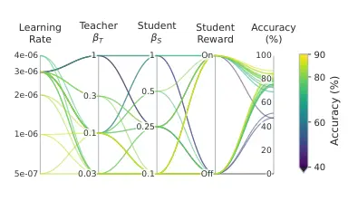
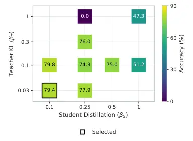
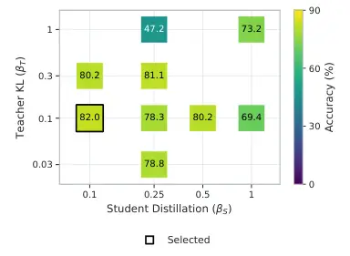

# A Good Self-Teacher Meets the Student Where They Are: Joint On-Policy Learning and Teaching

Randy Ardywibowo Affiliation: Perplexity
Email: [](mailto:)[randy@perplexity.ai](mailto:randy@perplexity.ai)   
Arnav Dalal Affiliation: Perplexity
Email: [](mailto:)[arnav.dalal@perplexity.ai](mailto:arnav.dalal@perplexity.ai)
   Jiantao Jiao Affiliation: NVIDIA
Email: [](mailto:)[jiantaoj@nvidia.com](mailto:jiantaoj@nvidia.com)

###### Abstract

Reinforcement Learning (RL) from outcome rewards suffers from sparse
supervision, particularly on difficult, long-horizon tasks where
successful trajectories are rare and costly to generate. On-Policy
Distillation (OPD) offers an attractive alternative by providing dense
token-level supervision from a stronger teacher along the student’s own
generations. Self-distillation methods further remove the need for a
separate teacher model by conditioning the same policy on privileged
information to serve as its own teacher. However, privileged
conditioning alone does not guarantee that the resulting distillation
update improves the student. Indeed, privileged information can lead the
teacher to solve tasks through shortcuts unavailable to the student,
producing supervision poorly matched to the student’s current behavior.
Consequently, even a higher-performing teacher can provide guidance that
degrades student performance. To address this, we analyze how the choice
of privileged teacher affects the student’s update. We derive a
necessary and sufficient condition for the teacher’s local distillation
update to be a positive multiple of the student’s reward gradient. Our
analysis suggests that the teacher should not only perform well on the
task, but also provide guidance suited to the student’s current
capabilities. This characterization motivates a practical
teacher-training surrogate that combines outcome rewards with
token-level Kullback–Leibler (KL) regularization toward the student.
Based on this result, we propose Joint On-Policy Learning and Teaching
(JOLT), which jointly trains a single policy in two roles: a privileged
teacher using a KL-regularized objective, and an unprivileged student
using dense on-policy distillation. Our experiments across mathematical
reasoning, code generation, tool use, and agentic terminal-use tasks
demonstrate improvements in both training efficiency and evaluation
performance. On MATH, JOLT uses $`13\times`$ fewer completion tokens and
$`6.5\times`$ fewer processed training tokens than GRPO at matched
accuracy, without direct student reward. With student outcome rewards,
JOLT+ achieves absolute gains over GRPO of +4.2% on MATH, +3.0% on
LCBv6, +9.9% on AppWorld, and +4.5% in Terminal-Bench pass@32.

|     |
| --- |
|     |

## 1 Introduction

 

\# Joint Training Step

\# Shared Policy (hint: Privileged Information c)

teacher = policy.generate(\[task, hint\])

student = policy.generate(\[task\])

\# Cross-Context Scores

student_lp = policy.score(\[task\], teacher.tokens)

teacher_lp = policy.score(\[task, hint\], student.tokens)

teacher.adv = student.adv = 0

teacher.adv += advantage(teacher)

teacher.adv += beta_T \* (student_lp - teacher.logprobs)

student.adv += beta_S \* (teacher_lp - student.logprobs)

student.adv += advantage(student) \# JOLT+ Only

policy.update(\[teacher, student\])

 

Figure 1: Joint On-Policy Learning and Teaching (JOLT) trains a shared
model as both a privileged teacher and an unprivileged student. The
teacher learns from outcome rewards with KL regularization toward the
student, while the student receives teacher supervision along its own
generations. (Left): the joint teacher–student training process.
(Right): pseudocode for a training step.

Reinforcement Learning (RL) has become an effective way to improve
language models on reasoning tasks (Shao et al., 2024; OpenAI, 2024;
DeepSeek-AI, 2025). Many such methods rely on outcome rewards observed
only after a trajectory ends, resulting in a sparse learning signal.
This sparsity is especially challenging for difficult, long-horizon
agentic tasks, where successful trajectories may be rare and costly to
generate (Yang et al., 2026b; Li et al., 2026).

On the other hand, On-Policy Distillation (OPD) provides a complementary
source of dense supervision. Rather than learning only from a final
reward, OPD samples trajectories from the student and evaluates each
sampled action under a stronger teacher. The teacher-student
log-probability ratio then provides a dense learning signal at every
visited state (Agarwal et al., 2024). More recently, On-Policy
Self-Distillation (OPSD) removes the need for a separate teacher model.
The student policy serves as its own teacher given privileged
information, such as a verified solution, feedback, or a reference trace
(Zhao et al., 2026; Penaloza et al., 2026).

Despite growing interest in self-distillation methods that use
privileged information, privileged conditioning alone does not guarantee
that the resulting distillation update improves the student (Chakraborty
et al., 2026; Kaur et al., 2026). Privileged information can lead the
teacher to exploit shortcuts unavailable to the student, producing
supervision poorly matched to the student’s current behavior. The
teacher may also become unreliable when continuing from an erroneous
student-generated prefix. A privileged teacher can therefore achieve
higher expected reward while inducing an OPD update that locally
decreases the student’s expected reward.

Teacher quality is therefore not determined by privileged task
performance alone, but by the learning signal provided to the current
student. We derive a necessary and sufficient condition for the
teacher’s local distillation update to be a positive multiple of the
student’s reward gradient. A sufficient pointwise construction reveals
the principle underlying our approach: a good teacher meets the student
where they are. The ideal teacher favors high-advantage actions under
student continuations while remaining close to the student’s policy.
This motivates a practical teacher-training surrogate combining outcome
rewards with a teacher-student Kullback–Leibler (KL) penalty.

Because the resulting teacher is defined relative to the current
student, learning and teaching are inherently coupled: as the student
changes, so does the teacher best suited to it. Joint On-Policy Learning
and Teaching (JOLT) closes this loop by jointly training both roles of
the same policy, as illustrated in Figure 1. The privileged teacher
learns from outcome rewards with token-level KL regularization toward
the student, while the unprivileged student learns from the teacher’s
dense distillation signal. Each role learns from trajectories generated
under its own context, keeping both updates on-policy, and both update
the shared parameters. When student outcome rewards are available, JOLT+
supplements the student’s distillation update with direct reinforcement
learning.

Specifically, we make the following contributions:

- •
  We characterize what makes a privileged teacher useful to its student.
  Higher teacher performance alone does not ensure that distillation
  improves the student. We derive a necessary and sufficient condition
  for the teacher’s local distillation update to follow the student’s
  reward gradient. This characterization motivates training the teacher
  to perform well while remaining close to the student’s current policy.
- •
  We introduce JOLT, which learns the teacher alongside the student
  rather than simply imitating a privileged policy. A single model
  serves both roles: the teacher learns from rewards with
  teacher–student KL regularization, while the student receives dense
  distillation supervision. Both roles learn on-policy from their own
  generations. JOLT+ additionally incorporates student outcome rewards.
- •
  We demonstrate that this approach improves performance across
  reasoning and agentic tasks. Across mathematical reasoning, code
  generation, tool use, and terminal interaction, JOLT+ achieves
  absolute gains over GRPO of 4.2 percentage points on MATH, 3.0 on
  LCBv6, 9.9 on AppWorld, and 4.5 in Terminal-Bench pass@32.
- •
  We show that strong performance can be reached with substantially less
  training. On MATH, JOLT matches GRPO’s accuracy using $`13\times`$
  fewer completion tokens and $`6.5\times`$ fewer processed training
  tokens, without direct rewards on student trajectories.

## 2 Methodology

### 2.1 Background

Reinforcement Learning. We consider a language-model policy
$`\pi_{\theta}`$ acting in an episodic decision process. At each step
$`t`$, the policy observes a state $`s_{t}`$ and samples an action
$`a_{t}`$. The resulting sequence forms a trajectory
$`\tau=(s_{0},a_{0},s_{1},a_{1},\ldots,s_{T})`$. Rolling out the policy
induces a trajectory distribution, denoted $`\tau\sim\pi_{\theta}`$. Let
$`R(\tau)\in\mathbb{R}`$ denote the return assigned to trajectory
$`\tau`$. The expected-return objective is
$`\mathcal{J}_{\mathrm{RL}}(\theta)=\mathbb{E}_{\tau\sim\pi_{\theta}}[R(\tau)]`$.
The corresponding policy gradient for this objective can be expressed
using the score-function estimator (Williams, 1992; Sutton et al.,
2000):

```math
\nabla_{\theta}\mathcal{J}_{\mathrm{RL}}(\theta)=\mathbb{E}_{\tau\sim\pi_{\theta}}\left[\sum_{t}R(\tau)\nabla_{\theta}\log\pi_{\theta}(a_{t}\mid s_{t})\right]. \tag{1}
```

Although unbiased, this estimator can have high variance because the
gradient contribution associated with $`a_{t}`$ varies with subsequent
actions and other trajectory randomness. Conditioning the return on the
current state and action averages over this future randomness while
preserving the expected policy gradient, with
$`Q^{\pi_{\theta}}(s_{t},a_{t})=\mathbb{E}[R(\tau)\mid s_{t},a_{t}]`$.
The gradient also remains unchanged if a state-dependent baseline
$`b(s_{t})`$ is subtracted from the action value. Since the baseline
does not depend on the sampled action,

```math
\mathbb{E}_{a_{t}\sim\pi_{\theta}(\cdot\mid s_{t})}\left[b(s_{t})\nabla_{\theta}\log\pi_{\theta}(a_{t}\mid s_{t})\right]=0. \tag{2}
```

The subtracted term therefore acts as a zero-mean control variate,
allowing an appropriate baseline to reduce variance without biasing the
policy gradient. Taking the baseline to be the expected action value
under the current policy centers each action value relative to the
alternatives available at the same state. This yields the on-policy
advantage, with

```math
V^{\pi_{\theta}}(s_{t})=\mathbb{E}_{a\sim\pi_{\theta}(\cdot\mid s_{t})}[Q^{\pi_{\theta}}(s_{t},a)],\qquad A^{\pi_{\theta}}(s_{t},a_{t})=Q^{\pi_{\theta}}(s_{t},a_{t})-V^{\pi_{\theta}}(s_{t}). \tag{3}
```

The policy gradient can therefore be written as

```math
\nabla_{\theta}\mathcal{J}_{\mathrm{RL}}(\theta)=\mathbb{E}_{\tau\sim\pi_{\theta}}\left[\sum_{t}A^{\pi_{\theta}}(s_{t},a_{t})\nabla_{\theta}\log\pi_{\theta}(a_{t}\mid s_{t})\right]. \tag{4}
```

Thus, $`A^{\pi_{\theta}}(s_{t},a_{t})`$ measures the expected excess
return of $`a_{t}`$ relative to the current policy at $`s_{t}`$. Using
it as the action-level weight exactly recovers the policy gradient of
expected return. Since computing $`Q^{\pi_{\theta}}`$ and
$`V^{\pi_{\theta}}`$ requires expectations over future trajectories,
$`A^{\pi_{\theta}}`$ is generally unavailable and must be estimated from
sampled returns or a learned value function (Schulman et al., 2016). In
particular, when the return is observed only through a sparse terminal
reward, estimating useful action-level credit may require many rollouts.

On-Policy Distillation. On-policy distillation (OPD) instead obtains
dense supervision from a stronger teacher policy $`\pi_{T}`$ (Agarwal
et al., 2024). Let $`\bar{\theta}`$ denote the parameters used to
collect trajectories. OPD minimizes the reverse KL at student-generated
prefixes, holding the sampled prefix distribution and teacher targets
fixed during differentiation:

```math
\mathcal{J}_{\mathrm{OPD}}(\theta;\bar{\theta})=-\mathbb{E}_{\tau\sim\pi_{\bar{\theta}}}\left[\sum_{t}\mathrm{KL}\left(\pi_{\theta}(\cdot\mid s_{t})\;\middle\|\;\pi_{T}(\cdot\mid s_{t})\right)\right]. \tag{5}
```

The local gradient with respect to $`\theta`$, evaluated at
$`\theta=\bar{\theta}`$, is

```math
g_{\mathrm{OPD}}(\bar{\theta};\pi_{T})=\mathbb{E}_{\tau\sim\pi_{\bar{\theta}}}\left[\sum_{t}\left(\log\pi_{T}(a_{t}\mid s_{t})-\log\pi_{\bar{\theta}}(a_{t}\mid s_{t})\right)\nabla_{\bar{\theta}}\log\pi_{\bar{\theta}}(a_{t}\mid s_{t})\right]. \tag{6}
```

The teacher-student log-probability ratio therefore supervises each
sampled action, reducing reliance on sparse rewards but requiring an
additional teacher model.

On-Policy Self-Distillation. On-policy self-distillation (OPSD) uses the
same policy for both roles, giving the teacher privileged information
$`c`$, such as hints, feedback, verifier traces, or reference-side
context (Zhao et al., 2026; Penaloza et al., 2026). The student
$`\pi_{\theta}(a_{t}\mid s_{t})`$ and privileged teacher
$`\pi_{\theta}(a_{t}\mid s_{t},c)`$ share parameters $`\theta`$. Each
action sampled from $`\pi_{\bar{\theta}}`$ is scored under both
contexts. The OPSD surrogate is

```math
\mathcal{J}_{\mathrm{OPSD}}(\theta;\bar{\theta})=-\mathbb{E}_{\tau\sim\pi_{\bar{\theta}}}\left[\sum_{t}\mathrm{KL}\left(\pi_{\theta}(\cdot\mid s_{t})\;\middle\|\;\operatorname{sg}\left[\pi_{\bar{\theta}}(\cdot\mid s_{t},c)\right]\right)\right], \tag{7}
```

where $`\operatorname{sg}`$ denotes stop-gradient. Its local gradient at
$`\theta=\bar{\theta}`$ is

```math
g_{\mathrm{OPSD}}(\bar{\theta})=\mathbb{E}_{\tau\sim\pi_{\bar{\theta}}}\left[\sum_{t}\left(\log\pi_{\bar{\theta}}(a_{t}\mid s_{t},c)-\log\pi_{\bar{\theta}}(a_{t}\mid s_{t})\right)\nabla_{\bar{\theta}}\log\pi_{\bar{\theta}}(a_{t}\mid s_{t})\right]. \tag{8}
```

OPSD thus retains dense supervision without requiring an additional
teacher model.

### 2.2 A Reward-Consistent Teacher

Conditioning the policy on privileged information makes the teacher
better informed, but does not guarantee that the resulting distillation
signal improves the student. The privileged teacher may exploit
shortcuts that are unavailable without the privileged information $`c`$,
assign high probability to trajectories that are unlikely under the
student, or provide unreliable guidance after errors in a
student-generated prefix. Indeed, privileged-context distillation can
degrade performance even when the teacher is more capable (Chakraborty
et al., 2026; Kaur et al., 2026).

These failure modes motivate characterizing a teacher by the student
update it induces, rather than by its expected reward under privileged
information. For a fixed student policy $`\pi_{\bar{\theta}}`$, we call
a teacher $`\pi_{T}^{\star}`$ reward-consistent if the local OPD update
it induces matches, up to positive scaling, the policy gradient of the
student’s expected return. That is, for some $`\beta_{T}>0`$,

```math
g_{\mathrm{OPD}}(\bar{\theta};\pi_{T}^{\star})=\frac{1}{\beta_{T}}\left.\nabla_{\theta}\mathcal{J}_{\mathrm{RL}}(\theta)\right|_{\theta=\bar{\theta}}. \tag{9}
```

Substituting the two gradients yields the necessary and sufficient
condition

```math
\mathbb{E}_{\tau\sim\pi_{\bar{\theta}}}\left[\sum_{t}\left(\log\frac{\pi_{T}^{\star}(a_{t}\mid s_{t},c)}{\pi_{\bar{\theta}}(a_{t}\mid s_{t})}-\frac{1}{\beta_{T}}A^{\pi_{\bar{\theta}}}(s_{t},a_{t})\right)\nabla_{\bar{\theta}}\log\pi_{\bar{\theta}}(a_{t}\mid s_{t})\right]=0. \tag{10}
```

A sufficient pointwise condition for this proportionality is:

```math
\log\pi_{T}^{\star}(a\mid s,c)-\log\pi_{\bar{\theta}}(a\mid s)=\frac{1}{\beta_{T}}A^{\pi_{\bar{\theta}}}(s,a)-\log Z(s), \tag{11}
```

for every state-action pair in the support of the student, where the
normalizing constant is

```math
Z(s)=\sum_{a^{\prime}}\pi_{\bar{\theta}}(a^{\prime}\mid s)\exp\left(\frac{1}{\beta_{T}}A^{\pi_{\bar{\theta}}}(s,a^{\prime})\right). \tag{12}
```

Note that $`\log Z(s)`$ does not affect the policy gradient update, as

```math
\mathbb{E}_{a\sim\pi_{\bar{\theta}}(\cdot\mid s)}\left[\log Z(s)\nabla_{\bar{\theta}}\log\pi_{\bar{\theta}}(a\mid s)\right]=0. \tag{13}
```

Exponentiating equation (11) gives

```math
\pi_{T}^{\star}(a\mid s,c)=\frac{1}{Z(s)}\pi_{\bar{\theta}}(a\mid s)\exp\left(\frac{1}{\beta_{T}}A^{\pi_{\bar{\theta}}}(s,a)\right). \tag{14}
```

This exponential update from KL-regularized policy improvement (Peters
et al., 2010; Abdolmaleki et al., 2018) provides a sufficient teacher
for local OPD gradient proportionality.

### 2.3 Joint On-Policy Learning and Teaching (JOLT)

The preceding derivation characterizes a pointwise reward-consistent
teacher for a fixed student. This suggests that the privileged teacher
should be trained toward this target distribution by minimizing

```math
\min_{\theta}\quad\mathrm{KL}\left(\pi_{\theta}(\cdot\mid s,c)\;\middle\|\;\pi_{T}^{\star}(\cdot\mid s,c)\right). \tag{15}
```

During this update, the student policy, its advantage, and the target
distribution are fixed at $`\bar{\theta}`$. Substituting the expression
for $`\pi_{T}^{\star}`$ gives

```math
\displaystyle\mathrm{KL}\left(\pi_{\theta}(\cdot\mid s,c)\;\middle\|\;\pi_{T}^{\star}(\cdot\mid s,c)\right)
```

```math
\displaystyle\quad=\mathbb{E}_{a\sim\pi_{\theta}(\cdot\mid s,c)}\left[\log\frac{\pi_{\theta}(a\mid s,c)}{\operatorname{sg}\!\left[\pi_{\bar{\theta}}(a\mid s)\right]}-\frac{1}{\beta_{T}}A^{\pi_{\bar{\theta}}}(s,a)+\log Z(s)\right]. \tag{16}
```

Since $`\log Z(s)`$ is constant during the teacher update, minimizing
this divergence is equivalent to maximizing

```math
\mathbb{E}_{a\sim\pi_{\theta}(\cdot\mid s,c)}\left[A^{\pi_{\bar{\theta}}}(s,a)\right]-\beta_{T}\mathrm{KL}\left(\pi_{\theta}(\cdot\mid s,c)\;\middle\|\;\operatorname{sg}\!\left[\pi_{\bar{\theta}}(\cdot\mid s)\right]\right). \tag{17}
```

The objective above requires student continuation advantages, which are
generally unavailable. Motivated by this construction, JOLT uses returns
from the teacher’s own trajectories together with a separate token-level
KL loss at sampled teacher prefixes, yielding the following practical
training surrogate:

```math
\displaystyle\mathcal{J}_{T}(\theta;\bar{\theta}) \displaystyle=\mathbb{E}_{\tau\sim\pi_{\bar{\theta}}(\cdot\mid c)}\Big[\sum\nolimits_{t}\big(\operatorname{sg}[\widehat{A}(\tau)]\log\pi_{\theta}(a_{t}\mid s_{t},c) \tag{18}
```

```math
\displaystyle-\beta_{T}\mathrm{KL}\!\left(\pi_{\theta}(\cdot\mid s_{t},c)\;\middle\|\;\operatorname{sg}[\pi_{\bar{\theta}}(\cdot\mid s_{t})]\right)\big)\Big].
```

Here, $`\widehat{A}(\tau)`$ is the within-role centered return defined
below. Sampled teacher prefixes and the student reference are held fixed
during differentiation. The gradient-proportionality result
characterizes the local student distillation update under the ideal
teacher for a fixed policy. Joint training applies teacher updates to
the shared parameters, so the combined update falls outside this
guarantee.

JOLT combines this teacher surrogate with student distillation, updating
shared parameters $`\theta`$. This provides task augmentation: the model
learns from original tasks alongside assisted versions made easier by
privileged information. The formulation is agnostic to how $`c`$ is
constructed and accommodates existing privileged contexts.

To reduce variance in the reward-based updates, we center returns within
each role’s group of $`G`$ sibling trajectories sampled under the same
context (Shao et al., 2024), leaving the separate token-level KL loss
unchanged:

```math
\widehat{A}(\tau)=R(\tau)-\frac{1}{G}\sum_{j=1}^{G}R(\tau_{j}). \tag{19}
```

At the rollout parameters, the local gradients admit a sampled
score-function representation. Writing
$`\Delta_{t}^{\bar{\theta}}=\log\pi_{\bar{\theta}}(a_{t}\mid s_{t},c)-\log\pi_{\bar{\theta}}(a_{t}\mid s_{t})`$
for the teacher–student log-probability ratio evaluated at these
parameters, the corresponding token weights are

```math
\widehat{A}_{t}^{T}=\operatorname{sg}\!\left[\widehat{A}(\tau)-\beta_{T}\Delta_{t}^{\bar{\theta}}\right],\qquad\widehat{A}_{t}^{S}=\operatorname{sg}\!\left[\beta_{S}\Delta_{t}^{\bar{\theta}}\right]. \tag{20}
```

The current-token log-ratio reproduces the gradient of the teacher’s
separate KL loss in expectation at fixed prefixes and rollout
parameters. Here, $`\beta_{T}`$ scales teacher KL and $`\beta_{S}`$
scales student distillation. JOLT+ adds the student’s return advantage,
$`\widehat{A}_{t}^{S+}=\operatorname{sg}[\widehat{A}(\tau)+\beta_{S}\Delta_{t}^{\bar{\theta}}]`$,
while leaving the teacher update unchanged.

Combining the teacher and student losses gives the shared-parameter
surrogate

```math
\mathcal{J}_{\mathrm{JOLT}}(\theta;\bar{\theta})=\mathcal{J}_{T}(\theta;\bar{\theta})+\beta_{S}\mathcal{J}_{\mathrm{OPSD}}(\theta;\bar{\theta}). \tag{21}
```

JOLT+ adds the analogous reward-based student surrogate, combining dense
teacher supervision with direct outcome feedback on student
trajectories. In both variants, each role learns from trajectories
generated under its own context, and both roles update the shared
policy.

Figure 2: Training accuracy (top), teacher–student KL (middle), and
final evaluation (bottom) on GSM8K, MATH, and LCBv6. JOLT improves mean
evaluation accuracy over the distillation baselines with closer
teacher–student agreement. Bottom-row dots show runs, and error bars
show standard deviations. Evaluation protocols appear in Appendix A.

## 3 Related Work

On-Policy and Privileged Self-Distillation. Knowledge distillation
traditionally transfers the output distribution of a fixed teacher into
a student model (Hinton et al., 2015). For autoregressive models,
sequence-level distillation commonly trains the student on
teacher-generated trajectories (Kim & Rush, 2016). Supervision is
therefore concentrated on prefixes generated by the teacher, which may
differ from those encountered during the student’s own generation.
On-policy distillation addresses this mismatch by querying the teacher
along student-generated trajectories (Agarwal et al., 2024; Song &
Zheng, 2026). Its reverse-KL formulation provides dense supervision
through the teacher-student log-probability ratio.

Teacher supervision can also be obtained from the student model itself
by conditioning it on additional information. This builds on context
distillation, which transfers behavior elicited by additional context
into a policy that acts without that context (Snell et al., 2022).
Privileged self-distillation combines this idea with on-policy sampling,
using verified solutions, demonstrations, textual feedback, system
prompts, or prior experience to condition the teacher (Zhao et al.,
2026; Shenfeld et al., 2026; Hübotter et al., 2026; Ye et al., 2026).
The teacher shares the student’s parameters or uses a frozen or
moving-average copy, allowing this additional information to provide
dense supervision without a separately trained teacher model.

Reliability of Teacher Supervision. Recent studies have identified
failures arising from teacher-student support mismatch, high-entropy
teacher predictions, privileged-context leakage, and differences in
reasoning style (Fu et al., 2026; Jin et al., 2026; Kim et al., 2026;
Kaur et al., 2026). These studies show that teacher guidance can be
unreliable on student-generated prefixes, even when the teacher performs
well on its own trajectories.

To assess whether teacher supervision helps the student, Armandpour
et al. (2026) compare distillation gradients with estimated
success-improving gradients. Agrawal et al. (2026) examine this
connection through policy-improvement analysis, deriving guarantees for
a distributional DAgger objective under stated assumptions. Other
approaches modify how reward and dense supervision are combined. RLSD
uses outcome rewards to determine update directions while allowing
teacher-student disagreement to modulate their token-level magnitudes
(Yang et al., 2026a). G-OPD instead interprets the teacher-reference
log-probability ratio as an implicit dense reward, allowing its strength
to be adjusted independently of KL regularization (Yang et al., 2026c).
These approaches assess or modify the student update induced by a
teacher. We instead characterize teacher distributions under which the
OPD update follows the student’s reward policy gradient, using this
condition to motivate teacher training.

Learned Teachers and Policy Improvement. Teacher training can improve
supervision by accounting for the student’s learning needs.
Reinforcement-Learned Teachers optimize explanations using the resulting
student performance (Cetin et al., 2025), while SOAR rewards problem
generation that improves the student on difficult tasks (Sundaram
et al., 2026). Pedagogical RL trains a privileged teacher using task
success together with a spike-sensitive surprise penalty that measures
learnability under the student (Chakraborty et al., 2026). Teacher
optimization can also be integrated with student learning.
$`\pi`$-Distill jointly trains privileged teacher and student roles
within a shared model, using a KL-regularized teacher objective.
However, its student update remains off-policy, relying on
teacher-generated trajectories rather than the student’s own generations
(Penaloza et al., 2026). The exponential reweighting in our teacher
construction connects it to KL-regularized policy improvement and
related self-distillation formulations (Peters et al., 2010; Abdolmaleki
et al., 2018; Peng et al., 2019; Geist et al., 2019; Ding, 2026; Yu
et al., 2026).

## 4 Experiments

| Method          | MATH                       | LCBv6                      | AppWorld                   |
| --------------- | -------------------------- | -------------------------- | -------------------------- |
| GRPO            | $`68.36\pm 3.73`$          | $`46.13\pm 1.83`$          | $`62.20\pm 2.83`$          |
| OPSD            | $`61.20\pm 2.10`$          | $`45.34\pm 1.50`$          | $`29.49\pm 2.48`$          |
| $`\pi`$-Distill | $`42.25\pm 1.10`$          | $`38.23\pm 1.72`$          | $`59.85\pm 2.97`$          |
| JOLT            | $`72.14\pm 0.90`$          | $`47.64\pm 1.10`$          | $`51.92\pm 5.30`$          |
| JOLT+           | $`\mathbf{72.59\pm 1.17}`$ | $`\mathbf{49.08\pm 0.41}`$ | $`\mathbf{72.09\pm 6.01}`$ |

Table 1: Evaluation (%): MATH/LCBv6 accuracy and AppWorld
development-set state-test pass rate. Mean $`\pm`$ standard deviation
across runs. Run counts and protocols are in Appendix A.

We evaluate joint teacher–student training both without direct student
reward and alongside reward-based student learning. Our experiments span
mathematical reasoning, code generation, tool use, and long-horizon
terminal tasks. Across these settings, the teacher receives different
forms of privileged information, including verified answers, worked
solutions, execution feedback, and summaries of previous attempts. We
compare against GRPO (Shao et al., 2024), OPSD (Zhao et al., 2026), and
$`\pi`$-Distill (Penaloza et al., 2026), tuning hyperparameters for each
method. Tables 1 and 2 summarize evaluation performance, while
Appendix A provides experimental configurations, prompts, and tuning
details.

Table 1 reports means and standard deviations across runs. Appendix A
gives run counts and other uncertainty conventions. We apply exponential
moving-average smoothing only to training curves.

Figure 3: Training performance on AppWorld. JOLT+ reaches GRPO’s final
training performance using approximately $`1.8\times`$ fewer updates,
then continues improving. Combining teacher supervision with student
outcome rewards outperforms both distillation baselines.

GSM8K. We train DeepSeek-V2-Lite (DeepSeek-AI, 2024) on GSM8K (Cobbe
et al., 2021), supplying the teacher with the verified answer to each
problem. As shown in Figure 2 (left), OPSD improves early in training
but plateaus, whereas JOLT and JOLT+ continue improving as
teacher–student disagreement decreases. Final evaluations in the
bottom-left panel place JOLT close to tuned GRPO without direct student
reward, with JOLT+ highest in mean accuracy.

MATH. We train Qwen3-0.6B (Qwen Team, 2025) on MATH (Hendrycks et al.,
2021), supplying worked reference solutions to the teacher following
Zhao et al. (2026). Figure 2 (middle) shows that JOLT and JOLT+ improve
more rapidly than GRPO and reach higher training accuracy, while OPSD
plateaus earlier. Teacher–student disagreement grows under OPSD but
decreases under joint training. The bottom row shows both JOLT variants
above OPSD and $`\pi`$-Distill in mean held-out accuracy. Table 1 also
places JOLT above GRPO without direct student reward, with JOLT+
highest. Appendix C examines the contributions of the teacher’s reward
and KL terms and shows that JOLT+ outperforms OPSD augmented with
student outcome rewards.

Figure 4: Performance scaling with training token budget, as measured in
completion tokens (left) and processed training tokens (right). On MATH,
JOLT reaches high accuracy with fewer tokens than GRPO while surpassing
OPSD’s early plateau under both token counters. Appendix B details token
accounting, curve fitting, and the budget comparison.

Figure 5: Teacher–student log-probability differences along responses to
the same GSM8K problem under OPSD (top) and JOLT (bottom). Red indicates
higher teacher log probability, while blue indicates lower teacher log
probability. In this example, OPSD exhibits disagreement throughout much
of its response, while JOLT shows smaller differences concentrated at
fewer token positions. Appendix D extends the comparison to
$`\pi`$-Distill and JOLT+.

LiveCodeBench-V6 (LCBv6). We next examine whether JOLT can use
privileged information constructed during training. Following SDPO’s
coding protocol (Hübotter et al., 2026), we train Qwen3-8B (Qwen Team, 2025) on 131 LCBv6 problems (Jain et al., 2024) and evaluate on the
complete test suites for those problems, including test cases withheld
during training. We construct teacher guidance from the model’s own
attempts: the teacher receives a successful sibling solution when
available and execution feedback otherwise. As shown in Figure 2
(right), JOLT improves over the distillation baselines during training,
with further gains from student outcome rewards in JOLT+. The bottom row
shows higher mean accuracy for JOLT than GRPO and both distillation
baselines, with JOLT+ highest. These results extend joint training to
settings where privileged guidance comes from sampled attempts and their
outcomes.

AppWorld. AppWorld (Trivedi et al., 2024) tests tool use through
interactions with stateful applications. We train
Qwen3-4B-Instruct (Qwen Team, 2025), constructing privileged guidance
from summaries of previous attempts following Wang et al. (2026). These
summaries record successful strategies, mistakes, and suggested
workflows. Following Skill-SD, we report state-test pass rate on the
57-task development split, averaging the fraction of tests passed per
task. Figure 3 shows that OPSD deteriorates later in training, while
JOLT remains competitive with $`\pi`$-Distill but below GRPO. Combining
teacher supervision with student outcome rewards produces stronger
results: JOLT+ reaches GRPO’s final training reward using approximately
$`1.8\times`$ fewer training updates and continues improving. As
reported in Table 1, JOLT’s mean development-set state-test pass rate
remains below $`\pi`$-Distill and GRPO, whereas JOLT+ achieves the
highest mean.

| Method          | pass@1 | pass@4 | pass@16 | pass@32 |
| --------------- | ------ | ------ | ------- | ------- |
| Base            | 5.18   | 10.84  | 18.35   | 22.81   |
| GRPO            | 8.25   | 17.04  | 26.91   | 30.34   |
| OPSD            | 2.82   | 6.96   | 13.59   | 16.90   |
| $`\pi`$-Distill | 4.99   | 10.50  | 18.30   | 22.31   |
| JOLT            | 6.56   | 13.56  | 22.06   | 25.69   |
| JOLT+           | 10.96  | 20.12  | 29.99   | 34.83   |

Table 2: Terminal-Bench 2.1 pass@$`k`$ (%) after TMax training, using
one training run per method.

Terminal-Bench. We train Qwen3-30B-A3B-Instruct (Qwen Team, 2025) on
TMax (Ivison et al., 2026) and evaluate on Terminal-Bench 2.1 (Merrill
et al., 2026) using TMax’s released agent and evaluation settings.
During training, the teacher receives private verifier information in
stateful shell environments. Evaluation uses the unprivileged student.
Table 2 reports pass@$`k`$ (Chen et al., 2021) for
$`k\in\{1,4,16,32\}`$. JOLT improves over the base model and both
distillation baselines at every reported $`k`$, although GRPO achieves
higher scores. JOLT+ achieves the highest pass@$`k`$ across all four
reported values, suggesting that teacher supervision can complement
student outcome rewards on long-horizon tasks.

Figure 6: Empirical squared bias (left), variance (middle), and mean
squared error (right) of weighted student gradients along each method’s
own training trajectory. Bias and MSE use Monte Carlo reward-gradient
references. GRPO’s error is dominated by variance, whereas OPSD develops
increasing empirical bias. JOLT and JOLT+ retain low variance with
smaller empirical bias than OPSD. Bands show pointwise 95%
batch-bootstrap intervals. See Appendix E for details.

Token Efficiency and Scaling. Beyond final accuracy, we are interested
in how performance scales with training tokens, as a proxy for training
compute. To this end, we evaluate models trained under different
training token budgets. Following Khatri et al. (2025), we fit a
sigmoidal relationship between accuracy and log training-token budget.
As shown in Figure 4, OPSD initially learns more efficiently than GRPO,
but its advantage disappears as its performance plateaus while GRPO
continues improving. Meanwhile, JOLT exhibits early sample efficiency
while reaching substantially higher accuracy compared to GRPO. This
pattern holds for both completion tokens and processed training tokens,
showing that joint training improves performance across training
budgets. Appendix B details token accounting, curve fitting, and savings
across accuracy targets.

Student–Teacher Alignment. Beyond the aggregate student–teacher KL
measurements shown in Figure 2, we examine how the teacher and student
disagree along individual generations. In the example shown in Figure 5,
the privileged teacher under OPSD assigns markedly different
probabilities to tokens throughout much of the student’s response.
Meanwhile, under JOLT, these differences are smaller and concentrated at
fewer locations. These observations illustrate differences in both the
overall magnitude of contextual disagreement and its distribution across
the tokens receiving supervision. Appendix D extends this token-level
comparison to $`\pi`$-Distill and JOLT+.

Gradient Bias–Variance Analysis. To better understand the student
learning signals encountered during training, we examine their empirical
bias and variance at checkpoints along each method’s own trajectory. We
estimate bias relative to a Monte Carlo reward-gradient reference
obtained by averaging independent REINFORCE gradient
estimates (Williams, 1992), and variance across repeated
student-gradient estimates. As shown in Figure 6, GRPO’s measured error
is dominated by variance, whereas OPSD exhibits low variance but
increasing empirical bias during training. JOLT and JOLT+ retain low
variance while showing substantially smaller empirical bias than OPSD.
These measurements depend on gradient scale and learned policies. They
do not isolate teacher training’s effect or establish reward consistency
of the complete joint update. Appendix E gives definitions and a
comparison of normalized gradient directions.

## 5 Conclusion

We introduced JOLT, a method that jointly trains a single policy as a
privileged teacher and an unprivileged student. Our analysis connects
the teacher’s supervision to the student’s reward objective, motivating
a teacher objective that balances task performance with proximity to the
current student. Both roles learn from their own trajectories, and the
formulation accommodates different sources of privileged information.
Experiments demonstrate improvements in both the effectiveness and
efficiency of self-distillation: joint training reaches competitive
performance without direct student reward and achieves high accuracy
with fewer training tokens. Incorporating student rewards further
strengthens this approach by combining dense teacher supervision with
direct feedback on the student’s own generations. The token-level
visualizations show closer teacher–student agreement under JOLT, while
the gradient analysis characterizes the variability and empirical
reward-gradient discrepancies of the student updates along training.
More broadly, this provides a way to supplement sparse rewards with
dense supervision that adapts to the model’s current capabilities,
without requiring a separate teacher.

### Acknowledgements

We thank Andrew Gordon Wilson, Ziqing Hu, Hang Wu, Senzeyu Zhang, Dongqi
Wu, Yuan Liang, Yunfan Zhong, Lequn Chen, and Denis Yarats for
insightful discussions that helped shape this work. We are also grateful
to Ziqing Hu, Yunfan Zhong, Zhihao Wang, and Lequn Chen for their
support with the training infrastructure that enabled our experiments.

### AI Use

The research ideas originated with the authors. Generative AI tools
assisted with implementing and debugging methods and baselines, analysis
and figure-generation code, literature search and synthesis, manuscript
drafting and editing, and LaTeX preparation. They also supported
discussion and critique of derivations, experimental design, and result
interpretation. The authors thoroughly reviewed and iteratively refined
the implementations, and cross-checked quantitative summaries and
reproduced figures against experiment records. AI was not used to
generate or clean benchmark datasets. The authors are responsible for
the final text, mathematical claims, code, and reported results.

## References

- Abdolmaleki et al. (2018) Abbas Abdolmaleki, Jost Tobias Springenberg,
  Yuval Tassa, Remi Munos, Nicolas Heess, and Martin Riedmiller. Maximum
  a posteriori policy optimisation. _arXiv preprint
  arXiv:1806.06920_, 2018.
- Agarwal et al. (2021) Rishabh Agarwal, Max Schwarzer, Pablo Samuel
  Castro, Aaron Courville, and Marc G. Bellemare. Deep reinforcement
  learning at the edge of the statistical precipice. In _Advances in
  Neural Information Processing Systems_, 2021. URL
  [https://arxiv.org/abs/2108.13264](https://arxiv.org/abs/2108.13264).
- Agarwal et al. (2024) Rishabh Agarwal, Nino Vieillard, Yongchao Zhou,
  Piotr Stanczyk, Sabela Ramos, Matthieu Geist, and Olivier Bachem.
  On-policy distillation of language models: Learning from
  self-generated mistakes. In _International Conference on Learning
  Representations_, 2024.
- Agrawal et al. (2026) Rishabh Agrawal, Jacob Fein-Ashley, and Paria
  Rashidinejad. Reinforcement learning from rich feedback with
  distributional DAgger. _arXiv preprint arXiv:2606.05152_, 2026.
- Armandpour et al. (2026) Mohammadreza Armandpour, Fatih Ilhan, David
  Harrison, Ajay Jaiswal, Duc N. M. Hoang, Fartash Faghri, Yizhe Zhang,
  Minsik Cho, and Mehrdad Farajtabar. Unmasking on-policy distillation:
  Where it helps, where it hurts, and why. _arXiv preprint
  arXiv:2605.10889_, 2026.
- Cetin et al. (2025) Edoardo Cetin, Tianyu Zhao, and Yujin Tang.
  Reinforcement learning teachers of test time scaling. _arXiv preprint
  arXiv:2506.08388_, 2025.
- Chakraborty et al. (2026) Souradip Chakraborty, Noah Ziems, Furong
  Huang, Meng Jiang, Amrit Singh Bedi, and Omar Khattab. Pedagogical RL:
  Teaching models to teach themselves from privileged information, 2026.
  [https://noahziems.com/pedagogical-rl](https://noahziems.com/pedagogical-rl).
- Chen et al. (2021) Mark Chen, Jerry Tworek, Heewoo Jun, et al.
  Evaluating large language models trained on code. _arXiv preprint
  arXiv:2107.03374_, 2021. URL
  [https://arxiv.org/abs/2107.03374](https://arxiv.org/abs/2107.03374).
- Cobbe et al. (2021) Karl Cobbe, Vineet Kosaraju, Mohammad Bavarian,
  Mark Chen, Heewoo Jun, Lukasz Kaiser, Matthias Plappert, Jerry Tworek,
  Jacob Hilton, Reiichiro Nakano, Christopher Hesse, and John Schulman.
  Training verifiers to solve math word problems. _arXiv preprint
  arXiv:2110.14168_, 2021.
- DeepSeek-AI (2024) DeepSeek-AI. DeepSeek-V2: A strong, economical, and
  efficient mixture-of-experts language model. _arXiv preprint
  arXiv:2405.04434_, 2024.
- DeepSeek-AI (2025) DeepSeek-AI. DeepSeek-R1: Incentivizing reasoning
  capability in LLMs via reinforcement learning. _arXiv preprint
  arXiv:2501.12948_, 2025.
- Ding (2026) Ken Ding. HDPO: Hybrid distillation policy optimization
  via privileged self-distillation. _arXiv preprint
  arXiv:2603.23871_, 2026.
- Fu et al. (2026) Yuqian Fu, Haohuan Huang, Kaiwen Jiang, Jiacai Liu,
  Zhuo Jiang, Yuanheng Zhu, and Dongbin Zhao. Revisiting on-policy
  distillation: Empirical failure modes and simple fixes. _arXiv
  preprint arXiv:2603.25562_, 2026.
- Geist et al. (2019) Matthieu Geist, Bruno Scherrer, and Olivier
  Pietquin. A theory of regularized markov decision processes. In
  _Proceedings of the 36th International Conference on Machine
  Learning_, pp. 2160–2169, 2019.
- Hendrycks et al. (2021) Dan Hendrycks, Collin Burns, Saurav Kadavath,
  Akul Arora, Steven Basart, Eric Tang, Dawn Song, and Jacob Steinhardt.
  Measuring mathematical problem solving with the MATH dataset. _arXiv
  preprint arXiv:2103.03874_, 2021.
- Hinton et al. (2015) Geoffrey Hinton, Oriol Vinyals, and Jeff Dean.
  Distilling the knowledge in a neural network. _arXiv preprint
  arXiv:1503.02531_, 2015.
- Hübotter et al. (2026) Jonas Hübotter, Frederike Lübeck, Lejs Behric,
  Anton Baumann, Marco Bagatella, Daniel Marta, Ido Hakimi, Idan
  Shenfeld, Thomas Kleine Buening, Carlos Guestrin, and Andreas Krause.
  Reinforcement learning via self-distillation. _arXiv preprint
  arXiv:2601.20802_, 2026.
- Ivison et al. (2026) Hamish Ivison, Junjie Oscar Yin, Rulin Shao, Teng
  Xiao, Nathan Lambert, and Hannaneh Hajishirzi. Tmax: A simple recipe
  for terminal agents, 2026. URL
  [https://arxiv.org/abs/2606.23321](https://arxiv.org/abs/2606.23321).
- Jain et al. (2024) Naman Jain, King Han, Alex Gu, Wen-Ding Li, Fanjia
  Yan, Tianjun Zhang, Sida Wang, Armando Solar-Lezama, Koushik Sen, and
  Ion Stoica. LiveCodeBench: Holistic and contamination free evaluation
  of large language models for code. _arXiv preprint
  arXiv:2403.07974_, 2024.
- Jin et al. (2026) Woogyeol Jin, Taywon Min, Yongjin Yang, Dennis Wei,
  Yi Zhou, Swanand Ravindra Kadhe, Nathalie Baracaldo, and Kimin Lee.
  Entropy-aware on-policy distillation of language models. _arXiv
  preprint arXiv:2603.07079_, 2026.
- Kaur et al. (2026) Simran Kaur, Narutatsu Ri, Yinghui He, Liam Fowl,
  and Sanjeev Arora. Rethinking on-policy self-distillation for thinking
  models. _arXiv preprint arXiv:2607.05184_, 2026.
- Khatri et al. (2025) Devvrit Khatri, Lovish Madaan, Rishabh Tiwari,
  Rachit Bansal, Sai Surya Duvvuri, Manzil Zaheer, Inderjit S. Dhillon,
  David Brandfonbrener, and Rishabh Agarwal. The art of scaling
  reinforcement learning compute for LLMs. _arXiv preprint
  arXiv:2510.13786_, 2025. URL
  [https://arxiv.org/abs/2510.13786](https://arxiv.org/abs/2510.13786).
- Kim et al. (2026) Jeonghye Kim, Xufang Luo, Minbeom Kim, Sangmook Lee,
  Dohyung Kim, Jiwon Jeon, Dongsheng Li, and Yuqing Yang. Why does
  self-distillation (sometimes) degrade the reasoning capability of
  LLMs? _arXiv preprint arXiv:2603.24472_, 2026.
- Kim & Rush (2016) Yoon Kim and Alexander M. Rush. Sequence-level
  knowledge distillation. In _Proceedings of the 2016 Conference on
  Empirical Methods in Natural Language Processing_, 2016.
- Li et al. (2026) Zongxia Li, Zhongzhi Li, Yucheng Shi, Ruhan Wang,
  Junyao Yang, Zhichao Liu, Xiyang Wu, Anhao Li, Yue Yu, Ninghao Liu,
  Lichao Sun, Haotao Mi, and Leowei Liang. Long-Horizon-Terminal-Bench:
  Testing the limits of agents on long-horizon terminal tasks with dense
  reward-based grading. _arXiv preprint arXiv:2607.08964_, 2026.
- Merrill et al. (2026) Mike A. Merrill, Alexander G. Shaw, Nicholas
  Carlini, et al. Terminal-Bench: Benchmarking agents on hard, realistic
  tasks in command line interfaces. _arXiv preprint
  arXiv:2601.11868_, 2026. URL
  [https://arxiv.org/abs/2601.11868](https://arxiv.org/abs/2601.11868).
- OpenAI (2024) OpenAI. OpenAI o1 system card. _arXiv preprint
  arXiv:2412.16720_, 2024.
- Penaloza et al. (2026) Emiliano Penaloza, Dheeraj Vattikonda, Nicolas
  Gontier, Alexandre Lacoste, Laurent Charlin, and Massimo Caccia.
  Privileged information distillation for language models. _arXiv
  preprint arXiv:2602.04942_, 2026.
- Peng et al. (2019) Xue Bin Peng, Aviral Kumar, Grace Zhang, and Sergey
  Levine. Advantage-weighted regression: Simple and scalable off-policy
  reinforcement learning. _arXiv preprint arXiv:1910.00177_, 2019.
- Peters et al. (2010) Jan Peters, Katharina Mülling, and Yasemin Altün.
  Relative entropy policy search. In _Proceedings of the AAAI Conference
  on Artificial Intelligence_, volume 24, pp. 1607–1612, 2010.
- Qwen Team (2025) Qwen Team. Qwen3 technical report. _arXiv preprint
  arXiv:2505.09388_, 2025. URL
  [https://arxiv.org/abs/2505.09388](https://arxiv.org/abs/2505.09388).
- Schulman et al. (2016) John Schulman, Philipp Moritz, Sergey Levine,
  Michael Jordan, and Pieter Abbeel. High-dimensional continuous control
  using generalized advantage estimation. In _International Conference
  on Learning Representations_, 2016.
- Shao et al. (2024) Zhihong Shao, Peiyi Wang, Qihao Zhu, Runxin Xu,
  Junxiao Song, Xiao Bi, Haowei Zhang, Mingchuan Zhang, Y. K. Li, Y. Wu,
  and Daya Guo. DeepSeekMath: Pushing the limits of mathematical
  reasoning in open language models. _arXiv preprint
  arXiv:2402.03300_, 2024.
- Shenfeld et al. (2026) Idan Shenfeld, Mehul Damani, Jonas Hübotter,
  and Pulkit Agrawal. Self-distillation enables continual learning.
  _arXiv preprint arXiv:2601.19897_, 2026.
- Snell et al. (2022) Charlie Snell, Dan Klein, and Ruiqi Zhong.
  Learning by distilling context. _arXiv preprint
  arXiv:2209.15189_, 2022.
- Song & Zheng (2026) Mingyang Song and Mao Zheng. A survey of on-policy
  distillation for large language models. _arXiv preprint
  arXiv:2604.00626_, 2026.
- Sundaram et al. (2026) Shobhita Sundaram, John Quan, Ariel
  Kwiatkowski, Kartik Ahuja, Yann Ollivier, and Julia Kempe. Teaching
  models to teach themselves: Reasoning at the edge of learnability.
  _arXiv preprint arXiv:2601.18778_, 2026.
- Sutton et al. (2000) Richard S. Sutton, David McAllester, Satinder
  Singh, and Yishay Mansour. Policy gradient methods for reinforcement
  learning with function approximation. In _Advances in Neural
  Information Processing Systems_, volume 12, 2000.
- Trivedi et al. (2024) Harsh Trivedi, Tushar Khot, Mareike Hartmann,
  Ruskin Manku, Vinty Dong, Edward Li, Shashank Gupta, Ashish Sabharwal,
  and Niranjan Balasubramanian. AppWorld: A controllable world of apps
  and people for benchmarking interactive coding agents. In _Proceedings
  of the Association for Computational Linguistics_, 2024.
- Wang et al. (2026) Hao Wang, Guozhi Wang, Han Xiao, Yufeng Zhou, Yue
  Pan, Jichao Wang, Ke Xu, Yafei Wen, Xiaohu Ruan, Xiaoxin Chen, and
  Honggang Qi. Skill-sd: Skill-conditioned self-distillation for
  multi-turn llm agents. _arXiv preprint arXiv:2604.10674_, 2026. URL
  [https://arxiv.org/abs/2604.10674](https://arxiv.org/abs/2604.10674).
- Williams (1992) Ronald J. Williams. Simple statistical
  gradient-following algorithms for connectionist reinforcement
  learning. _Machine Learning_, 8(3–4):229–256, 1992.
- Yang et al. (2026a) Chenxu Yang, Chuanyu Qin, Qingyi Si, Minghui Chen,
  Naibin Gu, Dingyu Yao, Zheng Lin, Weiping Wang, Jiaqi Wang, and Nan
  Duan. Self-distilled RLVR. _arXiv preprint arXiv:2604.03128_, 2026a.
- Yang et al. (2026b) John Yang, Kilian Lieret, Jeffrey Ma, Parth
  Thakkar, Dmitrii Pedchenko, Sten Sootla, Emily McMilin, Pengcheng Yin,
  Rui Hou, Gabriel Synnaeve, Diyi Yang, and Ofir Press. ProgramBench:
  Can language models rebuild programs from scratch? _arXiv preprint
  arXiv:2605.03546_, 2026b.
- Yang et al. (2026c) Wenkai Yang, Weijie Liu, Ruobing Xie, Kai Yang,
  Saiyong Yang, and Yankai Lin. Learning beyond teacher: Generalized
  on-policy distillation with reward extrapolation. _arXiv preprint
  arXiv:2602.12125_, 2026c.
- Yao et al. (2023) Shunyu Yao, Jeffrey Zhao, Dian Yu, Nan Du, Izhak
  Shafran, Karthik Narasimhan, and Yuan Cao. ReAct: Synergizing
  reasoning and acting in language models. In _International Conference
  on Learning Representations_, 2023. URL
  [https://arxiv.org/abs/2210.03629](https://arxiv.org/abs/2210.03629).
- Ye et al. (2026) Tianzhu Ye, Li Dong, Xun Wu, Shaohan Huang, and Furu
  Wei. On-policy context distillation for language models. _arXiv
  preprint arXiv:2602.12275_, 2026.
- Yu et al. (2026) Xin Yu, Liuchen Liao, Yiwen Zhang, Yingchen Yu,
  Lingzhou Xue, and Qinzhen Guo. Preference-based self-distillation:
  Beyond kl matching via reward regularization. _arXiv preprint
  arXiv:2605.05040_, 2026.
- Zhao et al. (2026) Siyan Zhao, Zhihui Xie, Mengchen Liu, Jing Huang,
  Guan Pang, Feiyu Chen, and Aditya Grover. Self-distilled reasoner:
  On-policy self-distillation for large language models. _arXiv preprint
  arXiv:2601.18734_, 2026.

## Appendix A Experimental Details and Additional Results

This appendix provides experimental settings, prompts, and additional
results. Table 3 summarizes training hyperparameters, and Figure 7 shows
evaluation curves and training summaries across benchmarks. Table 1
reports means and sample standard deviations across independent training
runs, using three runs per configuration, except for $`\pi`$-Distill on
LCBv6, which uses five. The evaluation panels in Figures 2 and 7 use
these same runs for MATH, LCBv6, and AppWorld. GSM8K evaluation uses
four runs for GRPO, OPSD, and $`\pi`$-Distill, and five for JOLT and
JOLT+. Evaluation bands and error bars show standard deviations across
runs. The training summaries in Figure 7 also show standard deviations,
using five runs for GSM8K and three for MATH and LCBv6, except for
$`\pi`$-Distill on LCBv6, which uses five. Other experiments use five
independent training seeds and report normal-approximation 95%
confidence intervals (mean $`\pm 1.96`$ standard errors), except for
Terminal-Bench and the gradient analysis, which use one run per method.
The gradient analysis uses batch-bootstrap intervals, as described in
Appendix E. Exponential moving-average smoothing is applied only to
training curves. Appendix A.6 assesses consistency across settings using
the average probability of improvement and stratified bootstrap
intervals.

#### Hyperparameter and checkpoint selection.

We select hyperparameters separately for each method using training
curves and final training performance. The selected configurations are
fixed before the repeated-seed comparisons. The main result tables and
final-checkpoint summaries report the final scheduled checkpoint of each
training run. Figure 2 shows final evaluations at steps 200, 150, and
150 for GSM8K, MATH, and LCBv6, respectively; its MATH training and KL
curves display only the first 100 steps.

|                 |                                    |                     |                       |                     |                     |                       |
| --------------- | ---------------------------------- | ------------------- | --------------------- | ------------------- | ------------------- | --------------------- |
| Method          | Hyperparameter                     | GSM8K               | MATH                  | LCBv6               | AppWorld            | TMax                  |
| GRPO            | Learning Rate                      | $`1\times 10^{-6}`$ | $`3\times 10^{-6}`$   | $`1\times 10^{-6}`$ | $`5\times 10^{-7}`$ | $`1\times 10^{-6}`$   |
|                 | Batch Size $`B`$                   | 8                   | 8                     | 32                  | 4                   | 8                     |
|                 | Group Size $`G`$                   | 8                   | 8                     | 8                   | 4                   | 32                    |
|                 | Num Steps                          | 200                 | 150                   | 150                 | 300                 | 50                    |
| OPSD            | Learning Rate                      | $`1\times 10^{-7}`$ | $`2\times 10^{-6}`$   | $`1\times 10^{-6}`$ | $`1\times 10^{-7}`$ | $`2.5\times 10^{-7}`$ |
|                 | Batch Size $`B`$                   | 8                   | 8                     | 32                  | 4                   | 8                     |
|                 | Group Size $`G`$                   | 8                   | 8                     | 8                   | 4                   | 32                    |
|                 | Num Steps                          | 200                 | 150                   | 150                 | 300                 | 50                    |
| $`\pi`$-Distill | Learning Rate                      | $`1\times 10^{-6}`$ | $`2.5\times 10^{-7}`$ | $`1\times 10^{-6}`$ | $`5\times 10^{-7}`$ | $`5\times 10^{-7}`$   |
|                 | Batch Size $`B`$                   | 8                   | 8                     | 32                  | 4                   | 8                     |
|                 | Group Size $`G`$                   | 8                   | 8                     | 8                   | 4                   | 32                    |
|                 | Num Steps                          | 200                 | 150                   | 150                 | 300                 | 50                    |
|                 | Teacher Mixing $`w_{T}`$           | 0.5                 | 0.5                   | 0.1                 | 0.5                 | 0.5                   |
|                 | Teacher KL $`\beta_{T}`$           | 0.25                | 0                     | 0.1                 | 0.25                | 0.25                  |
| JOLT/JOLT+      | Learning Rate                      | $`1\times 10^{-6}`$ | $`2\times 10^{-6}`$   | $`1\times 10^{-6}`$ | $`1\times 10^{-7}`$ | $`1\times 10^{-6}`$   |
|                 | Batch Size $`B`$                   | 8                   | 8                     | 8                   | 2                   | 8                     |
|                 | Group Size $`G`$                   | 4                   | 4                     | 8                   | 4                   | 16                    |
|                 | Num Steps                          | 200                 | 150                   | 150                 | 300                 | 50                    |
|                 | Teacher KL $`\beta_{T}`$           | 0.03                | 0.001                 | 0.001               | 0.001               | 0.001                 |
|                 | Student Distillation $`\beta_{S}`$ | 0.1                 | 0.1                   | 0.1                 | 0.1                 | 0.1                   |

Table 3: Selected training hyperparameters. $`B`$ denotes the number of
problems per update and $`G`$ the group size per active role. On GSM8K
and MATH, JOLT/JOLT+ use four teacher and four student rollouts per
problem, while GRPO and OPSD use eight student rollouts. Learning rates
are initial values where a schedule is used.

Figure 7: Evaluation curves on GSM8K, MATH, LCBv6, and AppWorld (top),
with training-accuracy summaries for the first three tasks and final
AppWorld evaluation below. Final evaluation summaries for the first
three tasks appear in Figure 2. LCBv6 evaluates training problems on
complete test suites; AppWorld reports development-set state-test pass
rate. Bands and error bars show standard deviations across runs; dots
show individual runs.



Figure 8: Hyperparameter sensitivity on GSM8K, covering JOLT
configurations (left) and learning rates across methods (right).

### A.1 GSM8K

#### Data and evaluation.

We use the official GSM8K training and test splits, containing 7,473 and
1,319 problems, respectively. Training samples responses at temperature
1.0, while evaluation generates one response per test problem using
greedy decoding. We use top-$`p=1.0`$ during training and evaluation,
with a maximum sequence length of 8,192 tokens and a completion limit of
4,096 tokens.

#### Sensitivity.

Figure 8 summarizes the coefficient and method-specific learning-rate
sweeps used to select the confirmatory settings. The strongest JOLT
configurations use a learning rate near $`10^{-6}`$ and coupling
coefficients below one. Unit teacher and student coefficients are
unstable in this setting, and increasing the learning rate beyond the
selected range degrades all methods.

The exploratory coefficient sweeps in Figure 9 are distinct from the
five-seed confirmatory comparison.



\(a\) JOLT



\(b\) JOLT+

Figure 9: GSM8K accuracy across teacher–student coupling strengths for
(a) JOLT and (b) JOLT+.

#### Prompts and privileged context.

Both roles receive the original question as a user message, without
few-shot examples. The teacher’s system message additionally supplies
the dataset’s final answer.

Student System Message   You will be given a problem. Please reason step
by step, and put your final answer within \\boxed{}.

Teacher System Message   You will be given a problem. Please reason step
by step, and put your final answer within \\boxed{}. Private reference
answer: {answer}. This answer has been independently verified. Derive
the solution yourself, use the reference to resolve uncertainty, and
make your single boxed final answer match it.

User Message (Both Roles)   {question}

### A.2 MATH

#### Data and evaluation.

We use the full official MATH training and test splits, containing 7,500
and 5,000 problems, respectively. Training and evaluation use
temperature 1.0, top-$`p=1.0`$, and a completion limit of 16,384 tokens.
Evaluation samples one unprivileged student response per test problem.
These evaluation settings apply to the main results, token-scaling
experiments, and teacher-objective ablations.

We train Qwen3-0.6B (Qwen Team, 2025) on MATH (Hendrycks et al., 2021).
We supply privileged information to the teacher by providing a worked
reference solution. Both roles use the same system message and problem
instruction. For the teacher, the dataset’s worked solution is appended
to the user message, after a blank line. Braced names denote substituted
fields. Qwen3 thinking is disabled; evaluation uses the student messages
without the solution.

System Message   You are a helpful assistant.

Student User Message   {problem} Please reason step by step, and put
your final answer within \\boxed{}.

Teacher-Only Addition to the User Message   Here is a verified reference
solution to the problem: === Reference Solution Begin ===
{reference_solution} === Reference Solution End === Understand the
reference solution and its key steps. Then solve the problem
independently in your own words, check the reasoning, and derive the
same final answer.

### A.3 LiveCodeBench-V6

#### Data and evaluation.

Following the coding setup of Hübotter et al. (2026), we use 131
LiveCodeBench v6 problems released between February and April 2025. For
each problem, we randomly select approximately 50% of its upstream
private tests as training-visible tests, using NumPy seed 0. This
produces 2,421 training-visible cases and leaves 2,431 cases withheld
from training. Evaluation follows SDPO’s released implementation and
uses the complete original suite of 4,852 test cases for these same
problems, including both the training-visible and withheld cases. We
generate four unprivileged student responses per problem and report
average accuracy across responses and problems. Evaluation uses
temperature 0.6 and top-$`p=0.95`$, with maximum prompt and response
lengths of 2,048 and 8,192 tokens, respectively. This protocol evaluates
solutions to training problems against an expanded test suite containing
unseen test inputs.

Each teacher context receives a generation that passed every
training-visible test, if one exists, and otherwise the execution
feedback for the corresponding attempt. Feedback can include a failing
input, expected and observed output, or execution error. The student
receives the following user message with no additional system message.

Student User Message   You are a coding expert. You will be given a
coding problem, and you need to write a correct Python program that
matches the specification and passes all tests. The time limit is 1
second. You may start by outlining your thought process. In the end,
please provide the complete code in a code block enclosed with \`\`\`
\`\`\`. {problem}

Addition When Starter Code Specifies a Function Signature   Your
solution should have the following signature: \`\`\`python {signature}
\`\`\`

The teacher receives the same user message, a system message, and one of
the two evidence blocks below. The evidence is appended to the user
message after a blank line.

Teacher System Message   You are a coding expert solving a problem with
privileged evidence from sibling attempts. Work through the algorithm
and edge cases carefully. Return one complete Python solution under the
original response contract.

Teacher Evidence: Successful Sibling   The following sibling response
passed every public test. Use it as evidence while independently solving
the original problem, but do not assume that public-test success proves
it will pass the held-out tests. Check the algorithm and edge cases,
return one complete Python program under the original response contract,
and do not mention the sibling response in your answer.
\<successful_sibling_response\> {successful_response}
\</successful_sibling_response\>

Teacher Evidence: Execution Feedback   The following is authoritative
feedback from evaluating an earlier attempt on only the public test
subset. Use it to correctly solve the original problem, but do not
assume that passing these tests proves the solution will pass the
held-out tests. Check the algorithm and edge cases, and return one
complete Python program under the original response contract. Do not
mention the feedback in your answer. \<public_test_feedback\>
{public_test_feedback} \</public_test_feedback\>

### A.4 AppWorld

#### Data and evaluation.

We adapt the AppWorld setup of Wang et al. (2026), training on all 90
publicly available training tasks. All reported AppWorld evaluations use
the 57 tasks in the official development split. Training runs for 300
optimizer updates, with evaluation every 25 updates. At each evaluated
checkpoint, we generate one unprivileged student trajectory per task and
training seed using greedy decoding (temperature 0), a total context
limit of 65,536 tokens, and a maximum of 50 interaction turns.
Evaluation uses the shared scaffold without retrieved skills. We report
state-test pass rate, defined as the fraction of state tests passed for
each task, averaged across tasks.

We train a Qwen3-4B-Instruct (Qwen Team, 2025) model on tool and API
calling in the AppWorld task set (Trivedi et al., 2024). Following Wang
et al. (2026), we construct privileged guidance by summarizing previous
attempts into successful strategies, mistakes, and suggested workflows.
Each run starts with an empty task-local skill bank.

We generate trajectory summaries using GPT-5.6 Sol (internal model
identifier gpt_5_6_sol), with a 1,024-token request cap and up to two
summarizer-level retries. Each summary contains success analysis,
mistake analysis, and a suggested workflow. Temperature, top-$`p`$, and
reasoning effort are left at backend defaults. The experiment artifacts
do not record a dated backend model snapshot. Per-update runtime
accounting includes summary generation.

The two roles share AppWorld’s adapted one-shot ReAct scaffold (Yao
et al., 2023), including API-use instructions and supervisor
information. The full scaffold is in the supplementary file
appworld-react.txt. Its final user message is shown below. Execution
results are returned as user messages beginning with Output:, followed
by a fenced output block.

Final User Message after the Shared Demonstration and Instructions  
Using these APIs, now generate code to solve the actual task: My name
is: {first_name} {last_name}. My personal email is {email} and phone
number is {phone_number}. Task: {instruction}

Teacher-Only System Message, Prepended to the Shared Conversation  
Private training-only trajectory-derived skill. Use it as fallible
task-local guidance while independently checking live API documentation
and execution results. Never mention this private context in your
response. {skill_json}

The inserted JSON skill contains success analysis, mistake analysis, and
a suggested workflow. Retrieval first selects an unused skill for the
task, then uses an upper-confidence-bound score (Wang et al., 2026). If
the bank is empty, no teacher system message is added.

After each student attempt, the summarizer receives the task, outcome,
fraction of state tests passed, turn count, and the live interaction
trace without the demonstration. Credentials and common personal-data
patterns in the trace are redacted before summarization. The resulting
skill is stored for later attempts at the same task.

Skill Summarizer: System Message   You are an expert AppWorld trajectory
analyst. Derive reusable task-local guidance from the actual actions and
observations. Do not reproduce credentials, personal data, opaque IDs,
or access tokens. Return only the requested JSON object.

Skill Summarizer: User Message   Analyze this completed AppWorld
attempt. Focus on strategic intent when completion is high and root
causes when completion is low. The golden workflow should be concise,
actionable, and grounded in observed API behavior rather than copied
code. Task: {instruction} Outcome: {outcome} Total turns: {turns}
Completion rate: {completion_rate} Conversation history: {transcript}
Return a JSON object containing exactly three nonempty string fields:
success_analysis, mistake_analysis, and golden_workflow.

### A.5 Terminal-Bench

The terminal setup uses Qwen3-30B-A3B-Instruct (Qwen Team, 2025) on TMax
training tasks (Ivison et al., 2026), with a separate stateful shell
sandbox for each role. The teacher alone sees private verifier source
and related files in its system context. These files are not supplied to
the student’s context, filesystem, or evaluation. Reward requires an
explicit submission marker followed by hidden-verifier grading.

#### Evaluation.

For each trained method, we evaluate the final checkpoint after 50
training updates on the complete Terminal-Bench 2.1 task set (Merrill
et al., 2026). We use the mini-SWE-agent-based Vanillux2Agent harness
with a persistent shell released by Ivison et al. (2026).¹¹ 1 Source for
evaluation defaults:
[https://github.com/hamishivi/tmax](https://github.com/hamishivi/tmax),
commit 6d3d606. Following its evaluation defaults, we use temperature
0.7, top-$`p=0.95`$, a limit of 16,384 generated tokens per assistant
turn, and at most 64 agent steps. Bash commands have a 120-second
timeout; overall trial timeouts follow Terminal-Bench’s per-task
defaults without overrides. Evaluation uses the unprivileged student and
omits the teacher-only verifier information. For each task, we sample
128 trajectories and estimate pass@$`k`$ for $`k\in\{1,4,16,32\}`$ using
the estimator of Chen et al. (2021), averaging the resulting estimates
across tasks. Due to resource constraints, Table 2 reports results from
one training run per method. The 128 evaluation trajectories per task
estimate each checkpoint’s pass@$`k`$; variability across training seeds
is not assessed.

The following templates document the current TMax training setup. Each
role receives a system message, the task and interaction instructions,
and a bash tool accepting one string argument, command. Braced names
denote substituted fields. The complete shared user prompt and JSON tool
schema are supplied in the supplementary materials; the user-prompt
opening and submission rule are reproduced below.

System Message (Both Roles)   You are a helpful assistant that can
interact with a computer. Your response must include a THOUGHT section
before your action where you explain your reasoning. After the THOUGHT,
you must call the \`bash\` tool with EXACTLY ONE bash command (multiple
commands chained with \`&&\` or \`\|\|\` count as a single action).
Failure to follow these rules - calling no tool, calling a tool other
than \`bash\`, or omitting the THOUGHT - will cause your response to be
rejected.

Shared User Prompt: Opening   Please solve this task: {instruction} You
can execute bash commands and edit files (with \`sed\`, \`cat \> file
\<\< 'EOF'\`, etc.) to implement the necessary changes.

Shared User Prompt: Submission Instruction   6. Submit your changes and
finish your work by issuing the following command: \`echo
COMPLETE_TASK_AND_SUBMIT_FINAL_OUTPUT\` Do not combine it with any other
command. After this command, you cannot continue working on the task.

The remaining shared instructions describe inspecting the environment,
implementing and testing changes, persistent shell state, noninteractive
commands, and truncated output. The tool definition describes a stateful
working directory and exported environment variables.

Teacher-Only Addition to the System Message   You are the privileged
teacher during training. The private verifier files below define the
success criterion. Use them to derive a correct solution, but do not
attempt to edit \`/tests\` or rely on the verifier being present in the
sandbox: it is uploaded only after your work is complete.
\<private_verifier\> {verifier_files} \</private_verifier\>

The verifier block concatenates the supplied files in order, with each
file rendered as --- {path} --- followed by its contents on a new line
and a blank line between files. Terminal-Bench evaluation omits this
teacher-only block.

### A.6 Consistency Across Settings

Table 1 reports mean performance and standard deviations across training
runs. To complement these summaries, we compare JOLT+ with GRPO using
the average probability of improvement proposed by Agarwal et al.
(2021). For each setting, we compare all pairs of final-checkpoint
evaluation runs, recording whether the JOLT+ score exceeds the GRPO
score and assigning half credit to ties. We then average these
probabilities, giving equal weight to GSM8K, MATH, LCBv6, and AppWorld.
This metric summarizes the consistency of the observed ordering across
runs.

The analysis uses the individual evaluation scores shown in Figures 2
and 7. We quantify uncertainty in this aggregate probability using a
stratified percentile bootstrap, independently resampling training runs
with replacement within each method and setting while preserving the run
counts and keeping the four settings fixed. We evaluate the empirical
bootstrap distribution exactly. We resample training runs because the
pairwise comparisons share observations.

As shown in Table 4, JOLT+ outperforms GRPO in nearly all observed run
comparisons. Every observed JOLT+ run exceeds every observed GRPO run on
LCBv6 and AppWorld. The average probability of improvement is
$`94.7\%`$, with a nominal 95% percentile bootstrap interval of
$`[83.3\%,100.0\%]`$. These results provide consistent empirical support
for JOLT+ across the evaluated settings. With only three runs in most
settings, bootstrap intervals can underestimate uncertainty,
particularly when all observed comparisons favor one method (Agarwal
et al., 2021). Terminal-Bench has one training run per method and is
reported separately in Table 2.

| Setting              | JOLT+ Runs | GRPO Runs | Probability of Improvement (%) |
| -------------------- | ---------- | --------- | ------------------------------ |
| GSM8K                | 5          | 4         | 90.0                           |
| MATH                 | 3          | 3         | 88.9                           |
| LCBv6                | 3          | 3         | 100.0                          |
| AppWorld             | 3          | 3         | 100.0                          |
| Equal-weight average | —          | —         | 94.7                           |

Table 4: Empirical probability that a JOLT+ run outperforms a GRPO run
at the final checkpoint, using the evaluations in Figures 2 and 7. The
average gives equal weight to each setting.

## Appendix B Token Efficiency and Scaling

We study how additional training budget translates into student accuracy
on MATH. Our experiments combine token-budget sweeps with checkpoints
from extended training runs, covering both early learning and
performance at larger budgets. Figure 4 summarizes this relationship
using completion tokens and processed training tokens as measures of
training cost.

#### Experimental setup.

We vary learning rates and training budgets for each method and measure
performance at checkpoints throughout training. The budget sweeps
characterize the accuracy attainable at different costs, while the
extended runs examine whether additional training yields further
improvement. Figure 4 shows each method’s Pareto frontier based on
training-token expenditure and mean evaluation accuracy. Token counts
reflect actual expenditure, including any overshoot of the target
budget.

#### Token accounting.

Completion tokens count student completions for GRPO and OPSD, and both
teacher and student completions for JOLT. Processed training tokens
count unpadded prompt and completion positions processed during
optimization and cross-context scoring, including teacher-only context
tokens, scoring passes without gradient computation, and repeated
optimization passes. The MATH experiments use worked solutions supplied
by the dataset, with no additional hint generation, retry rollouts, or
discarded trajectories. These metrics measure token expenditure and do
not directly quantify wall-clock savings.

#### Curve fitting.

Following Khatri et al. (2025), we fit a sigmoidal relationship between
accuracy and log training-token budget:

```math
a(B)=a_{0}+\frac{a_{\infty}-a_{0}}{1+(B_{50}/B)^{k}}, \tag{22}
```

where $`B`$ is the budget in millions of tokens and $`a_{0}`$ is the
measured base-model accuracy. The parameter $`a_{\infty}`$ describes the
fitted plateau, $`B_{50}`$ is the budget required to reach half the
fitted accuracy gain, and $`k`$ controls the slope with respect to log
budget.

We estimate the three free parameters separately for each method and
token counter using unweighted bounded nonlinear least squares. We use
multiple initializations and retain the solution with the smallest
residual sum of squares. Table 5 reports the fitted coefficients and
root-mean-squared error (RMSE).

| Token counter | Method | $`a_{\infty}`$ (%) | $`B_{50}`$ | $`k`$ | RMSE  |
| ------------- | ------ | ------------------ | ---------- | ----- | ----- |
| Completion    | GRPO   | 70.044             | 4.173      | 1.655 | 0.994 |
|               | OPSD   | 61.706             | 0.512      | 2.076 | 0.938 |
|               | JOLT   | 72.123             | 0.440      | 2.413 | 1.126 |
| Processed     | GRPO   | 70.441             | 4.343      | 1.501 | 0.959 |
|               | OPSD   | 61.691             | 1.314      | 2.270 | 0.937 |
|               | JOLT   | 72.125             | 0.955      | 2.634 | 1.152 |

Table 5: Fitted accuracy–token scaling parameters for Figure 4. Budgets
are in millions of tokens; RMSE is in percentage points.

#### Efficiency comparison.

We compare methods at the GRPO checkpoint near the knee of its learning
curve, where mean evaluation accuracy is $`63.44\%`$. For each token
counter, we read GRPO’s budget from this checkpoint in Figure 4 and
obtain JOLT’s budget at the same accuracy by inverting its fitted curve,
using the measured base accuracy $`a_{0}\simeq 43.85\%`$. Table 6
reports the resulting budgets and their ratios. These are approximate
point estimates from the mean-accuracy comparison; confidence intervals
for the budget ratios are not estimated.

| Token counter | GRPO | JOLT  | GRPO/JOLT      |
| ------------- | ---- | ----- | -------------- |
| Completion    | 8.04 | 0.617 | $`13.0\times`$ |
| Processed     | 8.40 | 1.30  | $`6.5\times`$  |

Table 6: Token budgets at $`63.44\%`$ MATH accuracy. GRPO uses the
observed checkpoint near its learning-curve knee; JOLT uses its fitted
curve. Budgets are in millions of tokens, and values are approximate.

#### Sensitivity to target accuracy.

To examine how the estimated token savings depend on the comparison
target, we evaluate both methods’ fitted curves at $`55\%`$, $`60\%`$,
and $`65\%`$ MATH accuracy. These targets lie within the observed
accuracy ranges of both methods. We invert each fitted curve to estimate
the required token budget,

```math
B(a)=B_{50}\left(\frac{a-a_{0}}{a_{\infty}-a}\right)^{1/k}, \tag{23}
```

and report the ratio of GRPO’s budget to JOLT’s in Table 7. Across these
targets, JOLT requires approximately $`9.5`$–$`14.4\times`$ fewer
completion tokens and $`4.3`$–$`7.4\times`$ fewer processed training
tokens. The estimated advantage therefore persists across this accuracy
range, although its magnitude depends on the target. These comparisons
use fitted budgets for both methods and are point estimates without
confidence intervals.

|          |                   |       |                |                           |       |               |
| -------- | ----------------- | ----- | -------------- | ------------------------- | ----- | ------------- |
| Target   | Completion tokens |       |                | Processed training tokens |       |               |
| accuracy | GRPO              | JOLT  | Ratio          | GRPO                      | JOLT  | Ratio         |
| $`55\%`$ | 3.48              | 0.368 | $`9.5\times`$  | 3.50                      | 0.811 | $`4.3\times`$ |
| $`60\%`$ | 5.56              | 0.496 | $`11.2\times`$ | 5.81                      | 1.065 | $`5.5\times`$ |
| $`65\%`$ | 9.92              | 0.691 | $`14.4\times`$ | 10.73                     | 1.443 | $`7.4\times`$ |

Table 7: Estimated token budgets and GRPO/JOLT budget ratios at multiple
MATH accuracy targets. Both methods’ budgets are obtained from their
fitted curves. Budgets are in millions of tokens; ratios are calculated
before rounding.

## Appendix C Teacher-Objective Ablations

We investigate how explicit teacher optimization affects student
learning, with student distillation retained in every configuration. We
compare OPSD with two JOLT variants that retain only the teacher KL term
or only the teacher outcome-reward term. OPSD updates the shared model
through student distillation, while the JOLT variants additionally
optimize the model under the privileged teacher context. These
comparisons examine whether either teacher-objective component can
improve student learning. We additionally evaluate OPSD with student
outcome rewards, implemented by removing both teacher-objective terms
from JOLT+ while retaining its student learning configuration. Figure 10
shows the teacher-objective ablation curves, and Table 8 reports the
selected configurations and held-out accuracy, including JOLT and JOLT+
at step 75.

#### Experimental setup and tuning.

We use the same model, task setup, and evaluation protocol as our MATH
experiment. For OPSD and the two teacher-objective variants, we tune
each configuration independently, searching learning rates of
$`\{10^{-6},2\times 10^{-6},4\times 10^{-6}\}`$, with additional rates
of $`\{2.5,5,7.5\}\times 10^{-7}`$ for the teacher KL-only variant.
Table 8 reports the selected learning rates and teacher-objective
coefficients. The OPSD + Student Reward control uses the same student
loss weights, normalization, rollout count, and training schedule as
JOLT+, with no explicit teacher optimization. Its privileged teacher
still shares the student’s parameters and therefore changes through
student updates.

| Configuration               | Student outcome reward | Teacher outcome coefficient $`\alpha`$ | Teacher KL coefficient $`\beta`$ | Tuned LR            | Held-out accuracy (%) |
| --------------------------- | ---------------------- | -------------------------------------- | -------------------------------- | ------------------- | --------------------- |
| OPSD                        | –                      | –                                      | –                                | $`2\times 10^{-6}`$ | $`62.95\pm 0.78`$     |
| OPSD + Student Reward       | $`\checkmark`$         | –                                      | –                                | $`2\times 10^{-6}`$ | $`66.52\pm 0.73`$     |
| JOLT (teacher KL only)      | –                      | –                                      | $`10^{-6}`$                      | $`10^{-6}`$         | $`65.39\pm 0.97`$     |
| JOLT (teacher outcome only) | –                      | $`1`$                                  | –                                | $`2\times 10^{-6}`$ | $`67.87\pm 0.86`$     |
| JOLT (full objective)       | –                      | $`1`$                                  | $`10^{-3}`$                      | $`2\times 10^{-6}`$ | $`72.10\pm 0.82`$     |
| JOLT+ (full objective)      | $`\checkmark`$         | $`1`$                                  | $`10^{-3}`$                      | $`2\times 10^{-6}`$ | $`73.80\pm 0.74`$     |

Table 8: Held-out MATH accuracy at step 75. OPSD, OPSD + Student Reward,
and the two teacher-objective variants report means across five shared
training seeds, with 95% confidence-interval half-widths. OPSD + Student
Reward disables both teacher-objective terms in JOLT+. JOLT and JOLT+
use the step-75 evaluations in Figure 7, each with three runs and a 95%
confidence interval; their configurations are given in Table 3. JOLT+’s
interval is a Student-$`t`$ interval computed from the plotted standard
deviation. Dashes indicate absent objective terms.

#### Student Rewards without Teacher Optimization.

This control combines sparse student rewards with dense privileged
self-distillation, as also studied by Penaloza et al. (2026), without
applying either teacher-objective term. At step 75, it attains
$`66.52\pm 0.73\%`$ held-out accuracy, compared with $`73.80\pm 0.74\%`$
for JOLT+. With the student learning configuration held fixed, this
comparison supports a benefit from explicit teacher optimization beyond
combining student rewards with distillation on MATH. Full JOLT also
achieves higher accuracy than this control without using student outcome
rewards.

Figure 10: Learning curves on MATH for OPSD and JOLT variants with
either teacher KL regularization or teacher outcome rewards. Both
teacher-training variants achieve higher accuracy than OPSD later in
training. Lines and shaded regions show the mean and 95% confidence
intervals across five training seeds.

#### Effect of Teacher Optimization.

As shown in Figure 10, both teacher-training variants achieve higher
accuracy than OPSD as training progresses. These gains also appear in
the held-out evaluations in Table 8, where the teacher outcome-only
variant achieves higher accuracy than the KL-only variant. The
improvement from the KL-only variant suggests that encouraging agreement
with the student can provide a useful teacher-training signal even
without teacher outcome rewards. Together, these results support
explicitly optimizing the teacher as a way to improve student learning.
Because both roles share parameters, these comparisons do not separate
improvements in the distillation signal from direct transfer through
teacher updates.

## Appendix D Token-Level Alignment

For each student-generated token, we compare teacher and student log
probabilities conditioned on the same response prefix. Red indicates a
higher log probability under the teacher, while blue indicates a lower
log probability under the teacher. Color intensity reflects the
magnitude of this difference, using symmetric limits around zero shared
across all methods within each figure. The visualizations use each
method’s final checkpoint, with the displayed problem and responses
selected at random.

Figure 11 extends the token-level comparison in Figure 5 to include
$`\pi`$-Distill and JOLT+. JOLT and JOLT+ exhibit smaller
teacher–student log-probability differences throughout their
generations, consistent with the closer contextual agreement observed
during training.

Figure 11: Token-level teacher–student alignment on the same problem.
Red indicates higher teacher log probability, while blue indicates lower
teacher log probability. JOLT and JOLT+ show smaller cross-context
log-probability differences than OPSD and $`\pi`$-Distill.

## Appendix E Gradient Bias–Variance Analysis

We characterize the student learning signals encountered during training
through empirical bias and variance measurements. Figure 6 reports these
statistics at checkpoints along each method’s own training trajectory.
We complement these statistics with comparisons of normalized gradient
directions at fixed checkpoints.

#### Reference and measurements.

The expected reward gradient is not directly available for these models.
We construct a Monte Carlo reference by averaging eight independent
REINFORCE gradient estimates (Williams, 1992), each using 512
completions per problem. The reference uses group-centered returns and
token normalization and serves as an empirical comparison target rather
than an exact expected-reward gradient. We evaluate eight batches of
eight MATH problems at initialization and training steps 1, 2, 5, 10,
20, 35, 50, and 75. For each batch, we hold the model weights and
problems fixed and compute $`K=32`$ independent gradient estimates, each
using eight student completions per problem. We measure their bias and
variance relative to the reference.

Gradients are computed with respect to all model parameters, with
privileged-teacher probabilities treated as fixed targets. The
distillation gradients use the student’s reverse-KL objective at
temperature $`1.1`$. Each loss uses a global token average: token-level
contributions are summed across all sampled completions in the problem
batch and divided by the total number of valid completion tokens.
Gradients are measured before gradient-norm clipping. The measured
student gradients are $`0.1g_{D}`$ for JOLT and $`0.1g_{D}+g_{R}`$ for
JOLT+, where $`g_{D}`$ and $`g_{R}`$ denote the distillation and
REINFORCE gradients. The two components use the same sampled student
completions, preserving their covariance in the combined estimate.

These coefficients affect the scale of the reported statistics.
Multiplying a gradient estimator by $`\alpha>0`$ scales its variance by
$`\alpha^{2}`$ without changing its direction, while its Euclidean
discrepancy from a fixed reference also depends on $`\alpha`$.
Consequently, lower measured variance or discrepancy alone does not
establish stronger directional alignment.

Let $`g_{1},\ldots,g_{K}`$ denote the sampled gradient estimates,
$`g_{\mathrm{ref}}`$ the reference gradient, and
$`\bar{g}=K^{-1}\sum_{k=1}^{K}g_{k}`$ the mean sampled gradient. We
measure empirical squared bias and variance as

```math
\widehat{B}^{2}=\|\bar{g}-g_{\mathrm{ref}}\|^{2},\qquad\widehat{V}=\frac{1}{K-1}\sum_{k=1}^{K}\|g_{k}-\bar{g}\|^{2}. \tag{24}
```

Squared bias measures disagreement between the average estimate and the
reference, while variance measures fluctuations around that average.
Their contributions to mean squared error satisfy

```math
\widehat{\mathrm{MSE}}=\frac{1}{K}\sum_{k=1}^{K}\|g_{k}-g_{\mathrm{ref}}\|^{2}=\widehat{B}^{2}+\frac{K-1}{K}\widehat{V}. \tag{25}
```

We compute each statistic separately within each problem batch and
average the resulting statistics equally across batches.

Gradient variance is measured across repeated trajectory samples with
the checkpoint and problem batch held fixed. For each method, we analyze
the run with the best historical late-training performance. Confidence
bands are pointwise 95% intervals from 100,000 paired bootstrap
resamples of the eight problem batches, keeping each batch together
across checkpoints and estimators. The reference is held fixed during
resampling, so these intervals exclude uncertainty across training seeds
and reference samples.

These measurements concern student gradients at the policies reached by
each method. Differences therefore reflect both the learned policies and
their update estimators. The Euclidean statistics depend on gradient
magnitude and do not directly test directional reward consistency, which
is defined up to positive scaling. The empirical squared-bias statistic
includes sampling uncertainty in both the estimated gradient mean and
the reference. Across the evaluated batches, checkpoints, and
trajectories, the estimated Monte Carlo variance of the reference mean
divided by its squared norm ranges from $`0.074`$ to $`0.661`$.
Reference uncertainty therefore contributes to the measured discrepancy,
particularly when the reference gradient is small. Teacher learning
influences the checkpoints being evaluated, but its gradient is excluded
from the measurements. The analysis therefore does not establish
alignment of the combined shared-parameter update.

#### Comparisons during training.

Figure 6 evaluates each method’s student gradient along its own training
run, constructing a reference at each checkpoint. GRPO’s error is
predominantly variance, whereas OPSD exhibits low variance but
increasing disagreement with the reference. JOLT and JOLT+ maintain
substantially smaller disagreement than OPSD while retaining low
variance. These comparisons describe the sampled student learning
signals along the evaluated training trajectories.

Figure 12: Student-gradient directions at fixed checkpoints.
Distillation-only and combined estimates show lower directional
dispersion (top) and higher mean cosine similarity to the Monte Carlo
reward-gradient reference (bottom) than reward-only estimates. Columns
follow different training methods; within each checkpoint, estimators
share model weights, problems, sampled student trajectories, and the
reference. Bands show pointwise 95% whole-batch bootstrap intervals.

#### Directional comparisons at fixed checkpoints.

Figure 12 compares reward-only, distillation-only, and combined student
estimators. Each column follows checkpoints from one training method.
Within each checkpoint, all three estimators use the same model weights,
problem batches, sampled student trajectories, and reference. The
combined estimator is $`0.1g_{D}+g_{R}`$, using the reverse-KL
distillation gradient defined above.

We normalize each sampled gradient before aggregation:

```math
u_{k}=\frac{g_{k}}{\|g_{k}\|},\qquad v=\frac{g_{\mathrm{ref}}}{\|g_{\mathrm{ref}}\|},\qquad\bar{u}=\frac{1}{K}\sum_{k=1}^{K}u_{k}. \tag{26}
```

We retain zero gradients as $`u_{k}=0`$. Directional dispersion and mean
reference alignment are

```math
D=\frac{1}{K-1}\sum_{k=1}^{K}\|u_{k}-\bar{u}\|^{2},\qquad P=\frac{1}{K}\sum_{k=1}^{K}\langle u_{k},v\rangle. \tag{27}
```

Lower $`D`$ indicates more consistent directions across sampled
trajectories; $`P`$ is the mean per-estimate cosine similarity to the
reference, with zero gradients contributing zero. We compute these
statistics within each problem batch and average equally across batches,
using the same bootstrap procedure described above.

At the evaluated checkpoints, distillation-only and combined estimates
have lower directional dispersion and higher mean reference alignment
than reward-only estimates. These differences persist after normalizing
gradient magnitude and therefore cannot be explained solely by an
overall rescaling of the gradients. The pattern appears across all four
trained policies. These comparisons characterize student estimators at
fixed checkpoints; they do not isolate the effect of teacher training or
measure reward improvement from the complete joint update. Uncertainty
in the Monte Carlo reference also affects the directional measurements.

## Appendix F $`\pi`$-Distill: Hyperparameter Sensitivity

To better understand $`\pi`$-Distill’s uneven performance across tasks,
we investigate its sensitivity to the learning rate, teacher–student
mixing weight, and teacher KL coefficient. We evaluate selected
configurations across multiple random seeds and, on MATH, additionally
examine learning-rate schedules, mixing warmup, and separate
normalization of the teacher and student losses. Table 9 summarizes the
search coverage for each setting.

| Setting  | Search Coverage                                                                                                                                                                                                                               |
| -------- | --------------------------------------------------------------------------------------------------------------------------------------------------------------------------------------------------------------------------------------------- |
| GSM8K    | Five learning rates evaluated over the full training horizon, followed by repeated-seed comparisons.                                                                                                                                          |
| MATH     | We examine 42 configurations spanning learning rates, teacher–student mixing weights, teacher KL coefficients, and scheduling choices, including teacher-only controls. Selected configurations are evaluated across additional random seeds. |
| LCBv6    | Eighteen distinct configurations spanning eight learning rates, five teacher KL coefficients, and three teacher mixing weights, followed by fresh-seed confirmation.                                                                          |
| AppWorld | Five full-horizon learning-rate trials and additional replications of the selected configuration.                                                                                                                                             |

Table 9: Search coverage for $`\pi`$-Distill hyperparameter tuning.

The weaker MATH performance persists across these choices. Larger
learning rates and stronger student replay often aggravate degradation,
while schedule and normalization changes do not consistently restore
sustained improvement. Some configurations that appear promising during
initial screening also fail to reproduce their gains across additional
seeds. These observations suggest that the difficulty extends beyond
selecting an appropriate update scale or balancing the two roles. The
behavior nevertheless varies across settings: on AppWorld,
$`\pi`$-Distill achieves a development-set state-test pass rate close to
GRPO and substantially above OPSD.
