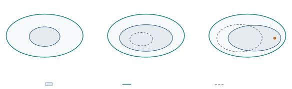
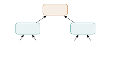
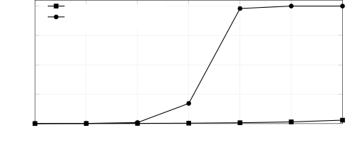
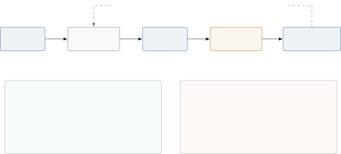
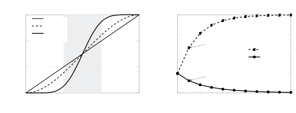
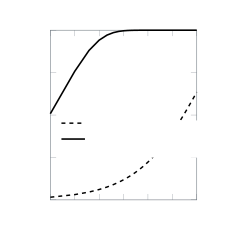

# Verification and Self-Improvement in Agentic AI: Foundations and Limits

Chien-Ping Lu

###### Abstract

A self-improving agent can find accepted solutions more often without
expanding the tasks its verification interface can accept. We extend
task-relative verification with explicit support and transcript
interfaces to distinguish search gains from changes in accepted-task
coverage. A stage’s native reach contains tasks accepted with default
support; its closure frontier contains tasks accepted with any support
the declared interface permits. A semantic containment criterion
identifies the authority or exposure condition that every verified
escape must violate, while guard-transfer invariance prevents a change
of representation from being counted as a capability expansion. An
executable Boolean-program repair agent makes the distinction concrete:
over 36,864 paired runs, counterexample feedback reduces verifier calls
without changing coverage, whereas an enforced permission change admits
a new target with a proof excluding every old-interface program. Exact
and uniformly gapped randomized verification share this account;
independent majority amplification improves reliability while preserving
the accepted language. Separate adaptive-selection contracts state what
is additionally required to interpret a proposed successor’s score as
evidence of deployment improvement. Classical hierarchy results and
finite audits provide supporting boundaries. The framework specifies the
evidence needed to establish improved search, wider accepted capability,
and reliable successor selection.

## 1 Introduction

A coding agent proposes patches, receives feedback, and revises its
search procedure. After an update, it solves more benchmark instances.
Does the update make old solutions easier to find, make previously
optional support routine, or admit solutions that the old interface
could never accept? These mechanisms can produce similar score changes
while requiring different explanations and evidence.

We study the accepted-task question. A deployed stage specifies a
correctness relation, permitted support, admissible interaction records,
and a bounded terminal checker. Its _native reach_ records the tasks
with an accepted solution under default support. Its _closure frontier_
records tasks with an accepted solution under any support that the
current interface permits. The frontier is the entire accepted-input
set, not a topological boundary or an empirical score. Search
effectiveness remains a separate probability or cost measure.

The central comparison asks what a proved expansion must change. If a
successor’s accepted transcripts remain within the predecessor’s
semantic authority and its default records remain within the
predecessor’s permitted exposure, the successor’s native reach stays
inside the old frontier. An escape witness must violate at least one of
these conditions. The criterion is elementary set semantics; its purpose
is to make the evidence obligation explicit. Guard-transfer invariance
ensures that moving a check between the harness and terminal verifier
does not count as expansion when accepted behavior is unchanged.

The program-repair construction supplies a concrete use of this
distinction. True counterexamples reduce verifier calls while preserving
the first correct candidate and accepted coverage. Changing an enforced
permission admits a particular new target, and a growing-family
exclusion argument rules out every old-interface program for that
target. The 36,864 paired runs measure the search benefit; the general
exclusion proof establishes the interface separation. Neither
substitutes for the other.

We also separate two claims often attached to self-improvement.
Randomized verification requires a justified connection between
acceptance probability and correctness: independent amplification of the
same tuple preserves its accepted language. Selecting a successor
requires its own error and deployment-transfer contract; a better score
alone proves no language containment or escape. The detailed hierarchy
analysis uses classical complexity tools and does not establish new
class separations. Contemporary agent and improver updates motivate
these comparisons \[14, 20, 21, 3\], but the structural results concern
declared families and do not bound the rate of practical improvement.

Section 2 defines the contract. Section 3 gives the containment and
representation criteria, and Section 4 demonstrates search improvement
and a proved expansion. Section 5 explains reliability and successor
evaluation. Full proofs, classical placement and depth results,
constructions, and experimental protocols are in the appendices.



Figure 1: Three comparisons under a common task relation. Each shape
represents _task inputs_; area is schematic and does not measure
probability or cardinality. Write $`L=\mathrm{L}_{R}(S)`$,
$`F=\mathrm{F}_{R}(S)`$ and use primes for the successor. Better search
can preserve both languages. Internalization enlarges native reach
within unchanged optional support. The illustrated frontier expansion
admits an input natively that has no accepted source-frontier witness.
This nested drawing is one possible transition, not an assumption that
every stage change is monotone.

## 2 A contract for comparing accepted capability

A stage $`S`$ fixes a task relation $`R(x,z)`$, default support
$`\sigma_{0}`$, an exposure predicate $`\mathrm{Exp}_{S}(x,\sigma,t)`$,
and a terminal core $`\mathrm{Core}_{S}(x,z,t,\vec{y};r)`$. Support,
transcripts, outputs, and verification moves have declared polynomial
length bounds. Exposure and the core are jointly uniform polynomial-time
procedures; malformed or out-of-bound records are rejected. Default
support is uniformly polynomial-time computable. Support supplies
bounded auxiliary data. All move domains include the empty string.

Let $`\mathcal{Q}_{k}\vec{y}`$ denote $`k\geq 1`$ alternating bounded
verification blocks beginning existentially. All moves precede the
uniform hidden random tape $`r`$. On every well-formed bounded tuple,
the core acceptance probability lies in $`[0,1/3]\cup[2/3,1]`$. Define

```math
\displaystyle D_{S}(x,z,t,\vec{y}) \displaystyle=\mathbf{1}\{\Pr_{r}[\mathrm{Core}_{S}(x,z,t,\vec{y};r)=1]\geq 2/3\},
```

```math
\displaystyle\mathcal{A}_{S}(x,z,t) \displaystyle\ \Longleftrightarrow\ \mathcal{Q}_{k}\vec{y}\ D_{S}(x,z,t,\vec{y})=1.
```

Task-relative soundness requires

```math
\mathrm{Exp}_{S}(x,\sigma,t)\wedge\mathcal{A}_{S}(x,z,t)\quad\Longrightarrow\quad R(x,z).
```

The gap is an assumption on every bounded tuple, and soundness connects
the complete quantified acceptance game to correctness. Neither follows
from the other. Setting the coin length to zero recovers exact
verification. Definition A.1 in Appendix A.1 gives the full bounds,
encoding checks, and probability contract.


Figure 2: The declared verification interface. Exposure and length
bounds fix the admissible records; alternating moves specify the
acceptance game. Only the terminal checker receives hidden random bits.
Setting the coin length to zero recovers deterministic verification. The
diagram specifies semantics, not the cost of solving the quantified
game.

###### Definition 2.1 (Native reach and closure frontier).

Let

```math
\mathrm{Nat}_{S}(x)=\{t:\mathrm{Exp}_{S}(x,\sigma_{0},t)\},\qquad\mathrm{Exp}_{S}^{*}(x)=\{t:\exists\sigma\ \mathrm{Exp}_{S}(x,\sigma,t)\}.
```

All objects are bounded as in Definition A.1. Define

```math
\displaystyle\mathrm{L}_{R}(S) \displaystyle=\{x:\exists t\in\mathrm{Nat}_{S}(x)\ \exists z\ \mathcal{A}_{S}(x,z,t)\}, \tag{1}
```

```math
\displaystyle\mathrm{F}_{R}(S) \displaystyle=\{x:\exists t\in\mathrm{Exp}_{S}^{*}(x)\ \exists z\ \mathcal{A}_{S}(x,z,t)\}. \tag{2}
```

These symbols use bounded-error acceptance throughout; the superscript
$`\mathrm{ex}`$ will denote an exact specialization when comparison is
needed.

For a concrete instance, let $`x=(1^{d},a)`$ specify a Boolean linear
function, and let $`t=z`$ list its referenced variables. Optional
support selects a quota $`q\leq B(d)`$, defaulting to $`b_{0}(d)`$.
Exposure requires $`|t|\leq q`$; an exact coefficient check establishes
correctness. Native reach then requires $`\|a\|_{0}\leq b_{0}(d)`$, and
the frontier requires $`\|a\|_{0}\leq B(d)`$. Section O specifies and
proves this instance.

These are languages of _task inputs_, not sets of accepted patches or
measures of success probability. Existence of an accepted witness is
weaker than efficient production of that witness by a given learned
policy. A support source must be bounded and its admissibility
polynomially checkable under the declared interface. A fact supplied by
an unmodeled oracle cannot be called conservative merely because it fits
in a short string.

## 3 What a verified expansion must change

Define the transcript-indexed accepted-input set
$`K_{S}(x,t)\iff\exists z\,\mathcal{A}_{S}(x,z,t)`$. A comparison uses a
fixed common transcript encoding, including rejection outside the
declared domains. When encodings differ, an explicit translation is
required.

###### Definition 3.1 (Semantic authority).

Write $`T\preceq^{\rm auth}S`$ if $`K_{T}(x,t)\Rightarrow K_{S}(x,t)`$
for all $`x,t`$. This compares quantified acceptance, possibly across
different depths.

Authority here is acceptance of task inputs per transcript; it is not
raw model accuracy, nor necessarily containment of every accepted
output. Both stages must be sound for the same task. Opposite inclusions
define equivalence.

A comparison should also survive changes of encoding. Polynomial
transcript translations and a representation using just default and
optional support preserve the two languages under the conditions
developed in Appendix K.1.

###### Proposition 3.2 (Guard transfer).

For a deterministic polynomial-time guard $`g(x,t)`$, the stages

```math
(\mathrm{Exp}_{S}\wedge g,\mathrm{Core}_{S})\quad\hbox{and}\quad(\mathrm{Exp}_{S},g\wedge\mathrm{Core}_{S})
```

have the same native reach and frontier, with all other data fixed.

A guard can reject the same records at either interface without changing
accepted behavior. Appendix J.4 proves the result; Appendix K.2
characterizes the associated local invariant.

This invariance explains an audit limitation. With one input and two
transcripts $`a,b`$, let a source expose and accept only $`a`$. A target
that exposes only $`a`$ and whose core accepts both transcripts has a
raw authority change. Moving the guard for $`a`$ into the target core
produces an equivalent target that exposes both transcripts but accepts
only $`a`$; now the raw change is exposure. Neither transition escapes
the source frontier. Component labels are representation-dependent even
when accepted behavior is unchanged.

###### Theorem 3.3 (Semantic containment and escape diagnostic).

If $`T\preceq^{\rm auth}S`$ and
$`\mathrm{Nat}_{T}(x)\subseteq\mathrm{Exp}_{S}^{*}(x)`$ for every $`x`$,
then $`\mathrm{L}_{R}(T)\subseteq\mathrm{F}_{R}(S)`$, regardless of
their depths. More precisely, if
$`x\in\mathrm{L}_{R}(T)\setminus\mathrm{F}_{R}(S)`$, every accepted
target-native transcript $`t`$ for that input satisfies

```math
t\notin\mathrm{Exp}_{S}^{*}(x)\quad\hbox{or}\quad\neg K_{S}(x,t).
```

The proof is in Appendix I.

This is an elementary semantic diagnostic. It says exactly what an
escape witness must violate; it does not recover those premises from
benchmark scores. In particular, authority-preserving internalization of
permitted support can increase native reach only within the old
frontier. The familiar three-field report—depth, authority,
exposure—records a useful architecture description, but is not a theorem
that three causes are independent. Because authority already compares
fully quantified acceptance, increased depth cannot produce escape while
both semantic containment premises hold. Depth obstructions need the
additional class argument of Appendix C.

Either core change or exposure change can realize frontier escape at
fixed depth, for exact and randomized stages. Appendix K.3 gives
separate constructions that keep the other component fixed. Strict
escape is stronger than a changed component identifier or a failed
global containment test: the latter can occur on an input that another
source transcript already solves. Appendix K.4 extends the construction
to finite chains.

## 4 Program repair: faster search and a proved expansion

This is a controlled symbolic computational experiment. Its proposal
policies are explicit search procedures, and no neural model is trained
or invoked. The restricted program grammar and complete truth-table
specifications make exact coverage comparisons possible. The runs
measure search behavior; a separate invariant proof excludes every
old-interface solution for a new target. Neither the finite measurements
nor that task-specific proof establish a complexity-class separation or
learned recursive self-improvement.

### 4.1 Programs, permissions, and exact evidence

For brevity, $`L`$ and $`F`$ in the finite counts below denote
$`\mathrm{L}_{R}`$ and $`\mathrm{F}_{R}`$ for this task family. Consider
Boolean decision programs on $`d=2^{h}\geq 4`$ inputs, represented by a
fixed complete binary tree. Leaves read the inputs once, in order. Each
of the $`d-1`$ internal nodes uses AND, OR, or XOR. The initial program
uses AND at every node. A support mask grants permission to change
selected operators; the harness rejects changes at other nodes and
rejects all other syntax. Constants, negations, leaf reordering, and
arbitrary code execution are outside the declared language. Generated
programs are executable Python functions.

A task input is $`x=(d,T)`$, where $`T`$ is an explicit $`2^{d}`$-bit
truth table. An output $`z`$ encodes the operators; $`R(x,z)`$ means
agreement with $`T`$ on every Boolean input. The terminal checker
evaluates the entire table and binds the output to the final program
record. The transcript is this final record; search traces are logged
separately and do not restrict exposure. Hashes identify code and target
files in the artifact; acceptance rechecks content rather than trusting
a claimed hash.

The old maximum mask $`M_{\rm leaf}`$ permits edits only at the $`d/2`$
parents of leaves. Default support permits one such node. The expanded
maximum mask $`M_{\rm all}`$ permits every internal node. Any subset of
a maximum mask is admissible support. The resulting frontier is exactly
the set of tables computed by permitted programs. Raising default
permission to the old maximum makes native reach equal to the old
frontier. Enlarging the maximum mask is a different operation.

The checker is uniform and polynomial-time in the declared input length
$`n=\Theta(2^{d})`$, taking $`O(d2^{d})`$ elementary operations. It is
exponential in the number of Boolean variables; the experiment makes no
claim of efficient verification for succinct arbitrary specifications. A
dummy existential move places this instance at exact depth one.



Figure 3: An enforced code interface and its exclusion witness at
$`d=4`$. Changing the root to OR and choosing AND below it yields output
$`1`$ on the displayed input. Counterexample-guided search alone cannot
make that patch admissible under the old permissions.

###### Proposition 4.1 (An immutable-gate exclusion certificate).

For every $`d=2^{h}\geq 4`$, let

```math
f_{*}(v)=\left(\bigwedge_{j\leq d/2}v_{j}\right)\lor\left(\bigwedge_{j>d/2}v_{j}\right).
```

The truth table of $`f_{*}`$ belongs to the expanded frontier and not to
the old frontier, regardless of the proposal policy. The same claim
holds even if every old nonroot node is editable among the three allowed
operations.

The proof is in Appendix N. If the expanded stage defaults to
$`M_{\rm all}`$, this is also an explicit witness in
$`\mathrm{L}_{R}(S_{+})\setminus\mathrm{F}_{R}(S)`$ for Theorem 3.3.
Both languages remain within exact polynomial-time verification. This is
an interface separation, not a complexity-class separation.

### 4.2 Counterexamples improve search without changing coverage

The repair agent sees the initial code, editable nodes, candidate
language, and verifier feedback. Its proposal interface does not expose
$`T`$ or the target program. A verifier call returns either acceptance
or the first input on which the candidate disagrees with $`T`$, together
with its expected value. The target is private to this software
interface, not a cryptographically isolated service.

We compare two policies using the same target-independent candidate
order. Blind enumeration proposes each candidate in order. The feedback
policy retains counterexamples and skips candidates inconsistent with
any retained example, then calls the verifier on the next consistent
one. Both use the same admission checks, final verifier, and permitted
program set. This is a finite CEGIS loop, following the synthesis
literature \[30, 31\].

###### Proposition 4.2 (Sound pruning preserves solutions).

For a fixed finite candidate set and order, suppose an exact verifier
accepts if and only if the candidate is correct, and every negative
reply supplies a true counterexample to the current candidate.
Consistency filtering never removes a correct candidate. If a correct
candidate exists, the feedback policy returns the same first correct
candidate as blind enumeration with no more verifier calls. Neither
policy changes the stage’s native language or frontier.

The proof is in Appendix N. The last conclusion uses the stated exposure
convention: it admits all permission-valid final records independently
of the online policy. The proposition does not bound total computation.
Local candidate filtering costs work, and the complete candidate space
is constructed in advance in this testbed.

The exact task family permits exhaustive paired evaluation under sixteen
fixed candidate orders. The complete protocol and counting conventions
are in Appendix H. Table 1 reports coverage and verifier calls; local
filtering and precomputation are excluded from that call metric.

| $`d`$ | Edit mask        | $`    | F        | `$    | Blind calls | Guided calls |
| ----- | ---------------- | ----- | -------- | ----- | ----------- | ------------ |
| 4     | $`M_{\rm leaf}`$ | 9     | 5.00     | 2.94  |
| 4     | $`M_{\rm all}`$  | 27    | 14.00    | 4.27  |
| 8     | $`M_{\rm leaf}`$ | 81    | 41.00    | 5.56  |
| 8     | $`M_{\rm all}`$  | 2,187 | 1,094.00 | 10.42 |

Table 1: Exact coverage and mean verifier calls to acceptance. Each
distinct reachable target is evaluated under sixteen common candidate
orderings. Default native reach has three tasks at each size; changing
the default to $`M_{\rm leaf}`$ yields native reach $`9`$ or $`81`$
without changing the old frontier. The four rows contain 36,864 paired
runs in total.

At $`d=8`$, full permissions admit 2,187 distinct targets. Blind
enumeration averages 1,094 verifier calls, while feedback averages
10.42. Both reach every one of these targets when allowed to complete.
The guided policy makes at most 35 verifier calls in these runs. The old
maximum mask admits 81 targets; its smaller default admits three. These
counts are computed from the admitted program sets independently of
either search policy.

The reduction in verifier calls can be large even though the languages
are identical between policies. Enlarging edit permissions changes
coverage and also increases the search space; it need not improve
fixed-budget success. For a given ordering, the feedback policy still
inspects candidates locally up to the same first correct candidate. Thus
verifier-call savings should not be reported as proportional runtime or
compute savings.



Figure 4: Search effectiveness at $`d=8`$ with the same full-permission
frontier. Percentages use all 2,187 reachable targets and sixteen
orderings (34,992 pairs). Curves count verifier calls, excluding local
filtering and precomputation. Coverage is identical; no hierarchy
separation is implied.

#### Validation and limits.

We check the bit-parallel verifier against separately compiled Python
execution on every program-input pair at both sizes. Additional checks
cover permission violations, malformed encodings, certificate
substitution, genuine counterexamples, and unreachable targets. The
all-source exclusion in Proposition 4.1 holds for the growing family;
empirical call counts are only those of the two finite sizes. The task
is Boolean-program repair with fixed syntax and exact feedback. It does
not demonstrate learned improvers, natural-language specifications,
autonomous evaluator redesign, or transfer to software repositories.

## 5 Reliability and evaluating proposed successors

### 5.1 Reliability under a fixed acceptance contract

An occasional accepting run is insufficient evidence of capability when
a false answer can pass with nonzero probability. The pointwise gap in
Definition A.1 distinguishes the high and low sides before the
verification moves are quantified. The following result concerns
repeated independent checks of the same complete tuple, with every
witness domain fixed.

###### Theorem 5.1 (Amplification preserves the frontier).

Fix a stage $`S`$ and a polynomial-time computable, odd positive,
polynomially bounded repetition count $`N(n)`$. Replace its terminal
core by a strict majority of $`N(n)`$ independent runs on the _same_
tuple. Preserve all object and move domains and the exposure relation,
while allowing polynomially more coins and runtime. The resulting stage
$`S^{[N]}`$ has the same $`D_{S}`$, quantified acceptance, native reach,
and frontier. Its pointwise error is at most $`e^{-N/18}`$.

Independent majority improves reliability without moving any tuple
across the acceptance gap. The proof is in Appendix J.2.

For any constant $`0<\delta<1/2`$, sufficiently many odd repetitions
yield error at most $`\delta`$ with the same acceptance language, using
threshold $`1-\delta`$ for the amplified predicate. The runtime and raw
core implementation change, but semantic authority does not. Preserving
the witness domains is essential: enlarging them while amplifying would
be a separate stage change. Repeatedly sampling _different_ candidate
answers is a search policy, not the verifier amplification covered by
this theorem. Correlated judge calls also do not satisfy its
independence premise.

The false-tuple counterexample and exact numerical curves are in
Appendix G. They distinguish verifier amplification from drawing
different proposed answers. A learned judge requires a separate
justification of its gap and task-relative soundness; repeated agreement
does not supply that justification.

### 5.2 A separate contract for successor selection

A proposed successor can change the solver, harness, evaluator, or
improver. Structural comparison asks which tasks its declared stage
accepts; empirical selection asks whether it is better under an
improvement criterion. Neither a containment proof nor a frontier escape
establishes that a benchmark score transfers to deployment. Conversely,
a score gain does not by itself prove a changed acceptance language.

Proposition E.2 controls false selection across an adaptive run under a
history-conditional error budget. Proposition E.3 gives a sufficient
implementation using fresh paired evaluations and an independently
justified allowance for evaluation-to-deployment mismatch. Their full
assumptions, thresholds, proofs, and failure cases are in Appendix E and
Appendix M.1. These results supplement the accepted-language account
with a separate validity condition; they do not certify a learned judge
from the data used to select its successors.

## 6 Scope, related work, and conclusion

The framework compares declared verification families through task
soundness, accepted-input languages, and admissible evidence. Its
central criterion is a semantic containment statement, and its
representation invariant prevents equivalent placements of a check from
being treated as different capability. The program-repair example
combines this account with an executable feedback policy and a general
exclusion witness: faster search preserves coverage, while a permitted
new operation admits a target unavailable to all old-interface programs.

Classical verification and hierarchy theory provide the complexity
background \[4, 5, 6\]. The placement, depth, and
certificate-substitution results retain their explicit uniformity and
separation assumptions (Appendices B and C); they are not new class
separations. The repair check enumerates explicit truth tables, so its
polynomial cost is in that expanded input length, not in the number of
Boolean variables. The synthetic tasks and audits establish no
generalization or learned recursive-improvement result for deployed LLM
agents. Appendix F gives the full comparison with prior work and the
additional scope limits.

Contemporary systems can revise prompts, workflows, code, evaluators,
and improvement procedures. The relevant questions remain which accepted
behavior changes, which evidence the old interface already allowed, and
whether successor evaluation remains valid. A changed goal requires an
explicit task comparison, and any necessity of human input depends on
assumptions about its exclusive information source (Appendix E.6). The
framework turns these questions into distinct obligations for a verified
capability expansion and for the empirical value of the update.

## AI tool use

OpenAI’s Codex assisted with manuscript revision, literature synthesis,
proof development and checking, and preparation of executable artifacts
and figures. The author is responsible for the paper’s content. The
scope of the executable and formal checks is specified in Appendix L.

## References

- \[1\] S. Yao, J. Zhao, D. Yu, N. Du, I. Shafran, K. Narasimhan,
  and Y. Cao. ReAct: Synergizing reasoning and acting in language
  models. In _ICLR_, 2023.
  [arXiv:2210.03629v3](https://arxiv.org/abs/2210.03629v3).
- \[2\] B. Barak. Modeling running time. In _Introduction to
  Theoretical Computer Science_, online textbook.
  [https://introtcs.org/public/lec_11_running_time.html](https://introtcs.org/public/lec_11_running_time.html).
- \[3\] Y. Duan, Y. Liu, Z. Tang, H. Chen, J. Zhou, et al. The last AI
  built by humans: Toward genuine recursive self-improvement. September
  2026, version 3, September 22.
  [arXiv:2609.11873v3](https://arxiv.org/abs/2609.11873v3).
- \[4\] A. K. Chandra, D. C. Kozen, and L. J. Stockmeyer. Alternation.
  _Journal of the ACM_, 28(1):114–133, 1981.
  [doi:10.1145/322234.322243](https://doi.org/10.1145/322234.322243).
- \[5\] M. Sipser. A complexity theoretic approach to randomness. In
  _STOC_, pp. 330–335, 1983.
  [doi:10.1145/800061.808762](https://doi.org/10.1145/800061.808762).
- \[6\] C. Lautemann. BPP and the polynomial hierarchy. _Information
  Processing Letters_, 17(4):215–217, 1983.
  [doi:10.1016/0020-0190(83)90044-3](<https://doi.org/10.1016/0020-0190(83)90044-3>).
- \[7\] L. Babai and S. Moran. Arthur–Merlin games: A randomized proof
  system, and a hierarchy of complexity classes. _Journal of Computer
  and System Sciences_, 36(2):254–276, 1988.
  [doi:10.1016/0022-0000(88)90028-1](<https://doi.org/10.1016/0022-0000(88)90028-1>).
- \[8\] R. Freivalds. Fast probabilistic algorithms. In _Mathematical
  Foundations of Computer Science 1979_, LNCS 74, pp. 57–69.
  Springer, 1979.
  [doi:10.1007/3-540-09526-8_5](https://doi.org/10.1007/3-540-09526-8_5).
- \[9\] G. Irving, P. Christiano, and D. Amodei. AI safety via
  debate. 2018. [arXiv:1805.00899](https://arxiv.org/abs/1805.00899).
- \[10\] C. Snell, J. Lee, K. Xu, and A. Kumar. Scaling LLM test-time
  compute optimally can be more effective than scaling model
  parameters. 2024.
  [arXiv:2408.03314](https://arxiv.org/abs/2408.03314).
- \[11\] N. Shinn, F. Cassano, E. Berman, A. Gopinath, K. Narasimhan,
  and S. Yao. Reflexion: Language agents with verbal reinforcement
  learning. _Advances in Neural Information Processing Systems_,
  36, 2023. [arXiv:2303.11366](https://arxiv.org/abs/2303.11366).
- \[12\] L. Zheng, W.-L. Chiang, Y. Sheng, S. Zhuang, Z. Wu, Y.
  Zhuang, Z. Lin, Z. Li, D. Li, E. P. Xing, H. Zhang, J. E. Gonzalez,
  and I. Stoica. Judging LLM-as-a-judge with MT-Bench and Chatbot Arena.
  _Advances in Neural Information Processing Systems_, 36, 2023.
  [arXiv:2306.05685](https://arxiv.org/abs/2306.05685).
- \[13\] J. Huang, X. Chen, S. Mishra, H. S. Zheng, A. W. Yu, X. Song,
  and D. Zhou. Large language models cannot self-correct reasoning yet.
  2023, revised 2024.
  [arXiv:2310.01798](https://arxiv.org/abs/2310.01798).
- \[14\] J. Zhang, S. Hu, C. Lu, R. Lange, and J. Clune. Darwin Godel
  Machine: Open-ended evolution of self-improving agents. 2025, revised
  March 2026. [arXiv:2505.22954v3](https://arxiv.org/abs/2505.22954v3).
- \[15\] D. Srikanth, B. Zhao, D. Xu, Y. Wu, and Z. Jiang. Recursive
  self-improvement of AI research agents. September 22, 2026.
  [arXiv:2609.26457v1](https://arxiv.org/abs/2609.26457v1).
- \[16\] S. Zhu, S. Fan, X. Wang, W. Wu, K. Zhou, and B. Huang.
  RSIAgent: Autonomous exploration for recursive self-improvement in new
  environments. September 2026.
  [arXiv:2609.15364v2](https://arxiv.org/abs/2609.15364v2).
- \[17\] Google DeepMind. AlphaEvolve: How our Gemini-powered coding
  agent is scaling impact across fields. May 7, 2026. [Google DeepMind
  research update](https://deepmind.google/blog/alphaevolve-impact/).
- \[18\] W. Hoeffding. Probability inequalities for sums of bounded
  random variables. _Journal of the American Statistical Association_,
  58(301):13–30, 1963.
  [doi:10.1080/01621459.1963.10500830](https://doi.org/10.1080/01621459.1963.10500830).
- \[19\] C. Dwork, V. Feldman, M. Hardt, T. Pitassi, O. Reingold,
  and A. Roth. Preserving statistical validity in adaptive data
  analysis. In _STOC_, pp. 117–126, 2015.
  [arXiv:1411.2664](https://arxiv.org/abs/1411.2664).
- \[20\] E. Zelikman, E. Lorch, L. Mackey, and A. T. Kalai. Self-Taught
  Optimizer (STOP): Recursively self-improving code generation.
  _COLM_, 2024.
  [arXiv:2310.02304v3](https://arxiv.org/abs/2310.02304v3).
- \[21\] J. Zhang, B. Zhao, W. Yang, J. Foerster, J. Clune, M.
  Jiang, S. Devlin, and T. Shavrina. Hyperagents. March 2026.
  [arXiv:2603.19461v1](https://arxiv.org/abs/2603.19461v1).
- \[22\] J. Lin, S. Liu, C. Pan, L. Lin, S. Dou, Z. Xi, X. Huang, H.
  Yan, Z. Han, T. Gui, and Y.-G. Jiang. Agentic harness engineering:
  Observability-driven automatic evolution of coding-agent harnesses.
  April 2026, revised May 2026.
  [arXiv:2604.25850v4](https://arxiv.org/abs/2604.25850v4).
- \[23\] L. A. Agrawal, S. Tan, D. Soylu, N. Ziems, R. Khare, K.
  Opsahl-Ong, A. Singhvi, H. Shandilya, M. J. Ryan, M. Jiang, C.
  Potts, K. Sen, A. G. Dimakis, I. Stoica, D. Klein, M. Zaharia, and O.
  Khattab. GEPA: Reflective prompt evolution can outperform
  reinforcement learning. 2025, revised February 2026.
  [arXiv:2507.19457v2](https://arxiv.org/abs/2507.19457v2).
- \[24\] J. Zhang, J. Xiang, Z. Yu, F. Teng, X. Chen, J. Chen, M.
  Zhuge, X. Cheng, S. Hong, J. Wang, B. Zheng, B. Liu, Y. Luo, and C.
  Wu. AFlow: Automating agentic workflow generation. 2024, revised
  April 2025. [arXiv:2410.10762v4](https://arxiv.org/abs/2410.10762v4).
- \[25\] Q. Zhang, C. Hu, S. Upasani, B. Ma, F. Hong, V. Kamanuru, J.
  Rainton, C. Wu, M. Ji, H. Li, U. Thakker, J. Zou, and K. Olukotun.
  Agentic context engineering: Evolving contexts for self-improving
  language models. _ICLR_, 2026.
  [arXiv:2510.04618v3](https://arxiv.org/abs/2510.04618v3).
- \[26\] X. Fu, A. Kulanthaivelu, and Y. Yamada. Self improvement via
  fast tree-search. September 17, 2026.
  [arXiv:2609.19526v1](https://arxiv.org/abs/2609.19526v1).
- \[27\] Y. Chi, W. Li, D. Hong, X. Wang, M. Gao, K. Yang, B. He, Y.
  Zheng, C. Xiao, and Q. Na. AI4AI-Bench: Benchmarking LLM agents in
  algorithmic design for recursive self-improvement. August 2026.
  [arXiv:2608.20318v1](https://arxiv.org/abs/2608.20318v1).
- \[28\] H. Zhang, S. Zhang, K. Li, C. Zhang, Y. Chen, Y. Zhang, L.
  Bai, and S. Hu. Self-Harness: Harnesses that improve themselves. June
  2026, revised August 2026.
  [arXiv:2606.09498v3](https://arxiv.org/abs/2606.09498v3).
- \[29\] M. Cemri, M. Z. Pan, S. Yang, L. A. Agrawal, B. Chopra, R.
  Tiwari, K. Keutzer, A. Parameswaran, D. Klein, K. Ramchandran, M.
  Zaharia, J. E. Gonzalez, and I. Stoica. Why do multi-agent LLM systems
  fail? 2025, revised October 2025.
  [arXiv:2503.13657v3](https://arxiv.org/abs/2503.13657v3).
- \[30\] A. Solar-Lezama, L. Tancau, R. Bodik, V. Saraswat, and S.
  Seshia. Combinatorial sketching for finite programs. In
  _ASPLOS_, 2006.
  [https://people.csail.mit.edu/asolar/papers/asplos06-final.pdf](https://people.csail.mit.edu/asolar/papers/asplos06-final.pdf).
- \[31\] S. Jha and S. A. Seshia. A theory of formal synthesis via
  inductive learning. _Acta Informatica_, 54(7):693–726, 2017.
  [https://people.eecs.berkeley.edu/~sseshia/pubdir/togis17.pdf](https://people.eecs.berkeley.edu/~sseshia/pubdir/togis17.pdf).
- \[32\] D. Guo, C. Cao, F. Yuan, Y. Wang, Y. Wang, and D. Wang.
  Self-authored verification is unreliable in heuristic self-improving
  agents. July 2026.
  [arXiv:2607.24300v1](https://arxiv.org/abs/2607.24300v1).
- \[33\] K. Wang, Z. Zhao, Z. Yuan, and C. Li. When better gets worse:
  Improvement fidelity for self-improving agents in adaptive worlds.
  September 2026.
  [arXiv:2609.32677v1](https://arxiv.org/abs/2609.32677v1).
- \[34\] Z. Zhou, R. Luo, Y. Cao, C. Xiao, C. Peng, B. Li, T. Tian, Z.
  Lian, Y. Wang, J. Ma, B. Ivanovic, M. Pavone, and W. Ding. VeriFine:
  Scaling verification for self-improvement in embodied reasoning.
  October 2026.
  [arXiv:2610.08761v1](https://arxiv.org/abs/2610.08761v1).
- \[35\] L. de Moura and S. Ullrich. The Lean 4 theorem prover and
  programming language. In _Automated Deduction—CADE 28_, pages
  625–635, 2021.
  [doi:10.1007/978-3-030-79876-5_37](https://doi.org/10.1007/978-3-030-79876-5_37).

## Appendix A Digital computation and verification background

### A.1 Complete bounded-stage contract

###### Definition A.1 (Bounded probabilistic stage).

A stage for a polynomially balanced task $`R`$ is
$`S=(k,p_{S},\sigma_{0},\mathrm{Exp}_{S},\mathrm{Core}_{S})`$, with the
following data and contracts.

1.  (i)
    $`k\geq 1`$ is fixed. The polynomial $`p_{S}(n)`$ bounds the lengths
    of support $`\sigma`$, transcript $`t`$, output $`z`$, and each
    verification move $`y_{i}`$. Each object type has its own declared
    polynomial length limit within this common envelope. Raising the
    envelope to encode a longer transcript does not expand the other
    domains. A move ranges over all binary strings up to its declared
    limit. The default support $`\sigma_{0}(x)`$ is uniformly
    polynomial-time computable and admissible; we suppress its input
    argument when unambiguous. All quantified domains include the empty
    string.
2.  (ii)
    $`\mathrm{Exp}_{S}(x,\sigma,t)`$ is a deterministic polynomial-time
    predicate that checks admissible support and transcript encodings
    and their length bounds. Support supplies data through this
    interface; it does not install an oracle.
3.  (iii)
    $`\mathrm{Core}_{S}(x,z,t,\vec{y};r)`$ is a uniform polynomial-time
    Boolean predicate. Here $`r`$ is uniform on
    $`\{0,1\}^{\rho_{S}(n)}`$ for a declared polynomial $`\rho_{S}`$.
    Its runtime has a polynomial bound separate from the object-length
    bound. Malformed encodings are rejected. The random tape is hidden
    until after all moves, so moves cannot depend on it.
4.  (iv)
    On every well-formed bounded tuple $`w=(x,z,t,\vec{y})`$, the
    acceptance probability obeys

    ```math
    a_{S}(w):=\Pr_{r}[\mathrm{Core}_{S}(w;r)=1]\in[0,1/3]\cup[2/3,1]. \tag{3}
    ```

    Define $`D_{S}(w)=\mathbf{1}\{a_{S}(w)\geq 2/3\}`$, with value zero
    on malformed or out-of-bound tuples, and define quantified
    acceptance

    ```math
    \mathcal{A}_{S}(x,z,t)\quad\Longleftrightarrow\quad\mathcal{Q}_{k}\vec{y}\ D_{S}(x,z,t,\vec{y})=1. \tag{4}
    ```

5.  (v)
    Task-relative soundness holds: for every exposed transcript,

    ```math
    \mathrm{Exp}_{S}(x,\sigma,t)\ \wedge\ \mathcal{A}_{S}(x,z,t)\quad\Longrightarrow\quad R(x,z). \tag{5}
    ```

The coin and runtime bounds are part of the core specification.
Increasing them alone does not increase the domains of support, output,
or moves.

The tuple retains the exact stage interface while allowing hidden core
coins. The gap makes $`D_{S}`$ a total $`\mathsf{BPP}`$ predicate on
encoded tuples: the original randomized algorithm decides its
high-probability set. This observation requires the gap on _all_ bounded
tuples, with an efficiently checked encoding domain. A promise on an
unspecified, computationally inaccessible subset would not justify the
same $`\mathsf{BPP}`$ or derandomization claims.

#### What soundness requires.

The gap and soundness are different assumptions. A checker that
confidently accepts a false answer can satisfy the gap and violate
soundness. Conversely, at depth two a false output can have a locally
accepting move and still be rejected by the quantified game:
$`D(a,u)=\mathbf{1}\{u=0\}`$ satisfies the gap, but
$`\exists a\,\forall u\,D(a,u)`$ is false on the Boolean challenge
domain. Thus quantified soundness is _not_ equivalent to requiring low
acceptance on every move tuple of every false output. The latter is
sufficient and stronger. At depth one it is equivalent on exposed
transcripts.

In a patch audit, $`\sigma`$ can encode a counterexample, $`t`$ the
bounded proposal/test/repair record, and the final $`z`$ the patch to
certify. Any verification moves after $`z`$ support or challenge that
fixed patch. If the output itself must change in response to a universal
challenge, a different game with an output strategy is required; it is
not silently encoded as a fixed output in (4).

### A.2 Neural models, programs, and verification

An agentic system can use a neural model to propose actions while
software maintains memory, invokes tools, and checks results. ReAct, for
example, interleaves language-model reasoning with actions that obtain
information from an external environment \[1\]. This extends the unit of
analysis from an isolated model to an interacting system; neural
inference remains a component of that system. The present framework
studies its verification interface rather than a particular network
architecture.

A Turing machine supplies a common description of such digital
computation. Stored weights, tokens, memory, and code have finite bit
encodings. A forward pass executes arithmetic with finite precision, and
decoding and tool control execute further instructions. Once the random
bits and external responses are specified, these operations define a
computational execution. Standard Turing-machine and RAM models simulate
one another with polynomial overhead under their stated cost
conventions \[2\]. No claim that a standalone network is itself a
universal machine is needed. Nor does digital computability alone imply
polynomial time: inference, precision, memory, and tool costs need
explicit bounds. Appendix Q details this accounting and the distinction
between a fixed checkpoint and a uniformly specified family.

For intuition, consider a coding agent asked to repair a program. A
neural model suggests a patch; a controller runs permitted checks and
returns feedback; a terminal rule determines whether to accept the final
patch. Table 2 maps these roles to the paper’s notation. The correctness
relation must match the claim: passing a finite test suite certifies
that suite’s condition, not arbitrary program correctness.

| Coding-agent component        | Role in the framework                                                                                                 |
| ----------------------------- | --------------------------------------------------------------------------------------------------------------------- |
| Program and specification     | Task input $`x`$; $`R(x,z)`$ states the required correctness of patch $`z`$.                                          |
| Neural proposer and decoder   | Search policy producing candidate patches and records; its discovery probability is separate from acceptance.         |
| Permitted feedback and memory | Support $`\sigma`$ and a bounded record $`t`$, when admitted by the declared interface.                               |
| Tool and editing permissions  | Exposure predicate $`\mathrm{Exp}_{S}`$ checks which support and records are admissible.                              |
| Final verification            | $`\mathrm{Core}_{S}`$ checks a complete tuple; $`\mathcal{Q}_{k}`$ states the required proposal/challenge conditions. |

Table 2: A role mapping for a declared coding-agent protocol. These
roles can have neural or conventional implementations; membership in the
model still requires the bounds, probability gap, and soundness in
Definition A.1.

With exposure and acceptance fixed, changing neural weights or decoding
can improve how often an accepted witness is found while preserving the
accepted task sets. If an update changes admissible records or the
checking rule, those changes instead enter the stage comparison
explicitly. A neural model can also serve as a critic or checker, but
its implementation does not establish the required soundness or
probability gap. Thus architecture is abstracted from the notation, not
excluded from the system.

The complexity results classify the declared _acceptance languages_.
They do not predict a model’s benchmark score, training sample
efficiency, or GPU latency. In particular, $`\exists`$ denotes the
existence of a suitable proposal, and $`\forall`$ demands every
challenge in the declared domain. Sampling a neural proposal or critic
is an execution policy, not a way to discharge those quantifiers
automatically. This distinction also explains why finite experiments
illustrate mechanisms without proving asymptotic class separations.

### A.3 Task encodings and classical verification

Inputs, outputs, and messages are finite binary strings under fixed
encodings. Write $`n=|x|`$. A task relation $`R\subseteq X\times Z`$ is
_polynomially balanced_ if there is a polynomial $`q`$ such that
$`R(x,z)\Rightarrow|z|\leq q(|x|)`$. This bounds every valid encoded
output. It does not assert that $`R`$ is decidable in polynomial time,
or that a valid output can be efficiently found. For a bounded patching
task, $`x`$ contains the program and specification, and $`z`$ is a patch
of the declared maximum length.

#### Certificates and alternating verification (classical background).

$`\mathsf{P}`$ is deterministic polynomial time. A language is in
$`\mathsf{NP}`$ if membership has a polynomial-length certificate
checked in polynomial time. More generally, for fixed $`k\geq 1`$, write

```math
\mathcal{Q}_{k}\vec{y}=\exists y_{1}\,\forall y_{2}\,\exists y_{3}\cdots Q_{k}y_{k},
```

with each string ranging over a nonempty polynomially bounded domain. A
language $`L`$ is in $`\Sigma_{k}^{\mathsf{P}}`$ when $`x\in L`$ is
equivalent to $`\mathcal{Q}_{k}\vec{y}\,V(x,\vec{y})=1`$ for a
deterministic polynomial-time predicate $`V`$. The universal-start
version defines $`\Pi_{k}^{\mathsf{P}}`$, and
$`\mathsf{PH}=\bigcup_{k\geq 0}\Sigma_{k}^{\mathsf{P}}`$ with
$`\Sigma_{0}^{\mathsf{P}}=\mathsf{P}`$. These are standard
bounded-alternation characterizations \[4\]. There are $`k`$ quantifier
blocks and $`k-1`$ switches between quantifier types; “depth” below
counts blocks.

For example, $`\exists a\,\forall u\,\exists v\,V(x,a,u,v)`$ says that
some proposal $`a`$ has a valid reply $`v`$ for every challenge $`u`$.
The reply may depend on $`u`$, while $`a`$ cannot. A sampled critic does
not implement $`\forall u`$. An exhaustive search over the bounded
domain, or a separately justified certificate for the same universal
condition, is needed. A polynomial bound on the _length_ of $`u`$
permits exponentially many challenges. Thus a polynomial-time terminal
predicate does not make the whole quantified game a polynomial-time
executable agent.

Existential start matches proposal-first verification. Challenge-first
games have the universal-start dual. Several proposals without an
intervening universal block can be concatenated into one existential
string if the total length remains polynomial. This is the formal reason
that additional sampled reasoning traces need not increase depth.

#### Randomized terminal predicates.

$`\mathsf{BPP}`$ consists of languages decidable in polynomial time with
two-sided error at most $`1/3`$ on every input. We use it for a
_tuple-level_ predicate, after the verification moves have been
specified. The classical containment

```math
\mathsf{BPP}\subseteq\Sigma_{2}^{\mathsf{P}}\cap\Pi_{2}^{\mathsf{P}}
```

is the Sipser–Gács–Lautemann bound \[5, 6\]. These background facts will
locate the stage languages. They do not identify the stage declaration
of an observed product.

## Appendix B Verifier classes and classical boundaries

###### Definition B.1 (Randomized-verifier classes).

For $`k\geq 1`$, a language $`L`$ belongs to
$`\Sigma_{k}^{\mathsf{RV}}`$ if some polynomial-time randomized
predicate $`V(x,\vec{y};r)`$ has a pointwise gap on all bounded tuples
and

```math
x\in L\quad\Longleftrightarrow\quad\mathcal{Q}_{k}\vec{y}\ [\Pr_{r}(V(x,\vec{y};r)=1)\geq 2/3].
```

$`\Pi_{k}^{\mathsf{RV}}`$ is the universal-start dual. On no-instances
the gap gives the dual quantifier formula with threshold at most $`1/3`$
by negation.

This is a paper-specific notation for bounded alternation over a total
$`\mathsf{BPP}`$ predicate. At depth one,
$`\mathsf{NP}\subseteq\Sigma_{1}^{\mathsf{RV}}\subseteq\mathsf{MA}`$:
the witness is chosen before the coins. The additional pointwise
restriction applies even to losing witnesses on yes-instances, so
equality with standard $`\mathsf{MA}`$ is not assumed. Placing the
probability outside the existential witness instead gives public-coin
semantics; it changes the information available to the witness and must
be modeled separately \[7\].

###### Proposition B.2 (Placement and deterministic recovery).

For a sound stage of depth $`k`$,

```math
\mathrm{L}_{R}(S)\subseteq\mathrm{F}_{R}(S)\subseteq\mathrm{dom}(R),\qquad\mathrm{L}_{R}(S),\mathrm{F}_{R}(S)\in\Sigma_{k}^{\mathsf{RV}}.
```

An exact stage has $`\rho_{S}=0`$, hence $`D_{S}=\mathrm{Core}_{S}`$.
Its native and frontier languages belong to $`\Sigma_{k}^{\mathsf{P}}`$,
and its exact and probabilistic readings coincide.

Permitted support can be selected with the first existential move; exact
checking removes only the terminal randomness. The proof is in
Appendix J.1.

###### Theorem B.3 (Expressive completeness of native/frontier pairs).

Fix $`k\geq 1`$ and $`L_{0}\subseteq L_{1}`$ with both languages in
$`\Sigma_{k}^{\mathsf{RV}}`$. There is a sound depth-$`k`$ stage with
$`\mathrm{L}_{R}(S)=L_{0}`$ and $`\mathrm{F}_{R}(S)=L_{1}`$ for a
polynomially balanced task $`R`$. If both languages are in
$`\Sigma_{k}^{\mathsf{P}}`$, the stage can be exact.

The proof is in Appendix J.1.

This is a representation theorem: the interface loses no pair of
languages in the declared class. It is not a procedure for learning a
verifier or discovering the exposure sets of a product. Together with
Proposition B.2, it supplies the deterministic foundation without
reliance on a separate paper.

### B.1 Classical placement and conditional comparisons

###### Theorem B.4 (Sandwich bound).

For every $`k\geq 1`$,

```math
\Sigma_{k}^{\mathsf{P}}\subseteq\Sigma_{k}^{\mathsf{RV}}\subseteq\Sigma_{k+1}^{\mathsf{P}},\qquad\Pi_{k}^{\mathsf{P}}\subseteq\Pi_{k}^{\mathsf{RV}}\subseteq\Pi_{k+1}^{\mathsf{P}}.
```

Replacing the terminal randomized predicate by its classical alternating
representation costs at most one extra block. The proof is in
Appendix J.3.

The bound concerns _families of expressible languages_. It does not
assign an “exact frontier” to an arbitrary randomized stage by changing
a label. No general nested-ring comparison of exact and randomized
frontiers of the same physical checker follows from it.

###### Theorem B.5 (Conditional enlargement and derandomization).

1.  (i)
    If $`\Sigma_{1}^{\mathsf{RV}}\not\subseteq\mathsf{NP}`$, some sound
    randomized depth-one stage has a frontier that no exact depth-one
    stage can equal.
2.  (ii)
    If $`\mathsf{BPP}=\mathsf{P}`$, then
    $`\Sigma_{k}^{\mathsf{RV}}=\Sigma_{k}^{\mathsf{P}}`$ and
    $`\Pi_{k}^{\mathsf{RV}}=\Pi_{k}^{\mathsf{P}}`$ for all $`k`$. Every
    randomized stage has a sound exact companion with the same depth,
    object domains, exposure, native reach, and frontier, allowing a
    different polynomial bound on terminal runtime.

The proof is in Appendix J.3.

The enlargement premise is specific to the pointwise-gap class;
$`\mathsf{MA}\neq\mathsf{NP}`$ alone does not supply it. Failure of
$`\mathsf{BPP}=\mathsf{P}`$ would not by itself prove strict
stage-frontier enlargement either. These are conditional comparisons,
not demonstrated advantages of a deployed neural judge.

## Appendix C Depth limits and certificate substitution

###### Theorem C.1 (Conditional depth obstructions).

Fix $`k\geq 1`$.

1.  (i)
    If $`\Sigma_{k}^{\mathsf{P}}\neq\Sigma_{k+1}^{\mathsf{P}}`$, there
    is a task $`R`$ and an exact depth-$`(k+1)`$ stage $`T`$ whose
    native language is not contained in the frontier of any sound exact
    depth-$`k`$ stage for $`R`$.
2.  (ii)
    The analogous assertion holds for randomized depths $`k,k+1`$ if
    $`\Sigma_{k}^{\mathsf{RV}}\neq\Sigma_{k+1}^{\mathsf{RV}}`$.
3.  (iii)
    If $`\Sigma_{k+1}^{\mathsf{P}}\neq\Sigma_{k+2}^{\mathsf{P}}`$, some
    exact depth-$`(k+2)`$ target cannot be covered by any sound
    randomized depth-$`k`$ stage for its task.

The proof is in Appendix J.5.

Soundness is essential to the obstruction: a language outside a class
can be a subset of a language inside that class. Nonmembership alone
would not rule out coverage. Nor does this theorem say that every extra
block improves every stage. Its targets are chosen separator families.
Iterating it supplies different tasks at successive levels, not a
training trajectory on one fixed benchmark. Under the stated
assumptions, randomization at depth $`k`$ cannot uniformly replace all
exact depth-$`(k+2)`$ protocols. The theorem does not establish a sharp
adjacent-level bound.

###### Proposition C.2 (When certificates can replace challenge).

Let $`V(x,a,u)`$ be polynomial-time with bounded strings $`a,u`$, and
let $`G(x,a)`$ be a deterministic polynomial-time guard for the
supported family. Suppose a polynomial-time exact checker $`C(x,a,\pi)`$
has polynomially bounded certificates and, for every bounded $`(x,a)`$
with $`G(x,a)=1`$, satisfies

```math
\exists\pi\ C(x,a,\pi)=1\quad\Longleftrightarrow\quad\forall u\ V(x,a,u)=1.
```

Then the guarded language

```math
\displaystyle\{x:\exists a\ [G(x,a)\wedge\forall u\ V(x,a,u)=1]\}
```

```math
\displaystyle\qquad=\{x:\exists a,\pi\ [G(x,a)\wedge C(x,a,\pi)=1]\}
```

has an exact depth-one certificate representation. Soundness of $`C`$
alone gives containment, not equality. If this guarded language is
$`\Sigma_{2}^{\mathsf{P}}`$-complete, such a uniform sound-and-complete
certificate system implies $`\Sigma_{2}^{\mathsf{P}}=\mathsf{NP}`$.

The proof is in Appendix J.5.

This is a design constraint derived from classical complexity, with two
separate engineering obligations: soundness of the checker and existence
of short certificates for every accepted proposal. Restricted families
can satisfy both. For example, equality of two XOR circuits can be
checked by computing their coefficient vectors over $`\mathbb{F}_{2}`$,
even though direct universal testing ranges over exponentially many
Boolean inputs. Such a symbolic checker changes the terminal
implementation and can remove explicit challenge on that family. Sampled
criticism alone supplies neither obligation.

### C.1 Bounded certificates and the cost of checking

Proposition C.2 has three distinct obligations: a certificate
characterizes the same universal claim, every true guarded claim has a
certificate within the declared length bound, and one uniform algorithm
checks those certificates within the declared time bound. Completeness
with arbitrarily long certificates does not establish the second
obligation. A separate polynomial-time checker for each fixed input does
not establish the third.

To make the distinction explicit, fix bounds $`p,b,c`$ and define

```math
\displaystyle L_{\forall}={} \displaystyle\{x:\exists a,\ |a|\leq p(n),\ G(x,a),
```

```math
\displaystyle\hskip 99.58464pt\forall u,\ |u|\leq b(n)\Rightarrow V(x,a,u)\},
```

```math
\displaystyle L_{C}={} \displaystyle\{x:\exists a,\pi,\ |a|\leq p(n),\ |\pi|\leq c(n),
```

```math
\displaystyle\hskip 99.58464ptG(x,a)\wedge C(x,a,\pi)=1\},
```

where $`n=|x|`$. Bounded soundness gives $`L_{C}\subseteq L_{\forall}`$;
bounded completeness gives the reverse inclusion. These are statements
about languages even before a computational cost is assigned. Polynomial
bounds and a uniform polynomial-time implementation supply the separate
$`\mathsf{NP}`$ representation.

###### Proposition C.3 (An explicit circuit resource account).

Represent a Boolean checker as a formula tree with input, constant,
negation, and conjunction nodes. A strict evaluator visiting both
children at each conjunction performs exactly one node visit per tree
node. If guard and checker trees have sizes $`s_{G}(n)`$ and
$`s_{C}(n)`$, their conjunction uses exactly $`s_{G}(n)+s_{C}(n)+1`$
node visits. Consequently, polynomially bounded tree sizes imply
polynomially many visits. If one uniform polynomial-time procedure
constructs these trees and their input wiring from the bounded strings
$`(x,a,\pi)`$, polynomial certificate and proposal bounds give a uniform
polynomial-time verifier for $`L_{C}`$.

###### Proof.

For an input or constant the visit count is one. Negation adds one to
its child’s count; conjunction adds one to both children’s counts.
Structural induction proves that the count equals tree size, and the
conjunction formula follows immediately. For the last statement, include
the construction time and input access in the cost. A sequential
implementation can store the input assignment and access each requested
bit by a scan of its polynomially bounded encoding; multiplying its
length by a polynomial number of visits remains polynomial. Domain and
wiring checks are included in the same uniform construction. ∎

The circuit statement supplies an explicit sufficient implementation
contract. It does not assert that every polynomial-time verifier has a
polynomial-size formula tree: sharing can make circuits smaller than
expanded trees. The Lean artifact proves bounded semantic replacement
with explicit string-length restrictions and the exact node-visit
recurrence for this evaluator. Its circuit-family theorem assumes a
stated polynomial size envelope. Uniform tree generation, bit-access
cost, and the complexity-class conclusion use the additional
mathematical premises above; they are not inferred from a bare circuit
family or a reported runtime counter. This separates the verified
evaluator from the hypotheses needed to apply it to a deployed checker.

## Appendix D A reproducible audit, from exact to probabilistic

### D.1 Running task and three exact designs

Let $`x_{\star}`$ be the task of repairing a lookup function on the
three-element array $`(\texttt{alpha},\texttt{beta},\texttt{gamma})`$.
The declared input domain for testing is $`I=\{-3,-2,-1,0,1,2,3,4\}`$.
Correct behavior returns the indexed element for $`0\leq i<3`$ and a
default value otherwise. The candidate set contains the original buggy
program, an upper-bound-only repair, and a full lower-and-upper-bound
repair. The task relation is

```math
R(x_{\star},z)\iff\forall i\in I,\quad z(i)=\mathrm{spec}(i).
```

This example is finite and completely enumerated. It does not establish
a complexity separation for general program repair.

The sampled critic checks only $`\{0,2,3,4\}`$. The upper-bound-only
repair passes all four, but at $`i=-1`$ returns gamma rather than the
default. The exhaustive design checks all eight inputs. The certificate
design checks a complete table of outcomes against both the candidate
execution and the specification, bound to the declared task and
candidate. Both exact designs reject the incomplete patch and accept the
full repair. The sampled checker is deterministic as a program, but is
not sound for $`R`$: deterministic testing does not imply exact
verification of a broader specification.

| Terminal rule                   | Incomplete patch | Full repair | Sound for $`R`$ |
| ------------------------------- | ---------------- | ----------- | --------------- |
| Four declared tests             | Accept           | Accept      | No              |
| All eight declared inputs       | Reject           | Accept      | Yes             |
| Task-bound complete certificate | Reject           | Accept      | Yes             |

Table 3: Exact enumeration on the bounded lookup task. Acceptance is
relative to the declared specification and domain. The sampled design’s
apparent reach cannot be used as a sound frontier for this task.

The existing executable declaration includes default and optional
certificate transcripts. Default support in the certificate stage
supplies no valid certificate, while permitted optional support exposes
the complete correct record. It therefore has

```math
\mathrm{L}_{R}(S_{\rm cert})=\varnothing,\qquad\mathrm{F}_{R}(S_{\rm cert})=\{x_{\star}\}.
```

The exhaustive stage exposes the valid repair natively and has both
languages equal to $`\{x_{\star}\}`$. These are sets of the single task
input; the accepted patch projection, reported separately by the
artifact, contains only the full repair. They must not be confused with
one another.

To isolate exposure changes, keep the certificate core fixed and compare
three declarations. $`S_{0}`$ permits only the default uncertified
record under all support states, so both languages are empty. $`S_{1}`$
admits the valid certificate through optional support, so native reach
is empty and the frontier is $`\{x_{\star}\}`$. $`S_{2}`$ makes that
record native, so both languages are $`\{x_{\star}\}`$. Thus
$`S_{0}\to S_{1}`$ expands support and the frontier, and
$`S_{1}\to S_{2}`$ internalizes already permitted support. The direct
$`S_{0}\to S_{2}`$ comparison exhibits native escape under unchanged
authority. Repeating default attempts in $`S_{1}`$ cannot introduce the
excluded native record; searching its optional support can find a record
already in its frontier. This is the finite distinction between search
effort, support expansion, and internalization.

### D.2 A controlled stochastic extension

For the same finite checker $`C`$, reject malformed and out-of-bound
records deterministically. On well-formed bounded tuples, define a noisy
terminal core that uses two fair bits: with probability $`3/4`$ it
returns $`C`$ and with probability $`1/4`$ it returns $`1-C`$. Accepted
exact tuples now have probability $`3/4`$ and rejected tuples
probability $`1/4`$. The gap holds, $`D=C`$, and soundness and every
native/frontier set are unchanged. Three independent evaluations with
majority change these probabilities to $`27/32`$ and $`5/32`$ without
changing the sets. Existential acceptance over the two-bit tape accepts
every such tuple, including the incomplete patch.

This deliberately controlled example verifies the semantic distinction
using exact rational arithmetic; it is not an empirical model of a
learned judge. It can also expose misleading error reductions. Accepting
if _any_ of three calls accepts gives a false acceptance probability
$`1-(3/4)^{3}=37/64`$, which violates the gap on a false tuple. The
majority rule, independence, and fixed candidate are therefore
substantive assumptions.

### D.3 Analytic search and interface controls

Appendix O gives a growing XOR-synthesis family whose exact frontier is
determined by a quota on referenced variables. Two explicit proposal
policies have unbounded ratios of per-attempt success while sharing the
same accepted languages. The target coefficients are provided in the
input, so this is an analytic control rather than a learning experiment.
Section 4 supplies a complementary executable agent whose proposal
interface receives counterexamples instead of the target table.

### D.4 Declaration protocol and disagreement rules

A reproducible audit first records the following evidence, before
assigning complexity labels or claiming an escape.

1.  1.  Task and encoding. Specify input size, output meaning, the
        correctness relation, and any restricted domain. Separate test-suite
        correctness from full program correctness.
2.  2.  Stage and budgets. Version the model, decoder, interface, default
        support, optional support, transcript grammar, object-length bounds,
        coin policy, and runtime bounds. Trace permissibility needs an
        executable predicate or a proof; one observed trace establishes only
        one possibility.
3.  3.  Acceptance contract. Identify the final checker and provide
        task-soundness evidence. A randomized checker additionally needs a
        uniform gap argument. Average agreement is insufficient. Universal
        moves need exhaustive bounded semantics or an equivalent proved
        procedure.
4.  4.  Comparison. Align task and transcript encodings. Prove
        authority/exposure containment, or exhibit a counterexample to it. A
        frontier escape claim additionally needs an accepted target input
        and evidence excluding _all_ source-frontier witnesses for that
        input.
5.  5.  Audit status. Record established conclusions relative to validated
        premises, candidate claims awaiting specific evidence, and
        indeterminate claims with missing or disputed premises. Preserve
        competing declarations rather than voting one into truth.

A schema linter can reproduce the consequences of identical evidence
records. It cannot validate an arbitrary semantic inclusion from a
certificate string or make two auditors agree about an opaque
deployment. A false output proved to satisfy $`\mathcal{A}_{S}`$ on an
exposed transcript falsifies task soundness. One observed false
stochastic acceptance does not: it may be a permitted low-probability
event. At depth greater than one, locally high acceptance also need not
imply quantified acceptance. A proved admissible tuple with probability
in $`(1/3,2/3)`$ falsifies the gap; a supposedly universal critic that
checks only a sample invalidates that depth declaration. Finite
measurements can reveal counterexamples but do not in general prove
uniform contracts on an infinite family. An unobserved trace is not
evidence that it is forbidden.

The patching artifact supplies a content-addressed declaration, exact
outcomes, accepted input languages, and separate output projections. The
additional probabilistic artifact enumerates random tapes and uses
rational probabilities. The patching artifact also distinguishes
inclusion of visible facts from inclusion of actual transcripts:
exhaustive-test facts can be contained in certificate-stage facts even
though their encoded transcript sets are disjoint. Only the latter sets,
or a proved translation between them, enter Theorem 3.3. Appendix L
specifies how to reproduce the artifacts. We do not use the names of
commercial systems or multiagent roles to assign established
$`\Sigma_{k}^{\mathsf{P}}`$ or $`\Sigma_{k}^{\mathsf{RV}}`$ membership
to their implementations.

## Appendix E Recursive self-improvement: agent changes and selection

The framework separates two questions about self-improvement: how a
successor changes the tasks its protocol accepts, and how reliably the
selection process identifies an improvement. The first concerns
verification structure; the second requires a separate error contract
for the improvement criterion.

Duan et al. distinguish structural recursion, where an inherited
revision controls a later improvement round, from effective recursion,
where it produces better successors under comparable budgets and
independent assessment \[3\]. Both can occur within one verification
class. Our comparison concerns the accepted languages and contracts of
those successive systems; it does not replace the empirical test of
improvement effectiveness.

### E.1 What recent systems make observable

Self-improvement can change an answer within one task, a reusable agent
component across tasks, or the mechanism that generates subsequent
changes. These are different comparison scopes. GEPA evolves prompts
from execution feedback, ACE maintains structured contextual playbooks,
and AFlow searches code-represented workflows \[23, 25, 24\]. RSIAgent
accumulates memory without parameter updates and freezes it for
subsequent evaluation \[16\]. Such mechanisms motivate explicit support
and transcript declarations, including what the old interface already
permitted.

Executable components can also evolve. DGM searches an archive of
modified agent programs; AHE connects harness edits to component-level
observations; Self-Harness uses failure analysis and regression testing
to select harness changes \[14, 22, 28\]. At the meta level, STOP
applies a program improver to its own code while leaving the underlying
language model unchanged, and Hyperagents makes both the task agent and
meta agent editable \[20, 21\]. AIDE² reports successive research-agent
improvements and held-out transfer, while noting that its outer
improver’s advantage over a strong baseline is not decisively
resolved \[15\].

These reports make it necessary to record _which component changes and
which evaluation remains fixed_. They provide empirical evidence within
their experimental settings, rather than stage-contract or
hierarchy-separation proofs. Appendix P compares the mechanisms and the
evidence needed to connect them to the present model. The comparison
includes the September 22 version of the RSI survey \[3\] and studies of
evolving evaluators available through October 9, 2026.

### E.2 Deployed stage, improver, and selection rule

Write a proposed transition as

```math
\widehat{S}_{i+1}=U_{i}(S_{i},h_{i};\eta_{i}),\qquad S_{i+1}=J_{i}(S_{i},\widehat{S}_{i+1},h_{i}),
```

where $`U_{i}`$ is an improver, $`h_{i}`$ is its bounded interaction
history, $`\eta_{i}`$ is its proposal randomness, and $`J_{i}`$ is the
selection rule. The rule can retain the old stage. A recursive loop lets
an accepted change affect a subsequent improver or its inputs. It need
not add a universal verification block. The task relation $`R`$ used to
evaluate deployed outputs must also be distinguished from the
improvement criterion used by $`J_{i}`$. A higher benchmark score is
neither a proof of
$`\mathrm{L}_{R}(S_{i})\subseteq\mathrm{L}_{R}(S_{i+1})`$ nor an escape
witness.

Figure 5 separates the update loop from the two contracts used to
analyze it: accepted-language structure and false-selection risk.



Figure 5: An RSI loop and two distinct guarantees. The dashed feedback
indicates that an accepted revision can alter later improvement,
including the improver’s inputs or inherited mechanism. It does not add
a quantifier block. Under Proposition E.1’s fixed admission, exposure,
interpretation, and common bounds, admitted histories define a language
in the same verification class. Proposition E.2 separately controls
false selection relative to an improvement criterion. Neither guarantee
alone establishes that successors are empirically better.

Changes to weights, prompts, tools, or memory identify candidate stage
changes; their semantic effect depends on the declared interface. A
better proposal policy within an unchanged admissible transcript family
can improve observed performance without changing the frontier. An added
tool can change exposure or the terminal predicate. Internalizing
previously optional memory can enlarge native reach inside an unchanged
frontier. None of these effects is determined by the word “recursive.”
Uniform complexity claims further require a uniformly described family
as input size grows; unrelated checkpoints at each size must not
silently supply nonuniform advice.

###### Proposition E.1 (Bounded self-modification inside a fixed envelope).

Let $`h,c`$ be polynomially bounded history and candidate strings.
Assume one deterministic polynomial-time admission predicate
$`A(x,h,c)`$, one such exposure predicate $`E(x,h,c,\sigma,t)`$, and one
uniform polynomial-time randomized terminal interpreter
$`C(x,h,c,z,t,\vec{y};r)`$. These algorithms include all encoding and
object-domain checks. There are common polynomial object, coin, and
runtime bounds and the same fixed $`k`$ move blocks, whose domains are
identical for every candidate. The default support is uniformly
polynomial-time computable from $`(x,h,c)`$. Every admitted candidate
$`S_{h,c}`$ satisfies the pointwise gap and quantified soundness for a
common $`R`$. Choose $`h,c`$ before the moves and hidden coins. Then

```math
L_{\rm env}=\{x:\exists h,c\ [A(x,h,c)\wedge x\in\mathrm{F}_{R}(S_{h,c})]\}\in\Sigma_{k}^{\mathsf{RV}}.
```

The same holds with native reach in place of the frontier. With exact
terminal checks both languages belong to $`\Sigma_{k}^{\mathsf{P}}`$.

A bounded candidate program and history fit within the first existential
choice when the verification interface is fixed. The proof is in
Appendix J.6.

This is a closure observation under explicit uniform bounds, not a claim
that arbitrary self-modifying software has a sound admission test.
Establishing the gap and soundness for every permitted candidate is an
additional proof obligation; a syntax check alone does not establish it.
The proposition also concerns existence of an accepted history, not the
probability or cost of discovering it. A successor can escape the
particular deployed $`S_{i}`$ while remaining within this larger, fixed
enclosing stage. Conversely, a run that changes the envelope,
interpreter, or quantifier protocol requires a new declaration.
Polynomial time for each separately fixed candidate is insufficient: the
admission, exposure, and interpretation must be jointly uniform in its
code. The admitted envelope can contain histories the actual improver
never discovers. The result does not cover an unbounded improvement
process with no common resource bound.

Table 4 applies these obligations to the XOR family. Here exposure is
what the harness permits. A policy need not realize every permitted
record. If a different declaration instead defines exposure through
policy-attainable records, policy support becomes part of that
declaration and must be compared explicitly.

| Permitted edit               | Effect in the XOR family                         | Contract to retain or establish                                                   |
| ---------------------------- | ------------------------------------------------ | --------------------------------------------------------------------------------- |
| Full-support proposal policy | Changes discovery probability; $`L,F`$ unchanged | Same exposure, output binding, and exact core.                                    |
| Default quota $`0\to b`$     | Sets $`L`$ equal to the existing $`F`$           | Both defaults belong to the same admitted quota range.                            |
| Maximum quota $`b\to b+1`$   | $`F`$ gains weight-$`(b+1)`$ targets             | New exposure bound and an all-source-witness exclusion proof; core remains sound. |
| Replace the checker          | Depends on its accepted behavior                 | Re-establish gap and task soundness; syntax admission is insufficient.            |

Table 4: A concrete update contract. All quota languages here remain in
$`\mathsf{P}`$; these edits are not claims of learned recursive
improvement.

### E.3 Selection error across an adaptive improvement run

SIFT uses pairwise learned-judge comparisons to prioritize a
self-improvement search, with expensive task evaluations reserved for
selected candidates \[26\]. Its ranking signal has a different role from
a sound terminal verifier. AI4AI-Bench instead evaluates
training-algorithm changes through fresh runs under a hidden fixed
evaluator \[27\]. Both make the distinction between search feedback and
final acceptance operationally important.

Probabilistic acceptance needs a second accounting level when many
candidate versions are compared. Let $`B_{i}`$ be the event that the
$`i`$th selection call accepts a candidate that violates a separately
specified improvement criterion. Let $`\mathcal{H}_{i-1}`$ contain the
available history and selected candidate just before that call’s fresh
evaluation randomness.

###### Proposition E.2 (Finite adaptive selection budget).

Suppose a run makes at most $`M`$ selection calls, including rejected
candidates. If for every reachable pre-call history

```math
\Pr(B_{i}\mid\mathcal{H}_{i-1})\leq\delta_{i}
```

for fixed nonnegative budgets $`\delta_{i}`$, then

```math
\Pr\!\left(\bigcup_{i=1}^{M}B_{i}\right)\leq\sum_{i=1}^{M}\delta_{i}.
```

In particular, if each invalid fixed candidate has per-trial false
acceptance probability at most $`1/3`$, evaluated with independent fresh
coins after the candidate is fixed, an odd majority size
$`N\geq 18\log(M/\delta)`$ gives a total false-selection probability at
most $`\delta`$ for $`0<\delta<1`$.

The conditional guarantee must cover each selection call; summing these
budgets controls the risk of any false selection. The proof is in
Appendix J.6.

This is a standard probability bound applied to stage selection;
independence between different calls is unnecessary when the conditional
bound holds. Its premise concerns the improvement criterion and is not
supplied merely by the tuple-level gap of a deployed checker. A
pointwise error bound for invalid candidates under the selection rule
must be established separately. Good average judge accuracy does not
supply it. Nor do fresh decoding coins repair adaptive overfitting to a
repeatedly reused benchmark; the evaluation data and feedback policy
require their own validity argument \[19\]. The finite audit’s
three-call example gives the concrete risk: three independent
opportunities to accept a fixed invalid candidate with probability
$`1/4`$ each yield probability $`37/64`$ of at least one false
acceptance.

In a finite experiment, versioning the agent, improver, and evaluator
separately, fixing the improvement criterion, recording all selection
calls, and separating selection feedback from final evaluation make an
RSI claim auditable. Establishing asymptotic frontier escape remains an
additional obligation beyond demonstrating held-out performance gains.

### E.4 A sufficient contract for paired successor evaluation

The preceding budget becomes operational only after specifying how one
call earns its conditional guarantee. One conservative construction
compares bounded candidate and incumbent scores on fresh paired
evaluation instances. It separates sampling error from mismatch between
the evaluation process and the deployment objective. Let $`G_{i}`$
denote the expected deployment-score gain of the proposed successor over
its incumbent, for an explicitly fixed comparison criterion. A positive
observed difference need not imply $`G_{i}>0`$.

###### Proposition E.3 (Fresh paired evaluation with a transfer allowance).

Before call $`i`$, let $`\mathcal{H}_{i-1}`$ fix the candidate,
incumbent, evaluation criterion, sample size $`m_{i}\geq 1`$, desired
gain $`\tau_{i}\geq 0`$, and allowance $`b_{i}\geq 0`$. Conditional on
this history, let $`Y_{i1},\ldots,Y_{im_{i}}\in[-1,1]`$ be independent
paired score differences with common mean $`\mu_{i}`$. Assume the
history-measurable deployment gain obeys

```math
G_{i}\geq\mu_{i}-b_{i}\quad\text{for every reachable pre-call history.}
```

For fixed $`0<\delta_{i}<1`$, accept only when

```math
\overline{Y}_{i}>\tau_{i}+b_{i}+\sqrt{\frac{2\log(1/\delta_{i})}{m_{i}}}. \tag{6}
```

Then
$`\Pr(\text{accept at }i\ \wedge\ G_{i}\leq\tau_{i}\mid\mathcal{H}_{i-1})\leq\delta_{i}`$.
For at most $`M`$ adaptive calls, the probability of any accepted update
failing its declared gain criterion is at most
$`\sum_{i=1}^{M}\delta_{i}`$.

This is Hoeffding’s inequality \[18\] followed by Proposition E.2; the
proof is in Appendix M.1. Dependence between the two scores within a
pair is allowed, as when both versions face the same task. Independence
is required between pairs conditional on the full pre-call history. The
batch size and candidate must be fixed before observing that batch.
Repeatedly checking a growing batch until it passes requires a
different, sequentially valid procedure. All candidate comparisons,
including rejected proposals, consume the declared selection budget.

If the paired evaluation directly samples the stated deployment
objective, $`b_{i}=0`$ is appropriate. Otherwise $`b_{i}`$ needs an
external justification; the sampling bound cannot establish it. A
candidate-dependent environment response or a changed judge may
invalidate the transfer premise even with fresh samples. If
$`b_{i}+\tau_{i}`$ and sampling uncertainty exceed the available score
range, the rule abstains. It makes no claim to accept every beneficial
update, certify stage soundness, or preserve every previously accepted
task.

#### Three audit cases.

With $`m=16`$, $`\delta=1/20`$, $`b=\tau=0`$, and independent fair
differences $`Y_{j}\in\{-1,1\}`$, rule (6) accepts only for at least 13
positive observations. Its exact false-selection probability is
$`697/65536\approx 0.01064<0.05`$. This checks a finite instance, not
the general proof. If instead a biased proxy always reports $`Y_{j}=1`$
while $`G=-1`$, more observations reinforce a false conclusion when
$`b`$ is incorrectly set to zero. The valid allowance $`b=2`$ prevents
acceptance.

A hidden reused test has a different failure mode. Draw one task index
$`X`$ uniformly from $`\{1,\ldots,N\}`$. Candidate $`c_{j}`$ passes only
task $`j`$. Although each fixed candidate passes with probability
$`1/N`$, after $`j-1`$ rejections the next candidate passes with
conditional probability $`1/(N-j+1)`$. Testing all $`N`$ candidates
eventually passes with probability one. Hiding $`X`$ does not maintain
the original conditional error bound. Appendix M.2 gives exact
enumeration and clarifies the distinction from genuinely fresh tests.
These are designed counterexamples, not measurements of any cited agent
system.

### E.5 Evolving evaluators and deployment validity

Three recent studies sharpen the distinction between a task checker, an
update-selection signal, and a deployment objective. Guo et al. \[32\]
study agents that edit both policies and their own tests. Their external
audit gate compares proposed and incumbent policies, with a tolerance
for score regression; a separate evaluation probes deployment
performance. This supports separating self-authored tests from successor
selection. It does not establish the history-conditional premise of
Proposition E.2: a hidden audit reused across proposals still needs an
adaptive-validity argument, and passing a tolerance-based gate is not a
proof of monotone deployment improvement.

Wang et al. \[33\] directly study disagreements between proxy
improvement and deployment improvement, including update-induced
environment changes. Their improvement-fidelity analysis and calibrated
selection experiments address the distribution of proposed updates. This
overlaps with our motivation for a separate selection contract. Our
language-containment results concern a different object: which task
inputs an interface admits. The allowance $`b_{i}`$ in Proposition E.3
makes transfer an explicit premise; neither a structural containment
proof nor ordinary sampling concentration provides a bound on it. We do
not claim to introduce the distinction between proxy gains and
deployment gains.

VeriFine \[34\] improves training-time verification through rubric
refinement and human calibration, while using a fixed reference-based
anchor for policy comparisons and independent test labels for judge
assessment. Its policy comparisons restart from a common base
initialization; the inherited state includes the curriculum and rubrics.
This makes it useful to version each component and its evaluation
reference separately. A changing judge does not by itself demonstrate
frontier escape. If revised rubrics change which outputs count as
correct, a comparison also needs a common task relation $`R`$, or an
explicit translation between the old and new relations. The
stage-containment theorems do not compare different tasks without that
additional declaration.

### E.6 Goal information and conditional human involvement

Task-relative soundness presupposes a specified relation $`R`$. A system
can improve search or verification while remaining unable to determine
an unobserved choice of goal. To isolate this issue, consider two
possible relations $`R_{0},R_{1}`$ on the same observable input and
output domain. The same stage $`S`$ has the same exposure and acceptance
rules in both situations; neither its input nor its installed
construction artifacts reveal which relation applies. Uniform soundness
across the two situations is a stronger requirement than soundness for
either declared task separately.

###### Proposition E.4 (Incompatible specifications force abstention).

Suppose a fixed stage $`S`$ satisfies task-relative soundness for both
$`R_{0}`$ and $`R_{1}`$. If an input $`x`$ satisfies

```math
\forall z\quad\neg\bigl(R_{0}(x,z)\wedge R_{1}(x,z)\bigr),
```

then $`S`$ has no accepted exposed output on $`x`$, so $`x`$ belongs to
neither frontier. Equivalently, nonempty accepted coverage at $`x`$
precludes soundness for both incompatible specifications.

###### Proof.

Any accepted exposed record with output $`z`$ would imply both
$`R_{0}(x,z)`$ and $`R_{1}(x,z)`$ by the two soundness contracts,
contradicting the hypothesis. The native languages are also empty at
this input because they are contained in the corresponding frontiers. ∎

For example, let the required output be a goal bit $`b`$ privately
selected by a human, so $`R_{b}(x,z)`$ means $`z=b`$, with the observed
$`x`$ independent of $`b`$. If that person is the only permitted source
of information distinguishing the two goals, a uniformly sound agent
must either obtain that information or abstain. Providing $`b`$ once
permits the exact constant-output rule for the chosen goal. This
establishes conditional necessity of human-origin information, rather
than a requirement for repeated live intervention. Human ownership of
the goal and exclusivity of the information channel are explicit
workflow premises. Another authorized source revealing $`b`$ removes the
exclusivity premise. The proposition is source-neutral and makes no
assumption that humans have a noncomputable capability.

Assistance can therefore enter during construction of the evaluator or
capability-acquisition mechanism, as well as through its subsequent
calls. The installed specification, permissions, reference data, and
interpreter belong to the declared system boundary. Their human origin
can remain causally relevant after deployment queries cease, without
implying a new complexity class or unavoidable human involvement in
every improvement. Claiming that a mechanism has not yet been formalized
supplies no proof of such necessity.

This obstruction also differs from escape from a fixed closure frontier.
Changing which goal counts as correct changes the task relation and
requires an explicit comparison of tasks. If $`R`$ remains fixed, a
proposed escape must still establish the changed authority or exposure
identified in Theorem 3.3, together with its soundness and resource
bounds. New reasoning traces can improve search for accepted witnesses,
as in the counterexample-guided repair experiment, without revealing an
unobserved goal or expanding the accepted language of an unchanged
stage.

## Appendix F Verifier scope, related work, and limitations

### F.1 A realizable bounded-error contract

The pointwise condition is restrictive but has concrete algorithmic
instances. Consider checking $`AB=C`$ for supplied $`n\times n`$
matrices over $`\mathbb{F}_{2}`$. Draw a uniform
$`v\in\mathbb{F}_{2}^{n}`$ and accept if $`A(Bv)=Cv`$, repeating twice
independently and requiring both tests to pass. This is the standard
randomized matrix-product check \[8\]. Correct products pass with
probability one; incorrect products pass both independent tests with
probability at most $`1/4`$. Thus the gap and task soundness hold
uniformly. The row argument is in Appendix J.8. Each test uses quadratic
field operations after the matrices are provided. This example
illustrates a valid probabilistic terminal checker; it is not a
separation from deterministic polynomial time.

By contrast, an LLM judge may confidently favor an incorrect answer on
an identifiable subset. Its probabilities can satisfy the gap while its
task soundness fails. Calibration of aggregate scores cannot prove
either universal condition. Abstention is useful only with a proved
coverage and error contract on the retained domain, or a sound fallback
whose combined acceptance is analyzed explicitly. Merely removing
uncertain examples does not remove confident mistakes. Stochastic
proposal generation with an exact terminal checker can still use the
exact stage semantics if the admissible transcript relation is
justified; that semantics leaves production probabilities unmodeled.

### F.2 Related work

Bounded alternation and the polynomial hierarchy supply the
deterministic background \[4\]. Arthur–Merlin systems distinguish when
verifier coins are visible to a witness \[7\]; our hidden-terminal-coin,
pointwise-gap model is a particular restricted semantics. The classical
randomized hierarchy bound supplies the sandwich proof \[5, 6\]. These
results classify languages. The stage layer adds an explicit comparison
between default support and all support admitted by one interface,
together with refactoring and transition semantics.

Debate uses adversarial interaction to extend what a bounded judge can
evaluate \[9\]. Here a universal block means every bounded challenge
under the declared rules, and a learned debater does not automatically
realize it. Proof certificates provide another way to discharge a
universal claim on restricted families. Our certificate-substitution
result isolates the soundness, completeness, and size conditions needed
for that comparison.

Test-time scaling studies how compute allocation affects performance,
including search against verifiers and iterative refinement \[10\].
Reflexion uses feedback and episodic memory to improve subsequent trials
without weight updates \[11\]. These mechanisms motivate distinct
search-policy and support-interface coordinates. Their empirical success
does not alone establish which stage frontier changed. Likewise, studies
of LLM judges document agreement with human preferences alongside
systematic biases \[12\], and studies of intrinsic self-correction
identify limits without external feedback \[13\]. Such measurements
concern particular distributions and protocols; they do not establish
the pointwise verification contracts used here. The MAST study further
separates failures of system design, inter-agent coordination, and task
verification \[29\]. This motivates recording the location of a failure
rather than treating additional agents as evidence of stronger
verification.

### F.3 Limitations

The results classify declared protocol families, not latent
intelligence, training dynamics, or the probability that a model
discovers a solution. Existential witnesses and worst-case universal
moves idealize possible verification structure. A finite execution
policy requires its own efficiency and reliability analysis. There is no
claim that inference scaling must numerically plateau, that more support
always helps, or that a changed stage must escape its predecessor’s
frontier.

The pointwise-gap model does not establish validity for average-case
judges, distribution shift, or correlated evaluation errors. The paired
selection rule gives a sufficient condition under fresh conditional
sampling and an externally justified transfer allowance; it does not
learn or validate that allowance from the same selection data.
Randomized exposure can be represented at the level of admissible traces
only when that relation is itself justified; reliable generation
probabilities require an additional semantic object. Public coins
require a different quantifier order. The strictness of the randomized
hierarchy and its relation to standard $`\mathsf{MA}`$ beyond the stated
inclusion are not settled here. The synthetic completeness constructions
demonstrate expressive capacity, and the finite audits check concrete
examples. The repair experiment adds an executable feedback policy with
exhaustive finite coverage, but its exact truth-table specifications and
restricted program grammar differ from modern LLM coding agents. No
experiment here establishes learned recursive improvement or frontier
changes in large deployed systems.

## Appendix G Amplification example and exact curves

###### Proposition G.1 (Existential coins can create false frontier membership).

There is a sound depth-one stage for which replacing bounded-error
acceptance by $`\exists r\,\mathrm{Core}_{S}=1`$ strictly enlarges the
frontier and accepts inputs outside the task domain.

A false answer can have a rare accepting tape while remaining below the
bounded-error threshold. The proof is in Appendix J.2. The pathology
changes the acceptance semantics, not the stage. It justifies keeping
verifier randomness outside the control of witnesses and measuring
bounded error rather than treating one success as a certificate.

Figure 6 shows how the majority rule preserves the gap and why accepting
any successful repetition has a different effect.



Figure 6: Reliability depends on the aggregation rule. (a) The exact
binomial majority map $`g_{N}(p)`$ sends each admissible low-probability
tuple to the low side and each high-probability tuple to the high side.
The shaded open interval is excluded by the pointwise gap. Preserving
this classification preserves quantified acceptance and the two
languages (Theorem 5.1). (b) For the same fixed false tuple with
single-call probability $`1/4`$, independent majority reduces false
acceptance, whereas “any pass” gives $`1-(3/4)^{N}`$. At three calls
these are $`5/32`$ and $`37/64`$. Curves are analytic, with the tuple
and exposure held fixed.

## Appendix H Repair evaluation protocol

#### Evaluation protocol.

At $`d=4,8`$ we enumerate every program and compute every distinct
admitted target table. Within each of $`M_{\rm leaf}`$ and
$`M_{\rm all}`$, both policies are run on every such target under
sixteen fixed SHA-256 orderings, using the same ordering for each pair.
No target is selected after observing performance. These are exhaustive
finite comparisons conditional on reachability in the specified
interface, not estimates of success on external coding tasks. Blind
enumeration isolates the effect of feedback; it is not a competitive
baseline for modern synthesis engines. Coverage is separately computed
by complete enumeration, including exclusion of targets unavailable to
an interface.

## Appendix I Proof of the semantic escape diagnostic

###### Proof of Theorem 3.3.

An accepted target-native $`t`$ that also lies in
$`\mathrm{Exp}_{S}^{*}(x)`$ and satisfies $`K_{S}(x,t)`$ would witness
$`x\in\mathrm{F}_{R}(S)`$, a contradiction. Under both containment
premises such a witness exists for every $`x\in\mathrm{L}_{R}(T)`$. ∎

## Appendix J Proofs of the main results

The notation and assumptions are those of Section 2 and Appendix A. All
object domains remain fixed unless a construction explicitly declares a
new encoding. Each proof links to its corresponding statement.

### J.1 Stage languages and deterministic recovery

###### Proof of Proposition B.2.

Default support is among the permitted supports, yielding the first
inclusion; soundness yields the second. For frontier membership, guess
$`\sigma,t,z`$ in the leading existential block with $`y_{1}`$, check
exposure, and use the predicate
$`\mathrm{Exp}_{S}\wedge\mathrm{Core}_{S}`$ under the remaining
quantifiers. Exposure is deterministic and independent of the later
moves, so this predicate preserves the pointwise gap and adds no
alternation. The native case fixes $`\sigma=\sigma_{0}`$. With no coins
all acceptance probabilities are zero or one, and the same construction
has a deterministic polynomial-time matrix. ∎

###### Proof of Theorem B.3.

Choose pointwise-gap verifiers $`V_{0},V_{1}`$ for the two languages,
padding their move and coin lengths to common polynomial bounds and
ignoring padding. Set $`R(x,z)\iff z=1\wedge x\in L_{1}`$. Default
support exposes tag $`t=0`$; one optional support exposes $`t=1`$. On
output $`z=1`$ and transcript tag $`t=i`$, the core runs $`V_{i}`$; it
rejects other encodings. Native acceptance gives $`L_{0}`$, and optional
support gives $`L_{0}\cup L_{1}=L_{1}`$. Soundness follows from the
inclusion of languages. Deterministic $`V_{i}`$ give the exact
construction. ∎

### J.2 False acceptance and majority amplification

###### Proof of Proposition G.1.

Choose a proper language $`L\in\mathsf{NP}`$ with certificate predicate
$`V(x,y)`$ and set $`R(x,z)\iff z=1\wedge x\in L`$. Expose only
$`t=\varepsilon`$. For $`z=1`$, let the core accept if $`V(x,y)=1`$ or
$`r=0^{n+2}`$. All other encodings are rejected. Each tuple accepts with
probability either $`1`$ or $`2^{-(n+2)}\leq 1/4`$, so the gap holds.
Bounded-error acceptance has frontier exactly $`L`$, while an
existential lucky tape accepts every input. ∎

###### Proof of Theorem 5.1.

Let $`g_{N}(p)`$ be the probability that an odd majority accepts when
each trial accepts with probability $`p`$. For $`N=2m+1`$, direct
binomial expansion gives

```math
g_{2m+3}(p)-g_{2m+1}(p)=\binom{2m+1}{m}p^{m+1}(1-p)^{m+1}(2p-1).
```

Consequently $`g_{N}(p)\geq p`$ for $`p\geq 1/2`$ and $`g_{N}(p)\leq p`$
for $`p\leq 1/2`$. In particular, the high and low sides of the gap
remain on their respective sides for every odd $`N`$, including $`N=1`$.
The standard independent Bernoulli tail bound \[18\] gives error at most
$`\exp(-2N(1/6)^{2})=e^{-N/18}`$. Thus $`D_{S^{[N]}}=D_{S}`$ pointwise.
Applying the same quantifiers and exposure predicates proves every
claimed semantic equality and preserves task soundness. ∎

### J.3 Hierarchy bounds and derandomization

###### Proof of Theorem B.4.

The first inclusions use zero coins. For the upper bound, the total
thresholded matrix $`D(x,\vec{y})`$ is in $`\mathsf{BPP}`$. If the last
block is existential, substitute its classical
$`\Sigma_{2}^{\mathsf{P}}`$ representation $`\exists u\forall v\,B`$; if
universal, substitute its $`\Pi_{2}^{\mathsf{P}}`$ representation
$`\forall u\exists v\,B^{\prime}`$. Merging adjacent blocks of the same
type leaves $`k+1`$ blocks. The universal-start argument is identical
with the initial quantifier reversed. ∎

###### Proof of Theorem B.5.

For (i), choose $`L\in\Sigma_{1}^{\mathsf{RV}}\setminus\mathsf{NP}`$ and
use Theorem B.3 with $`L_{0}=L_{1}=L`$. Exact depth-one frontiers belong
to $`\mathsf{NP}`$ by Proposition B.2 and cannot equal $`L`$. For (ii),
$`D_{S}`$ is a single uniform $`\mathsf{BPP}`$ language on the encoded
tuple. Under $`\mathsf{BPP}=\mathsf{P}`$ it has a uniform deterministic
polynomial-time decider. Use that decider as the new terminal core,
retaining all original domain checks. Pointwise equality of matrices
preserves quantified acceptance and soundness. The same substitution
proves the class equalities. ∎

### J.4 Guard-transfer invariance

###### Proof of Proposition 3.2.

Guarding the core multiplies its acceptance probability by
$`g\in\{0,1\}`$, so it preserves the gap and changes the threshold
matrix to $`g\wedge D_{S}`$. The guard is independent of the moves and
can pass through their nonempty quantifier domains. Both representations
therefore induce the same _fused matrix_

```math
H_{S}(x,\sigma,z,t,\vec{y})=\mathrm{Exp}_{S}(x,\sigma,t)\wedge D_{S}(x,z,t,\vec{y}).
```

Quantifying it with default or existential support recovers native or
frontier membership. ∎

### J.5 Depth obstructions and certificate substitution

###### Proof of Theorem C.1.

For (i) choose
$`L\in\Sigma_{k+1}^{\mathsf{P}}\setminus\Sigma_{k}^{\mathsf{P}}`$, set
$`R_{L}(x,z)\iff z=1\wedge x\in L`$, and realize native reach $`L`$ by
the exact case of Theorem B.3. Every sound exact depth-$`k`$ source has
$`\mathrm{F}_{R_{L}}(S)\in\Sigma_{k}^{\mathsf{P}}`$ and
$`\mathrm{F}_{R_{L}}(S)\subseteq L`$. If its frontier covered $`L`$, the
two sets would be equal, contradicting the choice of $`L`$. For (ii),
the randomized classes are nested by appending ignored dummy blocks; a
strict adjacent inequality therefore supplies a separator. Use the same
argument and randomized completeness and placement. For (iii), choose
$`L\in\Sigma_{k+2}^{\mathsf{P}}\setminus\Sigma_{k+1}^{\mathsf{P}}`$ and
an exact target with native reach $`L`$. Randomized source frontiers lie
in $`\Sigma_{k+1}^{\mathsf{P}}`$ by Theorem B.4; soundness again forces
containment in $`L`$. Coverage would force the forbidden equality. ∎

###### Proof of Proposition C.2.

Retain the polynomial-time guard $`G`$, substitute the certificate
equivalence only where $`G=1`$, and merge $`a,\pi`$ into one existential
block. The resulting language is in $`\mathsf{NP}`$. A
$`\Sigma_{2}^{\mathsf{P}}`$-complete language in $`\mathsf{NP}`$ puts
all of $`\Sigma_{2}^{\mathsf{P}}`$ in $`\mathsf{NP}`$ under polynomial
reductions; the opposite inclusion is standard. With soundness alone
only the forward implication from certified to universal acceptance is
available. ∎

### J.6 Bounded self-modification and adaptive selection

###### Proof of Proposition E.1.

Include $`h,c,\sigma,t,z`$ with the first existential move and use the
matrix

```math
V(x,h,c,\sigma,t,z,\vec{y};r)=A(x,h,c)\wedge E(x,h,c,\sigma,t)\wedge C(x,h,c,z,t,\vec{y};r).
```

Each conjunct is interpreted by its single uniform algorithm, including
the declared domain checks; the predicates $`A,E`$ precede and do not
depend on the verification moves. Invalid records reject with
probability one. Valid records inherit the candidate’s gap, so $`V`$ is
a total polynomial-time randomized predicate with the required gap.
Move-independent deterministic guards commute with the nonempty
quantifier domains. Thus quantifying $`V`$ recognizes exactly
$`L_{\rm env}`$ without adding a block. For the native union, substitute
the uniformly computed default support for $`\sigma`$. Quantified
soundness of every admitted candidate makes the enclosing language sound
for $`R`$. Without coins the same construction has a deterministic
matrix. ∎

###### Proof of Proposition E.2.

Average the conditional bounds over histories and apply the union bound.
Unused calls have empty bad events. For the last claim, the independent
bounded-variable tail inequality \[18\] bounds each call’s majority
error by $`e^{-N/18}\leq\delta/M`$, as in Theorem 5.1. Sum over the
calls. ∎

#### Countable selection budgets.

For a countable sequence, budgets $`\delta_{i}=\delta/2^{i}`$ still give
total error at most $`\delta`$ under the same conditional premise. This
probability statement does not imply a uniform polynomial runtime for an
infinite run.

### J.7 The quota-enforced XOR family

###### Proof of Proposition O.1.

For each $`j`$, evaluating on the basis vector $`e_{j}`$ shows that a
correct canonical program includes index $`j`$ if and only if
$`a_{j}=1`$. Thus there is exactly one correct canonical program, of
reference count $`\|a\|_{0}`$. Conversely that program agrees on all
inputs by linearity over $`\mathbb{F}_{2}`$. The core is therefore sound
and complete for this restricted task. It is the same polynomial-time
algorithm at every dimension and quota; all encodings, quota
comparisons, and default supports are uniformly polynomial-time
checkable or computable. Using $`O(d\log d)`$ encoded objects and an
ignored move supplies an exact depth-one stage.

The unique correct program is native precisely when its length is at
most $`b_{0}(d)`$, and some allowed support admits it precisely when its
length is at most $`B(d)`$. This proves the two language formulas. For a
target of weight $`b+1`$, every source-exposed transcript has at most
$`b`$ references, so none can be the correct program. The expanded stage
exposes that program natively. The exclusion argument covers all source
supports and transcripts; failure to observe a successful source run is
not used.

The uniform and biased policies assign positive probability to every
program. When the correct program is admissible, its masses are
$`2^{-d}`$ and $`1/2+2^{-(d+1)}`$, whose ratio is $`2^{d-1}+1/2`$.
Taking $`d`$ arbitrarily large proves the unbounded ratio without
changing either language. Below the correct program’s quota both success
probabilities are zero. Independence of $`M`$ attempts gives
$`1-(1-p)^{M}`$. These are probabilities of producing an admissible
correct output with the exact core, not of obtaining one lucky
acceptance from a noisy judge. Finally, summing $`\binom{d}{j}`$ over
the admitted weights gives the reported finite counts. ∎

An improver can modify either proposal policy while the harness keeps
the quota and checker fixed. Such updates preserve this envelope
regardless of whether the improver itself is editable. Admission of an
arbitrary replacement checker requires a separate soundness argument, as
in Proposition E.1. The example isolates these obligations without
claiming to explain how a learned improver discovers a useful policy.

### J.8 The randomized matrix-product check

For the checker in Appendix F, correct products pass every test. If
$`AB\neq C`$, choose a nonzero row $`d`$ of $`AB-C`$. The dot product
$`dv`$ is a uniform bit for uniform $`v\in\mathbb{F}_{2}^{n}`$, so
$`\Pr(dv=0)=1/2`$. Acceptance implies $`dv=0`$, giving a one-test
false-acceptance probability at most $`1/2`$. Independent repetitions
therefore both accept with probability at most $`1/4`$. The same bound
holds for every incorrect matrix triple, establishing the pointwise gap
and task soundness claimed for this checker.

## Appendix K Representation machinery and supporting constructions

### K.1 Simulation and support normalization

###### Definition K.1 (Simulation).

Write $`S\preceq^{\rm sim}T`$ when the depths agree and a
polynomial-time map $`\phi(x,t)`$ maps $`\mathrm{Nat}_{S}(x)`$ into
$`\mathrm{Nat}_{T}(x)`$ and $`\mathrm{Exp}_{S}^{*}(x)`$ into
$`\mathrm{Exp}_{T}^{*}(x)`$, and preserves accepted-input membership on
each mapped transcript from $`S`$ to $`T`$.

###### Proposition K.2 (Simulation and support normalization).

Mutual simulation preserves native reach and frontier. Every stage has a
representation with the same native reach and frontier and just two
support states, carrying optional support payloads inside tagged
transcripts.

###### Proof.

For simulation, map a witnessing transcript through $`\phi`$ and apply
the preserved acceptance condition; mutual simulation gives both
inclusions. For normalization, default support exposes
$`\langle 0,t\rangle`$ precisely when $`t`$ was native, and optional
support exposes $`\langle 1,\sigma,t\rangle`$ precisely when
$`\mathrm{Exp}_{S}(x,\sigma,t)`$. The new core decodes the record and
runs the old core, rejecting invalid records. A polynomial enlargement
accommodates the encoding while retaining the original decoded bounds.
Decoding is surjective onto the old exposed transcripts, generally not
injective because several support states can expose the same $`t`$.
Existential acceptance needs only this surjectivity, giving equality of
both languages. ∎

### K.2 The local invariant of guard transfer

###### Proposition K.3 (Local guard invariant).

At a fixed tuple, every observation $`h(e,d)`$ of exposure and
thresholded acceptance that is invariant under Boolean guard transfer
factors uniquely through $`e\wedge d`$.

###### Proof.

Invariance means $`h(e\wedge g,d)=h(e,g\wedge d)`$. Set $`e=1`$ and
$`g=e^{\prime}`$ to obtain $`h(e^{\prime},d)=h(1,e^{\prime}\wedge d)`$.
Thus $`h(e,d)=f(e\wedge d)`$ for $`f(b)=h(1,b)`$; both Boolean values
are attained, giving uniqueness. ∎

The factorization is local and concerns this specified family of
refactorings; it is not a completeness theorem for every possible
representation change.

### K.3 Separate same-depth escape constructions

###### Proposition K.4 (Two independent same-depth realizations).

For any $`L_{0}\subsetneq L_{1}`$ in $`\Sigma_{k}^{\mathsf{RV}}`$,
frontier escape can be realized at depth $`k`$ by changing only the
core, or by changing only exposure.

###### Proof.

Use $`R(x,z)\iff z=1\wedge x\in L_{1}`$ and verifiers $`V_{0},V_{1}`$.
All constructed cores reject outputs other than $`z=1`$. For a core-only
change, both stages expose only $`t=\varepsilon`$ and use
$`V_{0},V_{1}`$ respectively. For an exposure-only change, fix one core
that uses $`V_{i}`$ on tag $`i`$ on _all_ transcripts, including
unexposed ones. The source exposes only tag $`0`$ under every support
state; the target exposes both tags already under default support. Thus
the source frontier is $`L_{0}`$, target native reach is $`L_{1}`$, and
the core is unchanged even on the newly exposed tag. ∎

The deterministic version follows with exact verifiers.

### K.4 Finite chains of same-depth frontier expansion

###### Proposition K.5.

Given a finite chain $`L_{0}\subsetneq\cdots\subsetneq L_{m}`$ in
$`\Sigma_{k}^{\mathsf{RV}}`$ and any sequence of labels
$`b_{i}\in\{\mathrm{core},\mathrm{support}\}`$, there are sound
depth-$`k`$ stages with native and frontier languages both equal to
$`L_{i}`$ such that transition $`i`$ changes only the component
indicated by $`b_{i}`$.

###### Proof.

Set $`R(x,z)\iff z=1\wedge x\in L_{m}`$ and choose a pointwise-gap
verifier $`V_{i}`$ for each $`L_{i}`$, with common padded bounds.
Initially expose one active tag using $`V_{0}`$. Every core rejects
$`z\neq 1`$. For every future support transition $`i`$, prepare a
distinct dormant tag whose core already uses $`V_{i+1}`$. The core is
defined on all tags, independently of exposure. Both native and
conservative exposure contain exactly the active tags.

At a support transition, expose its prepared tag and leave the whole
core unchanged. At a core transition, keep exposure fixed and replace
the verifier on every active tag by $`V_{i+1}`$; leave all dormant tags
unchanged. At step $`i+1`$, old active languages lie in $`L_{i+1}`$ and
either one new active tag or every active tag realizes $`L_{i+1}`$. Thus
the union is exactly $`L_{i+1}`$. Soundness holds because even dormant
languages lie within $`L_{m}`$. The strict chain gives frontier escape
at every step. Exact verifiers give the exact version. Finiteness of the
chain permits all tags and bounds to be hardwired; no uniform
infinite-chain claim follows. ∎

## Appendix L Finite verification and reproduction

#### Code availability.

The accompanying arXiv source package places the manuscript at its root
and the executable artifacts, tests, saved results, and Lean kernel in
anc/. The ancillary artifact version is 2026-10-30-lean-v3. Its
MANIFEST.json records SHA-256 hashes for every ancillary payload file.
Python artifacts use only the standard library and were checked with
Python 3.10.9; the Lean project specifies Lean 4.34.1 with pinned
Mathlib dependencies. From anc/, python3 reproduce.py runs the
regressions and compares regenerated results with the saved records. PDF
compilation separately requires a LaTeX distribution with the packages
declared in the root main.tex.

All vector figures and plotted coordinates are embedded in the
standalone root main.tex. The three analytic numeric tables are
generated by anc/integrated/figures/generate_data.py using exact
binomial and rational arithmetic. The generator checks the policy
conditions against the XOR audit and records source and data hashes;
plotted curves are analytic, not sampled measurements.

The ancillary files include complementary verification artifacts. The
exact artifact enumerates the bounded patching task and checks
certificate binding, hidden counterexamples, native/frontier input sets,
and accepted-output projections. It also includes Boolean QBF and
compact XOR-circuit examples. The Lean project uses version 4.34.1 and
Mathlib commit d13f23b723b8a846827a245b89c10fc7d3f11612.
QuantifiedStages.lean checks guard transfer through input-dependent
binary prefixes, whose moves include every word up to the declared
bound, semantic containment, and support normalization.
RandomizedStages.lean checks exact hidden-coin probabilities and guard
transfer. BoundedCertificates.lean retains bounded certificate
replacement and exact Boolean-tree node counting; its resource envelope
assumes a polynomial tree-size bound. Uniform circuit generation and
Turing-machine time simulation remain separate obligations.

The selection modules use Mathlib probability and fresh-sampling kernels
to check the adaptive error budget and the paired threshold with its
declared transfer allowance, covering Propositions E.2 and E.3 in the
explicit probability model. SoundPruning.lean checks preservation of the
first correct solution and verifier-call dominance. RepairTree.lean
checks the immutable-root exclusion for every tree height. XorQuota.lean
checks coefficient correctness, exact quota languages, and the stated
policy probabilities. StageFamilies.lean checks semantic native/frontier
realizations and finite sequences that preserve exposure on core steps
or preserve the core on exposure steps. These developments do not yet
discharge the uniform polynomial-time encoding and implementation
obligations of the complete paper families. TaskSpecification.lean
checks Proposition E.4 at the level of accepted records and
task-relative soundness; the proof does not require a complexity
assumption or a hypothesis about the supplier of goal information. The
implementation uses Lean 4 \[35\]. No proof is admitted and no custom
axiom is declared. The project audits every theorem’s dependencies
against propositional extensionality, classical choice, and quotient
soundness.

The source-hashed inventory paper-coverage.json and its COVERAGE.md
summary distinguish closed statements, checked components, and open
foundations. Complete formalization remains open, including the uniform
polynomial-time machine interpretation, the probabilistic-hierarchy
sandwich and conditional depth results, and general majority
amplification. Compilation is not a proof of these remaining statements.
After installing the pinned dependencies, python3 reproduce.py --lean
from anc/ runs the build and axiom audit in addition to the finite
checks. The separate --require-complete gate fails while any paper
target or foundation is open.

From anc/, the exact regressions run as follows:

```ltx_verbatim
python3 -m unittest discover -s code/exact_audit -p ’test_*.py’ -v
```

The self-contained additional artifact is integrated/audit.py:

```ltx_verbatim
python3 integrated/audit.py
```

It computes the four-tape noisy-checker probabilities and three-call
majority probabilities exactly, checks the exposure/internalization
chain, evaluates the quantified-soundness counterexample, exhaustively
verifies Boolean guard factorization, and tests the two-trial matrix
check on all $`2\times 2`$ Boolean matrix triples. Its output is a JSON
record with the source hash, declared domains, and exact fractions. The
finite matrix test supplements the general row argument in Appendix J.8;
it does not replace that proof.

From the same anc/ directory, the growing XOR harness and audit run as
follows:

```ltx_verbatim
python3 -m unittest discover -s integrated -p ’test_xor_envelope.py’ -v
python3 integrated/xor_envelope.py
```

Its tests independently compare the symbolic checker to exhaustive truth
tables for $`d\leq 4`$, check malformed and mismatched records, and
verify actual transcript inclusion for internalization. Its JSON report
records exact language counts and proposal probabilities for
$`d\leq 6`$, with the policy target, selected stage, default and
optional quotas, and attempt count explicitly recorded. The escape
witness is a separate target. At $`d=6`$, the policy target has weight
three and uses optional quota three; under default quota zero its
success probability is zero for both policies. The separate patch report
uses exposure_atom_inclusion for fact sets and
native_to_frontier_transcript_inclusion for the exposure premise of
Theorem 3.3; these diagnostics need not agree.

#### Claim boundaries.

All finite examples use explicitly declared small domains. The
polynomial hierarchy statements concern unbounded input families and
follow from their proofs and stated assumptions. No finite audit result
is reported as evidence for a complexity-class separation,
learned-verifier calibration, or a frontier measurement of an undeclared
deployment.

## Appendix M Paired selection: proof and audit details

### M.1 Conditional concentration

Fix a reachable pre-call history in Proposition E.3. All quantities
except the fresh paired observations are then fixed. If
$`G_{i}\leq\tau_{i}`$, the transfer assumption implies
$`\mu_{i}\leq G_{i}+b_{i}\leq\tau_{i}+b_{i}`$. Acceptance under (6)
therefore implies

```math
\overline{Y}_{i}-\mu_{i}>\varepsilon_{i}:=\sqrt{2\log(1/\delta_{i})/m_{i}}.
```

Each independent difference has range of length two. The one-sided
Hoeffding bound gives

```math
\Pr(\overline{Y}_{i}-\mu_{i}>\varepsilon_{i}\mid\mathcal{H}_{i-1})\leq\exp(-m_{i}\varepsilon_{i}^{2}/2)=\delta_{i}.
```

If $`G_{i}>\tau_{i}`$, the bad event is empty. Thus the conditional
bound holds at every allowed history, including those reached after
rejected proposals. Averaging and applying the union bound proves the
run-level claim. Adaptation between calls is allowed; reusing
information within a call to choose its candidate or stopping time is
outside the specified construction. The transfer premise is assumed
uniformly over histories. If it is itself only a high-probability
assertion, its failure event must be accounted for separately; the bound
above must not silently omit that risk.

### M.2 Exact finite probability checks

The artifact anc/selection/selection_audit.py uses rational enumeration
for the three examples in Appendix E.4. For the fair paired null,
$`K\sim\mathrm{Binomial}(16,1/2)`$ and $`\overline{Y}=2K/16-1`$. The
cutoff lies strictly between the values at $`K=12`$ and $`K=13`$, so the
tail is

```math
2^{-16}\sum_{k=13}^{16}\binom{16}{k}=\frac{560+120+16+1}{65536}=\frac{697}{65536}.
```

An independent enumeration over all $`2^{16}`$ observation sequences
checks the binomial calculation. The proxy example uses deterministic
evaluation differences and gain, so its discrepancy is transfer bias
rather than sampling noise; $`b=0`$ violates the proposition’s premise.

For the reused audit example, conditional on rejecting
$`c_{1},\ldots,c_{j-1}`$, $`X`$ is uniform over the remaining $`N-j+1`$
indices. Testing $`c_{j}`$ succeeds with probability $`1/(N-j+1)`$. With
an independently redrawn task at each call, that conditional probability
instead remains $`1/N`$, and the probability of at least one pass in
$`N`$ calls is $`1-(1-1/N)^{N}`$. In neither case does this contradict a
correctly applied union bound: its budget must use an established
premise, and $`N`$ budgets of $`1/N`$ already sum to one. The example
isolates the failure of the reused-test conditional premise, not a
violation of probability theory. Passing candidates in this example have
population accuracy only $`1/N`$, below any declared validity
requirement strictly larger than $`1/N`$. Tests enumerate the hidden
index at $`N=4,8`$ and the fresh-test outcomes at $`N=4`$.

## Appendix N Program-repair proofs and reproduction

#### Immutable-gate exclusion.

For Proposition 4.1, choose OR at the new root and AND at all other
nodes. This realizes $`f_{*}`$. For exclusion, set every left-half input
to one and every right-half input to zero. Each allowed operation
preserves zero, so induction on subtree height gives zero at the old
right subtree’s root for every permitted assignment of operators. The
immutable AND root therefore returns zero. The new program returns one.
The argument also excludes the larger old mask allowing edits at every
nonroot node. Constants, negation, leaf rewiring, or a root bypass would
invalidate this particular certificate and require a different interface
analysis.

#### Sound pruning.

For Proposition 4.2, a true counterexample cannot disagree with a
correct program. Every correct candidate survives each filter. Let
$`c_{*}`$ be the first correct candidate in the common order. No earlier
candidate can succeed, and neither policy can skip $`c_{*}`$ as
inconsistent. Both return $`c_{*}`$; the feedback policy submits a
subset of the preceding candidates. On an unreachable task neither can
obtain a valid exact acceptance. Because exposure admits all
permission-valid final records independently of the proposal policy,
neither language changes. These statements charge verifier calls
separately from the work of local candidate filtering.

#### Reproduction.

The directory anc/repair/ contains the two policies, exact checker,
independent tests, full saved report, and its reproduction runner. The
top-level anc/reproduce.py executes these checks along with the earlier
verification audits and the new selection audit. Python 3.10 or later
with the standard library suffices. The repair implementation admits
only $`d=4,8`$ and rejects unsupported dimensions before allocating a
table. The growing-family statement is a separate proof, not an
extrapolation from these two sizes.

Programs encode operators in heap order, with children $`2i+1,2i+2`$ at
node $`i`$ and ordered input leaves. Codes $`0,1,2`$ mean AND, OR, XOR.
For each seed $`s=0,\ldots,15`$, SHA-256 of the UTF-8 string s: followed
by opcode bytes fixes a target-independent order. The verifier returns
the least mismatching truth-table row. Bit-parallel program semantics
are precomputed for both policies. Local consistency checks are counted
separately; precomputation and runtime are excluded from the
verifier-call metric. Counts are distinct target tables, not source
strings. At the reported sizes enumeration checks that all programs have
distinct tables; no injectivity claim is assumed at larger sizes.

Independent compiled Python execution checks the bit-parallel semantics
on all 560,304 program-input pairs. Other tests cover malformed
encodings, permissions, substituted certificate content, true
counterexamples, pruning, and unreachable targets. Every target admitted
by each maximum mask is evaluated under all sixteen orderings, so the
reported means describe the whole declared finite population. They are
not confidence estimates for external coding tasks, and no LLM runs are
included.

## Appendix O Analytic XOR family with an enforced interface

Consider synthesizing a straight-line XOR program for
$`f_{a}(u)=\bigoplus_{j=1}^{d}a_{j}u_{j}`$, given $`x=(1^{d},a)`$ with
$`a\in\mathbb{F}_{2}^{d}`$. A candidate is a sorted list $`z`$ of
distinct variable indices and computes
$`f_{z}(u)=\bigoplus_{j\in z}u_{j}`$; the empty list returns zero.
Correctness means $`f_{z}(u)=f_{a}(u)`$ for every
$`u\in\mathbb{F}_{2}^{d}`$. The exact core compares coefficient vectors
and binds the output to the program recorded in the transcript $`t`$. It
rejects malformed, duplicate, out-of-range, and mismatched records. This
discharges the universal condition in polynomial time on this restricted
language.

The harness enforces a maximum number of referenced variables. Here
support selects a quota permission, rather than supplying unknown task
information. It is an integer quota $`q\in\{0,\ldots,B(d)\}`$,
defaulting to $`b_{0}(d)`$, and

```math
\mathrm{Exp}_{B,b_{0}}(x,q,t)\iff 0\leq q\leq B(d),\quad t\text{ is a canonical program},\quad|t|\leq q.
```

Here $`|t|`$ counts references; its binary encoding has length
$`O(d\log d)`$. Assume $`0\leq b_{0}(d)\leq B(d)\leq d`$, with both
quotas polynomial-time computable. The executable harness checks
exposure before invoking the same core in every configuration. One
ignored existential move gives depth one.

###### Proposition O.1 (Search gains and an enforced quota).

For this uniform exact family,

```math
\mathrm{L}_{R}(S_{B,b_{0}})=\{(1^{d},a):\|a\|_{0}\leq b_{0}(d)\},\qquad\mathrm{F}_{R}(S_{B,b_{0}})=\{(1^{d},a):\|a\|_{0}\leq B(d)\}.
```

Two proposal policies with full support on the same candidate programs
can have an unbounded ratio of per-attempt success probabilities while
preserving these languages: for every target/quota pair with
$`\|a\|_{0}\leq q\leq B(d)`$, the ratio is $`2^{d-1}+1/2`$. If
$`q<\|a\|_{0}`$, both probabilities are zero. For
$`b=\lfloor d/2\rfloor`$, changing $`(B,b_{0})`$ from $`(b,0)`$ to
$`(b,b)`$ internalizes support. Changing it to $`(b+1,b+1)`$ then yields
native escape at every $`d\geq 1`$, witnessed by any $`a`$ of weight
$`b+1`$.

The proof, including exclusion of all old witnesses, is in Appendix J.7.

An existential accepted-input language does not record the probability
of finding its witnesses. For the policy comparison, a uniform $`d`$-bit
mask proposes each program with probability $`2^{-d}`$. A second policy
uses the directly computed correct program with probability $`1/2`$ and
that uniform proposal otherwise. At a quota admitting the correct
program, their per-attempt success probabilities are $`2^{-d}`$ and
$`1/2+2^{-(d+1)}`$. Both retain full proposal support; disallowed
proposals are rejected by the harness. For $`M`$ independent attempts
with per-attempt success $`p`$, success is $`1-(1-p)^{M}`$. This
comparison charges the same attempt count and both policies are
polynomial-time, but it is a controlled analytic example, not a learned
improvement or a wall-clock speedup measurement. The supplied target
vector already determines the correct program, so this example tests
comparison semantics rather than discovery hardness.

The family makes two audit decisions concrete. Raising the number of
attempts changes discovery probability. Raising an enforced quota
changes admissible programs and can change the frontier even though
every language here is in $`\mathsf{P}`$. A budget that is only advisory
supplies no such exclusion proof. The reference implementation
enumerates all target vectors, candidate programs, and quotas for
$`1\leq d\leq 6`$, tests malformed and forged records, and checks the
formulas using exact arithmetic. At $`d=6`$, the three configurations
above have $`(|L|,|F|)`$ equal to $`(1,42)`$, $`(42,42)`$, and
$`(57,57)`$. The general statement follows from the proof, not
extrapolation from these finite counts.

Figure 7 displays these exact finite sets alongside the policy
comparison at a fixed permitted quota. The two panels measure different
objects even though they use the same task family.




Figure 7: Enforced permission and discovery probability in the XOR
family. (a) Each column represents all target vectors of one Hamming
weight, with multiplicities shown below. Making quota three the default
changes native reach from one to 42 inputs without changing the
frontier. Raising the maximum quota to four also admits the 15
weight-four targets. (b) Both policies use the _source_ stage with
explicit optional quota $`q=3`$ and target $`a=(1,1,1,0,0,0)`$; under
default quota zero both have success probability zero. For $`M`$
independent attempts the curves are $`1-(1-p)^{M}`$. The solution
mixture computes the correct program with probability $`1/2`$ and
samples uniformly otherwise; it is an analytic control, not a learned
RSI system. Counts and per-attempt probabilities match the exact audit
of Proposition O.1.

This example proves Proposition O.1 uniformly and audits its finite
instances; the policy probabilities are analytic quantities. It does not
instantiate an adaptive learned improver. The uniform-envelope result in
Proposition E.1 and the conditional selection bound in Proposition E.2
are separate theorems with separate premises.

## Appendix P Self-improvement mechanisms and comparative evidence

The mechanisms in Table 5 suggest distinct stage comparisons. The middle
column summarizes reported designs; the right column gives our proposed
connection to the stage model. These connections are audit questions,
not established classifications of the cited implementations.

| Research line                      | Reported mechanism                                                                                                                                                                                    | Stage comparison and evidence needed                                                                                                                                                                                             |
| ---------------------------------- | ----------------------------------------------------------------------------------------------------------------------------------------------------------------------------------------------------- | -------------------------------------------------------------------------------------------------------------------------------------------------------------------------------------------------------------------------------- |
| Autonomy and inherited improvement | Duan et al. organize RSI by control over execution, strategy, experience, deployment adaptation, and inherited improvement mechanisms. They separate structural from effective recursion \[3\].       | An autonomy level does not determine $`k`$. Record accepted-language changes separately from proposal efficiency and successor quality. A fixed enclosing class can accommodate both inherited meta-updates and empirical gains. |
| Prompt and context adaptation      | GEPA reflects on execution traces to evolve prompts; ACE incrementally maintains playbooks; RSIAgent carries frozen memory into evaluation \[23, 25, 16\].                                            | Declare which context was already available through optional support. Compare memory admissibility and use under matched task and output contracts.                                                                              |
| Workflow search                    | AFlow uses Monte Carlo tree search over code-represented workflows and execution feedback \[24\].                                                                                                     | Separate a better policy over existing traces from a changed trace grammar. Adding a critic node does not establish universal challenge semantics.                                                                               |
| Agent and harness code             | DGM retains an archive of self-modified agents. AHE exposes editable components and records predicted effects; Self-Harness validates proposed edits with regression tests \[14, 22, 28\].            | Version the permitted programs, tool behavior, and terminal checker. An edit may affect exposure, acceptance, or only search efficiency; its file location does not determine its semantic role.                                 |
| Editable improvers                 | STOP optimizes the improver’s own program. Hyperagents jointly exposes task and meta-agent code to modification. AIDE² explores research-agent improvement across successive versions \[20, 21, 15\]. | Version $`S_{i}`$, $`U_{i}`$, and $`J_{i}`$ separately. Measure the updated improver on common starting agents and budgets, and identify any fixed outer search or evaluation process.                                           |
| Search evaluation                  | SIFT aggregates pairwise judge preferences through a Bradley–Terry model to guide parent selection and evaluation priority \[26\].                                                                    | Treat ranking feedback as a search signal unless its separate acceptance contract is established. Include all selection calls in the error and cost accounting.                                                                  |
| Training-algorithm design          | AI4AI-Bench uses ten research repositories and reruns candidate training algorithms from scratch under a hidden fixed evaluator \[27\].                                                               | Keep algorithm changes distinct from runtime tuning. The benchmark’s normalized utility measures performance under its protocol; it is neither a soundness probability nor a frontier measurement.                               |
| Program discovery                  | AlphaEvolve uses executable evaluation to guide program search and reports applications across scientific domains \[17\].                                                                             | Declare the candidate language and correctness objective. Distinguish a better discovered program from a change to the agent that discovers programs.                                                                            |

Table 5: Mechanism-level comparison of self-improvement research.

### P.1 Comparing task improvement and improver improvement

The RSI survey’s Headroom-Closed Index summarizes benchmark scores; its
post-2026 extension is explicitly illustrative \[3\]. Neither is the
closure frontier defined here. Its case studies supply motivation and
mechanisms to examine, not evidence that their implementations satisfy
our uniform verification contracts. Conversely, our closure results do
not decide whether those mechanisms produce better successors.

Hyperagents evaluates the capacity of a meta agent to generate better
task agents with an improvement@$`k`$ metric. In that comparison the
meta agent is held fixed, and the best child is selected using
validation performance before test performance is measured \[21\]. This
provides a concrete precedent for separating deployed-task scores from
the ability to produce better successors. Its main experiments retain a
fixed task distribution and outer selection/evaluation processes, which
delimit the reported recursion.

A comparison under the present model first fixes the task relation,
candidate grammar, evaluator, initial deployed stage, and resource
accounting. It then compares the old and new improvers with the same
starting information and reports held-out improvement as a function of
evaluation calls, tokens, and elapsed compute. A fixed number of
generations alone need not equalize cost when candidates have different
runtimes. An ablation that freezes the improver but continues task-agent
search separates improvements to the search procedure from additional
search effort. These measurements concern discovery and selection;
semantic frontier escape additionally needs the evidence in
Appendix D.4.

### P.2 Separating diagnosis, ranking, and acceptance

AHE reports that its predicted fixes are more informative than its
predicted regressions, with many regressions remaining
unforeseen \[22\]. SIFT explicitly treats its judge as an intermediate
ranking signal rather than a certificate of downstream
superiority \[26\]. Both support keeping diagnostic feedback separate
from the evidence used to accept a successor. Self-Harness makes
regression testing part of that selection loop \[28\].

Under our definitions, changing the selection test or evaluator must be
recorded separately from changing the candidate agent. A reused
evaluation set can become part of the effective search feedback even
when the evaluator’s source code stays fixed. Fresh execution from
scratch and hidden final evaluation, as used by AI4AI-Bench \[27\], help
specify an experimental comparison; they do not by themselves establish
a uniform mathematical soundness contract. This is why Proposition E.2
states a conditional-error premise instead of inferring one from
benchmark scores.

## Appendix Q Resource accounting for digital neural agents

The computational interpretation in Section A.2 uses the implemented
finite-precision operations, including their rounding and finite-bit
sampling rules. It does not grant exact real arithmetic or an unbounded
computation in one neural or tool call. To see the accounting, suppose
one uniform interpreter performs at most $`N(n)`$ elementary operations
on at most $`B(n)`$ bits of state, with each operation simulable in time
$`C(B(n))`$. A direct digital simulation takes at most
$`O(N(n)C(B(n)))`$ steps, up to initialization and ordinary
machine-simulation overhead. Polynomial bounds on these quantities
suffice for polynomial time. For parallel inference, this accounting
includes aggregate work and memory; it does not identify sequential
simulation time with GPU wall-clock latency. These are sufficient
modeling conditions, not measurements of a deployed model’s scaling
behavior.

A fixed checkpoint may be part of a fixed program’s finite description.
Its acquisition cost is then outside the deployment-time analysis. A
claim about training must count that cost separately. If model size or
weights vary with input length, the uniform results require a common
effective description with the stated resource bounds. Alternatively, an
explicitly supplied model may be part of the task input, in which case
its encoding length contributes to $`n`$ and defines a different task
family. An unrelated checkpoint supplied freely at each length is
nonuniform advice; it cannot silently justify a uniform class
bound \[2\].

Tool results can be bounded support whose admissibility is checked, or
tool computation can be included in the charged implementation. The
former classifies what supplied evidence permits, without claiming that
the evidence can be efficiently obtained. An external service assumed to
answer arbitrary hard queries correctly in unit time would instead
require an explicit oracle model. Likewise, search-policy randomness
affects discovery probabilities; the hidden terminal tape in
Definition A.1 controls the separate verification decision. Computable
neural components satisfy neither the pointwise gap nor task soundness
solely by being computable. Finally, the polynomial bounds apply to
exposure and the terminal predicate, while solving the entire
alternating acceptance condition may take much more time.
