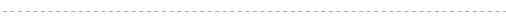

# Continually Post-training Small Models via Synthetic Self-distillation

Woosung Koh\* Affiliation: KAIST AI    Hyunsoo Lee Affiliation: LG AI
Research    Kyungjae Lee Affiliation: LG AI Research    Haeju Park
Affiliation: LG AI Research    Dahyun Lee Affiliation: LG AI Research   
Dasol Hwang Affiliation: LG AI Research    Moontae Lee Affiliation: LG
AI Research    \*Work done during an internship at LG AI
Research Corresponding author

###### Abstract

Continual post-training faces a dual challenge of acquisition and
retention: models must learn new capabilities while preserving prior
knowledge. While Self-Distillation Fine-Tuning (SDFT) mitigates this
using self-supervision with in-context demonstrations, it relies on
strong in-context learning and instruction-following abilities.
Consequently, SDFT fails on smaller models critical for low-latency,
on-device use. To enable continual learning at smaller scales, we first
identify the root cause of failure. We show that poor acquisition and
forgetting correlate linearly with the post-trained model’s distribution
shift, revealing the necessity of in-distribution learning. We thus
introduce Synthetic Self-Distillation (SynthSelf), imitating SDFT’s
in-distribution rewrite by outsourcing the task to a minimally larger,
same-family aligner. Coupled with off-policy supervision and rejection
sampling, this provides the high-quality supervision small models
require without breaking their original distribution. Evaluations
spanning 4 acquisition datasets (including a mixture) and 14 retention
benchmarks show SynthSelf consistently outperforms 6 methods (including
off- and on-policy distillation) across 3 small model scales. Extensive
further analyses confirm SynthSelf paves the way toward effective
small-model continual learning.

|     |
| --- |
|     |

## 1 Introduction

Continual post-training of language models (LMs) is a common setting
where practitioners aim to inject new capabilities into already-trained
models for scenarios such as customizing for specific use-cases and
enabling human-like lifelong learning (Shi et al., 2024; Wang et al.,
2024a; Zheng et al., 2025a; Zheng et al., 2025b; Srijith et al., 2025;
Chen et al., 2026a). Yet, this process is notoriously challenging on
both the acquisition (injecting new abilities) and retention
(maintaining existing capabilities) axes (Harmon et al., 2026; Luo et
al., 2025; Chen et al., 2026b). The failure to retain existing
capabilities, widely known as catastrophic forgetting (McCloskey and
Cohen, 1989; French, 1999; Kirkpatrick et al., 2017), is particularly
well-documented in settings where a supervised fine-tuning (SFT) dataset
is used for teacher forcing (Kalajdzievski, 2024; Luo et al., 2025; Lai
et al., 2026; Chen et al., 2026b; Shenfeld et al., 2026b).

A recent work showed that self-distillation fine-tuning (SDFT) is an
effective way to inject SFT demonstrations in an on-policy manner
(Shenfeld et al., 2026a), outperforming recent off-policy continual
fine-tuning methods such as re-invoke (Lu and Lab, 2025) and Dynamic
Fine-tuning (DFT; Wu et al. (2026)) on both acquisition and retention
axes. SDFT leverages the in-context learning (ICL) and
instruction-following (IF) abilities of post-trained models to provide
demonstrations in-context to the self-teacher model, and applies
on-policy distillation (OPD; Ross et al. (2011), Agarwal et al. (2024))
on itself, supervising on an implicit self-rewrite of the
demonstrations.

However, as models struggle with ICL and IF at smaller scales, SDFT
remains infeasible in this regime (see Fig. 3(a)). We aim to address
this limitation, as small models have become critical for applications
such as on-device deployment, latency-specialized models, draft models,
verifiers, and large-small collaborative methods (Cobbe et al., 2021;
Chen et al., 2023; Abdin et al., 2024; Liu et al., 2024; Lu et al.,
2025; Belcak et al., 2025; Cai et al., 2026).

##### Contribution.

To better understand how to leverage the key principles of SDFT, we
first examine why it succeeds in continual post-training (§ 2.2.1). We
reveal that the distribution shift of the post-trained base model
linearly correlates with poor acquisition and forgetting (Fig. 2),
indicating that staying in-distribution is crucial for continual
learning. While the primary advantage of SDFT over off-policy methods is
its ability to staying in distribution, evaluating its self-generated
offline dataset reveals that SDFT’s self-supervision quality is
inadequate at smaller model scales (Fig. 3).

(a) Averaged across 3 base models, continual post-training via SynthSelf
on the medical domain results in near-zero forgetting across all 14
benchmarks.

(b) Across 3 base models, 4 acquisition benchmarks, and 14 retention
tasks, SynthSelf maximizes performance gains with minimal forgetting.

Figure 1: Overview of SynthSelf performance across three model scales
(0.5, 1.5, and 3B).

In response, we propose Synthetic Self-Distillation (SynthSelf), which
imitates self-distillation’s implicit in-distribution rewrite by
outsourcing the distribution-aligned rewrite to a larger model (§ 2.4).
Our method distinctly differs from SDFT in the following ways: (i)
choosing off-policy over on-policy supervision allows us to apply
rejection sampling, which in turn improves supervision quality for small
models that are sensitive to data quality; and (ii) using minimally
larger, same-family aligners allows us to simultaneously (ii.a.) provide
high-quality supervision (Tab. 2), (ii.b.) remain in-distribution
relative to the base model (Fig. 5), and (ii.c.) maintain low
computational costs. We empirically validate SynthSelf (§ 3),
demonstrating that:

1.  1.  SynthSelf achieves the best acquisition across 3 domains (science,
        tool-use, and medicine) and a 4-subject science mixture while
        preserving prior capabilities on 14 benchmarks, consistently across
        3 base model sizes (0.5, 1.5, 3B), and against 4 relevant baselines
        (Fig. 1, Tab. 1).
2.  2.  Controlling for the confounding factor of teacher model size, we
        demonstrate that SynthSelf outperforms both on- and off-policy
        distillation in acquisition by +5.7%p to +16.9%p, averaged over all
        four settings and three base scales (Tab. 1, Fig. 5).
3.  3.  We show that utilizing a smaller (weaker) in-distribution aligner is
        more effective than deploying a larger (stronger)
        out-of-distribution teacher, yielding a 69.9% reduction in alignment
        computational cost (FLOPs) (Tab. 2).
4.  4.  We validate that our improvement over SDFT is not due to prompt
        differences using prompt-matched and diverse prompts, achieving
        +18.96%p and +1.68%p gains in acquisition and retention over
        prompt-matched SDFT (Fig. 6).
5.  5.  Finally, our ablation studies confirm that combining rejection
        sampling with off-policy supervision is a meaningful component of
        our methodology (Fig. 5).

## 2 Method

### 2.1 Problem Setting: Continual Fine-tuning

##### Continual fine-tuning.

Given a post-trained policy $`\pi`$, we continually inject new knowledge
from a dataset
$`\mathcal{D}_{\text{train}}=\{(x_{i},y_{i})\}_{i=1}^{N}`$ by further
training $`\pi`$. In doing so, we aim to maximize (i) acquisition:
performance on a same-domain test set $`\mathcal{D}_{\text{test}}`$,
while maintaining (ii) retention: performance on existing capabilities,
evaluated via $`\mathcal{D}_{\text{ret}}`$.

##### Self-distillation fine-tuning.

Given a demonstration pair $`(x,y)`$ and an SDFT prompt
$`P^{\text{SDFT}}`$ that places the demonstration in-context, SDFT
trains the policy $`\pi_{\theta}`$ parameterized by $`\theta`$ on-policy
toward the frozen model’s self-rewrite of that demonstration,

```math
\mathcal{L}(\theta)\;=\;D_{\mathrm{KL}}\big(\pi_{\theta}(\cdot\mid x)\,\big\|\,\pi\!\left(\cdot\mid P^{\text{SDFT}}(x,y)\right)\big)\;=\;\mathbb{E}_{y^{\prime}\sim\pi_{\theta}(\cdot\mid x)}\left[\log\frac{\pi_{\theta}(y^{\prime}\mid x)}{\pi\!\left(y^{\prime}\mid P^{\text{SDFT}}(x,y)\right)}\right], \tag{1}
```

where $`y^{\prime}`$ denotes a completion sampled from the current
policy. This supervision preserves the semantic content of $`y`$ while
remaining within the model’s native distribution, allowing for effective
continual learning.

Figure 2: Distribution shift negatively correlates with ideal continual
learning. (a) Experiment 1: Post-training distribution shift strongly
correlates with forgetting existing capabilities across GPQA-Diamond,
ARC-C, MMLU-Pro, HumanEval, and MBPP, regardless of data source or type.
(b) - (e) Experiment 2: Transforming the same dataset from its original
OOD form (HI) to more in-distribution forms (MID, LO) monotonically
improves (c) target domain (math) retention, (d) target domain
performance, and (e) cross-domain (coding) retention.

### 2.2 In-distribution Demonstration Injection

#### 2.2.1 In-distribution learning is key for continual learning

Building on the observation that SDFT preserves the native distribution,
we hypothesize that training on out-of-distribution (OOD) targets is the
primary driver of poor acquisition and forgetting. To test this, we
continually fine-tune Qwen2.5-3B-Instruct (Qwen et al., 2025), measuring
the resulting policy shift via
$`D_{\mathrm{KL}}(\pi_{\text{after}}\,\|\,\pi_{\text{before}})`$. To
avoid data contamination, we use this older model to evaluate against
post-release datasets. Further details are available in Appendix B.

##### Experiment 1: Distribution shift correlates with forgetting across datasets.

\[Setup\] First, we collect 23 diverse math training datasets,
size-matched to 2.5M completion tokens. Datasets are grouped by domain
and release date relative to the base model: (1) pre-cutoff, (2)
post-cutoff: long chain-of-thought (CoT) math reasoning, and (3)
off-target: post-cutoff code or general instruction data.¹¹ 1 Although a
dataset’s release date does not definitively guarantee whether its
tokens were seen during training, it serves as a reasonable proxy for
distinguishing between older and newer data. Our overall results and
analyses remain robust regardless of this specific grouping. Forgetting
is measured as the mean performance drop ($`\Delta`$) across five
non-math benchmarks: GPQA-Diamond (Rein et al., 2024), ARC-C (Clark et
al., 2018), MMLU-Pro (Wang et al., 2024b), HumanEval (Chen et al.,
2021), and MBPP (Odena et al., 2021). \[Results\] Fig. 2 (a)
demonstrates that the magnitude of forgetting (y-axis) is strongly
correlated with the distribution shift of the policy $`\pi`$ after
fine-tuning (Spearman $`\rho=-0.85`$), suggesting that updates causing
significant distribution shifts are detrimental to continual learning.

##### Experiment 2: Distribution shift correlates with poor acquisition and forgetting within a dataset.

\[Setup\] Second, to isolate distribution shift within an underlying
dataset, we hold the corpus fixed using OpenR1-Math-220k (Face, 2025), a
long-CoT dataset. Using identical prompts, we construct three 2M
completion-token datasets that vary only in target text shift: (HI) high
shift: full R1 trace with reasoning, (MID) mid shift: R1 final solution
without long-CoT, and (LO) low shift: the model’s own verified-correct
solution. LO is curated via self-rejection sampling (Singh et al.,
2024). The base model decodes a single solution per problem under the
same prompt, which is then verified for correctness. \[Results\] Fig. 2
(c) - (e) show that higher distribution shift tracks with in-domain
forgetting and catastrophic forgetting, whereas low-shift self-generated
samples improve math acquisition performance while preserving existing
coding capabilities.

### 2.3 Limitations of Self-distillation

##### Self-supervision fails at small model scales.

Although on-policy self-distillation (SDFT; Shenfeld et al. (2026a))
successfully preserves the base distribution during continual
post-training, its efficacy drops for smaller models. Fig. 3(a)
demonstrates that SDFT’s performance relative to SFT decreases
monotonically with student size. We attribute this to poor
self-supervision quality. To evaluate this, we generate an offline
dataset to approximate on-policy teacher quality. Fig. 3(b) confirms
that smaller models yield weaker supervision: regardless of the prompt
(Appendix A), average accuracy falls to 60%, and CoT traces are dropped
8.2% of the time.

(a) SDFT acquisition performance relative to SFT declines monotonically
as model size decreases.

(b) For example, in the tool-use domain, self-rewriting results in
reduced accuracy and missing CoTs.

Figure 3: SDFT fails at smaller model sizes as its ability to self-teach
deteriorates.

### 2.4 Off-policy In-distribution distillation as Synthetic Self-distillation

To bridge this gap, SynthSelf is designed to (1) remain in-distribution
with respect to the base model $`\pi`$, and (2) provide high-quality
supervision. We achieve this via two core mechanisms: (i) utilizing
off-policy distillation to enable rejection sampling, and (ii) selecting
a larger aligner model that simultaneously (ii.a.) yields high-quality
supervision, (ii.b.) stays in-distribution relative to the base model,
and (ii.c.) incurs low computational overhead.

##### (i) Off-policy supervision enables rejection sampling.

By generating offline datasets for SFT rather than training on-policy,
we can filter for accuracy through rejection sampling. This step is
essential because small models are highly sensitive to supervision
quality.

##### (ii) Identifying a low-cost, competent in-distribution aligner.

We formalize the dual objectives of (ii.a.) generating high-quality
supervision and (ii.b.) maintaining in-distribution alignment. Let
$`\mathcal{A}=\{\pi_{A}^{(1)},\dots,\pi_{A}^{(K)}\}`$ be a pool of
candidate aligners. We aim to select an aligner
$`\pi_{A}^{\star}\in\mathcal{A}`$ that minimizes the distributional gap
to the base model, subject to quality constraints (Eq. 6).

Figure 4: Same-family rewrites provide more in-distribution off-policy
data relative to Gold SFT. Conversely, stronger, cross-family models
fail to meaningfully improve distributional alignment with the base
model.

Figure 5: An ablation study demonstrates that off-policy rejection
sampling is a valuable component. Furthermore, SynthSelf consistently
outperforms standard off-policy distillation, even when controlling for
model scale.

Given a demonstration pair $`(x_{i},y_{i})`$ and a rewrite prompt
$`P^{\text{rewrite}}`$ (Box A), the aligner’s rewrite distribution is:

```math
q_{i}(y)\;\coloneqq\;\pi_{A}\!\left(y\mid P^{\text{rewrite}}(x_{i},y_{i})\right). \tag{2}
```

This distribution translates the knowledge from $`(x_{i},y_{i})`$ into
the aligner’s native distribution. Appendix D shows an example: the
rewrite keeps the gold answer and format while restating the reasoning
in the aligner’s own phrasing. We decode greedily,
$`\hat{y}_{i,t}=\arg\max_{v\in\mathcal{V}}\,\pi_{A}\!\left(v\mid P^{\text{rewrite}}(x_{i},y_{i}),\,\hat{y}_{i,<t}\right)`$,
ensuring a deterministic rewrite $`\hat{y}_{i}`$. We measure supervision
quality (ii.a.) directly on these rewrites:

```math
R(\pi_{A})\;=\;\mathbb{E}_{i}\big[r(x_{i},\hat{y}_{i})\big],\qquad\hat{y}_{i}\;=\;\operatorname{greedy}(q_{i}), \tag{3}
```

where a verifiable reward
$`r(x_{i},\hat{y}_{i})=\mathbb{I}[a(\hat{y}_{i})=a(y_{i})]`$ checks the
extracted answer $`a(\cdot)`$ against the gold demonstration.

The student is trained to imitate the point mass
$`\delta_{\hat{y}_{i}}`$ at the mode of $`q_{i}`$. The divergence
against this point mass simplifies to the negative log-likelihood (NLL)
under the student $`\pi`$, serving as our metric for in-distribution
alignment (ii.b.):

```math
\mathcal{L}(\pi_{A})\;=\;\mathbb{E}_{i}\big[D_{\mathrm{KL}}\big(\delta_{\hat{y}_{i}}\,\|\,\pi(\cdot\mid x_{i})\big)\big]\;=\;-\,\mathbb{E}_{i}\sum_{t=1}^{|\hat{y}_{i}|}\log\pi\big(\hat{y}_{i,t}\mid x_{i},\hat{y}_{i,<t}\big). \tag{4}
```

Standard SFT on gold demonstrations follows an identical objective,
replacing $`\delta_{\hat{y}_{i}}`$ with $`\delta_{y_{i}}`$ to provide a
baseline divergence:

```math
\mathcal{L}_{\text{gold}}\;=\;\mathbb{E}_{i}\big[D_{\mathrm{KL}}\big(\delta_{y_{i}}\,\|\,\pi(\cdot\mid x_{i})\big)\big]\;=\;-\,\mathbb{E}_{i}\sum_{t=1}^{|y_{i}|}\log\pi\big(y_{i,t}\mid x_{i},y_{i,<t}\big). \tag{5}
```

Consequently, we formulate aligner selection as:

```math
\pi_{A}^{\star}\;=\;\operatorname*{arg\,min}_{\pi_{A}\in\mathcal{A}}\;\mathcal{L}(\pi_{A})\qquad\text{s.t.}\qquad\mathcal{L}(\pi_{A})\;<\;\mathcal{L}_{\text{gold}}\quad\text{and}\quad R(\pi_{A})\;>\;R(\pi). \tag{6}
```

In short, we select the aligner closest in distribution to the student.
The constraints guarantee its rewrites offer a distributional advantage
over standard SFT ($`\mathcal{L}(\pi_{A})<\mathcal{L}_{\text{gold}}`$)
and strictly exceed the base model’s supervision quality
($`R(\pi_{A})>R(\pi)`$).

In practice, scaling up within the same model family perfectly satisfies
Eq. 6. Fig. 5 shows that same-family aligners (Qwen2.5-7B, 14B, 32B)
achieve the lowest average KL, falling well below
$`\mathcal{L}_{\text{gold}}`$, whereas stronger cross-family models fail
to meaningfully reduce the NLL (averaged across three domains detailed
in § 3). Furthermore, same-family aligners yield higher data accuracy
than the base model, satisfying $`R(\pi_{A})>R(\pi)`$ (Tab. 2). Finally,
to satisfy the low-cost constraint (ii.c.), we instantiate
$`\pi_{A}^{\star}`$ using minimally larger Qwen2.5-7B and 14B models,
ensuring minimal computational overhead.

Input : Demonstrations
$`\mathcal{D}_{\text{train}}=\{(x_{i},y_{i})\}_{i=1}^{N}`$, post-trained
base model $`\pi_{\theta}`$, aligner $`\pi_{A}^{\star}`$, rewrite
instruction $`P^{\text{rewrite}}`$, answer extractor $`a(\cdot)`$

1 $`\hat{\mathcal{D}}\leftarrow\emptyset`$ ; // Initialize offline
dataset

2 foreach _$`(x_{i},y_{i})\in\mathcal{D}_{\text{train}}`$_ do

   /\* Synthetic In-distribution Rewrite \*/

    3
$`\hat{y}_{i}\leftarrow\arg\max_{y}\;\pi_{A}\!\left(y\mid P^{\text{rewrite}}(x_{i},y_{i})\right)`$
; // Greedy decoding

   /\* Rejection Sampling \*/

    4 if _$`a(\hat{y}_{i})=a(y_{i})`$_ then

       5
$`\hat{\mathcal{D}}\leftarrow\hat{\mathcal{D}}\cup\{(x_{i},\hat{y}_{i})\}`$
; // Same answer, but in-distribution

    6 else

       7 discard $`(x_{i},\hat{y}_{i})`$

    8 end if

9 end foreach

/\* Off-policy learning via SFT \*/

10
$`\hat{\theta}\leftarrow\arg\min_{\theta}\;\mathbb{E}_{(x,\hat{y})\sim\hat{\mathcal{D}}}\!\left[-\log\pi_{\theta}(\hat{y}\mid x)\right]`$
;

11 return $`\pi_{\hat{\theta}}`$ ;

Algorithm 1 SynthSelf (post-aligner selection)

##### Algorithmic implementation.

Using this minimally larger same-family aligner $`\pi_{A}`$, we
implement SynthSelf (see Alg. 1). We first initialize an empty offline
dataset $`\hat{\mathcal{D}}`$ (Line 1). Next, processing the data in
batches, we generate an in-distribution rewrite $`\hat{y}_{i}`$ for each
sample $`i`$ via the aligner $`\pi_{A}`$ using greedy decoding (Lines 2
and 3). Samples that satisfy the rejection sampling are then added to
$`\hat{\mathcal{D}}`$ (Lines 4 to 8). Finally, we perform SFT on this
filtered dataset $`\hat{\mathcal{D}}`$ to update the base model
parameters (Line 10).

## 3 Empirical Study

We evaluate SynthSelf on the three domains from SDFT (Shenfeld et al.,
2026a), alongside a 4-subject science mixture to verify generalization.
In §3.3, we further analyze our approach by: (i) demonstrating that
distribution matching outweighs aligner capability; (ii) benchmarking
against SDFT on matched and diverse prompts; and (iii) ablating
rejection sampling to confirm the value of off-policy supervision.

### 3.1 Experimental Protocol

|                              |      |          |      |      |      |      |                  |                   |                  |                |                   |                  |
| ---------------------------- | ---- | -------- | ---- | ---- | ---- | ---- | ---------------- | ----------------- | ---------------- | -------------- | ----------------- | ---------------- |
|                              |      | Baseline |      |      |      |      | SynthSelf (ours) |                   |                  |                |                   |                  |
| Model                        |      | Base     | SFT  | SDFT | DFT  | ASFT | SS-1$`\Delta`$   | $`\Delta`$ Off-PD | $`\Delta`$ On-PD | SS-2$`\Delta`$ | $`\Delta`$ Off-PD | $`\Delta`$ On-PD |
| Science: Chemistry           |      |          |      |      |      |      |                  |                   |                  |                |                   |                  |
| 0.5B                         | Acq. | 25.4     | 56.8 | 38.5 | 35.5 | 45.6 | 63.7             | +21.1             | +34.5            | 59.4           | +10.1             | +21.5            |
|                              | Ret. | 31.8     | 28.2 | 30.3 | 28.7 | 30.3 | 27.8             | -2.4              | +1.2             | 29.5           | -0.8              | +5.1             |
| 1.5B                         | Acq. | 31.0     | 64.9 | 53.6 | 56.8 | 48.5 | 67.1             | +16.4             | +33.3            | 65.3           | +12.0             | +22.9            |
|                              | Ret. | 43.9     | 44.1 | 41.8 | 43.8 | 45.2 | 45.0             | +0.4              | +1.9             | 44.6           | +0.0              | +2.5             |
| 3B                           | Acq. | 30.2     | 68.8 | 65.9 | 60.9 | 58.6 | 69.6             | +21.5             | +38.7            | 67.7           | +11.2             | +21.9            |
|                              | Ret. | 52.9     | 52.6 | 51.5 | 51.3 | 51.6 | 52.7             | -0.7              | +2.9             | 51.8           | -2.3              | -1.3             |
| Avg.                         | Acq. | 28.9     | 63.5 | 52.7 | 51.1 | 50.9 | 66.8             | +19.7             | +35.5            | 64.1           | +11.1             | +22.1            |
|                              | Ret. | 42.8     | 41.6 | 41.2 | 41.2 | 42.4 | 41.8             | -0.9              | +2.0             | 42.0           | -1.0              | +2.1             |
| Science Mixture (4 subjects) |      |          |      |      |      |      |                  |                   |                  |                |                   |                  |
| 0.5B                         | Acq. | 23.0     | 48.7 | 25.7 | 32.8 | 35.5 | 49.8             | +7.2              | +20.0            | 43.0           | +0.4              | +9.6             |
|                              | Ret. | 31.8     | 30.0 | 29.5 | 29.1 | 29.7 | 30.8             | -0.7              | +2.4             | 28.8           | -2.5              | +1.8             |
| 1.5B                         | Acq. | 30.4     | 55.5 | 40.2 | 52.8 | 48.9 | 58.9             | +12.6             | +18.7            | 57.0           | +7.0              | +14.3            |
|                              | Ret. | 43.9     | 42.8 | 43.1 | 43.3 | 44.3 | 43.3             | -1.5              | -1.1             | 44.5           | -2.3              | +0.9             |
| 3B                           | Acq. | 43.8     | 61.1 | 60.6 | 50.9 | 55.1 | 63.2             | +7.2              | +17.4            | 67.7           | +10.4             | +16.6            |
|                              | Ret. | 52.9     | 52.9 | 51.5 | 50.7 | 51.6 | 51.6             | -2.5              | +1.4             | 52.9           | +0.0              | +2.0             |
| Avg.                         | Acq. | 32.4     | 55.1 | 42.2 | 45.5 | 46.5 | 57.3             | +9.0              | +18.7            | 55.9           | +6.0              | +13.5            |
|                              | Ret. | 42.8     | 41.9 | 41.3 | 41.0 | 41.9 | 41.9             | -1.6              | +0.9             | 42.1           | -1.6              | +1.5             |
| Tool-use                     |      |          |      |      |      |      |                  |                   |                  |                |                   |                  |
| 0.5B                         | Acq. | 23.7     | 40.2 | 24.7 | 30.9 | 42.3 | 43.3             | -1.0              | +7.2             | 56.7           | +10.3             | +6.2             |
|                              | Ret. | 31.8     | 25.9 | 30.5 | 26.0 | 29.0 | 28.3             | -1.0              | +0.5             | 29.9           | -0.5              | +3.2             |
| 1.5B                         | Acq. | 43.3     | 57.7 | 51.5 | 59.8 | 54.6 | 61.9             | +11.3             | +15.5            | 55.7           | -2.1              | -6.2             |
|                              | Ret. | 43.9     | 39.9 | 42.6 | 41.6 | 41.6 | 42.3             | -1.1              | -3.0             | 42.4           | -1.4              | +0.3             |
| 3B                           | Acq. | 33.0     | 66.0 | 57.7 | 47.4 | 58.8 | 61.9             | +7.2              | +13.4            | 68.0           | +9.3              | +9.3             |
|                              | Ret. | 52.9     | 50.9 | 52.2 | 49.6 | 53.2 | 51.0             | +0.5              | +0.9             | 51.4           | +0.4              | +2.1             |
| Avg.                         | Acq. | 33.3     | 54.6 | 44.7 | 46.0 | 51.9 | 55.7             | +5.8              | +12.0            | 60.1           | +5.8              | +3.1             |
|                              | Ret. | 42.8     | 38.9 | 41.8 | 39.1 | 41.3 | 40.5             | -0.5              | -0.5             | 41.2           | -0.5              | +1.8             |
| Medicine                     |      |          |      |      |      |      |                  |                   |                  |                |                   |                  |
| 0.5B                         | Acq. | 26.7     | 16.0 | 26.7 | 2.0  | 18.2 | 32.7             | -3.0              | -1.5             | 34.2           | -0.5              | -2.0             |
|                              | Ret. | 31.8     | 28.4 | 30.5 | 28.0 | 29.4 | 31.0             | -0.8              | +3.7             | 29.9           | -2.4              | +2.1             |
| 1.5B                         | Acq. | 42.8     | 41.3 | 28.8 | 27.7 | 36.7 | 47.8             | +0.5              | -0.2             | 48.3           | -0.3              | -3.0             |
|                              | Ret. | 43.9     | 41.4 | 42.5 | 40.8 | 42.8 | 43.7             | -2.8              | +4.5             | 43.3           | -2.6              | +2.2             |
| 3B                           | Acq. | 57.5     | 48.8 | 54.8 | 20.7 | 50.2 | 57.3             | +1.3              | +5.2             | 54.0           | +1.0              | +0.7             |
|                              | Ret. | 52.9     | 48.7 | 52.2 | 51.7 | 52.8 | 52.3             | -3.0              | +1.4             | 52.8           | -0.6              | -0.6             |
| Avg.                         | Acq. | 42.3     | 35.4 | 36.8 | 16.8 | 35.0 | 45.9             | -0.4              | +1.2             | 45.5           | +0.1              | -1.4             |
|                              | Ret. | 42.8     | 39.5 | 41.7 | 40.2 | 41.7 | 42.4             | -2.2              | +3.2             | 42.0           | -1.9              | +1.2             |
| Average                      |      |          |      |      |      |      |                  |                   |                  |                |                   |                  |
| Avg.                         | Acq. | 34.2     | 52.2 | 44.1 | 39.8 | 46.1 | 56.4             | +8.5              | +16.9            | 56.4           | +5.7              | +9.3             |
|                              | Ret. | 42.8     | 40.5 | 41.5 | 40.4 | 41.8 | 41.7             | -1.3              | +1.4             | 41.8           | -1.2              | +1.7             |

Table 1: SynthSelf leads acquisition (Acq.) in all 4 benchmarks and ties
the best baseline on 14 retention tasks (Ret.), over 4 baselines,
off-/on-policy distillation, and three base models. Green and red
background shading on Avg. rows is min-max normalized across each row.
The 14 retention tasks span instruction following, commonsense, diverse
knowledge, code, and math. The mixture contains Chemistry, Biology,
Materials, and Physics in both the train and test splits. $`\Delta`$
Off-PD and $`\Delta`$ On-PD are SynthSelf minus off- or on-policy
distillation (%p).

##### Baselines.

We compare our method against four baselines: standard SFT, SDFT
(Shenfeld et al., 2026a), DFT (Wu et al., 2026), which modifies the
objective function to imitate on-policy learning, naturally inducing
in-distribution learning, and ASFT (Zhu et al., 2026), which improves
upon DFT by further mitigating distributional shift. To control for the
larger aligner model size, we also compare SynthSelf against off- and
on-policy distillation (Agarwal et al., 2024). Here, off-policy
distillation is equivalent to Alg. 1, but conditions the generation on
the original query $`x_{i}`$ rather than the rewrite prompt
$`P^{\text{rewrite}}(x_{i},y_{i})`$. We tune standard SFT minimally and
fix these hyperparameters across all methods for fairness. To ensure a
strong baseline, we additionally optimize SDFT’s skip-token
hyperparameter; which discards $`T`$ initial formatting tokens.
Conversely, SynthSelf is tuning-free and introduces zero additional
hyperparameters.

##### Datasets and models.

Following Shenfeld et al. (2026a), we evaluate on three domains: science
(SciKnowEval Chemistry L-3; Feng et al. (2025)), tool-use (ToolAlpaca;
Tang et al. (2023)), and medicine (MedMCQA; Pal et al. (2022)). We
expand to all four SciKnowEval subjects for our mixture experiment. We
substitute the medical dataset used by Shenfeld et al. (2026a) with
MedMCQA to avoid LLM-as-a-judge evaluation and improve reproducibility.
We adopt the Qwen2.5-Instruct family as base models, unlike later
versions like Qwen3 (Yang et al., 2025) exhaustively trained on
open-source data; this choice reduces contamination and ensures
demonstration novelty. Further experimental details are in Appendix C.

### 3.2 Results

SynthSelf achieves the highest acquisition across all four benchmarks,
including the science mixture, while matching the strongest baselines on
14 retention tasks (Tab. 1, Fig. 1). We abbreviate SynthSelf as SS, with
1$`\Delta`$ and 2$`\Delta`$ denoting aligners one and two sizes larger,
respectively (i.e., Qwen2.5-7B and Qwen2.5-14B). Interestingly, recent
methods fail to surpass SFT in acquisition at these smaller scales.
DFT’s performance in the medical domain deteriorates especially
significantly; we have double-checked that these evaluation values are
correct. However, consistent with the discussion in § 2.2.1, the
on-policy and in-distribution mechanisms of SDFT and ASFT successfully
improve retention over SFT.

|                                                |                          |      |                         |        |                                    |       |                                |       |
| ---------------------------------------------- | ------------------------ | ---- | ----------------------- | ------ | ---------------------------------- | ----- | ------------------------------ | ----- |
|                                                | Acquisition $`\uparrow`$ |      | KL (NLL) $`\downarrow`$ |        | Data-gen Accuracy (%) $`\uparrow`$ |       | Data-gen PFLOPs $`\downarrow`$ |       |
| Aligner                                        | Sci.                     | Tool | Sci.                    | Tool   | Sci.                               | Tool  | Sci.                           | Tool  |
| More In-distribution Aligners                  |                          |      |                         |        |                                    |       |                                |       |
| Qwen2.5-7B                                     | 66.8                     | 55.7 | 0.995                   | 0.650  | 99.0                               | 84.1  | 13.9                           | 39.0  |
| Qwen2.5-14B                                    | 64.1                     | 60.1 | 1.033                   | 0.666  | 99.1                               | 81.8  | 36.6                           | 76.0  |
| Stronger but More Out-of-distribution Aligners |                          |      |                         |        |                                    |       |                                |       |
| Qwen3.5-27B                                    | 65.1                     | 50.5 | 1.440                   | 0.873  | 90.3                               | 95.8  | 70.0                           | 142.1 |
| Gemma-4-31B                                    | 60.8                     | 56.0 | 1.245                   | 0.812  | 99.8                               | 99.3  | 148.2                          | 167.9 |
| Average                                        |                          |      |                         |        |                                    |       |                                |       |
| ID                                             | 65.5                     | 57.9 | 1.014                   | 0.658  | 99.0                               | 82.9  | 25.2                           | 57.5  |
| OOD                                            | 63.0                     | 53.3 | 1.342                   | 0.843  | 95.0                               | 97.5  | 109.1                          | 155.0 |
| $`\Delta`$ = ID $`-`$ OOD                      | +2.5                     | +4.6 | -0.328                  | -0.185 | +4.0                               | -14.6 | -83.8                          | -97.5 |

Table 2: SynthSelf performs better with in-distribution aligners.
Averaged over the Qwen2.5-0.5B, 1.5B, and 3B base models, using aligners
that are more in-distribution (measured by NLL) is a stronger predictor
of performance than the strength of the aligner (measured by
data-generation accuracy). Data-generation accuracy represents the
reward $`R(\pi_{A})`$ in Eq. 3. It is additionally advantageous that
smaller, same-family aligners are the most compute-efficient when
generating off-policy data. Bold indicates best value across each
column.

Moreover, we validate that the performance gains of SynthSelf stem
primarily from in-distribution demonstration injection, rather than
merely leveraging a larger aligner (Tab. 1). Off- and on-policy
distillation (Off-/On-PD) use the identical aligner, differing only in
conditioning on $`x_{i}`$ rather than on
$`P^{\text{rewrite}}(x_{i},y_{i})`$. Averaged across all four settings,
SynthSelf nonetheless improves acquisition by +5.7%p to +16.9%p while
maintaining comparable retention. As expected, demonstration injection
drives these acquisition gains, whereas all three methods (SynthSelf,
Off-PD, and On-PD) similarly preserve the base model distribution to
sustain retention capabilities. Lastly, we observe that SynthSelf does
not yield significant improvements over Off-/On-PD in the medical
domain. This is likely due to the aligner models already having perfect
knowledge of the training data, making demonstration injection largely
redundant. Despite this, SynthSelf remains highly competitive,
successfully outperforming all remaining baselines.

### 3.3 Further Experimental Analyses

##### Distribution matching outweighs aligner capability, and leads to data generation cost savings.

We validate our hypothesis that lower-cost, in-distribution aligners are
more effective than stronger out-of-distribution (OOD) alternatives.
Although larger aligners like Qwen3.5-27B and Gemma-4-31B (Team et al., 2026) generate higher-quality supervision (measured via data-generation
accuracy), they introduce severe distributional shift relative to the
base model. Consequently, they yield similar or worse acquisition
performance (Tab. 2). Moreover, using a same-family aligner reduces data
generation inference costs by 62.9% to 76.9% FLOPs.

##### SynthSelf outperforms prompt-matched self-distillation.

We confirm that SynthSelf’s gains over SDFT do not arise from
differences in supervision prompts (Fig. 6). Evaluating four SDFT prompt
variants, including one matched to SynthSelf, we find our method
consistently achieves higher acquisition across all three domains and
higher average retention than every variant. Full prompts are provided
in Appendix A.

##### Rejection sampling ablation.

Finally, we ablate the offline data generation that enables rejection
sampling (Alg. 1, Lines 4–7). As shown in Fig. 5, this filtering
mechanism consistently improves both SynthSelf and Off-PD. We
hypothesize such filtering is especially critical for smaller base
models, which are highly sensitive to noisy supervision.

Figure 6: SynthSelf outperforms SDFT across diverse prompt variations,
including a version prompt-matched to SynthSelf. On average, SynthSelf
outperforms prompt-matched SDFT by +18.96%p and +1.68%p on acquisition
and retention, respectively.

## 4 Discussion

##### Additional related work.

Huang et al. (2026) highlights the impact of distribution drift in SFT
using code-generation data on Qwen3-8B. However, they do not directly
address continual learning or small language models, restricting their
evaluation to limited scales and domains. Furthermore, Li et al. (2026)
combines mechanisms that we instead isolate: SDFT-style self-rewrites
with similarity filtering, cross-family fusion, and an on-policy KL
regularizer; covered individually by our SDFT, on-policy distillation,
and ASFT baselines. Crucially, we differ in the supervision source.
Because their rewrites originate from the student, they inherit the
small-scale degradation shown in Fig. 3. Our same-family aligner
explicitly resolves this limitation.

##### Training compute savings and further performance headroom.

Rejection sampling reduces training compute by shrinking the dataset
$`|\hat{D}|`$ (e.g., by 17.1% for tool use; Tab. 2). Despite training on
fewer demonstrations than SFT, SynthSelf improves acquisition by +4.2%p
on average, proving these gains stem from supervision quality rather
than quantity. To further boost performance, practitioners can scale
$`k`$ in pass@$`k`$, trading inference compute for larger coverage
supervision.

##### Limitation and future directions.

SynthSelf requires a larger, same-family aligner. Fortunately, most
major open-weight families provide a spectrum of model sizes, naturally
satisfying this requirement since smaller variants are often distilled
from their larger counterparts (e.g., Qwen2.5, Qwen3.5, OLMo 2 (Walsh et
al., 2025), Llama 3 (Grattafiori et al., 2024), and Gemma 4).
Nevertheless, future work could explore adapting out-of-family aligners
to produce in-distribution supervision. One promising direction is
adding the base model’s answer in-context with an appropriate prompt to
generate an in-distribution rewrite.

### AI use statement

We used generative AI to assist with experimental code generation and
reviewing writing for grammar and spelling. Furthermore, language models
generated the reasoning demonstrations for three SciKnowEval subjects.
The Chemistry demonstrations were generated with GPT-4o by Shenfeld et
al. (2026a). AI was not used for conceptualization, methodology design,
data analysis, or result interpretation. All reported numbers were
produced directly by our experimental pipeline, not by a language model.
The authors reviewed all AI-assisted scripts and text, and we take full
responsibility for the final content of this work.

## References

- Abdin et al. (2024) M. I. Abdin, S. A. Jacobs, A. A. Awan, J.
  Aneja, A. Awadallah, H. Hassan Awadalla, N. Bach, A. Bahree, A.
  Bakhtiari, H. Behl, A. Benhaim, M. Bilenko, J. Bjorck, S. Bubeck, M.
  Cai, C. C. T. Mendes, W. Chen, V. Chaudhary, P. Chopra, A. D.
  Giorno, G. de Rosa, M. Dixon, R. Eldan, D. Iter, A. Goswami, S.
  Gunasekar, E. Haider, J. Hao, R. J. Hewett, J. Huynh, M.
  Javaheripi, X. Jin, P. Kauffmann, N. Karampatziakis, D. Kim, M.
  Khademi, L. Kurilenko, J. R. Lee, Y. T. Lee, Y. Li, C. Liang, W.
  Liu, X. (. Lin, Z. Lin, P. Madan, A. Mitra, H. Modi, A. Nguyen, B.
  Norick, B. Patra, D. Perez-Becker, T. Portet, R. Pryzant, H. Qin, M.
  Radmilac, C. Rosset, S. Roy, O. Saarikivi, A. Saied, A. Salim, M.
  Santacroce, S. Shah, N. Shang, H. Sharma, X. Song, O. Ruwase, X.
  Wang, R. Ward, G. Wang, P. Witte, M. Wyatt, C. Xu, J. Xu, W. Xu, S.
  Yadav, F. Yang, Z. Yang, D. Yu, C. Zhang, C. Zhang, J. Zhang, L. L.
  Zhang, Y. Zhang, Y. Zhang, and X. Zhou Phi-3 technical report: a
  highly capable language model locally on your phone. Technical report
  Technical Report MSR-TR-2024-12, Microsoft. External Links:
  [Link](https://www.microsoft.com/en-us/research/publication/phi-3-technical-report-a-highly-capable-language-model-locally-on-your-phone/)
  Cited by: §1.
- Agarwal et al. (2024) R. Agarwal, N. Vieillard, Y. Zhou, P.
  Stanczyk, S. R. Garea, M. Geist, and O. Bachem On-policy distillation
  of language models: learning from self-generated mistakes. In The
  Twelfth International Conference on Learning Representations, External
  Links: [Link](https://openreview.net/forum?id=3zKtaqxLhW) Cited by:
  §1, §3.1.
- Belcak et al. (2025) P. Belcak, G. Heinrich, S. Diao, Y. Fu, X.
  Dong, S. Muralidharan, Y. C. Lin, and P. Molchanov Small language
  models are the future of agentic ai. External Links: 2506.02153,
  [Link](https://arxiv.org/abs/2506.02153),
  [Document](https://dx.doi.org/10.48550/arXiv.2506.02153) Cited by: §1.
- Cai et al. (2026) Q. Cai, Y. Zhao, and X. Li Think big, search small:
  where capacity matters in hierarchical search agents?. arXiv preprint
  arXiv:2607.07548. Cited by: §1.
- Chen et al. (2023) C. Chen, S. Borgeaud, G. Irving, J. Lespiau, L.
  Sifre, and J. Jumper Accelerating large language model decoding with
  speculative sampling. External Links: 2302.01318,
  [Link](https://arxiv.org/abs/2302.01318) Cited by: §1.
- Chen et al. (2026a) H. Chen, Z. Sun, H. Ye, K. Li, and X. Lin Beyond
  static models: an evolving framework for continual learning in large
  language models across training stages. External Links: 2603.12658,
  [Link](https://arxiv.org/abs/2603.12658) Cited by: §1.
- Chen et al. (2026b) H. Chen, N. Razin, K. R. Narasimhan, and D. Chen
  Retaining by doing: the role of on-policy data in mitigating
  forgetting. In Forty-third International Conference on Machine
  Learning, External Links:
  [Link](https://openreview.net/forum?id=ODTM64azGa) Cited by: §1.
- Chen et al. (2021) M. Chen, J. Tworek, H. Jun, Q. Yuan, H. P. de
  Oliveira Pinto, J. Kaplan, H. Edwards, Y. Burda, N. Joseph, G.
  Brockman, A. Ray, R. Puri, G. Krueger, M. Petrov, H. Khlaaf, G.
  Sastry, P. Mishkin, B. Chan, S. Gray, N. Ryder, M. Pavlov, A.
  Power, L. Kaiser, M. Bavarian, C. Winter, P. Tillet, F. P. Such, D.
  Cummings, M. Plappert, F. Chantzis, E. Barnes, A. Herbert-Voss, W. H.
  Guss, A. Nichol, A. Paino, N. Tezak, J. Tang, I. Babuschkin, S.
  Balaji, S. Jain, W. Saunders, C. Hesse, A. N. Carr, J. Leike, J.
  Achiam, V. Misra, E. Morikawa, A. Radford, M. Knight, M. Brundage, M.
  Murati, K. Mayer, P. Welinder, B. McGrew, D. Amodei, S. McCandlish, I.
  Sutskever, and W. Zaremba Evaluating large language models trained on
  code. External Links: 2107.03374 Cited by: §2.2.1.
- Clark et al. (2018) P. Clark, I. Cowhey, O. Etzioni, T. Khot, A.
  Sabharwal, C. Schoenick, and O. Tafjord Think you have solved question
  answering? try arc, the ai2 reasoning challenge. arXiv preprint
  arXiv:1803.05457. Cited by: §2.2.1.
- Cobbe et al. (2021) K. Cobbe, V. Kosaraju, M. Bavarian, M. Chen, H.
  Jun, L. Kaiser, M. Plappert, J. Tworek, J. Hilton, R. Nakano, C.
  Hesse, and J. Schulman Training verifiers to solve math word problems.
  External Links: 2110.14168, [Link](https://arxiv.org/abs/2110.14168)
  Cited by: §1.
- Face (2025) H. Face Open r1: a fully open reproduction of deepseek-r1.
  External Links: [Link](https://github.com/huggingface/open-r1) Cited
  by: §2.2.1.
- Feng et al. (2025) K. Feng, X. Shen, W. Wang, X. Zhuang, Y. Tang, Q.
  Zhang, and K. Ding SciKnowEval: evaluating multi-level scientific
  knowledge of large language models. External Links: 2406.09098,
  [Link](https://arxiv.org/abs/2406.09098) Cited by: §3.1.
- French (1999) R. M. French Catastrophic forgetting in connectionist
  networks. Trends in cognitive sciences 3 (4), pp. 128–135. Cited by:
  §1.
- Grattafiori et al. (2024) A. Grattafiori, A. Dubey, A. Jauhri, A.
  Pandey, A. Kadian, A. Al-Dahle, A. Letman, A. Mathur, A. Schelten, A.
  Vaughan, A. Yang, A. Fan, A. Goyal, A. Hartshorn, A. Yang, A.
  Mitra, A. Sravankumar, A. Korenev, A. Hinsvark, A. Rao, A. Zhang, A.
  Rodriguez, A. Gregerson, A. Spataru, B. Roziere, B. Biron, B. Tang, B.
  Chern, C. Caucheteux, C. Nayak, C. Bi, C. Marra, C. McConnell, C.
  Keller, C. Touret, C. Wu, C. Wong, C. C. Ferrer, C. Nikolaidis, D.
  Allonsius, D. Song, D. Pintz, D. Livshits, D. Wyatt, D. Esiobu, D.
  Choudhary, D. Mahajan, D. Garcia-Olano, D. Perino, D. Hupkes, E.
  Lakomkin, E. AlBadawy, E. Lobanova, E. Dinan, E. M. Smith, F.
  Radenovic, F. Guzmán, F. Zhang, G. Synnaeve, G. Lee, G. L.
  Anderson, G. Thattai, G. Nail, G. Mialon, G. Pang, G. Cucurell, H.
  Nguyen, H. Korevaar, H. Xu, H. Touvron, I. Zarov, I. A. Ibarra, I.
  Kloumann, I. Misra, I. Evtimov, J. Zhang, J. Copet, J. Lee, J.
  Geffert, J. Vranes, J. Park, J. Mahadeokar, J. Shah, J. van der
  Linde, J. Billock, J. Hong, J. Lee, J. Fu, J. Chi, J. Huang, J.
  Liu, J. Wang, J. Yu, J. Bitton, J. Spisak, J. Park, J. Rocca, J.
  Johnstun, J. Saxe, J. Jia, K. V. Alwala, K. Prasad, K. Upasani, K.
  Plawiak, K. Li, K. Heafield, K. Stone, K. El-Arini, K. Iyer, K.
  Malik, K. Chiu, K. Bhalla, K. Lakhotia, L. Rantala-Yeary, L. van der
  Maaten, L. Chen, L. Tan, L. Jenkins, L. Martin, L. Madaan, L. Malo, L.
  Blecher, L. Landzaat, L. de Oliveira, M. Muzzi, M. Pasupuleti, M.
  Singh, M. Paluri, M. Kardas, M. Tsimpoukelli, M. Oldham, M. Rita, M.
  Pavlova, M. Kambadur, M. Lewis, M. Si, M. K. Singh, M. Hassan, N.
  Goyal, N. Torabi, N. Bashlykov, N. Bogoychev, N. Chatterji, N.
  Zhang, O. Duchenne, O. Çelebi, P. Alrassy, P. Zhang, P. Li, P.
  Vasic, P. Weng, P. Bhargava, P. Dubal, P. Krishnan, P. S. Koura, P.
  Xu, Q. He, Q. Dong, R. Srinivasan, R. Ganapathy, R. Calderer, R. S.
  Cabral, R. Stojnic, R. Raileanu, R. Maheswari, R. Girdhar, R.
  Patel, R. Sauvestre, R. Polidoro, R. Sumbaly, R. Taylor, R. Silva, R.
  Hou, R. Wang, S. Hosseini, S. Chennabasappa, S. Singh, S. Bell, S. S.
  Kim, S. Edunov, S. Nie, S. Narang, S. Raparthy, S. Shen, S. Wan, S.
  Bhosale, S. Zhang, S. Vandenhende, S. Batra, S. Whitman, S. Sootla, S.
  Collot, S. Gururangan, S. Borodinsky, T. Herman, T. Fowler, T.
  Sheasha, T. Georgiou, T. Scialom, T. Speckbacher, T. Mihaylov, T.
  Xiao, U. Karn, V. Goswami, V. Gupta, V. Ramanathan, V. Kerkez, V.
  Gonguet, V. Do, V. Vogeti, V. Albiero, V. Petrovic, W. Chu, W.
  Xiong, W. Fu, W. Meers, X. Martinet, X. Wang, X. Wang, X. E. Tan, X.
  Xia, X. Xie, X. Jia, X. Wang, Y. Goldschlag, Y. Gaur, Y. Babaei, Y.
  Wen, Y. Song, Y. Zhang, Y. Li, Y. Mao, Z. D. Coudert, Z. Yan, Z.
  Chen, Z. Papakipos, A. Singh, A. Srivastava, A. Jain, A. Kelsey, A.
  Shajnfeld, A. Gangidi, A. Victoria, A. Goldstand, A. Menon, A.
  Sharma, A. Boesenberg, A. Baevski, A. Feinstein, A. Kallet, A.
  Sangani, A. Teo, A. Yunus, A. Lupu, A. Alvarado, A. Caples, A. Gu, A.
  Ho, A. Poulton, A. Ryan, A. Ramchandani, A. Dong, A. Franco, A.
  Goyal, A. Saraf, A. Chowdhury, A. Gabriel, A. Bharambe, A.
  Eisenman, A. Yazdan, B. James, B. Maurer, B. Leonhardi, B. Huang, B.
  Loyd, B. D. Paola, B. Paranjape, B. Liu, B. Wu, B. Ni, B. Hancock, B.
  Wasti, B. Spence, B. Stojkovic, B. Gamido, B. Montalvo, C. Parker, C.
  Burton, C. Mejia, C. Liu, C. Wang, C. Kim, C. Zhou, C. Hu, C. Chu, C.
  Cai, C. Tindal, C. Feichtenhofer, C. Gao, D. Civin, D. Beaty, D.
  Kreymer, D. Li, D. Adkins, D. Xu, D. Testuggine, D. David, D.
  Parikh, D. Liskovich, D. Foss, D. Wang, D. Le, D. Holland, E.
  Dowling, E. Jamil, E. Montgomery, E. Presani, E. Hahn, E. Wood, E.
  Le, E. Brinkman, E. Arcaute, E. Dunbar, E. Smothers, F. Sun, F.
  Kreuk, F. Tian, F. Kokkinos, F. Ozgenel, F. Caggioni, F. Kanayet, F.
  Seide, G. M. Florez, G. Schwarz, G. Badeer, G. Swee, G. Halpern, G.
  Herman, G. Sizov, Guangyi, Zhang, G. Lakshminarayanan, H. Inan, H.
  Shojanazeri, H. Zou, H. Wang, H. Zha, H. Habeeb, H. Rudolph, H.
  Suk, H. Aspegren, H. Goldman, H. Zhan, I. Damlaj, I. Molybog, I.
  Tufanov, I. Leontiadis, I. Veliche, I. Gat, J. Weissman, J.
  Geboski, J. Kohli, J. Lam, J. Asher, J. Gaya, J. Marcus, J. Tang, J.
  Chan, J. Zhen, J. Reizenstein, J. Teboul, J. Zhong, J. Jin, J.
  Yang, J. Cummings, J. Carvill, J. Shepard, J. McPhie, J. Torres, J.
  Ginsburg, J. Wang, K. Wu, K. H. U, K. Saxena, K. Khandelwal, K.
  Zand, K. Matosich, K. Veeraraghavan, K. Michelena, K. Li, K.
  Jagadeesh, K. Huang, K. Chawla, K. Huang, L. Chen, L. Garg, L. A, L.
  Silva, L. Bell, L. Zhang, L. Guo, L. Yu, L. Moshkovich, L.
  Wehrstedt, M. Khabsa, M. Avalani, M. Bhatt, M. Mankus, M. Hasson, M.
  Lennie, M. Reso, M. Groshev, M. Naumov, M. Lathi, M. Keneally, M.
  Liu, M. L. Seltzer, M. Valko, M. Restrepo, M. Patel, M. Vyatskov, M.
  Samvelyan, M. Clark, M. Macey, M. Wang, M. J. Hermoso, M. Metanat, M.
  Rastegari, M. Bansal, N. Santhanam, N. Parks, N. White, N. Bawa, N.
  Singhal, N. Egebo, N. Usunier, N. Mehta, N. P. Laptev, N. Dong, N.
  Cheng, O. Chernoguz, O. Hart, O. Salpekar, O. Kalinli, P. Kent, P.
  Parekh, P. Saab, P. Balaji, P. Rittner, P. Bontrager, P. Roux, P.
  Dollar, P. Zvyagina, P. Ratanchandani, P. Yuvraj, Q. Liang, R.
  Alao, R. Rodriguez, R. Ayub, R. Murthy, R. Nayani, R. Mitra, R.
  Parthasarathy, R. Li, R. Hogan, R. Battey, R. Wang, R. Howes, R.
  Rinott, S. Mehta, S. Siby, S. J. Bondu, S. Datta, S. Chugh, S.
  Hunt, S. Dhillon, S. Sidorov, S. Pan, S. Mahajan, S. Verma, S.
  Yamamoto, S. Ramaswamy, S. Lindsay, S. Lindsay, S. Feng, S. Lin, S. C.
  Zha, S. Patil, S. Shankar, S. Zhang, S. Zhang, S. Wang, S. Agarwal, S.
  Sajuyigbe, S. Chintala, S. Max, S. Chen, S. Kehoe, S. Satterfield, S.
  Govindaprasad, S. Gupta, S. Deng, S. Cho, S. Virk, S. Subramanian, S.
  Choudhury, S. Goldman, T. Remez, T. Glaser, T. Best, T. Koehler, T.
  Robinson, T. Li, T. Zhang, T. Matthews, T. Chou, T. Shaked, V.
  Vontimitta, V. Ajayi, V. Montanez, V. Mohan, V. S. Kumar, V.
  Mangla, V. Ionescu, V. Poenaru, V. T. Mihailescu, V. Ivanov, W. Li, W.
  Wang, W. Jiang, W. Bouaziz, W. Constable, X. Tang, X. Wu, X. Wang, X.
  Wu, X. Gao, Y. Kleinman, Y. Chen, Y. Hu, Y. Jia, Y. Qi, Y. Li, Y.
  Zhang, Y. Zhang, Y. Adi, Y. Nam, Yu, Wang, Y. Zhao, Y. Hao, Y.
  Qian, Y. Li, Y. He, Z. Rait, Z. DeVito, Z. Rosnbrick, Z. Wen, Z.
  Yang, Z. Zhao, and Z. Ma The llama 3 herd of models. External Links:
  2407.21783, [Link](https://arxiv.org/abs/2407.21783) Cited by: §4.
- Harmon et al. (2026) J. Harmon, A. Hochlehnert, M. Bethge, and A.
  Prabhu Mapping post-training forgetting in language models at scale.
  In The Fourteenth International Conference on Learning
  Representations, External Links:
  [Link](https://openreview.net/forum?id=qCIg2WGudx) Cited by: §1.
- Huang et al. (2026) Z. Huang, K. Yang, X. Huang, F. Hao, Q. Ge, B.
  Li, H. Du, K. Chen, and Q. Guo How to fine-tune a reasoning model? a
  teacher–student cooperation framework to synthesize student-consistent
  SFT data. In Forty-third International Conference on Machine Learning,
  External Links: [Link](https://openreview.net/forum?id=tylCinzjUF)
  Cited by: §4.
- Kalajdzievski (2024) D. Kalajdzievski Scaling laws for forgetting when
  fine-tuning large language models. External Links: 2401.05605,
  [Link](https://arxiv.org/abs/2401.05605) Cited by: §1.
- Kirkpatrick et al. (2017) J. Kirkpatrick, R. Pascanu, N.
  Rabinowitz, J. Veness, G. Desjardins, A. A. Rusu, K. Milan, J.
  Quan, T. Ramalho, A. Grabska-Barwinska, D. Hassabis, C. Clopath, D.
  Kumaran, and R. Hadsell Overcoming catastrophic forgetting in neural
  networks. Proceedings of the National Academy of Sciences 114 (13),
  pp. 3521–3526. External Links:
  [Document](https://dx.doi.org/10.1073/pnas.1611835114),
  [Link](https://www.pnas.org/doi/abs/10.1073/pnas.1611835114),
  https://www.pnas.org/doi/pdf/10.1073/pnas.1611835114 Cited by: §1.
- Lai et al. (2026) S. Lai, H. Zhao, R. Feng, C. Ma, W. Liu, H. Zhao, X.
  Lin, D. Yi, Q. Zhang, H. Liu, G. Meng, and F. Zhu Reinforcement
  fine-tuning naturally mitigates forgetting in continual post-training.
  External Links: 2507.05386, [Link](https://arxiv.org/abs/2507.05386)
  Cited by: §1.
- Li et al. (2026) Y. Li, X. Shi, Q. Kou, L. Yu, and H. Zhou RAFT: data
  refinement and adaptive distillation for domain fine-tuning with
  alleviated forgetting. External Links: 2606.00147,
  [Link](https://arxiv.org/abs/2606.00147) Cited by: §4.
- Liu et al. (2024) Z. Liu, C. Zhao, F. Iandola, C. Lai, Y. Tian, I.
  Fedorov, Y. Xiong, E. Chang, Y. Shi, R. Krishnamoorthi, L. Lai, and V.
  Chandra MobileLLM: optimizing sub-billion parameter language models
  for on-device use cases. In Proceedings of the 41st International
  Conference on Machine Learning, R. Salakhutdinov, Z. Kolter, K.
  Heller, A. Weller, N. Oliver, J. Scarlett, and F. Berkenkamp (Eds.),
  Proceedings of Machine Learning Research, Vol. 235, pp. 32431–32454.
  External Links:
  [Link](https://proceedings.mlr.press/v235/liu24ce.html) Cited by: §1.
- Lu and Lab (2025) K. Lu and T. M. Lab On-policy distillation. Thinking
  Machines Lab: Connectionism. Note:
  https://thinkingmachines.ai/blog/on-policy-distillation External
  Links: [Document](https://dx.doi.org/10.64434/tml.20251026) Cited by:
  §1.
- Lu et al. (2025) Z. Lu, X. Li, D. Cai, R. Yi, F. Liu, X. Zhang, N. D.
  Lane, and M. Xu Small language models: survey, measurements, and
  insights. External Links: 2409.15790,
  [Link](https://arxiv.org/abs/2409.15790) Cited by: §1.
- Luo et al. (2025) Y. Luo, Z. Yang, F. Meng, Y. Li, J. Zhou, and Y.
  Zhang An empirical study of catastrophic forgetting in large language
  models during continual fine-tuning. Vol. 33. External Links:
  [Document](https://dx.doi.org/10.1109/TASLPRO.2025.3606231) Cited by:
  §1.
- McCloskey and Cohen (1989) M. McCloskey and N. J. Cohen Catastrophic
  interference in connectionist networks: the sequential learning
  problem. G. H. Bower (Ed.), Psychology of Learning and Motivation,
  Vol. 24, pp. 109–165. External Links: ISSN 0079-7421,
  [Document](https://dx.doi.org/https%3A//doi.org/10.1016/S0079-7421%2808%2960536-8),
  [Link](https://www.sciencedirect.com/science/article/pii/S0079742108605368)
  Cited by: §1.
- Odena et al. (2021) A. Odena, C. Sutton, D. M. Dohan, E. Jiang, H.
  Michalewski, J. Austin, M. P. Bosma, M. Nye, M. Terry, and Q. V. Le
  Program synthesis with large language models. In n/a, n/a, pp. n/a.
  Note: n/a Cited by: §2.2.1.
- Pal et al. (2022) A. Pal, L. K. Umapathi, and M. Sankarasubbu MedMCQA:
  a large-scale multi-subject multi-choice dataset for medical domain
  question answering. In Proceedings of the Conference on Health,
  Inference, and Learning, G. Flores, G. H. Chen, T. Pollard, J. C. Ho,
  and T. Naumann (Eds.), Proceedings of Machine Learning Research, Vol.
  174, pp. 248–260. External Links:
  [Link](https://proceedings.mlr.press/v174/pal22a.html) Cited by: §3.1.
- Qwen et al. (2025) Qwen, :, A. Yang, B. Yang, B. Zhang, B. Hui, B.
  Zheng, B. Yu, C. Li, D. Liu, F. Huang, H. Wei, H. Lin, J. Yang, J.
  Tu, J. Zhang, J. Yang, J. Yang, J. Zhou, J. Lin, K. Dang, K. Lu, K.
  Bao, K. Yang, L. Yu, M. Li, M. Xue, P. Zhang, Q. Zhu, R. Men, R.
  Lin, T. Li, T. Tang, T. Xia, X. Ren, X. Ren, Y. Fan, Y. Su, Y.
  Zhang, Y. Wan, Y. Liu, Z. Cui, Z. Zhang, and Z. Qiu Qwen2.5 technical
  report. External Links: 2412.15115,
  [Link](https://arxiv.org/abs/2412.15115) Cited by: §2.2.1.
- Rein et al. (2024) D. Rein, B. L. Hou, A. C. Stickland, J.
  Petty, R. Y. Pang, J. Dirani, J. Michael, and S. R. Bowman GPQA: a
  graduate-level google-proof q&a benchmark. In First Conference on
  Language Modeling, External Links:
  [Link](https://openreview.net/forum?id=Ti67584b98) Cited by: §2.2.1.
- Ross et al. (2011) S. Ross, G. Gordon, and D. Bagnell A reduction of
  imitation learning and structured prediction to no-regret online
  learning. In Proceedings of the Fourteenth International Conference on
  Artificial Intelligence and Statistics, G. Gordon, D. Dunson, and M.
  Dudík (Eds.), Proceedings of Machine Learning Research, Vol. 15, Fort
  Lauderdale, FL, USA, pp. 627–635. External Links:
  [Link](https://proceedings.mlr.press/v15/ross11a.html) Cited by: §1.
- Shenfeld et al. (2026a) I. Shenfeld, M. Damani, J. Hübotter, and P.
  Agrawal Self-distillation enables continual learning. In Forty-third
  International Conference on Machine Learning, External Links:
  [Link](https://openreview.net/forum?id=qA6FgH0nnZ) Cited by: §C.2, §1,
  §2.3, §3.1, §3.1, §3, §4.
- Shenfeld et al. (2026b) I. Shenfeld, J. Pari, and P. Agrawal RL’s
  razor: why online reinforcement learning forgets less. In The
  Fourteenth International Conference on Learning Representations,
  External Links: [Link](https://openreview.net/forum?id=7HNRYT4V44)
  Cited by: §1.
- Shi et al. (2024) H. Shi, Z. Xu, H. Wang, W. Qin, W. Wang, Y. Wang, Z.
  Wang, S. Ebrahimi, and H. Wang Continual learning of large language
  models: a comprehensive survey. arXiv preprint arXiv:2404.16789. Cited
  by: §1.
- Singh et al. (2024) A. Singh, J. D. Co-Reyes, R. Agarwal, A. Anand, P.
  Patil, X. Garcia, P. J. Liu, J. Harrison, J. Lee, K. Xu, A. T.
  Parisi, A. Kumar, A. A. Alemi, A. Rizkowsky, A. Nova, B. Adlam, B.
  Bohnet, G. F. Elsayed, H. Sedghi, I. Mordatch, I. Simpson, I. Gur, J.
  Snoek, J. Pennington, J. Hron, K. Kenealy, K. Swersky, K.
  Mahajan, L. A. Culp, L. Xiao, M. Bileschi, N. Constant, R. Novak, R.
  Liu, T. Warkentin, Y. Bansal, E. Dyer, B. Neyshabur, J.
  Sohl-Dickstein, and N. Fiedel Beyond human data: scaling self-training
  for problem-solving with language models. Transactions on Machine
  Learning Research. Note: Expert Certification External Links: ISSN
  2835-8856, [Link](https://openreview.net/forum?id=lNAyUngGFK) Cited
  by: §2.2.1.
- Srijith et al. (2025) P. K. Srijith, S. Satapara, and S. Chandar
  Continual learning in large language models: foundations to frontiers.
  In Proceedings of the 14th International Joint Conference on Natural
  Language Processing and the 4th Conference of the Asia-Pacific Chapter
  of the Association for Computational Linguistics: Tutorial
  Abstract, B. Heinzerling and L. Ku (Eds.), Mumbai, India, pp. 6–17.
  External Links:
  [Link](https://aclanthology.org/2025.ijcnlp-tutorials.2/),
  [Document](https://dx.doi.org/10.18653/v1/2025.ijcnlp-tutorials.2),
  ISBN 979-8-89176-302-9 Cited by: §1.
- Tang et al. (2023) Q. Tang, Z. Deng, H. Lin, X. Han, Q. Liang, B. Cao,
  and L. Sun ToolAlpaca: generalized tool learning for language models
  with 3000 simulated cases. External Links: 2306.05301,
  [Link](https://arxiv.org/abs/2306.05301) Cited by: §3.1.
- Team et al. (2026) G. Team, S. E. Abd, V. Aggarwal, R. Algayres, A.
  Andreev, O. Bachem, I. Ballantyne, C. Brick, V. Cărbune, M. Casbon, M.
  Chaturvedi, A. Chawla, V. Cotruta, A. Coucke, P. Culliton, R.
  Dadashi, L. Dixon, M. Elhawaty, U. Evci, C. Farabet, J. Ferret, F.
  Galgani, S. Girgin, J. Grill, M. Grootendorst, J. Guo, C. Hardin, Y.
  He, S. M. Hernandez, O. Homburger, L. Hussenot, J. Ji, A. Joulin, A.
  Kamath, P. Kassraie, O. Lacombe, P. Lahoti, G. Liu, G. Martins, L.
  Martins, T. Matejovicova, R. Merhej, N. Momchev, S. Mondal, R.
  Mullins, S. R. Panyam, S. Pathak, S. Perrin, A. S. Pinto, E. Pot, A.
  Pouget, A. Ramé, S. Ramos, D. Reid, D. Rim, M. Rivière, K. Roth, L.
  Rouillard, O. Sanseviero, P. G. Sessa, S. Settle, D. Sinopalnikov, S.
  Smoot, P. Stanczyk, A. Steiner, L. Stewart, I. Tolstikhin, M.
  Tschannen, A. Tsitsulin, N. Vieillard, R. Wu, P. Xu, H. Yang, E.
  Yvinec, B. Zhang, L. Zhang, J. Zou, N. Aagnes, A. Abdelhamed, J.
  Adamek, S. Agrawal, S. Agrawal, I. Alabdulmohsin, J. B. Alayrac, U.
  Alon, C. Amarnath, A. Anand, C. Anastasiou, S. Ariafar, F. Aubet, K.
  Axiotis, F. Barbero, J. Barral, A. Bendebury, U. Bergmann, S.
  Bileschi, K. Black, M. Blondel, S. Borgeaud, A. Bražinskas, R.
  Burnell, R. Busa-Fekete, M. Cai, D. Calandriello, G. Cameron, C.
  Caucheteux, R. Chaabouni, G. Chadha, J. Chan, B. J. Chen, J. Chen, L.
  Chen, X. Chen, D. Cheng, T. Chien, N. Chinaev, Y. Chou, Z. Chu, B.
  Coleman, P. Consul, S. Conway-Rahman, S. Crowell, D. Cutler, V.
  Dani, S. Daruki, A. Das, D. Deutsch, N. Dikkala, L. Ding, Q. Ding, S.
  Dodhia, K. Donhauser, T. Doshi, A. Dragan, A. Druinsky, S. Dua, Z.
  Egyed, D. Eisenbud, D. Eppens, C. Fan, B. Fatemi, Y. Fathullah, V.
  Feinberg, M. Ferev, S. Flennerhag, T. Fujimoto, J. G. Oliveira, I.
  Galatzer-Levy, J. Gante, S. Geisler, S. Ghosal, A. M. Girgis, T. von
  Glehn, A. Go, A. Gokhale, A. Grills, Y. Gu, M. Gupta, P. Gupta, G.
  Guruganesh, R. Hadsell, H. Harkous, J. Harlalka, D. Hassabis, A.
  Hauth, J. Heyward, A. Hosseini, C. Hsia, I. Hsu, X. Huang, Y.
  Huang, K. Hui, A. Hutter, T. I, F. Iliopoulos, A. Jain, G. Jawahar, Z.
  Ji, Q. Jin, M. Johnson, K. Joshi, A. Kandoor, W. Kang, K.
  Kavukcuoglu, M. Kazemi, K. Kenealy, A. Khalifa, P. Kirk, I.
  Korotkov, S. Kothawade, V. Kovalev, N. Kovelamudi, A. Kraft, R.
  Kumar, V. Kumar, H. Kuppam, J. Lannin, C. Lee, S. Lee, D. Lepikhin, A.
  Levkovitch, D. Li, Q. Li, V. Liévin, E. Lin, Z. Lin, C. Liu, T.
  Liu, T. Liu, X. Liu, I. Lobov, M. Lunayach, M. Ma, G. Madan, A.
  Maksai, E. Malmi, M. Matuszak, D. McDuff, G. Menghani, M. Mikuła, D.
  Mirylenka, K. Misiunas, V. Misra, A. Mitran, K. Mohamed, M. Mukha, E.
  Noland, J. O’Donnell, B. O’Donoghue, K. Olszewska, B. Orlando, W.
  Pan, R. Panigrahy, U. Parekh, N. Perez-Nieves, C. Park, E. Paskie, L.
  Peng, B. Petrini, S. Petrov, J. Pfeiffer, B. Piot, M. Plomecka, S.
  Poder, O. Ponce, A. Pramanik, D. Racz, A. Rajan, M. Ramanovich, A.
  Rao, M. Ritter, V. Rodrigues, E. Rosen, M. Rybiński, N.
  Sachdeva, M. E. Sander, R. Sathyanarayana, S. Savla, S. Schmidgall, T.
  Schuster, G. Scrivener, B. Seguin, A. Sellergren, A. Severyn, I.
  Shafran, D. Shah, B. Shahriari, Y. Shangguan, A. Shenoy, P. Shenoy, R.
  Shivanna, P. Sho, L. Spangher, W. Stokowiec, T. Strother, Y. Su, Y.
  Sun, M. Sundararajan, A. Tacchetti, M. H. Taege, P. Tafti, J.
  Tarbouriech, C. Tekur, S. Thakoor, R. Thapa, M. Traverse, L.
  Treven, T. Tu, C. T. Tung, Ç. Ünlü, P. Veličković, M. P. Venkat, S. G.
  Venkatesh, V. Venkiteswaran, F. Visin, A. Vitvitskyi, K.
  Vodrahalli, W. Wang, X. Wang, T. Warkentin, J. Wassenberg, J.
  Wieting, C. Wu, L. Xiao, H. Xu, Y. Xu, F. Xue, A. Yadav, J. Yan, A.
  Yang, L. Yang, M. Yang, Z. Ying, J. H. Yoo, M. Zadimoghaddam, S.
  Zafar, F. Zhang, J. Zhang, J. Zhang, X. Zhang, C. Zhao, D. Zhou,
  and C. Zou Gemma 4 technical report. External Links: 2607.02770,
  [Link](https://arxiv.org/abs/2607.02770) Cited by: §3.3.
- Walsh et al. (2025) E. P. Walsh, L. Soldaini, D. Groeneveld, K. Lo, S.
  Arora, A. Bhagia, Y. Gu, S. Huang, M. Jordan, N. Lambert, D.
  Schwenk, O. Tafjord, T. Anderson, D. Atkinson, F. Brahman, C.
  Clark, P. Dasigi, N. Dziri, A. Ettinger, M. Guerquin, D. Heineman, H.
  Ivison, P. W. Koh, J. Liu, S. Malik, W. Merrill, L. J. V. Miranda, J.
  Morrison, T. Murray, C. Nam, J. Poznanski, V. Pyatkin, A. Rangapur, M.
  Schmitz, S. Skjonsberg, D. Wadden, C. Wilhelm, M. Wilson, L.
  Zettlemoyer, A. Farhadi, N. A. Smith, and H. Hajishirzi 2 OLMo 2
  furious (COLM’s version). In Second Conference on Language Modeling,
  External Links: [Link](https://openreview.net/forum?id=2ezugTT9kU)
  Cited by: §4.
- Wang et al. (2024a) Y. Wang, Y. Liu, C. Shi, H. Li, C. Chen, H. Lu,
  and Y. Yang InsCL: a data-efficient continual learning paradigm for
  fine-tuning large language models with instructions. In Proceedings of
  the 2024 Conference of the North American Chapter of the Association
  for Computational Linguistics: Human Language Technologies (Volume 1:
  Long Papers), K. Duh, H. Gomez, and S. Bethard (Eds.), Mexico City,
  Mexico, pp. 663–677. External Links:
  [Link](https://aclanthology.org/2024.naacl-long.37/),
  [Document](https://dx.doi.org/10.18653/v1/2024.naacl-long.37) Cited
  by: §1.
- Wang et al. (2024b) Y. Wang, X. Ma, G. Zhang, Y. Ni, A. Chandra, S.
  Guo, W. Ren, A. Arulraj, X. He, Z. Jiang, T. Li, M. Ku, K. Wang, A.
  Zhuang, R. Fan, X. Yue, and W. Chen MMLU-pro: a more robust and
  challenging multi-task language understanding benchmark. In The
  Thirty-eight Conference on Neural Information Processing Systems
  Datasets and Benchmarks Track, External Links:
  [Link](https://openreview.net/forum?id=y10DM6R2r3) Cited by: §2.2.1.
- Wu et al. (2026) Y. Wu, Y. Zhou, Z. Ziheng, Y. Peng, X. Ye, X. Hu, W.
  Zhu, L. Qi, M. Yang, and X. Yang On the generalization of SFT: a
  reinforcement learning perspective with reward rectification. In The
  Fourteenth International Conference on Learning Representations,
  External Links: [Link](https://openreview.net/forum?id=Lv7PjbcaMi)
  Cited by: §1, §3.1.
- Yang et al. (2025) A. Yang, A. Li, B. Yang, B. Zhang, B. Hui, B.
  Zheng, B. Yu, C. Gao, C. Huang, C. Lv, C. Zheng, D. Liu, F. Zhou, F.
  Huang, F. Hu, H. Ge, H. Wei, H. Lin, J. Tang, J. Yang, J. Tu, J.
  Zhang, J. Yang, J. Yang, J. Zhou, J. Zhou, J. Lin, K. Dang, K. Bao, K.
  Yang, L. Yu, L. Deng, M. Li, M. Xue, M. Li, P. Zhang, P. Wang, Q.
  Zhu, R. Men, R. Gao, S. Liu, S. Luo, T. Li, T. Tang, W. Yin, X.
  Ren, X. Wang, X. Zhang, X. Ren, Y. Fan, Y. Su, Y. Zhang, Y. Zhang, Y.
  Wan, Y. Liu, Z. Wang, Z. Cui, Z. Zhang, Z. Zhou, and Z. Qiu Qwen3
  technical report. External Links: 2505.09388,
  [Link](https://arxiv.org/abs/2505.09388) Cited by: §3.1.
- Zheng et al. (2025a) J. Zheng, X. Cai, S. Qiu, and Q. Ma Spurious
  forgetting in continual learning of language models. In The Thirteenth
  International Conference on Learning Representations, External Links:
  [Link](https://openreview.net/forum?id=ScI7IlKGdI) Cited by: §1.
- Zheng et al. (2025b) J. Zheng, S. Qiu, C. Shi, and Q. Ma Towards
  lifelong learning of large language models: a survey. ACM Comput.
  Surv. 57 (8). External Links: ISSN 0360-0300,
  [Link](https://doi.org/10.1145/3716629),
  [Document](https://dx.doi.org/10.1145/3716629) Cited by: §1.
- Zhu et al. (2026) H. Zhu, J. Su, P. Lai, R. Ma, W. Zhang, L. Yang,
  and G. Chen Anchored supervised fine-tuning. In The Fourteenth
  International Conference on Learning Representations, External Links:
  [Link](https://openreview.net/forum?id=PORko7QT64) Cited by: §3.1.

## Appendix

## Appendix A Prompts

Prompt A is $`P^{\text{rewrite}}`$, the instruction behind every trained
SynthSelf cell. Prompts B, C and D are the rewrite variants used in the
self-rewrite study (§ 2.2.1) and the prompt-matched SDFT ablation (§
3.3). {q} and {gold} are the question and the gold response.


## Appendix B Setup for the In-distribution Experiments

Both experiments continue fine-tuning Qwen2.5-3B-Instruct in bf16 with
LoRA ($`r{=}16`$, $`\alpha{=}32`$, all linear layers) for $`1`$ epoch at
a constant learning rate of $`10^{-4}`$ with AdamW, seed $`1`$, and
differ only in the training data. Decoding is greedy. Tab. 3 lists every
dataset Experiment 1 trains on, with its source and upload date.

|                                                                |          |
| -------------------------------------------------------------- | -------- |
| Training Dataset (HuggingFace Path)                            | Uploaded |
| Pre-cutoff: math released before the cutoff                    |          |
| microsoft/orca-math-word-problems-200k                         | 2024-03  |
| openai/gsm8k (main)                                            | 2022-04  |
| AI-MO/NuminaMath-1.5                                           | 2025-02  |
| EleutherAI/hendrycks_math (algebra)                            | 2023-09  |
| TIGER-Lab/MathInstruct                                         | 2023-09  |
| deepmind/aqua_rat (raw)                                        | 2022-03  |
| meta-math/MetaMathQA                                           | 2023-09  |
| nvidia/OpenMathInstruct-1                                      | 2024-02  |
| Post-cutoff: long-CoT reasoning released after the cutoff      |          |
| zwhe99/DeepMath-103K                                           | 2025-04  |
| nvidia/OpenMathReasoning (split cot)                           | 2025-04  |
| simplescaling/s1K-1.1                                          | 2025-02  |
| GAIR/LIMO                                                      | 2025-02  |
| open-thoughts/OpenThoughts-114k                                | 2025-01  |
| qihoo360/Light-R1-SFTData                                      | 2025-03  |
| bespokelabs/Bespoke-Stratos-17k                                | 2025-01  |
| open-r1/OpenR1-Math-220k                                       | 2025-02  |
| open-thoughts/OpenThoughts2-1M                                 | 2025-04  |
| a-m-team/AM-DeepSeek-R1-Distilled-1.4M (am_0.5M)               | 2025-03  |
| Off-target: code or general instruction data, also post-cutoff |          |
| OpenCoder-LLM/opc-sft-stage2 (educational_instruct)            | 2024-11  |
| EricLu/SCP-116K                                                | 2025-01  |
| allenai/tulu-3-sft-mixture                                     | 2024-11  |
| KodCode/KodCode-V1                                             | 2025-02  |
| nvidia/OpenCodeReasoning (split_0)                             | 2025-04  |

Table 3: The training data. The $`23`$ corpora Experiment 1 trains on,
each taken as published and named by the HuggingFace path it is loaded
from. Groupings are domain and upload date against the base model’s
2024-09 cutoff, and the dates are each repository’s createdAt read from
the HuggingFace API.

## Appendix C Further Experimental Details

### C.1 Hardware

All experiments run on A100 nodes. For other hardware such as CPU, RAM
and disk we use commonly available ones, as these did not induce any
bottlenecks.

### C.2 Datasets

All datasets are set to default values following the SDFT paper. Tab. 4
gives the Science Mixture split. SciKnowEval supplies only an answer key
for its multiple-choice rows, so the \<reasoning\> demonstrations every
arm trains on or rewrites are model-generated: GPT-4o for Chemistry,
released by Shenfeld et al. (2026a), and gpt-5.6-luna for the other
three subjects. Gold is therefore the subset of the L-3 pool a correct
demonstration exists for, split $`80`$/$`20`$ into training and test, so
the evaluation prompts are filtered the same way, though every arm is
scored on the same pool.

|           |       |                    |       |       |             |      |
| --------- | ----- | ------------------ | ----- | ----- | ----------- | ---- |
|           |       | Per-subject domain |       |       | Science-mix |      |
| Subject   | L-3   | Gold               | Train | Test  | Train       | Test |
| Chemistry | 3,542 | 2,674              | 2,139 | 535   | 668         | 133  |
| Biology   | 679   | 356                | 285   | 71    | 285         | 71   |
| Material  | 1,283 | 969                | 775   | 194   | 668         | 133  |
| Physics   | 1,498 | 1,114              | 891   | 223   | 668         | 133  |
| Total     | 7,002 | 5,113              | 4,090 | 1,023 | 2,289       | 470  |

Table 4: Train/test split of the Science-mix corpus. SciKnowEval L-3
gold, split $`80`$/$`20`$ at seed $`0`$.

### C.3 Training Configuration

Tab. 5 lists the settings. Every cell is a single seed $`42`$ chosen a
priori, and never changed after experimentation.

|                   |                                    |
| ----------------- | ---------------------------------- |
| Setting           | Value                              |
| Adaptation        | full fine-tuning of all parameters |
| Learning rate     | $`5\times 10^{-5}`$                |
| Epochs            | $`2`$                              |
| Effective batch   | $`16`$ sequences                   |
| Optimizer         | paged AdamW, 8-bit                 |
| Schedule          | cosine; warmup ratio $`0.1`$       |
| Gradient clipping | $`\lVert g\rVert\leq 1.0`$         |
| Seed              | $`42`$                             |

Table 5: Configuration for every cell in Tabs. 1 and 2. Unlisted values
are library defaults.

## Appendix D Qualitative Example of Aligner Rewrites

A qualitative example is provided in Box D.


Gold (the original demonstration; what plain SFT trains on)  
\<reasoning\>  
The half-life of carbon-14 is a well-established scientific fact used in
radiocarbon dating. The correct value is approximately 5730 years. This
corresponds to option A: 5.73 x 10^3 yr.  
\</reasoning\>  
\<answer\>  
A  
\</answer\>

Rewrite (what SynthSelf trains on)  
\<reasoning\>  
The half-life of carbon-14 is known to be about 5730 years, which
matches option A: 5.73 x 10^3 yr.  
\</reasoning\>  
\<answer\>  
A  
\</answer\>
