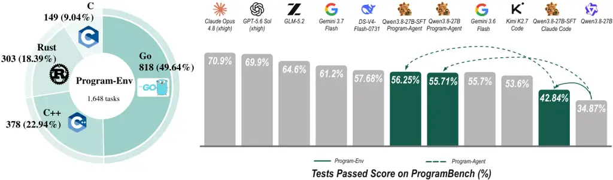
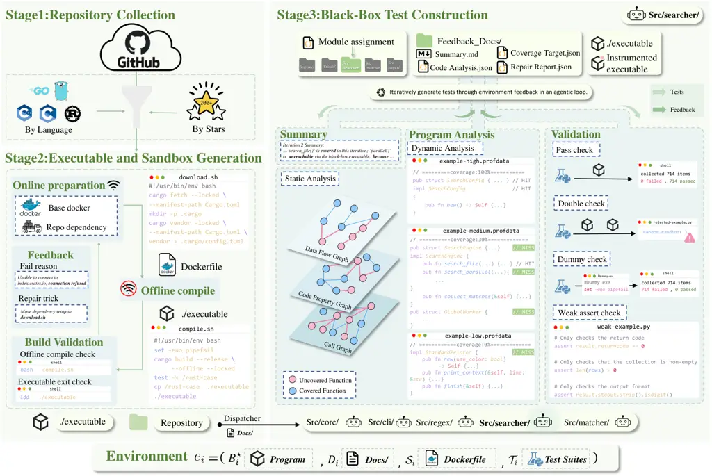
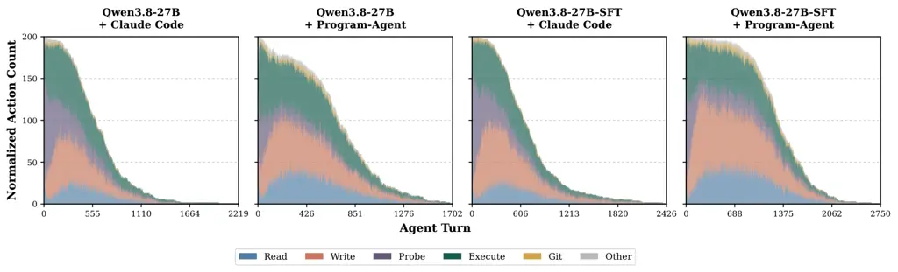
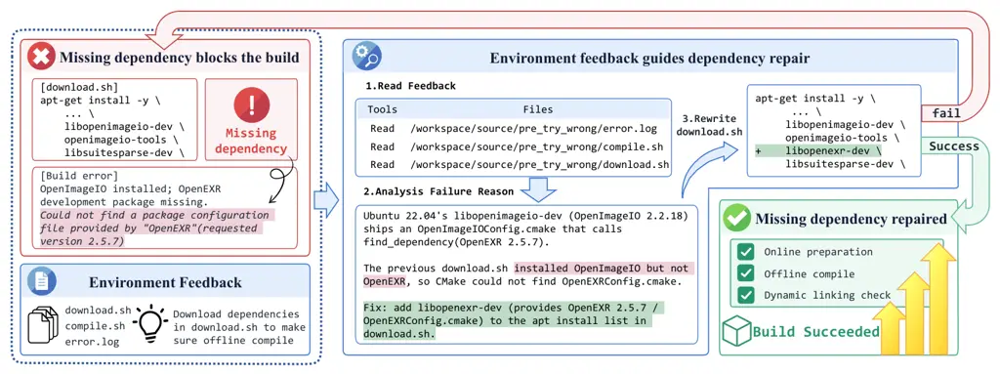
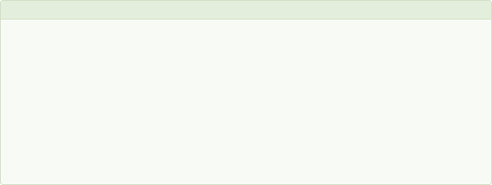
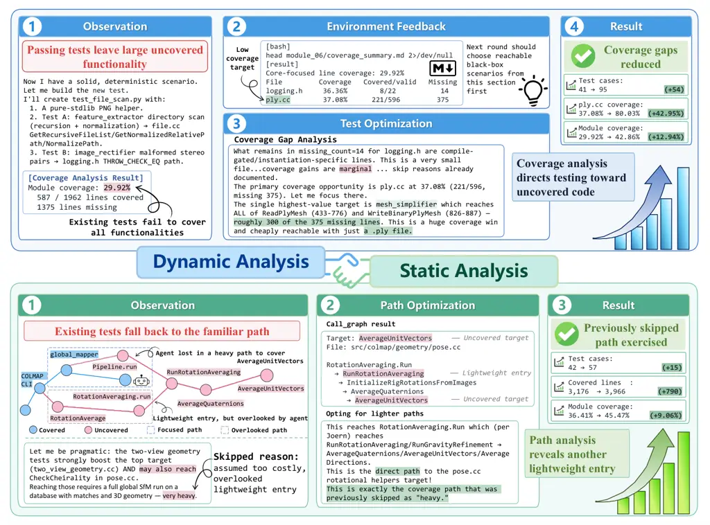
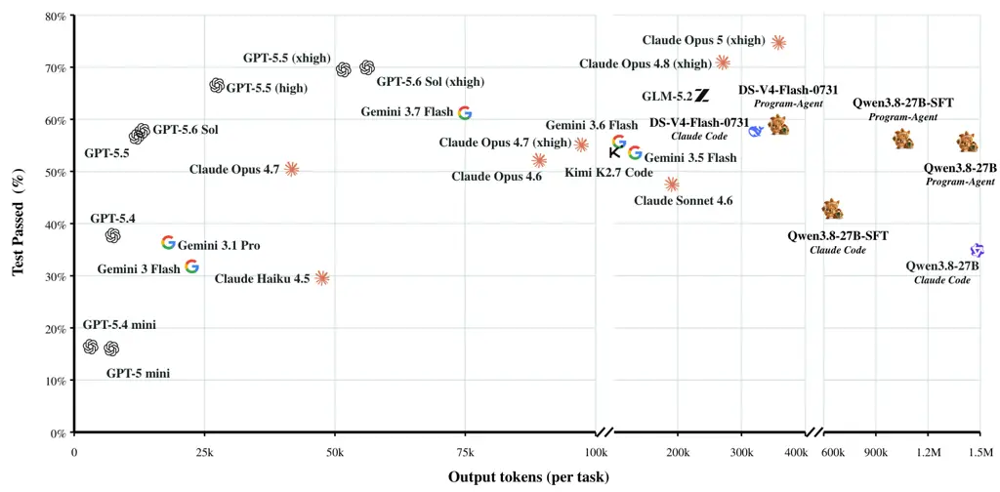
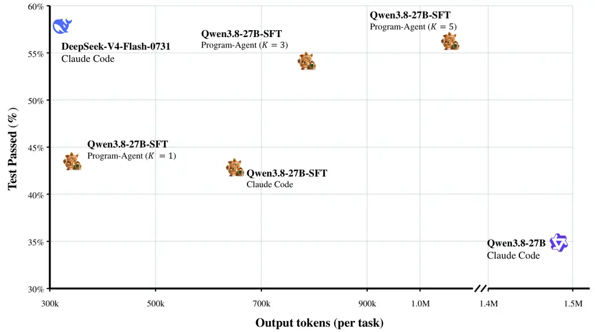

# ![[Uncaptioned image]](arxiv-2610-13395--7d3ca5f38d02.figures/figure-1.webp) ProgramGym: Scaling Training Environments for Long-Horizon Program Reproduction Agents

Chengyi Yang ^(†)^(†)thanks: Equal Contributions. Affiliation: Xiamen
University Email: [yangchengyi@stu.xmu.edu.cn](mailto:)   
Renxu Bao¹¹footnotemark: 1 Affiliation: Xiamen University
Email: [flong@xmu.edu.cn](mailto:)    Jue Hou¹¹footnotemark: 1
Affiliation: Xiamen University Email: [jssu@xmu.edu.cn](mailto:)   
Zongpei Teng Affiliation: Xiamen University    Ziheng Wang
Affiliation: Xiamen University    Yujie Lin Affiliation: Xiamen
University    Chengsong Huang Affiliation: Washington University in St.
Louis    Junnan Zhu Affiliation: Institute of Automation, Chinese
Academy of Sciences    Delai Qiu Affiliation: Unisound    Yining Wang
Affiliation: Unisound    Shengping Liu Affiliation: Unisound    Fei Long
^(†)^(†)thanks: Corresponding authors. Affiliation: Xiamen University   
Jinsong Su²²footnotemark: 2 Affiliation: Xiamen University

###### Abstract

Coding agents are increasingly used to build programs from scratch as
software engineers do rather than to resolve issues within a repository
or to generate a repository from a given requirements document. However,
scalable verifiable training environments that force agents to discover
what is required and to decide how the system should be designed remain
scarce. Moreover, existing agent workflows also cannot sustain
long-horizon development in which the agent explores the reference
program before implementation. To address these challenges, we introduce
ProgramGym, a framework consisting of Program-Env and Program-Agent for
scalable training environments of long-horizon program reproduction
agents. Specifically, Program-Env constructs verifiable training
environments from repositories through a feedback-driven loop that
repairs runtime sandbox builds and the quality of black-box tests. Using
this novel pipeline, we obtain $`1{,}648`$ training environments
spanning C, C++, Go, and Rust. Program-Agent combines a role-isolated
workflow of analysis, implementation, and review with revision
management for compilation checks and failure recovery. Experiments on
ProgramBench show that both Program-Env and Program-Agent improve
performance on program reproduction. Fine-tuning on trajectories with
these constructed environments raises the performance of Qwen3.8-27B
from $`34.87\%`$ to $`42.84\%`$. Program-Agent further raises the base
and SFT models to $`55.71\%`$ and $`56.25\%`$, both exceeding some
flagship models. We will release the ProgramGym to support further
research on coding agents that build programs from scratch.

|     |
| --- |
|     |

 [huggingface.co/ProgramGym](https://huggingface.co/ProgramGym)  ![[Uncaptioned
image]](arxiv-2610-13395--7d3ca5f38d02.figures/figure-2.webp) [programgym.github.io/](https://programgym.github.io/)



Figure 1: Overview of ProgramGym.

## 1 Introduction

Current coding agents (Qwen Team, 2026; Team et al., 2026; Zeng et al.,
2026a) typically handle issue-resolution tasks and repository generation
tasks. Issue-resolution tasks such as SWE-bench give a repository and an
issue for the agent to patch (Jimenez et al., 2024; Rashid et al., 2025;
Zeng et al., 2026b; Shi et al., 2026). Repository generation tasks such
as NL2Repo-Bench give a requirements document for the agent to
implement (Ding et al., 2025). In both settings, the agent starts from a
given codebase or a specified feature. A software engineer building a
program from scratch instead keeps asking what is required and how the
system should be designed.

To explore this from-scratch setting, program reproduction tasks such as
ProgramBench ask an agent to rebuild a program’s observable behavior
from its usage documentation and a reference program without access to
the source code or network (Yang et al., 2026b; Adamczewski et al.,
2026). The agent needs to still discover remaining behavior by
exploration and design the implementation from scratch. None of the
models in the original ProgramBench evaluation fully solved a task (Yang
et al., 2026b)¹¹ 1 Release-time results; later performance of the
flagship models are at
[https://programbench.com](https://programbench.com).. Training
therefore requires interactive environments with reliable behavioral
supervision, which issue-resolution resources such as SWE-Gym and
SWE-smith do not provide (Pan et al., 2024; Yang et al., 2026a; Song et
al., 2026; Chen et al., 2026a). MindForge (Chen et al., 2026b)is
restricted to command-line programs and still leaves this supervision
unverifiable. Building verifiable environments and using them over long
horizons raises two challenges. (i) Scaling verifiable training
environments. Building the reference executable and runtime sandbox
requires accommodating repository-specific toolchains and dependencies.
The black-box tests need to cover diverse functionality while rejecting
incorrect reproductions, yet a single test-generation attempt may miss
important behaviors or produce weak assertions. (ii) Sustaining
long-horizon development. General-purpose agent harnesses support tool
use but do not by themselves keep exploration and implementation
coordinated. An agent can begin implementing before sufficiently
exploring the reference program and forget previously observed
requirements as its context grows. Addressing these risks requires an
explicit development workflow that preserves behavioral evidence and
coordinates implementation, review, and revision.

To overcome these challenges, we introduce ProgramGym consisting of
Program-Env and Program-Agent for scalable training environments of
long-horizon program reproduction agents. Specifically, Program-Env
addresses environment construction by augmenting an existing agent
harness with feedback-driven loops for runtime sandbox and black-box
test construction. To produce the reference executable and its runtime
sandbox, it separates online dependency preparation from offline
compilation and returns build diagnostics to guide repairs. Test
construction proceeds across functional modules in parallel, using
program analysis to target unexplored behavior and validation feedback.
The resulting environments provide reference executables, runtime
sandboxes, documentation, and black-box behavioral test suites for
training supervision. Program-Agent addresses long-horizon development
through a role-isolated iterative workflow of analysis, implementation,
and review. It first records evidence from reference-program exploration
and then alternates implementation with behavioral review in separate
sessions. Persistent records carry requirements across rounds, while
offline build checks and validated checkpoints support revision and
failure recovery.

Building on these designs, Program-Env scales $`1{,}648`$ training
environments covering C, C++, Go, and Rust. Each environment provides a
reference executable, a runtime sandbox, usage documentation, and
black-box tests, which are essential for training agents on program
reproduction from scratch. We conduct extensive experiments on
ProgramBench. With Program-Agent, Qwen3.8-27B reaches $`55.71\%`$ Tests
Passed and Qwen3.8-27B-SFT reaches $`56.25\%`$, both exceeding flagship
Claude Opus 4.7. We further evaluate DeepSeek-V4-Flash-0731 under the
same protocol. These results suggest that ProgramGym can scale training
environments for coding agents that reproduce programs from scratch as
software engineers do. We will release ProgramGym as a scalable gym for
the community to develop coding agents that discover requirements and
design systems from scratch. In summary, our main contributions are
threefold:

- •
  We propose Program-Env, a feedback-driven pipeline that builds the
  reference executable and runtime sandbox and constructs black-box
  tests from repositories (Section 4).
- •
  We propose Program-Agent, which combines a role-isolated workflow of
  analysis, implementation, and review with revision management for
  compilation checks and failure recovery (Section 5).
- •
  We conduct extensive experiments on ProgramBench and show that
  Program-Env training and Program-Agent both improve program
  reproduction. We further analyze environment construction as well as
  iteration budget and agent behavior (Section 6).

## 2 Related Work

##### Long-Horizon Program Reproduction.

Training large language models as agents has gained substantial
attention (Team et al., 2026; Qwen et al., 2025; Zhu et al., 2024), with
software engineering (SWE) emerging as a promising application
domain (Cao et al., 2026; Singh et al., 2025; Pan et al., 2024). Issue
resolution is a representative setting, in which SWE-bench
tasks (Jimenez et al., 2024) and its variants evaluate coding-agents on
addressing bug fixes or feature requests within a given code base (Yang
et al., 2026a; Shi et al., 2026; Ahmad et al., 2026; Wu et al., 2026; La
et al., 2026; Yang et al., 2024). Despite their growing diversity, issue
resolution tasks depend on a provided code base, while several prior and
concurrent works go further by asking agents to code from scratch
according to a requirements document (Luo et al., 2026; Zhao et al.,
2026b; Zhao et al., 2025; Li et al., 2024). However, this setting
typically relies on a natural-language requirements document that
prescribes the functional specification (Ding et al., 2025), reducing
the task to implementation and leaving no room for requirement discovery
or architectural design. In contrast, recent work on program
reproduction from scratch requires agents to reconstruct the externally
observable behavior of a reference program from a binary executable and
documentation without prescribing implementation structure (Chen et al.,
2026b; Yang et al., 2026b; Adamczewski et al., 2026). This setting
therefore shifts the challenge from implementing a specified repository
to iteratively discovering what the program should do and deciding how
to rebuild it, as experienced software engineers.

##### Code Agent Environments Scaling.

Existing program reproduction from scratch remains highly
challenging (Yang et al., 2026b; Adamczewski et al., 2026). None of the
flagship models in the original ProgramBench evaluation fully resolved
any of the 200 tasks (Yang et al., 2026b). Due to the scarcity of
training environments for such tasks, coding agents tend to be trained
as code-edit assistants that favor localized bug fixes or single-file
implementations with detailed human guidance rather than as autonomous
software engineers (Adamczewski et al., 2026). Providing realistic and
executable training environments at scale is essential. This strategy is
already proven in issue resolution (Song et al., 2026; Zhao et al.,
2026a; Chen et al., 2026a), where generated environments improved
SWE-agent performance (Jain et al., 2025; Pan et al., 2024). These
frameworks still start from an existing codebase or a well-specified
task description. MindForge does not filter training trajectories by
recovered program behavior, so functionally incorrect reproductions can
still be treated as successful supervision (Chen et al., 2026b). By
contrast, ProgramGym makes program reproduction from scratch training
scalable by automatically turning repositories into verifiable training
environments. This increases sample sizes and converts coding agents
from compliant code editors into active software engineers.

## 3 Preliminary

##### Program Reproduction Task.

Software engineering agents are increasingly expected to develop
complete software systems with limited human supervision (Yang et al.,
2026b). Issue-resolution tasks such as SWE-bench, however, start from an
existing codebase and ask the agent to make localized changes (Jimenez
et al., 2024). Program reproduction from scratch removes this
implementation scaffold and poses a more demanding task. Given only a
software program and its documentation, the agent must produce source
code that recovers the program’s functionality while independently
making the software design decisions needed to architect (Yang et al.,
2026b). Training agents on this task requires stable environments that
support behavioral exploration and automatically assess candidate
implementations. Let $`P_{i}`$ denote a source-available codebase drawn
from a repository. We define an environment-construction pipeline
$`\Phi`$ as:

```math
e_{i}=\Phi(P_{i})=(B_{i}^{\star},D_{i},\mathcal{T}_{i},\mathcal{S}_{i}),\qquad\mathcal{E}=\{e_{i}\}_{i=1}^{N}. \tag{1}
```

Here, $`\mathcal{E}`$ denotes the collection of $`N`$
program-reproduction environments constructed by $`\Phi`$. Each
environment $`e_{i}`$ comprises an execute-only reference program
$`B_{i}^{\star}`$ built from $`P_{i}`$, its usage documentation
$`D_{i}`$, a black-box behavioral test suite $`\mathcal{T}_{i}`$, and a
network-isolated runtime sandbox $`\mathcal{S}_{i}`$ in which the task
agent operates. The agent can use any compiled language (e.g., C/C++,
Golang, Rust, Java) and must provide source code and a compile script
that produces a candidate executable program $`\widehat{B}_{i}`$. The
test suite $`\mathcal{T}_{i}`$ compares the externally observable
behavior of $`\widehat{B}_{i}`$ and $`B_{i}^{\star}`$ on selected
inputs, and its outcomes form the basis for behavior-grounded feedback
during training. Because $`\mathcal{T}_{i}`$ covers only finitely many
inputs, passing it establishes agreement on the tested behaviors rather
than complete semantic equivalence (Yang et al., 2026b). Scaling this
construction across diverse repositories poses two challenges: (i)
reliably building reference programs with a unified pipeline despite
variation in implementation languages, dependencies, and build
procedures; and (ii) synthesizing finite black-box test suites with
sufficient behavioral coverage and distinguishing faithful reproductions
from incorrect ones.

## 4 Program-Env



Figure 2: Overview of the Program-Env. Stage 1 collects repositories
from GitHub by language and stars. Stage 2 builds the gold executable
$`B_{i}^{\star}`$ and runtime sandbox $`\mathcal{S}_{i}`$. Bridging the
two stages, the dispatcher extracts documentation $`D_{i}`$ and splits
the source into modules. In Stage 3, each module is assigned to a
subagent that iteratively writes the test suite $`\mathcal{T}_{i}`$
under feedback.

Constructing program-reproduction environments at scale requires
reliable executable rebuild from diverse repositories and comprehensive
black-box behavioral tests that broadly capture program functionality.
To overcome these challenges, we introduce Program-Env, which uses
general harnesses such as Claude Code and Codex and adds feedback loops
to guide the overall process of build repair and test refinement. As
illustrated in Figure 2, Program-Env first collects candidate
repositories $`\{P_{i}\}_{i=1}^{M}`$ (Section 4.1) and then constructs
each retained environment $`e_{i}`$ by building the reference executable
and runtime sandbox (Section 4.2) and generating black-box tests
(Section 4.3).

### 4.1 Repository Collection

To construct a diverse candidate pool of repositories for our program
reproduction gym, Program-Env collects repositories through a stratified
search process using the GitHub Search API. Specifically, we partition
search queries by programming language and star-count buckets, while
excluding archived and forked repositories. We further validate
repository metadata, remove duplicate entries, and retain those with
valid licensing metadata. Repositories already used by existing
code-related benchmarks are also excluded. Each retained repository is
anchored to a fixed commit and screened for explicit build-configuration
evidence. This process yields $`M{=}30{,}459`$ candidate repositories
$`\{P_{i}\}_{i=1}^{M}`$. More details are provided in Appendix B.1.

### 4.2 Executable and Sandbox Generation

Program reproduction from scratch requires a prepared runtime sandbox
with the necessary toolchains and dependencies so that the agent can
focus on rebuilding program functionality. To accommodate differences
across repositories, Program-Env pipeline $`\Phi`$ uses Claude Code as
the underlying agent harness and adds an outer loop that validates each
proposed build procedure and provides the diagnostics feedback for
revision. For each repository $`P_{i}`$ with a standalone executable
target, the agent generates download.sh for online dependency
preparation and compile.sh for offline compilation. The overall loop
proceeds to the next stage only if both scripts succeed and ./executable
passes a loadability check. Otherwise, failure diagnostics are returned
to the agent for revision. The validated executable serves as
$`B_{i}^{\star}`$, and the prepared image provides the basis for the
runtime sandbox $`\mathcal{S}_{i}`$. Further details are provided in
Appendix B.2.

Finally, once the build validation succeeds, the dispatcher prepares the
resources for black-box test construction. It uses codebase size to
determine the number of parallel branches and assigns each branch a
functional module. Alongside module assignment, it instruments the
executable for coverage measurement and prepares the test runtime. It
also extracts repository documentation such as README.md to form
$`D_{i}`$. These preparation steps run in parallel as detailed in
Appendix B.3.

### 4.3 Black-Box Tests Construction

Reliable verification is essential for effective supervision in agent
training. For program reproduction tasks, a black-box test suite
$`\mathcal{T}_{i}`$ provides this supervision by comparing
$`\hat{B}_{i}`$ against $`B_{i}^{\star}`$ on shared inputs. However,
tests generated in a single attempt may cover too few behaviors or use
assertions that fail to detect incorrect implementations. Program-Env
therefore uses structured feedback to guide the agent in iteratively
expanding test coverage and strengthening assertions.

Following the dispatcher’s module assignments, test construction
proceeds in parallel across branches. Each branch runs the Claude Code
harness inside an outer loop that validates each delivered suite and
returns diagnostics for revision. After each round, the pipeline
organizes the feedback into three components, stored as structured
documents in Feedback*Docs/. (i) Summary records what was done and what
remains unsolved and why, preserving context across rounds. (ii) Program
analysis locates uncovered functionality with dynamic analysis and
traces it to public entry points with static analysis. (iii) Validation
screens tests through four checks: the pass check identifies tests that
fail on $`B*{i}^{\star}`$; the double check detects inconsistent
outcomes across repeated runs; the dummy check identifies tests that
accept a dummy implementation; and the weak-assert check flags
insufficient assertions. These checks help identify invalid, unstable,
or insufficiently discriminative tests. In the next round, the agent
reads these processed documents to repair flagged tests before extending
coverage to unexplored targets. A subagent terminates once its module
reaches the functionality coverage threshold or the round limit. Once
all branches terminate, their suites are merged and validated again, and
$`\mathcal{T}\_{i}`$ retains only the tests that pass all checks. Further
details are provided in Appendix B.4.

## 5 Program-Agent

In long-horizon program reproduction, single-session workflows may lose
early behavioral evidence due to context compression and consequently
produce a program that fails to compile (Anthropic, 2025; Hao et al.,
2026; Feng et al., 2026). Inspired by the iterative workflow of software
engineers, we propose Program-Agent built on Claude Code to support
systematic development in long-horizon program reproduction. As
illustrated in Figure 3, it combines an iterative role-isolated workflow
(Section 5.1) with a revision management mechanism (Section 5.2) for
compilation validation and failure recovery.

Figure 3: Overview of Program-Agent. The Analysis stage explores the
usage documentation and reference program to identify behavioral
requirements. The Implement and Review stages then alternate to refine
the candidate implementation for a fixed loop budget. Handoff carries
behavioral evidence and delivery reports across isolated sessions,
Workspace maintains the evolving implementation, and Revisions preserves
independently buildable source code for validation and recovery.

### 5.1 Role-Isolated Iterative Workflow

Program-Agent adopts a role-isolated and session-separated iterative
paradigm. It decouples program reproduction into two logical roles
(analyst and implementer) and three stages: Analysis, Implement, and
Review. Each stage executes in an independent session to eliminate
cross-stage memory contamination. Handoff artifacts carry behavioral
evidence and stage reports across sessions without transferring the full
conversation history.

##### Analysis Stage.

The analyst reads the documentation and explores the reference program,
without editing Workspace, guaranteeing unbiased constraint collection.
All extracted behavioral evidence and implementation guidelines are
stored in analysis-initial/analysis.md and frozen as read-only reference
for all downstream stages.

##### Implement Stage.

The implementer develops candidate programs in an isolated session based
on frozen Handoff artifacts without accessing the reference program, to
avoid context noise. The first iteration delivers a buildable baseline
to avoid fundamental compilation failures, while subsequent rounds
incrementally resolve verified review issues. All implementation
progress and code changes are documented in implementation-k/delivery.md
for explicit traceability.

##### Review Stage.

The analyst compares the official reference program with the newly
built, immutable candidate program, and converts all verified behavioral
discrepancies into actionable revision requirements recorded in
review-k/review.md. Strict read-only access is enforced on both the
candidate program and the Workspace to prevent self-justifying
modifications.

##### Iteration budget.

Given a fixed budget of $`K`$ implementation rounds, Program-Agent
executes one standardized Analysis stage followed by alternating
Implement and Review iterations. This explicit iteration budget resolves
two common issues in single-session workflows: premature termination
with incomplete implementations, and unbounded low-value exploration
that destabilizes long-horizon reproduction.

### 5.2 Revision Management

Across multiple Implement rounds, the shared Workspace can accumulate
error edits until compile.sh no longer produces an executable.
Program-Agent therefore treats independent compilation as the gate for
each implementation round. It exports a clean snapshot of the committed
source and compiles that snapshot outside the development workspace. A
snapshot that produces an executable is archived in Revisions and
forwarded to the next Review. Moreover, a stage that times out or misses
required artifacts or fails this compilation is retried in a fresh
session within a bounded budget. If the retry still fails, the
implementation rolls back to the last validated revision. A successful
revision becomes the recovery checkpoint for later rounds. This keeps
progress stable across multi-stage reproduction. More details are
provided in Appendix C.

## 6 Experiments and Analysis

This section presents an evaluation of ProgramGym. Our experiments are
designed to answer the following four research questions. RQ1
(Effectiveness of ProgramGym) Does training on Program-Env and solving
with Program-Agent improve program reproduction task? RQ2 (Training
Environments Analysis) What scale and construction dynamics characterize
the environments produced by Program-Env? RQ3 (Test-Time Scaling) Does
additional Program-Agent iteration budget improve Tests Passed? RQ4
(Agent Behavior Analysis) How does ProgramGym influence agent behavior
on program reproduction tasks?

### 6.1 Experimental Settings

##### Environment Statistic.

Program-Env constructs 1,648 training environments spanning C, C++, Go,
and Rust, using DeepSeek-V4-Flash-0731 (DeepSeek-AI, 2026) as the
underlying model. Figure 4 shows that the repositories fall into eight
functional categories and that developer tools and CLI & system
utilities are the two largest. Test construction uses 5,918 subagents
across these repositories. Table 6.1 reports six black-box interaction
categories. We then collect trajectories for subsequent training by
rejection sampling DeepSeek-V4-Flash-0731 (DeepSeek-AI, 2026) with
Claude Code and filtering on test-case pass rate.

Figure 4: Distribution of the 1,648 repositories across eight functional
categories.

| Tests Category | \# Subagents | % Percentage |
| -------------- | ------------ | ------------ |
| Arguments      | 4,901        | 82.82%       |
| Configuration  | 2,388        | 40.35%       |
| Help           | 4,070        | 68.77%       |
| I/O            | 5,873        | 99.24%       |
| Subcommands    | 1,305        | 22.05%       |
| TUI            | 716          | 12.10%       |

Table 1: Distribution of the black-box interaction categories over 5,918
subagents from 1,648 repositories.

##### Agent Scaffolds.

To support interactive program reproduction from scratch, we use Claude
Code rather than mini-SWE-agent as the single-session baseline. The task
is long-horizon and often exceeds a $`256`$K maximum context window.
Claude Code compresses context so the agent can continue, following the
ProgramBench protocol of GLM-5.2 (GLM-5-Team et al., 2026). We compare
it with Program-Agent using the same container resource limits.
Program-Agent runs for up to $`K{=}5`$ iterations. Each task runs in an
isolated container with 8 CPU cores, 16 GB of RAM, and 30 GB of storage,
under an 8-hour wall-clock limit.

##### Models and Training Details.

We fine-tuned Qwen3.8-27B (Qwen Team, 2026) on the collected
trajectories with the ms-swift framework (Zhao et al., 2024) and obtain
Qwen3.8-27B-SFT. We evaluate both checkpoints on ProgramBench and use
DeepSeek-V4-Flash-0731 (DS-V4-Flash-0731) (DeepSeek-AI, 2026) to further
assess our proposed Program-Agent across model backbones. More details
are provided in Appendix D.1.

##### Evaluation Metrics.

We follow the evaluation metrics of ProgramBench (Yang et al., 2026b). %
Tests Passed is the macro-average of per-task test pass rates. % Almost
Resolved is the percentage of tasks with at least $`95\%`$ of tests
passing. % Resolved is the percentage of tasks that pass all tests
without a cheating flag.

### 6.2 Effectiveness of ProgramGym (RQ1)

To verify the effectiveness of our proposed ProgramGym, we evaluate
DS-V4-Flash-0731, Qwen3.8-27B, and Qwen3.8-27B-SFT on ProgramBench and
compare them with frontier models that use mini-SWE-agent (Table 2).

|                                            |                 |                   |            |                   |            |                   |            |
| ------------------------------------------ | --------------- | ----------------- | ---------- | ----------------- | ---------- | ----------------- | ---------- |
| Models                                     | Agent Scaffolds | Tests Passed      |            | Almost Resolved   |            | Resolved          |            |
|                                            |                 | (%, $`\uparrow`$) | $`\Delta`$ | (%, $`\uparrow`$) | $`\Delta`$ | (%, $`\uparrow`$) | $`\Delta`$ |
| Flagship Models (Yang et al., 2026b)       |                 |                   |            |                   |            |                   |            |
| GPT 5 mini                                 | mini-SWE-agent  | 16.00             | –          | 0.00              | –          | 0.00              | –          |
| GPT 5.4 mini                               | mini-SWE-agent  | 16.40             | –          | 0.00              | –          | 0.00              | –          |
| Claude Haiku 4.5                           | mini-SWE-agent  | 30.00             | –          | 0.00              | –          | 0.00              | –          |
| Gemini 3 Flash                             | mini-SWE-agent  | 31.80             | –          | 0.00              | –          | 0.00              | –          |
| Gemini 3.1 Pro                             | mini-SWE-agent  | 36.40             | –          | 0.00              | –          | 0.00              | –          |
| GPT 5.4                                    | mini-SWE-agent  | 37.70             | –          | 0.00              | –          | 0.00              | –          |
| Claude Sonnet 4.6                          | mini-SWE-agent  | 47.50             | –          | 1.00              | –          | 0.00              | –          |
| Claude Opus 4.7                            | mini-SWE-agent  | 50.90             | –          | 3.00              | –          | 0.00              | –          |
| Claude Opus 4.6                            | mini-SWE-agent  | 52.10             | –          | 2.50              | –          | 0.00              | –          |
| Gemini 3.5 Flash                           | mini-SWE-agent  | 53.60             | –          | 3.00              | –          | 0.00              | –          |
| Claude Opus 4.7 (xhigh)                    | mini-SWE-agent  | 55.10             | –          | 4.50              | –          | 0.00              | –          |
| DeepSeek-V4-Flash-0731 (DeepSeek-AI, 2026) |                 |                   |            |                   |            |                   |            |
| DS-V4-Flash-0731                           | Claude Code     | 57.68             | –          | 4.50              | –          | 0.00              | –          |
| DS-V4-Flash-0731                           | Program-Agent   | 58.97             | 1.29       | 5.0               | 0.5        | 0.00              | 0.00       |
| Qwen3.8-27B (Qwen Team, 2026)              |                 |                   |            |                   |            |                   |            |
| Qwen3.8-27B                                | Claude Code     | 34.87             | –          | 3.50              | –          | 0.50              | –          |
| Qwen3.8-27B                                | Program-Agent   | 55.71             | 20.84      | 5.50              | 2.00       | 0.50              | 0.00       |
| Qwen3.8-27B-SFT                            | Claude Code     | 42.84             | 7.97       | 1.50              | -2.00      | 0.00              | -0.50      |
| Qwen3.8-27B-SFT                            | Program-Agent   | 56.25             | 21.38      | 4.50              | 1.0        | 0.50              | 0.00       |

Table 2: Results on ProgramBench across models and agent scaffolds.
Program-Agent uses $`K{=}5`$ implementation rounds. $`\Delta`$ is
relative to the base model with Claude Code.

Program-Env scales verifiable environments for program reproduction from
scratch. Holding Claude Code fixed keeps the agent scaffold unchanged
and varies only whether the model was trained on Program-Env
trajectories. On ProgramBench, Qwen3.8-27B-SFT reaches 42.84% Tests
Passed against 34.87% for Qwen3.8-27B ($`\Delta{=}+7.97`$) and narrows
the gap to DS-V4-Flash-0731 under the same agent scaffold (57.68%). The
Qwen3.8-27B-SFT also exceeds the flagship GPT 5.4 result (37.70%) under
mini-SWE-agent. These results indicate that Program-Env’s runtime
sandboxes and black-box tests provide reliable behavioral supervision
for training on program reproduction tasks.

Program-Agent expands a model’s capability boundary for long-horizon
program reproduction tasks. Holding the model fixed keeps the weights
unchanged and varies only the agent scaffold. Program-Agent raises
Qwen3.8-27B from 34.87% to 55.71% Tests Passed and Qwen3.8-27B-SFT from
42.84% to 56.25% relative to Claude Code. Each run exceeds Claude Opus
4.7 (50.90%) and Gemini 3.5 Flash (53.60%) under mini-SWE-agent. These
results indicate that the software-engineer workflow recovers more
program behavior from the same model than a single-session scaffold.

Fully reproducing a program remains hard. Tests Passed can exceed 50%
while Almost Resolved and Resolved stay near zero. Flagship models under
mini-SWE-agent remain at 0.00% Resolved, and after SFT Almost Resolved
falls from 3.50% to 1.50% under Claude Code. These results indicate that
whole-program reproduction from scratch is still unsolved.

### 6.3 Training Environments Analysis (RQ2)

Program-Env comprises 1,648 tasks built from open-source repositories
spanning eight functional categories (Figure 4), at a total cost of
136.77B tokens (Figure 17a). The environments cover four languages, C,
C++, Go, and Rust, and range from small utilities to large, complex
projects (Figure 5).

To make verification reliable, the feedback loop iteratively expands
coverage and refines the test suite, yielding a mean coverage of 72.99%
(median 81.63%) and 665,512 validated test cases in total
(Figure 17b,c), so the suites capture most of each repository’s
functionality. Figure 5 illustrates both points at the repository level.
(i) Coverage clusters tightly near 80% with a long lower tail, where the
low-coverage repositories are those whose code is only partially
reachable through the black-box interface, which does not affect the
validity of $`\mathcal{T}_{i}`$. (ii) Test suite sizes are concentrated
around each language’s mean, with an overall mean of 404 cases per
repository. Program-Env thus provides a reliable, diverse, and scalable
training environment for program reproduction from scratch. Further
descriptive statistics are given in Appendix B.5.

Figure 5: Distributions of code lines, coverage, and test cases in
Program-Env.

### 6.4 Test-Time Scaling (RQ3)

Program-Agent can scale performance with extra iteration budget. We
evaluate Qwen3.8-27B-SFT with Program-Agent under iteration budgets
(Figure 6). Tests Passed rises from 43.49% at $`K{=}1`$ to 54.13% at
$`K{=}3`$ and 56.25% at $`K{=}5`$. Five iterations are comparable to
DS-V4-Flash-0731 (57.68%). Most of the gain arrives by $`K{=}3`$. These
results indicate that Program-Agent keeps recovering program behavior as
the iteration budget grows. Extra analysis about costs is given in
Appendix D.2.

Figure 6: Tests Passed of Qwen3.8-27B-SFT with Program-Agent across
different iteration budgets on ProgramBench.



Figure 7: Distribution of action types over agent turns. Each task
contributes a total weight of one per turn, divided evenly among its
tool calls and aggregated by action type. Bar heights decay with turn
index because trajectories end at different lengths.

### 6.5 Agent Behavior Analysis (RQ4)

ProgramGym changes agent behavior mainly through Program-Agent. We
compare action types of Qwen3.8-27B and Qwen3.8-27B-SFT under Claude
Code and Program-Agent (Figure 7). Both models use mainly execute and
probe under Claude Code. Program-Agent increases read and git, most
after Program-Env training. These results indicate that Program-Agent
reshapes the agent toward exploration and revision. Further analysis is
given in Appendix D.3.

## 7 Conclusion

In this paper, we propose ProgramGym for training agents on long-horizon
program reproduction from scratch. Program-Env is a feedback-driven
pipeline that builds the reference executable and runtime sandbox and
constructs black-box tests from repositories and yields $`1{,}648`$
training environments in C, C++, Go, and Rust. Program-Agent combines a
role-isolated workflow of analysis, implementation, and review with
revision management for compilation checks and failure recovery.
Fine-tuning on trajectories with these constructed environments raises
Qwen3.8-27B from $`34.87\%`$ to $`42.84\%`$ on ProgramBench.
Program-Agent further raises the base and SFT models to $`55.71\%`$ and
$`56.25\%`$, both exceeding some flagship models. Extra Program-Agent
iterations continue to recover program behavior and Program-Agent rather
than SFT alone reshapes the agent toward exploration and revision. We
will release ProgramGym as a scalable gym for the community to develop
coding agents that discover requirements and design systems from
scratch.

### AI use statement

In this work, we used generative AI tools to implement methods in our
experiments. Program-Env and Program-Agent use agent harnesses such as
Claude Code to construct environments, generate tests, and collect
trajectories, as described in Sections 4.2 and 4.3. Additionally, we
used generative AI tools to edit the paper to improve readability. We
reviewed all AI-assisted edits. We take responsibility for the final
content of this work, including text, claims, and artifacts produced
with the aid of generative AI.

### Reproducibility statement

We document the materials needed to reconstruct ProgramGym. Repository
collection, commit locking, and filtering strategies are specified in
Section 4.1 and Appendix B.1. Executable and sandbox construction,
including online preparation, offline compilation, and build-stage
validation, are described in Section 4.2 and Appendix B.2. Dispatcher
modules, coverage instrumentation, and test-generation sandboxes appear
in Appendix B.3. Black-box test construction, the four validation
checks, and the feedback loop are given in Section 4.3 and Appendix B.4.
Program-Agent’s role-isolated workflow, isolation rules, and recovery
checks are described in Section 5.1 and Appendix C. Training
hyperparameters are listed in Appendix D.1. Evaluation uses ProgramBench
with the metrics and container limits in the experimental settings. We
will release ProgramGym, including environments, construction code, and
training artifacts, to support reproduction.

## References

- Adamczewski et al. (2026) T. Adamczewski, D. Owen, D. Rein, F.
  Brand, G. Edkins, A. Hart, and D. O’Connell MirrorCode: ai can rebuild
  entire programs from behavior alone. arXiv preprint arXiv:2606.30182.
  Cited by: §1, §2, §2.
- Ahmad et al. (2026) W. U. Ahmad, N. Ludwig, S. Majumdar, and B.
  Ginsburg Open-swe-traces: advancing dual-mode multilingual
  distillation for software engineering agents. arXiv preprint
  arXiv:2606.16038. Cited by: §2.
- Anthropic (2025) AnthropicEffective context engineering for ai
  agents(Website) External Links:
  [Link](https://www.anthropic.com/engineering/effective-context-engineering-for-ai-agents)
  Cited by: §5.
- Cao et al. (2026) R. Cao, M. Chen, J. Chen, Z. Cui, Y. Feng, B.
  Hui, Y. Jing, K. Li, M. Li, J. Lin, et al. Qwen3-coder-next technical
  report. arXiv preprint arXiv:2603.00729. Cited by: §2.
- Chen et al. (2026a) M. Chen, L. Zhang, Y. Feng, X. Wang, W. Zhao, R.
  Cao, J. Yang, J. Chen, M. Li, Z. Ma, et al. Swe-universe: scale
  real-world verifiable environments to millions. arXiv preprint
  arXiv:2602.02361. Cited by: §1, §2.
- Chen et al. (2026b) Y. Chen, S. Chang, K. Chawa, F. Lin, B. Chen, S.
  Wang, and A. E. Hassan MindForge: teaching small language models
  whole-life-cycle software engineering via source-free program
  synthesis. External Links: 2607.27146,
  [Link](https://arxiv.org/abs/2607.27146) Cited by: Appendix A, §1, §2,
  §2.
- DeepSeek-AI (2026) DeepSeek-AI DeepSeek-v4: towards highly efficient
  million-token context intelligence. Cited by: §6.1, §6.1, Table 2.
- Ding et al. (2025) J. Ding, S. Long, C. Pu, H. Zhou, H. Gao, X.
  Gao, C. He, Y. Hou, F. Hu, Z. Li, et al. Nl2repo-bench: towards
  long-horizon repository generation evaluation of coding agents. arXiv
  preprint arXiv:2512.12730. Cited by: §1, §2.
- Feng et al. (2026) Y. Feng, J. Sun, Z. Yang, J. Ai, C. Li, Z. Li, F.
  Zhang, K. He, R. Ma, J. Lin, et al. Longcli-bench: a preliminary
  benchmark and study for long-horizon agentic programming in
  command-line interfaces. In Findings of the Association for
  Computational Linguistics: ACL 2026, pp. 29952–29963. Cited by: §5.
- GLM-5-Team et al. (2026) GLM-5-Team, :, A. Zeng, X. Lv, Z. Hou, and Z.
  et al. GLM-5: from vibe coding to agentic engineering. External Links:
  2602.15763, [Link](https://arxiv.org/abs/2602.15763) Cited by: §6.1.
- Hao et al. (2026) X. Hao, H. Meng, X. Yin, J. Zhu, and C. Cao Self-gc:
  self-governing context for long-horizon llm agents. arXiv preprint
  arXiv:2607.00692. Cited by: §5.
- Harbor Framework Team (2026) Harbor: A framework for evaluating and
  optimizing agents and models in container environments External Links:
  [Document](https://dx.doi.org/10.5281/zenodo.20953922),
  [Link](https://doi.org/10.5281/zenodo.20953922) Cited by: §C.2.
- Jain et al. (2025) N. Jain, J. Singh, M. Shetty, L. Zheng, K. Sen,
  and I. Stoica R2e-gym: procedural environments and hybrid verifiers
  for scaling open-weights swe agents. arXiv preprint arXiv:2504.07164.
  Cited by: §2.
- Jimenez et al. (2024) C. E. Jimenez, J. Yang, A. Wettig, S. Yao, K.
  Pei, O. Press, and K. Narasimhan Swe-bench: can language models
  resolve real-world github issues?. In International Conference on
  Learning Representations, Vol. 2024, pp. 54107–54157. Cited by: §1,
  §2, §3.
- La et al. (2026) B. La, S. Chang, B. Kim, J. Bae, A. A. Beg, S.
  Chang, G. Gonzalez-Pumariega, and K. Goyal GameEngineBench: evaluating
  coding agents on real c++ runtime environments. arXiv preprint
  arXiv:2607.03525. Cited by: §2.
- Li et al. (2024) J. Li, G. Li, Y. Zhao, Y. Li, H. Liu, H. Zhu, L.
  Wang, K. Liu, Z. Fang, L. Wang, et al. Deveval: a manually-annotated
  code generation benchmark aligned with real-world code repositories.
  In Findings of the Association for Computational Linguistics: ACL
  2024, pp. 3603–3614. Cited by: §2.
- Luo et al. (2026) T. Luo, R. Wang, J. Bi, C. Xu, Z. Tang, J. Chen, J.
  Liang, K. Ji, S. Guo, Y. Du, et al. GameCraft-bench: can agents build
  playable games end-to-end in a real game engine?. arXiv preprint
  arXiv:2606.17861. Cited by: §2.
- Pan et al. (2024) J. Pan, X. Wang, G. Neubig, N. Jaitly, H. Ji, A.
  Suhr, and Y. Zhang Training software engineering agents and verifiers
  with swe-gym. arXiv preprint arXiv:2412.21139. Cited by: §1, §2, §2.
- Qwen et al. (2025) Qwen, :, A. Yang, B. Yang, B. Zhang, B. Hui, B.
  Zheng, B. Yu, C. Li, D. Liu, F. Huang, H. Wei, H. Lin, J. Yang, J.
  Tu, J. Zhang, J. Yang, J. Yang, J. Zhou, J. Lin, K. Dang, K. Lu, K.
  Bao, K. Yang, L. Yu, M. Li, M. Xue, P. Zhang, Q. Zhu, R. Men, R.
  Lin, T. Li, T. Tang, T. Xia, X. Ren, X. Ren, Y. Fan, Y. Su, Y.
  Zhang, Y. Wan, Y. Liu, Z. Cui, Z. Zhang, and Z. Qiu Qwen2.5 technical
  report. External Links: 2412.15115,
  [Link](https://arxiv.org/abs/2412.15115) Cited by: §2.
- Qwen Team (2026) Qwen Team Qwen3.8-Max: a new bar for coding and
  cowork. External Links: [Link](https://qwen.ai/blog?id=qwen3.8) Cited
  by: §1, §6.1, Table 2.
- Rashid et al. (2025) M. S. Rashid, C. Bock, Y. Zhuang, A. Buchholz, T.
  Esler, S. Valentin, L. Franceschi, M. Wistuba, P. T. Sivaprasad, W. J.
  Kim, et al. Swe-polybench: a multi-language benchmark for repository
  level evaluation of coding agents. arXiv preprint arXiv:2504.08703.
  Cited by: §1.
- Shi et al. (2026) Y. Shi, J. Xu, K. Fu, W. Zeng, S. He, L. Zhang, Y.
  Liu, Z. Zhao, T. Y. Zhuo, J. Cao, S. Ye, T. Liu, K. Cai, S. Cheung,
  and X. Gu SWE-bench promax: benchmarking agents on large-scale
  multilingual code refactoring. External Links: 2608.09802,
  [Link](https://arxiv.org/abs/2608.09802) Cited by: §1, §2.
- Singh et al. (2025) A. Singh, A. Fry, A. Perelman, A. Tart, A.
  Ganesh, A. El-Kishky, A. McLaughlin, A. Low, A. Ostrow, A. Ananthram,
  et al. Openai gpt-5 system card. arXiv preprint arXiv:2601.03267.
  Cited by: §2.
- Song et al. (2026) H. Song, L. Huang, S. Sun, J. Jiang, R. Le, D.
  Cheng, G. Chen, Y. Hu, Z. Chen, Y. Jia, et al. Swe-master: unleashing
  the potential of software engineering agents via post-training. arXiv
  preprint arXiv:2602.03411. Cited by: §1, §2.
- Team et al. (2026) K. Team, T. Bai, Y. Bai, Y. Bao, J. Cai, X. Cai, P.
  Cao, Y. Cao, Z. Chai, Y. Charles, et al. Kimi k3: open frontier
  intelligence. arXiv preprint arXiv:2607.24653. Cited by: §1, §2.
- Wu et al. (2026) Y. Wu, Z. Zhao, S. Li, H. H. Lee, J. Zhu, S. Wu, T.
  Yu, S. Li, L. Zhang, X. Fan, et al. SWE-together: evaluating coding
  agents in interactive user sessions. arXiv preprint arXiv:2606.29957.
  Cited by: §2.
- Yamaguchi et al. (2014) F. Yamaguchi, N. Golde, D. Arp, and K. Rieck
  Modeling and discovering vulnerabilities with code property graphs. In
  2014 IEEE symposium on security and privacy, pp. 590–604. Cited by:
  §B.4.2.
- Yang et al. (2024) J. Yang, C. E. Jimenez, A. L. Zhang, K. Lieret, J.
  Yang, X. Wu, O. Press, N. Muennighoff, G. Synnaeve, K. R. Narasimhan,
  et al. Swe-bench multimodal: do ai systems generalize to visual
  software domains?. arXiv preprint arXiv:2410.03859. Cited by: §2.
- Yang et al. (2026a) J. Yang, K. Lieret, C. Jimenez, A. Wettig, K.
  Khandpur, Y. Zhang, B. Hui, O. Press, L. Schmidt, and D. Yang
  Swe-smith: scaling data for software engineering agents. Advances in
  Neural Information Processing Systems 38. Cited by: §1, §2.
- Yang et al. (2026b) J. Yang, K. Lieret, J. Ma, P. Thakkar, D.
  Pedchenko, S. Sootla, E. McMilin, P. Yin, R. Hou, G. Synnaeve, et al.
  Programbench: can language models rebuild programs from scratch?.
  arXiv preprint arXiv:2605.03546. Cited by: §1, §2, §2, §3, §3, §6.1,
  Table 2.
- Zeng et al. (2026a) A. Zeng, X. Lv, Z. Hou, Z. Du, Q. Zheng, B.
  Chen, D. Yin, C. Ge, C. Huang, C. Xie, et al. Glm-5: from vibe coding
  to agentic engineering. arXiv preprint arXiv:2602.15763. Cited by: §1.
- Zeng et al. (2026b) J. Zeng, D. Fu, T. Mi, Y. Zhuang, Y. Huang, X.
  Li, L. Ye, M. Xie, Q. Hua, Z. Huang, et al. Davinci-dev: agent-native
  mid-training for software engineering. arXiv preprint
  arXiv:2601.18418. Cited by: §1.
- Zhao et al. (2026a) J. Zhao, G. Chen, F. Meng, M. Li, J. Chen, H.
  Xu, Y. Sun, W. X. Zhao, R. Song, Y. Zhang, et al. Immersion in the
  github universe: scaling coding agents to mastery. arXiv preprint
  arXiv:2602.09892. Cited by: §2.
- Zhao et al. (2026b) J. Zhao, G. Chen, F. Meng, W. X. Zhao, R. Song, J.
  Wen, and K. Jia DeNovoSWE: scaling long-horizon environments for
  generating entire repositories from scratch. arXiv preprint
  arXiv:2606.10728. Cited by: §2.
- Zhao et al. (2025) W. Zhao, N. Jiang, C. Lee, J. Chiu, C. Cardie, M.
  Gallé, and A. Rush Commit0: library generation from scratch. In
  International Conference on Learning Representations, Vol. 2025,
  pp. 12061–12076. Cited by: §2.
- Zhao et al. (2024) Y. Zhao, J. Huang, J. Hu, X. Wang, Y. Mao, D.
  Zhang, Z. Jiang, Z. Wu, B. Ai, A. Wang, W. Zhou, and Y. Chen SWIFT:a
  scalable lightweight infrastructure for fine-tuning. External Links:
  2408.05517, [Link](https://arxiv.org/abs/2408.05517) Cited by: §D.1,
  §6.1.
- Zhu et al. (2024) Q. Zhu, D. Guo, Z. Shao, D. Yang, P. Wang, R. Xu, Y.
  Wu, Y. Li, H. Gao, S. Ma, et al. Deepseek-coder-v2: breaking the
  barrier of closed-source models in code intelligence. arXiv preprint
  arXiv:2406.11931. Cited by: §2.

Appendix

Contents

## Appendix A FREQUENTLY ASKED QUESTIONS (FAQs)

##### Why are there far fewer tasks than collected repositories?

Two factors account for the gap between the 30,459 collected
repositories and the 1,648 tasks. (i) Filtering. Many candidates cannot
serve as black-box tasks because they fail to build on Linux, require a
display or user input devices, or exceed the 3,600-second limit for
compilation or instrumentation, which we cannot leave unbounded. Such
repositories are excluded before the test construction stage. (ii) Cost.
Constructing an environment is expensive, about 82.99M tokens on average
(Appendix B.5), so processing the full candidate pool was beyond our
budget. The pipeline itself, however, is fully automated, so that the
community can construct further high-quality environments from the
remaining repositories.

##### Why is the difficulty distribution skewed toward easy tasks?

Under the complexity score $`\xi`$ of Section B.3.1, the 1,648 tasks
split into 1,492 easy, 151 medium, and 5 hard. This skew is intentional.
(i) $`\xi`$ measures repository size rather than the difficulty of
program reproduction from scratch: a large codebase may expose few
black-box entry points and little observable behavior. (ii) Tasks far
beyond current model capability yield almost no successful trajectories,
so collecting more of them adds little effective training signal. (iii)
Despite the skew, models trained on Program-Env show clear gains in
program reproduction ability (Section 6). As model capability grows, the
same pipeline can be scaled to medium and hard repositories to push the
frontier of coding models further.

##### Why not report a mean coverage curve over iterations?

We could not report a mean coverage curve over iterations for two
reasons. (i) Subagents terminate at different rounds, whether by
reaching the coverage threshold, the round limit, or early stopping
(Appendix B.4.3), so averaging over surviving modules would be biased
toward the hardest ones and understate the gain from feedback. (ii)
Coverage is only aggregated to the repository level after all branches
terminate, so no repository-level curve over iterations exists. We
therefore present case studies instead. The two cases in Figure 12 were
chosen to represent the two effects of feedback, repairing weak tests
and expanding functionality coverage.

##### Why can the Implement stage of Program-Agent not access the reference program?

This restriction follows the separation of responsibilities in software
engineering: Analysis extracts behavioral requirements, Implement
produces a buildable source revision from Handoff artifacts, and Review
independently identifies remaining discrepancies. If the Implement stage
could access the reference program, the agent might continue probing and
matching marginal edge cases after completing its primary objectives,
delaying delivery and degrading the staged workflow into open-ended
trial and error. Program-Agent instead delegates further behavioral
exploration to Review, which converts verified discrepancies into
explicit requirements for the next round. This design preserves clear
stage boundaries while ensuring steady and auditable progress.

##### Why do we not compare with MindForge?

MindForge (Chen et al., 2026b) has not released its environments or
trajectories. Without these artifacts, we cannot evaluate under a
matched protocol, so we do not report a head-to-head comparison.

## Appendix B Program-Env Details

As illustrated in Figure 2, Program-Env is constructed through a
multi-stage pipeline, and this section provides the implementation
details of each stage. We first describe how repositories are collected
and filtered in Section B.1. Section B.2 then explains how each
repository is built into a validated executable $`B_{i}^{\star}`$ and
runtime sandbox $`\mathcal{S}_{i}`$. Building on these validated builds,
Section B.3 presents the dispatcher, which transforms each built
repository into the resources required for test generation through task
decomposition, coverage instrumentation, test-generation sandbox
construction, and documentation extraction, producing the
test-generation sandbox $`\mathcal{S}_{i}^{\mathrm{test}}`$ and
documentation $`D_{i}`$. Finally, Section B.4 details how parallel
subagents iteratively construct, validate, and refine the final test
suite $`\mathcal{T}_{i}`$ under execution, coverage, and
program-analysis feedback.

### B.1 Repository Collection Details

In this section, we describe our four-stage pipeline for systematically
collecting and filtering open-source repositories from GitHub. The
pipeline consists of Comprehensive Search, Metadata Validation, Commit
Locking, and Build Config Detection.

##### Comprehensive Search.

For the corpus analyzed in this work, we search for repositories with C,
C++, Go, or Rust as their primary language. Repository retrieval is
conducted via the GitHub Search API. To circumvent its 1000-result
limitation per query, we partition the search space independently for
each language using six mutually exclusive star-count buckets:
$`[200,499]`$, $`[500,999]`$, $`[1{,}000,1{,}999]`$,
$`[2{,}000,9{,}999]`$, $`[10{,}000,49{,}999]`$, and
$`[50{,}000,\infty)`$. If a query exceeds this limit, its star-count
bucket is recursively bisected until the sub-query yields fewer than
1,000 results, the bucket can no longer be divided, or the maximum
recursion depth of 12 is reached. For the open-ended highest bucket, the
maximum star count observed in the returned results is used as a
temporary upper bound for computing the bisection midpoint, while the
resulting upper sub-query remains open-ended. This search strategy
stratifies repositories by programming language and star count,
improving repository coverage within the constraints of the GitHub
Search API. Additionally, we include fork:false and archived:false in
every query to reduce duplicate and inactive repositories in the
candidate pool.

##### Metadata Validation.

We locally re-validate the retrieved repository metadata to ensure
consistency with the search criteria. Specifically, we check each
repository’s primary language and star count, remove duplicate
repositories based on full_name, and require a non-empty SPDX license
identifier as a basic metadata completeness criterion. We further
exclude repositories already used by existing code-related benchmarks,
thereby preventing repository-level overlap with prior evaluation sets.

##### Commit Locking.

Because GitHub repositories are continuously updated, we fix a specific
code version for each qualified repository—specifically, the latest
commit (i.e., the branch tip) of the default branch at the moment of
data retrieval. For each candidate repository, we extract the
default_branch field from the repository metadata collected in the first
stage, query the head commit of that branch and record its SHA.
Ultimately, exactly one commit is retained for each repository.

##### Build Config Detection.

After commit locking, we perform a lightweight, static detection of the
selected commit to identify repositories with explicit
build-configuration evidence. For each repository, we resolve the root
tree of the selected commit and retrieve its recursive file tree through
the GitHub REST API. We then search both the repository root and its
subdirectories for common build-configuration markers relevant to target
languages, including Cargo.toml for Rust, go.mod for Go, and native
build-system files such as CMakeLists.txt, Makefile, and meson.build for
C and C++. We additionally treat npm-related configuration, such as
package.json, as auxiliary evidence of build infrastructure. A
repository passes this stage if at least one recognized marker is found
anywhere in its retrieved file tree; otherwise, it is excluded. This
procedure serves only as a scalable proxy for the presence of build
infrastructure and does not establish that a repository can be
successfully compiled.

The final repository collection contains 30,459 repositories across C,
C++, Go, and Rust. Detailed statistics for each stage of the collection
pipeline are reported in Table 3.

| Stage                  | Repositories | Excluded | Cumulative Retention | C     | C++    | Go     | Rust  |
| ---------------------- | ------------ | -------- | -------------------- | ----- | ------ | ------ | ----- |
| Comprehensive Search   | 41,833       | –        | 100.00%              | 9,736 | 13,147 | 11,730 | 7,220 |
| Metadata Validation    | 35,710       | 6,123    | 85.36%               | 7,604 | 10,720 | 10,777 | 6,609 |
| Commit Locking         | 35,710       | 0        | 85.36%               | 7,604 | 10,720 | 10,777 | 6,609 |
| Build Config Detection | 30,459       | 5,251    | 72.81%               | 5,695 | 8,229  | 9,944  | 6,591 |

Table 3: Repository statistics across the four-stage collection
pipeline.

### B.2 Build Procedure Details

##### Online preparation and offline compile.

Building a project requires a compiler, standard library, and build
tools that match the project itself, and installing the latest version
of each does not guarantee a successful build. As Table 4 shows, the
reasons a language breaks under its newest toolchain differ case by
case. The build environment must therefore be prepared according to each
project’s actual version requirements rather than fixed per language.

To accommodate these differences, Program-Env equips the build agent
with a skill for each supported language that encodes how to resolve
toolchain versions, obtain dependencies, and drive the build. Guided by
the skill, the agent makes environment preparation explicit in a script
download.sh, which fetches and configures the required compiler, build
tools, and third-party dependencies and exports the environment
variables used by the subsequent build. A second script, compile.sh,
then builds the gold executable program $`B_{i}^{\star}`$ within the
prepared environment. The separation reflects the solving side, in which
the source is reconstructed from interaction with the executable under
no network access. Compiling offline verifies that the prepared
environment is self-contained, sparing the solving model from generating
missing dependencies or compilers.

| Language        | Source of incompatibility                                                                                | Representative failure                                                                                                               |
| --------------- | -------------------------------------------------------------------------------------------------------- | ------------------------------------------------------------------------------------------------------------------------------------ |
|   \[.25em\]C++  | Build tools remove support for older policy versions.                                                    | CMake 4.0 rejects cmake_minimum_required with VERSION 3.4 by default, because policy compatibility below 3.5 is no longer supported. |
|   \[.25em\]C++  | Standard-library availability depends on the selected C++ language mode and library implementation.      | In C++17 mode, libc++ omits std::auto_ptr and std::random_shuffle by default, causing compilation failure.                           |
|   \[.25em\]Rust | Unstable features can change or be removed, making some projects dependent on a dated nightly toolchain. | Code enabling box_syntax fails with error E0557 on toolchains where that feature has been removed.                                   |

Table 4: Selected examples of toolchain-version incompatibility.

#### B.2.1 Build-stage Validation

##### Linter check.

Validation combines a static linter with two-stage execution. The
linter, shown in Table 5, first ensures that the generated scripts do
not mask failures, since a hidden error leaves nothing for the build
agent to diagnose. It rejects \|\| true, redirections that discard
standard error, and placeholder content, and requires acceptable
failures to be handled by explicit conditional branches. The checks are
intentionally strict, as a false positive costs a single repair round
while an undetected failure propagates to every downstream stage.

##### Execution check.

Execution then proceeds online and offline. The system first runs
download.sh in a container with network access, providing the script
alone and not providing the project source, so that the script must
generate its own dependency manifest for prefetching. Upon success, the
system records the exported environment variables and a snapshot of
installed packages, and freezes the container state as the runtime
sandbox $`\mathcal{S}_{i}`$. The system then places the project source
in a separate working directory, launches a network-disabled container
from $`\mathcal{S}_{i}`$, restores the recorded environment variables,
and executes compile.sh. Since the build cannot reach the network, it
succeeds only if the toolchain and local resources prepared in the first
stage are sufficient. Validation checks the exit status of both scripts,
the presence of an executable at the agreed location, and the format and
linkage of that executable. As shown in Figure 2, the linkage check runs
ldd on the $`B_{i}^{*}`$ to confirm that it was built successfully and
no dynamic library is missing.

| Check                     | Scope       | Pattern flagged                                                                                                                            | Level           |
| ------------------------- | ----------- | ------------------------------------------------------------------------------------------------------------------------------------------ | --------------- |
| Failure masking           | Both        | Expressions that override a failed exit status, such as \|\| true.                                                                         | Error           |
| Error suppression         | Both        | Redirections that discard standard error, such as 2\>/dev/null, except in simple tool-availability or version checks.                      | Error           |
| Stream separation         | Both        | Redirections that combine stdout and stderr, such as 2\>&1 or &\>log, except in simple tool-availability or version checks.                | Error           |
| Placeholder content       | Both        | Standalone placeholder lines such as ..., \<script\>, or \[truncated\].                                                                    | Error           |
| Package installation      | Compilation | Package-manager installation, such as apt, pip, npm, or cargo install \<crate\>. Project install targets such as make install are allowed. | Error           |
| Target artifact reference | Compilation | The script omits a reference to the designated output artifact, named executable.                                                          | Error           |
| Autotools bootstrap       | Compilation | autoconf with ./configure, but no matched bootstrap command or auxiliary-file reference.                                                   | Error           |
| Build commands            | Preparation | Configuration, compilation, or test commands, such as cmake, make, cargo build, and go test.                                               | Error           |
| Repository file access    | Preparation | Reads or existence checks matching repository dependency or build filenames, such as Cargo.toml, go.mod, and Makefile.                     | Error           |
| Cargo manifest            | Preparation | cargo fetch without --manifest-path (Error), or with an explicit path not matched to a manifest generated by the script (Warning).         | Error / Warning |
| Cargo fallback            | Preparation | cargo fetch followed through \|\| by another fetch, creating an alternative prefetch path.                                                 | Error           |

Table 5: Selected static checks on generated scripts. Preparation
denotes download.sh; compilation denotes compile.sh.

#### B.2.2 Build-stage feedback

Our validation is deliberately strict to guarantee the stability of
downstream stages, and current agents do not reliably satisfy every
constraint in a single attempt (Figure 9). The pipeline therefore
carries each failure forward as structured feedback for the next
attempt, comprising the previous download.sh and compile.sh, the
diagnosis, and a suggested fix. A linter finding is reported with its
triggered rule, location, and offending snippet, whereas an execution
failure is reported with its error output and the relevant log excerpt.
Both are accompanied by a suggested fix (Table 6). The agent is required
to read this feedback before editing the scripts, so that known failures
are not repeated. Loop terminates if the construction has not succeeded
after four attempts. The feedback follows the template shown in
Figure 9.


![[Uncaptioned
image]](arxiv-2610-13395--7d3ca5f38d02.figures/figure-6.webp)

Figure 8: Feedback template for executable generation.

Figure 9: Build-attempt distribution across programming languages.

| Finding                                          | Suggested fix                                                                                                                                              |
| ------------------------------------------------ | ---------------------------------------------------------------------------------------------------------------------------------------------------------- |
| Linter check                                     |                                                                                                                                                            |
| Failure masking                                  | Remove \|\| true. Handle commands that may legitimately fail with an explicit if or case branch.                                                           |
| Error suppression                                | Remove 2\>/dev/null. Handle acceptable failures explicitly so that other errors remain visible.                                                            |
| Stream separation                                | Keep standard output and standard error separate: leave them unredirected, or write them to separate logs (e.g., \>build.log 2\>build.err).                |
| Placeholder content                              | Replace the placeholder with the actual commands.                                                                                                          |
| Package installation                             | Move package-manager installation to download.sh. Keep only project build and install targets in compile.sh.                                               |
| Target artifact reference                        | Copy or link the built artifact to ./executable at the end of compile.sh.                                                                                  |
| Autotools bootstrap                              | Regenerate or restore config.guess and config.sub before ./configure, for example via autoreconf -fi.                                                      |
| Build commands                                   | Move configuration, compilation, and test commands to compile.sh. Keep download.sh limited to installation, prefetching, and environment-variable exports. |
| Repository file access                           | Embed the required manifest and lockfile contents in download.sh, so that preparation runs without access to the repository.                               |
| Cargo manifest                                   | Generate a self-contained Cargo.toml in download.sh and select it with cargo fetch --manifest-path.                                                        |
| Cargo fallback                                   | Replace the \|\| chain with a single fetch against the generated manifest.                                                                                 |
| Execution check: online preparation              |                                                                                                                                                            |
| Cargo cannot find Cargo.toml                     | Generate a temporary manifest in download.sh and select it with cargo fetch --manifest-path.                                                               |
| Temporary manifest references missing targets    | Remove unnecessary target declarations or create the corresponding stub files.                                                                             |
| Go cannot find go.mod                            | Generate temporary module metadata and prefetch from that directory or with -modfile.                                                                      |
| Execution check: offline compilation             |                                                                                                                                                            |
| Missing headers, libraries, or build tools       | Install or prefetch the missing dependencies in download.sh, then rerun compilation.                                                                       |
| Autotools cannot find config.guess or config.sub | Restore the auxiliary files with autoreconf -i or the project’s bootstrap script.                                                                          |
| Go fails to obtain VCS information               | Add -buildvcs=false to the build command.                                                                                                                  |
| Compilation times out                            | Check for dependency resolution or network waits; move the required preparation to download.sh.                                                            |
| Execution check: artifact validation             |                                                                                                                                                            |
| Build completes without ./executable             | Copy the selected target’s artifact from its actual output path to ./executable.                                                                           |
| Generated artifact is not an ELF binary          | Export the selected target’s native Linux executable.                                                                                                      |
| ldd reports unresolved shared libraries          | Supply the missing runtime dependencies and required project libraries.                                                                                    |

Table 6: Suggested fixes attached to each finding of the linter check
and the execution check.



Figure 10: A case of executable and sandbox generation guided by
feedback. A missing package breaks offline compilation; the agent reads
the feedback, adds libopenexr-dev to download.sh, and passes all checks
on the next attempt.

##### Case study.

Figure 10 illustrates a repair guided by such feedback. In the first
attempt, download.sh installs libopenimageio-dev but not the OpenEXR
development package, so the offline build fails when CMake cannot locate
OpenEXRConfig.cmake. The feedback packages the two scripts, the error
log, and the remediation instruction to install the missing dependency
in download.sh. The agent reads the log and scripts, attributes the
failure to the absent libopenexr-dev package, and adds it to the apt-get
install list. The revised scripts then pass online preparation, offline
compilation, and the dynamic linking check.

Figure 11: Overview of the dispatcher bridging Stage 2 and Stage 3. It
decomposes the repository into modules, instruments the executable for
coverage, extends $`\mathcal{S}_{i}`$ into
$`\mathcal{S}_{i}^{\mathrm{test}}`$, and extracts documentation
$`D_{i}`$. Each module is then handed to a subagent in its own
workspace, with $`k`$ workspaces running in parallel in Stage 3.

### B.3 Dispatcher Details

As Figure 11 shows, once the _Executable and Sandbox Generation_
completes, the pipeline invokes the dispatcher, which converts the
validated target program into the resources required for test generation
and evaluation. The dispatcher comprises four components: task
decomposition, coverage instrumentation, test generation sandbox
construction, and docs extraction. Instrumentation depends on the
runtime sandbox $`\mathcal{S}_{i}`$, and sandbox construction depends on
the instrumented program. The remaining components are independent and
run concurrently, reducing the dispatcher’s wall-clock time.

#### B.3.1 Task Decomposition

Delegating an entire repository, often tens of thousands of lines, to a
single agent rarely yields a test suite $`\mathcal{T}_{i}`$ with broad
functional coverage, because the agent must simultaneously comprehend
the codebase, prioritize among its functions, and remain within its
context and generation budget. We therefore decompose the task. The
dispatcher assigns a module budget according to repository complexity.
Let $`\ell`$ denote the number of production-code lines and $`r`$ the
number of runtime dependencies. We quantify complexity as

```math
\xi=\operatorname{clip}_{[0,10]}\bigl(\log_{10}\ell+\log_{10}(1+r)-2\bigr), \tag{2}
```

where $`\operatorname{clip}_{[0,10]}`$ bounds the score to $`[0,10]`$.
Repositories are classified as easy ($`\xi<2`$), medium
($`2\leq\xi<4`$), or hard ($`\xi\geq 4`$), receiving module budgets of
4, 6, and 8, respectively. Larger budgets induce finer-grained
decomposition, leading to more focused generation and higher-quality
test suites.

A decomposition agent then partitions the repository under this budget
into modules, each pairing a set of source paths with a functional
description. The decomposition agent is instructed to cover the
principal production source, keep each module functionally cohesive, and
avoid file-level overlap across modules. The agent further tags each
module with the applicable black-box interaction categories in Table 7,
and each subagent is prompted to target the behaviors in its tags. The
distribution is shown in Table 6.1. If the repository ships a native
test suite under test/ or tests/, the dispatcher additionally appends a
test-reuse module that rewrites the suite into the delivery contract
without consuming the module budget. Each module is assigned to a
dedicated subagent, and the $`k`$ subagents run in parallel to jointly
compose $`\mathcal{T}_{i}`$. Parallelism reduces wall-clock generation
time, while the narrowed scope of each subagent improves the quality of
$`\mathcal{T}_{i}`$.

| Type       | Behavior to explore                                                                                                        |
| ---------- | -------------------------------------------------------------------------------------------------------------------------- |
| Args       | Flag syntax, required and optional arguments, positional values, and argument type checks.                                 |
| Config     | Settings read from environment variables and configuration files, including precedence when values conflict.               |
| Help       | Output of --help and -h, usage summaries, and help for individual subcommands.                                             |
| I/O        | Reading from standard input and files, separating standard output from standard error, exit status, and output formatting. |
| Subcommand | Routing to the requested subcommand, resolving aliases, and applying global and subcommand-specific flags.                 |
| TUI        | Keyboard navigation, key bindings, screen updates, and transitions between interaction modes.                              |

Table 7: Interaction categories used in test generation. Each category
directs a subagent to a specific behavioral aspect of the black-box
executable.

#### B.3.2 Coverage Instrumentation

##### Overall strategy.

To provide execution feedback to test generation, the dispatcher equips
the target program with coverage collection, yielding the instrumented
program. Rule-based instrumentation is the natural first choice, as it
is deterministic and incurs no model cost. Build systems, however, vary
considerably across repositories in their entry points, in how compiler
flags are propagated, and in how source files map to build artifacts. A
language-specific rule therefore captures the common instrumentation
path of its language but not the build behavior peculiar to each
repository, and even determining whether a rule applies to a given
repository is nontrivial. Moreover, injecting instrumentation flags
indiscriminately may corrupt the build by conflicting with existing
compiler or linker settings (Table 8, last column). We therefore adopt a
rule-first, agent-fallback strategy. The language-specific rule first
constructs an instrumentation candidate, which an independent validator
then checks for the presence of build artifacts and coverage metadata.
Only upon validation failure does the system fall back to an
instrumentation agent, an LLM agent that diagnoses and repairs the
instrumentation.

##### Language-specific rules.

Table 8 summarizes the rule-based instrumentation method for each
supported language (C, C++, Rust and Go), together with representative
cases beyond rule-based instrumentation. These cases arise from
repository-specific build behavior rather than from insufficiently
detailed rules, so further refinement of the rules yields diminishing
returns. Pairing language-specific rules with the instrumentation agent
is thus the more effective combination.

| Language                                                                          | Instrumentation method                                                                                                                                                                                            | Cases beyond rule-based instrumentation                                                                                                                                                                                                                                                                                                   |
| --------------------------------------------------------------------------------- | ----------------------------------------------------------------------------------------------------------------------------------------------------------------------------------------------------------------- | ----------------------------------------------------------------------------------------------------------------------------------------------------------------------------------------------------------------------------------------------------------------------------------------------------------------------------------------- |
|   \[.25em\][C](https://gcc.gnu.org/onlinedocs/gcc/Instrumentation-Options.html)   | Add --coverage to compilation and linking through build variables, compiler wrappers, and recognized Makefiles or .mak files. Read .gcno/.gcda with GNU gcov or llvm-cov gcov, and summarize coverage with gcovr. | Build scripts may overwrite injected CFLAGS/LDFLAGS or use custom .mak variables that the language-specific rule does not reliably update. Applying the same flags to every step can also break the build. In kafel, for example, the injected --coverage option is passed directly to ld, which does not accept it.                      |
|   \[.25em\][C++](https://gcc.gnu.org/onlinedocs/gcc/Instrumentation-Options.html) | Apply the same approach to C++ compilation and linking, including CXXFLAGS and compiler wrappers. Support both GNU gcov and llvm-cov gcov, with gcovr for reporting.                                              | Project build settings can overwrite injected flags, while direct compiler calls can bypass the wrappers. Global injection can also interfere with build-system checks. In fast-wfc, for example, a CMake compiler test is instrumented but linked without the coverage runtime, causing configuration to fail before the project builds. |
|   \[.25em\][Rust](https://doc.rust-lang.org/rustc/instrument-coverage.html)       | Set RUSTFLAGS to -C instrument-coverage, then merge .profraw with llvm-profdata and export coverage with llvm-cov.                                                                                                | Replacing RUSTFLAGS can remove conditional-compilation or CPU-feature options required by the project, breaking its build, so coverage flags must be merged with the existing options. Targets without profiler_builtins also need a toolchain that provides the coverage runtime.                                                        |
|   \[.25em\][Go](https://go.dev/doc/build-cover)                                   | Build with -cover and -coverpkg. Collect profiles under GOCOVERDIR and convert them with go tool covdata textfmt.                                                                                                 | Matching a fixed set of command forms can miss calls such as \$GOROOT/bin/go, so the build receives no coverage flags. Building individual .go files can also produce a package name that differs from the repository import path, so the generated -coverpkg pattern selects no linked package.                                          |

Table 8: Coverage instrumentation methods and cases beyond rule-based
instrumentation.

#### B.3.3 Test Generation Sandbox Construction

The subagents produced by task decomposition execute concurrently, which
raises two issues. First, provisioning each subagent with its own copy
of the program and repository incurs substantial space overhead. Second,
concurrent writes to coverage counters introduce race conditions. We
address both issues with two mechanisms.

1.  1.  Test generation sandbox. A repository-level sandbox for test
        generation $`\mathcal{S}_{i}^{\mathrm{test}}`$ is built on top of
        the runtime sandbox $`\mathcal{S}_{i}`$ produced by the Sandbox
        Generator, adding the language-specific coverage toolchain, and code
        analysis tools. Within $`\mathcal{S}_{i}^{\mathrm{test}}`$, a
        subagent analyzes the code, authors and executes tests, and reads
        back coverage entirely in place, without provisioning an environment
        of its own.
2.  2.  Shared artifacts with isolated state. The validated instrumented
        program, runtime libraries, and coverage metadata are frozen as
        artifacts shared within a single pipeline attempt. For C/C++, these
        artifacts are baked into the image, and each execution instance
        receives its own copy-on-write layer for run state and coverage
        data, so that no two subagents write to the same counter file.
        Access is coordinated through leases and a concurrency budget, and
        results are written to per-consumer directories. Space overhead
        consequently drops from $`O(k)`$ to $`O(1)`$ in the number of
        subagents.

#### B.3.4 Docs Extraction

As shown in Figure 11, the dispatcher’s fourth component, _Docs
Extraction_, employs an LLM agent to select two categories of content
from the validated repository and place them into the documentation
$`D_{i}`$ of the constructed environment. The first category is
repository documents, namely the README and LICENSE. The second is test
input assets that a model cannot reasonably synthesize on its own, such
as images and domain-specific binary formats, together with the minimal
runtime dependencies they require. The agent records its selection in a
manifest, and the export copies only the listed files rather than
auditing the whole repository. In addition, the pipeline rejects any
source-code directory by rule. Together, these measures keep
implementation details away from the solving side.

### B.4 Tests Construction Details

The construction of $`\mathcal{T}_{i}`$ follows an iterative process of
test generation, validation, and refinement. In each round, subagents
generate and improve tests for their assigned modules based on feedback
from the environment. Section B.4.1 describes how generated tests are
validated to ensure the reliability of $`\mathcal{T}_{i}`$.
Section B.4.2 then details how feedback is constructed to guide
subsequent rounds until the final test suite is obtained.

#### B.4.1 Validation for Test Construction

Validation for test construction ensures that the generated test suite
$`\mathcal{T}_{i}`$ serves as a reliable criterion for the external
behavior of the gold executable program $`B_{i}^{\star}`$. Concretely,
$`\mathcal{T}_{i}`$ must be faithful, passing on the reference
implementation, stable, with results that do not drift under execution
order, randomness, and effective, constraining program functionality
rather than passing unconditionally. Four mutually independent checks,
run in parallel, enforce these conditions. The pass and double checks
establish faithfulness and stability, while the dummy and weak-assert
checks establish effectiveness dynamically and statically.

##### Pass check.

Candidate tests are first executed on $`B_{i}^{\star}`$ to verify that
their expected results, input conditions, and invocation are consistent
with the reference behavior. The system records the outcome of each test
case and marks those that fail or error on the reference implementation
for revision. With $`B_{i}^{\star}`$ as the behavioral baseline, this
check guarantees that $`\mathcal{T}_{i}`$ describes the actual behavior
of the reference implementation.

##### Double check.

A single pass on the reference implementation does not establish
stability. The system therefore executes the same test set twice against
the reference, isolating file state with separate working directories.
The JUnit results of both runs are converted into normalized records
containing the test identifier, its pass, fail, or skip status, and the
corresponding diagnostic summary and output. If the two records
disagree, the test is marked unstable and reported. This check prevents
tests that pass by chance or depend on randomness from being accepted as
stable criteria.

##### Dummy check.

Passing stably on the reference program $`B_{i}^{\star}`$ still does not
show that a test constrains program behavior. The system therefore
retains the same scripts and inputs but replaces the program under test
with a dummy implementation that produces no meaningful output, and
executes the suite again. A test that still passes is marked dummy_pass.
This check identifies tests that do not truly depend on the
functionality under test, such as those asserting only process
termination or tautological conditions.

##### Weak-assert check.

Runtime controls expose only extreme cases and say little about
assertion strength. The system therefore audits each test with a static
linter of 37 rules (Tables 9 and B.4.1), which rejects weak oracles such
as sole exit-code checks or tautological assertions, assertions masked
by conditionals or swallowed exceptions, access to the reference source,
and nondeterministic dependencies such as network, time, or unseeded
randomness. Findings are reported at two levels. Errors mark defective
tests that are excluded from the final suite, whereas warnings flag
risks to be reviewed against task semantics, such as floating-point
precision or unordered output, where implementation differences may be
permissible.

Formally, let $`\tilde{\mathcal{T}}_{i}`$ denote the candidate suite,
$`B_{\varnothing}`$ the dummy implementation, and
$`t(B)\in\{\textsc{pass},\textsc{fail}\}`$ the outcome of test $`t`$ on
program $`B`$, with $`t^{(1)}`$ and $`t^{(2)}`$ denoting two independent
runs. Let $`\mathcal{L}(t)`$ be the set of error-level findings reported
by the linter. A test is accepted into $`\mathcal{T}_{i}`$ only if it
satisfies all four checks:

```math
\mathcal{T}_{i}=\Bigl\{\,t\in\tilde{\mathcal{T}}_{i}\;\Bigm|\;\underbrace{t(B_{i}^{\star})=\textsc{pass}}_{\text{pass check}}\;\wedge\;\underbrace{t^{(1)}(B_{i}^{\star})=t^{(2)}(B_{i}^{\star})}_{\text{double check}}\;\wedge\;\underbrace{t(B_{\varnothing})=\textsc{fail}}_{\text{dummy check}}\;\wedge\;\underbrace{\mathcal{L}(t)=\varnothing}_{\text{weak-assert check}}\,\Bigr\}. \tag{3}
```

The rejected tests $`\tilde{\mathcal{T}}_{i}\setminus\mathcal{T}_{i}`$,
together with all warnings, are consolidated into a structured quality
report. The report is written to feedback*docs/ and returned to the next
iteration as environment feedback for revising
$`\tilde{\mathcal{T}}*{i}\setminus\mathcal{T}\_{i}`$, as detailed in
Appendix B.4.2.

| Rule                        | Detection pattern                                                                      | Level   |
| --------------------------- | -------------------------------------------------------------------------------------- | ------- |
| Test structure              |                                                                                        |         |
| test_missing_run_sh         | Missing eval/run.sh.                                                                   | Error   |
| test_no_discoverable_pytest | No test files, or a test file cannot be parsed.                                        | Error   |
| no_assertions               | No assert statement in the test function.                                              | Error   |
| pass_body                   | The test body contains only pass statements.                                           | Error   |
| trivially_true              | A recognized always-true assertion.                                                    | Error   |
| Oracle strength             |                                                                                        |         |
| sole_returncode             | The sole assertion checks a zero exit code.                                            | Error   |
| returncode_in_list          | An exit-code membership check against a list, tuple, or set.                           | Error   |
| all_assertions_weak         | All assertions use recognized weak signals: exit code, length, or isdigit.             | Error   |
| generic_keyword_oracle      | A membership assertion uses a generic keyword such as success or error.                | Error   |
| short_substring             | A string literal in a membership assertion is shorter than 15 characters.              | Warning |
| weak_sole_assertion         | The sole assertion checks len(x) \> n or len(x) \>= n for an integer literal n.        | Warning |
| file_exists_no_content      | File-existence assertion without a recognized content or size check.                   | Warning |
| only_negative_assertions    | All assertions are negative checks.                                                    | Warning |
| Control flow                |                                                                                        |         |
| if_else_both_assert         | Both sides of an if/else contain assertions.                                           | Warning |
| test_swallowed_failure      | The test launcher can mask pytest or coverage failure with \|\| true.                  | Error   |
| try_except_swallow          | An exception handler only passes, prints, or logs the exception.                       | Error   |
| assertion_disjunction       | An assertion contains a Boolean or.                                                    | Warning |
| if_no_else                  | An if branch contains assertions but has no else branch.                               | Error   |
| for_no_guard                | An all(...) or negated any(...) assertion lacks a recognized preceding nonempty guard. | Warning |
| any_all_no_guard            | An any/all check lacks a recognized nonempty guard.                                    | Warning |
| xfail_without_strict_reason | An xfail marker lacks strict=True or a sufficiently specific reason.                   | Warning |
| Golden integrity            |                                                                                        |         |
| golden_written_in_test      | A test mentioning golden data contains a recognized file-write operation.              | Error   |
| golden_no_equality          | Golden data is mentioned without a recognized equality comparison.                     | Error   |
| golden_docstring            | The docstring mentions golden data that is absent from the test body.                  | Error   |
| Runtime stability           |                                                                                        |         |
| test_network_dependency     | The test contains recognized networking references.                                    | Error   |
| test_time_dependency        | The test references time.time, datetime.now, or date.today.                            | Error   |
| test_random_without_seed    | The test uses random without an explicit random.seed.                                  | Error   |
| Fixture packaging           |                                                                                        |         |
| skip_without_fixture        | A test skips when fixture assets are missing.                                          | Error   |
| missing_fixture_assets      | A recognized fixture path does not exist in the delivered branch.                      | Error   |

Table 9: Linter rules for rejecting weak oracles (1/2).

| Rule                                | Detection pattern                                                     | Level   |
| ----------------------------------- | --------------------------------------------------------------------- | ------- |
| Black-box access                    |                                                                       |         |
| test_imports_source_module          | The test file imports source or a source submodule.                   | Error   |
| test_runtime_source_tree_dependency | The launcher or test references /workspace/source at runtime.         | Error   |
| test_executable_path_contract       | The test uses a recognized fragile relative executable path.          | Error   |
| Output comparison                   |                                                                       |         |
| float_exact_match                   | A pattern suggests exact comparison of floating-point output.         | Warning |
| unordered_output_assumption         | A pattern suggests an ordering assumption for map-like output.        | Warning |
| rendering_exact_match               | The test contains image, pixel, screenshot, or hash-related patterns. | Warning |
| Test organization                   |                                                                       |         |
| coverage_chasing_artifact           | Names or test text match coverage-chasing or round-artifact patterns. | Warning |
| catches                             | The CATCHES description is absent or shorter than 15 characters.      | Warning |

Table 10: Linter rules for rejecting weak oracles (2/2).

#### B.4.2 Feedback for Test Generation

The raw observations available after a round, namely execution logs,
validation reports, and coverage data, have low information density. To
guide the agent effectively, the pipeline processes them into structured
feedback that answers three questions: which existing tests need repair,
which uncovered code the next round should target, and through which
public entries that code can be reached. Tests to repair are identified
by the four checks, whereas new tests are guided by program analysis.
Each round thus repairs first and then writes new tests. Under the
guidance of feedback, effective and deterministic tests are written
without blind exploration.

##### Validation feedback and repair.

After each round, the four checks of Section B.4.1 write their findings
to validation.json. Rather than raw pytest output, each finding is
reported as an actionable item with the test or script location, issue
category, severity, diagnostics, and a suggested fix, so that the agent
knows not only what failed but also how to correct it. Repair precedes
authoring for two reasons. First, repairing an existing test is far
cheaper than writing a new one, since the location and fix are already
identified and the change is typically local. Second, newly written
tests may introduce further issues, and without timely repair these
defects accumulate across rounds. Repairing first keeps every retained
test stable and effective, so that coverage grows on a reliable
foundation.

##### Writing guided by dynamic program analysis.

A trustworthy verifier must cover as much functionality as possible, so
the central question in writing new tests is which functionality remains
unreached. Software engineering answers this with coverage, since
unexecuted source locations largely correspond to unexplored
functionality. Each language uses a coverage backend matched to its
instrumented program, as shown in Table 11. All backends report file
path, valid counting units, covered units, and uncovered locations.
C/C++ and Rust count executable source lines, whereas Go retains its
native statement-weighted basic blocks.

| Language | Collection and export                                                                                       | Counting unit                             |
| -------- | ----------------------------------------------------------------------------------------------------------- | ----------------------------------------- |
| C / C++  | GNU gcov or llvm-cov gcov reads .gcno/.gcda; gcovr exports coverage reports.                                | Executable source lines.                  |
| Rust     | LLVM source-based coverage; llvm-profdata merges .profraw, and llvm-cov exports line counts in LCOV format. | Executable source lines.                  |
| Go       | Runtime counters in GOCOVERDIR are converted by go tool covdata textfmt to a coverage profile.              | Basic blocks weighted by statement count. |

Note. Backends share a feedback schema while retaining their counting
semantics. For Rust, line counts are derived from LLVM’s source-region
coverage mappings. Go statement coverage is not relabeled as line
coverage. Source locations support target navigation.

Table 11: Language-specific backends for computing core coverage.

To make coverage reflect core functionality rather than dependencies,
tests, or build artifacts, the system filters core files by
source-ownership rules and configured path scopes. Let
$`\mathcal{F}_{\mathrm{core}}`$ denote the set of core files,
$`\mathcal{U}_{f}`$ the valid counting units of file $`f`$, $`w_{u}`$
the weight of unit $`u`$, and $`h_{t}(u)\in\{0,1\}`$ whether $`u`$ is
hit in round $`t`$. Core coverage is defined as

```math
C_{\mathrm{core}}^{(t)}=\frac{\sum_{f\in\mathcal{F}_{\mathrm{core}}}\sum_{u\in\mathcal{U}_{f}}w_{u}h_{t}(u)}{\sum_{f\in\mathcal{F}_{\mathrm{core}}}\sum_{u\in\mathcal{U}_{f}}w_{u}}. \tag{4}
```

For C/C++ and Rust, each unit $`u`$ is an executable source line with
$`w_{u}=1`$. For Go, each unit is a basic block weighted by its number
of statements. Summing over units rather than averaging per-file
coverage prevents small files from carrying the same weight as large
ones. The denominator counts only source units the backend can attribute
to a file, not physical lines. In addition, a report with no such units
or a failed collection is discarded rather than treated as zero
coverage.

A raw coverage report often runs to tens or even hundreds of megabytes,
most of it recording lines that are already covered or belong to files
outside the module. The full report is therefore kept only for auditing,
and the test generation agent receives a processed
coverage*targets.json. Let $`\mathcal{E}*{t}`$ be the set of core files
measured in round $`t`$ and $`c*{t}(f)\in[0,1]`$ the coverage of file
$`f`$. The partially covered files $`\mathcal{P}*{t}`$ and the target
set $`\mathcal{G}\_{t}`$ are defined as

```math
\mathcal{P}_{t}=\{f\in\mathcal{E}_{t}:0<c_{t}(f)<1\},\qquad\mathcal{G}_{t}=\begin{cases}\mathcal{P}_{t},&\mathcal{P}_{t}\neq\varnothing,\\
\{f\in\mathcal{E}_{t}:c_{t}(f)<1\},&\text{otherwise}.\end{cases} \tag{5}
```

That is, $`\mathcal{G}_{t}`$ consists of partially covered files if any
partially covered file exists, and falls back to all uncovered files
otherwise. Partially covered files $`\mathcal{P}_{t}`$ are selected
first. Their existing coverage shows that the current tests already
reach them, so the next round only needs to exercise the remaining
branches and inputs. Fully covered files are excluded since they offer
nothing more to gain. Files with zero coverage are deferred. Without
execution evidence, the agent cannot tell whether such a file holds
untriggered functionality, depends on network access, or is simply
unreachable through the black-box interface of the executable, so
exploring it would be a blind search. They are considered only when no
partially covered file $`\mathcal{P}_{t}`$ remains.

Candidates are sorted by ascending coverage so that the files farthest
from completion are presented first. The target set is often large, and
an agent handed all of it at once tends to overclaim, reporting targets
as covered without actually testing them. Each round therefore provides
at most $`\min(|\mathcal{G}_{t}|,\lceil\rho|\mathcal{G}_{t}|\rceil,B)`$
targets, with feedback ratio $`\rho=0.1`$ and cap $`B=300`$, so that the
agent works through a manageable subset in each round. The selected
targets, each with its path, coverage, unit counts, and uncovered source
lines, are written to coverage_targets.json. A companion
coverage_summary.md reports core coverage and its change, the
measurement scope, and the measurement status.

##### Writing guided by static program analysis.

An uncovered location alone does not indicate which input to construct,
particularly when the target function sits deep in a call hierarchy.
Program-Env builds on mature static analysis tools rather than custom
analyzers. Joern provides code property graphs (CPG) (Yamaguchi et al.,
2014), call graphs, control flow, and data flow for all supported
languages except Rust, for which CodeQL is used instead. Because these
tools expose standard interfaces, the analysis layer is pluggable, and a
backend can be replaced or a new analysis added without changing the
rest of the pipeline. The databases produced by Joern and CodeQL span
the entire program and are far too large to hand to the agent.
Program-Env therefore queries them only for the uncovered targets in
coverage*targets.json, which is why static analysis starts from the
second round, after the first coverage measurement. For each target, the
pipeline maps its uncovered lines to the enclosing functions, traverses
the call graph in reverse to find public entries through which a
black-box test can reach them, and gathers the control-flow and
data-flow context of those functions. The results are written to
feedback_docs/. Beyond the pre-computed artifacts, the Joern and CodeQL
databases remain queryable inside $`\mathcal{S}*{i}^{\mathrm{test}}`$,
and the agent is encouraged to issue its own queries while writing
tests.

##### Cross-round summary.

The feedback above describes only the current round, while the agent’s
context is not preserved across rounds. To serve as memory between
rounds, the agent writes summary.md at the end of each round, recording
what it did, which targets it addressed or skipped and why, and which
targets are left for the next round. The next round reads this summary
before acting, so that it continues from the previous state rather than
starting from scratch.

\# Eval Summary

\## Assignment

\- Role / Module / Assigned source paths / Iteration

\## Validation Repairs

\- Repair status

\- Repaired tests

\- Remaining repair items

\## Coverage Target Plan

\| Target \| Root entry \| Input/state \| Oracle \| Test \| Result \|

\| — \| — \| — \| — \| — \| — \|

For every skipped target, record the control condition, probe input,
observed result, and decision.

\## Generated Artifacts

\- eval/run.sh

\- Test files / Runtime resources / Golden outputs

\## Verification

\- Golden self-check command and result

\- eval/results.xml

\## Remaining Limitations

\- None, or concrete unresolved reachability or stability issues

##### Feedback layout.

All feedback processed by Program-Env resides under Feedback_Docs/,
organized by module and agent role as shown below. A skill we prepare in
advance prescribes the intended workflow for test writing, including the
order in which the agent reads these documents: module_assignment.json
for its assigned scope, summary.md for what the previous round
accomplished, validation.json for how to repair the flagged tests, and
coverage_targets.json for low-coverage files, which it combines with the
call graph and control-flow records in static_analysis_result/ to locate
public entries and write new tests.



##### Case study.

Figure 12 illustrates both kinds of guidance on COLMAP. The first case
shows dynamic analysis. All tests pass yet module coverage is only
29.92%. Coverage feedback singles out ply.cc with 375 missing lines, and
the agent finds that one .ply input through mesh_simplifier reaches most
of them, lifting the file to 80.03% and the module to 42.86%. The second
case shows static analysis. The agent had skipped AverageUnitVectors,
assuming it was reachable only through a full structure-from-motion run
and dismissing that path as too heavy. The call graph reveals a
lightweight path through the standalone rotation_averaging command that
reaches the target left uncovered in the previous round, and following
it raises module coverage from 36.41% to 45.47%. In both cases, feedback
turns a guess about what to test next into a clear, reachable target.

Figure 13 shows the effect of feedback across iterations. In
paullouisageneau/violet, feedback guides the agent to repair weak
assertions and dummy false passes by the 4th round, raising the linter
pass rate from 0% to 98.3% and reducing the false-pass rate from 1.41%
to 0%. In Ramilito/kubesess, coverage feedback raises coverage from
4.88% to 85.77%.



Figure 12: Program analysis guiding test writing on COLMAP. Top:
coverage feedback (dynamic) steers the agent toward uncovered code in
ply.cc. Bottom: the call graph (static analysis) reveals a lightweight
entry to a target the agent had skipped.

((a)) C: paullouisageneau/violet.

((b)) Rust: Ramilito/kubesess.

Figure 13: Iteration-wise coverage, test counts, and validation metrics
for two representative source modules. (a) paullouisageneau/violet shows
the agentic loop in Program-Env repairing weak assertions and dummy
false passes. (b) Ramilito/kubesess shows it steadily raising coverage
under feedback.

#### B.4.3 Loop termination

A subagent terminates once its module reaches the functionality coverage
threshold or the round limit. The round limit scales with repository
complexity $`\xi`$ as
$`R=\operatorname{clip}_{[5,20]}\bigl(5\lfloor\xi\rfloor\bigr)`$,
granting harder repositories more rounds. Some targets, however, are
unreachable through black-box testing, and continuing to pursue them
wastes budget without improving $`\mathcal{T}_{i}`$. We therefore add an
early stop. It compares round $`t`$ with round $`t-3`$ and terminates
the subagent when core coverage has gained less than 0.25% and the
linter pass rate has gained less than 20%. The earliest possible stop is
at round 5. Table 12 summarizes these settings.

| Parameter                        | Setting     |
| -------------------------------- | ----------- |
| Functionality coverage threshold | 80%         |
| Iteration limit                  | 5–20 rounds |
| Earliest early-stopping round    | Round 5     |
| Early-stopping window            | 3 rounds    |

Table 12: Termination settings for test generation.

Once all subagents terminate, the system runs a final validation over
the test branches they have written. Tests that fail any of the four
checks are marked as ignored with the reason recorded, and the remaining
test scripts, required resources, test lists, and ignore records from
all branches are exported together as the delivered test suite
$`\mathcal{T}_{i}`$.

### B.5 Additional Dataset Statistics

This section characterizes Program-Env along five dimensions, namely
community activity, repository scale, functional category, construction
cost, and verification quality, showing that the dataset is both high in
quality and broad in diversity.

##### Community activity.

Figure 14 and Figure 15 show the distributions of stars, commits,
repository age, and contributors across the 1,648 repositories. Stars
and commits are both right-skewed with long tails, with means of 981.77
and 499.19 and medians of 425 and 113. The dataset therefore spans
mature, widely adopted projects with long collaborative histories as
well as small domain-specific tools, covering a wide range of attention,
collaboration scale, and development history.

##### Repository scale.

As shown in Figure 14, production code lines and code files average
11,048.92 and 102.63 per repository and range from hundreds of lines to
over one million. Most repositories are of moderate size, but the
dataset also retains both much smaller and much larger projects, so the
environments cover a wide range of scale.

##### Functional categories.

We group repositories into eight functional categories by their primary
purpose. The categories are derived from the Debian package sections,
merged into eight labels that fit the collected repositories. Each
repository is assigned by inspecting its README, documentation, and
source code, and multi-purpose projects are placed in a single dominant
category. Table 13 gives the definitions and counts, and Figure 4 shows
the resulting proportions.

| Category                     | Description                                                                                                                                           | Repos |
| ---------------------------- | ----------------------------------------------------------------------------------------------------------------------------------------------------- | ----- |
| Developer Tools              | Build, test, lint and format, version control, documentation, web frameworks, and general-purpose libraries.                                          | 441   |
| CLI & System Utilities       | File and disk management, process and device control, container and cluster management, networking, text processing, compression, and terminal tools. | 372   |
| Data & Scientific Computing  | Databases, structured data processing, numerical computation, simulation, bioinformatics, machine learning, and NLP.                                  | 243   |
| Security & Forensics         | Vulnerability scanning, authentication, cryptography and key management, auditing, reverse engineering, and digital forensics.                        | 227   |
| Media & Graphics             | Image, audio, and video processing, 3D rendering, plotting, and GUI or TUI components.                                                                | 115   |
| Games & Education            | Games and game engines, programming tutorials, exercises, terminal animations, and demos.                                                             | 110   |
| Productivity & Communication | Notes and to-do management, readers and chat, clipboard tools, publishing, and end-user office applications.                                          | 73    |
| Languages & Runtimes         | Language implementations, parsers, virtual machines, REPLs, language servers, debuggers, and runtime managers.                                        | 67    |

Table 13: Functional categories of the 1,648 Program-Env repositories.

Figure 14: Distributions of community activity, development history, and
codebase size across the 1,648 collected repositories.

Figure 15: Kernel density estimates of stars, commits, code files, and
code lines across the 1,648 collected repositories, on a log scale.
Means are annotated on the right.

##### Construction cost.

As shown in Figure 17, building the 1,648 tasks consumed 136.77B tokens
in total, the vast majority on writing tests. Of the final 665,512 test
cases, 655,559 (98.50%) are written from scratch by the pipeline against
source functionality, and only 9,953 (1.50%) are rewritten from the
repository’s native tests. Even among the 272 repositories that ship a
native test suite, reused tests account for a median of 2.8% of the
final suite (Figure 16), so the verifiability of each environment comes
from the pipeline rather than from upstream tests. Static program
analysis costs 11.74 hours in total (Table 14), yet scanning a single
repository takes only 25.64 seconds on average.

| Tool   | Repositories | Total time | Avg. per repo |
| ------ | ------------ | ---------- | ------------- |
| Joern  | 1,345        | 7.00 h     | 18.73 s       |
| CodeQL | 303          | 4.74 h     | 56.29 s       |
| Total  | 1,648        | 11.74 h    | 25.64 s       |

Table 14: Cost of static program analysis.

Figure 16: Tests harvested from existing repository test suites, for the
272 repositories that ship native tests. Each point is one repository,
plotted against its total test count.

##### Verification quality.

As shown in Figure 17, the final dataset reaches a mean coverage of
72.99% (median 81.63%) and contains 665,512 test cases. Figure 18
further shows that test count and token consumption grow with repository
size while coverage stays high even for the largest and hardest
repositories. Full coverage is not the goal, since not every function of
a repository is reachable through its black-box interface. As long as
$`\mathcal{T}_{i}`$ faithfully captures the reachable behavior of
$`B_{i}^{\star}`$, verification quality is unaffected.

Figure 17: Token cost and generation quality of Program-Env. Dispatcher
stage covers the LLM calls for coverage instrumentation, task
decomposition and docs extraction.

Figure 18: Coverage, total tokens across the three stages, and test
cases as a function of reference code lines. Each point is one
repository, colored by language. Token and test counts grow with
repository size.

## Appendix C Program-Agent Details

### C.1 Phase Orchestration

Program-Agent coordinates its analysis, implementation, and review
stages through a fixed-round external orchestrator. Given a budget of
$`K`$ implementation rounds, it executes one initial analysis, $`K`$
implementation stages, and $`K-1`$ review stages. No review is performed
after the final implementation because review artifacts are used
exclusively to guide the next implementation round.

Each stage invocation runs in a fresh model session. Instead of
propagating the complete conversational history, the orchestrator
transfers persistent information through Handoff artifacts. The workflow
follows the predefined revision budget and does not parse a stopping
decision from the review output.

Let $`D`$ denote the task instruction and project documentation,
$`B^{\star}`$ the execute-only reference program, and $`W`$ the source
workspace shared across implementation rounds. We use $`A`$ for the
initial analysis artifact, $`I_{k}`$ for the delivery artifact of
implementation round $`k`$, $`R_{k}`$ for the corresponding review
artifact, and $`C_{k}`$ for the committed source revision produced in
round $`k`$. The executable $`E_{k}`$ is independently built from
$`C_{k}`$ for validation and differential review; it is a derived
artifact rather than the primary task deliverable. For $`k=1`$, the
sequence of preceding review artifacts $`R_{1},\ldots,R_{k-1}`$ is
empty.

1: Task information $`D`$, reference program $`B^{\star}`$,
implementation budget $`K`$

2: Build-validated source revision $`C_{K}`$, including compile.sh

3: $`A\leftarrow\textsc{Analysis}(D,B^{\star})`$

4: Freeze $`A`$ as a read-only Handoff artifact

5: Hide $`B^{\star}`$ from implementation-visible paths

6: for $`k\leftarrow 1`$ to $`K`$ do

7:
  $`(C_{k},I_{k})\leftarrow\textsc{Implement}(D,A,R_{1},\ldots,R_{k-1},W)`$

8:   $`E_{k}\leftarrow\textsc{IndependentBuild}(C_{k})`$

9:   Attach the build record for $`(C_{k},E_{k})`$ to $`I_{k}`$

10:   Freeze $`I_{k}`$ as a read-only Handoff artifact

11:   if $`k<K`$ then

12:
   $`R_{k}\leftarrow\textsc{Review}(D,A,R_{1},\ldots,R_{k-1},I_{k},B^{\star},E_{k})`$

13:    Freeze $`R_{k}`$ as a read-only Handoff artifact

14:   end if

15: end for

16: Restore $`W`$ to source revision $`C_{K}`$

17: return the source tree at $`C_{K}`$, including compile.sh

Algorithm 1 Normal phase orchestration of Program-Agent

### C.2 Workspace and Access Isolation

Program-Agent separates product source code, inter-stage artifacts, and
private orchestration state. The shared Workspace stores the source
implementation that evolves across implementation rounds, Handoff stores
the persistent artifacts exchanged between model sessions, and a private
workflow directory stores build snapshots, failure diagnostics, and
archived session state. Their logical layout is shown below.


In the implementation, /handoff is a symbolic link to artifact storage
managed by Harbor (Harbor Framework Team, 2026), allowing the analysis,
implementation, and review artifacts to be inspected while the workflow
is running. In contrast, the private workflow directory is accessible
only to the orchestrator during model execution. Its build snapshots,
failure diagnostics, session records, and workflow state are exported to
/logs/agent/workflow after all model stages terminate. The Revisions
region in Figure 3 corresponds logically to the validated snapshots
stored under workflow/builds/rev-k.

The three stages operate on different workspace views and receive
different forms of access to the reference program, candidate program,
product source, Handoff artifacts, and private orchestration state.
Their resource access is summarized in Table 15.

| Resource                    | Analysis        | Implement                    | Review          |
| --------------------------- | --------------- | ---------------------------- | --------------- |
| Executable access           |                 |                              |                 |
| Reference executable        | Execute only    | Unavailable                  | Execute only    |
| Candidate executable        | Unavailable     | Working candidate            | Immutable copy  |
| Source workspace            |                 |                              |                 |
| Product source              | Disposable copy | Shared Workspace; read/write | Disposable copy |
| Handoff artifacts           |                 |                              |                 |
| Active stage                | Read/write      | Read/write                   | Read/write      |
| Completed stages            | Not applicable  | Read-only                    | Read-only       |
| Private orchestration state |                 |                              |                 |
| Workflow state              | Inaccessible    | Inaccessible                 | Inaccessible    |

Table 15: Resource access across Program-Agent stages.

Analysis and Review operate on disposable source copies and are
prohibited by their role contracts from modifying product source,
whereas Implement develops directly in the shared Workspace. This
role-level restriction differs from the filesystem-enforced isolation
applied to the reference executable, candidate snapshots, and Handoff
artifacts.

##### Analysis isolation.

Analysis runs in a disposable copy of the initial Workspace. The
executable originally present in the Workspace is excluded from this
copy and replaced with an execute-only reference program. The session is
instructed not to modify product source and may write persistent output
only to its active Handoff directory. Once Analysis is complete, its
disposable workspace is removed.

##### Implementation isolation.

Before the first Implement session starts, the reference executable is
removed from all implementation-visible paths and retained only in
root-owned private storage. Implement can therefore access the frozen
analysis and review artifacts together with its own candidate, but
cannot execute or inspect the reference program. It is the only stage
that directly modifies product source in the shared Workspace.

##### Review isolation.

Each Review session runs in a separate disposable workspace. This
workspace contains a snapshot of the current source tree, the initial
analysis, all preceding reviews, the current implementation artifact, an
execute-only copy of the reference program, and an immutable copy of the
independently built candidate. The role may execute both programs
through their documented interfaces but is instructed not to modify
product source, build scripts, or version history. The entire review
workspace is deleted after its artifact has been sealed.

##### Artifact immutability.

The Handoff root and all completed stage directories remain read-only
during model execution. Only the subdirectory owned by the active stage
is writable. After successful stage validation, the orchestrator
transfers that directory to root ownership and recursively removes its
write permissions. Downstream sessions may therefore consume completed
artifacts but cannot alter the evidence, implementation reports, or
requirements recorded by earlier stages.

The /logs/agent directory is also read-only during model execution,
preventing sessions from creating undeclared persistent state outside
Handoff. Analysis and Review may create temporary fixtures in their
disposable workspaces, but these fixtures are deleted with the workspace
unless they are explicitly retained and documented in the active Handoff
artifact.

### C.3 Build Validation and Failure Recovery

A stage is accepted only after both the model invocation and its
stage-specific machine checks succeed. Analysis and Review must produce
their required non-empty reports, whereas Implement must additionally
satisfy source-state and independent-build requirements. These checks
are summarized in Table 16.

| Stage     | Completion conditions                                                                                                                                                                |
| --------- | ------------------------------------------------------------------------------------------------------------------------------------------------------------------------------------ |
| Analysis  | analysis.md exists and is non-empty.                                                                                                                                                 |
| Implement | delivery.md exists and is non-empty; tracked files contain no staged or unstaged changes; compile.sh is committed; and a clean source snapshot independently produces an executable. |
| Review    | review.md exists and is non-empty.                                                                                                                                                   |

Table 16: Machine-checked stage completion conditions.

##### Source-state validation.

After an Implement session terminates, the orchestrator verifies that
delivery.md is non-empty, no tracked file has staged or unstaged
changes, and compile.sh is tracked by Git. The current Git HEAD is then
recorded as the source revision for the round. Untracked files do not
directly fail this check, although the role contract requires all
intended source files to be committed and generated artifacts to be
ignored.

##### Independent build.

The orchestrator exports a clean Git archive of the validated source
revision into a new build directory rather than compiling directly in
the development Workspace. It removes common HTTP proxy, Python package
index, and npm registry variables before running compile.sh with a
300-second timeout. A build is successful only if the script terminates
successfully and produces a file named executable.

For each successful build, Program-Agent records the source commit,
archived candidate path, and SHA-256 digest in build.json. The same
record is copied to the current implementation artifact as
independent-build.json. The resulting executable is then used as the
immutable candidate for Review, while the committed source tree and
compile.sh remain the primary task deliverable.

##### Bounded retry.

Each stage has an independent attempt budget, configurable from one to
three attempts and set to two by default. Every retry starts a fresh
model session. The new session receives only a bounded diagnostic
describing the previous delivery or build failure, rather than the
previous transcript.

When Analysis or Review fails validation, its stage directory is deleted
before the next attempt. When Implement or its independent build fails,
Program-Agent also deletes the current build snapshot, resets the
Workspace to the commit captured at the beginning of the round, and
removes newly generated untracked files. Reusable Go caches are excluded
from this cleanup. Build stdout and stderr from failed attempts are
retained privately for diagnosis.

##### Last-stable recovery.

Every independently built revision becomes the new last-stable state,
which contains both its source commit and matching executable. On normal
completion or after a later error or timeout, Program-Agent resets the
Workspace to the last-stable source commit and restores its executable.
If no implementation round ever passes independent build validation, any
residual executable is removed so that an unvalidated intermediate
candidate cannot be evaluated.

## Appendix D Additional Experimental Details

### D.1 Training Details

We fine-tune Qwen3.8-27B on trajectories collected from Program-Env for
two epochs using ms-swift (Zhao et al., 2024). We issue task-level
rollout requests for all 1,648 Program-Env tasks. Because Claude Code
resets or switches its conversation context during a rollout, a single
task-level rollout can yield multiple interaction segments with separate
contexts. We treat each such segment as a separate training trajectory
for supervised fine-tuning, yielding 64,505 training trajectories in
total. Thus, the trajectory count does not correspond to 64,505
independent environment rollouts. All model parameters are updated
during fine-tuning. Table 17 summarizes the main training settings.

|                                   |                       |
| --------------------------------- | --------------------- |
| Setting                           | Value                 |
| Base model                        | Qwen3.8-27B           |
| Training framework                | ms-swift              |
| Training epochs                   | 2                     |
| Precision                         | BF16                  |
| Maximum sequence length           | 262,144 tokens        |
| Sequence packing                  | Enabled (bin packing) |
| Global batch size                 | 32                    |
| Micro-batch size                  | 1                     |
| Optimizer                         | Adam                  |
| Learning rate                     | $`1\times 10^{-5}`$   |
| Minimum learning rate             | $`1\times 10^{-6}`$   |
| Learning-rate schedule            | Cosine decay          |
| Warmup fraction                   | 0.05                  |
| Weight decay                      | 0.1                   |
| Adam $`\beta_{1}`$, $`\beta_{2}`$ | 0.9, 0.95             |
| Adam $`\epsilon`$                 | $`1\times 10^{-8}`$   |
| Gradient clipping                 | 1.0                   |
| Random seed                       | 42                    |

Table 17: Main training settings for Qwen3.8-27B. The epoch count
reflects the actual training duration. The warmup fraction follows the
configured training schedule.

We pack training sequences into blocks of up to 262,144 tokens to
accommodate long interaction trajectories. Examples exceeding the
maximum sequence length are discarded. We compute the training loss only
over eligible model-generated assistant tokens, while user inputs,
environment feedback, and tool observations are used as conditioning
context and excluded from the loss. Within assistant outputs, we
additionally set the loss mask to zero for assistant turns that invoke
tools unavailable in the corresponding environment. These invalid
tool-use actions therefore do not contribute to the training objective,
while the remaining valid turns from the same trajectory are retained.
Training uses BF16 precision with full activation recomputation to
reduce memory usage.

### D.2 Token Cost Analysis



Figure 19: Performance distribution of large language models on
ProgramBench with respect to output token length and test pass rate.



Figure 20: Test pass rate versus output tokens across models and agents.

##### Program-Agent recovers more program behavior with fewer output tokens.

Figure 19 compares Tests Passed against output tokens. Program-Agent
raises Qwen3.8-27B from $`34.87\%`$ to $`55.71\%`$ and uses fewer tokens
than Claude Code. It raises Qwen3.8-27B-SFT from $`42.84\%`$ to
$`56.25\%`$. Both runs exceed flagship Claude Opus 4.7 under
mini-SWE-agent. Figure 20 shows that Program-Agent at $`K{=}1`$ already
matches Qwen3.8-27B-SFT with Claude Code at a lower token cost. Extra
rounds raise Tests Passed from $`43.49\%`$ at $`K{=}1`$ to $`54.13\%`$
at $`K{=}3`$ and $`56.25\%`$ at $`K{=}5`$. All three budgets still use
fewer tokens than Qwen3.8-27B with Claude Code. These results indicate
that Program-Agent spends tokens on structured revision rather than on a
long single-session trajectory.

### D.3 Extra Analysis of Agent Behavior

Figure 21: Cumulative distribution of test pass rates across models and
agent scaffolds on ProgramBench.

##### Structured iteration shifts the full distribution of solution quality.

Figure 21 shows that Program-Agent improves not just average results,
but also how test pass rates are distributed across different tasks.
When using Qwen3.8-27B, it increases the share of tasks that pass at
least 50% of tests from 40.5% to 62.0%, and raises the share passing at
least 75% of tests from 18.0% to 34.0%. With Qwen3.8-27B-SFT, the
corresponding gains are from 43.5% to 62.0% and from 9.5% to 29.5%. The
two Program-Agent curves stay close over most of the threshold range.
This tells us its structured workflow with separate roles delivers more
steady benefits, compared to simply switching between these two model
versions. On the other hand, the effect of SFT changes depending on
which test threshold we look at. SFT helps more tasks reach partial
working functionality, but it cannot reliably boost the high-fidelity
cases at the upper end of the distribution. The slow falling shape of
all four curves also shows that tasks vary widely in difficulty.
Meanwhile, the upward shift caused by Program-Agent demonstrates that
this iterative development method works well across a wider range of
task difficulty levels.

Figure 22: Reference vs. model code lines on a log–log scale. The
$`y=x`$ diagonal indicates parity. Only solutions passing $`\geq`$75% of
tests are shown.

##### Behavioral fidelity does not require reproducing the full reference codebase.

To compare implementations that have roughly the same functions, we
limit our code-size analysis to solutions that pass at least 75% of the
behavior tests. This gives us 182 test runs covering 93 tasks and four
different model–agent setups. As shown in Figure 22, these generated
solutions have a median of 1,881 lines of code, while the matching
reference implementations have 2,596 lines. In total, 67.6% of the test
runs sit below the $`y=x`$ parity line, and the median ratio of
model-generated code lines to reference code lines is 0.64. The
implementations that exceed parity mostly come from smaller projects:
their reference code has a median of 969 lines, while cases below parity
have reference code with a median of 4,303 lines. This pattern tied to
project size shows that small tasks are more impacted by fixed setup
code and extra compatibility code. For large tasks, by contrast, agents
can often recreate the required features just by coding the behavior
visible through program interfaces and tests.

Figure 23: LoC ratio (model / reference) by model–agent configuration
for solutions passing $`\geq`$75% of tests. The dashed line marks
parity.

Figure 24: LoC ratio (model / reference) by reference language for
solutions passing $`\geq`$75% of tests.

##### Program-Agent trades compactness for more elaborate implementations.

Figure 23 shows that the median code size for all four configurations
stays below the parity level, but their distributions are quite
different. When using Qwen3.8-27B, Program-Agent increases the median
LoC ratio from 0.58 to 0.75, and when using Qwen3.8-27B-SFT, it raises
the ratio from 0.49 to 0.67. Its upper quartile values also hit 1.53 and
1.36. By comparison, the matching Claude Code configurations only reach
1.01 and 0.75. This means Program-Agent achieves better functional
performance not just by producing shorter code uniformly. Its iterative
process often builds more complete and detailed implementations, and
sometimes the generated code becomes larger than the reference version.
When combined with the test-pass distributions shown in Figure 21, this
finding indicates the extra code comes from repeated tries to handle
behaviors that the first version of code fails to cover. Still, how
large these final solutions end up varies a lot between different tasks.

##### Reference-language ecosystems shape reproduction compactness.

Figure 24 shows a clear trend that changes with programming language.
C/C++ tasks have the lowest median ratio of 0.39, and only 13.3% of the
generated implementations meet or exceed the reference code size. Go
falls in the middle with a median ratio of 0.55, while Rust is closest
to the reference code size, with a median ratio of 0.72 and 35.5% of
generated solutions meeting or exceeding the reference size. One
reasonable explanation is that agents can often recreate the functions
of C/C++ utilities using more concise abstract code, without rebuilding
all the low-level underlying code present in fully developed reference
projects. On the other hand, Rust tasks are more commonly reimplemented
using Rust code with a similar structure, so the new code keeps much of
the verbosity seen in the original reference code. The long upper tails
for Go and Rust in the figure also tell us that some tasks require large
amounts of extra code to handle compatibility or embed behavioral data,
which makes the rebuilt implementation far longer than the original
reference code.
