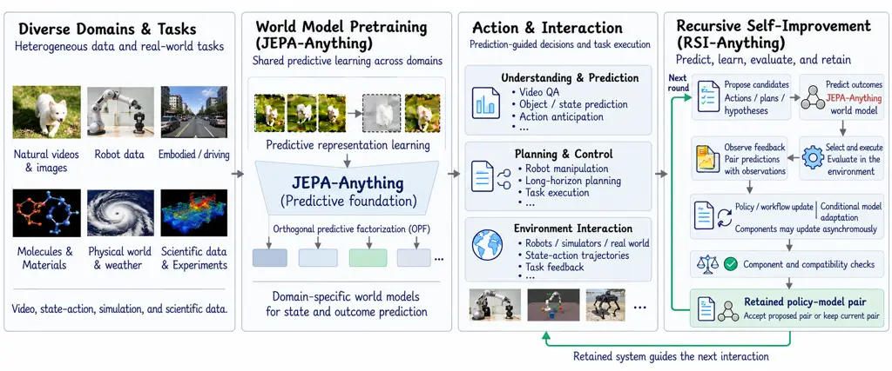
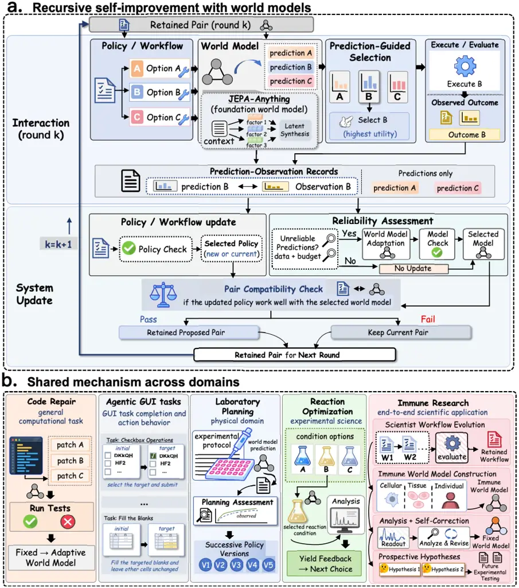
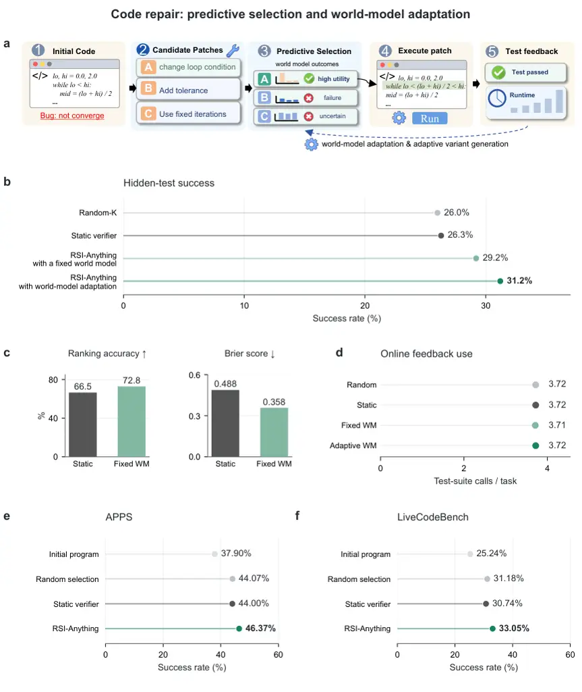
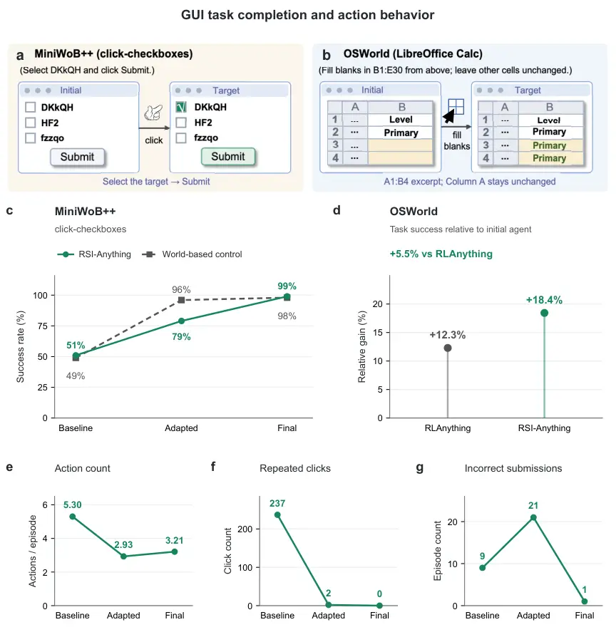
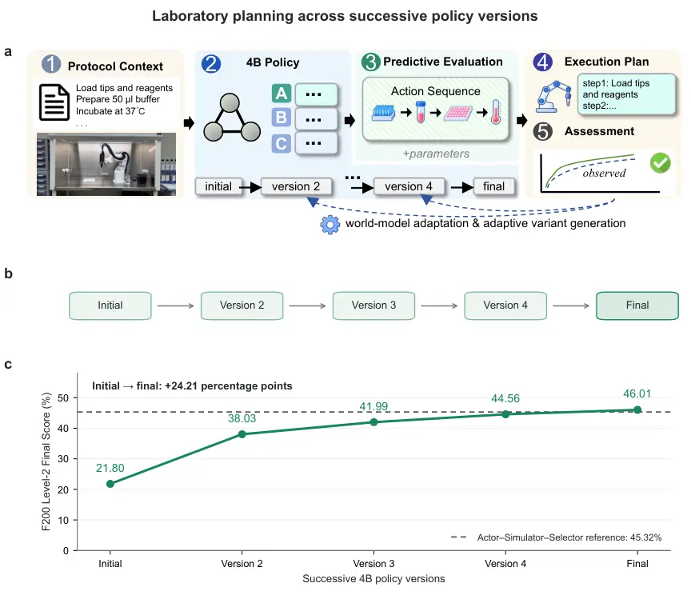
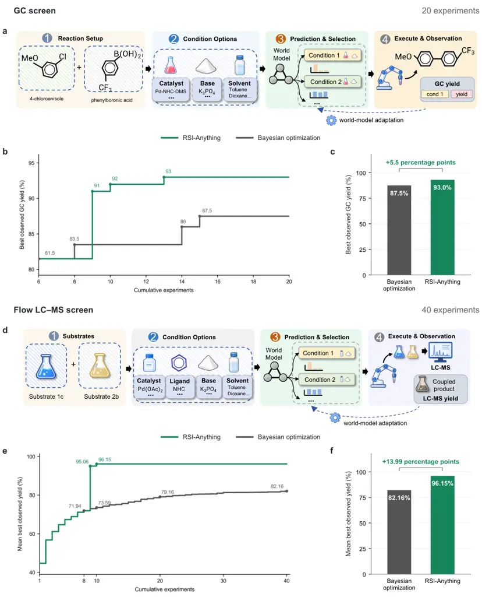
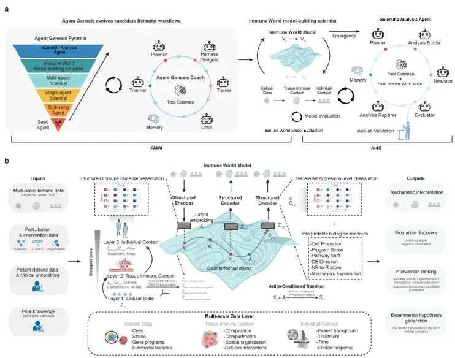

\legend

^(\*)Corresponding authors. Author affiliations and correspondence are
listed in Appendix A.

# RSI-Anything: Unlocking Recursive Self-Improvement with World Models

Taoyong Cui\aff1,2 Pinxian Zeng\aff3 Wanghan Xu\aff4 Hao
Xiao\aff5 Shuhan Xue\aff1 Qiang Gao\aff5 Wanli Ouyang\aff2 Pheng Ann
Heng\aff2,\* Zhenfei Yin\aff1,6,\*  
Yingcheng Wu\aff1,7,\* Ling Yang\aff1,8,\*   [Code:
RSI-Anything](https://github.com/Gen-Verse/RSI-Anything)  \|  [Models:
RSI-Anything](https://huggingface.co/datasets/Gen-Verse/RSI-Anything)  

###### Abstract

Recursive self-improvement (RSI) aims to transform interaction
experience into persistent improvements, yet external feedback is costly
and world-model predictions may become unreliable as policies evolve. We
introduce RSI-Anything, a domain-general framework built on
JEPA-Anything that uses predictive world models to guide action and
learning-data selection. Observed feedback drives policy or workflow
improvement and conditional world-model adaptation, while component and
compatibility checks govern the retention of updated policy–model pairs.
Across diverse computational and scientific domains, RSI-Anything
demonstrates substantial gains. In code repair, with the coder fixed,
success increases from $`26.3\%`$ with a static verifier to $`29.2\%`$
through predictive selection and $`31.2\%`$ after world-model
adaptation, at comparable test usage. Graphical user interface (GUI)
evaluations showed higher task completion, while average actions
decrease by $`39.4\%`$. Across five successive policy versions,
laboratory-planning scores more than double from $`21.80\%`$ to
$`46.01\%`$. In reaction optimization, RSI-Anything achieves $`96.15\%`$
mean best observed yield versus $`82.16\%`$ for Bayesian optimization
under the same 40-experiment budget. An end-to-end immune-science
application further connects workflow evolution and predictive modeling
with therapeutic hypothesis generation. These results demonstrate how
predictive world models and retained system updates enable recursive
improvement across diverse environments.



Figure 1: RSI-Anything overview. Building on the cross-domain predictive
foundation of JEPA-Anything, RSI-Anything uses world-model predictions
to support understanding, planning, and action selection across diverse
tasks. Interaction feedback drives policy or workflow updates and
conditional world-model adaptation. Component and compatibility checks
determine which policy–model pair is retained to guide the next round of
interaction and learning, closing the recursive self-improvement loop.

## 1 Introduction

Recursive self-improvement (RSI) turns interaction experience into
lasting improvements in a system’s ability to act and learn. Within
tasks, feedback refines solutions or guides actions Cobbe et al. (2021);
Shinn et al. (2023). Across rounds, self-training and preference
optimization support persistent policy or procedural updates Gulcehre et
al. (2023); Rafailov et al. (2023); Zelikman et al. (2022).
Recursiveness requires these updates to be retained and shape subsequent
interaction and learning. The central question is how experience from
one round improves the system’s ability to act and learn in the next.

Learning from external feedback requires executing or evaluating
candidates before their consequences can guide improvement, limiting
exploration under constrained interaction budgets. World models predict
the effects of candidate actions on subsequent states or outcomes Ha and
Schmidhuber (2018); Hafner et al. (2025); Schrittwieser et al. (2020),
enabling prospective evaluation and planning. Within RSI, these
predictions can prioritize feedback collection and guide learning-data
selection or construction. World models thus provide a predictive
foundation for improvement under limited external feedback.

JEPA-Anything provides a shared framework for world-model construction
across heterogeneous domains Cui et al. (2026b). Building on
joint-embedding predictive architectures Assran et al. (2023); Bardes et
al. (2024); Assran et al. (2025), it predicts target representations
from observed context. Its orthogonal predictive factorization (OPF)
decomposes latent targets into complementary factors, learns dedicated
predictors, and recombines their outputs into a complete latent state
Cui et al. (2026b). This provides a predictive foundation across domains
(Figure 1). However, prediction alone does not establish recursive
improvement: predicted outcomes must guide interaction, while external
feedback must produce updates that persist across subsequent rounds.

Closing this loop introduces a coupled-update challenge. Policy updates
change the candidate actions and experience distributions on which the
world model operates, potentially undermining prediction reliability.
Conversely, world-model updates alter candidate rankings, imagined
trajectories, and the learning signals guiding policy improvement.
Consequently, improving either component independently does not
guarantee better joint performance. Reliable RSI therefore requires
determining when to update each component, assessing prediction
reliability under changing policies, and ensuring that retained
policy–model pairs improve subsequent interaction and learning.

To address these challenges, we introduce RSI-Anything, a domain-general
framework that integrates predictive world models with feedback-driven
recursive improvement (Figure 2). World-model predictions guide action
selection, prioritize external evaluations, and support learning-data
selection or construction. External feedback drives policy learning or
workflow revision and triggers world-model adaptation when reliability
checks warrant it. The policy and world model can evolve asynchronously,
with component-level checks evaluating individual updates and
compatibility checks determining which policy–model pair is retained.
This retained pair shapes subsequent candidates and learning experience,
closing the recursive improvement loop.

Our evaluations examine whether introducing world-model predictions into
RSI improves candidate selection, whether retained policy or model
updates yield further improvements, and whether these gains can be
achieved under limited external feedback. We investigate these questions
across general computational tasks (code repair and GUI interaction),
physical-domain planning, and experimental science. We further present
an end-to-end application of RSI-Anything in immune science, spanning
scientific-agent workflow evolution, immune world-model construction,
analysis with self-correction, and prospective therapeutic hypothesis
generation Cui et al. (2026a).

Our contributions are threefold:

- •
  World models for recursive self-improvement. We introduce
  RSI-Anything, a domain-general framework that integrates predictive
  world models into recursive self-improvement to anticipate action
  outcomes and guide experience collection. We formulate persistent
  improvement at the level of the policy–world-model system, making
  prediction reliability under evolving policies a central design
  requirement.
- •
  A recursive update-and-retention mechanism. We connect
  prediction-guided action and learning-data selection with
  feedback-driven policy learning or workflow revision and conditional
  world-model adaptation. Component and compatibility checks determine
  which policy–model pair is retained, allowing asynchronous updates.
  The retained pair shapes subsequent candidates and learning
  experience, linking each accepted system revision to the next round of
  improvement.
- •
  Empirical evidence across domains. With the coder fixed, we
  demonstrate successive gains from introducing world-model-guided
  selection and adapting the predictor at similar online test usage.
  Further evaluations show higher GUI task completion, improvement
  across five successive laboratory-planning policy versions, and higher
  reaction yields than Bayesian optimization at matched experiment
  counts. An end-to-end immune-science application illustrates how
  RSI-Anything connects retained workflows and predictive models with
  evidence-guided analysis and hypothesis generation.



Figure 2: RSI-Anything couples prediction-guided action with retained
system updates. a, Building on JEPA-Anything, world-model predictions
guide candidate selection for external evaluation. Only the executed
candidate (B) yields paired prediction–observation feedback. Feedback
supports policy or workflow revision and reliability assessment;
world-model adaptation depends on prediction reliability, available
data, and budget. Component and compatibility checks determine the
retained policy–model pair, which shapes candidates and learning
experiences in the next round. b, The shared mechanism is instantiated
in code repair, GUI interaction, laboratory planning, and reaction
optimization. An end-to-end immune-science application connects workflow
evolution, immune world-model construction, analysis with
self-correction, and prospective hypothesis generation.

## 2 RSI-Anything Framework

RSI-Anything uses world-model predictions to guide action selection and
feedback collection, then uses the resulting experience to propose and
retain system updates (Figure 2). The retained policy–model pair
determines subsequent candidates and the experience available for
further improvement. The shared mechanism connects prediction-guided
selection, feedback-driven updates, and component and pair acceptance.
Domain implementations specify the models, action encodings, outcome
readouts, and enabled pathways, including uncertainty-aware selection,
multistep planning, and imagined-trajectory learning. The full
update-and-retention protocol is defined below; Table 4 identifies the
update scope reported for each application.

### 2.1 Problem formulation

For domain $`d`$, the task specification is

```math
\mathcal{T}_{d}=(\mathcal{X}_{d},\mathcal{S}_{d},\mathcal{A}_{d},\mathcal{W}_{d},\mathcal{V}_{d},\mathcal{M}_{d},\mathcal{C}_{d},\mathcal{B}_{d}), \tag{1}
```

where $`\mathcal{X}_{d}`$ describes observations and context,
$`\mathcal{S}_{d}`$ the task state, $`\mathcal{A}_{d}`$ available
actions or interventions, $`\mathcal{W}_{d}`$ the world-model adapter,
and $`\mathcal{V}_{d}`$ the verifier for candidate validity and
predicted utility. The remaining terms specify evaluation metrics,
operational and safety constraints, and budgets for computation,
simulation, and external interaction. Executing or evaluating a selected
action yields observed feedback. The adapter links this feedback to the
stored prediction, the action and context that produced it, and the
evidence source.

We use $`t`$ for action steps within a task and $`k`$ for
update-and-acceptance cycles. At cycle $`k`$, the accepted system is
$`(\theta_{k},\phi_{d,k})`$. The policy configuration $`\theta_{k}`$
determines how candidates are generated or selected and can comprise
trainable parameters or a persistent agent workflow; $`\phi_{d,k}`$
specifies the current predictor. A cycle can aggregate feedback from
several action steps, trajectories, or tasks. It ends after update
decisions and acceptance checks, even if both components retain their
current versions. Thus, $`k`$ counts update cycles rather than
successful revisions.

Within a run, the task objective, state and action definitions,
interfaces, scoring criteria, constraints, acceptance and stopping
rules, and total budget limits remain fixed. Remaining budgets decrease
with resource use. Task states, candidate pools, feedback records, and
accepted component versions can evolve. An action or observation changes
the task state or available information; an accepted change to
$`\theta_{k}`$ or $`\phi_{d,k}`$ changes the system used in subsequent
decisions. Extending the feedback history alone is not a policy or model
revision. Table 1 summarizes this distinction.

| Object                            | Change rule                                                                                                                     | Carried forward                                                                                                                 |
| --------------------------------- | ------------------------------------------------------------------------------------------------------------------------------- | ------------------------------------------------------------------------------------------------------------------------------- |
| Task and evaluation specification | Fixed for the run                                                                                                               | Task objectives and definitions, interfaces, evaluation criteria, constraints, budget limits, and acceptance and stopping rules |
| Task state and experience         | Actions and observations revise the state and extend prediction–observation records                                             | Current task state for subsequent actions; accumulated records for selection and learning                                       |
| Policy configuration $`\theta`$   | Feedback-driven policy learning or workflow revision proposes a candidate version; component and pair checks govern acceptance  | Accepted policy configuration; otherwise the current version                                                                    |
| World model $`\phi_{d}`$          | Prediction unreliability, sufficient data and budget trigger an adaptation attempt; component and pair checks govern acceptance | Accepted predictor; otherwise the current version                                                                               |

Table 1: Fixed settings, update rules, and retained state in a recursive
run.

### 2.2 Predictive foundation

JEPA-Anything supplies a context–target predictive design in which
orthogonal predictive factorization (OPF) organizes latent targets into
complementary factors, predicts them from context, and synthesizes a
complete latent state Cui et al. (2026b). Its learning formulation
combines factor prediction with orthogonality and representation
regularization. This is the inherited model-construction foundation.
Subsequent RSI adaptation specifies its own objectives and trainable
parameter subset for the instantiated predictor.

At cycle $`k`$, encoding and action-conditioned latent prediction are
written as

```math
\displaystyle z_{t} \displaystyle=E_{\phi_{d,k}}(s_{t},c_{d}), \tag{2}
```

```math
\displaystyle\widehat{z}_{t+1} \displaystyle=F_{\phi_{d,k}}(z_{t},a_{t},c_{d}). \tag{3}
```

Here $`s_{t}`$ is the task state, $`a_{t}`$ a candidate action, and
$`c_{d}`$ the domain context. The latent predictor $`F`$ represents
factor prediction and synthesis when OPF is instantiated. The readout
$`R`$ converts the predicted latent target $`\widehat{z}_{t+1}`$ into an
outcome prediction for selection and feedback comparison. These symbols
denote functional roles; adapters specify the action encoding and can
incorporate it into the predictor input or context.

A deterministic readout returns a point prediction, whereas a
probabilistic readout returns a distribution. These are alternative
domain instantiations of the outcome interface:

```math
\displaystyle\widehat{o}_{t+1} \displaystyle=R_{\phi_{d,k}}(\widehat{z}_{t+1},c_{d})\quad\text{(point readout)}, \tag{4}
```

```math
\displaystyle p_{\phi_{d,k}}(o_{t+1}\mid s_{t},a_{t},c_{d}) \displaystyle=R_{\phi_{d,k}}(\widehat{z}_{t+1},c_{d})\quad\text{(probabilistic readout)}. \tag{5}
```

The domain specification states how the readout is converted into task
utility and compared with observed feedback. Point predictions use the
corresponding outcome error; probabilistic predictions can additionally
use distribution-sensitive scores or calibration measures. Any
uncertainty estimator used in selection or training admission is
specified separately. Reliability concerns agreement with observed
outcomes and the coverage of those observations.

One-step selection requires only an outcome readout. Multistep planning
additionally requires an adapter that propagates a planning state. When
this transition interface is available, a rollout of horizon $`H`$ under
goal $`g`$ has the form

```math
p_{\theta_{k},\phi_{d,k}}(\widehat{\tau}\mid s_{0},g,c_{d})=\prod_{t=0}^{H-1}\pi_{\theta_{k}}(a_{t}\mid s_{t},g)\,p_{\phi_{d,k}}(s_{t+1},o_{t+1}\mid s_{t},a_{t},c_{d}). \tag{6}
```

The propagated $`s_{t+1}`$ remains a predicted planning state until
externally checked. The joint transition readout is needed only for
applications that perform multistep rollouts.

### 2.3 Prediction-guided selection

At state $`s_{t}`$ and goal $`g`$, the current policy proposes
$`\mathcal{K}_{t}=\operatorname{Propose}_{\theta_{k}}(s_{t},g)`$. Each
candidate receives an outcome prediction or, when supported, a bounded
rollout $`\widehat{\tau}`$. The verifier records validity $`v_{\tau}`$,
utility components $`\mathbf{r}_{\tau}`$, evidence provenance, and any
available model or verifier uncertainty. Validity and operational
constraints determine which candidates may be executed; the selection
rule determines which feasible candidates receive feedback.

For utility-based ranking, the candidate score is

```math
R_{d}(\widehat{\tau})=\sum_{j}w_{d,j}r_{\tau,j}-\Delta_{d}(\widehat{\tau}), \tag{7}
```

where $`\Delta_{d}(\widehat{\tau})=\lambda_{d}U(\mathbf{u}_{\tau})`$
when uncertainty penalization is enabled and
$`\Delta_{d}(\widehat{\tau})=0`$ otherwise. Invalid candidates are
excluded before ranking. The domain configuration specifies utility
weights, the implemented ranking or acquisition rule, batch size, and
estimated feedback costs. Selection returns a feasible candidate or
batch whose evaluation cost fits the remaining feedback budget. In code
repair, the instantiated rule aggregates predicted execution-class
probabilities to rank four proposed revisions before one revision is
executed.

An explicitly enabled information-seeking acquisition rule can instead
prioritize uncertain candidates for evaluation. Its definition and use
are reported separately from utility-based ranking. Once feedback is
obtained, the observed outcome is stored separately from the prediction
used to select the candidate.

#### Evidence and imagined training data.

RSI-Anything distinguishes deterministic rule checks (E0), learned-model
predictions and rollouts (E1), specialized simulators or higher-fidelity
calculations (E2), and external measurements or experiments (E3).
Predicted and observed fields retain their own provenance. Evidence
category records origin and intended fidelity; sufficiency for training
is determined by the admission criteria below.

For applications using imagined trajectories for learning, admission is
governed separately from external-evaluation selection:

```math
\displaystyle e_{\tau} \displaystyle=\mathbf{1}\{v_{\tau}=1\}\mathbf{1}\{R_{d}(\widehat{\tau})\geq r_{d}^{\min}\}C_{d}^{U}(\widehat{\tau})\mathbf{1}\{\ell_{\tau}\in\mathcal{E}_{d}^{\mathrm{train}}\},
```

```math
\displaystyle\mathcal{D}_{\mathrm{sim},k} \displaystyle=\operatorname{Curate}\{\widehat{\tau}:e_{\tau}=1\}. \tag{8}
```

Here $`\ell_{\tau}`$ records the evidence used to support training
admission. The uncertainty check $`C_{d}^{U}`$ tests
$`U(\mathbf{u}_{\tau})\leq u_{d}^{\max}`$ when enabled and returns one
when omitted. The permitted evidence sources and thresholds are
specified for the application. If imagined learning is disabled,
$`\mathcal{D}_{\mathrm{sim},k}`$ is empty. This training filter does not
prevent external evaluation of uncertain candidates.

### 2.4 Feedback-driven improvement

External feedback extends history $`\mathcal{H}_{k}`$ with
prediction–observation pairs linked to the generating system version.
Records selected for policy improvement form
$`\mathcal{D}_{\mathrm{policy},k}`$; records selected for predictor
adaptation form $`\mathcal{D}_{\mathrm{adapt},k}`$. The two sets serve
different objectives and need not contain the same records. Policy
improvement changes how candidates are generated or selected; predictor
adaptation changes how their consequences are forecast.

#### Policy learning or workflow revision.

Feedback must be converted into a signal appropriate to the update
object. Demonstration-based learning uses selected actions or
trajectories as targets; preference learning compares alternatives using
their evaluated outcomes; workflow search uses evaluation feedback to
rank persistent agent-workflow configurations. Each application selects
the update route appropriate to its policy representation and feedback.
Eligible imagined trajectories can supplement policy data when that
route is enabled. The policy update seeks better task behavior under the
declared objective and constraints.

Let $`u_{k}^{\pi}`$ indicate an enabled policy-update attempt at its
declared schedule or feedback trigger, with the required learning
evidence and sufficient budget for the proposed attempt. A fixed-policy
setting has $`u_{k}^{\pi}=0`$:

```math
\theta^{\prime}_{k+1}=\begin{cases}\operatorname{Update}(\theta_{k},\mathcal{D}_{\mathrm{policy},k},\mathcal{D}_{\mathrm{sim},k}),&u_{k}^{\pi}=1,\\
\theta_{k},&u_{k}^{\pi}=0.\end{cases} \tag{9}
```

The instantiated route specifies how feedback constructs training
targets or workflow scores, which parameters or configuration fields can
change, and when updates are attempted.

#### Conditional world-model adaptation.

Adaptation uses observed targets to improve the corresponding
predictions. Outcome labels can supervise an outcome readout; latent
prediction targets require an observation that the domain target encoder
can represent. A scalar outcome supplies an outcome target rather than a
fully observed target state, although its loss can update upstream
parameters when they are trainable. The adaptation specification
identifies the available target, its predictive loss, and the trainable
parameter subset. These choices can differ from those used in initial
model construction.

The reliability protocol requires predictions attributable to the
current model version. For each historical observation included in the
assessment, it uses either a stored prediction generated by that version
or a new prediction obtained by applying the current model to the
recorded input. Earlier-version predictions remain available for
analysis of past decisions but are not pooled directly into the current
error estimate. The implementation specifies record selection, version
handling, and whether evaluation records have also been used for
training.

Reliability is assessed from feedback history $`\mathcal{H}_{k}`$ using
this version rule and the candidate range considered in cycle $`k`$,
denoted $`\mathcal{K}_{k}`$. Let $`B_{\mathrm{update},k}`$ denote the
remaining budget available for the proposed adaptation and
$`\widehat{c}_{\mathrm{adapt},k}`$ its estimated cost in the same units.
For an enabled adaptation pathway, the assessment and trigger are

```math
\displaystyle\rho_{k}^{W} \displaystyle=\operatorname{Reliability}(W_{\phi_{d,k}};\mathcal{H}_{k},\mathcal{K}_{k})\in\{\mathrm{reliable},\mathrm{unreliable},\mathrm{insufficient}\}, \tag{10}
```

```math
\displaystyle u_{k}^{W} \displaystyle=\mathbf{1}\{\rho_{k}^{W}=\mathrm{unreliable}\}\mathbf{1}\{\mathcal{D}_{\mathrm{adapt},k}\ \mathrm{is\ sufficient}\}\mathbf{1}\{B_{\mathrm{update},k}\geq\widehat{c}_{\mathrm{adapt},k}\}. \tag{11}
```

The assessment applies the specified error, calibration, drift, and
coverage criteria supported by the implementation. Because feedback
comes from selected candidates, its conclusions are limited to the
observed and covered candidate range. Insufficient coverage yields an
insufficient assessment rather than evidence of reliability and does not
activate the adaptation trigger. Subsequent selection follows the
declared evaluation rule and remaining feedback budget.

```math
\phi^{\prime}_{d,k+1}=\begin{cases}\operatorname{Adapt}(\phi_{d,k},\mathcal{D}_{\mathrm{adapt},k}),&u_{k}^{W}=1,\\
\phi_{d,k},&u_{k}^{W}=0.\end{cases} \tag{12}
```

This trigger governs adaptation after initial model construction; a
disabled pathway sets $`u_{k}^{W}=0`$. The budget specification
identifies the constrained resource and accounts for adaptation,
historical re-evaluation, and acceptance checks. When policy and model
updates share a budget, each attempt uses the amount remaining after
prior allocations. External feedback use is reported separately from
update and evaluation computation. Either component can remain unchanged
while the other is updated; proposed candidates enter the retained
system only after acceptance.

### 2.5 Recursive retention

The full retention protocol compares proposed components and their
assembled pair with the current versions under predeclared acceptance
criteria. Component checks address policy task utility and constraints,
or predictor quality on relevant targets. The pair check addresses the
dependency between them: a policy can generate candidates for which an
otherwise improved predictor is unreliable, and a predictor can change
which candidates are selected. Pair acceptance therefore concerns the
decision behavior of the assembled system and predictor suitability on
candidates proposed by the selected policy, beyond isolated component
quality.

For compactness, define the component decisions as

```math
\displaystyle G_{k}^{\pi} \displaystyle=Q_{\pi}(\theta^{\prime}_{k+1};\theta_{k},\mathcal{D}^{\pi}_{\mathrm{gate},k}), \tag{13}
```

```math
\displaystyle G_{k}^{W} \displaystyle=Q_{W}(\phi^{\prime}_{d,k+1};\phi_{d,k},\mathcal{D}^{W}_{\mathrm{gate},k}). \tag{14}
```

The arguments explicitly identify the current version as the comparator.
Each check returns one only when its specified criteria are met. The
policy and model versions passed to pair evaluation are

```math
\displaystyle\bar{\theta}_{k+1} \displaystyle=\begin{cases}\theta^{\prime}_{k+1},&u_{k}^{\pi}=1\ \land\ G_{k}^{\pi}=1,\\
\theta_{k},&\text{otherwise},\end{cases} \tag{15}
```

```math
\displaystyle\bar{\phi}_{d,k+1} \displaystyle=\begin{cases}\phi^{\prime}_{d,k+1},&u_{k}^{W}=1\ \land\ G_{k}^{W}=1,\\
\phi_{d,k},&\text{otherwise}.\end{cases} \tag{16}
```

When at least one component changes, the pair decision compares the
assembled candidate with the current pair under the same prescribed
evaluation conditions; otherwise $`G_{k}^{\mathrm{pair}}=1`$ without a
new evaluation:

```math
G_{k}^{\mathrm{pair}}=Q_{\mathrm{pair}}\!\left((\bar{\theta}_{k+1},\bar{\phi}_{d,k+1});(\theta_{k},\phi_{d,k}),\mathcal{D}_{\mathrm{compat},k}\right). \tag{17}
```

```math
(\theta_{k+1},\phi_{d,k+1})=\begin{cases}(\bar{\theta}_{k+1},\bar{\phi}_{d,k+1}),&G_{k}^{\mathrm{pair}}=1,\\
(\theta_{k},\phi_{d,k}),&\text{otherwise}.\end{cases} \tag{18}
```

The evaluation specification fixes the task metrics, prediction checks,
constraints, feedback allowance, and acceptance thresholds.
Corresponding task conditions can be matched even when the two policies
generate different candidates. Failure of a component check retains its
current version; failure of the pair check retains the entire current
pair. If neither component changes, the current pair carries forward
without a new pair comparison. Updates are retained when the candidate
pair meets the prespecified acceptance criteria under matched evaluation
conditions.

Update data construct candidate versions, gate data select which
versions are retained, and any designated held-out audit set is reserved
for final reporting.

The retained pair and accumulated feedback history enter the next cycle.
A changed policy can alter which candidates are proposed; a changed
predictor can alter rankings and learning signals. Together, these
changes affect which actions receive feedback and what experience is
available for subsequent updates. This dependence of later interaction
and learning on retained revisions defines the recursive mechanism. The
six operations in Figure 2 therefore connect candidate proposal and
prediction to external selection, observation, update construction, and
system retention.

## 3 Results

We examined how world-model predictions improve action selection, how
retained updates support further improvement, and how prediction and
feedback guide decisions under limited interaction budgets. Code repair
and GUI interaction cover general computational tasks, alongside
physical-domain laboratory planning and experimental reaction
optimization. Within these settings, we evaluate predictive selection,
model adaptation, task completion, successive policy versions, and
search at matched experiment counts. We then examine an end-to-end
application of RSI-Anything in immune science, connecting
scientific-agent workflow evolution, world-model construction, and
scientific analysis.

### 3.1 World-model-guided selection and adaptation improve code repair

We evaluated two contributions of RSI-Anything in code repair:
introducing world-model predictions for candidate selection and
obtaining further gains by updating the predictor with execution
feedback. The ReasonFlux-Coder-7B policy was held fixed Wang et al.
(2025). We compared RSI-Anything with a fixed world model (CURE-WM-Lite)
and RSI-Anything with world-model adaptation. All selection methods used
the same coder and candidate budget: four revisions were proposed before
one was selected for execution. Evaluation covered 200 CodeContests
tasks Li et al. (2022) across three seeds and up to three feedback
rounds, with online tests supplying feedback and hidden tests measuring
final success.



Figure 3: Prediction-guided selection and world-model adaptation in code
repair. a, Illustrative repair of a non-convergent loop, from candidate
patches and predicted outcomes to execution and test feedback. A–C
depict example patches; the benchmark uses a fixed coder and four
candidates per round. Feedback supports predictor updates in the
adaptive configuration. Panels b–d report results on 200 CodeContests
tasks across three seeds with up to three feedback rounds. b, Final
hidden-test all-pass rate. c, Candidate-ranking accuracy and five-class
Brier score for the static verifier and the fixed-world-model
configuration. Higher ranking accuracy and lower Brier score indicate
better predictive performance. d, Mean online test-suite calls per task.
e,f, Final full-test success averaged over three seeds on APPS
Introductory (1,000 problems) and LiveCodeBench v6 (1,055 problems),
respectively. Fixed WM denotes RSI-Anything with a fixed world model
(CURE-WM-Lite); Adaptive WM denotes RSI-Anything with world-model
adaptation. Green shades identify world-model-based methods; gray shades
identify baselines.

Introducing world-model-guided selection increased final hidden-test
success to $`29.2\%`$ ($`175/600`$), compared with $`26.3\%`$ for a
capacity-matched static verifier and $`26.0\%`$ for random selection
(Figure 3; Table 2). The paired gain over the static verifier was
$`+2.83`$ percentage points (95% interval $`[+0.17,+5.50]`$). In this
fixed-world-model versus static-verifier comparison, candidate-ranking
accuracy increased from $`66.5\%`$ to $`72.8\%`$, and the five-class
Brier score Brier (1950) decreased from $`0.488`$ to $`0.358`$. Online
test-suite usage was similar: $`3.71`$ calls per task for the
fixed-world-model configuration and $`3.72`$ for the static verifier.
These results connect improved prediction and ranking with higher repair
success under the same candidate budget.

Feedback-driven world-model adaptation produced an additional gain over
fixed-model selection. With the coder and candidate budget retained,
RSI-Anything with world-model adaptation reached $`31.2\%`$ hidden-test
success, exceeding the fixed-world-model configuration by $`2.0`$
percentage points. Online test-suite usage was $`3.72`$ calls per task.
Execution feedback informed program repair and revised the predictor
used for subsequent candidate selection. The two comparisons show
successive gains from introducing predictive selection and then adapting
the world model, with similar online test usage.

On APPS Introductory Hendrycks et al. (2021) and LiveCodeBench v6 Jain
et al. (2024), JEPA-Anything-guided candidate selection achieved final
full-test success rates of $`46.37\%`$ and $`33.05\%`$, respectively,
exceeding random selection and the static verifier (Figure 3e,f). These
comparisons used the same coder, with four repair candidates per round
and at most three repair rounds.

| Selection method                                     | Hidden all-pass | Online calls/task |
| ---------------------------------------------------- | --------------- | ----------------- |
| Random-K                                             | 26.0%           | 3.72              |
| Capacity-matched static verifier                     | 26.3%           | 3.72              |
| RSI-Anything with a fixed world model (CURE-WM-Lite) | 29.2%           | 3.71              |
| RSI-Anything with world-model adaptation             | 31.2%           | 3.72              |

Table 2: Three-round repair on CodeContests Li et al. (2022) under a
shared coder and candidate budget. Both RSI-Anything configurations use
world-model-guided candidate selection: one keeps the world model fixed
(CURE-WM-Lite), and the other additionally adapts it using feedback.

### 3.2 RSI-Anything improves task completion in GUI environments

We evaluated graphical user interface (GUI) task completion on MiniWoB++
click-checkboxes, which requires selecting specified checkboxes and
submitting the selection Liu et al. (2018), and on OSWorld Xie et al.
(2024). The checkbox task additionally provides action-level
diagnostics. RSI-Anything used interaction feedback to update both the
policy and the world model, retaining these updates to guide subsequent
GUI actions.



Figure 4: Task completion and action behavior in GUI environments. a,b,
Illustrative MiniWoB++ checkbox selection and OSWorld spreadsheet
completion tasks, showing initial and target states. c, MiniWoB++
click-checkboxes success across baseline, adapted, and final
configurations for RSI-Anything and the World-based control. d, OSWorld
success-rate gains relative to the initial agent. The annotation gives
the additional relative gain of RSI-Anything over RLAnything; all gains
are relative percentages. e–g, Mean actions per episode, repeated-click
count, and number of episodes with incorrect submissions, respectively,
for the RSI-Anything configurations in c. Lines connect evaluated
configurations.

On click-checkboxes, success increased from $`51\%`$ at baseline to
$`79\%`$ in the adapted configuration and $`99\%`$ in the final
RSI-Anything configuration (Figure 4c). Mean actions per episode
decreased from $`5.30`$ to $`3.21`$, a $`39.4\%`$ reduction from
baseline; recorded repeated clicks fell from $`237`$ to $`0`$, and
episodes with incorrect submissions fell from $`9`$ to $`1`$
(Figure 4e–g). The adapted configuration used fewer actions ($`2.93`$
per episode) but produced $`21`$ incorrect-submission episodes. The
final configuration therefore combined higher success with fewer
submission errors despite a modest increase in action count relative to
the adapted configuration. The World-based control achieved $`49\%`$,
$`96\%`$, and $`98\%`$ success across the three configurations
(Figure 4c).

On OSWorld, RSI-Anything improved task success rate by $`5.5\%`$
relative to RLAnything Wang et al. (2026b) and by $`18.4\%`$ relative to
the initial agent (Figure 4d). RLAnything improved success by $`12.3\%`$
relative to the initial agent.

### 3.3 Successive policy updates improve laboratory planning

We next examined whether successive policy updates with RSI-Anything
improved physical-domain planning. LabHorizon evaluates laboratory
actions subject to reagent, instrument, and ordering constraints through
Level-1 visually grounded next-action selection and Level-2
protocol-aligned sequence generation Stanford Cong Lab (2026). We
followed five consecutive versions of a 4B policy from one
self-improvement process and evaluated them in development order on the
same 200-task F200 Level-2 benchmark. The Final Score combines
action-sequence similarity and parameter accuracy.



Figure 5: Successive policy improvement with RSI-Anything on the
200-task LabHorizon F200 Level-2 benchmark Stanford Cong Lab (2026). a,
Illustrative planning workflow connecting protocol context, a 4B policy,
predictive evaluation of action sequences and parameters, an execution
plan, and assessment. Dashed feedback paths depict update routes in the
framework; the quantitative comparison below follows retained policy
versions. b, Five consecutive versions of the same 4B policy from one
self-improvement process. c, Final Score for each version, combining
action-sequence similarity and parameter accuracy. The dashed line marks
the Actor–Simulator–Selector reference at $`45.32\%`$. Versions are
ordered by development sequence; spacing is schematic.

The Final Score increased across all five evaluated versions:
$`21.80\%`$, $`38.03\%`$, $`41.99\%`$, $`44.56\%`$, and $`46.01\%`$
(Figure 5). The final version improved on the initial version by
$`24.21`$ percentage points. This progression shows continued
improvement in protocol-aligned planning as successive policy versions
were retained within the RSI-Anything process.

For comparison with reference systems, the final 4B version achieved a
Level-2 score of $`46.01\%`$, compared with $`45.32\%`$ for the
Actor–Simulator–Selector reference Stanford Cong Lab (2026), a
difference of $`0.69`$ percentage points. On Level-1 next-action
selection, RSI-Anything achieved an accuracy of $`0.700`$, compared with
$`0.665`$ for the reference (Table 3).

| System                                   | L1 Acc. | L2 Final |
| ---------------------------------------- | ------- | -------- |
| Grok 4.3 xAI (2026)                      | 0.555   | 0.3244   |
| Gemini 3.1 Pro Google (2026)             | 0.465   | 0.3263   |
| GPT-5.5 OpenAI (2026)                    | 0.535   | 0.2276   |
| Kimi K2.6 Moonshot AI (2026)             | 0.550   | 0.3150   |
| Qwen3.6-35B-A3B Qwen Team (2026), direct | 0.475   | 0.2534   |
| Qwen3.6-35B-A3B, trained                 | 0.635   | 0.4100   |
| Actor–Simulator–Selector reference       | 0.665   | 0.4532   |
| RSI-Anything (4B)                        | 0.700   | 0.4601   |

Table 3: LabHorizon benchmark scores for reference systems Stanford Cong
Lab (2026) and RSI-Anything.

### 3.4 Prediction- and feedback-guided search improves reaction yields at matched experiment counts

We examined the use of limited external feedback in experimental science
by comparing reaction-condition search at matched experiment counts.
RSI-Anything used world-model yield predictions to rank candidate
conditions for experimental evaluation. Each measured yield extended the
observation history used to guide subsequent condition choices, linking
prediction, experiment, and the next selection. We evaluated this
process in two Suzuki–Miyaura screens, comparing RSI-Anything with
Bayesian optimization Shields et al. (2021) within each screening
protocol.



Figure 6: Reaction-condition optimization with RSI-Anything (green) and
Bayesian optimization (gray). a, Illustrative GC-screen workflow
connecting the reaction setup, catalyst/base/solvent options,
prediction-guided condition selection, and measured yield. The reaction
couples 4-chloroanisole and 4-(trifluoromethyl)phenylboronic acid using
a Pd–NHC–DMS precatalyst. b, Best observed GC yield versus cumulative
experiment count. c, GC yield after 20 experiments: $`93.0\%`$ for
RSI-Anything and $`87.5\%`$ for Bayesian optimization. d, Illustrative
flow-screen workflow for substrates 1c and 2b, with Pd(OAc)₂, ligand,
base, and solvent selection followed by LC–MS analysis. e, Mean best
observed yield versus cumulative experiment count in the flow LC–MS
screen. f, Yield after 40 experiments: $`96.15\%`$ and $`82.16\%`$,
respectively. Brackets indicate gains of $`5.5`$ and $`13.99`$
percentage points within the corresponding screen. Condition examples
and feedback arrows illustrate the framework; curves and bars report the
two separate screens.

Figure 6 shows yield progression with cumulative experiments (b, e) and
endpoint comparisons at matched experiment counts (c, f). After 20
experiments in the GC-analyzed Pd–NHC–DMS screen, the best observed
yield reached $`93.0\%`$ with RSI-Anything and $`87.5\%`$ with Bayesian
optimization, a gain of $`5.5`$ percentage points. In the flow LC–MS
screen using Pd(OAc)₂, the mean best observed yield after 40 experiments
was $`96.15\%`$, compared with $`82.16\%`$ for Bayesian optimization, a
gain of $`13.99`$ percentage points.

At the matched endpoints within each screen, prediction- and
feedback-guided search achieved higher best-yield metrics from the same
number of experiments. These results support using world-model forecasts
together with measured outcomes to guide condition selection under a
limited experimental budget.

### 3.5 An end-to-end application of RSI-Anything in immune science

We applied RSI-Anything to an end-to-end immune-science workflow that
connects persistent workflow development, predictive world-model
construction, and evidence-guided scientific analysis. During
construction, Agent Genesis searched scientific-agent workflows and
model configurations and selected a model-building agent workflow Cui et
al. (2026a). The retained workflow produced an action-conditioned immune
world model. During downstream analysis, an analysis agent used this
model with fixed parameters to coordinate simulation, evaluation, tool
use, analysis revision, and hypothesis prioritization.



Figure 7: An end-to-end application of RSI-Anything in immune science.
A, evolution of scientific-agent workflows, construction of the immune
world model, and model-guided analysis. B, action-conditioned
transitions over structured cellular, tissue, and individual immune
states, with readouts for interpretation, ranking, and hypothesis
generation. Panels A and B adapted from Figure 1 of Cui et al. (2026a).

The model represents cellular, tissue, and individual immune states and
predicts the consequences of explicit interventions (Figure 7). Measured
perturbation evidence supports model development, and withheld
interventions and biological contexts assess forecasting and action
composition. In the analysis stage, model forecasts and experimental
evidence inform intervention ranking and self-correction. The
construction stage retains the selected model-building workflow and
resulting predictor; subsequent analysis uses the constructed predictor
to revise candidate interventions and hypotheses.

In therapeutic hypothesis generation, self-correction removed the
screened cytokine-pair candidates, and the integrated evidence led to a
prospective nomination combining SIRP$`\alpha`$ inhibition with
IL-36$`\gamma`$-axis modulation Cui et al. (2026a). This case connects a
retained scientific-agent workflow, a predictive world model, and
evidence-guided analysis within one scientific workflow, culminating in
a concrete hypothesis for experimental testing.

## 4 Related Work

### 4.1 Recursive self-improvement

Recursive self-improvement (RSI) has evolved from improving reasoning
and code to adapting interactive agents and their underlying systems. In
coding, CURE co-evolves code generation and unit testing through
execution feedback Wang et al. (2025), while Self-Improving Coding Agent
and Darwin Godel Machine iteratively modify agent implementations and
retain empirically validated improvements Robeyns et al. (2025); Zhang
et al. (2025). AIDE² extends this approach to self-improving AI research
agents Srikanth et al. (2026). Beyond code, Voyager accumulates reusable
executable skills Wang et al. (2023), while GenEnv and Agent0 adapt task
curricula to evolving agent capabilities Guo et al. (2025); Xia et al.
(2025). RLAnything jointly optimizes the policy, reward model, and
environment Wang et al. (2026b), and OpenClaw-RL enables online policy
improvement from user interactions and tool feedback Wang et al.
(2026a). Long-horizon RSI further requires improvements to persist
across extended interactions. Recuris couples Experiential and Working
Memory with validation-gated memory evolution Yu et al. (2026), while
ScienceBuddy introduces nested self-improvement through harness
refinement and model reinforcement learning Xue et al. (2026). These
approaches improve agent code, policies, memories, harnesses, or
training environments. RSI-Anything extends this line by explicitly
incorporating predictive world models into the recursive loop:
predictions guide candidate selection, observations assess model
reliability, and policy–model compatibility determines which updated
components are retained for subsequent interactions.

### 4.2 Verification and policy self-improvement

Verifiers, self-training, preference optimization, and verbal feedback
turn evaluated trajectories into signals for selection and learning
Cobbe et al. (2021); Zelikman et al. (2022); Rafailov et al. (2023);
Gulcehre et al. (2023); Shinn et al. (2023). CURE Wang et al. (2025)
co-evolves a coder and unit tester, providing the ReasonFlux-Coder
policy used in our code evaluation. RLAnything jointly optimizes the
policy, reward model, and environment through feedback Wang et al.
(2026b). These approaches motivate the feedback-to-policy part of
RSI-Anything. Our framework additionally makes world-model reliability
and policy–model compatibility explicit in update acceptance: changing
the policy changes the candidate distribution on which its predictor
must be evaluated.

### 4.3 Predictive world models

World Models Ha and Schmidhuber (2018), MuZero Schrittwieser et al.
(2020), Dreamer Hafner et al. (2025), and Genie Bruce et al. (2024)
establish predictive environments as a basis for control, planning, and
interactive generation. Joint-embedding predictive architectures learn
latent targets without reconstructing every observation detail Assran et
al. (2023); Bardes et al. (2024); Assran et al. (2025), and
JEPA-Anything extends this line through OPF across heterogeneous data
types Cui et al. (2026b). Building on these predictive capabilities,
RSI-Anything organizes how predictions and observed outcomes guide
action selection and the acceptance of subsequent policy or world-model
versions.

### 4.4 Scientific and laboratory agents

Vision-language-action and cross-embodiment datasets motivate
action-conditioned models for physical systems Brohan et al. (2023);
Open X-Embodiment Collaboration et al. (2023); Khazatsky et al. (2024).
LabHorizon measures visual next-action prediction and protocol-aligned
planning Stanford Cong Lab (2026). In chemistry, language-model tools,
yield predictors, Bayesian optimization, and robotic laboratories
provide complementary components for selecting and testing reactions
Boiko et al. (2023); Bran et al. (2024); Schwaller et al. (2021);
Shields et al. (2021); Burger et al. (2020); Szymanski et al. (2023).
ReactionT5 Sagawa and Kojima (2025) is a reaction-pretrained transformer
that supports product, retrosynthesis, and yield prediction; our
chemistry adapter combines this reaction-prediction backbone with the
predictive design of JEPA-Anything Cui et al. (2026b) for
action-conditioned yield forecasting. Single-cell foundation models and
perturbation predictors support cellular-response forecasting Cui et al.
(2024); Theodoris et al. (2023); Roohani et al. (2024); Bunne et al.
(2023). RSI-Anything connects these domain capabilities through a common
transition and feedback contract, so that the outcome of a program,
experiment, or intervention can inform candidate selection and
subsequent system updates.

## 5 Discussion

The results support two roles for world models in recursive improvement:
informing which actions receive external feedback and providing a
predictor that can itself improve from that feedback. Predictive
selection and model adaptation yielded successive gains in code repair,
while retained policy versions improved laboratory planning. In GUI
tasks, RSI-Anything updated both the policy and the world model and
achieved higher task completion, with fewer repeated clicks and
incorrect-submission episodes on the checkbox task. Together with
measured-feedback search and the end-to-end immune-science workflow,
these findings connect prediction-guided decisions to learning and
retained system changes. The common contribution is a procedure for
using prediction–observation pairs to guide current actions and assess
changes to the system that will make subsequent decisions.

The design links decisions about actions to decisions about system
versions. Pairing predictions with observations allows the same
experience to inform candidate utility and predictive reliability.
Policies and world models can change on different schedules: a reliable
predictor can support policy or workflow development, and new outcome
evidence can motivate predictor adaptation while the policy remains
fixed. Reliability checks govern when model adaptation is attempted, and
component and compatibility checks govern which version is carried
forward. Retaining accepted versions makes subsequent experience depend
on the system’s accumulated improvements.

Domain generality concerns the reuse of this improvement mechanism
across domain-specific world models, policies, and evaluation
procedures. The evaluations support predictive selection, predictor
adaptation, successive policy improvement, and feedback-guided search in
their respective settings. Joint multiround evaluation is needed to
establish sustained mutual improvement of the policy and world model
within a single task. The present laboratory results assess
protocol-aligned planning; reliable physical execution requires
evaluation on the relevant equipment and workflows. The chemistry
results cover two Suzuki–Miyaura screens under the reported experiment
budgets, and the therapeutic hypothesis generated in the immune-science
application awaits experimental testing.

## 6 Experimental Methods

The domain settings instantiate the shared framework with different
states, action spaces, prediction targets, and feedback sources. Our
code execution predictor, W1, supplies execution-class probabilities for
candidate–test pairs, ReactionT5–JEPA-Anything supplies a yield
distribution, and the immune world model supplies immune-state and
biological readouts. Table 4 summarizes the domain-specific models,
prediction targets, feedback sources, and update pathways evaluated in
each application. The following sections describe the evaluation
settings and statistical reporting.

The experiments instantiate distinct parts of the full protocol. Code
repair holds the coder fixed while testing predictive selection and
predictor adaptation; laboratory planning follows five successive policy
versions. GUI evaluations measure task completion and action behavior as
RSI-Anything updates both the policy and the world model. Chemistry
tests feedback-guided condition search, and the immune-science
application separates workflow evolution and model construction from
downstream analysis with a fixed predictor.

| Setting         | State; action                                          | World model; prediction                                                                                                              | Policy / workflow; feedback-driven changes                                                  | Feedback; evaluation                                                             |
| --------------- | ------------------------------------------------------ | ------------------------------------------------------------------------------------------------------------------------------------ | ------------------------------------------------------------------------------------------- | -------------------------------------------------------------------------------- |
| Code repair     | Program, tests, and feedback; candidate revision       | JEPA-Anything-based W1 adapted from Qwen2.5-Coder-3B-Instruct Hui et al. (2024) with LoRA Hu et al. (2022); five-class probabilities | Fixed ReasonFlux-Coder-7B; fixed or feedback-adapted W1                                     | Execution-test feedback; final test-suite success and online test usage          |
| GUI interaction | Interface state and task; GUI action                   | GUI outcome predictor; consequences of candidate interface actions                                                                   | Action policy and world model updated through interaction feedback                          | Task outcomes; completion and action-level diagnostics                           |
| Lab planning    | Protocol context; candidate action sequence            | JEPA-Anything-based protocol model; predicted consequences of a candidate sequence                                                   | 4B planning policy; five consecutive versions in one improvement process                    | Development feedback; L1 next-action accuracy and F200 L2 Final Score            |
| Chemistry       | Reaction; condition vector                             | ReactionT5–JEPA-Anything; yield distribution                                                                                         | Measured yields guide subsequent condition choices                                          | Measured GC/LC–MS yields; best observed yield at matched experiment counts       |
| Immune science  | Cellular, tissue, and individual context; intervention | Immune world model Cui et al. (2026a); multiscale transition and biological readouts                                                 | Workflow evolution and world-model construction; fixed predictor during downstream analysis | Measured perturbations support development; withheld contexts assess forecasting |

Table 4: Domain bindings and reported update scope. The world model
predicts consequences; the policy proposes or selects actions.

### 6.1 Domain-specific evaluation settings

#### Code repair.

The state contains the current program, generated tests, and observed
feedback; each action is a candidate revision. The ReasonFlux-Coder-7B
policy proposes four revisions and is held fixed Wang et al. (2025). W1
is our 3B execution-outcome world model, built using the predictive
design of JEPA-Anything Cui et al. (2026b) and adapted from
Qwen2.5-Coder-3B-Instruct Hui et al. (2024) with LoRA Hu et al. (2022).
For every candidate–test pair, it returns the probability of each
execution-result class. Both RSI-Anything configurations aggregate these
probabilities to rank the four revisions before one revision is
executed. The fixed-world-model configuration (CURE-WM-Lite) retains W1,
whereas the world-model-adaptation configuration updates W1 with the
coder held fixed. We evaluated 200 CodeContests tasks Li et al. (2022)
across three seeds and at most three feedback rounds. The comparison
included both RSI-Anything configurations, random selection, and a
capacity-matched static verifier. Metrics were final hidden-test
all-pass rate, online test calls per task, candidate-ranking accuracy,
and five-class Brier score. Online tests supply feedback during
selection; hidden tests supply the final reported success measure.

We additionally evaluated APPS Introductory (1,000 problems) and
LiveCodeBench v6 (1,055 problems) using seeds 0, 1, and 2. Repair
methods shared the initial program for each problem and seed and used
the same ReasonFlux-Coder-7B policy, with four repair candidates per
round and at most three repair rounds. Public-test feedback guided
repair, which stopped when all public tests passed. Final success
required passing the complete official test suite.

#### GUI agents.

We evaluated the MiniWoB++ click-checkboxes task Liu et al. (2018) and
OSWorld Xie et al. (2024). World-model predictions guide GUI action
selection, and observed interaction outcomes provide feedback for
updating both the action policy and the world model. The retained
policy–model pair is used in subsequent interactions. The checkbox
evaluation compares baseline, adapted, and final configurations using
task success rate, mean actions per episode, repeated-click count, and
the number of episodes with incorrect submissions. Success rates are
also shown for the World-based control. The action and error diagnostics
in Figure 4e–g describe the RSI-Anything configurations. The OSWorld
comparison includes the initial agent, RLAnything Wang et al. (2026b),
and RSI-Anything. For success rates $`s_{\mathrm{method}}`$ and
$`s_{\mathrm{reference}}`$, relative improvement is
$`100(s_{\mathrm{method}}/s_{\mathrm{reference}}-1)\%`$. Figure 4d uses
the initial agent as the common reference; the additional RSI-Anything
comparison uses RLAnything as its reference.

#### Laboratory planning.

LabHorizon evaluates Level-1 next-action accuracy and Level-2
protocol-aligned action sequences on its 200-task F200 setting Stanford
Cong Lab (2026). Level-2 Final Score combines action-sequence similarity
and parameter accuracy. The RSI-Anything policy versions use a 4B model
to generate plans and a JEPA-Anything-based protocol world model to
predict their consequences. The F200 evaluation follows five consecutive
4B policy versions from the same RSI-Anything self-improvement process,
ranging from $`0.2180`$ to $`0.4601`$. The Actor–Simulator–Selector
reference uses a trained Qwen3.6-35B-A3B Actor Qwen Team (2026) and
Gemini 3.1 Pro as Simulator and Selector Google (2026), with a reported
LabHorizon Level-2 score of $`0.4532`$ Stanford Cong Lab (2026). Level-1
next-action accuracy was $`0.700`$ for RSI-Anything and $`0.665`$ for
the reference.

#### Reaction optimization.

We construct the ReactionT5–JEPA-Anything adapter by combining the
ReactionT5 reaction-prediction backbone Sagawa and Kojima (2025) with
the predictive design of JEPA-Anything Cui et al. (2026b). It maps a
serialized reaction $`r`$ and candidate condition vector $`c`$ to a
predicted yield distribution $`p_{\phi}(y\mid r,c)`$. One screen varied
Pd–NHC–DMS precatalyst, base, and solvent for the 4-chloroanisole
coupling and measured GC analytical yield. A second screen used Pd(OAc)₂
with ligand, base, and solvent choices in flow, measured by LC–MS.
Bayesian optimization is the baseline in both screens. Results are
reported as best observed or mean best observed yield for each separate
protocol. Measured yields guide subsequent condition choices, and
performance is summarized by the best observed yield at matched
experiment counts.

#### End-to-end immune-science application.

The immune-science application uses an action-conditioned immune world
model that encodes cellular state, tissue immune context, and individual
context, and treats cytokines, genetic perturbations, or candidate
therapies as explicit actions Cui et al. (2026a). Agent Genesis evolved
scientific-agent workflows and model configurations, producing a model
for withheld-intervention forecasting, cross-scale prediction, and
action composition. The selected model-building agent workflow is the
retained policy configuration in this construction stage. During
downstream intervention analysis, the resulting world-model parameters
are frozen while the analysis state, candidate interventions, and
hypothesis ranking evolve through model inference and self-correction.
Therapeutic-hypothesis generation combined measured perturbation
evidence with this model-guided analysis. The resulting prospective
nomination combines SIRP$`\alpha`$ inhibition with IL-36$`\gamma`$-axis
modulation for subsequent experimental testing.

### 6.2 Statistical reporting

Success rates are reported over 600 CodeContests task-seed evaluations.
We report the paired percentage-point difference between RSI-Anything
with a fixed world model and the static verifier, together with its 95%
interval. Tasks recur across seeds, so task-level resampling is the unit
for clustered inference. APPS and LiveCodeBench report the arithmetic
mean of final full-test success rates across three seeds, corresponding
to 3,000 and 3,165 problem–seed evaluations, respectively. LabHorizon
F200 reports mean scores over 200 tasks Stanford Cong Lab (2026). The
$`24.21`$- and $`0.69`$-percentage-point gains are differences between
these benchmark means. Chemistry reports the observed running best
within each optimization sequence, with Bayesian optimization as the
comparator. Evaluation settings for the immune-science application are
described in Cui et al. (2026a).

## References

- Assran et al. (2023) M. Assran, Q. Duval, I. Misra, P. Bojanowski, P.
  Vincent, M. Rabbat, Y. LeCun, and N. Ballas Self-supervised learning
  from images with a joint-embedding predictive architecture. arXiv
  preprint arXiv:2301.08243. External Links:
  [Link](https://arxiv.org/abs/2301.08243) Cited by: §1, §4.3.
- Assran et al. (2025) M. Assran, A. Bardes, D. Fan, et al. V-JEPA 2:
  self-supervised video models enable understanding, prediction and
  planning. arXiv preprint arXiv:2506.09985. External Links:
  [Link](https://arxiv.org/abs/2506.09985) Cited by: §1, §4.3.
- Bardes et al. (2024) A. Bardes, Q. Garrido, J. Ponce, X. Chen, M.
  Rabbat, Y. LeCun, M. Assran, and N. Ballas Revisiting feature
  prediction for learning visual representations from video. arXiv
  preprint arXiv:2404.08471. External Links:
  [Link](https://arxiv.org/abs/2404.08471) Cited by: §1, §4.3.
- Boiko et al. (2023) D. A. Boiko, R. MacKnight, B. Kline, and G. Gomes
  Autonomous chemical research with large language models. Nature 624,
  pp. 570–578. External Links:
  [Document](https://dx.doi.org/10.1038/s41586-023-06792-0) Cited by:
  §4.4.
- Bran et al. (2024) A. M. Bran, S. Cox, O. Schilter, et al. Augmenting
  large language models with chemistry tools. Nature Machine
  Intelligence 6, pp. 525–535. External Links:
  [Document](https://dx.doi.org/10.1038/s42256-024-00832-8) Cited by:
  §4.4.
- Brier (1950) G. W. Brier Verification of forecasts expressed in terms
  of probability. Monthly Weather Review 78 (1), pp. 1–3. External
  Links:
  [Document](https://dx.doi.org/10.1175/1520-0493%281950%29078%3C0001%3AVOFEIT%3E2.0.CO%3B2)
  Cited by: §3.1.
- Brohan et al. (2023) A. Brohan, N. Brown, J. Carbajal, et al. RT-2:
  vision-language-action models transfer web knowledge to robotic
  control. arXiv preprint arXiv:2307.15818. External Links:
  [Link](https://arxiv.org/abs/2307.15818) Cited by: §4.4.
- Bruce et al. (2024) J. Bruce, M. Dennis, A. Edwards, et al. Genie:
  generative interactive environments. arXiv preprint arXiv:2402.15391.
  External Links: [Link](https://arxiv.org/abs/2402.15391) Cited by:
  §4.3.
- Bunne et al. (2023) C. Bunne, S. G. Stark, G. Gut, et al. Learning
  single-cell perturbation responses using neural optimal transport.
  Nature Methods 20, pp. 1759–1768. External Links:
  [Document](https://dx.doi.org/10.1038/s41592-023-01969-x) Cited by:
  §4.4.
- Burger et al. (2020) B. Burger, P. M. Maffettone, V. V. Gusev, et al.
  A mobile robotic chemist. Nature 583, pp. 237–241. External Links:
  [Document](https://dx.doi.org/10.1038/s41586-020-2442-2) Cited by:
  §4.4.
- Cobbe et al. (2021) K. Cobbe, V. Kosaraju, M. Bavarian, M. Chen, H.
  Jun, L. Kaiser, M. Plappert, J. Tworek, J. Hilton, R. Nakano, C.
  Hesse, and J. Schulman Training verifiers to solve math word problems.
  arXiv preprint arXiv:2110.14168. External Links:
  [Link](https://arxiv.org/abs/2110.14168) Cited by: §1, §4.2.
- Cui et al. (2024) H. Cui, C. Wang, H. Maan, et al. scGPT: toward
  building a foundation model for single-cell multi-omics using
  generative AI. Nature Methods 21, pp. 1470–1480. External Links:
  [Document](https://dx.doi.org/10.1038/s41592-024-02201-0) Cited by:
  §4.4.
- Cui et al. (2026a) T. Cui, X. Wang, Z. Li, J. Ding, L. You, Y. Xu, W.
  Xu, F. Wu, K. Ying, W. Ouyang, P. A. Heng, L. Yang, Z. Yin, and Y. Wu
  An immune world model for multiscale forecasting and therapeutic
  hypothesis generation. arXiv preprint arXiv:2609.14709. External
  Links: [Document](https://dx.doi.org/10.48550/arXiv.2609.14709),
  [Link](https://arxiv.org/abs/2609.14709) Cited by: §1, Figure 7, §3.5,
  §3.5, §6.1, §6.2, Table 4.
- Cui et al. (2026b) T. Cui, Z. Wang, X. Xu, W. Liu, Z. Yu, Y. Zhang, Q.
  Gao, M. Yang, W. Ouyang, P. A. Heng, Y. Wu, Z. Yin, and L. Yang
  JEPA-Anything: learning predictive models across different worlds.
  arXiv preprint arXiv:2609.20800. External Links:
  [Link](https://arxiv.org/abs/2609.20800) Cited by: §1, §2.2, §4.3,
  §4.4, §6.1, §6.1.
- Google (2026) Google Gemini 3.1 Pro. Note: Official model announcement
  External Links:
  [Link](https://blog.google/innovation-and-ai/models-and-research/gemini-models/gemini-3-1-pro/)
  Cited by: Table 3, §6.1.
- Gulcehre et al. (2023) C. Gulcehre, T. L. Paine, S. Srinivasan, K.
  Konyushkova, L. Weerts, A. Sharma, A. Siddhant, A. Ahern, M. Wang, C.
  Gu, W. Macherey, A. Doucet, O. Firat, and N. de Freitas Reinforced
  self-training (ReST) for language modeling. arXiv preprint
  arXiv:2308.08998. External Links:
  [Link](https://arxiv.org/abs/2308.08998) Cited by: §1, §4.2.
- Guo et al. (2025) J. Guo, L. Yang, P. Chen, Q. Xiao, Y. Wang, X.
  Juan, J. Qiu, K. Shen, and M. Wang GenEnv: difficulty-aligned
  co-evolution between LLM agents and environment simulators. arXiv
  preprint arXiv:2512.19682. External Links:
  [Document](https://dx.doi.org/10.48550/arXiv.2512.19682),
  [Link](https://arxiv.org/abs/2512.19682) Cited by: §4.1.
- Ha and Schmidhuber (2018) D. Ha and J. Schmidhuber World Models. arXiv
  preprint arXiv:1803.10122. External Links:
  [Link](https://arxiv.org/abs/1803.10122) Cited by: §1, §4.3.
- Hafner et al. (2025) D. Hafner, J. Pasukonis, J. Ba, and T. Lillicrap
  Mastering diverse control tasks through world models. Nature 640,
  pp. 647–653. External Links:
  [Document](https://dx.doi.org/10.1038/s41586-025-08744-2) Cited by:
  §1, §4.3.
- Hendrycks et al. (2021) D. Hendrycks, S. Basart, S. Kadavath, M.
  Mazeika, A. Arora, E. Guo, C. Burns, S. Puranik, H. He, D. Song,
  and J. Steinhardt Measuring coding challenge competence with APPS.
  arXiv preprint arXiv:2105.09938. External Links:
  [Document](https://dx.doi.org/10.48550/arXiv.2105.09938),
  [Link](https://arxiv.org/abs/2105.09938) Cited by: §3.1.
- Hu et al. (2022) E. J. Hu, Y. Shen, P. Wallis, Z. Allen-Zhu, Y. Li, S.
  Wang, L. Wang, and W. Chen LoRA: low-rank adaptation of large language
  models. In International Conference on Learning Representations, Cited
  by: §6.1, Table 4.
- Hui et al. (2024) B. Hui, J. Yang, Z. Cui, J. Yang, D. Liu, L.
  Zhang, T. Liu, J. Zhang, B. Yu, et al. Qwen2.5-Coder technical report.
  arXiv preprint arXiv:2409.12186. External Links:
  [Document](https://dx.doi.org/10.48550/arXiv.2409.12186),
  [Link](https://arxiv.org/abs/2409.12186) Cited by: §6.1, Table 4.
- Jain et al. (2024) N. Jain, K. Han, A. Gu, W. Li, F. Yan, T. Zhang, S.
  Wang, A. Solar-Lezama, K. Sen, and I. Stoica LiveCodeBench: holistic
  and contamination free evaluation of large language models for code.
  arXiv preprint arXiv:2403.07974. External Links:
  [Document](https://dx.doi.org/10.48550/arXiv.2403.07974),
  [Link](https://arxiv.org/abs/2403.07974) Cited by: §3.1.
- Khazatsky et al. (2024) A. Khazatsky, K. Pertsch, S. Nair, et al.
  DROID: a large-scale in-the-wild robot manipulation dataset. arXiv
  preprint arXiv:2403.12945. External Links:
  [Link](https://arxiv.org/abs/2403.12945) Cited by: §4.4.
- Li et al. (2022) Y. Li, D. Choi, J. Chung, N. Kushman, J.
  Schrittwieser, R. Leblond, T. Eccles, J. Keeling, F. Gimeno, A. Dal
  Lago, et al. Competition-level code generation with AlphaCode. Science
  378 (6624), pp. 1092–1097. External Links:
  [Document](https://dx.doi.org/10.1126/science.abq1158) Cited by: §3.1,
  Table 2, §6.1.
- Liu et al. (2018) E. Z. Liu, K. Guu, P. Pasupat, T. Shi, and P. Liang
  Reinforcement learning on web interfaces using workflow-guided
  exploration. In International Conference on Learning Representations,
  External Links: [Link](https://arxiv.org/abs/1802.08802) Cited by:
  §3.2, §6.1.
- Moonshot AI (2026) Moonshot AI Kimi K2.6. Note: Hugging Face model
  cardAccessed September 30, 2026 External Links:
  [Link](https://huggingface.co/moonshotai/Kimi-K2.6) Cited by: Table 3.
- Open X-Embodiment Collaboration et al. (2023) Open X-Embodiment
  Collaboration, A. O’Neill, A. Rehman, et al. Open X-Embodiment:
  robotic learning datasets and RT-X models. arXiv preprint
  arXiv:2310.08864. External Links:
  [Link](https://arxiv.org/abs/2310.08864) Cited by: §4.4.
- OpenAI (2026) OpenAI Introducing GPT-5.5. Note: OpenAI product release
  External Links: [Link](https://openai.com/index/introducing-gpt-5-5/)
  Cited by: Table 3.
- Qwen Team (2026) Qwen Team Qwen3.6-35B-A3B. Note: Hugging Face model
  cardAccessed September 30, 2026 External Links:
  [Link](https://huggingface.co/Qwen/Qwen3.6-35B-A3B) Cited by: Table 3,
  §6.1.
- Rafailov et al. (2023) R. Rafailov, A. Sharma, E. Mitchell, S.
  Ermon, C. D. Manning, and C. Finn Direct preference optimization: your
  language model is secretly a reward model. In Advances in Neural
  Information Processing Systems, Vol. 36. Cited by: §1, §4.2.
- Robeyns et al. (2025) M. Robeyns, M. Szummer, and L. Aitchison A
  self-improving coding agent. arXiv preprint arXiv:2504.15228. External
  Links: [Document](https://dx.doi.org/10.48550/arXiv.2504.15228),
  [Link](https://arxiv.org/abs/2504.15228) Cited by: §4.1.
- Roohani et al. (2024) Y. Roohani, K. Huang, and J. Leskovec Predicting
  transcriptional outcomes of novel multigene perturbations with GEARS.
  Nature Biotechnology 42, pp. 927–935. External Links:
  [Document](https://dx.doi.org/10.1038/s41587-023-01905-6) Cited by:
  §4.4.
- Sagawa and Kojima (2025) T. Sagawa and R. Kojima ReactionT5: a
  pre-trained transformer model for accurate chemical reaction
  prediction with limited data. Journal of Cheminformatics 17, pp. 126.
  External Links:
  [Document](https://dx.doi.org/10.1186/s13321-025-01075-4) Cited by:
  §4.4, §6.1.
- Schrittwieser et al. (2020) J. Schrittwieser, I. Antonoglou, T.
  Hubert, et al. Mastering atari, go, chess and shogi by planning with a
  learned model. Nature 588, pp. 604–609. External Links:
  [Document](https://dx.doi.org/10.1038/s41586-020-03051-4) Cited by:
  §1, §4.3.
- Schwaller et al. (2021) P. Schwaller, A. C. Vaucher, T. Laino, and J.
  Reymond Prediction of chemical reaction yields using deep learning.
  Machine Learning: Science and Technology 2, pp. 015016. External
  Links: [Document](https://dx.doi.org/10.1088/2632-2153/abc81d) Cited
  by: §4.4.
- Shields et al. (2021) B. J. Shields, J. Stevens, J. Li, et al.
  Bayesian reaction optimization as a tool for chemical synthesis.
  Nature 590, pp. 89–96. External Links:
  [Document](https://dx.doi.org/10.1038/s41586-021-03213-y) Cited by:
  §3.4, §4.4.
- Shinn et al. (2023) N. Shinn, F. Cassano, E. Berman, A. Gopinath, K.
  Narasimhan, and S. Yao Reflexion: language agents with verbal
  reinforcement learning. arXiv preprint arXiv:2303.11366. External
  Links: [Link](https://arxiv.org/abs/2303.11366) Cited by: §1, §4.2.
- Srikanth et al. (2026) D. Srikanth, B. Zhao, D. Xu, Y. Wu, and Z.
  Jiang Recursive self-improvement of AI research agents. arXiv preprint
  arXiv:2609.26457. External Links:
  [Document](https://dx.doi.org/10.48550/arXiv.2609.26457),
  [Link](https://arxiv.org/abs/2609.26457) Cited by: §4.1.
- Stanford Cong Lab (2026) Stanford Cong Lab Pushing the limits of
  laboratory 3D perception and long-horizon planning via
  protocol-aligned action prediction. Note: Public benchmark
  repositoryAccessed September 30, 2026 External Links:
  [Link](https://github.com/Stanford-CongLab/LabHorizon) Cited by:
  Figure 5, §3.3, §3.3, Table 3, §4.4, §6.1, §6.2.
- Szymanski et al. (2023) N. J. Szymanski, B. Rendy, Y. Fei, et al. An
  autonomous laboratory for the accelerated synthesis of inorganic
  materials. Nature 624, pp. 86–91. External Links:
  [Document](https://dx.doi.org/10.1038/s41586-023-06734-w) Cited by:
  §4.4.
- Theodoris et al. (2023) C. V. Theodoris, L. Xiao, A. Chopra, et al.
  Transfer learning enables predictions in network biology. Nature 618,
  pp. 616–624. External Links:
  [Document](https://dx.doi.org/10.1038/s41586-023-06139-9) Cited by:
  §4.4.
- Wang et al. (2023) G. Wang, Y. Xie, Y. Jiang, A. Mandlekar, C.
  Xiao, Y. Zhu, L. Fan, and A. Anandkumar Voyager: an open-ended
  embodied agent with large language models. arXiv preprint
  arXiv:2305.16291. External Links:
  [Document](https://dx.doi.org/10.48550/arXiv.2305.16291),
  [Link](https://arxiv.org/abs/2305.16291) Cited by: §4.1.
- Wang et al. (2026a) Y. Wang, X. Chen, X. Jin, M. Wang, and L. Yang
  OpenClaw-RL: train any agent simply by talking. arXiv preprint
  arXiv:2603.10165. External Links:
  [Document](https://dx.doi.org/10.48550/arXiv.2603.10165),
  [Link](https://arxiv.org/abs/2603.10165) Cited by: §4.1.
- Wang et al. (2026b) Y. Wang, T. Xie, K. Shen, M. Wang, and L. Yang
  RLAnything: forge environment, policy, and reward model in completely
  dynamic RL system. arXiv preprint arXiv:2602.02488. External Links:
  [Document](https://dx.doi.org/10.48550/arXiv.2602.02488),
  [Link](https://arxiv.org/abs/2602.02488) Cited by: §3.2, §4.1, §4.2,
  §6.1.
- Wang et al. (2025) Y. Wang, L. Yang, Y. Tian, K. Shen, and M. Wang
  Co-evolving LLM coder and unit tester via reinforcement learning.
  arXiv preprint arXiv:2506.03136. External Links:
  [Document](https://dx.doi.org/10.48550/arXiv.2506.03136),
  [Link](https://arxiv.org/abs/2506.03136) Cited by: §3.1, §4.1, §4.2,
  §6.1.
- xAI (2026) xAI Grok 4.3. Note: xAI model documentationAccessed
  September 30, 2026 External Links:
  [Link](https://docs.x.ai/developers/models/grok-4.3) Cited by: Table 3.
- Xia et al. (2025) P. Xia, K. Zeng, J. Liu, C. Qin, F. Wu, Y. Zhou, C.
  Xiong, and H. Yao Agent0: unleashing self-evolving agents from zero
  data via tool-integrated reasoning. arXiv preprint arXiv:2511.16043.
  External Links:
  [Document](https://dx.doi.org/10.48550/arXiv.2511.16043),
  [Link](https://arxiv.org/abs/2511.16043) Cited by: §4.1.
- Xie et al. (2024) T. Xie, D. Zhang, J. Chen, X. Li, S. Zhao, R. Cao,
  Toh Jing Hua, Z. Cheng, D. Shin, F. Lei, Y. Liu, Y. Xu, S. Zhou, S.
  Savarese, C. Xiong, V. Zhong, and T. Yu OSWorld: benchmarking
  multimodal agents for open-ended tasks in real computer environments.
  arXiv preprint arXiv:2404.07972. External Links:
  [Document](https://dx.doi.org/10.48550/arXiv.2404.07972),
  [Link](https://arxiv.org/abs/2404.07972) Cited by: §3.2, §6.1.
- Xue et al. (2026) S. Xue, J. Zhong, Z. Nan, W. Li, Z. Yu, J. Ding, Q.
  Gao, P. Zhan, Y. Zhang, T. Cheng, Z. Yin, Y. Wu, and L. Yang
  ScienceBuddy: recursive-in-recursive self-improvement for interactive
  scientific agents. arXiv preprint arXiv:2609.17523. External Links:
  [Document](https://dx.doi.org/10.48550/arXiv.2609.17523),
  [Link](https://arxiv.org/abs/2609.17523) Cited by: §4.1.
- Yu et al. (2026) Z. Yu, Y. Wu, Z. Yin, K. Chen, Z. Zhao, M. Wang, S.
  Yan, and L. Yang Recursive experiential-working memory evolution for
  long-horizon agent harnesses. arXiv preprint arXiv:2608.24876.
  External Links:
  [Document](https://dx.doi.org/10.48550/arXiv.2608.24876),
  [Link](https://arxiv.org/abs/2608.24876) Cited by: §4.1.
- Zelikman et al. (2022) E. Zelikman, Y. Wu, J. Mu, and N. D. Goodman
  STaR: bootstrapping reasoning with reasoning. In Advances in Neural
  Information Processing Systems, Vol. 35, pp. 15476–15488. Cited by:
  §1, §4.2.
- Zhang et al. (2025) J. Zhang, S. Hu, C. Lu, R. Lange, and J. Clune
  Darwin gödel machine: open-ended evolution of self-improving agents.
  arXiv preprint arXiv:2505.22954. External Links:
  [Document](https://dx.doi.org/10.48550/arXiv.2505.22954),
  [Link](https://arxiv.org/abs/2505.22954) Cited by: §4.1.

## Appendix A Author Affiliations and Correspondence

1.  ¹
    PhAI Labs
2.  ²
    The Chinese University of Hong Kong
3.  ³
    University of Macau
4.  ⁴
    Shanghai Jiao Tong University
5.  ⁵
    Fudan University
6.  ⁶
    University of Oxford
7.  ⁷
    Stanford University
8.  ⁸
    Peking University

### Correspondence

Correspondence: [pheng@cse.cuhk.edu.hk](mailto:pheng@cse.cuhk.edu.hk)
(P.A.H.); [yin@phai-labs.com](mailto:yin@phai-labs.com) (Z.Y.);
[wuyc@phai-labs.com](mailto:wuyc@phai-labs.com) (Y.W.); and
[yang@phai-labs.com](mailto:yang@phai-labs.com) (L.Y.).
