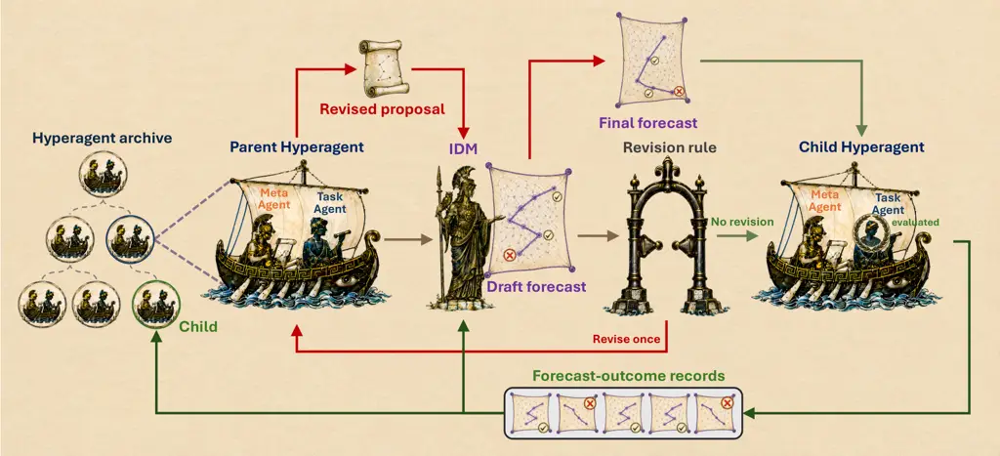

# Predict Before You Modify: Learning Improvement Dynamics for Self-Evolving Agents

Zixuan Xie  
University of Virginia xie.zixuan@email.virginia.edu    Chang Xu  
Microsoft Research chanx@microsoft.com ^(†)^(†)thanks: Corresponding
authors.    Yuhua Jiang  
Tsinghua University yh-jiang24@mails.tsinghua.edu.cn    Li Zhao^(\*)  
Microsoft Research lizo@microsoft.com

###### Abstract

Self-evolving agents improve through repeated cycles of modification and
evaluation. However, existing methods receive feedback on modifications
only after costly evaluations, and aggregate scores may obscure
distinctions between failures that require different repairs. We
introduce predictive self-evolution through an editable Improvement
Dynamics Model (IDM). Before evaluation, the IDM predicts task-level
outcomes of a proposed modification and guides an optional revision.
After evaluation, past modifications and their observed outcomes are
used to improve the IDM, allowing predictive knowledge to accumulate
across generations. The system can thus improve how it solves tasks,
proposes modifications, and predicts their effects. Building on
HyperAgents, we evaluate this approach across multilingual coding, paper
review, robotics reward design, and Olympiad-level mathematical grading.
Our approach outperforms HyperAgents across all four domains, with up to
46% higher average performance over generations. Gains also persist
under matched token budgets that include both agent evolution and task
evaluation, and extend to held-out tasks. Forecast accuracy improves as
the IDM evolves, and the learned predictive knowledge transfers to
improve evolution in a new domain.¹¹ 1 Code is available at
[https://anonymous.4open.science/r/Predictive-self-evolution/](https://anonymous.4open.science/r/Predictive-self-evolution/).

|     |
| --- |
|     |

## 1 Introduction

The capabilities of modern AI agents depend not only on their foundation
models, but also on the programs that determine how they reason, use
tools, maintain memory, and interact with their environments. Recent
work on agent self-evolution seeks to improve these programs
automatically by repeatedly modifying them, evaluating the resulting
agents on target tasks, and using the evaluation results to guide later
modifications (Zhang et al., 2025a; Zhang et al., 2026b). Yet, like
Odysseus navigating without Athena, these systems rely on costly
evaluations to discover the effects of their modifications. Predicting
those effects could help refine proposals before evaluation.

Past evaluations provide a basis for such predictions. The Darwin Gödel
Machine (DGM) (Zhang et al., 2025a) maintains an archive of evaluated
coding agents that can serve as parents for new branches. Related
methods share experience across branches or expose richer historical
evidence (Weng et al., 2026; Lee et al., 2026). HyperAgents (Zhang et
al., 2026b) extend DGM by combining a task agent and a meta agent in a
single editable program. The task agent solves the target tasks and is
evaluated on them, while the meta agent modifies both the task agent and
itself. With access to the archive and prior evaluations, the meta agent
can use experience from earlier generations to improve both task-solving
behavior and the process that generates future modifications.

Recent methods use this experience to guide proposal generation or
anticipate outcomes. DREvo (Guo et al., 2026) uses past modifications
and their outcomes to guide new proposals, while AHE (Lin et al., 2026)
records task-level expectations and checks them against subsequent
evaluations. AgentSquare (Shang et al., 2025) ranks recombined agent
candidates with an in-context performance predictor. These approaches do
not, however, use predicted task-level outcomes as feedback for revising
a draft before evaluation. We therefore seek to turn accumulated
experience into predictive feedback that helps refine proposals before
costly evaluation.

Using predictions to guide revision requires anticipating how a
modification will affect individual tasks, not just whether it will
improve the overall score. Building on HyperAgents (Zhang et al.,
2026b), we introduce predictive self-evolution with an Improvement
Dynamics Model (IDM), an editable program that invokes a frozen LLM to
forecast task-level outcomes from the current agent, a proposed code
change, and historical experience. These forecasts preserve distinctions
relevant to revision: an incorrect attempt and a missing output, for
example, may receive the same failure score but call for different
repairs. The predicted aggregate score determines whether to request one
additional revision from the meta agent, while the task-level forecasts
guide that revision. The resulting descendant’s task agent is then
evaluated. To improve forecasts as the agents themselves evolve, the
meta agent periodically edits the IDM’s forecasting code and
instructions using past modifications and discrepancies between their
predicted and observed outcomes from across generations and branches.
Candidate updates are adopted only if they improve prediction quality on
subsequently collected outcomes. Figure 1 illustrates this process.



Figure 1: An Athena for self-evolution. Like Athena guiding Odysseus,
the IDM anticipates task-level outcomes to guide an optional revision
before evaluation. Only the resulting child’s task agent is evaluated.
Final forecasts and observed outcomes provide evidence for improving the
IDM across generations.

Following HyperAgents (Zhang et al., 2026b), we evaluate predictive
self-evolution across four domains: multilingual coding (Gauthier,
2024), paper review (Zhao et al., 2026), robotics reward design (Genesis
Authors, 2024), and Olympiad-level mathematical grading (Luong et al.,
2025). Our contributions are as follows.

- •
  Predictive self-evolution. We introduce an editable IDM that forecasts
  task-level outcomes of proposed modifications and guides selective
  revision before evaluation. Its forecasting program evolves from
  experience alongside the task and meta agents.
- •
  Effective use of evolution budgets. Allocating part of the budget to
  predictive feedback improves evolution across four domains under
  matched token budgets covering evolution and task evaluation. Coding
  ablations support its value beyond an additional revision alone.
- •
  Transferable predictive knowledge. Evolution produces predictive
  knowledge reusable beyond the agents that generated it. IDM forecasts
  improve with experience, and transferring only the evolved IDM
  improves mathematical-grading evolution over a freshly initialized
  IDM, with identical initial task and meta agents.

## 2 Related Work

##### Automatic agent design and self-evolution.

Automatic agent design uses task feedback to search for effective
programs and workflows built around foundation models. Automated Design
of Agentic Systems (ADAS) (Hu et al., 2025) uses a meta agent to
discover agent programs in code, while AFlow (Zhang et al., 2025b)
searches over executable workflows using Monte Carlo tree search.
Reusing earlier discoveries is central to these searches. The Darwin
Gödel Machine (Zhang et al., 2025a) maintains an archive of evaluated
coding agents that can serve as starting points for further
self-modification, while Group-Evolving Agents (Weng et al., 2026)
organize evolution around groups that share experience across agents.
HyperAgents (Zhang et al., 2026b) extend evolution to the meta agent
responsible for generating modifications, allowing the improvement
procedure itself to change alongside the task agent. We extend
HyperAgents with an editable IDM that evolves alongside the task and
meta agents.

##### Learning from feedback and experience.

Self-Refine (Madaan et al., 2023) uses self-generated feedback to revise
the current output, while Reflexion (Shinn et al., 2023) retains verbal
reflections to guide later trials. Other approaches organize experience
for repeated reuse: Agentic Context Engineering (ACE) (Zhang et al.,
2025c) maintains evolving contextual playbooks, and ReasoningBank
(Ouyang et al., 2025) distills reusable reasoning strategies from
successful and failed experiences. Knowledge-Centric Self-Improvement
(KSI) (Wang et al., 2026) accumulates insights in a shared knowledge
base that generic agents use across tasks. Beyond supplying context for
task execution, feedback can also guide changes to the agent’s prompts
and programs. GEPA (Agrawal et al., 2026) reflects on execution
trajectories to propose and test prompt updates and combine
complementary improvements. For program modification, Meta-Harness (Lee
et al., 2026) gives the optimizer access to previous candidates’ source
code, scores, and execution traces. HarnessFix (Chen et al., 2026) and
Self-Harness (Zhang et al., 2026a) use execution traces to diagnose
failures and validate targeted harness repairs, whereas DREvo (Guo et
al., 2026) reassesses historical evidence against the current program
before distilling it into search directions.

##### Predictive models for agent improvement.

Predictive models have long been used to guide search and reduce
evaluation costs, including in surrogate-assisted evolutionary
optimization (Jin, 2011) and predictor-based neural architecture search
(Luo et al., 2018). At the program level, Neural Change Prediction
(Plein et al., 2026) learns from synthetic code mutations and their
observed effects to predict changes in program outputs. At the
task-execution level, WorldEvolver (Zhang et al., 2026c) forecasts
environment transitions to guide actions and updates predictive memory
from discrepancies between forecasts and observations. For agent
optimization, predictions can support candidate selection or make the
expected effects of edits explicit. AgentSquare (Shang et al., 2025)
uses an in-context performance predictor to rank candidates formed by
recombining existing agent modules, reducing the need for direct
evaluation. AHE (Lin et al., 2026) records expected fixes and
regressions for each edit and checks these predictions against
subsequent task-level outcomes. Our IDM instead uses forecasts of
task-level evaluation outcomes as feedback for revising a proposed
agent-program modification before evaluation. The meta agent also edits
the IDM’s forecasting code and instructions using past modifications and
prediction errors.

## 3 Predictive Self-Evolution

### 3.1 Archive-Based Self-Evolution

##### Agents and task evaluation.

Following HyperAgents (Zhang et al., 2026b), an _agent_ is any
computable program. A _Hyperagent_ combines a _task agent_ that solves
target tasks with a _meta agent_ that can modify both the task agent and
itself. For a fixed target domain $`d`$, let $`\mathcal{T}_{d}`$ denote
its finite set of evaluation tasks. Evaluating a Hyperagent $`h`$ runs
its task agent under the domain-specific evaluation protocols of
HyperAgents (Zhang et al., 2026b). Let $`s_{\tau}(h)`$ denote the
resulting score on task $`\tau\in\mathcal{T}_{d}`$, with higher scores
indicating better performance. We define the aggregate evaluation score
as

```math
y(h)\doteq\frac{1}{|\mathcal{T}_{d}|}\sum_{\tau\in\mathcal{T}_{d}}s_{\tau}(h). \tag{1}
```

Task scores may be binary or continuous and are averaged over repeated
trials where required by the evaluation protocol. Domain-specific
evaluation protocols and score aggregation are detailed in Appendix A.2.

##### Evolution process.

At generation $`t`$, the archive $`\mathcal{A}_{t}`$ forms a tree rooted
at the evaluated initial Hyperagent $`h_{0}`$, storing agents, scores,
and parent–child relations. A parent $`h_{p_{t}}`$ is sampled using the
fixed HyperAgents selection rule (Zhang et al., 2026b). Its meta agent
uses the archive and prior evaluations to propose a code diff
$`\delta_{t}`$. Applying this diff to a copy of the parent produces a
child $`h_{t+1}`$, which is evaluated and added to the archive. Earlier
agents remain available as parents. Our method adds predictive feedback
to guide an optional revision of the diff before child evaluation.

### 3.2 Improvement Dynamics Model

The IDM $`I`$ is an editable program that invokes a frozen LLM to
forecast task-level outcomes before evaluation. A single IDM serves all
archive branches within a run. Its forecasting code and instructions
evolve from past modifications and observed outcomes (Figure 2). Let
$`\mathbf{o}(h)`$ denote the task-level outcomes recorded when
evaluating a Hyperagent $`h`$. At generation $`t`$, the IDM receives the
archive $`\mathcal{A}_{t}`$, the selected parent $`h_{p_{t}}`$ and its
observed outcomes $`\mathbf{o}(h_{p_{t}})`$, and a proposed code diff
$`\delta`$. Writing $`h_{p_{t}}^{\delta}`$ for the child that would
result from applying this diff, we denote the IDM’s forecast by

```math
\mathbf{f}_{t}(I,\delta)\doteq I\!\left(\mathcal{A}_{t},h_{p_{t}},\mathbf{o}(h_{p_{t}}),\delta\right). \tag{2}
```

The forecast $`\mathbf{f}_{t}(I,\delta)`$ contains task-level outcome
probabilities and, where applicable, continuous performance estimates.
These forecasts distinguish outcomes that may receive the same task
score but call for different repairs, such as an incorrect solution and
a missing output. Domain-specific prediction targets and their
conversion to task scores are detailed in Appendix A.4.

Let $`\widehat{s}_{t,\tau}(I,\delta)`$ denote the expected task score
derived from the forecast for task $`\tau`$. Following the aggregation
used in task evaluation, the predicted score of the proposed child is

```math
\widehat{y}_{t}(I,h_{p_{t}}^{\delta})\doteq\frac{1}{|\mathcal{T}_{d}|}\sum_{\tau\in\mathcal{T}_{d}}\widehat{s}_{t,\tau}(I,\delta). \tag{3}
```

The predicted score determines whether to request one additional
revision, while the task-level forecast guides that revision.

Figure 2: Pipeline of predictive self-evolution. Upper: the IDM
forecasts a draft and guides at most one revision; revised diffs are
forecast again before evaluation. The final forecast and observed
outcomes form a record, and the child enters the archive. Lower:
accumulated records support candidate IDM updates, which replace the
current IDM only after validation on subsequently collected records.

### 3.3 IDM-Guided Hyperagent Evolution

As illustrated in the upper part of Figure 2, each generation $`t`$
begins with the meta agent in the selected parent $`h_{p_{t}}`$
proposing a draft diff $`\delta_{t}^{\mathrm{draft}}`$. The current IDM
$`I`$ remains fixed during this generation and produces the draft
forecast $`\mathbf{f}_{t}(I,\delta_{t}^{\mathrm{draft}})`$. We correct
the predicted score by subtracting an online estimate $`b`$ of the
current IDM’s prediction bias. Calibration details are provided in
Appendix A.4.2. A fixed revision rule shared across all branches
requests one additional revision when

```math
\widehat{y}_{t}\left(I,h_{p_{t}}^{\delta_{t}^{\mathrm{draft}}}\right)-b<y(h_{p_{t}}). \tag{4}
```

The revision rule allocates an additional revision to drafts whose
bias-corrected predicted scores fall below the parent’s observed score.
When revision is requested, the meta agent receives the draft forecast
and produces a revised diff $`\delta_{t}`$. Otherwise,
$`\delta_{t}=\delta_{t}^{\mathrm{draft}}`$. Following a revision, the
IDM forecasts the final diff once more so that the recorded prediction
corresponds to the modification actually evaluated. To limit
computation, we allow at most one revision before obtaining fresh
feedback from child evaluation.

The final diff and its forecast $`\mathbf{f}_{t}(I,\delta_{t})`$ are
recorded before evaluating the task agent in the resulting child
$`h_{t+1}=h_{p_{t}}^{\delta_{t}}`$. This evaluation proceeds regardless
of the final predicted score. The evaluated child is added to the
archive, and the completed generation yields the record

```math
z_{t}\doteq\left(\mathcal{A}_{t},h_{p_{t}},\mathbf{o}(h_{p_{t}}),\delta_{t},\mathbf{f}_{t}(I,\delta_{t}),\mathbf{o}(h_{t+1})\right). \tag{5}
```

The record preserves the inputs available to the IDM before evaluation
and pairs the final forecast with the observed child outcomes for
subsequent IDM updates.

### 3.4 Evolving the IDM

Task performance guides the evolution of task and meta agents, but does
not directly measure the IDM’s prediction accuracy. We therefore update
the IDM separately from the task and meta agents and share it across
archive branches, allowing records from different branches to improve
the same forecasting program. As illustrated in the lower part of
Figure 2, every $`K\geq 2`$ generations, the meta agent in the selected
Hyperagent uses the accumulated records to edit the current IDM’s
forecasting code and instructions, producing a candidate. We validate
the candidate on the next $`K`$ records, collected while the current IDM
remains deployed. Once the block is complete, the candidate makes its
forecasts using the recorded pre-evaluation inputs, without access to
later archive updates or the corresponding child outcomes.

To replace the current IDM, a candidate must reduce prediction loss in
the task forecasts used to guide revision. We measure this loss using
Brier loss (Brier, 1950) for probabilities and squared error for
continuous values, with domain-specific definitions given in
Appendix A.4. For the score that determines whether to revise, we also
require that centered mean squared error (CMSE) (Taylor, 2001) does not
increase. CMSE measures score prediction error after removing each IDM’s
mean bias on the validation block. If both conditions hold, the
candidate replaces the current IDM; otherwise, the current IDM remains
deployed. Upon replacement, the candidate’s mean bias on this block
initializes the online calibration offset $`b`$ described in
Section 3.3.

## 4 Experiments

We evaluate whether predictive self-evolution improves agent performance
under generation and token budgets. We then examine forecast accuracy
during evolution, cross-domain transfer of predictive knowledge, and the
contributions of individual components through coding ablations.

### 4.1 Experimental Setup

##### Initialization.

We use the initial Hyperagent from HyperAgents (Zhang et al., 2026b),
adding instructions that distinguish Hyperagent modifications from IDM
updates and specify the feedback available in each phase. The initial
IDM is instructed to predict task-level outcomes from proposed
modifications and available evidence. Implementation details and
instruction templates are provided in Appendix A.

##### Domains and evaluation protocol.

Following HyperAgents (Zhang et al., 2026b), we evaluate predictive
self-evolution across four domains: Polyglot coding (Gauthier, 2024),
paper review (Zhao et al., 2026), robotics reward design in Genesis
(Genesis Authors, 2024), and Olympiad-level mathematical grading using
IMO-GradingBench (Luong et al., 2025). Polyglot is evaluated
independently, paper review and robotics are optimized jointly, and
mathematical grading is the target setting for IDM transfer. Each method
is evaluated over five complete runs per setting, following HyperAgents
(Zhang et al., 2026b). Each run lasts 40 generations. Within each
setting, methods share the same initial Hyperagent, underlying
task-agent and meta-agent LLMs, task splits, evaluation protocol, and
parent-selection rule. Domain-specific evaluation protocols are detailed
in Appendix A, and IDM prediction formats and losses in Appendix A.4.

##### Baselines and variants.

We refer to our method as _Selective IDM_ in the experiments.
HyperAgents serves as the common baseline across the domains. It
evaluates the modified agent without requesting an additional revision
from the meta agent. On Polyglot, Reflective HyperAgents revises every
draft once without IDM feedback. We also evaluate two variants of our
method on this benchmark. Frozen Selective IDM retains selective
revision and online bias calibration but fixes the IDM to its initial
implementation. IDM Reflection uses feedback from the evolving IDM to
revise every draft once. For mathematical grading, Selective IDM starts
from the initial IDM, while Transferred IDM starts from an IDM evolved
jointly on paper review and robotics. Both conditions use the same
evolution procedure and initial task and meta agents.

##### Metrics and budgets.

Task performance is measured by the evaluation score defined for each
domain. The joint score is the equally weighted mean of paper-review
validation accuracy and robotics training fitness. To assess evolution
efficiency, we use the normalized area under the budget curve (AUBC),
which captures the benefit of discovering strong agents earlier. Let
$`F_{t}`$ denote the highest score among evaluated descendants available
after generation $`t`$. For a generation budget $`B`$, we define

```math
\operatorname{AUBC}(B)\doteq\frac{1}{B}\sum_{t=0}^{B-1}F_{t},\qquad F_{0}=0. \tag{6}
```

For matched-token comparisons, we compute AUBC at a common budget equal
to the reference baseline’s median full-run token cost. The reference is
HyperAgents for the main comparisons and Reflective HyperAgents for the
coding ablations. Token costs cover agent evolution and task evaluation.
Token accounting and budget matching are detailed in Appendix B.2.
Performance metrics are computed within each run before aggregation, and
we report medians over five complete runs. Individual-run results are
provided in Appendix B.3.

### 4.2 Improving Agent Evolution

##### Coding.

Using predicted outcomes to guide revision before evaluation helps
Selective IDM discover stronger agents earlier. On Polyglot, it achieves
a median AUBC of 0.306 over 40 generations, compared with 0.210 for
HyperAgents (Figure 3(a)). Under matched token budgets, median AUBC
remains 10.9% higher than that of HyperAgents (Figure 3(b)). This gain
supports using part of the token budget for predictive feedback before
evaluating modified agents.

On 166 held-out coding tasks, agents selected from Selective IDM runs
achieve a median gain of 13.25 percentage points over the common initial
agent, compared with 5.42 points for HyperAgents (Figure 3(c)). These
results show that the gains from predictive self-evolution extend to
tasks not used for modification or agent selection.

Figure 3: More effective coding evolution with gains on held-out tasks.
(a) AUBC as the generation budget increases. (b) AUBC under matched
token budgets, including tokens used for both agent evolution and task
evaluation. (c) Improvement in resolve rate over the common initial
agent on 166 held-out coding tasks, measured in percentage points (pp).
The initial agent’s resolve rate is 16.27%. Curves and bars show medians
over five runs. Shading and error bars indicate 95% run-level bootstrap
confidence intervals, computed pointwise in (a).

##### Paper review and robotics.

Joint evolution tests whether an IDM can guide improvement across tasks
with different evaluation signals. We jointly optimize paper review and
robotics reward design, with equal weight on paper-review validation
accuracy and robotics fitness. The predicted joint score determines
whether to request a revision, while task-level forecasts from both
domains guide the revision. Over 40 generations, Selective IDM achieves
higher median AUBC than HyperAgents for both domains and the joint
objective (Figure 4(a)). On paper review, median AUBC improves by 5.9%
over HyperAgents. Median joint AUBC also improves by 3.9%. The advantage
persists across all three measures under matched token budgets
(Figure 4(b)). Together with the coding results, these findings support
using an IDM to guide evolution across different task objectives.

Figure 4: Predictive guidance improves joint evolution across different
task objectives. AUBC under (a) a budget of 40 generations and (b)
matched token budgets. Paper and Robotics track the best evaluated
descendant for each domain. Joint tracks the highest joint score
attained by a single evaluated descendant. Bars show medians over five
runs, and error bars indicate 95% run-level bootstrap confidence
intervals. AUBC values are multiplied by 100. The vertical axes are
truncated.

### 4.3 Improving Forecasts during Evolution

Figure 5: IDM predictions improve during evolution. (a) Candidate and
current IDMs are compared on subsequent validation records in 28
comparisons across five Polyglot runs, including rejected candidates.
Blue points indicate lower candidate Brier loss. (b) Successive deployed
IDMs are evaluated on fixed modifications from generations 1–5 of
selected runs, with initial loss normalized to 100. Markers indicate
each version’s first deployment. Mathematical grading uses Selective
IDM.

We first examine whether IDM updates improve predictions for subsequent
modifications. On Polyglot, we compare candidate and current IDMs on the
same modification records collected after candidate construction. Across
five runs, candidates achieve lower Brier loss in 19 of 28 comparisons,
including both adopted and rejected candidates (Figure 5(a)). Editing
the IDM using past experience can improve its predictions beyond the
modifications used to construct the update.

We next compare successive deployed IDMs on a fixed set of historical
modifications from generations 1–5 of selected runs. The inputs,
observed outcomes, and scoring rules remain the same across versions. In
these comparisons across four domains, the final deployed version has
lower task-level prediction loss than the initial IDM, with reductions
of 8.7%–24.4% (Figure 5(b)). These results support accumulating reusable
predictive knowledge through IDM evolution. Appendices B.4 and B.5
examine modification information, forecast-guided revision, and IDM
evolution.

### 4.4 Transferring Predictive Knowledge across Domains

To test whether predictive experience remains useful in a new domain, we
transfer an IDM evolved jointly on paper review and robotics to
mathematical grading. We compare HyperAgents with two conditions:
Selective IDM starts from the initial IDM, whereas Transferred IDM uses
the same evolved IDM in all five transfer runs. Only the IDM is
transferred, while all three conditions use the same initial task and
meta agent implementations. Both conditions continue updating the IDM.

Selective IDM achieves higher median AUBC than HyperAgents under both
generation and token budgets. Transferred IDM improves further,
achieving 3.4% higher median AUBC than Selective IDM under the
generation budget and 2.3% higher under the matched token budget for
mathematical grading (Figure 6(a,b)). The benefit extends to held-out
tasks, where Transferred IDM increases median accuracy by 4 percentage
points over Selective IDM and 8 points over HyperAgents (Figure 6(c)).
These results support using the IDM to carry predictive experience
across domains and guide the evolution of newly initialized agents.

Figure 6: Predictive experience transfers to mathematical grading. AUBC
under (a) 40 generations and (b) a matched token budget for mathematical
grading. (c) Accuracy on 100 held-out tasks for agents selected by
validation performance. Bars show medians over five runs, with 95%
run-level bootstrap confidence intervals. AUBC values are multiplied by 100. The vertical axes are truncated.

### 4.5 Ablations and Revision Strategies

On Polyglot, we compare IDM Reflection with Reflective HyperAgents to
assess predictive feedback beyond revision alone. Both methods revise
every draft once. IDM Reflection achieves a higher median AUBC at 40
generations, supporting the value of predictive feedback (Figure 7).
This benefit extends beyond the best agents to the quality of generated
descendants (Appendix B.1). We next compare Selective IDM with Frozen
Selective IDM, which retains selective revision and online bias
calibration but keeps the forecasting program fixed. Updating the IDM
yields a higher median AUBC.

Both Selective IDM and IDM Reflection use an evolving IDM, but Selective
IDM gains an early AUBC advantage. At 40 generations, it achieves the
highest median AUBC among the four revision configurations while
requesting a median of 27 additional revision passes per run, compared
with 40 for IDM Reflection. Its median AUBC remains highest under a
matched token budget (Appendix B.2).

Figure 7: Effects of predictive feedback, IDM updates, and revision
strategy. Curves show median AUBC over five runs on Polyglot as the
generation budget increases. The left panel shows the complete
trajectory; the right panel enlarges the outlined region for budgets of
20–40 generations.

## 5 Conclusion

We introduced predictive self-evolution with an editable IDM that learns
from past modifications and their outcomes to guide revision before
evaluation. By making the forecasting program itself an object of
evolution, the system can accumulate and reuse predictive knowledge as
the agents continue to change. Experiments across four domains show more
effective evolution under matched budgets and support the transfer of
predictive knowledge to a new domain. Forecast accuracy also improves
with experience. Extending the IDM toward a world model of agent
evolution could help identify modification sequences whose early steps
offer little immediate gain but enable greater improvements in later
generations.

### AI use statement

In this work, we used generative AI tools for method implementation and
analysis and interpretation of results. We have not used generative AI
tools to develop research ideas or design the methodology or
experiments, and synthetic dataset generation and mathematical proofs
are not applicable to this work. Additionally, we used generative AI
tools for figure preparation and manuscript drafting and editing. We
have reviewed all AI-assisted work and take responsibility for the final
content, including AI-assisted text, code, and analyses.

### Ethics statement

We evaluate agent self-evolution on existing benchmarks, with robotics
experiments conducted in simulation. Paper-review and
mathematical-grading results concern benchmark performance, not
suitability for replacing human judgment. Deployment beyond these
settings would require safeguards for generated code and human oversight
of consequential decisions.

### Reproducibility statement

Section 3 specifies the evolution procedure and IDM updates. Appendix A
documents initialization, instruction templates, model configurations,
task splits, evaluation protocols, prediction losses, and statistical
reporting. Appendices B.3 and B.2 provide individual-run results and
token-budget accounting, respectively. Our code repository is at
[https://anonymous.4open.science/r/Predictive-self-evolution/](https://anonymous.4open.science/r/Predictive-self-evolution/).

## References

- Agrawal et al. (2026) L. A. Agrawal, S. Tan, D. Soylu, N. Ziems, R.
  Khare, K. Opsahl-Ong, A. Singhvi, H. Shandilya, M. J. Ryan, M.
  Jiang, C. Potts, K. Sen, A. G. Dimakis, I. Stoica, D. Klein, M.
  Zaharia, and O. Khattab GEPA: reflective prompt evolution can
  outperform reinforcement learning. In The Fourteenth International
  Conference on Learning Representations, Cited by: §2.
- Brier (1950) G. W. Brier Verification of forecasts expressed in terms
  of probability. Monthly Weather Review 78 (1), pp. 1–3. Cited by:
  §A.4.1, §3.4.
- Chen et al. (2026) M. Chen, J. Wang, Z. Liu, Y. Wang, and Q. Wang From
  failed trajectories to reliable LLM agents: diagnosing and repairing
  harness flaws. Arxiv Preprint. Cited by: §2.
- Gauthier (2024) P. Gauthier o1 tops aider’s new polyglot leaderboard.
  External Links: [Link](https://aider.chat/2024/12/21/polyglot.html)
  Cited by: §A.2, §1, §4.1.
- Genesis Authors (2024) Genesis Authors Genesis: a generative and
  universal physics engine for robotics and beyond. External Links:
  [Link](https://github.com/Genesis-Embodied-AI/genesis-world) Cited by:
  §A.2, §1, §4.1.
- Guo et al. (2026) H. Guo, W. Shi, Z. Chen, S. Xu, Y. Wang, Y.
  Zhang, W. Ni, J. Zhu, and S. Di DREvo: distilling recalibrated
  historical experience for harness self-evolution. Arxiv Preprint.
  Cited by: §1, §2.
- Hu et al. (2025) S. Hu, C. Lu, and J. Clune Automated design of
  agentic systems. In The Thirteenth International Conference on
  Learning Representations, Cited by: §2.
- Jin (2011) Y. Jin Surrogate-assisted evolutionary computation: recent
  advances and future challenges. Swarm and Evolutionary Computation 1
  (2), pp. 61–70. Cited by: §2.
- Lee et al. (2026) Y. Lee, R. Nair, Q. Zhang, K. Lee, O. Khattab,
  and C. Finn Meta-Harness: end-to-end optimization of model harnesses.
  Arxiv Preprint. Cited by: §1, §2.
- Lin et al. (2026) J. Lin, S. Liu, C. Pan, L. Lin, S. Dou, Z. Xi, X.
  Huang, H. Yan, Z. Han, T. Gui, and Y. Jiang Agentic harness
  engineering: observability-driven automatic evolution of coding-agent
  harnesses. Arxiv Preprint. Cited by: §1, §2.
- Luo et al. (2018) R. Luo, F. Tian, T. Qin, E. Chen, and T. Liu Neural
  architecture optimization. In Advances in Neural Information
  Processing Systems, Vol. 31. Cited by: §2.
- Luong et al. (2025) T. Luong, D. Hwang, H. H. Nguyen, G. Ghiasi, Y.
  Chervonyi, I. Seo, J. Kim, G. Bingham, J. Lee, S. Mishra, A. Zhai, H.
  Hu, H. Michalewski, J. Kim, J. Ahn, J. Bae, X. Song, T. H.
  Trinh, Q. V. Le, and J. Jung Towards robust mathematical reasoning. In
  Proceedings of the 2025 Conference on Empirical Methods in Natural
  Language Processing, Suzhou, China, pp. 35418–35442. Cited by: §A.2,
  §1, §4.1.
- Madaan et al. (2023) A. Madaan, N. Tandon, P. Gupta, S. Hallinan, L.
  Gao, S. Wiegreffe, U. Alon, N. Dziri, S. Prabhumoye, Y. Yang, S.
  Gupta, B. P. Majumder, K. Hermann, S. Welleck, A. Yazdanbakhsh, and P.
  Clark Self-Refine: iterative refinement with self-feedback. In
  Advances in Neural Information Processing Systems, Vol. 36. Cited by:
  §2.
- Ouyang et al. (2025) S. Ouyang, J. Yan, I. Hsu, Y. Chen, K. Jiang, Z.
  Wang, R. Han, L. T. Le, S. Daruki, X. Tang, V. Tirumalashetty, G.
  Lee, M. Rofouei, H. Lin, J. Han, C. Lee, and T. Pfister ReasoningBank:
  scaling agent self-evolving with reasoning memory. Arxiv Preprint.
  Cited by: §2.
- Plein et al. (2026) L. Plein, S. Zidane, J. Samhi, and A. Zeller
  Neural change prediction: relating software changes to their effects
  and vice versa. Arxiv Preprint. Cited by: §2.
- Shang et al. (2025) Y. Shang, Y. Li, K. Zhao, L. Ma, J. Liu, F. Xu,
  and Y. Li AgentSquare: automatic LLM agent search in modular design
  space. In The Thirteenth International Conference on Learning
  Representations, Cited by: §1, §2.
- Shinn et al. (2023) N. Shinn, F. Cassano, A. Gopinath, K. Narasimhan,
  and S. Yao Reflexion: language agents with verbal reinforcement
  learning. In Advances in Neural Information Processing Systems, Vol. 36. Cited by: §2.
- Taylor (2001) K. E. Taylor Summarizing multiple aspects of model
  performance in a single diagram. Journal of Geophysical Research:
  Atmospheres 106 (D7), pp. 7183–7192. Cited by: §A.4.2, §3.4.
- Wang et al. (2026) X. J. Wang, L. H. Yoon, C. Qu, A. Z. Wang, A.
  Sehgal, E. Mazumdar, and Y. Yue Knowledge-centric self-improvement.
  Arxiv Preprint. Cited by: §2.
- Weng et al. (2026) Z. Weng, A. Antoniades, D. Nathani, Z. Zhang, X.
  Pu, and X. E. Wang Group-evolving agents: open-ended self-improvement
  via experience sharing. Arxiv Preprint. Cited by: §1, §2.
- Zhang et al. (2026a) H. Zhang, S. Zhang, K. Li, C. Zhang, Y. Chen, Y.
  Zhang, L. Bai, and S. Hu Self-harness: harnesses that improve
  themselves. Arxiv Preprint. Cited by: §2.
- Zhang et al. (2025a) J. Zhang, S. Hu, C. Lu, R. Lange, and J. Clune
  Darwin Gödel machine: open-ended evolution of self-improving agents.
  Arxiv Preprint. Cited by: §1, §1, §2.
- Zhang et al. (2026b) J. Zhang, B. Zhao, W. Yang, J. Foerster, J.
  Clune, M. Jiang, S. Devlin, and T. Shavrina Hyperagents. Arxiv
  Preprint. Cited by: §A.1, §A.2, §A.3, Appendix A, §B.2, §1, §1, §1,
  §1, §2, §3.1, §3.1, §4.1, §4.1.
- Zhang et al. (2025b) J. Zhang, J. Xiang, Z. Yu, F. Teng, X. Chen, J.
  Chen, M. Zhuge, X. Cheng, S. Hong, J. Wang, B. Zheng, B. Liu, Y. Luo,
  and C. Wu AFlow: automating agentic workflow generation. In The
  Thirteenth International Conference on Learning Representations, Cited
  by: §2.
- Zhang et al. (2025c) Q. Zhang, C. Hu, S. Upasani, B. Ma, F. Hong, V.
  Kamanuru, J. Rainton, C. Wu, M. Ji, H. Li, U. Thakker, J. Zou, and K.
  Olukotun Agentic context engineering: evolving contexts for
  self-improving language models. Arxiv Preprint. Cited by: §2.
- Zhang et al. (2026c) X. Zhang, W. Zhang, S. Ng, and Y. Deng
  Self-evolving world models for LLM agent planning. Arxiv Preprint.
  Cited by: §2.
- Zhao et al. (2026) B. Zhao, J. Zhang, C. Whitehouse, M. Jiang, M.
  Shvartsman, A. Charnalia, D. Magka, T. Shavrina, D. Dunfield, O. Mac
  Aodha, and Y. Bachrach APRES: an agentic paper revision and evaluation
  system. Arxiv Preprint. Cited by: §A.2, §1, §4.1.

## Appendix A Experimental Details

Our implementation builds on the released HyperAgents codebase (Zhang et
al., 2026b). We retain its parent-selection rule and domain evaluators.

### A.1 Initialization and Instructions

Following HyperAgents (Zhang et al., 2026b), we keep the initial
programs simple to leave room for strategies to develop through
evolution. The instructions specify each component’s role, available
inputs and tools, and required outputs, with separate meta-agent
instructions distinguishing Hyperagent modification from IDM updates. We
use this initialization approach across domains, adapting task
descriptions, inputs, and required outputs to each domain. The initial
instruction templates are shown below.

#### A.1.1 Initial Components

##### Task agent.

For paper review, robotics, and mathematical grading, the initial task
agent receives domain-specific inputs through the following instruction:

You are an agent.

Task input:

{inputs}

Return one JSON object. The response value must be a string containing
your answer.

Do not wrap the JSON in Markdown fences or XML tags.

{

"response": "your answer"

}

The coding task agent additionally receives repository-editing
instructions with access to shell and file-editing tools.

##### Meta agent.

The meta agent receives the codebase location and access to previous
evaluation results. When available, archived predictions and observed
outcomes are also accessible, and a prediction-error report is included
in the request. The initial instruction includes:

Modify any part of the codebase at ‘{repo_path}‘. Evaluation results and
prior generation outputs are stored at ‘{eval_path}‘.

A read-only audited reaction-history substrate is available at
‘{reaction_archive_path}‘; inspect it only when useful.

This is the task-improvement phase: the modification you produce now is
what gets evaluated on the benchmark, so it must change how tasks are
solved. ‘intervention_model.py‘ forecasts the evaluation state a
modification produces and is revised in a separate phase; edits to it
are discarded here.

For IDM updates, the same meta agent starts a fresh session with the
current IDM, archived modifications and their predicted and observed
outcomes, and a prediction-error report when available. Edits are
restricted to the IDM. The update instruction includes:

The benchmark modification for this generation has already been
evaluated; edits you make now are not scored on the benchmark and take
effect for later generations. Edits to any other file are discarded.

##### IDM.

Across domains, the IDM is instructed to predict evaluation outcomes
from the proposed modification and its expected behavioral consequences.
A representative initial system prompt is:

You are the IDM of a self-evolving agent.

Predict the evaluation outcomes of the proposed code modification.

Ground your predictions in the affected code and its expected

behavioral consequences. Include a brief explanation.

Do not write code.

#### A.1.2 Revision Feedback to the Meta Agent

An additional revision pass continues the same meta-agent session after
a draft has been produced, preserving the draft and interaction history.
Reflective HyperAgents requests this pass for every draft without
invoking the IDM, using the following instruction:

Reconsider the draft modification using only the information already
available. Check for likely failure modes and revise the draft if
warranted. No new evaluation feedback is available.

When the revision rule requests an additional revision pass, Selective
IDM uses the same reconsideration instruction and appends the IDM
feedback:

Prospective IDM prediction (information unavailable to the reflection
control; use it as a hypothesis, not as evaluation feedback):

--- BEGIN IDM PREDICTION ---

{delivered forecast}

--- END IDM PREDICTION ---

IDM Reflection uses the same forecast feedback for every draft.
Prediction formats, losses, calibration, and update validation are
described in Appendix A.4.

### A.2 Domains and Evaluation Protocols

We use the domain evaluators of HyperAgents (Zhang et al., 2026b), with
task splits and evaluation scores summarized in Table 1. The task scores
$`s_{\tau}(h)`$ in equation 1 are specified below.

| Domain                 | Train | Validation | Held-out | Evolution score     |
| ---------------------- | ----- | ---------- | -------- | ------------------- |
| Polyglot coding        | 60    | –          | 166      | Resolve rate        |
| Paper review           | 100   | 100        | –        | Validation accuracy |
| Robotics reward design | 6     | –          | –        | Training fitness    |
| Mathematical grading   | 100   | 100        | 100      | Validation accuracy |

Table 1: Task splits and scores used in our experiments. Robotics counts
refer to repeated reward-design trials on the same control task.

##### Coding.

Polyglot (Gauthier, 2024) requires the task agent to produce a patch
that passes the task’s test suite. The task score $`s_{\tau}(h)`$ is 1
if the submitted patch passes the benchmark tests and 0 otherwise. We
report pass@1 resolve rate, with no feedback from the final benchmark
evaluation returned during the attempt. Evaluation starts with a fixed
subset of 10 evolution tasks, shared across methods, and proceeds to
full evaluation if at least four preliminary tasks are resolved. Archive
scores use all 60 tasks as the denominator, with unevaluated tasks
contributing zero. For coding, both the predicted score and the observed
parent score in equation 4 are computed on the same ten preliminary
tasks. Forecast evaluation uses only tasks with observed outcomes,
matching predictions and observations on the same instances. After
evolution, we select the evaluated descendant with the highest evolution
score in each run, breaking ties by the earliest generation. The
selected agent is evaluated on 166 disjoint held-out tasks, which are
not used for modification or selection.

##### Joint paper review and robotics.

Paper review and robotics are optimized within the same evolution run.
For paper review, the task agent receives a research paper and predicts
acceptance or rejection (Zhao et al., 2026). The task score
$`s_{\tau}(h)`$ is 1 if the prediction matches the recorded conference
decision and 0 otherwise.

For robotics reward design, the task agent generates a Python reward
function for quadruped velocity tracking in Genesis (Genesis Authors,
2024). Each trial trains a new control policy using proximal policy
optimization. The task score $`s_{\tau}(h)`$ is the trial fitness, which
aggregates the fixed tracking score $`\exp[-4(v_{x}-v_{x}^{*})^{2}]`$,
where $`v_{x}`$ and $`v_{x}^{*}`$ are the achieved and commanded forward
velocities, following the upstream evaluation procedure. The robotics
score averages these task scores, with task-agent failures scored as
zero and identified infrastructure failures excluded.

Each Hyperagent’s joint score averages its paper-review validation
accuracy and robotics training fitness with equal weight. Preliminary
evaluation uses 10 training and 10 validation papers and three robotics
trials. If both domains obtain positive preliminary training scores,
evaluation expands to 100 training papers, 100 validation papers, and
six robotics trials. Otherwise, the preliminary paper-review validation
accuracy and mean robotics fitness are multiplied by $`10/100`$ and
$`3/6`$, respectively, before computing the joint score.

##### Mathematical grading.

IMO-GradingBench (Luong et al., 2025) provides an Olympiad-level
problem, a proposed solution, reference solutions, and grading
guidelines. The task agent assigns a grade from $`\{0,1,6,7\}`$,
corresponding to incorrect, partially correct, almost correct, and
correct solutions, respectively. The task score $`s_{\tau}(h)`$ is 1 if
the predicted grade exactly matches the expert grade and 0 otherwise.
Preliminary evaluation uses 10 training and 10 validation tasks and
expands to 100 tasks in each split if at least one training prediction
matches the expert grade. Validation accuracy guides evolution. For
held-out evaluation, we select the descendant with the highest
validation accuracy among those evaluated on all 100 validation tasks in
each run, breaking ties by the earliest generation.

### A.3 Experimental Conditions

Each experimental condition consists of five runs of 40 generations.
Within each setting, methods use the same initial task and meta agents,
task splits, evaluators, and parent-selection rule. They also share the
same model assignments and initial model-call configurations. The
underlying LLM weights remain fixed throughout evolution. For conditions
with an evolving IDM, update proposals are scheduled every $`K=5`$
generations.

##### Parent selection.

We use the parent-selection rule of HyperAgents (Zhang et al., 2026b).
The initial Hyperagent and valid evaluated descendants are eligible for
selection. At generation $`t`$, let $`\bar{y}_{t}`$ denote the mean of
the three highest evaluation scores among eligible parents, using all
available scores when fewer than three are eligible. For an archived
Hyperagent $`h`$, let $`n_{t}(h)`$ denote the number of its direct
children recorded in the archive. We sample the parent with probability
proportional to

```math
w_{t}(h)=\exp\!\left[-\left(\frac{n_{t}(h)}{8}\right)^{3}\right]\frac{1}{1+\exp\!\left[-10\left(y(h)-\bar{y}_{t}\right)\right]}, \tag{7}
```

where $`y(h)`$ is the aggregate evaluation score defined in equation 1.
The weights are normalized over eligible parents. This rule favors
higher-scoring Hyperagents while reducing repeated expansion of parents
that have already produced many children.

##### Models and generation settings.

Table 2 summarizes the initial model assignments. GPT-5.4 calls use high
reasoning effort. Across domains, the shared LLM interface defaults to
an output limit of 16,384 tokens per call. Temperature is set to 0.0 for
Claude and left unspecified for GPT-4o and o3-mini. The shared tool
framework defaults to a maximum of 40 tool calls per attempt.

| Setting              | Task agent | Meta agent and IDM |
| -------------------- | ---------- | ------------------ |
| Polyglot coding      | o3-mini    | Claude Sonnet 4.6  |
| Joint: paper review  | GPT-4o     | GPT-5.4            |
| Joint: robotics      | GPT-5.4    | GPT-5.4            |
| Mathematical grading | GPT-4o     | GPT-5.4            |

Table 2: Initial LLM assignments across experimental settings.

##### Baselines and variants.

On Polyglot, we compare Selective IDM with HyperAgents, Reflective
HyperAgents, and two IDM variants, as summarized in Table 3. HyperAgents
proceeds from a proposed modification to evaluation without an
additional revision pass. Reflective HyperAgents and IDM Reflection both
revise every draft once using the same reconsideration instruction, with
IDM Reflection additionally receiving the IDM forecast. Frozen Selective
IDM fixes the forecasting program while retaining selective revision and
online bias calibration. On Polyglot, all IDMs share the same
initialization.

| Method                 | IDM feedback | Revision rule | IDM updates |
| ---------------------- | ------------ | ------------- | ----------- |
| HyperAgents            | No           | None          | –           |
| Reflective HyperAgents | No           | Always        | –           |
| IDM Reflection         | Yes          | Always        | Yes         |
| Frozen Selective IDM   | Yes          | Selective     | No          |
| Selective IDM          | Yes          | Selective     | Yes         |

Table 3: Baselines and variants compared on Polyglot. “Always” requests
one revision for every draft. “Selective” requests one revision
according to the revision rule.

Joint evolution compares HyperAgents with Selective IDM. Mathematical
grading compares HyperAgents, Selective IDM, and Transferred IDM, a
variant of Selective IDM initialized with an IDM evolved jointly on
paper review and robotics. Only the IDM is transferred. Both conditions
use the same initial task and meta agents, start with fresh calibration
state and interaction history, and continue updating the IDM.

We selected an evolved IDM based on source-domain prediction
improvements and a preference for fewer domain-specific heuristics. This
selection preceded the mathematical-grading experiments, and the same
IDM initializes all five transfer runs. Its evolved forecasting
instructions include:

Start from the parent’s recorded state or metric for each

instance, but treat that as a baseline to update rather

than a label to copy.

...

Do not anchor on parent labels or opaque instance IDs when

the same changed code governs many instances together.

These instructions are transferred unchanged, without adding
mathematical-grading-specific heuristics. Tool-budget finalization and
final-answer handling are aligned with those of the initial IDM.

### A.4 IDM Implementation and Evaluation

The IDM predicts task outcomes using domain-specific formats and losses.
Its forecasting program is editable, while the outcome definitions and
prediction losses remain fixed.

#### A.4.1 Prediction Formats and Losses

##### Prediction outputs.

For coding, paper review, and mathematical grading, the IDM returns a
normalized probability distribution over the outcome classes in Table 4
for each evaluation task. The predicted task score is the probability of
resolved for coding and correct for paper review and mathematical
grading.

Domain Outcome Meaning Coding resolved A patch is produced and passes
the benchmark tests. unresolved A patch is produced but does not pass
the benchmark tests. incomplete The task-agent run does not finish.
empty_patch The task-agent run finishes without producing a patch. Paper
review and mathematical grading correct The task agent predicts the
correct decision or grade. incorrect The task agent returns a valid but
incorrect decision or grade. invalid The task-agent response is missing
or unusable.

Table 4: Categorical outcomes predicted by the IDM.

For each robotics trial, the IDM predicts the probability
$`p_{\mathrm{invalid}}`$ that the generated reward function is unusable
and the expected fitness $`m`$ conditional on the reward function being
usable, with both values in $`[0,1]`$. Since an unusable reward function
receives zero fitness, the predicted trial score is
$`(1-p_{\mathrm{invalid}})m`$.

In paper review, robotics, and mathematical grading, the IDM is
instructed to provide brief structured explanations alongside its
forecasts, while explanations are optional in coding. Only the numerical
forecasts are scored.

##### Task-level prediction losses.

For categorical predictions, let $`\mathcal{C}_{d}`$ denote the outcome
classes in domain $`d`$, $`\mathbf{p}=(p_{c})_{c\in\mathcal{C}_{d}}`$
the predicted probability distribution, and $`c^{*}`$ the observed
outcome. The multiclass Brier loss (Brier, 1950) is

```math
\ell_{\mathrm{Brier}}(\mathbf{p},c^{*})\doteq\sum_{c\in\mathcal{C}_{d}}\left(p_{c}-\mathbf{1}\{c=c^{*}\}\right)^{2}. \tag{8}
```

Coding uses this loss directly. Paper review and mathematical grading
use half of this loss, placing it in $`[0,1]`$ and matching the range of
the robotics loss below.

For robotics, let $`s`$ denote the observed trial fitness and let
$`z_{\mathrm{invalid}}`$ be 1 if the reward function is unusable and 0
otherwise. The prediction loss is

```math
\ell_{\mathrm{robotics}}\doteq\frac{1}{2}\left[\left(p_{\mathrm{invalid}}-z_{\mathrm{invalid}}\right)^{2}+\left((1-p_{\mathrm{invalid}})m-s\right)^{2}\right]. \tag{9}
```

The two terms measure error in the invalidity probability and predicted
trial fitness, respectively.

##### Aggregate prediction loss.

For domain $`d`$, let $`N_{d}`$ denote the number of scored predictions
across the evaluation block. For IDM $`I`$, let $`\ell_{d,i}(I)`$ denote
the loss of prediction $`i`$, using the corresponding domain loss
defined above. The mean prediction loss within the domain is

```math
\mathcal{L}_{d}(I)\doteq\frac{1}{N_{d}}\sum_{i=1}^{N_{d}}\ell_{d,i}(I). \tag{10}
```

For coding and mathematical grading,
$`\mathcal{L}(I)=\mathcal{L}_{d}(I)`$. For joint evolution, we give the
two domains equal weight:

```math
\mathcal{L}(I)\doteq\frac{1}{2}\left[\mathcal{L}_{\mathrm{paper}}(I)+\mathcal{L}_{\mathrm{robotics}}(I)\right]. \tag{11}
```

#### A.4.2 Update Validation and Calibration

Following Section 3.4, we compare candidate and current IDMs on the same
$`K`$ records, collected after candidate construction while the current
IDM remains deployed. Let $`\mathcal{V}_{k}`$ index the validation
records for update $`k`$, and let $`\mathcal{S}_{j}`$ denote the
observed evaluation instances in record $`j`$. We write
$`y(h;\mathcal{S}_{j})`$ and $`\widehat{y}_{j}(I,h;\mathcal{S}_{j})`$
for observed and predicted scores computed on this set, with equal
domain weights in joint evolution. For either IDM $`I`$, we compute
score prediction errors before applying the calibration offset, and
define the block’s mean bias and centered mean squared error as

```math
\displaystyle e_{j}(I) \displaystyle\doteq\widehat{y}_{j}\!\left(I,h_{p_{j}}^{\delta_{j}};\mathcal{S}_{j}\right)-y(h_{j+1};\mathcal{S}_{j}), \tag{12}
```

```math
\displaystyle b_{k}(I) \displaystyle\doteq\frac{1}{K}\sum_{j\in\mathcal{V}_{k}}e_{j}(I),
```

```math
\displaystyle\operatorname{CMSE}_{k}(I) \displaystyle\doteq\frac{1}{K}\sum_{j\in\mathcal{V}_{k}}\left(e_{j}(I)-b_{k}(I)\right)^{2}.
```

CMSE measures the residual score prediction error after removing the
mean bias within the block (Taylor, 2001). The candidate replaces the
current IDM only if it lowers the aggregate prediction loss
$`\mathcal{L}(I)`$ without increasing CMSE. The comparison requires
complete, valid forecasts from both IDMs for all required instances.
Outcome probabilities must form normalized distributions, and numerical
predictions must be finite. Figure 5(a) includes all 28 comparisons with
complete, valid forecasts from both IDMs within the five 40-generation
Polyglot runs. Six archived comparisons from post-budget continuations
are excluded.

The calibration offset is initialized to $`b=0`$ at the start of a run.
Before each revision decision, $`b`$ is re-estimated as the mean signed
score prediction error over valid past records from the current IDM.
Errors are computed from uncalibrated predicted scores, with positive
values indicating overprediction. For coding, this online estimate uses
predictions and observed outcomes on the same fixed ten-task set as the
revision decision, even when additional tasks are evaluated. Upon
promotion, the candidate’s validation-block bias $`b_{k}(I)`$
initializes $`b`$ until valid online records from the new IDM become
available. Frozen Selective IDM follows the same online calibration rule
while keeping its forecasting program fixed.

### A.5 Budgets, Metrics, and Statistical Reporting

We compute task-performance and prediction-error metrics within each
evolution run before summarizing results across runs.

##### AUBC.

Generation-based AUBC follows equation 6. Under both generation and
token budgets, the performance frontier excludes the initial Hyperagent
and starts at zero. It changes only after a descendant’s evaluation
completes and remains constant between evaluations.

Token budgets count input and output tokens used for agent evolution and
task evaluation, including IDM forecasting, updates, and validation. For
each comparison, the common budget is the median total token cost of
five complete 40-generation runs of the reference baseline. We use
HyperAgents as the reference for the main comparisons and Reflective
HyperAgents for the coding ablations. This anchors the comparison to the
typical cost of a complete baseline run while reducing sensitivity to
unusually high or low run costs.

Let $`B`$ denote the common token budget and $`F_{r}(c)`$ the
best-so-far score in run $`r`$ at cumulative token use $`c`$. We compute

```math
\operatorname{AUBC}_{\mathrm{token},r}(B)\doteq\frac{1}{B}\int_{0}^{B}F_{r}(c)\,\mathrm{d}c. \tag{13}
```

If a run finishes below the token budget, its final frontier value is
held constant up to the budget. Budget values and additional
matched-token comparisons are provided in Appendix B.2.

##### Statistical reporting.

We report medians over five complete runs. Where shown, 95% bootstrap
confidence intervals are obtained by resampling runs with replacement.
For curves, entire runs are resampled together across budget points, and
the intervals are pointwise. Coding and mathematical-grading
task-performance plots use 1,000 resamples. Intervals in Table 7 use an
exact percentile bootstrap with runs resampled independently within each
method.

## Appendix B Additional Results and Analysis

### B.1 Quality of Generated Descendants

For each coding run, we compute every descendant’s resolve rate on the
same ten preliminary tasks and average these rates over all 40
generations, including generations that solve no tasks. We also measure
the fraction of generations that reach full evaluation by solving at
least four of the ten tasks. Table 5 summarizes all five configurations.

| Method                 | Mean resolve rate (%) | Full-evaluation generations (%) |
| ---------------------- | --------------------- | ------------------------------- |
| HyperAgents            | 17.00                 | 5.0                             |
| Reflective HyperAgents | 29.25                 | 35.0                            |
| IDM Reflection         | 36.50                 | 57.5                            |
| Frozen Selective IDM   | 28.25                 | 30.0                            |
| Selective IDM          | 29.50                 | 45.0                            |

Table 5: Quality of generated coding descendants. Values are
percentages, reported as medians over five runs. Each metric is computed
within a run over all 40 generations.

Selective IDM improves the quality of descendants produced throughout
coding evolution. The median run-level mean resolve rate increases from
17.00% for HyperAgents to 29.50% for Selective IDM, while the median
fraction of generations reaching full evaluation rises from 5.0% to
45.0%. These gains show that predictive guidance improves not only the
best agents tracked by AUBC, but also the broader set of descendants
generated during evolution.

Predictive feedback also improves descendant quality when both methods
revise every draft once. IDM Reflection achieves a median run-level mean
resolve rate of 36.50%, compared with 29.25% for Reflective HyperAgents,
and more generations reach full evaluation. Selective IDM likewise
exceeds Frozen Selective IDM on both measures, supporting the
contribution of IDM updates to the quality of generated descendants.

### B.2 Token Costs and Matched-Token Ablations

Following HyperAgents (Zhang et al., 2026b), we report token costs for
agent evolution and task evaluation, estimated from interaction logs.
Table 6 summarizes mean costs over five complete 40-generation runs.
Using HyperAgents as the reference gives matched-token budgets of 44.21M
for coding, 111.98M for joint evolution, and 69.36M for mathematical
grading.

|         |                        |                 |
| ------- | ---------------------- | --------------- |
| Setting | Method                 | Mean tokens (M) |
| Coding  | HyperAgents            | 49.45           |
|         | Reflective HyperAgents | 138.56          |
|         | Frozen Selective IDM   | 134.62          |
|         | IDM Reflection         | 207.58          |
|         | Selective IDM          | 170.22          |
| Joint   | HyperAgents            | 101.67          |
|         | Selective IDM          | 140.61          |
| Math    | HyperAgents            | 69.46           |
|         | Selective IDM          | 99.13           |
|         | Transferred IDM        | 104.15          |

Table 6: Token costs of complete evolution runs. Values are mean
estimated token counts over five 40-generation runs, in millions.
Initialization, independent held-out evaluation, and post-hoc analyses
are excluded.

For the coding ablations, Reflective HyperAgents serves as the
reference, giving all four configurations a common budget of 145.79M
tokens. Selective IDM achieves the highest median AUBC under this
budget, exceeding Reflective HyperAgents, Frozen Selective IDM, and IDM
Reflection by 3.9%, 2.9%, and 3.6%, respectively (Figure 8). Its mean
cost over complete 40-generation runs is also 18.0% lower than that of
IDM Reflection. These results support using an evolving IDM to allocate
revision effort selectively, improving performance under a matched
budget while reducing the cost relative to unconditional IDM-guided
revision.

Figure 8: Selective IDM retains its advantage under a matched token
budget. Bars show median AUBC over five runs on Polyglot at a common
budget of 145.79M tokens. The vertical axis is truncated.

### B.3 Run-Level Results

The individual-run results complement the aggregate comparisons in
Section 4. Figures 9, 10, and 11 report AUBC under 40-generation and
matched-token budgets. Each method contributes five complete runs;
circles show individual results and horizontal segments mark their
median.

##### Coding.

Selective IDM’s advantage over HyperAgents extends across the five runs.
All five Selective IDM runs exceed the HyperAgents median under both
budgets (Figure 9). Selective IDM also achieves the highest median AUBC
among the revision strategies under both budgets. Table 7 reports the
differences in median AUBC relative to Reflective HyperAgents, Frozen
Selective IDM, and IDM Reflection.

Figure 9: Individual-run results for coding. AUBC on Polyglot under (a)
40 generations and (b) a common budget of 145.79M estimated tokens. The
token budget is the median cost of five complete Reflective HyperAgents
runs and is shared by all five methods. AUBC values are multiplied by 100. The vertical axes are truncated.

| Comparator             | 40 generations            | Matched tokens           |
| ---------------------- | ------------------------- | ------------------------ |
| Reflective HyperAgents | $`4.42\;[-6.54,\,9.25]`$  | $`1.21\;[-6.32,\,4.79]`$ |
| Frozen Selective IDM   | $`2.67\;[-3.29,\,7.62]`$  | $`0.92\;[-4.73,\,2.64]`$ |
| IDM Reflection         | $`1.71\;[-14.17,\,5.46]`$ | $`1.13\;[-9.78,\,2.85]`$ |

Table 7: Median coding AUBC differences: Selective IDM minus each
comparator. Each entry is Selective IDM minus the comparator, followed
by its 95% run-level bootstrap interval. Values are absolute AUBC
differences multiplied by 100, not relative percentage gains. The token
budget is 145.79M for all methods.

##### Joint evolution.

Selective IDM achieves higher median AUBC for paper review, robotics,
and the joint objective under both budgets (Figure 10). The gains are
observed in both constituent domains as well as in the joint score used
to guide evolution.

Figure 10: Individual-run results for joint evolution. AUBC for paper
review, robotics, and the joint objective under (a) 40 generations and
(b) a common budget of 111.98M estimated tokens. AUBC values are
multiplied by 100. The vertical axes are truncated.

##### Mathematical grading.

Transferred IDM achieves the highest median AUBC under both budgets
(Figure 11). Under each budget, four of the five transfer runs exceed
the median of Selective IDM initialized from scratch. The benefit of
predictive experience is therefore observed across multiple
target-domain runs initialized with the same source-domain IDM.

Figure 11: Individual-run results for mathematical grading. AUBC under
(a) 40 generations and (b) a common budget of 69.36M estimated tokens.
AUBC values are multiplied by 100. The vertical axes are truncated.

### B.4 Contribution of Modification Information

The IDM forecasts the consequences of a proposed change using evidence
from the modification itself. To examine the value of this information,
we compare normal forecasts with a _No-diff_ condition that withholds
the diff and modified source code while retaining parent code, parent
outcomes, and historical records. The comparison covers generations 10,
20, and 30 from each of five joint evolution runs, yielding 15
modifications, with the same IDM version, model configuration, and
recorded outcomes used for each paired comparison.

Access to modification information reduces mean prediction loss by
16.18% for paper review and 19.98% for robotics, yielding a 16.25%
reduction in joint loss (Figure 12). These gains support grounding
forecasts in the proposed code change, which provides information about
its consequences beyond the parent’s observed performance and historical
outcomes.

Figure 12: Modification information improves IDM forecasts. Relative
reduction in mean prediction loss compared with No-diff, which withholds
the diff and modified source code while retaining parent code, parent
outcomes, and historical records. Comparisons use the same deployed IDM
for each of 15 evaluated modifications from five joint evolution runs.
Joint loss weights the two domains equally before computing the relative
reduction.

### B.5 Evolution Case Studies

Figure 13 illustrates how task-solving strategies and forecasting rules
evolve within a coding run. Along the lineage leading to the final best
agent, modifications provide source code and tests before editing, avoid
repeated test attempts when no tests are available, and preserve spaces
in text-transposition tasks. These changes address both the agent’s
general workflow and the requirements of specific tasks.

The IDM also develops more explicit criteria for forecasting
modification outcomes. Its first update requires a concrete
justification for assigning success probabilities above 70%, while the
second increases the predicted risk of unfinished runs. Mean prediction
loss decreases across the deployed versions. This example illustrates
how evolution can refine both task-solving behavior and the forecasting
rules used to guide subsequent modifications.

Figure 13: Task strategies and forecasting rules evolve within the same
run. (a) Best and mean archive scores, together with the lineage leading
to the final best agent. (b) Mean online prediction loss during each IDM
version’s deployment period. Annotations summarize selected changes to
the task agent and the IDM.

##### Forecast-guided revision.

Figure 14 illustrates how predictive feedback guides different kinds of
revision. In Coding, a prompt edit left instruction text outside a
string literal, introducing a syntax error. The meta agent had noticed
the damage but reached its tool-call limit before completing the repair.
The IDM assigned a probability of 0.88 to incomplete across the task
set, and its forecast triggered revision. The meta agent responded by
checking the file’s syntax and repairing the string boundaries. The
final version passed the syntax check and resolved 11 tasks.

In an earlier joint-evolution run, a Paper review modification
normalized one form of backslash-newline artifact in extracted paper
text. The IDM noted that this format-specific change would likely leave
most instances unaffected. During revision, the meta agent inspected
saved paper inputs and found embedded prompt-template text that remained
after the initial cleanup. It extended the truncation markers to remove
these templates and examples. Together, the cases illustrate how
forecasts can guide both execution repair and the scope of a proposed
modification.

Figure 14: Forecast-guided revision across tasks. In Coding, a forecast
of widespread incomplete execution prompts syntax repair. In Paper
review, a forecast of limited applicability is followed by an expanded
preprocessing change.

##### Learning to use historical experience.

IDM evolution can also change how past outcomes inform future
predictions. In the Coding case in Figure 15, the evolved program adds
code that reads archived task outcomes, computes per-task outcome
frequencies, and includes these summaries in subsequent forecast inputs.
Its updated instructions use these frequencies as priors while allowing
specific evidence from the proposed modification to change the
prediction. A later deployed forecast explicitly invokes these priors.

The figure also compares the original and updated IDMs on the same
historical modification for Python Beer Song. In this comparison, the
success probability decreases from 57% to 32%, while the probability of
a patch failing its tests increases from 34% to 58%. The submitted patch
failed its tests, so the highest-probability prediction changes from
incorrect to correct. On a separate validation block collected after the
update was proposed, the updated IDM also reduces Brier loss from 0.6169
to 0.5951. This case illustrates how evolution can encode historical
experience in the forecasting program and improve its assessment of
modification outcomes.

Figure 15: Learning to use historical outcomes in forecasting. The
evolved IDM adds per-task outcome summaries to its forecast inputs; the
quotation shows their use in a later online forecast. The lower panel
separately compares the original and updated IDMs on the same historical
modification. The updated IDM’s highest-probability prediction matches
the observed test failure.
