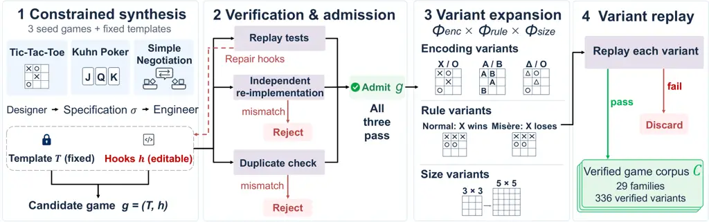

# GameSmith: Scaling Zero-Sum Self-Play with Synthesised Games

Weixian Waylon Li Email: <lmttguoyiwen89@gmail.com>    Jiaxin Zhang   
Han Zhou    Chengzu Li    Ke Wang    Fengxiang He    Yiwen Guo
Affiliation: University of Edinburgh LIGHTSPEED University of Cambridge
Independent Researcherwaylon.li@ed.ac.uk jiaxijzhang@global.tencent.com
fhe@ed.ac.uk

###### Abstract

Post-training large language models (LLMs) on two-player zero-sum games
provides a verifiable reward, and the gains have been shown to transfer
to general reasoning. Existing pipelines, however, rely on a handful of
hand-written games and on advantage estimators tied to them, so both the
supply of games and the advantage estimate on a large corpus limit
scaling. We present GameSmith, which scales both. An LLM synthesises
games inside templates whose reward, observation, and hidden-information
code is fixed. Each game is verified by seed-paired replay and by an
independent re-implementation of its specification, then expanded into
encoding, rule, and size variants, giving 26 new games in 29 families
and 336 verified variants from the three SPIRAL templates. The model is
distilled from the self-play of a larger teacher (Qwen3-32B) on these
games and then trained by self-play reinforcement learning with Crab, an
advantage estimator that credits each decision against a shrinkage
estimate of the expected return of its position and is defined on every
variant. On Qwen3-4B-Base, distillation raises the 13-benchmark mean
pass@1 from $`45.5`$ to $`62.5`$, above the three SPIRAL games at the
same budget, and self-play with Crab reaches $`64.9`$. The ordering
holds across models, and transfer grows with the number of game
families.

|     |
| --- |
|     |

¹¹footnotetext: This work was done during an internship of Weixian
Waylon Li at LIGHTSPEED (UK).²²footnotetext: Corresponding authors.

## 1 Introduction

Two-player zero-sum games are an attractive source of post-training data
for large language models (LLMs), for three reasons: (1) the outcome of
every game (win, loss, or draw), is computed by the game engine and
serves as the reward, so the reward is verifiable; (2) trajectories are
generated by game play, so their supply is unbounded; and (3) because
the same model plays both sides, the opponent improves together with it,
which naturally leads to a curriculum process (Silver et al., 2018;
Baker et al., 2020). Post-training on games has been shown to transfer
to mathematical and general reasoning (Cheng et al., 2024; Liu et al.,
2026; Yuan et al., 2026). SPIRAL (Liu et al., 2026) and MARSHAL (Yuan et
al., 2026) demonstrate this with multi-turn self-play on three
hand-written text games, and both identify the supply of new games as
their limiting factor. More broadly, across reinforcement learning (RL)
on verifiable tasks, adding environments improves generalisation more
reliably than adding compute on a fixed set (Stojanovski et al., 2026;
Zeng et al., 2026).

Scaling game-based post-training, therefore, has two-fold requirements:
(1) supply of games without relying on human labour. Although LLMs are
able to write game code (Verma et al., 2025; Faldor et al., 2025; Song
et al., 2026), existing pipelines check only that the generated code
executes, not that it implements the intended game. Executability alone
guarantees neither a correct implementation nor a trustworthy reward;
and (2) post-training that scales as the number of games grows, since
under fixed budgets, the visits to a single game become sparse. Existing
self-play methods estimate the advantage baseline separately for each
game from its past returns (Liu et al., 2026), which rely on repeated
playing on individual games.

In this paper, we present GameSmith, a framework that retains the
setting of SPIRAL, namely multi-turn self-play on two-player zero-sum
text games, and scales it on both fronts. To the best of our knowledge,
GameSmith is the first method in the literature that scales LLM
post-training by self-play on synthesised two-player zero-sum games.

To scale the supply of games (Figure 1), an LLM synthesises games inside
_templates_: the generated code fills in game-specific functions, while
the code that assigns the reward, builds observations, and routes hidden
information is fixed, so that these properties cannot be corrupted. The
generated game logic is verified before use and then expanded into
variants of its encoding, rules, and size. Building on the three
templates derived from the SPIRAL games, this procedure creates 26 new
games in 29 families, with $`163`$ rule and size variants (86 and 77)
and 173 encoding variants.

To scale post-training (Figure 2), GameSmith trains its model in two
stages, both using self-play trajectories from the synthesised games:
(1) supervised fine-tuning on the self-play of a larger teacher model,
Qwen3-32B, which plays the synthesised games against itself, followed by
(2) reinforcement learning on the model’s own self-play. For the second
stage, we introduce Crab, a baseline for the policy-gradient estimate,
i.e., the quantity subtracted from each return to reduce variance, that
is defined on every corpus variant. Crab combines two estimates of the
expected return of a game: the returns of the same game in the current
batch, and a prior fitted across the corpus. The two are weighted as a
Bayes estimator, and a state value computed by the template is then
added for each position. Since it does not depend on the taken action,
the policy-gradient estimate remains unbiased for the self-play
objective. Further, under a standard uncorrelatedness assumption, its
per-episode variance is lower than with either source alone.



Figure 1: The GameSmith game supply: an LLM fills the hooks of a fixed
template, the game is admitted after replay tests, an independent
re-implementation, and a duplicate check, and its encoding, rule, and
size variants are replayed before entering the corpus.

We evaluate GameSmith on $`13`$ reasoning benchmarks in mathematics,
knowledge, logical reasoning, and spatial and state tracking.
Distillation from the synthesised games raises Qwen3-4B-Base from
$`45.5`$ to $`62.5`$ (mean pass@1 over four samples per question),
outperforming both the same token budget of the three SPIRAL games
($`60.6`$) and the same teacher on budget-matched non-game reasoning
data ($`60.8`$). Self-play RL with Crab then further improves the
average to $`64.9`$, outperforming the RAE algorithm proposed in SPIRAL.

## 2 Related Work

##### Post-training on games.

Self-play on games is the classic route to strong play (Silver et al.,
2016; Silver et al., 2018), and games have also been used to measure the
strategic reasoning of LLMs (Duan et al., 2024; Costarelli et al., 2024;
Bianchi et al., 2024). As a source of post-training data, SPAG trains a
policy through adversarial word games (Cheng et al., 2024), SPIRAL runs
multi-turn zero-sum self-play on hand-written text games (Liu et al.,
2026), and MARSHAL extends this setting to several games (Yuan et al.,
2026). All of these train on between one and six authored games and
identify the supply of games as the bottleneck. A parallel line of work
has the model write its own training problems and rewards it through
code execution or agreement among its samples (Zhao et al., 2025; Huang
et al., 2026; Liu et al., 2025a; Zhou et al., 2025; Chen et al., 2025b),
with self-play versions that pit a proposer against a solver or a critic
(Kuba et al., 2025; Chen et al., 2025a), and self-training retains the
model’s own samples that pass a verifier or a consistency check
(Zelikman et al., 2022; Singh et al., 2024; Yuan et al., 2024; Shafayat
et al., 2025; Li et al., 2023). In game post-training, the reward is the
outcome of the game, which the proposer cannot manipulate.

##### Environment generation and variation.

LLMs have been used to generate games and tasks as benchmarks (Verma et
al., 2025), as open-ended task pools (Faldor et al., 2025), and as
procedurally defined RL environments (Matthews et al., 2025; Stojanovski
et al., 2026). Recent work further reports that the number of verifiable
environments, rather than compute on a fixed set, is what drives
generalisation (Zeng et al., 2026; Song et al., 2026; Wang et al., 2026;
Dong et al., 2026; Li et al., 2026b). The closest to our setting is
GG-Bench (Verma et al., 2025), where an LLM writes two-player games and
$`126`$ of $`1{,}000`$ survive filters for execution, run time, and
beatability by a trained agent, while the agreement between an
implementation and its description is inspected by hand on ten of them.
Generated environments have also been used for training: Zhou et al.
(2026) post-train a code generator by self-distillation on projects that
pass an execution gate, Shi et al. (2026) train a single policy by
reinforcement learning on reasoning environments that it synthesises
itself, admitted by execution, difficulty, and novelty checks, and Jia
et al. (2026) verify generated games by reaching keypoints of the state
from injected states. None of these involves two-player zero-sum games
or self-play, and none checks an implementation against a second,
independent reading of its specification. Unsupervised environment
design and domain randomisation vary a single level space to improve
robustness (Dennis et al., 2020; Wang et al., 2019; Tobin et al., 2017),
and procedural benchmarks measure generalisation across levels (Cobbe et
al., 2019).

##### Advantage baselines.

Policy-gradient post-training of LLMs (Schulman et al., 2017; Ouyang et
al., 2022; DeepSeek-AI, 2025; Li et al., 2026a) typically uses group or
leave-one-out baselines over samples of the same prompt (Shao et al.,
2024; Ahmadian et al., 2024; Liu et al., 2025b; Yu et al., 2025) or
learned value estimates (Kazemnejad et al., 2025). In game self-play,
the analogue of a prompt is a pair of a variant and a seat, and SPIRAL
maintains one running mean per such pair (Liu et al., 2026).

## 3 Preliminaries

##### Games.

This paper studies two-player, turn-based, finite-horizon games with a
zero-sum outcome: either one player wins and the other loses, or the
game is drawn. The two positions a player can take are the _seats_
$`o\in\{0,1\}`$, where seat $`0`$ moves first. The _trajectory_ $`\tau`$
of a seat in an _episode_, a single play of a game from start to end, is
the sequence of observations and actions that the seat received and
took, and its _return_ $`R(\tau)\in\{+1,0,-1\}`$ is the outcome from
that seat’s point of view, as computed by the game engine. A _policy_
maps an observation to a distribution over actions. We denote by
$`\pi_{\theta}`$ the model being trained and by $`\pi_{\mathrm{T}}`$ the
teacher from whose self-play it is distilled.

##### Variants.

A _descriptor_
$`\phi=(\phi^{\mathrm{enc}},\phi^{\mathrm{rule}},\phi^{\mathrm{size}})`$
specifies three components. The _encoding_ $`\phi^{\mathrm{enc}}`$
determines how a state is written (e.g., the marks, coordinate scheme,
and orientation of a Tic-Tac-Toe board), and it changes the text but not
the game. The _rules_ $`\phi^{\mathrm{rule}}`$ consist of a legality,
transition, or outcome clause, such as forbidding the centre on the
first move, and they change the game. The _size_
$`\phi^{\mathrm{size}}`$ specifies the size of the state and action
spaces, such as a $`5\times 5`$ board, and it changes the game while
keeping its rules. A _variant_ $`E_{\phi}`$ is the game fixed to a
descriptor, the _family_ of a game is the set of its admitted variants,
and the _corpus_ is the union of all families. We write
$`\psi(\phi)=(\phi^{\mathrm{rule}},\phi^{\mathrm{size}})`$ for the part
of a descriptor that changes the game. Encodings leave the game
unchanged, but the model reads text and must learn this invariance from
the renderings it observes, which is why they form a separate axis
(Appendix B.3 and B.4).

##### Policy gradient with a baseline.

In self-play the same policy occupies both seats, and the update treats
each seat in turn as the learner, with the opponent’s actions held fixed
as part of the environment. The objective of the learning seat is its
expected return $`J(\theta)=\mathbb{E}[R(\tau)]`$ over variants and over
trajectories $`\tau`$ of that seat, drawn from $`\pi_{\theta}`$ against
a copy of the current policy through which no gradient is taken, and the
update sums the gradients of the two seats. The objective is defined per
seat because the return averaged over both seats of a zero-sum game is
identically zero. Given a batch of $`N`$ seat trajectories $`\tau_{i}`$,
the gradient is estimated by

```math
\hat{g}\;=\;\frac{1}{N}\sum_{i=1}^{N}\big(R(\tau_{i})-b_{i}\big)\,\nabla_{\theta}\log\pi_{\theta}(\tau_{i}), \tag{1}
```

where the _baseline_ $`b_{i}`$ is any quantity that does not depend on
the actions in $`\tau_{i}`$. Such a baseline leaves the estimate
unbiased and affects only its variance (Ahmadian et al., 2024; Liu et
al., 2025b), and the variance is minimised when $`b_{i}`$ is closest in
mean squared error to the expected return of the game and seat of
episode $`i`$ (Appendix B.1). In game self-play, $`b_{i}`$ must depend
on the seat, since most games favour the first mover, and it must also
be defined for every variant of a large corpus, most of which a run
visits only a few times. RAE, the estimator of Liu et al. (2026),
maintains a running mean return per variant and seat and uses the
corresponding cell as $`b_{i}`$.

## 4 Method

GameSmith scales game-based post-training on two fronts (Figures 1
and 2). On the data side, a synthesis pipeline lets an LLM write new
zero-sum games and admits only those that pass verification (§4.1). On
the post-training side, the resulting corpus has hundreds of variants
that a run visits only a few times, which breaks the per-game advantage
baselines of existing self-play methods, so we propose Crab, a baseline
that is defined on every variant of the corpus (§4.2).

### 4.1 Scaling the supply of games: synthesis with verification

##### Templates.

A _template_ $`T=(K,H)`$ consists of a _kernel_ $`K`$, which is code
that is fixed for every game built on the template, and a _hook set_
$`H=\{h_{1},\dots,h_{m}\}`$, which is the set of named functions that a
game must supply. The kernel encodes observations, assigns rewards, and
builds each seat’s observation from the state, whereas the hooks return
only game-specific verdicts: whether an action is legal, the next state,
and who has won. A game is thus a template together with an
implementation of its hooks, $`g=(T,h)`$. We use 3 templates, one per
genre, each seeded by one of the three SPIRAL games (Liu et al., 2026):
grid placement with perfect information, betting with a showdown under
imperfect information, and resource negotiation under private
valuations. Each template has between one and four hooks (Appendix A.1)
and settles every game as zero-sum.

Because the kernel is fixed, every game on a template has a zero-sum
reward structure consistent with the hooks’ verdicts. Hidden state
reaches each seat only through the channels declared by the kernel
Encoding variants differ only in their text, since the kernel itself
applies the bijection $`e`$ (§3).

##### Generation.

Games are written by two LLM roles. A _designer_ writes a specification
consisting of the rules in natural language, the semantic parameters
(e.g., board size, deck, code length), and the deductive skill that the
game should exercise. An _engineer_ then implements the specification by
filling in the hooks of the corresponding template, and it cannot modify
the kernel. When a test fails, its output is returned to the engineer
for revision, and a game that exhausts its bounded number of repair
attempts is discarded (Appendix E gives the models, decoding, and
prompts).

##### Verification.

Every test is built on a single primitive, _seed-paired replay_: two
environments are run from the same random seed under the same driver,
i.e., a policy that supplies actions to both, and a relation between the
two trajectories is checked on every seed of a fixed set (Appendix A.2
states each test formally as a predicate, and Appendix A.3 reports which
injected defects each test catches). Two tests have a known answer
because of the kernel: an encoding variant must have identical outcomes
once actions are mapped through $`e`$, and a rule variant must change
the outcome on at least one seed. Three further tests check termination
and zero-sum rewards, information hiding under perturbation of the
hidden state, and playability under a reference bot (Table 4).

Replay tests have not yet checked that the implementation is the game
that the designer described, so a second model from a different model
family implements the same specification without access to the first
implementation, and the two implementations are replayed from shared
seeds under the same driver. Any disagreement on an outcome leads to
rejection of the game (Appendix A.3 also compares ten admitted games
with their specifications by hand). Finally, a game whose play
statistics under the random driver are close to those of an already
admitted game is replayed against it from shared seeds, and it is
rejected as a duplicate if the outcomes match on every seed. A game is
admitted when it passes every replay test, agrees with its
re-implementation, and is not a duplicate. An LLM playtest then scores
each admitted game on playability from the rules text alone, as a
diagnostic that plays no role in admission.

##### Variant expansion.

Each admitted game is expanded into its family. The descriptor set is
the product of three per-component sets,

```math
\Phi(g)=\Phi_{\mathrm{enc}}(g)\times\Phi_{\mathrm{rule}}(g)\times\Phi_{\mathrm{size}}(g), \tag{2}
```

where encodings are enumerated from the template’s pools, rule variants
are typed perturbations of the semantic parameters, and size variants
change the state and action spaces. Every variant must itself pass the
replay tests. Moreover, every rule and size variant is annotated with an
_effect size_, defined as the fraction of seed-paired episodes whose
outcome differs between the variant and its parent. The variants used at
each training stage are listed in Appendix A.4.2.

### 4.2 Scaling post-training: distillation and self-play with Crab

The model is distilled from a teacher’s self-play on the corpus and then
trained by self-play RL, whose advantage baseline must be defined on
every variant of a corpus that a run visits only a few times. We
describe the distillation stage, then this baseline, and then the
self-play stage.

Figure 2: Post-training on the verified corpus with Crab.

##### Distillation.

The teacher $`\pi_{\mathrm{T}}`$ plays variants of every family against
itself. Each decision is recorded as a prompt (rules text, current
observation, and action format) and a response (a reasoning block
followed by the chosen action). The student $`\pi_{\theta}`$ is then
fine-tuned on these records.

##### Shrinkage baseline.

Crab, a corpus-regularised advantage baseline, serves as the $`b_{i}`$
in equation 1: it estimates the expected return of the game and seat of
episode $`i`$ as a Bayes estimator that combines the information in the
current batch with that of the rest of the corpus.

This quantity is keyed on what a variant is rather than on its identity.
The _group_ of an episode is $`g=(\psi(\phi),o)`$, i.e., the components
of the descriptor that change the game, together with the seat. The
encoding is excluded because it is redrawn every episode and does not
change the game (§3). Consequently, the returns of one group are the
returns of one game from one seat, averaged over its encodings. Let
$`\mu_{g}`$ denote the expected return of group $`g`$ under the current
policy. At each optimiser step, two sources of information about
$`\mu_{g}`$ are available. The first is the batch itself. Because each
sampled variant is played $`G`$ times (§4.2), the batch contains
$`K_{g}\geq G`$ episodes of group $`g`$, and the leave-one-out mean

```math
\bar{y}_{g,-i}\;=\;\frac{1}{K_{g}-1}\sum_{j\in g,\,j\neq i}R(\tau_{j}) \tag{3}
```

is an unbiased estimate of $`\mu_{g}`$ under the current policy, with
variance $`\sigma^{2}/(K_{g}-1)`$, where $`\sigma^{2}`$ is the variance
of a single return. The second is a _prior_ $`m_{g}`$, which is a linear
model on the descriptor with one weight per value of each rule and size
field, one weight per seat, and an intercept, fitted by online least
squares on the returns of all earlier batches. The prior is defined for
every descriptor in the corpus, including combinations of field values
that no episode has visited, but it lags behind the policy and cannot
express interactions between fields.

Crab combines the two sources as

```math
b_{i}\;=\;\frac{K_{g}^{\prime}\,\bar{y}_{g,-i}\;+\;\kappa\,m_{g}}{K_{g}^{\prime}+\kappa},\qquad K_{g}^{\prime}=K_{g}-1, \tag{4}
```

where $`\kappa>0`$ is a pseudo-count that controls the weight of the
prior. If the group means are modelled as
$`\mu_{g}\sim\mathcal{N}(m_{g},\tau^{2})`$ and the returns of a group
are modelled as independent with variance $`\sigma^{2}`$ about
$`\mu_{g}`$, then equation 4 with $`\kappa=\sigma^{2}/\tau^{2}`$ is the
posterior mean of $`\mu_{g}`$ given the other returns of the group.
Without the normality assumption, it remains the linear estimator of
$`\mu_{g}`$ with the smallest mean squared error given the same two
moments. Intuitively, a group with many episodes in the batch
($`K_{g}^{\prime}\gg\kappa`$) relies on its own mean, whereas a group
with few episodes falls back on the prior. As $`\kappa\to 0`$, $`b_{i}`$
reduces to the leave-one-out mean of RLOO (Ahmadian et al., 2024)
restricted to episodes of the same game and seat. As
$`\kappa\to\infty`$, $`b_{i}`$ reduces to the prior alone. RAE
corresponds to neither: its table has one cell per variant and seat, so
it pools no information across variants.

The main runs fix $`\kappa=4`$, so that with $`G=5`$ the batch mean and
the prior receive equal weight. The model also prescribes $`\kappa`$:
$`\sigma^{2}`$ and $`\tau^{2}=\mathbb{E}[(\mu_{g}-m_{g})^{2}]`$ are
estimated from the returns of each batch, and
$`\hat{\kappa}=\hat{\sigma}^{2}/\hat{\tau}^{2}`$ is recorded for every
run, together with $`\hat{\tau}^{2}_{\mathrm{enc}}`$, the same variance
across encodings within a group, which is zero for an equivariant policy
(Appendix B.2 gives the estimators, a variant of Crab that uses
$`\hat{\kappa}`$, and the error analysis).

The baseline $`b_{i}`$ depends only on the other episodes of the batch
and on a prior fitted before the batch, and not on the actions of
$`\tau_{i}`$. Therefore, equation 1 remains unbiased for any $`\kappa`$,
whether fixed or estimated with lag. Its variance is governed by how
well $`b_{i}`$ estimates $`\mu_{g}`$.

###### Lemma 1.

Let
$`\hat{g}_{i}=(R(\tau_{i})-b_{i})\nabla_{\theta}\log\pi_{\theta}(\tau_{i})`$
be the term of equation 1 contributed by episode $`i`$, and assume that
the squared norm of the score
$`\nabla_{\theta}\log\pi_{\theta}(\tau_{i})`$ is uncorrelated with the
squared return residual $`(R(\tau_{i})-b_{i})^{2}`$, which is the
assumption under which the variance-minimising constant baseline is the
expected return. Then $`\mathrm{Var}[\hat{g}_{i}]`$ is an increasing
affine function of $`\mathbb{E}[(b_{i}-\mu_{g})^{2}]`$. Under the model
above, this error equals $`\sigma^{2}/(K_{g}^{\prime}+\kappa^{\star})`$
at $`\kappa^{\star}=\sigma^{2}/\tau^{2}`$, which is smaller than both
the error $`\sigma^{2}/K_{g}^{\prime}`$ of the leave-one-out mean alone
and the error $`\tau^{2}`$ of the prior alone.

The proof is given in Appendix B.1. Under the stated assumption, the
estimator therefore reduces the variance of each gradient term relative
to both of its limiting cases when $`\kappa`$ is close to
$`\sigma^{2}/\tau^{2}`$, which is precisely the value that
$`\hat{\kappa}`$ targets.

##### Self-play.

In the second stage, the distilled model $`\pi_{\theta}`$ plays against
a copy of itself. Each optimiser step samples variants and plays each
one $`G`$ times with fresh seeds. The encoding is drawn afresh for every
episode and held fixed within the episode, so that a batch contains
$`G`$ episodes of every sampled game under different encodings. A drawn
episode returns $`0`$ to both seats and is treated as a sample of
equation 1 like any other, and draws remain rare on the corpus
(Appendix D.6). The policy is updated with equation 1, where the
$`k`$-th decision of $`\tau_{i}`$, taken in state $`s_{k}`$, receives
the advantage

```math
A_{k}\;=\;R(\tau_{i})\;-\;b_{i}\;-\;\lambda\,V(s_{k}), \tag{5}
```

with $`b_{i}`$ given by equation 4, $`V(s_{k})\in[-1,1]`$ a value of
position $`s_{k}`$ for the seat to move, which is a fixed function of
the information visible to that seat that the template computes from its
own hooks (Appendix A.1 defines it for each template), and $`\lambda>0`$
a fixed weight. Both terms are absolute levels: $`b_{i}`$ is the
expected return of the game from this seat and $`V(s_{k})`$ the value of
the position under a fixed reference behaviour, which varies within the
episode. Neither term depends on the action taken at decision $`k`$, so
$`b_{i}+\lambda V(s_{k})`$ is an action-independent baseline for that
decision, and equation 5 keeps the gradient unbiased for any $`V`$.

## 5 Experiments

We conducted extensive experiments addressing four research questions.
RQ1: At a fixed teacher and token budget, does distillation from
synthesised games transfer to general reasoning better than distillation
from the three SPIRAL games, from non-game reasoning data, or from game
data with the reasoning removed? RQ2: Does self-play on the synthesised
corpus improve on the distilled model, does the full pipeline exceed the
SPIRAL pipeline, and does Crab improve on RAE? RQ3: How does transfer
scale with the number of game families and with the number of
trajectories? RQ4: Which properties of the corpus and which capabilities
of the model account for the transfer?

### 5.1 Implementation details

Corpus. The corpus is seeded by the three games of SPIRAL (Liu et al.,
2026), implemented on TextArena (Guertler et al., 2025), with one game
per template: Tic-Tac-Toe, Kuhn Poker, and Simple Negotiation. The
synthesiser admits 26 new games, resulting in 29 families with $`163`$
rule and size variants that change the game (86 and 77) and 173 encoding
variants that do not (Appendix A.4.1).

Models. Our main model is Qwen3-4B-Base (Yang et al., 2025), and the
main comparisons are repeated on Qwen3-8B-Base and on two instruct
models from other families, Mistral-Nemo-Instruct-2407 and GLM-4-9B-0414
(GLM, 2024). The teacher for every distillation setting is Qwen3-32B.

Pipeline. Distillation data are built as in §4.2, with the action in
\boxed, and self-play with Crab then starts from the distilled
checkpoint. The hyperparameters, hardware, software, and compute are
described in Appendices C.2 and C.3.

Implementations. All distillation settings share the same teacher,
decoding configuration, output format, and token budget, and differ only
in the environments that the teacher plays. SPIRAL distills from the
three SPIRAL games only and serves as the main baseline. For GameSmith,
we subsample our corpus to the same token budget as the baselines
($`8{,}208`$ trajectories). Non-game uses the same teacher on non-game
reasoning problems (deductive logic, spatial and state tracking, and
competition mathematics) at the same budget, decontaminated against
every evaluation set (Appendix C.1). Format keeps the GameSmith prompts
and the boxed action but removes the reasoning. For self-play RL, the
SPIRAL pipeline runs the same two stages on the three SPIRAL games with
RAE, the estimator of Liu et al. (2026), which amounts to SPIRAL with a
distillation stage in front. The estimator control keeps the GameSmith
corpus and checkpoint, the group size $`G=5`$, and the token budget, and
replaces Crab with RAE.

Evaluation. We report pass@1 over $`4`$ samples per question with an
$`8{,}192`$-token generation budget (Appendix C.4) on $`13`$ benchmarks
in four groups: mathematics (MATH-500 (Hendrycks et al., 2021; Lightman
et al., 2024), AIME (Sun et al., 2026), AMC¹¹ 1
[https://huggingface.co/datasets/AI-MO/aimo-validation-amc](https://huggingface.co/datasets/AI-MO/aimo-validation-amc),
Minerva Math (Lewkowycz et al., 2022), and OlympiadBench (He et al.,
2024), the five benchmarks used by Liu et al. (2026)); knowledge
(MMLU-Pro (Wang et al., 2024) and GPQA-Diamond (Rein et al., 2024));
logical reasoning (BBH Logical Deduction with three and five objects and
Web of Lies (Suzgun et al., 2023)); and spatial and state tracking (BBH
Tracking Shuffled Objects, Geometric Shapes, and Navigate). The headline
number is the unweighted mean over the $`13`$ benchmarks.

### 5.2 Empirical results

##### RQ1: Distillation from synthesised games.

Table 1 compares the distillation settings on four models (per-benchmark
results in Appendix D.2). We make two observations. First, the
synthesised games are the strongest source of reasoning data on three of
the four models. On Qwen3-4B-Base, GameSmith (matched) raises the
13-benchmark mean from $`45.5`$ to $`62.5`$, compared with $`60.8`$ for
Non-game, $`60.6`$ for SPIRAL, and $`28.8`$ for Format (Appendix D.3).
Qwen3-8B-Base and GLM-4-9B-0414 exhibit the same ordering. On
Mistral-Nemo-Instruct-2407, where game play transfers weakly, non-game
reasoning data at the same token budget transfers better, by $`5.8`$
points, and both game-based settings lose ground on GPQA-Diamond
(Table 17). Note that the Non-game control is built from eight annotated
datasets, keeps only traces that match the gold answer, and is $`43\%`$
competition mathematics (Appendix C.1). In contrast, GameSmith uses no
annotation of any kind, yet on Qwen3-4B-Base it still matches that
corpus on logical reasoning ($`83.4`$ against $`84.1`$) and outperforms
it on mathematics ($`45.7`$ against $`40.6`$), a capability that the
games do not contain at all. The other two models on which game play
transfers behave in the same way. Beyond needing no annotation, game
data carries an engine-computed reward, so the same corpus drives the
self-play stage of Table 2, where annotated data has no further use, and
its supply grows on demand (RQ3). Second, compared with SPIRAL, the
control that changes only which games the teacher plays, the synthesised
games are worth more per token on every model, by between $`1.9`$ and
$`5.2`$ points. Synthesised games are therefore the stronger source of
game data on every model, and the stronger source of reasoning data on
all but the weakest of them.

|                            |                         |      | Controls |          |        | GameSmith |
| -------------------------- | ----------------------- | ---- | -------- | -------- | ------ | --------- |
| Model                      | Capability              | Base | Format   | Non-game | SPIRAL | matched   |
| Qwen3-4B-Base              | Mathematics             | 32.5 | 10.7     | 40.6     | 39.6   | 45.7      |
|                            | Knowledge               | 42.9 | 34.5     | 47.4     | 48.3   | 49.6      |
|                            | Logical reasoning       | 54.9 | 50.9     | 84.1     | 85.5   | 83.4      |
|                            | Spatial & tracking      | 59.5 | 33.1     | 80.4     | 78.8   | 78.4      |
|                            | Average (13 benchmarks) | 45.5 | 28.8     | 60.8     | 60.6   | 62.5      |
| Qwen3-8B-Base              | Mathematics             | 37.4 | 7.2      | 44.4     | 50.5   | 51.6      |
|                            | Knowledge               | 48.5 | 4.3      | 55.4     | 56.9   | 58.4      |
|                            | Logical reasoning       | 78.1 | 25.0     | 94.7     | 90.8   | 95.4      |
|                            | Spatial & tracking      | 59.0 | 17.6     | 85.6     | 83.4   | 84.2      |
|                            | Average (13 benchmarks) | 53.5 | 13.3     | 67.2     | 68.4   | 70.3      |
| Mistral-Nemo-Instruct-2407 | Mathematics             | 16.1 | 2.1      | 19.6     | 12.3   | 17.2      |
|                            | Knowledge               | 34.1 | 2.3      | 41.2     | 28.4   | 33.4      |
|                            | Logical reasoning       | 70.0 | 14.5     | 93.9     | 76.5   | 80.3      |
|                            | Spatial & tracking      | 66.9 | 16.9     | 78.4     | 69.0   | 76.2      |
|                            | Average (13 benchmarks) | 43.1 | 8.4      | 53.7     | 42.7   | 47.9      |
| GLM-4-9B-0414              | Mathematics             | 32.2 | 2.7      | 34.5     | 38.5   | 40.3      |
|                            | Knowledge               | 48.1 | 12.4     | 48.1     | 48.2   | 50.1      |
|                            | Logical reasoning       | 86.3 | 33.5     | 94.5     | 92.8   | 95.0      |
|                            | Spatial & tracking      | 63.4 | 30.5     | 83.8     | 82.6   | 86.4      |
|                            | Average (13 benchmarks) | 54.3 | 17.7     | 61.8     | 62.7   | 65.1      |

Table 1: Distillation results across models (pass@1 %, $`8{,}192`$-token
budget): capability-group means and the 13-benchmark mean. All SFT
settings share the same teacher (Qwen3-32B), format, and token budget.
Bold indicates the best value in each row. A shaded cell indicates that
GameSmith exceeds the SPIRAL baseline on that row.

##### RQ2: Self-play on top of distillation.

Table 2 reports three self-play pipelines: SPIRAL’s three games with RAE
from the SPIRAL distillation checkpoint, which is SPIRAL’s original
recipe, the synthesised corpus with RAE from the GameSmith checkpoint,
and GameSmith, i.e., the same corpus and checkpoint with Crab. The first
two differ in both the checkpoint and the games and therefore compare
complete pipelines. The last two share both and differ in the estimator
(RAE vs. Crab). Crab improves on the distilled model and exceeds RAE on
every model. On Qwen3-4B-Base, self-play with Crab raises the mean from
$`62.5`$ to $`64.9`$, whereas RAE on the same corpus and checkpoint
reaches only $`62.7`$ and the SPIRAL pipeline reaches $`62.5`$ from
$`60.6`$. The other three models give the same ordering, and on
Mistral-Nemo-Instruct-2407 and GLM-4-9B-0414 RAE falls below its
starting point ($`47.9`$ to $`47.3`$ and $`65.1`$ to $`64.9`$) while
Crab stays above it. The gain from self-play is smallest on
GLM-4-9B-0414 ($`+0.3`$), where distillation already saturates the model
at $`65.1`$, so there is little left for self-play to add. RAE on the
synthesised corpus is also unstable: after an early peak its scores fall
well below the starting point for most of the budget, so its best
checkpoint typically lies within the first $`40`$ steps (Appendix D.5).
A comparison of the two estimators with one episode per variant is
reported in Appendix D.4. Across models, the full GameSmith pipeline
exceeds the full SPIRAL pipeline by $`1.6`$ to $`5.9`$ points, and Crab
exceeds RAE on the same corpus by $`0.5`$ to $`2.2`$ points (win rates
on held-out game variants are reported in Appendix D.7).

|                            |      | SPIRAL games |           | GameSmith games |           |            |
| -------------------------- | ---- | ------------ | --------- | --------------- | --------- | ---------- |
| Model                      | Base | Distill.     | +RL (RAE) | Distill.        | +RL (RAE) | +RL (Crab) |
| Qwen3-4B-Base              | 45.5 | 60.6         | 62.5      | 62.5            | 62.7      | 64.9       |
| Qwen3-8B-Base              | 53.5 | 68.4         | 68.8      | 70.3            | 72.0      | 73.1       |
| Mistral-Nemo-Instruct-2407 | 43.1 | 42.7         | 42.9      | 47.9            | 47.3      | 48.8       |
| GLM-4-9B-0414              | 54.3 | 62.7         | 63.8      | 65.1            | 64.9      | 65.4       |

Table 2: Self-play post-training results across models (13-benchmark
mean pass@1 %).

##### RQ3: Scaling the number of families and the number of trajectories.

A larger corpus can mean more game families or more trajectories, and
Figure 3 separates the two on Qwen3-4B-Base: transfer increases with
both. With the number of trajectories fixed, the mean increases from
$`59.1`$ at $`4`$ families to $`63.5`$ at $`23`$, with the largest step
between $`4`$ and $`8`$ families, and every capability group improves,
with logical reasoning improving the most. With all 29 families, the
mean rises steeply up to about $`1{,}000`$ trajectories
($`57.0\to 62.3`$) and remains flat thereafter: $`1{,}000`$ trajectories
already exceed the SPIRAL performance, and the matched budget of Table 1
lies on the flat part of the curve, so the benefit comes from covering
more games and is reached with few trajectories.

Figure 3: Distillation transfer by capability group on Qwen3-4B-Base
(pass@1 %). Top: scaling the number of families ($`4\to 23`$) at a fixed
number of trajectories, showing the mean and one standard deviation over
three draws of families. Bottom: scaling the number of trajectories with
all 29 families. Dotted lines mark the SPIRAL performance.

##### RQ4: Corpus diversity and which capabilities transfer.

The corpus is more diverse than the three SPIRAL games and spans a wider
range of game-tree complexity (Appendix D.1): the Vendi score by
mechanic is 9.1 against 2.5, a rule change flips between 0.02 and 1.00
of outcomes, and game-tree complexity spans $`[0.7{},68{}]`$ across the
336 variants, supplied by the size variants.

When read by capability group, Tables 1 and 2 and Figure 3 agree on what
game data teaches. Distillation improves most the two capabilities that
the games exercise most: multi-step deduction over stated constraints
(logical reasoning, $`+28.5`$ from Base) and tracking a state through a
sequence of moves (spatial and state tracking, $`+18.9`$). Mathematics
improves less ($`+13.2`$) and knowledge the least ($`+6.7`$). Self-play
sharpens the same profile: the RL gain is concentrated on logical
reasoning ($`+6.5`$ on Qwen3-4B-Base), where the deduction tasks most
closely resemble the game decisions for which the policy is rewarded.
The increment of the synthesised games over the SPIRAL games has a
different profile: on Qwen3-4B-Base it is concentrated on mathematics
($`+6.1`$), with the two groups the games exercise most at or slightly
below SPIRAL ($`-2.1`$ and $`-0.4`$), and on the other three models it
is positive in every group (Table 1). What the synthesised games add
over the seed games is therefore not confined to the capabilities that
game data teaches best. Two features of the corpus account for this: the
seed games already exercise deduction and state tracking, where the
SPIRAL setting reaches $`85.5`$ and $`78.8`$ on Qwen3-4B-Base, so more
games of the same kind add little, whereas the betting and negotiation
families score hands and inventories by arithmetic (sums modulo $`M`$,
bitwise XOR, target sums, set and tier bonuses, Table 7), so their
teacher traces carry numerical computation that the seed games do not
require.

## 6 Conclusion

We presented GameSmith, a framework for scaling LLM post-training with
synthesised two-player zero-sum games. It combines constrained game
synthesis and verification with distillation of teacher self-play and
self-play reinforcement learning, and its advantage estimator, Crab,
shares information across game variants where observations of individual
variants are limited. Across four models and $`13`$ reasoning
benchmarks, distillation on the synthesised games outperforms
distillation on the SPIRAL games under matched token budgets, self-play
with Crab adds up to $`2.8`$ points on top of distillation and exceeds
both RAE on the same corpus and the SPIRAL pipeline on every model, and
transfer improves as more game families are included, with a significant
improvement already at $`1{,}000`$ trajectories. These findings support
verified game synthesis as a scalable source of distillation data and
reinforcement learning environments whose rewards come directly from
game outcomes rather than from annotation.

## Reproducibility statement

The templates and their hook contracts are provided in Appendix A.1, the
verification tests with their drivers, seeds, and relations in
Appendix A.2, the admitted games and the variants used at each training
stage in Appendix A.4.1 and A.4.2, the proof of Lemma 1 in Appendix B.1,
the hyperparameters, software versions, hardware, and evaluation
protocol in Appendices C.2 and C.4, the licences of every asset in
Appendix C.5, the per-benchmark results in Appendix D.2, and the
verbatim prompts of the synthesis pipeline in Appendix E. The corpus,
the synthesis and verification code, the training configurations, and
the evaluation harness will be released upon acceptance.

## References

- Ahmadian et al. (2024) A. Ahmadian, C. Cremer, M. Gallé, M. Fadaee, J.
  Kreutzer, O. Pietquin, A. Üstün, and S. Hooker Back to basics:
  revisiting REINFORCE-style optimization for learning from human
  feedback in LLMs. In Proceedings of the 62nd Annual Meeting of the
  Association for Computational Linguistics (Volume 1: Long Papers), L.
  Ku, A. Martins, and V. Srikumar (Eds.), Bangkok, Thailand,
  pp. 12248–12267. External Links:
  [Link](https://aclanthology.org/2024.acl-long.662/),
  [Document](https://dx.doi.org/10.18653/v1/2024.acl-long.662) Cited by:
  §2, §3, §4.2.
- Allis (1994) L.V. Allis Searching for solutions in games and
  artificial intelligence. Ph.D. Thesis, Rijksuniversiteit Limburg,
  Maastricht University, (English). External Links:
  [Document](https://dx.doi.org/10.26481/dis.19940923la), ISBN
  9090074880 Cited by: §A.4.1.
- Baker et al. (2020) B. Baker, I. Kanitscheider, T. Markov, Y. Wu, G.
  Powell, B. McGrew, and I. Mordatch Emergent tool use from multi-agent
  autocurricula. In International Conference on Learning
  Representations, External Links:
  [Link](https://openreview.net/forum?id=SkxpxJBKwS) Cited by: §1.
- Bartlett and Mendelson (2003) P. L. Bartlett and S. Mendelson
  Rademacher and gaussian complexities: risk bounds and structural
  results. J. Mach. Learn. Res. 3 (null), pp. 463–482. External Links:
  ISSN 1532-4435 Cited by: §B.4.
- Bianchi et al. (2024) F. Bianchi, P. J. Chia, M. Yuksekgonul, J.
  Tagliabue, D. Jurafsky, and J. Zou How well can llms negotiate?
  negotiationarena platform and analysis. In Proceedings of the 41st
  International Conference on Machine Learning, ICML’24. Cited by: §2.
- Chen et al. (2025a) J. Chen, B. Zhang, R. Ma, P. Wang, X. Liang, Z.
  Tu, X. Li, and K. K. Wong SPC: evolving self-play critic via
  adversarial games for LLM reasoning. In The Thirty-ninth Annual
  Conference on Neural Information Processing Systems, External Links:
  [Link](https://openreview.net/forum?id=JddJvNSiHk) Cited by: §2.
- Chen et al. (2025b) L. Chen, M. Prabhudesai, K. Fragkiadaki, H. Liu,
  and D. Pathak Self-questioning language models. External Links:
  2508.03682, [Link](https://arxiv.org/abs/2508.03682) Cited by: §2.
- Chen et al. (2020) S. Chen, E. Dobriban, and J. H. Lee A
  group-theoretic framework for data augmentation. Journal of Machine
  Learning Research 21 (245), pp. 1–71. External Links:
  [Link](http://jmlr.org/papers/v21/20-163.html) Cited by: §B.4.
- Cheng et al. (2024) P. Cheng, T. Hu, H. Xu, Z. Zhang, Y. Dai, L. Han,
  nan du, and X. Li Self-playing adversarial language game enhances LLM
  reasoning. In The Thirty-eighth Annual Conference on Neural
  Information Processing Systems, External Links:
  [Link](https://openreview.net/forum?id=oCGkSH7ys2) Cited by: §1, §2.
- Cobbe et al. (2019) K. Cobbe, O. Klimov, C. Hesse, T. Kim, and J.
  Schulman Quantifying generalization in reinforcement learning. In
  Proceedings of the 36th International Conference on Machine
  Learning, K. Chaudhuri and R. Salakhutdinov (Eds.), Proceedings of
  Machine Learning Research, Vol. 97, pp. 1282–1289. External Links:
  [Link](https://proceedings.mlr.press/v97/cobbe19a.html) Cited by: §2.
- Costarelli et al. (2024) A. Costarelli, M. Allen, R. Hauksson, G.
  Sodunke, S. Hariharan, C. Cheng, W. Li, J. Clymer, and A. Yadav
  GameBench: evaluating strategic reasoning abilities of llm agents.
  External Links: 2406.06613, [Link](https://arxiv.org/abs/2406.06613)
  Cited by: §2.
- DeepSeek-AI (2025) DeepSeek-AI DeepSeek-r1 incentivizes reasoning in
  llms through reinforcement learning. Nature 645 (8081), pp. 633–638.
  External Links: ISSN 1476-4687,
  [Link](http://dx.doi.org/10.1038/s41586-025-09422-z),
  [Document](https://dx.doi.org/10.1038/s41586-025-09422-z) Cited by:
  §2.
- Dennis et al. (2020) M. Dennis, N. Jaques, E. Vinitsky, A. Bayen, S.
  Russell, A. Critch, and S. Levine Emergent complexity and zero-shot
  transfer via unsupervised environment design. In Proceedings of the
  34th International Conference on Neural Information Processing
  Systems, NIPS ’20, Red Hook, NY, USA. External Links: ISBN
  9781713829546 Cited by: §2.
- Dong et al. (2026) G. Dong, J. Lu, J. Huang, W. Zhong, L. Liu, S.
  Huang, Z. Li, Y. Zhao, X. Song, X. Li, J. Jin, Y. Zhu, H. Wang, F.
  Lei, Q. Luo, M. Chen, Z. Chen, J. Feng, J. Wen, and Z. Dou
  Agent-world: scaling real-world environment synthesis for evolving
  general agent intelligence. External Links: 2604.18292,
  [Link](https://arxiv.org/abs/2604.18292) Cited by: §2.
- Duan et al. (2024) J. Duan, R. Zhang, J. Diffenderfer, B.
  Kailkhura, L. Sun, E. Stengel-Eskin, M. Bansal, T. Chen, and K. Xu
  GTBENCH: uncovering the strategic reasoning limitations of llms via
  game-theoretic evaluations. In Proceedings of the 38th International
  Conference on Neural Information Processing Systems, NIPS ’24, Red
  Hook, NY, USA. External Links: ISBN 9798331314385 Cited by: §2.
- Elesedy and Zaidi (2021) B. Elesedy and S. Zaidi Provably strict
  generalisation benefit for equivariant models. In Proceedings of the
  38th International Conference on Machine Learning, M. Meila and T.
  Zhang (Eds.), Proceedings of Machine Learning Research, Vol. 139,
  pp. 2959–2969. External Links:
  [Link](https://proceedings.mlr.press/v139/elesedy21a.html) Cited by:
  §B.4.
- Faldor et al. (2025) M. Faldor, J. Zhang, A. Cully, and J. Clune
  OMNI-EPIC: open-endedness via models of human notions of
  interestingness with environments programmed in code. In The
  Thirteenth International Conference on Learning Representations,
  External Links: [Link](https://openreview.net/forum?id=Y1XkzMJpPd)
  Cited by: §1, §2.
- GLM (2024) T. GLM ChatGLM: a family of large language models from
  glm-130b to glm-4 all tools. External Links: 2406.12793,
  [Link](https://arxiv.org/abs/2406.12793) Cited by: §5.1.
- Guertler et al. (2025) L. Guertler, B. Cheng, S. Yu, B. Liu, L.
  Choshen, and C. Tan TextArena. External Links: 2504.11442,
  [Link](https://arxiv.org/abs/2504.11442) Cited by: §5.1.
- He et al. (2024) C. He, R. Luo, Y. Bai, S. Hu, Z. Thai, J. Shen, J.
  Hu, X. Han, Y. Huang, Y. Zhang, J. Liu, L. Qi, Z. Liu, and M. Sun
  OlympiadBench: a challenging benchmark for promoting AGI with
  olympiad-level bilingual multimodal scientific problems. In
  Proceedings of the 62nd Annual Meeting of the Association for
  Computational Linguistics (Volume 1: Long Papers), L. Ku, A. Martins,
  and V. Srikumar (Eds.), Bangkok, Thailand, pp. 3828–3850. External
  Links: [Link](https://aclanthology.org/2024.acl-long.211/),
  [Document](https://dx.doi.org/10.18653/v1/2024.acl-long.211) Cited by:
  §5.1.
- Hendrycks et al. (2021) D. Hendrycks, C. Burns, S. Kadavath, A.
  Arora, S. Basart, E. Tang, D. Song, and J. Steinhardt Measuring
  mathematical problem solving with the math dataset. In Proceedings of
  the Neural Information Processing Systems Track on Datasets and
  Benchmarks, J. Vanschoren and S. Yeung (Eds.), Vol. 1, pp. . External
  Links:
  [Link](https://datasets-benchmarks-proceedings.neurips.cc/paper_files/paper/2021/file/be83ab3ecd0db773eb2dc1b0a17836a1-Paper-round2.pdf)
  Cited by: §5.1.
- Huang et al. (2026) C. Huang, W. Yu, X. Wang, H. Zhang, Z. Li, R.
  Li, J. Huang, H. Mi, and D. Yu R-zero: self-evolving reasoning LLM
  from zero data. In The Fourteenth International Conference on Learning
  Representations, External Links:
  [Link](https://openreview.net/forum?id=96apU6YzSO) Cited by: §2.
- Jia et al. (2026) C. Jia, R. Wan, T. Sun, W. Tan, B. Wan, Y. Tong, G.
  Sheng, and H. Xu GameGen-verifier: parallel keypoint-based
  verification for llm-generated games via runtime state injection.
  External Links: 2605.07442, [Link](https://arxiv.org/abs/2605.07442)
  Cited by: §2.
- Kazemnejad et al. (2025) A. Kazemnejad, M. Aghajohari, E.
  Portelance, A. Sordoni, S. Reddy, A. Courville, and N. L. Roux
  VinePPO: refining credit assignment in RL training of LLMs. In
  Forty-second International Conference on Machine Learning, External
  Links: [Link](https://openreview.net/forum?id=Myx2kJFzAn) Cited by:
  §2.
- Kuba et al. (2025) J. G. Kuba, M. Gu, Q. Ma, Y. Tian, V. Mohan, and J.
  Chen Language self-play for data-free training. External Links:
  2509.07414, [Link](https://arxiv.org/abs/2509.07414) Cited by: §2.
- Lewkowycz et al. (2022) A. Lewkowycz, A. Andreassen, D. Dohan, E.
  Dyer, H. Michalewski, V. Ramasesh, A. Slone, C. Anil, I. Schlag, T.
  Gutman-Solo, Y. Wu, B. Neyshabur, G. Gur-Ari, and V. Misra Solving
  quantitative reasoning problems with language models. In Proceedings
  of the 36th International Conference on Neural Information Processing
  Systems, NIPS ’22, Red Hook, NY, USA. External Links: ISBN
  9781713871088 Cited by: §5.1.
- Li et al. (2026a) W. W. Li, Y. Niu, Y. Yang, K. Li, T. Ma, and S. B.
  Cohen Spectral attention steering for prompt highlighting. In
  International Conference on Learning Representations, C. Vondrick, B.
  Hariharan, C. Raffel, L. Pinto, D. Yang, and A. Faust (Eds.), Vol.
  2026, pp. 29891–29917. External Links:
  [Link](https://proceedings.iclr.cc/paper_files/paper/2026/file/32ddf8ee55540539eb46083cd72361e8-Paper-Conference.pdf)
  Cited by: §2.
- Li et al. (2026b) W. W. Li, J. Zhang, X. J. Yang, T. Ma, and Y. Guo
  Time is not a label: continuous phase rotation for temporal knowledge
  graphs and agentic memory. External Links: 2604.11544,
  [Link](https://arxiv.org/abs/2604.11544) Cited by: §2.
- Li et al. (2023) W. W. Li, Y. Ziser, M. Coavoux, and S. B. Cohen BERT
  is not the count: learning to match mathematical statements with
  proofs. In Proceedings of the 17th Conference of the European Chapter
  of the Association for Computational Linguistics, A. Vlachos and I.
  Augenstein (Eds.), Dubrovnik, Croatia, pp. 3581–3593. External Links:
  [Link](https://aclanthology.org/2023.eacl-main.260/),
  [Document](https://dx.doi.org/10.18653/v1/2023.eacl-main.260) Cited
  by: §2.
- Lightman et al. (2024) H. Lightman, V. Kosaraju, Y. Burda, H.
  Edwards, B. Baker, T. Lee, J. Leike, J. Schulman, I. Sutskever, and K.
  Cobbe Let’s verify step by step. In The Twelfth International
  Conference on Learning Representations, External Links:
  [Link](https://openreview.net/forum?id=v8L0pN6EOi) Cited by: §5.1.
- Liu et al. (2025a) B. Liu, C. Jin, S. Kim, W. Yuan, W. Zhao, I.
  Kulikov, X. Li, S. Sukhbaatar, J. Lanchantin, and J. Weston SPICE:
  self-play in corpus environments improves reasoning. External Links:
  2510.24684, [Link](https://arxiv.org/abs/2510.24684) Cited by: §2.
- Liu et al. (2026) B. Liu, S. Yu, Z. Liu, L. Guertler, P. Qi, D.
  Balcells, M. Liu, C. Tan, W. Shi, M. Lin, W. S. Lee, and N. Jaques
  SPIRAL: self-play on zero-sum games incentivizes reasoning via
  multi-agent multi-turn reinforcement learning. In The Fourteenth
  International Conference on Learning Representations, External Links:
  [Link](https://openreview.net/forum?id=7Yayy5fNLg) Cited by: §1, §1,
  §2, §2, §3, §4.1, §5.1, §5.1, §5.1.
- Liu et al. (2025b) Z. Liu, C. Chen, W. Li, P. Qi, T. Pang, C.
  Du, W. S. Lee, and M. Lin Understanding r1-zero-like training: a
  critical perspective. In Second Conference on Language Modeling,
  External Links: [Link](https://openreview.net/forum?id=5PAF7PAY2Y)
  Cited by: §2, §3.
- Matthews et al. (2025) M. Matthews, M. Beukman, C. Lu, and J. N.
  Foerster Kinetix: investigating the training of general agents through
  open-ended physics-based control tasks. In The Thirteenth
  International Conference on Learning Representations, External Links:
  [Link](https://openreview.net/forum?id=zCxGCdzreM) Cited by: §2.
- Ouyang et al. (2022) L. Ouyang, J. Wu, X. Jiang, D. Almeida, C. L.
  Wainwright, P. Mishkin, C. Zhang, S. Agarwal, K. Slama, A. Ray, J.
  Schulman, J. Hilton, F. Kelton, L. Miller, M. Simens, A. Askell, P.
  Welinder, P. Christiano, J. Leike, and R. Lowe Training language
  models to follow instructions with human feedback. In Proceedings of
  the 36th International Conference on Neural Information Processing
  Systems, NIPS ’22, Red Hook, NY, USA. External Links: ISBN
  9781713871088 Cited by: §2.
- Qin et al. (2022) T. Qin, F. He, D. Shi, W. Huang, and D. Tao Benefits
  of permutation-equivariance in auction mechanisms. In Proceedings of
  the 36th International Conference on Neural Information Processing
  Systems, NIPS ’22, Red Hook, NY, USA. External Links: ISBN
  9781713871088 Cited by: §B.4.
- Rein et al. (2024) D. Rein, B. L. Hou, A. C. Stickland, J.
  Petty, R. Y. Pang, J. Dirani, J. Michael, and S. R. Bowman GPQA: a
  graduate-level google-proof q&a benchmark. In First Conference on
  Language Modeling, External Links:
  [Link](https://openreview.net/forum?id=Ti67584b98) Cited by: §5.1.
- Schulman et al. (2017) J. Schulman, F. Wolski, P. Dhariwal, A.
  Radford, and O. Klimov Proximal policy optimization algorithms.
  External Links: 1707.06347, [Link](https://arxiv.org/abs/1707.06347)
  Cited by: §2.
- Shafayat et al. (2025) S. Shafayat, F. Tajwar, R. Salakhutdinov, J.
  Schneider, and A. Zanette Can large reasoning models self-train?.
  External Links: 2505.21444, [Link](https://arxiv.org/abs/2505.21444)
  Cited by: §2.
- Shao et al. (2024) Z. Shao, P. Wang, Q. Zhu, R. Xu, J. Song, X. Bi, H.
  Zhang, M. Zhang, Y. K. Li, Y. Wu, and D. Guo DeepSeekMath: pushing the
  limits of mathematical reasoning in open language models. External
  Links: 2402.03300, [Link](https://arxiv.org/abs/2402.03300) Cited by:
  §2.
- Shi et al. (2026) Y. Shi, Z. Liang, K. Panaganti, D. Yu, W. Yu, and H.
  Mi Learning to build the environment: self-evolving reasoning rl via
  verifiable environment synthesis. External Links: 2605.14392,
  [Link](https://arxiv.org/abs/2605.14392) Cited by: §2.
- Silver et al. (2016) D. Silver, A. Huang, C. Maddison, A. Guez, L.
  Sifre, G. Driessche, J. Schrittwieser, I. Antonoglou, V.
  Panneershelvam, M. Lanctot, S. Dieleman, D. Grewe, J. Nham, N.
  Kalchbrenner, I. Sutskever, T. Lillicrap, M. Leach, K. Kavukcuoglu, T.
  Graepel, and D. Hassabis Mastering the game of go with deep neural
  networks and tree search. Nature 529, pp. 484–489. External Links:
  [Document](https://dx.doi.org/10.1038/nature16961) Cited by: §2.
- Silver et al. (2018) D. Silver, T. Hubert, J. Schrittwieser, I.
  Antonoglou, M. Lai, A. Guez, M. Lanctot, L. Sifre, D. Kumaran, T.
  Graepel, T. Lillicrap, K. Simonyan, and D. Hassabis A general
  reinforcement learning algorithm that masters chess, shogi, and go
  through self-play. Science 362 (6419), pp. 1140–1144. External Links:
  [Document](https://dx.doi.org/10.1126/science.aar6404),
  [Link](https://www.science.org/doi/abs/10.1126/science.aar6404),
  https://www.science.org/doi/pdf/10.1126/science.aar6404 Cited by: §1,
  §2.
- Singh et al. (2024) A. Singh, J. D. Co-Reyes, R. Agarwal, A. Anand, P.
  Patil, X. Garcia, P. J. Liu, J. Harrison, J. Lee, K. Xu, A. T.
  Parisi, A. Kumar, A. A. Alemi, A. Rizkowsky, A. Nova, B. Adlam, B.
  Bohnet, G. F. Elsayed, H. Sedghi, I. Mordatch, I. Simpson, I. Gur, J.
  Snoek, J. Pennington, J. Hron, K. Kenealy, K. Swersky, K.
  Mahajan, L. A. Culp, L. Xiao, M. Bileschi, N. Constant, R. Novak, R.
  Liu, T. Warkentin, Y. Bansal, E. Dyer, B. Neyshabur, J.
  Sohl-Dickstein, and N. Fiedel Beyond human data: scaling self-training
  for problem-solving with language models. Transactions on Machine
  Learning Research. Note: Expert Certification External Links: ISSN
  2835-8856, [Link](https://openreview.net/forum?id=lNAyUngGFK) Cited
  by: §2.
- Song et al. (2026) X. Song, H. Chang, G. Dong, Y. Zhu, J. Wen, and Z.
  Dou EnvScaler: scaling tool-interactive environments for LLM agent via
  programmatic synthesis. In Findings of the Association for
  Computational Linguistics: ACL 2026, M. Liakata, V. P. Moreira, J.
  Zhang, and D. Jurgens (Eds.), San Diego, California, United States,
  pp. 8326–8357. External Links:
  [Link](https://aclanthology.org/2026.findings-acl.407/),
  [Document](https://dx.doi.org/10.18653/v1/2026.findings-acl.407), ISBN
  979-8-89176-395-1 Cited by: §1, §2.
- Stojanovski et al. (2026) Z. Stojanovski, O. Stanley, J. Sharratt, R.
  Jones, A. Adefioye, J. Kaddour, and A. Köpf Reasoning gym: reasoning
  environments for reinforcement learning with verifiable rewards. In
  The Thirty-ninth Annual Conference on Neural Information Processing
  Systems Datasets and Benchmarks Track, External Links:
  [Link](https://openreview.net/forum?id=GqYSunGmp7) Cited by: §1, §2.
- Sun et al. (2026) H. Sun, Y. Min, Z. Chen, X. Zhao, and J. Wen
  Challenging the boundaries of reasoning: an olympiad-level math
  benchmark for large language models. In Proceedings of the 64th Annual
  Meeting of the Association for Computational Linguistics (Volume 1:
  Long Papers), M. Liakata, V. P. Moreira, J. Zhang, and D. Jurgens
  (Eds.), San Diego, California, United States, pp. 17438–17457.
  External Links: [Link](https://aclanthology.org/2026.acl-long.792/),
  [Document](https://dx.doi.org/10.18653/v1/2026.acl-long.792), ISBN
  979-8-89176-390-6 Cited by: §5.1.
- Suzgun et al. (2023) M. Suzgun, N. Scales, N. Schärli, S. Gehrmann, Y.
  Tay, H. W. Chung, A. Chowdhery, Q. Le, E. Chi, D. Zhou, and J. Wei
  Challenging BIG-bench tasks and whether chain-of-thought can solve
  them. In Findings of the Association for Computational Linguistics:
  ACL 2023, A. Rogers, J. Boyd-Graber, and N. Okazaki (Eds.), Toronto,
  Canada, pp. 13003–13051. External Links:
  [Link](https://aclanthology.org/2023.findings-acl.824/),
  [Document](https://dx.doi.org/10.18653/v1/2023.findings-acl.824) Cited
  by: §5.1.
- Tobin et al. (2017) J. Tobin, R. Fong, A. Ray, J. Schneider, W.
  Zaremba, and P. Abbeel Domain randomization for transferring deep
  neural networks from simulation to the real world. In 2017 IEEE/RSJ
  International Conference on Intelligent Robots and Systems (IROS),
  pp. 23–30. External Links:
  [Link](https://doi.org/10.1109/IROS.2017.8202133),
  [Document](https://dx.doi.org/10.1109/IROS.2017.8202133) Cited by: §2.
- van der Knaap et al. (2026) F. van der Knaap, K. Qian, Z. Xu, and F.
  He PRISM: parallel reward integration with symmetry for morl. External
  Links: 2602.18277, [Link](https://arxiv.org/abs/2602.18277) Cited by:
  §B.4.
- Verma et al. (2025) V. Verma, D. Huang, W. Chen, D. Klein, and N.
  Tomlin Measuring general intelligence with generated games. External
  Links: 2505.07215, [Link](https://arxiv.org/abs/2505.07215) Cited by:
  §1, §2.
- Wang et al. (2019) R. Wang, J. Lehman, J. Clune, and K. O. Stanley
  Paired open-ended trailblazer (poet): endlessly generating
  increasingly complex and diverse learning environments and their
  solutions. External Links: 1901.01753,
  [Link](https://arxiv.org/abs/1901.01753) Cited by: §2.
- Wang et al. (2024) Y. Wang, X. Ma, G. Zhang, Y. Ni, A. Chandra, S.
  Guo, W. Ren, A. Arulraj, X. He, Z. Jiang, T. Li, M. Ku, K. Wang, A.
  Zhuang, R. Fan, X. Yue, and W. Chen MMLU-pro: a more robust and
  challenging multi-task language understanding benchmark. In
  Proceedings of the 38th International Conference on Neural Information
  Processing Systems, NIPS ’24, Red Hook, NY, USA. External Links: ISBN
  9798331314385 Cited by: §5.1.
- Wang et al. (2026) Z. Wang, C. Xu, B. Liu, Y. Wang, S. Han, Z. Yao, H.
  Yao, and Y. He Agent world model: infinity synthetic environments for
  agentic reinforcement learning. In Forty-third International
  Conference on Machine Learning, External Links:
  [Link](https://openreview.net/forum?id=OvLnVkV14P) Cited by: §2.
- Yang et al. (2025) A. Yang, A. Li, B. Yang, B. Zhang, B. Hui, B.
  Zheng, B. Yu, C. Gao, C. Huang, C. Lv, C. Zheng, D. Liu, F. Zhou, F.
  Huang, F. Hu, H. Ge, H. Wei, H. Lin, J. Tang, J. Yang, J. Tu, J.
  Zhang, J. Yang, J. Yang, J. Zhou, J. Zhou, J. Lin, K. Dang, K. Bao, K.
  Yang, L. Yu, L. Deng, M. Li, M. Xue, M. Li, P. Zhang, P. Wang, Q.
  Zhu, R. Men, R. Gao, S. Liu, S. Luo, T. Li, T. Tang, W. Yin, X.
  Ren, X. Wang, X. Zhang, X. Ren, Y. Fan, Y. Su, Y. Zhang, Y. Zhang, Y.
  Wan, Y. Liu, Z. Wang, Z. Cui, Z. Zhang, Z. Zhou, and Z. Qiu Qwen3
  technical report. External Links: 2505.09388,
  [Link](https://arxiv.org/abs/2505.09388) Cited by: §5.1.
- Yu et al. (2025) Q. Yu, Z. Zhang, R. Zhu, Y. Yuan, X. Zuo, YuYue, W.
  Dai, T. Fan, G. Liu, J. Liu, L. Liu, X. Liu, H. Lin, Z. Lin, B. Ma, G.
  Sheng, Y. Tong, C. Zhang, M. Zhang, R. Zhang, W. Zhang, H. Zhu, J.
  Zhu, J. Chen, J. Chen, C. Wang, H. Yu, Y. Song, X. Wei, H. Zhou, J.
  Liu, W. Ma, Y. Zhang, L. Yan, Y. Wu, and M. Wang DAPO: an open-source
  LLM reinforcement learning system at scale. In The Thirty-ninth Annual
  Conference on Neural Information Processing Systems, External Links:
  [Link](https://openreview.net/forum?id=2a36EMSSTp) Cited by: §2.
- Yuan et al. (2026) H. Yuan, Z. Xu, Z. Tan, X. Yi, M. Guang, K.
  Long, H. Hui, B. Li, X. Chen, B. Zhao, X. Zhang, C. Yu, and Y. Wang
  MARSHAL: incentivizing multi-agent reasoning via self-play with
  strategic LLMs. In The Fourteenth International Conference on Learning
  Representations, External Links:
  [Link](https://openreview.net/forum?id=GCd5v3ehmr) Cited by: §1, §2.
- Yuan et al. (2024) W. Yuan, R. Y. Pang, K. Cho, X. Li, S.
  Sukhbaatar, J. Xu, and J. Weston Self-rewarding language models. In
  Proceedings of the 41st International Conference on Machine Learning,
  ICML’24. Cited by: §2.
- Zelikman et al. (2022) E. Zelikman, Y. Wu, J. Mu, and N. Goodman STar:
  bootstrapping reasoning with reasoning. In Advances in Neural
  Information Processing Systems, A. H. Oh, A. Agarwal, D. Belgrave,
  and K. Cho (Eds.), External Links:
  [Link](https://openreview.net/forum?id=_3ELRdg2sgI) Cited by: §2.
- Zeng et al. (2026) Z. Zeng, H. Ivison, Y. Wang, L. Yuan, S. S. Li, Z.
  Ye, S. Li, J. He, R. Zhou, T. Chen, C. Zhao, Y. Tsvetkov, S. S. Du, N.
  Jaques, H. Peng, P. W. Koh, and H. Hajishirzi RLVE: scaling up
  reinforcement learning for language models with adaptive verifiable
  environments. In Forty-third International Conference on Machine
  Learning, External Links:
  [Link](https://openreview.net/forum?id=DRqjMnDQGq) Cited by: §1, §2.
- Zhao et al. (2025) A. Zhao, Y. Wu, Y. Yue, T. Wu, Q. Xu, Y. Yue, M.
  Lin, S. Wang, Q. Wu, Z. Zheng, and G. Huang Absolute zero: reinforced
  self-play reasoning with zero data. In The Thirty-ninth Annual
  Conference on Neural Information Processing Systems, External Links:
  [Link](https://openreview.net/forum?id=neZSGqhxDa) Cited by: §2.
- Zhou et al. (2026) C. Zhou, Q. Jiang, S. Wu, and X. Zhou The verifier
  is the curriculum: precision sets the return on search in code
  self-distillation. External Links: 2607.09709,
  [Link](https://arxiv.org/abs/2607.09709) Cited by: §2.
- Zhou (2002) D. Zhou The covering number in learning theory. J.
  Complex. 18 (3), pp. 739–767. External Links: ISSN 0885-064X,
  [Link](https://doi.org/10.1006/jcom.2002.0635),
  [Document](https://dx.doi.org/10.1006/jcom.2002.0635) Cited by: §B.4.
- Zhou et al. (2025) Y. Zhou, S. Levine, J. E. Weston, X. Li, and S.
  Sukhbaatar Self-challenging language model agents. In The Thirty-ninth
  Annual Conference on Neural Information Processing Systems, External
  Links: [Link](https://openreview.net/forum?id=9yusqX9DpR) Cited by:
  §2.

## Appendix A Additional details of the method

### A.1 Template hooks and state values

Table 3 lists, for each template of the main study, the functions that
the engineer must or may implement and what each of them returns.
Everything else is part of the kernel, including dealing and
hidden-state routing, the betting or offer state machine, board
rendering, action parsing, the encoding $`e`$, reward assignment, and
episode termination. Hooks receive canonical indices (player ids $`0`$
and $`1`$, canonical coordinates, rank indices, and resource indices)
rather than display symbols, and they must be deterministic and free of
I/O. The rules text is the only hook that produces text for the player,
and it must describe the game through a dictionary of the current
display labels, so that a change of encoding changes the text
consistently. The state value $`V(s)`$ of §4.2 is computed by the kernel
from these hooks and uses only information visible to the seat being
valued, never the opponent’s hidden state. For grid placement, it is the
minimax outcome when the position is decided within two plies, and
otherwise the mean outcome of $`16`$ random playouts whose seed is
derived from the position, so that $`V`$ is a deterministic function of
the state. For betting with a showdown, it combines the probability that
the seat’s own hand beats a random opponent hand drawn from the
remaining deck, computed by exact enumeration and mapped to $`[-1,1]`$,
with the settled chip lead normalised by the largest possible chip
total, weighted by the fraction of rounds remaining. For resource
negotiation, it is the gain of the seat’s own inventory score over its
initial value under the seat’s private valuation, normalised by the
scale of a single trade.

|                       |                                                           |                                                                                                                                                |
| --------------------- | --------------------------------------------------------- | ---------------------------------------------------------------------------------------------------------------------------------------------- |
| Template              | Hook and signature                                        | Contract                                                                                                                                       |
| Grid placement        | legal_moves(board, pid, extras) $`\to`$ list of cells     | optional, default is every empty cell                                                                                                          |
|                       | apply_move(board, pid, r, c, extras)                      | optional, default writes pid into the cell                                                                                                     |
|                       | outcome(board, pid, r, c, extras)                         | called after each placement, returns none, a win or loss for a player, or a draw                                                               |
|                       | rules_text(cfg, player_id, symbols) $`\to`$ str           | rules in natural language using the two current symbols                                                                                        |
|                       | init_extras() $`\to`$ dict                                | optional per-episode state                                                                                                                     |
| Betting with showdown | hand_value(hand, cfg) $`\to`$ comparable                  | strength of a hand of rank indices, where the higher hand wins the showdown and equal values split the pot                                     |
|                       | rules_text(cfg, player_id, labels) $`\to`$ str            | rules using the current action words and rank labels                                                                                           |
| Resource negotiation  | inventory_score(quantities, values, cfg) $`\to`$ int      | score of an inventory under the player’s private unit values, default $`\sum_{i}q_{i}v_{i}`$                                                   |
|                       | menu(cfg) $`\to`$ list of swaps                           | optional, the proposable trades as (give, get, give quantity, get quantity) in a stable order, default every ordered pair at base-value parity |
|                       | trade_ok(give, get, gq, rq, quantities, cfg) $`\to`$ bool | optional, default requires the proposer to hold the quantity given                                                                             |
|                       | rules_text(cfg, player_id, labels) $`\to`$ str            | rules using the current resource names, base values, and action words                                                                          |

Table 3: Engineer hooks per template. Each template also exposes a state
value $`V(s)`$ (§4.2) computed by the kernel from these hooks.

### A.2 Definition of the verification tests

Every replay test of §4.1 is a predicate of the same form. Formally, let
$`\rho(E,s,a_{1:t})`$ denote the trajectory of environment $`E`$ started
from seed $`s`$ under the action sequence $`a_{1:t}`$. A test $`c`$
specifies which two environments to replay, a driver $`D_{c}`$, and a
relation $`R_{c}`$ that the two trajectories must satisfy on every seed
of a fixed set $`\mathcal{S}`$:

```math
c(g)\;\equiv\;\forall\,s\in\mathcal{S},\ \forall\,a_{1:t}\sim D_{c}:\ R_{c}\big(\rho(E_{1},s,a_{1:t}),\,\rho(E_{2},s,a_{1:t})\big). \tag{6}
```

Table 4 lists the replay tests in this form, together with the driver,
the number of seeds, and the relation checked, followed by the agreement
check against the independent re-implementation and the duplicate check.

| Test                           | Seeds       | What is replayed, and what must hold on every seed                                                                                                                                                                                                                                                   | Property established                                                          |
| ------------------------------ | ----------- | ---------------------------------------------------------------------------------------------------------------------------------------------------------------------------------------------------------------------------------------------------------------------------------------------------- | ----------------------------------------------------------------------------- |
| Encoding                       | 40          | Random legal actions in $`E_{\phi}`$, mapped through $`e`$ into an encoding variant $`E_{\phi^{\prime}}`$. The sets of available actions must correspond under $`e`$ at every step, and the final rewards must be identical.                                                                         | hooks do not depend on the encoding                                           |
| Rule                           | 60          | The same random action sequence in $`E_{\phi}`$ and in its rule variant. For an outcome-reversing rule every decisive outcome must be swapped, otherwise some outcome must differ, and for a legality rule the first-turn set of legal actions must differ.                                          | the rule change is effective                                                  |
| Outcome                        | 60 / 20 / 1 | One variant under random play, a driver that submits illegal actions, and every rendered action label of the first turn. The two rewards must sum to zero and the episode must terminate, an illegal action must be penalised at once without stopping the engine, and every label must be accepted. | rewards are zero-sum and follow the hook verdict, termination, non-degeneracy |
| Information hiding             | 20          | The same action sequence in $`E_{\phi}`$ and in a copy with the opponent’s hidden cards, code, or private unit values replaced. The observation stream of the first player must be identical up to the showdown or reveal.                                                                           | hooks do not leak hidden state                                                |
| Playability                    | 40          | One variant with each seat driven by a reference bot maximising its own score. The bot must use the game’s core action (for negotiation, at least $`0.5`$ executed trades per episode) and at least $`25\%`$ of episodes must be decisive.                                                           | the game can be played                                                        |
| Agreement ($`\mathrm{Agree}`$) | 60          | The same labelled action sequence in $`g`$ and in $`\tilde{g}`$. The final rewards must be identical.                                                                                                                                                                                                | the two implementations agree on every replayed outcome                       |
| Duplicate ($`\mathrm{Dup}`$)   | 60          | The same action sequence in $`g`$ and in a fingerprint-close admitted game. The game is rejected if the outcomes match on every seed.                                                                                                                                                                | the game is new                                                               |

Table 4: Replay tests, agreement check, and duplicate check as
implemented. Each row is a predicate of the form of equation 6.

Both the duplicate check and the degeneracy flag rely on a fingerprint
of random play. Each game is fingerprinted from $`80`$ episodes of
random play by its mean episode length, mean branching factor, fraction
of decisive outcomes, first-mover win share, and, for grid games, the
fraction of the board filled. Two games on the same template whose
fingerprints are close (episode length within $`2`$, decisive fraction
within $`0.1`$, and fill fraction within $`0.1`$) are replayed against
each other from $`60`$ shared seeds, and the later one is rejected if
the outcomes match on every seed. The same fingerprint flags a game as
degenerate, and thereby excludes it from training, if it produces only
draws, if the first-mover win share lies outside $`[0.1,0.9]`$, or if a
grid game ends in fewer than four moves on average.

The independent re-implementation of each specification is written by a
locally served Qwen3-32B, which belongs to a different model family from
the GPT-5 generator, at temperature $`0.6`$ with up to $`10{,}000`$
completion tokens and at most three attempts. It is prompted with the
engineer system prompt of the same template and receives the template
source, the specification, and the configuration defaults of the first
implementation, but never the first implementation itself. Before the
agreement check, the re-implementation must itself pass the outcome test
of Table 4.

In the LLM playtest, a model plays one seat from the rules text and the
current observation alone, and states with each move whether the game
ends for it according to the rules. Its scores are the fraction of legal
moves, the win rate against a random opponent, and the precision of
those end-of-game claims against the engine. These scores are recorded
as a diagnostic, a family whose legality score is below $`0.7`$ is
flagged, and no score plays a role in admission. The prompt is given in
Appendix E.

The replay tests are calibrated on the three SPIRAL games. Each game is
first run through the tests unmodified, and every test must pass. Known
defects, including a reversed outcome and a corrupted action label, are
then injected into its hooks, and the tests are run again.

One failure mode passed the first four tests and motivated the
playability test. A negotiation family whose inventory score is strongly
non-linear passes the outcome and information-hiding tests, and its
random-play fingerprint is unremarkable, because random players do
trade. Under a score-maximising reference bot, however, every swap on
the default parity menu loses value for at least one side, so the bot
never trades and every game ends in a draw. This failure mode is the
reason why the engineer prompt for this template asks for a menu that is
at parity under the game’s own scoring rule.

### A.3 Effectiveness of the verification tests

Table 4 lists the tests. In this subsection, we report what they did
during synthesis and what they can be shown to catch. Specifically, we
report three things: the candidates that each test eliminated during
synthesis, the defects that each test catches when known defects are
injected into the three seed games, and whether either result depends on
the fixed seeds of Table 4.

##### What each test eliminated.

Table 5 aggregates the admission logs of every synthesis run. The
designer proposed $`80`$ games, of which $`76`$ were implemented within
the attempt budget and $`75`$ passed the replay tests, at $`1.74`$
engineer attempts per game (Appendix A.4.1). Four of the seven tests
rejected no candidate in this batch. Since a test that never fires
provides no evidence of its own efficacy, this motivates the injection
experiment below. Across the $`613`$ certificate records stored with the
corpus, none records a failure: every rejection that did occur is
recorded separately, as a rejection record, a disagreement record, or a
run report.

|                                  |        |          |                                                                                                                              |
| -------------------------------- | ------ | -------- | ---------------------------------------------------------------------------------------------------------------------------- |
| Test                             | Ran on | Rejected | What was rejected                                                                                                            |
| _Not triggered in this batch_    |        |          |                                                                                                                              |
| Encoding                         | 69     | 0        | NA                                                                                                                           |
| Rule                             | 68     | 0        | NA                                                                                                                           |
| Outcome                          | 69     | 0        | NA                                                                                                                           |
| Information hiding               | 43     | 0        | NA                                                                                                                           |
| _Triggered_                      |        |          |                                                                                                                              |
| Playability                      | 33     | 1        | a negotiation family: $`0.23`$ trades per episode (threshold $`0.5`$), decisive in $`0.20`$ of episodes (threshold $`0.25`$) |
| Agreement                        | 42     | 1        | a deduction family: $`30`$ actions against $`31`$ in the re-implementation, reviewed as an ambiguity in the specification    |
| Duplicate (pairs)                | 35     | 3        | three families whose outcomes matched an admitted family on all $`60`$ shared seeds                                          |
| _Checks outside the seven tests_ |        |          |                                                                                                                              |
| Static safety                    | 80     | 4        | proposals using a banned identifier, never reached the replay tests                                                          |
| Degeneracy flag                  | 61     | 1        | a family with a first-mover win share of $`0.054`$, outside the admissible band                                              |

Table 5: Candidates eliminated by each test across all synthesis runs.
Ran on is the number of families with a stored record for the test, and
Rejected the number it turned away.

##### Injected defects.

Because most tests were never triggered, we measure their power by
calibration. Each of the three seed games is first run through the whole
battery unmodified, and every applicable test passes. We then inject
eight classes of known defect, twelve instances in total, into the hooks
of every seed game to which they apply, which yields $`30`$ mutants, and
run every test again. Since all variants of a family execute the same
hook code, a defect in a hook is shared by every encoding, rule, and
size variant of the family. We therefore inject each defect into every
variant of the family rather than into a single variant, as injecting
into one variant only would make the Encoding test appear to catch every
defect and would measure the injection rather than the test. The one
exception is the last row of Table 6, which is scoped to a single
encoding variant because this is precisely the situation that the
Encoding test tests for. The Duplicate test is a predicate over pairs of
games rather than over a single game, and is therefore reported
separately below.

|                                      |       |     |      |     |      |      |     |        |
| ------------------------------------ | ----- | --- | ---- | --- | ---- | ---- | --- | ------ |
| Injected defect                      | $`n`$ | Enc | Rule | Out | Hide | Play | Agr | Caught |
| _Outcome and reward hooks_           |       |     |      |     |      |      |     |        |
| Verdict inverted                     | 3     | 0   | 0    | 0   | 0    | 0    | 3   | 3/3    |
| Rewards not zero-sum                 | 6     | 0   | 3    | 6   | 0    | 1    | 6   | 6/6    |
| Never terminates                     | 3     | 0   | 1    | 3   | 0    | 1    | 3   | 3/3    |
| _Action rendering_                   |       |     |      |     |      |      |     |        |
| Action labels corrupted              | 6     | 0   | 3    | 6   | 0    | 1    | 6   | 6/6    |
| _Hidden state_                       |       |     |      |     |      |      |     |        |
| Opponent’s private state leaked      | 4     | 0   | 0    | 0   | 4    | 0    | 0   | 4/4    |
| _Variant-level defects_              |       |     |      |     |      |      |     |        |
| Rule variant has no effect           | 3     | 0   | 3    | 0   | 0    | 0    | 0   | 3/3    |
| Menu not at parity, bot never trades | 2     | 0   | 1    | 0   | 0    | 2    | 2   | 2/2    |
| One encoding settles differently     | 3     | 3   | 0    | 0   | 0    | 0    | 0   | 3/3    |
| Total                                | 30    | 3   | 11   | 15  | 4    | 5    | 20  | 30/30  |

Table 6: Injected defects on the three seed games and the tests that
rejected them. Each cell counts the mutants of the row that the test
rejected, so one mutant may appear in several columns. Columns follow
Table 4.

The battery rejects all $`30`$ injected mutants. Three results in
Table 6 deserve attention.

First, an inverted verdict is caught only by the agreement check. When
the hook that decides the winner is inverted throughout a family,
rewards still sum to zero, illegal actions are still penalised, every
rendered label is still accepted, every episode still terminates, the
encoding variants still agree with one another, and an outcome-reversing
rule variant is still an exact flip of its parent. Consequently, every
mechanical replay test passes, and only the comparison against an
independently written implementation of the same specification detects
the defect. This is the strongest evidence that the agreement check is
effective, and it justifies the cost of the check even though it turned
away only one candidate.

Second, three tests are the sole detector of a defect class: Rule for a
rule variant with no effect, Encoding for an encoding that settles
differently, and Information hiding for a leak, which no other test
notices because a leak changes what a player sees without changing any
trajectory. The two menu defects reproduce the failure mode that
motivated the Playability test: pricing the trade menu by quantity
rather than by base value means that any swap that helps the proposer
must cost the responder under their own scoring, so a score-maximising
bot never trades. Both mutants fail Playability with $`0.00`$ trades per
episode and are also caught by the Agreement test, so Playability
provides a direct check of this failure mode rather than the only one.

Third, the Duplicate test behaves as specified when exercised directly.
A planted clone of an admitted game matches on $`60`$ of $`60`$ shared
seeds and is flagged, two genuinely different games on the same board
are not, and the one pair flagged in the ledger reproduces at $`60`$ of
$`60`$ on the admitted configuration but differs on $`11`$ of $`60`$
once the deck is enlarged, which shows that the collision is a property
of the configuration rather than of the two specifications.

##### Dependence on the seed set and the driver.

To check this dependence, we repeated the whole injection matrix with
the seed set shifted and the driver’s random stream shifted
independently, which changes both the seeds of Table 4 and the action
sequences drawn on them. Every cell of Table 6 is unchanged, and the
three seed games still pass every applicable test unmodified. None of
the conclusions in this subsection therefore depends on the particular
seeds of Table 4.

##### Manual review.

The agreement check compares two readings of a specification and cannot
detect a misreading that both share. To bound this, we read the
specification and the hook implementation of ten admitted games side by
side, four grid games (Chop-3 Scorers, Clampdown, Pivot Flips, Trap-Go
Threshold), four betting games (Modular Sum Showdown, Bitwise XOR High,
Target Sum, Median Dominance), and two negotiation games (K-of-Each Set
Collection, Tiered Diminishing Returns), and tested every clause whose
reading was in doubt on constructed positions. Eight implement their
specification exactly. Trap-Go Threshold adds a termination clause that
the specification leaves open, ending the game when the player to move
has no legal move, and its rules text states this clause. Tiered
Diminishing Returns rounds the inventory score to the nearest integer,
which the specification does not, and the rounding changes the winner in
$`12`$ of $`20{,}000`$ random start-and-end pairs. Its rules text gives
the unrounded formula, and the score shown to the players at every turn
is the rounded value that the engine settles on.

In both cases the value the player is shown at every turn is the value
the engine settles on, so the reward stays consistent with what the
policy observes, and what the deviation moves is the
specification-to-implementation translation rather than the game the
model learns. Both deviations are also of a kind that a stronger
re-implementation model would be more likely to expose, since neither is
ambiguous in the specification text; the check’s power is limited by the
re-implementer rather than by the protocol, and it improves as the model
does.

### A.4 Corpus composition

#### A.4.1 Admitted games

Across all synthesis runs, the designer proposed $`80`$ games. Of these,
$`76`$ were implemented within the attempt budget and $`75`$ passed the
replay tests, with an average of $`1.7`$ engineer attempts per game.
Every one of the 26 admitted games agrees with its independent
re-implementation on every replayed outcome. Table 7 lists the 26
admitted games by template, with a one-line description of the rule that
distinguishes each game from its template’s seed game. Full rule texts
are included in the corpus release. The complexity reported in §5.2 is
game-tree complexity,
$`\log_{10}\mathrm{GTC}\approx\bar{d}\log_{10}\bar{b}`$, where
$`\bar{b}`$ is the mean branching factor and $`\bar{d}`$ is the mean
game length under random play (Allis, 1994).

|                                                   |                            |                                                                                                                                    |
| ------------------------------------------------- | -------------------------- | ---------------------------------------------------------------------------------------------------------------------------------- |
| Key                                               | Name                       | Rule in one line                                                                                                                   |
| _Grid placement (seed: Tic-Tac-Toe)_              |                            |                                                                                                                                    |
| ANTICL                                            | Anti-Clump Diagonals       | A stone may not touch one’s own stones orthogonally. The first diagonal line of $`K`$ wins, and a player with no legal move loses. |
| CHOP                                              | Chop-3 Scorers             | A row or column that reaches a threshold of one’s own stones is cleared. The first to complete the target pattern wins.            |
| CLAMP                                             | Clampdown                  | An opponent stone between two of one’s own is captured. The first to the target number of captures wins.                           |
| CROSSL                                            | Crosslink                  | One side connects north to south and the other west to east. The first connection wins.                                            |
| FIVMIS                                            | Cross-Exception Misère     | Both players place the same mark. Completing a straight line of $`K`$ loses.                                                       |
| MAJSEG                                            | Majority Segments          | The board is cut into segments of $`K`$ cells. The player holding the majority in more segments wins.                              |
| NEUTRW                                            | Neutral Win, Hot Loss      | Each turn places a neutral or a hot stone. A line of neutral stones wins and a line of hot stones loses.                           |
| NOSQRE                                            | No-Squares Misère          | Completing a one-colour $`k\times k`$ square loses.                                                                                |
| PIVOT                                             | Pivot Flips                | A placed stone flips the stones on its orthogonal lines. The first line of $`K`$ wins.                                             |
| QUARN                                             | Quarantine                 | The board is split into quadrants and the winning condition must be met inside the designated one.                                 |
| SWEEPR                                            | Row-Column Sweeper         | A placement clears the rest of its row and column. The first to complete the target pattern wins.                                  |
| TRAPGO                                            | Trap-Go Threshold          | Connected opponent groups whose liberties fall below a threshold are captured.                                                     |
| TWINRS                                            | Twin Rows                  | Lines count only as twin pairs. The first to collect $`R`$ pairs wins.                                                             |
| _Betting with a showdown (seed: Kuhn Poker)_      |                            |                                                                                                                                    |
| BITXOR                                            | Bitwise XOR High           | The showdown is won by the higher bitwise XOR of the hand’s ranks.                                                                 |
| CENTER                                            | Center-Seek High           | The showdown is won by the card closest to a target value.                                                                         |
| CLUST                                             | Clustered High             | The showdown is won by the hand whose ranks are closest together.                                                                  |
| DUPES                                             | Duplicate Power Bonus      | Repeated ranks score as a power of their count, and the higher total wins the showdown.                                            |
| MAXGAP                                            | Far Apart Wins             | The showdown is won by the larger gap between the highest and lowest card.                                                         |
| MEDIAN                                            | Median Dominance           | The showdown is won by the higher median rank.                                                                                     |
| MODSUM                                            | Modular Sum Showdown       | The showdown is won by the higher sum of ranks modulo $`M`$.                                                                       |
| PARITY                                            | Parity Majority High       | The showdown is won by the hand with more cards of the preferred parity, then by the higher card.                                  |
| TARGET                                            | Target Sum, Don’t Bust     | The showdown is won by the rank sum closest to a target without exceeding it.                                                      |
| _Resource negotiation (seed: Simple Negotiation)_ |                            |                                                                                                                                    |
| CAPWST                                            | Caps and Waste             | Units of a resource above a cap are wasted. The larger growth in inventory value wins.                                             |
| PAIRED                                            | Paired Complements         | Resources held in pairs earn a bonus. The larger growth in inventory value wins.                                                   |
| SETK                                              | K-of-Each Set Collection   | Each complete set of $`K`$ of every resource earns a bonus. The larger growth in inventory value wins.                             |
| TIERD                                             | Tiered Diminishing Returns | A resource’s value diminishes by tier. The larger growth in inventory value wins.                                                  |

Table 7: Admitted games by template.

#### A.4.2 Training, validation, and held-out variants

The effect size of a rule or size variant is defined as the fraction of
$`60`$ seed-paired episodes whose outcome differs from that of the
parent game under the same action sequence. All 29 families are used for
distillation, and $`22`$ of the synthesised families are sampled by the
game sampler during the self-play RL stage. Within a family, the
distillation data consist of the base game with a random encoding per
episode, up to two rule variants with effect size in $`[0.2,0.95]`$, and
the first size variant. Two fixed encodings form a validation split,
while the transposed encoding, the rule variant with the highest effect
size, and the last size variant are held out as a test split and are not
trained on.

## Appendix B Proofs and additional theoretical analysis

### B.1 Proof of Lemma 1

We write $`S_{i}=\nabla_{\theta}\log\pi_{\theta}(\tau_{i})`$ and
$`\hat{g}_{i}=(R(\tau_{i})-b_{i})\,S_{i}`$. Since the baseline $`b_{i}`$
is a function of the other returns of the batch and of a prior fitted on
earlier batches, it is independent of $`\tau_{i}`$ given the policy, and
$`\mathbb{E}[\hat{g}_{i}]=\mathbb{E}[R(\tau_{i})S_{i}]-\mathbb{E}[b_{i}]\,\mathbb{E}[S_{i}]=\nabla_{\theta}J`$
because $`\mathbb{E}[S_{i}]=0`$. For the variance,

```math
\mathrm{Var}[\hat{g}_{i}]\;=\;\mathbb{E}\big[(R(\tau_{i})-b_{i})^{2}\,\|S_{i}\|^{2}\big]-\|\nabla_{\theta}J\|^{2}\;=\;\mathbb{E}\big[(R(\tau_{i})-b_{i})^{2}\big]\,\mathbb{E}\big[\|S_{i}\|^{2}\big]-\|\nabla_{\theta}J\|^{2},
```

where the second equality follows from the stated assumption. Expanding
about $`\mu_{g}`$,

```math
\mathbb{E}\big[(R(\tau_{i})-b_{i})^{2}\big]\;=\;\mathbb{E}\big[(R(\tau_{i})-\mu_{g})^{2}\big]+\mathbb{E}\big[(b_{i}-\mu_{g})^{2}\big]-2\,\mathbb{E}\big[(R(\tau_{i})-\mu_{g})(b_{i}-\mu_{g})\big],
```

where the cross term vanishes because $`b_{i}`$ is independent of
$`R(\tau_{i})`$ and $`\mathbb{E}[R(\tau_{i})-\mu_{g}]=0`$. Hence,
$`\mathrm{Var}[\hat{g}_{i}]=\big(\sigma^{2}+\mathbb{E}[(b_{i}-\mu_{g})^{2}]\big)\,\mathbb{E}[\|S_{i}\|^{2}]-\|\nabla_{\theta}J\|^{2}`$,
which is an increasing affine function of the mean squared error of
$`b_{i}`$.

For the second claim, we write
$`w=K_{g}^{\prime}/(K_{g}^{\prime}+\kappa)`$ so that
$`b_{i}-\mu_{g}=w\,(\bar{y}_{g,-i}-\mu_{g})+(1-w)\,(m_{g}-\mu_{g})`$.
The first term is the sampling error of the leave-one-out mean, with
variance $`\sigma^{2}/K_{g}^{\prime}`$, and the second term is the error
of the prior, with mean square $`\tau^{2}`$ by definition. The two terms
are uncorrelated, since the prior is fixed before the batch is sampled,
so

```math
\mathbb{E}\big[(b_{i}-\mu_{g})^{2}\big]\;=\;w^{2}\,\frac{\sigma^{2}}{K_{g}^{\prime}}+(1-w)^{2}\,\tau^{2}.
```

This is a convex quadratic in $`w`$, which is minimised at
$`w^{\star}=\tau^{2}/(\tau^{2}+\sigma^{2}/K_{g}^{\prime})=K_{g}^{\prime}/(K_{g}^{\prime}+\sigma^{2}/\tau^{2})`$,
that is, at $`\kappa^{\star}=\sigma^{2}/\tau^{2}`$, where its value is
$`\sigma^{2}\tau^{2}/(K_{g}^{\prime}\tau^{2}+\sigma^{2})=\sigma^{2}/(K_{g}^{\prime}+\kappa^{\star})`$.
The two limiting cases are $`w=1`$, the leave-one-out mean with error
$`\sigma^{2}/K_{g}^{\prime}`$, and $`w=0`$, the prior with error
$`\tau^{2}=\sigma^{2}/\kappa^{\star}`$, and both exceed
$`\sigma^{2}/(K_{g}^{\prime}+\kappa^{\star})`$.

### B.2 Error analysis of the shrinkage baseline

The proof above gives the mean squared error of the baseline in closed
form,

```math
\mathrm{MSE}(w)\;=\;\mathbb{E}\big[(b_{i}-\mu_{g})^{2}\big]\;=\;w^{2}\,\frac{\sigma^{2}}{K_{g}^{\prime}}+(1-w)^{2}\,\tau^{2},\qquad w=\frac{K_{g}^{\prime}}{K_{g}^{\prime}+\kappa}, \tag{7}
```

and three consequences of this expression are used in the paper.

First, the decomposition does not assume that the prior is correct.
Since $`\tau^{2}`$ is defined as the mean squared error of the prior
that is actually used, it includes both the bias of the linear model,
which cannot represent interactions between fields, and its lag, since
the prior is fitted on earlier batches. The normal model of §4.2 is used
only to motivate the choice $`\kappa^{\star}=\sigma^{2}/\tau^{2}`$. For
any fixed $`\kappa`$, the baseline is independent of the action, the
gradient remains unbiased, and equation 7 gives its error.

Second, the error is flat near its minimum. Since equation 7 is a
quadratic in $`w`$ with second derivative
$`2(\sigma^{2}/K_{g}^{\prime}+\tau^{2})`$,

```math
\mathrm{MSE}(w)-\mathrm{MSE}(w^{\star})\;=\;(w-w^{\star})^{2}\,\Big(\frac{\sigma^{2}}{K_{g}^{\prime}}+\tau^{2}\Big). \tag{8}
```

This observation has two uses. On the one hand, a fixed $`\kappa`$ that
is within a factor of two of $`\kappa^{\star}`$ costs little, which is
why the main runs fix $`\kappa=4`$. On the other hand, replacing
$`\kappa^{\star}`$ by a plug-in estimate $`\hat{\kappa}`$ moves $`w`$ by
some $`\delta`$ and costs
$`\delta^{2}(\sigma^{2}/K_{g}^{\prime}+\tau^{2})`$, so the estimated
variant of the estimator is not expected to differ from the fixed one
unless $`\hat{\kappa}`$ is far off.

The quantities in equation 7 are estimated during training. The
within-group variance $`\sigma^{2}`$ is estimated by pooling the sample
variances of the groups of a batch, and
$`\tau^{2}=\mathbb{E}[(\mu_{g}-m_{g})^{2}]`$ is estimated by the method
of moments,

```math
\hat{\tau}^{2}\;=\;\operatorname{mean}_{g}\Big[\big(\bar{y}_{g}-m_{g}\big)^{2}-\hat{\sigma}^{2}/K_{g}\Big], \tag{9}
```

where $`\bar{y}_{g}`$ is the full group mean and the second term removes
its sampling noise. Both estimates are smoothed across batches, and
$`\hat{\kappa}=\hat{\sigma}^{2}/\hat{\tau}^{2}`$. The variant of Crab
that uses $`\hat{\kappa}`$ does so with one batch of lag, so that the
baseline of a batch never depends on its own returns. Because
$`\tau^{2}`$ is measured against the prior that is actually used, it
includes the prior’s bias and lag. The encoding variance
$`\hat{\tau}^{2}_{\mathrm{enc}}`$ is computed on the same returns split
by encoding, as the variance across encodings of the mean return within
each group, corrected for sampling noise in the same way.

Third, since these quantities are measured, the error can be evaluated
empirically. Table 8 reports $`\hat{\sigma}^{2}`$, $`\hat{\tau}^{2}`$ of
equation 9, $`\hat{\kappa}=\hat{\sigma}^{2}/\hat{\tau}^{2}`$, and
$`\hat{\tau}^{2}_{\mathrm{enc}}`$ on Qwen3-4B-Base with $`G=5`$,
averaged over steps $`31`$ to $`60`$ of the main configuration with
$`\kappa=4`$ and of the variant that uses $`\hat{\kappa}`$ with one
batch of lag. With $`K_{g}^{\prime}=4`$, the leave-one-out mean alone
has error $`\sigma^{2}/K_{g}^{\prime}\approx 0.23`$, the prior alone has
error $`\tau^{2}\approx 0.16`$, and the shrinkage estimator has error
$`0.10`$ at either $`\kappa=4`$ or $`\kappa=\hat{\kappa}`$. The estimate
$`\hat{\kappa}`$ lies between $`5`$ and $`8`$ from step $`10`$ onwards,
so $`\kappa=4`$ is within a factor of two of the estimated optimum, and
by equation 8 the difference in error between the two runs is below
$`0.003`$. Their scores are consistent with this: at steps $`20`$,
$`40`$, and $`60`$ they differ by $`-1.6`$, $`-1.7`$, and $`+0.1`$
points, with no consistent sign. The encoding variance
$`\hat{\tau}^{2}_{\mathrm{enc}}`$ decreases from $`0.70`$ at step $`15`$
to $`0.50`$ at step $`30`$ and stays there, indicating that the policy
moves towards encoding invariance early in training but remains some
distance from it at this budget. Note that these are moment estimates
from the returns of each batch rather than held-out prediction errors,
and that the two runs are single seeds.

| Run                     | $`\hat{\sigma}^{2}`$ | $`\hat{\tau}^{2}`$ | $`\hat{\kappa}`$ | $`\hat{\tau}^{2}_{\mathrm{enc}}`$ | $`\mathrm{MSE}`$ at $`\kappa`$ used |
| ----------------------- | -------------------- | ------------------ | ---------------- | --------------------------------- | ----------------------------------- |
| $`\kappa=4`$            | 0.91                 | 0.16               | 6.4              | 0.50                              | 0.098                               |
| $`\kappa=\hat{\kappa}`$ | 0.94                 | 0.19               | 5.4              | 0.49                              | 0.099                               |

Table 8: Estimated variances of the shrinkage baseline on Qwen3-4B-Base,
steps $`31`$ to $`60`$, and the baseline error implied by equation 7.

Fourth, the error can be measured directly rather than inferred from
equation 7. The claim under test is that of Lemma 1: the shrinkage
baseline is an interior point between the leave-one-out mean at $`w=1`$
and the prior at $`w=0`$, its error is smaller than that of either
endpoint, and equation 7 gives its size. To measure this, we freeze the
step-$`40`$ and step-$`120`$ checkpoints of the run with $`\kappa=4`$
and draw independent rollout batches from each with the training sampler
and the training hyperparameters ($`G=5`$, $`K_{g}^{\prime}=4`$,
temperature $`1`$, response budget $`16{,}384`$ tokens), with no
parameter update: $`35`$ and $`96`$ batches of the size that the trainer
hands to one lane, i.e., $`535`$ and $`1{,}500`$ games for the two
steps, respectively. Since $`\mu_{g}`$ is fixed, every baseline can be
recomputed offline on the same returns, so the differences between rows
come from the baseline alone. Because $`b_{i}`$ never uses $`R_{i}`$,
$`\mathbb{E}[(R_{i}-b_{i})^{2}]=\sigma^{2}+\mathbb{E}[(b_{i}-\mu_{g})^{2}]`$,
and subtracting the pooled within-group variance
($`\hat{\sigma}^{2}=0.95`$ and $`0.92`$ over the whole probe) gives the
error of each baseline without a proxy for $`\mu_{g}`$. Two baselines
are compared as a paired difference of $`(R_{i}-b_{i})^{2}`$ on the same
trajectories, which removes the variation they share and does not depend
on $`\hat{\sigma}^{2}`$. Intervals are $`95\%`$ bootstrap intervals over
(batch, group) blocks. The factored prior is fitted online, lane by
lane, on the earlier batches of the probe, as in training, with the
first $`20`$ batches excluded as warm-up. The closed form equation 7 is
evaluated at the $`\hat{\sigma}^{2}`$ above and at
$`\hat{\tau}^{2}=0.15`$ and $`0.12`$ from equation 9 on the same
rollouts, which give $`\hat{\kappa}=6.3`$ and $`7.4`$. Table 9 reports
the measured errors and Table 10 sweeps $`\kappa`$ on the same rollouts.
Three findings support the claim.

The interior point beats both endpoints. At step $`120`$ the
leave-one-out mean has a measured error of $`0.240`$, the prior
$`0.129`$, and Crab with $`\kappa=4`$ $`0.096`$. The paired differences
agree, with intervals that exclude zero: Crab is $`0.143`$
$`[0.129,0.157]`$ below the leave-one-out mean and $`0.033`$
$`[0.006,0.063]`$ below the prior. Step $`40`$ gives the same ordering,
$`0.233`$, $`0.148`$, and $`0.093`$, again with paired intervals that
exclude zero.

The closed form predicts the measured error. Evaluated at the
$`\hat{\sigma}^{2}`$ and $`\hat{\tau}^{2}`$ of the same rollouts,
equation 7 is within $`0.010`$ of the measurement on every row of
Table 9, and the measured error of the estimator used in the main runs,
$`0.093`$ and $`0.096`$, agrees with the $`0.098`$ that Table 8 infers
from equation 7 during training. The probe also reproduces the moment
estimates of the training run, $`\hat{\sigma}^{2}=0.95`$ and $`0.92`$
against $`0.91`$, and $`\hat{\kappa}=6.3`$ and $`7.4`$ against $`6.4`$,
which serves as a check on the probe itself.

The fixed $`\kappa`$ costs little. Table 10 sweeps $`\kappa`$ on the
same rollouts. The measured curve is a shallow basin with its minimum at
$`\kappa=8`$, next to the $`\hat{\kappa}`$ of these rollouts, and it is
flat across the range that equation 8 predicts to be flat: moving from
$`\kappa=4`$ to the minimum changes the error by $`0.003`$ at step
$`40`$ and by $`0.009`$ at step $`120`$, compared with a gap of about
$`0.14`$ to the leave-one-out mean.

The lemma bears on the error of the baseline, which is what these tables
measure, and the comparison between estimators in training is the
empirical one of Table 2.

| Step | Baseline                      | $`w`$ | Measured MSE           | equation 7 | $`\Delta`$ vs Crab, $`\kappa=4`$      |
| ---- | ----------------------------- | ----- | ---------------------- | ---------- | ------------------------------------- |
| 40   | Crab, $`\kappa=4`$            | 0.50  | 0.093 \[0.044, 0.142\] | 0.097      | –                                     |
|      | Crab, $`\kappa=\hat{\kappa}`$ | 0.39  | 0.089 \[0.043, 0.133\] | 0.092      | $`-`$0.005 \[$`-`$0.013, 0.004\]      |
|      | Leave-one-out mean            | 1     | 0.233 \[0.166, 0.300\] | 0.238      | 0.139 \[0.115, 0.163\]                |
|      | Factored prior                | 0     | 0.148 \[0.101, 0.197\] | 0.151      | 0.055 \[0.006, 0.106\]                |
| 120  | Crab, $`\kappa=4`$            | 0.50  | 0.096 \[0.065, 0.127\] | 0.088      | –                                     |
|      | Crab, $`\kappa=\hat{\kappa}`$ | 0.35  | 0.087 \[0.058, 0.115\] | 0.080      | $`-`$0.009 \[$`-`$0.015, $`-`$0.001\] |
|      | Leave-one-out mean            | 1     | 0.240 \[0.195, 0.281\] | 0.230      | 0.143 \[0.129, 0.157\]                |
|      | Factored prior                | 0     | 0.129 \[0.096, 0.160\] | 0.124      | 0.033 \[0.006, 0.063\]                |

Table 9: Measured error of the baseline under a frozen policy, at the
step-$`40`$ and step-$`120`$ checkpoints of the Crab run of Table 8.
Measured MSE is $`\mathbb{E}[(R_{i}-b_{i})^{2}]-\hat{\sigma}^{2}`$, the
equation 7 column is the closed form at the $`\hat{\sigma}^{2}`$ and
$`\hat{\tau}^{2}`$ of the same rollouts, and $`\Delta`$ is the paired
difference against Crab with $`\kappa=4`$, positive when the row has the
larger error, with $`95\%`$ bootstrap intervals in brackets.

| $`\kappa`$            | $`w`$ | Step 40, measured      | equation 7 | Step 120, measured     | equation 7 |
| --------------------- | ----- | ---------------------- | ---------- | ---------------------- | ---------- |
| $`0`$ (leave-one-out) | 1     | 0.233 \[0.166, 0.300\] | 0.238      | 0.240 \[0.195, 0.281\] | 0.230      |
| $`0.5`$               | 0.89  | 0.185 \[0.121, 0.248\] | 0.190      | 0.192 \[0.150, 0.232\] | 0.183      |
| $`1`$                 | 0.80  | 0.154 \[0.093, 0.214\] | 0.158      | 0.161 \[0.121, 0.199\] | 0.152      |
| $`2`$                 | 0.67  | 0.118 \[0.063, 0.173\] | 0.122      | 0.124 \[0.088, 0.159\] | 0.116      |
| $`4`$                 | 0.50  | 0.093 \[0.044, 0.142\] | 0.097      | 0.096 \[0.065, 0.127\] | 0.088      |
| $`8`$                 | 0.33  | 0.090 \[0.047, 0.131\] | 0.094      | 0.087 \[0.059, 0.115\] | 0.081      |
| $`16`$                | 0.20  | 0.103 \[0.061, 0.143\] | 0.106      | 0.095 \[0.066, 0.121\] | 0.088      |
| $`\infty`$ (prior)    | 0     | 0.148 \[0.101, 0.197\] | 0.151      | 0.129 \[0.096, 0.160\] | 0.124      |

Table 10: The rollouts of Table 9 with $`\kappa`$ swept. The first and
last rows are the two endpoints of Lemma 1, and the equation 7 columns
evaluate the closed form at the $`\hat{\sigma}^{2}`$ and
$`\hat{\tau}^{2}`$ of the same rollouts ($`\hat{\kappa}=6.3`$ and
$`7.4`$).

### B.3 Encoding symmetry

Fix a game and let $`\mathcal{G}`$ be its set of encodings. Each
$`e\in\mathcal{G}`$ is a bijection on rendered observations and on
action labels, and the kernel of the template applies it after the game
logic has run (§4.1): the state is stored in a canonical form, the hooks
act on that form, and $`e`$ renders the state and reads the action.
Since the composition and inversion of such maps are again such maps,
$`\mathcal{G}`$ is a group, and for every state $`s`$ and action $`a`$
the canonical successor and outcome of $`(s,a)`$ are those of
$`(e(s),e(a))`$. Three statements follow from this.

First, values are invariant. Since $`V`$ is computed from the canonical
state by the hooks (§4.2), we have $`V(e(s))=V(s)`$. Similarly, the
minimax value of the game from a seat is a function of the canonical
game tree, which $`e`$ does not change.

Second, the group maps optimal policies to optimal policies. For a
policy $`\pi`$ and $`e\in\mathcal{G}`$, define
$`\pi^{e}(e(a)\mid e(s))=\pi(a\mid s)`$. By the commutation above, the
distribution over canonical trajectories induced by $`\pi^{e}`$ playing
under encoding $`e`$ equals the distribution induced by $`\pi`$ playing
under the identity, for either seat and against any opponent transported
in the same way. Since expected returns are functions of canonical
trajectories, they agree, and a policy that is optimal under the
identity is therefore transported to a policy that is optimal under
$`e`$.

Third, equivariant policies have encoding-independent returns. If
$`\pi^{e}=\pi`$ for every $`e`$, then playing $`\pi`$ under $`e`$ is the
same as playing $`\pi^{e}`$ under $`e`$, which by the previous statement
has the expected return of $`\pi`$ under the identity. Hence, the
expected return of a group $`g`$ does not depend on the encoding, the
variance across encodings of the mean return within a group is zero, and
$`\tau^{2}_{\mathrm{enc}}`$ of §4.2 vanishes. Conversely, a nonzero
$`\tau^{2}_{\mathrm{enc}}`$ indicates that the policy treats some
renderings of the same game differently.

### B.4 Equivariance and the encoding variants

The encoding group of Appendix B.3 also characterises what training
under a fresh encoding per episode aims at, and why it does not enlarge
what has to be learned. Fix a game with encoding group $`\mathcal{G}`$,
and for a policy $`\pi`$ write $`\pi^{e}`$ for its transport by
$`e\in\mathcal{G}`$ as above. The _orbit average_ of $`\pi`$ is the
mixture

```math
Q\pi\;=\;\frac{1}{|\mathcal{G}|}\sum_{e\in\mathcal{G}}\pi^{e},
```

which is itself a policy, and since $`e^{\prime}\in\mathcal{G}`$
permutes the terms of the sum, $`(Q\pi)^{e^{\prime}}=Q\pi`$. Therefore,
$`Q`$ maps every policy to an equivariant one and fixes the equivariant
ones, that is, $`Q`$ is a projection onto the equivariant policies. Let
$`L_{e}(\pi)`$ be the distillation loss of §4.2 on teacher trajectories
rendered under encoding $`e`$, i.e., the cross-entropy of $`\pi`$
against the action of $`\pi_{\mathrm{T}}`$. Drawing the encoding
uniformly per episode, as the distillation data do, minimises the orbit
average of the loss,
$`\bar{L}(\pi)=|\mathcal{G}|^{-1}\sum_{e}L_{e}(\pi)`$. The argument
assumes that the teacher is equivariant, so that its trajectories and
actions are canonical objects rendered under $`e`$. Three facts follow.

First, $`\bar{L}`$ is invariant under transport. By the commutation of
Appendix B.3, $`\pi^{e^{\prime}}`$ evaluated on trajectories rendered
under $`e`$ equals $`\pi`$ evaluated on the same trajectories rendered
under $`e^{\prime-1}\circ e`$, so
$`L_{e}(\pi^{e^{\prime}})=L_{e^{\prime-1}\circ e}(\pi)`$, and averaging
over $`e`$ gives $`\bar{L}(\pi^{e^{\prime}})=\bar{L}(\pi)`$.

Second, the orbit average does not increase the loss. Since the
cross-entropy is convex in the policy’s conditional distributions,
Jensen’s inequality together with the first fact gives
$`\bar{L}(Q\pi)\leq|\mathcal{G}|^{-1}\sum_{e}\bar{L}(\pi^{e})=\bar{L}(\pi)`$.
A minimiser of $`\bar{L}`$ can therefore be taken to be equivariant, and
training under random encodings targets an equivariant policy, which by
Appendix B.3 is also where the optimal self-play policy lies.

Third, the equivariant class is no larger than the full class. Let
$`\Pi`$ be the set of policies that the model can represent, and measure
distance by
$`d(\pi,\pi^{\prime})=\max_{s}\sum_{a}|\pi(a\mid s)-\pi^{\prime}(a\mid s)|`$.
Since transport by $`e`$ is a relabelling of states and actions, we have
$`d(\pi^{e},\pi^{\prime e})=d(\pi,\pi^{\prime})`$, and the triangle
inequality gives $`d(Q\pi,Q\pi^{\prime})\leq d(\pi,\pi^{\prime})`$. The
image under $`Q`$ of an $`r`$-cover of $`\Pi`$ is an $`r`$-cover of
$`Q\Pi`$, so the covering number of $`Q\Pi`$ is at most that of $`\Pi`$,
and the covering-number bounds on the generalisation gap (Zhou, 2002;
Bartlett and Mendelson, 2003) for the equivariant class are no larger
than those for $`\Pi`$. This is the same argument that Qin et al. (2022)
make for permutation symmetry in auctions and van der Knaap et al.
(2026) for reflection symmetry in control, applied here to the encoding
group, which is finite and known exactly for every game because the
kernel implements it.

Two limitations of this argument are worth stating. First, the policy is
not constrained to $`Q\Pi`$: an LLM reads rendered text and is not
equivariant by construction, so random encodings change the target of
training rather than the class, and $`\hat{\tau}^{2}_{\mathrm{enc}}`$ of
Appendix B.2 measures how far the trained policy still is from that
target. This is also why encodings are needed as training variants at
all. For an equivariant model, one rendering of a game would be as good
as all of them, but a model that has to learn the invariance learns it
from the renderings it sees, and these are the cheapest variants in the
corpus, since they add no game to admit and no reward to verify. The
second limitation is quantitative. A reduction in sample complexity by a
factor related to $`|\mathcal{G}|`$ is known for linear and kernel
models (Elesedy and Zaidi, 2021) and under the general framework of Chen
et al. (2020), but it is not claimed here for a transformer policy. What
the argument does establish is that the target reached by training on
random encodings is the same game-theoretic policy in every rendering,
that this target is no harder to represent than the policy for one
rendering, and that once the policy is equivariant, a trajectory under
any encoding carries the same information about every other. This is the
sense in which the corpus counts encoding variants separately from rule
and size variants.

## Appendix C Additional implementation details

### C.1 Non-game control data

The _non-game_ control (Table 1) isolates whether the transfer is due to
distillation of a strong teacher’s reasoning rather than to something
specific to games. It uses the _same_ teacher, decoding, and
$`\langle`$think$`\rangle`$ $`+`$ \boxed output format as the GameSmith
SFT data, but on non-game reasoning prompts spanning the capability
types that the games exercise. Prompts are drawn only from the
_training_ splits of the sources in Table 11 and sampled with the
teacher, and only teacher solutions that are verified correct against
the gold answer are kept. The retained set is subsampled to the
GameSmith (matched) token budget.

|                          |                      |        |
| ------------------------ | -------------------- | ------ |
| Capability               | Source (train split) | Traces |
| Deductive logic          | ReClor               | 7,666  |
|                          | LogiQA               | 6,163  |
|                          | ProofWriter          | 2,334  |
| Spatial & state-tracking | SpartQA              | 6,339  |
|                          | StepGame             | 184    |
| Competition mathematics  | MetaMathQA           | 7,889  |
|                          | OpenMathInstruct-2   | 5,777  |
|                          | NuminaMath-CoT       | 3,690  |
| Total                    |                      | 40,042 |

Table 11: Non-game control data: verified-correct teacher traces on
non-game reasoning, by capability and source (training splits only),
decontaminated against every evaluation benchmark and subsampled to the
GameSmith (matched) token budget.

Before training, we remove any prompt that overlaps with the evaluation
data, checked against _every_ benchmark in Table 1 (the five mathematics
sets, MMLU-Pro, GPQA-Diamond, and the six BBH tasks). A prompt is
dropped if it triggers any of three independent checks: (i) exact match
after normalisation, (ii) a shared $`13`$-gram with an evaluation
question, or (iii) an embedding near-duplicate, with cosine similarity
$`\geq 0.85`$ to the nearest evaluation question under a sentence
encoder. Of $`26{,}904`$ candidate prompts, $`111`$ were dropped ($`14`$
exact, $`67`$ by $`13`$-gram, $`30`$ by embedding). These were
concentrated in the mathematics sources, whose items are frequently
rephrasings of MATH/AMC/GSM8K, whereas the logical and spatial sources
triggered essentially no overlap. We err on the side of dropping.

### C.2 Hyperparameters, software, and hardware

Table 12 lists the settings of the three stages. Every distillation run
is trained with the same optimiser settings for a fixed number of
optimiser steps ($`2{,}056`$ for the settings of Table 1, $`2{,}048`$
for the SPIRAL setting) and is evaluated at its final weights. No
checkpoint selection is applied to any distillation run, including those
of Figure 3, and intermediate checkpoints are kept only for crash
recovery.

|                    |                          |                                                                                                                                                                                                                                        |
| ------------------ | ------------------------ | -------------------------------------------------------------------------------------------------------------------------------------------------------------------------------------------------------------------------------------- |
| Stage              | Setting                  | Value                                                                                                                                                                                                                                  |
| Distillation (SFT) | optimiser, learning rate | AdamW, $`10^{-5}`$, cosine to zero, warmup $`3\%`$                                                                                                                                                                                     |
|                    | effective batch          | $`32`$ sequences, per-device batch $`1`$ with gradient accumulation                                                                                                                                                                    |
|                    | context                  | $`16{,}384`$ tokens, no truncation of any record                                                                                                                                                                                       |
|                    | precision, memory        | bf16, gradient checkpointing, fused cross-entropy                                                                                                                                                                                      |
|                    | parallelism              | data parallel for 4B, ZeRO-2 for 8B and 12B                                                                                                                                                                                            |
|                    | GPUs                     | $`4`$ GPUs for 4B and 8B, $`8`$ GPUs for 12B                                                                                                                                                                                           |
| Self-play (RL)     | estimator                | Crab with $`\kappa=4`$, $`\lambda=0.5`$, and $`G=5`$ episodes per sampled variant, each with a fresh seed and encoding. The RAE control on the GameSmith corpus keeps $`G=5`$ and every other setting and replaces only the estimator. |
|                    | optimiser                | learning rate $`10^{-6}`$, PPO clip ratio $`0.2`$, no KL or entropy term                                                                                                                                                               |
|                    | sampling                 | temperature $`1.0`$, top-$`p`$ $`1.0`$, at most $`50`$ turns per episode                                                                                                                                                               |
|                    | context                  | prompt up to $`4{,}096`$ tokens and response up to $`16{,}384`$ in a $`20{,}480`$-token window.                                                                                                                                        |
|                    | over-length              | a response beyond $`15{,}360`$ tokens receives $`-1.5`$, folded into its return before the baseline is subtracted.                                                                                                                     |
|                    | batch                    | $`128`$ transitions (decisions) per optimiser step, $`200`$ steps                                                                                                                                                                      |
|                    | software                 | verl 0.6.1 with vLLM 0.10.2 rollouts, FSDP actor                                                                                                                                                                                       |
|                    | GPUs                     | $`4`$ GPUs for the 4B model, $`8`$ GPUs with tensor parallelism $`2`$ for the 8B, 9B, and 12B models                                                                                                                                   |
| Evaluation         | decoding                 | $`4`$ samples, temperature $`0.6`$, top-$`p`$ $`0.95`$, $`8{,}192`$ tokens                                                                                                                                                             |
|                    | software                 | vLLM 0.10.2, one GPU per checkpoint                                                                                                                                                                                                    |
|                    | wall-clock               | about $`5`$ hours for the $`13`$ benchmarks on an 8B checkpoint                                                                                                                                                                        |

Table 12: Hyperparameters, software, and hardware of the three stages.

### C.3 Compute budget

All training and evaluation runs use GPUs with 16,896 CUDA cores, 132
streaming multiprocessors, and 80 GB of memory. Each run uses a single
node with 8 GPUs, with one GPU for evaluation and 4 or 8 GPUs for
training, as specified in Table 12. Compute is reported in GPU hours,
calculated as wall-clock hours multiplied by the number of GPUs.
Training estimates are derived from per-step timings in the logs. All
estimates are rounded to two significant figures.

The main training and evaluation experiments require approximately
$`9{,}800`$ GPU hours. The twelve self-play runs in Table 2 account for
approximately $`9{,}100`$ GPU hours at the $`200`$-step budget. The
sixteen distillation runs in Table 1 require approximately $`360`$ GPU
hours in total, and evaluation of the checkpoint grids of Table 2
requires a further $`380`$ GPU hours. The eight $`G=1`$ runs of
Appendix D.4 add approximately $`4{,}200`$ GPU hours, and the game-side
evaluation of Appendix D.7 about $`200`$ GPU hours on single GPUs. In
total, the study uses approximately $`14{,}000`$ GPU hours across all
experiments reported in the main paper and appendices.

### C.4 Evaluation protocol

Table 13 lists the $`13`$ benchmarks, their sizes, and their groups.
Every benchmark is evaluated on its full test set, except for MMLU-Pro,
for which a fixed random subset of $`1{,}000`$ questions is used. Each
question is sampled $`4`$ times at temperature $`0.6`$ and top-$`p`$
$`0.95`$ with an $`8{,}192`$-token generation budget under vLLM. A
sample is considered correct if its final \boxed answer matches the
reference, under a symbolic-equivalence grader for mathematics and exact
match after normalisation otherwise. pass@1 is the mean correctness over
the $`4`$ samples, and the headline number is the unweighted mean of the
$`13`$ per-benchmark pass@1 values. The same protocol is applied to
every checkpoint in the paper, including the base models, with a context
window of $`32{,}768`$ tokens for distillation checkpoints and
$`12{,}288`$ for self-play checkpoints, both of which are larger than
any prompt plus the generation budget.

|                    |                                        |           |
| ------------------ | -------------------------------------- | --------- |
| Group              | Benchmark                              | Questions |
| Mathematics        | AIME 2024                              | 30        |
|                    | AMC 12 (2022–2023)                     | 83        |
|                    | MATH-500                               | 500       |
|                    | Minerva Math                           | 272       |
|                    | OlympiadBench                          | 675       |
| Knowledge          | MMLU-Pro (fixed random subset)         | 1,000     |
|                    | GPQA-Diamond                           | 198       |
| Logical reasoning  | BBH Logical Deduction (3 obj.)         | 250       |
|                    | BBH Logical Deduction (5 obj.)         | 250       |
|                    | BBH Web of Lies                        | 250       |
| Spatial & tracking | BBH Tracking Shuffled Objects (3 obj.) | 250       |
|                    | BBH Geometric Shapes                   | 250       |
|                    | BBH Navigate                           | 250       |

Table 13: Evaluation benchmarks, sizes, and groups. The five mathematics
sets are the ones distributed with the SPIRAL evaluation code.

### C.5 Assets and licences

| Asset                                              | Licence                     |
| -------------------------------------------------- | --------------------------- |
| _Models_                                           |                             |
| Qwen3-4B-Base, Qwen3-8B-Base                       | Apache 2.0                  |
| Qwen3-32B (teacher, independent re-implementation) | Apache 2.0                  |
| Mistral-Nemo-Instruct-2407                         | Apache 2.0                  |
| GLM-4-9B-0414                                      | MIT                         |
| GPT-5 through its API (designer and engineer)      | OpenAI terms of use         |
| _Software and code_                                |                             |
| TextArena (seed games)                             | MIT                         |
| SPIRAL (evaluation code, mathematics sets, RAE)    | MIT                         |
| verl, vLLM (training, inference)                   | Apache 2.0                  |
| _Evaluation datasets_                              |                             |
| MATH-500, MMLU-Pro, BBH                            | MIT                         |
| AIME 2024, AMC 12 (2022–2023), Minerva Math        | as distributed with SPIRAL  |
| OlympiadBench                                      | MIT                         |
| GPQA-Diamond                                       | CC BY 4.0                   |
| _Non-game control datasets_                        |                             |
| ReClor                                             | non-commercial research use |
| LogiQA                                             | CC BY-NC-SA 4.0             |
| ProofWriter, OpenMathInstruct-2                    | CC BY 4.0                   |
| SpartQA, StepGame, MetaMathQA                      | MIT                         |
| NuminaMath-CoT                                     | Apache 2.0                  |

Table 14: Assets and licences.

Table 14 lists the models, software, and datasets used in this work,
together with their licences. ReClor and LogiQA are licensed for
non-commercial research use and are used only to build the non-game
control, which is not redistributed. The synthesised corpus contains
only game specifications and code produced by the pipeline of §4.1.

## Appendix D Additional empirical results

This appendix supplements §5 with the diversity and complexity of the
corpus, diagnostics of the Format control, and the self-play stage on
the games themselves: the evaluation curves of the three pipelines over
the budget, the rate of draws and the advantage signal, the comparison
of the two estimators with one episode per variant, and the win rates of
the trained policy on variants that it never trained on.

### D.1 Corpus diversity and complexity

Figure 4 summarises the diversity and complexity of the corpus.
Embedding every family by its rule text shows that the synthesised games
spread across all 3 genres, while the 3 SPIRAL games occupy only a small
region. In terms of effective count, the Vendi score by mechanic is 9.1
for the corpus against 2.5 for the three SPIRAL games, and 5.1 against
2.2 on a behavioural descriptor (decisiveness, first-mover edge, game
length, and branching). Rule variation changes outcomes: the fraction of
episodes whose outcome is flipped by a rule change ranges from 0.02 to
1.00 (median 0.63), whereas encoding variants preserve outcomes exactly.
Game-tree complexity (Appendix A.4.1) spans $`[0.7{},68{}]`$ across the
336 variants: size variants supply the top of the range, raising the
complexity in every grid family and the ceiling from 52 to 68, betting
families keep the game tree small, and negotiation families fill the
middle.

Figure 4: Corpus diversity and complexity. (a) Families embedded by rule
text (PCA), coloured by genre, with the 3 SPIRAL games shown as black
diamonds. (b) Vendi score of the corpus and of the SPIRAL games under a
mechanic and a difficulty lens. (c) Branching factor and horizon of all
variants and base games. (d) Game-tree complexity against board size,
with one line per grid family.

### D.2 Per-benchmark results

Tables 15, 16, 17, and 18 present, for each model of Table 1, the
per-benchmark results that it summarises by capability group.

|                                |      |          |          |        |           |
| ------------------------------ | ---- | -------- | -------- | ------ | --------- |
|                                |      | Controls |          |        | GameSmith |
| Benchmark                      | Base | Format   | Non-game | SPIRAL | matched   |
| Mathematics                    | 32.5 | 10.7     | 40.6     | 39.6   | 45.7      |
| AIME                           | 5.0  | 0.0      | 16.7     | 14.2   | 20.8      |
| AMC                            | 37.0 | 13.0     | 44.0     | 44.0   | 51.8      |
| MATH-500                       | 63.2 | 21.1     | 75.5     | 73.4   | 79.4      |
| Minerva Math                   | 23.9 | 12.2     | 31.2     | 30.8   | 32.8      |
| OlympiadBench                  | 33.1 | 7.1      | 35.4     | 35.7   | 43.6      |
| Knowledge                      | 42.9 | 34.5     | 47.4     | 48.3   | 49.6      |
| MMLU-Pro                       | 52.2 | 31.9     | 62.3     | 59.9   | 61.1      |
| GPQA-Diamond                   | 33.6 | 37.0     | 32.4     | 36.7   | 38.0      |
| Logical reasoning              | 54.9 | 50.9     | 84.1     | 85.5   | 83.4      |
| BBH Logical Deduction (3 obj.) | 51.1 | 64.0     | 97.7     | 95.3   | 95.4      |
| BBH Logical Deduction (5 obj.) | 38.4 | 46.5     | 83.8     | 81.8   | 83.4      |
| BBH Web of Lies                | 75.1 | 42.1     | 70.7     | 79.5   | 71.4      |
| Spatial & tracking             | 59.5 | 33.1     | 80.4     | 78.8   | 78.4      |
| BBH Tracking Shuffled Objects  | 74.2 | 23.5     | 96.9     | 90.9   | 87.4      |
| BBH Geometric Shapes           | 40.3 | 23.3     | 50.7     | 55.7   | 56.5      |
| BBH Navigate                   | 64.0 | 52.5     | 93.6     | 89.7   | 91.4      |
| Average (13 benchmarks)        | 45.5 | 28.8     | 60.8     | 60.6   | 62.5      |

Table 15: Per-benchmark results for Qwen3-4B-Base (pass@1 %,
$`8{,}192`$-token budget). Layout, shading, and bold as in Table 1.

|                                |      |          |          |        |           |
| ------------------------------ | ---- | -------- | -------- | ------ | --------- |
|                                |      | Controls |          |        | GameSmith |
| Benchmark                      | Base | Format   | Non-game | SPIRAL | matched   |
| Mathematics                    | 37.4 | 7.2      | 44.4     | 50.5   | 51.6      |
| AIME                           | 10.8 | 0.0      | 20.0     | 25.0   | 26.7      |
| AMC                            | 44.6 | 6.6      | 49.4     | 57.5   | 62.0      |
| MATH-500                       | 69.8 | 15.6     | 79.9     | 84.8   | 85.0      |
| Minerva Math                   | 25.9 | 9.2      | 33.1     | 36.3   | 33.5      |
| OlympiadBench                  | 35.8 | 4.6      | 39.4     | 48.9   | 50.4      |
| Knowledge                      | 48.5 | 4.3      | 55.4     | 56.9   | 58.4      |
| MMLU-Pro                       | 56.8 | 3.3      | 68.7     | 68.0   | 68.7      |
| GPQA-Diamond                   | 40.2 | 5.3      | 42.2     | 45.7   | 48.1      |
| Logical reasoning              | 78.1 | 25.0     | 94.7     | 90.8   | 95.4      |
| BBH Logical Deduction (3 obj.) | 83.6 | 35.2     | 98.6     | 96.4   | 97.8      |
| BBH Logical Deduction (5 obj.) | 63.0 | 12.3     | 93.4     | 88.2   | 93.3      |
| BBH Web of Lies                | 87.7 | 27.6     | 92.2     | 87.9   | 95.0      |
| Spatial & tracking             | 59.0 | 17.6     | 85.6     | 83.4   | 84.2      |
| BBH Tracking Shuffled Objects  | 51.1 | 1.8      | 99.1     | 95.8   | 89.5      |
| BBH Geometric Shapes           | 38.0 | 3.4      | 60.1     | 58.2   | 66.0      |
| BBH Navigate                   | 87.9 | 47.7     | 97.7     | 96.2   | 97.2      |
| Average (13 benchmarks)        | 53.5 | 13.3     | 67.2     | 68.4   | 70.3      |

Table 16: Per-benchmark results for Qwen3-8B-Base (pass@1 %,
$`8{,}192`$-token budget). Layout, shading, and bold as in Table 1.

|                                |      |          |          |        |           |
| ------------------------------ | ---- | -------- | -------- | ------ | --------- |
|                                |      | Controls |          |        | GameSmith |
| Benchmark                      | Base | Format   | Non-game | SPIRAL | matched   |
| Mathematics                    | 16.1 | 2.1      | 19.6     | 12.3   | 17.2      |
| AIME                           | 0.8  | 0.0      | 0.8      | 0.8    | 3.3       |
| AMC                            | 16.3 | 3.6      | 15.7     | 7.5    | 15.1      |
| MATH-500                       | 40.0 | 2.1      | 50.1     | 31.6   | 38.8      |
| Minerva Math                   | 13.1 | 3.9      | 15.2     | 11.4   | 14.3      |
| OlympiadBench                  | 10.6 | 1.2      | 16.5     | 10.3   | 14.4      |
| Knowledge                      | 34.1 | 2.3      | 41.2     | 28.4   | 33.4      |
| MMLU-Pro                       | 35.9 | 1.3      | 52.8     | 40.0   | 46.7      |
| GPQA-Diamond                   | 32.2 | 3.3      | 29.7     | 16.9   | 20.1      |
| Logical reasoning              | 70.0 | 14.5     | 93.9     | 76.5   | 80.3      |
| BBH Logical Deduction (3 obj.) | 85.2 | 30.0     | 98.9     | 91.7   | 96.0      |
| BBH Logical Deduction (5 obj.) | 59.1 | 13.6     | 92.8     | 74.2   | 82.7      |
| BBH Web of Lies                | 65.8 | 0.0      | 90.1     | 63.7   | 62.1      |
| Spatial & tracking             | 66.9 | 16.9     | 78.4     | 69.0   | 76.2      |
| BBH Tracking Shuffled Objects  | 83.1 | 22.3     | 99.8     | 91.6   | 95.1      |
| BBH Geometric Shapes           | 42.7 | 7.6      | 41.8     | 30.7   | 46.8      |
| BBH Navigate                   | 75.0 | 20.9     | 93.6     | 84.6   | 86.7      |
| Average (13 benchmarks)        | 43.1 | 8.4      | 53.7     | 42.7   | 47.9      |

Table 17: Per-benchmark results for Mistral-Nemo-Instruct-2407 (pass@1
%, $`8{,}192`$-token budget). Layout, shading, and bold as in Table 1.

|                                |      |          |          |        |           |
| ------------------------------ | ---- | -------- | -------- | ------ | --------- |
|                                |      | Controls |          |        | GameSmith |
| Benchmark                      | Base | Format   | Non-game | SPIRAL | matched   |
| Mathematics                    | 32.2 | 2.7      | 34.5     | 38.5   | 40.3      |
| AIME                           | 11.7 | 0.0      | 10.0     | 11.7   | 15.8      |
| AMC                            | 30.1 | 1.5      | 34.6     | 41.0   | 42.5      |
| MATH-500                       | 64.8 | 5.9      | 71.0     | 73.0   | 75.3      |
| Minerva Math                   | 25.5 | 4.6      | 26.7     | 28.8   | 27.9      |
| OlympiadBench                  | 29.1 | 1.6      | 30.1     | 38.3   | 39.8      |
| Knowledge                      | 48.1 | 12.4     | 48.1     | 48.2   | 50.1      |
| MMLU-Pro                       | 60.9 | 13.8     | 63.2     | 61.2   | 63.2      |
| GPQA-Diamond                   | 35.2 | 11.0     | 33.0     | 35.2   | 37.0      |
| Logical reasoning              | 86.3 | 33.5     | 94.5     | 92.8   | 95.0      |
| BBH Logical Deduction (3 obj.) | 92.0 | 63.8     | 99.3     | 98.2   | 98.3      |
| BBH Logical Deduction (5 obj.) | 68.0 | 35.5     | 88.5     | 87.1   | 91.9      |
| BBH Web of Lies                | 98.9 | 1.1      | 95.6     | 93.0   | 94.9      |
| Spatial & tracking             | 63.4 | 30.5     | 83.8     | 82.6   | 86.4      |
| BBH Tracking Shuffled Objects  | 47.0 | 24.2     | 99.4     | 98.0   | 97.3      |
| BBH Geometric Shapes           | 53.9 | 9.6      | 55.7     | 57.7   | 67.9      |
| BBH Navigate                   | 89.3 | 57.8     | 96.4     | 92.2   | 93.9      |
| Average (13 benchmarks)        | 54.3 | 17.7     | 61.8     | 62.7   | 65.1      |

Table 18: Per-benchmark results for GLM-4-9B-0414 (pass@1 %,
$`8{,}192`$-token budget). Layout, shading, and bold as in Table 1.

### D.3 Diagnostics of the Format control

The Format control of Table 1 scores below the base model on every
model, by $`16.7`$ points on Qwen3-4B-Base and by $`34.6`$ to $`40.2`$
points on the other three. This control is derived mechanically from the
GameSmith distillation data by deleting the reasoning block of every
response and keeping only the final \boxed action, so that the two
settings share the same $`8{,}208`$ records, the same eight epochs, and
the same optimiser settings. Table 19 reports generation-level
diagnostics for this control under the evaluation protocol of §5.1
($`k=4`$, $`8{,}192`$ maximum new tokens, temperature $`0.6`$, top-$`p`$
$`0.95`$). We measure two quantities, each macro-averaged over the
$`13`$ benchmarks: the share of samples that open a \boxed{} within the
first $`32`$ characters (Answer-first), and the share of answered
samples whose answer is wrapped in square brackets in the manner of a
game action (Action-shaped). The Qwen3-4B-Base rows come from a re-run
of its three settings under the same protocol, since the original runs
kept no per-sample outputs. This re-run reproduces the means of Table 1
to within $`0.4`$ points, and the Avg. column keeps the values of
Table 1.

We observe that the Format control emits its answer as its first tokens.
On the three larger models the answer frequently takes the shape of a
game action, whereas on Qwen3-4B-Base the answer is a bare letter or
number. These results indicate that supervising the format without the
reasoning removes the base model’s own reasoning rather than adding to
it. The Format column therefore records the direction and mechanism of
this loss rather than a level of ability, since several of the
multiple-choice benchmarks fall to or below chance.

| Model                      | Setting   | Avg. (13) | Answer-first | Action-shaped |
| -------------------------- | --------- | --------- | ------------ | ------------- |
| Qwen3-4B-Base              | Base      | 45.5      | 1.0          | 0.0           |
|                            | Format    | 28.8      | 99.9         | 0.0           |
|                            | GameSmith | 62.5      | 0.0          | 0.0           |
| Qwen3-8B-Base              | Base      | 53.5      | 0.5          | 0.0           |
|                            | Format    | 13.3      | 99.9         | 68.5          |
|                            | GameSmith | 70.3      | 0.0          | 0.0           |
| Mistral-Nemo-Instruct-2407 | Base      | 43.1      | 0.0          | 0.0           |
|                            | Format    | 8.4       | 99.6         | 68.3          |
|                            | GameSmith | 47.9      | 0.0          | 0.0           |
| GLM-4-9B-0414              | Base      | 54.3      | 0.0          | 0.0           |
|                            | Format    | 17.7      | 98.7         | 79.4          |
|                            | GameSmith | 65.1      | 0.0          | 0.0           |

Table 19: Generation-level diagnostics for the Format control,
macro-averaged over the $`13`$ benchmarks of Table 1 (%). Avg. is the
13-benchmark mean of Table 1, and the remaining columns are defined in
the text.

### D.4 Estimator comparison with one episode per variant

The self-play runs of Table 2 play every sampled variant $`G=5`$ times
per optimiser step, so that both estimators see the same batches. In
this section, we examine what remains of the difference between the two
estimators when each variant is played once ($`G=1`$). With one episode
per variant there is no group to average over: RAE reduces to its
running mean per variant and seat, and Crab reduces to the prior
$`m_{g}`$ of equation 4, because $`K_{g}^{\prime}=0`$ in equation 4 and
the leave-one-out term vanishes. The comparison therefore isolates the
two sources of equation 4 that do not depend on the current batch: a
per-variant running mean against a prior fitted across the corpus.

Both runs start from the GameSmith distillation checkpoint, use the same
corpus, sampler, token budget, and learning rate as the main runs
(Appendix C.2), and differ from them only in $`G`$. The batch of $`128`$
transitions is kept, so a $`G=1`$ step covers five times as many
distinct variants as a $`G=5`$ step. Checkpoints are selected as in
Table 2, Table 20 reports the results, and Figure 5(b) follows the
Qwen3-4B-Base runs across the budget.

We make three observations. First, the prior alone retains the advantage
of Crab: with $`G=1`$, Crab exceeds RAE on every model, by $`1.6`$
points on Qwen3-4B-Base, $`1.0`$ on Qwen3-8B-Base, $`3.1`$ on
Mistral-Nemo-Instruct-2407, and $`0.6`$ on GLM-4-9B-0414, and it
improves on the distilled model on every model, as with $`G=5`$. Second,
Crab is insensitive to the group size, whereas RAE is not. Its $`G=1`$
scores are within $`0.3`$ points of its $`G=5`$ scores in Table 2 on
every model, while RAE loses $`1.8`$ points on
Mistral-Nemo-Instruct-2407 when each variant is played once. Third,
Figure 5(b) shows on Qwen3-4B-Base the same behaviour over the budget as
with $`G=5`$: Crab is above its starting point from the first evaluated
checkpoint and ends $`2.5`$ points above it, whereas RAE peaks at step
$`20`$, falls below the starting point for most of the budget, and
recovers only towards the end. Since a $`G=1`$ step covers five times as
many distinct variants, these results indicate that the prior, which is
defined on every variant, is what allows the estimator to make use of
the breadth of the corpus.

| Model                      | Distill. | +RL (RAE, $`G=1`$) | +RL (Crab, $`G=1`$) |
| -------------------------- | -------- | ------------------ | ------------------- |
| Qwen3-4B-Base              | 62.5     | 63.4               | 65.0                |
| Qwen3-8B-Base              | 70.3     | 71.8               | 72.8                |
| Mistral-Nemo-Instruct-2407 | 47.9     | 45.5               | 48.6                |
| GLM-4-9B-0414              | 65.1     | 64.7               | 65.3                |

Table 20: Self-play with one episode per variant ($`G=1`$) on the
GameSmith corpus (13-benchmark mean pass@1 %). Both runs start from the
GameSmith distillation checkpoint of Table 2 and differ only in the
estimator. Bold marks the higher of the two RL runs in each row.

### D.5 Evaluation curves during self-play RL

(a) Every sampled variant played $`G=5`$ times per step, the runs of
Table 2.

(b) Every sampled variant played once ($`G=1`$): the two GameSmith runs
of Appendix D.4 and the SPIRAL run of Table 2.

Figure 5: Self-play on Qwen3-4B-Base over the $`200`$-step budget,
evaluated at the seven checkpoints of the grid of Table 2, for the
13-benchmark mean and for each capability group (pass@1 %). The dotted
line is the GameSmith distillation checkpoint from which the two
GameSmith pipelines start, and the SPIRAL pipeline starts from its own
distillation checkpoint.

Figure 5 shows the self-play curves on Qwen3-4B-Base, and its top panel
(Figure 5(a)) follows the three self-play pipelines of Table 2 across
the whole budget. We make three observations. First, the Crab pipeline
stays above its distillation checkpoint at every evaluated step, and its
gain is concentrated on mathematics and logical reasoning, where it ends
$`2.3`$ and $`4.6`$ points above the starting point. Second, RAE on the
same corpus and checkpoint falls below the starting point by step $`40`$
and returns to it only at the end of the budget. The fall is driven by
the knowledge group, where it loses more than five points by step
$`120`$ before recovering. This is the behaviour anticipated in §1 and
§4.2: a baseline kept separately for each variant is unreliable when a
run visits each variant only a few times, so self-play with RAE on the
synthesised corpus is harmful for most of the budget, and the two RAE
pipelines end level in Table 2 although the GameSmith one starts $`1.9`$
points higher, whereas the SPIRAL pipeline, which replays three games,
gains steadily from its lower start. Third, the two groups that the
games exercise least are the least affected by the estimator: knowledge
moves by at most two and a half points under the Crab and SPIRAL
pipelines, and spatial and state tracking fluctuates around the starting
point under Crab and falls below it under RAE on either corpus. The
picture is similar when every sampled variant is played once:
Figure 5(b) repeats the comparison at $`G=1`$ with the runs of
Appendix D.4 and shows the same ordering of the three pipelines.

### D.6 Draws and the reward signal

A zero-sum game can end in a draw, and a draw returns $`0`$ to both
seats. A natural concern is that self-play drifts into draws and thereby
loses its reward signal, as happens on Tic-Tac-Toe once both sides play
well enough. Two mechanisms limit this effect, and Table 21 reports what
happened in the runs of Table 2.

The first mechanism is admission. The fingerprint of random play
excludes a game that produces only draws, and the playability test
requires at least $`25\%`$ of episodes between two score-maximising
reference bots to be decisive (Appendix A.2). In the admitted corpus,
the base game of a family is decisive in at least $`69\%`$ of random
episodes (crossl), in at least $`90\%`$ for $`26`$ of the 29 families,
and the median is $`1.00`$. Among the 336 admitted variants, three rule
variants draw in nearly every random episode because the pattern that
decides the game is rarely completed by random play, and one of them,
the nosqre variant with a $`3\times 3`$ losing square, is included in
the self-play pool.

The second mechanism is the estimator. A drawn episode is not a lost
sample: its return is $`0`$, and equation 1 uses $`R(\tau_{i})-b_{i}`$,
which is nonzero whenever the baseline is not exactly $`0`$. Since Crab
shrinks the leave-one-out mean of the same game towards the prior
$`m_{g}`$, $`b_{i}`$ differs from $`R(\tau_{i})`$ unless the prior
happens to equal it. Table 21 reports the fraction of episodes that were
drawn, averaged over the first and the last $`20`$ steps of the budget.

Three observations stand out. First, on the synthesised corpus the draw
rate stays between $`3\%`$ and $`15\%`$ throughout training on every
model, and on Qwen3-4B-Base it decreases under Crab. Second, on the
three SPIRAL games it climbs from about $`10\%`$ to $`25`$ to $`31\%`$
by the end of the budget on every model, which is the pattern expected
of a small fixed set of games that the policy learns to play to a draw.
The concern is therefore real for hand-written games, and it is
precisely what the breadth of the corpus removes. Third, we also logged,
for the Crab runs, whose baseline uses the group of episodes of the same
variant, the fraction of groups of size at least two whose returns were
all identical: it lies between $`4`$ and $`13\%`$ across the four
models. Even in these groups no advantage is exactly zero (the logged
fraction of advantages equal to zero is $`0.0`$ in every run), because
the prior term keeps the baseline away from the group’s common return,
and the state-value term of equation 5 adds a per-decision signal on
top. A nonzero advantage is a necessary condition for a gradient signal,
not a sufficient one. If every action available in a group leads to the
same return, the expected gradient of that group is zero for any
action-independent baseline, and a nonzero baseline only adds a
zero-mean term to the update. The quantities that bear on the signal are
therefore the draw rate and the fraction of same-return groups, which
bound the share of the batch that can carry no signal, whereas the
absence of zero advantages rules out only the degenerate case of a batch
of draws that contributes nothing at all to the gradient. Whether the
remaining advantages carry signal is a question about policy
improvement, not about the advantages themselves.

| Model                      | Games     | Estimator | Draw rate (%)      |                   |
| -------------------------- | --------- | --------- | ------------------ | ----------------- |
|                            |           |           | first $`20`$ steps | last $`20`$ steps |
| Qwen3-4B-Base              | SPIRAL    | RAE       | 7.1                | 25.0              |
|                            | GameSmith | RAE       | 5.7                | 10.9              |
|                            | GameSmith | Crab      | 7.4                | 5.3               |
| Qwen3-8B-Base              | SPIRAL    | RAE       | 9.5                | 30.7              |
|                            | GameSmith | RAE       | 4.2                | 15.2              |
|                            | GameSmith | Crab      | 4.3                | 14.2              |
| Mistral-Nemo-Instruct-2407 | SPIRAL    | RAE       | 12.7               | 29.4              |
|                            | GameSmith | RAE       | 3.4                | 10.8              |
|                            | GameSmith | Crab      | 3.6                | 11.8              |
| GLM-4-9B-0414              | SPIRAL    | RAE       | 9.9                | 30.7              |
|                            | GameSmith | RAE       | 3.0                | 12.5              |
|                            | GameSmith | Crab      | 2.7                | 11.1              |

Table 21: Draw rate during self-play, from the training logs of the runs
of Table 2, steps $`1`$ to $`200`$.

### D.7 Win rates on held-out variants

The benchmarks of Table 2 measure transfer. In this section, we examine
whether the self-play runs also play the games better. We compare the
two pipelines that differ in both the corpus and the estimator, namely
SPIRAL games with RAE and GameSmith games with Crab, at the checkpoints
selected for Table 2 (Table 22).

The test set consists of $`54`$ variants that neither pipeline was
trained on: for $`18`$ of the 29 families, one variant on each of the
encoding, rule, and size axes of Appendix A.4. Every variant is played
for $`40`$ episodes, $`20`$ from each seat, with the same budget and
sampling as training. The opponent is Qwen3-4B-Instruct under the same
budget, and the two pipelines are also played against each other on the
same positions. An invalid move or a reply that runs to the budget
counts as a loss. The $`40`$ episodes of a variant form $`13`$
best-of-three series, and each cell reports the share of series won, so
that $`50`$ corresponds to parity with the opponent.

Table 22(b) shows that the GameSmith pipeline plays better than the
SPIRAL pipeline. Against Qwen3-4B-Instruct it wins $`42.5\%`$ of the
series overall against $`33.5\%`$, and head-to-head it wins $`62.7\%`$.
The gap is concentrated on the grid genre, where the GameSmith pipeline
wins $`40.6\%`$ of the series against $`18.4\%`$: the SPIRAL pipeline
loses a quarter of its grid games by moving to an occupied cell or by
running past the budget, both of which count as losses, and it wins only
$`26\%`$ of the head-to-head series on grid. The two pipelines are level
on negotiation, and the gap on card is within a few points. Table 22(a)
repeats the protocol on the two distillation checkpoints from which the
pipelines start, and the ordering is the same before any self-play:
distillation from the synthesised games plays better than distillation
from the three SPIRAL games on every genre, by the largest margin on
grid. The ordering of the self-play pipelines is therefore inherited
from their starting points and preserved by the self-play stage.

|                 | vs. Qwen3-4B-Instruct |      |             |      |
| --------------- | --------------------- | ---- | ----------- | ---- |
| Distilled on    | Card                  | Grid | Negotiation | All  |
| SPIRAL games    | 34.1                  | 12.8 | 32.7        | 26.7 |
| GameSmith games | 40.1                  | 36.8 | 43.6        | 39.7 |

(a) The two distillation checkpoints from which the self-play pipelines
start, before any self-play.

|                                  |                       |      |             |      |              |
| -------------------------------- | --------------------- | ---- | ----------- | ---- | ------------ |
|                                  | vs. Qwen3-4B-Instruct |      |             |      | Head-to-head |
| Self-play pipeline               | Card                  | Grid | Negotiation | All  | series won   |
| SPIRAL games, RAE (step 200)     | 36.2                  | 18.4 | 51.0        | 33.5 | 37.3         |
| GameSmith games, Crab (step 120) | 40.7                  | 40.6 | 48.7        | 42.5 | 62.7         |
| Series per column                | 312                   | 234  | 156         | 702  | 702          |

(b) The self-play pipelines of Table 2 at their selected checkpoints.

Table 22: Playing strength on the held-out variants, as the share of
best-of-three series won (%). The first four columns play against
Qwen3-4B-Instruct under the training budget, and the last column of (b)
plays the two self-play pipelines against each other. An invalid move or
a reply that runs to the token budget counts as a loss. Bold marks the
higher value in each column.

## Appendix E Synthesis prompts

The designer and the engineer are the same generator model, namely GPT-5
accessed through its API with the provider’s default sampling. The
designer receives up to $`32{,}768`$ completion tokens and the engineer
up to $`24{,}576`$. An engineer implementation that fails a replay test
receives the test output verbatim and is revised, for at most five
attempts. The system prompts of both roles for the three templates, the
user messages that instantiate them, and the playtest prompt are
reproduced below verbatim from the synthesis code. Braces mark values
that are filled in at run time.

You are a game designer for an RL research pipeline. Propose NEW
two-player, zero-sum, turn-based GRID

PLACEMENT games implementable in a fixed skeleton (players alternate
placing marks on a grid; game

logic only controls: which cells are legal, what placing does, and when
someone wins/loses/draws). The

games must be DIFFERENT from standard Tic-Tac-Toe and from each other,
deterministic,

perfect-information, and end within ~50 moves.

Good mechanic directions: misere/anti variants, Notakto, Order&Chaos,
Domineering-style blocking,

connection goals, custodial capture, majority-of-lines scoring,
forbidden patterns.

HARD RULE: define player roles and objectives by MOVE ORDER (the first
player / the second

player), NEVER by display symbols or labels – those are cosmetic and get
randomized.

Return a JSON list; each item:

{"key": "SHORTKEY (\<=6 uppercase letters)",

"name": "…",

"rules": "complete, unambiguous natural-language rules a strong player
could play from",

"semantic_knobs": {"knob_name": "meaning + sensible int/bool values"},

"deduction_note": "why strong play requires verifiable step-by-step
deduction (1-2 sentences)"}

You are a game designer for an RL research pipeline. Propose NEW
two-player, zero-sum BETTING/SHOWDOWN

card games implementable in a fixed skeleton. The skeleton is sealed: it
deals each player hidden

cards from a deck of ranks, runs a standard limit-betting round
(check/bet/call/fold/raise), and

settles chips. THE ONLY THING EACH GAME CONTROLS IS THE HAND RANKING
FUNCTION: given a player’s cards,

compute a comparable strength value (higher wins the showdown; ties
split). Games must differ from

plain Kuhn poker (highest card wins) and from each other via genuinely
different ranking logic.

Good directions: lowball, middle-card-wins, sum modulo N, pair/duplicate
bonuses, distance between

cards, parity-based rankings, "closest to target sum without exceeding
it".

Knobs may include deck size, hand size, ante, bet size, plus
ranking-specific parameters.

HARD RULE: define player roles and objectives by MOVE ORDER (the first
player / the second

player), NEVER by display symbols or labels – those are cosmetic and get
randomized.

Return a JSON list; each item:

{"key": "SHORTKEY (\<=6 uppercase letters)",

"name": "…",

"rules": "complete, unambiguous natural-language rules a strong player
could play from",

"semantic_knobs": {"knob_name": "meaning + sensible int/bool values"},

"deduction_note": "why strong play requires verifiable step-by-step
deduction (1-2 sentences)"}

You are a game designer for an RL research pipeline. Propose NEW
two-player RESOURCE-NEGOTIATION games

implementable in a fixed skeleton that generalizes SimpleNegotiation.
The skeleton is sealed: it deals

each player quantities of several resource types plus a PRIVATE per-unit
value for each type; players

alternate turns; on your turn you either propose ONE trade from a listed
menu of concrete swaps, or

accept/refuse the opponent’s pending proposal; accepted trades move the
goods. Settlement is ZERO-SUM:

whoever’s inventory SCORE grew more by the final turn wins (equal growth
= draw).

THE ONLY THING EACH GAME CONTROLS IS HOW AN INVENTORY BECOMES A SCORE
(and optionally which swaps are on

the menu). Plain SimpleNegotiation scores an inventory as sum(quantity x
private unit value); your

games must differ via genuinely different scoring structure, so that
which trades are worth making

changes qualitatively.

Good directions: diminishing returns (each extra unit of a type is worth
less), SET-COLLECTION bonuses

(points for holding at least k of every type), complementary pairs (a
bonus per matched pair across

two specific types), threshold/quota bonuses (a jump once a type crosses
a level), monopoly bonuses

(holding the majority of a type), caps (units beyond a cap score
nothing), parity or spread bonuses

(rewarding balance across types instead of hoarding one).

CRITICAL: the game must stay non-degenerate under RATIONAL play –
mutually beneficial trades must EXIST

(both sides can gain because their private values and holdings differ),
otherwise a rational pair

never trades and every game is a draw. Say in the rules why a rational
opponent would ever accept a

proposal.

Knobs may include resource count, turn budget, valuation spread, trade
scale, plus scoring-specific

parameters (bonus size, threshold level, set size, cap).

HARD RULE: define player roles and objectives by MOVE ORDER (the first
player / the second

player), NEVER by display symbols or labels – those are cosmetic and get
randomized.

Return a JSON list; each item:

{"key": "SHORTKEY (\<=6 uppercase letters)",

"name": "…",

"rules": "complete, unambiguous natural-language rules a strong player
could play from",

"semantic_knobs": {"knob_name": "meaning + sensible int/bool values"},

"deduction_note": "why strong play requires verifiable step-by-step
deduction (1-2 sentences)"}

Propose {n} games. Existing corpus already has: {list of admitted games
on this template}. Avoid

near-duplicates of these. Output ONLY the JSON array (in a “‘json
fence), no prose.

You implement a two-player grid game inside a FIXED skeleton. You may
ONLY write:

1. a frozen dataclass ‘Config(GridConfig)‘ adding the game’s semantic
   knobs (with defaults);

2. a class ‘Game(GridGameBase)‘ implementing ONLY these hooks (all in
   CANONICAL coordinates):

- legal_moves(self, board, pid, extras) -\> list\[(r,c)\] (optional;
  default = empty cells)

- apply_move(self, board, pid, r, c, extras) -\> None (optional;
  default = board\[r\]\[c\]=pid)

- outcome(self, board, pid, r, c, extras) -\> None \| ("win", pid) \|
  ("lose", pid) \| ("draw",)

called right after pid placed at (r,c); ("lose", pid) means the MOVER
loses.

- rules_text(self, cfg, player_id, symbols) -\> str (clear rules;
  mention both symbols)

- init_extras(self) -\> dict (optional per-episode state)

3. a ‘make_suite(cfg_cls)‘ returning {"train": \[cfgs\], "val":
   \[cfgs\], "test": \[cfgs\]} where train

uses randomize_codec=True and test holds out symmetry="transpose" plus
one rule-knob variant;

4. the closing ‘globals().update(family_boilerplate(KEY, \_\_name\_\_,
   Game, Config,

semantic_fields=(…), suite_fn=make_suite))‘.

Board stores None / 0 / 1 (player ids) ONLY – never symbols. Do not
touch rendering, parsing,

codecs, textarena, or the State machinery. The game must always
terminate (the skeleton

auto-draws when neither player has legal moves).

HARD RULES: deterministic logic only (no randomness in hooks, no I/O, no
clock). Imports allowed:

dataclasses, typing, math, itertools, and the skeleton import shown
above. Hooks COMPUTE, they never

render or print. rules_text must describe the rules using the provided
labels argument, never

hardcoded display strings. Your Config MUST override structural defaults
(board/deck/hand/slot sizes)

to the values the SPEC intends – do NOT inherit skeleton defaults; the
game’s mechanic must be

non-degenerate at the Config defaults (a behavioral-duplicate gate will
reject games that collapse to

an existing ordering). Output ONE “‘python block, nothing else.

You implement a betting/showdown card game inside a FIXED skeleton. You
may ONLY write:

1. a frozen dataclass ‘Config(CardConfig)‘ adding the game’s semantic
   knobs (with defaults);

2. a class ‘Game(CardGameBase)‘ implementing ONLY these hooks:

- hand_value(self, hand, cfg) -\> comparable value (int or tuple;
  HIGHER wins the showdown,

equal values split the pot). ‘hand‘ is a list of int ranks in \[0,
cfg.n_ranks).

- rules_text(self, cfg, player_id, labels) -\> str. ‘labels‘ is a dict
  with the current

display words for actions (’check’,’bet’,’call’,’fold’,’raise’) and
labels\[’ranks’\] =

rank labels low-to-high. Explain the ranking rule precisely using these
labels.

3. a ‘make_suite(cfg_cls)‘ returning {"train":
   \[cfg_cls(randomize_codec=True)\],

"val": \[cfg_cls(rank_scheme="number", action_scheme="formal")\],

"test": \[cfg_cls(rank_scheme="letter", action_scheme="casual"), \<one
rule-knob variant\>\]};

4. the closing ‘globals().update(card_family_boilerplate(KEY,
   \_\_name\_\_, Game, Config,

semantic_fields=(…), suite_fn=make_suite))‘.

Import: from driftgym.skeletons.card_game import CardConfig,
CardGameBase, card_family_boilerplate

Do not touch dealing, betting flow, chips, rendering, or State
machinery.

HARD RULES: deterministic logic only (no randomness in hooks, no I/O, no
clock). Imports allowed:

dataclasses, typing, math, itertools, and the skeleton import shown
above. Hooks COMPUTE, they never

render or print. rules_text must describe the rules using the provided
labels argument, never

hardcoded display strings. Your Config MUST override structural defaults
(board/deck/hand/slot sizes)

to the values the SPEC intends – do NOT inherit skeleton defaults; the
game’s mechanic must be

non-degenerate at the Config defaults (a behavioral-duplicate gate will
reject games that collapse to

an existing ordering). Output ONE “‘python block, nothing else.

You implement a two-player resource-NEGOTIATION game inside a FIXED
skeleton. You may ONLY write:

1. a frozen dataclass ‘Config(NegConfig)‘ adding the game’s semantic
   knobs (with defaults) AND

overriding structural knobs (n_resources, max_turns, qty_min, qty_max)
to what the SPEC intends;

2. a class ‘Game(NegGameBase)‘ implementing ONLY these hooks (all
   COMPUTE-only, never render):

- inventory_score(self, quantities, values, cfg) -\> int THE MECHANIC.
  ‘quantities‘ is a list of

ints indexed by canonical resource index (0=cheapest .. n-1=dearest base
value) and ‘values‘ is

that player’s private per-unit values, same indexing. Return an int
score. Default = sum(q\*v).

Must be deterministic and pure. Higher = better for that player.

- menu(self, cfg) -\> list\[(give_idx, get_idx, give_qty, get_qty)\]
  (optional) the proposable

swaps, in a STABLE order (canonical actions are ‘offer {k}‘ by list
index). The skeleton default

lists every ordered resource pair at BASE-VALUE PARITY (gcd ratios, e.g.
8 units of a 5-value

resource for 1 unit of a 40-value one). KEEP PARITY-LIKE RATIOS:
equal-quantity swaps across an

unequal value ladder make every proposer-favourable trade harmful to the
responder, so a

rational pair never trades and the game degenerates to a guaranteed
draw.

WARNING: HARD GATE (certificate C-rational): a reference bot that
greedily maximizes ITS OWN score

plays both seats; the game FAILS unless it executes \>=0.5
trades/episode and \>=25% of episodes

are decisive. The skeleton’s DEFAULT menu is parity in the \*base\*
values, so if your

inventory_score is strongly non-linear (steep diminishing returns, big
set/quota/variance

bonuses) those swaps are LOSS-MAKING for both sides under your own
scoring and nothing ever

trades. Two ways to satisfy the gate: (i) keep the non-linearity MILD so
that score stays close

to monotone in base value (bonuses small relative to sum(q\*v)), or (ii)
override menu() so the

quantities are parity under YOUR scoring rule at typical inventories.
State in rules_text why a

rational opponent would accept.

- trade_ok(self, give_idx, get_idx, gq, rq, quantities, cfg) -\> bool
  (optional; default = the

proposer holds at least gq of give_idx)

- rules_text(self, cfg, player_id, labels) -\> str describe the scoring
  rule precisely using

labels\[’resources’\] (display names), labels\[’base_values’\], and
labels\[’offer’/’accept’/’deny’\].

3. a ‘make_suite(cfg_cls)‘ returning {"train":
   \[cfg_cls(randomize_codec=True), …\],

"val": \[cfg_cls(resource_scheme="num", action_scheme="alt")\],

"test": \[cfg_cls(resource_scheme="minerals", action_scheme="market"),
\<one rule-knob variant\>,

\<one structural variant\>\]};

4. the closing ‘globals().update(neg_family_boilerplate(KEY,
   \_\_name\_\_, Game, Config,

semantic_fields=(…), suite_fn=make_suite))‘.

Import: from driftgym.skeletons.negotiation_game import NegConfig,
NegGameBase, neg_family_boilerplate

Settlement is zero-sum and owned by the skeleton (it compares each
side’s score growth) – do not

touch dealing, the offer state machine, trade execution, rendering, or
State machinery.

HARD RULES: deterministic logic only (no randomness in hooks, no I/O, no
clock). Imports allowed:

dataclasses, typing, math, itertools, and the skeleton import shown
above. Hooks COMPUTE, they never

render or print. rules_text must describe the rules using the provided
labels argument, never

hardcoded display strings. Your Config MUST override structural defaults
(board/deck/hand/slot sizes)

to the values the SPEC intends – do NOT inherit skeleton defaults; the
game’s mechanic must be

non-degenerate at the Config defaults (a behavioral-duplicate gate will
reject games that collapse to

an existing ordering). Output ONE “‘python block, nothing else.

SKELETON SOURCE (read the base class contract):

“‘python

{template source file}

“‘

REFERENCE IMPLEMENTATION on this skeleton:

“‘python

{hand-written seed game of the template}

“‘

Now implement THIS game. KEY={KEY}. module will be
driftgym.corpus.{key}.env

SPEC:

{designer specification as JSON}

Attempt {k} FAILED:

{verbatim output of the failing replay tests, or the traceback}

Fix the implementation. Output the complete corrected file as ONE
“‘python block.

SKELETON SOURCE (read the base class contract):

“‘python

{template source file}

“‘

Now implement this game FROM ITS SPEC alone. KEY={KEY}T. module will be
driftgym.corpus.{key}.twin_env

Use EXACTLY these Config defaults (field names and values):

{Config defaults of the first implementation as JSON}

SPEC:

{designer specification}

You are playing a two-player game. Read the rules and current state,
then move.

Reply with EXACTLY one line: \[label\] \| END: win or \[label\] \| END:
lose or

\[label\] \| END: draw or \[label\] \| END: none

END states what happens to YOU immediately after this move by the rules:
win/lose/draw if the game ends

now, none if it continues. Choose the strongest legal move.
