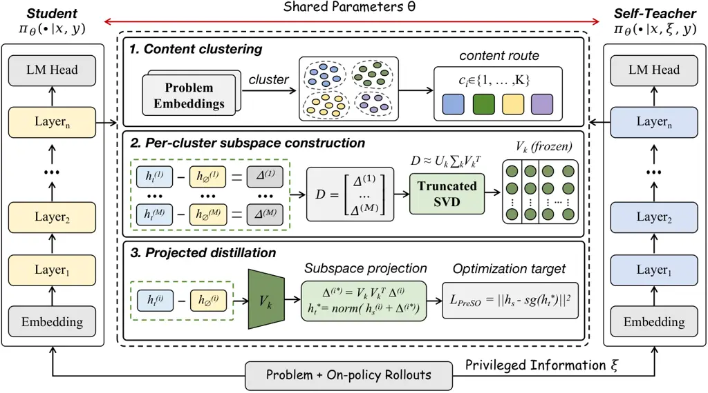
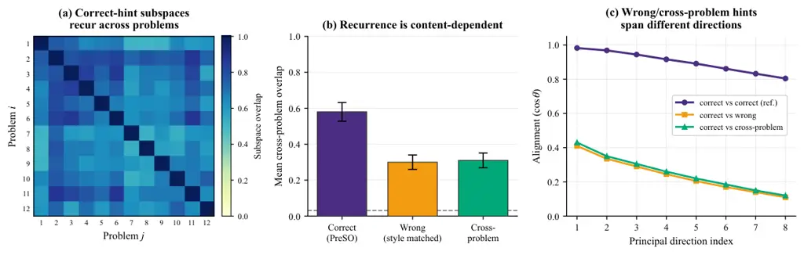

# PreSO: Privileged Representation Isolation for On-Policy Self-Distillation

Yuhang Yang ^(†)^(†)thanks: This work is done during Yuhang Yang’s
internship at ByteDance. yangyuhang@zju.edu.cn Affiliation: Zhejiang
University Affiliation: ByteDance    Mingxuan Xia Affiliation: Zhejiang
University    Chao Ye Affiliation: ByteDance    Shuai Zhu
Affiliation: ByteDance    Shouqing Yang Affiliation: Zhejiang University
   Haobo Wang ^(†)^(†)thanks: Corresponding author.
wanghaobo@zju.edu.cn, wangsiqing.jacky@bytedance.com
Affiliation: Zhejiang University    Shenzhi Yang Affiliation: Zhejiang
University    Zhengqing Zang Affiliation: Zhejiang University   
Chenglong Wang^(†)^(†)footnotemark: † Affiliation: ByteDance

###### Abstract

On-policy self-distillation (OPSD) uses a self-teacher conditioned on
privileged information to turn the sparse outcome signal of
reinforcement learning with verifiable rewards (RLVR) into dense
token-level supervision. Yet the teacher’s advantage may depend on
information unavailable to the student at inference, raising a central
question: which privileged changes are worth distilling? We use
cross-problem recurrence as an empirical cue for potentially reusable
guidance. Comparing the representation shifts induced by full solutions
and compact hints, we find that hint-induced shifts are more
concentrated and directionally consistent across problems, and yield
more sustained downstream gains despite revealing less information.
Motivated by this association, we propose Privileged Representation
Isolation for On-Policy Self-Distillation (PreSO). At the source, PreSO
uses compact hints to limit the solution-specific detail entering the
privileged shift. At the target, it estimates a leading low-rank
subspace from shifts pooled across related problems, projects the
privilege-induced correction onto this subspace, and adds it to the
student’s unprivileged representation to form the representation-level
distillation target. The selected subspace serves as an operational
proxy for recurring structure, rather than a guaranteed separation of
transferable and instance-specific information. On five
competition-level mathematics benchmarks, PreSO consistently outperforms
strong baselines across Qwen3-1.7B, 4B, and 8B, improving average
accuracy over the base model by $`\mathbf{6.8}`$, $`\mathbf{9.0}`$, and
$`\mathbf{10.0}`$ points. Beyond peak accuracy, PreSO attains the
highest final-checkpoint average at every model scale, with improvements
that persist through the end of training.

Figure 1: Overall effectiveness of PreSO. Top: Training dynamics across
model scales. PreSO maintains stable training curves throughout, with
the advantage widening as the model scales. Bottom: Performance
comparison on Qwen3-8B. PreSO consistently outperforms all baselines on
every benchmark, reaching $`79.6`$ on AMC23 and surpassing the strongest
baseline by $`6.9`$ points.

## 1 Introduction

Reinforcement learning with verifiable rewards (RLVR) has become a
central paradigm for training reasoning models (Shao et al., 2024;
DeepSeek-AI, 2025). However, RLVR typically derives its learning signal
from a sequence-level outcome reward, making credit assignment
challenging for long-horizon reasoning trajectories (Lightman et al.,
2024; Wang et al., 2024). On-policy self-distillation (OPSD) (Zhao
et al., 2026a; Ye et al., 2026) offers a denser alternative: conditioned
on privileged context such as a reference solution, the same model acts
as a self-teacher and provides token-level supervision on
student-generated rollouts. This approach can improve both reasoning
performance and sample efficiency over RLVR baselines (Hübotter et al.,
2026; Zhu et al., 2026).

To make better use of privileged teachers, prior work has improved OPSD
through token reweighting (Zhang et al., 2026; Liu et al., 2026),
privileged context design (Ye et al., 2026; Wang et al., 2026a; Han
et al., 2026; Zhao et al., 2026b), and integration with RLVR (Lu et al.,
2026; Wang et al., 2026b; Yang et al., 2026a), with recent efforts
extending online distillation to the representation level (Li et al.,
2026b). Other approaches contrast the teacher against a weaker reference
to preserve the student’s own reasoning ability (Pan et al., 2026; Yang
et al., 2026c). These methods refine how privileged guidance is provided
or matched, but leave a more basic question underexplored: which parts
of a privileged teacher’s advantage should the student actually
internalize? A privileged teacher is stronger precisely because it
accesses information the student cannot obtain at inference time, yet
the changes this information induces are not uniformly worth
internalizing: some reflect reasoning regularities a student could in
principle recover once the privilege is removed, while others are
shortcuts tied to the known answer, a specific reference trajectory, or
stylistic preferences of the teacher itself, which improve the teacher’s
trajectory under privileged conditions but do not tell the student how
to reason when no such reference is available. Without separating the
two, the student is pushed to imitate a pattern that can only be
reproduced when privileged information is present.

The key question is not how much additional information the teacher
receives, but whether the resulting changes exhibit stable patterns
across related problems. A change that recurs among problems with
similar content or reasoning structure may reveal a shared solving cue
that the student can learn to use independently. By contrast, changes
tied to a particular answer or reference trajectory offer little
consistent signal across training examples and may be difficult to reuse
without privileged information. We therefore use cross-problem
recurrence to prioritize potentially reusable guidance, and evaluate its
value through the student’s performance without privileged information.

To examine privileged changes across problems, we turn to the model’s
internal representations. For each rollout prefix, we define the
privileged shift as the difference between hidden states obtained with
and without privileged information under the same prompt template. This
lets us aggregate and compare shifts across problems. To probe how the
detail of privileged context shapes these shifts, we compare full
solutions, which expose the complete derivation, with compact hints,
which provide only the key strategy. Despite revealing more, solutions
lead to a steady decline in downstream performance, whereas hints yield
sustained gains (Figure 2a). Hint-induced shifts concentrate along fewer
dominant directions (Figure 2b), with lower effective rank and greater
directional consistency than solution-induced shifts (Figure 2c). This
contrast motivates using the leading low-rank subspace of pooled
hint-induced shifts as an operational proxy for cross-problem structure
and projecting privileged corrections onto it before constructing the
distillation target.

Guided by this analysis, we propose Privileged Representation Isolation
for On-Policy Self-Distillation (PreSO), which restricts privileged
guidance at both the source and the representation-level target. At the
source, PreSO replaces full reference solutions with compact hints to
limit dependence on solution-specific details. At the target, it routes
each problem to a content-defined cluster, estimates the leading
low-rank subspace of pooled hint-induced shifts, and projects the
privilege-induced correction onto that subspace before constructing the
distillation target. After warm-up, PreSO projects only the
privilege-induced correction and adds it back to the student’s
unprivileged representation, selecting directions of additional guidance
without projecting away the representation the student already has. This
design limits both the detail available to the privileged teacher and
the directions of the correction supplied to the student. On five
competition-level mathematics benchmarks, PreSO consistently outperforms
strong baselines across Qwen3-1.7B, Qwen3-4B, and Qwen3-8B, improving
average accuracy over the base model by $`\mathbf{6.8}`$,
$`\mathbf{9.0}`$, and $`\mathbf{10.0}`$ points, respectively. Its gains
persist through later training rather than appearing only at an early
peak.

## 2 PreSO: Privileged Representation Isolation for OPSD

### 2.1 Preliminaries

#### On-Policy Self-Distillation (OPSD).

OPSD (Zhao et al., 2026a; Hübotter et al., 2026; Ye et al., 2026) has
recently emerged as a promising paradigm for on-policy knowledge
distillation, offering dense token-level supervision while avoiding the
training–inference distribution mismatch that plagues off-policy
KD (Agarwal et al., 2024; Gu et al., 2024). Given a rollout
$`y\sim\pi_{\theta_{s}}(\cdot\mid x)`$, OPSD constructs a privileged
self-teacher by conditioning the same model on additional information
$`\xi`$, and matches $`\pi_{\theta_{s}}(\cdot\mid x,y_{<t})`$ to
$`\pi_{\theta_{s}}(\cdot\mid x,\xi,y_{<t})`$ at each position $`t`$:

```math
\mathcal{L}_{\mathrm{OPSD}}=\mathbb{E}_{x,\,y\sim\pi_{\theta_{s}}(\cdot\mid x)}\!\left[\frac{1}{|y|}\sum_{t=1}^{|y|}D_{\mathrm{KL}}\!\left(\operatorname{sg}\!\left(\pi_{\theta_{s}}(\cdot\mid x,\xi,y_{<t})\right)\,\Big\|\,\pi_{\theta_{s}}(\cdot\mid x,y_{<t})\right)\right], \tag{1}
```

where $`\operatorname{sg}(\cdot)`$ denotes the stop-gradient operator.
Compared with standard RLVR methods that optimize sparse outcome
rewards, OPSD provides per-token supervision that densely tracks how the
privilege-conditioned distribution differs from the student’s.

However, privileged information can induce changes with different
degrees of cross-problem consistency. A change that recurs across
related problems may provide a reusable solving cue, while one tied to a
particular answer or reference trajectory may offer little consistent
guidance. We therefore use recurrence as an empirical cue for
prioritizing privileged changes and evaluate their value through
performance without privilege. Comparing these changes requires a common
space in which their effects across problems can be aligned and
aggregated. The model’s internal representations provide such a space,
which we study next.

#### Representation Self-Distillation.

Representation distillation supervises intermediate features or
attention patterns rather than relying only on output
distributions (Romero et al., 2015; Jiao et al., 2020; Wang et al.,
2020). In our on-policy setting, hidden-state matching bypasses the LM
head and uses a stop-gradient target computed on each student-generated
rollout $`\hat{y}\sim\pi_{\theta_{s}}(\cdot\mid x)`$. Following
OPRD (Yang et al., 2026b), we match the student and privileged
self-teacher representations at each position $`t`$ under the shared
prefix $`\hat{y}_{<t}`$ with an MSE loss between $`\ell_{2}`$-normalized
states:

```math
\mathcal{L}=\frac{1}{|\mathcal{T}|}\sum_{(i,t)\in\mathcal{T}}\frac{1}{d}\big\|h_{\theta_{s}}(x_{i},\hat{y}_{<t})-\operatorname{sg}\!\left(h_{\theta_{s}}(x_{i},\xi_{i},\hat{y}_{<t})\right)\big\|_{2}^{2}, \tag{2}
```

where $`h_{\theta_{s}}(x_{i},\hat{y}_{<t})`$ and
$`h_{\theta_{s}}(x_{i},\xi_{i},\hat{y}_{<t})`$ are the final-layer
student and self-teacher hidden states at position $`t`$,
$`\mathcal{T}`$ collects the valid supervised positions, and $`d`$ is
the hidden dimension. The supervision thus depends entirely on how
$`\xi_{i}`$ shifts the student’s hidden states along its own rollouts.

We make this concrete through the _privileged shift_. At each rollout
position $`t`$, conditioning on $`\xi`$ moves the model’s hidden state,
inducing a representation shift
$`\Delta_{t}=h_{\theta_{s}}(x,\xi,\hat{y}_{<t})-h_{\theta_{s}}(x,\hat{y}_{<t})\in\mathbb{R}^{d}`$,
which the LM head then maps onto the next-token distribution. Since
every $`\Delta_{t}`$ lives in the same $`\mathbb{R}^{d}`$, shifts from
different problems share one coordinate system in which their directions
can be compared and their recurring structure measured. We examine this
geometry next.

Figure 2: Privileged-information geometry. (a) Distilling from hints
sustains downstream accuracy over training, whereas full solutions
degrade steadily. (b) PCA of the privileged shifts separates solutions
into a broad cloud that leaks into $`\mathrm{PC2}`$, while hints stay
concentrated along $`\mathrm{PC1}`$ with a common orientation. (c) The
hint-induced shift attains a lower effective rank and higher directional
consistency, whereas the full solution spreads over a higher-rank, less
consistent structure.

### 2.2 How Privileged-Information Granularity Shapes the Shift

A direct way to shape the privileged shift is to control what the
self-teacher sees. Prior work (Ye et al., 2026; Wang et al., 2026a; Han
et al., 2026; Zhao et al., 2026b) has shown that the form of privileged
information can substantially affect distillation. Here we study how its
granularity changes both the cross-problem geometry of $`\Delta_{t}`$
and the downstream effect of distilling from it. We compare a
ground-truth _solution_, which exposes the complete derivation and final
answer, with a compact _hint_, which provides a key sub-step or partial
derivation without disclosing the answer.

More detailed privilege does not necessarily yield better supervision.
In this comparison, hints raise downstream accuracy from roughly
$`14\%`$ to above $`16\%`$ and sustain that gain, whereas solutions fall
to $`2\text{--}3\%`$ (Figure 2a). To examine the corresponding geometry,
we stack per-position shifts across problems and project them onto their
leading principal components. Hint-induced shifts occupy a narrow,
consistently oriented region along $`\mathrm{PC1}`$, which explains
$`52.2\%`$ of the pooled variance, while solution-induced shifts spread
more broadly toward $`\mathrm{PC2}`$, which explains $`8.2\%`$
(Figure 2b). Hint-induced shifts also have lower effective rank and
greater directional consistency than solution-induced shifts
(Figure 2c). In this comparison, the more concentrated and consistent
shifts accompany the more sustained downstream gain. We therefore use
the leading low-rank subspace of pooled hint-induced shifts as an
operational proxy for recurring structure in Section 2.3.

### 2.3 Privileged Subspace Projection

Guided by the geometry in Section 2.2, we use the leading low-rank
subspace of pooled privileged shifts as an operational proxy for
cross-problem structure. PreSO projects the privilege-induced shift onto
this subspace before adding it to the unprivileged student
representation to form a distillation target. We next describe how the
subspace is estimated and applied.

#### Estimating the privileged subspace.

During the first $`W`$ optimization steps, we collect rollouts from the
evolving on-policy student $`\pi_{\theta_{s}}`$. For each visited prefix
$`(x_{i},\hat{y}_{<t})`$, we evaluate the parameter-shared self-teacher
twice under an identical template that differs only in whether the
privileged information $`\xi_{i}`$ is exposed, giving the privileged
shift:

```math
\Delta_{i,t}=h_{\theta_{s}}(x_{i},\xi_{i},\hat{y}_{<t})-h_{\theta_{s}}(x_{i},\varnothing,\hat{y}_{<t}), \tag{3}
```

where $`\varnothing`$ denotes the same template with an empty privileged
field. Holding both the template and the rollout prefix isolates the
representational effect of privileged information. We stack the
collected shifts row-wise into $`D\in\mathbb{R}^{M\times d}`$ and
compute an uncentered rank-$`r`$ SVD:

```math
D\approx U\Sigma V^{\top},\qquad V\in\mathbb{R}^{d\times r}, \tag{4}
```

whose right singular vectors $`V`$ span the $`r`$ dominant energy
directions of the pooled shifts in representation space. The retained
directions define the orthogonal projector $`P=VV^{\top}`$. By
construction, this projector preserves the largest share of observed
shift energy among rank-$`r`$ projectors. Motivated by the geometry in
Section 2.2, we use their span as an empirical proxy for cross-problem
structure and apply $`P`$ to restrict the directions of subsequent
privileged corrections.



Figure 3: Overview of PreSO. A compact hint conditions the self-teacher.
During warm-up, PreSO routes problems by content and estimates a leading
low-rank subspace from privileged shifts pooled within each cluster. It
then freezes these subspaces and, during subsequent on-policy
distillation, projects each privileged shift onto its assigned subspace
before constructing the representation-level target. The selected
subspace serves as an operational proxy for cross-problem structure.

#### Content-based subspace routing.

The construction above yields a single global subspace. Across
heterogeneous problem families, however, the recurring directions
themselves may vary, so one global subspace risks conflating
incompatible reasoning patterns. We therefore route each problem to a
content-specific subspace using only privilege-free, student-visible
information. For problem $`x_{i}`$, we read its last prompt-position
representation $`\ell_{i}`$ from the frozen $`\theta_{0}`$ and normalize
it:

```math
e_{i}=\operatorname{norm}\!\left(h_{\theta_{0}}^{(L)}(x_{i})_{\ell_{i}}\right), \tag{5}
```

where $`L`$ is the final transformer layer. Reading from the frozen
$`\theta_{0}`$ anchors routing to a representation space, keeping each
problem’s assignment independent of the evolving policy and consistent
across training. We then run $`K`$-means on $`\{e_{i}\}_{i=1}^{N}`$ and
assign each to its nearest centroid:

```math
c_{i}=\arg\min_{c\in\{1,\ldots,K\}}\|e_{i}-\mu_{c}\|_{2}^{2}, \tag{6}
```

where $`\mu_{c}`$ is the cluster centroid. The route is computed once
before training and frozen, so all rollouts of a problem share one
assignment, and since it depends on neither privileged information nor
sampled responses, it introduces no leakage or rollout dependence.
During warm-up, each shift updates only the second moment of its
assigned cluster, giving one projector $`P_{c}=V_{c}V_{c}^{\top}`$ per
route.

### 2.4 The Optimization Objective

Training proceeds in two stages. For the first $`W`$ steps we match the
full representation while accumulating the privileged shifts
$`\Delta_{i,t}`$ of Eq. 3, each measured from the parameter-shared
self-teacher so that it reflects the net effect of the privileged
information rather than a template artifact. We then construct and
freeze the cluster projectors $`\{P_{c}\}_{c=1}^{K}`$ and switch to
projected distillation, adding the projected shift back onto the student
anchor $`h_{\theta_{s}}(x_{i},\hat{y}_{<t})`$. The stage-dependent
target is:

```math
h_{i,t}^{\star(s)}=\begin{cases}\operatorname{sg}\!\left[h_{\theta_{s}}(x_{i},\xi_{i},\hat{y}_{<t})\right],&s\leq W,\\[2.84526pt]
\operatorname{sg}\!\left[\operatorname{norm}\!\left(h_{\theta_{s}}(x_{i},\hat{y}_{<t})+P_{c_{i}}\Delta_{i,t}\right)\right],&s>W.\end{cases} \tag{7}
```

During warm-up, the student matches the full privileged representation.
Afterwards, before normalization, the target combines the teacher’s
representation in the selected subspace with the student’s unprivileged
representation in its orthogonal complement. We then normalize the
target and compute squared-error loss over the full hidden vector:

```math
\mathcal{L}_{PreSO{}}=\frac{\lambda}{|\mathcal{T}|}\sum_{(i,t)\in\mathcal{T}}\frac{1}{d}\left\|h_{\theta_{s}}(x_{i},\hat{y}_{<t})-h_{i,t}^{\star(s)}\right\|_{2}^{2}, \tag{8}
```

where $`\mathcal{T}`$ contains the valid supervised positions, $`d`$ is
the hidden dimension, and $`\lambda`$ is a scalar coefficient on the
loss. Student and self-teacher states are $`\ell_{2}`$-normalized before
computing each shift, and the projected target is normalized before
evaluating the loss. This gives the teacher-induced correction a
low-rank metric interpretation (Weinberger & Saul, 2009), while the loss
still compares full normalized representations. Algorithm 1 shows the
pseudo-code of PreSO.

Require: Initial policy $`\pi_{\theta}`$, training set
$`\mathcal{D}=\{(x_{i},\xi_{i})\}_{i=1}^{N}`$, clusters $`K`$, rank
$`r`$, warm-up steps $`W`$

 $`\triangleright`$ Problem Content Routing

1: Extract $`\{e_{i}\}`$, assign each $`x_{i}`$ to $`c_{i}`$ via
$`K`$-means, and initialize the route statistics $`\{C_{c}\}_{c=1}^{K}`$

 $`\triangleright`$ On-Policy Subspace Estimation

2: for $`s=1,\ldots,W`$ do

3:   Sample on-policy rollouts from $`\pi_{\theta}`$, compute
$`\Delta_{i,t}`$ by Eq. (3), and update $`C_{c_{i}}`$

4:   Optimize the warm-up branch of Eqs. (7)–(8)

5: end for

6: Extract the top-$`r`$ eigenspaces $`\{V_{c}\}_{c=1}^{K}`$ and freeze
$`P_{c}\leftarrow V_{c}V_{c}^{\top}`$ for each route

 $`\triangleright`$ Projected Self-Distillation

7: repeat

8:   Sample on-policy rollouts from $`\pi_{\theta}`$, compute
$`\Delta_{i,t}`$, and retrieve $`P_{c_{i}}`$

9:   Construct projected targets by Eq. (7), compute
$`\mathcal{L}_{PreSO{}}`$ by Eq. (8), and update $`\theta`$

10: until converged

Algorithm 1 PreSO: Privileged Representation Isolation for On-Policy
Self-Distillation

## 3 Experiments

### 3.1 Experimental Setup

#### Models and Datasets.

We conduct experiments with Qwen3-1.7B, Qwen3-4B and Qwen3-8B (Team,
2025), disabling thinking mode throughout training and evaluation;
results under the thinking mode are reported in Appendix C.6. To test
robustness across training data, we use two training sets,
DeepMath-103K (He et al., 2026) and Open-R1 (Yan et al., 2025). The main
tables report results trained on DeepMath-103K, and the Open-R1 results
are given in Appendix C.3. For DeepMath, following RLCSD (Pan et al.,
2026), we assign difficulty levels 5–7 to the 1.7B model, levels 6–8 to
the 4B model, and levels 7–10 to the 8B model. Each model is trained for
500 optimization steps. We evaluate on five competition-level
mathematical reasoning benchmarks: AIME24 (Zhang & Math-AI, 2024),
AIME25 (Zhang & Math-AI, 2025), AIMO (AI-MO, 2024), HMMT25 (Dekoninck
et al., 2026), and AMC23 (MAA, 2023). For efficiency, the privileged
hints are annotated offline with GPT-5.5 before training, and
Appendix C.4 reports a self-hint variant.

#### Baselines.

We compare PreSO against four representative baselines. (1) GRPO (Shao
et al., 2024), an RLVR baseline that optimizes the policy with
group-normalized advantages from verifiable outcome rewards. (2)
OPSD (Zhao et al., 2026a), an on-policy self-distillation method in
which one model acts as both privileged teacher and student and
minimizes their per-token divergence over its own rollouts. (3)
RLSD (Yang et al., 2026a), a hybrid method that sizes each policy update
from the teacher-student token-level discrepancy while taking its
direction from RLVR outcome feedback. (4) RLCSD (Pan et al., 2026), a
contrastive self-distillation method that conditions the teacher on
successful and unsuccessful on-policy sibling solutions and uses their
likelihood contrast to refine the policy advantages on task-relevant
tokens. For a fair comparison, OPSD and RLSD in the main results receive
the same hints as privileged information, and results using the full
solution are in Appendix C.2. Implementation details are in
Appendix E.1.

| Method     | AIME24                  | AIME25                 | AIMO                     | HMMT25                 | AMC23                    | Avg.                    |
| ---------- | ----------------------- | ---------------------- | ------------------------ | ---------------------- | ------------------------ | ----------------------- |
| Qwen3-8B   | 25.6  $`\uparrow`$ 0.0  | 18.6  $`\uparrow`$ 0.0 | 61.4  $`\uparrow`$ 0.0   | 10.8  $`\uparrow`$ 0.0 | 68.3  $`\uparrow`$ 0.0   | 36.9  $`\uparrow`$ 0.0  |
|   + GRPO   | 30.0  $`\uparrow`$ 4.4  | 21.9  $`\uparrow`$ 3.3 | 63.0  $`\uparrow`$ 1.6   | 11.9  $`\uparrow`$ 1.1 | 70.8  $`\uparrow`$ 2.5   | 39.5  $`\uparrow`$ 2.6  |
|   + OPSD   | 30.8  $`\uparrow`$ 5.2  | 21.1  $`\uparrow`$ 2.5 | 62.1  $`\uparrow`$ 0.7   | 12.2  $`\uparrow`$ 1.4 | 67.7  $`\downarrow`$ 0.6 | 38.8  $`\uparrow`$ 1.9  |
|   + RLSD   | 31.7  $`\uparrow`$ 6.1  | 21.4  $`\uparrow`$ 2.8 | 63.8  $`\uparrow`$ 2.4   | 13.9  $`\uparrow`$ 3.1 | 71.5  $`\uparrow`$ 3.2   | 40.5  $`\uparrow`$ 3.6  |
|   + RLCSD  | 29.2  $`\uparrow`$ 3.6  | 22.2  $`\uparrow`$ 3.6 | 63.9  $`\uparrow`$ 2.5   | 12.8  $`\uparrow`$ 2.0 | 72.7  $`\uparrow`$ 4.4   | 40.2  $`\uparrow`$ 3.3  |
|   + PreSO  | 37.0  $`\uparrow`$ 11.4 | 26.7  $`\uparrow`$ 8.1 | 71.4  $`\uparrow`$ 10.0  | 20.0  $`\uparrow`$ 9.2 | 79.6  $`\uparrow`$ 11.3  | 46.9  $`\uparrow`$ 10.0 |
| Qwen3-4B   | 23.3  $`\uparrow`$ 0.0  | 17.8  $`\uparrow`$ 0.0 | 61.2  $`\uparrow`$ 0.0   | 11.4  $`\uparrow`$ 0.0 | 66.5  $`\uparrow`$ 0.0   | 36.0  $`\uparrow`$ 0.0  |
|   + GRPO   | 25.6  $`\uparrow`$ 2.3  | 20.6  $`\uparrow`$ 2.8 | 63.0  $`\uparrow`$ 1.8   | 13.1  $`\uparrow`$ 1.7 | 68.5  $`\uparrow`$ 2.0   | 38.2  $`\uparrow`$ 2.2  |
|   + OPSD   | 25.3  $`\uparrow`$ 2.0  | 20.6  $`\uparrow`$ 2.8 | 60.2  $`\downarrow`$ 1.0 | 12.5  $`\uparrow`$ 1.1 | 71.3  $`\uparrow`$ 4.8   | 38.0  $`\uparrow`$ 2.0  |
|   + RLSD   | 27.5  $`\uparrow`$ 4.2  | 20.8  $`\uparrow`$ 3.0 | 63.1  $`\uparrow`$ 1.9   | 13.3  $`\uparrow`$ 1.9 | 70.4  $`\uparrow`$ 3.9   | 39.0  $`\uparrow`$ 3.0  |
|   + RLCSD  | 27.5  $`\uparrow`$ 4.2  | 21.1  $`\uparrow`$ 3.3 | 61.9  $`\uparrow`$ 0.7   | 13.1  $`\uparrow`$ 1.7 | 70.8  $`\uparrow`$ 4.3   | 38.9  $`\uparrow`$ 2.9  |
|   + PreSO  | 37.2  $`\uparrow`$ 13.9 | 26.4  $`\uparrow`$ 8.6 | 67.9  $`\uparrow`$ 6.7   | 18.1  $`\uparrow`$ 6.7 | 75.6  $`\uparrow`$ 9.1   | 45.0  $`\uparrow`$ 9.0  |
| Qwen3-1.7B | 12.8  $`\uparrow`$ 0.0  | 9.4  $`\uparrow`$ 0.0  | 40.3  $`\uparrow`$ 0.0   | 5.6  $`\uparrow`$ 0.0  | 44.8  $`\uparrow`$ 0.0   | 22.6  $`\uparrow`$ 0.0  |
|   + GRPO   | 13.6  $`\uparrow`$ 0.8  | 11.7  $`\uparrow`$ 2.3 | 41.8  $`\uparrow`$ 1.5   | 6.4  $`\uparrow`$ 0.8  | 47.5  $`\uparrow`$ 2.7   | 24.2  $`\uparrow`$ 1.6  |
|   + OPSD   | 16.1  $`\uparrow`$ 3.3  | 11.1  $`\uparrow`$ 1.7 | 43.0  $`\uparrow`$ 2.7   | 6.7  $`\uparrow`$ 1.1  | 47.7  $`\uparrow`$ 2.9   | 24.9  $`\uparrow`$ 2.3  |
|   + RLSD   | 16.4  $`\uparrow`$ 3.6  | 11.9  $`\uparrow`$ 2.5 | 44.0  $`\uparrow`$ 3.7   | 6.9  $`\uparrow`$ 1.3  | 47.9  $`\uparrow`$ 3.1   | 25.4  $`\uparrow`$ 2.8  |
|   + RLCSD  | 15.6  $`\uparrow`$ 2.8  | 11.9  $`\uparrow`$ 2.5 | 42.5  $`\uparrow`$ 2.2   | 6.7  $`\uparrow`$ 1.1  | 48.1  $`\uparrow`$ 3.3   | 25.0  $`\uparrow`$ 2.4  |
|   + PreSO  | 18.9  $`\uparrow`$ 6.1  | 15.6  $`\uparrow`$ 6.2 | 48.2  $`\uparrow`$ 7.9   | 9.7  $`\uparrow`$ 4.1  | 54.6  $`\uparrow`$ 9.8   | 29.4  $`\uparrow`$ 6.8  |

Table 1: Experimental results (%) on mathematical reasoning benchmarks.
For each method and benchmark, we report the highest mean@12 across
evaluated checkpoints and their average (Avg.). Last-checkpoint results
are reported in Appendix C.1. Within each base-model group, the best and
second-best scores are highlighted in bold and underlined, respectively.

### 3.2 Main results

#### PreSO outperforms existing baselines.

Table 1 shows that PreSO achieves the strongest results across all model
scales and benchmarks. On Qwen3-8B, it raises average accuracy from
$`36.9`$ to $`\mathbf{46.9}`$, gaining $`\mathbf{+10.0}`$ points over
the base model and $`\mathbf{+6.4}`$ over the strongest baseline, RLSD.
Average gains over the base model reach $`\mathbf{+9.0}`$ points on
Qwen3-4B and $`\mathbf{+6.8}`$ on Qwen3-1.7B. On AIME24 and HMMT25,
Qwen3-8B with PreSO scores $`\mathbf{37.0}`$ and $`\mathbf{20.0}`$,
compared with $`31.7`$ and $`13.9`$ for the strongest baseline. These
gains extend across benchmarks and increase with model scale. Whereas
OPSD matches privileged behavior at the token level and RLCSD uses a
token-level contrastive correction, PreSO constructs
representation-level targets from projected shifts.

#### PreSO remains stable throughout training.

Figure 1 shows that OPSD peaks early and then declines, particularly at
larger scales, whereas PreSO sustains its gains through the end of
training. Table 3 confirms that PreSO attains the highest
final-checkpoint average on all three backbones, with final scores close
to their peaks. Its distillation loss directly matches normalized hidden
states without passing through the LM head’s vocabulary softmax. After
warm-up, PreSO projects each privileged shift onto an estimated
per-cluster subspace before constructing the representation-level
target. Subspace ablations show that matching the full shift or
projecting onto random or tail directions yields weaker performance.
These comparisons suggest that restricting the privileged correction to
selected leading directions contributes to the sustained gain.

### 3.3 Analysis

#### The effect of the low-rank subspace.

We examine whether PreSO benefits from a low-rank constraint alone or
from the particular directions it retains. At rank $`r`$, we compare its
top-$`r`$ subspace with random-$`r`$ and bottom-$`r`$ subspaces, and
also evaluate the full shift without projection. Figure 5 shows that all
three alternatives finish below PreSO. The full-shift variant remains
competitive for much of training but plateaus lower. Random-$`r`$
improves slowly, while Tail-$`r`$ is the least stable and drifts toward
the base level late in training. PreSO retains the leading directions of
the pooled shifts, our operational proxy for cross-problem structure,
and achieves the highest final accuracy. Restricting the correction to
$`r`$ directions may make it easier to learn, but the same-rank
comparisons show that reducing dimension alone does not explain the
gain. Top-$`r`$ also remains ahead when Random-$`r`$ and Tail-$`r`$ are
rescaled to match its retained shift norm (Appendix B.3), supporting a
role for the selected directions beyond differences in correction
magnitude. Controlled hint perturbations show greater subspace overlap
and more sustained gains for correct hints than for length- and
norm-matched wrong or cross-problem hints (Appendix B.2). A concept-only
source, however, also produces concentrated, directionally consistent
shifts but underperforms hints, indicating that this geometry alone does
not establish useful guidance (Appendix D.2).

#### PreSO sustains reflective rollouts.

Beyond accuracy, we examine generation behavior during training on
Qwen3-8B (Fig. 4). PreSO maintains long rollouts (Fig. 4a), with a
higher density of reflection markers such as _actually_, _reconsider_,
and _alternatively_ than any baseline (Fig. 4b). Across checkpoints,
marker density correlates with AIME24/25 accuracy ($`r=0.80`$), and
higher-density checkpoints more often show explicit error detection and
revision (Fig. 4c). At fixed generation budgets, PreSO leads from 2k to
16k tokens, reaching by 4k the accuracy that the strongest baseline
attains only with a larger budget (Fig. 4d). Under equal wall-clock
training budgets, PreSO also leads every baseline on all five benchmarks
at both evaluated scales (Appendix D.1).

Figure 4: PreSO elicits productive, exploratory reasoning. (a) Mean
rollout length over training. (b) Reflection-marker density per 1k
words. (c) Across checkpoints, marker density versus accuracy
($`r=0.80`$); bubble size is the successful self-correction rate.
(d) Accuracy across token budgets at the final checkpoint (step 500).
Statistics use Qwen3-8B on AIME24/25.

Figure 5: Effect of the projection subspace. Mean@12 over training on
AIME24, AIME25, and AMC23 with Qwen3-1.7B. Top-$`r`$, Random-$`r`$, and
Tail-$`r`$ project the privileged shift onto leading, random, and
lowest-energy rank-$`r`$ subspaces, respectively. Full uses the
unprojected shift.

### 3.4 Ablation Studies

#### Ablation on the source-side abstraction of privileged information.

We first replace compact hints with full solutions while keeping the
rest of PreSO unchanged (w/o PI abstraction). On Qwen3-8B, this variant
trails PreSO from the outset and declines most sharply, ending $`15.3`$,
$`10.6`$, and $`12.9`$ points lower on AIME24, AIME25, and AMC23 at the
last checkpoint. These are the largest gaps among the ablations. To test
whether the loss stems solely from the subspace estimated from
solution-induced shifts, we also estimate the subspace from hints while
retaining solutions as privileged context (w/o PI abs. (hint subspace)).
This recovers only part of the gap and still trails PreSO by $`12.6`$
points on AIME24. The same pattern holds on Qwen3-1.7B. Together, these
results show that compact hints contribute beyond their effect on
subspace estimation. They are consistent with source-side abstraction
reducing potential interference from solution-specific details, which
target-side projection alone does not fully compensate for.

| Method                      | Best ckpt                |                          |                           | Last ckpt                 |                           |                           |
| --------------------------- | ------------------------ | ------------------------ | ------------------------- | ------------------------- | ------------------------- | ------------------------- |
|                             | AIME24                   | AIME25                   | AMC23                     | AIME24                    | AIME25                    | AMC23                     |
| PreSO (Qwen3-8B)            | 37.0                     | 26.7                     | 79.6                      | 37.0                      | 26.7                      | 79.4                      |
| w/o PI abstraction          | 28.6  $`\downarrow`$ 8.4 | 19.7  $`\downarrow`$ 7.0 | 69.4  $`\downarrow`$ 10.2 | 21.7  $`\downarrow`$ 15.3 | 16.1  $`\downarrow`$ 10.6 | 66.5  $`\downarrow`$ 12.9 |
| w/o PI abs. (hint subspace) | 32.8  $`\downarrow`$ 4.2 | 20.3  $`\downarrow`$ 6.4 | 71.3  $`\downarrow`$ 8.3  | 24.4  $`\downarrow`$ 12.6 | 16.4  $`\downarrow`$ 10.3 | 68.3  $`\downarrow`$ 11.1 |
| w/o low-rank projection     | 33.6  $`\downarrow`$ 3.4 | 22.8  $`\downarrow`$ 3.9 | 73.8  $`\downarrow`$ 5.8  | 33.6  $`\downarrow`$ 3.4  | 22.5  $`\downarrow`$ 4.2  | 73.8  $`\downarrow`$ 5.6  |
| w/o cluster routing         | 34.4  $`\downarrow`$ 2.6 | 23.3  $`\downarrow`$ 3.4 | 75.0  $`\downarrow`$ 4.6  | 34.4  $`\downarrow`$ 2.6  | 21.1  $`\downarrow`$ 5.6  | 73.1  $`\downarrow`$ 6.3  |
| PreSO (Qwen3-1.7B)          | 18.9                     | 15.6                     | 54.6                      | 18.6                      | 15.6                      | 52.7                      |
| w/o PI abstraction          | 13.3  $`\downarrow`$ 5.6 | 8.9  $`\downarrow`$ 6.7  | 44.0  $`\downarrow`$ 10.6 | 6.1  $`\downarrow`$ 12.5  | 5.6  $`\downarrow`$ 10.0  | 40.6  $`\downarrow`$ 12.1 |
| w/o PI abs. (hint subspace) | 15.0  $`\downarrow`$ 3.9 | 11.7  $`\downarrow`$ 3.9 | 46.7  $`\downarrow`$ 7.9  | 11.1  $`\downarrow`$ 7.5  | 8.9  $`\downarrow`$ 6.7   | 44.6  $`\downarrow`$ 8.1  |
| w/o low-rank projection     | 16.7  $`\downarrow`$ 2.2 | 13.6  $`\downarrow`$ 2.0 | 50.6  $`\downarrow`$ 4.0  | 16.7  $`\downarrow`$ 1.9  | 12.5  $`\downarrow`$ 3.1  | 50.6  $`\downarrow`$ 2.1  |
| w/o cluster routing         | 19.1  $`\uparrow`$ 0.2   | 14.2  $`\downarrow`$ 1.4 | 52.9  $`\downarrow`$ 1.7  | 19.1  $`\uparrow`$ 0.5    | 12.5  $`\downarrow`$ 3.1  | 52.7  $`\uparrow`$ 0.0    |

Table 2: Ablation study on PreSO. Accuracy (%) on AIME24/AIME25/AMC23 at
the best and last checkpoints. Subscripts show each variant’s gap to
PreSO.

Figure 6: Ablation on the projection rank $`r`$ and the number of routes
$`K`$. mean@12 over training steps on AIME24 and AIME25 with Qwen3-1.7B.
Panels (a) and (b) vary the low-rank projection rank
$`r\in\{64,128,256\}`$, and panels (c) and (d) vary the number of routes
$`K\in\{1,2,4,8\}`$.

#### Ablation on the low-rank projection and cluster routing.

Holding the hint source fixed, we ablate the two target-side components.
On Qwen3-8B, using the full privileged shift instead of a projected
correction (w/o low-rank) lowers best-checkpoint accuracy by $`3.4`$ and
$`3.9`$ points on AIME24 and AIME25. Removing cluster routing (w/o
cluster) has a smaller effect at the peak, but its gap to PreSO on
AIME25 widens from $`3.4`$ points at the best checkpoint to $`5.6`$ at
the last. Similar trends hold on Qwen3-1.7B. These results suggest
complementary contributions from projection and routing, with routing
particularly relevant to late-stage performance. Figure 6 varies the
projection rank $`r\in\{64,128,256\}`$ and route count
$`K\in\{1,2,4,8\}`$ around the defaults of $`128`$ and $`4`$. Rank
$`64`$ retains fewer directions and trails the default, while rank
$`256`$ includes additional lower-energy directions and loses its early
advantage later in training. Using one route forces all problems to
share a subspace, whereas eight routes leave fewer warm-up shifts in
each cluster and yield less stable training. Among the tested settings,
$`r=128`$ and $`K=4`$ perform best. More supplementary experiments and
further analyses are provided in the Appendix C and Appendix D.

## 4 Related Work

#### On-policy self-distillation.

On-policy self-distillation (OPSD) conditions the current policy on
privileged information or feedback to obtain a self-teacher that
provides dense token-level supervision on student-generated rollouts,
avoiding the distribution mismatch of off-policy teachers (Agarwal
et al., 2024; Zhao et al., 2026a; Hübotter et al., 2026). Prior work has
improved this supervision through privileged context design (Ye et al.,
2026; Buening et al., 2026), token reweighting (Liu et al., 2026; Zhang
et al., 2026), and integration with RLVR (Yang et al., 2026a; Lu et al.,
2026; Li et al., 2026a). Other approaches selectively correct the
teacher signal to reduce style- or reference-dependent effects (Pan
et al., 2026; Yang et al., 2026c; Shen et al., 2026). These methods
primarily operate on token-level distributions or logits. We instead
study how privileged information shifts hidden representations across
problems. PreSO uses compact hints to shape these shifts and estimates a
leading low-rank subspace from shifts pooled across related problems as
an empirical proxy for cross-problem structure. It then projects the
privilege-induced correction onto this subspace before constructing the
representation-level target.

#### Hidden representation distillation.

Representation distillation complements output-distribution matching by
aligning hidden states (Romero et al., 2015; Jiao et al., 2020; Sun
et al., 2020) or relations among representations (Park et al., 2019;
Tian et al., 2019). Recent work has brought such supervision to
on-policy rollouts. OPRD (Yang et al., 2026b) aligns student and teacher
hidden states on shared rollouts, while PHF (Li et al., 2026b) studies
privileged self-distillation through hidden-state transitions and
trajectory geometry. Our use of representations serves an additional
purpose: they provide a common space for comparing the changes induced
by privileged information across problems and assessing whether dominant
directions recur among related problems. We analyze these shifts to
examine how their directional structure relates to downstream learning.
Guided by this analysis, PreSO uses the leading subspace of pooled
shifts as an empirical proxy for recurring structure and projects the
privilege-induced correction before constructing its distillation
target.

## 5 Conclusion

In this paper, we revisit on-policy self-distillation by asking which
privileged changes can help a student reason without privileged
information. We use cross-problem recurrence as an empirical cue and
examine privilege-induced representation shifts across problems.
Hint-induced shifts exhibit lower effective rank and greater directional
consistency than solution-induced shifts, alongside more sustained
downstream gains. Motivated by this association, we propose PreSO, which
uses compact hints at the source and projects subsequent
privilege-induced corrections onto per-cluster leading subspaces before
constructing representation-level targets. Across Qwen3-1.7B, 4B, and 8B
on five competition-level mathematics benchmarks, PreSO outperforms
strong baselines and sustains its gains through training. These results
support the selected subspace as an effective operational proxy for
privileged corrections in our setting. We hope our findings motivate
further study of which privileged signals are worth internalizing into a
student, and of principled ways to identify the components of those
signals that recur across problems.

## AI use statement

We used generative AI tools solely to assist with translation,
information searches, auxiliary code editing, and language polishing to
improve the readability of the manuscript. All AI-assisted outputs were
carefully reviewed and verified by the authors. Generative AI was not
used to develop the research ideas, methodology, experiments, analyses,
interpretations, scientific claims, or conclusions. The authors
conducted all substantive research work and take full responsibility for
the final content of this paper.

## References

- Agarwal et al. (2024) Rishabh Agarwal, Nino Vieillard, Yongchao Zhou,
  Piotr Stanczyk, Sabela Ramos Garea, Matthieu Geist, and Olivier
  Bachem. On-policy distillation of language models: Learning from
  self-generated mistakes. In _ICLR 2024_, 2024.
- AI-MO (2024) AI-MO. Aimo validation amc, 2024. URL
  [https://huggingface.co/datasets/AI-MO/aimo-validation-amc](https://huggingface.co/datasets/AI-MO/aimo-validation-amc).
  Accessed: 2026-08-17.
- Arora et al. (2025) Rahul K. Arora, Jason Wei, Rebecca Soskin Hicks,
  Preston Bowman, Joaquin Quiñonero Candela, Foivos Tsimpourlas, Michael
  Sharman, Meghan Shah, Andrea Vallone, Alex Beutel, Johannes Heidecke,
  and Karan Singhal. Healthbench: Evaluating large language models
  towards improved human health. _CoRR_, abs/2505.08775, 2025.
- Buening et al. (2026) Thomas Kleine Buening, Jonas Hübotter, Barna
  Pásztor, Idan Shenfeld, Giorgia Ramponi, and Andreas Krause. Aligning
  language models from user interactions. _CoRR_, abs/2603.12273, 2026.
- DeepSeek-AI (2025) DeepSeek-AI. Deepseek-r1: Incentivizing reasoning
  capability in llms via reinforcement learning. _CoRR_,
  abs/2501.12948, 2025.
- Dekoninck et al. (2026) Jasper Dekoninck, Nikola Jovanović, Tim
  Gehrunger, Kári Rögnvaldsson, Ivo Petrov, Chenhao Sun, and Martin
  Vechev. Beyond benchmarks: Matharena as an evaluation platform for
  mathematics with llms. 2026. URL
  [https://arxiv.org/abs/2605.00674](https://arxiv.org/abs/2605.00674).
- Gu et al. (2024) Yuxian Gu, Li Dong, Furu Wei, and Minlie Huang.
  Minillm: Knowledge distillation of large language models. In _ICLR
  2024_, 2024.
- Gunjal et al. (2025) Anisha Gunjal, Anthony Wang, Elaine Lau, Vaskar
  Nath, Bing Liu, and Sean Hendryx. Rubrics as rewards: Reinforcement
  learning beyond verifiable domains. _CoRR_, abs/2507.17746, 2025.
- Han et al. (2026) Zihao Han, Tiangang Zhang, Huaibin Wang, and Yilun
  Sun. Adaptive teacher exposure for self-distillation in llm reasoning.
  _arXiv preprint arXiv:2605.11458_, 2026.
- He et al. (2026) Zhiwei He, Tian Liang, Jiahao Xu, Qiuzhi Liu, Xingyu
  Chen, Yue Wang, Linfeng Song, Dian Yu, Zhenwen Liang, Wenxuan Wang,
  et al. Deepmath-103k: A large-scale, challenging, decontaminated, and
  verifiable mathematical dataset for advancing reasoning. In
  _International Conference on Learning Representations_, volume 2026,
  pp. 138306–138322, 2026.
- Hübotter et al. (2026) Jonas Hübotter, Frederike Lübeck, Lejs Behric,
  Anton Baumann, Marco Bagatella, Daniel Marta, Ido Hakimi, Idan
  Shenfeld, Thomas Kleine Buening, Carlos Guestrin, and Andreas Krause.
  Reinforcement learning via self-distillation. _CoRR_,
  abs/2601.20802, 2026.
- Jiao et al. (2020) Xiaoqi Jiao, Yichun Yin, Lifeng Shang, Xin Jiang,
  Xiao Chen, Linlin Li, Fang Wang, and Qun Liu. Tinybert: Distilling
  BERT for natural language understanding. In _Findings of EMNLP 2020_,
  pp. 4163–4174, 2020.
- Li et al. (2026a) Gengsheng Li, Tianyu Yang, Junfeng Fang, Mingyang
  Song, Mao Zheng, Haiyun Guo, Dan Zhang, Jinqiao Wang, and Tat-Seng
  Chua. Unifying group-relative and self-distillation policy
  optimization via sample routing. _CoRR_, abs/2604.02288, 2026a.
- Li et al. (2026b) Yuhan Li, Mingxu Zhang, Dazhong Shen, and Ying Sun.
  PHF: privileged hidden flow for on-policy self-distillation. _CoRR_,
  abs/2606.29340, 2026b.
- Lightman et al. (2024) Hunter Lightman, Vineet Kosaraju, Yuri Burda,
  Harrison Edwards, Bowen Baker, Teddy Lee, Jan Leike, John Schulman,
  Ilya Sutskever, and Karl Cobbe. Let’s verify step by step. In
  _International Conference on Learning Representations_, volume 2024,
  pp. 39578–39601, 2024.
- Liu et al. (2026) Xiaogeng Liu, Xinyan Wang, Yingzi Ma, Yechao Zhang,
  and Chaowei Xiao. When are teacher tokens reliable? position-weighted
  on-policy self-distillation for reasoning. _CoRR_,
  abs/2605.21606, 2026.
- Lu et al. (2026) Zhengxi Lu, Zhiyuan Yao, Zhuowen Han, Zi-Han Wang,
  Jinyang Wu, Qi Gu, Xunliang Cai, Weiming Lu, Jun Xiao, Yueting Zhuang,
  et al. Self-distilled agentic reinforcement learning. _arXiv preprint
  arXiv:2605.15155_, 2026.
- MAA (2023) MAA. Amc 2023.
  [https://huggingface.co/datasets/math-ai/amc23](https://huggingface.co/datasets/math-ai/amc23), 2023.
  Dataset compiled from the 2023 American Mathematics Competitions.
- Pan et al. (2026) Leyi Pan, Shuchang Tao, Yunpeng Zhai, Lingzhe Zhang,
  Zhaoyang Liu, Bolin Ding, Aiwei Liu, and Lijie Wen. Rlcsd:
  Reinforcement learning with contrastive on-policy self-distillation.
  _arXiv preprint arXiv:2606.11709_, 2026.
- Park et al. (2019) Wonpyo Park, Dongju Kim, Yan Lu, and Minsu Cho.
  Relational knowledge distillation. In _2019 IEEE/CVF Conference on
  Computer Vision and Pattern Recognition (CVPR)_, pp. 3962–3971.
  IEEE, 2019.
- Pyatkin et al. (2025) Valentina Pyatkin, Saumya Malik, Victoria Graf,
  Hamish Ivison, Shengyi Huang, Pradeep Dasigi, Nathan Lambert, and
  Hannaneh Hajishirzi. Generalizing verifiable instruction
  following, 2025.
- Romero et al. (2015) Adriana Romero, Nicolas Ballas, Samira Ebrahimi
  Kahou, Antoine Chassang, Carlo Gatta, and Yoshua Bengio. Fitnets:
  Hints for thin deep nets. In _ICLR 2015_, 2015.
- Shao et al. (2024) Zhihong Shao, Peiyi Wang, Qihao Zhu, Runxin Xu,
  Junxiao Song, Mingchuan Zhang, Y. K. Li, Y. Wu, and Daya Guo.
  Deepseekmath: Pushing the limits of mathematical reasoning in open
  language models. _CoRR_, abs/2402.03300, 2024.
- Shen et al. (2026) Zhanming Shen, Jintao Tong, Shaotian Yan, Chen
  Shen, Hao Chen, Wentao Ye, Xiaomeng Hu, Rui Miao, Haobo Wang, Junbo
  Zhao, et al. Purified opsd: On-policy self-distillation without losing
  how to think. _arXiv preprint arXiv:2607.02234_, 2026.
- Sheng et al. (2025) Guangming Sheng, Chi Zhang, Zilingfeng Ye, Xibin
  Wu, Wang Zhang, Ru Zhang, Yanghua Peng, Haibin Lin, and Chuan Wu.
  Hybridflow: A flexible and efficient RLHF framework. In _Proceedings
  of the Twentieth European Conference on Computer Systems, EuroSys
  2025, Rotterdam, The Netherlands, 30 March 2025 - 3 April 2025_, pp.
  1279–1297, 2025.
- Sun et al. (2020) Zhiqing Sun, Hongkun Yu, Xiaodan Song, Renjie Liu,
  Yiming Yang, and Denny Zhou. Mobilebert: a compact task-agnostic BERT
  for resource-limited devices. In _Proceedings of ACL 2020_, pp.
  2158–2170, 2020.
- Team (2025) Qwen Team. Qwen3 technical report. _CoRR_,
  abs/2505.09388, 2025.
- Tian et al. (2019) Yonglong Tian, Dilip Krishnan, and Phillip Isola.
  Contrastive representation distillation. _arXiv preprint
  arXiv:1910.10699_, 2019.
- Wang et al. (2026a) Hao Wang, Guozhi Wang, Han Xiao, Yufeng Zhou, Yue
  Pan, Jichao Wang, Ke Xu, Yafei Wen, Xiaohu Ruan, Xiaoxin Chen, et al.
  Skill-sd: Skill-conditioned self-distillation for multi-turn llm
  agents. _arXiv preprint arXiv:2604.10674_, 2026a.
- Wang et al. (2026b) Jiaxuan Wang, Xuan Ouyang, Zhiyu Chen, Yulan Hu,
  Zheng Pan, Xin Li, and Lan-Zhe Guo. Trace: Distilling where it matters
  via token-routed self on-policy alignment. _arXiv preprint
  arXiv:2605.10194_, 2026b.
- Wang et al. (2024) Peiyi Wang, Lei Li, Zhihong Shao, Runxin Xu, Damai
  Dai, Yifei Li, Deli Chen, Yu Wu, and Zhifang Sui. Math-shepherd:
  Verify and reinforce llms step-by-step without human annotations. In
  _Proceedings of the 62nd Annual Meeting of the Association for
  Computational Linguistics (Volume 1: Long Papers)_, pp.
  9426–9439, 2024.
- Wang et al. (2020) Wenhui Wang, Furu Wei, Li Dong, Hangbo Bao, Nan
  Yang, and Ming Zhou. Minilm: Deep self-attention distillation for
  task-agnostic compression of pre-trained transformers. In _Advances in
  Neural Information Processing Systems 33 (NeurIPS 2020)_, 2020.
- Weinberger & Saul (2009) Kilian Q. Weinberger and Lawrence K. Saul.
  Distance metric learning for large margin nearest neighbor
  classification. _J. Mach. Learn. Res._, 10:207–244, 2009.
- Yan et al. (2025) Jianhao Yan, Yafu Li, Zican Hu, Zhi Wang, Ganqu Cui,
  Xiaoye Qu, Yu Cheng, and Yue Zhang. Learning to reason under
  off-policy guidance, 2025. URL
  [https://arxiv.org/abs/2504.14945](https://arxiv.org/abs/2504.14945).
- Yang et al. (2026a) Chenxu Yang, Chuanyu Qin, Qingyi Si, Minghui Chen,
  Naibin Gu, Dingyu Yao, Zheng Lin, Weiping Wang, Jiaqi Wang, and Nan
  Duan. Self-distilled RLVR. _CoRR_, abs/2604.03128, 2026a.
- Yang et al. (2026b) Shenzhi Yang, Guangcheng Zhu, Bowen Song, Haobo
  Wang, Mingxuan Xia, Xing Zheng, Yingfan Ma, Zhongqi Chen, Weiqiang
  Wang, Junbo Zhao, and Gang Chen. OPRD: on-policy representation
  distillation. _CoRR_, abs/2606.06021, 2026b.
- Yang et al. (2026c) Yuxiao Yang, Xiaoyun Wang, and Weitong Zhang.
  Ogls-sd: On-policy self-distillation with outcome-guided logit
  steering for llm reasoning. _arXiv preprint arXiv:2605.12400_, 2026c.
- Ye et al. (2026) Tianzhu Ye, Li Dong, Xun Wu, Shaohan Huang, and Furu
  Wei. On-policy context distillation for language models. _CoRR_,
  abs/2602.12275, 2026.
- Zhang et al. (2026) Hongbin Zhang, Chaozheng Wang, Kehai Chen,
  Youcheng Pan, Yang Xiang, Jinpeng Wang, and Min Zhang. Tailoring
  teaching to aptitude: Direction-adaptive self-distillation for llm
  reasoning. _arXiv preprint arXiv:2605.22263_, 2026.
- Zhang et al. (2025) Ming Zhang, Yujiong Shen, Zelin Li, Huayu Sha,
  Binze Hu, Yuhui Wang, Chenhao Huang, Shichun Liu, Jingqi Tong,
  Changhao Jiang, Mingxu Chai, Zhiheng Xi, Shihan Dou, Tao Gui,
  Qi Zhang, and Xuanjing Huang. Llmeval-med: A real-world clinical
  benchmark for medical llms with physician validation. In Christos
  Christodoulopoulos, Tanmoy Chakraborty, Carolyn Rose, and Violet Peng
  (eds.), _EMNLP Findings_, pp. 4888–4914, 2025.
- Zhang & Math-AI (2024) Yifan Zhang and Team Math-AI. American
  invitational mathematics examination (aime) 2024, 2024.
- Zhang & Math-AI (2025) Yifan Zhang and Team Math-AI. American
  invitational mathematics examination (aime) 2025, 2025.
- Zhao et al. (2026a) Siyan Zhao, Zhihui Xie, Mengchen Liu, Jing Huang,
  Guan Pang, Feiyu Chen, and Aditya Grover. Self-distilled reasoner:
  On-policy self-distillation for large language models. _CoRR_,
  abs/2601.18734, 2026a.
- Zhao et al. (2026b) Zhengyang Zhao, Lu Ma, and Wentao Zhang. Training
  with harnesses: On-policy harness self-distillation for complex
  reasoning. _arXiv preprint arXiv:2605.08741_, 2026b.
- Zhou et al. (2023) Jeffrey Zhou, Tianjian Lu, Swaroop Mishra,
  Siddhartha Brahma, Sujoy Basu, Yi Luan, Denny Zhou, and Le Hou.
  Instruction-following evaluation for large language models, 2023. URL
  [https://arxiv.org/abs/2311.07911](https://arxiv.org/abs/2311.07911).
- Zhu et al. (2026) Siqi Zhu, Xuyan Ye, Hongyu Lu, Weiye Shi, and
  Ge Liu. The many faces of on-policy distillation: Pitfalls,
  mechanisms, and fixes. _CoRR_, abs/2605.11182, 2026.

## Appendix A Limitations

We discuss several limitations of PreSO that we leave to future work:

- •
  First, all models are trained with thinking mode disabled, as in our
  main evaluations. Appendix C.6 additionally evaluates Qwen3-1.7B with
  thinking mode enabled at inference. We have not studied training or
  distillation under thinking mode, and leave that setting for future
  work.
- •
  Second, PreSO encourages the model to internalize a more complete
  reasoning process rather than shortcut to the answer, which tends to
  make its outputs longer and, correspondingly, increases training cost
  relative to methods that do not. This is a trade-off we accept for
  more reliable reasoning, and reducing this overhead while retaining
  the benefit is an interesting direction.
- •
  Third, our representation matching is applied at the last layer only.
  Whether matching across all layers, or dynamically selecting which
  layers to match during training, offers additional benefit remains
  open, and we regard it as a promising direction for future
  exploration.

## Appendix B What the Leading Low-Rank Subspace Captures

### B.1 Interpretation and Limitations

The leading subspace of a pooled shift matrix captures the directions
with the greatest observed energy. This property alone does not identify
which directions will improve downstream learning. Answer-specific
information could occupy a leading direction, while a useful but
infrequent reasoning pattern could lie in the spectral tail. We
therefore treat the leading subspace as an empirical proxy for
cross-problem structure, not as a decomposition of transferable and
non-transferable knowledge. Three design choices motivate its use in our
setting:

- •
  Source-side abstraction. We form the shifts from compact hints rather
  than full solutions. This removes much of the solution-specific detail
  before estimating the subspace, although it does not guarantee that
  the remaining shift contains only useful guidance.
- •
  Cross-problem checks. We examine whether the selected directions recur
  among related problems and how their geometry relates to downstream
  performance. The overlap measure in Section B.2 does not use singular
  values after the subspaces have been estimated. Recurrence provides an
  empirical check on the selected directions, but does not by itself
  establish their usefulness.
- •
  Cluster-specific estimation. We estimate a separate subspace within
  each content cluster. A pattern that is weak in a global pool may
  become more prominent among related problems. This is a motivation for
  routing rather than a guarantee that every useful low-frequency
  pattern will be retained. Removing routing reduces average accuracy on
  both backbones (Table 2).

The following analyses test what the selected subspace captures and
where this interpretation has limits. In particular, concentrated and
consistent shifts need not be useful when the privileged context
provides little actionable guidance (Appendix D.2).

### B.2 What the Retained Subspace Captures

#### Setting.

The leading subspace might reflect properties of the privileged context
that are unrelated to useful guidance. We therefore compare correct
hints with two controls and examine both subspace geometry and
downstream learning. A _wrong hint_ matches the correct hint in style
and length but states an incorrect answer. A _cross-problem hint_ comes
from a different problem. Both controls are matched to the correct hint
in length and shift norm $`\lVert\Delta\rVert`$. These controls test
whether the observed differences persist when those two properties are
held fixed. We estimate every subspace using the base model before
distillation, then measure its cross-problem overlap and its alignment
with the correct-hint subspace. The geometric probe uses 48 OpenR1
problems across four clusters of 12, with overlap measured within
clusters. Downstream results use Qwen3-8B trained on OpenR1. For two
problems with estimated subspaces spanned by
$`V_{i},V_{j}\in\mathbb{R}^{d\times r}`$, we define their overlap as

```math
\mathrm{overlap}(i,j)=\frac{1}{r}\lVert V_{i}^{\top}V_{j}\rVert_{F}^{2}=\frac{1}{r}\sum_{k=1}^{r}\cos^{2}\theta_{k}, \tag{9}
```

where $`\theta_{k}`$ are the principal angles between the subspaces.
This quantity lies in $`[0,1]`$ and depends on the spanned directions
rather than their singular values. We average it over problem pairs
within each cluster. For randomly oriented $`r`$-dimensional subspaces,
the expected overlap is $`r/d`$. Here $`r=128`$ and $`d=4096`$, giving a
reference value of approximately $`0.031`$.



Figure 7: Correct hints induce more consistent subspaces across related
problems. All panels use Qwen3-8B on OpenR1, with subspaces estimated on
the base model before distillation. (a) Pairwise overlap among
correct-hint subspaces within a cluster. (b) Mean within-cluster overlap
for each condition. The dashed line marks the random-subspace reference
$`r/d\approx 0.031`$. (c) Alignment of the leading correct-hint
directions with an independent correct-hint reference and with each
control.

Figure 8: Correct hints yield more sustained downstream gains. Accuracy
(mean@12) during training on AIME24, AIME25, and HMMT25 for Qwen3-8B
trained on OpenR1 with correct, wrong, or cross-problem hints.

#### Correct-hint subspaces show stronger recurrence.

Figure 7(a) shows substantial overlap among correct-hint subspaces from
different problems within a cluster. Their mean overlap is approximately
$`0.58`$, compared with $`0.30`$ for wrong hints and $`0.31`$ for
cross-problem hints (Figure 7b). Both controls remain above the
random-subspace reference, so recurrence is not unique to correct hints.
Nevertheless, correct hints show substantially greater overlap despite
the matched length and shift norm. These results indicate that the
content of the privileged context affects the geometry beyond those
matched properties.

#### The controls favor different directions.

Figure 7(c) shows that independently estimated correct-hint subspaces
remain aligned above $`0.8`$ across the leading directions. In contrast,
alignment with either control falls from about $`0.42`$ on the first
direction to $`0.11`$ by the eighth. The controls thus alter the
prominent directions rather than merely weakening the correct-hint
shift.

#### Geometry and downstream learning are associated.

With correct hints, accuracy improves and remains higher through the end
of training on the three benchmarks in Figure 8. Wrong and cross-problem
hints produce smaller early gains, then plateau or decline. In this
controlled comparison, the condition with greater subspace overlap and
alignment also yields more sustained downstream gains. This association
supports using the leading subspace as a candidate source of guidance,
while the concept-only result in Appendix D.2 shows why geometry alone
is insufficient to establish that guidance is useful.

### B.3 Direction versus Correction Norm

Top-$`r`$, Random-$`r`$, and Tail-$`r`$ retain different norms
$`\lVert P\Delta\rVert`$. To test whether this difference alone accounts
for the subspace-ablation results, we rescale the Random-$`r`$ and
Tail-$`r`$ corrections to match the norm of the Top-$`r`$ correction.
This equalizes the correction norm before target construction, while
leaving the selected directions different. Figure 9 shows that Top-$`r`$
remains ahead on both benchmarks, whereas the rescaled alternatives
plateau lower or decline late in training. The advantage therefore
cannot be explained solely by the retained correction norm. Because the
target is subsequently normalized and the loss is evaluated over the
full hidden vector, this intervention does not equate the complete
training signals across variants. It nevertheless provides additional
evidence that the choice of directions matters.

Figure 9: Top-$`r`$ remains ahead after matching correction norms.
Accuracy (mean@12) during training on AIME24 and AIME25 with Qwen3-1.7B.
Random-$`r`$ and Tail-$`r`$ corrections are rescaled to match the
pre-normalization norm $`\lVert P\Delta\rVert`$ of Top-$`r`$.

### B.4 Effect of the Subspace Rank

The main-text sweep selects $`r`$ within a narrow range. Here we compare
$`r\in\{128,512,1024\}`$ with the full-shift variant ($`P=I`$) on
Qwen3-1.7B. All variants retain the leading directions of the same
pooled shift, with only the number of retained directions changed.
Figure 10 shows that $`r=128`$ achieves the strongest and most stable
performance in this comparison, while larger ranks and the full-shift
variant plateau or fluctuate more. As $`r`$ increases, the target
incorporates additional, lower-energy directions. The fraction of
observed shift energy retained by Top-$`r`$ is determined by the leading
singular values, not by $`r/d`$. This experiment does not establish that
the added directions are answer-specific or intrinsically harmful. It
shows that retaining more of the observed shift does not improve
learning in this setting. Because rank also changes the correction norm,
this sweep does not isolate dimensionality from correction magnitude.

Figure 10: A compact leading subspace performs best in this rank sweep.
Accuracy (mean@12) during training on AIME24 and AIME25 with Qwen3-1.7B.
The variants retain different numbers of leading directions from the
same pooled shift, with Full applying no projection.

### B.5 Summary

The controlled hint comparison shows that correct hints induce leading
subspaces with greater cross-problem overlap and alignment, alongside
more sustained downstream gains. Norm matching shows that the advantage
of Top-$`r`$ cannot be explained solely by the size of the retained
correction. The rank sweep shows that retaining more directions is not
necessarily better. Together, these observations support the leading
subspace as an effective empirical choice for constructing privileged
corrections in our setting. They do not establish that SVD separates
useful from useless knowledge, or that low rank and recurrence alone
guarantee downstream benefit.

## Appendix C Supplementary Experiments

### C.1 Full Experimental Results on DeepMath

The main tables report the best checkpoint for every method. To show
that our gains do not depend on checkpoint selection, Table 3 reports
mean@12 at the last checkpoint, the model after the full training run,
under the same setting. PreSO remains the best method on every benchmark
and every base model, reaching $`46.9`$, $`44.0`$, and $`28.6`$ on
average for Qwen3-8B, 4B, and 1.7B, exceeding the strongest baseline by
$`7.4`$, $`6.3`$, and $`4.5`$ points. The gap widens relative to the
best-checkpoint tables, because the baselines are far more sensitive to
when training stops. This is clearest for OPSD, the pure distillation
baseline, which collapses by the last checkpoint and falls $`10.7`$
points below the base model on Qwen3-8B, whereas its best-checkpoint
result is competitive. GRPO and the hybrid baselines RLSD and RLCSD hold
up better but still trail PreSO at every scale. The full training curves
in Figure 11 tell the same story across all steps: PreSO rises steadily
and stays on top of every baseline throughout training on all three
model sizes and all five benchmarks. These results show that PreSO
achieves higher final-checkpoint accuracy and more stable training
dynamics across the evaluated settings, consistent with the main-text
findings.

| Method     | AIME24                   | AIME25                   | AIMO                      | HMMT25                  | AMC23                     | Avg.                      |
| ---------- | ------------------------ | ------------------------ | ------------------------- | ----------------------- | ------------------------- | ------------------------- |
| Qwen3-8B   | 25.6  $`\uparrow`$ 0.0   | 18.6  $`\uparrow`$ 0.0   | 61.4  $`\uparrow`$ 0.0    | 10.8  $`\uparrow`$ 0.0  | 68.3  $`\uparrow`$ 0.0    | 36.9  $`\uparrow`$ 0.0    |
|   + GRPO   | 29.2  $`\uparrow`$ 3.6   | 19.4  $`\uparrow`$ 0.8   | 63.0  $`\uparrow`$ 1.6    | 11.4  $`\uparrow`$ 0.6  | 70.8  $`\uparrow`$ 2.5    | 38.8  $`\uparrow`$ 1.9    |
|   + OPSD   | 16.9  $`\downarrow`$ 8.7 | 10.3  $`\downarrow`$ 8.3 | 44.3  $`\downarrow`$ 17.1 | 6.1  $`\downarrow`$ 4.7 | 53.5  $`\downarrow`$ 14.8 | 26.2  $`\downarrow`$ 10.7 |
|   + RLSD   | 31.1  $`\uparrow`$ 5.5   | 20.8  $`\uparrow`$ 2.2   | 63.1  $`\uparrow`$ 1.7    | 10.8  $`\uparrow`$ 0.0  | 71.5  $`\uparrow`$ 3.2    | 39.5  $`\uparrow`$ 2.6    |
|   + RLCSD  | 29.2  $`\uparrow`$ 3.6   | 20.3  $`\uparrow`$ 1.7   | 63.7  $`\uparrow`$ 2.3    | 10.8  $`\uparrow`$ 0.0  | 69.2  $`\uparrow`$ 0.9    | 38.6  $`\uparrow`$ 1.7    |
|   + PreSO  | 37.0  $`\uparrow`$ 11.4  | 26.7  $`\uparrow`$ 8.1   | 71.4  $`\uparrow`$ 10.0   | 20.0  $`\uparrow`$ 9.2  | 79.4  $`\uparrow`$ 11.1   | 46.9  $`\uparrow`$ 10.0   |
| Qwen3-4B   | 23.3  $`\uparrow`$ 0.0   | 17.8  $`\uparrow`$ 0.0   | 61.2  $`\uparrow`$ 0.0    | 11.4  $`\uparrow`$ 0.0  | 66.5  $`\uparrow`$ 0.0    | 36.0  $`\uparrow`$ 0.0    |
|   + GRPO   | 24.2  $`\uparrow`$ 0.9   | 19.2  $`\uparrow`$ 1.4   | 62.5  $`\uparrow`$ 1.3    | 12.8  $`\uparrow`$ 1.4  | 66.5  $`\uparrow`$ 0.0    | 37.0  $`\uparrow`$ 1.0    |
|   + OPSD   | 22.5  $`\downarrow`$ 0.8 | 15.8  $`\downarrow`$ 2.0 | 54.7  $`\downarrow`$ 6.5  | 8.6  $`\downarrow`$ 2.8 | 63.3  $`\downarrow`$ 3.2  | 33.0  $`\downarrow`$ 3.0  |
|   + RLSD   | 24.7  $`\uparrow`$ 1.4   | 18.3  $`\uparrow`$ 0.5   | 59.1  $`\downarrow`$ 2.1  | 12.2  $`\uparrow`$ 0.8  | 68.8  $`\uparrow`$ 2.3    | 36.6  $`\uparrow`$ 0.6    |
|   + RLCSD  | 27.5  $`\uparrow`$ 4.2   | 20.6  $`\uparrow`$ 2.8   | 61.2  $`\uparrow`$ 0.0    | 12.5  $`\uparrow`$ 1.1  | 66.7  $`\uparrow`$ 0.2    | 37.7  $`\uparrow`$ 1.7    |
|   + PreSO  | 36.7  $`\uparrow`$ 13.4  | 26.4  $`\uparrow`$ 8.6   | 66.2  $`\uparrow`$ 5.0    | 17.5  $`\uparrow`$ 6.1  | 73.1  $`\uparrow`$ 6.6    | 44.0  $`\uparrow`$ 8.0    |
| Qwen3-1.7B | 12.8  $`\uparrow`$ 0.0   | 9.4  $`\uparrow`$ 0.0    | 40.3  $`\uparrow`$ 0.0    | 5.6  $`\uparrow`$ 0.0   | 44.8  $`\uparrow`$ 0.0    | 22.6  $`\uparrow`$ 0.0    |
|   + GRPO   | 13.1  $`\uparrow`$ 0.3   | 11.1  $`\uparrow`$ 1.7   | 41.5  $`\uparrow`$ 1.2    | 6.1  $`\uparrow`$ 0.5   | 46.7  $`\uparrow`$ 1.9    | 23.7  $`\uparrow`$ 1.1    |
|   + OPSD   | 13.9  $`\uparrow`$ 1.1   | 11.1  $`\uparrow`$ 1.7   | 42.3  $`\uparrow`$ 2.0    | 5.0  $`\downarrow`$ 0.6 | 47.7  $`\uparrow`$ 2.9    | 24.0  $`\uparrow`$ 1.4    |
|   + RLSD   | 16.4  $`\uparrow`$ 3.6   | 8.9  $`\downarrow`$ 0.5  | 41.2  $`\uparrow`$ 0.9    | 6.4  $`\uparrow`$ 0.8   | 47.5  $`\uparrow`$ 2.7    | 24.1  $`\uparrow`$ 1.5    |
|   + RLCSD  | 13.6  $`\uparrow`$ 0.8   | 10.6  $`\uparrow`$ 1.2   | 42.0  $`\uparrow`$ 1.7    | 6.1  $`\uparrow`$ 0.5   | 45.8  $`\uparrow`$ 1.0    | 23.6  $`\uparrow`$ 1.0    |
|   + PreSO  | 18.6  $`\uparrow`$ 5.8   | 15.6  $`\uparrow`$ 6.2   | 48.2  $`\uparrow`$ 7.9    | 8.1  $`\uparrow`$ 2.5   | 52.7  $`\uparrow`$ 7.9    | 28.6  $`\uparrow`$ 6.0    |

Table 3: Experimental results (%) on mathematical reasoning benchmarks.
For every method we report mean@12 at the last checkpoint. Under each
base model, the best and second-best results are marked in bold and
underlined, respectively.

### C.2 Baselines with Full-Solution Privileged Information

In the main results, OPSD and RLSD receive the same GPT-5.5 hints as
PreSO, ensuring that the methods use identical privileged information.
Here we instead provide these baselines with full reference solutions,
as in their original settings, while keeping all other hyperparameters
fixed. Table 4 reports results at the best and final checkpoints. The
two sources yield similar peak performance, but solution-based OPSD
declines more sharply thereafter. On Qwen3-8B, its average falls from
$`39.0`$ to $`21.2`$ with solutions, compared with $`38.8`$ to $`26.2`$
with hints. On HMMT25, the solution-based score drops from $`11.7`$ to
$`2.8`$. The same pattern holds at $`4`$B and $`1.7`$B. RLSD, which also
uses outcome feedback, is less sensitive to the privileged source.
Together with the source-side ablation in Section 3.4, these results
suggest that the additional detail in full solutions can make
distillation less stable over training. They support compact hints as a
source-side choice, without attributing the full gain of PreSO to
abstraction alone.

|            |          |             |             |             |             |             |             |
| ---------- | -------- | ----------- | ----------- | ----------- | ----------- | ----------- | ----------- |
| Method     | Variant  | AIME24      | AIME25      | AIMO        | HMMT25      | AMC23       | Avg.        |
| Qwen3-8B   |          |             |             |             |             |             |             |
| OPSD       | Solution | 30.3 / 10.6 | 20.8 / 7.5  | 61.7 / 38.4 | 11.7 / 2.8  | 70.4 / 46.5 | 39.0 / 21.2 |
| OPSD       | Hint     | 30.8 / 16.9 | 21.1 / 10.3 | 62.1 / 44.3 | 12.2 / 6.1  | 67.7 / 53.5 | 38.8 / 26.2 |
| RLSD       | Solution | 29.7 / 25.3 | 23.3 / 20.8 | 63.7 / 62.3 | 12.5 / 11.4 | 70.6 / 69.4 | 40.0 / 37.8 |
| RLSD       | Hint     | 31.7 / 31.1 | 21.4 / 20.8 | 63.8 / 63.1 | 13.9 / 10.8 | 71.5 / 71.5 | 40.5 / 39.5 |
| Qwen3-4B   |          |             |             |             |             |             |             |
| OPSD       | Solution | 25.0 / 17.5 | 20.6 / 13.6 | 60.0 / 51.3 | 11.9 / 10.3 | 68.3 / 60.6 | 37.2 / 30.7 |
| OPSD       | Hint     | 25.3 / 22.5 | 20.6 / 15.8 | 60.2 / 54.7 | 12.5 / 8.6  | 71.3 / 63.3 | 38.0 / 33.0 |
| RLSD       | Solution | 24.7 / 22.5 | 20.8 / 18.6 | 60.9 / 60.7 | 13.3 / 13.3 | 69.6 / 68.3 | 37.9 / 36.7 |
| RLSD       | Hint     | 27.5 / 24.7 | 20.8 / 18.3 | 63.1 / 59.1 | 13.3 / 12.2 | 70.4 / 68.8 | 39.0 / 36.6 |
| Qwen3-1.7B |          |             |             |             |             |             |             |
| OPSD       | Solution | 15.0 / 10.6 | 11.7 / 7.2  | 42.2 / 40.2 | 5.8 / 5.3   | 46.7 / 42.3 | 24.3 / 21.1 |
| OPSD       | Hint     | 16.1 / 13.9 | 11.1 / 11.1 | 43.0 / 42.3 | 6.7 / 5.0   | 47.7 / 47.7 | 24.9 / 24.0 |
| RLSD       | Solution | 14.7 / 11.9 | 11.1 / 10.6 | 43.1 / 41.7 | 6.7 / 6.4   | 47.5 / 47.5 | 24.6 / 23.6 |
| RLSD       | Hint     | 16.4 / 16.4 | 11.9 / 8.9  | 44.0 / 41.2 | 6.9 / 6.4   | 47.9 / 47.5 | 25.4 / 24.1 |

Table 4: Comparison of solution-based and hint-based variants of OPSD
and RLSD on mathematical reasoning benchmarks (%). Each cell reports the
best / last checkpoint results. Avg. denotes the arithmetic mean across
the five benchmarks.

Figure 11: Full training curves on DeepMath-103K. mean@12 over training
steps for PreSO and all baselines, across Qwen3-8B, 4B, and 1.7B
(columns) on the five competition-level benchmarks.

### C.3 Experimental Results on Open-R1

To verify that the effectiveness of PreSO does not hinge on a particular
training corpus, we repeat the full comparison with Open-R1 (Yan et al., 2025) in place of DeepMath-103K, keeping all other settings unchanged.
Tables 5 and 6 report the best-checkpoint and last-checkpoint results,
respectively. The overall picture matches our main experiments. At the
best checkpoint, PreSO attains the highest average accuracy on all three
backbones, improving over the base model by $`\mathbf{7.0}`$,
$`\mathbf{8.7}`$, and $`\mathbf{7.3}`$ points on Qwen3-1.7B, 4B, and 8B,
and ranking first on nearly every individual benchmark. The
last-checkpoint results further confirm its stability: PreSO stays
essentially unchanged from its best checkpoint at every scale, whereas
OPSD degrades sharply once trained past its peak, falling below the base
model on Qwen3-8B and Qwen3-4B.

| Method     | AIME24                  | AIME25                 | AIMO                    | HMMT25                 | AMC23                  | Avg.                   |
| ---------- | ----------------------- | ---------------------- | ----------------------- | ---------------------- | ---------------------- | ---------------------- |
| Qwen3-8B   | 25.6 $`\uparrow`$ 0.0   | 18.6 $`\uparrow`$ 0.0  | 61.4 $`\uparrow`$ 0.0   | 10.8 $`\uparrow`$ 0.0  | 68.3 $`\uparrow`$ 0.0  | 36.9 $`\uparrow`$ 0.0  |
|    + GRPO  | 30.6 $`\uparrow`$ 5.0   | 23.6 $`\uparrow`$ 5.0  | 63.7 $`\uparrow`$ 2.3   | 14.1 $`\uparrow`$ 3.3  | 71.3 $`\uparrow`$ 3.0  | 40.7 $`\uparrow`$ 3.8  |
|    + OPSD  | 31.9 $`\uparrow`$ 6.3   | 21.9 $`\uparrow`$ 3.3  | 62.1 $`\uparrow`$ 0.7   | 12.2 $`\uparrow`$ 1.4  | 69.8 $`\uparrow`$ 1.5  | 39.6 $`\uparrow`$ 2.7  |
|    + RLSD  | 30.6 $`\uparrow`$ 5.0   | 23.7 $`\uparrow`$ 5.1  | 63.7 $`\uparrow`$ 2.3   | 14.2 $`\uparrow`$ 3.4  | 71.7 $`\uparrow`$ 3.4  | 40.8 $`\uparrow`$ 3.9  |
|    + RLCSD | 33.1 $`\uparrow`$ 7.5   | 23.3 $`\uparrow`$ 4.7  | 64.0 $`\uparrow`$ 2.6   | 12.8 $`\uparrow`$ 2.0  | 71.0 $`\uparrow`$ 2.7  | 40.8 $`\uparrow`$ 3.9  |
|    + PreSO | 37.0  $`\uparrow`$ 11.4 | 24.4  $`\uparrow`$ 5.8 | 67.2  $`\uparrow`$ 5.8  | 17.2  $`\uparrow`$ 6.4 | 75.0  $`\uparrow`$ 6.7 | 44.2  $`\uparrow`$ 7.3 |
| Qwen3-4B   | 23.3 $`\uparrow`$ 0.0   | 17.8 $`\uparrow`$ 0.0  | 61.2 $`\uparrow`$ 0.0   | 11.4 $`\uparrow`$ 0.0  | 66.5 $`\uparrow`$ 0.0  | 36.0 $`\uparrow`$ 0.0  |
|    + GRPO  | 25.6 $`\uparrow`$ 2.3   | 21.7 $`\uparrow`$ 3.9  | 62.3 $`\uparrow`$ 1.1   | 13.3 $`\uparrow`$ 1.9  | 70.2 $`\uparrow`$ 3.7  | 38.6 $`\uparrow`$ 2.6  |
|    + OPSD  | 25.3 $`\uparrow`$ 2.0   | 19.2 $`\uparrow`$ 1.4  | 60.4 $`\downarrow`$ 0.8 | 14.4 $`\uparrow`$ 3.0  | 69.0 $`\uparrow`$ 2.5  | 37.7 $`\uparrow`$ 1.7  |
|    + RLSD  | 25.6 $`\uparrow`$ 2.3   | 21.7 $`\uparrow`$ 3.9  | 62.2 $`\uparrow`$ 1.0   | 13.3 $`\uparrow`$ 1.9  | 70.6 $`\uparrow`$ 4.1  | 38.7 $`\uparrow`$ 2.7  |
|    + RLCSD | 25.0 $`\uparrow`$ 1.7   | 21.1 $`\uparrow`$ 3.3  | 60.4 $`\downarrow`$ 0.8 | 13.1 $`\uparrow`$ 1.7  | 69.4 $`\uparrow`$ 2.9  | 37.8 $`\uparrow`$ 1.8  |
|    + PreSO | 34.4 $`\uparrow`$ 11.1  | 24.4 $`\uparrow`$ 6.6  | 68.2 $`\uparrow`$ 7.0   | 19.2 $`\uparrow`$ 7.8  | 77.5 $`\uparrow`$ 11.0 | 44.7 $`\uparrow`$ 8.7  |
| Qwen3-1.7B | 12.8 $`\uparrow`$ 0.0   | 9.4 $`\uparrow`$ 0.0   | 40.3 $`\uparrow`$ 0.0   | 5.6 $`\uparrow`$ 0.0   | 44.8 $`\uparrow`$ 0.0  | 22.6 $`\uparrow`$ 0.0  |
|    + GRPO  | 15.6 $`\uparrow`$ 2.8   | 11.4 $`\uparrow`$ 2.0  | 41.9 $`\uparrow`$ 1.6   | 6.9 $`\uparrow`$ 1.3   | 48.5 $`\uparrow`$ 3.7  | 24.9 $`\uparrow`$ 2.3  |
|    + OPSD  | 16.4 $`\uparrow`$ 3.6   | 13.6 $`\uparrow`$ 4.2  | 42.6 $`\uparrow`$ 2.3   | 6.7 $`\uparrow`$ 1.1   | 47.1 $`\uparrow`$ 2.3  | 25.3 $`\uparrow`$ 2.7  |
|    + RLSD  | 17.5 $`\uparrow`$ 4.7   | 11.9 $`\uparrow`$ 2.5  | 42.7 $`\uparrow`$ 2.4   | 6.9 $`\uparrow`$ 1.3   | 48.5 $`\uparrow`$ 3.7  | 25.5 $`\uparrow`$ 2.9  |
|    + RLCSD | 15.8 $`\uparrow`$ 3.0   | 11.7 $`\uparrow`$ 2.3  | 43.0 $`\uparrow`$ 2.7   | 6.9 $`\uparrow`$ 1.3   | 48.5 $`\uparrow`$ 3.7  | 25.2 $`\uparrow`$ 2.6  |
|    + PreSO | 20.8 $`\uparrow`$ 8.0   | 15.6 $`\uparrow`$ 6.2  | 48.0 $`\uparrow`$ 7.7   | 8.6 $`\uparrow`$ 3.0   | 55.2 $`\uparrow`$ 10.4 | 29.6 $`\uparrow`$ 7.0  |

Table 5: Experimental results (%) on mathematical reasoning benchmarks
with models trained on Open-R1. For each method, we report the highest
mean@12 across evaluated checkpoints and their average (Avg.). The best
and second-best scores are highlighted in bold and underlined,
respectively.

| Method     | AIME24                   | AIME25                  | AIMO                     | HMMT25                  | AMC23                   | Avg.                    |
| ---------- | ------------------------ | ----------------------- | ------------------------ | ----------------------- | ----------------------- | ----------------------- |
| Qwen3-8B   | 25.6 $`\uparrow`$ 0.0    | 18.6 $`\uparrow`$ 0.0   | 61.4 $`\uparrow`$ 0.0    | 10.8 $`\uparrow`$ 0.0   | 68.3 $`\uparrow`$ 0.0   | 36.9 $`\uparrow`$ 0.0   |
|    + GRPO  | 30.0 $`\uparrow`$ 4.4    | 20.1 $`\uparrow`$ 1.5   | 63.3 $`\uparrow`$ 1.9    | 14.1 $`\uparrow`$ 3.3   | 70.0 $`\uparrow`$ 1.7   | 39.5 $`\uparrow`$ 2.6   |
|    + OPSD  | 15.6 $`\downarrow`$ 10.0 | 11.1 $`\downarrow`$ 7.5 | 42.3 $`\downarrow`$ 19.1 | 6.9 $`\downarrow`$ 3.9  | 66.5 $`\downarrow`$ 1.8 | 28.5 $`\downarrow`$ 8.4 |
|    + RLSD  | 30.3 $`\uparrow`$ 4.7    | 21.7 $`\uparrow`$ 3.1   | 63.5 $`\uparrow`$ 2.1    | 11.8 $`\uparrow`$ 1.0   | 71.0 $`\uparrow`$ 2.7   | 39.7 $`\uparrow`$ 2.8   |
|    + RLCSD | 33.1 $`\uparrow`$ 7.5    | 23.3 $`\uparrow`$ 4.7   | 64.0 $`\uparrow`$ 2.6    | 12.0 $`\uparrow`$ 1.2   | 71.0 $`\uparrow`$ 2.7   | 40.7 $`\uparrow`$ 3.8   |
|    + PreSO | 37.0  $`\uparrow`$ 11.4  | 24.4  $`\uparrow`$ 5.8  | 67.2  $`\uparrow`$ 5.8   | 17.2  $`\uparrow`$ 6.4  | 75.0  $`\uparrow`$ 6.7  | 44.2  $`\uparrow`$ 7.3  |
| Qwen3-4B   | 23.3 $`\uparrow`$ 0.0    | 17.8 $`\uparrow`$ 0.0   | 61.2 $`\uparrow`$ 0.0    | 11.4 $`\uparrow`$ 0.0   | 66.5 $`\uparrow`$ 0.0   | 36.0 $`\uparrow`$ 0.0   |
|    + GRPO  | 25.0 $`\uparrow`$ 1.7    | 20.3 $`\uparrow`$ 2.5   | 60.9 $`\downarrow`$ 0.3  | 13.3 $`\uparrow`$ 1.9   | 70.2 $`\uparrow`$ 3.7   | 37.9 $`\uparrow`$ 1.9   |
|    + OPSD  | 19.4 $`\downarrow`$ 3.9  | 16.4 $`\downarrow`$ 1.4 | 55.0 $`\downarrow`$ 6.2  | 10.0 $`\downarrow`$ 1.4 | 64.4 $`\downarrow`$ 2.1 | 33.0 $`\downarrow`$ 3.0 |
|    + RLSD  | 23.9 $`\uparrow`$ 0.6    | 18.9 $`\uparrow`$ 1.1   | 60.1 $`\downarrow`$ 1.1  | 11.1 $`\downarrow`$ 0.3 | 70.2 $`\uparrow`$ 3.7   | 36.8 $`\uparrow`$ 0.8   |
|    + RLCSD | 23.9 $`\uparrow`$ 0.6    | 21.1 $`\uparrow`$ 3.3   | 60.4 $`\downarrow`$ 0.8  | 13.1 $`\uparrow`$ 1.7   | 69.4 $`\uparrow`$ 2.9   | 37.6 $`\uparrow`$ 1.6   |
|    + PreSO | 34.4 $`\uparrow`$ 11.1   | 24.4 $`\uparrow`$ 6.6   | 68.2 $`\uparrow`$ 7.0    | 18.9 $`\uparrow`$ 7.5   | 77.5 $`\uparrow`$ 11.0  | 44.7 $`\uparrow`$ 8.7   |
| Qwen3-1.7B | 12.8 $`\uparrow`$ 0.0    | 9.4 $`\uparrow`$ 0.0    | 40.3 $`\uparrow`$ 0.0    | 5.6 $`\uparrow`$ 0.0    | 44.8 $`\uparrow`$ 0.0   | 22.6 $`\uparrow`$ 0.0   |
|    + GRPO  | 15.6 $`\uparrow`$ 2.8    | 11.4 $`\uparrow`$ 2.0   | 41.9 $`\uparrow`$ 1.6    | 6.9 $`\uparrow`$ 1.3    | 48.5 $`\uparrow`$ 3.7   | 24.9 $`\uparrow`$ 2.3   |
|    + OPSD  | 13.6 $`\uparrow`$ 0.8    | 11.1 $`\uparrow`$ 1.7   | 40.4 $`\uparrow`$ 0.1    | 5.0 $`\downarrow`$ 0.6  | 44.2 $`\downarrow`$ 0.6 | 22.9 $`\uparrow`$ 0.3   |
|    + RLSD  | 14.7 $`\uparrow`$ 1.9    | 10.3 $`\uparrow`$ 0.9   | 41.5 $`\uparrow`$ 1.2    | 6.7 $`\uparrow`$ 1.1    | 48.5 $`\uparrow`$ 3.7   | 24.3 $`\uparrow`$ 1.7   |
|    + RLCSD | 15.8 $`\uparrow`$ 3.0    | 11.7 $`\uparrow`$ 2.3   | 43.0 $`\uparrow`$ 2.7    | 6.9 $`\uparrow`$ 1.3    | 48.5 $`\uparrow`$ 3.7   | 25.2 $`\uparrow`$ 2.6   |
|    + PreSO | 20.0 $`\uparrow`$ 7.2    | 15.6 $`\uparrow`$ 6.2   | 48.0 $`\uparrow`$ 7.7    | 8.6 $`\uparrow`$ 3.0    | 55.2 $`\uparrow`$ 10.4  | 29.5 $`\uparrow`$ 6.9   |

Table 6: Last-checkpoint results (%) on mathematical reasoning
benchmarks with models trained on Open-R1. For each method, we report
the mean@12 at the final checkpoint and their average (Avg.). The best
and second-best scores are highlighted in bold and underlined,
respectively.

### C.4 Self-Generated Hints

In the main experiments, GPT-5.5 annotates the privileged hints offline.
Here we replace them with hints generated on-policy by the student,
keeping all other settings fixed. Table 7 compares the two sources at
the best and final checkpoints. Self-generated hints improve PreSO by
$`0.9`$ points on average at the best checkpoint and $`1.4`$ at the
final checkpoint, although their relative performance varies across
benchmarks. They may better match the student’s current behavior, but
this comparison does not isolate the reason for the difference.
On-policy hint generation also increases training time from
$`6`$h$`18`$m to $`8`$h$`20`$m, roughly one-third more. Given the modest
accuracy gain and additional cost, we use offline GPT-5.5 hints by
default. The self-generated variant shows that PreSO does not require an
external hint annotator.

|                 |                  |        |        |      |        |       |      |               |
| --------------- | ---------------- | ------ | ------ | ---- | ------ | ----- | ---- | ------------- |
| Method          | Hint source      | AIME24 | AIME25 | AIMO | HMMT25 | AMC23 | Avg. | Training time |
| Best checkpoint |                  |        |        |      |        |       |      |               |
| Base model      | –                | 12.8   | 9.4    | 40.3 | 5.6    | 44.8  | 22.6 | –             |
| PreSO           | GPT-5.5          | 18.9   | 15.6   | 48.2 | 9.7    | 54.6  | 29.4 | 6h 18m        |
| PreSO           | Student (online) | 21.7   | 15.0   | 50.5 | 10.3   | 54.0  | 30.3 | 8h 20m        |
| Last checkpoint |                  |        |        |      |        |       |      |               |
| Base model      | –                | 12.8   | 9.4    | 40.3 | 5.6    | 44.8  | 22.6 | –             |
| PreSO           | GPT-5.5          | 18.6   | 15.6   | 48.2 | 8.1    | 52.7  | 28.6 | 6h 18m        |
| PreSO           | Student (online) | 21.4   | 13.9   | 50.5 | 10.3   | 54.0  | 30.0 | 8h 20m        |

Table 7: Effect of the hint source. Comparison of PreSO with offline
GPT-5.5 hints and with on-policy self-generated hints on Qwen3-1.7B,
reporting mean@12 (%) at the best and last checkpoints, together with
total training time. Per-column best results are in bold. Self-generated
hints are slightly more accurate on average but increase training time
by about a third.

### C.5 Robustness to Random Seeds

For efficiency, the main results use a single fixed seed. To assess seed
sensitivity, we repeat PreSO on Qwen3-8B and Qwen3-1.7B with four seeds
($`0`$, $`17`$, $`42`$, and $`73`$). We also repeat OPSD on Qwen3-8B
under the same seeds. Figure 12 shows individual runs and the
across-seed mean and standard deviation. On Qwen3-8B, PreSO improves
across seeds on both AIME24 and AIME25, reaching approximately $`36.7`$
and $`26.8`$ on average at the final checkpoint. OPSD instead peaks
early and declines late under all four seeds on both benchmarks. PreSO
also shows an overall upward trend across seeds on Qwen3-1.7B, ending
near $`19`$ on AIME24 and $`15.5`$ on AIME25. The main-run trajectory
remains close to the across-seed mean. These results reduce the concern
that PreSO’s sustained gains, or its late-stage difference from OPSD on
Qwen3-8B, depend on a favorable seed.

Figure 12: Robustness across random seeds. Mean@12 during training with
four seeds ($`0`$, $`17`$, $`42`$, and $`73`$) on AIME24 and AIME25. We
evaluate PreSO on Qwen3-8B and Qwen3-1.7B, and OPSD on Qwen3-8B. Thin
lines show individual runs, bold lines show across-seed means, and
shaded bands indicate one standard deviation.

### C.6 Evaluation under the Thinking Mode

To further assess the robustness of PreSO, we evaluate the model under
the thinking mode. Specifically, with Qwen3-1.7B, both the student and
the teacher are run in the non-thinking mode during training, while
evaluation is performed in the thinking mode. As shown in Table 8 and
Figure 13, PreSO attains the highest average at the best checkpoint
($`60.0`$, $`+5.8`$ over the base) and stays ahead of every baseline, so
the gains hold under the thinking mode. The thinking-mode evaluation
also sharpens the difference in stability. From the best to the last
checkpoint, PreSO loses only $`0.8`$ points on average
($`60.0\rightarrow 59.2`$), whereas RLCSD drops from $`58.9`$ to
$`55.8`$ and RLSD from $`58.2`$ to $`54.9`$, with several benchmarks
ending below the base. PreSO holds most of its peak to the end,
consistent with the stability seen in our main experiments.

| Method   | Best CKPT              |                        |                        |                        | Last CKPT              |                          |                          |                        |
| -------- | ---------------------- | ---------------------- | ---------------------- | ---------------------- | ---------------------- | ------------------------ | ------------------------ | ---------------------- |
|          | AIME24                 | AIME25                 | AMC23                  | Avg.                   | AIME24                 | AIME25                   | AMC23                    | Avg.                   |
| Base     | 45.3  $`\uparrow`$ 0.0 | 33.6  $`\uparrow`$ 0.0 | 83.8  $`\uparrow`$ 0.0 | 54.2  $`\uparrow`$ 0.0 | 45.3  $`\uparrow`$ 0.0 | 33.6  $`\uparrow`$ 0.0   | 83.8  $`\uparrow`$ 0.0   | 54.2  $`\uparrow`$ 0.0 |
| \+ GRPO  | 51.1  $`\uparrow`$ 5.8 | 37.5  $`\uparrow`$ 3.9 | 85.2  $`\uparrow`$ 1.4 | 57.9  $`\uparrow`$ 3.7 | 50.6  $`\uparrow`$ 5.3 | 34.4  $`\uparrow`$ 0.8   | 84.4  $`\uparrow`$ 0.6   | 56.5  $`\uparrow`$ 2.3 |
| \+ OPSD  | 50.8  $`\uparrow`$ 5.5 | 36.1  $`\uparrow`$ 2.5 | 85.8  $`\uparrow`$ 2.0 | 57.6  $`\uparrow`$ 3.4 | 50.3  $`\uparrow`$ 5.0 | 34.4  $`\uparrow`$ 0.8   | 84.2  $`\uparrow`$ 0.4   | 56.3  $`\uparrow`$ 2.1 |
| \+ RLSD  | 51.7  $`\uparrow`$ 6.4 | 37.2  $`\uparrow`$ 3.6 | 85.6  $`\uparrow`$ 1.8 | 58.2  $`\uparrow`$ 4.0 | 47.2  $`\uparrow`$ 1.9 | 33.3  $`\downarrow`$ 0.3 | 84.2  $`\uparrow`$ 0.4   | 54.9  $`\uparrow`$ 0.7 |
| \+ RLCSD | 52.5  $`\uparrow`$ 7.2 | 37.8  $`\uparrow`$ 4.2 | 86.5  $`\uparrow`$ 2.7 | 58.9  $`\uparrow`$ 4.7 | 47.8  $`\uparrow`$ 2.5 | 36.1  $`\uparrow`$ 2.5   | 83.5  $`\downarrow`$ 0.3 | 55.8  $`\uparrow`$ 1.6 |
| + PreSO  | 53.3  $`\uparrow`$ 8.0 | 39.2  $`\uparrow`$ 5.6 | 87.6  $`\uparrow`$ 3.8 | 60.0  $`\uparrow`$ 5.8 | 53.3  $`\uparrow`$ 8.0 | 37.5  $`\uparrow`$ 3.9   | 86.7  $`\uparrow`$ 2.9   | 59.2  $`\uparrow`$ 5.0 |

Table 8: Accuracy under the thinking mode. Qwen3-1.7B trained in the
non-thinking mode and evaluated in the thinking mode, reporting best-
and last-checkpoint mean@12 on AIME24, AIME25, and AMC23. PreSO achieves
the highest average at both checkpoints.

Figure 13: Accuracy over training under the thinking mode. mean@12
across training steps for Qwen3-1.7B trained in the non-thinking mode
and evaluated in the thinking mode.

### C.7 Out-of-Domain Generalization

To assess whether math-only training with PreSO affects unrelated
abilities, we evaluate Qwen3-8B and Qwen3-1.7B trained on DeepMath-103K
on two out-of-domain task families: medicine (RaR-Medicine (Gunjal
et al., 2025), HealthBench (Arora et al., 2025), and LLMEval-Med (Zhang
et al., 2025)) and instruction following (IFBench (Pyatkin et al., 2025)
and IFEval (Zhou et al., 2023)). We score the open-ended medical
responses using Qwen3-32B as a judge and use the rule-based verifiers
provided by the instruction-following benchmarks. Table 9 shows that
Qwen3-8B remains close to or slightly above the base model on all five
benchmarks, with differences of at most $`1.2`$ points. On Qwen3-1.7B,
the changes are mixed and range from $`-1.6`$ to $`+0.8`$ points. Thus,
across the evaluated tasks, the in-domain gains from math training are
not accompanied by a substantial loss in out-of-domain performance.

|            |                         |                       |                         |                         |                         |
| ---------- | ----------------------- | --------------------- | ----------------------- | ----------------------- | ----------------------- |
| Method     | Medicine                |                       |                         | Instruction Following   |                         |
|            | RaR-Medicine            | HealthBench           | LLMEval-Med             | IFBench                 | IFEval                  |
| Qwen3-8B   | 56.4 $`\uparrow`$ 0.0   | 62.4 $`\uparrow`$ 0.0 | 42.4 $`\uparrow`$ 0.0   | 29.0 $`\uparrow`$ 0.0   | 86.1 $`\uparrow`$ 0.0   |
|    + PreSO | 56.3 $`\downarrow`$ 0.1 | 62.5 $`\uparrow`$ 0.1 | 43.6 $`\uparrow`$ 1.2   | 29.7 $`\uparrow`$ 0.7   | 87.3 $`\uparrow`$ 1.2   |
| Qwen3-1.7B | 39.4 $`\uparrow`$ 0.0   | 51.1 $`\uparrow`$ 0.0 | 25.5 $`\uparrow`$ 0.0   | 23.3 $`\uparrow`$ 0.0   | 73.0 $`\uparrow`$ 0.0   |
|    + PreSO | 40.2 $`\uparrow`$ 0.8   | 51.3 $`\uparrow`$ 0.2 | 24.0 $`\downarrow`$ 1.5 | 21.7 $`\downarrow`$ 1.6 | 72.3 $`\downarrow`$ 0.7 |

Table 9: Out-of-domain evaluation of PreSO. Qwen3-8B and Qwen3-1.7B are
trained only on DeepMath and evaluated on medical and
instruction-following benchmarks (%).

### C.8 Ablation on token selection

PreSO matches representations on the last $`512`$ tokens of each
response. On Qwen3-1.7B, we compare this choice with the first $`512`$
tokens, a uniform sample of $`512`$ positions, and all tokens as a
higher-budget reference. Table 10 shows that the last-token variant
achieves the highest final accuracy on AIME24 and AIME25 and ties the
full variant on AMC23. On AIME24, it changes only slightly from its peak
($`18.9\!\to\!18.6`$), while the first, uniform, and full variants
decline from $`15.6`$, $`17.2`$, and $`18.1`$ to $`11.7`$, $`13.6`$, and
$`14.7`$, respectively. One possible explanation is that later positions
lie closer to answer formation, where privileged guidance may be more
consequential. The ablation establishes the advantage of last-token
selection in this setting without isolating its mechanism.

| Method                               | Best CKPT              |                        |                        |                        | Last CKPT                |                        |                        |                        |
| ------------------------------------ | ---------------------- | ---------------------- | ---------------------- | ---------------------- | ------------------------ | ---------------------- | ---------------------- | ---------------------- |
|                                      | AIME24                 | AIME25                 | AMC23                  | Avg.                   | AIME24                   | AIME25                 | AMC23                  | Avg.                   |
| Qwen3-1.7B                           | 12.8  $`\uparrow`$ 0.0 | 9.4  $`\uparrow`$ 0.0  | 44.8  $`\uparrow`$ 0.0 | 22.3  $`\uparrow`$ 0.0 | 12.8  $`\uparrow`$ 0.0   | 9.4  $`\uparrow`$ 0.0  | 44.8  $`\uparrow`$ 0.0 | 22.3  $`\uparrow`$ 0.0 |
|   + PreSO (last-layer last-token)    | 18.9  $`\uparrow`$ 6.1 | 15.6  $`\uparrow`$ 6.2 | 54.6  $`\uparrow`$ 9.8 | 29.7  $`\uparrow`$ 7.4 | 18.6  $`\uparrow`$ 5.8   | 15.6  $`\uparrow`$ 6.2 | 52.7  $`\uparrow`$ 7.9 | 29.0  $`\uparrow`$ 6.7 |
|   + PreSO (last-layer full-token)    | 18.1  $`\uparrow`$ 5.3 | 13.6  $`\uparrow`$ 4.2 | 52.7  $`\uparrow`$ 7.9 | 28.1  $`\uparrow`$ 5.8 | 14.7  $`\uparrow`$ 1.9   | 11.7  $`\uparrow`$ 2.3 | 52.7  $`\uparrow`$ 7.9 | 26.4  $`\uparrow`$ 4.1 |
|   + PreSO (last-layer first-token)   | 15.6  $`\uparrow`$ 2.8 | 13.6  $`\uparrow`$ 4.2 | 50.6  $`\uparrow`$ 5.8 | 26.6  $`\uparrow`$ 4.3 | 11.7  $`\downarrow`$ 1.1 | 9.4  $`\uparrow`$ 0.0  | 47.9  $`\uparrow`$ 3.1 | 23.0  $`\uparrow`$ 0.7 |
|   + PreSO (last-layer uniform-token) | 17.2  $`\uparrow`$ 4.4 | 14.4  $`\uparrow`$ 5.0 | 52.5  $`\uparrow`$ 7.7 | 28.0  $`\uparrow`$ 5.7 | 13.6  $`\uparrow`$ 0.8   | 10.6  $`\uparrow`$ 1.2 | 50.6  $`\uparrow`$ 5.8 | 24.9  $`\uparrow`$ 2.6 |

Table 10: Ablation study of token selection in PreSO (Qwen3-1.7B).
Accuracy (%) at the best and last checkpoints. Best and second-best
results are marked in bold and underlined, respectively.

## Appendix D More Analysis

### D.1 Training Efficiency Analysis

As noted in our limitations, PreSO produces longer rollouts, which
increase its training cost. Table 11 reports wall-clock time under the
same setup. PreSO is the slowest method at both scales, taking $`6`$
hours $`18`$ minutes on Qwen3-1.7B and $`10`$ hours $`36`$ minutes on
Qwen3-8B, compared with $`4`$ hours $`27`$ minutes and $`8`$ hours
$`45`$ minutes for GRPO. Longer rollouts increase generation time and
likely contribute substantially to this gap, although these totals do
not isolate generation time from representation-matching overhead.
Reducing training cost while retaining the accuracy gains remains future
work.

| Method | 1.7B   | 8B      |
| ------ | ------ | ------- |
| GRPO   | 4h 27m | 8h 45m  |
| OPSD   | 4h 44m | 10h 21m |
| RLSD   | 4h 40m | 8h 50m  |
| RLCSD  | 5h 09m | 9h 11m  |
| PreSO  | 6h 18m | 10h 36m |

Table 11: Training wall-clock time on Qwen3-1.7B and Qwen3-8B.

To assess whether the gains persist under a time budget, we evaluate the
available checkpoints closest to $`4`$ and $`8`$ hours (Table 12). PreSO
achieves the highest average at both budgets and both model scales. On
Qwen3-8B, it reaches $`40.6`$ and $`45.5`$, compared with $`38.7`$ and
$`38.5`$ for the strongest baseline, RLSD. On Qwen3-1.7B, it reaches
$`26.8`$ and $`28.6`$. The Qwen3-1.7B runs finish before $`8`$ hours, so
their $`8`$-hour entries report final checkpoints. On Qwen3-8B, PreSO
continues to improve between the two budgets while the baselines are
flat or decline. Thus, its accuracy advantage remains under the
evaluated wall-clock budgets despite its higher cost per training run.

| Method     | AIME24 |      | AIME25 |      | AIMO |      | HMMT25 |      | AMC23 |      | Avg. |      |
| ---------- | ------ | ---- | ------ | ---- | ---- | ---- | ------ | ---- | ----- | ---- | ---- | ---- |
|            | 4h     | 8h   | 4h     | 8h   | 4h   | 8h   | 4h     | 8h   | 4h    | 8h   | 4h   | 8h   |
| Qwen3-8B   | 25.6   |      | 18.6   |      | 61.4 |      | 10.8   |      | 68.3  |      | 36.9 |      |
|   + GRPO   | 27.2   | 27.5 | 18.9   | 18.3 | 63.0 | 61.7 | 10.6   | 10.6 | 67.7  | 69.2 | 37.5 | 37.5 |
|   + OPSD   | 25.0   | 17.2 | 18.3   | 12.8 | 58.5 | 43.2 | 10.3   | 3.9  | 65.6  | 54.2 | 35.5 | 26.3 |
|   + RLSD   | 30.0   | 30.0 | 19.4   | 20.3 | 61.8 | 63.0 | 11.7   | 11.7 | 70.6  | 67.5 | 38.7 | 38.5 |
|   + RLCSD  | 26.7   | 28.1 | 19.4   | 22.2 | 62.0 | 61.0 | 8.6    | 9.4  | 72.7  | 68.5 | 37.9 | 37.8 |
|   + PreSO  | 33.3   | 37.0 | 19.7   | 26.7 | 63.6 | 70.4 | 12.8   | 16.4 | 73.5  | 77.1 | 40.6 | 45.5 |
| Qwen3-1.7B | 12.8   |      | 9.4    |      | 40.3 |      | 5.6    |      | 44.8  |      | 22.6 |      |
|   + GRPO   | 12.8   | 13.1 | 10.3   | 11.1 | 39.1 | 41.5 | 5.6    | 6.1  | 43.5  | 46.7 | 22.3 | 23.7 |
|   + OPSD   | 14.4   | 13.9 | 10.0   | 11.1 | 40.4 | 42.3 | 4.7    | 5.0  | 46.0  | 47.7 | 23.1 | 24.0 |
|   + RLSD   | 14.2   | 16.4 | 10.8   | 8.9  | 41.7 | 41.2 | 5.6    | 6.4  | 47.9  | 47.5 | 24.0 | 24.1 |
|   + RLCSD  | 11.4   | 13.6 | 10.3   | 10.6 | 41.3 | 42.0 | 5.0    | 6.1  | 44.6  | 45.8 | 22.5 | 23.6 |
|   + PreSO  | 18.3   | 18.6 | 13.6   | 15.6 | 45.2 | 48.2 | 6.1    | 8.1  | 50.6  | 52.7 | 26.8 | 28.6 |

Table 12: Mathematical reasoning accuracy (%) under 4-hour and 8-hour
training budgets. Each result uses the available checkpoint closest to
the specified budget. For Qwen3-1.7B, training finishes before 8 hours,
so the 8-hour columns use the final checkpoint.

### D.2 Abstraction versus Information Content

The main text compares compact hints with full solutions, finding that
solutions induce more dispersed shifts and less stable downstream
performance. This raises the opposite question of whether making
privileged information even more abstract would help. We therefore
introduce a _concept_ source that names the broad mathematical topic
without providing a solving strategy or answer, and compare all three
sources on Qwen3-1.7B (Fig. 14). On AIME24, the concept source
underperforms hints throughout training and declines at later
checkpoints. Yet its shift has low effective rank and directional
consistency comparable to the hint-induced shift (Fig. 14c).
Concentration and consistency alone therefore do not guarantee useful
guidance. One possible explanation is that a concept omits actionable
strategy-level information despite inducing a coherent shift. Among
these three sources, hints offer the best observed balance between
limiting solution-specific detail and providing guidance the student can
use.

Figure 14: Abstraction versus information content of privileged sources.
Comparison of the hint, concept, and solution sources on Qwen3-1.7B. (a)
Downstream mean@12 on AIME24 over training. (b) Teacher$`-`$student
shifts projected onto the PCA axes already fitted in Fig. 2(b); axis
labels report the variance those axes explain on the original
hint/solution shifts and are reproduced here for reference. (c)
Effective rank and direction consistency of each shift subspace. The
concept source gives a low-rank, directionally consistent shift yet
trails the hint downstream, showing that abstraction is not monotone in
benefit.

### D.3 Stability of the Warm-up Subspace

PreSO estimates the privileged subspace during warm-up and freezes it
thereafter. We ask whether it continues to capture the privileged shift
as training proceeds. At each checkpoint $`s`$, we compute
$`\Delta_{i,t}^{(s)}=\bar{h}_{i,t}^{\mathrm{PI},(s)}-\bar{h}_{i,t}^{\mathrm{noPI},(s)}`$
on held-out problem $`i`$ and rollout position $`t`$, where both
representations are $`\ell_{2}`$-normalized. For a candidate set of
cluster-specific projectors $`P`$, we measure the fraction of shift
energy retained by the projector routed to each problem:

```math
R_{P}(s)=\frac{\mathbb{E}\lVert P_{c_{i}}\Delta_{i,t}^{(s)}\rVert_{2}^{2}}{\mathbb{E}\lVert\Delta_{i,t}^{(s)}\rVert_{2}^{2}}, \tag{10}
```

where the expectation is over held-out problems, rollouts, and valid
token positions.

We compare three same-rank subspaces on identical held-out shifts. The
frozen subspace is estimated from the 1200-problem warm-up calibration
set and used during training. The fresh reference is re-estimated at
each checkpoint, while the early reference is estimated at an early
checkpoint and held fixed. Both references use a cluster-stratified
diagnostic split of 62 problems. All three are evaluated on a disjoint
split of 65 problems, so the evaluated shifts are not used to estimate
the subspaces. Figure 15 reports results on Qwen3-1.7B with
cluster-stratified bootstrap $`95\%`$ intervals over the evaluation
problems.

The frozen subspace retains a nearly constant fraction of held-out shift
energy, changing from about $`0.42`$ to $`0.41`$ across training. The
relevant observation is this stability, not the absolute fraction
retained. At a fixed rank, retention need not approach one, and this
measure does not identify the retained energy as useful or the discarded
energy as noise. The fresh and early references retain less energy, but
they are fitted on 62 rather than 1200 problems. Their gap from frozen
therefore cannot establish that freezing outperforms periodic
re-estimation.

Figure 15: Retention of held-out privileged-shift energy. The frozen
warm-up subspace retains a nearly constant fraction during training on
Qwen3-1.7B.

These results support using a frozen warm-up subspace over the observed
training run because its coverage of held-out shifts does not
appreciably decline. They do not establish that its retained directions
are all task-relevant or that freezing causes PreSO’s downstream
stability. A direct comparison with periodic re-estimation would require
matched fitting sets. The diagnostic and calibration problems come from
the same corpus, so this experiment assesses within-corpus stability.

### D.4 Visualization of Shift Clusters and Representative Problems

To visualize how privileged shifts vary across problems, we compute a
shift for each held-out DeepMath problem on Qwen3-1.7B. We cluster these
shifts with $`k`$-means in representation space and project them onto
two principal components for display in Figure 16. Each point represents
a problem, and its color indicates its cluster assignment. The
projection offers a qualitative view of how the shifts are organized.
Since the clusters are fitted on the same shifts, their visible
separation is not an independent test of cross-problem recurrence.

Figure 16: PCA visualization of privileged shifts on Qwen3-1.7B. Colors
indicate $`k`$-means cluster assignments obtained from the shifts in
representation space.

Table 13 lists descriptive keywords and one representative problem for
each cluster. Some clusters are associated with broad mathematical
themes, such as algebraic manipulation or counting. These examples are
consistent with content-dependent organization in the shift space. They
provide intuition for comparing related problems, but do not establish
that a cluster’s leading directions isolate useful knowledge or have a
unique semantic interpretation.

[TABLE]

Table 13: Cluster examples on DeepMath with Qwen3-1.7B. For each cluster
we report its size and share of held-out problems, the keywords most
associated with it, and one example problem.

### D.5 Case Study

To make the effect of PreSO concrete, we compare the base model with
PreSO on two problems aligned with the themes of clusters in
Section D.4, with condensed excerpts in Figure 17.

The first case comes from cluster C0, which groups constrained
optimization problems. The task is to maximize the real part of an
expression in $`z`$ under $`|z|=4`$. The base model makes a sign error
early and, without noticing, optimizes the wrong objective to a wrong
value. PreSO keeps the intended objective, parameterizes $`z`$ on the
circle $`|z|=4`$, and reduces the problem to an amplitude computation
with the correct answer. The improvement here comes from carrying a
coherent line of reasoning all the way through, the solution structure
that recurs across C0.

The second case comes from cluster C1, which groups validity and
existence problems, and asks for all real $`k`$ under which a system of
distance constraints has exactly one solution. The base model places the
real parameter on the wrong axis and carries this inconsistent geometry
forward to a wrong answer. PreSO starts similarly, but partway through
detects that one distance is incompatible with its current picture,
rebuilds the geometry from the squared distances, and applies the
tangency condition to reach the correct answer. Beyond following the
right structure, this case shows the model checking its own intermediate
reasoning and revising it when it does not hold together.

Together the two cases suggest that PreSO does not merely memorize
answers but internalizes the reasoning behavior of each cluster, both
sustaining a correct line of reasoning and catching and correcting its
own missteps. We view these examples as illustrative rather than a
systematic evaluation of reasoning quality.


Figure 17: Case study on two problems with Qwen3-1.7B.

## Appendix E Experiment details

### E.1 Implementation details

We conduct all experiments with the verl (Sheng et al., 2025) training
framework. All methods share the same optimizer, batch size, rollout
budget, and sequence lengths, so that differences in performance come
from the objective rather than the training budget. At evaluation we
decode $`12`$ samples per problem with nucleus sampling and score them
with a rule-based verifier, reporting mean@12. The full configuration is
listed in Table 14.

| Settings   | Hyperparameters                                                                                                                                                                   |
| ---------- | --------------------------------------------------------------------------------------------------------------------------------------------------------------------------------- |
| General    | Learning rate $`=1\times 10^{-6}`$, Train batch size $`=8`$, Rollouts per prompt $`G=8`$                                                                                          |
|            | Sampling temperature $`=1.0`$, Top-$`p=1.0`$, Total steps $`=500`$                                                                                                                |
|            | Max prompt length $`=2{,}048`$, Max response length $`=16{,}384`$                                                                                                                 |
| Evaluation | Samples per problem $`=12`$, Temperature $`=0.7`$, Top-$`p=0.95`$                                                                                                                 |
|            | Max prompt length $`=2{,}048`$, Max generation length $`=38{,}912`$                                                                                                               |
| GRPO       | PPO clip $`\epsilon=0.2`$, Reference-policy KL coefficient $`\lambda_{\text{KL}}=0.001`$                                                                                          |
| OPSD       | JSD mixing coefficient $`\beta_{\text{mix}}=0`$ (forward KL), Distillation top-$`k=100`$                                                                                          |
|            | KL contribution clip $`=0.05`$, Tail aggregation enabled                                                                                                                          |
| RLSD       | PPO clip $`\epsilon=0.2`$, Evidence-weight clip $`\epsilon_{w}=0.2`$                                                                                                              |
|            | Initial evidence mixing $`\lambda_{0}=0.5`$, Mixing decay steps $`=50`$                                                                                                           |
| RLCSD      | PPO clip $`\epsilon=0.2`$, Evidence temperature $`\tau=0.02`$, Residual scale $`\beta_{\text{res}}=1.0`$                                                                          |
|            | Residual mixing $`\lambda=0.5`$, Selection threshold $`\delta=0.02`$, Selected-token loss weight $`\eta=1.0`$, Negative hints per sample $`K_{\max}=4`$, Residual clip $`[-2,2]`$ |
| PreSO      | Subspace rank $`r=128`$, Content routes $`K=4`$, Warm-up steps $`W=150`$, Loss coefficient $`\lambda=0.1`$, Distillation layer: final, Supervised positions: last $`512`$         |

Table 14: Full hyperparameter configuration for PreSO and all baselines.

### E.2 Prompt Details

For completeness we list the prompts used in our experiment. The first
is the template that conditions the self-teacher on the privileged
information to produce the privileged representation, and the second and
third are the templates used to annotate each training problem with a
hint and with a concept respectively. Table 15 shows several examples
contrasting the full solution, the hint, and the concept for the same
problem.


| Case 1: Symmetric polynomials |                                                                                                                                                                                                                                                                                                                                                                                                                     |
| ----------------------------- | ------------------------------------------------------------------------------------------------------------------------------------------------------------------------------------------------------------------------------------------------------------------------------------------------------------------------------------------------------------------------------------------------------------------- |
| Problem                       | Given that $`\displaystyle\alpha+\beta+\gamma`$ $`\displaystyle=14,`$ $`\displaystyle\alpha^{2}+\beta^{2}+\gamma^{2}`$ $`\displaystyle=84,`$ $`\displaystyle\alpha^{3}+\beta^{3}+\gamma^{3}`$ $`\displaystyle=584,`$ find $`\max\{\alpha,\beta,\gamma\}`$.                                                                                                                                                          |
| Solution                      | Let $`s_{2}=\alpha\beta+\beta\gamma+\gamma\alpha`$ and $`s_{3}=\alpha\beta\gamma`$. The identities for the sums of squares and cubes give $`\displaystyle 84`$ $`\displaystyle=14^{2}-2s_{2},`$ $`\displaystyle s_{2}`$ $`\displaystyle=56,`$ $`\displaystyle 584`$ $`\displaystyle=14^{3}-3\cdot 14\cdot 56+3s_{3},`$ $`\displaystyle s_{3}`$ $`\displaystyle=64.`$ Thus, $`\alpha,\beta,\gamma`$ are the roots of |

```math
x^{3}-14x^{2}+56x-64=(x-2)(x-4)(x-8).
```

Therefore, $`\max\{\alpha,\beta,\gamma\}=\boxed{8}`$. |
| Hint | Use the power sums to recover the elementary symmetric sums via standard identities, then view $`\alpha,\beta,\gamma`$ as roots of a cubic determined by those symmetric sums. Once that polynomial is formed, its largest root is the quantity you want. |
| Concept | Symmetric polynomials and polynomial roots. |
| Case 2: Trigonometric simplification | |
| Problem | Simplify

````math
(\tan\alpha+\cot\alpha)^{2}-(\tan\alpha-\cot\alpha)^{2}.
``` |
|  Solution |  By the difference of squares formula,     $`\displaystyle(\tan\alpha+\cot\alpha)^{2}-(\tan\alpha-\cot\alpha)^{2}`$     $`\displaystyle=(2\cot\alpha)(2\tan\alpha)`$     $`\displaystyle=4\cot\alpha\tan\alpha=\boxed{4},`$   using the reciprocal identity $`\cot\alpha\tan\alpha=1`$. |
|  Hint |  Recognize this as a difference of squares, so think about factoring the entire expression instead of expanding both binomials. Then use the reciprocal relationship between tangent and cotangent to simplify the product. |
|  Concept |  Trigonometric identities and algebraic simplification. |

Table 15: Examples of math problems, solutions, hints, and concepts.
````
