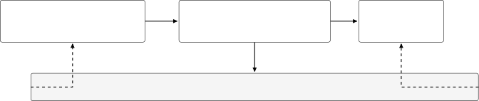
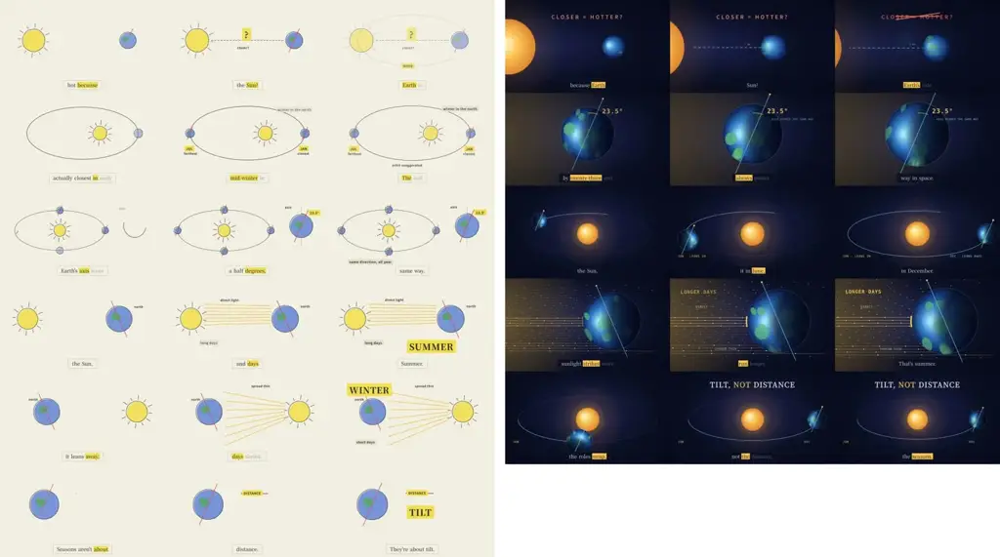
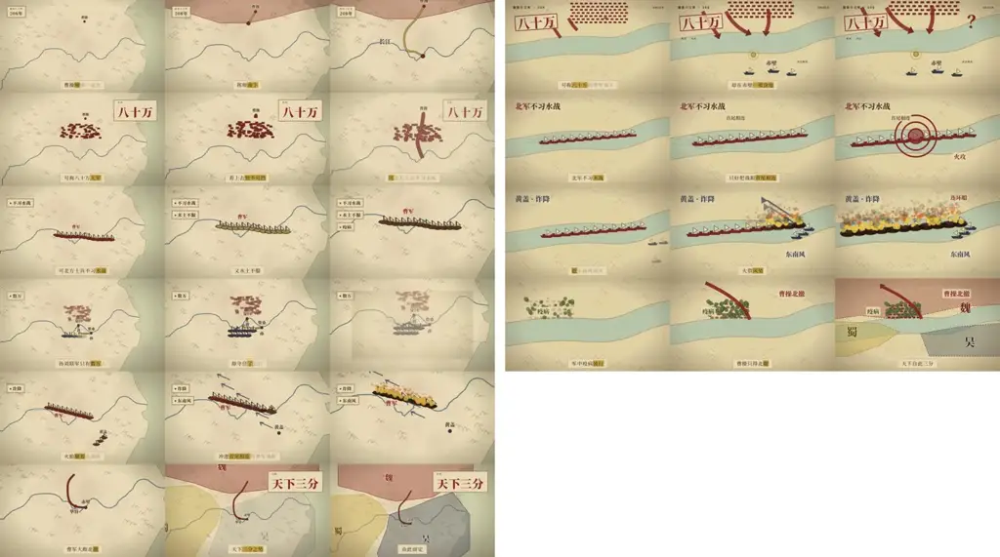
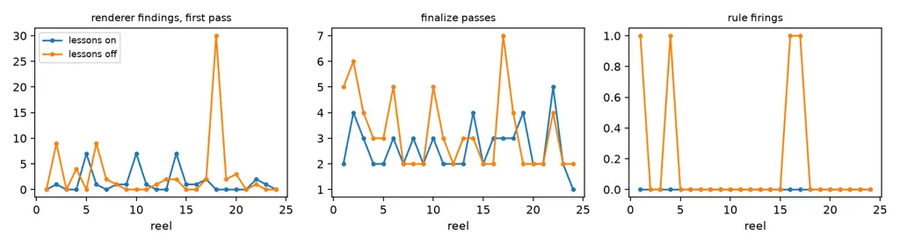

# Reels-RSI: Program-Level Self-Improvement for Code-Rendered Explainer Videos

![[Uncaptioned
image]](arxiv-2610-14495v1--8cea02c4405d.figures/figure-1.webp)  Wei
Lin Agentic Loops X
[https://github.com/agentic-loops-x](https://github.com/agentic-loops-x)

October 2026  • Preprint  • Code, rules, lessons and the evolve report:
[https://github.com/agentic-loops-x/Reels-RSI](https://github.com/agentic-loops-x/Reels-RSI)

###### Abstract

Explainer videos—a worked geometry problem, why the sky is blue, how a
dynasty fell—are usually one more target for pixel video generation. We
argue they are a different kind of artifact: a _program_ (script,
storyboard and per-frame animation code) that a deterministic renderer
turns into frames. A program can be read, diffed, tested and audited;
pixels can only be watched. Reels-RSI is an open-source reel director
for any agent harness; its self-improvement happens at the program level
rather than in weights or prompts. Every revision pass is logged with a
code snapshot; a retrospective pairs each check finding with the diff
that fixed it and proposes lessons; a lesson that a static check can
catch is _compiled into a rule_ with a must-fail and a must-pass
example, so the memory is unit-tested; and a rule learned today runs
over everything made before it. A bounded, benchmark-gated step lets an
agent rewrite the director’s playbook, kept only when blind pairwise
judgments on held-out topics prefer it; nothing enters memory without a
human decision. Across 111 reels—a field study, two playbook evolutions,
a 2$`\times`$2 memory ablation, a weaker director, a 48-reel learning
curve and a judge-reliability study—we find that the rule learned in the
field caught four latent defects in frames authored before it existed
and none after; that rules are an audit for a strong director (eight
unguarded reels, no violation) and a guard for a weaker one (thirty
violations unguarded versus five); that lessons shorten revision loops
but do not compound or move the judge; and that the first rewrite’s 11–1
verdict was a position bias in our vote design (judges pick the
second-shown reel 62–81% of the time), masking scripts that traded
thirteen facts for craft. We document four failure modes of the
preference signal, which check caught each, and the fixes. Code, rules,
lessons and data are public.

## 1 Introduction

A short explainer video has a property that sets it apart from most
video: nearly everything that matters in it is _symbolic_. The numbers
in a worked problem, the labels on a map, the order of steps in a
derivation, the words the narrator says—these are the content; the
picture exists to deliver them. A generated clip is judged on whether
its motion looks plausible \[22\]; an explainer is judged on whether the
shaded triangle’s area really is $`0.3\,\mathrm{cm}^{2}`$ and whether
the viewer saw why.

Recent systems therefore generate explainers as _code_—Manim programs
\[6, 2, 5\], slide decks \[25\], HTML compositions—and reap exact text,
real geometry and reproducible output. We take the consequence one step
further. If the reel is a program, then everything we know how to do
with programs applies to reels: they can be linted, diffed, tested,
audited after the fact, and carried between the models that wrote them.
In particular, an agent that makes reels can _improve itself at the
program level_, by accumulating executable checks over its own output,
instead of only in its prompt or its weights.

This paper presents Reels-RSI and the self-improvement loop built into
it. The system is engineering: a deterministic command-line pipeline
(narration with per-word timings, karaoke captions, font subsetting,
procedural music and sound, map data, assembly, checks, render) that any
agent harness—Claude Code, Codex CLI, Gemini CLI, OpenCode—drives from a
Markdown skill; it makes reels in Chinese, English, Japanese, Korean,
Spanish and French and dubs a finished reel into another language. The
contributions are what the program view makes possible on top of it:

1.  1.  A four-tier, program-level memory (§4). Every finalize pass is
        logged with a code snapshot (L0). A retrospective pairs each check
        finding with the diff that fixed it and proposes _lessons_, injected
        into the next reel’s frame briefs and scoped to the presets, aspects
        and modes they hold for (L1). A lesson that a static check can
        detect is _compiled into a rule_—a check(doc) function shipped with
        must-fail and must-pass examples, admitted only if it passes both
        (L2). A benchmark-gated step lets an agent rewrite the director’s
        playbook, kept only if blind pairwise judges prefer the result on
        training _and_ held-out topics (L3). Every tier is written by a
        check or by a person; the model only proposes.
2.  2.  Retroactive audit, and an honest account of the guard (§5.4, §5.7).
        A rule learned from reel $`n`$ is a program that runs on reels
        $`1\ldots n-1`$. The rule learned during our study found four latent
        defects in two reels delivered and reviewed before the system
        existed—defects no one had noticed—and nothing in the 21 reels made
        under it. The run logs and a rules-off ablation then show why the
        zero is cheap: for this director the rules fired three times in 58
        passes, and eight reels made with no rule active contain no
        violation. The same four topics under a weaker director carry thirty
        violations unguarded and five guarded: the audit is what the program
        view buys a strong director, the guard is what it buys a weak one.
3.  3.  A measured account of the preference signal (§5.5–§5.9). One
        evolution round was accepted by blind pairwise judgment 11–1 on
        training topics and 8–4 on held-out topics while the absolute rubric
        did not move. Re-judging 170 times shows the rubric stable
        (within-reel SD 1.3) but insensitive, the pairwise verdict
        repeatable but leaning on a position bias: three judge models pick
        the second-shown reel 62–81% of the time, and our own three-vote
        alternation gave the candidate the extra second slot. Judged from
        the disadvantaged slot the round still passes, but three of eight
        topics are ties and the remaining margin is not significant
        ($`p=0.39`$ on train). Reading all sixteen scripts shows the
        preferred reels dropping thirteen baseline facts over six topics
        while adding six. We report four failure modes of the signal—a judge
        misreading that became a proposed lesson, a proposer writing for the
        sampling schedule, craft bought with facts, and our own vote
        design—and the check that caught each.

We are explicit about scale. This is a field study of one system during
its own release testing: 23 reels in the main study, 16 in the ablation,
8 under a weaker director, 48 in a learning curve, 16 in a second
evolution round; one model family as director, judge and retrospective
model, one evolution round, no human preference study. It establishes
what the mechanisms catch and what they miss, not effect sizes. A
companion benchmark for explainer-reel systems, with outcome tests on
the final video, is in preparation and is deliberately kept out of this
paper.

## 2 Explainer reels as programs

#### Definition.

In Reels-RSI a reel is a directory. SCRIPT.md holds the spoken lines,
one block per frame; STORYBOARD.md holds per-frame scene, duration,
transition, route and status; compositions/frames/ holds one .html
composition per frame—HTML, SVG, Canvas or Three.js driven by a single
paused GSAP timeline—plus optional shared kits (assets/\*.js) and
overlays; the voice, caption and music assets are derived from these by
the pipeline. Rendering is deterministic: a headless browser seeks each
composition’s timeline to successive frame times and FFmpeg encodes
\[3\]. Re-running finalize on a copy of a finished reel reproduces its
assembled composition byte for byte.

#### What the program view buys.

Table 1 contrasts the two routes to an explainer video. The right-hand
column makes no claim about which route produces better pictures; it
lists what becomes _possible_ once the artifact is source code, and §4
uses each line.

|                           | Pixel generation                   | Program rendering (Reels-RSI, Manim-based agents) |
| ------------------------- | ---------------------------------- | ------------------------------------------------- |
| Text and numbers          | sampled; may be wrong or illegible | exact strings in the program                      |
| Correctness check         | watch the video (human or VLM)     | read the program; the render is deterministic     |
| Targeted edit             | regenerate                         | change one value, re-render one frame             |
| Learning a mistake        | fine-tune or re-prompt             | write a check over the program text               |
| Applying it to old output | impossible                         | run the check over the corpus                     |
| Portability across models | none                               | the check is code; the model is irrelevant        |
| Reproducibility           | seed-dependent                     | byte-identical                                    |

Table 1: Two routes to an explainer video.

#### Three layers of verification.

The artifact exists at three levels—program text, assembled composition,
rendered pixels—and can be checked at each, with rising cost and falling
certainty. _Static_ rules run over the program text (§4.3): exact for
the pattern they encode, free to run. _Dynamic_ checks run on the
assembled composition—the renderer’s own lint, runtime, layout and
contrast checks—exact for what they cover. _Judged_ assessment lets a
vision-language model score or compare sampled frames: cheap and
informative, and, as §5.5 shows, not to be trusted alone. The design
principle of the loop follows from this ordering: a learned judge may
_rank_; admission to memory requires a deterministic check or a person.

## 3 Reels-RSI

Figure 1: Reels-RSI. The creative half (script, storyboard, frame code,
review) belongs to the agent; the deterministic half is a CLI the agent
calls. Memory sits beside both and is written only by checks and by
human-gated acceptance.

Reels-RSI (Fig. 1) separates the creative work from everything that must
be reproducible. The skill is about 1,000 lines of Markdown: a ten-step
director’s handbook with references on script and storyboard, frame
construction, a quality bar, worked problems, history, visual styles and
techniques. Any agent that can read files and run commands can follow
it. The CLI (about 5,000 lines of Python on the standard library, a TTS
client and font tools) owns narration with per-word timings, caption
building with CJK-aware grouping and bilingual lines, font subsetting so
the headless renderer never shows missing glyphs, procedural music beds
and sound effects cut to the real narration, Natural Earth map layers,
Wikimedia Commons images with credits, stroke-order data for Chinese
characters, assembly, overlays, transitions, the renderer’s checks,
snapshots and render. Five visual presets (deep-space, notebook, ink,
atlas, chalk) each ship a design spec and a caption skin; chalk ships a
drawing kit.

#### Models are interchangeable at two seams.

The director runs inside whichever agent CLI the user already has; reels
make "…" launches a headless session. The judge and retrospective roles
are one-shot calls, named provider:model, over an OpenAI-compatible or
Anthropic HTTP API or through a logged-in agent CLI; twelve providers
and custom endpoints are configured in a TOML file. Nothing in memory
depends on the model that produced it.

#### Languages.

A reel’s language is detected from its script (Hangul, kana, Han, else
Latin scored by stop words); the voice, caption cutting (grouped by
character for Chinese and Japanese, by word otherwise), glyph source
(Noto SC, JP or KR, fetched on first use) and subtitle export follow.
reels dub translates a finished reel’s spoken lines and every on-screen
string in one model call, re-voices each line fitted to the original
line’s duration so the frames stay in step, and re-renders; the geometry
lesson of §5 exists in six languages this way.

## 4 Program-level self-improvement

The loop has four tiers. The invariant across them: a model may propose,
and only a check or a person may commit.

### 4.1 L0: every pass is evidence

reels finalize assembles the reel and runs every check—the renderer’s
lint, runtime, layout and contrast checks, then every Reels-RSI rule.
Each pass appends a record to .reels/runs.jsonl (findings with codes,
lines and messages; frame count; duration) and snapshots the frame
sources to .reels/history/NNN/. Renders, scores and viewer feedback
(reels feedback "the labels are too small" --frame 04) append to the
same log. Apart from the judge’s score, no model writes this tier; it is
the raw material the next tiers read.

### 4.2 L1: lessons, paired with the diff that earned them

reels retro compiles an _evidence file_ from the log: per pass, which
findings were new and which were fixed; for every fixed finding, the
unified diff between the snapshot in which it was present and the one in
which it was gone, labelled with what it fixed; the viewer’s comments;
the judge’s notes; and everything already known—accepted lessons and
existing rules—so nothing is proposed twice. A retrospective model reads
the evidence and proposes at most five lessons, each with a kind (doc,
rule, kit, taste), a scope (director, frame, solve, history, …) and an
optional _when_ condition such as preset=chalk, aspect=9:16 or
mode=solve. Lessons land in an inbox, which is inert. On accept they are
injected into the briefs of every future frame worker—but only the
lessons whose conditions the new reel satisfies, so a 16:9 science reel
is not told how to draw chalk boxes on a portrait board.

### 4.3 L2: a lesson that can be checked becomes a rule

A rule is a directory: rule.py exposing RULE (id, severity, lesson, fix)
and check(doc) over a frame’s text, plus bad.\* files that must produce
a finding and good.\* files that must not. reels rules test runs every
rule against its examples; reels lessons accept --rule-dir refuses a
rule lesson whose rule fails them. Rules run on every finalize and lint;
once admitted, the mistake cannot recur, whichever model is directing.
Listing 1 shows the rule learned during the study; Appendix A lists the
rest.

RULE = {"id": "visible-from-state", "severity": "warning",

"kinds": \["frame", "overlay", "kit"\],

"lesson": "fromTo renders its from-state at build time: a tween that
starts "

"visible (opacity \> 0) and fades to 0 later shows the element before
its cue",

"fix": "Add immediateRender: false to the to-vars"}

def check(doc):

out = \[\]

for idx, args in H.calls(doc.text, "fromTo"):

if len(args) \< 4: continue \# no position: starts at t=0 anyway

frm, to = args\[1\], args\[2\]

a, b = num(frm, "opacity"), num(to, "opacity")

if a is not None and a \> 0 and b == 0 and "immediateRender" not in to:

out.append(H.Finding(RULE\["id"\], RULE\["severity"\], doc.rel,

H.line_of(doc.text, idx),

"fromTo starts visible and fades out - visible before its cue"))

return out

Listing 1: The rule compiled from a lesson during the study. Its
must-fail example is the original chalk-dust helper from the reel in
which the defect appeared; the must-pass example adds immediateRender:
false and a fade-in from zero, which is always safe.

The line between L1 and L2 is the line between advice and enforcement. A
doc lesson says “labels inside coloured regions go at the region’s
widest part”; a model may or may not follow it, and no one can tell
afterwards whether it did. A rule says “a fromTo that starts visible and
fades out without immediateRender:false is a finding”; no model can skip
it, and its own examples say whether it is right. Only mistakes
detectable from program text can become rules—a real limit (§7) and the
reason L1 exists.

### 4.4 L3: the playbook rewrites itself, under a gate it cannot move

reels evolve runs one round. (1) The current skill makes the four
training topics of a fixed eight-topic benchmark (science, history, a
worked problem, an English explainer). (2) An agent reads the baseline’s
judge notes, check findings and the lesson inbox and makes at most three
edits to a _copy_ of the skill’s Markdown, explaining each in a
changelog. (3) The copy makes the same topics. (4) Per topic, a vision
judge sees both reels blind, three votes with the order swapped between
votes; the candidate must win most votes, render at least as many reels,
and lose no topic by more than ten composite points. (5) Both versions
make the four held-out topics, and the candidate must win at least half
the votes there. (6) A report is written with per-topic votes, the
judge’s reasons and a side-by-side image of both reels; nothing changes
until a person runs evolve apply. The proposer may edit only the skill
text. The pipeline, the rules, the presets, the judge’s rubric and the
benchmark topics are out of its reach, and it is told to record tool
defects it discovers in a separate file for a developer rather than work
around them in prose.

## 5 Field study

### 5.1 Setting

The data are the reels Reels-RSI made during its own release testing in
October 2026. Claude Code was the director (Opus for the two reels made
with a human reviewer, Sonnet for the headless benchmark reels);
claude-cli:sonnet was the judge and the retrospective model. Table 2
lists the corpus: two reels predate the system (made with its
predecessor skill, before any rule existed); two were made from scratch
with a person reviewing at three gates (plan, look-dev, final);
seventeen were made headlessly from one sentence each in the benchmark
and evolve runs; two are dubs. A 30-second headless reel cost
\$0.56–1.29 and 230–584 s of wall time (15–34 agent turns); judging a
reel takes about 30 s.

| Group        | Reels                                               | Frames | Length  | Lang. / aspect | Made by                     |
| ------------ | --------------------------------------------------- | ------ | ------- | -------------- | --------------------------- |
| Pre-existing | 2 (Yuan dynasty; why the sky is blue)               | 19     | 66–96 s | zh, 16:9       | predecessor skill, no rules |
| Reviewed     | 2 (meeting problem; textbook geometry from a photo) | 16     | 55–84 s | zh, 9:16       | Opus, reviewer at 3 gates   |
| Headless     | 17 (8 topics $`\times`$ 2 skills, +1)               | 83     | 26–33 s | zh/en, 16:9    | Sonnet, one sentence in     |
| Dubbed       | 2 (the geometry reel in en, ja)                     | 18     | 84 s    | en, ja, 9:16   | reels dub                   |
| Total        | 23                                                  | 136    |         | zh, en, ja     |                             |

Table 2: The corpus. Dubs of the geometry reel into Spanish, French and
Korean exist but were not rendered at the time of writing and are
excluded.

#### Compute.

Everything in this paper was made on one laptop and one consumer
subscription. The 105 headless reels across the benchmark, two evolution
rounds, ablation, weaker-director and learning-curve runs cost \$82.72
in metered agent time (\$0.35–1.45 per 30-s reel); the two reviewed
reels were made in an interactive session and the roughly 400 judge
calls ran on the subscription, unmetered. No experiment needed more than
one night.

### 5.2 Within a reel, the review loop converges

Every reel reached zero check errors before render. The two reviewed
reels needed 7 and 5 finalize passes; their warning counts went
$`5\rightarrow 12\rightarrow 2\rightarrow 2\rightarrow 1\rightarrow 1\rightarrow 1`$
and $`1\rightarrow 1\rightarrow 3\rightarrow 2\rightarrow 1`$ (the rise
in pass 2 is new frames being added). The headless reels needed 1–6
passes (median 2); the hardest, a history reel, went $`3,4,3,0`$ errors
over four passes. The two reviewed reels also exposed thirteen defects
in the tool and the skill—a caption skin with 1.27:1 contrast,
placeholders missing for unbuilt frames so voice and captions drifted, a
map-winding rule that flagged a car outline as a polygon—each fixed in
the tool rather than patched in the reel, which is the point of
recording where a fix went.

### 5.3 Lessons

Retrospectives on the two reviewed reels, and the agents’ own
retrospectives after each headless reel, produced 56 proposed lessons. A
person accepted 15, rejected 1 and left 40 in the inbox. Of the 15,
thirteen are doc lessons (e.g. “budget 3.9 Chinese characters per second
for the teaching voice, not 4.5–5”; “a mark that underlines a word rides
on the text element, never on guessed coordinates”), one is a kit lesson
(every reel gets a drawing kit; the chalk kit now ships with the preset)
and one is a rule lesson (§5.4). Two carry _when_ conditions
(preset=chalk, aspect=9:16); before conditions existed, a 16:9
deep-space reel had been handed both. The full list is in Appendix B.

The rejected lesson matters more than the accepted ones. The
retrospective model had turned a judge’s note—“frame 09 is rendered at
the wrong aspect, 1080$`\times`$640”—into “verify every frame’s render
dimensions before finalizing”. The frame was 1080$`\times`$1920; the
judge had been shown a sample sheet downscaled until each portrait frame
was about 200 pixels wide. Had lessons been accepted automatically, a
false constraint would have reached every subsequent reel. The
retrospective prompt now ranks evidence (check findings and viewer words
above judge notes), and sample sheets are sized per aspect.

### 5.4 Lesson to rule, and the audit it enables

In the first reviewed reel, a chalk-dust puff showed stray specks before
its cue. The cause is a GSAP semantic: fromTo renders its from-state at
build time, so a tween from opacity 0.9 to 0, placed later in the
timeline, shows the element from the first frame. The fix is one
property. The lesson became the rule of Listing 1, with the original
helper as its must-fail example. We then ran all thirteen rules over the
whole corpus (Table 3).

| Reels          | Frames | Authored             | Findings | Where                                  |
| -------------- | ------ | -------------------- | -------- | -------------------------------------- |
| 2 pre-existing | 19     | before the rule      | 4        | Yuan: frames 06, 09, 11; sky: frame 04 |
| 21 later       | 117    | with the rule active | 0        |                                        |

Table 3: Retroactive audit with visible-from-state. The other twelve
rules were ported from the predecessor’s checker, under which the
pre-existing reels were made, and produced no findings on any reel; the
signal here is specific to the rule learned later.

All four findings are defects by construction: each is a fade-out tween
whose visible from-state renders at $`t=0`$. The sky reel’s finding was
confirmed in a rendered frame—a ripple ring that should appear at its
cue is already standing in the picture at 21.0 s. Both pre-existing
reels had been delivered and reviewed by a person, and nobody had
noticed. This is the line of Table 1 that matters most: a lesson learned
on reel $`n`$, once compiled, is a program, and programs run on reels
$`1\ldots n-1`$. A prose lesson could not have found these, and a judge
was never asked.

The guard side of the same table is the zero, and it needs a caveat the
run logs supply. Across the 58 finalize passes of the 19 reels with
logs, the thirteen rules fired only three times (repeat-fromto twice,
dasharray-attr once; each fixed before the next pass), while the
renderer’s own checks fired 184 times (30 errors, 154 warnings). The
agents that wrote the 117 frames rarely made the mistakes the rules
encode. So the zero is mostly the model’s doing, and the rules are a
backstop that was needed three times—the ablation in §5.7 measures what
appears when the backstop is removed. Over every reel with a log—92
reels, 260 finalize passes—the thirteen rules fired 25 times, 18 of them
in one weak-director reel (§5.7); nine rules, visible-from-state among
them, never fired while a reel was being authored. The retroactive audit
is the stronger claim: it does not depend on how often a mistake is
made, only on the corpus being code.

### 5.5 One evolution round

The round ran overnight on a consumer subscription, paused once for two
hours when the quota ran out, and resumed from its state file: sixteen
headless reels and about forty judge calls, \$12.75 in agent cost. The
proposer made three edits (a 59-line patch): checkable minimums for hero
size and camera motion; “mechanism recipes” (show travel and effect; do
not label them); and board legibility for worked problems. It also
traced a broken 16:9 board in a chalk reel to a hard-coded portrait
canvas in the shipped kit—a code defect, reported in its tool-bug file
and fixed by hand.

|                                       | Absolute composite (0–100) |           | Blind pairwise votes |           |
| ------------------------------------- | -------------------------- | --------- | -------------------- | --------- |
|                                       | baseline                   | candidate | baseline             | candidate |
| Train (4 topics $`\times`$ 3 votes)   | 75.3                       | 74.9      | 1                    | 11        |
| Holdout (4 topics $`\times`$ 3 votes) | 72.8                       | 73.5      | 4                    | 8         |

Table 4: The first evolve round. Composite $`=0.6\cdot`$ judge rubric
$`+\,0.4\cdot`$ deterministic score; the deterministic part was at or
near 100 for both versions, so the absolute columns are an affine
rescaling of the judge’s 1–5 rubric. Every held-out topic split 2–1.

Table 4 is why the verdict is pairwise. The same judge, asked for
absolute rubric scores, moved by half a point; asked which of two reels
on the same topic is better, it preferred the candidate on 11 of 12
training votes and 8 of 12 held-out votes. Fig. 2 shows the largest
change. The round was accepted by the gate and, after a person inspected
the side-by-side images, applied. §5.9 re-examines both numbers.

Figure 2: _Why do we have seasons?_ under the baseline skill (left) and
the evolved skill (right): same topic, same model; each row is one frame
sampled at 30, 60 and 92% of its duration. The judge preferred the right
3–0.

### 5.6 Four ways the preference signal misled the loop

We record these because each happened, each was caught by a different
check, and a loop without that check would have absorbed it (Table 5).
The fourth was found by checking the harness’s own verdict, which is the
same discipline turned on ourselves.

| Failure                                  | What the signal produced                                                                                                                                        | Gate that caught it                                                                     |
| ---------------------------------------- | --------------------------------------------------------------------------------------------------------------------------------------------------------------- | --------------------------------------------------------------------------------------- |
| (a) Judge misreading                     | a proposed lesson asserting a non-existent render bug                                                                                                           | human accept; then sample sheets sized per aspect, evidence ranked                      |
| (b) Writing for the sampler              | a playbook edit about “the 30/60/92 % samples”                                                                                                                  | human apply; then the proposer prompt forbids sampling-directed text                    |
| (c) Craft bought with facts              | preferred reels whose narration drops 13 baseline facts over 6 topics                                                                                           | none in the loop; found by reading the scripts                                          |
| (d) Position bias in our own vote design | a 3-vote alternation that gave the candidate the second slot twice; judges pick the second-shown reel 62–81 % of the time ($`p<10^{-5}`$ for the round’s judge) | the reliability study (§5.9); the gate now judges each side from its disadvantaged slot |

Table 5: Four failure modes of the judge signal observed around one
round, and where each stopped.

#### (a) A judge misreading became a proposed lesson.

Described in §5.3: the retrospective model treated a judge note as fact.
Caught at the human accept gate; prevented upstream afterwards.

#### (b) The proposer wrote for the sampler.

One edit in the accepted patch read “the 30/60/92 % samples must differ
by camera position”—an instruction about the judge’s sampling schedule,
not about what a viewer sees. Caught at the human apply gate and
rewritten as “keep the picture changing until the narration ends”; the
proposer prompt now forbids instructions aimed at sampling. This is the
“teaching to the test” of Wahi \[12\] in a creative setting, produced
within a single round.

#### (c) Craft was bought with facts.

On the Red Cliffs topic the candidate reel is visibly richer (Fig. 3)
and won 2–1. Its script lists three reasons Cao Cao lost and never names
the Sun–Liu alliance that beat him; the baseline devotes a frame to it.
We then read all sixteen scripts (Table 6). The candidate drops at least
one fact the baseline states on six of eight topics—the January
perihelion that the seasons reel exists to correct, the 12 h 25 min tide
interval, Zhang Qian and Emperor Wu on the Silk Road, the 40^(∘) violet
angle, the buoyancy numbers—and adds a new one on five. Script length is
unchanged ($`1{,}092\rightarrow 1{,}063`$ characters, $`-2.7\%`$): the
evolved skill, whose three edits are all about the picture, substitutes
facts rather than compressing them, and the judge, which sees stills and
a storyboard digest, cannot tell. Nothing in the evolve verdict looks at
facts. Because the reel is a program, each omission is a one-line search
over SCRIPT.md, which is how we found them—but the loop did not run that
search, because no rule asked for it. A rule cannot know which facts a
topic requires; an outcome test per topic can, which is what the
companion benchmark adds and why we keep it separate.

#### (d) Our own vote design leaned on the judge’s position bias.

§5.9: the judge picks the second-shown reel four times in five, and the
three-vote alternation handed the candidate that slot twice per topic.
Judged only from the disadvantaged slot, three of the eight topics it
reported as wins are ties and the remaining preference is not
significant at this size. Caught by re-running the judging; the gate now
uses the position-robust rule.

| Topic                | Stated by the baseline, absent from the candidate                                                | Added by the candidate                                         | Votes |
| -------------------- | ------------------------------------------------------------------------------------------------ | -------------------------------------------------------------- | ----- |
| sci-rainbow          | white light split into seven colours; violet at $`\sim`$40^(∘); the viewer at the apex of a cone | —                                                              | 0–3   |
| hist-chibi           | Cao Cao had just unified the north; the Sun–Liu alliance held the river; soldiers unacclimatised | chained ships became the fire attack’s target                  | 1–2   |
| solve-chicken-rabbit | —                                                                                                | the general rule (assume all chickens; halve the missing feet) | 0–3   |
| en-seasons           | Earth is closest to the Sun in early January; in winter light spreads thin, days shrink          | —                                                              | 0–3   |
| sci-tides            | the two high tides are $`\sim`$12 h 25 min apart because the Moon moves on                       | the Moon’s pull differs across the Earth                       | 1–2   |
| hist-silk-road       | Emperor Wu of Han; Zhang Qian as envoy; Buddhism travelling east                                 | Yumen Pass; porcelain west, glass east                         | 1–2   |
| solve-buoyancy       | the worked numbers (1.3 N vs 10 N; 1 000 cm³)                                                    | Archimedes’ principle stated                                   | 1–2   |
| poem-jingyesi        | (scene-setting only)                                                                             | —                                                              | 1–2   |

Table 6: Fact coverage of the two scripts per topic, read by hand (a
fact = a number, name, date or causal step). Votes are
baseline–candidate from the round. The candidate drops thirteen baseline
facts over six topics and adds six over five; the judge preferred it on
all eight.

Figure 3: Red Cliffs, baseline (left) and evolved (right). The
baseline’s fourth row shows the Sun–Liu alliance holding the river; the
evolved reel has no such frame, and its narration never names the
alliance. The judge preferred the right 2–1 for its larger, animated
fire scene.

### 5.7 Memory ablation

Does the memory change the reels? We made the four training topics four
more times with the current (evolved) skill and the same director,
crossing rules {on, off} with lessons {on, off}: REELS_RULES=off removes
every rule from finalize and lint; an empty REELS_HOME removes the
fifteen accepted lessons from the frame briefs. All sixteen reels
rendered. Afterwards we ran all thirteen rules offline over every reel,
whatever switch it was made with, and had the judge compare conditions
pairwise, position-balanced (four votes per topic, each order twice).
Table 7 has the numbers.

|           | memory |         | rule violations | finalize | renderer warn. | judge  | pairwise, 4 topics $`\times`$ 4 votes |              |
| --------- | ------ | ------- | --------------- | -------- | -------------- | ------ | ------------------------------------- | ------------ |
| Condition | rules  | lessons | in the output   | passes   | at last pass   | rubric | vs lessons off                        | vs rules off |
| A         | on     | on      | 0               | 17       | 0              | 58.7   | 8–8 (vs C)                            | 5–11 (vs B)  |
| B         | off    | on      | 0^(†)           | 10       | 0              | 60.5   | 7–9 (vs D)                            | —            |
| C         | on     | off     | 0               | 11       | 3              | 59.8   | —                                     | 5–11 (vs D)  |
| D         | off    | off     | 0^(†)           | 12       | 3              | 58.0   | —                                     | —            |

Table 7: The 2$`\times`$2 memory ablation, four training topics each,
Sonnet directing. ^(†)The offline audit of the eight unguarded reels
raised one finding, a counter-clockwise ring in a Red Cliffs map; the
region renders correctly because that kit projects points into a plain
SVG path, where ring direction is irrelevant, so it was a false positive
of polygon-winding, which now fires only where a ring becomes GeoJSON
and ships this kit’s pattern as a must-pass example.

#### The guard was not needed.

Eight reels made with no rule active contain no true violation of any of
the thirteen rules. For this director, the mistakes the rules encode are
ones it no longer makes—consistent with the three firings in 58 passes
of §5.4. The one finding the audit did raise was a false positive, which
is the other thing an audit over a corpus of programs finds: imprecise
rules. It cost a two-line change to the rule’s gate and a new must-pass
example, after which every rule still passes its examples.

#### Lessons left no trace the judge could see, and a small one the renderer could.

With rules on, the reels made with lessons and without split the
pairwise votes 8–8; with rules off, 7–9 (pooled 15–17, $`p=0.86`$). The
rubric means are within two points. The only consistent difference is at
the last finalize pass: both lesson-less conditions ended with three
renderer warnings outstanding, both conditions with lessons with none,
which is the kind of thing a brief about caption bands and label
placement would affect. We read this as: fifteen lessons, most of them
about chalk-board geometry reels, do not move a judge watching four
science and history stills; a lesson earns its place on the reels it was
learned from.

#### Rules on were judged slightly worse.

Both rules-on conditions lost their pairwise comparison to the rules-off
twin 5–11 (pooled 10–22, $`p=0.05`$). With four topics we do not read a
mechanism into it—no rule fired in any of these sixteen reels, so the
switch changed nothing the agent saw except the absence of a check
step—and with the second-shown reel still picked 58% of the time even
under the balanced design, 5–11 over four topics is within what position
alone produces. It is, at least, not evidence that the guard improves
craft.

#### A weaker director needs the guard.

The sixteen Sonnet reels say the rules were not needed by that director;
they do not say the rules are not needed. We repeated the four training
topics with claude-cli:haiku directing, rules on and rules off, lessons
on (Table 8). The weaker director makes exactly the mistakes the rules
encode: with the rules off, its four reels carry 30 violations—nine
frames with Chinese text and no shipped font, fifteen unregistered
timelines, six nondeterministic animations—and nothing flagged them.
With the rules on, the same director tripped them 18 times during
authoring and fixed most: five violations remained, all in one reel that
it rendered with fifteen renderer errors still outstanding. (On this
machine the missing font-faces do not show, because the authors’ Chrome
has system CJK fonts; the reference Linux renderer has none and would
draw boxes.) The reels themselves are poor by every signal—deterministic
score 45–58, several not scorable by the judge—which is the point: a
director that is not yet good is the one the guard is for, and the audit
found what the guard was switched off from catching. Thirty violations
in four reels against zero in eight is the difference between the two
directors, not between two settings.

| Director         | rules | firings | violations left | passes | renderer errors left | det. score | cost   |
| ---------------- | ----- | ------- | --------------- | ------ | -------------------- | ---------- | ------ |
| haiku            | on    | 18      | 5 (1 reel)      | 7      | 48                   | 45         | \$2.58 |
| haiku            | off   | 0       | 30 (2 reels)    | 4      | 67                   | 58         | \$2.00 |
| sonnet (Table 7) | on    | 0       | 0               | 28     | 0                    | 100        | \$6.32 |
| sonnet (Table 7) | off   | —       | 0               | 22     | 0                    | 100        | \$7.29 |

Table 8: The same four topics under a weaker director. “Firings” are
rule findings raised at finalize while authoring; “violations left” are
what all thirteen rules find in the delivered reels. Sonnet rows pool
the two lessons conditions.

### 5.8 Does the memory grow? Forty-eight more reels

The ablation compared four reels per cell with a fixed store of fifteen
lessons. To ask whether the L1 tier _accumulates_, we wrote 24 new
topics (six each of science, history, worked problem and English
explainer, in that repeating order), and made each twice with the same
director (Sonnet, 30-s draft, rules on): once in an arm whose lesson
store starts empty and _auto-accepts_ every doc, kit and taste lesson
the agent files after each reel, so reel $`k`$ sees what reels
$`1\ldots k-1`$ taught; once in an arm where the same lessons are filed
but never accepted. The auto-accept arm is an explicit departure from
the human gate, labelled as such, because a curve needs a loop that
closes without a person. All 48 reels rendered, in 4.3 hours for
\$37.25; no rule fired in the lessons arm, four times in the other (each
fixed); the offline audit finds no violation in any of the 48. The store
grew from 3 lessons after the first reel to 51 after the last.

Figure 4: Per reel, in order: renderer findings at the first finalize
pass, finalize passes to a clean build, and rule firings; lessons
accumulating (blue) against none (orange). Topics cycle science,
history, problem, English, which is the period in the orange spikes.

#### Lessons lower the review cost; they do not keep lowering it.

Paired by topic, the arm with lessons needed fewer finalize passes (2.62
vs 3.21; fewer on 12 topics, more on 5, equal on 7; sign-flip
permutation $`p=0.069`$) and had fewer renderer findings at its first
pass (errors 1.04 vs 2.21, warnings 1.38 vs 2.83; both heavy-tailed and
not significant at $`n=24`$, $`p=0.29`$ and $`0.41`$). The gap sits
almost entirely in the history reels, the ones with maps: 3.67 vs 4.50
passes and 2.67 vs 5.83 first-pass errors, against no difference on the
worked problems or the English explainers. But the curve is flat
(Fig. 4): within the lessons arm, passes and first-pass findings show no
trend over the 24 reels (Spearman $`\rho=+0.03`$, $`-0.01`$, $`-0.02`$)
while the store grew seventeenfold. Whatever a brief of lessons buys, it
buys with the first handful; the fortieth bullet adds nothing the agent
acts on. Reading the 51 accumulated lessons says why: four of them are
narration-speed budgets that disagree with one another (3.7 and 3.9
characters per second, 2.5 and 3.0 words per second), several restate
the same map-label rule from different reels, and none was compiled into
a check. Auto-acceptance grows a store; it does not grow a memory. That
is the case for the human gate and for L2 over L1: curation removes the
duplicates and the contradictions, and only a lesson turned into a rule
is enforced on the fiftieth reel as surely as on the second.

#### And they do not move the judge.

Scoring all 48 reels with the absolute rubric gives the two arms the
same craft: judge 55.1 with lessons, 55.6 without (paired $`p=0.53`$;
higher on 12 topics, lower on 10), deterministic score 98.0 vs 97.7.
Neither arm trends upward over the 24 reels; both drift slightly down
together ($`\rho=-0.30`$ and $`-0.54`$), which is the topic order, not
the memory. Twenty-four more topics say what the four of §5.7 said: the
L1 tier changes how much checking a reel needs, not what a judge of
stills sees.

### 5.9 Judge reliability

The round’s verdict rests on one judge model voting once. To learn how
much of it is the judge, we re-ran the judging without making any reels:
the absolute rubric three times on each of the sixteen reels, the
pairwise comparison three times per topic with the same judge, and once
each with two other judges (claude-cli:haiku, claude-cli:opus); about
170 judge calls in 45 minutes.

#### The absolute rubric is stable but sees little.

Within-reel standard deviation over three re-scores has median 1.3 and
maximum 2.7 on the rubric’s 20–100 scale, so the flat score in Table 4
is not noise. Averaged over re-scores the rubric puts the candidate 3.5
points ahead on the training topics (57.0 vs 60.5) and 1.9 behind on the
held-out ones (59.5 vs 57.6), with per-topic differences from $`-9.9`$
(the poem; baseline better) to $`+8.7`$ (the seasons). The rubric does
see the change; it does not agree with the pairwise verdict about its
direction on holdout.

#### The pairwise verdict is repeatable—and biased by position.

Three repeats with the same judge gave the candidate 8 of 8 topics every
time, with 10–11 of 12 training votes and 10 of 12 held-out votes. But
the breakdown by position (Table 9) shows that the judge picked the
candidate 48 of 48 times when it was shown _second_ and 14 of 24 times
when it was shown _first_; over all votes it picked the second-shown
reel 81% of the time, and the two other judges 67% and 62%. Our vote
design—three votes, order alternating from a fixed start—gave the
candidate the second slot twice per topic, which inflated its margin.
Because the second-slot preference saturates (every second-shown
candidate won), the informative votes are the ones where the candidate
was shown first: 8 of 12 on the training topics (two-sided binomial
$`p=0.39`$) and 6 of 12 on the held-out ones ($`p=1.0`$), against 24 of
24 in the second slot ($`p<10^{-6}`$). The absolute rubric agrees:
averaged over re-scores and the eight topics the candidate is $`+0.8`$
points ahead, sign-flip permutation $`p=0.70`$. There is no
statistically supported evidence that the rewrite is better; the round’s
11–1 was the slot. Balancing the vote count is not enough when the bias
saturates—it still hands each side two free votes per topic—so the
harness now judges each side only on the votes where it was shown first,
its disadvantaged slot: the side with the higher first-slot win rate
takes the topic, equal rates tie. Under that rule the round is three
topics won and one tied on train, two won and two tied on holdout: it
still passes its gate, with the uncertainty now visible in the ties
rather than hidden in a vote total.

|                          | candidate wins (sonnet, 3 repeats) |              |          | other judges, 1 run |      |
| ------------------------ | ---------------------------------- | ------------ | -------- | ------------------- | ---- |
| Topic                    | shown first                        | shown second | balanced | haiku               | opus |
| sci-rainbow              | 0/3                                | 6/6          | 0.50     | C                   | C    |
| hist-chibi               | 3/3                                | 6/6          | 1.00     | C                   | C    |
| solve-chicken-rabbit     | 2/3                                | 6/6          | 0.83     | C                   | C    |
| en-seasons               | 3/3                                | 6/6          | 1.00     | C                   | C    |
| sci-tides                | 3/3                                | 6/6          | 1.00     | C                   | C    |
| hist-silk-road           | 3/3                                | 6/6          | 1.00     | B                   | C    |
| solve-buoyancy           | 0/3                                | 6/6          | 0.50     | C                   | B    |
| poem-jingyesi            | 0/3                                | 6/6          | 0.50     | B                   | B    |
| second-shown reel picked | 58/72 = 81%                        |              |          | 67%                 | 62%  |

Table 9: Pairwise judging by position. “Balanced” is the mean of the two
position-specific win rates. C/B: topic winner by majority for the other
judges. Topic-winner agreement between the five judge runs is 0.82.

#### Where judges disagree, the human agrees with the minority.

The two other judges prefer the baseline on the poem, and so does the
absolute rubric by 9.9 points; one of us, before seeing any of these
numbers, had preferred the baseline’s quieter staging too. Only the
round’s judge preferred the candidate there—three to nothing, three
times—and every one of those votes came from the second slot. On the
Silk Road and buoyancy topics one other judge each dissents. Agreement
between judge runs on the topic winner is 0.82; the disagreements
concentrate on exactly the topics where the fact coverage of Table 6
moved most.

#### A second round under the corrected gate.

With the position-robust rule in place we ran the loop once more, from
the round-1 skill. The proposer made two edits (35 lines: hero build
recipes for the frame worker; counting-figure and answer-box rules for
worked problems) and declined a third. On the training topics it won all
four, judged from the disadvantaged slot (candidate-first votes 6 of 8;
raw 14–2); on the held-out topics it won two and lost two
(candidate-first 3 of 8; raw 8–8), and the absolute composite moved
$`+3.4`$ on train and $`-2.7`$ on holdout, with the tides reel falling
from 60.0 to 48.7 on the rubric. The gate, which asks for wins $`\geq`$
losses on holdout, accepted it. The scripts this time trade roughly five
baseline facts (the 50-minute tide lag, Zhang Qian and 138 BCE, the
buoyancy numbers) for roughly nine new ones (the 40^(∘) violet angle and
the antisolar point, spring tides, Buddhism on the Silk Road,
Archimedes’ principle); the round-1 pattern did not recur. The
second-shown reel was still picked 62% of the time. We did not apply it:
a 2–2 holdout and a rubric drop on one topic are not a reason to change
the playbook, which is the judgment the human gate exists to make, and
the paper reports the round as the gate’s output rather than as an
improvement.

Together with the flat absolute score, these support a conclusion
reached elsewhere in other settings \[12, 24, 7\]: a learned judge is a
useful _advisor_ to a self-improving loop and a poor _oracle_. The
program view lets the loop keep its oracles deterministic—rules, render
checks and, in the benchmark, outcome tests on the artifact—and reserve
the judge for what only taste can rank.

## 6 Related work

#### Explainer and educational video from code.

TheoremExplainAgent \[6\] and Code2Video \[2\] generate Manim programs
with planner, coder and critic agents and judge them with LLM rubrics or
a quiz; Paper2Video \[25\] adds pairwise comparison against human talks.
ManimAgent \[5\] is closest to us: a Manim-writing agent with an
episodic memory of success rationales and validated failure patterns
grown from its own task stream, evaluated by blind human Pass@1. Its
memory is prose retrieved into the prompt; ours compiles the checkable
part into tested code, which is what makes retroactive audit and
cross-model portability possible. CineForge \[9\] and VideoWeaver \[15\]
evolve policies or skills for long-form pixel video; what they learn
cannot be run over the artifact, because the artifact is not a program.

#### Experience memory for agents.

Reflexion \[11\], ExpeL \[21\] and ACE \[20\] store verbal reflections,
insights or an evolving playbook; our L1 and L3 belong to this family,
with ACE’s incrementally curated playbook closest to evolve. Voyager
\[13\] and ASI \[14\] store _skills_ as executable programs verified by
the environment; we store _checks_, verified by their own examples,
which is what a creative task without an environment reward affords. The
neuro-symbolic dual memory of Wen et al. \[16\] induces executable
Python verifiers from failed trajectories and validates them on positive
and negative pools—the same contract as our L2, in household and web
environments. SkillRevise \[10\] revises LLM-authored skills from
execution traces.

#### Checkers from fixes.

KNighter \[17\] synthesises static analysers from historical kernel
patches, validating each against the buggy and the patched code, and
found 92 long-latent Linux bugs; test-driven checker development \[8\]
makes the same contract explicit. Our rules follow it exactly—must fail,
must pass—but the corpus audited is the agent’s own past output, and the
patches come from the agent’s own revision log.

#### Self-modifying agents and judge reward hacking.

ADAS \[4\], the Darwin Gödel Machine \[19\] and GEPA \[1\] let an agent
rewrite its scaffold or prompts under an objective score. Wahi \[12\]
and Zhou \[24\] show what happens when the score is an LLM judge; Ye et
al. \[18\] show how sensitive such loops are to variance and task order.
Our evolve step is a small instance of this family with the guards those
papers recommend: a frozen holdout, pairwise rather than absolute
judgment \[23\], a deterministic layer the proposer cannot edit, and a
person at the end.

## 7 Limitations

_Scale and family._ 111 reels, two evolution rounds, four topics per
ablation cell, and one model family (Claude) as director, judge and
retrospective model; the three judges differ in size, not provenance.
_No human preference study._ We cannot say whether any judge’s taste
matches viewers’; one author’s eye agrees with the dissenting judges on
one topic, which is an anecdote. _Position bias remains._ Judging from
the disadvantaged slot discards the saturated votes but halves the
sample; under the balanced ablation design the second-shown reel was
still picked 58% of the time, so small margins in pairwise verdicts
carry little information. _Null results at $`n=4`$._ The ablation’s
“lessons change nothing the judge sees” and “rules on are judged
slightly worse” are within what position alone produces; they rule out
large effects, not small ones. _What rules can see._ A rule checks
program text. It cannot know that a topic requires naming an alliance or
stating the perihelion, that a label is too small on a phone, or that a
mood is wrong; those remain lessons (advice) or outcome tests (the
companion benchmark). _Rule provenance and precision._ Twelve of
thirteen rules were ported from the predecessor’s checker, each from a
real failure; one lesson-to-rule path was exercised; one rule produced a
false positive that the ablation exposed. _Human cost._ A person triaged
56 lessons and one evolve report and read sixteen scripts by hand; we
did not measure how that scales. _Dependencies._ The free neural voices
come from an unofficial endpoint; commercial use needs a licensed
provider, which the pipeline supports.

## 8 Conclusion

An explainer reel rendered from a program is a different object from a
generated video, and the difference is worth more than exact text: it
makes the agent’s own output something the agent, and its authors, can
check, audit and learn from at the level of code. Reels-RSI turns that
into a loop—log every pass, pair findings with fixes, propose lessons,
compile the checkable ones into tested rules, rewrite the playbook under
a gate it cannot move—and a release-testing study shows where each tier
earns its place and where it does not. A rule found latent defects in
reels made before it existed; the same rules were almost never needed by
a strong director and caught thirty mistakes a weak one made; lessons
bought fewer review passes without compounding and without moving a
judge; and the preference signal that accepted the one playbook rewrite
turned out to be stable, repeatable, position-biased and blind to the
thirteen facts the rewrite traded for craft. Each of those findings came
from running a check over artifacts that already existed—reels, scripts,
logs, votes—which is the practice this paper argues for. The system,
every rule with its examples, the lessons, the ablation and reliability
data and the evolve report are public at
[https://github.com/agentic-loops-x/Reels-RSI](https://github.com/agentic-loops-x/Reels-RSI).

## References

- \[1\] L. A. Agrawal et al. (2025) GEPA: reflective prompt evolution
  can outperform reinforcement learning. arXiv preprint
  arXiv:2507.19457. Cited by: §6.
- \[2\] Y. Chen, K. Q. Lin, and M. Z. Shou (2026) Code2Video: a
  code-centric paradigm for educational video generation. In
  International Conference on Machine Learning (ICML), Note:
  arXiv:2510.01174 Cited by: §1, §6.
- \[3\] HeyGen (2025) HyperFrames: render video from HTML. Note:
  [https://github.com/heygen-com/hyperframes](https://github.com/heygen-com/hyperframes),
  Apache-2.0 Cited by: §2.
- \[4\] S. Hu, C. Lu, and J. Clune (2024) Automated design of agentic
  systems. arXiv preprint arXiv:2408.08435. Cited by: §6.
- \[5\] W. Jiang, Z. Cai, Y. Shao, C. Wang, B. Han, Z. Song, K. Chen, S.
  An, X. Yang, and Z. Yang (2026) ManimAgent: self-evolving multimodal
  agents for visual education. arXiv preprint arXiv:2606.30296. Cited
  by: §1, §6.
- \[6\] M. Ku, T. Chong, J. Leung, K. Shah, A. Yu, and W. Chen (2025)
  TheoremExplainAgent: towards video-based multimodal explanations for
  LLM theorem understanding. In Proceedings of ACL, Note:
  arXiv:2502.19400 Cited by: §1, §6.
- \[7\] Y. Lin, Y. Guo, S. Chen, B. Feng, Y. Hsu, H. Hsieh, Y. Lin, Y.
  Wu, J. Dong, A. Cheng, Y. Huang, L. Ieong, K. Chen, M. Tchouang, S.
  Sun, C. Lin, J. Ding, and H. Lee (2026) Findings of the first teaching
  monster challenge: a benchmark of pedagogical content knowledge in AI
  agents. arXiv preprint arXiv:2608.08852. Cited by: §5.9.
- \[8\] J. Liu, Y. Xie, J. Yan, J. Huang, J. Yan, and J. Zhang (2024)
  Write your own CodeChecker: an automated test-driven checker
  development approach with LLMs. arXiv preprint arXiv:2411.06796. Cited
  by: §6.
- \[9\] J. Liu, L. Wang, H. Shi, H. Ma, X. Yang, C. Chen, X. Xu, K.
  Zhan, B. Wang, S. Shi, T. Zhu, J. Li, and J. Li (2026) CineForge:
  self-improving agents for long-horizon video generation. arXiv
  preprint arXiv:2608.29621. Cited by: §6.
- \[10\] Y. Liu, Z. Su, L. Xie, Y. Zhang, Q. Zong, J. Guo, Z. Xie, Y.
  Ji, Y. Yim, H. Luo, X. Ren, R. Chenyu, H. Li, and Y. Song (2026)
  SkillRevise: improving LLM-authored agent skills via trace-conditioned
  skill revision. arXiv preprint arXiv:2606.01139. Cited by: §6.
- \[11\] N. Shinn, F. Cassano, A. Gopinath, K. Narasimhan, and S.
  Yao (2023) Reflexion: language agents with verbal reinforcement
  learning. In Advances in Neural Information Processing Systems
  (NeurIPS), Note: arXiv:2303.11366 Cited by: §6.
- \[12\] V. Wahi (2026) LLM-as-a-judge is not an oracle: why
  self-improving agents need deterministic guardrails. arXiv preprint
  arXiv:2609.02246. Cited by: §5.6, §5.9, §6.
- \[13\] G. Wang, Y. Xie, Y. Jiang, A. Mandlekar, C. Xiao, Y. Zhu, L.
  Fan, and A. Anandkumar (2024) Voyager: an open-ended embodied agent
  with large language models. Transactions on Machine Learning Research.
  Note: arXiv:2305.16291 Cited by: §6.
- \[14\] Z. Z. Wang, A. Gandhi, G. Neubig, and D. Fried (2025) Inducing
  programmatic skills for agentic tasks. arXiv preprint
  arXiv:2504.06821. Cited by: §6.
- \[15\] J. Wei, Y. Zhang, J. Tan, H. Zhu, X. Zhang, Z. Chen, D.
  Zhang, W. Xu, Y. Jin, and Z. Liu (2026) VideoWeaver: evaluating and
  evolving skills for agentic long video generation. arXiv preprint
  arXiv:2606.08091. Cited by: §6.
- \[16\] B. Wen, R. Zhang, Y. Chen, H. Xie, and L. Guo (2026) Aligning
  progress and feasibility: a neuro-symbolic dual memory framework for
  long-horizon LLM agents. arXiv preprint arXiv:2604.02734. Cited by:
  §6.
- \[17\] C. Yang, Z. Zhao, Z. Xie, H. Li, and L. Zhang (2025) KNighter:
  transforming static analysis with LLM-synthesized checkers. In
  Proceedings of the 31st ACM Symposium on Operating Systems Principles
  (SOSP), Note: arXiv:2503.09002 Cited by: §6.
- \[18\] Q. Ye, Y. Li, Y. Pruksachatkun, J. Zhang, and C. Wu (2026) On
  the fragility of self-improving agents: variance, task order, and
  underspecification. arXiv preprint arXiv:2608.18066. Cited by: §6.
- \[19\] J. Zhang, S. Hu, C. Lu, R. Lange, and J. Clune (2025) Darwin
  Gödel machine: open-ended evolution of self-improving agents. arXiv
  preprint arXiv:2505.22954. Cited by: §6.
- \[20\] Q. Zhang, C. Hu, S. Upasani, B. Ma, F. Hong, V. Kamanuru, J.
  Rainton, C. Wu, M. Ji, H. Li, U. Thakker, J. Zou, and K.
  Olukotun (2026) Agentic context engineering: evolving contexts for
  self-improving language models. In International Conference on
  Learning Representations (ICLR), Note: arXiv:2510.04618 Cited by: §6.
- \[21\] A. Zhao, D. Huang, Q. Xu, M. Lin, Y. Liu, and G. Huang (2024)
  ExpeL: LLM agents are experiential learners. In Proceedings of AAAI,
  Note: arXiv:2308.10144 Cited by: §6.
- \[22\] D. Zheng, Z. Huang, H. Liu, K. Zou, Y. He, F. Zhang, L. Gu, Y.
  Zhang, J. He, W. Zheng, Y. Qiao, and Z. Liu (2025) VBench-2.0:
  advancing video generation benchmark suite for intrinsic faithfulness.
  arXiv preprint arXiv:2503.21755. Cited by: §1.
- \[23\] L. Zheng et al. (2023) Judging LLM-as-a-judge with MT-Bench and
  Chatbot Arena. In Advances in Neural Information Processing Systems
  (NeurIPS) Datasets and Benchmarks, Note: arXiv:2306.05685 Cited by:
  §6.
- \[24\] C. Zhou (2026) More convincing, not more correct: self-play
  reward hacking of reference-free LLM judges. arXiv preprint
  arXiv:2607.05904. Cited by: §5.9, §6.
- \[25\] Z. Zhu, K. Q. Lin, and M. Z. Shou (2025) Paper2Video: automatic
  video generation from scientific papers. arXiv preprint
  arXiv:2510.05096. Cited by: §1, §6.

## Appendix A The thirteen rules

Each rule directory holds rule.py, at least one must-fail and one
must-pass example; reels rules test passes 13/13. Severity _error_
blocks render; _warning_ is reported.

| Rule                  | Severity | What it catches                                                                                         |
| --------------------- | -------- | ------------------------------------------------------------------------------------------------------- |
| timeline-registration | error    | a sub-composition that does not register its paused timeline under its composition id                   |
| nondeterminism        | error    | Math.random, Date.now, requestAnimationFrame, timers or self-driving animation in a seek-rendered frame |
| cjk-font              | error    | CJK text without an @font-face for a shipped font (the render browser has no CJK system fonts)          |
| dasharray-attr        | error    | a stroke-dasharray attribute in the markup of a path that a tween draws on                              |
| svgorigin-one-sided   | error    | svgOrigin given only in a fromTo’s to-vars                                                              |
| negative-zindex       | error    | a negative z-index, which puts the layer behind the composition root                                    |
| caption-band          | warning  | frame text placed in the band reserved for karaoke captions                                             |
| chained-no-position   | warning  | a chained .to() without a position argument, which drifts to the timeline’s end                         |
| repeat-fromto         | warning  | a second fromTo on the same target without immediateRender:false                                        |
| round-cap-mask        | warning  | a reveal mask with round caps, which leaks a dot before the stroke begins                               |
| polygon-winding       | warning  | a counter-clockwise ring in d3-geo map data (“the globe minus this shape”)                              |
| unpinned-cdn          | warning  | a CDN script without a version pin                                                                      |
| visible-from-state    | warning  | a fromTo that starts visible and fades out without immediateRender:false (learned in this study)        |

Table 10: Rules shipped with Reels-RSI 0.1. A user’s own rules live
beside them and may override a built-in of the same name.

## Appendix B Accepted lessons

The fifteen lessons a person accepted during the study, as injected into
frame briefs (abridged).

- •
  frame — A tween starting from a visible state on an element meant to
  appear later needs immediateRender:false (_rule_).
- •
  frame — Labels inside coloured regions go at the region’s widest part
  and get a board-coloured outline.
- •
  frame — Underlines, boxes and circles that mark a piece of text ride
  on the text element, never on guessed coordinates.
- •
  frame — Draw chalk boxes from four straight wobbly segments;
  curve-smoothing turns a rectangle into a blob (_when preset=chalk_).
- •
  frame — On 9:16 canvases scale the hero to the full width and use the
  lower half for the working (_when aspect=9:16_).
- •
  frame — Size on-figure labels at 28 px or larger; keep construction
  lines heavy and inside the figure.
- •
  frame — Pick label colours as pre-lightened variants that pass
  contrast on the board.
- •
  frame — Highlight a named composite shape by filling its parts, not by
  tracing a thin outline; put the answer box beside it.
- •
  frame — A hero word goes in an empty region of the hero, never over
  bright strokes.
- •
  frame — Clamp computed rays so endpoints and labels land inside the
  canvas above the caption band.
- •
  director — Budget about 3.9 Chinese characters per second for the
  female teaching voice, plus 10% when reading letter names.
- •
  director — Budget about 4.5 characters per second, pauses included,
  for the male narrator.
- •
  director — Spread each frame’s build-up across its narration; single
  out the key shape on the word that names it.
- •
  solve — Give every reel a drawing kit with the figure computed from
  coordinates (_kit_).
- •
  solve — For a problem from a photo, transcribe text and figure,
  restate them for confirmation, and build the figure from the given
  lengths, never from pixel proportions.
