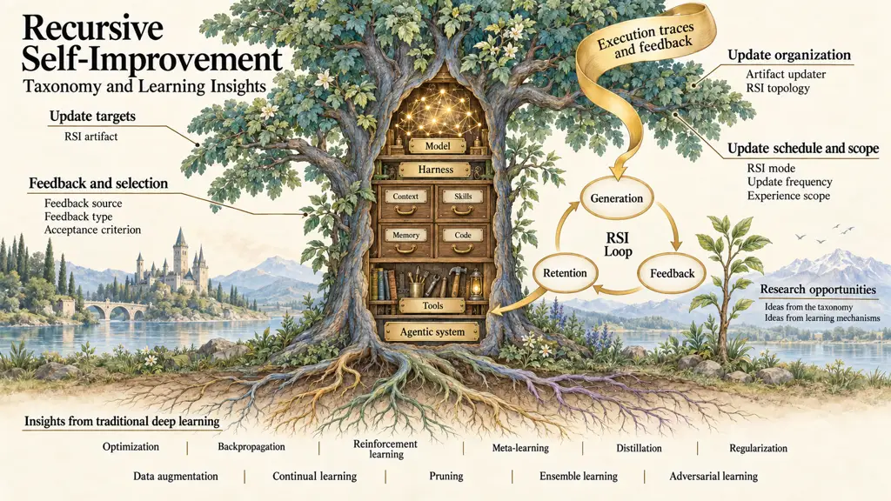
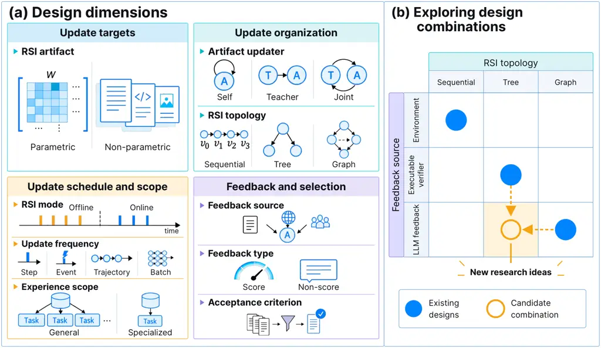
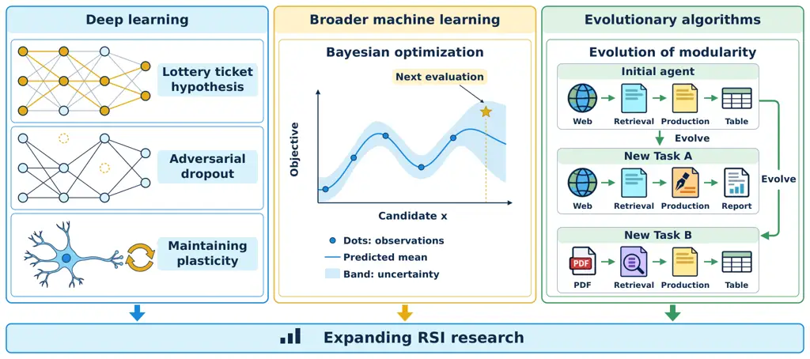

1\]PrismShadow 2\]Peking University 3\]Zhejiang University
4\]New York University \contribution\[\*\]Equal contribution.
\correspondenceJunhao Hu (), Yaowei Zheng ()

# From Existing Methods to New Research Ideas: Two Perspectives on Recursive Self-Improvement

Leijun Zhou    Yanke Yu    Zhihao Liu    Qu Xiang    Tiancheng Hu   
Yiru Dong    Yihan Wu    Yangxi Xiang    Xuejun Wu    Xi Chen   
Buyue Qian    Yaowei Zheng    Junhao Hu Affiliation: \[ Affiliation: \[
Affiliation: \[ Affiliation: \[ Email: <hu@prismshadow.com>
Email: <zheng@prismshadow.com>

October 9, 2026

###### Abstract

Recursive self-improvement (RSI) offers a route to AI systems that
participate in their own continued development. Recent methods allow
language agents to retain changes to their parameters, memory, skills,
and code for subsequent execution and improvement. We examine how these
methods can inform new research ideas through two complementary
perspectives. First, we introduce a unified taxonomy with nine design
dimensions organized into four groups: update targets, update
organization, update schedule and scope, feedback and selection. This
taxonomy places existing methods in a shared design space, where
examining individual dimensions and their interactions can inspire new
research ideas. Second, we examine how existing RSI methods draw on
traditional deep learning, for example through optimization,
regularization, data augmentation, continual learning, and adversarial
learning. We develop further ideas by examining more specific learning
mechanisms and drawing on evolutionary computation. We also review how
existing benchmarks assess self-improvement under online, offline, and
offline-to-online settings. Together, these perspectives help
researchers develop new RSI research ideas from existing designs and
learning mechanisms. RSI papers and resources are available at
[https://prism-shadow.github.io/awesome-rsi/](https://prism-shadow.github.io/awesome-rsi/).

###### Contents

1.  1 Introduction
2.  2 Background
    1.  2.1 Agentic systems
    2.  2.2 The ReAct Loop
    3.  2.3 The RSI Loop
3.  3 A Unified Taxonomy of Agent Self-Improvement
    1.  3.1 Overview of the unified taxonomy
    2.  3.2 Update targets
    3.  3.3 Update organization
    4.  3.4 Update schedule and scope
    5.  3.5 Feedback and selection
    6.  3.6 Ideas from the unified taxonomy
4.  4 Insights from Traditional Deep Learning
    1.  4.1 Connections in Existing RSI Methods
    2.  4.2 From Established Methods to New RSI Ideas
5.  5 Evaluation and Benchmarks
    1.  5.1 Online evaluation
    2.  5.2 Offline evaluation
    3.  5.3 Offline-to-online evaluation
    4.  5.4 Toward unified evaluation
6.  6 Conclusion
7.  References
8.  A Literature Catalogue
    1.  A.1 Method papers
    2.  A.2 Benchmarks
    3.  A.3 Software systems

## 1 Introduction



Figure 1: Overview of the survey. Agent resources form the trunk, four
groups of design dimensions organize the canopy, and traditional deep
learning supplies the roots. Execution traces and feedback inform
self-improvement. New growth represents research opportunities arising
from the taxonomy and learning mechanisms.

Recursive self-improvement (RSI) is a process in which an AI system
participates in modifying itself, retains these modifications, and uses
the revised system in subsequent execution and improvement. Its appeal
lies in the possibility that an improvement makes the system better at
producing further improvements. A growing share of AI development could
then be carried out by the systems being developed. This possibility
underlies Good’s suggestion that a sufficiently capable machine might be
the last invention humans need to make \[1\].

Recent research has produced numerous RSI methods, including those that
update model parameters, revise memory and skills, and modify agent code
\[2, 3, 4, 5\]. Several surveys now organize this literature by
improvement targets, autonomy levels, or the degree of loop closure \[6,
7, 8\]. These classifications help describe the field, but assigning a
method to a broad category does not fully explain its design. Two
methods that revise agent code, for example, can differ in who proposes
changes, how earlier versions are reused, and what feedback determines
which changes are retained. Generating new research ideas from existing
work requires examining its design dimensions and their interactions to
identify limitations of current mechanisms and new ways to improve them.
Existing surveys also discuss connections to earlier learning paradigms,
but offer less systematic guidance on using specific mechanisms from
traditional deep learning to generate new RSI research ideas. This calls
for an analysis of how RSI adapts these mechanisms and which principles
can be reused.

We view existing RSI methods as combinations of design choices. These
choices define a high-dimensional design space: each dimension captures
an aspect of the improvement process, and each method occupies a point
determined by its choices along these dimensions. Locating existing work
in this space allows us to examine individual dimensions and their
interactions, identify limitations of current mechanisms, and develop
new research ideas for agent improvement. To characterize this space, we
introduce a unified taxonomy with four groups of design dimensions:
_update targets_, _update organization_, _update schedule and scope_,
and _feedback and selection_. These groups encompass nine dimensions,
which we use to describe representative methods, allowing methods
developed for different settings to be compared within the same space.
The accompanying Awesome RSI website lets readers browse and filter
methods along these dimensions.¹¹ 1 GitHub repository:
[https://github.com/Prism-Shadow/awesome-rsi](https://github.com/Prism-Shadow/awesome-rsi).

Traditional deep learning provides a second source of research ideas for
RSI. It has developed mechanisms for choosing updates, learning from
feedback, and controlling overfitting, all of which are relevant to
recursive self-improvement. Recent work already draws on these
connections: SkillAdam adapts ideas from Adam to skill revision;
TextGrad applies the idea of backpropagation to textual feedback; and
RRSI regularizes changes to agent code \[4, 9, 10\]. We study these
correspondences to understand which principles carry over to RSI. We
then examine more specific mechanisms within these connections and draw
on evolutionary computation to develop further research ideas.

We also review benchmarks and evaluation settings for online, offline,
and offline-to-online improvement. This accompanying analysis explains
what each setting measures and motivates shared evaluation protocols.

Our contributions are twofold.

- •
  A unified taxonomy of agent self-improvement. We introduce nine design
  dimensions organized into four groups, grounded in a formal
  description of the self-improvement loop. This taxonomy places
  existing methods in a common design space, allowing us to compare
  their mechanisms and examine relationships across dimensions. Through
  a concrete example, we illustrate how this analysis can reveal
  limitations of existing designs and inspire new RSI research ideas.
- •
  Insights from traditional deep learning. We analyze how existing RSI
  methods draw on established learning mechanisms, for example through
  optimization, regularization, data augmentation, continual learning,
  and adversarial learning. We explain the problems these mechanisms
  originally address and how RSI methods adapt them to self-improvement.
  Building on this analysis, we explore how deeper developments of these
  mechanisms, together with ideas from broader machine learning and
  evolutionary algorithms, can generate further RSI research ideas.

## 2 Background

We consider an agentic system to perform recursive self-improvement
(RSI) when it modifies itself, retains the changes, and uses the updated
system to execute subsequent tasks and produce further
self-modifications. We first introduce the agentic system and its
task-execution loop, then formalize the self-improvement loop and
connect it to the design dimensions developed in our taxonomy.

### 2.1 Agentic systems

An agentic system consists of a language model and a harness. The
harness comprises tools, context, memory, skills, and executable code.
Tools are callable operations through which the system obtains
information and acts on the environment. Context is the information
assembled for a model call, including instructions, task inputs, and
relevant interaction history. Memory stores information beyond the
current context for retrieval and reuse. Skills package task-specific
instructions with optional scripts and reference material as reusable
resources. Executable code coordinates model calls, context
construction, tool execution, and the use of memory and skills. The
environment refers to the external systems that the agent can observe
and affect.

### 2.2 The ReAct Loop

A basic chatbot produces an answer from a query, the supplied context,
and knowledge stored in its parameters. An agent extends this setting by
taking actions and using the resulting observations to decide what to do
next. It can obtain information, execute operations, and revise its plan
as the task proceeds. Feedback can also guide revision of an attempted
solution \[11\]. ReAct organizes this interaction through the
interleaving of reasoning and acting \[12\]. We use _ReAct Loop_ to
describe this task-execution cycle.

In each iteration, the harness assembles the context for a model call
and executes the tool operations requested by the model. Observations
from the environment become part of the information available for
subsequent decisions. Repeated interaction produces execution traces and
task outcomes that can inform changes to the system itself.

### 2.3 The RSI Loop

The _RSI Loop_ connects self-modification to subsequent execution and
improvement. The system gathers information, constructs candidate
changes, and incorporates selected changes into the configuration used
in later rounds. Task execution supplies information for this process.

We formalize the loop to describe how the current system gives rise to
the system used in the next round. Let $`\mathcal{A}_{t}`$ denote the
current system configuration. The update procedure $`U`$ covers a
complete round of self-improvement:

```math
U\bigl(\mathcal{A}_{t};D\bigr)\longrightarrow\mathcal{A}_{t+1},\qquad t=0,1,2,\ldots. \tag{1}
```

Here, $`t`$ counts improvement rounds, and $`D`$ collects the method’s
nine design settings. Within $`U`$, the functions $`P`$, $`F`$, and
$`R`$ perform candidate generation, candidate feedback, and retention in
sequence. Their connection can be written as

```math
U(\mathcal{A}_{t};D)=R\!\left(\mathcal{A}_{t},(F\circ P)(\mathcal{A}_{t})\right). \tag{2}
```

The settings of $`P`$, $`F`$, and $`R`$ are omitted in this overview and
specified below. The composition $`F\circ P`$ generates a candidate and
returns it together with its feedback. $`R`$ uses this pair and the
current system to determine the system retained for the next round.

System configuration. Following the components described in Section 2.1,
we write

```math
\mathcal{A}_{t}=(\mathcal{M}_{t},\mathcal{H}_{t}), \tag{3}
```

where $`\mathcal{M}_{t}`$ contains the system’s language models and
their parameters. The harness resources are

```math
\mathcal{H}_{t}=\bigl(\mathrm{Tools}_{t},\mathrm{Context}_{t},\mathrm{Memory}_{t},\mathrm{Skills}_{t},\mathrm{Code}_{t}\bigr). \tag{4}
```

The entries correspond to the tools, context, memory, skills, and
executable code used in round $`t`$.

Update schedule and scope. The first three entries of $`D`$ specify when
$`U`$ operates and where its retained changes are intended to be reused:

```math
D=\bigl(d_{\mathrm{mode}},d_{\mathrm{frequency}},d_{\mathrm{scope}},\ldots\bigr). \tag{5}
```

_RSI mode_, $`d_{\mathrm{mode}}`$, places improvement in an offline
phase, during online use, or first offline and then online. _Update
frequency_, $`d_{\mathrm{frequency}}`$, specifies the amount of
execution or the event that triggers an update to persistent resources:
a step, a specified event, a complete trajectory, or a batch. For
example, a system can receive feedback after every task and revise its
skills after a batch of tasks. _Experience scope_,
$`d_{\mathrm{scope}}`$, describes whether retained resources are
intended for a particular task context or for reuse across task types
and domains. The remaining entries of $`D`$ describe the three functions
within $`U`$.

Candidate generation. $`P`$ uses the current system’s resources together
with available task material, execution records, and feedback to
construct a candidate configuration $`\widetilde{\mathcal{A}}_{t}`$:

```math
P\bigl(\mathcal{A}_{t};d_{\mathrm{artifact}},d_{\mathrm{updater}},d_{\mathrm{topology}}\bigr)\longrightarrow\widetilde{\mathcal{A}}_{t}. \tag{6}
```

Three further entries of $`D`$ describe candidate generation. _RSI
artifact_, $`d_{\mathrm{artifact}}`$, specifies which resources are
modified. _Artifact updater_, $`d_{\mathrm{updater}}`$, identifies the
roles that form the update, including those that propose, revise, or
curate candidate changes. _RSI topology_, $`d_{\mathrm{topology}}`$,
describes how the candidate draws on earlier versions and their
relationships.

Candidates can revise memory, context, skills, or code, or update model
parameters using generated learning material \[13, 14, 15, 5, 2\]. For
example, a skill revision produces a candidate that uses the same model
but contains the revised skill.

Candidate feedback. $`F`$ assesses the candidate produced by $`P`$ and
returns the candidate paired with its feedback $`f_{t}`$:

```math
F\bigl(\widetilde{\mathcal{A}}_{t};d_{\mathrm{source}},d_{\mathrm{type}}\bigr)\longrightarrow\bigl(\widetilde{\mathcal{A}}_{t},f_{t}\bigr). \tag{7}
```

Assessment can involve inspecting the candidate’s resources, examining
execution records, or running it to obtain further results. The feedback
$`f_{t}`$ provides evidence for the retention decision. _Feedback
source_, $`d_{\mathrm{source}}`$, specifies where the feedback is
obtained, while _Feedback type_, $`d_{\mathrm{type}}`$, specifies its
form, such as test outcomes, scores, or textual assessments.

Retention. $`R`$ uses the current system and the pair returned by $`F`$
to determine the configuration retained for the next round:

```math
R\bigl(\mathcal{A}_{t},(\widetilde{\mathcal{A}}_{t},f_{t});d_{\mathrm{acceptance}}\bigr)\longrightarrow\mathcal{A}_{t+1}. \tag{8}
```

The _Acceptance criterion_, $`d_{\mathrm{acceptance}}`$, specifies which
changes to retain, using artifact validation, task results, or aggregate
performance. Accepted changes are incorporated into the current system;
resources that are not replaced remain available.

The settings introduced above give the complete design configuration:

```math
\displaystyle D=\bigl( \displaystyle d_{\mathrm{mode}},d_{\mathrm{frequency}},d_{\mathrm{scope}},
```

```math
\displaystyle d_{\mathrm{artifact}},d_{\mathrm{updater}},d_{\mathrm{topology}},
```

```math
\displaystyle d_{\mathrm{source}},d_{\mathrm{type}},d_{\mathrm{acceptance}}\bigr).
```

Section 3 develops these nine settings into a taxonomy of existing
methods.

In the next round, $`\mathcal{A}_{t+1}`$ supports both execution and the
construction of further candidates. A retained skill can guide a later
task and serve as the starting point for another revision. Changes to
the models, instructions, or code used to produce updates can also alter
how subsequent candidates are constructed \[5, 16, 17\]. Successive
applications of $`U`$ therefore connect retained changes to further
self-improvement.

## 3 A Unified Taxonomy of Agent Self-Improvement

An RSI method combines choices about what changes, who produces the
changes, when they are made and reused, and how feedback guides their
retention. We propose a unified taxonomy that describes these choices
through nine dimensions organized into four groups. Together, the
dimensions define a method design space. Describing existing methods in
this space helps researchers compare their mechanisms and examine how
choices along different dimensions interact. This analysis can reveal
limitations of current mechanisms and inspire new research ideas for
agent improvement.

### 3.1 Overview of the unified taxonomy

The nine design dimensions are organized into four groups, as shown in
Figure 2.

1.  1.  Update targets: RSI artifact.
2.  2.  Update organization: Artifact updater and RSI topology.
3.  3.  Update schedule and scope: RSI mode, Update frequency, and
        Experience scope.
4.  4.  Feedback and selection: Feedback source, Feedback type, and
        Acceptance criterion.



Figure 2: The unified taxonomy and its use as a design space. Left: four
groups organize nine design dimensions. Right: an illustrative slice
locates existing designs and a candidate direction within the same
space.

Figure 3 organizes the reviewed methods by their update targets.
Appendix A lists the method papers, benchmarks, and software systems
covered in this survey, together with their classifications. The
following sections define each dimension and illustrate its choices with
representative methods.

Figure 3: Methods grouped by RSI artifact. Papers with multiple labels
appear on multiple branches.

### 3.2 Update targets

Update targets describe the parts of an agentic system that are modified
and retained for subsequent use. We characterize these targets through
the _RSI artifact_ dimension.

RSI artifact. This dimension distinguishes updates to model weights
(_Parametric_) from updates to resources outside those weights
(_Non-parametric_). Non-parametric targets are grouped by their role in
the system. _Context_ supplies information to model calls; _Memory_
stores information for later retrieval; _Skill_ packages reusable
instructions and supporting resources; and _Harness code_ implements
tool operations and coordinates model calls, tool execution, and control
flow. _Other artifact_ covers retained resources outside these
categories, such as data strategies and experiment configurations. A
method can update several artifacts together.

Parametric methods update the language model’s weights using training
data and feedback. SEAL generates training material or update
instructions and uses them to fine-tune the model. The updated model’s
task performance then serves as a reward for learning to generate more
effective self-edits \[2\].

Context updates change the information supplied to model calls and how
it is organized. They include revising task instructions and selecting,
compressing, or reorganizing observations and interaction history as
long-horizon tasks unfold. GEPA uses execution traces and feedback to
propose revised instructions, then evaluates the candidates before
retaining them \[18\]. ACON optimizes the guidelines used to compress
observations and interaction history. It compares successful runs with
full context against failed runs with compressed context, then uses
these comparisons to revise the guidelines so that compression preserves
information needed for subsequent decisions \[19\].

Memory methods retain information that can be retrieved when relevant.
ReasoningBank extracts strategies from model-judged successful and
failed trajectories. A-MEM organizes interaction records into structured
notes and revises links among related memories \[20, 21\]. TTSE
separates environmental facts from task-conditioned procedures, while
SAGEAgent distinguishes individual decision records from reusable rules
for acquiring input modalities \[22, 23\]. KSI maintains a shared
knowledge base whose contents are discussed and refined by agents across
task attempts \[24\].

Skill methods construct or revise reusable procedures. TRACE compares
successful and failed uses of a skill to revise its contents, and
Evo-Harness compiles execution records into reusable skills \[25, 26\].
SkillPivot uses a teacher’s continuation from the same trajectory prefix
as a failed attempt to guide a localized skill edit \[27\].

Harness code methods change executable behavior. DGM edits the coding
agent’s program and retains evaluated versions. Hyperagents allows both
the task agent and the meta-agent that proposes improvements to be
modified \[5, 17\]. The code target can therefore include the
implementation of task execution or of the update procedure.

Several methods span multiple artifact categories. SkillAdam revises a
skill while retaining a record of earlier editing attempts, and
SkillSmith revises skills together with their executable tools \[4,
28\]. AlgoEvo stores evaluated modifications in persistent cards and
consolidates recurring patterns into design skills, linking Memory with
Skill \[29\]. RRSI permits coordinated changes to harness code, context,
memory, and skills around a frozen model \[10\].

### 3.3 Update organization

Update organization describes how the system produces successive
versions of itself. It combines two dimensions: _Artifact updater_
identifies who forms a change, and _RSI topology_ describes how a new
version builds on earlier versions.

Artifact updater. This dimension distinguishes _Self_, _Teacher_, and
_Joint_ updates. Self denotes changes produced by the agent being
improved. Teacher denotes changes produced by a separate updating role
using the agent’s execution records and feedback. Joint combines
contributions from the agent and a teacher: the agent proposes or
revises a change, and the teacher further refines, curates, or selects
it.

SEAL provides a Self example: the model generates material used to
update its own parameters \[2\]. Recuris assigns skill-memory revision
to a meta-agent, while GEPA uses a reflective optimizer to revise the
evaluated system’s instructions; both illustrate Teacher updates \[30,
18\]. DGM illustrates Joint updating: a diagnosis guides a
self-modification attempt by the selected coding agent, and evaluation
determines whether the resulting version enters the archive \[5\].

RSI topology. This dimension describes dependencies between versions
through _Sequential_, _Tree_, and _Graph_ topologies. Sequential
improvement repeatedly updates the current version to form a single
chain. A Tree allows archived versions to branch, with each child
derived from one parent. A Graph allows a new version to draw on
retained state, changes, or outcomes from several historical versions or
lineages.

A-MEM illustrates Sequential updates by incorporating new notes and
revising the current memory store \[21\]. DGM selects an archived agent
as a parent and modifies its code to produce a child; repeatedly
branching from archived agents forms a Tree \[5\]. HGM also maintains a
branching archive and uses descendant performance to guide the choice of
promising branches \[31\].

Mendel Gödel Machine illustrates Graph dependencies. It compares the
target agent’s execution trace with that of an agent from another
lineage on the same task, then uses the comparison to guide code changes
\[32\]. GEPA’s Merge variant draws on complementary changes from
different candidates \[18\]. In both cases, a new version can inherit
useful information from more than one lineage.

### 3.4 Update schedule and scope

Update schedule and scope describes when changes are made and which
tasks they are intended to support. Three dimensions specify these
choices: _RSI mode_ places improvement relative to system use, _Update
frequency_ records when individual updates are triggered, and
_Experience scope_ describes the intended range of reuse.

RSI mode. This dimension distinguishes _Offline_, _Online_, and _Offline
$`\rightarrow`$ Online_ improvement. Offline improvement occurs in a
separate training or search phase before evaluation or deployment.
Online improvement occurs during use, so later tasks can use the newly
retained state. Offline $`\rightarrow`$ Online first builds a resource
offline and then continues to update it during use.

DGM and SkillAdam illustrate Offline improvement by searching for code
or skill revisions before evaluating the resulting system \[5, 4\].
A-MEM and ReasoningBank illustrate Online improvement by incorporating
new records or distilled strategies as tasks are processed \[21, 20\].
Agent Workflow Memory studies both offline workflow construction and
continued online induction, including the use of offline workflows to
initialize online improvement \[33\]. ACE separately studies offline
playbook construction and online updating \[15\].

Update frequency. This dimension describes the trigger or unit of an
individual update through _Step_, _Event_, _Trajectory_, and _Batch_. A
Step update follows one action–observation step. An Event update is
triggered by a specified condition, such as detecting a failure or
receiving new information. A Trajectory update follows a complete task
execution, while a Batch update uses a group of trajectories or
candidates.

ReasoningBank extracts memories from completed trajectories, whereas
SkillAdam uses batch-level results to guide skill revisions \[20, 4\].
PILOT illustrates how different update frequencies can coexist. A
supervisor can redirect an active worker and record reusable skills or
memory during execution. After a group of runs finishes, changes from
successful runs are merged into the shared state used by the next
iteration \[34\]. These operations correspond to Event and Batch
updates, respectively.

Experience scope. This dimension describes the tasks for which an
updated artifact is intended to be reused. _General_ artifacts support
reuse across task types or domains. _Specialized_ artifacts serve a
particular instance, topic, or task family. A system can retain
resources with different scopes.

DGM develops a reusable coding harness and studies its transfer between
SWE-bench and Polyglot, illustrating General scope \[5\]. SkillAdam
refines skill documents for particular task settings, illustrating
Specialized scope \[4\]. AlgoEvo reuses experience both within and
across tasks: search records guide further attempts on the current
algorithm-design task, while skills distilled from multiple tasks guide
subsequent algorithm-design tasks \[29\].

### 3.5 Feedback and selection

Feedback and selection describes how the system obtains guidance for
updates and decides which changes to retain. We separate three
dimensions: _Feedback source_ identifies where the guidance comes from,
_Feedback type_ describes its form, and _Acceptance criterion_ specifies
the basis for retaining a change.

Feedback source. This dimension groups information by its origin into
six categories. A _Train/dev set_ provides task examples and reference
outputs; a _Benchmark_ supplies results from a standardized evaluation
suite. The _Environment_ provides observations and action outcomes,
while an _Executable verifier_ produces test or validation results. _LLM
feedback_ supplies model-generated evaluations or suggestions. A _Human_
can provide corrections, preferences, or guidance. An update can use
several sources.

DGM uses coding-benchmark results and executable tests to assess revised
agents \[5\]. SIFT adds model-generated pairwise comparisons between
candidate patches to guide parent selection and prioritize
execution-based evaluation \[35\]. SkillHEX combines model-generated
failure hypotheses with executable checks: it tests the hypotheses on
cached outputs from skill versions and uses the results to guide later
revisions \[36\].

Feedback type. This dimension describes the form of feedback,
distinguishing _Score_ and _Non-score_ information. Score feedback
summarizes an outcome or assessment as a _Binary_ result, such as
success or failure, or a _Non-binary_ numerical or categorical
evaluation. Non-score feedback supplies content for revising the system:
_Ground truth_ provides a reference answer or behavior, _LLM-as-a-judge_
provides a textual assessment, and _Other_ covers observations,
execution records, and diagnostics. The type is determined by the
returned information: a numerical model rating is a Score, while its
explanation is Non-score feedback.

GEPA uses execution scores to compare candidates and detailed execution
feedback to guide revisions \[18\]. ReasoningBank judges whether a
trajectory succeeded and extracts lessons from both successful and
failed attempts \[20\]. ACE’s reflector analyzes execution and produces
guidance for playbook updates \[15\]. These methods use both compact
assessments and information about the behavior that produced an outcome.

Acceptance criterion. This dimension describes how a system decides
whether to retain a proposed change. _Artifact validation_ checks
whether the modified resource meets requirements such as successful
compilation or interface compatibility. _Instance result_ uses
performance on an individual task. _Benchmark score_ uses aggregate
performance on a benchmark. _Combined metrics_ considers several
measures, such as performance, cost, and stability. _No validation_
denotes direct retention without a separate acceptance check.

GEPA evaluates candidate instructions before adding successful revisions
to its search population \[18\]. Designer-RSI compares candidate and
reference skills on matched replays with the same upstream state and
retrieved assets. It admits a change when at least one replayed case
improves and no regression is detected on the others \[37\]. RRSI
considers performance gains together with execution cost and evaluation
noise, illustrating Combined metrics \[10\]. ACE and A-MEM illustrate No
validation by incorporating curated playbook edits or newly constructed
memory records without a separate performance-based acceptance test
\[15, 21\].

### 3.6 Ideas from the unified taxonomy

This section illustrates how the unified taxonomy can help generate new
RSI research ideas. Starting from existing methods, we examine the
relationship between relevant dimensions, identify a limitation of their
current designs, and use it to motivate a research direction.

We begin with _Harness code_ under the _RSI artifact_ dimension. Code
updates can change task execution or the information recorded for
failure diagnosis. HarnessFix can modify model-input logging, context
snapshots, and state-change records \[38\]. EvoTrainer also revises its
diagnostic metrics and analysis procedures when they do not provide
enough information to guide further changes \[39\].

We illustrate this with an agent that can modify its own harness. During
task execution, it uses a web research tool to find papers published
within a given date range, but its requests repeatedly fail. During
self-improvement, the same agent examines its logs, discovers that the
request parameters are missing, and edits its logging code to record
them. When it runs the search task again, the new logs reveal a date
format that the tool does not accept. In the next round of
self-improvement, it fixes the code that prepares the dates. The first
edit does not resolve the search failure, but supplies the evidence
needed for the later repair.

Whether the first change is retained, however, depends on the
_Acceptance criterion_. Ecdysis, for example, retains a candidate
harness only when its overall training score exceeds that of the current
version \[40\]. Under such a rule, a logging change that leaves the
score unchanged would be rejected before it could support a later
repair. This reveals a mismatch between the two dimensions: code updates
can improve failure diagnosis, while an acceptance rule based on
immediate task scores may overlook that contribution.

This mismatch motivates a research direction: acceptance criteria that
account for a change’s contribution to subsequent self-improvement. For
harness code, the criteria could consider both current task performance
and whether an edit helps the agent diagnose and repair failures in
later updates. The taxonomy guides this idea by exposing a gap between
what the modified resource can contribute and what the current
acceptance rule measures.

## 4 Insights from Traditional Deep Learning

Traditional deep learning can inform the design of RSI methods. We first
examine how existing work uses learning and optimization mechanisms for
agent self-improvement. We then explore how further developments of
these mechanisms can inspire new research ideas, extending the
discussion to broader methods in machine learning and evolutionary
computation.

### 4.1 Connections in Existing RSI Methods

Existing RSI methods draw on traditional deep learning to guide how
agents learn from feedback and modify themselves. This section examines
the problems these learning mechanisms were developed to address and how
representative RSI methods apply them to self-improvement. Figure 4
summarizes these connections.

Figure 4: Connections between traditional deep learning and RSI,
illustrated by representative methods. Each panel links a learning
mechanism to its use in RSI; the regularization panel includes both
complexity control and temporary masking. Network sketches illustrate
the learning principles; SkillEvoReg masks skill instructions, while
SkillProx simplifies skill contents.

#### 4.1.1 Optimization

Optimizers in traditional deep learning determine the direction and
magnitude of parameter updates. Adam, for example, uses information
accumulated from current and past gradients to compute its parameter
updates \[41\]. Iterative skill revision in RSI faces a similar problem:
deciding what to modify and how much to change at each iteration.

SkillAdam draws on this optimizer design to guide the revision of agent
skills \[4\]. It records identified problems, attempted fixes, and their
outcomes, allowing later revisions to build on earlier attempts. It also
compares task performance before and after a revision to determine how
much of the skill may be changed next. When the gains vary substantially
across evaluation cases, it reduces the amount of editing allowed in the
next iteration; more consistent gains permit broader changes. These
mechanisms use the history and results of previous revisions to guide
both what to change and how much to change.

#### 4.1.2 Backpropagation

Training a neural network requires using errors in its predictions to
adjust parameters across its layers. Backpropagation works backward
through the computation graph to calculate how the loss changes with
each parameter, providing gradients for parameter updates \[42\]. RSI
systems face a related problem: using feedback on a task result to guide
changes to individual components.

TextGrad draws on this idea to propagate textual feedback through a
system \[9\]. It represents operations and their input–output
relationships as a computation graph, then passes feedback on the final
result backward through that graph. At each step, a language model uses
the local inputs, outputs, and feedback to generate revision suggestions
for upstream variables. An optimizer then uses these suggestions to
revise selected variables, such as instructions and code. For RSI, this
suggests a way to turn task-level feedback into specific changes by
following the steps that produced the result.

#### 4.1.3 Reinforcement Learning

Reinforcement learning uses rewards from interaction to improve
decisions. Value-based methods estimate the expected return of available
choices and use these estimates to guide selection \[43\]. This
principle can also guide memory retrieval: an agent can use task
outcomes to learn which memories are useful and adjust its selection on
subsequent tasks.

MemRL applies value estimation to this selection process \[3\]. It first
retrieves a pool of memories by semantic similarity, then selects from
this pool using both relevance and learned utility values. After the
agent executes the task, the resulting reward updates the utility values
of the memories supplied to the agent. Memories associated with higher
rewards are consequently more likely to be selected for later tasks.
With the language model’s parameters fixed, feedback improves how the
agent selects from its accumulated records.

#### 4.1.4 Meta-Learning

Meta-learning uses performance after learning to improve how learning is
carried out. For example, it can optimize a model’s initialization or
learn a parameter-update rule by evaluating how well the model performs
after training \[44, 45\]. In RSI, this principle can guide the
production of training data and update instructions: their quality can
be assessed through the learning they produce.

SEAL implements this idea by training a model to generate its own
self-edits \[2\]. Given new information or a task, the model produces
training materials or instructions for updating its parameters. The
proposed update is applied through fine-tuning, and the updated model is
evaluated on the relevant task. Its performance then serves as a reward
for reinforcement learning of the self-edit generator. This creates two
connected learning processes: one updates the model using generated
materials, and the other improves how those materials and update
instructions are produced.

#### 4.1.5 Distillation

Knowledge distillation transfers behavior from a teacher model to a
student by training the student to match the teacher’s output
probabilities \[46\]. These probabilities provide guidance about
alternative outputs beyond a single target answer. A self-improving
system can use this mechanism while also constructing and updating the
source of its supervision.

RISE combines distillation with reinforcement learning using verifiable
rewards \[47\]. It compares the model before and after a reinforcement
learning update, then constructs a teacher by extending the observed
change farther in the same direction. This extrapolation can operate on
model weights or output log-probabilities. The student is trained to
match the resulting teacher’s token probabilities. As reinforcement
learning and distillation alternate, each new training update provides
the basis for another teacher. RISE thus incorporates teacher
construction into the improvement process, using the model’s own
training trajectory to produce supervision for subsequent learning.

#### 4.1.6 Regularization

Regularization aims to reduce overfitting and improve generalization
beyond the training data. Common approaches constrain model complexity
or introduce perturbations during learning. $`L_{0}`$ regularization
penalizes the number of nonzero parameters to encourage sparsity \[48\].
$`L_{1}`$ regularization encourages sparsity by penalizing the sum of
absolute parameter values, while $`L_{2}`$ regularization discourages
large weights by penalizing the sum of squared parameter values \[49\].
Dropout introduces perturbations by temporarily masking units during
training, reducing reliance on particular combinations of features
\[50\]. RSI faces a similar difficulty when repeated harness or skill
revisions fit the tasks used for improvement but transfer poorly to new
tasks.

RRSI applies complexity control to harness evolution \[10\]. It
gradually reduces the number of independent edits allowed in each
proposal, limiting how many changes can be introduced in response to a
round of feedback. Components that repeatedly fail to yield gains are
marked for removal. Candidate selection also requires increased
execution cost to be justified by improved task performance.

SkillEvoReg adapts dropout to skill revision \[51\]. It randomly masks
instructions or procedural blocks in the current skill. The agent
executes a training task with this partial skill, and the updater uses
the resulting execution to propose a revision. The system then restores
the masked content and integrates the proposed changes into the complete
skill. The aim is to reduce the system’s reliance on particular existing
instructions when revising a skill.

#### 4.1.7 Data Augmentation

Data augmentation expands training data by constructing variants of
existing examples. In image classification, for example, crops and
horizontal reflections provide additional views of labeled images
\[52\]. For a self-improving agent, task variants can similarly provide
further practice on the reasoning or operations required by the problems
it encounters.

TTCS uses a question synthesizer to generate variants of test questions
\[53\]. It changes problem objects, settings, or constraints while
aiming to preserve the underlying reasoning structure. The solver trains
on both original and generated questions, using agreement among sampled
answers as a learning signal. Solver feedback also updates the
synthesizer. The system thus learns from the additional data while
improving how those data are generated.

#### 4.1.8 Continual Learning

Continual learning concerns learning from successive tasks or data while
retaining earlier capabilities. Rehearsal reuses past examples during
later learning; iCaRL combines this with distillation to preserve
previously learned classes \[54\]. Agent self-improvement raises the
same retention problem when a new skill revision disrupts tasks that the
agent could previously complete.

SEEK uses historical replay to screen such revisions in an industrial
search evaluator \[55\]. Reviewed errors guide changes to the
operational instructions in a skill bank. Each candidate is then checked
on emerging cases and a fixed set of historical examples. Acceptance
requires improvement on the new cases while limiting regression on the
historical set. The retained examples serve as a check on successive
skill updates, extending the role of past data from parameter training
to the acceptance of reusable instructions.

#### 4.1.9 Pruning

Pruning removes network weights or structures that contribute little to
the desired behavior, often followed by further training \[56\]. For
agents, repeated revisions can similarly accumulate instructions and
resources whose contribution no longer justifies keeping them.

SkillProx implements a related simplification step after skill revision
\[57\]. It measures the utility of skill sections and reference groups
by removing them and rerunning validation cases. Low-utility units
become candidates for deletion, demotion, or consolidation. Each
proposed simplification must reduce complexity, preserve structural
validity, and pass performance checks. The resulting skill becomes more
compact through measured changes to its contents. The method also draws
on proximal optimization by separating performance-oriented revision
from subsequent complexity reduction.

#### 4.1.10 Ensemble Learning

Ensemble learning combines predictions from multiple learners to use
their complementary strengths \[58\]. In agentic systems, this
connection concerns how several agents contribute to a solution and how
their participation is learned.

DMoA learns a router that selects agents at successive reasoning steps,
combines their responses into the next step’s context, and uses a
summarizer to produce the final answer \[59\]. Its test-time training
setting first runs all candidate agents on an initial set of queries and
collects predictive entropy as supervision. It then updates the router
and uses the learned selection on subsequent queries. This protocol
illustrates how a system can learn to coordinate an ensemble from its
own outputs while keeping the underlying language models fixed.

#### 4.1.11 Adversarial Learning

Adversarial learning trains interacting models with competing
objectives. In generative adversarial networks (GANs), a discriminator
learns to distinguish real data from generated samples, while a
generator learns to produce samples that the discriminator classifies as
real \[60\]. As the two models are updated, each learns against a
changing opponent. In RSI, a related interaction can couple task solving
with the search for failures in current solutions.

The code-generation framework ACE illustrates this interaction through a
solver and an adversary \[61\]. The solver generates candidate programs,
while the adversary generates test inputs intended to trigger execution
failures. The system evaluates the programs using both existing
correctness tests and the generated inputs, then fine-tunes the solver
on selected programs. Execution results also provide preferences for
training the adversary: tests are favored when they cause some
candidates to fail while others still execute successfully. Each new
round uses the updated solver and adversary, allowing failure discovery
and code generation to improve through continued interaction.

### 4.2 From Established Methods to New RSI Ideas

This section explores how further developments of learning methods can
inspire new RSI research ideas. We begin with deeper developments in
traditional deep learning, then broaden the discussion to other machine
learning methods and evolutionary algorithms. Figure 5 places these
sources within a wider landscape of connections to RSI.



Figure 5: Broadening the sources of ideas for RSI. Left: the lottery
ticket hypothesis, adversarial dropout, and maintaining plasticity in
deep learning. Center: Bayesian optimization. Right: evolution of
modularity, illustrated by revising production or retrieval modules to
adapt to new tasks. Bottom arrows indicate how these sources can inspire
RSI research directions.

#### 4.2.1 Further Developments in Traditional Deep Learning

We first deepen the connections established in Section 4.1, considering
more specific mechanisms from traditional deep learning.

The Lottery Ticket Hypothesis. SkillProx uses pruning to simplify skills
while preserving their task performance, as discussed in Section 4.1.9.
The lottery ticket hypothesis takes pruning a step further: a large
network can contain a small subnetwork that, when trained from its
original initial weights, reaches comparable accuracy in a similar
number of iterations \[62\].

For RSI, the lottery ticket hypothesis suggests examining which
resources an agent needs at the start of self-improvement. A system with
an extensive collection of skills and code might need only a subset of
its early resources to develop comparable capabilities through
subsequent revisions. If such a starting point exists, it could enable
agents to improve effectively with fewer resources.

Adversarial Dropout. Dropout randomly masks units during training.
Adversarial dropout develops this idea by seeking bounded changes to the
mask that most increase prediction error, then training the network to
cope with them \[63\]. SkillEvoReg already applies random masking to
agent skills during execution and revision \[51\]. This connection
suggests using targeted masking to expose strong dependencies in skills
and encourage alternative procedures.

For example, a masking agent could identify the skill content on which a
web research agent strongly depends. If hiding a template tailored to
one website causes extraction to fail, it could use that disruption to
encourage the system to explore other extraction procedures, such as
locating information through page headings and nearby text. As the
skills improve, the masking agent could seek further masks that expose
weaknesses, providing new challenges for subsequent self-improvement.

Maintaining Plasticity. Section 4.1.8 describes how past examples help
retain earlier capabilities. Continual learning also requires
plasticity: the ability to learn new behavior through further training.
This ability can decline as a network learns successive tasks. Continual
backpropagation addresses this problem by selectively reinitializing a
small fraction of low-utility hidden units during training, allowing
them to learn new features \[64\].

An agent that improves itself through parameter updates can use its own
verified task solutions as training data. However, prolonged training
may gradually reduce the model’s ability to learn new ways of solving
tasks. Drawing on continual backpropagation, the system could
reinitialize a small fraction of low-utility neurons during training,
then resume training so these neurons can learn new features. This could
help the agent maintain its ability to learn from new tasks across
successive rounds of self-improvement.

#### 4.2.2 Insights from Broader Machine Learning

Broader machine learning methods can also inspire new research ideas for
RSI. We illustrate this with a concrete example below.

Bayesian Optimization. Bayesian optimization uses a probabilistic model
of previous evaluations to guide the choice of subsequent evaluations.
Freeze-Thaw Bayesian Optimization extends this approach to partially
completed training runs \[65\]. It uses a Gaussian process to predict
future performance from observed learning curves and estimate the
uncertainty of these predictions. This information guides decisions to
continue a training run, pause it, or resume a previously paused run.

An RSI system exploring several branches of self-improvement could use
this mechanism to decide which branches to develop further. Following
Freeze-Thaw, a lightweight Gaussian process predictor could use the
performance recorded after successive self-modifications to estimate
what additional rounds might achieve. For example, one branch of a web
research agent might score well but make little recent progress, while
another starts lower and continues to improve. Predicted performance and
its uncertainty could guide which branch to continue, pause, or resume.
Paused branches would retain the agent state and revision history needed
to continue their self-improvement. As further revisions are evaluated,
their results would update the predictor and guide the allocation of
subsequent improvement rounds.

#### 4.2.3 Insights from Evolutionary Algorithms

Evolutionary algorithms can likewise inspire new research ideas for RSI.
We illustrate this with a concrete example below.

Evolution of Modularity. Changing one part of a skill can disturb
another part that already works. Separating procedures that can change
independently could make later revisions easier. ModularRSI, for
example, improves predefined harness modules separately \[66\].
Evolutionary experiments suggest that useful divisions can also emerge
as task requirements change. Kashtan and Alon \[67\] repeatedly switched
between goals made from different combinations of shared subgoals. The
networks evolved modules that could be reused when the goal changed.

For RSI, consider a research agent that initially uses one skill to
retrieve webpages and produce a comparison table. Later tasks sometimes
require a written report from the same webpages, and sometimes require
the same table from PDF documents. During self-improvement, the updater
could identify which procedures need changing in each case: a new source
requires different retrieval steps, while a new output format requires
different reporting steps. It could then separate these procedures into
reusable skills. The agent could subsequently learn to read a new
document type while retaining its report-writing skill, or improve
report writing while retaining its retrieval skill.

## 5 Evaluation and Benchmarks

RSI evaluation examines how self-improvement changes an agent’s ability
to solve tasks. A benchmark defines a _problem setup_ through the tasks
it provides, the feedback available to the system, the updates it
allows, and the way it assesses the resulting changes. These choices
determine which aspects of self-improvement the evaluation measures.

A central distinction is how improvement is combined with testing. We
organize benchmarks and evaluation settings into _Online_, _Offline_,
and _Offline $`\rightarrow`$ Online_ according to whether the system
improves during evaluation, before evaluation, or in both phases. Within
each setting, we compare task organization, available feedback, and
evaluation goals. Table 1 compares representative studies, and
Appendix A provides the full benchmark catalogue.

|                                |                                            |                                                                |                                                              |                                                    |
| ------------------------------ | ------------------------------------------ | -------------------------------------------------------------- | ------------------------------------------------------------ | -------------------------------------------------- |
| Study                          | Domain                                     | Evaluation setup                                               | Feedback for improvement                                     | Evaluation focus                                   |
| Online                         |                                            |                                                                |                                                              |                                                    |
| Evo-Memory \[68\]              | Reasoning, coding, and interactive tasks.  | Streams with varying task difficulty and order.                | Correctness signals after execution.                         | Performance gains from using earlier task records. |
| SkillFlow \[69\]               | Finance, healthcare, documents.            | Related tasks in increasing difficulty.                        | Execution traces and verifier feedback.                      | Skill acquisition, repair, and reuse.              |
| AgentStream \[70\]             | Web research, coding, and tool use.        | Isolated, sequential, or interleaved domains.                  | Execution results and self-evaluation.                       | Transfer and interference across domains.          |
| PATH-Bench \[71\]              | Code generation and tool use.              | Probes repeated after helpful or interfering examples.         | Execution records between probes.                            | Transfer and forgetting.                           |
| Offline                        |                                            |                                                                |                                                              |                                                    |
| MemoryBench \[72\]             | QA and writing: general, legal, academic.  | Separate training and test examples.                           | Simulated user comments and actions.                         | Generalization to unseen examples.                 |
| GDPevo \[73\]                  | Enterprise workflows.                      | Rules learned separately are combined in held-out workflows.   | Reference answers, grader scores, or observations.           | Transfer to new combinations of learned rules.     |
| HarnessOpt-Bench \[74\]        | Document QA, search, and terminal tasks.   | Select a candidate harness, then test it on held-out examples. | Development results and traces, aggregate validation scores. | Held-out gain over the seed harness.               |
| S3Gym \[75\]                   | Text-based games.                          | Exploration followed by held-out evaluation.                   | Environment observations and self-judgments.                 | Self-judgment accuracy and held-out gains.         |
| Offline $`\rightarrow`$ Online |                                            |                                                                |                                                              |                                                    |
| AWM \[33\]                     | Web navigation on Mind2Web.                | Training-derived workflows followed by updates during testing. | Demonstrations and model success judgments.                  | Transfer to new tasks, websites, and domains.      |
| Mem²Evolve \[76\]              | QA, math, planning, and interactive tasks. | Memory from prior examples, updated during testing.            | Model success judgments and critiques.                       | Cross-benchmark transfer and continued learning.   |

Table 1: Comparison of representative RSI benchmarks and evaluation
settings.

### 5.1 Online evaluation

Online evaluation allows a system to update itself during task execution
and use retained changes in subsequent work. It examines whether the
system improves through continued use and how its performance changes as
new tasks arrive. The relationships among tasks and the feedback they
provide shape the opportunities for improvement.

To examine reuse across tasks, Evo-Memory organizes reasoning,
question-answering, and interactive tasks into streams \[68\]. The
system retrieves memory before solving a task and updates it after the
interaction, using records of its execution and correctness feedback.
Evaluating later tasks with the accumulated memory measures how well the
system uses information from earlier interactions. The benchmark also
varies task difficulty order and feedback to examine how these
conditions affect learning.

Tasks that share a procedure provide a more specific test of reuse.
SkillFlow constructs task families around a common workflow \[69\].
Agents start without skills, solve the tasks sequentially, and use
execution traces and feedback based on scoring rubrics to create or
repair skill documents. The updated library remains available for later
tasks in the family. ContinualSkillBench arranges related tasks by
difficulty and opportunities for skill reuse \[77\]. It compares
independent task execution, accumulated context, and explicit skill
maintenance. These settings examine whether what is learned from one
task helps solve related tasks, and how the form of retained information
affects that transfer.

Changing the task sequence makes transfer and retention observable.
AgentStream organizes agent tasks into isolated, sequential, and
interleaved domain settings \[70\]. This allows comparisons between
learning within one domain and carrying updates across domains.
PATH-Bench places recurring probe tasks among histories designed to help
or interfere with them \[71\]. Revisiting the probes reveals whether
later updates preserve earlier capabilities or cause forgetting. The
sequence therefore forms part of the problem being evaluated:
performance on a task depends on what the agent encountered before it.

Online evaluation can also track successive attempts at an ongoing
research objective. In RSIBench-Data, a research agent repeatedly
revises training-data strategies for a target model \[78\]. A fixed
training and evaluation pipeline returns results after each experiment,
which inform the next revision. This setting examines how an agent uses
experimental feedback to improve its research decisions over a sequence
of attempts.

### 5.2 Offline evaluation

Offline evaluation separates improvement from testing. The system first
learns or searches on training tasks, then solves held-out tasks with
further self-improvement updates disabled. The evaluation asks whether
the changes acquired during improvement generalize. The relationship
between training and test tasks specifies the kind of transfer being
examined.

MemoryBench tests transfer from feedback on training tasks to separate
test tasks \[72\]. A simulated user provides feedback on the system’s
training responses, and a separate evaluation process scores its test
responses. The tasks span several domains, languages, and input–output
formats. This setup examines whether feedback can support learning that
is useful beyond the examples that produced it.

Some benchmarks explicitly construct the connection between learning and
test tasks. GDPevo distributes business rules across training tasks and
recombines them in held-out enterprise workflows \[73\]. The system must
apply rules it has learned in combinations it has not practiced.
EvoAgentBench links training and test tasks through shared procedural
requirements \[79\]. These designs make the expected transfer concrete
by specifying which procedures learned during improvement should help
with a later test task.

Offline evaluation also tests whether harness revisions improve
performance on unseen tasks. HarnessOpt-Bench supplies an initial
harness and feedback for revising it, then compares the selected version
with the initial one on separate test tasks \[74\]. HarnessDev evaluates
both harness construction and subsequent improvement, testing the
resulting programs on unseen tasks after their code is frozen \[80\]. To
reveal the effects of harness revision, Evo-Bench prioritizes tasks
whose scores reflect differences in harness quality, then divides them
into separate sets for improvement and final testing \[81\].

Offline evaluation also examines learning from exploration. In S3Gym, an
agent explores text-based games and judges its own behavior before
stricter held-out assessment. It can carry information forward through
interaction history, summary memory, or parameter updates \[75\]. This
setup tests how information acquired through exploration supports later
task solving.

### 5.3 Offline-to-online evaluation

Offline-to-online evaluation begins with resources acquired during an
offline phase and allows further updates during evaluation. It examines
how initial preparation supports subsequent tasks and how the system
continues learning from new interactions. Both the source of the initial
resources and the relationship between earlier and later tasks are
therefore part of the problem setup.

Agent Workflow Memory (AWM) provides an example through its combined
evaluation on Mind2Web \[33\]. It first induces reusable web workflows
from training examples, then adds workflows learned while processing
test tasks. The cross-task, cross-website, and cross-domain splits vary
how far those tasks depart from the training distribution. Comparing the
combined setting with offline-only and online-only settings examines how
previously learned workflows interact with those acquired during
continued use.

The memory-initialization experiments in Mem²Evolve study a related
setup \[76\]. The system first builds memory from a subset of benchmark
tasks, then continues to use and update memory while processing the
remaining tasks. Another setting initializes memory from GAIA before
moving to other benchmarks. These arrangements examine how resources
learned within the same task family or elsewhere support continued
improvement.

### 5.4 Toward unified evaluation

Evaluation settings differ across studies. Online, offline, and
offline-to-online evaluation allow self-improvement at different stages
and assess different aspects of improvement. Even within the same mode,
studies can differ in the benchmarks they use, the order of evaluation
examples, and the feedback they provide. For example, what a system
learns from earlier examples can help it solve later ones, while
reference answers, test results, and model-generated assessments provide
different information for revision. Comparing the gains reported by
different methods therefore requires considering these evaluation
conditions.

Establishing shared benchmarks and evaluation protocols is important for
RSI research. Within each evaluation mode, common task organization,
feedback conditions, and scoring rules would make comparisons more
informative. Reporting task performance together with the gain over the
same system before improvement would further clarify the contribution of
self-improvement. This common basis would help identify designs that
support generalization, continued improvement, and retention of acquired
capabilities.

## 6 Conclusion

This survey systematically reviews existing RSI methods through a
unified taxonomy and examines how some of these methods draw on
traditional deep learning. The taxonomy places existing methods in a
shared high-dimensional design space, providing a basis for
understanding and comparing them. Examining individual dimensions and
their interactions can reveal limitations of current mechanisms and
suggest new design directions. Through concrete examples, we explore how
more specific theories and mechanisms within established learning
methods can inspire new RSI research ideas, and extend the search for
inspiration beyond traditional deep learning.

## References

- Good \[1965\] Irving John Good. Speculations Concerning the First
  Ultraintelligent Machine. _Adv. Comput._, 6:31–88, 1965.
  [10.1016/S0065-2458(08)60418-0](<https://doi.org/10.1016/S0065-2458(08)60418-0>).
  URL
  [https://doi.org/10.1016/S0065-2458(08)60418-0](<https://doi.org/10.1016/S0065-2458(08)60418-0>).
- Zweiger et al. \[2025\] Adam Zweiger, Jyothish Pari, Han Guo, Yoon
  Kim, and Pulkit Agrawal. Self-Adapting Language Models. In _Advances
  in Neural Information Processing Systems 38: Annual Conference on
  Neural Information Processing Systems 2025, NeurIPS 2025, San Diego,
  CA, USA, December 2-7, 2025 / Mexico City, Mexico, November 30 -
  December 5, 2025_, 2025. URL
  [http://papers.nips.cc/paper_files/paper/2025/hash/6b41e04c41726e2a60e456d0a2b961ab-Abstract-Conference.html](http://papers.nips.cc/paper_files/paper/2025/hash/6b41e04c41726e2a60e456d0a2b961ab-Abstract-Conference.html).
- Zhang et al. \[2026a\] Shengtao Zhang, Jiaqian Wang, Ruiwen Zhou,
  Junwei Liao, Yuchen Feng, Weinan Zhang, Ying Wen, Zhiyu Li, Feiyu
  Xiong, Yutao Qi, Bo Tang, and Muning Wen. MemRL: Self-Evolving Agents
  via Runtime Reinforcement Learning on Episodic Memory. _CoRR_,
  abs/2601.03192, 2026a.
  [10.48550/ARXIV.2601.03192](https://doi.org/10.48550/ARXIV.2601.03192).
  URL
  [https://doi.org/10.48550/ARXIV.2601.03192](https://doi.org/10.48550/ARXIV.2601.03192).
- Li et al. \[2026a\] Gaoyuan Li, Meihao Fan, Yizhe Liu, Shaolei Zhang,
  Ju Fan, Siyi Wang, Jiaheng Hou, Xudong Weng, Honghan Tian, and Zang
  Li. SkillAdam: Stable and Efficient Skill Evolution for Agents. arXiv
  preprint arXiv:2609.08944, 2026a. URL
  [https://arxiv.org/abs/2609.08944](https://arxiv.org/abs/2609.08944).
- Zhang et al. \[2025a\] Jenny Zhang, Shengran Hu, Cong Lu, Robert T.
  Lange, and Jeff Clune. Darwin Godel Machine: Open-Ended Evolution of
  Self-Improving Agents. _CoRR_, abs/2505.22954, 2025a.
  [10.48550/ARXIV.2505.22954](https://doi.org/10.48550/ARXIV.2505.22954).
  URL
  [https://doi.org/10.48550/ARXIV.2505.22954](https://doi.org/10.48550/ARXIV.2505.22954).
- Duan et al. \[2026\] Yi Duan, Ying Liu, Zirui Tang, Haodong Chen, Jun
  Zhou, Yumou Liu, Bangrui Xu, Yukai Wu, Sidi Chen, Yuhan Zhou, Haoyu
  Wang, Xiaoyou Yu, Shaokun Han, Xuzhou Zhu, Le Zhou, Bolin Lu, Wei
  Zhou, Jiachen Liu, Nuozhou Fang, Jiaxin Tian, Ruoyu Chen, Yuxuan Li,
  Kai Zuo, Kaiyan Zhang, Qianyu Yang, Zijie Wang, Jiantao Qiu, Conghui
  He, Guoliang Li, Bowen Zhou, Zhiyuan Liu, Zhoufutu Wen, Jihua Kang,
  Xuanhe Zhou, and Fan Wu. The Last AI Built by Humans: Toward Genuine
  Recursive Self-Improvement. arXiv preprint arXiv:2609.11873, 2026. URL
  [https://arxiv.org/abs/2609.11873](https://arxiv.org/abs/2609.11873).
- Chen et al. \[2026a\] Mingguang Chen, Licheng Wang, and Bo Qu.
  Recursive Self-Improvement in AI: From Bounded Self-Refinement to
  Autonomous Research Loops. _CoRR_, abs/2607.07663, 2026a.
  [10.48550/ARXIV.2607.07663](https://doi.org/10.48550/ARXIV.2607.07663).
  URL
  [https://doi.org/10.48550/ARXIV.2607.07663](https://doi.org/10.48550/ARXIV.2607.07663).
- Li et al. \[2026b\] Hanjing Li, Qiguang Chen, Chenyuan Zhang, Qionglin
  Qiu, Fanqing Meng, Mengkang Hu, Libo Qin, and Min Zhang. Towards AI
  That Improves Itself: A Survey of Recursive Self-Improvement.
  Author-hosted manuscript, 2026b. URL
  [https://lee1003-lee.github.io/Awesome-RSI-Research/assets/rsi-survey.pdf](https://lee1003-lee.github.io/Awesome-RSI-Research/assets/rsi-survey.pdf).
- Yüksekgönül et al. \[2025\] Mert Yüksekgönül, Federico Bianchi, Joseph
  Boen, Sheng Liu, Pan Lu, Zhi Huang, Carlos Guestrin, and James Zou.
  Optimizing generative AI by backpropagating language model feedback.
  _Nat._, 639(8055):609–616, 2025.
  [10.1038/S41586-025-08661-4](https://doi.org/10.1038/S41586-025-08661-4).
  URL
  [https://doi.org/10.1038/S41586-025-08661-4](https://doi.org/10.1038/S41586-025-08661-4).
- Xia et al. \[2026\] Peng Xia, Rujun Han, Zifeng Wang, Yanfei Chen,
  Yufan Zhang, Yoonho Lee, Chengsong Huang, Han Yu, Zhongying CuiZhu,
  Yifei Ming, Huaxiu Yao, Burak Gokturk, Tomas Pfister, and Chen-Yu Lee.
  RRSI: Regularized recursive self-improvement of agent harnesses. arXiv
  preprint arXiv:2609.24972, 2026. URL
  [https://arxiv.org/abs/2609.24972](https://arxiv.org/abs/2609.24972).
- Madaan et al. \[2023\] Aman Madaan, Niket Tandon, Prakhar Gupta,
  Skyler Hallinan, Luyu Gao, Sarah Wiegreffe, Uri Alon, Nouha Dziri,
  Shrimai Prabhumoye, Yiming Yang, Shashank Gupta, Bodhisattwa Prasad
  Majumder, Katherine Hermann, Sean Welleck, Amir Yazdanbakhsh, and
  Peter Clark. Self-Refine: Iterative Refinement with Self-Feedback.
  arXiv:2303.17651, 2023. URL
  [https://arxiv.org/abs/2303.17651](https://arxiv.org/abs/2303.17651).
- Yao et al. \[2023\] Shunyu Yao, Jeffrey Zhao, Dian Yu, Nan Du, Izhak
  Shafran, Karthik R. Narasimhan, and Yuan Cao. ReAct: Synergizing
  Reasoning and Acting in Language Models. In _The Eleventh
  International Conference on Learning Representations, ICLR 2023,
  Kigali, Rwanda, May 1-5, 2023_. OpenReview.net, 2023. URL
  [https://openreview.net/forum?id=WE_vluYUL-X](https://openreview.net/forum?id=WE_vluYUL-X).
- Shinn et al. \[2023\] Noah Shinn, Federico Cassano, Edward Berman,
  Ashwin Gopinath, Karthik Narasimhan, and Shunyu Yao. Reflexion:
  Language Agents with Verbal Reinforcement Learning.
  arXiv:2303.11366, 2023. URL
  [https://arxiv.org/abs/2303.11366](https://arxiv.org/abs/2303.11366).
- Wang et al. \[2023\] Guanzhi Wang, Yuqi Xie, Yunfan Jiang, Ajay
  Mandlekar, Chaowei Xiao, Yuke Zhu, Linxi Fan, and Anima Anandkumar.
  Voyager: An Open-Ended Embodied Agent with Large Language Models.
  arXiv:2305.16291, 2023. URL
  [https://arxiv.org/abs/2305.16291](https://arxiv.org/abs/2305.16291).
- Zhang et al. \[2025b\] Qizheng Zhang, Changran Hu, Shubhangi Upasani,
  Boyuan Ma, Fenglu Hong, Vamsidhar Kamanuru, Jay Rainton, Chen Wu,
  Mengmeng Ji, Hanchen Li, Urmish Thakker, James Zou, and Kunle
  Olukotun. Agentic Context Engineering: Evolving Contexts for
  Self-Improving Language Models. arXiv:2510.04618, 2025b. URL
  [https://arxiv.org/abs/2510.04618](https://arxiv.org/abs/2510.04618).
- Fernando et al. \[2023\] Chrisantha Fernando, Dylan Banarse, Henryk
  Michalewski, Simon Osindero, and Tim Rocktäschel. Promptbreeder:
  Self-Referential Self-Improvement Via Prompt Evolution.
  arXiv:2309.16797, 2023. URL
  [https://arxiv.org/abs/2309.16797](https://arxiv.org/abs/2309.16797).
- Zhang et al. \[2026b\] Jenny Zhang, Bingchen Zhao, Wannan Yang, Jakob
  Foerster, Jeff Clune, Minqi Jiang, Sam Devlin, and Tatiana Shavrina.
  Hyperagents. arXiv:2603.19461, 2026b. URL
  [https://arxiv.org/abs/2603.19461](https://arxiv.org/abs/2603.19461).
- Agrawal et al. \[2025\] Lakshya A Agrawal, Shangyin Tan, Dilara Soylu,
  Noah Ziems, Rishi Khare, Krista Opsahl-Ong, Arnav Singhvi, Herumb
  Shandilya, Michael J Ryan, Meng Jiang, Christopher Potts, Koushik Sen,
  Alexandros G. Dimakis, Ion Stoica, Dan Klein, Matei Zaharia, and Omar
  Khattab. GEPA: Reflective Prompt Evolution Can Outperform
  Reinforcement Learning. arXiv:2507.19457, 2025. URL
  [https://arxiv.org/abs/2507.19457](https://arxiv.org/abs/2507.19457).
- Kang et al. \[2025\] Minki Kang, Wei-Ning Chen, Dongge Han, Huseyin A.
  Inan, Lukas Wutschitz, Yanzhi Chen, Robert Sim, and Saravan Rajmohan.
  ACON: Optimizing Context Compression for Long-horizon LLM Agents.
  _CoRR_, abs/2510.00615, 2025.
  [10.48550/ARXIV.2510.00615](https://doi.org/10.48550/ARXIV.2510.00615).
  URL
  [https://doi.org/10.48550/ARXIV.2510.00615](https://doi.org/10.48550/ARXIV.2510.00615).
- Ouyang et al. \[2025\] Siru Ouyang, Jun Yan, I-Hung Hsu, Yanfei Chen,
  Ke Jiang, Zifeng Wang, Rujun Han, Long T. Le, Samira Daruki, Xiangru
  Tang, Vishy Tirumalashetty, George Lee, Mahsan Rofouei, Hangfei Lin,
  Jiawei Han, Chen-Yu Lee, and Tomas Pfister. ReasoningBank: Scaling
  Agent Self-Evolving with Reasoning Memory. arXiv:2509.25140, 2025. URL
  [https://arxiv.org/abs/2509.25140](https://arxiv.org/abs/2509.25140).
- Xu et al. \[2025\] Wujiang Xu, Zujie Liang, Kai Mei, Hang Gao, Juntao
  Tan, and Yongfeng Zhang. A-MEM: Agentic Memory for LLM Agents.
  arXiv:2502.12110, 2025. URL
  [https://arxiv.org/abs/2502.12110](https://arxiv.org/abs/2502.12110).
- Pei et al. \[2026\] Ruimin Pei, Yongkang Wu, Shangyi Zheng, Yaqing
  Zhang, Deyang Li, Jianjun Tao, Xinyu Zhang, and Xiang Zhang. TTSE: A
  Two-Track Online Self-Evolution Framework. arXiv preprint
  arXiv:2609.24289, 2026. URL
  [https://arxiv.org/abs/2609.24289](https://arxiv.org/abs/2609.24289).
- Qu et al. \[2026\] Chongyu Qu, Can Cui, Zhengyi Lu, Junchao Zhu,
  Tianyuan Yao, Junlin Guo, Juming Xiong, Yanfan Zhu, Yuechen Yang,
  Bennett A. Landman, and Yuankai Huo. SAGEAgent: A Self-Evolving Agent
  for Cost-Aware Modality Acquisition in Multimodal Survival Prediction.
  arXiv preprint arXiv:2607.09521, 2026. URL
  [https://arxiv.org/abs/2607.09521](https://arxiv.org/abs/2607.09521).
- Wang et al. \[2026a\] Xuefei Julie Wang, Lauren Hyoseo Yoon, Chengrui
  Qu, Amanda Zichang Wang, Atharva Sehgal, Eric Mazumdar, and Yisong
  Yue. Knowledge-Centric Self-Improvement. arXiv preprint
  arXiv:2607.19592, 2026a. URL
  [https://arxiv.org/abs/2607.19592](https://arxiv.org/abs/2607.19592).
- Wu et al. \[2026a\] Wenhao Wu, Menghao Zhang, Xin Wang, Zhi Wang, Kun
  Shao, and Jian Luan. TRACE: A Self-Evolving Skill Bank for Consistent,
  Limit-Aware LLM Agents. arXiv:2608.22793, 2026a. URL
  [https://arxiv.org/abs/2608.22793](https://arxiv.org/abs/2608.22793).
- Wei et al. \[2026a\] Tianxin Wei, Zhan Shi, Minhua Lin, Bing He, Zewen
  Liu, Yisi Sang, Yuanchen Bei, Xuying Ning, Jiaru Zou, Ting-Wei Li,
  Xiao Lin, Yanjun Zhao, Chi Wang, Benoit Dumoulin, Dakuo Wang, Jingrui
  He, and Hanqing Lu. Evo-Harness: Context-to-Harness Skill Compilation
  for Self-Evolving Agents. arXiv:2608.15071, 2026a. URL
  [https://arxiv.org/abs/2608.15071](https://arxiv.org/abs/2608.15071).
- Feng et al. \[2026a\] Yichun Feng, Jiawei Wang, and Haozhe Sun. A
  Wrong Turn Does Not Ruin the Journey: Deviation-Guided Skill
  Self-Evolution for LLM Agents. arXiv preprint arXiv:2609.29154, 2026a.
  URL
  [https://arxiv.org/abs/2609.29154](https://arxiv.org/abs/2609.29154).
- Wei et al. \[2026b\] Yangbo Wei, Zhen Huang, Shaoqiang Lu, Junhong
  Qian, Qifan Wang, Chen Wu, and Lei He. SkillSmith: Co-Evolving Skills
  and Tools for Self-Improving Agent Systems. _CoRR_, abs/2606.01314,
  2026b.
  [10.48550/ARXIV.2606.01314](https://doi.org/10.48550/ARXIV.2606.01314).
  URL
  [https://doi.org/10.48550/ARXIV.2606.01314](https://doi.org/10.48550/ARXIV.2606.01314).
- Qiu et al. \[2026\] Junhao Qiu, Qinglong Hu, Xialiang Tong, Mingxuan
  Yuan, Liyong Lin, and Qingfu Zhang. AlgoEvo: Self-Evolving Agentic
  Search for Automated Algorithm Discovery. arXiv preprint
  arXiv:2609.15820, 2026. URL
  [https://arxiv.org/abs/2609.15820](https://arxiv.org/abs/2609.15820).
- Yu et al. \[2026\] Zhaochen Yu, Yingcheng Wu, Zhenfei Yin, Kaiyuan
  Chen, Zhe Zhao, Mengdi Wang, Shuicheng Yan, and Ling Yang. Recursive
  Experiential-Working Memory Evolution for Long-Horizon Agent
  Harnesses. arXiv:2608.24876, 2026. URL
  [https://arxiv.org/abs/2608.24876](https://arxiv.org/abs/2608.24876).
- Wang et al. \[2025\] Wenyi Wang, Piotr Piekos, Nanbo Li, Firas Laakom,
  Yimeng Chen, Mateusz Ostaszewski, Mingchen Zhuge, and Jürgen
  Schmidhuber. Huxley-Gödel Machine: Human-Level Coding Agent
  Development by an Approximation of the Optimal Self-Improving Machine.
  _CoRR_, abs/2510.21614, 2025.
  [10.48550/ARXIV.2510.21614](https://doi.org/10.48550/ARXIV.2510.21614).
  URL
  [https://doi.org/10.48550/ARXIV.2510.21614](https://doi.org/10.48550/ARXIV.2510.21614).
- Liu et al. \[2026a\] Changzhi Liu, Yilun Liu, Sikuan Yan, Volker
  Tresp, and Yunpu Ma. Mendel Gödel Machine: Recursive Self-Improving
  Coding Agents via Comparative Evolution. _CoRR_, abs/2608.07645,
  2026a.
  [10.48550/ARXIV.2608.07645](https://doi.org/10.48550/ARXIV.2608.07645).
  URL
  [https://doi.org/10.48550/ARXIV.2608.07645](https://doi.org/10.48550/ARXIV.2608.07645).
- Wang et al. \[2024\] Zora Zhiruo Wang, Jiayuan Mao, Daniel Fried, and
  Graham Neubig. Agent Workflow Memory. arXiv:2409.07429, 2024. URL
  [https://arxiv.org/abs/2409.07429](https://arxiv.org/abs/2409.07429).
- Xiao et al. \[2026\] Yang Xiao, Yusong Sun, Haoyi Wu, Wenyang Hui, Wen
  Da, Zhaokai Luo, Mu Chuan, Yao Hu, Wenjie Li, and Chengyue Jiang.
  PILOT in the Loop: Live Self-Improvement for Long-Horizon Agents.
  arXiv preprint arXiv:2608.26530, 2026. URL
  [https://arxiv.org/abs/2608.26530](https://arxiv.org/abs/2608.26530).
- Fu et al. \[2026\] Xinghong Fu, Aravinth Kulanthaivelu, and Yutaro
  Yamada. Self improvement via fast tree-search. arXiv preprint
  arXiv:2609.19526, 2026. URL
  [https://arxiv.org/abs/2609.19526](https://arxiv.org/abs/2609.19526).
- Feng et al. \[2026b\] Yuru Feng, Yaoqi Chen, Beidi Zhao, Qianxi Zhang,
  Xinjiang Wang, Jianan Lu, Zhirui Wang, Shusen Xu, Zengzhong Li, and
  Qi Chen. SkillHEX: Improving Agent Skills via Hypothesis-Driven
  Autonomous Exploration and Exploitation. arXiv preprint
  arXiv:2608.05628, 2026b. URL
  [https://arxiv.org/abs/2608.05628](https://arxiv.org/abs/2608.05628).
- Du et al. \[2026\] Hongyang Du, Lan Yan, Christian Flores, and Asim
  Kadav. Designer-RSI: Evolving Procedural Memory from User Traffic for
  Agentic Graphic Design. arXiv preprint arXiv:2609.22086, 2026. URL
  [https://arxiv.org/abs/2609.22086](https://arxiv.org/abs/2609.22086).
- Chen et al. \[2026b\] Mengzhuo Chen, Junjie Wang, Zhe Liu, Yawen Wang,
  Haiming Zheng, and Qing Wang. From Failed Trajectories to Reliable LLM
  Agents: Diagnosing and Repairing Harness Flaws. arXiv:2606.06324,
  2026b. URL
  [https://arxiv.org/abs/2606.06324](https://arxiv.org/abs/2606.06324).
- Chen et al. \[2026c\] Guhong Chen, Yingcheng Shi, Yongbin Li, Binhua
  Li, Xander Xu, Hu Wei, Shiwen Ni, Min Yang, and Jieping Ye.
  EvoTrainer: Co-Evolving LLM Policies and Training Harnesses for
  Autonomous Agentic Reinforcement Learning. _CoRR_, abs/2606.03108,
  2026c.
  [10.48550/arXiv.2606.03108](https://doi.org/10.48550/arXiv.2606.03108).
  URL
  [https://arxiv.org/abs/2606.03108](https://arxiv.org/abs/2606.03108).
- Yue et al. \[2026\] Ruiqing Yue, Yu Cui, Zhuoyu Sun, Sicheng Pan,
  Xianhong Xue, Tingyu Li, Ting Li, Wenzhuo Zhu, Yi Chen, Yifei Liu,
  Baohan Huang, Zhe Cui, Haibin Zhang, and Cong Zuo. Ecdysis: Efficient
  and Effective Training of Runtime Harnesses for LLM Agents. arXiv
  preprint arXiv:2609.11677, 2026. URL
  [https://arxiv.org/abs/2609.11677](https://arxiv.org/abs/2609.11677).
- Kingma and Ba \[2015\] Diederik P. Kingma and Jimmy Ba. Adam: A Method
  for Stochastic Optimization. In _3rd International Conference on
  Learning Representations, ICLR 2015, San Diego, CA, USA, May 7-9,
  2015, Conference Track Proceedings_, 2015. URL
  [http://arxiv.org/abs/1412.6980](http://arxiv.org/abs/1412.6980).
- Rumelhart et al. \[1986\] David E. Rumelhart, Geoffrey E. Hinton, and
  Ronald J. Williams. Learning representations by back-propagating
  errors. _Nature_, 323(6088):533–536, 1986.
  [10.1038/323533a0](https://doi.org/10.1038/323533a0). URL
  [https://doi.org/10.1038/323533a0](https://doi.org/10.1038/323533a0).
- Sutton and Barto \[2018\] Richard S. Sutton and Andrew G. Barto.
  _Reinforcement learning - an introduction, 2nd Edition_. MIT
  Press, 2018. URL
  [http://www.incompleteideas.net/book/the-book-2nd.html](http://www.incompleteideas.net/book/the-book-2nd.html).
- Finn et al. \[2017\] Chelsea Finn, Pieter Abbeel, and Sergey Levine.
  Model-Agnostic Meta-Learning for Fast Adaptation of Deep Networks. In
  _Proceedings of the 34th International Conference on Machine Learning,
  ICML 2017, Sydney, NSW, Australia, 6-11 August 2017_, volume 70 of
  _Proceedings of Machine Learning Research_, pages 1126–1135.
  PMLR, 2017. URL
  [http://proceedings.mlr.press/v70/finn17a.html](http://proceedings.mlr.press/v70/finn17a.html).
- Andrychowicz et al. \[2016\] Marcin Andrychowicz, Misha Denil,
  Sergio Gomez Colmenarejo, Matthew W. Hoffman, David Pfau, Tom Schaul,
  and Nando de Freitas. Learning to learn by gradient descent by
  gradient descent. In _Advances in Neural Information Processing
  Systems 29: Annual Conference on Neural Information Processing Systems
  2016, December 5-10, 2016, Barcelona, Spain_, pages 3981–3989, 2016.
  URL
  [https://proceedings.neurips.cc/paper/2016/hash/fb87582825f9d28a8d42c5e5e5e8b23d-Abstract.html](https://proceedings.neurips.cc/paper/2016/hash/fb87582825f9d28a8d42c5e5e5e8b23d-Abstract.html).
- Hinton et al. \[2015\] Geoffrey E. Hinton, Oriol Vinyals, and Jeffrey
  Dean. Distilling the Knowledge in a Neural Network. _CoRR_,
  abs/1503.02531, 2015. URL
  [http://arxiv.org/abs/1503.02531](http://arxiv.org/abs/1503.02531).
- Li et al. \[2026c\] Yang Li, Semih Yavuz, and Shafiq Joty. RISE:
  Recursive improvement via self-extrapolating policy distillation.
  arXiv preprint arXiv:2609.05295, 2026c. URL
  [https://arxiv.org/abs/2609.05295](https://arxiv.org/abs/2609.05295).
- Louizos et al. \[2018\] Christos Louizos, Max Welling, and Diederik P.
  Kingma. Learning Sparse Neural Networks through $`L_{0}`$
  Regularization. In _6th International Conference on Learning
  Representations, ICLR 2018, Vancouver, BC, Canada, April 30 - May 3,
  2018, Conference Track Proceedings_. OpenReview.net, 2018. URL
  [https://openreview.net/forum?id=H1Y8hhg0b](https://openreview.net/forum?id=H1Y8hhg0b).
- Goodfellow et al. \[2016\] Ian J. Goodfellow, Yoshua Bengio, and
  Aaron C. Courville. _Deep Learning_. Adaptive computation and machine
  learning. MIT Press, 2016. ISBN 978-0-262-03561-3. URL
  [https://www.deeplearningbook.org/](https://www.deeplearningbook.org/).
- Srivastava et al. \[2014\] Nitish Srivastava, Geoffrey E. Hinton, Alex
  Krizhevsky, Ilya Sutskever, and Ruslan Salakhutdinov. Dropout: a
  simple way to prevent neural networks from overfitting. _Journal of
  Machine Learning Research_, 15(1):1929–1958, 2014. URL
  [https://jmlr.org/papers/v15/srivastava14a.html](https://jmlr.org/papers/v15/srivastava14a.html).
- Nie et al. \[2026a\] Guanyu Nie, Fangzhou Zhu, Shixiong Kai, Xiongwei
  Han, Tao Zhong, and Mingxuan Yuan. SkillEvoReg: Regularizing Agent
  Skill Evolution Against Overfitting. arXiv preprint arXiv:2609.30861,
  2026a. URL
  [https://arxiv.org/abs/2609.30861](https://arxiv.org/abs/2609.30861).
- Krizhevsky et al. \[2012\] Alex Krizhevsky, Ilya Sutskever, and
  Geoffrey E. Hinton. ImageNet Classification with Deep Convolutional
  Neural Networks. In _Advances in Neural Information Processing Systems
  25_, pages 1106–1114, 2012. URL
  [https://papers.nips.cc/paper/4824-imagenet-classification-with-deep-convolutional-neural-networks](https://papers.nips.cc/paper/4824-imagenet-classification-with-deep-convolutional-neural-networks).
- Yang et al. \[2026a\] Chengyi Yang, Zhishang Xiang, Yunbo Tang,
  Zongpei Teng, Chengsong Huang, Fei Long, Yuhan Liu, and Jinsong Su.
  TTCS: Test-Time Curriculum Synthesis for Self-Evolving. arXiv preprint
  arXiv:2601.22628, 2026a. URL
  [https://arxiv.org/abs/2601.22628](https://arxiv.org/abs/2601.22628).
- Rebuffi et al. \[2017\] Sylvestre-Alvise Rebuffi, Alexander
  Kolesnikov, Georg Sperl, and Christoph H. Lampert. iCaRL: Incremental
  classifier and representation learning. In _2017 IEEE Conference on
  Computer Vision and Pattern Recognition, CVPR 2017, Honolulu, HI, USA,
  July 21-26, 2017_, pages 5533–5542. IEEE Computer Society, 2017.
  [10.1109/CVPR.2017.587](https://doi.org/10.1109/CVPR.2017.587). URL
  [https://doi.org/10.1109/CVPR.2017.587](https://doi.org/10.1109/CVPR.2017.587).
- Huang et al. \[2026a\] Zhongxin Huang, Songyang Li, Renzhe Zhou,
  Feiran Zhu, Chenglei Dai, Zhen Xiao, Xuanping Li, and Jingwei Zhuo.
  SEEK: Skill-Routed Evaluation with Evolvable Knowledge for Industrial
  Search. arXiv preprint arXiv:2609.29803, 2026a. URL
  [https://arxiv.org/abs/2609.29803](https://arxiv.org/abs/2609.29803).
- Han et al. \[2015\] Song Han, Huizi Mao, and William J. Dally. Deep
  Compression: Compressing Deep Neural Networks with Pruning, Trained
  Quantization and Huffman Coding. arXiv:1510.00149, 2015. URL
  [https://arxiv.org/abs/1510.00149](https://arxiv.org/abs/1510.00149).
- Zheng et al. \[2026a\] Mingxuan Zheng, Yujin Zhou, Chuxue Cao, Boqin
  Yin, Yuyao Zhang, Jiapeng Sun, Shuaishuai Gong, Sirui Han, and Yike
  Guo. SkillProx: Self-Evolving Agent Skills via Proximal Textual
  Gradient Descent. arXiv preprint arXiv:2608.07449, 2026a. URL
  [https://arxiv.org/abs/2608.07449](https://arxiv.org/abs/2608.07449).
- Dietterich \[2000\] Thomas G. Dietterich. Ensemble methods in machine
  learning. In _Multiple Classifier Systems_, volume 1857 of _Lecture
  Notes in Computer Science_, pages 1–15. Springer, 2000.
  [10.1007/3-540-45014-9_1](https://doi.org/10.1007/3-540-45014-9_1).
  URL
  [https://doi.org/10.1007/3-540-45014-9_1](https://doi.org/10.1007/3-540-45014-9_1).
- Wu et al. \[2026b\] Xingjian Wu, Junkai Lu, Siyu Yan, Xiangfei Qiu,
  Jilin Hu, Chenjuan Guo, and Bin Yang. Differentiable Mixture-of-Agents
  Incentivizes Swarm Intelligence of Large Language Models. arXiv
  preprint arXiv:2605.15706, 2026b. URL
  [https://arxiv.org/abs/2605.15706](https://arxiv.org/abs/2605.15706).
- Goodfellow et al. \[2014\] Ian J. Goodfellow, Jean Pouget-Abadie,
  Mehdi Mirza, Bing Xu, David Warde-Farley, Sherjil Ozair, Aaron C.
  Courville, and Yoshua Bengio. Generative Adversarial Nets. In
  _Advances in Neural Information Processing Systems 27: Annual
  Conference on Neural Information Processing Systems 2014, December
  8-13 2014, Montreal, Quebec, Canada_, pages 2672–2680, 2014. URL
  [https://proceedings.neurips.cc/paper/2014/hash/f033ed80deb0234979a61f95710dbe25-Abstract.html](https://proceedings.neurips.cc/paper/2014/hash/f033ed80deb0234979a61f95710dbe25-Abstract.html).
- Huang et al. \[2026b\] Yixu Huang, Xinglei Yu, and Zhongyu Wei. ACE:
  Self-Evolving LLM Coding Framework via Adversarial Unit Test
  Generation and Preference Optimization. _CoRR_, abs/2605.16299, 2026b.
  [10.48550/arXiv.2605.16299](https://doi.org/10.48550/arXiv.2605.16299).
  URL
  [https://arxiv.org/abs/2605.16299](https://arxiv.org/abs/2605.16299).
- Frankle and Carbin \[2019\] Jonathan Frankle and Michael Carbin. The
  Lottery Ticket Hypothesis: Finding Sparse, Trainable Neural Networks.
  In _7th International Conference on Learning Representations, ICLR
  2019, New Orleans, LA, USA, May 6-9, 2019_. OpenReview.net, 2019. URL
  [https://openreview.net/forum?id=rJl-b3RcF7](https://openreview.net/forum?id=rJl-b3RcF7).
- Park et al. \[2018\] Sungrae Park, Jun-Keon Park, Su-Jin Shin, and
  Il-Chul Moon. Adversarial Dropout for Supervised and Semi-Supervised
  Learning. In _Proceedings of the Thirty-Second AAAI Conference on
  Artificial Intelligence, New Orleans, Louisiana, USA, February 2-7,
  2018_, pages 3917–3924. AAAI Press, 2018.
  [10.1609/aaai.v32i1.11634](https://doi.org/10.1609/aaai.v32i1.11634).
  URL
  [https://ojs.aaai.org/index.php/AAAI/article/view/11634](https://ojs.aaai.org/index.php/AAAI/article/view/11634).
- Dohare et al. \[2024\] Shibhansh Dohare, J. Fernando Hernandez-Garcia,
  Qingfeng Lan, Parash Rahman, A. Rupam Mahmood, and Richard S. Sutton.
  Loss of plasticity in deep continual learning. _Nat._,
  632(8026):768–774, 2024.
  [10.1038/s41586-024-07711-7](https://doi.org/10.1038/s41586-024-07711-7).
  URL
  [https://doi.org/10.1038/s41586-024-07711-7](https://doi.org/10.1038/s41586-024-07711-7).
- Swersky et al. \[2014\] Kevin Swersky, Jasper Snoek, and Ryan Prescott
  Adams. Freeze-thaw bayesian optimization. _CoRR_, abs/1406.3896, 2014.
  URL
  [https://arxiv.org/abs/1406.3896](https://arxiv.org/abs/1406.3896).
- Wu et al. \[2026c\] Siwei Wu, Jincheng Ren, Yizhi Li, Haau-Sing Li,
  Chengran Yang, Yuxuan Zhang, Weicheng Gu, Jian Yang, Riza
  Batista-Navarro, Chuanyi Zhang, Xianglong Liu, Ming Zhou, Bryan Dai,
  and Chenghua Lin. ModularRSI: Modular and Generalizable Recursive
  Harness Self-Improvement. arXiv preprint arXiv:2609.14857, 2026c. URL
  [https://arxiv.org/abs/2609.14857](https://arxiv.org/abs/2609.14857).
- Kashtan and Alon \[2005\] Nadav Kashtan and Uri Alon. Spontaneous
  evolution of modularity and network motifs. _Proceedings of the
  National Academy of Sciences_, 102(39):13773–13778, 2005.
  [10.1073/pnas.0503610102](https://doi.org/10.1073/pnas.0503610102).
  URL
  [https://doi.org/10.1073/pnas.0503610102](https://doi.org/10.1073/pnas.0503610102).
- Wei et al. \[2025\] Tianxin Wei, Noveen Sachdeva, Benjamin Coleman,
  Zhankui He, Yuanchen Bei, Xuying Ning, Mengting Ai, Yunzhe Li, Jingrui
  He, Ed H. Chi, Chi Wang, Shuo Chen, Fernando Pereira, Wang-Cheng Kang,
  and Derek Zhiyuan Cheng. Evo-Memory: Benchmarking LLM Agent Test-time
  Learning with Self-Evolving Memory. _CoRR_, abs/2511.20857, 2025.
  [10.48550/ARXIV.2511.20857](https://doi.org/10.48550/ARXIV.2511.20857).
  URL
  [https://doi.org/10.48550/ARXIV.2511.20857](https://doi.org/10.48550/ARXIV.2511.20857).
- Zhang et al. \[2026c\] Ziao Zhang, Kou Shi, Shiting Huang, Avery Nie,
  Yu Zeng, Yiming Zhao, Zhen Fang, Qishen Su, Haibo Qiu, Wei Yang,
  Qingnan Ren, Shun Zou, Wenxuan Huang, Lin Chen, Zehui Chen, and Feng
  Zhao. SkillFlow: Benchmarking Lifelong Skill Discovery and Evolution
  for Autonomous Agents. arXiv:2604.17308, 2026c. URL
  [https://arxiv.org/abs/2604.17308](https://arxiv.org/abs/2604.17308).
- Yan et al. \[2026a\] Dong Yan, Jian Liang, Dapeng Hu, Ran He,
  Nicholas Jing Yuan, Qi Zhang, and Tieniu Tan. AgentStream: How Well Do
  Self-Evolving LLM Agents Perform Under Streaming Tasks?
  arXiv:2608.00155, 2026a. URL
  [https://arxiv.org/abs/2608.00155](https://arxiv.org/abs/2608.00155).
- Yang et al. \[2026b\] Xidong Yang, Xingyi Zhang, Wenhao Li, Wenyan
  Liu, Junjie Sheng, Yun Hua, Wei Yin, Tao Fang, Chuyun Shen, and
  Xiangfeng Wang. PATH-Bench: Path-Dependent Evaluation of Lifelong
  Agents. arXiv:2608.01149, 2026b. URL
  [https://arxiv.org/abs/2608.01149](https://arxiv.org/abs/2608.01149).
- Ai et al. \[2025\] Qingyao Ai, Yichen Tang, Changyue Wang, Jianming
  Long, Weihang Su, and Yiqun Liu. MemoryBench: A Benchmark for Memory
  and Continual Learning in LLM Systems. _CoRR_, abs/2510.17281, 2025.
  [10.48550/ARXIV.2510.17281](https://doi.org/10.48550/ARXIV.2510.17281).
  URL
  [https://doi.org/10.48550/ARXIV.2510.17281](https://doi.org/10.48550/ARXIV.2510.17281).
- Zhou et al. \[2026\] Leijun Zhou, Zhihao Liu, Xiang Qu, Chenxu Liu,
  Yifei Liu, Yanke Yu, Jingzhe Xu, Xuejun Wu, Buyue Qian, Xi Chen,
  Yaowei Zheng, and Junhao Hu. GDPevo: Evaluating Agent Self-Evolution
  on Real Business Tasks. arXiv:2608.03764, 2026. URL
  [https://arxiv.org/abs/2608.03764](https://arxiv.org/abs/2608.03764).
- Ursekar et al. \[2026a\] Varun Ursekar, Apaar Shanker, Yash Maurya,
  Shehab Yasser, Vijay S. Kalmath, Veronica Chatrath, and Yuan Xue.
  HarnessOpt-Bench: Evaluating LLMs at Harness Optimization.
  arXiv:2608.06301, 2026a. URL
  [https://arxiv.org/abs/2608.06301](https://arxiv.org/abs/2608.06301).
- Shi et al. \[2026\] Jiajun Shi, Siyuan Tao, Yuhao Wu, Zexuan Wang,
  Jingyuan Zhang, Jiaheng Liu, Xinping Lei, Xinrong Zhang, Siyuan Fang,
  Zhewen Tan, Tianle Cai, Junhao Fang, Jiameng Huang, Yueyang Wang,
  Jinkai Liu, Yuxuan Zhang, Jian Yang, Zhoujun Li, Shen Yan, Wenhao
  Huang, and Ge Zhang. S3Gym: Can LLMs Turn Self-Testing and
  Self-Judging into Self-Improvement? arXiv:2608.31100, 2026. URL
  [https://arxiv.org/abs/2608.31100](https://arxiv.org/abs/2608.31100).
- Cheng et al. \[2026\] Zihao Cheng, Zeming Liu, Yingyu Shan, Xinyi
  Wang, Xiangrong Zhu, Yunpu Ma, Hongru Wang, Yuhang Guo, Wei Lin, and
  Yunhong Wang. Mem²Evolve: Towards Self-Evolving Agents via
  Co-Evolutionary Capability Expansion and Experience Distillation.
  arXiv:2604.10923, 2026. URL
  [https://arxiv.org/abs/2604.10923](https://arxiv.org/abs/2604.10923).
- Guan et al. \[2026\] Tianyi Guan, Yiding Wang, Haotong Yang, Siyuan
  Cao, Shirui Liu, Yi Hu, Jiaqi Li, and Muhan Zhang.
  ContinualSkillBench: Can LLM Agents Truly Evolve Their Capabilities?
  arXiv:2608.03874, 2026. URL
  [https://arxiv.org/abs/2608.03874](https://arxiv.org/abs/2608.03874).
- Meng et al. \[2026\] Fanqing Meng, Lingxiao Du, Qiguang Chen, Ziqi
  Zhao, Haocheng Lu, Mengkang Hu, and Michael Qizhe Shieh.
  RSIBench-Data: Benchmarking Data-Centric Research for Recursive
  Self-Improvement. arXiv:2607.25886, 2026. URL
  [https://arxiv.org/abs/2607.25886](https://arxiv.org/abs/2607.25886).
- Gao et al. \[2026a\] Xingze Gao, Chuanrui Hu, Hongda Chen, Pengfei
  Yao, Zhao Wang, Yi Bai, Zhengwei Wu, Yunyun Han, Xiaofeng Cong, Jie
  Gui, Yafeng Deng, and Teng Li. EvoAgentBench: Benchmarking Agent
  Self-Evolution via Ability Transfer. arXiv:2607.05202, 2026a. URL
  [https://arxiv.org/abs/2607.05202](https://arxiv.org/abs/2607.05202).
- Wu et al. \[2026d\] Yuhao Wu, Jingyuan Zhang, Jiajun Shi, Xinping Lei,
  Qingshui Gu, Yuxuan Zhang, Zexuan Wang, Chen He, Chen Huang, Maojia
  Song, Zhiyuan Zeng, Shaowen Wang, Jinkai Liu, Yunfeng Shi, Jiaheng
  Liu, Shen Yan, Wenhao Huang, Ge Zhang, and Wenxuan Zhang. HarnessDev:
  Can LLMs Create and Evolve Their Own Agent Harness? arXiv:2609.01437,
  2026d. URL
  [https://arxiv.org/abs/2609.01437](https://arxiv.org/abs/2609.01437).
- Huang et al. \[2026c\] Lisheng Huang, Chen Yang, Hao Zhou, Huatong
  Song, Zongchao Chen, Ran Le, Yang Song, Wayne Xin Zhao, and Tao Zhang.
  Evo-Bench: Can Language Models Improve Agent Harness?
  arXiv:2608.09096, 2026c. URL
  [https://arxiv.org/abs/2608.09096](https://arxiv.org/abs/2608.09096).
- Lin et al. \[2026\] Jiahang Lin, Shichun Liu, Chengjun Pan, Lizhi Lin,
  Shihan Dou, Zhiheng Xi, Xuanjing Huang, Hang Yan, Zhenhua Han, Tao
  Gui, and Yu-Gang Jiang. Agentic Harness Engineering:
  Observability-Driven Automatic Evolution of Coding-Agent Harnesses.
  arXiv:2604.25850, 2026. URL
  [https://arxiv.org/abs/2604.25850](https://arxiv.org/abs/2604.25850).
- Srikanth et al. \[2026\] Dhruv Srikanth, Bingchen Zhao, Dixing Xu,
  Yuxiang Wu, and Zhengyao Jiang. Recursive self-improvement of AI
  research agents. arXiv preprint arXiv:2609.26457, 2026. URL
  [https://arxiv.org/abs/2609.26457](https://arxiv.org/abs/2609.26457).
- Zheng et al. \[2026b\] Tong Zheng, Haolin Liu, Chengsong Huang, Huiwen
  Bao, Sheng Zhang, Rui Liu, Runpeng Dai, Ruibo Chen, Chenxi Liu, Tianyi
  Xiong, Xidong Wu, Hongming Zhang, and Heng Huang. LLMs Improving LLMs:
  Agentic Discovery for Test-Time Scaling. arXiv preprint
  arXiv:2605.08083, 2026b. URL
  [https://arxiv.org/abs/2605.08083](https://arxiv.org/abs/2605.08083).
- Ye et al. \[2026a\] Yongshi Ye, Tian Lan, Feihu Jiang, Muyang Ye, Bin
  Zhu, Qianghuai Jia, Longyue Wang, Zhao Xu, Weihua Luo, and Xiaodong
  Shi. CHIME: Credit-Aware Hierarchical Memory Evolution for
  Long-Horizon Agentic Planning. arXiv preprint arXiv:2609.02074, 2026a.
  URL
  [https://arxiv.org/abs/2609.02074](https://arxiv.org/abs/2609.02074).
- Lu et al. \[2026a\] Pingchen Lu, Xiangyi Wang, Xiang Li, Jie Mao,
  Zikun Qu, Junfeng Luo, Yao Shu, Bryan Kian Hsiang Low, and Zhongxiang
  Dai. COBRA-Skills: Contextual Bandit-Guided Evolution for Agent Skill
  Optimization. arXiv preprint arXiv:2609.11682, 2026a. URL
  [https://arxiv.org/abs/2609.11682](https://arxiv.org/abs/2609.11682).
- Karten et al. \[2026a\] Seth Karten, Joel Zhang, Tersoo Upaa Jr,
  Ruirong Feng, Wenzhe Li, Chengshuai Shi, Chi Jin, and Kiran
  Vodrahalli. Continual Harness: Online Adaptation for Self-Improving
  Foundation Agents. arXiv:2605.09998, 2026a. URL
  [https://arxiv.org/abs/2605.09998](https://arxiv.org/abs/2605.09998).
- Tan et al. \[2024\] Weihao Tan, Wentao Zhang, Xinrun Xu, Haochong Xia,
  Ziluo Ding, Boyu Li, Bohan Zhou, Junpeng Yue, Jiechuan Jiang, Yewen
  Li, Ruyi An, Molei Qin, Chuqiao Zong, Longtao Zheng, Yujie Wu,
  Xiaoqiang Chai, Yifei Bi, Tianbao Xie, Pengjie Gu, Xiyun Li, Ceyao
  Zhang, Long Tian, Chaojie Wang, Xinrun Wang, Börje F. Karlsson, Bo An,
  Shuicheng Yan, and Zongqing Lu. Cradle: Empowering Foundation Agents
  Towards General Computer Control. arXiv:2403.03186, 2024. URL
  [https://arxiv.org/abs/2403.03186](https://arxiv.org/abs/2403.03186).
- Zhang et al. \[2026d\] Yifan Zhang, Yutong Dai, Juntao Tan, Luyu Yang,
  Rishi Mullur, Thai Hoang, Zhiyuan Hu, James Zhu, Phil Mui, Silvio
  Savarese, Ran Xu, and Zeyuan Chen. DarwinX: Evolving Agent Harnesses
  Through Natural Selection. arXiv:2608.07545, 2026d. URL
  [https://arxiv.org/abs/2608.07545](https://arxiv.org/abs/2608.07545).
- Yin et al. \[2026\] Shangjian Yin, Zehao Zhao, Kavosh Asadi, Rui Liu,
  Yuchen Lu, Shike Mei, Hang Cui, Luke Simon, Zhouxing Shi, and Hamed
  Firooz. Recursive Self-Improvement via On-Policy Distillation for
  Reasoning. arXiv preprint arXiv:2609.30652, 2026. URL
  [https://arxiv.org/abs/2609.30652](https://arxiv.org/abs/2609.30652).
- Che et al. \[2026\] Lirong Che, Yuzhe yang, Peiwen lin, Chuang wang,
  Xueqian wang, and Jian su. DemoEvolve: Overcoming Sparse Feedback in
  Agentic Harness Evolution with Demonstrations. arXiv:2605.24539, 2026.
  URL
  [https://arxiv.org/abs/2605.24539](https://arxiv.org/abs/2605.24539).
- Xiong et al. \[2026\] Siheng Xiong, Ali Payani, Oguzhan Gungordu, and
  Faramarz Fekri. DIVE: Unlocking Self-Improvement in Frozen Language
  Models Through Diversity-Driven Skill Evolution.
  arXiv:2608.12486, 2026. URL
  [https://arxiv.org/abs/2608.12486](https://arxiv.org/abs/2608.12486).
- Zheng et al. \[2026c\] Tong Zheng, Xidong Wu, Zheng Zhang, Zhankui He,
  Chaoyi Zhang, Benjamin Coleman, Ruoqiao Wei, Di Bai, Haolin Liu, Rui
  Liu, Xue Wang, Yue Zhuan, Wang-Cheng Kang, Renkai Xiang, Heng Huang,
  Xinwu Cheng, and Yunsong Guo. Dream-RSI: Recursive Self-Improvement
  through Evolving Worlds, 2026c. URL
  [https://dream-rsi.com/assets/dream-rsi.pdf](https://dream-rsi.com/assets/dream-rsi.pdf).
  Project manuscript.
- Suzgun et al. \[2025\] Mirac Suzgun, Mert Yuksekgonul, Federico
  Bianchi, Dan Jurafsky, and James Zou. Dynamic Cheatsheet: Test-Time
  Learning with Adaptive Memory. arXiv:2504.07952, 2025. URL
  [https://arxiv.org/abs/2504.07952](https://arxiv.org/abs/2504.07952).
- Huang et al. \[2026d\] Chengsong Huang, Zifeng Wang, Rujun Han, Jun
  Yan, Yanfei Chen, Zoey CuiZhu, Ke Jiang, Peng Xia, Han Yu, Yufan
  Zhuang, Yifei Ming, Jiaqi Pan, Bhavana Dalvi Mishra, Jiaxin Huang,
  Burak Gokturk, Tomas Pfister, and Chen-Yu Lee. EnvHarness: Awakening
  Static Worlds for Agent Learning. arXiv preprint arXiv:2608.19880,
  2026d. URL
  [https://arxiv.org/abs/2608.19880](https://arxiv.org/abs/2608.19880).
- Liu et al. \[2026b\] Ziyang Liu, Xinyan Guo, Xuchen Wei, Han Hao, and
  Liu Yang. Escher-Loop: Mutual Evolution by Closed-Loop
  Self-Referential Optimization. arXiv:2604.23472, 2026b. URL
  [https://arxiv.org/abs/2604.23472](https://arxiv.org/abs/2604.23472).
- Nie et al. \[2026b\] Jun Nie, Yonggang Zhang, Qianshu Cai, Yiu-ming
  Cheung, Xinmei Tian, and Bo Han. EvolveNet: Collaborative Harness
  Evolution for Agent Self-Improvement. arXiv:2608.04968, 2026b. URL
  [https://arxiv.org/abs/2608.04968](https://arxiv.org/abs/2608.04968).
- Kim et al. \[2026\] Sehee Kim, Yumin Choi, Minki Kang, and Sung Ju
  Hwang. EvolveTrade: Experience-Driven Policy Refinement for
  Self-Evolving LLM Trading Agents. arXiv preprint
  arXiv:2609.17632, 2026. URL
  [https://arxiv.org/abs/2609.17632](https://arxiv.org/abs/2609.17632).
- Chong et al. \[2026\] Meiduo Chong, Shaolei Zhang, Ju Fan, and
  Xiaoyong Du. EvoOntology: A Self-Evolving Ontology Layer for Data
  Agents. arXiv preprint arXiv:2609.15779, 2026. URL
  [https://arxiv.org/abs/2609.15779](https://arxiv.org/abs/2609.15779).
- Chen et al. \[2026d\] Bofan Chen, Boxuan Zhang, Fei Tang, Zhengxi Lu,
  Yong Du, Tongbo Chen, Weiming Lu, Jun Xiao, Yueting Zhuang, and
  Yongliang Shen. Reflect, Revise, Reuse: Training-Free Skill Evolution
  for GUI Agents. arXiv preprint arXiv:2609.17653, 2026d. URL
  [https://arxiv.org/abs/2609.17653](https://arxiv.org/abs/2609.17653).
- Gao et al. \[2026b\] Wenbo Gao, Zhaomou Song, Zhiyuan Ji, Renxi Liu,
  Xing Li, Xianzhi Yu, Xiaoguang Li, James Chung-wai Cheung, Weizhe Lin,
  and Yaoyuan Wang. Experience Funnel: A State-Policy Alternating Loop
  for Self-Evolving Agents. arXiv preprint arXiv:2609.08919, 2026b. URL
  [https://arxiv.org/abs/2609.08919](https://arxiv.org/abs/2609.08919).
- Feng et al. \[2026c\] Tao Feng, Chongrui Ye, Tianyang Luo, Jingjun Xu,
  Xueqiang Xu, Haozhen Zhang, Zhigang Hua, Yan Xie, Shuang Yang, Ge Liu,
  and Jiaxuan You. ExpGraph: Model-Agnostic Experience Learning with
  Graph-Structured Memory for LLM Agents. arXiv:2605.30712, 2026c. URL
  [https://arxiv.org/abs/2605.30712](https://arxiv.org/abs/2605.30712).
- Zhong et al. \[2026a\] Linhao Zhong, Zongze Du, Linyu Wu, Yu Bo,
  Hourong Li, Chenchen Jing, Hao Chen, Yuling Xi, and Chunhua Shen.
  ForeDreamer: A Self-Evolving Dual-Agent Memory Architecture for Future
  Event Prediction. arXiv preprint arXiv:2608.20920, 2026a. URL
  [https://arxiv.org/abs/2608.20920](https://arxiv.org/abs/2608.20920).
- Huang et al. \[2026e\] Chengsong Huang, Haolin Liu, Tong Zheng,
  Runpeng Dai, Langlin Huang, Jinyuan Li, Zongxia Li, Zhepei Wei,
  Yu Meng, and Jiaxin Huang. G-Zero: Self-Play for Open-Ended Generation
  from Zero Data. arXiv preprint arXiv:2605.09959, 2026e. URL
  [https://arxiv.org/abs/2605.09959](https://arxiv.org/abs/2605.09959).
- Weng et al. \[2026\] Zhaotian Weng, Antonis Antoniades, Deepak
  Nathani, Zhen Zhang, Xiao Pu, and Xin Eric Wang. Group-Evolving
  Agents: Open-Ended Self-Improvement via Experience Sharing.
  arXiv:2602.04837, 2026. URL
  [https://arxiv.org/abs/2602.04837](https://arxiv.org/abs/2602.04837).
- Li et al. \[2026d\] Laizhen Li, Jiarui Li, Juanjuan Zhao, Kejiang Ye,
  Ye Li, Cheng-zhong Xu, and Xitong Gao. Grow the Harness, Not the
  Context: From Strategy-Free Scaffolds to Reusable Specialist Agents.
  arXiv preprint arXiv:2609.26760, 2026d. URL
  [https://arxiv.org/abs/2609.26760](https://arxiv.org/abs/2609.26760).
- Yin et al. \[2024\] Xunjian Yin, Xinyi Wang, Liangming Pan, Li Lin,
  Xiaojun Wan, and William Yang Wang. Gödel Agent: A Self-Referential
  Agent Framework for Recursive Self-Improvement.
  arXiv:2410.04444, 2024. URL
  [https://arxiv.org/abs/2410.04444](https://arxiv.org/abs/2410.04444).
- Yan et al. \[2026b\] Haoyang Yan, Min-le Su, Hangfan Zhang, Zhanhao
  Li, Chen Zhang, Shao Zhang, Yang Chen, Lei Bai, and Shuyue Hu.
  Harness-of-Harness: Multi-Day Autonomous Software Development with
  Continual Improvement. arXiv preprint arXiv:2609.01481, 2026b. URL
  [https://arxiv.org/abs/2609.01481](https://arxiv.org/abs/2609.01481).
- Ye et al. \[2026b\] Haoran Ye, Yuxing Lu, Haonan Dong, Zhaochen Su,
  and Guojie Song. Harness-Zero: Harness Distillation via
  Agent-as-Harness. arXiv preprint arXiv:2609.24974, 2026b. URL
  [https://arxiv.org/abs/2609.24974](https://arxiv.org/abs/2609.24974).
- Luo et al. \[2026\] Xiaotian Luo, Dizhan Xue, Fengxingyu Wang,
  Chuanrui Hu, and Yafeng Deng. HarnessBank: Semantic Gene-Bank Search
  with Gated Verification for Agent-Harness Self-Evolution.
  arXiv:2607.13683, 2026. URL
  [https://arxiv.org/abs/2607.13683](https://arxiv.org/abs/2607.13683).
- Jiang et al. \[2026\] Wen Jiang, Mingmin Chu, Yimeng Tian, Qianxin
  Zhang, Haofei Yang, Rui Yang, Yang Liu, Tao Lv, and Fangming Li.
  HarnessEvolve: Learning from Reference Trajectories for Reliable Agent
  Self-Evolution. arXiv:2609.00829, 2026. URL
  [https://arxiv.org/abs/2609.00829](https://arxiv.org/abs/2609.00829).
- Wang et al. \[2026b\] Xin Wang, Wenhao Wu, Menghao Zhang, Zhi Wang,
  Kun Shao, Jian Luan, Yang Li, Qing Li, Shangding Gu, Huichi Zhou,
  Shuqing Shi, Fei Ni, Shuo Lu, Weicheng Meng, Kang Li, Jin Wu, Kang
  Zhao, Shangmin Guo, Gen Li, Yongqiang Tang, Zhizhong Zhang, Yuan Xie,
  and Heng Qu. HarnessPAI: An Evolving Harness for Physical AI. arXiv
  preprint arXiv:2609.29166, 2026b. URL
  [https://arxiv.org/abs/2609.29166](https://arxiv.org/abs/2609.29166).
- Chen et al. \[2026e\] Tingyang Chen, Shuo Lu, Kang Zhao, Weicheng
  Meng, Hanlin Teng, Tianhao Li, Chao Li, Xule Liu, Jian Liang, Zhizhong
  Zhang, Yuan Xie, Heng Qu, Kun Shao, and Jian Luan. HarnessX: A
  Composable, Adaptive, and Evolvable Agent Harness Foundry.
  arXiv:2606.14249, 2026e. URL
  [https://arxiv.org/abs/2606.14249](https://arxiv.org/abs/2606.14249).
- Zhu et al. \[2026a\] Jinchang Zhu, Jindong Li, Cheng Zhang, Jiahong
  Liu, and Menglin Yang. HeLa-Mem: Hebbian Learning and Associative
  Memory for LLM Agents. arXiv:2604.16839, 2026a. URL
  [https://arxiv.org/abs/2604.16839](https://arxiv.org/abs/2604.16839).
- Xu et al. \[2026a\] Ruiyao Xu, Tiankai Yang, and Wei-Chieh Huang.
  HyperSkill: Self-Evolving LLM Agents via Hypergraph-Structured Skill
  Memory. arXiv:2608.16114, 2026a. URL
  [https://arxiv.org/abs/2608.16114](https://arxiv.org/abs/2608.16114).
- Dixit and Oates \[2026\] Prakhar Dixit and Tim Oates.
  ISM:Self-Improving Strategy Memory for Continual Mathematical
  Reasoning. arXiv:2606.31191, 2026. URL
  [https://arxiv.org/abs/2606.31191](https://arxiv.org/abs/2606.31191).
- Li et al. \[2026e\] Zhening Li, Joshua Liu, Mateja Vukelic, Nicole
  Shen, Supriya Lall, Amitayush Thakur, Alex Zhang, Omar Khattab,
  Jonathan Light, and Armando Solar-Lezama. Harness as a Language: A
  Minimalist Agent Framework With Maximal Expressivity. arXiv preprint
  arXiv:2609.26891, 2026e. URL
  [https://arxiv.org/abs/2609.26891](https://arxiv.org/abs/2609.26891).
- Ye et al. \[2026c\] Haoran Ye, Xuning He, Vincent Arak, Haonan Dong,
  and Guojie Song. Meta Context Engineering via Agentic Skill Evolution.
  arXiv preprint arXiv:2601.21557, 2026c. URL
  [https://arxiv.org/abs/2601.21557](https://arxiv.org/abs/2601.21557).
- Wu et al. \[2026e\] Ruoyu Wu, Shenfu Xie, Yinqian Sun, Haibo Tong, and
  Feifei Zhao. MediSkill-Evo: Process-Constrained Self-Evolution for
  Evidence-Grounded Clinical Interaction. arXiv:2608.23397, 2026e. URL
  [https://arxiv.org/abs/2608.23397](https://arxiv.org/abs/2608.23397).
- Fang et al. \[2025\] Runnan Fang, Yuan Liang, Xiaobin Wang, Jialong
  Wu, Shuofei Qiao, Pengjun Xie, Fei Huang, Huajun Chen, and Ningyu
  Zhang. Memp: Exploring Agent Procedural Memory.
  arXiv:2508.06433, 2025. URL
  [https://arxiv.org/abs/2508.06433](https://arxiv.org/abs/2508.06433).
- Lee et al. \[2026a\] Yoonho Lee, Roshen Nair, Qizheng Zhang, Kangwook
  Lee, Omar Khattab, and Chelsea Finn. Meta-Harness: End-to-End
  Optimization of Model Harnesses. arXiv:2603.28052, 2026a. URL
  [https://arxiv.org/abs/2603.28052](https://arxiv.org/abs/2603.28052).
- Li et al. \[2026f\] Zongxia Li, Hongyang Du, Chengsong Huang, Xiyang
  Wu, Lantao Yu, Yicheng He, Jing Xie, Xiaomin Wu, Zhichao Liu, Jiarui
  Zhang, and Fuxiao Liu. MM-Zero: Self-Evolving Multi-Model Vision
  Language Models From Zero Data. arXiv preprint arXiv:2603.09206,
  2026f. URL
  [https://arxiv.org/abs/2603.09206](https://arxiv.org/abs/2603.09206).
- Mukherjee and Tanjim \[2026\] Subhojyoti Mukherjee and Md Mehrab
  Tanjim. MoMHa: Multi-Objective Optimization of LLM Harnesses over
  Accuracy, Safety, and Tokens. arXiv preprint arXiv:2609.30967, 2026.
  URL
  [https://arxiv.org/abs/2609.30967](https://arxiv.org/abs/2609.30967).
- Cai et al. \[2026\] Qianshu Cai, Yonggang Zhang, Xianzhang Jia,
  Huajiang Zheng, Wei Xue, Jun Song, Xinmei Tian, and Yike Guo. MOSS:
  Self-Evolution through Source-Level Rewriting in Autonomous Agent
  Systems. arXiv:2605.22794, 2026. URL
  [https://arxiv.org/abs/2605.22794](https://arxiv.org/abs/2605.22794).
- Zhao et al. \[2026\] Xunyi Zhao, Jian Zhou, Sihao Lin, Gengze Zhou,
  Zerui Li, Xinyu Yan, Jiajun Liu, Anton van den Hengel, and Qi Wu.
  NavHarness: Towards Lifelong Embodied Navigation. arXiv preprint
  arXiv:2609.34276, 2026. URL
  [https://arxiv.org/abs/2609.34276](https://arxiv.org/abs/2609.34276).
- Team et al. \[2026\] NeoHorse Team, Guoliang Cao, Guohao Dai, Tianyu
  Guo, Kai Han, Hailin Hu, Zihan Jiang, Xiang Kuang, Boxun Li, Yulong
  Li, Zehua Pei, Yuchuan Tian, Jiamin Wang, Yu Wang, Yunhe Wang, Yihong
  Wu, Haiyang Xu, Shuo Zhang, Hang Zhou, Siyang Cheng, Jiayu Fan, Wei
  He, Qingrui Jiao, Hongguang Li, Zhiyuan Li, Runke Liu, Xi Liu, Xinchen
  Liu, Sinno Jialin Pan, Yi Ren, Liuyang Song, Chenyu Wang, Bei Yu,
  Quanlu Zhang, Xiangyu Zhang, Mengyu Zheng, and Yingjie Zong.
  NeoHorse-1: Towards Recursive Self-Improvement via Agentic
  Post-Training with Routing Harness. arXiv preprint
  arXiv:2609.08183, 2026. URL
  [https://arxiv.org/abs/2609.08183](https://arxiv.org/abs/2609.08183).
- Yan et al. \[2026c\] Zhiling Yan, Dingjie Song, Hanrong Zhang, Wei
  Liang, Yuxuan Zhang, Yutong Dai, Lifang He, Philip S. Yu, Ran Xu,
  Xiang Li, and Lichao Sun. OpenSkill: Open-World Self-Evolution for LLM
  Agents. arXiv preprint arXiv:2606.06741, 2026c. URL
  [https://arxiv.org/abs/2606.06741](https://arxiv.org/abs/2606.06741).
- Lu et al. \[2026b\] Xinyu Lu, Kaiqi Zhang, Jinglin Yang, Boxi Cao,
  Yaojie Lu, Hongyu Lin, Min He, Xianpei Han, and Le Sun. P²O: Joint
  Policy and Prompt Optimization. arXiv:2603.21877, 2026b. URL
  [https://arxiv.org/abs/2603.21877](https://arxiv.org/abs/2603.21877).
- Li et al. \[2026g\] Yubo Li, Yidi Miao, Yuntian Shen, and Yuxin Liu.
  PANDO: Efficient Multimodal AI Agents via Online Skill Distillation.
  arXiv:2605.24785, 2026g. URL
  [https://arxiv.org/abs/2605.24785](https://arxiv.org/abs/2605.24785).
- Karten et al. \[2026b\] Seth Karten, Alex L. Zhang, Kevin Thomas,
  Sebastian Müller, Elie Bakouch, Daniel Auras, Mika Senghaas, Fares
  Obeid, Konstantin Dunas, Johannes Hagemann, and Sami Jaghouar. Prime
  Agent: A Self-Improving RLM Harness. arXiv:2608.23552, 2026b. URL
  [https://arxiv.org/abs/2608.23552](https://arxiv.org/abs/2608.23552).
- Lu et al. \[2026c\] Yuxing Lu, Yicheng Chen, Shanchan Wu, and
  Sercan Ö. Arık. Procedural Graphs: Self-Evolving Execution Structures
  for LLM Agents. arXiv preprint arXiv:2609.09153, 2026c. URL
  [https://arxiv.org/abs/2609.09153](https://arxiv.org/abs/2609.09153).
- Yu et al. \[2025\] Wenhao Yu, Zhenwen Liang, Chengsong Huang, Kishan
  Panaganti, Tianqing Fang, Haitao Mi, and Dong Yu. Guided Self-Evolving
  LLMs with Minimal Human Supervision. arXiv preprint
  arXiv:2512.02472, 2025. URL
  [https://arxiv.org/abs/2512.02472](https://arxiv.org/abs/2512.02472).
- Huang et al. \[2025\] Chengsong Huang, Wenhao Yu, Xiaoyang Wang,
  Hongming Zhang, Zongxia Li, Ruosen Li, Jiaxin Huang, Haitao Mi, and
  Dong Yu. R-Zero: Self-Evolving Reasoning LLM from Zero Data. arXiv
  preprint arXiv:2508.05004, 2025. URL
  [https://arxiv.org/abs/2508.05004](https://arxiv.org/abs/2508.05004).
- Iacob et al. \[2026\] Alex Iacob, Andrej Jovanović, William F. Shen,
  Daniel Burkhardt, Meghdad Kurmanji, Nurbek Tastan, Lorenzo Sani,
  Niccolò Alberto Elia Venanzi, Ambroise Odonnat, Zeyu Cao, Bill Marino,
  Xinchi Qiu, and Nicholas D. Lane. The Red Queen Gödel Machine:
  Co-Evolving Agents and Their Evaluators. arXiv:2606.26294, 2026. URL
  [https://arxiv.org/abs/2606.26294](https://arxiv.org/abs/2606.26294).
- Lee et al. \[2026b\] Hyunin Lee, Jinglue Xu, Jeffrey Seely, Donghyun
  Lee, Matei Zaharia, and Yujin Tang. Recursive Harness
  Self-Improvement. arXiv:2607.15524, 2026b. URL
  [https://arxiv.org/abs/2607.15524](https://arxiv.org/abs/2607.15524).
- Zhu et al. \[2026b\] Sibo Zhu, Shicheng Fan, Xinyue Wang, Wenyi Wu,
  Kun Zhou, and Biwei Huang. RSIAgent: Autonomous Exploration for
  Recursive Self-improvement in New Environments. arXiv preprint
  arXiv:2609.15364, 2026b. URL
  [https://arxiv.org/abs/2609.15364](https://arxiv.org/abs/2609.15364).
- Zhang et al. \[2026e\] Hangfan Zhang, Shao Zhang, Kangcong Li, Chen
  Zhang, Yang Chen, Yiqun Zhang, Lei Bai, and Shuyue Hu. Self-Harness:
  Harnesses That Improve Themselves. arXiv:2606.09498, 2026e. URL
  [https://arxiv.org/abs/2606.09498](https://arxiv.org/abs/2606.09498).
- Tao et al. \[2026a\] Wangcheng Tao, Han Wu, and Weng-Fai Wong. SePO:
  Self-Evolving Prompt Agent for System Prompt Optimization.
  arXiv:2606.04465, 2026a. URL
  [https://arxiv.org/abs/2606.04465](https://arxiv.org/abs/2606.04465).
- Liu et al. \[2026c\] Qi Liu, Qinzheng Wang, Can Li, Yiming Bie, and
  Wanjing Ma. SimSkill: A Self-Evolving LLM Agent for Skill and
  Knowledge Accumulation in Traffic Simulation. arXiv preprint
  arXiv:2609.03753, 2026c. URL
  [https://arxiv.org/abs/2609.03753](https://arxiv.org/abs/2609.03753).
- Shang et al. \[2026\] Ziqiao Shang, Ling-Yue Ge, and Lan-Zhe Guo.
  GraphSkillAA: Attribution-Guided Skill-Graph Updating with Targeted
  Validation and Rollback. arXiv preprint arXiv:2609.20455, 2026. URL
  [https://arxiv.org/abs/2609.20455](https://arxiv.org/abs/2609.20455).
- Yan et al. \[2026d\] Ao Yan, Xin Zhang, Jiawei Du, and Joey Tianyi
  Zhou. SkillGLoW: Procedural-Family Skill Consolidation for
  Self-Improving Agents on Long-Horizon Task Streams. arXiv:2609.02217,
  2026d. URL
  [https://arxiv.org/abs/2609.02217](https://arxiv.org/abs/2609.02217).
- Liu et al. \[2026d\] Dongxiao Liu, Boren Zhu, Yuwen Ding, Linghui Li,
  Lei Li, and Xiaoyong Li. SkillRefine: Cross-Source Skill Induction and
  Execution Validation for LLM Agents in Refinery Planning Software.
  arXiv preprint arXiv:2609.30674, 2026d. URL
  [https://arxiv.org/abs/2609.30674](https://arxiv.org/abs/2609.30674).
- Liu et al. \[2026e\] Yuxuan Liu, Zhaochen Su, Lingyun Xie, Yuhao
  Zhang, Qing Zong, Jiahe Guo, Zhongwei Xie, Yiyan Ji, Yauwai Yim,
  Hongyu Luo, Xiyu Ren, Ruan Chenyu, Haoran Li, and Yangqiu Song.
  SkillRevise: Improving LLM-Authored Agent Skills via Trace-Conditioned
  Skill Revision. arXiv:2606.01139, 2026e. URL
  [https://arxiv.org/abs/2606.01139](https://arxiv.org/abs/2606.01139).
- Liu et al. \[2026f\] Haozhe Liu, Tian Ye, Sensen Gao, Qihang Cao,
  Yitong Li, Mingchen Zhuge, Duomin Wang, Ruihua Zhang, Ping Luo,
  Jiawang Bian, Lei Zhu, Ligeng Zhu, Enze Xie, and Song Han. SoL-Pi:
  Recursively Scaling Auto-Research Loops for Efficient Agent Harness.
  arXiv preprint arXiv:2609.20519, 2026f. URL
  [https://arxiv.org/abs/2609.20519](https://arxiv.org/abs/2609.20519).
- Lee et al. \[2026c\] Taeckyung Lee, Rinat Amankos, Jeonghye Kim,
  Hyungjun Yoon, Woogyeol Jin, and Sung-Ju Lee. TISD: On-Policy
  Self-Distillation with Trajectory Intervention. arXiv preprint
  arXiv:2609.30878, 2026c. URL
  [https://arxiv.org/abs/2609.30878](https://arxiv.org/abs/2609.30878).
- He et al. \[2025\] Yicheng He, Chengsong Huang, Zongxia Li, Jiaxin
  Huang, and Yonghui Yang. VisPlay: Self-Evolving Vision-Language Models
  from Images. arXiv preprint arXiv:2511.15661, 2025. URL
  [https://arxiv.org/abs/2511.15661](https://arxiv.org/abs/2511.15661).
- Tao et al. \[2026b\] Mingxu Tao, Jiawei Hu, Xian Zhou, Wenpeng Hu,
  Jiajun Cheng, Yunbo Cao, Zhunchen Luo, and Guotong Geng. When Rules
  Learn: A Self-Evolving Agent for Legal Case Retrieval.
  arXiv:2606.17220, 2026b. URL
  [https://arxiv.org/abs/2606.17220](https://arxiv.org/abs/2606.17220).
- Tang et al. \[2026\] Liyan Tang, Cyrus Rashtchian, Chun-Sung Ferng,
  Andrew Tomkins, Da-Cheng Juan, and Tu Vu. WikiSkill: Compiling Agent
  Experience into Persistent Knowledge for Skill Evolution.
  arXiv:2608.27454, 2026. URL
  [https://arxiv.org/abs/2608.27454](https://arxiv.org/abs/2608.27454).
- Zheng et al. \[2025\] Junhao Zheng, Xidi Cai, Qiuke Li, Duzhen Zhang,
  ZhongZhi Li, Yingying Zhang, Le Song, and Qianli Ma.
  LifelongAgentBench: Evaluating LLM Agents as Lifelong Learners.
  arXiv:2505.11942, 2025. URL
  [https://arxiv.org/abs/2505.11942](https://arxiv.org/abs/2505.11942).
- Cai et al. \[2025\] Yuxuan Cai, Yipeng Hao, Jie Zhou, Hang Yan, Zhikai
  Lei, Rui Zhen, Zhenhua Han, Yutao Yang, Junsong Li, Qianjun Pan,
  Tianyu Huai, Qin Chen, Xin Li, Kai Chen, Bo Zhang, Xipeng Qiu, and
  Liang He. Building Self-Evolving Agents via Experience-Driven Lifelong
  Learning: A Framework and Benchmark. arXiv:2508.19005, 2025. URL
  [https://arxiv.org/abs/2508.19005](https://arxiv.org/abs/2508.19005).
- Asawa et al. \[2026\] Parth Asawa, Christopher M. Glaze, Gabriel
  Orlanski, Ramya Ramakrishnan, Benji Xu, Asim Biswal, Vincent Sunn
  Chen, Frederic Sala, Matei Zaharia, and Joseph E. Gonzalez. Continual
  Learning Bench: Evaluating Frontier AI Systems in Real-World Stateful
  Environments. arXiv:2606.05661, 2026. URL
  [https://arxiv.org/abs/2606.05661](https://arxiv.org/abs/2606.05661).
- Xue et al. \[2026\] Shuhan Xue, Zixin Ding, Yichen Shen, Yinjie Wang,
  Zhenfei Yin, Yingcheng Wu, Yuxin Chen, Mengdi Wang, and Ling Yang.
  PAST-Bench: Benchmarking the Foundations of Recursive Self-Improvement
  in Personal Agents. arXiv:2608.04003, 2026. URL
  [https://arxiv.org/abs/2608.04003](https://arxiv.org/abs/2608.04003).
- Deng et al. \[2026\] Bo Deng, Kang Zhou, Lifan Guo, Chongyang Tao,
  Xuanren Chen, Chenggang Xie, Renzhao Liang, Feng Chen, and Chi Zhang.
  FinEvo-Bench: A Longitudinal Benchmark for Self-Evolving Agents in
  Professional Financial Workflows. arXiv:2608.06144, 2026. URL
  [https://arxiv.org/abs/2608.06144](https://arxiv.org/abs/2608.06144).
- Rank et al. \[2026\] Ben Rank, Hardik Bhatnagar, Ameya Prabhu, Shira
  Eisenberg, Karina Nguyen, Matthias Bethge, and Maksym Andriushchenko.
  PostTrainBench: Can LLM Agents Automate LLM Post-Training?
  arXiv:2603.08640, 2026. URL
  [https://arxiv.org/abs/2603.08640](https://arxiv.org/abs/2603.08640).
- Chen et al. \[2026f\] Wanyi Chen, Xiao Yang, Xu Yang, Tianming Sha,
  Qizheng Li, Zhuo Wang, Bowen Xian, Fang Kong, Weiqing Liu, and Jiang
  Bian. Agent² RL-Bench: Can LLM Agents Engineer Agentic RL
  Post-Training? arXiv:2604.10547, 2026f. URL
  [https://arxiv.org/abs/2604.10547](https://arxiv.org/abs/2604.10547).
- Lyu et al. \[2026\] Bohan Lyu, Yucheng Yang, Siqiao Huang, Jiaru
  Zhang, Qixin Xu, Xinghan Li, Xinyang Han, Yicheng Zhang, Huaqing
  Zhang, Runhan Huang, Kaicheng Yang, Zitao Chen, Wentao Guo, Junlin
  Yang, Xinyue Ai, Wenhao Chai, Yadi Cao, Ziran Yang, Kun Wang, Dapeng
  Jiang, Huan-ang Gao, Shange Tang, Chengshuai Shi, Simon S. Du, Max
  Simchowitz, Jiantao Jiao, Dawn Song, and Chi Jin. MLS-Bench: A
  Holistic and Rigorous Assessment of AI Systems on Building Better AI.
  arXiv preprint arXiv:2605.08678, 2026. URL
  [https://arxiv.org/abs/2605.08678](https://arxiv.org/abs/2605.08678).
- Kang et al. \[2026\] Feiyang Kang, Hanze Li, Adam Nguyen, Mahavir
  Dabas, Jiaqi W. Ma, Frederic Sala, Dawn Song, and Ruoxi Jia. Can
  Generalist Agents Automate Data Curation? arXiv:2606.04261, 2026. URL
  [https://arxiv.org/abs/2606.04261](https://arxiv.org/abs/2606.04261).
- Xu et al. \[2026b\] Zhangchen Xu, Junda Chen, Yue Huang, Dongfu Jiang,
  Jiefeng Chen, Hang Hua, Zijian Wu, Zheyuan Liu, Zexue He, Lichi Li,
  Shizhe Diao, Jiaxin Pei, Jinsung Yoon, Hao Zhang, Mengdi Wang, Radha
  Poovendran, Misha Sra, Alex Pentland, and Zichen Chen. AutoLab: Can
  Frontier Models Solve Long-Horizon Auto Research and Engineering
  Tasks? arXiv:2606.05080, 2026b. URL
  [https://arxiv.org/abs/2606.05080](https://arxiv.org/abs/2606.05080).
- Zhu et al. \[2026c\] Deyao Zhu, Xin Zhou, Shengling Qin, Xuekai Zhu,
  Hangliang Ding, Shu Zhong, Zixin Wen, Zhonglin Xie, Chenhui Gou,
  Linxuan Ren, Yueyang Wang, Junfeng Zhong, Rui Liu, Tian Gao, Yangguang
  Lin, Jingyuan Zhang, Maojia Song, Xuan Qi, Jinhong Wu, Chenyang Zhang,
  Yinzhu Piao, Ziru Niu, Hongbin Lin, Lingxiang Meng, Peng Tang,
  Chengyao Tang, Shanyu Wu, Huanyu Zheng, Yu Liu, Liya Zhu, He Wang,
  Ming Ding, Ziyu Wan, Hao Liu, Sibo Wang, Haotian Zhu, Xintian Zhang,
  Nan Chai, Yipeng Liu, Panhao Lai, Sihang Yuan, Zixin Su, Ge Zhang,
  Wangchunshu Zhou, Yantao Du, Wenhao Huang, and Guang Shi. EdgeBench:
  Unveiling Scaling Laws of Learning from Real-World Environments.
  arXiv:2607.05155, 2026c. URL
  [https://arxiv.org/abs/2607.05155](https://arxiv.org/abs/2607.05155).
- Hu et al. \[2025\] Yuanzhe Hu, Yu Wang, and Julian McAuley. Evaluating
  Memory in LLM Agents via Incremental Multi-Turn Interactions.
  arXiv:2507.05257, 2025. URL
  [https://arxiv.org/abs/2507.05257](https://arxiv.org/abs/2507.05257).
- Ursekar et al. \[2026b\] Varun Ursekar, Apaar Shanker, Veronica
  Chatrath, Yuan Xue, and Samuel Marc Denton. VeRO: A Harness for Agents
  to Optimize Agents. arXiv:2602.22480, 2026b. URL
  [https://arxiv.org/abs/2602.22480](https://arxiv.org/abs/2602.22480).
- Zhong et al. \[2026b\] Shanshan Zhong, Yi Lu, Jingjie Ning, Yibing
  Wan, Lihan Feng, Yuyi Ao, Leonardo F. R. Ribeiro, Markus Dreyer, Sean
  Ammirati, and Chenyan Xiong. SkillLearnBench: Benchmarking Continual
  Learning Methods for Agent Skill Generation on Real-World Tasks.
  arXiv:2604.20087, 2026b. URL
  [https://arxiv.org/abs/2604.20087](https://arxiv.org/abs/2604.20087).
- Lu et al. \[2026d\] Xinyu Lu, Tianshu Wang, Pengbo Wang, zujie wen,
  Zhiqiang Zhang, Jun Zhou, Boxi Cao, Yaojie Lu, Hongyu Lin, Xianpei
  Han, and Le Sun. The Meta-Agent Challenge: Are Current Agents Capable
  of Autonomous Agent Development? arXiv:2606.04455, 2026d. URL
  [https://arxiv.org/abs/2606.04455](https://arxiv.org/abs/2606.04455).
- Zheng et al. \[2026d\] Congjie Zheng, Chuanyi Xue, Bin Liang, Jun
  Yang, and Changshui Zhang. SEAGym: An Evaluation Environment for
  Self-Evolving LLM Agents. arXiv:2606.17546, 2026d. URL
  [https://arxiv.org/abs/2606.17546](https://arxiv.org/abs/2606.17546).
- Wang et al. \[2026c\] Yuyao Wang, Zhongjian Zhang, Mo Chi, Kaichi Yu,
  Yuhan Li, Miao Peng, Bing Tong, Chen Zhang, Yan Zhou, and Jia Li.
  EvoMemBench: Benchmarking Agent Memory from a Self-Evolving
  Perspective. arXiv:2605.18421, 2026c. URL
  [https://arxiv.org/abs/2605.18421](https://arxiv.org/abs/2605.18421).
- Wu et al. \[2026f\] Yuhao Wu, Jingyuan Zhang, Jiajun Shi, Yuxuan
  Zhang, Xinping Lei, Junting Zhou, Zexuan Wang, Yuchen Wu, Huan Zhou,
  Duo Wang, Yinzhu Piao, Yongchang Peng, Yunfeng Shi, Jin Chen, Zuo
  Wang, Jinkai Liu, Jiaheng Liu, Wenxuan Zhang, Shen Yan, Wenhao Huang,
  and Ge Zhang. Aspire: Can Models Self-Evolve from Vague Goals? arXiv
  preprint arXiv:2608.31111, 2026f. URL
  [https://arxiv.org/abs/2608.31111](https://arxiv.org/abs/2608.31111).
- Proteus Authors \[2026\] Proteus Authors. Proteus: A Harness-Agnostic
  Self-Evolution Framework for AI Agents, 2026. URL
  [https://github.com/proteus-evolve/Proteus](https://github.com/proteus-evolve/Proteus).
  Version v0.3.0; registry snapshot September 16, 2026.
- Human-Agent-Society \[2026\] Human-Agent-Society. Reef: Continual
  Learning Infrastructure for Self-Improving Agents, 2026. URL
  [https://github.com/Human-Agent-Society/reef](https://github.com/Human-Agent-Society/reef).
  Version v0.0.2; registry snapshot September 16, 2026.
- AgentScope Team \[2026\] AgentScope Team. ReMe: Memory Management Kit
  for Agents. Software, 2026. URL
  [https://github.com/agentscope-ai/ReMe](https://github.com/agentscope-ai/ReMe).

## Appendix A Literature Catalogue

This appendix collects the recursive self-improvement methods,
benchmarks, and software systems discussed in this survey. The method
catalogue applies the unified taxonomy from Section 3; the benchmark
catalogue summarizes the evaluation settings reviewed in Section 5.

### A.1 Method papers

Table 2 records each method’s choices across the nine dimensions and
briefly describes its update mechanism. Multiple labels capture the
resources and variants studied in each paper.

[TABLE]

Table 2: Method papers and their classifications under the unified
taxonomy.

### A.2 Benchmarks

Table 3 summarizes the evaluation settings of the reviewed benchmarks.
It records the resources being updated, how improvement and testing are
organized, the feedback available for improvement, and the reported
measures. Task performance includes success rate, reward, and output
quality; gain measures improvement over a reference system. Cost and
time cover resource use and elapsed time, respectively.

| P: parameters; H: harness code; C: context; M: memory; S: skills; O: other artifacts. Off/On: offline/online. |            |         |                                                                            |                                                                      |                                           |
| ------------------------------------------------------------------------------------------------------------- | ---------- | ------- | -------------------------------------------------------------------------- | -------------------------------------------------------------------- | ----------------------------------------- |
| Benchmark                                                                                                     | Resources  | Mode    | Task setup                                                                 | Feedback for updates                                                 | Reported measures                         |
| LifelongAgentBench \[Zheng et al., 2025\]                                                                     | C, M       | On      | Skill-dependent task sequences in interactive environments                 | Environment observations and terminal success/failure                | Task performance, Gain, Cost              |
| StuLife \[Cai et al., 2025\]                                                                                  | P, C, S, M | On      | Stateful campus task sequence; includes a fine-tuning baseline             | Environment observations, tool results, and task outcomes            | Task performance, Gain, Interaction turns |
| Evo-Memory \[Wei et al., 2025\]                                                                               | C, M       | On      | Task streams with varied order and difficulty                              | Task trajectories and correctness signals                            | Task performance, Gain, Interaction steps |
| SkillFlow \[Zhang et al., 2026c\]                                                                             | C, S       | On      | Task families ordered by within-family difficulty                          | Execution traces and rubric-based verifier feedback                  | Task performance, Gain, Cost              |
| CL-Bench \[Asawa et al., 2026\]                                                                               | C, M, O    | On      | Related instances in shared environments, including concept drift          | Environment observations and task-dependent feedback                 | Task performance, Gain, Cost              |
| AgentStream \[Yan et al., 2026a\]                                                                             | C, S, M    | On      | Isolated, sequential, and interleaved domain streams                       | Execution outcomes and self-evaluation                               | Task performance, Gain, Cost              |
| PATH-Bench \[Yang et al., 2026b\]                                                                             | C, S, M    | On      | Repeated probes within helpful or interfering task histories               | Intervening-task experience; probes do not update state              | Task performance, Transfer, Forgetting    |
| PAST-Bench \[Xue et al., 2026\]                                                                               | S, M       | On      | Learn, reuse, and control episodes in fresh sessions                       | Rules, procedures, and corrections in learning episodes              | Task performance, Gain                    |
| ContinualSkillBench \[Guan et al., 2026\]                                                                     | C, S       | On      | Tasks ordered by difficulty and skill dependencies                         | Execution trajectories and evaluator feedback                        | Task performance, Gain                    |
| FinEvo-Bench \[Deng et al., 2026\]                                                                            | S, M       | On      | Shuffled, interleaved streams of related professional cases                | Rubric-based feedback after task completion                          | Task performance, Gain, Cost              |
| PostTrainBench \[Rank et al., 2026\]                                                                          | C, O       | On      | Research-agent loop over target-model post-training; final checkpoint test | Execution logs and agent-run experiments                             | Task performance, Gain, Cost, Time        |
| Agent² RL-Bench \[Chen et al., 2026f\]                                                                        | C, O       | On      | Research-agent loop with repeated training and target-model submissions    | Grading-server scores for submitted models                           | Task performance, Gain, Cost, Time        |
| MLS-Bench \[Lyu et al., 2026\]                                                                                | C, O       | On      | Research-agent loop for ML-method components across evaluation settings    | Training and visible-test metrics returned by experiment tools       | Task performance, Gain, Cost              |
| Curation-Bench \[Kang et al., 2026\]                                                                          | C, O       | On      | Research-agent loop over data-curation policies for a target model         | Scores from fixed training and evaluation pipelines                  | Task performance, Gain, Cost              |
| AutoLab \[Xu et al., 2026b\]                                                                                  | C, O       | On      | Iterative improvement of a working implementation within a time budget     | Execution results and local benchmark measurements                   | Task performance, Gain, Cost, Time        |
| EdgeBench \[Zhu et al., 2026c\]                                                                               | C, O       | On      | Repeated attempts within a long-running task                               | Local tests and submission-gated judge feedback                      | Task performance, Gain, Cost, Time        |
| RSIBench-Data \[Meng et al., 2026\]                                                                           | C, O       | On      | Research-agent loop revising training-data strategies for a target model   | Checkpoint scores, trajectories, and execution diagnostics           | Task performance, Gain, Cost              |
| MemoryAgentBench \[Hu et al., 2025\]                                                                          | C, M       | Off     | Incremental context ingestion, then question answering                     | Provided context chunks and labeled examples                         | Task performance, Gain, Cost, Time        |
| MemoryBench \[Ai et al., 2025\]                                                                               | P, M       | Off     | Feedback training, then held-out tests; includes weight fine-tuning        | Simulated user comments and actions                                  | Task performance, Gain, Cost, Time        |
| VeRO-Bench \[Ursekar et al., 2026b\]                                                                          | H, C       | Off     | Optimize target harnesses, then evaluate held-out tasks                    | Development scores and structured execution traces                   | Task performance, Gain, Cost              |
| SkillLearnBench \[Zhong et al., 2026b\]                                                                       | S          | Off     | Generate skills from seed tasks, then test held-out instances              | Seed executions and self/teacher feedback, depending on method       | Task performance, Gain, Cost              |
| Meta-Agent Challenge \[Lu et al., 2026d\]                                                                     | H, C       | Off     | Agent development followed by held-out verification                        | Development-set correctness and aggregate scores                     | Task performance, Cost, Time              |
| SEAGym \[Zheng et al., 2026d\]                                                                                | H, C, M, S | Off     | Training-task updates; frozen-snapshot validation and transfer tests       | Training trajectories and visible verifier feedback                  | Task performance, Gain, Cost, Time        |
| EvoAgentBench \[Gao et al., 2026a\]                                                                           | S          | Off     | Training and held-out tasks linked by shared procedural abilities          | Training trajectories and verifier outcomes                          | Task performance, Gain, Cost              |
| GDPevo \[Zhou et al., 2026\]                                                                                  | S          | Off     | Training rules recombined in held-out workflows                            | Reference answers, grader scores, or environment observations        | Task performance, Gain, Cost              |
| HarnessOpt-Bench \[Ursekar et al., 2026a\]                                                                    | H, C       | Off     | Select a revised harness, then test held-out examples                      | Development traces/results and aggregate validation scores           | Task performance, Gain, Cost              |
| Evo-Bench \[Huang et al., 2026c\]                                                                             | H, C       | Off     | Harness-sensitive tasks split for optimization and final testing           | Optimization scores, trajectories, and diagnostics                   | Task performance, Gain, Cost              |
| S3Gym \[Shi et al., 2026\]                                                                                    | P, C, M    | Off     | Game exploration followed by stricter held-out evaluation                  | Environment observations and self-judgments                          | Task performance, Gain                    |
| HarnessDev \[Wu et al., 2026d\]                                                                               | H, C       | Off     | Harness creation/evolution before testing frozen code                      | Development cases and downstream execution feedback                  | Task performance, Gain, Cost              |
| EvoMemBench \[Wang et al., 2026c\]                                                                            | C, M       | On, Off | Online within/across episodes; frozen-memory transfer across environments  | Incoming information, tool results, and prior trajectories           | Task performance, Gain, Cost              |
| Aspire \[Wu et al., 2026f\]                                                                                   | P, H, C, M | On, Off | Final-only and adaptive-feedback protocols; weight or harness tracks       | Agent-created validation data; aggregate scores in adaptive protocol | Task performance, Gain, Cost, Time        |

Table 3: Benchmarks and their evaluation settings.

### A.3 Software systems

|                                    |                                                                                         |                                                                                            |
| ---------------------------------- | --------------------------------------------------------------------------------------- | ------------------------------------------------------------------------------------------ |
| System                             | Main functionality                                                                      | Repository                                                                                 |
| Proteus \[Proteus Authors, 2026\]  | Evolves agent harnesses, records version snapshots, and measures changes.               | [https://github.com/proteus-evolve/Proteus](https://github.com/proteus-evolve/Proteus)     |
| Reef \[Human-Agent-Society, 2026\] | Connects execution records and feedback to updates, evaluation, and version deployment. | [https://github.com/Human-Agent-Society/reef](https://github.com/Human-Agent-Society/reef) |
| ReMe \[AgentScope Team, 2026\]     | Stores, retrieves, and maintains agent memories for reuse across tasks.                 | [https://github.com/agentscope-ai/ReMe](https://github.com/agentscope-ai/ReMe)             |

Table 4: Software systems for agent self-improvement.
