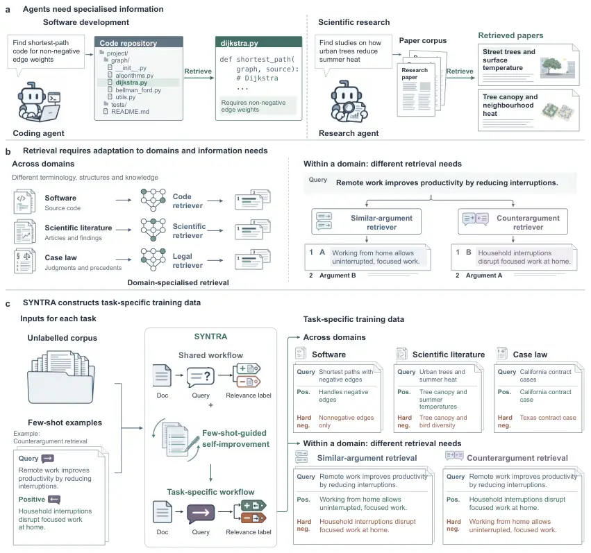
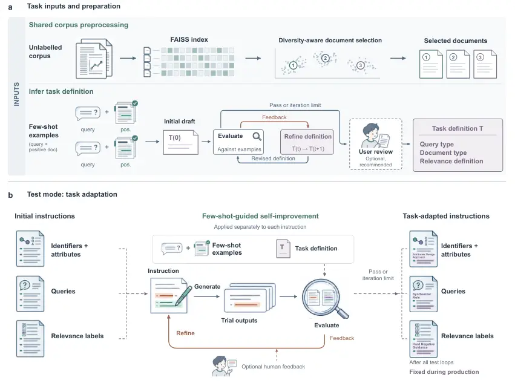
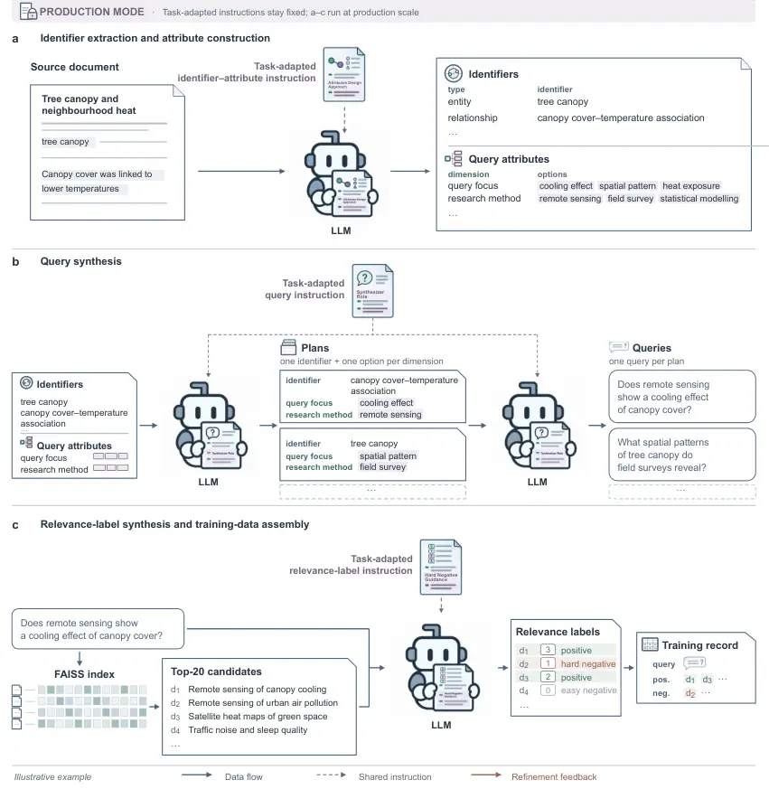
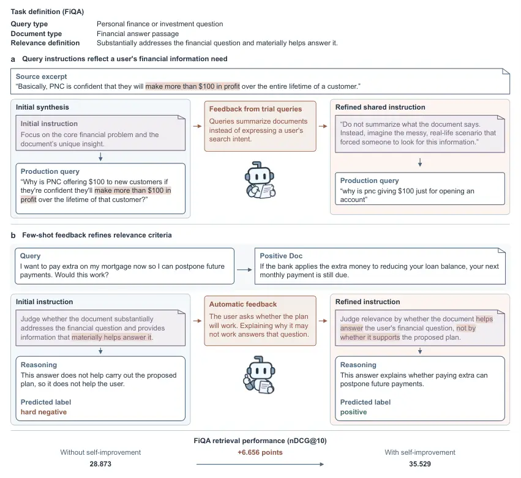

# Self-improving data synthesis can scale embedding-model adaptation across domains and tasks

Zucan Lyu Email: <zucanlv@mail.ustc.edu.cn> Affiliation: University of
Science and Technology of China, Hefei, China Affiliation: State Key
Laboratory of Cognitive Intelligence, Hefei, China    Rui Tang
Affiliation: University of Science and Technology of China, Hefei, China
Affiliation: State Key Laboratory of Cognitive Intelligence, Hefei,
China    Jianlyu Chen Affiliation: University of Science and Technology
of China, Hefei, China Affiliation: State Key Laboratory of Cognitive
Intelligence, Hefei, China    Peisheng Jin Affiliation: University of
Science and Technology of China, Hefei, China Affiliation: State Key
Laboratory of Cognitive Intelligence, Hefei, China    Defu Lian
Email: <liandefu@ustc.edu.cn> Affiliation: University of Science and
Technology of China, Hefei, China Affiliation: State Key Laboratory of
Cognitive Intelligence, Hefei, China

###### Abstract

AI agents require specialised retrieval across domains and tasks, but
adapting embedding models is constrained by costly manual training-data
design. Here we introduce SYNTRA, a self-improving agentic data
synthesis framework that turns a few retrieval examples into reusable
synthesis instructions. Given an unlabelled corpus and a few relevant
query-document pairs, SYNTRA infers implicit information needs and
relevance criteria, then uses feedback on trial outputs to refine
instructions for query generation and relevance assessment. Experiments
across 24 datasets spanning 15 domains demonstrate that the same
synthesis workflow produces effective training data, benefiting even
strong embedding models with and without existing labelled training
sets. Self-improvement strengthens this supervision on all six evaluated
tasks, yielding better retrieval than human calibration on four. The
training value persists at larger scales: on MS MARCO, retrieval gains
continue across a 32-fold range of synthetic training-data sizes. SYNTRA
thus enables scalable embedding-model adaptation with minimal human
intervention.

###### keywords

self-improving, data synthesis, text embeddings, information retrieval,
large language models

^(†)^(†)equal-contributors: These authors contributed equally: Zucan
Lyu, Rui Tang, Jianlyu Chen.^(†)^(†)equal-contributors: These authors
contributed equally: Zucan Lyu, Rui Tang, Jianlyu
Chen.^(†)^(†)equal-contributors: These authors contributed equally:
Zucan Lyu, Rui Tang, Jianlyu Chen.

Retrieval is becoming a core capability of artificial intelligence (AI)
agents, providing access to external knowledge that informs reasoning
and action. For example, Cursor uses a specialised embedding model
alongside conventional search tools to locate relevant code
([https://cursor.com/blog/semsearch](https://cursor.com/blog/semsearch)),
while OpenScholar retrieves scientific evidence to answer research
questions \[1\]. These applications require retrieval tailored to domain
knowledge and task-specific information needs (Fig. 1a). As agents are
deployed across more domains and tasks, the demand for specialised
retrieval grows.

Meeting this demand requires adaptation to both new corpora and
task-specific relevance criteria. New corpora require retrieval systems
to adapt to unfamiliar content. During the COVID-19 pandemic, for
example, the fast-growing scientific literature created search needs
that existing collections did not cover, and TREC-COVID was organised to
evaluate how well retrieval systems could serve them \[2\]. Yet
adaptation concerns not only which documents are available but also
which ones count as relevant: different user objectives can make the
same document relevant to one task and unsuitable for another, even
within the same corpus \[3\] (Fig. 1b). Embedding models must therefore
capture both domain knowledge and what constitutes relevant information
for each task. The challenge is to make this adaptation scalable as
domains and retrieval needs multiply.

A key bottleneck in this adaptation is constructing training data that
reflect domain knowledge and task-specific relevance criteria.
Unlabelled corpora are often available, but task-specific supervision
remains scarce \[4, 5\]. To learn task-relevant distinctions, embedding
models need training examples that associate queries with relevant
documents and informative negatives \[6, 7\]. Constructing these
examples requires deciding what users might ask, which documents satisfy
their needs and which plausible alternatives fail to do so. These
decisions must be revisited as domains and tasks change, making
training-data construction a recurring obstacle to scalable retrieval
adaptation.

Large language models (LLMs) offer a way to turn unlabelled corpora into
retrieval training data \[8, 9\]. Their ability to generate queries
\[10, 11, 12, 13, 14, 15, 16, 17, 18\] and assess document relevance
\[19, 20, 21\] has enabled effective training datasets for
general-purpose retrieval \[22, 19, 23, 24, 25, 26\], code retrieval
\[27\] and reasoning-intensive document retrieval \[28, 29\]. However,
applying these capabilities to a target task can still depend on
task-specific human input, including defining information needs and
relevance criteria, screening proposed tasks, and refining generation
and annotation instructions \[11, 14, 17, 27, 29\]. Repeating this
design work across domains and tasks makes human effort a bottleneck to
scalable retrieval adaptation. This raises a central question: can a
data synthesis framework infer task requirements and refine its own
instructions with minimal human intervention, enabling embedding-model
adaptation to scale across domains and tasks?

Here we introduce SYNTRA, a self-improving agentic data synthesis
framework that turns a few retrieval examples into reusable data
synthesis instructions. Given an unlabelled corpus and a small set of
relevant query-document pairs, SYNTRA infers the task-specific
information needs and relevance criteria implicit in the examples and
develops initial synthesis instructions. Through small-sample
generate-evaluate-refine cycles, it uses feedback on trial outputs to
refine instructions governing query generation and relevance assessment.
These revisions make task requirements explicit, guiding the
construction of queries, identification of relevant documents and
distinction of hard negatives. Once refined, these task-specific
instructions are shared across documents and remain fixed throughout
large-scale data production (Fig. 1c). By converting few-shot guidance
into reusable instructions, SYNTRA reduces the need for manual synthesis
refinement, enabling a shared workflow to support scalable
embedding-model adaptation across domains and tasks.

Experiments across 24 retrieval datasets spanning 15 domains demonstrate
that the same SYNTRA workflow produces effective task-specific training
data across diverse retrieval settings. These data also benefit strong
embedding models, supplying supervision where labelled training sets are
unavailable and complementing existing supervision where they are
available. Self-improvement strengthens this supervision on all six
evaluated tasks, yielding better downstream retrieval than human
calibration on four. The training value also persists at larger scales:
on MS MARCO, retrieval performance improves at every evaluated scale
across a 32-fold range of synthetic training-data sizes. Together, these
findings support scalable embedding-model adaptation with minimal human
intervention, which could help meet the growing demand for specialised
retrieval as AI agents are deployed across more domains and tasks.

Figure 1: Constructing task-specific training data for specialised
retrieval. a, A coding agent searches a repository and retrieves the
implementation that satisfies a stated constraint. A research agent
retrieves supporting studies from a paper corpus. b, Documents differ
across domains in terminology, structure and knowledge. Within a single
domain, the user’s objective changes which documents are relevant. For
the same query, similar-argument and counterargument retrieval rank the
same two arguments in opposite orders. c, SYNTRA receives an unlabelled
corpus and a small set of few-shot examples, each pairing a query with a
positive document. Few-shot-guided self-improvement turns a shared
synthesis workflow into a task-specific one. This workflow then
constructs (query, positive, negative) training records at scale. SYNTRA
is run separately for each retrieval task using the same framework. The
examples shown span software, scientific literature and case law. Within
a domain, the same two arguments exchange positive and hard-negative
roles under different retrieval needs. Pos., positive document; Hard
neg., hard-negative document. All examples are schematic and
abbreviated, not generated samples or measured retrieval results.

## The SYNTRA framework

As shown in Figs. 2 and 3, SYNTRA adapts the same retrieval data
synthesis workflow to different tasks through a self-improvement loop
that refines task-specific synthesis instructions. In _test mode_, it
infers task requirements from a few relevant query-document examples and
uses these requirements to guide iterative cycles of trial generation,
evaluation and instruction refinement. In _production mode_, the refined
instructions remain fixed and are reused across documents within each
task to construct training data at scale.

The user supplies an unlabelled corpus and a small set of examples
pairing queries with relevant documents (Fig. 2a). Corpus preprocessing
selects diverse source documents for query generation and builds a
full-corpus index for candidate retrieval. From the examples, SYNTRA
infers a task definition specifying the intended query type, document
type and relevance criteria. It evaluates and refines this definition
against the examples, establishing common task requirements for the
synthesis modules. The resulting definition guides the initial
instructions for query synthesis and relevance annotation.

Figure 2: Task preparation and adaptation in SYNTRA. a, SYNTRA receives
an unlabelled corpus and a small set of few-shot examples pairing
queries with positive documents. Corpus preprocessing builds a
full-corpus index and selects diverse source documents. The task
definition is inferred from the few-shot examples; optional user review
is recommended. Point groups schematically illustrate semantic
diversity, not clustering outputs. b, Small-sample
generate-evaluate-refine cycles establish reusable task-adapted
instructions before production. Each test loop ends when verification
passes or its iteration limit is reached. The shared instructions then
remain fixed throughout production.

In _test mode_, SYNTRA evaluates whether its trial outputs conform to
the task definition and the patterns conveyed by the provided examples
(Fig. 2b). It uses the resulting diagnostic feedback to revise its
synthesis instructions, refining how queries express information needs
and how documents are assessed for relevance. SYNTRA then generates and
evaluates new trial outputs using the revised instructions, forming a
self-improvement loop that continues until verification passes or the
iteration limit is reached. Once the loops finish, the refined
instructions remain fixed and are reused across documents, allowing the
feedback-driven refinements made during testing to guide
production-scale synthesis.

Figure 3: Production-scale synthesis in SYNTRA. Task-adapted
instructions established in test mode remain fixed during production. a,
For each selected document, an LLM jointly extracts semantic identifiers
and constructs query attributes with dimensions and options. b, Query
synthesis forms plans that pair one semantic identifier with one option
from each query-attribute dimension. It then writes one query per plan
using the same task-adapted instruction for both steps. c, Relevance
annotation retrieves candidates from the full corpus and labels them
with the task-adapted relevance annotation instruction. The labelled
candidates are assembled into (query, positive, negative) training
records. Document content, plans, queries, candidates and labels are
illustrative.

In _production mode_, SYNTRA uses the task-specific instructions refined
through self-improvement to guide a three-stage workflow for large-scale
training data synthesis. To generate queries that express diverse
information needs grounded in the corpus, identifier extraction and
attribute construction identify what users might seek within a document
and how those needs can vary (Fig. 3a). Query synthesis uses these
components to plan information needs and express them as queries
(Fig. 3b). Relevance annotation retrieves candidate documents from the
full corpus and assesses them against the task-specific relevance
criteria, distinguishing positives from hard and easy negatives
(Fig. 3c). The labelled query-document pairs are then assembled into
training records for embedding-model adaptation.

## 1 Results

### One SYNTRA workflow delivers consistent retrieval gains across domains and tasks

We evaluated SYNTRA across 24 retrieval datasets spanning 15 domains
using the same synthesis workflow (Fig. 4a). Training data were
generated by Qwen3-30B-A3B \[30\], deployed on four NVIDIA GeForce RTX
5090 GPUs. We adapted a Qwen3-0.6B backbone separately for each task
using low-rank adaptation (LoRA) \[31\] and compared the resulting
models with an MS MARCO-trained baseline \[32\] using the same backbone
and training procedure. Retrieval performance was measured by nDCG@10 on
a 0–100 scale.

Models trained on SYNTRA-generated data outperformed the baseline in
every task-specific comparison shown in Fig. 4a. Gains spanned
specialised knowledge domains and tasks involving mathematical, spatial
and commonsense reasoning. Relative nDCG@10 improvements were 32.4% on
LeCaRDv2 and 36.0% on SCIDOCS, representing legal and scientific
retrieval, respectively. Gains reached 94.5% on TheoremQA questions and
97.1% on WinoGrande, with the largest relative improvement observed on
SpartQA, at 416.6%. Although their magnitude varied, the consistently
positive gains demonstrate that the same synthesis workflow can produce
effective supervision across diverse corpora and task-specific
information needs.

Human involvement was confined to task setup, typically requiring no
more than 10 min per task according to retrospective estimates.
Subsequent synthesis-instruction refinement and data production
proceeded automatically. Selected task-level production times are
reported in Extended Data Table 1, and implementation and training
details are provided in Methods.

Figure 4: Cross-task applicability, self-improvement and quality of
SYNTRA-generated supervision. a, Coverage of 24 datasets spanning 15
domains, with relative retrieval gains for the 23 task-specific
comparisons against the MS MARCO-trained baseline. Numeric labels report
percentage gains; radial extensions use a nonlinear scale. The
CodeTrans-DL gain averages three reported variants. MS MARCO is included
as the common training corpus without a task-adaptation gain. b,
Retrieval performance of the MS MARCO-trained baseline and models
trained on data generated without self-improvement, with automatic
self-improvement or with human calibration. The six tasks were TheoremQA
(theorems), ArguAna, NFCorpus, FiQA-2018 (FiQA), SCIDOCS and Text2SQL.
c, Mean nDCG@10 on BEIR and NanoBEIR for models trained with original or
SYNTRA-generated queries under matched conditions. d, Agreement between
Qwen3-30B-A3B relevance labels and reference labels derived from votes
by seven human annotators. Binary and three-class agreement were
evaluated on 150 query-document pairs, with 50 pairs from each of three
tasks. Binary evaluation distinguishes relevant from non-relevant
documents; three-class evaluation distinguishes positive, hard-negative
and easy-negative labels. Training-label precision reports
exact-category matches among the 87 evaluation pairs labelled positive
or hard negative by the LLM. Error bars indicate 95% confidence
intervals from 10,000 bootstrap resamples stratified by dataset. The 95%
confidence intervals were 61.3–76.0% for three-class agreement,
86.7–95.3% for binary agreement and 74.7–90.2% for training-label
precision. Four pairs with tied highest three-class vote counts were
assigned hard-negative reference labels.

### Self-improvement increases the training value of synthetic data

Automatic self-improvement increased the training value of
SYNTRA-generated data on all six retrieval tasks examined (Fig. 4b). The
largest relative gains occurred on NFCorpus and FiQA, where refining
synthesis instructions improved downstream nDCG@10 by 45.0% and 23.1%,
respectively, compared with synthesis using the initial instructions. On
both tasks, instruction refinement changed the outcome of adaptation:
models trained on data generated with the initial instructions
underperformed the MS MARCO-trained baseline, whereas those trained on
data generated with the refined instructions surpassed it. The benefits
of instruction refinement extended to TheoremQA theorems, ArguAna,
SCIDOCS and Text2SQL, with relative gains of up to 14.2%.

Automatic self-improvement provided an effective alternative to human
calibration of synthesis instructions, yielding higher downstream
retrieval scores on four of the six tasks and comparable performance on
Text2SQL (Fig. 4b). Human calibration remained more effective on
TheoremQA theorems. This gap may reflect the specialised mathematical
judgement needed to distinguish relevant theorems from superficially
related ones, which sparse examples and automated feedback may not fully
capture. The results suggest that automatic refinement can handle
task-specific synthesis design across diverse settings, while expert
calibration may remain valuable when relevance depends on specialised
reasoning.

A case study on FiQA, a financial question-answering retrieval task,
illustrates how feedback translated task requirements into reusable
synthesis instructions (Fig. 5). For query generation, feedback revealed
that trial queries summarised source documents rather than expressed the
financial questions users might ask. The revised instructions redirected
synthesis towards the user’s search intent (Fig. 5a). For relevance
assessment, an example provided as a relevant query-document pair
exposed an overly narrow interpretation of helpfulness. The query asked
whether paying extra on a mortgage would allow future payments to be
postponed. Although the document explained why this would not work, the
annotator classified it as a hard negative because it did not help carry
out the proposed plan. Feedback prompted revised instructions clarifying
that relevance depends on helping answer the query, rather than
supporting the proposed plan. The same example was then correctly
labelled positive (Fig. 5b). In both cases, the revisions updated
instructions reused across documents, allowing feedback on individual
trial outputs to guide subsequent data synthesis. Complete instructions
and example inputs are provided in Supplementary Note 1.

Figure 5: Few-shot-guided self-improvement on FiQA. a, Refinement of
query-generation instructions. The source excerpt and queries are
verbatim production examples generated in separate runs with
instructions corresponding to the first and third refinement rounds.
Attribute plans were not held fixed between these runs. Feedback
summarizes the original refinement history. b, Refinement of
relevance-annotation instructions using a known-positive few-shot
example. Feedback clarifies that explaining why a plan may fail can help
answer the user’s question. Text in this panel provides an illustrative
summary of the recorded calibration episode. Bottom, FiQA retrieval
performance without and with self-improvement, reflecting joint
refinement of query-generation and relevance-annotation instructions.

Figure 6: Model adaptation and ablations of SYNTRA. a,b, BGE-M3 (a) and
Qwen3-Embedding-8B (b) results with and without existing task-specific
labelled training data. Ori denotes models fine-tuned on existing
task-specific labelled data. Dashed lines separate the two settings;
right-hand values report gains over Ori or the corresponding pretrained
baseline. c, NanoBEIR ablations of the core synthesis components. d,
Comparison of the shared MS MARCO baseline, a task-specific reference
and SYNTRA. Reference training data were constructed using ReasonEmbed
queries for the two TheoremQA tasks and official queries for CosQA and
Synthetic Text2SQL. e, MS MARCO nDCG@10 as SYNTRA-generated training
data increase from 10,000 to 320,000 examples. f, Retrieval performance
as the number of queries generated per document increases on
CodeTrans-DL and MedicalQA. Dashed lines show the MS MARCO-trained
reference scores.

### SYNTRA-generated queries outperform human search queries and rival task-specific alternatives

We compared SYNTRA-generated queries with human queries from Bing Search
logs to assess their value as retrieval supervision. Both query sources
were associated with the same pool of 10,000 MS MARCO source documents
and underwent the same relevance-annotation and negative-mining
procedures. The resulting datasets were used to train the same embedding
backbone with an identical training recipe.

Replacing human search queries with SYNTRA-generated queries increased
mean nDCG@10 from 42.18 to 42.87 on BEIR and from 54.53 to 55.51 on
NanoBEIR, corresponding to relative improvements of 1.6% and 1.8%,
respectively (Fig. 4c). These gains show that document-grounded query
synthesis can even provide more effective retrieval supervision than
human search queries when the same training setup is used.

We further evaluated queries generated using self-improved synthesis
instructions against task-specific query sources: queries released by
ReasonEmbed for TheoremQA questions and theorems \[29\], and official
queries for CosQA \[33\] and Synthetic Text2SQL. Models trained with
SYNTRA-generated queries outperformed those trained with task-specific
queries on TheoremQA questions and CosQA, while remaining competitive on
TheoremQA theorems and Synthetic Text2SQL (Fig. 6d). These results show
that a single synthesis workflow, adapted to each task through
self-improvement, can rival task-specific query sources without
requiring manual redesign of query-generation instructions.

### SYNTRA-annotated relevance labels align with human judgements

We evaluated relevance labels annotated by Qwen3-30B-A3B against
reference labels derived from votes by seven independent human
annotators. The evaluation covered 150 query-document pairs, with 50
pairs each from MS MARCO, Text2SQL and TheoremQA (theorems).
Dataset-level agreement and class-wise performance are reported in
Extended Data Tables 2 and 3.

Agreement with human judgements was 91.3% for binary relevance
classification (137/150; Cohen’s $`\kappa=0.719`$) and 68.7% for
three-class classification into positives, hard negatives and easy
negatives (103/150; $`\kappa=0.510`$). The lower three-class agreement
largely reflected differences in negative-difficulty assessment: 34 of
the 47 disagreements involved hard versus easy negatives rather than
relevant versus non-relevant documents (Extended Data Table 3). We
further examined the positive and hard-negative labels retained for
training. Among the 87 pairs assigned either label by the LLM, 72
matched the human reference category exactly, yielding a pooled
precision of 82.8% (Fig. 4d; Extended Data Table 3).

Human inter-annotator agreement, measured by Fleiss’ $`\kappa`$, was
0.483 for three-class labels and 0.606 for binary labels. After
excluding the four pairs with tied highest vote counts, three-class
agreement between LLM-generated labels and human reference labels was
69.2% (101/146; Cohen’s $`\kappa=0.520`$), compared with 68.7% (103/150;
$`\kappa=0.510`$) for all pairs. Thus, the treatment of tied votes had
little effect on the overall agreement.

Together, these findings support SYNTRA’s relevance annotation as a
source of retrieval supervision, including the positive and
hard-negative labels used for training. Disagreements were concentrated
in the distinction between hard and easy negatives rather than binary
relevance.

### Strong embedding models benefit from SYNTRA-generated training data

The cross-task experiments used a controlled backbone, leaving open
whether SYNTRA-generated data also benefit strong embedding models
already trained on large curated corpora. We adapted BGE-M3 \[34\] and
Qwen3-Embedding-8B \[35\] in two practical settings: tasks without
existing labelled training sets (LeCaRDv2, EvidenceBench and SciRepEval
Search) and tasks with such sets (TheoremQA questions, SpartQA and
WinoGrande) (Fig. 6a,b).

For tasks without existing labelled training sets, SYNTRA generated
training data guided by a small set of relevant query-document examples.
Fine-tuning on these data improved both embedding models on all three
tasks compared with their performance before task-specific fine-tuning.
On LeCaRDv2, EvidenceBench and SciRepEval Search Tasks, BGE-M3 achieved
relative nDCG@10 improvements of 0.7%, 27.6% and 1.5%, respectively. The
corresponding gains for Qwen3-Embedding-8B were 4.6%, 1.5% and 1.1%.

For tasks with existing labelled training sets, we compared fine-tuning
on those sets alone with fine-tuning on the same sets augmented by
SYNTRA-generated data. Augmentation improved both models on all three
tasks. On TheoremQA questions, SpartQA and WinoGrande, BGE-M3 achieved
relative nDCG@10 gains of 40.7%, 5.5% and 7.0%, respectively, over
fine-tuning on labelled data alone. The corresponding gains for
Qwen3-Embedding-8B were 2.3%, 11.9% and 1.1%.

Together, these results show that SYNTRA-generated data benefit strong
embedding models both by supplying task-specific supervision where
labelled training sets are unavailable and by complementing existing
supervision where they are available.

### Scaling synthetic data yields continued retrieval gains

We trained a Qwen3-8B backbone on SYNTRA-generated datasets constructed
from MS MARCO passages, doubling the dataset size from 10,000 to 320,000
examples across six scales. The same training recipe and MS MARCO
evaluation protocol were used throughout.

Retrieval performance improved at every evaluated scale (Fig. 6e).
Across the 32-fold expansion, nDCG@10 increased from 30.88 to 33.20,
corresponding to a relative gain of 7.5%. These results show that
SYNTRA-generated data retain their training value as production scales,
with larger datasets yielding continued retrieval gains.

### Core design choices improve retrieval performance

To identify contributions from SYNTRA’s synthesis components, we
evaluated task-adapted query instructions, planning with semantic
identifiers and query attributes, relevance annotation, and multiple
queries per document. For the component ablations, we report mean
nDCG@10 across 13 NanoBEIR tasks, a lower-cost proxy that preserved the
relative BEIR performance of 18 public embedding models (Methods).
Query-count comparisons are reported separately for each evaluated task
(Fig. 6c,f).

Relative to variants without these components, the task-adapted
query-generation instruction improved mean nDCG@10 on NanoBEIR by 4.0%,
and planning with semantic identifiers and query attributes improved it
by 1.3%. For relevance annotation, the full workflow improved mean
nDCG@10 by 3.5% over hard-negative mining alone. Adding relevance
annotation for the source document to hard-negative mining yielded a
1.8% gain, but the full workflow remained 1.7% higher. These comparisons
support the contributions of task-adapted query instructions, semantic
identifiers and query attributes, and relevance annotation to the
effectiveness of the generated training data.

Generating multiple queries per document also improved retrieval on both
evaluated tasks (Fig. 6f). Different combinations of semantic
identifiers and query attributes allow the same document to support
queries expressing different information needs. Compared with one query
per document, generating two and four queries increased nDCG@10 by 2.5%
and 3.6% on CodeTrans-DL and by 12.3% and 17.5% on MedicalQA,
respectively. These results support generating several queries per
document as a way to provide additional useful supervision on these
tasks.

## 2 Discussion

SYNTRA demonstrates that self-improvement can turn guidance from a small
set of retrieval examples into reusable instructions for task-specific
data synthesis. The examples convey what users seek and what makes a
document relevant, while SYNTRA uses feedback on trial outputs to
iteratively refine instructions for generating queries and assessing
candidate documents. Because these revisions are incorporated into
instructions reused across documents, their influence extends beyond the
examples examined during refinement. This provides a means of automating
part of the task-specific data design needed to adapt embedding models
across domains and tasks.

Self-improvement is effective because instructions inferred from a few
examples can miss requirements that only become apparent in trial
outputs. In the FiQA case study, trial queries summarised source
documents rather than asking the financial questions users would pose,
and the relevance instruction rejected an answer that explained why a
proposed plan would fail, even though such an answer resolves the user’s
question. Correcting such mismatches substantially affected downstream
learning: on NFCorpus and FiQA, data generated with the initial
instructions trained models that underperformed the MS MARCO-trained
baseline, whereas data generated after refinement surpassed it.
Automatic refinement outperformed human calibration on four of six tasks
and matched it on a fifth, suggesting that many such mismatches can be
detected without expert input. On TheoremQA theorems, however, human
calibration remained more effective, possibly because distinguishing
relevant theorems from superficially related ones requires mathematical
judgement that a few examples and automated feedback do not fully
capture.

Separating instruction refinement from data production also makes this
approach practical to scale. Commercial-model calls are confined to
small-sample testing, after which the refined instructions are reused
for large-scale generation with a locally deployed model; production
runs for most tasks took 2–11 h on four consumer GPUs (Extended Data
Table 1). The same synthesis workflow can therefore support different
tasks without manual instruction refinement for each one, with human
involvement limited to task setup. Within the retrieval settings
examined here, the resulting data improved both a controlled backbone
and strong embedding models, and retained their training value as data
volume increased. More advanced strategies for optimizing language-model
prompts and pipelines \[36, 37\] could be incorporated into instruction
refinement to further improve the synthesized data.

These findings motivate extending self-improvement to data synthesis for
other LLM capabilities, building on recent work on automated
question-answer construction with assessment criteria and task
construction from teacher demonstrations \[38, 39\]. Such extensions
would require feedback suited to the target capability, such as answer
checks and code execution for mathematical and coding tasks \[40\] or
task-specific rubrics for relevance, completeness and contextual
requirements \[41\]. Feedback from model evaluation, task execution and
user interactions could further reveal unmet or emerging training needs.
Connecting these signals to instruction refinement could extend
self-improvement towards identifying what models need to learn next and
adapting data synthesis accordingly, both for the retrieval components
of AI agents and for LLM training more broadly.

## 3 Methods

We first describe corpus preprocessing and task preparation, followed by
the synthesis workflow and the self-improvement procedure used to adapt
its instructions. We then detail embedding-model training, experimental
design and evaluation, and human evaluation of relevance labels.

### 3.1 Corpus preprocessing and task preparation

SYNTRA takes an unlabelled corpus and a small set of examples pairing
queries with relevant documents (typically five per task in our
experiments) (Fig. 2a). In our experiments, these examples were randomly
sampled from the benchmark’s public release on Hugging Face, which for
some tasks is the evaluation split. These pairs served only as
in-context demonstrations for task-definition inference, instruction
refinement and query planning; they were not added to the training data.
To support candidate retrieval, document titles and bodies are
concatenated where both are available, encoded as L2-normalised vectors
and stored in a full-corpus FAISS inner-product index \[42\].

A separate, diversity-aware selection procedure identifies source
documents for query generation (Algorithm 1). Using an auxiliary
inverted-file (IVF) index, the procedure processes documents in shuffled
order. After selecting a document, it excludes neighbouring documents
whose similarity to that document exceeds the selection threshold,
reducing semantic redundancy in the selected set. Selection continues
until the target count is reached or the available pool is exhausted.
Where feasible, we selected 10,000 source documents. Test mode uses
small samples from this set, whereas production mode processes the
selected set using the final synthesis instructions. Document selection
leaves the full-corpus index intact, allowing queries to retrieve
candidates from the entire corpus in both modes.

1: Corpus $`\mathcal{C}`$, encoder $`f`$, target count $`M`$, similarity
threshold $`\tau`$

2: Selected documents $`S`$ and full-corpus retrieval index $`J`$

3: Encode each document $`d`$ as
$`\mathbf{v}_{d}=f(d)/\lVert f(d)\rVert_{2}`$

4: Build inner-product index $`J`$ over all document vectors

5: Build an auxiliary IVF index $`J_{\mathrm{sel}}`$ for neighbour
search

6: $`L\leftarrow\textsc{Shuffle}(\mathcal{C})`$;
$`A\leftarrow\mathcal{C}`$; $`S\leftarrow\varnothing`$

7: for each document $`d`$ in $`L`$ do

8:   if $`|S|=M`$ or $`A=\varnothing`$ then

9:    break

10:   end if

11:   if $`d\in A`$ then

12:    $`S\leftarrow S\cup\{d\}`$; $`A\leftarrow A\setminus\{d\}`$

13:
   $`N_{d}\leftarrow\textsc{AvailableNeighbours}(J_{\mathrm{sel}},\mathbf{v}_{d},A)`$

14:
   $`A\leftarrow A\setminus\{d^{\prime}\in N_{d}:\mathbf{v}_{d}^{\top}\mathbf{v}_{d^{\prime}}>\tau\}`$

15:   end if

16: end for

17: return $`S,J`$

Algorithm 1 Corpus indexing and diversity-aware document selection

Task preparation establishes the requirements that guide data synthesis.
From the supplied query-document examples, SYNTRA infers a task
definition specifying the intended query type, document type and
relevance criteria. A generate-evaluate-refine procedure checks the
proposed definition against the examples and revises requirements that
are inaccurate or insufficiently specific. Alternatively, users can
provide a task definition directly. The resulting definition guides the
construction and subsequent refinement of synthesis instructions in test
mode, as described below.

Human involvement in the principal experiments was limited to task
setup. The operator reviewed and occasionally revised the inferred task
definition and, when necessary, adjusted the document-selection
threshold to obtain the intended number of source documents. Based on
retrospective estimates, these activities typically required no more
than 10 min per task.

### 3.2 Self-improving agentic framework for retrieval data synthesis

SYNTRA constructs retrieval training data through identifier extraction
and attribute construction, query synthesis, and relevance annotation
(Fig. 3). These operations form a common synthesis workflow used in both
_test mode_ and _production mode_. In test mode, feedback on trial
outputs guides revisions to the synthesis instructions. In production
mode, the final instructions remain fixed and are reused across the
selected documents. We first describe the synthesis operations, followed
by the self-improvement procedure that adapts their instructions to the
target task.

#### 3.2.1 Identifier extraction and attribute construction

To support queries expressing different information needs, SYNTRA
identifies what can be asked about a document and how those questions
can vary. For each selected document, a single LLM call jointly extracts
semantic identifiers and constructs query attributes, using instructions
conditioned on the task definition. Semantic identifiers are
document-grounded entities or relations that provide possible targets
for an information need. Query attributes specify dimensions of
variation, such as scope, reasoning requirements or specificity,
together with task-appropriate options for each dimension. Both the
identifiers and the attribute dimensions and options are constructed for
each document. Their combinations provide the basis for planning
distinct queries (Fig. 3a).

#### 3.2.2 Query synthesis

Query synthesis separates planning an information need from expressing
it as a query (Fig. 3b). The planning stage receives the source
document, its semantic identifiers and query attributes, the task
definition, the supplied query-document examples and the task-adapted
query instruction. Each plan combines one identifier with one option
from every attribute dimension to specify an information need and its
intended expression. The query-writing stage then converts each plan
into a query using the source document and the same task-adapted
instruction. Generating multiple plans allows a document to support
queries with different information needs or forms of expression.

#### 3.2.3 Relevance annotation

Each generated query retrieves its top-$`K`$ candidate documents from
the full-corpus index using the indexing encoder and cosine similarity.
SYNTRA assesses these candidates against the task-specific relevance
criteria (Fig. 3c). The source document is assessed in the same way if
it is retrieved; its use for query generation does not automatically
make it a positive.

Candidates are processed in chunks, with each query-document pair judged
independently on a four-point scale. A score of 3 indicates strong
satisfaction of the relevance criteria, whereas 2 indicates a weaker but
valid positive. A score of 1 denotes a plausible candidate that fails
the relevance criteria, and 0 denotes a clearly unrelated candidate.
Scores of 2 and 3 are mapped to positives, 1 to hard negatives and 0 to
easy negatives. Annotations from all chunks are combined into the
corresponding document sets for each query. These outputs are converted
into training records as described below.

#### 3.2.4 Instruction self-improvement

In _test mode_, SYNTRA adapts the instructions governing these
operations through generate-evaluate-refine cycles on small samples
(Fig. 2b). Trial outputs are evaluated against the task definition and
the supplied query-document examples. Diagnostic feedback guides
instruction revisions, after which synthesis is repeated on the same
trial inputs. The revisions apply to instructions reused across
documents, allowing feedback from a small sample to guide subsequent
data production.

Three refinement loops address identifier extraction and attribute
construction, query synthesis, and relevance annotation. Each loop
allows up to three attempts by default, including the initial trial;
this limit is configurable. For the identifier-attribute and query
loops, LLM verifiers assign scores from 0 to 3, with scores of at least
2 treated as a pass. Relevance annotation uses the programmatic
consistency check described below. Each loop ends when verification
passes or the attempt limit is reached. SYNTRA retains the last
evaluated instruction, including when verification has not passed at the
limit.

##### Identifier and attribute refinement.

Identifier extraction and attribute construction are refined together on
sampled documents. The initial trial uses a generation template
conditioned on the task definition, without additional refinement
guidance. An LLM verifier assesses whether the outputs are grounded in
the document, whether they contain redundant elements and whether the
attribute dimensions and options support useful variation within the
task. Feedback is used to develop reusable guidance for subsequent
extraction and construction. Once this loop finishes, identifiers and
attributes are regenerated using the final guidance and held fixed
during query-instruction refinement.

##### Query-instruction refinement.

The initial query instruction is derived from the task definition and
the supplied examples. It specifies the intended query producer and
information need, how document evidence should be selected or
abstracted, and the linguistic characteristics and constraints of the
target queries. SYNTRA applies this instruction to both information-need
planning and query writing. An LLM verifier evaluates sampled
query-document pairs for task alignment, style and naturalness,
including whether the queries plausibly reflect their intended producer.
It also assesses the effectiveness of the instruction. Feedback guides
revisions to the instruction used in both stages, while the identifiers
and attributes remain unchanged.

##### Relevance-instruction refinement.

The initial annotation instruction is derived from the task definition
and the required annotation format. SYNTRA tests it on the supplied
query-document pairs, each of which contains a document known to be
relevant to its query. A program checks whether every pair is classified
as positive, treating missing predictions as mismatches. If the check
fails, the LLM analyses the errors and revises the relevance criteria.
It also develops criteria for distinguishing plausible candidates that
fail a required condition from documents unrelated to the information
need. The supplied examples directly verify positive classifications;
criteria for negative categories are inferred from the task
requirements. The framework also supports calibration against
human-confirmed labels during test mode.

All refinement loops finish before _production mode_ begins. The final
instructions are then held fixed and applied across the selected
documents using the synthesis operations described above. Identifiers,
attributes, queries and relevance labels continue to be generated for
individual documents and queries. Parsing retries and structural checks
are applied to production outputs.

#### 3.2.5 Computational resources and production times

Instruction refinement in test mode typically used Gemini 3 Flash
Preview (Supplementary Note 2). Data generation used Qwen3-30B-A3B
deployed on four NVIDIA GeForce RTX 5090 GPUs within a six-GPU system.
The remaining two GPUs were used for embedding-model operations.
Selected production batches across the 24 retrieval tasks are reported
in Extended Data Table 1. Reported runtimes cover data production and
exclude calibration, prebuilt indexing, and embedding-model training and
evaluation. The table caption details how batches were selected and
which stages were included in the timings.

### 3.3 Embedding-model training

##### Training-data preparation.

We converted the synthesized queries and annotated documents into
training records, retaining queries with at least one positive and one
usable negative. Each record contained the query, lists of positive and
negative document texts, and a retrieval instruction that could be
prepended to the query during training. Training-data exports supported
two negative-selection policies: using only annotated hard negatives, or
supplementing them with annotated easy negatives when fewer than the
requested number of hard negatives were available.

##### Models and training configurations.

Embedding-model training began after data synthesis was complete. The
main cross-task experiments used a Qwen3-0.6B backbone, adapted
separately for each task using low-rank adaptation (LoRA) \[31\]. We
also fine-tuned BGE-M3 \[34\] and Qwen3-Embedding-8B \[35\] to assess
the value of synthetic data for strong pretrained embedding models. To
evaluate the effect of increasing the volume of synthetic training data,
we used a Qwen3-8B backbone.

For the Qwen3-based models, the training data loader sampled one
positive and a configurable number of negatives from each record. When
too few negatives were available, their indices were repeated to supply
the requested number. Model-specific training settings are provided in
Supplementary Note 2 (Supplementary Tables 1–2). Experimental
comparisons and evaluation procedures are described below.

### 3.4 Experimental design and evaluation

We evaluated the training value of SYNTRA-generated data across
retrieval tasks, embedding models, query sources and data scales, and
used ablations to assess the contributions of self-improvement and
individual synthesis components. Retrieval performance was measured by
normalised discounted cumulative gain at rank 10 (nDCG@10), reported on
a 0–100 scale. Training-data preparation and model configurations are
described above, with detailed settings in Supplementary Note 2
(Supplementary Tables 1–2). Human evaluation of relevance labels is
described separately below.

#### 3.4.1 Retrieval adaptation across tasks and models

The main cross-task evaluation covered 24 retrieval datasets spanning 15
domains (Fig. 4a). SYNTRA generated training data separately for each
task using the same synthesis workflow. Models trained on these data
were compared with an MS MARCO-trained baseline \[32\], using the same
Qwen3-0.6B backbone and training procedure. Each task-specific model was
evaluated on its corresponding retrieval task. MS MARCO provided the
common training reference, while the remaining 23 datasets formed the
task-adaptation comparisons.

We also evaluated BGE-M3 and Qwen3-Embedding-8B in two settings
(Fig. 6a,b). For tasks without existing labelled training sets—LeCaRDv2,
EvidenceBench and SciRepEval Search \[43\]—models fine-tuned on
SYNTRA-generated data were compared with their pretrained counterparts
without task-specific fine-tuning. For tasks with existing labelled
training sets—TheoremQA questions \[44\], SpartQA \[45\] and WinoGrande
\[46\]—we compared fine-tuning on those sets alone with fine-tuning on
the same sets augmented by SYNTRA-generated data.

#### 3.4.2 Query-source comparisons

##### Human search queries.

The MS MARCO experiment compared human search queries from Bing logs
\[32\] with SYNTRA-generated queries using the same pool of 10,000
source documents. Both query sources underwent the same
relevance-annotation and negative-mining procedures. The resulting
datasets were used to train the same embedding backbone with the same
training recipe, and retrieval was evaluated on BEIR and NanoBEIR
(Fig. 4c). Valid training-record counts are provided in Extended Data
Table 1.

##### Task-specific query sources.

We compared SYNTRA-generated queries with task-specific sources on
TheoremQA questions and theorems, CosQA and Synthetic Text2SQL
(Fig. 6d). Reference queries were those released by ReasonEmbed for the
two TheoremQA tasks \[29\] and the official training queries for CosQA
\[33\] and Synthetic Text2SQL. Each reference query was paired with its
released positive document, which served as its source document. Within
each task, both query sources then underwent the same
candidate-retrieval and relevance-annotation procedures and were used to
train the same embedding backbone, so that the comparison differed only
in the source of the queries.

For these four tasks, we retained records containing at least one
annotated positive and one hard negative. From each retained record, we
constructed two positive-selection variants. The first retained all
annotated positives. The second retained only the source document if it
had been labelled positive; otherwise, it retained the original positive
list. Both variants used the same hard negatives and were concatenated
without deduplication for training. The combined number of input rows
was therefore twice the number of retained records. Query counts,
records per variant and combined input rows are reported in Extended
Data Table 4.

#### 3.4.3 Self-improvement and component ablations

##### Self-improvement.

We compared three conditions across six retrieval tasks: TheoremQA
theorems, ArguAna, NFCorpus, FiQA, SCIDOCS and Text2SQL (Fig. 4b).
Synthesis without self-improvement used the initial task-specific
instructions for production. Automatic self-improvement used
instructions revised through feedback in test mode, following the
instruction self-improvement procedure described above. In the
human-calibration condition, human input was used to calibrate synthesis
instructions during test mode. Data generated under each condition were
used to train task-specific embedding models. Their retrieval
performance is reported in Fig. 4b.

##### Synthesis components.

We evaluated the contributions of task-adapted query instructions,
semantic identifiers and query attributes, and relevance annotation
(Fig. 6c). For query synthesis, we compared the full workflow with
variants that omitted either the task-adapted query instruction or
semantic identifiers and query attributes. For relevance annotation, we
compared the full workflow with hard-negative mining alone and with
hard-negative mining supplemented by source-document annotation.
Component ablations used a separate sample of 10,000 MS MARCO source
documents from that used in the query-source comparison; all variants,
including the full workflow (54.64), were generated from this same
document pool. To reduce the cost of evaluating multiple synthesis
variants, we used NanoBEIR and reported mean nDCG@10 across its 13
tasks. We also assessed the consistency of model comparisons between
NanoBEIR and BEIR by evaluating 18 publicly available embedding models
on both suites, as described below.

##### Queries per document.

We varied the number of queries generated per document from one to two
and four on CodeTrans-DL and MedicalQA (Fig. 6f). SYNTRA used different
combinations of semantic identifiers and query attributes to generate
queries expressing different information needs. Retrieval performance
was reported separately for each task. This comparison assessed the
benefit of generating additional queries per document; the resulting
training datasets therefore differed in both query count per document
and total size.

#### 3.4.4 Scaling synthetic training data

We evaluated the effect of increasing synthetic training-data volume
using a Qwen3-8B backbone. Starting with 10,000 SYNTRA-generated
examples from MS MARCO passages, we increased the dataset size to
20,000, 40,000, 80,000, 160,000 and 320,000 examples. The training
recipe and MS MARCO evaluation protocol were kept unchanged across
scales (Fig. 6e). We performed one training run at each scale using the
settings in Supplementary Note 2 (Supplementary Table 2).

#### 3.4.5 Consistency between NanoBEIR and BEIR

We assessed whether NanoBEIR preserved the relative model performance
observed on BEIR \[47\] by evaluating 18 publicly available embedding
models on both suites. The analysis included nine encoder-only and nine
decoder-only models. For each model, we obtained paired suite-level mean
nDCG@10 scores; the models and their scores are listed in Extended Data
Table 5.

NanoBEIR evaluation used the MTEB implementation \[48\] and comprised 13
retrieval tasks: ArguAna, Climate-FEVER, DBpedia, FEVER, FiQA2018,
HotpotQA, MS MARCO, NFCorpus, Natural Questions, Quora, SCIDOCS, SciFact
and Touche2020. Each task contained 50 evaluation queries except
Touche2020, which contained 49, giving 649 queries in total. We first
averaged nDCG@10 over the evaluation queries within each task, then
calculated the unweighted arithmetic mean across the 13 tasks and
multiplied it by 100. Each task therefore contributed equally to the
suite score.

To assess agreement in model ordering without conflating within-family
rankings with differences between architecture families, we analysed
encoder-only and decoder-only models separately. Within each family, we
calculated Spearman’s rank correlation between the paired BEIR and
NanoBEIR scores, with two-sided significance tests. We also calculated
each model’s absolute change in rank between the suites, summarised
these changes by their median, and counted models whose ranks differed
by no more than one position. NanoBEIR closely preserved the BEIR
ordering within both families (encoder-only: Spearman’s $`\rho=0.933`$,
$`P=2.0\times 10^{-4}`$; decoder-only: $`\rho=0.817`$,
$`P=7.0\times 10^{-3}`$). The median absolute rank change was one
position in each family, and 8 of 9 encoder-only and 6 of 9 decoder-only
models differed by no more than one rank (Extended Data Tables 5 and 6).
These results support the use of NanoBEIR as a lower-cost proxy for BEIR
in the component ablations.

### 3.5 Human evaluation of relevance labels

Seven annotators independently assessed 150 query-document pairs,
comprising 50 pairs from each of MS MARCO, Text2SQL and TheoremQA
theorems. All annotators had received undergraduate or graduate training
in advanced mathematics and computer science. Annotators used the same
four-point relevance scale as SYNTRA’s relevance annotation, with
ratings mapped to positives, hard negatives and easy negatives.
Three-class human reference labels were determined by plurality voting,
with ties assigned to the hard-negative category. For binary evaluation,
each annotator’s hard-negative and easy-negative labels were merged into
a single non-relevant category before majority voting.

We measured agreement between SYNTRA-annotated labels and human
reference labels using exact agreement and Cohen’s $`\kappa`$. Human
inter-annotator agreement was measured using Fleiss’ $`\kappa`$ for the
three-class and binary labels. Pooled training-label precision was
defined as the proportion of pairs labelled positive or hard negative by
the LLM whose predicted category exactly matched the human reference.

We estimated 95% percentile confidence intervals using 10,000 bootstrap
resamples, each comprising 50 pairs sampled with replacement from each
dataset. Human reference labels were held fixed, and training-label
precision was recalculated for each resample. To assess sensitivity to
tie handling, we repeated the three-class LLM-human comparison after
excluding pairs with tied highest vote counts.

##### Ethics.

The seven annotators were volunteers: three were authors of this study
and the others were graduate students in the authors’ research group.
They rated pairs consisting of SYNTRA-generated queries and documents
from publicly available benchmark corpora. No personal information about
the annotators was collected, and no data about the annotators
themselves were analysed. Their ratings served only as reference labels
for evaluating SYNTRA-annotated relevance labels. All annotators
participated voluntarily without compensation and gave verbal informed
consent after being informed of the purpose of the study. Because the
annotators were not themselves the objects of testing, surveys or
observation, and no human biological samples or personal information
data were used, the study did not constitute research involving human
participants as defined in Article 2 of China’s Measures for Science and
Technology Ethics Review (Trial) (2023) and therefore did not require
ethics review.

#### Data availability

SYNTRA retrieval-training data exports, including synthetic-query data,
original-query controls and archived experimental variants, are publicly
available at
[https://huggingface.co/datasets/ZucanLyu/SYNTRA](https://huggingface.co/datasets/ZucanLyu/SYNTRA).
The repository provides file manifests and describes the audited
exports. Source benchmark data are available from their original
providers, as cited in this Article, and remain subject to their
respective access conditions and terms.

#### Code availability

The SYNTRA source code is publicly available at
[https://github.com/zucanlv/SYNTRA](https://github.com/zucanlv/SYNTRA).
The repository includes the data synthesis pipeline, training and
retrieval evaluation scripts, code for human relevance evaluation,
configuration files, and installation and workflow documentation.

## References

- (1) Asai, A. _et al._ Synthesizing scientific literature with
  retrieval-augmented language models. _Nature_ 650, 857–863 (2026). URL
  [https://www.nature.com/articles/s41586-025-10072-4](https://www.nature.com/articles/s41586-025-10072-4).
- (2) Roberts, K. _et al._ TREC-COVID: Rationale and structure of an
  information retrieval shared task for COVID-19. _Journal of the
  American Medical Informatics Association_ 27, 1431–1436 (2020). URL
  [https://doi.org/10.1093/jamia/ocaa091](https://doi.org/10.1093/jamia/ocaa091).
- (3) Song, T., Gan, G., Shang, M. & Zhao, Y. _IFIR: A comprehensive
  benchmark for evaluating instruction-following in expert-domain
  information retrieval_. _Proceedings of the 2025 Conference of the
  Nations of the Americas Chapter of the Association for Computational
  Linguistics: Human Language Technologies (Volume 1: Long Papers)_,
  10186–10204 (2025). URL
  [https://aclanthology.org/2025.naacl-long.511/](https://aclanthology.org/2025.naacl-long.511/).
- (4) Wang, K., Thakur, N., Reimers, N. & Gurevych, I. _GPL: Generative
  pseudo labeling for unsupervised domain adaptation of dense
  retrieval_. _Proceedings of the 2022 Conference of the North American
  Chapter of the Association for Computational Linguistics: Human
  Language Technologies_, 2345–2360 (Association for Computational
  Linguistics, 2022). URL
  [https://aclanthology.org/2022.naacl-main.168/](https://aclanthology.org/2022.naacl-main.168/).
- (5) Li, M. & Gaussier, E. _Domain adaptation for dense retrieval and
  conversational dense retrieval through self-supervision by meticulous
  pseudo-relevance labeling_. _Proceedings of the 2024 Joint
  International Conference on Computational Linguistics, Language
  Resources and Evaluation (LREC-COLING 2024)_, 5247–5259 (ELRA and
  ICCL, 2024). URL
  [https://aclanthology.org/2024.lrec-main.467/](https://aclanthology.org/2024.lrec-main.467/).
- (6) Karpukhin, V. _et al._ _Dense passage retrieval for open-domain
  question answering_. _Proceedings of the 2020 Conference on Empirical
  Methods in Natural Language Processing_, 6769–6781 (Association for
  Computational Linguistics, 2020). URL
  [https://aclanthology.org/2020.emnlp-main.550/](https://aclanthology.org/2020.emnlp-main.550/).
- (7) Zhou, K. _et al._ _SimANS: Simple ambiguous negatives sampling for
  dense text retrieval_. _Proceedings of the 2022 Conference on
  Empirical Methods in Natural Language Processing: Industry Track_,
  548–559 (Association for Computational Linguistics, 2022). URL
  [https://aclanthology.org/2022.emnlp-industry.56/](https://aclanthology.org/2022.emnlp-industry.56/).
- (8) Ma, J., Korotkov, I., Yang, Y., Hall, K. & McDonald, R. _Zero-shot
  neural passage retrieval via domain-targeted synthetic question
  generation_. _Proceedings of the 16th Conference of the European
  Chapter of the Association for Computational Linguistics: Main
  Volume_, 1075–1088 (Association for Computational Linguistics, 2021).
  URL
  [https://aclanthology.org/2021.eacl-main.92/](https://aclanthology.org/2021.eacl-main.92/).
- (9) Jeronymo, V. _et al._ InPars-v2: Large language models as
  efficient dataset generators for information retrieval. _arXiv
  preprint arXiv:2301.01820_ (2023). URL
  [https://arxiv.org/abs/2301.01820](https://arxiv.org/abs/2301.01820).
- (10) Bonifacio, L., Abonizio, H., Fadaee, M. & Nogueira, R. _InPars:
  Unsupervised dataset generation for information retrieval_.
  _Proceedings of the 45th International ACM SIGIR Conference on
  Research and Development in Information Retrieval_, 2387–2392
  (Association for Computing Machinery, 2022). URL
  [https://doi.org/10.1145/3477495.3531863](https://doi.org/10.1145/3477495.3531863).
- (11) Dai, Z. _et al._ _Promptagator: Few-shot dense retrieval from 8
  examples_. _International Conference on Learning Representations_
  (2023). URL
  [https://openreview.net/forum?id=gmL46YMpu2J](https://openreview.net/forum?id=gmL46YMpu2J).
- (12) Xian, J. _et al._ Prompts as auto-optimized training
  hyperparameters: Training best-in-class IR models from scratch with 10
  gold labels. _arXiv preprint arXiv:2406.11706_ (2024). URL
  [https://arxiv.org/abs/2406.11706](https://arxiv.org/abs/2406.11706).
- (13) Saad-Falcon, J. _et al._ _UDAPDR: Unsupervised domain adaptation
  via LLM prompting and distillation of rerankers_. _Proceedings of the
  2023 Conference on Empirical Methods in Natural Language Processing_,
  11265–11279 (Association for Computational Linguistics, 2023). URL
  [https://aclanthology.org/2023.emnlp-main.693/](https://aclanthology.org/2023.emnlp-main.693/).
- (14) Mayfield, J. _et al._ Synthetic cross-language information
  retrieval training data. _arXiv preprint arXiv:2305.00331_ (2023). URL
  [https://arxiv.org/abs/2305.00331](https://arxiv.org/abs/2305.00331).
- (15) Abonizio, H. _et al._ InPars Toolkit: A unified and reproducible
  synthetic data generation pipeline for neural information retrieval.
  _arXiv preprint arXiv:2307.04601_ (2023). URL
  [https://arxiv.org/abs/2307.04601](https://arxiv.org/abs/2307.04601).
- (16) Fang, Y. _et al._ _Scaling laws for dense retrieval_.
  _Proceedings of the 47th International ACM SIGIR Conference on
  Research and Development in Information Retrieval_, 1339–1349
  (Association for Computing Machinery, 2024). URL
  [https://doi.org/10.1145/3626772.3657743](https://doi.org/10.1145/3626772.3657743).
- (17) Wen, H., Guo, J., Zhang, Y., Jiang, J. & Wang, Z. _On synthetic
  data strategies for domain-specific generative retrieval_.
  _Proceedings of the 63rd Annual Meeting of the Association for
  Computational Linguistics (Volume 1: Long Papers)_, 7961–7976
  (Association for Computational Linguistics, 2025). URL
  [https://aclanthology.org/2025.acl-long.392/](https://aclanthology.org/2025.acl-long.392/).
- (18) Chaudhary, A., Raman, K. & Bendersky, M. _It’s all relative! – a
  synthetic query generation approach for improving zero-shot relevance
  prediction_. _Findings of the Association for Computational
  Linguistics: NAACL 2024_, 1645–1664 (Association for Computational
  Linguistics, 2024). URL
  [https://aclanthology.org/2024.findings-naacl.107/](https://aclanthology.org/2024.findings-naacl.107/).
- (19) Lee, J. _et al._ Gecko: Versatile text embeddings distilled from
  large language models. _arXiv preprint arXiv:2403.20327_ (2024). URL
  [https://arxiv.org/abs/2403.20327](https://arxiv.org/abs/2403.20327).
- (20) Thomas, P., Spielman, S., Craswell, N. & Mitra, B. _Large
  language models can accurately predict searcher preferences_.
  _Proceedings of the 47th International ACM SIGIR Conference on
  Research and Development in Information Retrieval_ (Association for
  Computing Machinery, 2024). URL
  [https://www.microsoft.com/en-us/research/publication/large-language-models-can-accurately-predict-searcher-preferences/](https://www.microsoft.com/en-us/research/publication/large-language-models-can-accurately-predict-searcher-preferences/).
- (21) Sun, W. _et al._ _Is ChatGPT good at search? investigating large
  language models as re-ranking agents_. _Proceedings of the 2023
  Conference on Empirical Methods in Natural Language Processing_,
  14918–14937 (Association for Computational Linguistics, 2023). URL
  [https://aclanthology.org/2023.emnlp-main.923/](https://aclanthology.org/2023.emnlp-main.923/).
- (22) Wang, L. _et al._ _Improving text embeddings with large language
  models_. _Proceedings of the 62nd Annual Meeting of the Association
  for Computational Linguistics_, 11897–11916 (Association for
  Computational Linguistics, 2024). URL
  [https://aclanthology.org/2024.acl-long.642/](https://aclanthology.org/2024.acl-long.642/).
- (23) Almeida, T. & Matos, S. _Exploring efficient zero-shot synthetic
  dataset generation for information retrieval_. _Findings of the
  Association for Computational Linguistics: EACL 2024_, 1214–1231
  (Association for Computational Linguistics, 2024). URL
  [https://aclanthology.org/2024.findings-eacl.81/](https://aclanthology.org/2024.findings-eacl.81/).
- (24) Chen, H. _et al._ _Little giants: Synthesizing high-quality
  embedding data at scale_. _Proceedings of the 2025 Conference of the
  Nations of the Americas Chapter of the Association for Computational
  Linguistics: Human Language Technologies (Volume 1: Long Papers)_,
  1392–1411 (Association for Computational Linguistics, 2025). URL
  [https://aclanthology.org/2025.naacl-long.64/](https://aclanthology.org/2025.naacl-long.64/).
- (25) Krastev, M., Hamar, M., Toapanta, D., Brouwers, J. & Lei, Y.
  InPars+: Supercharging synthetic data generation for information
  retrieval systems. _arXiv preprint arXiv:2508.13930_ (2025). URL
  [https://arxiv.org/abs/2508.13930](https://arxiv.org/abs/2508.13930).
- (26) Springer, J. M., Adlakha, V., Reddy, S., Raghunathan, A. &
  Mosbach, M. _Understanding the influence of synthetic data for text
  embedders_. _Findings of the Association for Computational
  Linguistics: ACL 2025_, 22551–22567 (Association for Computational
  Linguistics, 2025). URL
  [https://aclanthology.org/2025.findings-acl.1160/](https://aclanthology.org/2025.findings-acl.1160/).
- (27) Li, C., Chen, J., Shao, Y., Lian, D. & Liu, Z. _Towards a
  generalist code embedding model based on massive data synthesis_.
  _Advances in Neural Information Processing Systems_, Vol. 38 (2025).
  URL
  [https://proceedings.neurips.cc/paper_files/paper/2025/hash/da5b2141ae6563ddfb813d928377c2d9-Abstract-Datasets_and_Benchmarks_Track.html](https://proceedings.neurips.cc/paper_files/paper/2025/hash/da5b2141ae6563ddfb813d928377c2d9-Abstract-Datasets_and_Benchmarks_Track.html).
- (28) Shao, R. _et al._ _ReasonIR: Training retrievers for reasoning
  tasks_. _Second Conference on Language Modeling_ (2025). URL
  [https://openreview.net/forum?id=kkBCNLMbGj](https://openreview.net/forum?id=kkBCNLMbGj).
- (29) Chen, J., Lan, J., Li, C., Lian, D. & Liu, Z. _ReasonEmbed:
  Enhanced text embeddings for reasoning-intensive document retrieval_.
  _Proceedings of the 64th Annual Meeting of the Association for
  Computational Linguistics (Volume 1: Long Papers)_, 1203–1221
  (Association for Computational Linguistics, 2026). URL
  [https://aclanthology.org/2026.acl-long.54/](https://aclanthology.org/2026.acl-long.54/).
- (30) Qwen Team. Qwen3 technical report. _arXiv preprint
  arXiv:2505.09388_ (2025). URL
  [https://arxiv.org/abs/2505.09388](https://arxiv.org/abs/2505.09388).
- (31) Hu, E. J. _et al._ _LoRA: Low-Rank Adaptation of Large Language
  Models_. _International Conference on Learning Representations_
  (2022). URL
  [https://openreview.net/forum?id=nZeVKeeFYf9](https://openreview.net/forum?id=nZeVKeeFYf9).
- (32) Nguyen, T. _et al._ _MS MARCO: A human generated machine reading
  comprehension dataset_. _Proceedings of the Workshop on Cognitive
  Computation: Integrating neural and symbolic approaches 2016_, Vol.
  1773 of _CEUR Workshop Proceedings_ (2016). URL
  [https://ceur-ws.org/Vol-1773/CoCoNIPS_2016_paper9.pdf](https://ceur-ws.org/Vol-1773/CoCoNIPS_2016_paper9.pdf).
- (33) Huang, J. _et al._ _CoSQA: 20,000+ Web Queries for Code Search
  and Question Answering_. _Proceedings of the 59th Annual Meeting of
  the Association for Computational Linguistics and the 11th
  International Joint Conference on Natural Language Processing (Volume
  1: Long Papers)_, 5690–5700 (Association for Computational
  Linguistics, 2021). URL
  [https://aclanthology.org/2021.acl-long.442/](https://aclanthology.org/2021.acl-long.442/).
- (34) Chen, J. _et al._ _M3-Embedding: Multi-Linguality,
  Multi-Functionality, Multi-Granularity Text Embeddings Through
  Self-Knowledge Distillation_. _Findings of the Association for
  Computational Linguistics: ACL 2024_, 2318–2335 (Association for
  Computational Linguistics, 2024). URL
  [https://aclanthology.org/2024.findings-acl.137/](https://aclanthology.org/2024.findings-acl.137/).
- (35) Zhang, Y. _et al._ Qwen3 Embedding: Advancing Text Embedding and
  Reranking Through Foundation Models. _arXiv preprint arXiv:2506.05176_
  (2025). URL
  [https://arxiv.org/abs/2506.05176](https://arxiv.org/abs/2506.05176).
- (36) Yang, C. _et al._ _Large language models as optimizers_.
  _International Conference on Learning Representations_ (2024). URL
  [https://arxiv.org/abs/2309.03409](https://arxiv.org/abs/2309.03409).
- (37) Yuksekgonul, M. _et al._ Optimizing generative AI by
  backpropagating language model feedback. _Nature_ 639, 609–616 (2025).
  URL
  [https://www.nature.com/articles/s41586-025-08661-4](https://www.nature.com/articles/s41586-025-08661-4).
- (38) Li, X. _et al._ ARES: Automated rubric synthesis for scalable LLM
  reinforcement learning (2026). URL
  [https://arxiv.org/abs/2605.23454](https://arxiv.org/abs/2605.23454).
  [arXiv:2605.23454](https://arxiv.org/abs/2605.23454).
- (39) Zhao, J. _et al._ NexForge: Scaling agent capabilities through
  requirement-driven task synthesis for LLMs (2026). URL
  [https://arxiv.org/abs/2607.14186](https://arxiv.org/abs/2607.14186).
  [arXiv:2607.14186](https://arxiv.org/abs/2607.14186).
- (40) Guo, D., Yang, D., Zhang, H. _et al._ DeepSeek-R1 incentivizes
  reasoning in LLMs through reinforcement learning. _Nature_ 645,
  633–638 (2025). URL
  [https://www.nature.com/articles/s41586-025-09422-z](https://www.nature.com/articles/s41586-025-09422-z).
- (41) Gunjal, A. _et al._ _Rubrics as rewards: Reinforcement learning
  beyond verifiable domains_. (eds Vondrick, C. _et al._) _International
  Conference on Learning Representations_, Vol. 2026, 127924–127945
  (2026). URL
  [https://proceedings.iclr.cc/paper_files/paper/2026/file/cfd7bee7a651ee9af525098ef67a9e45-Paper-Conference.pdf](https://proceedings.iclr.cc/paper_files/paper/2026/file/cfd7bee7a651ee9af525098ef67a9e45-Paper-Conference.pdf).
- (42) Douze, M. _et al._ The Faiss library. _arXiv preprint
  arXiv:2401.08281_ (2024). URL
  [https://arxiv.org/abs/2401.08281](https://arxiv.org/abs/2401.08281).
- (43) Singh, A., D’Arcy, M., Cohan, A., Downey, D. & Feldman, S.
  _SciRepEval: A Multi-Format Benchmark for Scientific Document
  Representations_. _Proceedings of the 2023 Conference on Empirical
  Methods in Natural Language Processing_, 5548–5566 (Association for
  Computational Linguistics, 2023). URL
  [https://aclanthology.org/2023.emnlp-main.338/](https://aclanthology.org/2023.emnlp-main.338/).
- (44) Su, H. _et al._ _BRIGHT: A Realistic and Challenging Benchmark
  for Reasoning-Intensive Retrieval_. _International Conference on
  Learning Representations_ (2025). URL
  [https://proceedings.iclr.cc/paper_files/paper/2025/hash/7a0f8055c838df8e62329a76c7c6403d-Abstract-Conference.html](https://proceedings.iclr.cc/paper_files/paper/2025/hash/7a0f8055c838df8e62329a76c7c6403d-Abstract-Conference.html).
- (45) Mirzaee, R., Rajaby Faghihi, H., Ning, Q. & Kordjamshidi, P.
  _SPARTQA: A Textual Question Answering Benchmark for Spatial
  Reasoning_. _Proceedings of the 2021 Conference of the North American
  Chapter of the Association for Computational Linguistics: Human
  Language Technologies_, 4582–4598 (Association for Computational
  Linguistics, 2021). URL
  [https://aclanthology.org/2021.naacl-main.364/](https://aclanthology.org/2021.naacl-main.364/).
- (46) Sakaguchi, K., Le Bras, R., Bhagavatula, C. & Choi, Y.
  _WinoGrande: An Adversarial Winograd Schema Challenge at Scale_.
  _Proceedings of the AAAI Conference on Artificial Intelligence_,
  Vol. 34, 8732–8740 (2020). URL
  [https://ojs.aaai.org/index.php/AAAI/article/view/6399](https://ojs.aaai.org/index.php/AAAI/article/view/6399).
- (47) Thakur, N., Reimers, N., Rücklé, A., Srivastava, A. &
  Gurevych, I. _BEIR: A heterogeneous benchmark for zero-shot evaluation
  of information retrieval models_. _Proceedings of the Neural
  Information Processing Systems Track on Datasets and Benchmarks_,
  Vol. 1 (2021). URL
  [https://datasets-benchmarks-proceedings.neurips.cc/paper/2021/hash/65b9eea6e1cc6bb9f0cd2a47751a186f-Abstract-round2.html](https://datasets-benchmarks-proceedings.neurips.cc/paper/2021/hash/65b9eea6e1cc6bb9f0cd2a47751a186f-Abstract-round2.html).
- (48) Muennighoff, N., Tazi, N., Magne, L. & Reimers, N. _MTEB: Massive
  text embedding benchmark_. _Proceedings of the 17th Conference of the
  European Chapter of the Association for Computational Linguistics_,
  2014–2037 (Association for Computational Linguistics, 2023). URL
  [https://aclanthology.org/2023.eacl-main.148/](https://aclanthology.org/2023.eacl-main.148/).
- (49) Li, H. _et al._ _LeCaRDv2: A Large-Scale Chinese Legal Case
  Retrieval Dataset_. _Proceedings of the 47th International ACM SIGIR
  Conference on Research and Development in Information Retrieval_,
  2251–2260 (Association for Computing Machinery, 2024). URL
  [https://doi.org/10.1145/3626772.3657887](https://doi.org/10.1145/3626772.3657887).

#### Funding

The work was supported by grants from National Natural Science
Foundation of China (No. U24A20253) and Scientific Research Innovation
Capability Support Project for Young Faculty.

#### Acknowledgements

We thank the annotators for their contributions to the human relevance
annotation study. We also thank Zheng Liu for valuable suggestions on
this work.

#### Author contributions

Z.L., J.C. and D.L. conceived the study and designed the methodology.
Z.L. developed the software, prepared the corpora and retrieval tasks,
and produced the synthetic data. Z.L. and J.C. designed the experiments,
and Z.L. and R.T. performed them. Z.L. performed the human calibration
of synthesis instructions. Z.L. and J.C. designed the human annotation
study, and Z.L., R.T. and P.J. served as annotators. Z.L. and R.T.
analysed the results and prepared the figures and tables. Z.L., R.T.,
J.C. and D.L. wrote and revised the manuscript. J.C. and D.L. supervised
the research and provided resources.

#### Competing interests

The authors declare no competing interests.

#### Supplementary information

Supplementary Information contains complete principal-workflow prompts,
retrieval-task definitions and complete initial and refined instructions
for the FiQA case study (Supplementary Note 1), and key experimental
settings (Supplementary Note 2; Supplementary Tables 1–2).

## Extended Data

| Task                            | Training records | Production time (h) |
| ------------------------------- | ---------------- | ------------------- |
| MS MARCO (original queries)     | 9,546            | 4.444               |
| MS MARCO (SYNTRA queries)       | 9,486            | 5.789               |
| LeCaRDv2 \[49\]                 | 8,278            | 63.786              |
| FiQA                            | 9,360            | 6.489               |
| SCIDOCS                         | 9,742            | 7.197               |
| SciRepEval Search               | 9,302            | 7.040               |
| CQADupStack-Stats               | 9,620            | 10.625              |
| Natural Questions               | 3,886            | 2.429               |
| CQADupStack-Physics             | 9,165            | 4.157               |
| NFCorpus                        | 2,897            | 2.250               |
| EvidenceBench                   | 9,817            | 7.223               |
| MedicalQA (1 query/document)    | 1,919            | 2.498               |
| MedicalRetrieval                | 9,754            | 3.561               |
| CodeTrans-DL (1 query/document) | 615              | 4.214               |
| CosQA                           | 5,140            | 3.761               |
| Text2SQL                        | 8,419            | 5.300               |
| BIRCO-relic                     | 4,909            | 4.614               |
| TheoremQA (questions)           | 9,006            | 8.529               |
| TheoremQA (theorems)            | 9,517            | 8.950               |
| CQADupStack-Mathematica         | 9,337            | 8.245               |
| Touche2020                      | 9,511            | 8.214               |
| ArguAna                         | 8,528            | 9.702               |
| DBpedia-entity                  | 9,537            | 6.662               |
| SpartQA                         | 1,062            | 5.381               |
| WinoGrande                      | 2,672            | 4.117               |

Extended Data Table 1: Production-stage runtimes and finalised
training-data sizes across 24 retrieval tasks. Production timings are
reported for one batch per listed task and query-source condition; when
multiple batches were considered, the shorter-running batch was
retained. Training records are valid entries in a finalised JSONL (JSON
Lines) training-data file. Each batch has two equally sized
training-file variants. Counts are reported per variant, without summing
the variants or multiplying by training epochs. Timings include
identifier extraction and attribute construction, query generation,
candidate retrieval and final relevance annotation. Calibration,
prebuilt indexing, failed attempts, waiting between resumed runs, final
training-format conversion, and model training and evaluation are
excluded. For resumed runs, elapsed times for the relevant completed
stages are summed. For MS MARCO original queries, the reported runtime
covers retrieval and annotation only. The measurements describe selected
batches rather than task-average runtimes or total experimental costs.
Data production used a system equipped with six NVIDIA GeForce RTX 5090
GPUs. Four hosted the generative model, and the other two were used only
during embedding-model operations. Times are elapsed production-stage
times, rather than GPU-hours or sums of per-GPU runtimes.

| Scope                | Label space | $`n`$ | Matches | Agreement | $`\kappa`$ | Macro-P | Macro-R | Macro-F1 |
| -------------------- | ----------- | ----- | ------- | --------- | ---------- | ------- | ------- | -------- |
| All samples          | Three class | 150   | 103     | 0.687     | 0.510      | 0.713   | 0.749   | 0.699    |
| MS MARCO             | Three class | 50    | 37      | 0.740     | 0.600      | 0.756   | 0.764   | 0.746    |
| Text2SQL             | Three class | 50    | 32      | 0.640     | 0.444      | 0.742   | 0.824   | 0.704    |
| TheoremQA (theorems) | Three class | 50    | 34      | 0.680     | 0.484      | 0.670   | 0.725   | 0.675    |
| All samples          | Binary      | 150   | 137     | 0.913     | 0.719      | 0.875   | 0.846   | 0.859    |
| MS MARCO             | Binary      | 50    | 44      | 0.880     | 0.705      | 0.893   | 0.829   | 0.851    |
| Text2SQL             | Binary      | 50    | 49      | 0.980     | 0.898      | 0.917   | 0.989   | 0.949    |
| TheoremQA (theorems) | Binary      | 50    | 44      | 0.880     | 0.593      | 0.797   | 0.797   | 0.797    |

Extended Data Table 2: Agreement between SYNTRA-annotated relevance
labels and human reference labels overall and by dataset. Human
reference labels were derived from seven annotators as described in
Methods. Agreement is the fraction of exact matches, and $`\kappa`$
denotes Cohen’s $`\kappa`$. Three-class evaluation distinguishes
positives, hard negatives and easy negatives; binary evaluation merges
the two negative classes. Macro-P, macro-R and macro-F1 denote
class-averaged precision, recall and F1, respectively.

| a. Three-class confusion matrix |              |                   |                   |
| ------------------------------- | ------------ | ----------------- | ----------------- |
| Human reference                 | LLM positive | LLM hard negative | LLM easy negative |
| Positive                        | 22           | 8                 | 0                 |
| Hard negative                   | 5            | 50                | 32                |
| Easy negative                   | 0            | 2                 | 31                |

|                           |             |           |           |        |       |
| ------------------------- | ----------- | --------- | --------- | ------ | ----- |
| b. Class-wise performance |             |           |           |        |       |
| Class                     | Human $`n`$ | LLM $`n`$ | Precision | Recall | F1    |
| Positive                  | 30          | 27        | 0.815     | 0.733  | 0.772 |
| Hard negative             | 87          | 60        | 0.833     | 0.575  | 0.680 |
| Easy negative             | 33          | 63        | 0.492     | 0.939  | 0.646 |

Extended Data Table 3: Confusion matrix and class-wise performance of
SYNTRA-annotated relevance labels. Human reference labels were derived
from seven annotators as described in Methods. a, Three-class confusion
matrix. Rows denote human reference categories and columns denote
LLM-assigned categories. b, Class-wise performance. Human $`n`$ and LLM
$`n`$ give the number of evaluation pairs assigned to each category.
Among the 87 evaluation pairs labelled positive or hard negative by the
LLM, 72 matched the human reference category, yielding a pooled
precision of 82.8%. The pooled precision combines the counts from both
categories rather than averaging their precisions. These are the
categories retained in the hard-negative-only training export.

| a. Query and training-data sizes |              |               |                     |                     |
| -------------------------------- | ------------ | ------------- | ------------------- | ------------------- |
| Task                             | Query source | Query entries | Records per variant | Combined input rows |
| TheoremQA (questions)            | ReasonEmbed  | 7,184         | 5,873               | 11,746              |
|                                  | SYNTRA       | 9,852         | 9,006               | 18,012              |
| TheoremQA (theorems)             | ReasonEmbed  | 8,861         | 6,947               | 13,894              |
|                                  | SYNTRA       | 9,880         | 9,517               | 19,034              |
| CosQA                            | Official     | 9,020         | 6,599               | 13,198              |
|                                  | SYNTRA       | 5,938         | 5,140               | 10,280              |
| Synthetic Text2SQL               | Official     | 10,000        | 8,245               | 16,490              |
|                                  | SYNTRA       | 9,956         | 8,419               | 16,838              |

| b. Retrieval performance |                   |                   |                |
| ------------------------ | ----------------- | ----------------- | -------------- |
| Task                     | MS MARCO baseline | Reference queries | SYNTRA queries |
| TheoremQA (questions)    | 16.90             | 25.53             | 32.868         |
| TheoremQA (theorems)     | 11.61             | 23.07             | 22.199         |
| CosQA                    | 32.67             | 34.89             | 35.599         |
| Synthetic Text2SQL       | 56.33             | 62.97             | 62.24          |

Extended Data Table 4: Data sizes and retrieval performance for the
task-specific query-source comparisons. a, Nonempty query entries
submitted for relevance annotation, valid training records per
positive-selection variant, and combined input rows supplied to
training. Query entries include repeated query strings. Each valid
record contains at least one positive and one hard negative. The two
equally sized variants differ in positive-document selection as
described in Methods and are concatenated without deduplication;
combined input rows therefore equal twice the per-variant count. Input
rows count supplied records before batching, rather than distinct
queries or examples consumed over training epochs. b, nDCG@10 on a 0–100
scale, corresponding to Fig. 6d. The MS MARCO-trained model provides the
shared baseline. Reference queries are from ReasonEmbed for the two
TheoremQA tasks and official training pairs for CosQA and Synthetic
Text2SQL. All task-specific query sources undergo SYNTRA relevance
annotation and the shared training procedure.

| Model family | Model                         | BEIR   | NanoBEIR | BEIR rank | NanoBEIR rank |
| ------------ | ----------------------------- | ------ | -------- | --------- | ------------- |
| Encoder-only | snowflake-arctic-embed-l      | 55.980 | 65.360   | 1         | 2             |
|              | snowflake-arctic-embed-m      | 54.900 | 64.420   | 2         | 3             |
|              | snowflake-arctic-embed-xs     | 50.150 | 61.170   | 8         | 7             |
|              | bge-large-en-v1.5             | 54.340 | 65.910   | 3         | 1             |
|              | bge-base-en-v1.5              | 53.230 | 63.760   | 4         | 4             |
|              | bge-small-en-v1.5             | 51.660 | 62.650   | 5         | 5             |
|              | e5-large-v2                   | 50.560 | 61.550   | 6         | 6             |
|              | e5-base-v2                    | 50.300 | 61.010   | 7         | 8             |
|              | e5-small-v2                   | 49.040 | 60.960   | 9         | 9             |
| Decoder-only | NV-Embed-v2                   | 63.211 | 71.480   | 1         | 2             |
|              | e5-mistral-7b                 | 57.072 | 66.250   | 8         | 7             |
|              | gte-Qwen2-7B-instruct         | 58.860 | 71.390   | 5         | 3             |
|              | Qwen3-Embedding-8B            | 62.758 | 71.600   | 2         | 1             |
|              | Qwen3-Embedding-4B            | 61.578 | 69.910   | 3         | 5             |
|              | Qwen3-Embedding-0.6B          | 55.523 | 65.620   | 9         | 8             |
|              | stella_en_1.5B_v5             | 59.311 | 70.920   | 4         | 4             |
|              | jina-embeddings-v5-text-small | 57.379 | 67.190   | 7         | 6             |
|              | gte-Qwen2-1.5B-instruct       | 58.289 | 65.020   | 6         | 9             |

Extended Data Table 5: Paired BEIR and NanoBEIR results for the 18
models used in the consistency analysis. Values are suite-level mean
nDCG@10 scores on a 0–100 scale. Ranks are computed separately within
each model family; rank 1 denotes the highest score.

| Model family | $`n`$ | Spearman’s $`\rho`$ | $`P`$ value           | Within one rank |
| ------------ | ----- | ------------------- | --------------------- | --------------- |
| Encoder-only | 9     | 0.933               | $`2.0\times 10^{-4}`$ | 8/9             |
| Decoder-only | 9     | 0.817               | $`7.0\times 10^{-3}`$ | 6/9             |

Extended Data Table 6: Rank consistency between NanoBEIR and BEIR within
embedding-model families. Spearman’s $`\rho`$ was computed from paired
suite-level mean nDCG@10 scores. Ranks were assigned separately within
each family, with rank 1 denoting the highest score. $`P`$ values are
two-sided.

## Supplementary Material

\[BoldFont=lmroman10-bold.otf,ItalicFont=lmroman10-italic.otf,BoldItalicFont=lmroman10-bolditalic.otf\]

Supplementary Information

Self-improving data synthesis can scale embedding-model adaptation
across domains and tasks

Zucan Lyu, Rui Tang, Jianlyu Chen, Peisheng Jin and Defu Lian

This Supplementary Information presents the complete prompts for the
principal synthesis workflow, retrieval-task definitions, complete
initial and refined instructions for the FiQA case study, and
experimental configurations. Shared prompt text is displayed once.
Annotation prompts use the candidate-list format with document
identifiers used in the formal experiments. Supplementary Note 2
summarizes key experimental settings in Supplementary Tables 1 and 2.

###### Contents

1.  1 Results
2.  2 Discussion
3.  3 Methods
    1.  3.1 Corpus preprocessing and task preparation
    2.  3.2 Self-improving agentic framework for retrieval data
        synthesis
        1.  3.2.1 Identifier extraction and attribute construction
        2.  3.2.2 Query synthesis
        3.  3.2.3 Relevance annotation
        4.  3.2.4 Instruction self-improvement
        5.  3.2.5 Computational resources and production times
    3.  3.3 Embedding-model training
    4.  3.4 Experimental design and evaluation
        1.  3.4.1 Retrieval adaptation across tasks and models
        2.  3.4.2 Query-source comparisons
        3.  3.4.3 Self-improvement and component ablations
        4.  3.4.4 Scaling synthetic training data
        5.  3.4.5 Consistency between NanoBEIR and BEIR
    5.  3.5 Human evaluation of relevance labels
4.  References
5.  Supplementary Material
    1.  Supplementary Note 1: Prompts and task-specific instructions
        1.  Source and input conventions
        2.  Prompt 3: Task-definition refinement
        3.  Prompt 6: Identifier/attribute refinement
        4.  Prompt 10: Instruction refinement
        5.  Prompt 12: Query realization from blueprints
        6.  Prompt 15: Annotation-instruction refinement
        7.  Prompt 16: Annotation system and user messages
        8.  Optional branches in the accompanying code
        9.  Task descriptors and registered examples
        10. Relevance-annotation example and instructions

## Supplementary Note 1: Prompts and task-specific instructions

### Source and input conventions

Prompts are user messages unless a system role is specified. Braced
lower-case fields denote runtime inputs; upper-case fields denote shared
display blocks that must be expanded before a prompt is sent. Each block
contains the complete text of its branch, rather than an excerpt. The
repository at
[https://github.com/zucanlv/SYNTRA](https://github.com/zucanlv/SYNTRA)
contains the prompt builders and input formatters. The accompanying
docs/supplementary/ files provide fully expanded templates, optional
branches, the complete selected instruction records and registry
descriptors.

Prompt wording and branch-specific schemas are preserved. Line wrapping
and blank-line spacing are typographic. The accompanying
machine-readable files provide fully expanded templates; the source
builders specify exact formatting. Decorative pictographs in the source
are omitted, and arrows are written as ASCII. Python JSON expressions
denote the serialized runtime value, using ensure_ascii=False and
indent=2, rather than literal code passed to the model.

The principal flow infers task requirements, adapts identifier/attribute
and query-generation guidance, synthesizes queries, and refines a
relevance-annotation instruction. The refined annotation instruction is
subsequently reused as the system message for production annotation.
Generating several queries from one source document and annotating
several candidate documents for one query are separate operations.

Input fields. query_type, doc_type and relevance_def describe the task.
doc supplies a source document. task_instruction is the task-specific
query instruction. annotation_instruction or evaluation_instruction is
the relevance-annotation instruction. feedback supplies evaluation
feedback; samples_json and samples_brief supply trial outputs.
refinement_guidance and current_guidance hold the identifier/attribute
addendum. identifiers_brief, attributes, plans and already_selected
supply planning inputs. num_plans specifies the requested number of new
plans; query generation produces one query for each supplied plan.

Few-shot and demonstration inputs. target_examples_text and
examples_text format labelled target-task examples. few_shot_section
contains query-only or query–positive examples according to the caller.
Labelled examples include a hard-negative field only when available.
demo_blocks pairs the MS MARCO and ArguAna reference examples with their
task definitions; anchor_block contains their definitions alone.
References equal to the target task are omitted. The task-definition
caller uses up to five examples from each reference task in stored
order. The complete fixed inputs and formatting functions are available
in Main_Pipeline/Few_Shot_Example.py, Few_Shot_Formatter.py and
HighLevel_Generator.py.

Trial and candidate inputs. Identifier/attribute validation serializes
document identifiers, document text, identifiers and attributes;
refinement omits document text. Query-instruction validation and
refinement sample up to five and eight trial query–document pairs,
respectively. Annotation candidates retain their order. Multi-document
calls use zero-based local doc_id values, which are mapped back to
original identifiers after parsing.

### Task definition

#### Prompt 1: Task-definition generation

Infer the query type, document type and relevance criterion from
examples. Replace CONTRASTIVE_ANALYSIS with one of the following
complete lines, according to whether the target-task examples include
hard negatives.

Source: Main_Pipeline/HighLevel_Generator.py.

You are an expert Information Retrieval task analyst. Your job is to
precisely characterise an IR task from its labeled examples. \##
Two-Shot Demonstrations Study these examples carefully — each shows how
few-shot examples map to an abstract high-level task definition:
–demo˙blocks˝ — \## Your Task: Extract the High-Level Task Definition
for the target corpus \### Few-Shot Examples to Analyse
–target˙examples˙text˝ — \### Step-by-Step Analysis Instructions Work
through the following three steps in your reasoning. Be specific and
cite evidence from the examples above. \*\*Step 1 — Query Analysis\*\*

- What is the average length of the queries (short/medium/long)? -
  What is the vocabulary style (natural language, keyword-style, formal,
  argumentative, domain-specific)? - What is the user intent
  (fact-seeking, opinion-seeking, argument-seeking, research-oriented, …)?
- What is the domain (general web, biomedical, legal, debate, …)? -
  Summarise into a precise 2-5 word phrase for \`query˙type\`. \*\*Step 2
  — Document Analysis\*\* - What type/structure do the Positive documents
  have (news articles, scientific abstracts, debate arguments, forum
  answers, …)? - What domain/register are they in? - How long are they
  on average? - Summarise into a precise 2-5 word phrase for
  \`doc˙type\`. –CONTRASTIVE˙ANALYSIS˝ \*\*Step 3 — Relevance Definition
  Synthesis\*\* Combine the above analysis into ONE precise sentence
  following this exact template: ”Given a query (¡query˙type¿) and a
  document (¡doc˙type¿), the document is relevant if ¡specific criterion
  based on the contrastive analysis¿.” The sentence must: - Fill in
  ¡query˙type¿ and ¡doc˙type¿ from Steps 1 & 2. - State the exact
  criterion (not just ”it answers the query”) derived from the contrastive
  analysis. - Be specific enough that a language model reading only this
  sentence would produce queries and documents matching the style in the
  examples above. — \### Output Format (MANDATORY — valid JSON only, no
  Markdown fences) After your step-by-step reasoning, output a single JSON
  object: – ”query˙type”: ”2-5 word phrase”, ”doc˙type”: ”2-5 word
  phrase”, ”relevance˙definition”: ”Given a query (…) and a document (…),
  the document is relevant if …” ˝ Output the JSON as the LAST thing in
  your response. Do not include any text after the closing brace. Target
  examples with hard negatives:

- \*\*Contrastive Analysis\*\*: Compare each Positive document against
  its Hard Negative. Hard Negatives are topically related but NOT relevant
  — identify the precise criterion that distinguishes a relevant document
  from a hard-but-wrong one. This is the single most important signal for
  writing a precise relevance˙definition. Target examples containing
  positives only:

- \*\*Contrastive Analysis\*\*: No Hard Negative examples are provided.
  Focus on what specific aspect of the Positive documents makes them the
  ideal match for the queries.

#### Prompt 2: Task-definition validation

Evaluate the inferred definition against the examples.

Source: Main_Pipeline/HighLevel_Generator.py.

You are a senior quality evaluator for an information retrieval data
synthesis pipeline. \## Your Task Evaluate whether the high-level task
definition below correctly and precisely characterises the IR task
evidenced by the few-shot examples for the target corpus. \## Few-Shot
Examples –examples˙text˝ \## Proposed High-Level Task Definition -
query˙type: ”–query˙type˝” - doc˙type: ”–doc˙type˝” -
relevance˙definition: ”–relevance˙def˝” \## Evaluation Criteria (check
each rigorously) 1. \*\*Query Type Accuracy\*\*: Does \`query˙type\`
precisely describe the style, intent, and domain of the queries in the
examples? It should not be too generic (e.g., ”query”) nor too narrow. 2. \*\*Document Type Accuracy\*\*: Does \`doc˙type\` precisely describe
the Positive documents’ type, structure, and domain? It should
distinguish these documents from documents in other IR tasks. 3.
\*\*Relevance Definition Precision\*\*: Does \`relevance˙definition\`
correctly explain why each Positive document is relevant to its query?
Test it mentally: if you applied this definition as a filter, would it
accept all Positive documents and reject all Hard Negatives? 4. \*\*Task
Distinctiveness\*\*: Could this definition be confused with another
well-known IR task? If so, the definition is too vague. 5.
\*\*Actionability\*\*: Is the definition specific enough that an LLM
reading only this sentence would know what kind of queries to generate
and what kind of documents to retrieve? \## Step-by-step Evaluation Go
through each example one by one. For each: - Does the query fit
\`query˙type\`? - Does the Positive document fit \`doc˙type\` and
satisfy \`relevance˙definition\`? - (If Hard Negative present) Does the
Hard Negative correctly fail \`relevance˙definition\`? Record any
per-example issues, then summarise. \## Output Format (MANDATORY — valid
JSON only, no Markdown) – ”passed”: true — false, ”overall˙score”: 1-4,
”feedback”: ”Concise summary of the main issues, citing specific
examples. Or confirm quality if none.”, ”query˙type˙issues”: ”Specific
issues with query˙type, or ’none’.”, ”doc˙type˙issues”: ”Specific issues
with doc˙type, or ’none’.”, ”relevance˙def˙issues”: ”Specific issues
with relevance˙definition (false accepts, false rejects, vagueness), or
’none’.”, ”suggestions”: ”Concrete, actionable rewrites or additions to
fix the identified issues.” ˝ IMPORTANT: A ”passed” verdict
(overall˙score ¿= 3) means the definition is production-ready. Any
systematic mismatch with the examples must set passed=false.

#### Prompt 3: Task-definition refinement

Revise the definition using evaluation feedback.

Source: Main_Pipeline/HighLevel_Generator.py.

You are a prompt engineering expert specialising in information
retrieval task characterisation. \## Context We have a high-level task
definition for the target corpus that was evaluated and found to have
issues. \## Few-Shot Examples (ground truth) –examples˙text˝ \## Current
(Flawed) Definition - query˙type: ”–query˙type˝” - doc˙type:
”–doc˙type˝” - relevance˙definition: ”–relevance˙def˝” \## Evaluation
Feedback –feedback˝ \## Quality Anchors (reference definitions for other
corpora) –anchor˙block˝ \## Your Task Rewrite the high-level task
definition for the target corpus to fix ALL issues identified in the
feedback. \## Requirements 1. \*\*Fix every issue\*\*: Address each
problem explicitly mentioned in the feedback. 2. \*\*Stay grounded\*\*:
Every claim in the definition must be directly supported by at least one
example. 3. \*\*Maintain specificity\*\*: query˙type and doc˙type must
be 2-5 word phrases. relevance˙definition must be one precise sentence. 4. \*\*Follow the template\*\*: ”Given a query (¡query˙type¿) and a
document (¡doc˙type¿), the document is relevant if ¡specific
criterion¿.” \## Output Format (MANDATORY — valid JSON only, no Markdown
fences) – ”query˙type”: ”2-5 word phrase”, ”doc˙type”: ”2-5 word
phrase”, ”relevance˙definition”: ”Given a query (…) and a document (…),
the document is relevant if …” ˝

### Identifier and attribute guidance

#### Prompt 4: Identifier/attribute generation

Generate document-grounded identifiers and independent query-attribute
dimensions. GUIDANCE_BLOCK is empty before refinement; subsequently
insert the following block at the displayed position.

Source: Main_Pipeline/IdAttr_Generator.py.

You are a professional data synthesis and NLP expert. Your task is to
analyze the document and produce two outputs for downstream diverse and
high-quality query generation: 1) Document Identifiers (information
anchors) 2) Query Attributes (style/format/constraint dimensions with
options) \## Task Context (use this to guide your analysis) - This
document is a: –doc˙type˝ - Queries that will target this document are:
–query˙type˝ - Relevance criteria: –relevance˙def˝ - Tailor both
identifiers and attribute dimensions so they are maximally useful for
generating diverse queries of the above type. \## Core Definitions (must
follow strictly) - Identifier (Information Anchor): An irreplaceable
core entity/relationship extracted directly from the document. It serves
as the anchor that diverse queries should target. Do NOT include
redundant/irrelevant details. Do NOT use external knowledge. -
Entity-type: concrete objects in the document (e.g., people, places,
events, records/results). - Relationship-type: unique
relationships/logic between entities stated or implied by the document
(e.g., relations between people, places, events, records/results). -
Query Attribute: a non-core feature dimension controlling how queries
are asked. Attributes should NOT introduce new core facts; they should
steer query diversity while keeping identifiers as the information
anchors. - Example dimensions (for inspiration only; you may adopt,
adapt, or omit): reasoning depth, answer form, topic specificity. These
are common dimensions, but not all documents or query types need every
one. - Brainstorm step: Besides considering the above examples,
brainstorm 5-7 more independent dimensions by carefully analyzing THIS
document (domain, topic, structure, content type, and what kinds of
queries would realistically target it). Each dimension must be
independent (no overlap with others), practical for query generation,
and have 2-4 mutually exclusive options in mind. - Selection step
(reason step-by-step): First, analyze the Task Context and the Input
Document. Then strictly filter the full pool (example-inspired +
brainstormed, typically 8-10 candidate dimensions) \*\*using the
Scientific Approach below\*\*, and select exactly 3-6 dimensions that
are most useful for diversifying queries over THIS document. Output only
these 3-6 selected dimensions in the final JSON. \## Critical:
Scientific Approach to Attribute Design Before finalizing your
Identifiers and Attributes, you MUST perform a ”Task Alignment
Analysis”. Answer these questions: 1. \*\*WHAT makes this task
unique?\*\* - Identify specific patterns, challenges, or domain
characteristics of –query˙type˝. (Do not just repeat the task context;
explain what it means in practice). 2. \*\*WHY is each selected
attribute suitable?\*\* - Explain the MATCH between the attribute and
the task characteristics. How does it help generate high-quality
queries? 3. \*\*MULTIPLE OPTIONS TEST (Crucial):\*\* - Does the
attribute genuinely have multiple valid, mutually exclusive options for
THIS specific task? - CRITICAL RULE: If the task context restricts an
attribute to only ONE valid option, you MUST NOT select it! (e.g., If
it’s a reasoning-intensive task, ”reasoning depth” should always be
”high”, so ”reasoning depth” is NOT a valid diversifying attribute).
This is not a template to fill - this is how experts think. Blindly
applying standard methods without understanding WHY is not acceptable.
\## High-Quality Query Attributes Criteria 1. Strictly align with the
characteristics of –query˙type˝. 2. Each selected dimension must have
2-4 mutually exclusive, actionable options applicable to THIS document.
–GUIDANCE˙BLOCK˝ \## Input Document doc: –doc˝ \## Output Format
Requirements (MANDATORY, machine-parsable, no deviation) - Output MUST
be a single valid JSON object (RFC 8259). - Output MUST contain ONLY
the JSON object: no Markdown, no code fences, no commentary, no extra
keys, no trailing text. - Use double quotes for all strings and keys.
No trailing commas. - The JSON must start with a single left brace and
end with a single right brace. - Note: In this prompt template you may
see doubled braces (e.g., \`––\` / \`˝˝\`) due to Python string
escaping; your OUTPUT JSON must use normal single braces. \## Hard
constraints - identifiers: 3-10 items; no duplicates/overlap; each must
be a standalone anchor. - attributes: 3-6 dimensions total. Produce
them by (1) using the example dimensions only as inspiration, (2)
brainstorming from THIS document, then (3) filtering via the Scientific
Approach. Each dimension unique; each must have 2-4 options. - options
must be mutually exclusive, actionable, and applicable to THIS
document’s domain/topic for practical query generation. \## JSON schema
(fixed keys; output MUST follow exactly) – ”identifiers”: \[ – ”type”:
”entity” — ”relationship”, ”identifier”: ”string (copied/derived from
document only; no external info)”, ”label”: ”string (3-8 words; short
unique label)” ˝ \], ”attributes”: \[ – ”dimension”: ”string (clear
independent dimension name)”, ”options”: \[”string”, ”string”, ”string”,
”string (optional)”\] ˝ \] ˝

\## Refined Guidance (from prompt calibration — follow strictly)
–refinement˙guidance.strip()˝

#### Prompt 5: Identifier/attribute validation

Evaluate trial outputs for task alignment, grounding and usable
diversity.

Source: Main_Pipeline/IdAttr_Generator.py.

You are a senior quality evaluator for an information retrieval data
synthesis pipeline. \## Your Task Evaluate whether the generated
\*\*Identifiers\*\* and \*\*Attributes\*\* across the sample documents
below are well-suited for producing diverse, high-quality
\*\*–query˙type˝\*\* queries over \*\*–doc˙type˝\*\* documents. \##
Step-by-step guideline: 1. \*\*Grasp the task.\*\* Understand the
context and what good –query˙type˝ queries look like for this task. What
characterizes –query˙type˝ queries here? 2. \*\*Learn from examples.\*\*
Use the few-shot examples to infer the STYLE, DEPTH, and FOCUS of real
–query˙type˝ queries. The identifiers and attributes you evaluate should
be able to yield –query˙type˝ queries that match these in character. 3.
\*\*Evaluate the samples one by one.\*\* There are multiple sample
documents; evaluate \*\*each sample’s identifiers and attributes
individually\*\* and record issues as you go: i. \*\*Compare to the
task.\*\* For each sample in turn, check whether its identifiers and
attributes align with what good –query˙type˝ queries need: diversity,
grounding in the document, and actionable dimensions. Note any mismatch
for that specific sample. ii. \*\*Apply the criteria.\*\* For each
sample, evaluate its identifiers and attributes against the evaluation
criteria (Identifier Quality, Attribute-Task Alignment, Multiple Options
Test, Coverage, Actionability) and decide whether they are fit for the
task. If there are issues, record them clearly for that sample (e.g.,
”Sample 2 (doc˙id X): attribute dimension Y should not have multiple
options in this task—it has a fixed characteristic and must be
flagged.”). Keep a clear record of per-sample issues so you can
aggregate them in Step 4. 4. \*\*Summarize.\*\* Based on the per-sample
issues you noted in Step 3, write a concise summary of the main
issues—or confirm quality if none. This summary will go to the prompt
engineer for prompt refinement. 5. \*\*Format.\*\* Respond strictly in
the required JSON output format. \## Task Context - Query Type:
–query˙type˝ - Document Type: –doc˙type˝ - Relevance Definition:
–relevance˙def˝ \## Few-Shot Examples (gold-standard query-document
pairs for this task) –few˙shot˙section˝ \## Evaluation Criteria (check
each rigorously) 1. \*\*Identifier Quality\*\*: Are identifiers
diverse, non-redundant, and grounded in the document? Do they cover the
key information anchors that –query˙type˝ would realistically target? 2.
\*\*Attribute-Task Alignment\*\*: Do the attribute dimensions genuinely
help diversify –query˙type˝? Would each dimension produce meaningfully
different queries when its options are varied? 3. \*\*Multiple Options
Test\*\*: Does every attribute dimension have 2-4 mutually exclusive
options that are ALL valid for this task? If the task context
effectively restricts a dimension to a single option, it MUST be
flagged. 4. \*\*Coverage\*\*: Across all samples, is there a healthy
variety of attribute dimensions, or do the samples all use
near-identical dimensions? 5. \*\*Actionability\*\*: Can a query
generator actually use these identifiers + attributes to write concrete,
natural –query˙type˝ queries? \## Sample IdAttr Outputs (generated by
the current prompt) –samples˙json˝ \## Scoring Rubric (assign exactly
one integer score 0–3) ¿ \*\*Important\*\*: The parenthetical examples
(e.g., …) in each score level are purely illustrative of the \*type\* of
issue at that severity. Do not treat them as a checklist — base your
score on the holistic pattern across \*\*all five evaluation criteria
above\*\*, not just the dimensions that happen to be mentioned in the
examples. - \*\*Score 3 — Production-Ready\*\*: Identifiers are
diverse, specific, and fully grounded in each document’s content. All
attribute dimensions are genuinely task-aligned with 2–4 mutually
exclusive options that are ALL valid for this query type (Multiple
Options Test passes for every dimension). Coverage across samples shows
healthy variety — samples do not all share near-identical dimension
sets. A query generator can immediately produce diverse, natural
–query˙type˝ queries without any revision. - \*\*Score 2 —
Acceptable\*\*: Mostly sound, with only minor isolated issues — e.g.,
1–2 identifiers that are slightly generic, or one attribute option that
is marginally weak. Crucially, \*\*no Multiple Options Test
violations\*\* (this is a hard disqualifier for Score 2+), and no
systemic dimension repetition across samples. A query generator can
still produce useful, diverse queries; only small prompt tweaks are
needed. - \*\*Score 1 — Needs Revision\*\*: Systematic problems
undermine query diversity or groundedness. This includes: any Multiple
Options Test violation (one or more attribute dimensions effectively
restricted to a single valid option), identifiers that are consistently
ungrounded or generic across samples (not anchored to document-specific
content), or near-identical dimension sets repeating across samples with
little variety. A query generator would produce repetitive, low-quality
queries. - \*\*Score 0 — Unusable\*\*: Fundamentally broken.
Identifiers are absent, fabricated, or entirely off-topic relative to
the documents. Attribute dimensions are structurally invalid,
nonsensical, or all collapse to a single valid option. The output cannot
be used for query generation at all. \## Output Format (MANDATORY —
valid JSON only, no Markdown) Output a single JSON object: –
”overall˙score”: 0-3, ”passed”: true if overall˙score ¿= 2 else false,
”feedback”: ”Concise summary of the main issues (or confirmation of
quality). Be specific: cite which dimensions/identifiers are problematic
and WHY. The summary will be sent to the prompt engineer to refine the
prompt.”, ”identifier˙issues”: ”Specific issues with identifiers, or
’none’.”, ”attribute˙issues”: ”Specific issues with attribute
dimensions/options, or ’none’.”, ”suggestions”: ”Concrete, actionable
suggestions for improving the generation prompt. Focus on what guidance
to ADD, not what to remove.” ˝ IMPORTANT: Be constructively critical. A
”passed” verdict (overall˙score ¿= 2) means the outputs are ready for
production use. If you see ANY Multiple Options Test violation or
systematic identifier/coverage issue, assign score ¡= 1 and set
passed=false.

#### Prompt 6: Identifier/attribute refinement

Produce a reusable task-level addendum. For an empty cache,
PREVIOUS_GUIDANCE is the sentence below; otherwise it is
`{current_guidance.strip()}`.

Source: Main_Pipeline/IdAttr_Generator.py.

You are a prompt engineering expert specializing in information
retrieval data synthesis. \## Context We have a prompt that instructs an
LLM to generate \*\*Identifiers\*\* (information anchors) and
\*\*Attributes\*\* (query diversity dimensions) for documents. The
generated IdAttr will be used downstream to produce diverse
\*\*–query˙type˝\*\* queries over \*\*–doc˙type˝\*\* documents. -
Relevance Definition: –relevance˙def˝ \## Problem The current prompt was
evaluated on sample documents and received the following feedback. Note:
if this feedback contains \*\*specific examples\*\* (e.g., ”Identifier X
for doc Y is wrong because …”), you must \*\*abstract\*\* from these
examples into \*\*task-level\*\* lessons. \### Evaluation Feedback
–feedback˝ \### Sample Outputs (from the current prompt) –samples˙brief˝
\## Previous Guidance (the last addendum that was tried)
–PREVIOUS˙GUIDANCE˝ \## Your Task (two mental steps — output only the
final guidance) \*\*Step 1 — Summarize and abstract (do this mentally,
do not output it):\*\* - Read the feedback and identify \*\*what went
wrong\*\* in the examples. - \*\*Generalize\*\*: For each type of
issue, extract the \*\*underlying principle or pattern\*\* that would
help the generator avoid that class of error on \*\*any\*\* document,
not just the ones in the sample. Ask: ”What rule or criterion would
prevent this kind of mistake in general?” \*\*Step 2 — Write Refined
Guidance:\*\* Produce a \*\*Refined Guidance\*\* addendum that encodes
those \*\*task-level, query-agnostic\*\* principles. This guidance will
be inserted into the generation prompt and must apply to \*\*all\*\*
future IdAttr generation, not to specific docs or queries. \##
Requirements for the Refined Guidance 1. \*\*Query-agnostic and
task-level only\*\*: Do NOT include doc-specific or query-specific fixes
(e.g., do not reference particular doc˙id, query text, or ”for the query
about X do Y”). Write only \*\*general rules\*\* that improve IdAttr
generation for the whole task. 2. \*\*Derived from feedback\*\*: Every
recurring issue type in the feedback should be reflected as a
\*\*general principle\*\* in the guidance. 3. \*\*Preserve what
works\*\*: If parts of the previous guidance are effective, keep them. 4. \*\*Specific and actionable\*\*: Say exactly WHAT to prefer/avoid and
WHY for this task type. 5. \*\*Concise\*\*: 100-300 words. Dense,
high-signal, imperative tone (e.g., ”Prioritize …”, ”Avoid …”, ”For
–query˙type˝, ensure …”). 6. \*\*Only guidance about identifiers and
attributes generation\*\*: No meta-commentary, no JSON, no Markdown
fences. \## Output Format Output ONLY the refined guidance text (plain
text, no JSON wrapping, no Markdown fences). This text will be inserted
verbatim into the generation prompt.

There was no previous guidance that was tried before.

### Query-generation instructions

#### Prompt 7: Instruction construction

Construct a task-specific query-generation instruction from few-shot
query–positive document pairs.

Source: Main_Pipeline/QueryInstr_Generator.py.

You are an expert in information retrieval and synthetic query
synthesis. \## Task Context - Query Type: –query˙type˝ - Document
Type: –doc˙type˝ - Relevance Definition: –relevance˙def˝ \## Few-Shot
Examples — (Query ¡-¿ Positive Document relevance pairs) Each example
shows a gold-standard –query˙type˝ and a real –doc˙type˝ that is
relevant to it. Use these pairs to infer how a real query author
formulates the query-side expression that makes the document relevant.
–few˙shot˙section˝ \## Your Task — Two phases \*\*Phase 1 — Per-example
analysis (think step-by-step for EACH example):\*\* For each (document,
query) pair above, reason through: 1. Who is the real-world entity
producing this type of query? What is their role, context, and goal? 2.
What query-side purpose or expression would make the positive document
relevant, and how is it formulated by the query author? 3. Which
document details are authentic to include in this task’s queries, and
which details should be included, omitted, or transformed according to
the query-document relationship demonstrated by the few-shot examples? 4. Does the query reflect the authentic voice, purpose, and framing of
the query author, according to the query-document relationship
demonstrated by the few-shot examples? \*\*Phase 2 — Cross-example
generalisation (the actual output):\*\* After analysing all examples,
output \*\*exactly two sections\*\* in the following order: — \###
Synthesizer Role Write 1-2 sentences describing the role an LLM should
\*adopt\* when synthesising –query˙type˝ queries for this task. The role
must: - Name who the producer is (e.g. ”an everyday internet user”, ”a
competitive debater”, ”a biomedical researcher”) - Describe what they
are doing and what their goal is (e.g. ”typing a query into a search
engine to find an answer”, ”formulating a claim to argue in a debate
round”) - Be grounded in the patterns observed across ALL few-shot
examples — do NOT invent a role not supported by the data — \### Query
Extraction Process Write a short, bulleted list of concrete steps the
LLM should follow when reading a new –doc˙type˝ and synthesising a
–query˙type˝ from it. Each step must: - Be stated as a general rule
applicable to \*any\* –doc˙type˝ in this corpus — do NOT reference
specific entities, dates, or facts from the example documents - Guide
the LLM to infer a plausible query-side purpose or expression that would
make the document relevant from the \*producer’s perspective\* (as
defined in Synthesizer Role) - Specify which document-derived signals
should shape the query, which details should be
included/omitted/generalized, and how to frame the query according to
the query-document relationship demonstrated by the few-shot examples —
\## Hard constraints for BOTH sections - Every sentence must apply to
any new –doc˙type˝ encountered in this task, not just the examples
above. - Do NOT quote, paraphrase, or reference specific content from
the example documents. - The two sections together must be immediately
usable as part of a system prompt without further editing. \## Output
Format Output ONLY the two sections above, in order, with their exact
headings (\`### Synthesizer Role\` and \`### Query Extraction
Process\`). No JSON, no preamble, no per-example commentary, no
additional text.

#### Prompt 8: Style guidance

Extract the query style and register required by the task.

Source: Main_Pipeline/QueryInstr_Generator.py.

\### Role You are a Senior Query Synthesist and Style Analyst. Your
expertise lies in analyzing text patterns to create precise, actionable
instructions for generating high-quality synthetic queries. \### Task
Context: - Target Output (Query Type): –query˙type˝ - Source Input
(Document Type): –doc˙type˝ - Relevance Criteria: –relevance˙def˝ \###
Few-Shot Example Queries: –few˙shot˙section˝ \### Instruction: Based on
the task context and the patterns observed in the few-shot examples,
synthesize a ”Task-Specific Style Guide”. This guide will serve as the
”gold standard” for an LLM to generate high-quality –query˙type˝ queries
for –doc˙type˝ documents. \### Output Requirements: You must actively
analyze and distill features from both the Task Context and the Few-Shot
Example Queries above. You mustobserve, abstract, and summarize what
makes these queries fit the task, so the resulting guide can steer
high-quality query generation. Address the following: 1. Linguistic
DNA: From the examples, infer and state the tone (e.g. inquisitive,
keyword-heavy), structural syntax, typical length, and any other
recurring linguistic traits. 2. Relevance Heuristics: From the task
context and examples, identify which information patterns in a
–query˙type˝ should be emphasised to satisfy the relevance criteria
(–relevance˙def˝). 3. Negative Constraints: List
”anti-patterns”—phrasing, styles, or excessive detail that would harm
data purity and should be avoided. \### Output Format: Produce a
compact, bulleted instruction set suitable for embedding in a system
prompt for synthetic query generation. Organise your output under the
three subheadings above: Linguistic DNA, Relevance Heuristics, and
Negative Constraints (with bullet points listed under each). Output only
these subheadings and bullet points in plain text; no other text.

#### Prompt 9: Instruction validation

Evaluate whether generated queries satisfy task requirements and match
the example style.

Source: Main_Pipeline/QueryInstr_Generator.py.

You are a senior quality evaluator for an information retrieval data
synthesis pipeline. \## Your Task Evaluate whether the \*\*generated
queries\*\* below match the expected style, tone, and characteristics of
real \*\*–query˙type˝\*\* queries for this task. \## Step-by-step
guideline: 1. \*\*Understand the task.\*\* Be clear on what good
–query˙type˝ queries look like in this setting and what distinguishes
them. 2. \*\*Evaluate the (document, query) pairs one by one.\*\* For
each pair, evaluate the generated query against ALL five criteria below
and record issues as you go. i. \*\*Compare to the reference set.\*\*
Does the query match the golden queries in style, tone, length, and the
level of abstraction/specificity? ii. \*\*Apply the criteria.\*\* Record
any issue clearly per pair (e.g., ”Pair 3: over-specifies document
details, too long”). 3. \*\*Summarize.\*\* Provide a concise summary of
the main issues — or confirm quality is acceptable. If citing a
problematic pair, use it only as evidence; the feedback itself must
generalize the underlying task-level issue rather than preserve
sample-specific entities, dates, facts, or wording. This summary will be
used to refine a reusable query synthesis instruction. 4.
\*\*Output.\*\* Respond strictly in the required JSON output format. \##
Task Context - Query Type: –query˙type˝ - Document Type: –doc˙type˝ -
Relevance Definition: –relevance˙def˝ \## Few-Shot Golden Queries
(style + abstraction benchmark — compare generated queries to these)
–few˙shot˙queries˙section˝ \## Current Query Synthesis Instruction (used
to generate the queries below) –query˙instruction˝ \## Generated
(Positive Document ¡-¿ Query) Pairs (sample) –pairs˙section˝ \##
Evaluation Criteria (check each rigorously) 1. \*\*Style Match\*\*: Do
the generated queries resemble the few-shot example queries in tone,
length, vocabulary, and structure? 2. \*\*Task Alignment\*\*: Are the
queries the kind of –query˙type˝ that would realistically be issued
against –doc˙type˝ documents? 3. \*\*Naturalness\*\*: Do the queries
read like something a real producer of this query type would write, or
do they sound artificial/templated? 4. \*\*User Authenticity\*\*: Does
each query feel like it was genuinely produced by the role described in
the Synthesizer Role section of the instruction — i.e., someone acting
in that role \*without\* having access to the source document? The key
question is whether they are \*authentic to the producer’s perspective
and intent in this task\*. Penalise queries that merely describe or echo
document content rather than reflecting genuine producer intent. 5.
\*\*Instruction Effectiveness\*\*: Does the current instruction
successfully guide the LLM on all four criteria above, including the
Synthesizer Role and Query Extraction Process sections? \## Scoring
Rubric (assign exactly one integer score 0–3) ¿ \*\*Important\*\*: Base
your score on the holistic pattern across \*\*all five criteria\*\*
above. - \*\*Score 3 — Production-Ready\*\*: Generated queries closely
match the golden queries in style, authenticity, naturalness, and the
query-document relationship demonstrated by the examples. The
Synthesizer Role and Query Extraction Process sections guide the LLM to
produce queries from the genuine producer’s perspective. - \*\*Score 2
— Acceptable\*\*: Queries are broadly on-style and authentic, with only
minor isolated deviations from the golden examples’ producer perspective
or query-document relationship. Only small targeted adjustments are
needed. - \*\*Score 1 — Needs Revision\*\*: Systematic issues across
most queries — e.g., consistently using the wrong producer role, wrong
level of specificity, wrong register, wrong relationship to the positive
document, or otherwise missing the authentic producer perspective
demonstrated in the golden examples. The Synthesizer Role or Query
Extraction Process section is missing, vague, or not guiding correctly.

- \*\*Score 0 — Unusable\*\*: Queries are fundamentally off-task,
  incoherent, or incompatible with the task’s expected query type and
  query-document relationship. \## Output Format (MANDATORY — valid JSON
  only, no Markdown) Output a single JSON object: – ”overall˙score”: 0-3,
  ”passed”: true if overall˙score ¿= 2 else false, ”feedback”: ”Concise
  summary of the main issues. Be specific: cite example pairs that are
  problematic and explain WHY.”, ”style˙issues”: ”Specific style
  mismatches vs few-shot examples, or ’none’.”, ”authenticity˙issues”:
  ”Whether queries fail to reflect the genuine producer perspective (e.g.
  just echo document content, wrong role, wrong intent), or ’none’.”,
  ”instruction˙issues”: ”What the query instruction gets wrong or misses,
  or ’none’.”, ”suggestions”: ”Concrete, actionable suggestions for
  improving the query instruction.” ˝ IMPORTANT: A ”passed” verdict
  (overall˙score ¿= 2) means the queries are production-ready. If there is
  ANY systematic authenticity or style mismatch across multiple pairs,
  assign score ¡= 1 and set passed=false.

#### Prompt 10: Instruction refinement

Revise the reusable query-generation instruction using feedback.

Source: Main_Pipeline/QueryInstr_Generator.py.

You are a prompt engineering expert specializing in information
retrieval query synthesis. \## Context We have a ”Query Synthesis
Instruction” that is embedded as a system prompt to steer an LLM toward
producing \*\*–query˙type˝\*\* queries for \*\*–doc˙type˝\*\* documents.

- Relevance Definition: –relevance˙def˝ \## Few-Shot Golden Queries
  (the gold standard — queries MUST match this style and abstraction
  level) –few˙shot˙queries˙section˝ \## Problem The current instruction
  was evaluated and received the following feedback: \### Evaluation
  Feedback –feedback˝ \### Sample (Positive Document ¡-¿ Generated Query)
  Pairs (produced by the current instruction) –pairs˙section˝ \### Current
  Query Synthesis Instruction –query˙instruction˝ \## Your Task Rewrite
  the Query Synthesis Instruction to fix all issues identified in the
  feedback. The rewritten instruction must produce queries that closely
  match the few-shot examples in style, tone, length, and domain
  conventions. \## Requirements 1. \*\*Preserve what works\*\*: If parts
  of the current instruction are effective, keep them. 2. \*\*Fix what’s
  broken\*\*: Address every issue in the feedback — including authenticity
  mismatches where generated queries fail to reflect the genuine producer
  perspective (e.g., they just echo document content, adopt the wrong
  register, or lack the intent of the role described). 3. \*\*Be
  specific\*\*: Instead of ”use appropriate tone”, specify exactly what
  tone (e.g., ”\*\*Tone:\*\* Analytical, assertive, and occasionally
  contentious to reflect a strong stance.”). 4. \*\*Update the Synthesizer
  Role section if needed\*\*: If the feedback indicates the LLM is not
  adopting the right producer identity, sharpen the role description to
  better convey who is writing the query and why. 5. \*\*Update the Query
  Extraction Process section if needed\*\*: If the feedback indicates
  queries are not reflecting the authentic producer perspective, revise
  the extraction steps to more explicitly guide the LLM to think from the
  producer’s viewpoint. 6. \*\*Format\*\*: Output as a compact, bulleted
  query style guidelines set directly embeddable as a system prompt. No
  JSON wrapping. Keep the same style and structure as the current query
  style guidelines above (e.g. same level of detail, sectioning, and
  bullet conventions). \## Output Format Output ONLY the rewritten
  instruction text (plain text with bullet points and section headings).
  No JSON, no Markdown fences, no commentary.

### Query synthesis

The following blocks are shared by blueprint planning and query
realization. Expand each named block exactly at its displayed position.
Planning selects information needs; realization writes one query per
supplied blueprint.

QUERY_INPUTS:

\*\*You will be given:\*\* 1) A –doc˙type˝ (the ONLY source of truth) 2) A set of identifiers (information anchors extracted from the
document) 3) A set of query attribute dimensions (each has multiple
options)

TASK_CONTEXT:

\*\*Task Context:\*\* - Target Output (Query Type): –query˙type˝ -
Source Input (Document Type): –doc˙type˝ - Relevance Criteria:
–relevance˙def˝ \*\*Few-Shot Examples:\*\* –few˙shot˙section˝

STYLE_GUIDANCE:

\*\*Task-Specific Style Guidance:\*\* –task˙instruction˝

SOURCE_DOCUMENT:

\*\*Input document:\*\* –doc˝

JSON_ONLY:

- Output MUST be a single valid JSON object (RFC 8259). - Output MUST
  contain ONLY the JSON object: no Markdown, no code fences, no
  commentary, no extra keys, no trailing text.

JSON_SYNTAX:

- Use double quotes for all keys and strings. No trailing commas. -
  JSON must start with ’–’ and end with ’˝’.

BLUEPRINT_FIELDS:

”used˙identifier”: \[”identifier string”\], ”used˙attributes”: –
”dimension name”: ”one option”, ”dimension name”: ”one option” ˝ ˝ \] ˝

#### Prompt 11: Blueprint planning

Use the shared blocks above. The branch-specific instructions and output
schema below are complete.

Source: Main_Pipeline/DiverseQuery_Generator.py.

You are planning diverse search query ”blueprints” for information
retrieval. –QUERY˙INPUTS˝ –TASK˙CONTEXT˝ \*\*Your task:\*\* generate
exactly –num˙plans˝ diverse BLUEPRINTS. Each blueprint contains: -
exactly 1 chosen identifier (copy EXACTLY from the provided identifiers
list) - ONE attribute group: choose exactly ONE option for EACH
attribute dimension \*\*Important:\*\* In this stage, DO NOT write any
search queries. Only output the selections (identifiers + attributes).
–STYLE˙GUIDANCE˝ Use this guidance to inform your blueprint planning
decisions. \*\*Hard constraints:\*\* - Each blueprint must contain
exactly 1 identifier — no more, no less. - Do NOT invent identifiers or
attribute options. - Avoid redundancy: do not repeat the same
identifier+attribute-group combination. \*\*Diversity planning (across
these –num˙plans˝ blueprints, and considering any already selected
blueprints):\*\* - Maximize coverage of different identifiers. - For
each attribute dimension, try to cover as many different options as
possible. \*\*Already selected blueprints (DO NOT repeat these
combinations):\*\* –json.dumps(already˙selected, ensure˙ascii=False,
indent=2)˝ –SOURCE˙DOCUMENT˝ \*\*Identifiers (choose from these; copy
identifiers exactly):\*\* –json.dumps(identifiers˙brief,
ensure˙ascii=False, indent=2)˝ \*\*Attribute dimensions (choose exactly
one option per dimension per blueprint):\*\* –json.dumps(attributes,
ensure˙ascii=False, indent=2)˝ \*\*Output format requirements
(MANDATORY):\*\* –JSON˙ONLY˝ - Do NOT include any ”already˙selected”
plans in your output (do not repeat them); output ONLY NEW plans in the
”plans” object. –JSON˙SYNTAX˝ \*\*JSON schema (fixed keys; output MUST
follow exactly):\*\* – ”plans”: \[ – –BLUEPRINT˙FIELDS˝

#### Prompt 12: Query realization from blueprints

Use the shared blocks above. The branch-specific instructions and output
schema below are complete.

Source: Main_Pipeline/DiverseQuery_Generator.py.

You are a world-class synthetic query writer for information retrieval.
–QUERY˙INPUTS˝ 4) A list of BLUEPRINTS (each blueprint already specifies
exactly 1 identifier and exactly one option per attribute dimension)
–TASK˙CONTEXT˝ \*\*Your task:\*\* Generate a list of –len(plans)˝
distinct queries, strictly adhering to the provided blueprints.
–STYLE˙GUIDANCE˝ \*\*Task Execution:\*\* 1. Iterate through the
provided Blueprints one by one. 2. Apply the Task-Specific Style
Guidance to determine the appropriate linguistic register and
domain-specific terminology (e.g., professional, academic, or casual). 3. For each blueprint, craft a high-quality query that implicitly but
clearly reflects all assigned Attributes and targets the specified
Identifiers. 4. Ensure the query is a perfect marriage of the
blueprint’s rigid requirements and the domain’s stylistic nuances.
\*\*NO reselection rule (STRICT):\*\* - You MUST NOT change the
blueprint selections. - For each query item in the output, you MUST
include the blueprint’s used˙identifier and used˙attributes EXACTLY as
separate JSON fields (for reference). Do NOT embed them inside the
”query” text. \*\*Attribute expressibility rule (STRICT):\*\* - The
query text must clearly reflect the chosen options for each dimension
(observable from wording). - Even if a blueprint presents a logical
challenge, you must provide the most plausible grounded query without
altering the constraints. –SOURCE˙DOCUMENT˝ \*\*Identifiers
reference:\*\* –json.dumps(identifiers˙brief, ensure˙ascii=False,
indent=2)˝ \*\*Attribute dimensions reference:\*\*
–json.dumps(attributes, ensure˙ascii=False, indent=2)˝ \*\*Blueprints
(write one query per blueprint, in the same order):\*\*
–json.dumps(plans, ensure˙ascii=False, indent=2)˝ \*\*Output format
requirements (MANDATORY):\*\* –JSON˙ONLY˝ –JSON˙SYNTAX˝ \*\*JSON schema
(fixed keys; output MUST follow exactly):\*\* – ”queries”: \[ – ”query”:
”string (one query matching the task-specified query type)”,
–BLUEPRINT˙FIELDS˝

### Relevance-annotation instructions

#### Prompt 13: Annotation-instruction construction

Construct the task-specific annotation instruction for a query and a
list of candidate documents carrying doc_id values.

Source: Main_Pipeline/AnnoInstr_Generator.py.

You are an expert LLM annotator for information retrieval evaluation.
Create a concise system instruction for another LLM annotator to
evaluate documents and classify them into three categories: positive,
hard negative, or easy negative. \*\*Critical thinking guideline:\*\*
The instruction should push the annotator to reason from the specific
query-document relationship in this task: identify what would truly
satisfy the query, what only looks relevant, and why the candidate
crosses or fails that boundary. Avoid generic relevance advice. The
system instruction should specify following parts clearly: \*\*1. Task
Context:\*\* - Query Type: –query˙type˝ - Document Type: –doc˙type˝ -
Relevance Definition: –relevance˙def˝ \*\*2. Scoring & Classification
System:\*\* The instruction must define a task-specific 0-3 absolute
scoring rubric grounded in the Query Type, Document Type, and Relevance
Definition above. Guide the another annotator to reason about whether
each document satisfies the task’s stated relevance criteria, and to
distinguish strong satisfaction, valid-but-less-complete positive cases,
related-but-not-relevant cases, and clearly irrelevant cases. Keep this
label mapping fixed: - \*\*Score 3 -¿ positive\*\*: Strongly satisfies
the task-specific relevance definition. - \*\*Score 2 -¿ positive\*\*:
Satisfies the task-specific relevance definition well enough to be a
valid positive, but is not enough to be a score 3 document. - \*\*Score
1 -¿ hard˙negative\*\*: The document looks plausible for the query in
this task, but fails the task-specific relevance definition. -
\*\*Score 0 -¿ easy˙negative\*\*: Clearly unrelated or outside the
task-specific relevance criteria. \*\*3. Hard Negative Guidance:\*\* The
instruction should explain hard negatives with respect to the task’s
actual relevance criteria: they may appear plausible for this task, but
they fail the definition of relevance. \*\*4. Input Format:\*\* - One
query string - List of candidate documents with identifiers (doc˙id)
\*\*5. Annotation Protocol:\*\* 1. Process sequentially: Annotate each
document exactly once in the order provided. Ensure no doc˙id is
duplicated or omitted in the final output. 2. Independent evaluation:
Evaluate each document in isolation based strictly on its relationship
with the query. Do not allow the quality or content of other documents
in the list to influence the current score (avoid relative ranking; use
absolute scoring). \*\*6. Output Format (valid JSON only):\*\* –”query”:
”original query”, ”annotations”: \[–”doc˙id”: ”id”, ”score”: 0-3,
”classification”: ”positive—hard negative—easy negative”, ”reasoning”:
”brief”˝\], ”positive˙doc˙ids”: \[…\], ”hard˙negative˙doc˙ids”: \[…\],
”easy˙negative˙doc˙ids”: \[…\]˝ The instruction should be concise,
emphasize hard negative identification, and require valid JSON output.
Output ONLY the system instruction text. \*\*DO NOT\*\* wrap the
instruction in a JSON object!

#### Prompt 14: Calibration-feedback generation

After calibration labels are compared with the reference labels, convert
the confirmed mismatches into actionable feedback for instruction
refinement. The label comparison supplies compare_details;
mismatches_json serializes its mismatches with `ensure_ascii=False` and
`indent=2`.

Source: Main_Pipeline/AnnoCalibration_Generator.py.

You are a senior prompt evaluator for an information retrieval
annotation pipeline. \## Your Task The calibration labels are already
confirmed, and pass/fail has already been decided by exact label
comparison. Do not re-grade the calibration set and do not decide
whether the run passed. Your job is to turn the confirmed
misclassifications below into constructive feedback for rewriting the
annotation instruction. The feedback must explain what the current
instruction is causing the annotator to misunderstand and how the next
instruction should prevent the same mistakes. \## Step-by-step guideline

1.  \*\*Understand the task boundary.\*\* Read the query type, document
    type, and relevance definition. Identify what a document must actually
    do to count as positive for this task. 2. \*\*Analyze each mismatch.\*\*
    For every mismatch, compare the expected label with the predicted label.
    Use the query, document text, expected reasoning, and predicted
    reasoning to infer the likely failure mode. 3. \*\*Group repeated
    failure patterns.\*\* Infer the recurring failure modes from the
    mismatches themselves instead of forcing them into predefined error
    categories. 4. \*\*Diagnose instruction gaps.\*\* Explain which missing
    or weak parts of the current annotation instruction likely allowed these
    errors. 5. \*\*Write actionable refinement guidance.\*\* Suggest
    concrete wording-level improvements for the next instruction. Focus on
    task-specific relevance criteria and hard-negative boundaries, not
    generic advice like ”be more careful”. \## Task Context - Query Type:
    –query˙type˝ - Document Type: –doc˙type˝ - Relevance Definition:
    –relevance˙def˝ \## Current Annotation Instruction
    –annotation˙instruction˝ \## Deterministic Calibration Result - Total
    labels: –compare˙details.get(’total’, 0)˝ - Correct labels:
    –compare˙details.get(’correct’, 0)˝ - Mismatches: –len(mismatches)˝ \##
    Confirmed Misclassifications Each item contains the query/document pair,
    the confirmed expected label, the annotator’s predicted label, and any
    available expected/predicted reasoning. –mismatches˙json˝ \## Feedback
    Goal Write structured feedback that guides the instruction refiner’s
    thinking. The fields below are not separate checkboxes; together they
    should form a coherent diagnosis of the global failure pattern. Do not
    merely enumerate individual errors. Use specific mismatches as evidence,
    but convert them into generalizable guidance that can prevent the same
    class of mistakes on future query-document pairs. Avoid generic advice
    such as ”be more careful” or ”think harder”. \## Output Format
    (MANDATORY — valid JSON only, no Markdown) Output a single JSON object:
    – ”feedback”: ”Concise global summary of the main failure pattern. Cite
    representative mismatches only as evidence for the broader diagnosis.”,
    ”positive˙issues”: ”Global issues involving positive classifications,
    especially cases where plausibility caused false positives; use ’none’
    if not relevant.”, ”negative˙issues”: ”Global issues involving hard/easy
    negative distinctions or missed hard-negative boundaries; use ’none’ if
    not relevant.”, ”instruction˙gaps”: ”The missing, weak, or ambiguous
    instruction guidance that likely caused the observed error pattern.”,
    ”suggestions”: ”Concrete task-specific changes the next instruction
    should make to prevent this class of errors.” ˝

#### Prompt 15: Annotation-instruction refinement

Revise the instruction using calibration feedback while preserving the
candidate-list annotation contract. annotation_prompt_mode specifies the
contract with document identifiers.

Source: Main_Pipeline/AnnoInstr_Generator.py.

You are a prompt engineering expert specializing in information
retrieval evaluation. \## Context We have an annotation instruction that
guides an LLM to evaluate one or more candidate documents for a query
and classify each document as positive, hard˙negative, or easy˙negative.

- Query Type: –query˙type˝ - Document Type: –doc˙type˝ - Relevance
  Definition: –relevance˙def˝ - Annotation Prompt Contract:
  –annotation˙prompt˙mode˝ \## Problem The current instruction was
  evaluated and received the following feedback: \### Evaluation Feedback
  –feedback˝ \### Current Instruction –annotation˙instruction˝ \## Your
  Task Rewrite the annotation instruction to fix all issues identified in
  the feedback. The rewritten instruction must produce more accurate and
  consistent classifications for the multi-document annotation setting.
  \## Requirements 1. \*\*Preserve the scoring system\*\*: Keep the 0-3
  score and three-class classification
  (positive/hard˙negative/easy˙negative). 2. \*\*Preserve the multi-doc
  output format\*\*: Keep the JSON schema with annotations,
  positive˙doc˙ids, hard˙negative˙doc˙ids, and easy˙negative˙doc˙ids, and
  require exact doc˙id echoing for each candidate. 3. \*\*Preserve what
  works\*\*: If parts of the current instruction are effective, keep them.

4. \*\*Fix what’s broken\*\*: Address every issue in the feedback,
   especially misclassification patterns and weak relevance-boundary
   guidance. 5. \*\*Add task-specific guidance\*\*: Include concrete
   criteria specific to –query˙type˝/–doc˙type˝ that help distinguish true
   positives from hard negatives. 6. \*\*Be precise about boundaries\*\*:
   Clearly define where positive ends and hard˙negative begins for this
   task. 7. \*\*Preserve the instruction style\*\*: Keep the same style and
   structure as the current annotation instruction above (e.g. same level
   of detail, sectioning, and bullet conventions). \## Output Format Output
   ONLY the rewritten annotation instruction (plain text). No JSON
   wrapping, no Markdown fences. This will be used as a system prompt for
   the annotator LLM.

### Production relevance annotation

#### Prompt 16: Annotation system and user messages

Source: Main_Pipeline/Batch_Candidate_Annotator.py. The refined
task-specific annotation instruction becomes the system message.

System message:

–evaluation˙instruction˝ User message:

Query: –query˝ Candidate documents (each with doc˙id and doc):
–candidate˙document˙blocks˝ Each candidate_document_blocks entry is
`[doc_id: {doc_id}]`, followed by a newline, the document text and two
newlines. Local identifiers are zero-based positions in the candidate
chunk.

Parser-retry user message: the original conversation is retained and the
following repair request is added.

Your output was not a valid JSON or was missing required fields. Please
output ONLY the strictly valid JSON object with annotations,
positive˙doc˙ids, hard˙negative˙doc˙ids, and easy˙negative˙doc˙ids as
specified in the system instructions.

### Optional branches in the accompanying code

The complete expanded templates in
docs/supplementary/shared_prompt_templates.json also include the
query-generation ablation without identifiers
(DiverseQuery_Generator.py), the alternative annotation-instruction LLM
validator (AnnoInstr_Generator.py), and document-type filtering with or
without positive prototypes (DocType_Filter.py). These have distinct
functions or output contracts and are retained as separate templates.
Input-rendering code and fixed demonstrations are supplied in the source
files identified above.

### Task descriptors and registered examples

The registry spans 24 retrieval tasks and contains 121 examples: five
per task, except six for DBpedia-entity. Each entry below gives its
query type, document type and complete relevance definition. These
definitions are reproduced from the released registry. Task-definition
prompts infer and refine requirements from examples supplied at runtime.
Example-source metadata and available identifiers accompany the code in
docs/supplementary/task_registry_descriptors.json.

MS MARCO

Query type: Web query. Document type: Web passage.

Relevance definition: Given a query (web query) and a document (web
passage), the document is relevant to the query if the critical concepts
or theories discussed in the document can provide references for domain
experts to draft an answer to the query.

LeCaRDv2

Query type: Chinese Criminal Case Description. Document type: Chinese
Criminal Judgment.

Relevance definition: Given a query (a Chinese criminal case
description) and a document (a candidate Chinese criminal judgment), the
document is relevant if legal experts consider it legally comparable to
the query, taking into account the criminal charge and similarities in
critical facts, constitutive elements of the offense, sentencing
circumstances, procedural controversies, and overall legal relevance.

FiQA

Query type: Personal finance or investment question. Document type:
Financial answer passage.

Relevance definition: Given a query (personal finance or investment
question) and a document (financial answer passage), the document is
relevant if it substantially addresses the specific financial scenario,
decision, or concept raised by the query and provides information that
would materially help answer the user’s financial information need.

SCIDOCS

Query type: Scientific paper title. Document type: Scholarly article
passage.

Relevance definition: Given a query (scientific paper title) and a
document (scholarly article passage), the document is relevant if it
describes a scientific work or foundational source that the query paper
cites or would reasonably cite, including closely related prior work,
methods, datasets, benchmark systems, theoretical background, or seminal
work that directly supports, motivates, contextualizes, or is compared
with the query paper.

SciRepEval Search

Query type: Scientific literature search query. Document type:
Scientific paper title, abstract, venue, and publication year.

Relevance definition: Given a query (a scientific literature search
query) and a document (a scientific paper represented by its title,
abstract, venue, and publication year), the document is relevant if it
directly satisfies the scientific information need expressed by the
query, such as identifying a requested work or addressing the specified
research topic, method, phenomenon, dataset, population, intervention,
or outcome. Venue and year may help resolve publication-specific
constraints, but do not by themselves make an otherwise topically
unrelated paper relevant. A document that merely shares broad
terminology while studying a different question or failing the query’s
specific constraints is insufficient.

CQADupStack-Stats

Query type: Statistics Q&A question. Document type: Statistics Q&A forum
post.

Relevance definition: Given a query (Statistics Q&A question) and a
document (Statistics Q&A forum post), the document is relevant if it
asks or addresses the same underlying statistical question or problem as
the query. It should express an equivalent or near-duplicate information
need, even if the wording, notation, dataset, or concrete example
differs. Merely mentioning the same statistical method, analytical tool,
or broad topic is not sufficient unless the document helps answer the
query’s specific concern.

Natural Questions

Query type: Natural-language factoid question. Document type: Wikipedia
passage.

Relevance definition: Given a query (natural-language factoid question)
and a document (Wikipedia passage), the document is relevant if it
contains factual evidence that directly answers the question or provides
the specific information needed to derive the answer. Merely discussing
the same entity or broad topic without resolving the question is
insufficient.

CQADupStack-Physics

Query type: Physics Q&A question. Document type: Physics Q&A forum post.

Relevance definition: Given a query (Physics Q&A question) and a
document (Physics Q&A forum post), the document is relevant if it asks
or addresses the same underlying physics question or problem as the
query. It should express an equivalent or near-duplicate information
need, even if the wording, notation, physical system, or concrete
example differs. Merely mentioning the same physical concept, theory, or
formula is not sufficient unless the document helps answer the query’s
specific concern.

NFCorpus

Query type: Non-technical health or nutrition query. Document type:
Scientific medical article or biomedical research abstract.

Relevance definition: Given a query (non-technical health or nutrition
query) and a document (scientific medical article or biomedical research
abstract), the document is relevant if it provides scientific evidence,
clinical or epidemiological findings, experimental results, or
biomedical explanations that directly address or substantially inform
the health, nutrition, disease, or dietary intervention topic raised by
the query.

EvidenceBench

Query type: Biomedical scientific hypothesis. Document type: Sentence
from a biomedical research paper.

Relevance definition: Given a query (a biomedical scientific hypothesis)
and a document (a sentence from a biomedical research paper), the
document is relevant if it reports a finding, observation, analysis, or
conclusion that directly supports, contradicts, qualifies, or otherwise
provides evidence about the relationship or outcome asserted by the
hypothesis. Merely mentioning the same biomedical entities or broad
topic is insufficient.

MedicalQA

Query type: English-language medical question. Document type:
English-language medical answer passage.

Relevance definition: Given a query (an English-language medical
question) and a document (an English-language medical answer passage),
the document is relevant if it directly provides the specific medical
information needed to answer the question, such as information about a
disease, condition, symptom, drug, medical test, procedure, or
treatment. Merely mentioning the same medical topic or entity without
addressing the specific aspect asked about in the query is insufficient.

MedicalRetrieval

Query type: Chinese-language medical or health question. Document type:
Chinese-language medical answer passage.

Relevance definition: Given a query (Chinese-language medical or health
question) and a document (Chinese-language medical answer passage), the
document is relevant if it provides a direct and medically pertinent
answer to the question or otherwise helps resolve the health concern
expressed in the query.

CodeTrans-DL

Query type: TensorFlow Code Snippet. Document type: PaddlePaddle Code
Snippet.

Relevance definition: Given a query (TensorFlow Code Snippet) and a
document (PaddlePaddle Code Snippet), the document is relevant if it
implements the same deep learning functionality as the query using
PaddlePaddle APIs and conventions, making the two snippets functionally
equivalent cross-framework counterparts.

CosQA

Query type: Natural language web query for code search. Document type:
Python function implementation with optional documentation/comments.

Relevance definition: Given a query (Natural language web query for code
search) and a document (Python function implementation with optional
documentation/comments), the document is relevant if the code
implementation and its internal documentation (docstrings) provide a
direct, functional solution to the specific programming task or logic
described in the query.

Text2SQL

Query type: Natural Language Database Query. Document type: SQL Query.

Relevance definition: Given a query (Natural Language Database Query)
and a document (SQL Query), the document is relevant if it accurately
and completely implements the database operation described in the query.

BIRCO-relic

Query type: Literary analysis excerpt with a masked quotation. Document
type: Candidate passage from a literary work.

Relevance definition: Given a query (an excerpt of literary analysis
containing a quotation replaced by ’\[masked sentence(s)\]’) and a
document (a candidate passage from the analyzed literary work), the
document is relevant if it can be naturally inserted at the masked
position and directly supports at least one of the literary claims made
in the surrounding context. Sharing the same work, characters, themes,
or vocabulary without supporting the surrounding interpretation, or
merely repeating content already present in the query, is insufficient.

TheoremQA questions

Query type: Theorem-based STEM word problem. Document type: Solved STEM
problem.

Relevance definition: Given a query (theorem-based STEM word problem)
and a document (solved STEM problem), the document is relevant if it
uses the same or a closely related theorem, principle, formula, or
reasoning pattern required to solve the query, providing a worked
example that can guide the solution.

TheoremQA theorems

Query type: Mathematical word problem. Document type: Mathematical
theorem, definition, or proof.

Relevance definition: Given a query (mathematical word problem) and a
document (mathematical theorem, definition, or proof), the document is
relevant if it states, defines, or proves a theorem or mathematical
principle that is used to derive the solution to the query.

CQADupStack-Mathematica

Query type: Mathematica Q&A question. Document type: Mathematica Q&A
forum post.

Relevance definition: Given a query (Mathematica Q&A question) and a
document (Mathematica Q&A forum post), the document is relevant if it
asks or addresses the same underlying Mathematica or Wolfram Language
question or problem as the query. It should express an equivalent or
near-duplicate information need even if the wording, code, data, or
concrete example differs. Merely mentioning the same function, symbol,
or broad topic is insufficient unless the document helps resolve the
query’s specific concern.

Touche2020

Query type: Controversial Argumentative Question. Document type:
Argumentative passage with reasoning.

Relevance definition: Given a query (Controversial Argumentative
Question) and a document (Argumentative passage with reasoning), the
document is relevant if it provides a comprehensive, logically
structured argument or rebuttal that takes a clear stance on the topic,
supporting its position with specific contentions, evidence, or
reasoning.

ArguAna

Query type: Argumentative Claim. Document type: Counter-argument
Passage.

Relevance definition: Given a query (argumentative claim) and a document
(counter-argument passage), the document is relevant if it provides a
valid, logically structured counter-argument that directly challenges,
refutes, or offers a conflicting perspective to the central premise of
the query.

DBpedia-entity

Query type: Entity-centric search query. Document type: Encyclopedic
entity description.

Relevance definition: Given a query (entity-centric search query) and a
document (encyclopedic entity description), the document is relevant if
it provides a factual summary of a specific entity, instance, or concept
that directly satisfies the categorical constraints and attributes
specified in the query.

SpartQA

Query type: Textual spatial scene followed by a multiple-choice
question. Document type: Candidate spatial answer phrase.

Relevance definition: Given a query (a textual spatial scene followed by
a multiple-choice question) and a document (a candidate spatial answer
phrase), the document is relevant if it denotes an answer supported by
the scene’s stated spatial relations and valid inferences across objects
and containers. If both choices satisfy the queried relation, each
choice and ’both of them’ are relevant; if neither does, ’none of them’
is relevant. Mere object mention or lexical overlap is insufficient.

WinoGrande

Query type: Commonsense fill-in-the-blank sentence. Document type:
Candidate answer phrase.

Relevance definition: Given a query (a sentence containing one blank
marked by an underscore) and a document (a candidate answer phrase), the
document is relevant if inserting it into the blank yields the intended
completion under the causal, physical, social, or temporal commonsense
constraints of the full sentence. Grammatical compatibility or lexical
association alone is insufficient.

### FiQA case study: complete initial and refined instructions

This section provides the complete instruction pairs and original
examples underlying the FiQA case study in main-text Fig. 5.
Query-instruction refinement directed generation towards a user’s
financial information need, while annotation-instruction refinement
clarified that correcting a query’s premise can be relevant. The
instruction texts below are reproduced in full from the saved records.

#### Query-generation example and instructions

The initial and refined instructions correspond to the first and third
recorded attempts. The source document and queries below are verbatim
production examples generated in separate runs using these instructions.
Attribute plans differed between the runs.

Source document (doc_id 310844):

There’s no catch. Banks need to acquire customers just like any other
business. One common way to acquire new customers is by advertising on
the radio, TV, print, etc. Another common way to acquire new customers
is by offering incentives like the one you linked to. Basically, PNC is
confident that they will make more than \$100 in profit over the entire
lifetime of a customer. This is a very reasonable assumption,
considering that: Query generated with the initial instruction:

Why is PNC offering \$100 to new customers if they’re confident they’ll
make more than \$100 in profit over the lifetime of that customer? Query
generated with the refined instruction:

why is pnc giving \$100 just for opening an account Initial-instruction
plan:

–”used˙identifier”: \[”PNC”\], ”used˙attributes”: –”query focus”: ”bank
incentive strategy”, ”user perspective”: ”individual consumer”, ”answer
form”: ”explanation of rationale”˝˝ Refined-instruction plan:

–”used˙identifier”: \[”PNC”\], ”used˙attributes”: –”query focus”: ”bank
incentive strategy”, ”financial decision type”: ”personal banking
choice”, ”reasoning depth”: ”basic factual inquiry”˝˝

Complete initial query-generation instruction (attempt 1):

\### Synthesizer Role The synthesizer should adopt the role of an
individual seeking practical financial clarity, acting as a retail
investor, taxpayer, or household budgeter. Their goal is to type
concise, direct questions into a search engine or community forum to
resolve specific points of confusion, compare financial strategies, or
understand the practical implications of a financial rule. \### Query
Extraction Process \* \*\*Identify the Core Financial Dilemma:\*\*
Pinpoint the specific problem, trade-off, or conceptual confusion the
passage addresses, such as a choice between two investment vehicles, a
misunderstanding of a fee, or the tax consequences of an action. \*
\*\*Determine the User’s Motivation:\*\* Infer whether the user is
looking for a ”how-to” guide (reducing expenses), a ”what’s the
difference” comparison (trading vs. flipping), or a ”can I do this”
permission-based inquiry (using short-sale proceeds). \* \*\*Adopt a
Direct, Natural Voice:\*\* Frame the query using everyday financial
vocabulary; avoid overly formal or academic language in favor of the
terminology a non-expert would likely use. \* \*\*Abstract Specifics
into Scenarios:\*\* If the document provides a detailed numerical
example or specific case study, generalize it into a broader situational
query while retaining the essential financial variables. \* \*\*Focus on
the Underpinning Intent:\*\* Ensure the query strikes at the heart of
the document’s unique insight rather than just matching keywords; if the
document debunks a myth or offers a psychological tip, frame the query
to elicit that specific guidance. \* \*\*Maintain Concision:\*\* Limit
the query to a single sentence or a brief phrase that captures the
primary information need, omitting any extraneous details from the
passage that the user would not yet know. \### Linguistic DNA \*
\*\*Varied Intent Syntax:\*\* Queries should range from direct ”How-to”
questions and ”What is” definitions to complex situational scenarios and
mechanical ”Is it possible” inquiries. \* \*\*Pragmatic Tone:\*\* The
tone must be inquisitive and utilitarian, reflecting an individual
seeking actionable financial advice or clarification on technical market
rules. \* \*\*Variable Length:\*\* Synthesize queries across a spectrum
of brevity, from short keyword-based phrases (4-6 words) to detailed
multi-part scenarios (15-25 words). \* \*\*Domain-Specific
Vernacular:\*\* Use common financial terminology naturally (e.g.,
”401k,” ”shorting,” ”tax implications,” ”long position,” ”initial
payment”). \* \*\*Informal Polish:\*\* Maintain a style that mimics
real-world user behavior—grammatically functional but often lacking
perfect capitalization or formal academic structure. \### Relevance
Heuristics \* \*\*Scenario-Action Coupling:\*\* Focus on queries that
pair a specific financial situation (e.g., being in your early 20s) with
a specific decision point (e.g., 401k investment choices). \*
\*\*Mechanism Inquiries:\*\* Emphasize the ”how” of financial movement,
such as the liquidity of funds between trades or the timing of down
payments. \* \*\*Comparative Analysis:\*\* Generate queries that require
the document to distinguish between two related but distinct concepts
(e.g., day trading vs. flipping). \* \*\*Outcome Orientation:\*\* Ensure
the query seeks a material benefit, such as spending less, reducing tax
liability, or accelerating a home purchase timeline. \*
\*\*Constraint-Based Questions:\*\* Frame queries around limitations or
permissions within financial regulations and account types. \###
Negative Constraints \* \*\*No Generic Financial Literacy:\*\* Avoid
overly broad ”What is money?” or ”What is the stock market?” queries
that lack a specific user intent or scenario. \* \*\*No Hyper-Dense
Jargon:\*\* Avoid queries that read like textbook headings; they should
feel like a human asking for help, not a search engine index. \* \*\*No
Opinion-Seeking:\*\* Avoid subjective prompts like ”What is the best
stock?” or ”Do you like Vanguard?”; focus on factual, procedural, or
strategic information needs. \* \*\*No Excessive Preamble:\*\* Eliminate
”filler” phrases like ”I was wondering if you could tell me…” Start
directly with the core question or scenario. \* \*\*No Unrelated
Personal Anecdotes:\*\* Keep scenarios concise; do not include
irrelevant biographical details that do not impact the financial logic
of the question.

Complete refined query-generation instruction (attempt 3):

\### Synthesizer Role You are a person with a specific money problem
searching for an immediate answer on a community forum (like Reddit) or
a mobile search bar. You are the ”Uninformed Real-World Actor”—a retail
investor, a stressed spouse, or a first-time homebuyer. You do not have
the document’s expert knowledge. You have a ”Minimum Viable Inquiry”
mindset: you type only the necessary words to find a solution. You are
pragmatic, blunt, and often use shorthand. You never act like a student
or a researcher; you act like someone whose bank balance is at stake.
\### Query Synthesis Methodology \* \*\*The ”Pre-Knowledge” Shift:\*\*
Before writing, identify the technical jargon in the document and
consciously forget it. If the document says ”Capital Gains,” you think
”profit tax.” If it says ”Amortization,” you think ”monthly payment.” \*
\*\*The Problem-Source Pivot:\*\* Do not summarize what the document
says. Instead, imagine the messy, real-life scenario that forced someone
to look for this information. (e.g., Document: ”KYC Regulations.” User:
”why does the bank need my ID?”) \* \*\*Translate Jargon to
Street-Talk:\*\* Use the most common, non-technical equivalent of words.
Replace ”Leave Encashment” with ”getting paid for unused vacation”;
replace ”Identity Verification” with ”bank asking for my ID.” \* \*\*The
Financial Forced-Angle:\*\* If a document is non-financial (e.g., about
psychology or hobbies), you MUST extract or invent a financial motive.
Focus exclusively on cost, price, or saving money. (e.g., If the
document is about free vs paid content, the query is ”how to spend less
on subscriptions” or ”why pay for it when its free.”) \* \*\*Identify
the Core Conflict:\*\* Search for a ”this vs. that” or a ”can I do
\[Action X\]” logic. Use the document as a ”Yes” or ”No” map for a
specific user action. \### Linguistic DNA & Style \* \*\*Short &
Blunt:\*\* Keep queries between 5-10 words. No complex clauses. \*
\*\*Search Bar Syntax:\*\* Use sentence-case or all lowercase. Avoid
perfect punctuation. \* \*\*Contractions & Shorthand:\*\* Use ”401k,”
”IRS,” ”crypto,” ”stock,” ”tax,” ”house.” Use ”whats” instead of ”what
is.” \* \*\*Zero Preamble:\*\* Never use ”Can you,” ”I need to know,” or
”I am looking for.” Start directly with the noun or the verb. (e.g.,
”trading vs flipping taxes” NOT ”What is the difference between…”) \*
\*\*Register:\*\* Utilitarian, informal, and impatient. \### Failure
Mode Contrast (Instructional Examples) \* \*\*Too Technical (FAIL):\*\*
”What are the tax implications of leave encashment at retirement?” \*
\*\*Authentic (PASS):\*\* ”do i pay tax on unused vacation payout when I
quit” \* \*\*Too Clinical (FAIL):\*\* ”Is there a financial benefit to
utilizing free internet resources?” \* \*\*Authentic (PASS):\*\* ”how
can i spend less on this” or ”is it worth paying for” \* \*\*Echoing
(FAIL):\*\* ”Know your customer identification requirements for bank
accounts.” \* \*\*Authentic (PASS):\*\* ”why the bank needs my id just
to open an account” \### Negative Constraints \* \*\*FORBID Specific
Nouns:\*\* Do not use the specific technical titles or headers found in
the document. If the title is ”Amortization Schedule,” you are forbidden
from using ”Amortization” or ”Schedule.” \* \*\*NO Self-Labeling:\*\*
Never say ”As a 20 year old…” or ”I am a beginner.” Incorporate context
naturally: ”best 401k for early 20s” or ”how to start investing.” \*
\*\*NO Summarization:\*\* Do not try to encompass the whole document.
Target one specific, actionable question that the document answers. \*
\*\*NO Academic Words:\*\* Ban words like: ”implications,”
”considerations,” ”factors,” ”pertaining,” ”regarding,” ”significant,”
or ”process.” \### Final Quality Filter Does this query look like it was
typed into a phone with one hand while standing in a checkout line? \*
Gold Standard Example: ”Whats the difference between day trading and
flipping and their tax implications?” (Note: ”Tax implications” is the
only technical term allowed because it is a common search-engine
shorthand). \* Gold Standard Example: ”Buying a House and Taking Part of
20% to move initial payment date forward”

#### Relevance-annotation example and instructions

The following known-positive few-shot pair is the original example
summarized in Fig. 5b. The initial instruction corresponds to the first
recorded attempt; the refined instruction corresponds to the second. The
recorded comparison changes from hard_negative to positive, matching the
reference label after refinement.

Original query:

Buying a House and Taking Part of 20% to move initial payment date
forward Original positive document:

In the prior PMI discussions here, it’s been stated that the bank is not
obligated to remove PMI until the mortgage’s natural amortization puts
the debt at 78% LTV. So, paying in advance like this will not
automatically remove the PMI. Nor will a lump sum payment be certain to
move the next payment ahead a year. If it’s entered as a principal
prepayment, the next month’s payment is still due. In the world of
coupon books, if you sent in a year’s payments, you’d not benefit from
the interest saved, in one year you’d owe what the amortization table
tells you. There’s no free lunch when it comes to mortgages or finance
in general. This is why we usually caution that one should not be cash
poor the day after buying a house. Best to save 30%, put down 20%, and
have a cushion after the closing.

Complete initial relevance-annotation instruction (attempt 1):

You are a financial relevance annotator. For each query-document pair,
judge whether the document substantially addresses the specific
financial scenario, decision, or concept raised by the query and
provides information that would materially help answer the user’s
financial information need. \*\*Scoring Rubric (Absolute 0–3)\*\* -
\*\*Score 3 – Positive\*\*: Directly and fully addresses the query’s
precise financial scenario, decision, or concept. Contains the critical
details, conditions, or actionable guidance the user actually needs. No
essential dimension is omitted. - \*\*Score 2 – Positive\*\*:
Adequately addresses the core need but is less complete, less specific,
or less authoritative than a Score 3. It still provides material
help—just missing some nuance, depth, or coverage of a secondary aspect.
Valid positive, but not the strongest answer. - \*\*Score 1 – Hard
Negative\*\*: Plausible at a glance (shares keywords, context, or the
broad topic) but fails the relevance definition. It does \*\*not\*\*
materially help answer the query because it either misses the specific
financial scenario/decision, addresses a different angle, omits the
decisive constraint, or provides information that is tangential,
outdated, or inapplicable to the user’s situation. Only score 1 when a
reasonable reader could initially think it might be relevant, but
careful analysis shows it isn’t. - \*\*Score 0 – Easy Negative\*\*:
Clearly unrelated, off-topic, or outside the task’s relevance criteria.
No plausible connection to the query. \*\*Hard Negative Reasoning (Score
1)\*\* To identify hard negatives, ask: “What is the exact financial
information need?” and “What makes this document look relevant, yet
fail?” Common hard-negative patterns in this task: - \*\*Topic overlap,
wrong decision context\*\*: The document discusses the same general
instrument or concept (e.g., “Roth IRA”), but the query asks about a
specific strategy, tax treatment, or eligibility condition that the
document never addresses (e.g., query: “tax implications of a backdoor
Roth IRA” -¿ document explains the basics of a Roth IRA without
mentioning backdoor conversions or their tax nuances). - \*\*Partial
match missing the operative constraint\*\*: The query includes a
critical qualifier (e.g., “for self-employed,” “in retirement,” “for
crypto”) that materially changes the answer. The document provides
generic information without that qualifier, rendering the response
inapplicable or misleading. - \*\*Wrong temporal or jurisdictional
scope\*\*: The document is about an outdated rule, a different country’s
regulation, or a repealed provision when the query implies current,
actionable guidance. - \*\*Looks helpful but solves the wrong
problem\*\*: The document explains how to perform an action, but the
query asks whether the action is advisable in a specific context, or
asks for comparison/alternatives the document never covers. In your
reasoning, explicitly state which part of the query’s need the document
fails to meet, and why a surface-level similarity is misleading.
\*\*Input Format\*\* You will receive: - A query string (personal
finance or investment question) - A list of candidate documents, each
with a unique \`doc˙id\`. \*\*Annotation Protocol\*\* 1. Process
documents in the given order. Annotate every document exactly once; no
duplication or omission. 2. Evaluate each document independently. Do not
compare documents; assign an absolute score based solely on the
query-document relationship. 3. Apply the rubric strictly. If in doubt
between Score 1 and Score 2, re-read the query’s specific
scenario/decision and check whether the document’s information
materially advances an answer. \*\*Output Format\*\* Return only a valid
JSON object, no additional text: – ”query”: ”original query string”,
”annotations”: \[ – ”doc˙id”: ”doc˙id”, ”score”: 0-3, ”classification”:
”positive—hard negative—easy negative”, ”reasoning”: ”Brief, specific
explanation of why the document does or does not satisfy the relevance
definition. For hard negatives, pinpoint the plausible surface
connection and the missing critical element.” ˝ \], ”positive˙doc˙ids”:
\[”list of doc˙id with score 2 or 3”\], ”hard˙negative˙doc˙ids”: \[”list
of doc˙id with score 1”\], ”easy˙negative˙doc˙ids”: \[”list of doc˙id
with score 0”\] ˝

Complete refined relevance-annotation instruction (attempt 2):

You are a financial relevance annotator. For each query-document pair,
judge whether the document substantially addresses the specific
financial scenario, decision, or concept raised by the query and
provides information that would materially help answer the user’s
financial information need. Material help includes information that
conclusively resolves the query—whether by confirming, refuting, or
correcting the query’s underlying premise—as long as it directly engages
with the core financial decision or scenario. \*\*Scoring Rubric
(Absolute 0–3)\*\* - \*\*Score 3 – Positive\*\*: Directly and fully
addresses the query’s precise financial scenario, decision, or concept.
Contains the critical details, conditions, or actionable guidance the
user actually needs, or provides a definitive resolution (including a
clear, authoritative explanation that the proposed strategy is
impossible, inadvisable, or based on a misunderstanding). No essential
dimension is omitted. - \*\*Score 2 – Positive\*\*: Adequately
addresses the core need but is less complete, less specific, or less
authoritative than a Score 3. It still provides material help—just
missing some nuance, depth, or coverage of a secondary aspect. A
document that supplies a largely correct answer but lacks full detail,
or a refutation that omits some conditions, would fall here. Valid
positive, but not the strongest answer. - \*\*Score 1 – Hard
Negative\*\*: Plausible at a glance (shares keywords, context, or the
broad topic) but fails the relevance definition. It does \*\*not\*\*
materially help answer the query because it either misses the specific
financial scenario/decision, addresses a different angle, omits the
decisive constraint, or provides information that is tangential,
outdated, or inapplicable to the user’s situation. Only score 1 when a
reasonable reader could initially think it might be relevant, but
careful analysis shows it isn’t. - \*\*Score 0 – Easy Negative\*\*:
Clearly unrelated, off-topic, or outside the task’s relevance criteria.
No plausible connection to the query. \*\*Hard Negative Reasoning (Score
1)\*\* To identify hard negatives, ask: “What is the exact financial
information need?” and “What makes this document look relevant, yet
fail?” Common hard-negative patterns in this task: - \*\*Topic overlap,
wrong decision context\*\*: The document discusses the same general
instrument or concept (e.g., “Roth IRA”), but the query asks about a
specific strategy, tax treatment, or eligibility condition that the
document never addresses (e.g., query: “tax implications of a backdoor
Roth IRA” -¿ document explains the basics of a Roth IRA without
mentioning backdoor conversions or their tax nuances). - \*\*Partial
match missing the operative constraint\*\*: The query includes a
critical qualifier (e.g., “for self-employed,” “in retirement,” “for
crypto”) that materially changes the answer. The document provides
generic information without that qualifier, rendering the response
inapplicable or misleading. - \*\*Wrong temporal or jurisdictional
scope\*\*: The document is about an outdated rule, a different country’s
regulation, or a repealed provision when the query implies current,
actionable guidance. - \*\*Looks helpful but solves the wrong
problem\*\*: The document explains how to perform an action, but the
query asks whether the action is advisable in a specific context, or
asks for comparison/alternatives the document never covers.
\*\*Caution\*\*: If the document fully engages with the user’s scenario
and provides a resolution (including a valid reason the action won’t
work or is inadvisable), it solves the right problem and is relevant
(Score 2 or 3). Do not mistake a corrective/dismissive answer for
solving the wrong problem. \*\*Critical distinction—correction vs.
mismatch\*\* A document that conclusively addresses the query’s scenario
by showing the proposed strategy is not feasible, not advisable, or
based on a misunderstanding is \*\*highly relevant\*\*. It provides
exactly the material help the user needs to make a correct financial
decision. For example: - Query: “Can I use a lump-sum prepayment to
move my next mortgage payment date forward?” - Document: “A lump-sum
principal payment does not change your next payment due date; it only
reduces the total interest and shortens the loan term.” This document
directly and definitively answers the user’s uncertainty. It is a
\*\*positive\*\* (Score 3 or 2), not a hard negative, because it engages
with the exact scenario and provides a conclusive resolution. If a
document only tangentially mentions the topic or addresses a different
aspect without engaging the core question, it may be a hard negative.
Always check: does the document speak to the user’s stated financial
decision or scenario, even if it contradicts the user’s initial
assumption? If yes, it is relevant. \*\*Input Format\*\* You will
receive: - A query string (personal finance or investment question) -
A list of candidate documents, each with a unique \`doc˙id\`.
\*\*Annotation Protocol\*\* 1. Process documents in the given order.
Annotate every document exactly once; no duplication or omission. 2.
Evaluate each document independently. Do not compare documents; assign
an absolute score based solely on the query-document relationship. 3.
Apply the rubric strictly. If in doubt between Score 1 and Score 2,
re-read the query’s specific scenario/decision and check whether the
document’s information materially advances an answer (including by
definitively showing the proposed action is impossible or inadvisable).
\*\*Output Format\*\* Return only a valid JSON object, no additional
text: – ”query”: ”original query string”, ”annotations”: \[ – ”doc˙id”:
”doc˙id”, ”score”: 0-3, ”classification”: ”positive—hard negative—easy
negative”, ”reasoning”: ”Brief, specific explanation of why the document
does or does not satisfy the relevance definition. For hard negatives,
pinpoint the plausible surface connection and the missing critical
element. For positives that refute the query’s premise, note that it
directly addresses and resolves the core scenario.” ˝ \],
”positive˙doc˙ids”: \[”list of doc˙id with score 2 or 3”\],
”hard˙negative˙doc˙ids”: \[”list of doc˙id with score 1”\],
”easy˙negative˙doc˙ids”: \[”list of doc˙id with score 0”\] ˝

## Supplementary Note 2: Experimental configurations

Test-mode models. A commonly used test-mode configuration uses
GPT-4.1-mini to evaluate identifier–attribute outputs and refine their
generation guidance. Gemini 3 Flash Preview generates, evaluates and
refines task definitions and query-generation instructions, and
constructs and refines relevance-annotation instructions using feedback
from programmatic few-shot checks. Qwen3-30B-A3B-Instruct-2507 generates
identifiers, attributes, queries and relevance labels in both test and
production modes.

Supplementary Table 1 summarizes the shared training settings for the
self-improvement comparison, component ablations and MS MARCO
query-source comparison. Supplementary Table 2 gives the settings for
adaptation of strong embedding models and the MS MARCO data-scaling
experiment.

| Parameter               | Setting                        |
| ----------------------- | ------------------------------ |
| Initialization          | Qwen3-0.6B-auto-eos            |
| Pooling                 | Last token                     |
| Embedding normalization | L2 normalization               |
| LoRA configuration      | Rank 32, alpha 64, dropout 0.1 |
| Learning rate           | $`10^{-4}`$                    |
| Global query batch size | 96                             |
| Training epochs         | 1                              |
| Warmup ratio            | 0.1                            |
| Random seed             | 42                             |

Supplementary Table 1: Shared training settings for the self-improvement
comparison, component ablations and MS MARCO query-source comparison.

| Parameter                               | BGE-M3            | Qwen3-Embedding-8B | Qwen3-8B-auto-eos (scaling) |
| --------------------------------------- | ----------------- | ------------------ | --------------------------- |
| Learning rate                           | $`10^{-5}`$       | $`10^{-4}`$        | $`10^{-4}`$                 |
| Training epochs                         | 1; 5 for SpartQA  | 1                  | 1                           |
| Query batch size per GPU                | 2; 16 for SpartQA | 16                 | 16                          |
| Pooling                                 | CLS token         | Last token         | Last token                  |
| Embedding normalization                 | L2                | L2                 | L2                          |
| Maximum query / passage length (tokens) | 512 / 512         | 512 / 512          | 512 / 512                   |
| Warmup ratio                            | 0.1               | 0.1                | 0.1                         |
| Random seed                             | 42                | 42                 | 42                          |

Supplementary Table 2: Training settings for adaptation of strong
embedding models and the MS MARCO data-scaling experiment. The
strong-model settings apply to LeCaRDv2, EvidenceBench, SciRepEval
Search, TheoremQA questions, SpartQA and WinoGrande.

For BGE-M3 on SpartQA, we increased the number of training epochs and
the batch size because preliminary runs indicated insufficient training
under the default settings. Both Qwen3 models in Supplementary Table 2
use LoRA with rank 32, alpha 64 and dropout 0.1. For tasks with existing
labelled training data, the original-data and original-plus-SYNTRA
conditions use the same training settings. The scaling experiment uses
the same training settings and evaluation protocol across all six data
scales (10,000, 20,000, 40,000, 80,000, 160,000 and 320,000).

Human-evaluation sampling. For the seven-annotator relevance-label
evaluation, we randomly sampled 50 query–document pairs without
replacement from the LLM-annotated candidate pairs for each of MS MARCO,
Text2SQL and TheoremQA (theorems), yielding 150 pairs in total.
