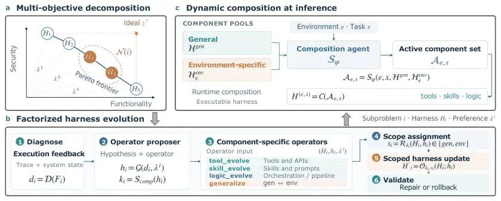
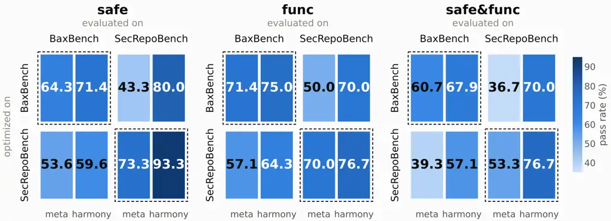

# Harmony Harness: Multi-Objective Self-Evolution of Agent Harnesses

Weichen Yu    Lesly Miculicich Affiliation: Google Cloud AI Research   
Bhavana Dalvi Mishra Affiliation: Google Cloud AI Research    Jiefeng
Chen Affiliation: Google Cloud AI Research    Shuo Li Affiliation:
Google DeepMind    Matt Fredrikson Affiliation: Carnegie Mellon
University    Tomas Pfister Affiliation: Google Cloud AI Research   
Long T. Le Affiliation: Google Cloud AI Research

###### Abstract

Recent work on self-evolving LLM agents treats the agent harness as an
optimization target that can be iteratively improved through execution
feedback. Existing approaches, however, largely optimize a single
objective and evolve the harness as a monolithic artifact, limiting
their ability to handle competing goals and to separate transferable
design from environment-specific adaptation. We introduce Harmony
Harness, a framework for _multi-objective, compositional harness
evolution_. Harmony Harness formulates harness evolution as a
multi-objective optimization problem and uses decomposition-based
evolutionary search to maintain solutions across different regions of
the Pareto frontier, avoiding reliance on a hand-designed structural
diversity metric for repository-scale harnesses. In parallel, we
introduce factorized evolution operators that separately refine
general-purpose harness mechanisms and benchmark-specific adaptations,
together with a dynamic composition workflow that integrates them at
inference time. Across SecRepoBench and BaxBench, Harmony Harness
consistently outperforms strong harness-evolution baselines, with gains
exceeding 10% on both benchmarks. Our results show that explicitly
modeling both objective trade-offs and harness structure yields
substantially stronger and more transferable agent evolution than
existing single-objective, monolithic approaches.

## 1 Introduction

A deployed LLM agent wraps a base model in a _harness_: the system
prompt, tool set, agent loop, verification gates, and orchestration that
collectively determine how underlying capabilities translate into task
outcomes. Recent work on _self-evolving harnesses_ allows agents to
iteratively modify this infrastructure from execution feedback (Hu et
al., 2025a; Zhuge et al., 2024; Zhang et al., 2026b; Robeyns et al.,
2025; Zhang et al., 2026a; Qiu et al., 2025; Lee et al., 2026). Existing
approaches, however, optimize solely around a _single scalar objective_,
such as pass rate on a benchmark. Harness self-evolution under
_multiple_ objectives, in particular with _safety_ treated as an
independent axis rather than folded into the success signal, remains
unaddressed.

Extending harness self-evolution from a single objective to multiple
objectives is not as simple as adding another reward signal. The
challenge arises from the structure of the Pareto frontier and the
possibility of genuine trade-offs between objectives. Consider
functionality and safety. At first glance, the two appear aligned: a
stronger coding agent should ideally produce code that both passes its
tests and resists exploitation. Yet this alignment need not hold
throughout the space of possible harnesses. A harness may improve pass
rate by relaxing a verification gate, for example, or improve security
by rejecting behaviors that are nevertheless required for functional
correctness. Once such conflicts emerge, the evolution procedure must
explicitly determine how they should be resolved. Existing formulations
handle such tensions poorly: linear scalarization provably misses
non-convex Pareto regions¹¹ 1 The Pareto frontier is the set of
non-dominated solutions for which no objective can be improved without
degrading at least one other objective. regardless of weight choices,
and, even where the frontier is convex, it will trade a point of one
objective for a cheaper point of the other; delegating trade-offs to the
agent leaves compromises implicit, unstable, and rarely Pareto-optimal.
Constrained optimization (Sinha et al., 2024; Dai et al., 2024) enforces
safety thresholds, but reduces the task to constrained single-objective
search rather than mapping the trade-off surface. Handling multiple
objectives thus requires an explicit mechanism that keeps pressure on
_both_ axes. Whether the frontier is actually non-convex is an empirical
question: on the secure-coding benchmarks we study, better scaffolds
often improve functionality and security together (App. G). There, the
main value of decomposition is not recovering non-convex regions. It is
objective-directed search pressure: each subproblem keeps pushing
whichever objective has the largest weighted shortfall from the ideal
point, so neither objective can regress unnoticed.

A second limitation of existing harness-evolution methods is structural
rather than algorithmic: they evolve the harness as a _monolithic_
artifact. Each generation rewrites the repository as a single block
against feedback from a single environment; they do not disentangle
general harness design from environment-specific adaptation (Lee et al.,
2026; Yin et al., 2025). In practice, many mechanisms acquired during
evolution contain both components. One is a _general capability_ that
should transfer across environments; the other is the
_environment-specific calibration_ required to make that capability
effective in a particular setting. For example, constructing and
executing code inside a container is a broadly useful capability,
whereas the choice of image, teardown policy, and handling of
benchmark-specific sandbox conventions is environment dependent.
Similarly, compressing or truncating tool outputs is a general
mechanism, while deciding which portions can safely be omitted depends
strongly on whether the output is a compiler log, a fuzzer trace, or a
test-runner report. Current methods typically optimize these components
jointly against feedback from a single environment. As a result,
transferable design choices and benchmark-specific adaptations receive
the same reward signal and are encoded into the same monolithic harness.
We do not expect the boundary between these two designs to be perfectly
discrete; effective capabilities inevitably require some
environment-dependent calibration. Nevertheless, explicitly separating
the two creates a more useful abstraction: a _general harness_ that can
transfer across tasks and environments, paired with lightweight
_environment-specific components_ that specialize it to the execution
context at hand.

To address these challenges, we introduce Harmony Harness, a
_multi-objective harness evolution_ framework built on
decomposition-based evolutionary optimization (Li and Zhang, 2009).
Rather than collapsing multiple objectives into a single reward, we
decompose the objective space using a set of weight vectors, each
defining a scalar subproblem corresponding to a subregion of the Pareto
frontier, and optimize these subproblems jointly within a shared
population. This formulation is particularly well suited to harness
evolution. Existing evolutionary systems often require an explicit
artifact-level diversity metric to prevent population collapse (Novikov
et al., 2025; Wang et al., 2025); such metrics (e.g. number of lines of
code) are relatively natural for compact artifacts such as a single
program, but become difficult to define meaningfully for
repository-scale agent harnesses whose variations span prompts, control
flow, tools, verification logic, and orchestration. Our decomposition
instead gives each subproblem a different objective preference, so
selection pressure is diversified by construction, without requiring a
hand-designed structural diversity metric. This does not by itself
guarantee _behavioral_ diversity: when the objectives are positively
correlated, or when LLM edits are small and local, the incumbents need
not differ in behavior. We find that standard code-level diversity
metrics capture behavioral diversity only partially for harnesses
(appendix). Maintaining a bounded set of representative solutions also
avoids carrying an ever-growing archive of artifacts into the proposer
context, reducing the context and search overhead of evolution.

We instantiate dual-objective self-evolution in _secure code
generation_, where functionality requires passing unit tests and
security requires neutralizing proof-of-concept exploits. Our findings
are: 1) Limits of Single-Objective Evolution: Optimizing solely for code
functionality yields only marginal, incidental security gains. 2)
Suboptimality of Naive Formulations: Naive combinations, such as
weighted-sum scalarization or sequential evolution, stall below the full
framework; the margin comes from combining decomposition with factored
evolving and dynamic orchestration, not from the aggregation rule alone. 3) Effectiveness and Transferability: Our multi-objective framework
consistently outperforms baselines and generalizes across benchmarks
with identical dual objectives. 4) Benefits of Factorized Harness and
Dynamic Orchestration: Factorized harness evolution and adaptive
orchestration outperform static, fixed-pipeline evolutionary workflows.

## 2 Related Work

Self-evolving and self-improving agents. A growing body of work lets
agents improve from their own experience via reflection, memory, skill
libraries, and workflow updates (Wang et al., 2024; Shinn et al., 2023;
Sun et al., 2023; Zhang et al., 2024; Ou et al., 2025; Zhang et al.,
2025b; Hu et al., 2025b). Voyager (Wang et al., 2024) grows a skill
library from iterative code; Reflexion (Shinn et al., 2023) uses verbal
self-critique over failed trajectories; AdaPlanner (Sun et al., 2023)
adapts plans from environmental feedback. Two systems are conceptual
predecessors of ours; we borrow ideas from them, not their algorithms or
code. GEPA (Agrawal et al., 2026) performs reflective prompt evolution
over a maintained Pareto frontier of prompts; we lift the idea of a
maintained frontier from prompts to whole harnesses and from task
instances to a $`(\mathrm{functionality},\mathrm{security})`$ objective
space. ADAS (Hu et al., 2025a) has a meta-agent program new agent
designs in code, one level up from the prompt; we share its view of the
agent as an editable program, but our search procedure is MOEA/D (Li and
Zhang, 2009) with LLM variation operators (§4.1), not ADAS’s
archive-based meta-agent search. Closest to our code setting, the Darwin
Gödel Machine (Zhang et al., 2026b) and meta-harness (Lee et al., 2026)
self-improve a coding agent by a _monolithic_ loop—evolve the agent’s
code as one block. All of these systems (i) optimize a _single_
objective and evaluate only functionality, and (ii) do not separate
reusable from environment-specific components in _what_ is evolved.

Safety during evolution, and safety as a constraint. SoS (Sinha et al., 2024) jointly evolves a prompt for utility and safety, but evolves only
a single prompt slot; safety gains at one position can be undone
elsewhere. More broadly, multi-objective alignment treats
helpfulness/harmlessness trade-offs as joint reward optimization (Askell
et al., 2021; Bai et al., 2022a; Bai et al., 2022b; Ramé et al., 2023;
Zhou et al., 2024), whereas constrained approaches argue safety is
better expressed as a hard constraint than a reward term (Achiam et al.,
2017; Dai et al., 2024). Rather than demoting safety to a feasibility
condition on a functionality objective, we keep it as an objective in
its own right and search the frontier by decomposition, lifted from a
single prompt to an entire harness.

## 3 Problem Formulation

Let $`\mathcal{H}`$ denote the space of agent harnesses, and let
$`\mathcal{D}=\{t_{n}=(x_{n},p_{n})\}_{n=1}^{M}`$ be a set of $`M`$
evaluation tasks, where $`x_{n}`$ is the task specification and
$`p_{n}`$ is the corresponding security policy. Executing harness
$`H\in\mathcal{H}`$ on task $`t_{n}`$ induces a distribution over
trajectories, $`\tau\sim P_{H}(\tau\mid x_{n}),`$ reflecting the
stochasticity of the underlying agent. The agent only sees $`x_{n}`$;
the policy $`p_{n}`$ (e.g., the exploit) is hidden at solve time and
enters only through the evaluation oracle $`S(\tau,p_{n})`$. We evaluate
each harness along two execution-grounded objectives, functionality and
security:
$`\mathbf{f}(H)=\bigl(f_{\mathrm{func}}(H),f_{\mathrm{sec}}(H)\bigr),`$
defined in B.

Joint metric. Our headline metric is the rate at which a single
trajectory is _both_ functional and secure:

```math
f_{\wedge}(H)=\frac{1}{M}\sum_{n=1}^{M}\mathbb{E}_{\tau\sim P_{H}(\cdot\mid x_{n})}\left[F(\tau,x_{n})\,S(\tau,p_{n})\right]. \tag{1}
```

The search optimizes the two marginals
$`(f_{\mathrm{func}},f_{\mathrm{sec}})`$ rather than $`f_{\wedge}`$
directly. The joint rate is bounded on both sides by the marginals (the
Fréchet bounds),

```math
\max\bigl(0,\;f_{\mathrm{func}}(H)+f_{\mathrm{sec}}(H)-1\bigr)\;\leq\;f_{\wedge}(H)\;\leq\;\min\bigl(f_{\mathrm{func}}(H),f_{\mathrm{sec}}(H)\bigr), \tag{2}
```

so raising both marginals raises the ceiling on $`f_{\wedge}`$ and, once
their sum exceeds $`1`$, also forces it up from below. A Tchebycheff
subproblem (Eq. 4, §4.1) acts on the objective with the largest
_weighted_ shortfall from the ideal point; for the balanced weight
$`\boldsymbol{\lambda}=(\tfrac{1}{2},\tfrac{1}{2})`$ this is the
currently worse objective, which is the one that caps $`f_{\wedge}`$
through the upper bound. Optimizing the marginals does not guarantee
joint success: two harnesses can have the same marginals and very
different $`f_{\wedge}`$ if they succeed on different tasks. We
therefore report $`f_{\wedge}`$ and the gap
$`\min(f_{\mathrm{func}},f_{\mathrm{sec}})-f_{\wedge}`$ for every method
(§5.1). We keep the marginals as the search objectives because they tell
the proposer _which_ property failed on a task, whereas $`f_{\wedge}`$
alone does not.

Selecting the deployed harness. Comparisons against single-harness
baselines, held-out evaluation, and transfer need one harness per run.
Let $`\mathcal{U}_{g}`$ be the set of children evaluated in generation
$`g`$, and let $`\mathcal{U}=\bigcup_{g}\mathcal{U}_{g}`$. After
evolution we select the _most balanced_ child of the run,

```math
H^{\dagger}=\arg\max_{H\in\mathcal{U}}\min\bigl(\hat{f}_{\mathrm{func}}(H),\hat{f}_{\mathrm{sec}}(H)\bigr), \tag{3}
```

computed on the search split only, with ties resolved in favor of the
earlier generation. The candidate need not be an incumbent at the end of
the run: a child that was later replaced under one subproblem’s
preference can still be the most balanced one overall. The held-out
splits are never used for selection. Eq. 3 is the Tchebycheff
scalarization (Eq. 4, §4.1) with equal weights
$`\boldsymbol{\lambda}=(\tfrac{1}{2},\tfrac{1}{2})`$ and the utopia
point $`(1,1)`$ as reference, since
$`\arg\min_{H}\max_{j}\tfrac{1}{2}\bigl(1-\hat{f}_{j}(H)\bigr)=\arg\max_{H}\min_{j}\hat{f}_{j}(H)`$.

## 4 Multi-Objective and Factored Harness Evolution

Given the multi-objective formulation in §3, Harmony Harness evolves a
population of repository-scale agent harnesses toward different regions
of the Pareto frontier. The framework combines two complementary ideas.
First, we adapt decomposition-based multi-objective evolution to LLM
agent harnesses: a set of objective preferences defines multiple scalar
subproblems, each maintaining an incumbent harness for a different
trade-off between objectives. An LLM proposer generates candidate
harnesses from execution-grounded feedback, and candidates selectively
replace incumbents in nearby subproblems according to their respective
objectives. Second, we factorize the variation process to distinguish
reusable harness mechanisms from environment-specific adaptation.
General-purpose and environment-focused modifications are evolved
through different operators and dynamically composed at inference time.
Figure 1 illustrates the complete evolution loop.



Figure 1: Overview of Harmony Harness. (a) The functionality–security
space is split into weighted subproblems. Each subproblem keeps a
harness and together they approximate the Pareto frontier. (b) An LLM
proposer diagnoses failures and forms a hypothesis. Operators edit
tools, skills, or logic, and place each edit in either the general scope
or the environment-specific scope. The child is validated before
evaluation. (c) At inference, a composition agent picks components from
the general and environment-specific pools to build a task-specific
harness.

#### Search Space: The Harness as the Genome

Unlike program-evolution methods that optimize a compact code artifact,
the individual in Harmony Harness is an _entire agent harness_. We
freeze only a minimal interface required by the evaluator; the remaining
harness—including prompts, tools, skills, control logic, verification
mechanisms, and orchestration—constitutes the evolvable genome.

Concretely, the search space contains three major classes of components,
$`\mathcal{K}=\{\text{tools},\text{skills},\text{logic}\}`$, where logic
also covers orchestration. _Tools_ provide executable capabilities
available inside the agent loop, including environment interaction and
verification utilities. _Skills_ encode reusable domain knowledge, such
as debugging procedures or repair strategies, that can be retrieved when
relevant. Finally, _logic and orchestration_ determine how these
capabilities are used, including the system prompt, agent loop,
verification gates, and workflow connecting individual reasoning and
execution stages. Because the proposer operates directly over the
harness repository, evolution may modify not only local instructions but
also the high-level structure of the agent. The initial harness
$`H_{0}`$ is a lightweight but functional ReAct-style base (details in
Appendix E).

### 4.1 Multi-Objective Evolution by Decomposition

Directly maintaining a single “best” harness is ill-defined under
multiple objectives for two reasons: (1) evolutionary search must
maintain sufficient population diversity to avoid premature convergence;
and (2) different harnesses may realize distinct Pareto-optimal
trade-offs. We therefore instantiate harness evolution using a
decomposition strategy based on MOEA/D (Li and Zhang, 2009).

#### Decomposition.

Let
$`\Lambda=\left\{\boldsymbol{\lambda}^{1},\ldots,\boldsymbol{\lambda}^{N}\right\},\lambda^{i}_{j}\geq 0,\sum_{j=1}^{m}\lambda^{i}_{j}=1,`$
denote a set of $`N`$ weight vectors spanning the $`m`$-objective
simplex. In our bi-objective setting ($`m=2`$), the weight vectors are
chosen to be uniformly distributed along the security–functionality
trade-off. Each $`\boldsymbol{\lambda}^{i}`$ defines a scalar
optimization subproblem and is associated with an incumbent harness
$`H_{i}`$. Collectively, the $`N`$ subproblems cover different objective
preferences and maintain a finite set of representative solutions that
approximate the Pareto frontier.

We maintain an ideal point
$`\mathbf{z}^{*}=(z_{1}^{*},\ldots,z_{m}^{*})`$, where
$`z_{j}^{*}=\max_{H}\hat{f}_{j}(H)`$ is the best value of objective
$`j`$ observed over all harnesses evaluated so far. Given a weight
vector $`\boldsymbol{\lambda}^{i}\in\Lambda`$, we define the
corresponding subproblem using the weighted Tchebycheff scalarization

```math
g^{\mathrm{te}}\bigl(H\mid\boldsymbol{\lambda}^{i},\mathbf{z}^{*}\bigr)=\max_{j\in\{1,\ldots,m\}}\lambda^{i}_{j}\left|z^{*}_{j}-\hat{f}_{j}(H)\right|, \tag{4}
```

where lower values indicate a smaller weighted deviation from the ideal
point. Conceptually, the solution associated with subproblem $`i`$ is

```math
H_{i}^{*}=\arg\min_{H\in\mathcal{H}}g^{\mathrm{te}}\bigl(H\mid\boldsymbol{\lambda}^{i},\mathbf{z}^{*}\bigr), \tag{5}
```

and during evolution we maintain an incumbent $`H_{i}`$ as the current
approximation to $`H_{i}^{*}`$.

This decomposition is fundamentally different from optimizing a single
weighted-sum objective. Importantly, the scalarization in Eq. 4 is
_local to a subproblem_: Harmony Harness does not replace the
multi-objective problem with one globally authoritative scalar reward.
Different subproblems preserve different objective preferences, so a
harness favored by a security-oriented subproblem need not compete
directly with one favored by a functionality-oriented subproblem.

Neighborhood evolution and replacement. For each subproblem $`i`$, we
define a neighborhood $`B(i)`$ as the set of the $`T`$ weight vectors in
$`\Lambda`$ closest to $`\boldsymbol{\lambda}^{i}`$ under Euclidean
distance. Variation is single-parent: the child for subproblem $`i`$ is
produced from its own incumbent $`H_{i}`$. The neighborhood is used in
two places. First, if a subproblem stalls, meaning its parent and
failure digest are unchanged from the previous generation, we breed
instead from the neighbor with the best Tchebycheff value under
$`\boldsymbol{\lambda}^{i}`$. Second, the neighborhood defines which
incumbents the child may replace (below). Both rely on the intuition
that nearby objective preferences benefit from similar harness designs.
The proposer never receives more than one full parent repository, which
keeps its context bounded.

Suppose variation produces a child harness $`H_{c}`$ for subproblem
$`i`$. After evaluating $`H_{c}`$ on all objectives and updating the
ideal point $`\mathbf{z}^{*}`$, we consider $`H_{c}`$ as a replacement
candidate for each neighboring subproblem $`l\in B(i)`$:

```math
H_{l}\leftarrow H_{c}\quad\text{if}\quad g^{\mathrm{te}}\bigl(H_{c}\mid\boldsymbol{\lambda}^{l},\mathbf{z}^{*}\bigr)<g^{\mathrm{te}}\bigl(H_{l}\mid\boldsymbol{\lambda}^{l},\mathbf{z}^{*}\bigr). \tag{6}
```

Thus, a candidate discovered for one subproblem may improve several
nearby objective preferences, while incumbents associated with
substantially different trade-offs are preserved. Standard MOEA/D bounds
the number of incumbents one child may replace by $`n_{r}\leq T`$ (Li
and Zhang, 2009). We cap replacement at $`n_{r}=2`$, so a single child
can replace at most two neighbouring incumbents.

Objective-induced diversity and bounded proposer context. This
decomposition is particularly well suited to repository-scale harness
evolution. Existing evolutionary methods (Novikov et al., 2025; Wang et
al., 2025) often maintain diversity using explicit artifact-level
distance measures, which are more natural when each candidate is a
compact program for a single task. For repository-scale harnesses,
however, structural distance is a poor proxy for behavioral diversity:
two repositories may implement nearly identical behavior with very
different code organization, while small changes to a prompt,
verification gate, or orchestration rule can substantially alter
behavior. Designing a reliable hand-crafted diversity metric is
therefore difficult when candidates vary jointly over prompts, tools,
control flow, verification, and workflow structure. In Harmony Harness,
each incumbent is preserved because it is the best found so far for a
distinct objective preference, not because it is structurally distant
under a hand-designed metric. This makes diversity of _selection
pressure_ hold by construction. Diversity of _behavior_ does not follow
automatically. It also requires the objectives to trade off and the LLM
operators to make edits that change behavior rather than wording.
Measuring this is itself an open problem for self-coding harnesses. Our
offline analysis (App. J) finds that standard program-diversity metrics
(token, line and AST distance, and edit labels) barely track behaviour:
code distance and objective distance are essentially uncorrelated. The
metrics also cannot see diversity that is decided at run time, such as
the distinct per-task DAGs planned by the orchestrator. Among them, AST
distance is the most informative, since it ignores cosmetic rewrites. We
therefore treat diversity as something to monitor, not something
decomposition guarantees. The population size is also bounded by the
number of subproblems, avoiding an ever-growing archive and reducing the
evolutionary context that must be maintained.

### 4.2 Factorized Harness Evolution

For a target subproblem $`i`$, the proposer receives a single parent
harness, the incumbent $`H_{i}`$ (or a neighbor when the subproblem
stalls), the objective preference $`\boldsymbol{\lambda}^{i}`$, and the
execution feedback $`\mathcal{E}_{i}`$ collected from running that
parent. The feedback contains aggregate objective statistics together
with sampled execution artifacts, such as compiler errors, failing
tests, and crash traces. Before modifying the harness, the proposer
first diagnoses the observed failures and formulates a concrete
hypothesis for improvement under the current objective preference.

Why factorize harness evolution? A repository-scale harness contains
heterogeneous components, including tools, skills, prompts, verification
logic, control flow, and orchestration, that play different roles in
agent behavior. An observed failure often suggests a change to only a
subset of these components. Treating the entire repository as a single
rewrite target can therefore couple an intended repair with unrelated
changes elsewhere in the harness. More importantly, because evolutionary
feedback is collected from a particular benchmark, unrestricted
rewriting does not explicitly distinguish reusable mechanisms from
adaptations that exploit properties specific to the current benchmark.

Factorized harness representation. We therefore factorize harness
evolution along two complementary dimensions: _component type_ and
_adaptation scope_. Component factorization localizes an update to a
semantically meaningful part of the harness, while scope factorization
provides an explicit representation for reusable and
environment-specific components. This organization serves as an
inductive bias; we do not assume that either decomposition is unique or
theoretically exact. Given execution feedback $`\mathcal{E}_{i}`$, the
proposer first diagnoses the observed failure and formulates an
improvement hypothesis:
$`d_{i}=\mathcal{Q}(\mathcal{E}_{i}),h_{i}=\mathcal{G}(d_{i},\boldsymbol{\lambda}^{i}),`$
where $`\mathcal{Q}`$ and $`\mathcal{G}`$ denote the diagnosis and
hypothesis steps of the proposer, $`d_{i}`$ denotes the failure
diagnosis, and $`h_{i}`$ denotes the proposed improvement hypothesis.
Based on this hypothesis, the proposer selects the component class to
modify, $`k_{i}=\pi_{\mathrm{comp}}(h_{i})\in\mathcal{K},`$ where
$`\mathcal{K}`$ is the set of component classes defined in §4. The
proposer then assigns the scope of the modification through a
component-specific scope assignment $`\mathcal{R}_{k_{i}}`$:

```math
s_{i}=\mathcal{R}_{k_{i}}\left(H_{i},h_{i}\right)\in\Sigma, \tag{7}
```

where $`\Sigma=\{\mathrm{gen},\mathrm{env}\}.`$ Here, $`k_{i}`$
determines _what component to modify_, while $`s_{i}`$ determines _where
the resulting modification should reside_. gen refers to a general
harness component, and env means environment-specific. The corresponding
component-scope update is then applied to produce the child harness of
§4.1: $`H_{c}=\mathcal{O}_{k_{i},s_{i}}\left(H_{i};h_{i}\right).`$ Here,
$`\mathcal{O}_{k_{i},s_{i}}`$ is a factorized variation operator that
directly modifies the harness. The complete operator details are
provided in Appendix E. The distinction in Eq. 7 is operational rather
than semantic. In the implementation, components are stored under
explicit general or benchmark-specific scopes. For example, tools and
skills may each contain a general implementation together with
benchmark-specific variants. The proposer therefore makes two decisions
when modifying the harness: which component to change, and whether the
resulting change should reside in the general scope or in an
environment-specific scope. This assignment is not fixed and may be
revised during evolution.

Generalization as cross-scope reorganization. The boundary between
general and environment-specific components is itself allowed to evolve.
We introduce a dedicated generalize operator that inspects the current
harness organization and reorganizes components across the two scopes
when their existing placement introduces unnecessary specialization.
Implementation details for this operator are provided in Appendix E.3.

Validation and recovery. Every proposed child is validated before
objective evaluation in three stages. The details are described in
Appendix E.5.

### 4.3 Dynamic Composition at Inference

Factorized evolution produces a pool of reusable components
$`\mathcal{H}^{\mathrm{gen}}`$ together with environment-specific
components $`\mathcal{H}^{\mathrm{env}}_{e}`$. We do not execute the
complete union of these components for every task. Even within the same
benchmark, different tasks may benefit from different tools, skills,
verification procedures, or control strategies. At inference time, a
dedicated composition agent constructs the active harness conditioned on
both the current environment and the current task. Given an environment
$`e`$, a task $`x`$, and the available component pools, the composition
agent generates a task-specific DAG,

```math
\mathcal{A}_{e,x}=\pi_{\phi}\left(e,x,\mathcal{H}^{\mathrm{gen}},\mathcal{H}^{\mathrm{env}}_{e}\right), \tag{8}
```

where $`\pi_{\phi}`$ denotes the composition policy and
$`\mathcal{A}_{e,x}`$ contains the components activated for the current
task. The executable harness is then instantiated as
$`H^{(e,x)}=\mathcal{C}\left(\mathcal{A}_{e,x}\right),`$ where
$`\mathcal{C}`$ denotes the runtime composition procedure. The
composition agent does not modify the evolved components; it only
determines which components to activate for the current environment and
task. This allows general mechanisms to remain available across
environments without being invoked unconditionally, while
environment-specific mechanisms are loaded only when they are relevant
to the current task. Details are provided in Appendix F.

## 5 Experiments

For each benchmark, we partition tasks into _evolve_, _held-out-ID_, and
_held-out-OOD_ splits. The evolve split provides the execution feedback
used during harness evolution, whereas both held-out splits remain
inaccessible to the proposer and selection procedure. For SecRepoBench,
we use 30/30/30 tasks; for BaxBench, we use 28/28/28 tasks and evolve a
separate harness population on each benchmark. We report secure-pass@1,
defined as the conjunction of functional and security success,
$`F\wedge S`$. Unless otherwise specified, both the harness proposer and
the underlying task-solving agent use gemini-3.6-flash. Appendix C
describes the benchmarks in detail.

### 5.1 Main comparison against self-evolution baselines

We first compare six evolution regimes under an identical seed harness
and grader. Baseline is the un-evolved harness. The three meta-harness
(Lee et al., 2026) variants are its monolithic “summarize$`\to`$rewrite”
loop driven by (i) functionality _and_ security, (ii) functionality
only, or (iii) security only. DGM (Zhang et al., 2026b) scalarizes the
two objectives into a single reward. HH (Harmony Harness) is ours. Each
method is evolved on the evolve split only and then evaluated, without
further evolution, on both held-out splits. Figure 2 summarizes the
outcome per split on the two benchmarks; the underlying numbers are
tabulated in Tables 9 and 10 in Appendix G.

Figure 2: Evolution results per split on (a) SecRepoBench and (b)
BaxBench.

Table 1 crystallizes the central failure mode we study: baseline methods
improve security on the optimization distribution yet relinquish most or
all of those gains under distribution shift—with larger in-distribution
gains often corresponding to larger reversals, as exemplified by DGM,
which achieves the strongest SecRepoBench security improvement among the
baselines during evolution but retains none of it
out-of-distribution—motivating our treatment of safety as an explicit
optimization axis evaluated beyond the evolve distribution rather than
as a scalar reward measured only in-distribution. HH is best on every
split of both benchmarks: $`76.7`$ F&S on the SecRepoBench evolve split,
$`86.7`$ on held-out IN (vs. $`50.0`$ for baseline), and $`66.7`$ on
held-out OUT (vs. $`36.7`$), and an average F&S of $`61.3`$ on BaxBench
against $`42.9`$ for baseline and $`52.4`$ for the strongest
meta-harness variant. Notably the largest _relative_ margins are
out-of-distribution, which is what factorizing the harness into general
and environment-specific components is meant to achieve.

|                              |                            |                         |                   |                            |                         |                   |
| ---------------------------- | -------------------------- | ----------------------- | ----------------- | -------------------------- | ----------------------- | ----------------- |
|                              | SecRepoBench               |                         |                   | BaxBench                   |                         |                   |
| Method                       | $`\Delta_{\text{evolve}}`$ | $`\Delta_{\text{OUT}}`$ | retained          | $`\Delta_{\text{evolve}}`$ | $`\Delta_{\text{OUT}}`$ | retained          |
| Meta-harness (func-only)     | $`+3.3`$                   | $`-3.4`$                | $`-103\%`$        | $`+3.6`$                   | $`-7.1`$                | $`-197\%`$        |
| Meta-harness (sec-only)      | $`+13.3`$                  | $`+3.3`$                | $`25\%`$          | $`+17.9`$                  | $`+3.6`$                | $`20\%`$          |
| Meta-harness (func & sec)    | $`+16.6`$                  | $`+3.3`$                | $`20\%`$          | $`+14.3`$                  | $`+3.6`$                | $`25\%`$          |
| DGM (func & sec, scalar)     | $`+20.0`$                  | $`+0.0`$                | $`{0\%}`$         | $`+10.7`$                  | $`+3.6`$                | $`34\%`$          |
| Harmony Harness (func & sec) | $`+36.6`$                  | $`+20.0`$               | $`\mathbf{55\%}`$ | $`+21.4`$                  | $`+10.7`$               | $`\mathbf{50\%}`$ |

Table 1: How much evolved security survives a distribution shift.
$`\Delta_{\text{evolve}}`$ is a method’s security gain over the
un-evolved baseline on the split it evolved on; $`\Delta_{\text{OUT}}`$
is its gain over the same baseline on held-out-OUT; _retained_
$`=\Delta_{\text{OUT}}/\Delta_{\text{evolve}}`$. Mean over 3 runs.

|                                                  |                                              |      |      |      |
| ------------------------------------------------ | -------------------------------------------- | ---- | ---- | ---- |
| Strategy                                         | Acceptance rule                              | Func | Sec  | F&S  |
| Static (no evolution)                            | —                                            | 66.7 | 56.7 | 46.7 |
| Functionality-only                               | accept if $`F\!\uparrow`$                    | 73.3 | 60.0 | 56.7 |
| Safety-only                                      | accept if $`\text{viol.}\!\downarrow`$       | 70.0 | 66.7 | 46.7 |
| Sequential (func$`\to`$sec, sec$`\to`$func)      | one objective per generation, then the other | 70.0 | 76.7 | 70.0 |
| Prompt-merge variants                            | merge func & safety prompts                  | 66.7 | 60.0 | 50.0 |
| Joint-weighted ($`\alpha\!\in\!\{.25,.5,.75\}`$) | $`\alpha F\!+\!(1\!-\!\alpha)S`$             | 70.0 | 73.3 | 70.0 |
| Constrained (hard $`\epsilon`$)                  | Achiam et al. (2017)                         | 70.0 | 60.0 | 60.0 |
| Separated func/safety combination                | dual harness combination                     | 60.0 | 60.0 | 53.3 |
| Harmony Harness                                  | Tchebycheff (Eq. 6)                          | 76.7 | 93.3 | 76.7 |

Table 2: Evolution strategies on SecRepoBench. Func/Sec/F&S in %. Mean
over 3 runs.

Comparison with possible multi-objective evolving strategies. In Table
2, we compare with various baselines with the same initial harness,
evolve split, token budget, and settings, through the alternative ways
of combining the two objectives (sequential, weighted sum, hard
constraint), and a variant that evolves the two harnesses separately and
combines them afterwards. Four readings stand out. (1) Single-objective
evolution does not solve the joint problem: functionality-only lifts F&S
from the static $`46.7`$ to $`56.7`$ but leaves security at $`60.0`$,
while safety-only buys $`10.0`$ points of security ($`56.7\!\to\!66.7`$)
that never convert into a single additional secure-pass—its F&S stays at
the static $`46.7`$. (2) With factored evolving and dynamic
orchestration held fixed, the acceptance rule matters. Under these
matched conditions, Tchebycheff replacement reaches 76.7 F&S, against
70.0 for both the weighted sum and sequential evolution, 60.0 for the
hard constraint, and 53.3 for separately evolved harnesses. Factored
evolving and dynamic orchestration are also necessary: the component
ablation in Table 5 in App. G adds them one at a time on top of
Tchebycheff joint evolution, lifting F&S from $`63.3`$ to $`66.7`$ and
then to $`76.7`$, so each part of the method contributes and only the
full design reaches the headline result. (3) A hard feasibility
constraint acts as a target rather than a direction. Constrained
acceptance holds functionality at $`70.0`$ but leaves security at
$`60.0`$, only $`3.3`$ above never evolving at all. This is the
behaviour an $`\epsilon`$-threshold rule predicts: it rejects anything
below the bar and is indifferent among everything above it, so evolution
stops improving safety the moment safety becomes feasible, whereas
Tchebycheff replacement keeps pulling on whichever objective has the
largest weighted shortfall. (4) Generalization: real execution feedback
beats pattern-matching. The central positive result is on _held-out_
tasks (Table 14 in App. G). Per-generation bests of the
execution-feedback variant improve combined F&S from the baseline’s
$`43.3`$ to $`58.3`$, whereas the baseline _regresses_ to $`35.0`$. The
gain concentrates on held-out OUT (unseen crash types), where real
exploit feedback lets a harness stop _unfamiliar_ vulnerabilities
instead of pattern-matching known ones; the proposed method reaches
$`66.7`$ out-of-distribution and $`76.7`$ combined. Consulting ground
truth, not memorizing a distribution, is what generalizes.

Dynamic orchestration vs. a fixed pipeline. Table 8 in App. G reports
dynamic-workflow vs. linear-pipeline on BaxBench at matched harness and
budget. Per-task planning is worth $`+10.7`$ points of secure-pass and
$`+3.6`$ of functional-pass for an $`8\%`$ token overhead ($`58`$k to
$`63`$k) and $`1.2`$ extra steps on average—the orchestrator spends more
only where it helps. Figure 8 in the appendix shows what it actually
plans: the seven distinct DAG shapes emitted over $`28`$ BaxBench tasks.
The modal plan ($`39\%`$ of tasks) is a five-node fan-out that runs
build_verify, endpoint_check, and security_audit in parallel and joins
into a single edit_fix; harder tasks get $`6`$–$`8`$ nodes with
conditional when-guarded shell_probe and repair loops that only fire if
an earlier check fails. A fixed pipeline must either pay for those extra
stages on every task or never have them; the orchestrator recovers both
ends of that trade-off, which is where the F&S gap comes from.

### 5.2 Cross-benchmark transfer



Figure 3: Cross-benchmark transfer. Each cell is one (optimized-on
$`\times`$ evaluated-on) pair, split into meta-harness (left) and
Harmony Harness (right); dashed outlines mark in-domain cells, solid
outlines zero-shot transfer.

We evaluate each evolved harness zero-shot on the other benchmark’s
search split (Figure 3, Table 12 in App. G); the target benchmark is
never seen during evolution. Meta-harness transfers poorly in both
directions: it drops to $`39.3`$ F&S on BaxBench (baseline $`42.9`$) and
to $`36.7`$ on SecRepoBench (baseline $`46.7`$). Harmony Harness
improves over the baseline in both directions, reaching $`57.1`$ on
BaxBench ($`+14.2`$) and $`70.0`$ on SecRepoBench ($`+23.3`$), close to
the $`76.7`$ it obtains when evolved in-domain. We attribute this to the
separation between general and benchmark-specific components: only the
general scope is loaded on the target benchmark, so benchmark-specific
fixes do not carry over.

CWEval. In Table 11 in App. G, the harness evolved on BaxBench is run,
again with no further evolution, on CWEval (Peng et al., 2025), which
changes not just the benchmark but the _task format_: generate a single
function from a natural-language spec, graded by functional tests and a
separate security oracle, over $`357`$ instances in five languages. (1)
It greatly improves security, which suggests the harness transfers to a
benchmark it has never seen. (2) It holds in every language, including
ones BaxBench does not contain. Per-language F&S improves everywhere,
from $`+10.1`$ (JavaScript) to $`+19.3`$ (Go). C and C++ are not among
BaxBench’s six languages, yet they are $`156`$ of the $`357`$ instances
and gain $`+13.9`$ and $`+14.3`$, which suggests the generalization of
the Harmony Harness. (3) Functionality pays for part of it. Functional
pass rate falls on three of the five languages (C++, JavaScript,
Python), and it gives up $`2.0`$ points of functionality for $`15.5`$
points of security and $`14.3`$ points of F&S.

## 6 Conclusion

Self-evolving agents optimized for a single objective quietly sacrifice
the other, and specialize to one distribution at the expense of safety
on others. We recast self-evolution as multi-objective search over an
entire agent harness, with safety kept as a _separate axis_ of evolution
rather than a reward term to be averaged away. In secure code
generation—where both objectives are grounded in real execution—joint,
harness-level evolution improves security and functionality together
and, with execution-grounded feedback, generalizes to unseen
vulnerabilities, while naive feedback-driven evolution falls back. The
factorized general and environment-specific harness further improves the
in-domain and cross-benchmark generalization.

### AI use statement

In this work, we used generative AI tools for editing (grammar,
spelling, and word choice), for drafting sections of the paper, for
implementing standard methods in our codebase, and for retrieval and
discovery of related work: candidate references were surfaced with AI
assistance and every one of them was then read and verified against its
primary source by an author before being cited or described. We did not
use generative AI tools to generate research ideas, or to generate or
fabricate experimental results. All AI-assisted text was reviewed and
edited by the authors; all AI-assisted code was read, executed, and
tested by at least two authors, and every number reported in this paper
comes from a run we performed ourselves. Generative AI was not used as a
subject of study, as a research participant, or as an evaluator of our
results. We take responsibility for the final content of this work,
including all text, claims, and artifacts produced with the aid of
generative AI.

## References

- Achiam et al. (2017) J. Achiam, D. Held, A. Tamar, and P. Abbeel
  Constrained policy optimization. In Proceedings of the 34th
  International Conference on Machine Learning (ICML), Proceedings of
  Machine Learning Research, Vol. 70, pp. 22–31. External Links:
  [Link](https://proceedings.mlr.press/v70/achiam17a.html) Cited by: §2,
  Table 2.
- Agrawal et al. (2026) L. A. Agrawal, S. Tan, D. Soylu, N. Ziems, R.
  Khare, K. Opsahl-Ong, A. Singhvi, H. Shandilya, M. J. Ryan, M.
  Jiang, C. Potts, K. Sen, A. G. Dimakis, I. Stoica, D. Klein, M.
  Zaharia, and O. Khattab GEPA: reflective prompt evolution can
  outperform reinforcement learning. In International Conference on
  Learning Representations (ICLR), External Links: 2507.19457,
  [Link](https://arxiv.org/abs/2507.19457) Cited by: §2.
- Andriushchenko et al. (2025) M. Andriushchenko, A. Souly, M.
  Dziemian, D. Duenas, M. Lin, J. Wang, D. Hendrycks, A. Zou, Z.
  Kolter, M. Fredrikson, E. Winsor, J. Wynne, Y. Gal, and X. Davies
  AgentHarm: a benchmark for measuring harmfulness of LLM agents. In
  International Conference on Learning Representations (ICLR), External
  Links: 2410.09024, [Link](https://arxiv.org/abs/2410.09024) Cited by:
  Appendix H.
- Askell et al. (2021) A. Askell, Y. Bai, A. Chen, D. Drain, D.
  Ganguli, T. Henighan, A. Jones, N. Joseph, B. Mann, N. DasSarma, et
  al. A general language assistant as a laboratory for alignment. arXiv
  preprint arXiv:2112.00861. External Links:
  [Link](https://arxiv.org/abs/2112.00861) Cited by: §2.
- Bai et al. (2022a) Y. Bai, A. Jones, K. Ndousse, A. Askell, A.
  Chen, N. DasSarma, D. Drain, S. Fort, D. Ganguli, T. Henighan, et al.
  Training a helpful and harmless assistant with reinforcement learning
  from human feedback. arXiv preprint arXiv:2204.05862. External Links:
  [Link](https://arxiv.org/abs/2204.05862) Cited by: §2.
- Bai et al. (2022b) Y. Bai, S. Kadavath, S. Kundu, A. Askell, J.
  Kernion, A. Jones, A. Chen, A. Goldie, A. Mirhoseini, C. McKinnon, et
  al. Constitutional AI: harmlessness from AI feedback. arXiv preprint
  arXiv:2212.08073. External Links:
  [Link](https://arxiv.org/abs/2212.08073) Cited by: §2.
- Dai et al. (2024) J. Dai, X. Pan, R. Sun, J. Ji, X. Xu, M. Liu, Y.
  Wang, and Y. Yang Safe RLHF: safe reinforcement learning from human
  feedback. In International Conference on Learning Representations
  (ICLR), External Links: 2310.12773,
  [Link](https://arxiv.org/abs/2310.12773) Cited by: §1, §2.
- Debenedetti et al. (2024) E. Debenedetti, J. Zhang, M. Balunović, L.
  Beurer-Kellner, M. Fischer, and F. Tramèr AgentDojo: a dynamic
  environment to evaluate prompt injection attacks and defenses for LLM
  agents. In Advances in Neural Information Processing Systems
  (NeurIPS), Datasets and Benchmarks Track, External Links: 2406.13352,
  [Link](https://arxiv.org/abs/2406.13352) Cited by: Appendix H.
- Dilgren et al. (2025) C. Dilgren, P. Chiniya, L. Griffith, Y. Ding,
  and Y. Chen SecRepoBench: benchmarking LLMs for secure code generation
  in real-world repositories. arXiv preprint arXiv:2504.21205. External
  Links: [Link](https://arxiv.org/abs/2504.21205) Cited by: Appendix C,
  Appendix H.
- Hu et al. (2025a) S. Hu, C. Lu, and J. Clune Automated design of
  agentic systems. In International Conference on Learning
  Representations (ICLR), External Links: 2408.08435,
  [Link](https://arxiv.org/abs/2408.08435) Cited by: §1, §2.
- Hu et al. (2025b) Y. Hu, Y. Cai, Y. Du, X. Zhu, X. Liu, Z. Yu, Y.
  Hou, S. Tang, and S. Chen Self-evolving multi-agent collaboration
  networks for software development. In International Conference on
  Learning Representations (ICLR), External Links: 2410.16946,
  [Link](https://arxiv.org/abs/2410.16946) Cited by: §2.
- Lee et al. (2026) Y. Lee, R. Nair, Q. Zhang, K. Lee, O. Khattab,
  and C. Finn Meta-Harness: end-to-end optimization of model harnesses.
  arXiv preprint arXiv:2603.28052. External Links:
  [Link](https://arxiv.org/abs/2603.28052) Cited by: Appendix C, §1, §1,
  §2, §5.1.
- Levy et al. (2026) I. Levy, B. Wiesel, S. Marreed, A. Oved, A.
  Yaeli, N. Mashkif, and S. Shlomov ST-webagentbench: a benchmark for
  evaluating safety and trustworthiness in web agents. In International
  Conference on Learning Representations (ICLR), External Links:
  2410.06703, [Link](https://arxiv.org/abs/2410.06703) Cited by:
  Appendix H.
- Li and Zhang (2009) H. Li and Q. Zhang Multiobjective optimization
  problems with complicated pareto sets, MOEA/D and NSGA-II. IEEE
  Transactions on Evolutionary Computation 13 (2), pp. 284–302. External
  Links: [Document](https://dx.doi.org/10.1109/TEVC.2008.925798) Cited
  by: §1, §2, §4.1, §4.1.
- Novikov et al. (2025) A. Novikov, N. Vũ, M. Eisenberger, E. Dupont, P.
  Huang, A. Z. Wagner, S. Shirobokov, B. Kozlovskii, F. J. R. Ruiz, A.
  Mehrabian, M. P. Kumar, A. See, S. Chaudhuri, G. Holland, A.
  Davies, S. Nowozin, P. Kohli, and M. Balog AlphaEvolve: a coding agent
  for scientific and algorithmic discovery. arXiv preprint
  arXiv:2506.13131. External Links: 2506.13131,
  [Link](https://arxiv.org/abs/2506.13131) Cited by: §1, §4.1.
- Ou et al. (2025) Y. Ou, W. Zhou, S. Ding, L. Li, J. Wu, T. Wang, J.
  Chen, S. Wang, X. Xu, N. Zhang, et al. Symbolic learning enables
  self-evolving agents. AI Open. Cited by: §2.
- Peng et al. (2025) J. Peng, L. Cui, K. Huang, J. Yang, and B. Ray
  CWEval: outcome-driven evaluation on functionality and security of LLM
  code generation. In 2025 IEEE/ACM International Workshop on Large
  Language Models for Code (LLM4Code), pp. 33–40. External Links:
  [Document](https://dx.doi.org/10.1109/LLM4Code66737.2025.00009),
  2501.08200 Cited by: Appendix C, Appendix H, §5.2.
- Qiu et al. (2025) J. Qiu, X. Qi, T. Zhang, X. Juan, J. Guo, Y. Lu, Y.
  Wang, Z. Yao, Q. Ren, X. Jiang, X. Zhou, D. Liu, L. Yang, Y. Wu, K.
  Huang, S. Liu, H. Wang, and M. Wang Alita: generalist agent enabling
  scalable agentic reasoning with minimal predefinition and maximal
  self-evolution. arXiv preprint arXiv:2505.20286. External Links:
  [Link](https://arxiv.org/abs/2505.20286) Cited by: §1.
- Ramé et al. (2023) A. Ramé, G. Couairon, M. Shukor, C. Dancette, J.
  Gaya, L. Soulier, and M. Cord Rewarded soups: towards pareto-optimal
  alignment by interpolating weights fine-tuned on diverse rewards. In
  Advances in Neural Information Processing Systems (NeurIPS), External
  Links: 2306.04488, [Link](https://arxiv.org/abs/2306.04488) Cited by:
  §2.
- Robeyns et al. (2025) M. Robeyns, M. Szummer, and L. Aitchison A
  self-improving coding agent. arXiv preprint arXiv:2504.15228. Note:
  Oral, ICLR 2025 Workshop on Self-Improving Foundation Models Without
  Human Supervision External Links:
  [Link](https://arxiv.org/abs/2504.15228) Cited by: §1.
- Ruan et al. (2024) Y. Ruan, H. Dong, A. Wang, S. Pitis, Y. Zhou, J.
  Ba, Y. Dubois, C. J. Maddison, and T. Hashimoto Identifying the risks
  of LM agents with an LM-emulated sandbox. In International Conference
  on Learning Representations (ICLR), External Links: 2309.15817,
  [Link](https://arxiv.org/abs/2309.15817) Cited by: Appendix H.
- Shinn et al. (2023) N. Shinn, F. Cassano, A. Gopinath, K. Narasimhan,
  and S. Yao Reflexion: language agents with verbal reinforcement
  learning. In Advances in Neural Information Processing Systems
  (NeurIPS), External Links: 2303.11366,
  [Link](https://arxiv.org/abs/2303.11366) Cited by: §2.
- Sinha et al. (2024) A. Sinha, W. Cui, K. Das, and J. Zhang Survival of
  the safest: towards secure prompt optimization through interleaved
  multi-objective evolution. In Proceedings of the 2024 Conference on
  Empirical Methods in Natural Language Processing: Industry Track,
  pp. 1016–1027. Cited by: §1, §2.
- Sun et al. (2023) H. Sun, Y. Zhuang, L. Kong, B. Dai, and C. Zhang
  AdaPlanner: adaptive planning from feedback with language models. In
  Advances in Neural Information Processing Systems (NeurIPS), External
  Links: 2305.16653, [Link](https://arxiv.org/abs/2305.16653) Cited by:
  §2.
- Vero et al. (2025) M. Vero, N. Mündler, V. Chibotaru, V. Raychev, M.
  Baader, N. Jovanović, J. He, and M. Vechev BaxBench: can LLMs generate
  correct and secure backends?. In Proceedings of the 42nd International
  Conference on Machine Learning (ICML), External Links: 2502.11844,
  [Link](https://arxiv.org/abs/2502.11844) Cited by: Appendix C,
  Appendix H.
- Wang et al. (2024) G. Wang, Y. Xie, Y. Jiang, A. Mandlekar, C.
  Xiao, Y. Zhu, L. Fan, and A. Anandkumar Voyager: an open-ended
  embodied agent with large language models. Transactions on Machine
  Learning Research. External Links: 2305.16291,
  [Link](https://arxiv.org/abs/2305.16291) Cited by: §2.
- Wang et al. (2025) Y. Wang, S. Su, Z. Zeng, E. Xu, L. Ren, X. Yang, Z.
  Huang, X. He, L. Ma, B. Peng, H. Cheng, P. He, W. Chen, S. Wang, S. S.
  Du, and Y. Shen ThetaEvolve: test-time learning on open problems.
  arXiv preprint arXiv:2511.23473. External Links: 2511.23473,
  [Link](https://arxiv.org/abs/2511.23473) Cited by: §1, §4.1.
- Yin et al. (2024) S. Yin, X. Pang, Y. Ding, M. Chen, Y. Bi, Y.
  Xiong, W. Huang, Z. Xiang, J. Shao, and S. Chen SafeAgentBench: a
  benchmark for safe task planning of embodied LLM agents. arXiv
  preprint arXiv:2412.13178. External Links:
  [Link](https://arxiv.org/abs/2412.13178) Cited by: Appendix H.
- Yin et al. (2025) X. Yin, X. Wang, L. Pan, L. Lin, X. Wan, and W. Y.
  Wang Gödel agent: a self-referential agent framework for recursively
  self-improvement. In Proceedings of the 63rd Annual Meeting of the
  Association for Computational Linguistics (ACL), External Links:
  2410.04444, [Link](https://aclanthology.org/2025.acl-long.1354/) Cited
  by: §1.
- Yuan et al. (2024) T. Yuan, Z. He, L. Dong, Y. Wang, R. Zhao, T.
  Xia, L. Xu, B. Zhou, F. Li, Z. Zhang, R. Wang, and G. Liu R-Judge:
  benchmarking safety risk awareness for LLM agents. In Findings of the
  Association for Computational Linguistics: EMNLP 2024, External Links:
  2401.10019, [Link](https://aclanthology.org/2024.findings-emnlp.79/)
  Cited by: Appendix H.
- Zhan et al. (2024) Q. Zhan, Z. Liang, Z. Ying, and D. Kang InjecAgent:
  benchmarking indirect prompt injections in tool-integrated large
  language model agents. In Findings of the Association for
  Computational Linguistics: ACL 2024, External Links: 2403.02691,
  [Link](https://aclanthology.org/2024.findings-acl.624/) Cited by:
  Appendix H.
- Zhang et al. (2026a) H. Zhang, S. Zhang, K. Li, C. Zhang, Y. Chen, Y.
  Zhang, L. Bai, and S. Hu Self-harness: harnesses that improve
  themselves. arXiv preprint arXiv:2606.09498. External Links:
  [Link](https://arxiv.org/abs/2606.09498) Cited by: §1.
- Zhang et al. (2025a) H. Zhang, J. Huang, K. Mei, Y. Yao, Z. Wang, C.
  Zhan, H. Wang, and Y. Zhang Agent security bench (ASB): formalizing
  and benchmarking attacks and defenses in LLM-based agents. In
  International Conference on Learning Representations (ICLR), External
  Links: 2410.02644, [Link](https://arxiv.org/abs/2410.02644) Cited by:
  Appendix H.
- Zhang et al. (2026b) J. Zhang, S. Hu, C. Lu, R. T. Lange, and J. Clune
  Darwin Gödel Machine: open-ended evolution of self-improving agents.
  In International Conference on Learning Representations (ICLR),
  External Links: 2505.22954, [Link](https://arxiv.org/abs/2505.22954)
  Cited by: Appendix C, §1, §2, §5.1.
- Zhang et al. (2025b) J. Zhang, J. Xiang, Z. Yu, F. Teng, X. Chen, J.
  Chen, M. Zhuge, X. Cheng, S. Hong, J. Wang, et al. Aflow: automating
  agentic workflow generation. In International Conference on Learning
  Representations, Vol. 2025, pp. 34040–34077. Cited by: Appendix H, §2.
- Zhang et al. (2024) W. Zhang, K. Tang, H. Wu, M. Wang, Y. Shen, G.
  Hou, Z. Tan, P. Li, Y. Zhuang, and W. Lu Agent-pro: learning to evolve
  via policy-level reflection and optimization. In Proceedings of the
  62nd Annual Meeting of the Association for Computational Linguistics
  (Volume 1: Long Papers), pp. 5348–5375. External Links: 2402.17574,
  [Link](https://aclanthology.org/2024.acl-long.292/) Cited by: §2.
- Zhou et al. (2024) Z. Zhou, J. Liu, J. Shao, X. Yue, C. Yang, W.
  Ouyang, and Y. Qiao Beyond one-preference-fits-all alignment:
  multi-objective direct preference optimization. In Findings of the
  Association for Computational Linguistics: ACL 2024, pp. 10586–10613.
  External Links: 2310.03708,
  [Link](https://aclanthology.org/2024.findings-acl.630/) Cited by: §2.
- Zhuge et al. (2024) M. Zhuge, W. Wang, L. Kirsch, F. Faccio, D.
  Khizbullin, and J. Schmidhuber GPTSwarm: language agents as
  optimizable graphs. In Proceedings of the 41st International
  Conference on Machine Learning (ICML), Proceedings of Machine Learning
  Research, Vol. 235, pp. 62743–62767. External Links: 2402.16823 Cited
  by: §1.

## Appendix A Notation

Table 3 summarizes the notation used throughout the paper.

## Appendix B More Equations of the Problem Formulation.

where

```math
f_{\mathrm{func}}(H)=\frac{1}{M}\sum_{n=1}^{M}\mathbb{E}_{\tau\sim P_{H}(\cdot\mid x_{n})}\left[F(\tau,x_{n})\right], \tag{9}
```

and

```math
f_{\mathrm{sec}}(H)=\frac{1}{M}\sum_{n=1}^{M}\mathbb{E}_{\tau\sim P_{H}(\cdot\mid x_{n})}\left[S(\tau,p_{n})\right]. \tag{10}
```

Here $`F(\tau,x_{n})\in\{0,1\}`$ indicates whether the solution produced
in $`\tau`$ passes the functional tests of $`x_{n}`$, and
$`S(\tau,p_{n})\in\{0,1\}`$ indicates whether it neutralizes the
proof-of-concept exploit specified by $`p_{n}`$. We write
$`f_{1}=f_{\mathrm{func}}`$ and $`f_{2}=f_{\mathrm{sec}}`$ when indexing
objectives by $`j\in\{1,\ldots,m\}`$, with $`m=2`$; both objectives are
maximized. In practice, we estimate these objectives using $`K`$ sampled
trajectories $`\{\tau_{n,k}\}_{k=1}^{K}`$ for each task:

```math
\hat{f}_{\mathrm{func}}(H)=\frac{1}{MK}\sum_{n=1}^{M}\sum_{k=1}^{K}F(\tau_{n,k},x_{n}),\qquad\hat{f}_{\mathrm{sec}}(H)=\frac{1}{MK}\sum_{n=1}^{M}\sum_{k=1}^{K}S(\tau_{n,k},p_{n}). \tag{11}
```

Both estimates are pass rates in $`[0,1]`$, so the two objectives are on
the same scale and need no further normalization before scalarization
(§4.1).

For two harnesses $`H,H^{\prime}\in\mathcal{H}`$, $`H`$ Pareto-dominates
$`H^{\prime}`$, written $`H\succ H^{\prime}`$, if
$`f_{j}(H)\geq f_{j}(H^{\prime})`$ for every objective $`j`$, with
strict inequality for at least one. The Pareto set is

```math
\mathcal{P}^{*}=\left\{H\in\mathcal{H}\mid\nexists H^{\prime}\in\mathcal{H}:H^{\prime}\succ H\right\}, \tag{12}
```

and its image $`\{\mathbf{f}(H):H\in\mathcal{P}^{*}\}`$ defines the
Pareto front. Our goal is to evolve a finite set of harnesses that
provides a high-quality approximation to this front.

|                                                                                                     |                                                                                                                                                                      |
| --------------------------------------------------------------------------------------------------- | -------------------------------------------------------------------------------------------------------------------------------------------------------------------- |
| Symbol                                                                                              | Meaning                                                                                                                                                              |
| _Problem formulation (§3)_                                                                          |                                                                                                                                                                      |
| $`\mathcal{H}`$, $`H`$                                                                              | Space of agent harnesses; a harness                                                                                                                                  |
| $`\mathcal{D}=\{t_{n}\}_{n=1}^{M}`$                                                                 | Evaluation task set of $`M`$ tasks                                                                                                                                   |
| $`t_{n}=(x_{n},p_{n})`$                                                                             | Task $`n`$: task specification $`x_{n}`$ and security policy $`p_{n}`$                                                                                               |
| $`\tau\sim P_{H}(\tau\mid x_{n})`$                                                                  | Trajectory of harness $`H`$ on task $`t_{n}`$ (conditioned on the visible spec $`x_{n}`$)                                                                            |
| $`F(\tau,x_{n})\in\{0,1\}`$                                                                         | Functional success: the solution passes the tests of $`x_{n}`$                                                                                                       |
| $`S(\tau,p_{n})\in\{0,1\}`$                                                                         | Security success: the solution neutralizes the exploit of $`p_{n}`$                                                                                                  |
| $`\mathbf{f}(H)=(f_{\mathrm{func}},f_{\mathrm{sec}})`$                                              | Expected functionality and security; $`f_{1}=f_{\mathrm{func}}`$, $`f_{2}=f_{\mathrm{sec}}`$                                                                         |
| $`\hat{f}_{j}`$, $`K`$, $`\tau_{n,k}`$                                                              | Monte Carlo estimate of $`f_{j}`$ from $`K`$ sampled trajectories $`\tau_{n,k}`$ per task                                                                            |
| $`m`$, $`j`$                                                                                        | Number of objectives ($`m=2`$); objective index                                                                                                                      |
| $`H\succ H^{\prime}`$, $`\mathcal{P}^{*}`$                                                          | Pareto dominance; Pareto set                                                                                                                                         |
| $`g`$, $`\mathcal{U}_{g}`$, $`\mathcal{U}`$                                                         | Generation index; children evaluated in generation $`g`$; all evaluated children                                                                                     |
| $`H^{\dagger}`$                                                                                     | Deployed harness: most balanced child in $`\mathcal{U}`$ on the search split (Eq. 3)                                                                                 |
| _Decomposition-based evolution (§4–§4.1)_                                                           |                                                                                                                                                                      |
| $`\mathcal{K}`$                                                                                     | Component classes $`\{\text{tools},\text{skills},\text{logic}\}`$ (logic includes orchestration)                                                                     |
| $`H_{0}`$                                                                                           | Initial (seed) harness                                                                                                                                               |
| $`\Lambda=\{\boldsymbol{\lambda}^{1},\ldots,\boldsymbol{\lambda}^{N}\}`$                            | $`N`$ weight vectors on the $`m`$-objective simplex, one per subproblem                                                                                              |
| $`i`$, $`\lambda^{i}_{j}`$                                                                          | Subproblem index; weight of objective $`j`$ in subproblem $`i`$                                                                                                      |
| $`H_{i}`$, $`H_{i}^{*}`$                                                                            | Incumbent harness of subproblem $`i`$; its (conceptual) optimum                                                                                                      |
| $`\mathbf{z}^{*}`$, $`z^{*}_{j}`$                                                                   | Ideal point; best observed value of objective $`j`$                                                                                                                  |
| $`g^{\mathrm{te}}(H\mid\boldsymbol{\lambda}^{i},\mathbf{z}^{*})`$                                   | Weighted Tchebycheff scalarization of subproblem $`i`$ (lower is better)                                                                                             |
| $`B(i)`$, $`T`$, $`l`$                                                                              | Neighborhood of subproblem $`i`$; its size; neighbor index $`l\in B(i)`$                                                                                             |
| $`H_{c}`$                                                                                           | Child harness produced by variation                                                                                                                                  |
| _Factorized evolution (§4.2)_                                                                       |                                                                                                                                                                      |
| $`\mathcal{E}_{i}`$                                                                                 | Execution feedback collected from the parent of subproblem $`i`$                                                                                                     |
| $`\mathcal{Q}`$, $`d_{i}`$                                                                          | Diagnosis step; failure diagnosis $`d_{i}=\mathcal{Q}(\mathcal{E}_{i})`$                                                                                             |
| $`\mathcal{G}`$, $`h_{i}`$                                                                          | Hypothesis step; improvement hypothesis $`h_{i}=\mathcal{G}(d_{i},\boldsymbol{\lambda}^{i})`$                                                                        |
| $`\pi_{\mathrm{comp}}`$, $`k_{i}\in\mathcal{K}`$                                                    | Component selection; selected component class                                                                                                                        |
| $`\Sigma=\{\mathrm{gen},\mathrm{env}\}`$                                                            | Adaptation scopes: general and environment-specific                                                                                                                  |
| $`\mathcal{R}_{k_{i}}`$, $`s_{i}\in\Sigma`$                                                         | Component-specific scope assignment; selected scope                                                                                                                  |
| $`\mathcal{O}_{k,s}`$                                                                               | Variation operator editing component class $`k`$ within scope $`s`$                                                                                                  |
| $`\mathcal{O}_{\mathrm{generalize}}`$                                                               | Cross-scope operator moving components between $`\mathrm{gen}`$ and $`\mathrm{env}`$                                                                                 |
| $`\Pi=(\mathcal{O}_{1},\ldots,\mathcal{O}_{L})`$                                                    | Ordered operator plan of length $`L`$                                                                                                                                |
| $`H_{c}^{(\ell)}`$                                                                                  | Candidate after the $`\ell`$-th operator; $`H_{c}^{(0)}=H_{i}`$, $`H_{c}=H_{c}^{(L)}`$                                                                               |
| _Dynamic composition (§4.3)_                                                                        |                                                                                                                                                                      |
| $`e`$, $`x`$                                                                                        | Execution environment (benchmark); task within it                                                                                                                    |
| $`\mathcal{H}^{\mathrm{gen}}`$, $`\mathcal{H}^{\mathrm{env}}_{e}`$                                  | Pools of general and environment-specific components                                                                                                                 |
| $`\mathcal{H}^{\mathrm{gen}}_{k}`$, $`\mathcal{H}^{\mathrm{env}}_{k,e}`$                            | Component pools restricted to class $`k`$                                                                                                                            |
| $`\pi_{\phi}`$, $`\mathcal{A}_{e,x}`$                                                               | Composition policy; components activated for $`(e,x)`$                                                                                                               |
| $`\mathcal{C}`$, $`H^{(e,x)}`$                                                                      | Runtime composition procedure; executable harness for $`(e,x)`$                                                                                                      |
| _Evaluation and overfitting gate (§5, App. K)_                                                      |                                                                                                                                                                      |
| $`F\wedge S`$                                                                                       | Secure-pass@1: functional and secure on the same task                                                                                                                |
| $`\Delta_{\mathrm{evolve}}`$, $`\Delta_{\mathrm{OUT}}`$                                             | Security ($`f_{\mathrm{sec}}`$) gain over baseline on the evolve split and on held-out OUT (Table 1)                                                                 |
| $`\delta`$, $`\rho(\delta)`$, $`\theta`$                                                            | Parent-to-child diff; judged overfitting risk; rejection threshold                                                                                                   |
| $`C`$, $`C^{+}_{q}`$, $`n_{C}`$                                                                     | Admitted child; its copy with injected overfit of type $`q`$; number of children                                                                                     |
| $`s_{\mathrm{evolve}}`$, $`s_{\mathrm{ho}}`$                                                        | Secure-pass@1 on the evolve split and on held-out IN$`\,\cup\,`$OUT                                                                                                  |
| $`\Delta^{\wedge}_{\mathrm{evolve}}`$, $`\Delta^{\wedge}_{\mathrm{ho}}`$, $`\Delta_{\mathrm{gap}}`$ | Secure-pass@1 gain of $`C^{+}`$ over $`C`$ on the evolve and held-out splits; generalization gap $`\Delta^{\wedge}_{\mathrm{evolve}}-\Delta^{\wedge}_{\mathrm{ho}}`$ |
| _Population diversity (App. J)_                                                                     |                                                                                                                                                                      |
| $`g_{\mathrm{sh}}`$                                                                                 | Token $`g_{\mathrm{sh}}`$-gram (shingle) length used by the diversity measure (not to be confused with the generation index $`g`$)                                   |
| $`\epsilon_{\mathrm{dup}}`$                                                                         | Near-duplicate distance threshold defining equivalence classes                                                                                                       |

Table 3: Summary of notation.

## Appendix C Implementation Details

Benchmarks and Setup. We conduct our main experiments on two
complementary secure-code benchmarks: SecRepoBench (Dilgren et al., 2025) and BaxBench (Vero et al., 2025). SecRepoBench evaluates
repository-level secure code completion in real-world C/C++ projects:
given a masked code region and repository context, an agent must produce
a patch that preserves functional correctness while eliminating a known
vulnerability, with both properties verified through execution-based
unit tests and proof-of-concept exploits. BaxBench instead evaluates the
generation of complete backend applications, testing functional behavior
with end-to-end test suites and security against executable attacks.
Together, the two benchmarks cover substantially different
settings—repository-level program repair and application-level
generation—while exposing the same underlying functionality–security
trade-off. To assess transfer beyond the environments, we additionally
evaluate evolved harnesses on CWEval (Peng et al., 2025), an
outcome-driven secure code-generation benchmark that jointly evaluates
functional correctness and vulnerability-specific security using
executable tests.

#### Baselines.

Meta-harness (Lee et al., 2026) and DGM (Zhang et al., 2026b) are not
reimplementations: both run from their authors’ released code, with our
benchmarks and grader plugged in as the evaluation.

#### Repeats and effective denominators.

Every reported rate is the mean of three independent runs. Grading
depends on live infrastructure—a task is scored only if its ARVO image
pulls and its build and exploit probe complete—and a small number of
tasks intermittently fail for reasons unrelated to the harness under
test (registry pull failures, and timeouts caused by contention on the
local CPU during heavy rebuilds such as ffmpeg). Those tasks are
excluded from the run in which they failed, so the effective denominator
of a cell is at most, and occasionally below, the $`30`$ (SecRepoBench)
or $`28`$ (BaxBench) tasks in its split; this is why some rates are not
integer multiples of $`1/30`$ or $`1/28`$. Infrastructure failures are
independent of the method being evaluated, but they are not independent
_across_ methods.

Every row in the lower block of Table 2 shares the full configuration’s
factored evolving (§4.2) and dynamic orchestration (§4.3).

## Appendix D Details for Decomposition

A linear scalarization, $`\sum_{j}\lambda^{i}_{j}f_{j}(H)`$, can recover
only supported Pareto-optimal solutions and may therefore miss entire
Pareto-optimal regions when the frontier is non-convex. In contrast, the
weighted Tchebycheff formulation does not rely on convexity of the
Pareto frontier and can recover solutions in such regions. This
guarantee matters only when the objectives actually trade off. On our
benchmarks the observed fronts are narrow: on the SecRepoBench search
split the front holds two non-dominated harnesses in early generations,
and in the last generation one harness is best on both objectives (Table
13, §G.1). What decomposition still provides there is a search
direction: each subproblem measures progress by its worst weighted
shortfall from $`\mathbf{z}^{*}`$, so a child that improves one
objective by giving up the other is not accepted. Moreover, each
$`\boldsymbol{\lambda}^{i}`$ defines an independent search direction: no
single scalarization is treated as the global objective, and the
population jointly maintains solutions corresponding to different
regions of the frontier.

## Appendix E Implementation Details for Factorized Harness Evolution

This appendix provides implementation details for the factorized
evolution procedure introduced in Section 4.2.

#### Harness Initialization.

We initialize evolution from a lightweight but functional base harness
$`H_{0}`$. The base agent follows a standard ReAct-style interaction
loop and provides only a minimal set of general-purpose tools—including
file reading, file writing, and command-line execution—together with a
simple orchestrator for sequencing reasoning, tool use, and execution.
This deliberately modest initialization provides the basic interface
required to solve tasks while leaving the agent’s higher-level tools,
control logic, verification mechanisms, and workflow structure to be
discovered through evolution. The initial incumbents of the $`N`$
decomposition subproblems are instantiated from this base harness.

#### Harness architecture.

The harness is a self-contained Python package. The package itself is
the evolvable genome: the evaluator imports only the AgentHarness entry
point, and nothing outside the package is imported, so every part of the
solver can be changed by the evolutionary operators. That includes the
LLM call layer, the tools, the prompts and the control logic (Figure 4).

```ltx_verbatim
Harness/          # the genome: one self-contained package
|-- config/           # frozen agent config + per-benchmark overrides
|-- orchestrator/     # LLM planner, DAG validation, wave executor
|-- steps/            # registry of composable workflow nodes
|-- tools/            # real tools: docker build, bash, read, edit
|-- skills/           # injectable domain expertise
|-- prompts/          # system / generation / repair / audit templates
‘-- utils/            # stateless helpers (parsing, messages, trajectory)
    (each directory = general/ + <benchmark>/)
```

Figure 4: Top-level layout of the harness. The entry point
(AgentHarness) and the LLM call layer sit at the package root.

### E.1 Diagnose Execution Feedback

Given the failure diagnosis, the proposer selects one or more
component-specific operators and the scope in which each operator should
act. The tool_evolve operator modifies executable tools and their
integration with the agent loop. The skill_evolve operator modifies
reusable procedures, domain knowledge, and skill modules. The
logic_evolve operator modifies prompting, reasoning procedures,
verification logic, control flow, and orchestration. Each operator is
restricted to its corresponding portion of the harness rather than being
instructed to rewrite the repository as a single artifact.

Before _every_ variation step we run a diagnosis on the niche incumbent
(diagnose.py). A proposer session with _read-only_ tools
(Read/Glob/Grep, sandboxed away from other runs’ trees and from the
harness’s own notes) is given the subproblem’s weight vector
$`\boldsymbol{\lambda}^{i}`$, the artifact-grounded failure digest, and
the incumbent’s genome: inlined verbatim when it is small ($`\leq 8`$K
characters) and otherwise replaced by a file manifest plus the
_force-inlined_ entry-point modules ($`\leq 24`$K), since an instruction
to read the files is empirically ignored while inlined text cannot be
skipped. Three hard constraints are then stated immediately before the
reply schema. (i) A _niche lens_ fixes which objective this subproblem
may diagnose: the weight vector decides, and only for the exactly
balanced subproblem is the tie broken by the parent’s own worst
objective; the same lens builds the digest, so “what counts as a
failure” and “what may be cited” cannot drift apart. (ii) The diagnoses
already issued by sibling subproblems _in this generation_ are shown
with the order to pick a different lever, because otherwise one
generation produces one child in five copies. (iii) When the executing
operator is fixed and hard-gated, its delivery contract is inlined (for
tool, together with the measured call-site/implementation inventory) and
the focus enum is narrowed to what that operator can actually deliver —
an undeliverable plan costs the niche without the operator ever having
had a legal move. The reply must be a single JSON object under 6K
characters:

```math
\displaystyle\{ \displaystyle\texttt{focus}\in\mathcal{F}_{\mathrm{focus}},\ \texttt{problem\_statement},\ \texttt{artifact\_evidence},
```

```math
\displaystyle\texttt{few\_shot\_examples\_of\_failure}\ [,\ \texttt{operators}]\,\},
```

$`\mathcal{F}_{\mathrm{focus}}=\{`$tools, reliability, verification,
prompt, control-flow, skills, failure-fix$`\}`$, where
few_shot_examples_of_failure is $`1`$–$`3`$ concrete failures as
$`\{`$task_id, symptom, direct_cause, evidence$`\}`$ — category-level
non-causes (“the model made a mistake”, “insufficient validation”) are
explicitly rejected — and operators (only under --operator auto) is an
ordered pipeline of up to $`8`$ steps $`\{`$op, goal$`\}`$, each step
editing the previous step’s output with a distinct sub-goal and only the
final result evaluated.

Two mechanisms make the plan trustworthy rather than merely well-formed.
The reply is parsed by scanning _backwards_ for the last JSON object
that decodes and carries a schema key (brace-balance tracking was
removed: one unmatched brace quoted from source code in the narration
poisoned every later candidate), with a repair path for replies whose
opening brace was truncated and alias normalization for synonymous field
names; “parsed” and “usable” (can it actually steer the operator) are
recorded as separate columns. On top of that, an _evidence-integrity
gate_ validates artifact_evidence purely on the filesystem: the cited
path must exist under this parent’s own eval-artifact tree, and the
quote ($`\geq 24`$ characters) must occur verbatim in it after
whitespace normalization. A reply that is unusable, oversized, empty, or
that cites unverifiable evidence triggers _one_ retry whose correction
names that specific failure; a chain that came back in an invented
schema triggers a second, chain-only re-ask. If the evidence still does
not check out, the plan’s guidance is _suppressed_ and the operator
proceeds unguided rather than being handed unproven fact — the same end
state as an unusable reply, and recorded as such. Everything the
diagnosis touches is pure guidance: it never enters MOEA/D selection,
every failure path degrades to the empty block, and each call leaves a
readable scene in the niche’s own directory (diagnose_input.md /
diagnose_output.md / chain.md) plus one line in
logs/moead_diagnose.jsonl, so lens, focus duplication, parse/usable
rate, gate firing rate and retry counts are all countable per run.

### E.2 Tool Evolution, Skill Evolution and Logic Evolution

Usually multiple operators are selected; they are applied sequentially,
with each operator receiving the latest candidate produced by the
preceding operator, and $`H_{c}`$ is the output of the last one. This
permits coordinated changes across multiple components while keeping
each individual edit semantically scoped.

The decomposed operators are the three _scoped_ variation operators
summarized in Table 4: tool, skill, and logic. Each one targets a
distinct part of the harness and may write only to the directories
assigned to it. Before any edit, the operator must also decide whether
the change belongs to the general scope (general/) or to the
benchmark-specific scope (\<bench\>/).

#### Scope selection.

The scope is fixed before editing by decide_scope, a short, read-only
model call that answers a single question: _can the agent derive the
relevant fact at run time on its own?_ If it can, the change is placed
in the general scope. If the fact is instead an intrinsic rule of the
evaluator or of the delivery channel, the change is placed in the
benchmark-specific scope. The chosen scope is then compiled into a write
whitelist, and the whitelist is enforced at the tool layer, not through
the prompt: any file written outside it is reverted. If the decide_scope
call fails, the operator falls back to the general scope, which is the
more restrictive of the two.

The two scopes impose different obligations on the edit:

- •
  General scope. The operator is instructed not to hard-code any fact
  particular to the current benchmark, such as port numbers, framework
  names, or CWE lists. Any such fact the change requires must be
  obtained at run time.
- •
  Benchmark-specific scope. The edit may be as specific as the benchmark
  demands, but each file must state in its header which benchmark it
  targets. A module in this scope shadows the general module of the same
  name, so benchmark-specific behavior overrides the general default
  without modifying it.

|          |                                                                                    |                                                                                                                                                                                                                                                                                                                                                                                                                                              |
| -------- | ---------------------------------------------------------------------------------- | -------------------------------------------------------------------------------------------------------------------------------------------------------------------------------------------------------------------------------------------------------------------------------------------------------------------------------------------------------------------------------------------------------------------------------------------- |
| Operator | Writable directories                                                               | Required deliverable                                                                                                                                                                                                                                                                                                                                                                                                                         |
| tool     | tools/, utils/ (plus config/)                                                      | A change to how the agent _obtains or consumes ground truth_, covering one of four cases: no real tool is wired into the loop; a tool is called but its result is wasted (the log is ignored, or only the build is checked and never the server’s startup); the tool itself returns too little to act on; or a helper in utils/ discards the critical information before it reaches the agent. Phantom verification is explicitly forbidden. |
| skill    | skills/, prompts/                                                                  | _One_ reusable skill: a trigger condition, a short general procedure, and one worked example. The skill is a single .py module dropped into the scope directory, with no registration needed. Skills written as a _default behavior with an escape clause_ (e.g. “unless the spec says otherwise, return 200”) are forbidden. In one of our runs, such a skill fixed its target task but broke two unrelated ones.                           |
| logic    | steps/, orchestrator/; at general scope, also the loop modules at the package root | A change to the _control flow_: add a missing stage, act on a branch that is currently ignored, adjust round counts and budgets (the values go in config/), or change the DAG itself. Achieving the same effect by editing prompts is not allowed.                                                                                                                                                                                           |

Table 4: The three scoped variation operators. Each operator may write
only its own directories, at the scope chosen before the edit; any write
outside them is reverted.

### E.3 Generalization Operator

The operator evolves for dependencies on incidental properties of the
evolution environment, such as hard-coded repository paths, module
names, benchmark-specific commands, magic strings, task-specific
instructions, over-tuned thresholds, or parsers that assume a particular
repository structure or test runner. When such behavior is useful only
in one environment, it can be localized to the corresponding
environment-specific scope. When the underlying mechanism can be
expressed independently of that environment, the operator may abstract
or parameterize it and move the resulting mechanism into the general
scope. Conversely, a component previously placed in the general scope
may be localized if evolution reveals that it relies on
benchmark-specific assumptions.

Thus, generalize does not attempt to recover a theoretically defined
partition between general and specialized behavior. Instead, it makes
the boundary itself subject to evolutionary reorganization.

The scoped operators each add capability to the harness. generalize adds
none. It changes only the scope in which existing components are
_filed_. Each invocation audits both partitions of the harness, the
general scope and the benchmark-specific scope, and corrects exactly
_one_ misfiled unit. Which move applies depends on two properties of the
unit: the scope in which it currently resides, and whether the
benchmark-specific knowledge it encodes can be recovered at run time.

- •
  Promote (benchmark-specific $`\rightarrow`$ general). _Condition:_ a
  procedure that is general in nature is filed under the
  benchmark-specific scope, so agents deployed on other benchmarks
  cannot use it. _Correction:_ the unit is moved to the general scope.
  Each benchmark-specific fact it depends on is replaced by a step that
  obtains that fact at run time, so the promoted unit no longer assumes
  the benchmark it was written for.
- •
  Demote (general $`\rightarrow`$ benchmark-specific). _Condition:_ a
  unit in the general scope hard-codes a fact that holds only on the
  current benchmark, and the fact cannot be recovered at run time.
  _Correction:_ the fact is moved to the benchmark-specific scope, where
  a tunable value becomes a per-benchmark configuration override. The
  general unit then reads the value from that scope instead of stating
  it.
- •
  Derive (remains general). _Condition:_ a unit in the general scope
  hard-codes a benchmark-specific fact that _can_ be recovered at run
  time. _Correction:_ the unit stays in the general scope and is
  rewritten to obtain the fact at run time, which removes the dependency
  without adding any benchmark-specific state.

Demote and Derive thus address the same symptom, a general unit that
encodes benchmark-specific knowledge, and are distinguished only by
whether that knowledge is observable at run time. When it is, Derive is
preferred because it leaves nothing in the benchmark-specific scope.

Every move is subject to two invariants. _(i) Behavioral equivalence on
the current benchmark._ The benchmark-specific partition is still loaded
on the current benchmark, so a correct reclassification leaves the
search-split score unchanged. Its benefit is observable only on held-out
tasks and when the general partition is evaluated in isolation. _(ii)
Standalone executability of the general partition._ Loading the general
scope alone must still yield a functioning agent, even if it performs
worse.

### E.4 Operator Scheduling

#### Operator scheduling.

The component-level operators in Harmony Harness are applied
sequentially rather than simultaneously. Given the incumbent $`H_{i}`$
of subproblem $`i`$, objective preference $`\boldsymbol{\lambda}^{i}`$,
and execution feedback $`\mathcal{E}_{i}`$, the proposer first produces
an ordered operator plan

```math
\Pi=\left(\mathcal{O}_{1},\ldots,\mathcal{O}_{L}\right),\qquad\mathcal{O}_{\ell}\in\{\mathcal{O}_{k,s}:k\in\mathcal{K},\,s\in\Sigma\}\cup\{\mathcal{O}_{\mathrm{generalize}}\}. \tag{13}
```

Both the subset of operators and their ordering are determined by the
proposer from its diagnosis of the current failures. Starting from
$`H_{c}^{(0)}=H_{i}`$, the operators are applied sequentially,

```math
H_{c}^{(\ell)}=\mathcal{O}_{\ell}\left(H_{c}^{(\ell-1)};h_{i}\right),\qquad\ell=1,\ldots,L, \tag{14}
```

where $`h_{i}`$ is the improvement hypothesis of §4.2, which already
conditions on $`\boldsymbol{\lambda}^{i}`$ and $`\mathcal{E}_{i}`$. The
child is $`H_{c}=H_{c}^{(L)}`$. Consequently, each operator observes the
modifications introduced by previous operators, allowing later edits to
reconcile or build upon earlier ones rather than producing independent
patches that must subsequently be merged.

### E.5 Validation, Repair, and Rollback

#### Validation and recovery.

After executing the proposed operator sequence, the resulting child
enters a three-stage smoke-test pipeline that progressively checks the
integrity of the modified harness. If any stage fails, the resulting
execution trace and error diagnostics are returned to the proposer,
which is given one opportunity to repair the candidate. The complete
three-stage validation is then repeated. A candidate that fails again is
rejected, and the working repository is restored to the last valid
parent version. Only candidates that pass all validation stages proceed
to the full task-level evaluation used by MOEA/D.

No stage calls an LLM or starts a benchmark container, so the whole
pipeline takes seconds to a few minutes per child.

Stage 1: import and interface validation. The child package is imported,
together with every submodule individually, because deferred imports
(e.g. the orchestrator and step registry) are not covered by importing
the entry point. The frozen evaluator interface is then checked: the
AgentHarness class must expose an asynchronous run (or agent loop)
method, and its user-prompt template must still contain the task
specification slot.

Stage 2: offline smoke test and genome self-tests. The harness is
instantiated against a stub environment and must embed a placeholder
specification into its messages and parse a canned model reply into
files. The genome’s own \_selftest\*.py files are then run as
subprocesses (timeout $`300`$ s per file). The seed ships a self-test
that drives the full tool-calling loop against a scripted stub model
instead of a real LLM. It checks that the tool schemas exposed to the
model are well-formed, that the payloads sent to each vendor have the
shape that vendor requires (e.g. every tool use paired with a tool
result), and that the loop terminates within budget and actually
modifies the app. Without this check, a broken tool-calling protocol is
swallowed by the agent’s catch-all and scores a whole generation
$`0/0`$.

Stage 3: static integrity checks. Two AST-only checks cover what the
first two stages cannot execute. First, every named self-test assertion
of the parent must still exist in the child. The self-tests are part of
the evolvable genome, and the cheapest way to make a failing self-test
pass is to delete it. Second, a static call-signature check requires
every call in the child to bind to the definition it resolves to, which
catches half-edited call sites on branches the smoke test never reaches.

A child that fails any stage receives one repair attempt with the
failing stage’s log; a child that passes but is byte-identical to its
parent is rejected as well.

This mechanism is particularly important when multiple operators are
scheduled for the same child: sequential editing ensures that each
modification is conditioned on the current harness state, while
end-to-end validation verifies that their composition remains executable
before the candidate can affect the evolutionary population.

## Appendix F Implementation Details for Dynamic Composition

This appendix provides implementation details for the dynamic
composition procedure introduced in Section 4.3.

Operationally, this happens in two steps. _Scope loading_ fixes the
pools: every component directory of the harness is split into a general/
part and one part per benchmark, and at load time the harness imports
general/ plus the directory of the _active_ environment $`e`$ only.
_Task-level planning_ then implements $`\pi_{\phi}`$. An LLM planner
reads the menu of registered workflow steps together with the task
specification and emits a task-specific DAG whose nodes are those steps
(e.g. generate, build-verify, security audit, repair), with optional
when-guarded conditional edges. $`\mathcal{A}_{e,x}`$ is the set of
steps, and the tools and skills they load, that appear in this DAG.
$`\mathcal{C}`$ is the executor that validates the DAG and runs it in
topological order. When the harness is transferred zero-shot to an
environment $`e^{\prime}`$ it was not evolved on, the source benchmark’s
directories are not loaded and
$`\mathcal{H}^{\mathrm{env}}_{e^{\prime}}`$ is empty, so only
$`\mathcal{H}^{\mathrm{gen}}`$ transfers.

### F.1 Composition Agent

We organize the evolvable harness into three component classes: tools,
skills, and logic. The logic component includes prompting, verification,
control flow, and high-level orchestration. For each class, the
repository may contain both general components and components
specialized to a particular execution environment $`e`$. We denote the
corresponding component pools by

```math
\mathcal{H}^{\mathrm{gen}}=\bigcup_{k\in\mathcal{K}}\mathcal{H}_{k}^{\mathrm{gen}},\qquad\mathcal{H}^{\mathrm{env}}_{e}=\bigcup_{k\in\mathcal{K}}\mathcal{H}_{k,e}^{\mathrm{env}}, \tag{15}
```

from which the composition agent of Eq. 8 selects the active components.

### F.2 Runtime Harness Assembly

#### Operational factorization of the harness.

$`\mathcal{H}^{\mathrm{gen}}`$ and $`\mathcal{H}^{\mathrm{env}}_{e}`$
are not required to be two standalone programs or functions. Instead,
they correspond to logically distinct regions of the same harness
repository. We bias executable tooling and reusable agent-control
mechanisms toward $`\mathcal{H}^{\mathrm{gen}}`$, since abstractions
such as execution, verification, retry, and context management should
ideally transfer across environments. In contrast, retrieved skills and
benchmark-specific procedures—including environment conventions,
task-specific recipes, and local execution knowledge—form
$`\mathcal{H}^{\mathrm{env}}_{e}`$. Logic and orchestration may
coordinate both components and therefore need not belong exclusively to
either category.

Because this distinction is inherently semantic rather than syntactic,
we do not impose a rigid file-level partition. Instead, the generalize
operator serves as an explicit mechanism for maintaining the boundary.
It audits the current harness for dependencies whose utility arises from
incidental properties of the evolution environment and either rewrites
them into environment-agnostic mechanisms or confines the specialization
to environment-specific components. Thus, factorization is enforced
through evolutionary pressure and operator scope rather than through a
fixed manually specified decomposition of the repository.

## Appendix G Additional results

|                            |                               |      |      |      |
| -------------------------- | ----------------------------- | ---- | ---- | ---- |
| Strategy                   | Acceptance rule               | Func | Sec  | F&S  |
| Joint Evolving             | Tchebycheff over $`(F,S)`$    | 70.0 | 76.7 | 63.3 |
|    + factored evolving     | + factorized operators (§4.2) | 70.0 | 83.3 | 66.7 |
|    + dynamic orchestration | + dynamic composition (§4.3)  | 76.7 | 93.3 | 76.7 |

Table 5: Component ablation of joint evolution on SecRepoBench (search
split, %). Each row adds one component to the row above. The bottom row
(+ dynamic orchestration) is the full method and is repeated from Table
9 (mean over 3 runs).

|       |                    |      |                          |       |
| ----- | ------------------ | ---- | ------------------------ | ----- |
| Orch. | Operator pool      | Seed | Gen-3 children           | Best  |
| ✓     | tool, skill, logic | 66.7 | 83.3, 83.3, 33.3         | 83.3  |
| ✓     |    + generalize    | 66.7 | 100.0, 50.0, $`\dagger`$ | 100.0 |
| ✗     | tool, skill, logic | 33.3 | 66.7, 66.7, 66.7         | 66.7  |
| ✗     |    + generalize    | 33.3 | 66.7, 83.3, 66.7         | 83.3  |

Table 6: Operator-pool ablation (F&S, %). “Gen-3 children” lists the F&S
of each child produced in the third generation; “Best” is the best F&S
reached by the run. $`\dagger`$: run that leads to fallback.

#### Effect of generalize.

Because each run requires full container-based evaluation, we conduct
this ablation on a 6-task subset of the search split, where a single
task corresponds to 16.7 points. Table 6 compares evolution with and
without the generalize operator, with the orchestrator on and off; both
runs within each pair start from the same seed. Adding generalize
improves the best F&S in both settings: from 83.3 to 100.0 with the
orchestrator on, and from 66.7 to 83.3 with it off. generalize adds no
new capability of its own: it only moves existing components between the
general and environment-specific scopes (App. E.3). We therefore
attribute the improvement to its effect on subsequent edits: once
benchmark-specific assumptions are removed from the general scope, later
operators build on mechanisms that hold across tasks rather than on
fixes that happen to work for a few. Given the small subset, each gain
amounts to one additional task solved, so we read these results as a
consistent directional signal across both orchestrator settings rather
than as a precise effect size.

### G.1 Evolving on one objective/distribution degrades safety elsewhere

Before proposing joint evolution, we confirm the problem exists. A
harness evolved to maximize its _search-set_ score (the “baseline-seeded
winner”) collapses on held-out data: combined F&S falls to $`35.0`$,
_below_ the un-evolved baseline’s $`43.3`$ (Table 14). Qualitatively
(§K.7), an agent that only ever sees functional feedback writes
plausible code, declares completion, and stops—with nothing pushing it
toward the missing hardening (e.g., a bounds check), because the exploit
signal is hidden at solve time. This is the self-evolution analogue of
overfitting: capability specialized to one distribution, security left
behind.

Multi-objective evolution and the Pareto frontier. To isolate the
decomposition, this analysis runs MOEA/D alone ($`N=5`$ subproblems,
neighborhood $`T=2`$, 3 generations): Tchebycheff joint evolution
without factored evolving (§4.2) or dynamic orchestration (§4.3), so
that the frontier reflects the multi-objective search and not the other
components. Starting from the un-evolved baseline, hypervolume jumps in
generation 1 ($`0.321\!\to\!0.528`$) and plateaus ($`\to\!0.537`$).
Table 13 lists one harness per generation, the most balanced one under
Eq. 3, not the whole front. The front itself is wider: in generations 1
and 2 it holds two non-dominated harnesses, the most balanced one at
$`(\text{func},\text{sec})=(70.0,70.0)`$ and a more secure one at
$`(56.7,76.7)`$, which is why the hypervolume ($`0.528`$) exceeds that
of the balanced harness alone ($`0.70\times 0.70=0.49`$). In generation
3, moead_g003_s01 reaches the ideal point on both objectives,
$`(70.0,76.7)`$—$`+13.3`$ functionality and $`+20.0`$ security over the
baseline _simultaneously_—and therefore dominates the rest of the
population on the search set. That is a property of the search split,
not of the population: on held-out IN the same run keeps two mutually
non-dominated harnesses, moead_g001_s00 at
$`(\text{func},\text{sec})=(63.3,63.3)`$ and moead_g002_s01 at
$`(60.0,66.7)`$. Figure 5 plots every child of the run. On BaxBench
(Figure 6), a MOEA/D run with six subproblems, started from two seed
harnesses, keeps a two-point front from generation 2 onward: g001_s01 at
$`(\text{func},\text{sec})=(75.0,60.7)`$ and the most balanced g002_s03
at $`(71.4,64.3)`$, neither of which dominates the other.

Figure 5: Search-split Pareto front of the MOEA/D-alone run (Table 13):
the baseline and all $`15`$ children, shaded by generation. After
generations 1–2 the front holds two non-dominated harnesses (dashed); in
generation 3, moead_g003_s01 reaches the ideal point $`z^{\ast}`$ and
dominates the rest (solid). Children with identical scores are offset
horizontally so that each stays visible. An interactive version is
available at
[https://anonymous.4open.science/w/HH_visualization-4F69/index.html](https://anonymous.4open.science/w/HH_visualization-4F69/index.html).

Figure 6: Search-set Pareto front of a MOEA/D run on BaxBench ($`N=6`$
subproblems, 28-task cover set, generations 1–4): the two seed harnesses
and all $`24`$ children, shaded by generation. After generation 1 the
front is a single harness (dashed); from generation 2 on it holds two
mutually non-dominated harnesses (solid). Children with identical scores
are offset horizontally so that each stays visible. An interactive
version is available at
[https://anonymous.4open.science/w/HH_visualization-4F69/baxbench.html](https://anonymous.4open.science/w/HH_visualization-4F69/baxbench.html).

Independently evolved harnesses do not compose. Evolving a functionality
harness and a safety harness separately and combining them scores
$`60.0/60.0/53.3`$—worse in F&S than functionality-only evolution alone
($`56.7`$)—and its $`6.7`$-point gap between $`\min(F,S)=60.0`$ and
F&S$`\,=53.3`$ says the two halves are not covering the same tasks.
Prompt-merging is the same lesson in weaker form: merging the two
prompts moves F&S only from the static $`46.7`$ to $`50.0`$. Joint
credit assignment has to happen _during_ the search; it cannot be bolted
on afterwards or written into an instruction. Closing the alignment gap
is necessary but not sufficient—sequential, weighted, and constrained
acceptance all reach F&S $`=\min(F,S)`$, but at $`70.0`$, $`70.0`$, and
$`60.0`$, while the full harness closes it at $`76.7`$ (every patch it
gets functionally right is also secure). Safety-only leaves the largest
gap of any row ($`20.0`$ points): it buys security on tasks it then
fails to solve.

Every alternative aggregation stalls near $`70`$, and what separates
them is security, not F&S. Sequential evolution ($`70.0`$) and the
weighted sum ($`70.0`$) tie each other and land $`6.7`$ below the full
harness ($`76.7`$); the hard constraint reaches $`60.0`$ and the
separated harnesses $`53.3`$. The weighted-sum row is the cleanest of
these comparisons because it sweeps the same three interior weight
vectors MOEA/D assigns to its interior subproblems and therefore differs
only in _aggregation_. On F&S it is not worse than plain Tchebycheff
replacement ($`70.0`$ vs. $`63.3`$)—the aggregation rule by itself is
not where our margin comes from—but its security saturates $`20.0`$
points below the full harness ($`73.3`$ vs. $`93.3`$). A weighted sum
will trade a security point for a functionality point whenever the
latter is locally cheaper, so it settles at the first mutually agreeable
point instead of pushing the worse objective; §5.1 shows that the
security headroom it declines to buy is exactly the quantity that
survives a distribution shift. We next test whether _factoring_ the
evolution surface—evolving execution-grounded tools separately from
skills/logic—generalizes better than a monolithic
“summarize$`\to`$rewrite” loop that rewrites the whole harness at once.
Table 14 already contains the sharpest version of this contrast: the
monolithic _search-seeded winner_ regresses to $`35.0`$ combined
F&S—_below_ the un-evolved baseline ($`43.3`$)—because it rewrites the
agent as one block tuned to the search set, whereas the factored
variants improve to $`58.3`$ and generalize out-of-distribution. To
isolate the factorization itself (rather than the choice of feedback),
we run a controlled ablation that holds the objective, budget, and seed
fixed and varies only the evolution surface (Table 7).

|                                       |             |              |       |
| ------------------------------------- | ----------- | ------------ | ----- |
| Evolution surface                     | Held-out-IN | Held-out-OUT | comb. |
| Monolithic summarize$`\to`$rewrite    | 40.0        | 30.0         | 35.0  |
| Factored: evolving tools only         | 46.7        | 33.3         | 40.0  |
| Factored: skills/logic only           | 50.0        | 46.7         | 48.3  |
| Factored: tools $`+`$ skills/logic    | 60.0        | 56.7         | 58.3  |
|    $`+`$ dynamic orchestration (full) | 86.7        | 66.7         | 76.7  |

Table 7: Evolution-surface ablation (held-out combined F&S, %). Same
objective, budget, and seed; only _what_ is evolved changes. “comb.” is
the unweighted mean of the two 30-task splits. The full row is repeated
from Table 9 (mean over 3 runs).

|                                          |       |      |      |      |            |             |
| ---------------------------------------- | ----- | ---- | ---- | ---- | ---------- | ----------- |
| Execution                                | Nodes | Sec  | Func | F&S  | Avg. nodes | Avg. tokens |
| Baseline (no evolution)                  | —     | 50.0 | 60.7 | 42.9 | —          | 31,902      |
| Fixed linear pipeline (orchestrator off) | 5     | 53.6 | 71.4 | 53.6 | 5.0        | 58,230      |
| Dynamic workflow (orchestrator on)       | 5–8   | 64.3 | 75.0 | 64.3 | 6.2        | 63,064      |

Table 8: Dynamic orchestration ablation on BaxBench (USE_ORCHESTRATOR
on/off). The lower two rows are the _same evolved_ harness, seed, and
budget, differing only in the toggle; the un-evolved baseline is
repeated from Table 10 for reference. “Nodes” is the range of plan sizes
observed over the 28 tasks (Figure 8; the planner may emit up to 16),
“avg. nodes” the mean number actually executed, and “avg. tokens” the
mean solve-time token spend per task.

|                           |        |      |      |             |      |      |              |      |      |          |
| ------------------------- | ------ | ---- | ---- | ----------- | ---- | ---- | ------------ | ---- | ---- | -------- |
| Method                    | Search |      |      | Held-out In |      |      | Held-out Out |      |      | Avg. F&S |
|                           | Sec    | Func | F&S  | Sec         | Func | F&S  | Sec          | Func | F&S  |          |
| Baseline                  | 56.7   | 66.7 | 46.7 | 66.7        | 73.3 | 50.0 | 46.7         | 70.0 | 36.7 | 44.4     |
| Meta-harness (func & sec) | 73.3   | 70.0 | 53.3 | 70.0        | 73.3 | 56.7 | 50.0         | 70.0 | 43.3 | 51.1     |
| Meta-harness (func-only)  | 60.0   | 73.3 | 56.7 | 60.0        | 73.3 | 50.0 | 43.3         | 70.0 | 36.7 | 47.8     |
| Meta-harness (sec-only)   | 70.0   | 66.7 | 46.7 | 66.7        | 60.0 | 53.3 | 50.0         | 63.3 | 33.3 | 44.4     |
| DGM (func & sec, scalar)  | 76.7   | 73.3 | 60.0 | 66.7        | 70.0 | 53.3 | 46.7         | 66.7 | 33.3 | 48.9     |
| HH (ours)                 | 93.3   | 76.7 | 76.7 | 93.3        | 86.7 | 86.7 | 66.7         | 73.3 | 66.7 | 76.7     |

Table 9: Evolution on SecRepoBench (%). Best result per column in bold.
Mean over 3 runs.

|                           |        |      |      |             |      |      |              |      |      |      |
| ------------------------- | ------ | ---- | ---- | ----------- | ---- | ---- | ------------ | ---- | ---- | ---- |
|                           | Search |      |      | Held-out IN |      |      | Held-out OUT |      |      | Avg. |
| Method                    | Sec    | Func | F&S  | Sec         | Func | F&S  | Sec          | Func | F&S  | F&S  |
| Baseline (no evolution)   | 50.0   | 60.7 | 42.9 | 50.0        | 62.4 | 42.9 | 46.4         | 57.1 | 42.9 | 42.9 |
| Meta-harness (func & sec) | 64.3   | 71.4 | 60.7 | 57.1        | 62.4 | 53.6 | 50.0         | 60.7 | 42.9 | 52.4 |
| Meta-harness (func-only)  | 53.6   | 71.4 | 46.4 | 53.6        | 64.3 | 50.0 | 39.3         | 60.7 | 39.3 | 45.2 |
| Meta-harness (sec-only)   | 67.9   | 50.0 | 46.4 | 60.7        | 57.1 | 53.6 | 50.0         | 53.6 | 42.9 | 47.6 |
| DGM (func & sec, scalar)  | 60.7   | 71.4 | 57.1 | 50.0        | 64.3 | 50.0 | 50.0         | 57.1 | 39.3 | 48.8 |
| HH (ours)                 | 71.4   | 75.0 | 67.9 | 64.3        | 75.0 | 62.4 | 57.1         | 64.3 | 53.6 | 61.3 |

Table 10: Evolution on BaxBench (%, secure web-app generation). Same
protocol as Table 9. “Average” is the mean F&S over the three splits.
Mean over 3 runs.

|            |       |               |      |      |                         |      |      |
| ---------- | ----- | ------------- | ---- | ---- | ----------------------- | ---- | ---- |
| Language   | $`n`$ | One-shot (cc) |      |      | $`+`$ HH harness (ours) |      |      |
|            |       | Sec           | Func | F&S  | Sec                     | Func | F&S  |
| C          | 93    | 75.3          | 88.2 | 75.3 | 89.2                    | 90.3 | 89.2 |
| C++        | 63    | 76.2          | 98.4 | 76.2 | 90.5                    | 93.7 | 90.5 |
| Go         | 57    | 70.2          | 87.7 | 70.2 | 89.5                    | 89.5 | 89.5 |
| JavaScript | 69    | 72.5          | 89.9 | 72.5 | 87.0                    | 87.0 | 82.6 |
| Python     | 75    | 74.7          | 96.0 | 70.7 | 90.7                    | 89.3 | 85.3 |
| All        | 357   | 73.9          | 91.9 | 73.1 | 89.4                    | 89.9 | 87.4 |

Table 11: HH evolved on BaxBench, transferred zero-shot to CWEval (%),
against the un-evolved one-shot model with Claude Code harness (cc) on
the same tasks. Better of the two harnesses per metric and per language
in bold. Mean over 3 runs.

|                         |              |              |      |      |      |
| ----------------------- | ------------ | ------------ | ---- | ---- | ---- |
| Method                  | Evolved on   | Evaluated on | Sec  | Func | F&S  |
| Baseline (no evolution) | —            | BaxBench     | 50.0 | 60.7 | 42.9 |
| Meta-harness            | SecRepoBench | BaxBench     | 53.6 | 57.1 | 39.3 |
| HH (ours)               | SecRepoBench | BaxBench     | 59.6 | 64.3 | 57.1 |
| Baseline (no evolution) | —            | SecRepoBench | 56.7 | 66.7 | 46.7 |
| Meta-harness            | BaxBench     | SecRepoBench | 43.3 | 50.0 | 36.7 |
| HH (ours)               | BaxBench     | SecRepoBench | 80.0 | 70.0 | 70.0 |

Table 12: Cross-benchmark transfer (%). A harness is evolved on one
benchmark and evaluated on the other with no further evolution, on the
target’s search split (the split whose baseline appears in Tables 9 and
10); the baseline row is the un-evolved harness on that split. Mean over
3 runs.

|                 |             |                          |                             |
| --------------- | ----------- | ------------------------ | --------------------------- |
| stage           | hypervolume | $`z^{\ast}`$ (func, sec) | most-balanced harness       |
| init (baseline) | 0.321       | (56.7, 56.7)             | baseline (56.7, 56.7)       |
| generation 1    | 0.528       | (70.0, 76.7)             | moead_g001_s00 (70.0, 70.0) |
| generation 2    | 0.528       | (70.0, 76.7)             | moead_g001_s00 (70.0, 70.0) |
| generation 3    | 0.537       | (70.0, 76.7)             | moead_g003_s01 (70.0, 76.7) |

Table 13: Per-generation frontier quality for MOEA/D alone ($`N=5`$,
$`T=2`$, 3 generations; no factored evolving or dynamic orchestration,
to isolate the decomposition) on the SecRepoBench search set.
Hypervolume is the area of the population’s Pareto front against
reference point $`(0,0)`$; $`z^{\ast}`$ is the ideal point
(per-objective running best); “most-balanced” is the population member
with the highest _worst_ objective
($`\max\min(\text{func},\text{sec})`$).

|                        |                 |      |      |                  |      |      |       |
| ---------------------- | --------------- | ---- | ---- | ---------------- | ---- | ---- | ----- |
|                        | Held-out IN (%) |      |      | Held-out OUT (%) |      |      | comb. |
| harness                | Func            | Sec  | F&S  | Func             | Sec  | F&S  | F&S   |
| baseline               | 73.3            | 66.7 | 50.0 | 70.0             | 46.7 | 36.7 | 43.3  |
| without env-feedback   | —               | —    | 40.0 | —                | —    | 30.0 | 35.0  |
| feedback-env gen1 best | 63.3            | 80.0 | 56.7 | 66.7             | 56.7 | 43.3 | 50.0  |
| feedback-env gen2 best | 70.0            | 80.0 | 60.0 | 80.0             | 63.3 | 56.7 | 58.3  |
| feedback-env gen3 best | 80.0            | 83.3 | 66.7 | 76.7             | 50.0 | 46.7 | 56.7  |
| feedback-env dynamic   | 86.7            | 93.3 | 86.7 | 73.3             | 66.7 | 66.7 | 76.7  |

Table 14: Held-out generalization (30 tasks each, eval-only). IN $`=`$
crash-type families seen during search; OUT $`=`$ unseen families. The
feedback-tool per-generation bests beat baseline on combined F&S
($`58.3`$ vs $`43.3`$); the search-seeded winner is worse than baseline
($`35.0`$).

## Appendix H More Related Works

Agent safety, and secure code as a verifiable testbed. Agent-safety
benchmarks study policy violations, hazardous actions, and injection
across web, tool-use, and embodied settings (Levy et al., 2026; Ruan et
al., 2024; Andriushchenko et al., 2025; Debenedetti et al., 2024; Zhang
et al., 2025a; Zhan et al., 2024; Yin et al., 2024; Yuan et al., 2024),
but they evaluate _static_ agents and rarely study what self-evolution
does to safety. We use secure code generation as a testbed because both
objectives are grounded in real execution rather than a proxy judge:
functionality is a passing unit-test suite and security is a blocked
proof-of-concept exploit. Our benchmarks—SecRepoBench (Dilgren et al.,
2025), BaxBench (Vero et al., 2025), and CWEval (Peng et al.,
2025)—score the _conjunction_ of the two (secure-pass@1), exactly the
failure mode that functionality-only self-evolution is most likely to
break.

Automated workflow generation. AFlow (Zhang et al., 2025b) searches over
code-represented agentic workflows with Monte Carlo tree search and,
like our orchestrator, represents an execution procedure as a graph of
operators. It differs from our setting in three ways: it optimizes a
single task-level objective, it searches for one workflow per task
family that is then fixed, and it composes a fixed operator set. Harmony
Harness instead co-evolves the executable tools, verification logic, and
planner that the workflow is built from under a multi-objective
decomposition, and plans the workflow per task at inference time (§4.3).

## Appendix I Discussion and Limitations

#### When do the objectives conflict?

On SecRepoBench the front is narrow: two non-dominated harnesses in
early generations, and in the last generation one harness that is best
on both objectives on the search split (App. G.1). The decomposition
frontier pays off most where security and functionality genuinely trade
off. Establishing such regimes—adversarial or injection tasks, or
security fixes that break legacy tests—is the most important next step.

#### Reward hacking demands held-out gating.

The $`100/100/100`$ artifact (App. K.6) shows that any acceptance rule
reading only training-set feedback is exploitable; any acceptance
rule—ours included—must be validated on held-out safety.

#### Isolating the factorization.

The orchestration toggle (Table 8) and cross-benchmark transfer in both
directions (Table 12) are now measured, and both favor the factored,
dynamic harness—most sharply in transfer, where the monolithic
meta-harness lands _below_ the un-evolved baseline on the target
benchmark. The evolution-surface ablation (Table 7) separates the two:
tools-only and skills/logic-only factoring reach $`40.0`$ and $`48.3`$
combined F&S, the two together $`58.3`$, and only adding dynamic
orchestration reaches $`76.7`$—so “factored” and “dynamic” each carry
part of the effect and neither alone accounts for it.

#### Acceptance strategies not covered.

Table 2 measures sequential, prompt-merge, joint-weighted
($`\alpha\in\{0.25,0.5,0.75\}`$), hard-constrained, and
separated-harness evolution, all under one budget and one evaluator.
Shielded evolution—wrapping the solver in an external verifier that
vetoes actions before execution—is a natural point in this design space
that we do not measure: it needs a shield we do not have, and a shield
strong enough to veto insecure patches would also change what the search
is being credited for.

#### Scope.

We instantiate dual-objective self-evolution only in secure code
generation; whether decomposition at the acceptance level transfers to
other agentic domains is open.

#### Cost.

Real Docker build/exploit evaluation dominates wall-clock and grows as
genomes add self-review stages.

## Appendix J Measuring population diversity of the search

### J.1 Do standard diversity metrics capture harness diversity?

A decomposition-based search is diverse _by construction_ only in what
its subproblems ask for. The weight vectors guarantee that the $`N`$
niches request different trade-offs; whether the resulting harnesses
also _behave_ differently has to be measured. This appendix asks whether
the diversity metrics used for evolved programs—code distance, edit
labels, and objective-space spread—can do that for self-coding
harnesses. Our answer is that they can do so only partially. A harness
is a repository whose behaviour is largely decided at run time: prompt
text, tool and skill selection, and, in Harmony Harness, a workflow DAG
that the orchestrator plans per task (§4.3). One evolved BaxBench
harness plans seven distinct DAG shapes over $`28`$ tasks (Figure 8),
yet every code-level metric below scores it as a single genome.
Conversely, a rewritten prompt or a renamed helper moves a genome far in
token space without changing what it does. We apply the metrics with a
separate, deliberately _offline_ instrument that reads the genome tree
and the operator logs after the fact and by construction cannot feed
anything back into selection. It scores a population along three
families: structural code distance between genomes (Jaccard over token
$`5`$-grams, AST-node $`3`$-grams, and source lines, weighted
$`0.4/0.3/0.3`$), mechanism-label diversity (what each operator says it
changed, cross-checked against the files it actually touched), and
performance-space diversity (spread of the objective vectors). Figure 7
reports it over all $`137`$ BaxBench variants pooled from $`34`$ run
tags; the rest of this appendix tabulates every component (Table 15,
§J.7) and gives the full definitions, the per-lineage distance matrix,
the objective-space scatter, and the mechanism-label breakdown.

Figure 7: Population diversity over $`137`$ evolved BaxBench harnesses
($`34`$ run tags). _Left:_ the five components and their equal-weight
composite ($`\mathrm{DIVERSITY}=0.300`$, dashed). The index is held up
by mean pairwise distance $`D_{\text{struct}}`$ and label entropy
$`H_{\text{label}}`$ and held down by nearest-neighbour distance
$`D_{\text{novel}}`$ and the fraction of distinct solutions
$`N_{\text{eff}}/n`$. _Middle:_ $`N_{\text{eff}}`$ against the duplicate
threshold $`\epsilon_{\mathrm{dup}}`$; $`N_{\text{eff}}`$ falls steeply
($`112`$ classes at $`\epsilon_{\mathrm{dup}}=0.001`$ down to $`9`$ at
$`\epsilon_{\mathrm{dup}}=0.05`$) and flattens only briefly (still $`9`$
at $`0.1`$), so “how many distinct solutions” has no threshold-free
answer and the reported $`9`$ describes the scale of a typical edit.
_Right:_ the distance distributions behind the headline—over all
$`\binom{137}{2}`$ pairs the mass sits far from zero (top), while over
each genome’s _nearest_ neighbour it concentrates in the first bin
(bottom, note the change of vertical scale).

The code-distance summaries disagree with each other:
$`D_{\text{struct}}=0.345`$ against $`D_{\text{novel}}=0.014`$, a factor
of $`25`$, and the number of equivalence classes depends almost entirely
on the chosen threshold ($`112`$ at $`\epsilon_{\mathrm{dup}}=0.001`$,
$`9`$ at $`\epsilon_{\mathrm{dup}}=0.05`$). Mechanism labels give yet
another picture: all $`17`$ labels are hit, $`H_{\text{label}}=0.934`$,
and the mean pairwise Jaccard distance between label sets is $`0.656`$,
so children do differ in which part of the scaffold they change. The
genotype–phenotype correlation is $`r=+0.030`$ over the $`465`$ scored
pairs: code distance says almost nothing about objective-space distance,
and pairs the instrument calls identical still land up to $`0.9`$ apart
in objective space.

We read these disagreements as a limitation of the metrics. Token and
line distances are dominated by prompt text and file size, so they count
cosmetic rewrites as new solutions. None of the three code distances
sees behaviour that is decided at run time, such as the per-task DAGs
above, and the label family relies on the operators’ own descriptions of
their edits. Of the three code distances, the AST-based one is the most
informative for harnesses. It ignores prompt rewording, identifier
renaming and formatting, and it tracks the control structure through
which tools, skills and orchestration are wired. On the pooled
population it is $`2.6\times`$ smaller than the token ($`0.417`$) and
line ($`0.433`$) distances ($`0.162`$), which indicates that most of the
textual spread is cosmetic. It is still blind to runtime composition,
and it does not correlate with objective-space distance any better than
the text-based distances do. Faithful diversity measures for harnesses
therefore need to be behavioural, e.g. comparing planned DAGs, tool-call
traces or per-task pass patterns, rather than comparing source code. We
report the index only as a diagnostic, never as an objective: any
operator that rewrites text at random trivially games it, which is
precisely what $`D_{\text{novel}}`$ and $`r`$ are meant to expose.

The instrument is deliberately _offline_ and read-only: it reads the
genome tree and the logs after the fact, and by construction cannot feed
anything back into selection — the same discipline that applies to the
held-out evaluation.

### J.2 The population

An _individual_ is one genome package on disk, and nothing else — no run
metadata, no score, is required for a genome to be counted:

- •
  an evolved child, baxbench*agents/\<tag\>/\<g###\_s##\>/\<k_op\>/,
  where \<tag\> is the run, g###\_s## the generation-and-subproblem
  niche, and \<k_op\> the chain step and operator that produced it; a
  directory qualifies only if it contains \_\_init\_\_.py. This
  *includes the intermediate steps* of a multi-operator chain (§4.2),
  which are never evaluated and never enter the MOEA/D population.
  Consecutive steps of one chain differ by a single operator’s edit, so
  their inclusion lowers the nearest-neighbour novelty
  $`D*{\text{novel}}`$ and the $`N\_{\text{eff}}`$ ratio reported below
relative to a pool restricted to evaluated children. It also explains
why only $`31`$ of the $`137`$ variants carry scores;
- •
  a seed package (bax_repo_seed, bax_wf_seed), included only under
  --include-seeds, which is what makes “how far has this run moved from
  its starting point” answerable.

Write $`X=\{x_{1},\dots,x_{n}\}`$ for the collected set. Since any list
of directories can be passed, the same instrument measures three
different questions depending on what is handed to it: one run’s
population (is this run exploring?), several runs pooled (are
independent runs finding the same thing?), or a single niche across
generations (what did this lineage actually change?). All three appear
in Section J.7. Within a genome, only .py files are read;
\_\_pycache\_\_, log and eval subtrees are skipped so that a genome’s
own logs never enter its fingerprint.

### J.3 A. Structural code distance

Each genome is reduced to three shingle sets, deliberately chosen to
disagree with each other:

- •
  $`S^{\text{tok}}(x)`$ — $`g_{\mathrm{sh}}`$-grams
  ($`g_{\mathrm{sh}}=5`$, --ngram) over a normalized token stream of
  every file. Numbers collapse to \#num. Strings and comments are _not_
  dropped but split into lowercase word tokens (capped at 400 per token,
  so one enormous prompt constant cannot dominate a genome’s
  fingerprint), as is common for program-level diversity measures. For
  harnesses this makes the distance sensitive to any rewording of prompt
  text, whether or not the rewording changes behaviour (§J.7). A file
  that fails to tokenize degrades to a bag of words rather than being
  skipped.
- •
  $`S^{\text{ast}}(x)`$ — $`3`$-grams over the ancestor chain of node
  type names in the parse tree. This sees control structure only and is
  by design insensitive to prompt rewording, identifier renaming and
  formatting. Files that fail ast.parse are counted and reported in the
  header, and contribute to the other two sets only.
- •
  $`S^{\text{lin}}(x)`$ — the set of non-blank, stripped source lines: a
  crude but near-exact duplicate detector.

The contrast between the first two carries most of the diagnostic
weight. A high $`d_{\text{tok}}`$ with a low $`d_{\text{ast}}`$ is
precisely the signature of cosmetic variation: much text changed, no
structure changed.

With
$`d_{\bullet}(x,y)=1-|S_{\bullet}(x)\cap S_{\bullet}(y)|\,/\,|S_{\bullet}(x)\cup S_{\bullet}(y)|`$
the Jaccard distance on each set (two empty sets count as distance
$`0`$), the combined genotype distance is the normalized weighted sum

```math
D(x,y)\;=\;w_{\text{tok}}\,d_{\text{tok}}(x,y)+w_{\text{ast}}\,d_{\text{ast}}(x,y)+w_{\text{lin}}\,d_{\text{lin}}(x,y),\qquad(w_{\text{tok}},w_{\text{ast}},w_{\text{lin}})=(0.4,\,0.3,\,0.3), \tag{16}
```

the weights settable with --weights and renormalized to sum to one.
$`D`$ is symmetric, zero on identical genomes, and bounded in $`[0,1]`$;
it is not a metric in the strict sense (the weighted sum of Jaccard
distances satisfies the triangle inequality, but the AST component
ignores content, so $`D(x,y)=0`$ does not imply $`x=y`$). Three
summaries:

```math
\displaystyle D_{\text{struct}} \displaystyle=\binom{n}{2}^{-1}\sum_{i<j}D(x_{i},x_{j}) \tag{17}
```

```math
\displaystyle D_{\text{novel}} \displaystyle=\frac{1}{n}\sum_{i}\min_{j\neq i}D(x_{i},x_{j}) \tag{18}
```

```math
\displaystyle N_{\text{eff}}(\epsilon_{\mathrm{dup}}) \displaystyle=\#\,\text{components}(G_{\epsilon_{\mathrm{dup}}}) G_{\epsilon_{\mathrm{dup}}}=\bigl(X,\ \{ij:D(x_{i},x_{j})\leq\epsilon_{\mathrm{dup}}\}\bigr) \tag{19}
```

$`D_{\text{struct}}`$ and $`D_{\text{novel}}`$ separate two failure
modes that a single mean hides. A population can be globally wide —
several mutually distant lineages — while every individual still has a
near-duplicate sitting beside it; the mean is then reporting the
distance between clusters, not diversity. $`N_{\text{eff}}`$ makes the
distinction concrete: it is the number of single-linkage equivalence
classes at threshold $`\epsilon_{\mathrm{dup}}`$ (--dup-threshold,
default $`0.05`$), computed by union-find over all pairs within
$`\epsilon_{\mathrm{dup}}`$, i.e. how many genuinely distinct solutions
the population holds. The ratio $`N_{\text{eff}}/n`$ is the one number
to watch across generations.

Any single $`\epsilon_{\mathrm{dup}}`$ is arbitrary when children
routinely differ by a few dozen lines, so the sweep over
$`\epsilon_{\mathrm{dup}}\in\{0.001,0.005,0.01,0.05,0.1,0.2\}`$ is
always printed alongside it; a sweep that falls off a cliff between two
adjacent thresholds locates the scale at which the population is really
structured. Three further outputs support reading the number: the
$`\arg\max`$ and $`\arg\min`$ lists (the most distinctive genomes by
nearest-neighbour distance, and the closest pairs by name, which is how
a duplicated lineage is identified concretely), the full distance matrix
under --csv, and — when the population spans several run tags — the
within-tag and between-tag means, which separate _drift along a lineage_
from _difference between independent runs_.

### J.4 B. Mechanism-label diversity

Structural distance cannot tell whether two children that look different
are doing the _same thing_. Two independently written retry loops share
almost no tokens and are, as search results, one idea. The second family
attacks this from the only evidence available without a second LLM pass:
what the operator said it did, and where it wrote.

For each child, two sources are read from \<niche\>/log/operator/: the
verbatim response of the operator session (\<child\>\_output\*.md, the
text after the \## RESPONSE (verbatim) marker) and the changed_files
list from \<child\>\_change.json. The text is matched against a fixed
lexicon of $`K=17`$ mechanism regexes:

loop-control, retry, build-verify, test-gen, security, input-validation,
prompt-edit, tool-add, skill, edit-format, parsing, context-mgmt,
model-params, self-critique, planning, error-handling, config-knob

augmented by path rules that fire on the diff regardless of what the
prose claims: an edit under tools/ is tool-add, under skills/ is skill,
under prompts/ is prompt-edit, and to config.py is config-knob. This
second channel matters because it is the only part of the labelling the
operator cannot talk its way out of.

Let $`X_{L}\subseteq X`$ be the labelled subset, $`L_{i}`$ the label set
of child $`i`$, $`c_{\ell}`$ the number of children carrying label
$`\ell`$, $`p_{\ell}=c_{\ell}/\sum_{k}c_{k}`$, and $`K_{\text{obs}}`$
the number of labels actually hit. Then

```math
H_{\text{label}}=\frac{-\sum_{\ell}p_{\ell}\ln p_{\ell}}{\ln K_{\text{obs}}},\qquad\mathrm{Simpson}=1-\sum_{\ell}p_{\ell}^{2},\qquad\bar{J}=\binom{|X_{L}|}{2}^{-1}\!\!\sum_{i<j}\Bigl(1-\tfrac{|L_{i}\cap L_{j}|}{|L_{i}\cup L_{j}|}\Bigr). \tag{20}
```

$`H_{\text{label}}`$ measures whether attention is spread over
mechanisms or piled onto one; $`\bar{J}`$ measures whether individual
children differ from each other, which is the sharper question — a
population where every child touches all 17 mechanisms has maximal
entropy and zero diversity, and only $`\bar{J}`$ notices.

Reported in the same block, as a proxy for the size and the landing
point of the edits: the distribution of touched files with its
normalized entropy, and the mutation size
$`\texttt{effective\_added}+\texttt{effective\_removed}`$ from the
integrity gate’s change record, summarized as median, maximum, and the
count of changes the gate flagged minimal.

### J.5 C. Performance-space diversity

Objective vectors are recovered from two sources: evolve.json (the
by_batch entries, full precision) and the \[eval\] lines of
logs/runs/\*.log (percentages to one decimal). Both are rounded to three
decimals before use, so that the same score arriving from two sources is
not counted as two distinct points — without this the “distinct score
points” count is silently inflated. evolve.json wins where both exist.

Over the scored subset $`X_{S}\subseteq X`$, with
$`\mathbf{f}(x)=(f_{\text{sec}},f_{\text{func}})\in[0,1]^{2}`$ both
maximized,

```math
D_{\text{perf}}\;=\;\frac{1}{\sqrt{2}}\binom{|X_{S}|}{2}^{-1}\sum_{i<j}\bigl\|\mathbf{f}(x_{i})-\mathbf{f}(x_{j})\bigr\|_{2}, \tag{21}
```

the $`\sqrt{2}`$ normalizing by the diameter of the unit square so the
value is comparable with the structural distances. Reported with it: the
per-coordinate standard deviations, the number of distinct score points,
the size of the Pareto front, and its hypervolume with respect to the
reference point $`(0,0)`$. With the front sorted by decreasing
$`f_{\text{func}}`$ as
$`(f_{\text{func}}^{(1)},f_{\text{sec}}^{(1)}),\dots,(f_{\text{func}}^{(P)},f_{\text{sec}}^{(P)})`$
and $`f_{\text{func}}^{(P+1)}=0`$, it is
$`\mathrm{HV}=\sum_{k=1}^{P}\bigl(f_{\text{func}}^{(k)}-f_{\text{func}}^{(k+1)}\bigr)\,f_{\text{sec}}^{(k)}`$.

The diagnostic that matters most in this family is neither of those. It
is the Pearson correlation between genotype distance and phenotype
distance over all scored pairs,

```math
r\;=\;\mathrm{corr}\Bigl(D(x_{i},x_{j}),\;\bigl\|\mathbf{f}(x_{i})-\mathbf{f}(x_{j})\bigr\|_{2}\Bigr)_{i<j\,:\;x_{i},x_{j}\in X_{S}}, \tag{22}
```

which is the closest thing available to a measurement of whether the
variation operator is doing useful work. $`r`$ meaningfully positive
means bigger edits land in different places; $`r\approx 0`$ means the
search is exploring _code_ space without exploring _behaviour_ space —
the children look different and score the same — and a persistent
$`r\approx 0`$ is an argument about the operator library, not about the
selection layer.

### J.6 The composite index

The available components are averaged with equal weight,

```math
\mathrm{DIVERSITY}=\mathrm{mean}\bigl\{\,D_{\text{struct}},\;D_{\text{novel}},\;N_{\text{eff}}/n,\;H_{\text{label}},\;D_{\text{perf}}\,\bigr\}, \tag{23}
```

skipping any family whose inputs are absent — a population of seeds has
no operator logs, an unevaluated population has no scores — so the index
is an average over whatever could be measured, and populations with
different components present are not comparable.

Three caveats attach to this number and should travel with it. The equal
weighting is a convention and not a claim: $`D_{\text{novel}}`$ and
$`N_{\text{eff}}/n`$ are near-zero in any lineage-structured population
and drag the mean down, while $`H_{\text{label}}`$ is near-one in almost
any population with more than a handful of children, so the index moves
mostly with $`D_{\text{struct}}`$ and $`D_{\text{perf}}`$. It is
comparable only across populations measured with identical settings —
same $`g_{\mathrm{sh}}`$, same distance weights, same
$`\epsilon_{\mathrm{dup}}`$, same rule for what counts as an individual.
And it is a diagnostic, not an objective: optimizing it directly is
trivially gamed by any operator that rewrites text at random. The
components are what should be read; the scalar exists so that two runs
can be ranked at a glance.

### J.7 Measured on the current population

Table 15 reports the instrument over all 137 variants presently in
baxbench*agents/, pooled across 34 run tags. The same measurement is
drawn in Figure 7 (§J.1): the five components of the composite, the
threshold sweep behind $`N*{\text{eff}}`$, and the two distance
distributions whose separation is the result.

|                                                              |                                                                                               |                                                                                                                                         |
| ------------------------------------------------------------ | --------------------------------------------------------------------------------------------- | --------------------------------------------------------------------------------------------------------------------------------------- |
| Quantity                                                     | Value                                                                                         | Reading                                                                                                                                 |
| $`d_{\text{tok}}`$ / $`d_{\text{ast}}`$ / $`d_{\text{lin}}`$ | $`0.417`$ / $`0.162`$ / $`0.433`$                                                             | AST distance is $`2.6\times`$ smaller than token and line distance: edits move text and individual statements, rarely control structure |
| $`D_{\text{struct}}`$                                        | $`0.345\pm 0.269`$                                                                            | globally the population is well spread                                                                                                  |
| $`D_{\text{novel}}`$                                         | $`0.014`$                                                                                     | … but nearest neighbours are close in code                                                                                              |
| $`N_{\text{eff}}`$ / $`n`$                                   | $`9/137=6.6\%`$                                                                               | nine equivalence classes at $`\epsilon_{\mathrm{dup}}=0.05`$                                                                            |
| $`N_{\text{eff}}`$ sweep                                     | $`0.001{\to}112`$ $`0.005{\to}68`$ $`0.01{\to}30`$ $`0.05{\to}9`$ $`0.1{\to}9`$ $`0.2{\to}7`$ |                                                                                                                                         |
| $`H_{\text{label}}`$                                         | $`0.934`$                                                                                     | 134/137 labelled, 17/17 labels hit, $`\mathrm{Simpson}=0.914`$                                                                          |
| $`\bar{J}`$ (label sets)                                     | $`0.656`$                                                                                     | children do differ in which mechanisms they name                                                                                        |
| $`D_{\text{perf}}`$                                          | $`0.142`$                                                                                     | 31 scored, 24 distinct points, $`\sigma_{\text{sec}}=0.151`$, $`\sigma_{\text{func}}=0.161`$                                            |
| Pareto front / hypervolume                                   | $`2`$ / $`0.480`$                                                                             | the front over the pooled set is two points wide                                                                                        |
| $`r`$ (genotype vs. phenotype)                               | $`+0.030`$                                                                                    | structural difference buys essentially no objective-space difference                                                                    |
| DIVERSITY                                                    | $`0.300`$                                                                                     | equal-weight mean of the five components                                                                                                |

Table 15: Pooled population, $`n=137`$ variants from 34 run tags,
$`g_{\mathrm{sh}}=5`$, weights $`(0.4,0.3,0.3)`$,
$`\epsilon_{\mathrm{dup}}=0.05`$.

#### The headline is the gap.

$`D_{\text{struct}}=0.345`$ against $`D_{\text{novel}}=0.014`$ is a
factor of 25, so the two summaries of the same distance give very
different pictures of the same population. The threshold sweep (112
classes at $`\epsilon_{\mathrm{dup}}=0.001`$, 30 at
$`\epsilon_{\mathrm{dup}}=0.01`$, 9 at $`\epsilon_{\mathrm{dup}}=0.05`$)
shows that no single threshold separates “genuinely different” from
“same scaffold” under this distance. The component breakdown locates the
textual spread: $`d_{\text{ast}}=0.162`$ against
$`d_{\text{lin}}=0.433`$ means that most of what token and line
distances count as difference is rewording rather than a change in how
the scaffold is wired. The per-component threshold sweeps make the same
point. On a later snapshot of the same directory ($`n=233`$ variants,
$`49`$ scored), each distance used alone at
$`\epsilon_{\mathrm{dup}}=0.001`$ yields $`209`$ (token), $`214`$ (line)
and $`70`$ (AST) equivalence classes, and at
$`\epsilon_{\mathrm{dup}}=0.01`$ it yields $`102`$, $`96`$ and $`27`$.
Token and line distances therefore separate almost every pair of
consecutive edits, including pure rewordings, and inflate the apparent
number of distinct solutions roughly threefold. AST distance merges such
edits and separates only changes to control structure. This is why we
regard the AST component as the most informative of the three, and the
token- and line-based metrics as the least reliable for harnesses.

#### Labels and code disagree with behaviour.

$`H_{\text{label}}=0.934`$ with all 17 mechanisms hit and
$`\bar{J}=0.656`$ says the operators do talk about, and write to, many
different parts of the scaffold (Table 16). Yet $`r=+0.030`$: the
mechanisms differ, the code differs, and the scores do not follow.
Neither family is a faithful proxy for the behavioural diversity of a
harness, part of which is decided only at run time.

|              |          |                  |          |                |          |
| ------------ | -------- | ---------------- | -------- | -------------- | -------- |
| Label        | Frac.    | Label            | Frac.    | Label          | Frac.    |
| build-verify | $`0.78`$ | skill            | $`0.53`$ | parsing        | $`0.30`$ |
| planning     | $`0.70`$ | config-knob      | $`0.45`$ | self-critique  | $`0.25`$ |
| security     | $`0.64`$ | tool-add         | $`0.41`$ | error-handling | $`0.14`$ |
| loop-control | $`0.62`$ | test-gen         | $`0.40`$ | context-mgmt   | $`0.12`$ |
| prompt-edit  | $`0.61`$ | retry            | $`0.36`$ | edit-format    | $`0.08`$ |
|              |          | input-validation | $`0.30`$ | model-params   | $`0.01`$ |

Table 16: Mechanism-label distribution over the 134 labelled children.
Labels are not exclusive; the fraction is the share of children carrying
that label.

Positional arguments are genome-tree directories; everything below is
optional.

|                 |                  |                                                                                                                              |
| --------------- | ---------------- | ---------------------------------------------------------------------------------------------------------------------------- |
| Flag            | Default          | Effect                                                                                                                       |
| --ngram         | $`5`$            | token shingle length $`g_{\mathrm{sh}}`$                                                                                     |
| --weights       | 0.4,0.3,0.3      | token, AST, line weights; renormalized                                                                                       |
| --dup-threshold | $`0.05`$         | $`\epsilon_{\mathrm{dup}}`$ for $`N_{\text{eff}}`$ and the near-duplicate list                                               |
| --include-seeds | off              | add bax_repo_seed / bax_wf_seed                                                                                              |
| --top           | $`5`$            | length of the most-novel and closest-pair lists                                                                              |
| --json          | —                | write every metric, including the per-genome nearest-neighbour distances, the near-duplicate pairs and the per-tag breakdown |
| --csv           | —                | write the full $`n\times n`$ combined distance matrix                                                                        |
| --log-dir       | logs/            | where runs/\*.log is looked for                                                                                              |
| --agents-root   | baxbench_agents/ | where \*/evolve.json is looked for                                                                                           |

Table 17: Options.

Cost is $`O(n^{2})`$ pairwise set intersections over interned integer
shingles, plus one pass over every .py file; the 137-variant population
takes on the order of a minute and is single-threaded. The JSON output
is the interface for tracking diversity across generations — the
composite block and structural.n_eff_ratio are the fields to plot.

### J.8 What the instrument cannot see

- •
  Family B is keyword matching over self-reported prose. The lexicon is
  a fixed list of regexes applied to what the operator wrote about its
  own edit, not an LLM labelling of the diff. An operator that
  implements a retry loop without using the word “retry” is
  under-labelled; one that discusses security at length and changes a
  docstring is over-labelled. The path rules cover only four
  directories. Read $`H_{\text{label}}`$ as an upper bound on how many
  distinct mechanisms were genuinely attempted, and never as evidence on
  its own.
- •
  Semantic equivalence is invisible to family A. Two rewrites of the
  same idea in different words are far apart under all three shingle
  sets. $`D_{\text{struct}}`$ is therefore also an upper bound: real
  diversity is at most what it reports, possibly much less. This is the
  one place where a second LLM pass — pairwise “do these two scaffolds
  implement the same strategy?” — would add information the current
  instrument cannot.
- •
  $`D`$ is dominated by genome size. Jaccard on shingle sets penalizes a
  genome that merely has more code; a child that adds a large skills/
  file moves away from its parent by more than a child that rewrites the
  main loop. The AST component partly compensates, and this is why the
  three components are always reported separately rather than only as
  $`D`$.
- •
  Family C is only as complete as the score table. Here 31 of 137
  variants are scored, so $`D_{\text{perf}}`$, the front, the
  hypervolume and $`r`$ describe a biased subset — the variants that
  survived long enough to be evaluated. $`r`$ in particular is computed
  over $`\binom{31}{2}=465`$ pairs drawn from that subset.
- •
  Nothing is inferential. No confidence intervals, no null model. There
  is no reference value against which $`N_{\text{eff}}/n`$ can be judged
  high or low; the numbers are only meaningful as a time series over
  generations, or as an A/B between two configurations measured
  identically.

#### The measurement this suggests.

The instrument is currently run by hand after a batch of runs. The
single change that would make it useful to the search is to compute
$`N_{\text{eff}}/n`$ and $`D_{\text{novel}}`$ over the live population
at the end of each generation and log them next to the held-out scores —
still never entering selection. That makes changes in these metrics
visible in the generation they happen rather than at the end of a run.

## Appendix K Calibrating the overfitting gate

### K.1 What the gate is

Beyond the mechanical guardrails of §4.2, every admitted child passes
through an _overfitting gate_: a one-shot LLM judge that sees the
parent$`\rightarrow`$child diff $`\delta`$ together with the injected
\## Diagnosis block, and returns a scalar risk $`\rho(\delta)\in[0,1]`$
plus a one-line justification naming the mechanism it believes the edit
fits. A child is rejected when $`\rho(\delta)>\theta`$.

Two choices matter. First, the judge is deliberately _not_ shown the
artifact-grounded failure digest or the per-task trajectories:
conditioned on a real failure, any edit that addresses that failure can
be rationalized as principled, and the judge collapses to accepting
everything. Second, the judge emits a scalar rather than a verdict, so
the operating point $`\theta`$ can be chosen on a calibration curve
instead of being fixed implicitly by the prompt.

An uncalibrated judge is an assertion. This appendix reports what the
gate actually detects, on overfits whose ground-truth label is known by
construction and, for the harder tiers, verified behaviourally against
the eval-only held-out split of §5.1.

### K.2 Paired construction

Constructing an “overfit” population and a “general” population
separately confounds the label with edit size, edit style, and topic. We
use a paired design instead. We draw $`n_{C}=5`$ real admitted children
from completed runs, sampled from distinct generations and distinct
MOEA/D weight niches so that the study does not measure a single
lineage, and restrict to the --operator diff mode so that each child is
already a minimal in-place edit with a well-defined diff against its
parent. For each such child $`C`$ and each plant type $`q`$ we form

```math
C^{+}_{q}\;=\;\textsc{Inject}(C,q),
```

a copy of $`C`$ carrying exactly one injected overfit and no other
change. The judge scores $`C`$ and every $`C^{+}_{q}`$ blind to the
label and in randomised order. Because $`C`$ and $`C^{+}_{q}`$ differ
only by the injection, detection is measured against a matched control
and significance is assessed with a paired McNemar test rather than a
two-sample comparison. Each condition is judged $`3\times`$ and scored
by majority vote; we report the vote disagreement rate as a measure of
judge stochasticity.

### K.3 The plant taxonomy

Table 18 lists the injected edits. They are graded into three tiers of
increasing subtlety, plus a control class. The tiers exist because a
judge that fires on Tier 1 and nothing else is a regular expression with
a language model’s latency; locating where detection actually breaks
down is the point of the exercise.

Tier 1 (lexical) injects specificity that is visible as a literal string
in the diff. Tier 2 (structural) injects specificity that is real but
carries no benchmark string — a branch on a feature that only co-occurs
in the evolve split, a constant tuned to it, or a dependence on an
incidental convention of the ARVO harness rather than on the repair
task. Tier 3 (semantic) injects a policy that is defensible in the
abstract but true only of the evolve split’s distribution, or that games
the scoring rule rather than the underlying objective; these are the
edits a diff-reading judge has the least purchase on.

The control class, S (suspicious-but-general), is the complement and is
required for a meaningful false-positive rate. Our own champion’s
decisive mechanism — a ground-truth build and boot/exploit probe (§4) —
is ARVO-specific in its _interface_ while being entirely general in its
_mechanism_: consult ground truth rather than adjudicate a patch by
reading it. An overfitting gate that rejects that edit has cost more
than it saved, and a false-positive rate measured only on unmodified
children would never reveal it.

|                                            |                          |                                                                                                               |
| ------------------------------------------ | ------------------------ | ------------------------------------------------------------------------------------------------------------- |
| ID                                         | Mechanism fitted         | Injected edit                                                                                                 |
| Tier 1 — lexical                           |                          |                                                                                                               |
| P1                                         | task identity            | if task_id in {...} guarding a bespoke code path, with evolve-split IDs enumerated                            |
| P2                                         | crash-type string        | a crash-type name drawn from the evolve split hardcoded into the prompt template                              |
| P3                                         | repository name          | if "libpng" in repo_path selecting a hand-written fix recipe                                                  |
| P4                                         | task text                | a skill file whose body names specific evolve-split tasks                                                     |
| Tier 2 — structural                        |                          |                                                                                                               |
| P5                                         | split-correlated feature | branch on a (file extension $`\times`$ crash type) pair that occurs only in the evolve split                  |
| P6                                         | tuned constant           | retry count / context budget set to the value that maximises evolve-split score                               |
| P7                                         | harness convention       | short-circuit on an incidental ARVO signal (exit code, artifact path) rather than on repair state             |
| P8                                         | benchmark format         | logic fitted to SecRepoBench’s masked-region format rather than to code repair                                |
| Tier 3 — semantic                          |                          |                                                                                                               |
| P9                                         | distributional prior     | a prompt heuristic true of the evolve split’s crash-type mix and false in general                             |
| P10                                        | scoring rule             | suppress code paths the PoC can reach, trading $`f_{\text{func}}`$ for $`f_{\text{sec}}`$ under secure-pass@1 |
| P11                                        | evaluation order         | skip work that only moves $`f_{\text{func}}`$ on tasks where functionality is already saturated               |
| Class S — suspicious but general (control) |                          |                                                                                                               |
| S1                                         | execution-grounded probe | a ground-truth build $`+`$ boot/exploit probe (ARVO-specific interface, general mechanism)                    |
| S2                                         | interface naming         | a tool named for the benchmark whose body is benchmark-agnostic                                               |
| S3                                         | documentation            | a comment referencing SecRepoBench above an otherwise general verification gate                               |
| S4                                         | default value            | a general retry policy whose default happens to have been chosen on the evolve split                          |

Table 18: The planted-overfit taxonomy. Each plant is injected into a
real admitted child as the sole modification. Tier 1–2 labels are
certain by construction; Tier 3 and class S labels are verified
behaviourally (§K.4).

### K.4 Behavioural label verification

Tier 1 and Tier 2 labels are certain by construction: the injected edit
is specific to search-set material by inspection, and no further
evidence is required. Tier 3 and class S labels are _assertions_ about
generalization, so we verify them against behaviour rather than trusting
the author. For each such candidate we compute the generalization gap

```math
\Delta_{\text{gap}}\;=\;\underbrace{\big(s_{\text{evolve}}(C^{+})-s_{\text{evolve}}(C)\big)}_{\Delta^{\wedge}_{\text{evolve}}}\;-\;\underbrace{\big(s_{\text{ho}}(C^{+})-s_{\text{ho}}(C)\big)}_{\Delta^{\wedge}_{\text{ho}}},
```

where $`s_{\text{evolve}}`$ is secure-pass@1 on the 30-task evolve split
and $`s_{\text{ho}}`$ is secure-pass@1 over the $`60`$ tasks of
IN $`\cup`$ OUT, each task weighted equally (the two splits have equal
size) (§5.1). A genuine overfit exhibits
$`\Delta^{\wedge}_{\text{evolve}}>0`$ with
$`\Delta^{\wedge}_{\text{ho}}\leq 0`$, hence
$`\Delta_{\text{gap}}\gg 0`$; a general edit exhibits
$`\Delta_{\text{gap}}\approx 0`$. A Tier 3 plant that fails this test
was a bad plant and is relabelled or dropped before the detection
statistics are computed. Because verification is required only for Tier
3 and class S, the cost is $`n_{C}\times 7`$ held-out evaluations rather
than a full sweep.

This step is what separates the study from a self-graded exercise: the
positive labels the judge is scored against are grounded in measured
behaviour on tasks the operator never saw.

### K.5 What the gate detects

#### Ablations.

Two variants are run on the same pairs at negligible additional cost.

- •
  Same-model vs. cross-model judge. The default judge shares a model
  family with the proposer, which risks correlated blind spots — an edit
  the proposer produced because it appeared general is an edit the same
  model is disposed to certify as general. We repeat the study with a
  judge from a different family and report the difference in Tier 3
  recall.
- •
  Diagnosis-conditioned vs. diff-only. Supplying the stated hypothesis
  may help the judge locate the intended mechanism, or may supply a
  ready-made rationalisation. We report both.

#### Cost.

$`n_{C}=5`$ parents $`\times`$ 16 conditions $`\times`$ 3 samples
$`=240`$ judge calls, plus $`n_{C}\times 7=35`$ held-out evaluations for
behavioural verification — together a small fraction of a single
evolution run.

#### Scope.

The gate is calibrated against _planted_ overfits, which are by
construction the overfits we thought to write down. It bounds the
judge’s sensitivity to known failure modes and does not establish
coverage of unknown ones; that is precisely why the gate is deployed as
a cheap pre-execution screen in front of the held-out protocol rather
than as a replacement for it.

### K.6 A concrete reward-hacking failure

The clearest evidence that a search-set safety score is not evidence of
safety is a variant that achieved a perfect one. Raw error feedback is
identical to the factored-evolving configuration (Table 5) except in
what the proposer may read and when a child is accepted: it receives the
grader’s raw error output, and any child is accepted whose functional
pass rate does not decrease. Under that rule the search reports
$`100/100/100`$ on the SecRepoBench search set—every task functional,
every exploit blocked, on the same $`30`$ tasks where the un-evolved
harness scores $`46.7`$ combined.

The score is an artifact. Inspecting the winning harness’s trajectories
shows the code it emits is not secure: the run satisfies the measurement
rather than the property the measurement stands for. Two further
observations from our runs separate the ways a search can do this,
because they call for different defenses.

#### The soft form: writing the search split into the scaffold.

Running DGM we repeatedly recovered children that had simply hardcoded
the search split’s crash distribution. One assumes every task is a
CWE-125 out-of-bounds _read_ reached through the UTF-8 decoding branch
and routes every repair through that path; another ships an \_OOW_LADDER
of fixes that presumes the bug is always an out-of-bounds _write_; a
third assumes a calloc off-by-one on a UCS-2 buffer. Each is right often
enough on the split it evolved on to be accepted, and each is
structurally incapable of transferring—which is the mechanism behind
DGM’s $`0\%`$ retention in Table 1. We do not see this signature in our
own runs, and we attribute that to the explicit generalize operator of
§4.2, whose only job is to find and dismantle exactly this kind of
mechanism—hardcoded crash-type ladders, magic strings, prompt text
naming concrete tasks, over-tuned constants, parsing that assumes one
repository’s layout—and replace it with one that transfers, so that a
fix recipe must be stated in terms of the failure digest rather than in
terms of the tasks it was derived from.

#### The hard form: editing the grader.

The stronger failure is available to any harness that can write to the
files that score it. We tested this deliberately, running without the
per-evaluation Harbor container and without the git-backed restore of
protected files: the agent goes straight for evaluate.py, and the run
then reports $`100\%`$ on every axis—not a weak measurement but no
measurement at all. This is not hypothetical for the baselines we
compare against: the meta-harness code carries no hard constraint
protecting those files, so nothing _inside_ the harness prevents it, and
the protection has to come from outside the genome. Ours is structural
rather than behavioural. Every evaluation runs in an isolated Harbor
container with the network disabled and CPU, memory, and wall-clock
limits; solution/ and the held-out splits are never built into the
image; and the files that define _scoring_—the evaluator, the task
definitions, the tests—are snapshotted before every operator call and
force-restored afterwards, so an edit to them cannot survive into the
evaluated child. Note the asymmetry this draws: no file _inside_ the
genome is protected—the proposer may rewrite the whole harness down to
its base class (§4)—while no file that _scores_ the genome is writable
at all. That closes “rewrite the scorer” and “rewrite the tests” as
paths entirely, and it is what makes the $`100/100/100`$ above worth
reporting: it was produced with all of these defenses in place, so it is
a statement about the _acceptance rule_, not about the sandbox.

We report this variant rather than discarding it, for two reasons.
First, it is not a pathological corner of the design space but the
endpoint of the trend in Table 1: every method here converts
search-split security into less out-of-distribution security than it
appears to have bought, and the strongest scalarized baseline already
retains $`0\%`$. An acceptance rule that reads raw search-set feedback
simply drives that retention gap to its limit, where the measured score
is $`100`$ and the transferred security is nothing. Second, it localizes
the defect precisely. Both objectives were measured by real execution;
nothing was proxied by a judge. What failed is that _acceptance_
consulted a score computed on the very tasks the proposer was optimizing
against. This is the empirical content of the asymmetry argument in §3,
and the reason we keep security as a separate objective of the search
and judge it off the split being optimized rather than folding it into
the reward the acceptance rule reads.

It also sets the evidentiary bar for our own results: a high search-set
security score is, by construction, exactly the kind of number this
failure mode produces. We therefore do not rest any claim on one. Our
own search-set security of $`93.3`$ is reported but carries no weight on
its own; what the argument rests on is the held-out F&S of $`86.7`$ (IN)
and $`66.7`$ (OUT), which the proposer never sees, and the
cross-benchmark transfer of §5.2, which a harness that has hardcoded one
benchmark’s crash distribution cannot produce.

Figure 8: Workflow DAGs planned by the evolved orchestrator over $`28`$
BaxBench tasks. Solid edges are unconditional; dashed nodes/edges fire
only under a when guard. Plans range from $`5`$ to $`8`$ nodes and are
re-planned per task, rather than fixed at harness-design time.

### K.7 Baseline harnesses and a case study

For calibration we run two off-the-shelf agent harnesses on SecRepoBench
under identical grading: SWE-agent (Opus) reaches secure-pass@1
$`=0.444`$ overall ($`0.267`$ out-of-distribution), and an evolved
Terminus-2 harness (Gemini) reaches $`0.556`$ ($`0.433`$ OOD).
Inspecting their trajectories shows _why_ a general terminal agent
underperforms on this precise code-completion task: whole-file
replacement without a mask-region guardrail turns editing fragility into
measured capability loss, and the exploit signal is hidden at solve
time, so its feedback-driven iteration idles on exactly the objective
that matters. The evolved champion instead brackets the pipeline with
the only available ground truth (compile $`+`$ boot), inserts a
dedicated per-CWE hardening pass, and keeps a last-known-good snapshot
so a self-review can never break compilability.
