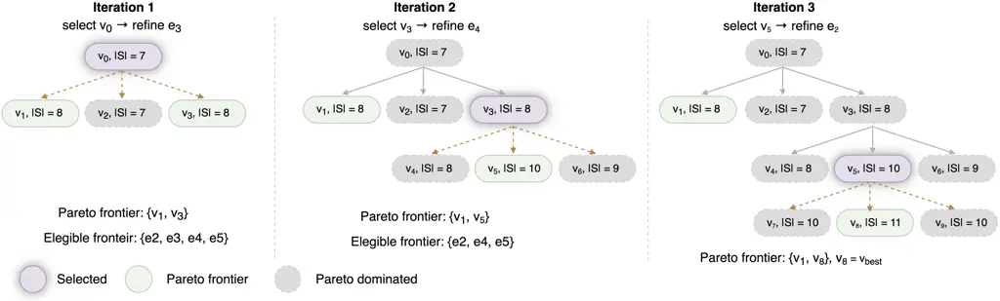
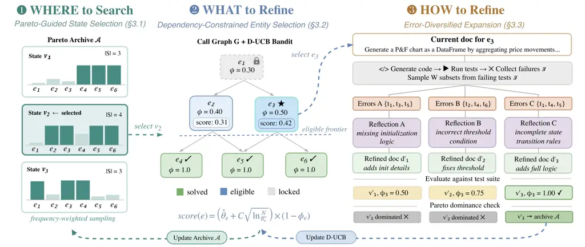
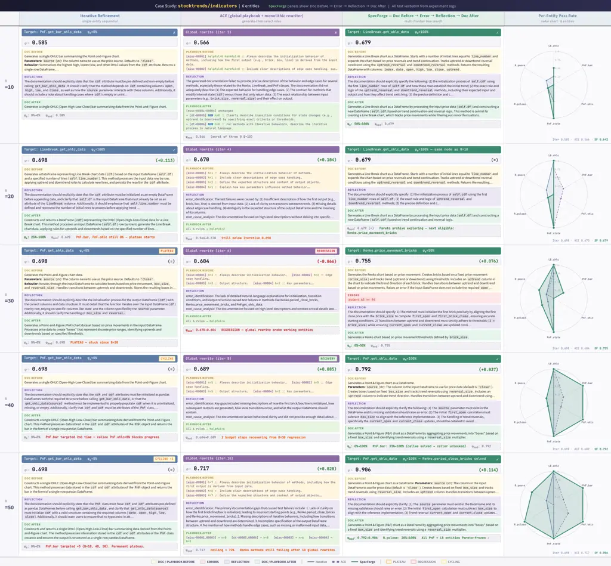

# SpecForge: Recursive Self-Improvement for Coding Agents via Behavioral Specifications

Yutong Cheng Affiliation: Virginia Tech
Email: [yutongcheng@vt.edu](mailto:)    Haifeng Chen Affiliation: NEC
Laboratories America Email: [penggao@vt.edu](mailto:)    Peng Gao
Affiliation: Virginia Tech Email: [haifeng@nec-labs.com](mailto:)    Wei
Cheng ^(†)^(†)thanks: Work done during the internship at NEC
Laboratories America. Corresponding author. Affiliation: NEC
Laboratories America Email: [weicheng@nec-labs.com](mailto:)

###### Abstract

Coding agents based on frozen language models can improve their
performance by refining the external context they rely on, without
updating model weights. In this paper, we study _recursive
self-improvement (RSI)_ through _behavioral specifications_:
natural-language code documentation that describes the behavior of
program entities and guides agents in generating correct code. We
formulate a self-improvement loop in which an agent generates code from
its current specifications, evaluates the generated code using
execution-verified tests, and refines the specifications based on
observed failures. The improved specifications then guide subsequent
code generation, allowing the agent to progressively improve its
understanding of the codebase. However, recursive refinement is
challenging because program entities are interdependent. Improving the
specification of one entity can inadvertently degrade the correctness of
others, a phenomenon we call _output coupling_. This creates a
_whack-a-mole_ effect in which local improvements cause regressions
elsewhere, preventing consistent progress. We introduce SpecForge, a
multi-frontier tree search framework that addresses this challenge
through three mechanisms: (i) Pareto-guided state selection preserves
complementary specification states and prevents premature commitment;
(ii) dependency-constrained entity selection prioritizes
callee-before-caller refinement; and (iii) error-diversified expansion
explores multiple refinements using different subsets of test failures.
On DevEval+, SpecForge achieves the best performance across five
backbone models, including a 94.9% solve rate with Claude-4.5-Sonnet and
a 5.7-percentage-point average improvement over the strongest baseline.
The improved specifications also make the agent better at tasks outside
the loop: they transfer to cross-language translation and to new-feature
implementation, where they outperform the benchmark-provided requirement
documents. The code and data are available at
[https://github.com/ccsnow127/SpecForge](https://github.com/ccsnow127/SpecForge).

## 1 Introduction

Large language models are increasingly used as autonomous coding agents.
Systems such as Cursor \[1\], Codex \[2\], and Claude Code \[3\] can
generate code, implement new features, and modify existing software with
limited human intervention. Their effectiveness, however, depends
heavily on how well they understand the behavior of the codebase they
work with. This understanding is essential for tasks such as
repository-level code generation  \[4, 5\], legacy system
migration \[6\], cross-language reimplementation  \[7, 8\], and
new-feature implementation \[9\]. One way to provide such understanding
is through _behavioral specifications_: natural-language code
documentation that describes what individual program entities (e.g.,
functions, classes, and methods) do, including their inputs, outputs,
and important behavioral constraints. Unlike traditional documentation
intended primarily for human readers, these specifications serve as
actionable knowledge that coding agents can use to generate and modify
code. Importantly, because specifications are expressed in natural
language, agents can also revise them based on feedback, creating an
opportunity for self-improvement without changing the underlying
language model.

This motivates _specification-mediated recursive self-improvement
(RSI)_, in which a coding agent iteratively improves its own behavioral
specifications using feedback from code generation and execution,
without modifying the underlying model weights. Starting from initial
specifications, the agent generates code conditioned on these
specifications alone and evaluates the generated implementations through
unit tests. Test failures reveal missing or ambiguous behavioral
information, which the agent uses to refine the specifications. The
refined specifications then guide the next round of code generation,
forming a recursive self-improvement loop. In our setting, the tests are
automatically generated from the reference implementation and validated
through execution, retaining only tests that pass. This provides
reliable, execution-grounded feedback without requiring human
annotations. Importantly, the objective is not to improve the
reconstructed code itself, but to produce more accurate behavioral
specifications. Their quality is measured not by readability or
similarity to human-written documentation \[10, 11\], but by whether an
agent can reconstruct behaviorally correct code from them. The resulting
specifications capture reusable knowledge of the existing codebase,
which can support downstream tasks such as cross-language translation
and new-feature implementation, even when no reference implementation of
the desired output is available.

Despite its promise, specification-based RSI faces a fundamental
challenge: _program entities are not independent_. Existing
language-space optimization methods, such as MIPROv2 \[12\],
GEPA \[13\], and ACE \[14\], demonstrate that language models can
improve their own context through iterative refinement and feedback
 \[15, 16\]. However, directly applying this approach to behavioral
specifications is difficult because changes to one entity can affect the
behavior of others. We refer to this phenomenon as _output coupling_. It
arises in two ways. First, _dependency coupling_ occurs when the
correctness of a caller depends on the behavior of its callees. Refining
a caller before its callees are correctly specified can therefore
produce misleading feedback. Second, _generation coupling_ occurs
because a coding model may condition on the entire specification bundle,
so modifying one specification can change how other entities are
generated, even without direct dependencies. Consequently, an update
that fixes one entity may break another, creating a _whack-a-mole_
effect: improvements are repeatedly undone by subsequent refinements,
and the optimization process may oscillate rather than converge. For
recursive self-improvement to be effective, it must therefore address
three requirements: preserving previous progress, respecting
dependencies between entities, and handling noisy or incomplete feedback
during refinement.

To address these challenges, we propose SpecForge, a _multi-frontier
tree search_ framework for recursive self-improvement through behavioral
specifications. Instead of following a single sequence of specification
revisions, SpecForge explores multiple candidate specification states
through three complementary mechanisms: ❶ Where to search: Pareto-guided
state selection maintains an archive of non-dominated specification
states with complementary strengths across program entities. This
preserves alternative refinement paths and prevents premature commitment
to a single solution. ❷ What to refine: Dependency-constrained entity
selection uses the program’s call graph to restrict refinement to
entities whose callees have already been resolved. A discounted-UCB
bandit then adaptively allocates the refinement budget among eligible
entities. ❸ How to refine: Error-diversified expansion generates
multiple refinement candidates from different subsets of failing tests,
allowing the search to explore alternative explanations for observed
failures and reducing sensitivity to noisy feedback. Together, these
mechanisms mitigate refinement interference and enable improvements to
accumulate across recursive iterations.

We evaluate SpecForge on DevEval+, where behavioral specification
quality is measured by the correctness of code reconstructed from the
generated specifications. Across five backbone language models,
SpecForge consistently outperforms strong documentation,
prompt-optimization, and coding-agent baselines. In particular, it
achieves a 94.9% solve rate with Claude-4.5-Sonnet and improves over the
strongest baseline by 5.7 percentage points on average. We further
evaluate whether the optimized specifications remain useful beyond the
original code-generation task. Results on cross-language translation and
new-feature implementation show that these specifications provide
reusable behavioral knowledge that improves coding-agent performance in
different software engineering settings. These findings suggest that
refining behavioral specifications provides a practical approach to
recursive self-improvement for coding agents, without requiring model
weight updates.

Our main contributions are summarized as follows:

- •
  We study _specification-mediated recursive self-improvement_ for
  coding agents, in which behavioral specifications are iteratively
  improved through code generation and execution feedback. We identify
  _output coupling_ as a central challenge that prevents naive iterative
  refinement from accumulating progress.
- •
  We introduce SpecForge, a dependency-guided multi-frontier tree search
  framework that combines Pareto-guided state selection,
  dependency-constrained entity selection, and error-diversified
  expansion to mitigate refinement interference and enable cumulative
  specification improvement.
- •
  We demonstrate that SpecForge consistently outperforms strong
  baselines on DevEval+ across five backbone models, and that its
  optimized specifications improve downstream cross-language translation
  and new-feature implementation.

## 2 Problem Formulation

We study _behavioral specification optimization_: given source code, the
goal is to produce, for every program entity, a natural-language
specification from which a code-generation model can reconstruct a
correct implementation without seeing the code. Unlike documentation,
whose objective is human readability, a specification is judged by
_downstream behavioral utility_—whether it contains enough precise
semantic information for an LLM to synthesize correct code.

Consider a code module with $`n`$ program entities
$`\mathcal{E}=\{e_{1},\ldots,e_{n}\}`$, such as functions, classes, or
methods. Let $`G=(\mathcal{E},E)`$ be the call graph, where
$`(e_{i},e_{j})\in E`$ indicates that entity $`e_{i}`$ invokes entity
$`e_{j}`$. For evaluation, we assume a set of unit tests
$`\mathcal{T}`$, and each test $`t\in\mathcal{T}`$ is attributed to a
target entity through a mapping
$`\alpha:\mathcal{T}\rightarrow\mathcal{E}`$. We denote by
$`\mathcal{T}_{i}=\{t\in\mathcal{T}:\alpha(t)=e_{i}\}`$ the tests
associated with entity $`e_{i}`$. Let
$`\mathcal{D}=(d_{1},\ldots,d_{n})`$ denote a specification bundle,
where $`d_{i}`$ is the specification for entity $`e_{i}`$. Given a code
generation model $`\mathcal{G}`$, the generated implementation for
entity $`e_{i}`$ is $`c_{i}=\mathcal{G}(\mathcal{D},e_{i})`$, and the
full generated module is
$`\mathcal{C}(\mathcal{D})=(c_{1},\ldots,c_{n})`$.

###### Definition 1 (Behavioral Specification Optimization).

The quality of the specification for entity $`e_{i}`$ is measured by its
entity pass rate
$`\phi_{i}(\mathcal{D})=\frac{1}{|\mathcal{T}_{i}|}\sum_{t\in\mathcal{T}_{i}}\mathbb{1}\!\left[\textsc{Pass}(c_{i},t)\right]`$.
An entity $`e_{i}`$ is _resolved_ under $`\mathcal{D}`$ if
$`\phi_{i}(\mathcal{D})=1`$. We write the resolved set as
$`\mathcal{S}(\mathcal{D})=\{e_{i}\in\mathcal{E}:\phi_{i}(\mathcal{D})=1\}`$.
The goal is to find the specification bundle that maximizes the number
of resolved entities:
$`\mathcal{D}^{*}=\arg\max_{\mathcal{D}}|\mathcal{S}(\mathcal{D})|`$.

In addition to the solved-set objective, we also use the pass-rate
vector
$`\boldsymbol{\phi}(\mathcal{D})=(\phi_{1}(\mathcal{D}),\ldots,\phi_{n}(\mathcal{D}))`$
to capture fine-grained per-entity progress, and the module-level pass
rate
$`\bar{\phi}(\mathcal{D})=\frac{1}{|\mathcal{T}|}\sum_{t\in\mathcal{T}}\mathbb{1}\!\left[\textsc{Pass}(c_{\alpha(t)},t)\right]`$
to measure overall behavioral correctness. This formulation yields a
black-box optimization problem over the space of natural-language
specifications: a candidate specification bundle can only be judged
through generated code and execution outcomes, while test failures
provide structured feedback about what the specifications failed to make
explicit.

##### Output Coupling.

The central challenge is that program entities cannot be optimized
independently. First, _dependency coupling_ arises because if $`e_{i}`$
calls $`e_{j}`$, then the correctness of $`c_{i}`$ depends on the
realized behavior of $`c_{j}`$. Second, _generation coupling_ arises
because the code generator conditions on the full specification bundle
$`\mathcal{D}`$, so changing $`d_{j}`$ may alter the generated code for
$`e_{i}`$ even without a direct call edge. Together, these effects
produce a _whack-a-mole_ phenomenon: refining the specification of one
entity may improve that entity while destabilizing others. Formal
definitions are deferred to Appendix §A.

##### Search Formulation.

The optimization is difficult because specification quality is only
observable _after_ code generation and execution. This makes behavioral
specification optimization a structured search problem over
specification states. Different partial solutions resolve different
subsets of entities, and these resolved subsets determine which
subsequent refinements are meaningful under dependency constraints.



Figure 1: Search tree view of behavioral specification optimization.
Each node is a specification state. Different states solve different
subsets of entities and therefore expose different eligible next
refinements. Rather than committing to a single rewrite trajectory, our
solution preserves multiple competitive frontiers and expands them
selectively.

## 3 Proposed Method

We propose SpecForge, a _multi-frontier tree search_ framework for
behavioral specification optimization. SpecForge instantiates the
self-improvement loop of §1 as search: each node is a specification
state evaluated by executing the code generated from it, each edge is
one self-revision driven by the failures of that code, and every
revision starts from a state that earlier revisions produced. Figure 1
illustrates the search process: specification optimization proceeds not
as a single rewrite trajectory, but as search over multiple partial
solutions with different future refinement opportunities. By managing
this search so that local refinements accumulate into stable global
progress, SpecForge directly targets the whack-a-mole behavior induced
by output coupling.

##### State Representation.

SpecForge organizes optimization as tree search over specification
states. A node is
$`v=(\mathcal{D}_{v},\boldsymbol{\phi}_{v},\mathcal{S}_{v})`$, where
$`\mathcal{D}_{v}`$ is the current specification bundle,
$`\boldsymbol{\phi}_{v}\in[0,1]^{n}`$ is the per-entity pass-rate
vector, and $`\mathcal{S}_{v}`$ is the set of resolved entities. An edge
$`v\xrightarrow{e}v^{\prime}`$ denotes refining exactly one entity
$`e`$:

```math
d^{\prime}_{e}\sim P_{\theta}(\cdot\mid d_{e},\mathcal{F}_{e}(v)),\qquad d^{\prime}_{i}=d_{i}\;\;\forall i\neq e, \tag{1}
```

where $`\mathcal{F}_{e}(v)`$ denotes the failure feedback for entity
$`e`$ at state $`v`$. This single-entity transition is the basic search
step in SpecForge: it keeps refinements localized, makes feedback easier
to attribute, and allows the method to explore multiple competing
partial solutions in parallel.

##### Multi-Frontier Tree Search.

Starting from a root node $`v_{0}`$ corresponding to the initial
specifications, SpecForge maintains a Pareto archive $`\mathcal{A}`$ of
non-dominated states (initialized as $`\{v_{0}\}`$) together with a
shared entity-selection bandit. Each iteration resolves three coupled
decisions: _where_ to search (§3.1), _what_ to refine (§3.2), and _how_
to refine (§3.3). Concretely, the iteration (i) samples a parent node
$`v`$ from $`\mathcal{A}`$; (ii) selects an eligible entity $`e`$ to
refine via a discounted-UCB policy over per-entity gap-closing rates;
and (iii) expands $`v`$ into $`W`$ children, each obtained by
substituting a refined specification $`d^{\prime}_{e}`$ into
$`\mathcal{D}_{v}`$, regenerating the code of the full module from the
updated specifications, and re-evaluating the full test suite to produce
$`\boldsymbol{\phi}_{v^{\prime}}`$. The $`W`$ children are then folded
back into both upper levels: non-dominated children enter
$`\mathcal{A}`$, introducing new frontier diversity for future state
selection, and the best child’s $`\Delta\phi_{e}`$ updates the bandit
for future entity selection. Once $`B`$ iterations, SpecForge returns
the specification bundle $`\mathcal{D}_{v}`$ achieving the largest
$`|\mathcal{S}|`$ over all visited states. Figure 2 and Algorithm 1
summarize the procedure.



Figure 2: Overview of SpecForge. Each iteration resolves three
decisions: _where_ to search, _what_ to refine, and _how_ to refine. ❶
Pareto-guided state selection samples from an archive of non-dominated
specification states with complementary strengths. ❷
Dependency-constrained entity selection only refines entities whose
callees are already solved. ❸ Error-diversified expansion generates
multiple children from different subsets of failing tests. Strong
children are fed back into both the archive and the entity-selection
policy.

### 3.1 Pareto-Guided State Selection

The first step is to decide where to search next, i.e., which previously
visited state to expand. Because improving one entity may degrade
another, scalar ranking is often too coarse. We therefore maintain an
archive $`\mathcal{A}`$ of non-dominated states under coordinate-wise
dominance over pass-rate vectors:

```math
\boldsymbol{\phi}_{v^{\prime}}\succeq\boldsymbol{\phi}_{v}\quad\Longleftrightarrow\quad\phi_{i}(\mathcal{D}_{v^{\prime}})\geq\phi_{i}(\mathcal{D}_{v})\;\;\text{for all }i. \tag{2}
```

A new child enters the archive if no existing state dominates it; any
states that it dominates are removed. This archive preserves
_complementary frontier states_. One state may already solve low-level
utility entities, while another may have progressed further on
higher-level orchestration logic. Crucially, different archive states
induce different feasible next refinements because they solve different
subsets of entities. Maintaining multiple such states prevents premature
commitment to one unstable trajectory and thus helps to escape local
optima (refer to §B.1 for detailed analysis).

##### Frequency-Weighted Sampling.

To select which archive node to expand, we sample from the Pareto front
of $`\mathcal{A}`$ (Algorithm 2). For each entity $`e_{i}`$, we identify
the archive node(s) attaining the highest $`\phi_{i}`$ and assign credit
to those node(s), splitting it evenly in the case of ties. A node’s
sampling weight is the total credit it accumulates across entities. This
biases expansion toward nodes that are frontier-best on more entity-wise
dimensions, thereby preserving complementary search frontiers rather
than collapsing prematurely to a single trajectory.

### 3.2 Dependency-Constrained Entity Selection

Given a selected state $`v`$, the second step decides _what_ entity to
refine. Refining a caller before its callees are stabilized often yields
misleading feedback. We therefore restrict candidates to an _eligibility
frontier_:

```math
\mathcal{E}_{\textup{elig}}(v)=\big\{e\in\mathcal{E}:e\notin\mathcal{S}_{v},\;\forall(e,e_{j})\in E,\;e_{j}\in\mathcal{S}_{v}\big\}. \tag{3}
```

That is, an entity is eligible only if it remains unsolved and all of
its callees are already resolved. This enforces a callee-before-caller
refinement order and mitigates dependency-induced interference.
Recursive calls are handled by contracting each strongly connected
component into a jointly refined meta-entity (Appendix C.1).

When multiple entities are eligible, SpecForge allocates budget
adaptively using a discounted UCB policy \[17\]. The key reward is
normalized by the remaining gap:
$`\hat{r}_{e}=\frac{\Delta\phi_{e}}{1-\phi_{e}(\mathcal{D}_{v})}`$,
where $`\Delta\phi_{e}`$ is the observed improvement after refining
entity $`e`$ at the selected state $`v`$, and
$`\phi_{e}(\mathcal{D}_{v})`$ is the pass rate of $`e`$ at $`v`$. This
separates intrinsic repairability from the trivial effect of having a
large remaining error. The resulting score is

```math
\textup{score}(e)=\underbrace{\left(\hat{\theta}_{e}+C\sqrt{\frac{\ln N_{\gamma}}{n_{\gamma}(e)}}\right)}_{\textup{UCB estimate of gap-closing rate}}\times\underbrace{(1-\phi_{e}(\mathcal{D}_{v}))}_{\textup{remaining gap}}, \tag{4}
```

where $`n_{\gamma}(e)`$ is the discounted pull count of entity $`e`$,
$`N_{\gamma}=\sum_{e^{\prime}}n_{\gamma}(e^{\prime})`$ is the total
discounted pull count over all entities, and $`\hat{\theta}_{e}`$ is the
discounted empirical mean of $`\hat{r}_{e}`$, i.e., the estimated
gap-closing rate of refining $`e`$ under the current search regime
(detailed in Appendix C.2). The bandit maintains a single set of
statistics shared across all state nodes, with discounting ensuring that
estimates remain responsive as the search context evolves. The policy
therefore balances uncertainty, past success, and remaining improvement
potential.

### 3.3 Error-Diversified Expansion

Given a selected state $`v`$ and entity $`e`$, the third step expands
$`v`$ into $`W`$ child states, each representing a distinct refinement
of $`d_{e}`$. The key challenge is that failing tests are diagnostically
heterogeneous: some directly expose the behavioral detail missing from
the specification, while others are redundant, weakly informative, or
induced by cascading dependency errors. This is consistent with prior
findings that test cases differ substantially in fault-localization
value, LLM-generated tests often cluster around similar patterns, and
adding more tests can even hurt diagnosis when uninformative cases
dilute the signal \[18, 19, 20\]. More broadly, LLMs are known to be
sensitive to irrelevant or noisy context in both in-context learning and
RAG settings \[21, 22, 23\].

Formally, let $`\mathcal{F}_{e}(v)`$ denote the failing tests for entity
$`e`$ at state $`v`$, and suppose it admits an unknown partition
$`\mathcal{F}_{e}(v)=\mathcal{F}_{e}^{+}\cup\mathcal{F}_{e}^{-}`$, where
$`\mathcal{F}_{e}^{+}`$ contains informative failures and
$`\mathcal{F}_{e}^{-}`$ noisy ones. Let
$`q(\mathbf{e})=P(\text{successful refinement}\mid\mathbf{e})`$ denote
the success probability when conditioning on an error batch
$`\mathbf{e}`$. The key point is that noise is not merely unhelpful but
actively corrupting: under mild assumptions, mixing noisy failures into
an informative batch strictly degrades refinement quality, i.e., for any
nonempty $`\mathbf{e}^{+}\subseteq\mathcal{F}_{e}^{+}`$ and
$`\mathbf{e}^{-}\subseteq\mathcal{F}_{e}^{-}`$,
$`q(\mathbf{e}^{+}\cup\mathbf{e}^{-})<q(\mathbf{e}^{+})`$ when
$`|\mathbf{e}^{-}|>0`$ (Appendix §B.2).

Since the partition is unknown, SpecForge hedges by sampling $`W`$
distinct subsets $`\{\mathbf{e}_{1},\ldots,\mathbf{e}_{W}\}`$ from
$`\mathcal{F}_{e}(v)`$ and generating one refinement candidate per
subset. If at least one sampled batch is cleaner than the full failure
set, diversified expansion achieves strictly higher _best one-step
branch quality_ than repeatedly conditioning all $`W`$ branches on
$`\mathcal{F}_{e}(v)`$. Formally, if there exists
$`j^{\star}\in\{1,\ldots,W\}`$ such that
$`q(\mathbf{e}_{j^{\star}})>q(\mathcal{F}_{e}(v))`$, then Appendix §B.3
shows

```math
\max_{1\leq j\leq W}q(\mathbf{e}_{j})\;>\;\max_{1\leq j\leq W}q(\mathcal{F}_{e}(v))\;=\;q(\mathcal{F}_{e}(v)). \tag{5}
```

The gain arises not from improving every branch, but from increasing the
chance that _at least one_ branch is conditioned on a diagnostically
cleaner signal than the full failure set. Implementation details are
given in Appendix C.3.

## 4 Experiments

Our experiments test the claims behind specification-mediated
self-improvement: that improvements accumulate instead of oscillating
(§4.2 and §4.3), that each component of SpecForge contributes to the
stability of the loop (§4.4), and that the improved specifications make
the agent better at tasks outside the loop (§4.5).

### 4.1 Setup

Benchmark. We evaluate SpecForge on DevEval+, a benchmark for evaluating
behavioral specifications through code reconstruction and
execution-based verification across modules with complex inter-entity
dependencies. It consists of 20 Python modules, 247 entities, and 760
test cases. The modules are drawn from DevEval \[5\] and supplemented
with additional GitHub repositories to broaden domain coverage,
including finance, biological analysis, and signal processing. DevEval+
is structurally nontrivial, with an average dependency depth of 4.2,
making it a suitable testbed for studying output coupling under
repository-scale generation (full details in Appendix H).

|                                       |                 |             |                  |                |        |             |                |                |                   |             |
| ------------------------------------- | --------------- | ----------- | ---------------- | -------------- | ------ | ----------- | -------------- | -------------- | ----------------- | ----------- | --- | -------------- | --- | ----------- | --- | -------------- | --- | ----------- | --- | -------------- |
|                                       | Qwen3-235B-A22B |             | Gemini-2.5-Flash |                | GPT-4o |             | Gemini-3.1-Pro |                | Claude-4.5-Sonnet |             |
| Method                                | $`              | \mathcal{S} | `$               | $`\bar{\phi}`$ | $`     | \mathcal{S} | `$             | $`\bar{\phi}`$ | $`                | \mathcal{S} | `$  | $`\bar{\phi}`$ | $`  | \mathcal{S} | `$  | $`\bar{\phi}`$ | $`  | \mathcal{S} | `$  | $`\bar{\phi}`$ |
| Static Methods (No Optimization)      |                 |             |                  |                |        |             |                |                |                   |             |
| RepoAgent                             | 22.3            | 34.9        | 19.2             | 30.6           | 27.8   | 39.9        | 33.7           | 45.5           | 35.3              | 47.3        |
| DocAgent                              | 16.1            | 31.1        | 14.5             | 27.2           | 22.2   | 37.2        | 26.8           | 41.8           | 28.9              | 44.7        |
| Prompt Optimization (Monolithic)      |                 |             |                  |                |        |             |                |                |                   |             |
| MIPROv2                               | 28.5            | 30.4        | 30.3             | 32.3           | 29.8   | 31.4        | 42.8           | 43.8           | 50.0              | 52.0        |
| GEPA                                  | 34.8            | 35.6        | 32.1             | 33.1           | 35.6   | 37.6        | 40.7           | 42.5           | 50.4              | 52.9        |
| ACE                                   | 58.9            | 59.8        | 61.5             | 62.4           | 62.8   | 64.3        | 68.6           | 70.1           | 74.9              | 76.6        |
| Coding Agents (Commercial)            |                 |             |                  |                |        |             |                |                |                   |             |
| Cursor                                | –               | –           | 15.8             | 25.1           | –      | –           | 27.5           | 37.1           | 30.6              | 40.0        |
| \+ Topo                               | –               | –           | 21.2             | 30.6           | –      | –           | 37.6           | 46.6           | 37.7              | 46.7        |
| + Test                                | –               | –           | 31.0             | 39.0           | –      | –           | 44.9           | 50.8           | 47.8              | 52.3        |
| \+ Topo + Test                        | –               | –           | 39.4             | 46.3           | –      | –           | 51.1           | 56.4           | 52.1              | 56.8        |
| Claude Code                           | –               | –           | –                | –              | –      | –           | –              | –              | 40.1              | 50.1        |
| \+ Topo                               | –               | –           | –                | –              | –      | –           | –              | –              | 45.1              | 55.0        |
| + Test                                | –               | –           | –                | –              | –      | –           | –              | –              | 55.3              | 62.2        |
| \+ Topo + Test                        | –               | –           | –                | –              | –      | –           | –              | –              | 61.9              | 68.4        |
| Iterative Refinement (Entity-wise)    |                 |             |                  |                |        |             |                |                |                   |             |
| Iterative                             | 41.0            | 45.0        | 37.8             | 45.1           | 49.7   | 53.8        | 57.5           | 59.9           | 59.5              | 60.6        |
| \+ Topo                               | 43.5            | 46.8        | 40.5             | 46.9           | 54.3   | 57.9        | 67.5           | 68.8           | 64.4              | 64.5        |
| Behavioral Specification Optimization |                 |             |                  |                |        |             |                |                |                   |             |
| DocSearch^(†)                         | 81.5            | 84.9        | 82.2             | 85.7           | 85.5   | 88.4        | 87.2           | 89.5           | 90.4              | 91.8        |
| SpecForge (ours)                      | 88.9            | 91.5        | 89.6             | 92.1           | 90.9   | 93.2        | 91.0           | 93.1           | 94.9              | 96.1        |

Table 1: Main results on DevEval+.

Baselines. We compare SpecForge against five groups of baselines:

- •
  Static documentation methods: RepoAgent \[10\] and DocAgent \[11\],
  which generate human-oriented documentation without execution
  feedback; we evaluate their documentation in the specification role.
- •
  Prompt optimization methods: MIPROv2 \[12\], GEPA \[13\], and
  ACE \[14\], which optimize the instruction context used to generate
  specifications, rewriting the full specification bundle monolithically
  at each iteration based on code-generation feedback.
- •
  Commercial coding agents: Cursor \[1\] and Claude Code \[3\],
  evaluated in four variants: (1) *base*, using default settings;
  (2) *+Topo*, which supplies reverse topological order as additional
  context; (3) *+Test*, which prompts the agent to generate tests and
  iteratively refine code; and (4) *+Topo+Test*, which combines both
  augmentations.¹¹ 1 Cursor supports Gemini-2.5-Flash, Gemini-3.1-Pro,
  and Claude-4.5-Sonnet, but not Qwen3-235B-A22B or GPT-4o; Claude Code
  supports only Claude models. Missing entries in Table 1 follow from
  these platform constraints.
- •
  Iterative refinement baselines: Sequential refinement with execution
  feedback, using either random entity selection (Iterative) or reverse
  topological order (Iterative+Topo).
- •
  Behavioral specification optimization: DocSearch \[24\], the only
  baseline that optimizes the same objective, formulated there as
  agent-oriented documentation generation: the text is optimized for the
  correctness of code generated from it, under execution feedback. It
  performs a dependency-guided bi-level search that refines entities in
  reverse topological order with error-diversified beam expansion, and
  commits a refinement only if no entity regresses. We run the official
  implementation on DevEval+; see §G for details.

^(\$\dagger\$)^(\$\dagger\$)footnotetext: We re-run DocSearch \[24\]
with its official implementation under the protocol of this paper on the
revised DevEval+ release. This release, designed to stress-test
SpecForge with larger modules, denser test suites, and additional corner
cases, thus yields DocSearch scores that deviate modestly (by 5.6 points
on average) from those reported in its original paper.

Across all methods, final performance is evaluated with ground-truth
test suites that remain hidden from the search procedure. During
optimization, methods receive only LLM-generated tests. Additional
details on test generation appear in §J, while implementation details
and prompts for all baselines are provided in §G. Additional
experiments, such as the fidelity of the self-generated improvement
signal (§E) and module-level case studies (§D), are included in the
Appendix.

Metrics. We report two complementary metrics: Solve Rate
$`|\mathcal{S}|`$, the proportion of entities achieving all tests
passed, and Pass Rate $`\bar{\phi}`$, the fraction of test cases passed
across the entire module. The former measures complete per-entity
correctness; the latter provides a finer-grained, continuous measure of
progress at the test-case level.

### 4.2 Main Results

Table 1 presents comprehensive comparisons across methods and base LLMs
(50 rollouts). SpecForge achieves the highest solve rates across all
models: 88.9% with Qwen3-235B-A22B, 89.6% with Gemini-2.5-Flash, 90.9%
with GPT-4o, 91.0% with Gemini-3.1-Pro, and 94.9% with
Claude-4.5-Sonnet. The results reveal a clear hierarchy of failure
modes. Static methods (14.5–35.3%) expose a _documentation–specification
gap_: documentation optimized for human readability appears imprecise
about behavior to serve as a specification for code-synthesis models,
which interpret underspecified phrases literally but resolve ambiguities
unpredictably. Monolithic prompt optimizers improve substantially—ACE
reaches 62.8% on GPT-4o via its generate-reflect-curate pipeline—but
suffer from _attribution failure_ (cannot identify which entity caused a
test failure) and _coupling amplification_ (a single rewrite alters all
entities simultaneously). Commercial agents with full augmentation
(Cursor+Topo+Test: 52.1%, Claude Code+Topo+Test: 61.9% on
Claude-4.5-Sonnet) confirm that topological ordering and test feedback
are valuable signals, yet both still trail SpecForge by 33.0–42.8%.
Iterative refinement with topological ordering reaches 54.3% on GPT-4o
but plateaus due to the whack-a-mole phenomenon: without Pareto
archiving and diversified exploration, correct ordering alone cannot
overcome interference at the same topological level. DocSearch is the
strongest baseline (81.5–90.4%) and the only one that optimizes the same
objective. It already orders refinement callee-before-caller and
diversifies the error context, but it follows a single search path and
commits a refinement only if no entity regresses. SpecForge exceeds it
on every backbone, by 3.8–7.4 points in solve rate (5.7 on average) and
3.6–6.6 points in pass rate. The margin is largest on the two weakest
backbones (7.4 points on both Qwen3-235B-A22B and Gemini-2.5-Flash) and
narrows to 3.8–4.5 points on the two strongest, consistent with the role
of the Pareto archive: when no candidate passes a no-regression test, a
single-path search must abandon the entity, whereas SpecForge can
continue from another frontier. The improvement pattern is remarkably
consistent across LLMs: despite substantial differences in base
capability, SpecForge delivers absolute solve-rate gains of 23.5–49.1
percentage points over the best iterative baseline across all models,
consistent with the hypothesis that the method targets a broadly shared
structural difficulty.

Figure 3: Convergence analysis (GPT-4o, DevEval+). (a) Iterative
refinement baselines oscillate due to refinement interference.
(b) Monolithic methods exhibit catastrophic instability. SpecForge
achieves steady upward progress in both comparisons. (c) Ablation study
(GPT-4o, 10-module subset). Components ordered by contribution (large to
small); dashed lines mark the full model ($`|\mathcal{S}|{=}90.9\%`$,
$`\bar{\phi}{=}93.2\%`$). Reverse topological ordering is the largest
single contributor ($`-18.6\%`$).

### 4.3 Token Budget Efficiency Analysis

Figure 3 plots cross-module average pass rate $`\bar{\phi}`$ against
budget step, evaluated on ground-truth tests at every 10 rollouts. Among
entity-wise methods (Figure 3(a)), Iterative refinement oscillates
between 45–54% as random entity selection triggers generation
coupling—modifying one entity’s specification perturbs code generation
for unrelated entities. Iterative+Topo eliminates the most direct
interference by enforcing callee-before-caller order, rising to 57% by
$`B{=}20`$, but plateaus once all remaining candidates are callers at
the same topological level where sibling coupling persists. Among
monolithic methods (Figure 3(b)), MIPROv2 plateaus at 31% by $`B{=}20`$
as its Bayesian surrogate exhausts the candidate space under
single-instance optimization; GEPA peaks at 37% ($`B{=}20`$) then
declines monotonically to 24% because its graph evolution lacks
running-best retention, making exploration into worse regions
irreversible; ACE reaches the highest monolithic score (64%) but
exhibits repeated regressions (e.g., $`38\%`$ to $`30\%`$ between
$`B{=}10`$ and $`20`$) where each monolithic rewrite simultaneously
fixes and breaks entities, recovering only through playbook accumulation
of failure-derived rules. SpecForge rises steadily from 41% to 93%
across both panels: the steepest gains occur in the first 10 rollouts
($`+29\%`$) as D-UCB exploration combined with topological constraints
rapidly solves leaf entities, with diminishing but sustained progress
thereafter as the Pareto archive preserves complementary frontier
states, converting exploration cost into eventual progress rather than
permanent regression.

### 4.4 Component Contribution Analysis

Figure 4: (Left) Cross-language translation. Optimized specifications
($`+26.0\%`$ over Source-only) transfer effectively across languages;
combining specifications with source code achieves the best results
(76.2%). (Right) New-feature implementation on SWE-Dev.
SpecForge-generated specifications surpass the default PRD provided by
the SWE-Dev benchmark, achieving the highest pass rate on both
difficulty levels despite never accessing the PRD or target tests.

Figure 3(c) isolates each component’s contribution. Reverse topological
order ($`-18.6\%`$) is the structural foundation: without dependency
constraints, the search refines callers before their callees are
stabilized, allowing interference to propagate through the entire call
chain. D-UCB bandit ($`-10.4\%`$) demonstrates that adaptive budget
allocation is critical: its gap-closing rate estimate
$`\hat{\theta}_{e}`$ learns entity-level repairability and directs
budget accordingly. Error diversity ($`-9.5\%`$) addresses exploration
collapse: diversified batch sampling increases the probability of
encountering informative error combinations (Appendix §D). Pareto
archive ($`-5.2\%`$) preserves frontier diversity, enabling recovery
from suboptimal early refinements; its value increases on harder modules
with deeper dependency chains.

### 4.5 Downstream Utility of Optimized Specifications

We evaluate whether SpecForge-optimized specifications transfer beyond
the original code-generation setting through two downstream tasks:
cross-language translation (§4.5.1) and new-feature implementation
(§4.5.2). Both tasks compare the outputs of four methods from the main
evaluation—RepoAgent, Claude Code^(∗)²² 2 Claude Code^(∗) denotes the
+Topo+Test configuration running on Claude-4.5-Sonnet, as Claude Code
does not support GPT-4o., ACE, and SpecForge—with GPT-4o as the
code-generation backbone.

#### 4.5.1 Cross-Language Translation

Experimental Setup. We evaluate cross-language transfer on
DevEval+-Java, a JUnit 5 test harness covering a 16-module subset of
DevEval+ (208 entities, 680 test cases). We exclude modules whose Python
implementations depend on libraries without direct Java equivalents.
Each harness mirrors the original Python tests, preserving input data
and expected outputs to ensure semantic equivalence (Appendix H.6). We
evaluate Source-only translation (Python source $`\to`$ Java, no
specification) alongside the four methods above. For SpecForge we
additionally test a Spec+Source variant that provides both the
specification and the source code.

Results and Analysis. Figure 4(left) reports both solve rate
$`|\mathcal{S}|`$ and pass rate $`\bar{\phi}`$ for each condition.
Source-only translation achieves $`39.7\%`$ / $`50.5\%`$
($`|\mathcal{S}|`$ / $`\bar{\phi}`$), while static documentation
(RepoAgent, $`33.5\%`$ / $`44.6\%`$) performs _worse_ on both
metrics—imprecise human-oriented descriptions introduce ambiguities
absent from source code. Performance improves steadily with optimization
sophistication: Claude Code^(∗) ($`45.9\%`$ / $`53.1\%`$), ACE
($`49.7\%`$ / $`56.0\%`$), and SpecForge ($`65.7\%`$ / $`71.3\%`$,
$`+26.0\%`$ solve rate over Source-only). Per-entity optimization
produces precise behavioral specifications describing _what_ each
function computes rather than _how_ it computes in Python, freeing the
LLM to choose Java-appropriate implementations. The Spec+Source
combination achieves the best results ($`76.2\%`$ / $`80.4\%`$), as
specifications and source code provide complementary “what” and “how”
signals. The quality gradient (static $`<`$ commercial $`<`$ monolithic
$`<`$ entity-wise) is preserved across languages, confirming that
SpecForge’s precision reflects higher-quality behavioral specifications.

#### 4.5.2 New Feature Implementation

Whereas cross-language translation evaluates specifications on
_re-implementing_ existing code in a different language, real-world
development more often requires implementing _new_ functionality atop an
existing codebase, with specifications of the existing code as guidance.
We therefore evaluate on SWE-Dev \[9\], a benchmark in which an LLM must
implement new functions—specified by a Product Requirements Document
(PRD)—within real open-source packages, validated against
developer-written test suites.

Experimental Setup. We select 10 packages from SWE-Dev, comprising
27 feature-implementation instances (15 easy and 12 hard). For each
package, we run all four methods on the _existing_ source code to
produce behavioral specifications of the current codebase; these
specifications are then provided as context when the LLM implements new
functions. We compare two conditions, which share the stubbed source and
differ only in the accompanying text (Appendix I): (i) Spec+Source:
stubs paired with the signature and docstring of each target function,
plus the specifications of the existing codebase produced by each of the
four methods; (ii) PRD+Source: stubs paired with the default PRD
provided by the SWE-Dev benchmark. We report Pass@1 following SWE-Dev’s
evaluation protocol, broken down by difficulty level.

Results and Analysis. Figure 4(right) reports Pass@1 broken down by
difficulty level. Among the four methods, the quality gradient observed
in the main evaluation and cross-language experiments persists:
RepoAgent (22.0% easy, 14.0% hard), Claude Code\* (38.0%, 27.0%), and
ACE (50.0%, 38.0%) yield progressively larger improvements, while
SpecForge achieves the highest performance (74.5% easy, 51.7% hard),
surpassing even the SWE-Dev reference PRD (55.7% easy, 44.6% hard) by
+18.8 and +7.1 percentage points, respectively. Appendix I further
analyzes why SpecForge outperforms the PRD.

## 5 Related Work

Recursive Self-Improvement. Self-improving LLM systems differ first in
the substrate into which an improvement is written. _Weight-space_
methods write into model parameters: the model is fine-tuned on data it
generated itself \[25, 26\], on rewards derived from its own
outputs \[27\], or on rewards from a grounded environment \[28\]. The
gain is amortized across tasks, but it cannot be read, diffed, or
reverted. _Context-space_ methods keep the weights frozen and write into
the harness instead, through verbal self-refinement \[29, 30, 16\],
prompt search and textual gradients \[15, 31, 32, 33, 12, 13\],
experience memory \[14\], skill and tool synthesis \[34\], or search
over the whole scaffold \[35\]; at the frontier, the procedure that
performs the update is itself rewritten \[36, 37, 38\]. The improvement
signal ranges from the model’s own judgment \[39, 40\] to external
verifiers such as tests \[41, 42, 43\], compilers \[44, 45\], and
environments \[34, 46\]. SpecForge is a context-space method with an
execution-based improvement signal and a fixed update procedure. The key
difficulty in such a recursive self-improvement loop is that behavioral
specifications are inherently coupled through the code generated from
them, so that an improvement to one can cause a global regression and
make the iterative process oscillate.

Coding Agents. Coding is among the most rapidly advancing capabilities
of LLM agents, in large part because code is executable, verifiable, and
searchable: a candidate can be run, checked against tests, and improved
by search. Agents such as Cursor, Codex, and Claude Code \[1, 2, 3\] now
resolve issues and implement features across entire repositories \[47,
48, 4, 5, 9\]. The same property is carrying agents beyond conventional
software, wherever the artifact can be expressed as a program or other
interpretable text: games \[49\], explanatory videos rendered from
animation code \[50, 51\], 3D scenes written as Blender scripts \[52\],
and symbolic music \[53\]. SpecForge is complementary to these agents:
it supplies behavioral specifications that a coding agent can condition
on, which in our experiments improve cross-language translation and
new-feature implementation (§4.5).

Code Documentation. Documentation generation has evolved from
template-based heuristics \[54, 55, 56\] through neural
summarization \[57, 58\] to modern LLM-based repository-level
approaches. RepoAgent \[10\] extracts structural patterns from
repositories to generate API references with hierarchical organization,
while DocAgent \[11\] employs retrieval-augmented generation to produce
context-aware explanations grounded in relevant code snippets. Both
optimize for subjective quality metrics—clarity, completeness, and
helpfulness—evaluated through human assessment or proxy metrics like
BLEU scores against reference documentation. These approaches uniformly
assume documentation serves human developers and measure quality through
readability heuristics rather than downstream task performance. See
Appendix K for further related work.

## 6 Conclusion

We presented SpecForge, a multi-frontier tree search framework that
makes specification-mediated self-improvement stable and compounding. A
frozen coding agent improves by rewriting the behavioral specifications
in its harness from the failures of the code it writes from them; unlike
documentation written for human readers, a specification is judged only
through the code it induces. Within this formulation, the central
challenge is _output coupling_: because generated entities are
behaviorally interdependent, locally beneficial refinements can trigger
global regressions, rendering standard monolithic or sequential
refinement unstable. SpecForge addresses this challenge through
Pareto-guided frontier preservation, dependency-constrained entity
selection, and error-diversified expansion, enabling stable progress
under coupled search dynamics. Empirically, it consistently outperforms
strong baselines on DevEval+, exhibits superior search efficiency and
robustness, and produces specifications that improve downstream
performance in both cross-language translation and new-feature
implementation, indicating that what the loop improves is reusable
knowledge of the codebase rather than a fit to the tests that guided it.

## References

- \[1\] Anysphere. Cursor: The AI Code Editor.
  [https://cursor.com/](https://cursor.com/), 2025.
- \[2\] OpenAI. Introducing Codex.
  [https://openai.com/index/introducing-codex/](https://openai.com/index/introducing-codex/), 2025.
- \[3\] Anthropic. Claude Code.
  [https://code.claude.com/docs/en/overview](https://code.claude.com/docs/en/overview), 2025.
- \[4\] Fengji Zhang, Bei Chen, Yue Zhang, Jacky Keung, Jin Liu,
  Daoguang Zan, Yi Mao, Jian-Guang Lou, and Weizhu Chen. RepoCoder:
  Repository-level code completion through iterative retrieval and
  generation. In EMNLP, 2023.
- \[5\] Bowen Li, Wenhan Wu, Ziwei Tang, Lin Shi, John Yang, Jinyang Li,
  Shunyu Yao, Chen Qian, Binyuan Hui, Qicheng Zhang, et al. Prompting
  large language models to tackle the full software development
  lifecycle: A case study. In COLING, 2025.
- \[6\] Robert C. Seacord, Daniel Plakosh, and Grace A. Lewis.
  Modernizing Legacy Systems: Software Technologies, Engineering Process
  and Business Practices. Addison-Wesley Longman Publishing Co.,
  Inc., 2003.
- \[7\] Baptiste Roziere, Marie-Anne Lachaux, Lowik Chanussot, and
  Guillaume Lample. Unsupervised translation of programming languages.
  In NeurIPS, 2020.
- \[8\] Rangeet Pan, Ali Reza Ibrahimzada, Rahul Krishna, Divya Sankar,
  Lambert Pouguem Wassi, Michele Merler, Boris Sobolev, Raju Pavuluri,
  Saurabh Sinha, and Reyhaneh Jabbarvand. Lost in translation: A study
  of bugs introduced by large language models while translating code. In
  ICSE, 2024.
- \[9\] Yaxin Du, Yuzhu Cai, Yifan Zhou, Cheng Wang, Yu Qian, Xianghe
  Pang, Qian Liu, Yue Hu, and Siheng Chen. Swe-dev: Evaluating and
  training autonomous feature-driven software development. arXiv, 2026.
- \[10\] Qinyu Luo, Yining Ye, Shihao Liang, Zhong Feng, et al.
  Repoagent: An llm-powered open-source framework for repository-level
  code documentation generation. arXiv preprint arXiv:2402.16667, 2024.
- \[11\] Dayu Yang, Antoine Simoulin, Xin Qian, Xiaoyi Liu, Yuwei Cao,
  Zhaopu Teng, and Grey Yang. DocAgent: A multi-agent system for
  automated code documentation generation. In ACL, pages 460–471, 2025.
- \[12\] Krista Opsahl-Ong, Michael J Ryan, Josh Purtell, David Broman,
  Christopher Potts, Matei Zaharia, and Omar Khattab. Optimizing
  instructions and demonstrations for multi-stage language model
  programs. In EMNLP, 2024.
- \[13\] Lakshya A Agrawal, Shangyin Tan, Dilara Soylu, Noah Ziems,
  Rishi Khare, Krista Opsahl-Ong, Arnav Singhvi, Herumb Shandilya,
  Michael J Ryan, Meng Jiang, Christopher Potts, Koushik Sen,
  Alexandros G. Dimakis, Ion Stoica, Dan Klein, Matei Zaharia, and Omar
  Khattab. Gepa: Reflective prompt evolution can outperform
  reinforcement learning. In ICLR, 2026.
- \[14\] Qizheng Zhang, Changran Hu, Shubhangi Upasani, Boyuan Ma,
  Fenglu Hong, Vamsidhar Kamanuru, Jay Rainton, Chen Wu, Mengmeng Ji,
  Hanchen Li, Urmish Thakker, James Zou, and Kunle Olukotun. Agentic
  context engineering: Evolving contexts for self-improving language
  models. In ICLR, 2026.
- \[15\] Chengrun Yang, Xuezhi Wang, Yifeng Lu, Hanxiao Liu, Quoc V. Le,
  Denny Zhou, and Xinyun Chen. Large language models as optimizers. In
  ICLR, 2024.
- \[16\] Xidong Feng, Ziyu Wan, Mengyue Yang, Ziyan Wang, Girish A.
  Koushik, Yali Du, Ying Wen, and Jun Wang. Natural language
  reinforcement learning, 2024.
- \[17\] Aurélien Garivier and Eric Moulines. On upper-confidence bound
  policies for switching bandit problems. In COLT, ALT’11, page 174–188,
  Berlin, Heidelberg, 2011. Springer-Verlag.
- \[18\] Kefan Li and Yuan Yuan. Large language models as test case
  generators: Performance evaluation and enhancement.
  arxiv:2404.13340, 2024.
- \[19\] Bo Jiang, Zhenyu Zhang, T. H. Tse, and T. Y. Chen. How well
  does test case prioritization integrate with statistical fault
  localization? IEEE COMPSAC, July 2009.
- \[20\] Kecheng Wang, Tiantian Wang, and Xiaohong Su. Test case
  selection using multi-criteria optimization for effective fault
  localization. Computing, 2018.
- \[21\] Freda Shi, Xinyun Chen, Kanishka Misra, Nathan Scales, David
  Dohan, Ed Chi, Nathanael Schärli, and Denny Zhou. Large language
  models can be easily distracted by irrelevant context. In ICML, 2023.
- \[22\] Hongfu Gao, Feipeng Zhang, Wenyu Jiang, Jun Shu, Feng Zheng,
  and Hongxin Wei. On the noise robustness of in-context learning for
  text generation. In NeurIPS, 2024.
- \[23\] Yang Guo, Yutian Tao, Yifei Ming, Robert D. Nowak, and Yingyu
  Liang. Retrieval-augmented generation as noisy in-context learning: A
  unified theory and risk bounds. arXiv, 2025.
- \[24\] Yutong Cheng, Haifeng Chen, Wenchao Yu, Xujiang Zhao, Peng Gao,
  and Wei Cheng. Escaping whack-a-mole: Optimizing documentation as
  repo-specific playbooks for coding agents. In ICML, 2026.
- \[25\] Yizhong Wang, Yeganeh Kordi, Swaroop Mishra, Alisa Liu, Noah A.
  Smith, Daniel Khashabi, and Hannaneh Hajishirzi. Self-instruct:
  Aligning language models with self-generated instructions. In
  ACL, 2023.
- \[26\] Adam Zweiger, Jyothish Pari, Han Guo, Ekin Akyürek, Yoon Kim,
  and Pulkit Agrawal. Self-adapting language models. In NeurIPS, 2025.
- \[27\] Yuxin Zuo, Kaiyan Zhang, Li Sheng, Shang Qu, Ganqu Cui, Xuekai
  Zhu, Haozhan Li, Yuchen Zhang, Xinwei Long, Ermo Hua, Biqing Qi,
  Youbang Sun, Zhiyuan Ma, Lifan Yuan, Ning Ding, and Bowen Zhou. TTRL:
  Test-time reinforcement learning. In NeurIPS, 2025.
- \[28\] Zehan Qi, Xiao Liu, Iat Long Iong, Hanyu Lai, Xueqiao Sun,
  Wenyi Zhao, Yu Yang, Xinyue Yang, Jiadai Sun, Shuntian Yao, Tianjie
  Zhang, Wei Xu, Jie Tang, and Yuxiao Dong. WebRL: Training LLM web
  agents via self-evolving online curriculum reinforcement learning. In
  ICLR, 2025.
- \[29\] Aman Madaan, Niket Tandon, Prakhar Gupta, Skyler Hallinan, Luyu
  Gao, Sarah Wiegreffe, Uri Alon, Nouha Dziri, Shrimai Prabhumoye,
  Yiming Yang, Shashank Gupta, Bodhisattwa Prasad Majumder, Katherine
  Hermann, Sean Welleck, Amir Yazdanbakhsh, and Peter Clark.
  Self-refine: Iterative refinement with self-feedback. In
  NeurIPS, 2023.
- \[30\] Noah Shinn, Federico Cassano, Ashwin Gopinath, Karthik
  Narasimhan, and Shunyu Yao. Reflexion: Language agents with verbal
  reinforcement learning. In NeurIPS, 2023.
- \[31\] Mert Yuksekgonul, Federico Bianchi, Joseph Boen, Sheng Liu, Zhi
  Huang, Carlos Guestrin, and James Zou. Textgrad: Automatic”
  differentiation” via text. arXiv preprint arXiv:2406.07496, 2024.
- \[32\] Ching-An Cheng, Allen Nie, and Adith Swaminathan. Trace is the
  next autodiff: Generative optimization with rich feedback, execution
  traces, and llms. In NeurIPS, 2024.
- \[33\] Eshaan Agarwal, Joykirat Singh, Vivek Dani, Raghav Magazine,
  Tanuja Ganu, and Akshay Nambi. Promptwizard: Task-aware prompt
  optimization framework. In ACL, 2025.
- \[34\] Guanzhi Wang, Yuqi Xie, Yunfan Jiang, Ajay Mandlekar, Chaowei
  Xiao, Yuke Zhu, Linxi Fan, and Anima Anandkumar. Voyager: An
  open-ended embodied agent with large language models. arXiv preprint
  arXiv:2305.16291, 2023.
- \[35\] Shengran Hu, Cong Lu, and Jeff Clune. Automated design of
  agentic systems. In ICLR, 2025.
- \[36\] Chrisantha Fernando, Dylan Banarse, Henryk Michalewski, Simon
  Osindero, and Tim Rocktäschel. Promptbreeder: Self-referential
  self-improvement via prompt evolution. In ICML, 2024.
- \[37\] Eric Zelikman, Eliana Lorch, Lester Mackey, and Adam Tauman
  Kalai. Self-taught optimizer (STOP): Recursively self-improving code
  generation. In COLM, 2024.
- \[38\] Jenny Zhang, Shengran Hu, Cong Lu, Robert Lange, and Jeff
  Clune. Darwin Gödel machine: Open-ended evolution of self-improving
  agents. In ICLR, 2026.
- \[39\] Yuntao Bai, Saurav Kadavath, Sandipan Kundu, Amanda Askell,
  et al. Constitutional AI: Harmlessness from AI feedback. arXiv
  preprint arXiv:2212.08073, 2022.
- \[40\] Weizhe Yuan, Richard Yuanzhe Pang, Kyunghyun Cho, Xian Li,
  Sainbayar Sukhbaatar, Jing Xu, and Jason Weston. Self-rewarding
  language models. In ICML, 2024.
- \[41\] Bei Chen, Fengji Zhang, Anh Nguyen, Daoguang Zan, Zeqi Lin,
  Jian-Guang Lou, and Weizhu Chen. CodeT: Code generation with generated
  tests. In ICLR, 2023.
- \[42\] Xinyun Chen, Maxwell Lin, Nathanael Schärli, and Denny Zhou.
  Teaching large language models to self-debug. In ICLR, 2024.
- \[43\] Yutong Cheng, Wei Cheng, Wenchao Yu, Dawei Zhou, and Haifeng
  Chen. Small but mighty: Test suites for self-evolving agents via
  quality-diversity evolutionary search. In Workshop of NeurIPS
  (EvoRobust), 2026.
- \[44\] Hung Le, Yue Wang, Akhilesh Deepak Gotmare, Silvio Savarese,
  and Steven C. H. Hoi. CodeRL: Mastering code generation through
  pretrained models and deep reinforcement learning. In NeurIPS, 2022.
- \[45\] Patrick Haluptzok, Matthew Bowers, and Adam Tauman Kalai.
  Language models can teach themselves to program better. In ICLR, 2023.
- \[46\] Yecheng Jason Ma, William Liang, Guanzhi Wang, De-An Huang,
  Osbert Bastani, Dinesh Jayaraman, Yuke Zhu, Linxi Fan, and Anima
  Anandkumar. Eureka: Human-level reward design via coding large
  language models. In ICLR, 2024.
- \[47\] Carlos E. Jimenez, John Yang, Alexander Wettig, Shunyu Yao,
  Kexin Pei, Ofir Press, and Karthik Narasimhan. SWE-bench: Can language
  models resolve real-world GitHub issues? In ICLR, 2024.
- \[48\] John Yang, Carlos E. Jimenez, Alexander Wettig, Kilian Lieret,
  Shunyu Yao, Karthik Narasimhan, and Ofir Press. SWE-agent:
  Agent-computer interfaces enable automated software engineering. In
  NeurIPS, 2024.
- \[49\] Wayne Chi, Yixiong Fang, Arnav Yayavaram, Siddharth Yayavaram,
  Seth Karten, Qiuhong Anna Wei, Runkun Chen, Alexander Wang, Valerie
  Chen, Ameet Talwalkar, and Chris Donahue. GameDevBench: Evaluating
  agentic capabilities through game development. arXiv preprint
  arXiv:2602.11103, 2026.
- \[50\] Max Ku, Thomas Chong, Jonathan Leung, Krish Shah, Alvin Yu, and
  Wenhu Chen. TheoremExplainAgent: Towards video-based multimodal
  explanations for LLM theorem understanding. In ACL, 2025.
- \[51\] Yanzhe Chen, Kevin Qinghong Lin, and Mike Zheng Shou.
  Code2Video: A code-centric paradigm for educational video generation.
  arXiv preprint arXiv:2510.01174, 2025.
- \[52\] Ziniu Hu, Ahmet Iscen, Aashi Jain, Thomas Kipf, Yisong Yue,
  David A. Ross, Cordelia Schmid, and Alireza Fathi. SceneCraft: An LLM
  agent for synthesizing 3D scenes as Blender code. In ICML, 2024.
- \[53\] Qixin Deng, Qikai Yang, Ruibin Yuan, Yipeng Huang, Yi Wang,
  Xubo Liu, Zeyue Tian, Jiahao Pan, Ge Zhang, Hanfeng Lin, Yizhi Li,
  Yinghao Ma, Jie Fu, Chenghua Lin, Emmanouil Benetos, Wenwu Wang,
  Guangyu Xia, Wei Xue, and Yike Guo. ComposerX: Multi-agent symbolic
  music composition with LLMs. In ISMIR, 2024.
- \[54\] Sonia Haiduc, Jairo Aponte, Laura Moreno, and Andrian Marcus.
  On the use of automated text summarization techniques for summarizing
  source code. In WCRE, 2010.
- \[55\] Giriprasad Sridhara, Emily Hill, Divya Muppaneni, Lori Pollock,
  and K. Vijay-Shanker. Towards automatically generating summary
  comments for java methods. In ASE, 2010.
- \[56\] Laura Moreno, Jairo Aponte, Giriprasad Sridhara, Andrian
  Marcus, Lori Pollock, and K. Vijay-Shanker. Automatic generation of
  natural language summaries for java classes. In ICPC, 2013.
- \[57\] Srinivasan Iyer, Ioannis Konstas, Alvin Cheung, and Luke
  Zettlemoyer. Summarizing source code using a neural attention model.
  In ACL, August 2016.
- \[58\] Wasi Ahmad, Saikat Chakraborty, Baishakhi Ray, and Kai-Wei
  Chang. A transformer-based approach for source code summarization. In
  ACL, 2020.
- \[59\] Peter Auer, Nicolò Cesa-Bianchi, and Paul Fischer. Finite-time
  analysis of the multiarmed bandit problem. Mach. Learn.,
  47(2–3):235–256, May 2002.
- \[60\] Yutong Cheng, Osama Bajaber, Saimon Amanuel Tsegai, Dawn Song,
  and Peng Gao. CTINexus: Automatic cyber threat intelligence knowledge
  graph construction using large language models. In EuroS&P, 2025.
- \[61\] Yutong Cheng, Yang Liu, Changze Li, Dawn Song, and Peng Gao.
  CTIConnect: A benchmark for retrieval-augmented LLMs over
  heterogeneous cyber threat intelligence. In KDD, 2026.
- \[62\] Yutong Cheng, Changze Li, Qian Cui, Wei Ding, Lingzhi Wang, Yan
  Chen, and Peng Gao. CTIFoundry: An agent-native corpus scaffold for
  cyber threat intelligence. arXiv preprint arXiv:2608.18613, 2026.
- \[63\] Junjielong Xu, Qiuai Fu, Zhouruixing Zhu, Yutong Cheng, Zhijing
  Li, Yuchi Ma, and Pinjia He. Hue: A user-adaptive parser for hybrid
  logs. In ESEC/FSE, 2023.
- \[64\] Rizky Ramadhana Putra, Raihan Sultan Pasha Basuki, Yutong
  Cheng, and Peng Gao. NL2Logic: AST guided translation of natural
  language into first-order logic with large language models. In
  EACL, 2026.

## Appendix

## Appendix Contents

## Appendix A Output Coupling and Refinement Interference

This appendix provides the formal definitions and theorem statement for
the output coupling problem discussed in §2.

###### Definition 2 (Output Coupling).

A generation task exhibits output coupling if the correctness of output
$`c_{i}`$ depends not only on its own specification $`d_{i}`$ but also
on the actual realizations of outputs it depends on:

```math
\phi_{i}(\mathcal{D})=\phi_{i}(d_{1},\ldots,d_{n},c_{1},\ldots,c_{n})\quad\text{where }c_{j}=\mathcal{G}(\mathcal{D},e_{j}). \tag{6}
```

Output coupling makes the following failure mode pervasive rather than
exceptional:

###### Definition 3 (Refinement Interference).

Let $`\mathcal{D}[d_{i}\mapsto d_{i}^{\prime}]`$ denote the
specification bundle with $`d_{i}`$ replaced by $`d_{i}^{\prime}`$. A
refinement $`d_{i}\to d_{i}^{\prime}`$ exhibits _interference_ if it
degrades another entity:

```math
\exists j\neq i:\quad\phi_{j}(\mathcal{D}[d_{i}\mapsto d_{i}^{\prime}])<\phi_{j}(\mathcal{D}). \tag{7}
```

Self-refinement methods select entities to refine without reasoning over
the dependency structure—typically at random or by prioritizing entities
with the most errors—ignoring the call graph entirely.

## Appendix B Theoretical Analysis

This section provides theoretical analysis and complete proofs for the
theoretical results stated in the main paper.

### B.1 Why Multi-Frontier Search Escapes Certain Frontier-Local Optima

A central role of the Pareto archive in SpecForge is to prevent the
search from collapsing onto a single refinement trajectory too early. We
formalize this benefit through the notion of _frontier-local
optimality_: a state may be locally saturated with respect to its
currently eligible refinements, while another non-dominated state still
exposes a different eligibility frontier from which progress remains
possible.

###### Definition 4 (Frontier-Local Optimum).

Let $`v=(\mathcal{D}_{v},\boldsymbol{\phi}_{v},\mathcal{S}_{v})`$ be a
search state with eligibility frontier
$`\mathcal{E}_{\mathrm{elig}}(v)`$. We say that $`v`$ is a
_frontier-local optimum_ if for every eligible entity
$`e\in\mathcal{E}_{\mathrm{elig}}(v)`$ and every admissible
single-entity refinement $`v\xrightarrow{e}v^{\prime}`$,

```math
|\mathcal{S}_{v^{\prime}}|\leq|\mathcal{S}_{v}|. \tag{8}
```

That is, no refinement available from the current frontier increases the
solved-set objective.

This notion captures the practical failure mode of single-path
refinement: once the current state becomes frontier-locally optimal, all
subsequent search effort is confined to a neighborhood with no objective
improvement. The key observation is that frontier-local optimality is
_state-dependent_: because eligibility depends on the solved set
$`\mathcal{S}_{v}`$, two states with similar objective values may expose
different feasible next refinements.

###### Definition 5 (Archive Dominance).

For two states $`u`$ and $`v`$, we say that $`u`$ _dominates_ $`v`$ if

```math
\boldsymbol{\phi}_{u}\succeq\boldsymbol{\phi}_{v}\quad\Longleftrightarrow\quad\phi_{i}(\mathcal{D}_{u})\geq\phi_{i}(\mathcal{D}_{v})\;\;\text{for all }i\in[n]. \tag{9}
```

A Pareto archive $`\mathcal{A}`$ contains only non-dominated states.

The importance of this criterion is that it preserves states with
complementary strengths across entities rather than only the current
best state under a scalar score. Such states can induce different solved
sets and therefore different eligibility frontiers.

###### Assumption 1 (Complementary Frontier Reachability).

Suppose there exist two non-dominated states $`u`$ and $`v`$ in the
search tree such that:

1.  1.  $`u`$ is a frontier-local optimum;
2.  2.  there exists an entity
        $`e^{\star}\in\mathcal{E}_{\mathrm{elig}}(v)\setminus\mathcal{E}_{\mathrm{elig}}(u)`$
        and a refinement $`v\xrightarrow{e^{\star}}v^{\star}`$ such that
        $`|\mathcal{S}_{v^{\star}}|>|\mathcal{S}_{v}|`$.

This assumption states that one archived frontier may be saturated while
another still contains a productive move. It is natural in our setting
because eligibility is induced by the solved subset, and different
trajectories typically solve different subsets of entities.

###### Proposition 1 (Multi-Frontier Advantage).

Under Assumption 1, any search strategy restricted to expanding only the
single incumbent state $`u`$ cannot improve the objective
$`|\mathcal{S}|`$, whereas a multi-frontier strategy that retains both
$`u`$ and $`v`$ in a Pareto archive has nonzero probability of reaching
a state with strictly larger solved set.

###### Proof.

Since $`u`$ is frontier-locally optimal, by Definition 4, every
admissible refinement from $`u`$ satisfies
$`|\mathcal{S}_{u^{\prime}}|\leq|\mathcal{S}_{u}|`$. Hence any
single-path strategy confined to descendants of $`u`$ cannot obtain an
immediate objective improvement.

By Assumption 1, there exists another archived state $`v`$ and an
eligible entity $`e^{\star}\in\mathcal{E}_{\mathrm{elig}}(v)`$ such that
refining $`e^{\star}`$ yields a child $`v^{\star}`$ with
$`|\mathcal{S}_{v^{\star}}|>|\mathcal{S}_{v}|`$. Because $`u`$ and $`v`$
are non-dominated, a Pareto archive retains both states. Therefore, any
archive-sampling policy that assigns nonzero probability to every
archived state has nonzero probability of selecting $`v`$ and then
refining $`e^{\star}`$, reaching an improved state. Thus, retaining
multiple non-dominated frontiers strictly enlarges the set of reachable
improving moves compared with single-path search. ∎

Proposition 1 formalizes the role of the Pareto archive in escaping
local optima. Its benefit is not merely diversity for its own sake;
rather, archive diversity induces _frontier diversity_. Because
eligibility is determined by the solved subset, preserving multiple
non-dominated states preserves multiple feasible continuation sets. When
one frontier is exhausted, another may still expose an improving
refinement.

The argument also clarifies why scalar best-first retention is brittle
in our setting. A state with the highest current $`|\mathcal{S}|`$ or
$`\bar{\phi}`$ need not be the most promising continuation state if its
eligibility frontier is already saturated. By preserving non-dominated
states with complementary per-entity strengths, the Pareto archive acts
as a structural hedge against premature convergence.

##### Implication for SpecForge.

In SpecForge, multi-frontier search is realized by maintaining a Pareto
archive over per-entity pass-rate vectors and sampling from it during
expansion. This design ensures that the search does not over-commit to a
single locally attractive trajectory, but can continue from alternative
archived frontiers whose dependency structure admits further progress.

### B.2 Proof of Signal Corruption

We formalize the claim in §3.3 that noisy failures can reduce refinement
quality when mixed with informative ones.

Let $`\mathcal{F}_{e}(v)=\mathcal{F}_{e}^{+}\cup\mathcal{F}_{e}^{-}`$
denote the failing tests for entity $`e`$ at state $`v`$, where
$`\mathcal{F}_{e}^{+}`$ contains informative failures and
$`\mathcal{F}_{e}^{-}`$ noisy ones. For any error batch
$`\mathbf{e}\subseteq\mathcal{F}_{e}(v)`$, let

```math
q(\mathbf{e})=P(\textup{successful refinement}\mid\mathbf{e}) \tag{10}
```

denote the success probability when conditioning on $`\mathbf{e}`$.

###### Assumption 2 (Signal–Noise Decomposition).

There exist functions
$`I,N:2^{\mathcal{F}_{e}(v)}\to\mathbb{R}_{\geq 0}`$ and a function
$`h:\mathbb{R}_{\geq 0}\times\mathbb{R}_{\geq 0}\to[0,1]`$ such that for
any $`\mathbf{e}\subseteq\mathcal{F}_{e}(v)`$,

```math
q(\mathbf{e})=h\!\big(I(\mathbf{e}),N(\mathbf{e})\big), \tag{11}
```

where $`h`$ is increasing in its first argument and decreasing in its
second. Moreover,

```math
I(\mathbf{e})=I(\mathbf{e}\cap\mathcal{F}_{e}^{+}),\qquad N(\mathbf{e})=N(\mathbf{e}\cap\mathcal{F}_{e}^{-}). \tag{12}
```

###### Assumption 3 (Positive Signal and Strict Corruption).

For any nonempty $`\mathbf{e}^{+}\subseteq\mathcal{F}_{e}^{+}`$ and
nonempty $`\mathbf{e}^{-}\subseteq\mathcal{F}_{e}^{-}`$,

```math
I(\mathbf{e}^{+})>0,\qquad N(\mathbf{e}^{-})>0. \tag{13}
```

Moreover,

```math
h\!\big(I(\mathbf{e}^{+}),N(\mathbf{e}^{-})\big)<h\!\big(I(\mathbf{e}^{+}),0\big). \tag{14}
```

###### Theorem 1 (Signal Corruption).

Under Assumptions 2–3, for any nonempty
$`\mathbf{e}^{+}\subseteq\mathcal{F}_{e}^{+}`$ and
$`\mathbf{e}^{-}\subseteq\mathcal{F}_{e}^{-}`$,

```math
q(\mathbf{e}^{-})<q(\mathbf{e}^{+}), \tag{15}
```

and

```math
q(\mathbf{e}^{+}\cup\mathbf{e}^{-})<q(\mathbf{e}^{+}). \tag{16}
```

In particular, if $`\mathcal{F}_{e}^{-}\neq\emptyset`$, then
conditioning on the full failure set $`\mathcal{F}_{e}(v)`$ is
suboptimal relative to conditioning on its informative part alone.

###### Proof.

For any nonempty $`\mathbf{e}^{+}\subseteq\mathcal{F}_{e}^{+}`$,

```math
q(\mathbf{e}^{+})=h\!\big(I(\mathbf{e}^{+}),0\big), \tag{17}
```

since $`\mathbf{e}^{+}\cap\mathcal{F}_{e}^{-}=\emptyset`$. For any
nonempty $`\mathbf{e}^{-}\subseteq\mathcal{F}_{e}^{-}`$,

```math
q(\mathbf{e}^{-})=h\!\big(0,N(\mathbf{e}^{-})\big), \tag{18}
```

since $`\mathbf{e}^{-}\cap\mathcal{F}_{e}^{+}=\emptyset`$. Because $`h`$
increases with signal and decreases with noise, and because
$`I(\mathbf{e}^{+})>0`$ and $`N(\mathbf{e}^{-})>0`$ by Assumption 3, we
obtain

```math
h\!\big(0,N(\mathbf{e}^{-})\big)<h\!\big(I(\mathbf{e}^{+}),0\big), \tag{19}
```

which proves Eq. (15).

Next,

```math
q(\mathbf{e}^{+}\cup\mathbf{e}^{-})=h\!\big(I(\mathbf{e}^{+}),N(\mathbf{e}^{-})\big), \tag{20}
```

and Assumption 3 gives

```math
h\!\big(I(\mathbf{e}^{+}),N(\mathbf{e}^{-})\big)<h\!\big(I(\mathbf{e}^{+}),0\big)=q(\mathbf{e}^{+}), \tag{21}
```

proving Eq. (16).

Finally, if $`\mathcal{F}_{e}^{-}\neq\emptyset`$, then taking
$`\mathbf{e}^{+}=\mathcal{F}_{e}^{+}`$ and
$`\mathbf{e}^{-}=\mathcal{F}_{e}^{-}`$ yields

```math
q\!\big(\mathcal{F}_{e}(v)\big)=q(\mathcal{F}_{e}^{+}\cup\mathcal{F}_{e}^{-})<q(\mathcal{F}_{e}^{+}). \tag{22}
```

∎

### B.3 Best-Branch Advantage of Diversified Expansion

We now formalize the advantage of diversified expansion in §3.3.

###### Definition 6 (Repeated Full-Conditioned Baseline).

Given width $`W`$, the repeated full-conditioned baseline constructs
$`W`$ branches, each conditioned on the same full failure set
$`\mathcal{F}_{e}(v)`$. Its best one-step branch quality is

```math
Q_{\mathrm{full}}^{\star}(W):=\max_{1\leq j\leq W}q\!\bigl(\mathcal{F}_{e}(v)\bigr)=q\!\bigl(\mathcal{F}_{e}(v)\bigr). \tag{23}
```

###### Definition 7 (Diversified Expansion).

Given width $`W`$, diversified expansion constructs $`W`$ branches
conditioned on batches

```math
\mathbf{e}_{1},\ldots,\mathbf{e}_{W}\subseteq\mathcal{F}_{e}(v).
```

Its best one-step branch quality is

```math
Q_{\mathrm{div}}^{\star}(W):=\max_{1\leq j\leq W}q(\mathbf{e}_{j}). \tag{24}
```

###### Theorem 2 (Best-Branch Advantage of Diversified Expansion).

If there exists $`j^{\star}\in\{1,\ldots,W\}`$ such that

```math
q(\mathbf{e}_{j^{\star}})>q\!\bigl(\mathcal{F}_{e}(v)\bigr), \tag{25}
```

then diversified expansion strictly improves the best one-step branch
quality over the repeated full-conditioned baseline:

```math
Q_{\mathrm{div}}^{\star}(W)>Q_{\mathrm{full}}^{\star}(W). \tag{26}
```

Equivalently,

```math
\max_{1\leq j\leq W}q(\mathbf{e}_{j})>q\!\bigl(\mathcal{F}_{e}(v)\bigr). \tag{27}
```

###### Proof.

By Definition 7,

```math
Q_{\mathrm{div}}^{\star}(W)=\max_{1\leq j\leq W}q(\mathbf{e}_{j})\geq q(\mathbf{e}_{j^{\star}}). \tag{28}
```

Combining this with Eq. (25) yields

```math
Q_{\mathrm{div}}^{\star}(W)>q\!\bigl(\mathcal{F}_{e}(v)\bigr). \tag{29}
```

By Definition 6,

```math
Q_{\mathrm{full}}^{\star}(W)=q\!\bigl(\mathcal{F}_{e}(v)\bigr). \tag{30}
```

Therefore,

```math
Q_{\mathrm{div}}^{\star}(W)>Q_{\mathrm{full}}^{\star}(W). \tag{31}
```

∎

Theorem 1 shows why full-set conditioning can be suboptimal: informative
and noisy failures may be mixed in $`\mathcal{F}_{e}(v)`$, and the noisy
part can depress refinement quality. Theorem 2 then shows that if
diversified sampling produces even one cleaner batch than
$`\mathcal{F}_{e}(v)`$, its best branch is strictly better than
repeating full conditioning across all $`W`$ branches.

##### Empirical Motivation.

Our theoretical treatment is motivated by two recurring empirical
observations from the software engineering literature.

1.  1.  Failing tests differ substantially in diagnostic value. Not all
        failures are equally informative for identifying the underlying
        defect. Some tests reveal the root cause directly, whereas others
        fail only through cascading effects or repeatedly exercise the same
        execution path. In the context of LLM-generated tests, Yuan et al.
        \[18\] observe that generated inputs often cluster around similar
        patterns, leaving critical edge cases underexplored and further
        increasing heterogeneity in diagnostic usefulness.
2.  2.  Using more tests can degrade diagnosis rather than improve it. Prior
        work on fault localization shows that adding tests beyond a certain
        point may reduce localization quality when additional tests
        contribute little new information. Chen et al. \[19\] show that
        excessive or low-value tests can dilute diagnostic signals, while Su
        et al. \[20\] demonstrate that carefully selected subsets can
        outperform the full test suite for fault localization.

In our setting, these observations imply that the full failure set may
contain substantial noise. We attribute noisy errors $`\mathcal{F}^{-}`$
to three common sources: (i) cascading failures, where a test fails
because a callee is incorrectly implemented rather than because the
target entity’s specification is inadequate; (ii) redundant signals,
where multiple tests expose essentially the same failure mode and
therefore add little incremental information; and (iii) misleading
co-occurrence, where presenting several errors together encourages the
optimizer LLM to infer spurious patterns that are not causally related
to the true knowledge gap.

###### Remark 1 (Connection to Fault Localization).

Our result formalizes a central intuition from fault localization: for
diagnosis, test quality often matters more than test quantity \[20\].
Diversified error-batch sampling can be viewed as a hedging strategy: by
exploring multiple subsets of the failure set, it increases the chance
of encountering a batch dominated by informative signals, without
requiring prior knowledge of the latent partition between informative
and noisy errors.

## Appendix C Algorithm Details

Algorithm 1 presents the complete SpecForge procedure with all
subroutines.

1: Initial specification bundle $`\mathcal{D}^{(0)}`$, call graph $`G`$,
test suite $`\mathcal{T}`$, width $`W`$, evaluation budget $`B`$

2: Best specification bundle $`\mathcal{D}_{v_{\text{best}}}`$

3: // Initialization

4: $`\mathcal{C}^{(0)}\leftarrow\textsc{Generate}(\mathcal{D}^{(0)})`$
$`\triangleright`$ Generate initial code

5:
$`\boldsymbol{\phi}^{(0)}\leftarrow\textsc{Evaluate}(\mathcal{C}^{(0)},\mathcal{T})`$
$`\triangleright`$ Run all tests

6: $`\mathcal{S}^{(0)}\leftarrow\{e_{i}:\phi_{i}^{(0)}=1\}`$

7:
$`v_{0}\leftarrow\textsc{CreateNode}(\mathcal{D}^{(0)},\mathcal{C}^{(0)},\boldsymbol{\phi}^{(0)},\mathcal{S}^{(0)})`$

8: $`\mathcal{A}\leftarrow\{v_{0}\}`$;
 $`v_{\text{best}}\leftarrow v_{0}`$

9:
$`\textsc{Bandit}\leftarrow\textsc{InitDUCB}(\gamma{=}0.95,\;C{=}2\sqrt{2})`$

10: $`b\leftarrow 0`$ $`\triangleright`$ Evaluations used: one per
generated child

11:

12: // Main search loop

13: while $`b<B`$ do

14:  // Pareto-guided state selection (§3.1)

15:   $`v\leftarrow\textsc{ParetoSample}(\mathcal{A})`$
$`\triangleright`$ Algorithm 2

16:  // Dependency-constrained entity selection (§3.2)

17:
  $`\mathcal{E}_{\text{elig}}\leftarrow\textsc{EligibilityFrontier}(v,G)`$
$`\triangleright`$ Algorithm 3

18:
  $`e\leftarrow\textsc{Bandit.Select}(\mathcal{E}_{\text{elig}},\;\boldsymbol{\phi}_{v})`$
$`\triangleright`$ Eq. (4)

19:   if $`e=\textsc{null}`$ then continue

20:   end if

21:  // Error-diversified expansion (§3.3)

22:   $`W_{t}\leftarrow\min(W,\;B-b)`$ $`\triangleright`$ Siblings share
the same budget

23:
  $`\{\mathbf{e}_{1},\ldots,\mathbf{e}_{W_{t}}\}\leftarrow\textsc{DiversifiedErrorBatches}(e,v,W_{t})`$

24:
  $`\{v^{\prime}_{1},\ldots,v^{\prime}_{W_{t}}\}\leftarrow\textsc{ExpandParallel}(v,e,\{\mathbf{e}_{1},\ldots,\mathbf{e}_{W_{t}}\})`$
$`\triangleright`$ Algorithm 4

25:   $`b\leftarrow b+W_{t}`$ $`\triangleright`$ Each child is one
specification$`\to`$code$`\to`$test evaluation

26:  // Archive update

27:   for all
$`v^{\prime}\in\{v^{\prime}_{1},\ldots,v^{\prime}_{W_{t}}\}`$ do

28:    if
$`\neg\exists\,u\in\mathcal{A}:\ \boldsymbol{\phi}_{u}\succeq\boldsymbol{\phi}_{v^{\prime}}`$
then $`\triangleright`$ Pareto dominance check

29:
     $`\mathcal{A}\leftarrow(\mathcal{A}\setminus\{u:\boldsymbol{\phi}_{v^{\prime}}\succeq\boldsymbol{\phi}_{u}\})\cup\{v^{\prime}\}`$

30:    end if

31:    if $`|\mathcal{S}_{v^{\prime}}|>|\mathcal{S}_{v_{\text{best}}}|`$
then $`v_{\text{best}}\leftarrow v^{\prime}`$

32:    end if

33:   end for

34:
  $`\textsc{Bandit.Update}(e,\;\Delta\phi_{e}{=}\max_{j}\phi_{e}(\mathcal{D}_{v^{\prime}_{j}}){-}\phi_{e}(\mathcal{D}_{v}))`$

35: end while

36:

37: return $`\mathcal{D}_{v_{\text{best}}}`$

Algorithm 1 SpecForge: Complete Procedure

1: Pareto archive $`\mathcal{A}`$, entity set
$`\mathcal{E}=\{e_{1},\ldots,e_{n}\}`$

2: Selected node $`v\in\mathcal{A}`$

3: $`w(v)\leftarrow 0`$ for all $`v\in\mathcal{A}`$ $`\triangleright`$
Initialize sampling weights

4:

5: // For each entity, find the archive node(s) with highest pass rate

6: for $`i=1`$ to $`n`$ do

7:
  $`\phi_{i}^{\max}\leftarrow\max_{v\in\mathcal{A}}\phi_{i}(\mathcal{D}_{v})`$

8:
  $`\mathcal{A}_{i}^{*}\leftarrow\{v\in\mathcal{A}:\phi_{i}(\mathcal{D}_{v})=\phi_{i}^{\max}\}`$

9:   for all $`v\in\mathcal{A}_{i}^{*}`$ do

10:    $`w(v)\leftarrow w(v)+1/|\mathcal{A}_{i}^{*}|`$
$`\triangleright`$ Split credit among ties

11:   end for

12: end for

13:

14: // Sample proportional to weight

15: return
$`v\sim\textsc{Categorical}\big(\{w(v)/\sum_{u}w(u)\}_{v\in\mathcal{A}}\big)`$

Algorithm 2 ParetoSample: Frequency-Weighted Pareto Front Sampling

1: Node $`v`$, call graph $`G=(\mathcal{E},E)`$

2: Eligible entity set $`\mathcal{E}_{\text{elig}}`$

3: $`\mathcal{E}_{\text{elig}}\leftarrow\emptyset`$

4:

5: // Collect unsolved entities whose callees are all resolved

6: for $`e\in\mathcal{E}`$ do

7:   if $`e\notin\mathcal{S}_{v}`$ then

8:    $`\textit{deps\_resolved}\leftarrow\textsc{true}`$

9:    for $`(e,e_{j})\in E`$ do $`\triangleright`$ Iterate over callees
of $`e`$

10:      if $`e_{j}\notin\mathcal{S}_{v}`$ then

11:       $`\textit{deps\_resolved}\leftarrow\textsc{false}`$; break

12:      end if

13:    end for

14:    if deps_resolved then

15:
     $`\mathcal{E}_{\text{elig}}\leftarrow\mathcal{E}_{\text{elig}}\cup\{e\}`$

16:    end if

17:   end if

18: end for

19:

20: return $`\mathcal{E}_{\text{elig}}`$ $`\triangleright`$ Eq. (3)

Algorithm 3 EligibilityFrontier: Dependency-Constrained Entity Selection

1: Parent node $`v`$, target entity $`e`$, error batches
$`\{\mathbf{e}_{1},\ldots,\mathbf{e}_{W}\}`$

2: Child nodes $`\{v^{\prime}_{1},\ldots,v^{\prime}_{W}\}`$

3:

4: for $`k=1`$ to $`W`$ in parallel do

5:   // Error-driven refinement (two-stage diagnosis-prescription)

6:   $`f_{k}\leftarrow\textsc{Diagnose}(d_{e}^{(v)},\mathbf{e}_{k})`$
$`\triangleright`$ Stage 1: identify knowledge gap

7:   $`d_{e}^{(k)}\leftarrow\textsc{Prescribe}(d_{e}^{(v)},f_{k})`$
$`\triangleright`$ Stage 2: targeted specification update

8:
  $`\mathcal{D}^{(k)}\leftarrow\mathcal{D}_{v}[e\mapsto d_{e}^{(k)}]`$
$`\triangleright`$ Substitute refined specification

9:   

10:   // Regenerate and evaluate

11:
  $`\mathcal{C}^{(k)}\leftarrow\mathcal{C}(\mathcal{D}^{(k)})=\big(\mathcal{G}(\mathcal{D}^{(k)},e_{1}),\ldots,\mathcal{G}(\mathcal{D}^{(k)},e_{n})\big)`$
$`\triangleright`$ Regenerate the full module

12:
  $`\boldsymbol{\phi}^{(k)}\leftarrow\textsc{Evaluate}(\mathcal{C}^{(k)},\mathcal{T})`$
$`\triangleright`$ Re-run full test suite

13:   $`\mathcal{S}^{(k)}\leftarrow\{e_{i}:\phi_{i}^{(k)}=1\}`$

14:   

15:   // Create child node

16:
  $`v^{\prime}_{k}\leftarrow\textsc{CreateNode}(\mathcal{D}^{(k)},\mathcal{C}^{(k)},\boldsymbol{\phi}^{(k)},\mathcal{S}^{(k)})`$

17:   $`\textsc{SetParent}(v^{\prime}_{k},v)`$

18: end for

19:

20: return $`\{v^{\prime}_{1},\ldots,v^{\prime}_{W}\}`$

Algorithm 4 ExpandParallel: Error-Diversified Parallel Expansion

### C.1 Recursive and Cyclic Call Graphs

The eligibility frontier (Eq. (3)) requires every callee of an entity to
be resolved before the entity can be refined. On a call graph with
cycles this condition can never hold for the entities on a cycle, so
SpecForge removes cycles before search.

##### Self-recursion.

A self-call $`(e,e)\in E`$ is ignored when evaluating eligibility: an
entity cannot wait for itself to be resolved, and its recursive behavior
is described within its own specification $`d_{e}`$.

##### Mutual recursion.

We compute the strongly connected components (SCCs) of $`G`$ and
contract each SCC with more than one member into a single _meta-entity_.
The search then operates on _refinement units_, each of which is either
a single entity or a meta-entity. The condensation of $`G`$ over these
units is a DAG by construction, so the callee-before-caller order and
the eligibility gate apply unchanged: a unit is eligible once it is
unsolved and all units it calls are resolved, and a meta-entity counts
as resolved once all of its members are solved.

##### Joint refinement of a meta-entity.

When a meta-entity is selected, its members are refined together in a
single expansion. The refinement prompt presents the source code and
current specifications of all members, states that they are mutually
recursive, and requires a complete replacement specification for every
member, so that the specifications of the cycle remain consistent with
one another. The resulting specifications are substituted into
$`\mathcal{D}_{v}`$ together, and the child is evaluated as for any
other expansion.

### C.2 D-UCB Bandit Details

The entity selection bandit maintains a single set of statistics shared
across all state nodes. We use Discounted UCB \[17\] with the following
configuration:

##### Reward Normalization.

After each expansion of entity $`e`$ with observed improvement
$`\Delta\phi_{e}`$, the normalized reward is computed as:

```math
\hat{r}_{e}=\frac{\Delta\phi_{e}}{1-\phi_{e}}, \tag{32}
```

where $`\phi_{e}`$ is the pass rate before refinement. This isolates the
gap-closing rate $`\theta_{e}`$ from the remaining gap
$`(1{-}\phi_{e})`$, preventing entities with large gaps from receiving
inflated rewards.

##### Discounted Statistics.

At each update step, all arms’ statistics are discounted before
incorporating the new observation:

```math
n_{\gamma}(e)\leftarrow\gamma\cdot n_{\gamma}(e),\quad\bar{r}_{\gamma}(e)\leftarrow\gamma\cdot\bar{r}_{\gamma}(e),\quad N_{\gamma}\leftarrow\gamma\cdot N_{\gamma}\qquad\forall\,e, \tag{33}
```

followed by $`n_{\gamma}(e)\leftarrow n_{\gamma}(e)+1`$,
$`\bar{r}_{\gamma}(e)\leftarrow\bar{r}_{\gamma}(e)+\hat{r}_{e}`$, and
$`N_{\gamma}\leftarrow N_{\gamma}+1`$ for the pulled arm. The discounted
mean is $`\hat{\theta}_{e}=\bar{r}_{\gamma}(e)/n_{\gamma}(e)`$.

##### Hyperparameters.

- •
  Discount factor $`\gamma=0.95`$: yields an effective observation
  window of $`{\sim}1/(1{-}\gamma)=20`$ steps, allowing the bandit to
  adapt as callees stabilize and entity difficulty shifts.
- •
  Exploration constant $`C=2\sqrt{2}`$: following the standard UCB1
  setting \[59\].
- •
  Initialization: all arms start with $`n_{\gamma}(e)=0`$,
  $`\bar{r}_{\gamma}(e)=0`$. Untried entities receive score
  $`\infty\times(1{-}\phi_{e})`$, ensuring they are explored first with
  gap-proportional priority.

### C.3 Expansion Implementation Details

##### Error Batch Construction.

We use beam width $`W=3`$ throughout all experiments, balancing the
hedging benefit of diversified expansion (Theorem 2) against
per-iteration cost. Given failing tests $`\mathcal{F}_{e}(v)`$ for
entity $`e`$ at state $`v`$, we sample $`W`$ batches independently: each
batch $`\mathbf{e}_{k}`$ is drawn by selecting
$`\lceil|\mathcal{F}_{e}(v)|/2\rceil`$ failures uniformly at random
without replacement from $`\mathcal{F}_{e}(v)`$, with batches generated
sequentially and any duplicate redrawn until $`W`$ distinct batches are
obtained. This ensures each batch covers roughly half the failure set
while varying in composition across the $`W`$ branches.

##### Small Failure Set Handling.

When $`|\mathcal{F}_{e}(v)|`$ is too small for $`W`$ distinct same-sized
subsets to exist, we relax the batch-size constraint and draw $`W`$
distinct nonempty subsets of $`\mathcal{F}_{e}(v)`$ covering a range of
sizes—e.g., $`|\mathcal{F}_{e}(v)|=2`$ admits the three subsets
$`\{f_{1}\}`$, $`\{f_{2}\}`$, $`\{f_{1},f_{2}\}`$. Theorem 2 applies in
all such cases since it requires only
$`\mathbf{e}_{j}\subseteq\mathcal{F}_{e}(v)`$.

##### Diagnosis-Prescription Process.

Each refinement follows a two-stage process. In the _diagnosis_ stage,
the LLM analyzes the error batch to identify the knowledge gap: what
information is missing or ambiguous in the current specification that
caused the incorrect generation. In the _prescription_ stage, the LLM
produces a targeted specification update addressing the diagnosed gap.
This decomposition prevents the LLM from making unfocused edits and
ensures each refinement is traceable to a specific failure signal.
Prompt templates for both stages are provided in Appendix F.

## Appendix D Case Study: Module-Level Search Dynamics

The convergence analysis in §4.3 characterizes search behavior at the
_aggregate_ level—module-level $`\bar{\phi}`$ across budget steps. Here
we zoom in to _entity-level_ dynamics on a single module,
stocktrends/indicators (6 entities, 17 test cases), to expose the
concrete mechanisms behind each method’s success or failure. Figure 5
presents a side-by-side trace of Iterative Refinement, ACE, and
SpecForge at budget checkpoints $`B\in\{10,20,30,40,50\}`$, showing the
verbatim specification state (labeled Doc Before in the figure), test
errors (if any), the LLM’s self-generated reflection, and the resulting
refinement (Doc After), alongside per-entity pass rate radar charts.



Figure 5: Module-level search dynamics on stocktrends/indicators (6
entities). Each row corresponds to a budget checkpoint; columns show the
full refinement trace for Iterative Refinement (left), ACE
(center-left), SpecForge (center-right), and per-entity pass rate radar
charts (right). All text is verbatim from experiment logs, in which the
specification is labeled “Doc”. Color coding: Doc Before (yellow),
Errors (red), Reflection (purple), Doc After (green). Status tags
indicate PLATEAU, REGRESSION, CYCLING, and RECOVERY. Radar charts
overlay all three methods per checkpoint: Iterative (blue, solid), ACE
(purple, dashed), SpecForge (green, bold).

### D.1 Iterative Refinement: Diagnosis Without Action

The Iterative column reveals a striking pattern: the LLM _correctly
diagnoses_ the root cause of failure but _lacks the mechanism to act on
its diagnosis_.

At $`B{=}10`$, the search targets PnF.get*bar_ohlc_data
($`\phi*{e}{=}0\%`$), a caller that depends on PnF.get_ohlc_data (the
callee) to populate the cdf attribute. The reflection correctly
identifies that “cdf must be pre-defined and non-empty” and that the
method “depends on cdf containing columns open, high, low, and close.”
Yet the refinement can only modify the *caller’s* specification—it
cannot redirect budget to fix the callee whose broken implementation
produces the malformed cdf in the first place. The entity remains at
$`\phi\_{e}{=}0\%`$.

By $`B{=}20`$, the search has shifted to LineBreak.get*ohlc_data and
achieves a genuine success ($`\phi*{e}`$: $`25\%{\to}100\%`$), raising
the module-level score to $`\phi{=}0.698`$. However, from this point
onward, the search enters a permanent plateau: PnF.get_ohlc_data (the
callee) never gets solved, so every subsequent attempt at the caller is
doomed. The reflections at $`B{=}40`$ and $`B{=}50`$ both explicitly
state that “get_ohlc_data(source) must be implemented to properly
populate cdf”—diagnosing the callee as the bottleneck for the third
time—but the single-entity sequential strategy has no way to redirect to
the blocking dependency.

This produces the cycling pattern visible in the title bars: the same
entity PnF.get*bar_ohlc_data is targeted at $`B{=}10`$, $`B{=}40`$, and
$`B{=}50`$, with identical outcomes ($`\phi*{e}{=}0\%`$) each time. The
radar charts confirm the stagnation: the Iterative polygon (blue) is
identical from $`B{=}20`$ through $`B{=}50`$, with persistent
zero-valued vertices at PnF.bar, PnF.ohlc, and R.pmove.

### D.2 ACE: Regression and Recovery Tax

ACE’s global playbook mechanism exhibits a different but equally costly
failure mode. Its rules accumulate helpful counts across iterations
(e.g., \[misc-00001\] helpful=0 at $`B{=}10`$ rising to helpful=7 by
$`B{=}50`$), and each iteration rewrites _all_ entity specifications
simultaneously from the updated playbook. This monolithic approach has
no mechanism to protect previously solved entities.

The critical event occurs at $`B{=}30`$: a global rewrite causes
regression from $`\phi{=}0.670`$ to $`\phi{=}0.604`$, a drop of
$`-0.066`$. The reflection diagnoses the failure accurately—“the
documentation focused on high-level descriptions and omitted critical
details about method behavior”—but this diagnosis applies equally to the
entities that were _already working_. Because ACE rewrites all
specifications from the playbook rather than preserving solved entities,
the rewrite breaks previously correct descriptions of PnF.get*state and
LineBreak.get_ohlc_data, which regress from $`\phi*{e}{=}100\%`$ to
$`\phi*{e}{=}50\%`$ and $`\phi*{e}{=}75\%`$ respectively.

The next two budget steps ($`B{=}40`$, $`B{=}50`$) are spent recovering
from this regression rather than making new progress. By $`B{=}40`$, ACE
recovers to $`\phi{=}0.689`$, only marginally above its pre-regression
score of $`0.670`$ at $`B{=}20`$, and by $`B{=}50`$ it reaches
$`\phi{=}0.717`$, a net gain of only $`+0.047`$ over three budget steps.
Meanwhile, both Renko entities remain at or near zero throughout all 10
iterations, because the global rules are too coarse to capture the
entity-specific algorithmic details (e.g., brick initialization
alignment, reversal threshold logic) that these methods require. The
\[misc-00004\] rule (“explain how key parameters influence method
behavior”) stays frozen at helpful=2 from $`B{=}20`$ onward, confirming
that parameter-specific behavioral descriptions are the hardest to
capture at the playbook level.

### D.3 SpecForge: Callee-Before-Caller Unlocking

SpecForge’s trajectory illustrates how dependency-guided search converts
the same budget into monotonic progress.

At $`B{=}10`$, the D-UCB bandit selects LineBreak.get*ohlc_data—a leaf
entity with no unsolved callees—and solves it in a single step
($`\phi*{e}`$: $`50\%{\to}100\%`$). At $`B{=}20`$, the Pareto archive
retains this state but finds no eligible entity that improves the
frontier, so the module score holds at $`\phi{=}0.679`$. Crucially, _no
budget is wasted_: the archive simply records that the current state is
locally optimal and explores alternative branches.

The critical breakthrough comes at $`B{=}30{-}40`$. At $`B{=}30`$, the
search targets Renko.price*movement_bricks, whose test failure (assert
63 == 94) reveals a brick-count mismatch. The reflection identifies the
precise algorithmic gap: “the first brick must align the close price
with brick_size to compute first_open.” This targeted, entity-specific
diagnosis—impossible under ACE’s global playbook—raises $`\phi*{e}`$
from $`0\%`$ to $`50\%`$.

At $`B{=}40`$, the dependency constraint makes PnF.get*ohlc_data
eligible (its callee dependencies are resolved). The reflection
pinpoints the initialization formula: “first_open = roundit(first_value,
box_size) - box_size.” Solving this callee ($`\phi*{e}`$:
$`0\%{\to}100\%`$) triggers a cascade: its caller PnF.get_bar_ohlc_data
simultaneously jumps from $`33\%`$ to $`100\%`$ *without any
modification to its own specification*. This is the “callee solved
$`\to`$ caller unlocked” effect that dependency-constrained search is
designed to produce, and that Iterative refinement structurally cannot
achieve.

By $`B{=}50`$, the Pareto archive allocates remaining budget to
Renko.period*close_bricks ($`\phi*{e}`$: $`20\%{\to}100\%`$), and the
module reaches $`\phi{=}0.906`$. The radar chart at $`B{=}50`$ shows the
SpecForge polygon (green) nearly filling the entire chart, while
Iterative (blue) remains frozen at its $`B{=}20`$ shape.

### D.4 Key Takeaways

This module-level trace exposes three failure modes and their structural
causes:

1.  1.  Dependency blindness (Iterative). The LLM’s reflection is a powerful
        diagnostic tool—it correctly identifies cross-entity dependencies as
        the root cause of failure. But without a mechanism to act on
        dependency structure, this diagnostic power is wasted. The cycling
        pattern (same entity targeted 3 times, same diagnosis, same
        $`\phi_{e}{=}0\%`$) is a direct consequence of treating entities as
        independent.
2.  2.  Collateral damage (ACE). Global rewriting treats the specification
        bundle as a monolithic artifact, making it impossible to improve one
        entity without risking others. The regression at $`B{=}30`$ and
        subsequent two-step recovery illustrate the “two steps forward, one
        step back” dynamic that caps ACE’s effective progress rate. Even at
        convergence ($`B{=}50`$, $`\phi{=}0.717`$), entity-specific
        algorithmic details remain beyond the reach of global rules.
3.  3.  Structural unlocking (SpecForge). By constraining refinement to
        entities whose callees are already solved, SpecForge converts callee
        improvements into free caller improvements. The $`B{=}40`$
        cascade—where solving PnF.get_ohlc_data simultaneously unlocks
        PnF.get_bar_ohlc_data—demonstrates that dependency-aware search does
        not merely avoid interference but actively _exploits_ coupling as a
        source of compounding returns.

## Appendix E Fidelity of the Self-Generated Improvement Signal

A recursive self-improvement loop is only as sound as the signal that
drives it. In SpecForge the loop is fully self-supervised: the agent
synthesizes the tests that score its own specifications, and no external
label enters the loop. This raises a question that the main results
cannot settle on their own, because every method in Table 1 is
_evaluated_ on hidden ground-truth tests but _optimized_ against
self-generated ones: does the self-generated signal track true
behavioral correctness, or does the search merely learn to satisfy its
own tests? In the latter case the measured gains would constitute reward
hacking rather than self-improvement. Two properties are therefore
required of the signal. _Fidelity_: optimizing against the
self-generated signal must yield essentially the same outcome as
optimizing against the ground truth. _Grounding_: the signal must be
derived from execution rather than from the model’s own judgment, since
Theorem 1 shows that a corrupted signal degrades refinement quality
monotonically. This section verifies both properties and characterizes
how performance degrades as the signal is weakened.

##### Construction of the signal.

Test oracles are obtained by executing LLM-proposed inputs on the
reference implementation to derive the expected outputs (§J); output
correctness is therefore guaranteed by construction. The only residual
imperfection lies in input quality: some generated inputs may be
redundant, exercise overlapping code paths, or fail to cover critical
edge cases. Error-diversified expansion (§3.3) is designed for precisely
this kind of imperfection: by conditioning each child on a different
subset of failing tests rather than on the full test set, it bounds the
influence of any individual weak or redundant test.

##### Experimental design.

We hold the search procedure, budget, and backbone (GPT-4o) fixed and
vary only the improvement signal (Table 2). (i) *Signal source*: the
LLM-generated tests are replaced by the hidden ground-truth tests, an
oracle that is unavailable in practice and serves as an upper bound on
signal quality. (ii) *Signal grounding*: execution feedback is replaced
by an LLM-as-a-judge score of the generated code against the
specification, i.e., the model evaluates itself without executing
anything. (iii) *Signal coverage*: the coverage threshold
$`\tau_{\mathrm{cov}}`$ used during test generation is lowered from its
default of 0.9 (§J) to 0.7, 0.5, and 0.3, so that the search is driven
by progressively fewer tests.

##### Fidelity: self-generated vs. ground-truth tests.

Replacing LLM-generated tests with ground-truth tests improves
$`\bar{\phi}`$ only marginally, from 93.2 to 94.8, corresponding to a
gain of just 1.6 percentage points. The self-generated signal is thus
near-equivalent to the ground truth as an optimization target: the loop
does not exploit its own tests, and the improvements reported in Table 1
reflect genuinely better behavioral specifications rather than reward
hacking.

##### Grounding: execution feedback vs. LLM judgment.

Replacing execution-based feedback with LLM-as-a-judge scoring causes a
large performance drop from 93.2 to 73.6, i.e., a decrease of 19.6
percentage points. Self-assessment is exactly the corrupted-signal
regime of Theorem 1: the robustness of the loop to imperfect tests stems
from grounding in execution, not from tolerance to arbitrary noise, and
the execution signal cannot be substituted by model judgment.

##### Coverage: sparser generated test suites.

Lowering the coverage threshold $`\tau_{\mathrm{cov}}`$ from its default
of 0.9 to 0.7 or 0.5 has only a very small effect on performance, with
$`\bar{\phi}`$ remaining above 92. At the more aggressive setting
$`\tau_{\mathrm{cov}}=0.3`$, performance decreases to 87.5,
corresponding to an overall drop of 5.7 percentage points relative to
the default configuration. Degradation is graceful rather than brittle:
the loop does not depend on a complete test suite, only on an
execution-grounded one.

##### Implication for recursive self-improvement.

Execution grounding matters more than signal density. Thinning the
execution signal degrades performance gracefully: even the sparsest test
suite ($`\tau_{\mathrm{cov}}{=}0.3`$, 87.5) still outperforms the LLM
judge (73.6) by 13.9 points. A sparse but execution-grounded signal is
therefore a better optimization target than a dense judgment-based one.
This points to a general principle: in recursive self-improvement, the
agent may propose its own feedback signal, provided that signal is
grounded in execution. It also explains why code is a privileged
substrate for self-improvement. Code is executable, testable, and
iterable by nature, so every attempt yields grounded feedback, such as
failing assertions, type errors, and stack traces, which the agent can
use as an improvement signal without any external supervision.

|                             |                 |                    |
| --------------------------- | --------------- | ------------------ |
| Configuration               | Feedback Signal | $`\bar{\phi}`$ (%) |
| SpecForge (default)         | LLM tests       | 93.2               |
| Ground-truth tests          | GT tests        | 94.8               |
| LLM-as-a-judge              | Judge score     | 73.6               |
| $`\tau_{\mathrm{cov}}=0.7`$ | Reduced tests   | 93.4               |
| $`\tau_{\mathrm{cov}}=0.5`$ | Reduced tests   | 92.6               |
| $`\tau_{\mathrm{cov}}=0.3`$ | Reduced tests   | 87.5               |

Table 2: Sensitivity to feedback signal (GPT-4o, DevEval+).

## Appendix F Prompt Templates

All prompts in this appendix are reproduced verbatim from our
implementation; they refer to the specification as “documentation”. The
error-driven refinement process consists of two stages: diagnosis and
prescription.

### F.1 Stage 1: Diagnosis Prompt


### F.2 Stage 2: Prescription Prompt


### F.3 Code Generation Prompt


### F.4 Test Case Generation Prompt


### F.5 Iterative Refinement Prompt (Baseline)


Note: Unlike SpecForge’s two-stage diagnosis-prescription process, the
iterative baseline conditions on _all_ error messages simultaneously in
a single refinement step, which can lead to the signal corruption
phenomenon described in §3.3.

### F.6 Commercial Agent Prompts

We evaluate commercial coding agents (Cursor and Claude Code) on the
task of generating specifications for code entities. Below are the
prompt templates for each configuration.

#### F.6.1 Base Configuration Prompt


#### F.6.2 +Topo Configuration Prompt


#### F.6.3 +Test Configuration Prompt


#### F.6.4 +Topo+Test Configuration Prompt


## Appendix G Baseline Implementation Details

##### Static Methods.

RepoAgent \[10\]: We use the official implementation with default
hyperparameters. Documentation is generated in a single pass without
test feedback. DocAgent \[11\]: We use the official implementation.
Multi-agent collaboration generates documentation iteratively until
convergence.

##### Commercial Agents.

We evaluate Cursor and Claude Code under four configurations: (1)
_Base_: generate specifications for all entities in a single session;
(2) _+Topo_: provide the dependency graph as context for one-shot
specification generation; (3) _+Test_: prompt the agent to generate test
cases from its specifications, then iteratively refine code until tests
pass, with a budget of 50 manual action approvals (agents typically
terminate before exhausting the budget); (4) _+Topo+Test_: combine both
strategies. Cursor supports Gemini-2.5-Flash, Gemini-3.1-Pro, and
Claude-4.5-Sonnet but not Qwen3-235B-A22B or GPT-4o; Claude Code only
supports Claude models. Prompts are provided in Appendix F.6.

##### Iterative Refinement.

Algorithm 5 presents the iterative baseline. The Iterative variant
selects entities randomly, while Iterative+Topo follows reverse
topological order.

1: Specification bundle $`\mathcal{D}`$, max iterations $`T`$

2: for $`t=1`$ to $`T`$ do

3:   $`\mathcal{F}\leftarrow`$ entities with failing tests

4:   $`e\leftarrow`$ SelectEntity($`\mathcal{F}`$) $`\triangleright`$
Random or Topo order

5:   $`\mathbf{e}\leftarrow`$ error messages for $`e`$

6:   $`d^{\prime}_{e}\leftarrow\textsc{Refine}(d_{e},\mathbf{e})`$

7:   $`\mathcal{D}\leftarrow\mathcal{D}[e\mapsto d^{\prime}_{e}]`$

8: end for

Algorithm 5 Iterative Refinement Baseline

##### Prompt Optimization Methods.

We adapt two state-of-the-art prompt optimizers to our setting by
treating the entire specification bundle
$`\mathcal{D}=(d_{1},\ldots,d_{n})`$ as a single optimizable prompt.

GEPA \[13\]. We implement a DSPy module where the input is the module’s
source code and the output is the complete specification bundle for all
entities. The metric function evaluates each candidate by generating
code from the specifications, executing the same LLM-generated test
suite that SpecForge receives during search (§J; ground-truth tests are
withheld from all methods), and returning both a scalar score (solve
rate) and textual feedback (formatted error messages from failing
tests). We run GEPA with auto="heavy" and set max_metric_calls=50 to
match SpecForge’s budget $`B=50`$. Each metric call corresponds to one
full spec$`\to`$code$`\to`$test evaluation cycle.

ACE \[14\]. We implement ACE’s Generator-Reflector-Curator pipeline
adapted for specification optimization. The Generator produces
specifications from source code conditioned on the current playbook. The
Reflector analyzes test failures to extract lessons (e.g., “entity X’s
documentation lacks return type specification”). The Curator converts
lessons into delta bullets appended to the playbook. Each iteration
performs one full spec$`\to`$code$`\to`$test evaluation cycle against
the same LLM-generated test suite used by SpecForge (§J); we run for 50
iterations to match SpecForge’s budget. Following the original
implementation, we use execution feedback (test pass/fail + error
messages) without ground-truth labels.

Critically, both methods optimize the specification bundle
monolithically—they cannot attribute failures to individual entities or
reason about inter-entity dependencies. This design choice is
intentional: it evaluates whether state-of-the-art prompt optimization
can succeed without the structural decomposition that SpecForge
introduces.

##### DocSearch.

We use the official implementation \[24\] with its default
hyperparameters, guided by the same LLM-generated test suite that
SpecForge receives (§J) and evaluated on the same hidden ground-truth
tests. All results are obtained on the version of DevEval+ used in this
paper, which is a deliberately more challenging setup than the one in
the original DocSearch paper, curated to stress-test SpecForge: modules
are larger and more densely tested (12.4 entities per module and 3.1
tests per entity, vs. 11.4 and 2.8).

## Appendix H DevEval+ Benchmark

This appendix provides comprehensive details about the DevEval+
benchmark used for evaluation.

### H.1 Overview

DevEval+ is a curated benchmark for module-level code generation,
designed to evaluate methods under complex dependency structures. The
benchmark comprises 20 Python modules containing 247 entities
(functions, classes, and methods) validated by 760 test cases. Modules
are sourced from two origins: (1) DevEval \[5\], an existing
repository-level code generation benchmark, and (2) additional
open-source GitHub repositories selected to increase domain diversity
and structural complexity.

Key statistics of the benchmark:

- •
  Average dependency depth: 4.2 levels
- •
  Maximum dependency depth: 10 levels
- •
  Average entities per module: 12.4
- •
  Average tests per entity: 3.1

### H.2 Module Composition

Table 3 presents the complete list of modules in DevEval+, including
their source, domain, and structural statistics.

|                                 |        |                       |
| ------------------------------- | ------ | --------------------- |
| Module                          | Source | Domain                |
| arxiv_digest^(†)                | D      | Academic/NLP          |
| hybrid_images                   | D      | Image Processing      |
| textcnn                         | D      | Deep Learning/NLP     |
| chakin                          | D      | NLP/Embeddings        |
| geotext^(†)                     | D      | Geography/NLP         |
| hone^(†)                        | D      | Data Processing       |
| lice^(†)                        | D      | Utilities             |
| particle-swarm-optimization^(†) | D      | Optimization          |
| readtime^(†)                    | D      | Text Processing       |
| stocktrends^(†)                 | D      | Finance               |
| interpreter^(†)                 | G      | Programming Languages |
| croniter^(†)                    | G      | Scheduling            |
| peakutils^(†)                   | G      | Signal Processing     |
| pyfaidx                         | G      | Bioinformatics        |
| lexer^(†)                       | G      | Compilers             |
| schedule^(†)                    | G      | Scheduling            |
| patternpy^(†)                   | G      | Finance               |
| schema^(†)                      | G      | Data Validation       |
| parser^(†)                      | G      | Utilities             |
| streaming-indicators^(†)        | G      | Time Series           |

Table 3: Complete module list of DevEval+. Source: D = DevEval, G =
GitHub. Modules marked with $`\dagger`$ are included in the
cross-language subset DevEval+-Java.

### H.3 Data Collection and Curation

##### Source Selection Criteria.

We selected modules based on the following criteria:

1.  1.  Non-trivial dependencies: Modules must contain at least 3 levels of
        call depth to exhibit meaningful output coupling effects.
2.  2.  Testability: All entities must have well-defined input-output
        behavior amenable to automated testing.
3.  3.  Self-containment: Modules should minimize external dependencies
        beyond the Python standard library to ensure reproducible
        evaluation.
4.  4.  Domain diversity: We balanced modules across application domains to
        avoid benchmark-specific overfitting.

##### From DevEval.

We selected 10 modules from DevEval \[5\]: arxiv_digest, hybrid_images,
textcnn, chakin, geotext, hone, lice, particle-swarm-optimization,
readtime, and stocktrends. These modules span diverse domains including
NLP, image processing, finance, and optimization. DevEval modules
provide high-quality, human-verified test cases. We retained the
original test suites without modification.

##### From GitHub.

To increase structural complexity and domain coverage, we collected 10
additional modules from open-source GitHub repositories: interpreter,
croniter, peakutils, pyfaidx, lexer, schedule, patternpy, schema,
parser, and streaming-indicators. The data collection process consists
of two phases: repository selection and quality assurance.

In the repository selection phase, we searched GitHub for Python
repositories with permissive licenses (MIT, Apache 2.0, BSD) and
non-trivial dependency structures (call graph depth $`\geq 3`$).
Crucially, we required candidates to include existing ground-truth test
suites, as this ensures reliable evaluation without introducing
annotation artifacts from manual test construction.

In the quality assurance phase, two authors independently set up the
environment for each candidate repository and executed its test suite to
verify functionality. Following this sanity check, annotators reviewed
each test case for correctness and quality, verifying that tests
accurately capture intended behavior rather than implementation quirks.
Repositories were included only with unanimous agreement on test suite
quality.

### H.4 Dependency Structure

The benchmark exhibits significant structural complexity to induce
meaningful output coupling effects. Across all 20 modules, the average
dependency graph depth is 4.2 levels with a maximum of 10 levels.
Approximately 39% of entities are leaf nodes (no callees), while 30% are
root nodes (no callers). This structure ensures that refinements to
callee specifications can propagate through multiple levels, creating
the conditions necessary to observe and address the whack-a-mole
phenomenon.

### H.5 Test Suite Construction

All test cases in DevEval+ are sourced from ground-truth test suites:
DevEval modules include human-verified tests from the original
benchmark, while GitHub modules contain tests from their respective
repositories. We performed verification on top of the upstream tests,
with lightweight harness adjustments (import-path fixes and fixture
rewiring) to integrate them into our evaluation pipeline.

##### Quality Assurance.

All test cases were validated through:

1.  1.  Execution verification: Every test passes on the reference
        implementation.
2.  2.  Correctness review: Two authors independently verified that tests
        capture intended behavior rather than implementation quirks.
3.  3.  Independence check: Tests for entity $`e_{i}`$ do not depend on
        implementation details of entities other than $`e_{i}`$’s direct
        callees.

### H.6 Cross-Language Subset (DevEval+-Java)

For cross-language transfer experiments (§4.5.1), we constructed
DevEval+-Java by translating test harnesses for a 16-module subset
(marked with $`\dagger`$ in Table 3). This subset contains 208 entities
validated by 680 test cases.

##### Translation Process.

1.  1.  Test input preservation: Input values were preserved exactly, with
        Python data structures mapped to Java equivalents (e.g., list
        $`\to`$ ArrayList, dict $`\to`$ HashMap).
2.  2.  Expected output adaptation: Outputs were adapted for Java type
        system while preserving semantic equivalence.
3.  3.  Harness rewriting: Test harness code was manually rewritten in JUnit
        5 format.
4.  4.  Verification: Two authors independently verified semantic
        equivalence of translated tests.

##### Subset Selection.

The 16 modules were selected by excluding 4 modules whose Python
implementations depend on libraries without direct Java equivalents,
with the remaining modules satisfying:

- •
  Balanced source distribution (7 from DevEval, 9 from GitHub)
- •
  Representative depth distribution (range: 3–10, mean: 4.3)
- •
  Domain diversity (no more than 2 modules per domain)

## Appendix I New Feature Implementation Setup (SWE-Dev)

This section details the new feature implementation experiment of
§4.5.2: how SWE-Dev tasks and their PRDs are constructed, what each
condition receives, and what the comparison tests.

##### Task construction.

Each SWE-Dev instance is built from an open-source PyPI package with an
executable, developer-written test file \[9\]. The test file is run
under a tracer to obtain the call tree of the source functions it
triggers; target functions are selected from this tree, and their
implementations are removed from the repository. Difficulty follows
call-tree depth: easy instances have depth 1–2, and hard instances have
depth $`\geq 3`$ and typically require implementing five or more
interdependent functions. The test file is the evaluation oracle.

##### How the PRD is generated.

The PRD shipped with each instance is written by GPT-4o in two
parts \[9\]. A module-level description is synthesized from the test
file. A function-level description of each target is obtained by
augmenting the target’s original docstring with implementation-level
details, with the prompt conditioned on the full code of its file,
including the target function itself. The PRD concatenates the module
description with, for each target, its signature, the augmented
docstring, and a list of related functions (DEPENDENCIES). The PRD is
therefore derived from the tests and the reference implementation, and
it describes only the functions to be implemented: existing functions
that the targets call appear in the dependency list by name only,
without any description of their behavior.

##### Conditions.

All conditions receive the same stubbed package source, in which the
target functions are removed, and are scored by Pass@1 on the instance’s
test file following the SWE-Dev protocol. They differ only in the
accompanying text:

- •
  PRD+Source: the full SWE-Dev PRD described above.
- •
  Spec+Source (RepoAgent, Claude Code^(∗), ACE, SpecForge): the
  signature and original docstring of each target function, which state
  _what_ the new feature must provide, together with the specifications
  of the existing codebase produced by the method.

##### Specification generation and masking.

Each method generates specifications on the complete package, so that
the codebase is executable, as it is in real development before a
feature is added, and every entity has a reference behavior from which
SpecForge can derive test oracles. Deleting the target functions from a
complete module beforehand would leave the module unable to run, since
the remaining code still references them, which would rule out
execution-based optimization methods such as SpecForge. Before the
implementation step, we remove the specifications of the target
functions. No method observes the instance’s evaluation test file.

##### Additional results analysis.

The two conditions trade task-specific information against
codebase-level information. The PRD describes the target functions in
detail but says nothing about the behavior of the existing code they
build on; the Spec+Source conditions describe the target functions only
minimally but describe the whole existing module. New features are
rarely self-contained: SWE-Dev targets call into existing functions,
constants, and exception types, and a correct implementation must use
them exactly as they behave. For example, in the vulture configuration
task, the PRD requires \_check_input_config to validate values against
DEFAULTS and to raise InputError, but never states which keys DEFAULTS
contains or how InputError is constructed. We refer to this missing
knowledge as the _semantic gap_ of the PRD. The experiment therefore
asks whether a better semantic understanding of the existing module lets
an agent implement a high-quality feature from only the minimal
information that defines it. Because the PRD condition receives strictly
more target-specific information, derived from the reference
implementation, the comparison is conservative for the Spec+Source
conditions.

## Appendix J Test Case Generation

This appendix describes the LLM-based test case generation process used
to guide SpecForge’s search without access to ground-truth tests.

### J.1 Overview

SpecForge operates as a self-improving framework where the search is
guided by _LLM-generated_ test cases rather than ground-truth tests.
This design choice reflects realistic deployment scenarios where
comprehensive test suites may not exist. The key insight is that even
imperfect tests provide valuable diagnostic signals—test failures reveal
knowledge gaps in the specifications, enabling targeted refinement.

The test generation process follows a generate-then-validate approach:

1.  1.  Test generation: The LLM generates complete test functions—including
        inputs, assertions, and error messages—based on entity signatures
        and reference source code.
2.  2.  Validation: Each generated test is executed on the reference
        implementation. Only tests that pass are retained; those that fail
        (due to incorrect assertions or invalid inputs) are discarded.

Two additional filters are applied post-validation: (i) tests that reach
the target entity only via transitive calls to other functions are
discarded, ensuring each retained test directly exercises its target;
and (ii) tests with identical normalized inputs and assertions are
deduplicated. This ensures test correctness by construction: every
retained test is consistent with the reference implementation and
contributes a distinct diagnostic signal.

### J.2 Coverage-Driven Test Generation

For each entity $`e_{i}`$, we employ a coverage-driven generation
strategy. The LLM generates test functions iteratively until branch
coverage exceeds a target threshold $`\tau_{\text{cov}}`$. Each
iteration prompts the LLM to generate tests covering:

- •
  Normal cases: Typical usage scenarios with common input values
- •
  Edge cases: Boundary conditions (empty inputs, single elements,
  maximum values)
- •
  Corner cases: Special values that exercise specific code paths
- •
  Uncovered branches: When coverage feedback is available, tests
  targeting uncovered code regions

The generation loop terminates when (1) branch coverage reaches
$`\tau_{\text{cov}}`$ (primary criterion), or (2) the per-iteration
branch coverage gain stays below a positive threshold $`\varepsilon`$
for $`P`$ consecutive iterations (no-progress early-stop). The loop is
bounded because (i) progress iterations (gain $`\geq\varepsilon`$)
number at most $`\lfloor 1/\varepsilon\rfloor`$, since branch coverage
is bounded above by $`1.0`$ and each contributes at least
$`\varepsilon`$; and (ii) no-progress iterations (gain $`<\varepsilon`$)
cannot accumulate indefinitely because the $`P`$-th consecutive one
triggers the early-stop.

The generation prompt (provided in Appendix F) includes:

- •
  Entity signature and type information
- •
  Reference source code for understanding expected behavior
- •
  Dependency signatures to ensure consistency with callees
- •
  Coverage feedback as $`(\text{line number},\text{source snippet})`$
  pairs extracted from coverage.py’s branch-coverage output, indicating
  which lines remain uncovered

### J.3 Quality Considerations

While the validation step ensures test correctness, LLM-generated tests
may have quality limitations that motivate our diversified error batch
sampling (§3.3).

##### Error Message Quality Variation.

Since the LLM writes complete test functions, the diagnostic value of
error messages depends entirely on how each assertion is written. Some
tests include informative messages (e.g., assert result == \[1,2,3\],
f"Expected \[1,2,3\] got {result}") that directly reveal the failure
mode, while others use bare assertions (e.g., assert result == expected)
that produce only AssertionError with no actionable signal. This
heterogeneity is inherent to LLM-generated tests and cannot be
controlled a priori.

##### Input Quality Variation.

Not all generated test inputs are equally informative. Some inputs may
exercise redundant code paths, miss critical edge cases, or cluster
around similar patterns. By conditioning refinements on different test
subsets, diversified error batch sampling increases the probability of
encountering informative failure signals.

##### External Dependencies.

External dependencies (filesystem, network, time, randomness) are
detected via static analysis of import statements and AST patterns; the
LLM is then prompted to isolate them through pytest fixtures (mocks for
filesystem and network calls, frozen-time wrappers for time-dependent
code) so that test outcomes remain deterministic and reproducible across
runs.

### J.4 Hyperparameters

We use the following hyperparameters for test generation:

- •
  LLM: GPT-4o (fixed across all experiments for consistency)
- •
  Temperature: $`\tau=0.7`$ for input diversity
- •
  Coverage threshold: $`\tau_{\text{cov}}=90\%`$ branch coverage
- •
  No-progress patience: $`P=2`$ consecutive iterations within
  $`\varepsilon=0.01`$ coverage gain

## Appendix K Additional Related Work

##### Behavioral specifications as vertical knowledge.

Behavioral specifications can be viewed as a form of vertical knowledge:
repository-specific facts about what each program entity does, which are
absent from a model’s weights and must be supplied to it at inference
time. A broad line of work studies how such domain knowledge is
acquired, structured, and used by LLMs. In cyber threat intelligence
(CTI), LLMs have been used to construct knowledge graphs from
unstructured threat reports \[60\], retrieval-augmented LLMs have been
benchmarked over heterogeneous CTI sources \[61\], and CTI corpora have
been organized into agent-native scaffolds for direct consumption by
agents \[62\]. Related efforts parse hybrid system logs into structured
templates \[63\] and translate natural language into first-order logic
that symbolic reasoners can consume \[64\], and documentation optimized
as repository-specific playbooks for coding agents \[24\] brings this
view to software. These works share the premise that knowledge should be
represented in the form its consumer can use. They differ from SpecForge
in how the representation is judged and improved: knowledge graphs,
retrieval corpora, and parsers are typically constructed once and
evaluated by extraction or answer accuracy, whereas SpecForge treats the
knowledge artifact itself as the object of recursive improvement, judges
it by the behavior it induces in the consuming agent, and revises it
until that behavior is verified correct.

## Appendix L Compute Resources Used

All evaluations involving proprietary models (e.g., GPT-4o,
Gemini-2.5-Flash, Gemini-3.1-Pro, Claude-4.5-Sonnet), were conducted
through the APIs. These calls were issued from standard desktop machines
using CPU-only execution, with no reliance on local GPU hardware, which
makes the approach easy to reproduce in widely available computing
environments.

For open-source models (e.g., Qwen), inference was run on a single node
equipped with eight NVIDIA H100 GPUs (80 GB each). Experiments were
executed sequentially on this node to maintain consistent and
reproducible runtime conditions across different model families.

Overall, this setup highlights the modest computational demands of our
method and shows that our approach remains practical and scalable even
in resource-constrained settings when hosted APIs are used.

## Appendix M Use of LLMs

In this work, large language models (LLMs) were primarily used for
inference in the specification generation experiments. Specifically,
they were employed to generate responses under different prompting and
evaluation settings, which enabled us to assess the effectiveness of our
method across a range of generation tasks and model families.

In addition to their role in experimental inference, LLMs were also used
as a writing assistant during manuscript preparation. In particular,
they helped improve the clarity, fluency, and overall readability of the
paper by polishing sentence-level expressions and refining the
presentation of technical descriptions. All substantive technical
content, experimental design, analysis, and conclusions were determined
and verified by the authors.

## Appendix N Limitations

The recursion in SpecForge is over specifications, not over the
improver: the search procedure itself is fixed, and the loop requires a
reference implementation against which self-generated tests are
validated. Our evaluation of the loop covers 20 Python modules; other
languages appear only as a downstream target in the cross-language
transfer experiment (§4.5.1).

## Appendix O Broader Impact

This work studies how a coding agent can improve the behavioral
specifications in its harness: natural-language descriptions of program
behavior that are written for code-generation models and verified by
execution, in contrast to human-facing documentation. Its main potential
benefit is to improve the reliability, controllability, and practical
utility of LLM-based coding agents in tasks such as code synthesis,
migration, translation, and feature development, thereby reducing
iteration cost and improving software quality. At the same time, more
effective autonomous coding systems may lower the barrier to producing
software at scale, including in harmful settings. The self-improvement
studied here is bounded by design: it changes neither model weights nor
the search procedure, and every candidate revision is evaluated by
execution against tests validated on the reference implementation. Our
method does not remove the need for verification or human oversight; it
operates entirely through test-based feedback and does not introduce
capabilities beyond improving the behavioral precision of specifications
for downstream code generation. We therefore view its societal
implications as broadly aligned with those of existing LLM-based
software engineering systems, with the main positive contribution being
better-structured, more evaluable interaction between codebases and
generative models.

## NeurIPS Paper Checklist

1.  1.  Claims
2.  Question: Do the main claims made in the abstract and introduction
    accurately reflect the paper’s contributions and scope?
3.  Answer: \[Yes\]
4.  Justification: The main claims made in the abstract and introduction
    accurately reflect the paper’s contributions and scope.
5.  Guidelines:
    - •
      The answer \[N/A\] means that the abstract and introduction do not
      include the claims made in the paper.
    - •
      The abstract and/or introduction should clearly state the claims
      made, including the contributions made in the paper and important
      assumptions and limitations. A \[No\] or \[N/A\] answer to this
      question will not be perceived well by the reviewers.
    - •
      The claims made should match theoretical and experimental results,
      and reflect how much the results can be expected to generalize to
      other settings.
    - •
      It is fine to include aspirational goals as motivation as long as
      it is clear that these goals are not attained by the paper.

6.  2.  Limitations
7.  Question: Does the paper discuss the limitations of the work
    performed by the authors?
8.  Answer: \[Yes\]
9.  Justification: We discuss the limitations of the work in the
    Limitations section (Appendix N) and the sensitivity analysis.
10. Guidelines:
    - •
      The answer \[N/A\] means that the paper has no limitation while
      the answer \[No\] means that the paper has limitations, but those
      are not discussed in the paper.
    - •
      The authors are encouraged to create a separate “Limitations”
      section in their paper.
    - •
      The paper should point out any strong assumptions and how robust
      the results are to violations of these assumptions (e.g.,
      independence assumptions, noiseless settings, model
      well-specification, asymptotic approximations only holding
      locally). The authors should reflect on how these assumptions
      might be violated in practice and what the implications would be.
    - •
      The authors should reflect on the scope of the claims made, e.g.,
      if the approach was only tested on a few datasets or with a few
      runs. In general, empirical results often depend on implicit
      assumptions, which should be articulated.
    - •
      The authors should reflect on the factors that influence the
      performance of the approach. For example, a facial recognition
      algorithm may perform poorly when image resolution is low or
      images are taken in low lighting. Or a speech-to-text system might
      not be used reliably to provide closed captions for online
      lectures because it fails to handle technical jargon.
    - •
      The authors should discuss the computational efficiency of the
      proposed algorithms and how they scale with dataset size.
    - •
      If applicable, the authors should discuss possible limitations of
      their approach to address problems of privacy and fairness.
    - •
      While the authors might fear that complete honesty about
      limitations might be used by reviewers as grounds for rejection, a
      worse outcome might be that reviewers discover limitations that
      aren’t acknowledged in the paper. The authors should use their
      best judgment and recognize that individual actions in favor of
      transparency play an important role in developing norms that
      preserve the integrity of the community. Reviewers will be
      specifically instructed to not penalize honesty concerning
      limitations.

11. 3.  Theory assumptions and proofs
12. Question: For each theoretical result, does the paper provide the
    full set of assumptions and a complete (and correct) proof?
13. Answer: \[Yes\]
14. Justification: All theoretical results state assumptions explicitly
    and provide complete proofs in the appendix.
15. Guidelines:
    - •
      The answer \[N/A\] means that the paper does not include
      theoretical results.
    - •
      All the theorems, formulas, and proofs in the paper should be
      numbered and cross-referenced.
    - •
      All assumptions should be clearly stated or referenced in the
      statement of any theorems.
    - •
      The proofs can either appear in the main paper or the supplemental
      material, but if they appear in the supplemental material, the
      authors are encouraged to provide a short proof sketch to provide
      intuition.
    - •
      Inversely, any informal proof provided in the core of the paper
      should be complemented by formal proofs provided in appendix or
      supplemental material.
    - •
      Theorems and Lemmas that the proof relies upon should be properly
      referenced.

16. 4.  Experimental result reproducibility
17. Question: Does the paper fully disclose all the information needed
    to reproduce the main experimental results of the paper to the
    extent that it affects the main claims and/or conclusions of the
    paper (regardless of whether the code and data are provided or not)?
18. Answer: \[Yes\]
19. Justification: We provide detailed experimental information in the
    appendix and release source code that can reproduce the reported
    results.
20. Guidelines:
    - •
      The answer \[N/A\] means that the paper does not include
      experiments.
    - •
      If the paper includes experiments, a \[No\] answer to this
      question will not be perceived well by the reviewers: Making the
      paper reproducible is important, regardless of whether the code
      and data are provided or not.
    - •
      If the contribution is a dataset and/or model, the authors should
      describe the steps taken to make their results reproducible or
      verifiable.
    - •
      Depending on the contribution, reproducibility can be accomplished
      in various ways. For example, if the contribution is a novel
      architecture, describing the architecture fully might suffice, or
      if the contribution is a specific model and empirical evaluation,
      it may be necessary to either make it possible for others to
      replicate the model with the same dataset, or provide access to
      the model. In general. releasing code and data is often one good
      way to accomplish this, but reproducibility can also be provided
      via detailed instructions for how to replicate the results, access
      to a hosted model (e.g., in the case of a large language model),
      releasing of a model checkpoint, or other means that are
      appropriate to the research performed.
    - •
      While NeurIPS does not require releasing code, the conference does
      require all submissions to provide some reasonable avenue for
      reproducibility, which may depend on the nature of the
      contribution. For example
      1.  (a)
          If the contribution is primarily a new algorithm, the paper
          should make it clear how to reproduce that algorithm.
      2.  (b)
          If the contribution is primarily a new model architecture, the
          paper should describe the architecture clearly and fully.
      3.  (c)
          If the contribution is a new model (e.g., a large language
          model), then there should either be a way to access this model
          for reproducing the results or a way to reproduce the model
          (e.g., with an open-source dataset or instructions for how to
          construct the dataset).
      4.  (d)
          We recognize that reproducibility may be tricky in some cases,
          in which case authors are welcome to describe the particular
          way they provide for reproducibility. In the case of
          closed-source models, it may be that access to the model is
          limited in some way (e.g., to registered users), but it should
          be possible for other researchers to have some path to
          reproducing or verifying the results.

21. 5.  Open access to data and code
22. Question: Does the paper provide open access to the data and code,
    with sufficient instructions to faithfully reproduce the main
    experimental results, as described in supplemental material?
23. Answer: \[Yes\]
24. Justification: We release code and data at
    [https://github.com/ccsnow127/SpecForge](https://github.com/ccsnow127/SpecForge).
25. Guidelines:
    - •
      The answer \[N/A\] means that paper does not include experiments
      requiring code.
    - •
      Please see the NeurIPS code and data submission guidelines
      ([https://neurips.cc/public/guides/CodeSubmissionPolicy](https://neurips.cc/public/guides/CodeSubmissionPolicy))
      for more details.
    - •
      While we encourage the release of code and data, we understand
      that this might not be possible, so \[No\] is an acceptable
      answer. Papers cannot be rejected simply for not including code,
      unless this is central to the contribution (e.g., for a new
      open-source benchmark).
    - •
      The instructions should contain the exact command and environment
      needed to run to reproduce the results. See the NeurIPS code and
      data submission guidelines
      ([https://neurips.cc/public/guides/CodeSubmissionPolicy](https://neurips.cc/public/guides/CodeSubmissionPolicy))
      for more details.
    - •
      The authors should provide instructions on data access and
      preparation, including how to access the raw data, preprocessed
      data, intermediate data, and generated data, etc.
    - •
      The authors should provide scripts to reproduce all experimental
      results for the new proposed method and baselines. If only a
      subset of experiments are reproducible, they should state which
      ones are omitted from the script and why.
    - •
      At submission time, to preserve anonymity, the authors should
      release anonymized versions (if applicable).
    - •
      Providing as much information as possible in supplemental material
      (appended to the paper) is recommended, but including URLs to data
      and code is permitted.

26. 6.  Experimental setting/details
27. Question: Does the paper specify all the training and test details
    (e.g., data splits, hyperparameters, how they were chosen, type of
    optimizer) necessary to understand the results?
28. Answer: \[Yes\]
29. Justification: We specify all training and test details in the
    experiments section and the appendix.
30. Guidelines:
    - •
      The answer \[N/A\] means that the paper does not include
      experiments.
    - •
      The experimental setting should be presented in the core of the
      paper to a level of detail that is necessary to appreciate the
      results and make sense of them.
    - •
      The full details can be provided either with the code, in
      appendix, or as supplemental material.

31. 7.  Experiment statistical significance
32. Question: Does the paper report error bars suitably and correctly
    defined or other appropriate information about the statistical
    significance of the experiments?
33. Answer: \[Yes\]
34. Justification: We repeated experiments across multiple random seeds
    and report mean and standard deviation in the appendix.
35. Guidelines:
    - •
      The answer \[N/A\] means that the paper does not include
      experiments.
    - •
      The authors should answer \[Yes\] if the results are accompanied
      by error bars, confidence intervals, or statistical significance
      tests, at least for the experiments that support the main claims
      of the paper.
    - •
      The factors of variability that the error bars are capturing
      should be clearly stated (for example, train/test split,
      initialization, random drawing of some parameter, or overall run
      with given experimental conditions).
    - •
      The method for calculating the error bars should be explained
      (closed form formula, call to a library function, bootstrap, etc.)
    - •
      The assumptions made should be given (e.g., Normally distributed
      errors).
    - •
      It should be clear whether the error bar is the standard deviation
      or the standard error of the mean.
    - •
      It is OK to report 1-sigma error bars, but one should state it.
      The authors should preferably report a 2-sigma error bar than
      state that they have a 96% CI, if the hypothesis of Normality of
      errors is not verified.
    - •
      For asymmetric distributions, the authors should be careful not to
      show in tables or figures symmetric error bars that would yield
      results that are out of range (e.g., negative error rates).
    - •
      If error bars are reported in tables or plots, the authors should
      explain in the text how they were calculated and reference the
      corresponding figures or tables in the text.

36. 8.  Experiments compute resources
37. Question: For each experiment, does the paper provide sufficient
    information on the computer resources (type of compute workers,
    memory, time of execution) needed to reproduce the experiments?
38. Answer: \[Yes\]
39. Justification: We provide sufficient information on computational
    resources in the appendix.
40. Guidelines:
    - •
      The answer \[N/A\] means that the paper does not include
      experiments.
    - •
      The paper should indicate the type of compute workers CPU or GPU,
      internal cluster, or cloud provider, including relevant memory and
      storage.
    - •
      The paper should provide the amount of compute required for each
      of the individual experimental runs as well as estimate the total
      compute.
    - •
      The paper should disclose whether the full research project
      required more compute than the experiments reported in the paper
      (e.g., preliminary or failed experiments that didn’t make it into
      the paper).

41. 9.  Code of ethics
42. Question: Does the research conducted in the paper conform, in every
    respect, with the NeurIPS Code of Ethics
    [https://neurips.cc/public/EthicsGuidelines](https://neurips.cc/public/EthicsGuidelines)?
43. Answer: \[Yes\]
44. Justification: The research conducted in the paper conforms, in
    every respect, with the NeurIPS Code of Ethics.
45. Guidelines:
    - •
      The answer \[N/A\] means that the authors have not reviewed the
      NeurIPS Code of Ethics.
    - •
      If the authors answer \[No\] , they should explain the special
      circumstances that require a deviation from the Code of Ethics.
    - •
      The authors should make sure to preserve anonymity (e.g., if there
      is a special consideration due to laws or regulations in their
      jurisdiction).

46. 10. Broader impacts
47. Question: Does the paper discuss both potential positive societal
    impacts and negative societal impacts of the work performed?
48. Answer: \[Yes\]
49. Justification: We discuss potential positive and negative societal
    impacts in the Broader Impact section.
50. Guidelines:
    - •
      The answer \[N/A\] means that there is no societal impact of the
      work performed.
    - •
      If the authors answer \[N/A\] or \[No\] , they should explain why
      their work has no societal impact or why the paper does not
      address societal impact.
    - •
      Examples of negative societal impacts include potential malicious
      or unintended uses (e.g., disinformation, generating fake
      profiles, surveillance), fairness considerations (e.g., deployment
      of technologies that could make decisions that unfairly impact
      specific groups), privacy considerations, and security
      considerations.
    - •
      The conference expects that many papers will be foundational
      research and not tied to particular applications, let alone
      deployments. However, if there is a direct path to any negative
      applications, the authors should point it out. For example, it is
      legitimate to point out that an improvement in the quality of
      generative models could be used to generate Deepfakes for
      disinformation. On the other hand, it is not needed to point out
      that a generic algorithm for optimizing neural networks could
      enable people to train models that generate Deepfakes faster.
    - •
      The authors should consider possible harms that could arise when
      the technology is being used as intended and functioning
      correctly, harms that could arise when the technology is being
      used as intended but gives incorrect results, and harms following
      from (intentional or unintentional) misuse of the technology.
    - •
      If there are negative societal impacts, the authors could also
      discuss possible mitigation strategies (e.g., gated release of
      models, providing defenses in addition to attacks, mechanisms for
      monitoring misuse, mechanisms to monitor how a system learns from
      feedback over time, improving the efficiency and accessibility of
      ML).

51. 11. Safeguards
52. Question: Does the paper describe safeguards that have been put in
    place for responsible release of data or models that have a high
    risk for misuse (e.g., pre-trained language models, image
    generators, or scraped datasets)?
53. Answer: \[N/A\]
54. Justification: The paper poses no such risks.
55. Guidelines:
    - •
      The answer \[N/A\] means that the paper poses no such risks.
    - •
      Released models that have a high risk for misuse or dual-use
      should be released with necessary safeguards to allow for
      controlled use of the model, for example by requiring that users
      adhere to usage guidelines or restrictions to access the model or
      implementing safety filters.
    - •
      Datasets that have been scraped from the Internet could pose
      safety risks. The authors should describe how they avoided
      releasing unsafe images.
    - •
      We recognize that providing effective safeguards is challenging,
      and many papers do not require this, but we encourage authors to
      take this into account and make a best faith effort.

56. 12. Licenses for existing assets
57. Question: Are the creators or original owners of assets (e.g., code,
    data, models), used in the paper, properly credited and are the
    license and terms of use explicitly mentioned and properly
    respected?
58. Answer: \[Yes\]
59. Justification: We properly credit the creators of all assets used in
    the paper and respect the licenses and terms of use.
60. Guidelines:
    - •
      The answer \[N/A\] means that the paper does not use existing
      assets.
    - •
      The authors should cite the original paper that produced the code
      package or dataset.
    - •
      The authors should state which version of the asset is used and,
      if possible, include a URL.
    - •
      The name of the license (e.g., CC-BY 4.0) should be included for
      each asset.
    - •
      For scraped data from a particular source (e.g., website), the
      copyright and terms of service of that source should be provided.
    - •
      If assets are released, the license, copyright information, and
      terms of use in the package should be provided. For popular
      datasets,
      [paperswithcode.com/datasets](https://paperswithcode.com/datasets)
      has curated licenses for some datasets. Their licensing guide can
      help determine the license of a dataset.
    - •
      For existing datasets that are re-packaged, both the original
      license and the license of the derived asset (if it has changed)
      should be provided.
    - •
      If this information is not available online, the authors are
      encouraged to reach out to the asset’s creators.

61. 13. New assets
62. Question: Are new assets introduced in the paper well documented and
    is the documentation provided alongside the assets?
63. Answer: \[Yes\]
64. Justification: We document the new benchmark in the appendix and
    release it under permissive licenses.
65. Guidelines:
    - •
      The answer \[N/A\] means that the paper does not release new
      assets.
    - •
      Researchers should communicate the details of the
      dataset/code/model as part of their submissions via structured
      templates. This includes details about training, license,
      limitations, etc.
    - •
      The paper should discuss whether and how consent was obtained from
      people whose asset is used.
    - •
      At submission time, remember to anonymize your assets (if
      applicable). You can either create an anonymized URL or include an
      anonymized zip file.

66. 14. Crowdsourcing and research with human subjects
67. Question: For crowdsourcing experiments and research with human
    subjects, does the paper include the full text of instructions given
    to participants and screenshots, if applicable, as well as details
    about compensation (if any)?
68. Answer: \[N/A\]
69. Justification: Our paper does not involve crowdsourcing or research
    with human subjects.
70. Guidelines:
    - •
      The answer \[N/A\] means that the paper does not involve
      crowdsourcing nor research with human subjects.
    - •
      Including this information in the supplemental material is fine,
      but if the main contribution of the paper involves human subjects,
      then as much detail as possible should be included in the main
      paper.
    - •
      According to the NeurIPS Code of Ethics, workers involved in data
      collection, curation, or other labor should be paid at least the
      minimum wage in the country of the data collector.

71. 15. Institutional review board (IRB) approvals or equivalent for
        research with human subjects
72. Question: Does the paper describe potential risks incurred by study
    participants, whether such risks were disclosed to the subjects, and
    whether Institutional Review Board (IRB) approvals (or an equivalent
    approval/review based on the requirements of your country or
    institution) were obtained?
73. Answer: \[N/A\]
74. Justification: Our paper does not involve crowdsourcing or research
    with human subjects.
75. Guidelines:
    - •
      The answer \[N/A\] means that the paper does not involve
      crowdsourcing nor research with human subjects.
    - •
      Depending on the country in which research is conducted, IRB
      approval (or equivalent) may be required for any human subjects
      research. If you obtained IRB approval, you should clearly state
      this in the paper.
    - •
      We recognize that the procedures for this may vary significantly
      between institutions and locations, and we expect authors to
      adhere to the NeurIPS Code of Ethics and the guidelines for their
      institution.
    - •
      For initial submissions, do not include any information that would
      break anonymity (if applicable), such as the institution
      conducting the review.

76. 16. Declaration of LLM usage
77. Question: Does the paper describe the usage of LLMs if it is an
    important, original, or non-standard component of the core methods
    in this research? Note that if the LLM is used only for writing,
    editing, or formatting purposes and does _not_ impact the core
    methodology, scientific rigor, or originality of the research,
    declaration is not required.
78. Answer: \[Yes\]
79. Justification: We describe the LLM usage in the experiments section
    and the appendix.
80. Guidelines:
    - •
      The answer \[N/A\] means that the core method development in this
      research does not involve LLMs as any important, original, or
      non-standard components.
    - •
      Please refer to our LLM policy in the NeurIPS handbook for what
      should or should not be described.
