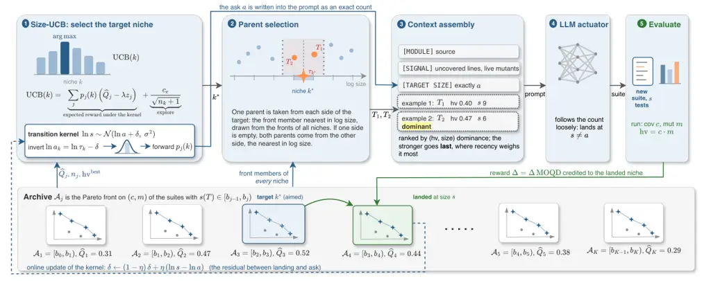

\workshoptitle

Self-Evolving Diversity-Driven Search for Robust AI Systems

# Small but Mighty: Test Suites as Improvement Signals for Self-Evolving Agents

Yutong Cheng ^(†)^(†)thanks: Work done during the internship at NEC
Laboratories America. Affiliation: Virginia Tech
Email: [yutongcheng@vt.edu](mailto:)    Wei Cheng Affiliation: NEC
Laboratories America Email: [zhoud@vt.edu](mailto:)    Wenchao Yu
Affiliation: NEC Laboratories America
Email: [weicheng@nec-labs.com](mailto:)    Dawei Zhou
Affiliation: Virginia Tech Email: [wyu@nec-labs.com](mailto:)    Haifeng
Chen Affiliation: NEC Laboratories America
Email: [haifeng@nec-labs.com](mailto:)

###### Abstract

A self-evolving agent rewrites its own harness and must decide which
rewrites to keep, so its improvement signal is the check a rewrite has
to pass. Verifying a rewrite by agent rollout is expensive and
subjective, while executable checks such as the repository’s own tests
are too sparse to catch behavior-changing rewrites, rejecting only a
quarter of them. We instead take test feedback as the executable signal,
and search for test suites that are both small and strong with a
quality–diversity evolutionary algorithm, so that the signal is dense
and informative. tesearch treats suite size as a behavior descriptor, so
that quality is pursued at every size and a small, strong suite is
reachable, and learns a transition kernel during the search that
denoises the LLM as an actuator on that descriptor. Across $`129`$
real-world modules and three backbones, tesearch delivers the
highest-quality suites of any method compared, LLM-driven evolutionary
search included, and the smallest of any LLM-based one. Used as the
improvement signal of a self-evolving agent, it rejects $`59.9\%`$ of
behavior-changing rewrites against $`25.3\%`$ for the repository’s
tests, at a $`4.0\%`$ false-alarm rate and $`3.5`$ s per decision. The
code and data are available at
[https://github.com/ccsnow127/TeSearch](https://github.com/ccsnow127/TeSearch).

## 1 Introduction

Self-evolving agents get stronger by editing the code that runs them:
the harness that prompts the model, parses its actions, executes them
and records the trajectory \[34, 55, 67\]. The check a rewrite must pass
to be kept is the agent’s _improvement signal_. Accept a rewrite that
silently changes behavior and every later episode and rewrite inherits
it; reject rewrites that preserve behavior and the evolution stalls. In
software engineering the executable form of this check is the test
suite, a *regression specification* \[62\] that captures the accepted
behavior of the code so that later modification can preserve it.

The signals available today are weak. Accepting on rollout outcome
spends an agent episode per candidate on a noisy end-to-end score. The
repository’s own tests are free, but they were written before the agent
existed and anticipate none of its edits: we find them rejecting only
$`25.3\%`$ of the rewrites that change behavior (Section 5.3). A
generated suite can do better, but only if it is _effective_, so that a
behavioral change breaks at least one test, and _efficient_, since it
runs on every proposed rewrite and its failures are read by a model with
a finite context. Existing generators, search-based or LLM-based,
optimize effectiveness and leave size to whatever emerges \[18, 35, 2,
24\].

We formulate _size-optimized unit test generation_ and, rather than
scalarizing quality against size, let size define where a suite competes
and quality whether it wins: size is a _behavior descriptor_ of a
quality–diversity (QD) search \[39, 45\], so the small end stays alive
instead of being eliminated by the large one. Two challenges follow. LLM
calls are expensive, so a finite budget must be _allocated_ across
niches whose value is unknown. And unlike classical QD, the descriptor
cannot be set directly: the search can only ask the LLM for a count,
which LLMs follow imprecisely \[71\], so the niche a call targets and
the niche it lands in differ.

tesearch answers both: an online _landing kernel_ models the LLM as a
noisy actuator on the descriptor, correcting its bias and predicting
where each call lands, and a _size-annealing UCB_ allocates calls across
niches from those predictions, turning toward smaller suites only once
quality is secured. Its suites are the strongest and, among LLM-based
methods, the smallest on $`129`$ real-world modules, and as the
improvement signal of a self-evolving agent they more than double the
detection of behavior-changing rewrites at a cost the loop can afford on
every one.

## 2 Related work

Self-evolving agents and improvement signals. Self-improving LLM systems
differ first in where an improvement is written. _Weight-space_ methods
fine-tune the model on its own data or rewards \[56, 74, 73\], a gain
that cannot be read, diffed or reverted. _Context-space_ methods write
into the harness instead, through verbal self-refinement \[37, 49\],
prompt search and textual gradients \[60, 64, 44, 1\], experience
memory \[68\], skill synthesis \[54\] or search over the whole
scaffold \[22\]; at the frontier the agent rewrites its own code,
including the procedure that performs the update \[17, 65, 67, 34\].
What decides whether an improvement is kept ranges from the model’s own
judgment \[6, 63\] to external verifiers such as tests \[7, 9\],
compilers \[29, 20\] and environments \[36\]. Tests are the signal
coding agents such as Cursor, Codex and Claude Code \[4, 42, 3\] lean on
across whole repositories \[26, 61, 66\], yet they are taken as given:
the repository’s own or written ad hoc. We optimize the test signal
itself, for the strength and cost a loop running it on every rewrite
needs. See Appendix F for additional related work.

Evolutionary and quality–diversity search. LLMs used as variation
operators under executable fitness make evolutionary search a strong
inference-time optimizer \[47, 41, 28\], but a global objective
concentrates the population around one mode \[19, 16\]. QD optimization
instead partitions the search space by behavior descriptors and
optimizes quality within each region \[30, 15\]: MAP-Elites keeps an
elite per cell \[39\], and MOME a Pareto front per cell whose
hypervolumes it sums \[45\]. Search-based test generation evolves
program inputs against coverage goals \[18, 35\] and test-suite
reduction shrinks a written suite post hoc \[21, 48\]; neither controls
size during generation. In classical QD the descriptor is read off what
an individual turns out to be; here it must be _requested_ from an LLM
before it can be observed, and tesearch models that actuation error
explicitly.

## 3 Size-optimized test generation

Given a Python module $`M`$, a _suite_ $`T`$ is a finite set of test
functions for $`M`$, with size $`s(T)`$. Two objectives are measured on
it: _coverage_ $`c(T)\in[0,1]`$, the fraction of executable lines of
$`M`$ executed, and _mutation score_ $`m(T)\in[0,1]`$, the fraction of a
fixed sample of mutants of $`M`$ killed \[25\]. With the origin as
reference, a suite has hypervolume $`\mathrm{hv}(T)=c(T)\,m(T)`$ \[72\],
high only when both objectives are.

###### Definition 1 (Size-optimized unit test generation).

Given a module $`M`$ and executable quality metrics $`(c,m)`$, produce a
collection $`\mathcal{T}`$ of suites and deliver the smallest suite of
maximal hypervolume:

```math
T^{\star}\;=\;\operatorname*{arg\,min}_{T\in\mathcal{T}^{\max}}s(T),\qquad\mathcal{T}^{\max}\;=\;\operatorname*{arg\,max}_{T\in\mathcal{T}}\mathrm{hv}(T).
```

Quality–diversity formulation. Definition 1 is the terminal objective;
QD is the search surrogate. Larger suites are naturally advantaged in a
global competition on $`(c,m)`$ \[40, 23\], so size becomes the behavior
descriptor and quality is optimized independently within size niches,
each keeping a Pareto front over $`(c,m)`$ rather than a single
elite \[45\]:

```math
\mathcal{A}_{j}=\operatorname*{nd}_{(c,m)}\big\{\,T\in\mathcal{T}:b_{j-1}\leq s(T)<b_{j}\big\},\qquad j=1,\dots,K, \tag{1}
```

where $`\operatorname{nd}`$ takes the non-dominated subset and
$`b_{0}<\dots<b_{K}`$ are the niche boundaries, the outermost two left
open ($`b_{0}=0`$, $`b_{K}=\infty`$). The niches are geometric, since
the variation in generated size grows with the size requested
(Appendix A).

Search loop and challenges. Each iteration (Figure 1) selects a target
niche; takes as parents the Pareto-front suite nearest the target in log
size on each side of it, ordered weaker to stronger since an LLM weighs
its most recent context most; prompts the LLM with the parents, the
module annotated with its uncovered lines and surviving mutants, and the
target size (Appendices C and D); then scores the suite and files it
where it actually lands (Algorithm 1). The two challenges are
_allocation_ of the call budget and _actuation_.

## 4 tesearch



Figure 1: Overview of tesearch. The archive (bottom) keeps a Pareto
front on (coverage, mutation score) per size niche. (1) Size-UCB picks a
target niche through the transition kernel; (2) the nearest front suite
on each side of the target size becomes a parent; (3) parents, module,
execution feedback and target size form the context; (4) the LLM writes
a suite, possibly off the requested size; (5) the suite is filed where
it lands, and the size error updates the kernel.

#### The landing kernel.

Requesting a suite of size $`a`$ may produce one of size $`s\neq a`$, so
a call aimed at one niche may land in another and credit assigned to the
target goes to the wrong arm. LLMs follow count instructions with
multiplicative noise \[69, 31, 58\], so we model landing in log space,

```math
\ln s\;\sim\;\mathcal{N}\big(\ln a+\delta,\ \sigma^{2}\big), \tag{2}
```

with $`\delta`$ the systematic count bias and $`\sigma`$ the residual
spread. The bias varies across modules and backbones and enters the
request directly, so it is estimated online and compensated before
generation: for a target niche $`k`$ with center
$`\tau_{k}=\sqrt{b_{k-1}b_{k}}`$, inverting Equation 2 gives the request
$`\ln a_{k}=\ln\tau_{k}-\delta`$, rounded to an integer. The spread only
spreads credit over neighboring niches; it is stable and fixed at its
holdout median. The landing distribution of a call aimed at niche $`k`$
is

```math
p_{j}(k)=\Phi\!\Big(\tfrac{\ln b_{j}-\mu_{k}}{\sigma}\Big)-\Phi\!\Big(\tfrac{\ln b_{j-1}-\mu_{k}}{\sigma}\Big),\qquad\mu_{k}=\ln a_{k}+\delta, \tag{3}
```

with $`\Phi`$ the standard normal distribution function, and once the
suite is measured the bias is updated by the LMS delta rule \[57\],
$`\delta\leftarrow(1-\eta)\,\delta+\eta\,(\ln s-\ln a)`$.

#### Size-annealing UCB.

Niche selection is a bandit whose arms are the niches. The reward of a
call is the increment $`\Delta`$ it adds to the multi-objective QD
score \[45\],
$`\mathrm{MOQD}(\mathcal{A})=\sum_{j}\mathrm{HV}(\mathcal{A}_{j})`$, the
total area the niche fronts dominate, credited to the niche the suite
actually lands in, whether it improves a niche or populates an empty
one. The acquisition is

```math
\mathrm{UCB}(k)=\underbrace{\sum_{j}p_{j}(k)\big(\widehat{Q}_{j}-\lambda z_{j}\big)}_{\text{expected exploitation}}+\underbrace{\frac{c_{e}}{\sqrt{n_{k}+1}}}_{\text{exploration}},\qquad\lambda=\max\big(0,\ \mathrm{hv}^{\mathrm{best}}-H\big), \tag{4}
```

where
$`\widehat{Q}_{j}\leftarrow(1-\alpha)\widehat{Q}_{j}+\alpha\Delta`$ is
the discounted reward of landing in niche $`j`$, initialized for an
unseen niche to the mean over observed ones; $`z_{j}=(j-1)/(K-1)`$ is
the normalized niche index; $`n_{k}`$ counts the calls aimed at niche
$`k`$ wherever they landed; and $`c_{e}`$ is an exploration
coefficient \[5\]. Two details are load-bearing. The kernel weights the
_exploitation_ term, because $`p_{j}(k)`$ is an actuator outcome
distribution rather than a policy prior \[5, 27\]; and the size penalty
sits _inside_ the expectation, so what is penalized is the size a suite
lands at, not the size aimed for. The size penalty $`\lambda`$ stays at
zero until the best hypervolume found so far reaches a threshold $`H`$,
and grows with it afterwards. The search therefore secures quality first
and only then favors smaller suites, following the quality-then-size
order of Definition 1.

## 5 Experiments

### 5.1 Setup

We use the $`129`$ distinct Python modules of TestGenEval \[24\], each
with a containerized harness. Mutants are produced per module by
cosmic-ray \[50\] under a fixed seed and split into a search fold, which
scores the search, and a held-out eval fold, which scores what is
delivered. Every method runs under an identical budget of $`N=50`$ calls
per module, on GPT-5.4, Claude Opus 4.8 and Gemini 3.1 Pro. The
baselines are *(i)* Pynguin \[35\], the reference search-based tool for
Python, matched in wall clock ($`6000`$ s) since it makes no model call;
*(ii)* inference-time scaling: iterative refinement \[49\],
best-of-$`N`$ \[32, 8\], beam search of width $`5`$, and the context
optimizers MIPROv2 and ACE \[44, 68\]; GEPA \[1\], whose single global
Pareto pool over $`(c,m,-s)`$ makes it the three-objective alternative
to our formulation; and OpenEvolve \[43\], an open implementation of
AlphaEvolve \[41\] that evolves suites in a MAP-Elites archive under the
same feedback; *(iii)* the coding agents Claude Code and Cursor \[3,
4\], told to maximize quality and minimize size, with harness feedback
as tool output; and *(iv)* ablations: _w/o kernel_ asks for the niche
center as written and credits each arm where its calls land; _w/o UCB_
sweeps the grid uniformly while keeping the aim; _w/o nearest parents_
samples parents at random from the fronts; _w/o $`\lambda`$_ sets
$`\lambda=0`$.

|                        |                   |         |       |       |      |                 |       |       |      |                |       |       |      |
| ---------------------- | ----------------- | ------- | ----- | ----- | ---- | --------------- | ----- | ----- | ---- | -------------- | ----- | ----- | ---- |
|                        | Method            | cov     | mut   | hv    | size |                 |       |       |      |                |       |       |      |
| SBST                   | Pynguin^(∗)       | 0.464   | 0.157 | 0.090 | 20.4 |                 |       |       |      |                |       |       |      |
|                        |                   | GPT-5.4 |       |       |      | Claude Opus 4.8 |       |       |      | Gemini 3.1 Pro |       |       |      |
|                        |                   | cov     | mut   | hv    | size | cov             | mut   | hv    | size | cov            | mut   | hv    | size |
| Inference-time scaling | Iter. refinement  | 0.798   | 0.647 | 0.516 | 50.8 | 0.842           | 0.849 | 0.716 | 72.5 | 0.694          | 0.764 | 0.539 | 56.8 |
|                        | Best-of-$`N`$     | 0.908   | 0.758 | 0.693 | 47.6 | 0.953           | 0.861 | 0.824 | 61.5 | 0.837          | 0.823 | 0.691 | 51.4 |
|                        | Beam search       | 0.859   | 0.905 | 0.775 | 44.5 | 0.971           | 0.910 | 0.886 | 68.8 | 0.890          | 0.934 | 0.838 | 52.6 |
|                        | MIPROv2           | 0.927   | 0.802 | 0.746 | 48.3 | 0.972           | 0.891 | 0.870 | 63.1 | 0.859          | 0.853 | 0.736 | 53.1 |
|                        | GEPA              | 0.929   | 0.786 | 0.732 | 47.9 | 0.982           | 0.911 | 0.895 | 67.2 | 0.845          | 0.857 | 0.732 | 54.7 |
|                        | ACE               | 0.914   | 0.753 | 0.692 | 52.4 | 0.938           | 0.878 | 0.827 | 64.4 | 0.835          | 0.826 | 0.692 | 55.5 |
|                        | OpenEvolve        | 0.963   | 0.858 | 0.831 | 51.5 | 0.964           | 0.917 | 0.885 | 68.0 | 0.930          | 0.853 | 0.798 | 56.6 |
| Coding agents          | Claude Code       | —       | —     | —     | —    | 0.982           | 0.908 | 0.891 | 51.6 | —              | —     | —     | —    |
|                        | Cursor            | 0.913   | 0.762 | 0.699 | 44.4 | 0.967           | 0.878 | 0.852 | 48.2 | 0.846          | 0.826 | 0.701 | 37.0 |
| Ablations              | w/o kernel        | 0.974   | 0.884 | 0.866 | 40.1 | 0.988           | 0.929 | 0.917 | 40.8 | 0.905          | 0.942 | 0.855 | 63.3 |
|                        | w/o UCB           | 0.973   | 0.881 | 0.861 | 44.1 | 0.995           | 0.964 | 0.960 | 34.4 | 0.906          | 0.937 | 0.851 | 42.3 |
|                        | w/o near. parents | 0.985   | 0.857 | 0.847 | 39.2 | 0.984           | 0.949 | 0.934 | 33.2 | 0.922          | 0.937 | 0.864 | 39.4 |
|                        | w/o $`\lambda`$   | 0.981   | 0.880 | 0.865 | 58.8 | 0.991           | 0.961 | 0.954 | 84.6 | 0.909          | 0.934 | 0.852 | 73.4 |
|                        | tesearch (full)   | 0.995   | 0.920 | 0.916 | 38.6 | 0.998           | 0.977 | 0.976 | 29.1 | 0.940          | 0.963 | 0.908 | 36.3 |

Table 1: Delivered suite on the $`129`$ TestGenEval modules, means over
modules, same call budget for every method. Higher is better except
size, ranked separately; the smallest per backbone is in blue. Claude
Code runs only on its own backbone. ^(∗)Pynguin is matched in wall clock
and scored on the $`40`$ modules it supports.

### 5.2 Test-suite quality

Table 1 reports the delivered suite. tesearch attains the highest
hypervolume on every backbone, $`7.0`$–$`8.5`$ points above the
strongest baseline, in the smallest suites any LLM-based method
delivers. Pynguin delivers fewer tests, but at $`\mathrm{hv}=0.090`$:
size is a coordinate here, not the objective. The two population-based
baselines isolate the formulation. OpenEvolve also keeps an archive and
is the strongest baseline on GPT-5.4, but its archive is not indexed by
size, so it holds nothing small to hand back and delivers $`51.5`$
tests. GEPA puts $`-s`$ in the objective, admitting near-empty suites as
non-dominated and leaving a front wide in size but shallow in quality.
The ablations separate on the axis each mechanism moves: removing
$`\lambda`$ costs little quality ($`-0.02`$ to $`-0.06`$ hv) but grows
suites $`1.5`$–$`2.9\times`$; removing the kernel inflates size hardest
where the actuator overshoots most ($`+11.7`$ and $`+27.0`$ tests on
Claude Opus 4.8 and Gemini 3.1 Pro), since credit piles up in the larger
niches that off-target calls reach; removing UCB or the nearest parents
costs quality and size on all three backbones.

The actuator and the anneal. Over $`6063`$ tesearch generations on
GPT-5.4, the count bias $`\delta`$ ranges from $`-0.037`$ to $`+0.107`$
across modules and changes sign, so no fixed correction serves all;
online, the log-size residuals have mean $`0.013`$ and standard
deviation $`0.100`$, as the kernel assumes. Allocation is selective
without collapsing: grouped into eight normalized size bands, no band
falls below a $`0.067`$ share of calls in any window. Against constant
and no size pressure, only the quality-gated ramp finishes both highest
in quality and smallest in size.

### 5.3 Improvement signal for a self-evolving agent

Setup. We study the keep-or-discard decision on mini-swe-agent \[51\],
an open variant of SWE-agent \[61\] whose harness is a few hundred lines
of Python. For each of eight harness modules, GPT-5.4 receives a
revision intent drawn from common self-improvement goals (latency,
tokens, robustness, structure), either behavior-preserving or
behavior-changing, and implements it as a revised module, $`64`$ per
module; each behavior-changing intent is the failure mode of a
preserving one with the same goal and shape of edit, such as caching a
function that reads changing state (Appendix E). Two annotators verify
each revision ($`\kappa=0.74`$), leaving the $`470`$ of Table 2, labeled
_divergent_ if the intent changes behavior and _equivalent_ otherwise. A
gate rejects a revision when its suite fails where it passed on the
unmodified module; the tesearch suite is generated once from that module
and compared with its repository tests.

|                    |                                           |         | Repository tests |       |      | tesearch |       |     |
| ------------------ | ----------------------------------------- | ------- | ---------------- | ----- | ---- | -------- | ----- | --- |
| Module             | Role in the harness                       | div/eq  | DDR              | FAR   | s    | DDR      | FAR   | s   |
| agents/default     | agent loop: model calls, actions, limits  | 17/41   | 0.529            | 0.000 | 15.7 | 0.588    | 0.049 | 3.0 |
| environments/local | runs bash commands, captures output       | 25/31   | 0.720            | 0.000 | 4.9  | 0.920    | 0.065 | 3.3 |
| actions_toolcall   | parses tool calls; renders observations   | 29/34   | 0.276            | 0.000 | 3.0  | 0.552    | 0.029 | 3.1 |
| actions_text       | parses text actions; renders observations | 25/35   | 0.040            | 0.000 | 7.7  | 0.560    | 0.029 | 2.9 |
| cache_control      | places prompt-cache breakpoints           | 29/26   | 0.172            | 0.000 | 2.9  | 0.414    | 0.038 | 3.0 |
| content_string     | flattens messages to text for display     | 35/25   | 0.057            | 0.000 | 2.9  | 0.600    | 0.040 | 2.9 |
| litellm_model      | model client: API call, retry, cost       | 38/25   | 0.026            | 0.000 | 7.1  | 0.421    | 0.080 | 6.7 |
| serialize          | merges layered config dictionaries        | 19/36   | 0.579            | 0.000 | 2.9  | 0.947    | 0.000 | 3.1 |
| Pooled             |                                           | 217/253 | 0.253            | 0.000 | 5.9  | 0.599    | 0.040 | 3.5 |

Table 2: Improvement signals for self-revisions of mini-swe-agent’s
harness. div/eq: divergent / equivalent revisions in the module’s pool.
DDR: divergent revisions rejected ($`\uparrow`$); FAR: equivalent
revisions rejected ($`\downarrow`$); s: mean wall clock per decision.

Results. tesearch rejects $`59.9\%`$ of divergent revisions against
$`25.3\%`$ for the repository tests, and more on every module (Table 2).
Repository tests check that a module performs its function; a
mutation-optimized suite also pins the details a mutant perturbs, such
as a separator, a default or which exception surfaces, so the gap is
widest on modules that parse model outputs or render what the model
reads. The tighter constraint costs little: tesearch rejects $`10`$ of
the $`253`$ equivalent revisions, a $`4.0\%`$ false-alarm rate, where
the repository tests reject none. A decision takes $`3.5`$ s against
$`5.9`$ s and calls no model, where acceptance by rollout spends an
agent episode: the agent can afford this signal on every rewrite it
proposes.

## 6 Conclusion

Self-evolving agents now rewrite their own harness fluently; what they
cannot yet tell is whether a self-referential edit is correct and leaves
existing behavior intact. This paper targets that gap with a
quality–diversity evolutionary search that treats suite size as a
behavior descriptor, so quality is pursued at every size and a small,
strong suite is reachable, and learns a transition kernel during the
search that denoises the LLM as an actuator on that descriptor. Across
$`129`$ modules and three backbones the resulting suites are the
strongest of any method compared and the smallest of any LLM-based one,
and as the gate of a self-evolving agent they reject $`59.9\%`$ of
behavior-changing rewrites against $`25.3\%`$ for the repository’s
tests, at $`3.5`$ s per decision and no model call. tesearch is thus an
effective improvement signal for self-evolving agents: strong enough to
catch what a rewrite silently broke, cheap enough to run on every
rewrite.

## References

- \[1\] Lakshya A. Agrawal, Shangyin Tan, Dilara Soylu, Noah Ziems,
  Rishi Khare, Krista Opsahl-Ong, Arnav Singhvi, Herumb Shandilya,
  Michael J. Ryan, Meng Jiang, et al. GEPA: Reflective prompt evolution
  can outperform reinforcement learning. In _ICLR_, 2026.
- \[2\] Nadia Alshahwan, Jubin Chheda, Anastasia Finogenova, Beliz
  Gokkaya, Mark Harman, Inna Harper, Alexandru Marginean, Shubho
  Sengupta, and Eddy Wang. Automated unit test improvement using large
  language models at Meta. In _FSE Companion_, 2024.
- \[3\] Anthropic. Claude Code: an agentic coding tool, 2025.
  [https://claude.com/claude-code](https://claude.com/claude-code).
- \[4\] Anysphere. Cursor: AI coding agent for building ambitious
  software, 2026. [https://cursor.com](https://cursor.com).
- \[5\] Peter Auer, Nicolò Cesa-Bianchi, and Paul Fischer. Finite-time
  analysis of the multiarmed bandit problem. _Machine Learning_, 2002.
- \[6\] Yuntao Bai, Saurav Kadavath, Sandipan Kundu, Amanda Askell,
  et al. Constitutional AI: Harmlessness from AI feedback. _arXiv
  preprint arXiv:2212.08073_, 2022.
- \[7\] Bei Chen, Fengji Zhang, Anh Nguyen, Daoguang Zan, Zeqi Lin,
  Jian-Guang Lou, and Weizhu Chen. CodeT: Code generation with generated
  tests. In _ICLR_, 2023.
- \[8\] Guoxin Chen, Minpeng Liao, Chengxi Li, and Kai Fan. AlphaMath
  almost zero: Process supervision without process. In _NeurIPS_, 2024a.
- \[9\] Xinyun Chen, Maxwell Lin, Nathanael Schärli, and Denny Zhou.
  Teaching large language models to self-debug. In _ICLR_, 2024b.
- \[10\] Yutong Cheng, Osama Bajaber, Saimon Amanuel Tsegai, Dawn Song,
  and Peng Gao. CTINexus: Automatic cyber threat intelligence knowledge
  graph construction using large language models. In _IEEE European
  Symposium on Security and Privacy (EuroS&P)_, 2025.
- \[11\] Yutong Cheng, Haifeng Chen, Peng Gao, and Wei Cheng. SpecForge:
  Recursive self-improvement for coding agents via behavioral
  specifications. In _NeurIPS_, 2026a.
- \[12\] Yutong Cheng, Haifeng Chen, Wenchao Yu, Xujiang Zhao, Peng Gao,
  and Wei Cheng. Escaping whack-a-mole: Optimizing documentation as
  repo-specific playbooks for coding agents. In _ICML_, 2026b.
- \[13\] Yutong Cheng, Changze Li, Qian Cui, Wei Ding, Lingzhi Wang, Yan
  Chen, and Peng Gao. CTIFoundry: An agent-native corpus scaffold for
  cyber threat intelligence. _arXiv preprint arXiv:2608.18613_, 2026c.
- \[14\] Yutong Cheng, Yang Liu, Changze Li, Dawn Song, and Peng Gao.
  CTIConnect: A benchmark for retrieval-augmented LLMs over
  heterogeneous cyber threat intelligence. In _KDD_, 2026d.
- \[15\] Antoine Cully and Yiannis Demiris. Quality and diversity
  optimization: A unifying modular framework. _IEEE Transactions on
  Evolutionary Computation_, 2018.
- \[16\] Kalyanmoy Deb, Amrit Pratap, Sameer Agarwal, and T. Meyarivan.
  A fast and elitist multiobjective genetic algorithm: NSGA-II. _IEEE
  Transactions on Evolutionary Computation_, 2002.
- \[17\] Chrisantha Fernando, Dylan Banarse, Henryk Michalewski, Simon
  Osindero, and Tim Rocktäschel. Promptbreeder: Self-referential
  self-improvement via prompt evolution. In _ICML_, 2024.
- \[18\] Gordon Fraser and Andrea Arcuri. EvoSuite: automatic test suite
  generation for object-oriented software. In _ESEC/FSE_, 2011.
- \[19\] David E. Goldberg and Jon Richardson. Genetic algorithms with
  sharing for multimodal function optimization. In _ICGA_, 1987.
- \[20\] Patrick Haluptzok, Matthew Bowers, and Adam Tauman Kalai.
  Language models can teach themselves to program better. In
  _ICLR_, 2023.
- \[21\] Mary Jean Harrold, Rajiv Gupta, and Mary Lou Soffa. A
  methodology for controlling the size of a test suite. _ACM
  Transactions on Software Engineering and Methodology_, 1993.
- \[22\] Shengran Hu, Cong Lu, and Jeff Clune. Automated design of
  agentic systems. In _ICLR_, 2025.
- \[23\] Laura Inozemtseva and Reid Holmes. Coverage is not strongly
  correlated with test suite effectiveness. In _ICSE_, 2014.
- \[24\] Kush Jain, Gabriel Synnaeve, and Baptiste Rozière. TestGenEval:
  A real world unit test generation and test completion benchmark. In
  _ICLR_, 2025.
- \[25\] Yue Jia and Mark Harman. An analysis and survey of the
  development of mutation testing. _IEEE Transactions on Software
  Engineering_, 2011.
- \[26\] Carlos E. Jimenez, John Yang, Alexander Wettig, Shunyu Yao,
  Kexin Pei, Ofir Press, and Karthik Narasimhan. SWE-bench: Can language
  models resolve real-world GitHub issues? _International Conference on
  Learning Representations_, 2024.
- \[27\] Donald R. Jones, Matthias Schonlau, and William J. Welch.
  Efficient global optimization of expensive black-box functions.
  _Journal of Global Optimization_, 13(4):455–492, 1998.
- \[28\] Robert Tjarko Lange, Yuki Imajuku, and Edoardo Cetin.
  ShinkaEvolve: Towards open-ended and sample-efficient program
  evolution. In _ICLR_, 2026.
- \[29\] Hung Le, Yue Wang, Akhilesh Deepak Gotmare, Silvio Savarese,
  and Steven C. H. Hoi. CodeRL: Mastering code generation through
  pretrained models and deep reinforcement learning. In _NeurIPS_, 2022.
- \[30\] Joel Lehman and Kenneth O. Stanley. Abandoning objectives:
  Evolution through the search for novelty alone. _Evolutionary
  Computation_, 2011.
- \[31\] Jiaming Li, Lei Zhang, Yunshui Li, Ziqiang Liu, Yuelin Bai, Run
  Luo, Longze Chen, and Min Yang. Ruler: A model-agnostic method to
  control generated length for large language models. In _Findings of
  EMNLP_, 2024.
- \[32\] Yujia Li, David Choi, Junyoung Chung, Nate Kushman, Julian
  Schrittwieser, Rémi Leblond, Tom Eccles, James Keeling, Felix Gimeno,
  Agustin Dal Lago, et al. Competition-level code generation with
  AlphaCode. _Science_, 2022.
- \[33\] Nelson F. Liu, Kevin Lin, John Hewitt, Ashwin Paranjape,
  Michele Bevilacqua, Fabio Petroni, and Percy Liang. Lost in the
  middle: How language models use long contexts. _Transactions of the
  Association for Computational Linguistics_, 2024.
- \[34\] Xinghua Lou, Miguel Lázaro-Gredilla, Antoine Dedieu, Carter
  Wendelken, Wolfgang Lehrach, and Kevin P. Murphy. AutoHarness:
  improving LLM agents by automatically synthesizing a code harness.
  _arXiv preprint arXiv:2603.03329_, 2026.
- \[35\] Stephan Lukasczyk and Gordon Fraser. Pynguin: Automated unit
  test generation for Python. In _ICSE Companion_, 2022.
- \[36\] Yecheng Jason Ma, William Liang, Guanzhi Wang, De-An Huang,
  Osbert Bastani, Dinesh Jayaraman, Yuke Zhu, Linxi Fan, and Anima
  Anandkumar. Eureka: Human-level reward design via coding large
  language models. In _ICLR_, 2024.
- \[37\] Aman Madaan, Niket Tandon, Prakhar Gupta, Skyler Hallinan, Luyu
  Gao, Sarah Wiegreffe, Uri Alon, Nouha Dziri, Shrimai Prabhumoye,
  Yiming Yang, Shashank Gupta, Bodhisattwa Prasad Majumder, Katherine
  Hermann, Sean Welleck, Amir Yazdanbakhsh, and Peter Clark.
  Self-refine: Iterative refinement with self-feedback. In
  _NeurIPS_, 2023.
- \[38\] Charles Masson, Jee E. Rim, and Homin K. Lee. DDSketch: A fast
  and fully-mergeable quantile sketch with relative-error guarantees.
  _Proceedings of the VLDB Endowment_, 2019.
- \[39\] Jean-Baptiste Mouret and Jeff Clune. Illuminating search spaces
  by mapping elites. _arXiv preprint arXiv:1504.04909_, 2015.
- \[40\] Akbar Siami Namin and James H. Andrews. The influence of size
  and coverage on test suite effectiveness. In _ISSTA_, 2009.
- \[41\] Alexander Novikov, Ngân Vũ, Marvin Eisenberger, Emilien Dupont,
  Po-Sen Huang, Adam Zsolt Wagner, Sergey Shirobokov, Borislav
  Kozlovskii, Francisco J. R. Ruiz, Abbas Mehrabian, et al. AlphaEvolve:
  A coding agent for scientific and algorithmic discovery. _arXiv
  preprint arXiv:2506.13131_, 2025.
- \[42\] OpenAI. Introducing Codex, 2025.
  [https://openai.com/index/introducing-codex/](https://openai.com/index/introducing-codex/).
- \[43\] OpenEvolve contributors. OpenEvolve: An open-source
  implementation of AlphaEvolve, 2025.
  [https://github.com/algorithmicsuperintelligence/openevolve](https://github.com/algorithmicsuperintelligence/openevolve).
- \[44\] Krista Opsahl-Ong, Michael J. Ryan, Josh Purtell, David Broman,
  Christopher Potts, Matei Zaharia, and Omar Khattab. Optimizing
  instructions and demonstrations for multi-stage language model
  programs. In _EMNLP_, 2024.
- \[45\] Thomas Pierrot, Guillaume Richard, Karim Beguir, and Antoine
  Cully. Multi-objective quality diversity optimization. In
  _GECCO_, 2022.
- \[46\] Rizky Ramadhana Putra, Raihan Sultan Pasha Basuki, Yutong
  Cheng, and Peng Gao. NL2Logic: AST guided translation of natural
  language into first-order logic with large language models. In
  _Findings of EACL_, 2026.
- \[47\] Bernardino Romera-Paredes, Mohammadamin Barekatain, Alexander
  Novikov, Matej Balog, M. Pawan Kumar, Emilien Dupont, Francisco J. R.
  Ruiz, Jordan S. Ellenberg, Pengming Wang, Omar Fawzi, Pushmeet Kohli,
  and Alhussein Fawzi. Mathematical discoveries from program search with
  large language models. _Nature_, 2024.
- \[48\] Gregg Rothermel, Mary Jean Harrold, Jeffery von Ronne, and
  Christie Hong. Empirical studies of test-suite reduction. _Software
  Testing, Verification and Reliability_, 2002.
- \[49\] Noah Shinn, Federico Cassano, Ashwin Gopinath, Karthik
  Narasimhan, and Shunyu Yao. Reflexion: Language agents with verbal
  reinforcement learning. In _NeurIPS_, 2023.
- \[50\] Sixty North. Cosmic ray: mutation testing for Python, 2015.
  [https://github.com/sixty-north/cosmic-ray](https://github.com/sixty-north/cosmic-ray).
- \[51\] SWE-agent team. mini-SWE-agent: the 100-line AI agent that
  solves GitHub issues, 2025.
  [https://github.com/SWE-agent/mini-swe-agent](https://github.com/SWE-agent/mini-swe-agent).
- \[52\] Arie van Deursen, Leon Moonen, Alex van den Bergh, and Gerard
  Kok. Refactoring test code. Technical Report SEN-R0119, CWI, 2001.
- \[53\] Tim van Erven and Wouter M. Koolen. Metagrad: Multiple learning
  rates in online learning. In _NeurIPS_, 2016.
- \[54\] Guanzhi Wang, Yuqi Xie, Yunfan Jiang, Ajay Mandlekar, Chaowei
  Xiao, Yuke Zhu, Linxi Fan, and Anima Anandkumar. Voyager: An
  open-ended embodied agent with large language models. _arXiv preprint
  arXiv:2305.16291_, 2023a.
- \[55\] Xiaoxuan Wang, Haixin Wang, Alexander Taylor, Jason Cong,
  Yizhou Sun, and Wei Wang. HarnessBridge: learnable bidirectional
  controller for LLM agent harness. _arXiv preprint
  arXiv:2606.12882_, 2026.
- \[56\] Yizhong Wang, Yeganeh Kordi, Swaroop Mishra, Alisa Liu, Noah A.
  Smith, Daniel Khashabi, and Hannaneh Hajishirzi. Self-instruct:
  Aligning language models with self-generated instructions. In _ACL_,
  2023b.
- \[57\] Bernard Widrow and Marcian E. Hoff. Adaptive switching
  circuits. In _Neurocomputing: Foundations of Research_. MIT
  Press, 1988.
- \[58\] Meiman Xiao, Ante Wang, Qingguo Hu, Zhongjian Miao, Huangjun
  Shen, Longyue Wang, Weihua Luo, and Jinsong Su. Can LLMs track their
  output length? a dynamic feedback mechanism for precise length
  regulation. _arXiv preprint arXiv:2601.01768_, 2026.
- \[59\] Junjielong Xu, Qiuai Fu, Zhouruixing Zhu, Yutong Cheng, Zhijing
  Li, Yuchi Ma, and Pinjia He. Hue: A user-adaptive parser for hybrid
  logs. In _ESEC/FSE_, 2023.
- \[60\] Chengrun Yang, Xuezhi Wang, Yifeng Lu, Hanxiao Liu, Quoc V. Le,
  Denny Zhou, and Xinyun Chen. Large language models as optimizers. In
  _ICLR_, 2024a.
- \[61\] John Yang, Carlos E. Jimenez, Alexander Wettig, Kilian Lieret,
  Shunyu Yao, Karthik Narasimhan, and Ofir Press. SWE-agent:
  Agent-computer interfaces enable automated software engineering. In
  _NeurIPS_, 2024b.
- \[62\] Shin Yoo and Mark Harman. Regression testing minimization,
  selection and prioritization: a survey. _Software Testing,
  Verification and Reliability_, 2012.
- \[63\] Weizhe Yuan, Richard Yuanzhe Pang, Kyunghyun Cho, Xian Li,
  Sainbayar Sukhbaatar, Jing Xu, and Jason Weston. Self-rewarding
  language models. In _ICML_, 2024.
- \[64\] Mert Yuksekgonul, Federico Bianchi, Joseph Boen, Sheng Liu, Zhi
  Huang, Carlos Guestrin, and James Zou. TextGrad: Automatic
  “differentiation” via text. _arXiv preprint arXiv:2406.07496_, 2024.
- \[65\] Eric Zelikman, Eliana Lorch, Lester Mackey, and Adam Tauman
  Kalai. Self-taught optimizer (STOP): Recursively self-improving code
  generation. In _COLM_, 2024.
- \[66\] Fengji Zhang, Bei Chen, Yue Zhang, Jacky Keung, Jin Liu,
  Daoguang Zan, Yi Mao, Jian-Guang Lou, and Weizhu Chen. RepoCoder:
  Repository-level code completion through iterative retrieval and
  generation. In _EMNLP_, 2023.
- \[67\] Jenny Zhang, Shengran Hu, Cong Lu, Robert Lange, and Jeff
  Clune. Darwin Gödel machine: Open-ended evolution of self-improving
  agents. In _ICLR_, 2026a.
- \[68\] Qizheng Zhang, Changran Hu, Shubhangi Upasani, Boyuan Ma,
  Fenglu Hong, Vamsidhar Kamanuru, et al. Agentic context engineering:
  Evolving contexts for self-improving language models. In _ICLR_,
  2026b.
- \[69\] Wei Zhang, Zhenhong Zhou, Kun Wang, Junfeng Fang, Rongwu Xu,
  Yuanhe Zhang, Rui Wang, Ge Zhang, Xinfeng Li, Li Sun, Lingjuan Lyu,
  Yang Liu, and Sen Su. LIFEBench: Evaluating length instruction
  following in large language models. In _NeurIPS Datasets and
  Benchmarks Track_, 2025.
- \[70\] Zihao Zhao, Eric Wallace, Shi Feng, Dan Klein, and Sameer
  Singh. Calibrate before use: Improving few-shot performance of
  language models. In _ICML_, 2021.
- \[71\] Jeffrey Zhou, Tianjian Lu, Swaroop Mishra, Siddhartha Brahma,
  Sujoy Basu, Yi Luan, Denny Zhou, and Le Hou. Instruction-following
  evaluation for large language models. _arXiv preprint
  arXiv:2311.07911_, 2023.
- \[72\] Eckart Zitzler and Lothar Thiele. Multiobjective evolutionary
  algorithms: a comparative case study and the strength Pareto approach.
  _IEEE Transactions on Evolutionary Computation_, 1999.
- \[73\] Yuxin Zuo, Kaiyan Zhang, Li Sheng, Shang Qu, Ganqu Cui, Xuekai
  Zhu, Haozhan Li, Yuchen Zhang, Xinwei Long, Ermo Hua, Biqing Qi,
  Youbang Sun, Zhiyuan Ma, Lifan Yuan, Ning Ding, and Bowen Zhou. TTRL:
  Test-time reinforcement learning. In _NeurIPS_, 2025.
- \[74\] Adam Zweiger, Jyothish Pari, Han Guo, Ekin Akyürek, Yoon Kim,
  and Pulkit Agrawal. Self-adapting language models. In _NeurIPS_, 2025.

## Appendix A The size-niched grid

Suite size is the archive’s only descriptor, and the noise on it is
multiplicative: asking for twice as many tests does not add a fixed
error, it scales the error, which is why Section 4 models landing as
log-normal. The grid is therefore a partition of $`\ln s`$ built once,
immediately after the seed phase. The grid is centered on an _anchor_
$`\bar{s}`$, the size the backbone writes at when no size is named,
estimated as the geometric mean of the seed suites’ sizes. Writing
$`T_{1},\dots,T_{n}`$ for the $`n`$ seed suites that measured,

```math
\bar{s}\;=\;\exp\!\Big(\tfrac{1}{n}\sum\nolimits_{i=1}^{n}\ln s(T_{i})\Big). \tag{5}
```

The mean is taken on the log scale because the noise is multiplicative,
and the seeds are unhinted precisely so that the anchor measures the
model rather than our own prompt.

Niches are geometric, with equal width on the log scale. This is the
spacing used whenever values within a constant factor of each other are
interchangeable, as in MetaGrad’s exponentially spaced grid of learning
rates \[53\], and whenever error is relative rather than absolute, as in
DDSketch, whose bucket ratio is set by the relative accuracy it
guarantees \[38\]. Under multiplicative noise, both hold for suite
sizes. Consecutive niches differ by the ratio $`\rho=e^{2\sigma}=1.22`$,
where $`\sigma=0.10`$ is the landing spread of the transition kernel
(Section 4), so each niche spans $`\pm\sigma`$ around its center on the
log scale. This width is intended: since Section 4 models landing noise
as log-normal, an aimed draw lands in the niche it was aimed at with
probability $`68\%`$ under the model.

The grid is built per module over the range
$`[s_{\min},\,\bar{s}\rho^{\gamma}]`$, and both ends follow conventions
of software testing \[52, 40\]. The lower end is set by the module:
$`s_{\min}`$ is the number of public functions and methods of the module
under test, counted statically from its AST. A suite with fewer tests
than that must check several of them in one test method, which is the
_Eager Test_ smell: such a test is hard to read, hard to use as
documentation of the behavior it checks, and makes tests more dependent
on each other, and the prescribed remedy is to split it until each test
method exercises a single method of the unit \[52\]. The floor also
guards against reward hacking, in which the LLM packs all its checks
into a single test function to game the size reward. The upper end is
relative to the anchor, $`\gamma`$ niches above it, and so scales with
the size of the module. In software testing, the effectiveness of a
suite grows with its size \[23\], but only logarithmically \[40\].
Beyond a minimal suite, one from which no test can be removed without
lowering its mutation score, further tests add nothing but code smells
such as _Lazy Test_ and _Test Code Duplication_ \[52\]. To keep suite
size from growing without bound, and to avoid spending calls on
unreasonably large suites, we set $`\gamma=4`$. The boundaries that fall
inside the range, sorted and with duplicates dropped, are
$`b_{1}<\dots<b_{K-1}`$. A suite outside the range is filed rather than
dropped, into one of two open overflow niches, $`[0,b_{1})`$ and
$`[b_{K-1},\infty)`$; the bandit never aims at them, and a call that
lands in one is still charged to the arm it aimed at.

## Appendix B The search loop

Algorithm 1 states the whole method.

1: module $`M`$; call budget $`N`$; seeds $`n_{\mathrm{seed}}`$;
hyperparameters $`\sigma,\eta,\alpha,c_{e},H`$

2: one delivered suite

3: _Seed phase — the grid does not exist yet, so nothing can be
discarded on it._

4: for $`i=1,\dots,n_{\mathrm{seed}}`$ do

5:   $`T_{i}\leftarrow\textsc{llm}(\textsc{seed},M)`$ // unhinted: no
count is named

6:   $`\textsc{measure}(T_{i})`$; file $`T_{i}`$ provisionally,
dominance off

7: end for

8: $`\bar{s}\leftarrow`$ Eq. (5) on the measured seed sizes;
$`s_{\min}\leftarrow`$ public functions and methods of $`M`$

9: derive $`b_{0}\dots b_{K}`$ over
$`[s_{\min},\,\bar{s}\rho^{\gamma}]`$ (Appendix A); re-file the archive
under them

10: $`\delta\leftarrow 0`$; $`n_{k}\leftarrow 0`$ for all $`k`$;
$`\mathrm{hv}^{\mathrm{best}}\leftarrow\max_{i}\mathrm{hv}(T_{i})`$

11: replay the seed landings into $`\widehat{Q}`$ // a seed asked for no
size

12: _Search._

13: while fewer than $`N`$ calls have been spent do

14:   if the archive is empty then // only after every seed failed to
measure

15:    regenerate unhinted, measure, file; continue

16:   end if

17:   for $`k=2,\dots,K-1`$ do // the overflow niches $`1`$ and $`K`$
are never aimed at

18:    $`P_{k}\leftarrow`$ the front member nearest $`\tau_{k}`$ in log
size on each side of $`\tau_{k}`$ // Appendix C

19:    $`a_{k}\leftarrow\big\lfloor\exp(\ln\tau_{k}-\delta)\big\rceil`$
// the aim, Section 4

20:    $`p_{j}(k)\leftarrow`$ Eq. (3) at $`a_{k}`$, for every $`j`$ //
the kernel, run forward

21:
   $`S_{k}\leftarrow\sum_{j}p_{j}(k)\big(\widehat{Q}_{j}-\lambda z_{j}\big)+c_{e}/\sqrt{n_{k}+1}`$
// Eq. (4)

22:   end for

23:   $`k^{\ast}\leftarrow\arg\max_{2\leq k\leq K-1}S_{k}`$ //
deterministic; the bonus already schedules variety

24:   $`\textit{mode}\leftarrow\textsc{compress}`$ if
$`\tau_{k^{\ast}}`$ lies below the last parent of $`P_{k^{\ast}}`$, else
expand // Table 4

25:
  $`T\leftarrow\textsc{llm}\big(\textsc{breed}[\textit{mode}],\,M,\,P_{k^{\ast}},\,a_{k^{\ast}}\big)`$

26:   $`n_{k^{\ast}}\leftarrow n_{k^{\ast}}+1`$ // the _ask_ is charged,
measured or not

27:   if $`\textsc{measure}(T)`$ succeeds then

28:    file $`T`$ in the niche of its _written_ size,
$`j\leftarrow\mathrm{niche}(s(T))`$

29:    $`\Delta\leftarrow`$ increment of $`\mathrm{MOQD}`$, clipped to
$`[0,1]`$ // the reward

30:
   $`\delta\leftarrow(1-\eta)\,\delta+\eta\big(\ln s(T)-\ln a_{k^{\ast}}\big)`$
// LMS update

31:
   $`\widehat{Q}_{j}\leftarrow\widehat{Q}_{j}+\alpha\big(\Delta-\widehat{Q}_{j}\big)`$
// credited where it _landed_

32:
   $`\mathrm{hv}^{\mathrm{best}}\leftarrow\max\big(\mathrm{hv}^{\mathrm{best}},\mathrm{hv}(T)\big)`$;
recompute $`\lambda`$ by Eq. (4)

33:   end if

34: end while

35: return the smallest-written suite among those of maximal
$`\mathrm{hv}`$// Definition 1

Algorithm 1 tesearch on one module. llm is the frozen backbone; measure
executes a suite in the module’s container and returns $`(c,m)`$ on its
passing subset together with its written size $`s`$.

## Appendix C Parent selection and context assembly

Given the selected niche $`k^{\ast}`$, tesearch selects two parents from
all Pareto-front suites in the archive, rather than only from the target
niche. Specifically, one parent is taken from each side of the target
size: on each side, suites are ranked by their log-size distance to the
target,

```math
\left|\ln s(T)-\ln\tau_{k^{\ast}}\right|,
```

with hypervolume breaking ties, and the nearest suite is selected. Using
the global archive allows generation even when the target niche is
empty, while size proximity provides examples at a scale close to the
requested suite.

The generation context consists of the module under test, execution
feedback, the two selected parents, and the requested size. Execution
feedback highlights uncovered lines and surviving mutants. The parents
are ordered from weaker to stronger, placing the stronger example
closest to the generation request. Finally, the LLM is instructed to
generate a suite of the requested size by compressing or extending the
last parent, according to whether the target lies below or above it.
Appendix D provides the full prompt.

#### Parent selection.

Parents are selected by size proximity from the two sides of the target:
the Pareto-front suite nearest $`\tau_{k^{\ast}}`$ in log size among
those smaller than the target, and the nearest among those larger.
Because the grid is geometric, the niche index is log size up to a
constant, so each side is a one-dimensional nearest-neighbor lookup. The
two parents therefore always differ in size, and their relation in
Table 3 follows from their hypervolumes: if the smaller parent has no
lower hypervolume, it Pareto-dominates the larger one; otherwise the
larger one lexicographically dominates it. When one side has no suite,
the parents come from the other side alone; in that edge case the call
must compress or expand the suite toward the target while raising its
hypervolume. The pool is global rather than niche-local for a structural
reason: the acquisition frequently selects a niche no suite has reached
yet, and a draw restricted to that niche’s own front would leave exactly
those targets unbreedable. The _w/o nearest-parents_ ablation replaces
the ranking with a uniform draw over the same pool and changes nothing
else — the candidates are still front members, so nothing dominated is
ever shown, and the ordering rule below still applies.

#### Ordering and annotation.

The two parents and the target are arranged ascending under the order of
Definition 1 — by hypervolume first, and by smaller size only when
hypervolumes are equal — with the target always last, immediately before
the continuation, where recency weighs the nearest example most \[70,
33, 60\]. With one parent on each side of the target size, the
arrangement takes one of two mirror forms (Table 4). If the larger
parent $`L`$ has the higher hypervolume, the order is $`S,L,T`$: $`L`$
lexicographically dominates $`S`$, and the target $`T`$ must
Pareto-dominate $`L`$, compressing it to the target size at no lower
hypervolume. Otherwise the order is $`L,S,T`$: $`S`$ Pareto-dominates
$`L`$, and $`T`$ must lexicographically dominate $`S`$, expanding it to
the target size at strictly higher hypervolume. The asymmetry is
deliberate: a smaller suite at equal hypervolume is already an
improvement under Definition 1, and the only one left once hypervolume
saturates, whereas a larger suite is worth its extra tests only if it
raises hypervolume. The second parent carries a one-line note comparing
it with the first, in one of the two forms of Table 3; the note states
the measured change in both hypervolume and size, so it is always a
measured claim rather than an inferred narrative.

| Type                    | Condition on (prev, curr)             | Emitted note                                                                            |
| ----------------------- | ------------------------------------- | --------------------------------------------------------------------------------------- |
| Pareto dominance        | no lower hypervolume and smaller size | perfect improved version of prev (hypervolume grow 0.852-\>0.916, size decline 24-\>13) |
| lexicographic dominance | higher hypervolume and larger size    | improved version of prev (hypervolume grow …, size grow …)                              |

Table 3: The comparison note attached to the second parent. Together
with the target, which always comes last, the ordered parents form a
gradient along the order on $`(\mathrm{hv},\text{size})`$, so the
strongest example sits nearest the output position, where the model’s
recency bias weighs it most \[70, 33, 60\]. Because the parents lie on
opposite sides of the target size and are ordered first, the later of
the two is never the weaker, so the relation reduces to two cases, and
the note reports both changes with their numbers.

| Case (order)         | $`T`$ against its neighbor | Hypervolume of $`T`$                 | Emitted note                                                                                                 |
| -------------------- | -------------------------- | ------------------------------------ | ------------------------------------------------------------------------------------------------------------ |
| compress ($`S,L,T`$) | smaller than $`L`$         | $`\mathrm{hv}(T)\geq\mathrm{hv}(L)`$ | perfect improved version of prev (hypervolume grow or hold from \<hv(L)\>, size decline \<size(L)\>-\>\<n\>) |
| expand ($`L,S,T`$)   | larger than $`S`$          | $`\mathrm{hv}(T)>\mathrm{hv}(S)`$    | improved version of prev (hypervolume grow from \<hv(S)\>, size grow \<size(S)\>-\>\<n\>)                    |

Table 4: What the target $`T`$ must achieve against the parent placed
next to it. $`S`$ and $`L`$ are the parents below and above the target
size. The requirement is asymmetric in hypervolume because the step
toward $`T`$ changes size in opposite directions.

## Appendix D Prompt construction

With the two parents chosen and ordered (Appendix C), three further
decisions turn them into a prompt: which of the two breeding framings
the call is given, what execution signal is written into the module
source, and how much of each piece is shown.

#### Feedback signal.

The module source shown in a breeding prompt is annotated with what the
_strongest_ parent still misses, written at the end of the exact line it
describes rather than as a separate list of line numbers: \# \<-- NOT
COVERED YET on a line none of its passing tests execute, and \# \<--
SURVIVING MUTANT: \<op\> on a line where that mutation survives its
assertions. Failing tests inside an example suite are marked the same
way, at the end of the (possibly multi-line) def header, as \# \<--
FAILING: \<exception\>. Adjacency is the point: models align a mark
sitting next to the code far more reliably than a position given in a
distant block of text. Coverage only ever flags executable statement
lines, so a trailing comment is syntactically safe wherever a mark can
land.

#### Prompts, verbatim.

Below are the three system prompts and the user prompt skeleton, exactly
as the implementation emits them; a bracketed \[…\] marks text repeated
verbatim from the prompt above it, and \<…\> marks a slot filled at run
time. Throughout this appendix, system prompts are marked in blue and
user prompts in gray.


The user prompt is the three pieces and the ask, in order: the module
with the residual signal marked inline, the count, then the ordered
parents, strongest last.


An arm whose niche the archive cannot supply parents for at all — only
possible before the archive has any occupant — falls back to the seed
prompt with the size instruction appended.

## Appendix E Revision intents and examples

The self-evolving experiment of Section 5.3 revises eight modules of
mini-swe-agent \[51\], chosen to cover the harness end to end: the agent
loop, the local execution environment, the two action parsers, the
cache-breakpoint policy, the message flattener, the model client and the
config merger (Table 2 gives the role of each). For each module, GPT-5.4
is shown the module source together with a revision intent and returns
one complete revised module. Intents are drawn from the fixed list in
Table 5, which covers the kinds of self-modification a harness-evolving
agent proposes in practice: a behavior-preserving intent asks for the
module to be improved without changing what it does, and a
behavior-changing intent asks for an edit that alters observable
behavior. Table 6 shows representative revisions of each kind.

|             |                                                                   |            |       |
| ----------- | ----------------------------------------------------------------- | ---------- | ----- |
| Family      | Intent                                                            | Class      | $`n`$ |
| Performance | cache a function whose result depends only on its arguments       | preserving | 16    |
|             | cache a function that reads changing state (clock, counter, file) | changing   | 16    |
|             | list to set, where order and duplicates are unused                | preserving | 16    |
|             | list to set, where order or duplicates are relied on              | changing   | 16    |
|             | batch independent calls, keeping results and their order          | preserving | 16    |
|             | batch calls, changing which error surfaces and when               | changing   | 16    |
|             | return early where no side effect follows                         | preserving | 16    |
|             | return early, skipping a side effect (log, counter, cleanup)      | changing   | 16    |
| Token       | shorten the output, keeping every field a reader uses             | preserving | 16    |
|             | shorten the output, changing a key or separator a reader parses   | changing   | 16    |
|             | truncate long output, keeping head and tail with a marker         | preserving | 16    |
|             | truncate long output, keeping only the head                       | changing   | 16    |
|             | stop emitting a field that no code reads                          | preserving | 16    |
|             | stop emitting a field read only on a rare path (e.g., errors)     | changing   | 16    |
|             | merge repeated outputs that are byte-identical                    | preserving | 16    |
|             | merge outputs that print alike but differ (e.g., exit code)       | changing   | 16    |
| Robustness  | retry a call that is safe to repeat                               | preserving | 16    |
|             | retry a call whose repetition has an extra effect                 | changing   | 16    |
|             | add a timeout that reports expiry as a failure                    | preserving | 16    |
|             | add a timeout that returns partial output as complete             | changing   | 16    |
|             | narrow except Exception to every type the block raises            | preserving | 16    |
|             | narrow except Exception, missing a type the block raises          | changing   | 16    |
|             | handle None where the value is legitimately optional              | preserving | 16    |
|             | return None silently where the code should raise                  | changing   | 16    |
| Structure   | extract a helper, keeping captured variables and defaults         | preserving | 16    |
|             | extract a helper, changing a captured variable or default         | changing   | 16    |
|             | group parameters into a fresh object per call                     | preserving | 16    |
|             | group parameters into an object shared across calls               | changing   | 16    |
|             | merge two branches with identical bodies                          | preserving | 16    |
|             | merge two nearly identical branches, losing the difference        | changing   | 16    |
|             | add type hints and docstrings only                                | preserving | 16    |
|             | add type hints plus a small change to a conversion or default     | changing   | 16    |
| Total       |                                                                   |            | 512   |

Table 5: Revision intents. Class is what the intent asks for, not what
the revision turns out to do; a revision enters Table 2 only if human
verification confirms that it realizes its intent (Section 5.3). Intents
come in pairs: each behavior-changing intent is the failure mode of the
behavior-preserving intent above it, with the same goal and the same
shape of edit. $`n`$ counts revisions generated under each intent,
pooled over the eight modules.

|                    |                                                                   |                                                                                                                                               |       |
| ------------------ | ----------------------------------------------------------------- | --------------------------------------------------------------------------------------------------------------------------------------------- | ----- |
| Module             | Intent                                                            | What the revision did                                                                                                                         | Label |
| agents/default     | narrow except Exception, missing a type the block raises          | narrows except Exception around the model call to ValueError and TypeError; a model raising KeyError or OSError now escapes the loop          | div   |
| environments/local | return early, skipping a side effect (log, counter, cleanup)      | checks for the submission sentinel only when the command failed, so a successful submit no longer ends the episode                            | div   |
|                    | extract a helper, keeping captured variables and defaults         | moves the decoding of a failed command’s partial output into a module-level helper, called at the same point on the same exception            | eq    |
| actions_toolcall   | list to set, where order and duplicates are unused                | tests for the required command argument with a one-element set’s issubset instead of in                                                       | eq    |
| actions_text       | cache a function that reads changing state (clock, counter, file) | reads the clock once at import, so every observation carries the same stale timestamp                                                         | div   |
| cache_control      | stop emitting a field read only on a rare path (e.g., errors)     | deletes both places that attach the ephemeral cache_control marker, so no breakpoint is ever set                                              | div   |
|                    | cache a function whose result depends only on its arguments       | caches the content-text lookup behind a function that returns its argument, so a cache hit returns what a fresh call would                    | eq    |
| serialize          | merge two branches with identical bodies                          | folds the merge-into-existing and fresh-copy branches into one call, passing None for a missing previous value, which the merge already skips | eq    |

Table 6: Example divergent and equivalent revisions for six of the eight
harness modules, with the revision intent and content. _eq_ and _div_
abbreviate equivalent and divergent.

## Appendix F Additional related work

#### Self-evolving agents in verticals.

A general-purpose agent becomes useful in a vertical domain through
knowledge its weights do not hold, and with frozen weights (Section 2)
it evolves by how that knowledge is streamed in, managed and retrieved.
_Streaming_ turns raw domain input, arriving continuously, into a
structured form an agent can consume: knowledge graphs constructed from
unstructured threat reports \[10\], hybrid system logs parsed by a
user-adaptive parser \[59\], and natural language translated into
first-order logic that symbolic reasoners can consume \[46\].
_Management_ organizes and revises what has been accumulated: cyber
threat intelligence (CTI) corpora organized into agent-native scaffolds
that agents consume directly \[13\], documentation optimized as
repository-specific playbooks for coding agents \[12\], and behavioral
specifications of program entities refined recursively from the failures
of the code generated from them \[11\], where a local improvement must
be kept from causing a regression elsewhere. _Retrieval_ decides what of
it reaches the agent at decision time, as benchmarked for
retrieval-augmented LLMs over heterogeneous CTI sources \[14\]. Across
the three stages, what lets a vertical agent evolve rather than drift is
a signal, grounded in its domain, that decides which revisions of its
knowledge to keep: knowledge graphs, corpora and parsers are typically
judged once, by extraction or answer accuracy, and specifications and
documentation by tests taken as given. This paper turns to that signal
itself. In software, where it is executable, we search for the test
suite that serves as it, strong enough to catch a revision that silently
changes behavior and small enough to run on every revision, whether what
is revised is documentation, a specification or, as in Section 5.3, the
agent’s own harness.
