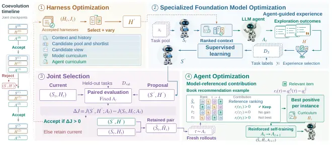
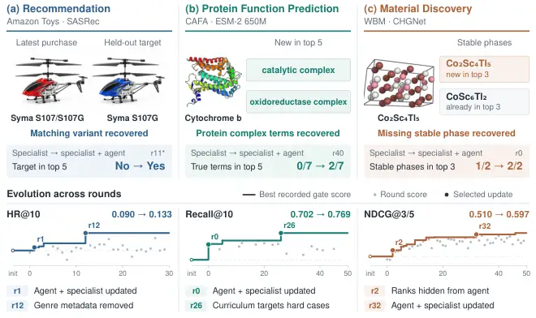

# ![[Uncaptioned image]](arxiv-2610-16078v1--78c2df8236e8.figures/figure-1.webp)  Heterogeneous Agentic Coevolution

Wenqian Ye Affiliation: Meta AI Affiliation: University of Virginia Work
done at Meta    Ziwei Guan Affiliation: Meta AI    Zi Yang
Affiliation: Meta AI    Shivani Modi Affiliation: Meta AI    Cici Cong
Wu Affiliation: Meta AI    Yunlong He Affiliation: Meta AI    Yuxin Chen
Affiliation: Meta AI    Zhengyu Zhang Affiliation: Meta AI    Liang Luo
Affiliation: Meta AI    Venkatesh Ranganathan Affiliation: Meta AI   
Jianhui Sun Affiliation: Meta AI    Yantao Yao Affiliation: Meta AI   
Wenlin Chen Affiliation: Meta AI    Buyun Zhang Affiliation: Meta AI   
Ellie Dingqiao Wen Affiliation: Meta AI    Henry Kautz
Affiliation: University of Virginia    Aidong Zhang
Affiliation: University of Virginia

###### Abstract

Recent advances in self-improving LLM agents have demonstrated the
potential of AI systems that drive their own intelligence. However, many
domain-specific applications rely on specialized foundation models that
possess strong domain expertise but remain dependent on human-designed
improvements. Extending recursive self-improvement to these models
presents a key challenge: as a specialist improves, the strategies used
to advance it must also adapt. To address this challenge, we propose
Heterogeneous Agentic CoEvolution (HACE), a framework that jointly
evolves specialized foundation models and LLM agents through reciprocal
learning. HACE improves the specialist through supervised learning while
training the agent with on-policy reinforced self-training, guided by
verified performance gains on the current specialist. The agent’s
exploration, in turn, informs subsequent specialist training, enabling
both models to adapt to each other’s progress. To sustain this
reciprocal learning, HACE further employs evolutionary search to
optimize their interaction harness, adapting how the models exchange
information and select training experiences as their capabilities
evolve. We evaluate HACE across three challenging domains:
recommendation systems, protein function prediction in biology, and
crystal stability prediction in material discovery. We show that HACE
outperforms the evaluated self-improving methods on the primary task
metrics across all three domains. These results shed light on
heterogeneous coevolution as a universal approach to improving
specialized foundation models through reciprocal interaction with a
learning agent.

^(†)^(†)correspondence: Wenqian Ye
([wenqian@virginia.edu](mailto:wenqian@virginia.edu)), Buyun Zhang
([buyunz@meta.com](mailto:buyunz@meta.com))

\titleformat

\*

## 1

\titleformat

\*

### 1.1

\titleformat

\*

#### 1.1.1

²²footnotetext: These authors jointly supervised this work

Figure 1: From human-directed optimization to heterogeneous agentic
coevolution. HACE brings together specialized foundation models and LLM
agents into a shared learning process, where each helps determine how
the other improves. Across rounds, both learners and their interaction
harness evolve, creating new opportunities for reciprocal improvement.

## 2 Introduction

Lately, large language model (LLM) agents are beginning to automate the
experimental work behind model development. Agents can revise their
implementations, improve their interaction harnesses, and modify the
procedures that generate further improvements (Zhang et al., 2026a; Lee
et al., 2026; Zhang et al., 2026b). They can also continue training on
experience collected during adaptation and exploration (Zweiger et al.,
2025; Yuksekgonul et al., 2026). These advances suggest that model
development itself can become an autonomous learning process. Extending
this progress to scientific AI requires bringing the domain expertise of
specialized foundation models into this process.

In scientific AI, specialized foundation models generally learn reusable
domain knowledge through large-scale pretraining. Protein language
models learn biological regularities from sequences (Lin et al., 2023),
while pretrained interatomic potential models learn the energies and
forces governing material behavior (Deng et al., 2023). In
recommendation, architectures such as HSTU (Zhai et al., 2024) and
Wukong (Zhang et al., 2024) extend this scaling approach to large
collections of user interactions. These models acquire domain expertise
that often exceeds that of general LLM agents due to specific designs.
Yet they still cannot self-evolve like LLM agents. Once supervised
training converges and further training yields no improvement,
researchers have to manually identify useful designs to improve the
specialized foundation model, such as better feature engineering or
algorithmic changes, as shown in Figure 1.

Recent developments in agentic systems pave a feasible path to automate
this process. Their ability to interpret feedback, explore alternatives,
and revise executable procedures allows them to influence how another
model learns. For example, Eureka (Ma et al., 2024) demonstrates this
possibility by using LLMs to design reward programs for training robot
policies autonomously. However, most self-evolving systems still rely on
proprietary LLMs whose parameters remain fixed while agent code and
interaction harnesses evolve (Zhang et al., 2026a; Lee et al., 2026;
Zhang et al., 2026b). The experience collected during improvement thus
does not update the underlying language model. For specialized
foundation models, the challenge is for the LLM agent model to keep
improving the specialized model as the specialized model advances. An
intervention that improves the initial model can become redundant after
further training. An agent that learns to address the initial model’s
weaknesses, therefore, faces a changing task as those weaknesses are
resolved. Continued progress requires the agent to learn continually
with the model when it improves. We refer to this mechanism as
reciprocal learning.

To close the gap, we propose a novel framework, Heterogeneous Agentic
Coevolution (HACE), which coevolves a specialized foundation model
(i.e., the specialist) with a heterogeneous LLM agent which learns to
guide the coevolution. The key idea is to improve the specialist through
supervision while also training the agent to keep advancing it under an
adaptive curriculum. Agent learning is guided by verified gains over the
current specialist. The agent’s exploration, in turn, guides the
selection of experiences for subsequent specialist training. As the
specialist improves, it changes which agent contributions are useful. As
the agent improves, it changes the learning opportunities available to
the specialist. This reciprocal feedback loop seamlessly connects
supervised specialist learning with on-policy reinforced self-training.

We need to ensure that these models interact and develop their
capabilities in a continuously improving direction. What the agent sees
and which experiences reach specialist training determine the
opportunities that either model can use. Thus, we also propose an
evolutionary interaction harness in HACE that governs information
exchange and training experience selection. Evolutionary search
evaluates harness changes through their effects on task performance and
specialist learning. A better harness can expose opportunities that the
current models have not utilized, while model updates change which
harness designs remain effective. HACE thus improves the specialist
while learning how to organize its continued improvement. Domain
expertise, agentic capabilities, and the process connecting their
learning coevolve together.

To show the effectiveness, we comprehensively evaluate HACE in three
challenging domains, including recommendation systems, protein function
prediction in biology, and crystal stability prediction in material
discovery. In each domain, we begin with specialists already trained to
convergence, where continued training under the original supervised
procedure yields no further improvement. This setting stress-tests
whether interaction with an evolving agent can create opportunities for
learning beyond that plateau. Across diverse specialist architectures
and large-scale datasets, HACE achieves state-of-the-art performance and
outperforms all evaluated evolution methods. These results demonstrate
that HACE enables specialists to continue improving beyond supervised
convergence. HACE brings their existing domain expertise into autonomous
self-improvement while developing the agentic capabilities needed to
advance it.

To summarize, our main contributions are as follows:

- •
  We introduce HACE, an evolutionary framework for autonomous
  self-improvement that brings specialized foundation models and LLM
  agents into a shared coevolution process.
- •
  We propose a novel reciprocal learning mechanism in which verified
  agent contributions guide agent learning, agent exploration also
  informs specialist training, and an evolving harness adaptively
  coordinates their reciprocal interaction.
- •
  We empirically demonstrate the effectiveness of HACE across three
  challenging domains: recommendation, protein function prediction, and
  material discovery. The results show that HACE can substantially push
  the domain-specific performance beyond the capability boundary.

## 3 Related Work

##### Agent and harness optimization.

Recent work uses execution feedback to improve agent programs,
interaction harnesses, and the procedures that propose further
improvements (Hu et al., 2025; Zhang et al., 2026a; Lee et al., 2026;
Luo et al., 2026; Zhang et al., 2026b; Cemri et al., 2026; Liu et al.,
2026b). Other methods improve the underlying model through parameter
updates. Reinforced self-training learns from responses selected by task
rewards (Singh et al., 2024), while self-adaptation and test-time
learning use generated experience or task feedback for further training
(Zweiger et al., 2025; Yuksekgonul et al., 2026). HACE connects harness
search with parameter learning in both a specialized foundation model
and an LLM agent. The harness controls their interaction and the
experience used to train each model.

##### Coevolution and reciprocal learning.

Coevolution can be traced to reciprocal evolutionary responses between
interacting populations in biology (Janzen, 1980). In machine learning,
many methods have connected the development of reward programs,
environments, or optimization procedures with the learners they guide
(Ma et al., 2024; Liu et al., 2026c; Wang et al., 2019; Dennis et al.,
2020; Chen et al., 2026; Yang et al., 2026; Li et al., 2026). HACE
studies this dependence between models with different capabilities and
learning signals. Agent exploration can change which instances train the
specialized model, whose predictions in turn determine which agent
responses pass verification. Our analysis characterizes this dependence
through the distribution of verified experience and identifies when an
update to either learner changes its allocation across instances.

##### Agent distillation.

Agent distillation transfers reasoning and tool use from LLM agents to
smaller language models (Liu et al., 2026a; Kang et al., 2025). MAD-OPD
derives supervision from teachers that debate over the student’s current
trajectories (Wang et al., 2026). These methods update the student while
keeping teacher parameters fixed. HACE is distinct from this line of
work and takes a step forward, where an LLM agent with lower overall
domain performance can still improve on the specialized foundation
model. Agent exploration guides instance selection for specialist
training, while verified contributions guide response selection back for
agent learning. Both models can therefore coevolve reciprocally without
assigning either a fixed teacher role.

## 4 Heterogeneous Agentic Coevolution

In this section, we formally present Heterogeneous Agentic Coevolution
(HACE), a framework for reciprocal self-improvement between specialized
foundation models and LLM agents. Figure 2 illustrates how an evolving
harness connects specialist adaptation, joint selection, and agent
learning within one coevolution loop. In Section 4.1, we describe how
specialist predictions can guide agent exploration and how the resulting
experience selects instances for specialist training with original task
labels. In Section 4.2, we incorporate the proposed harness together
with the adapted specialist, then use the retained pair to identify
fresh responses for on-policy agent learning. These updates allow each
learner to shape the training experience of the other precisely. In
Section 4.3, we establish a source risk bound that relates specialist
learning to the coverage of accepted experience within the coevolution.



Figure 2: Overview of HACE. Agent exploration selects specialist
training experience. Joint validation retains the specialist and
harness, after which fresh verified responses train the agent and shape
later exploration. The on-policy agent optimization step uses reinforced
self-training.

### 4.1 Reciprocal Learning

Let $`S`$ denote the specialist, $`A`$ the agent, and $`H`$ the harness.
Round $`t=0,1,\ldots`$ starts from $`(S_{t},H_{t},A_{t})`$. We propose a
harness $`H^{\prime}`$ by modifying a parent from an archive of accepted
harnesses. Its fields control the task information and specialist
context shown to the agent, how responses are interpreted, and which
examples train each learner. Let $`\mathcal{I}`$ index the finite
nonempty training pool of labeled instances $`(x_{i},y_{i})`$.

Under $`H^{\prime}`$, the agent receives a prompt constructed from a
training input $`x_{i}`$ and the predictions of $`S_{t}`$, without
access to its label $`y_{i}`$. We evaluate each response $`\tau`$
against $`y_{i}`$ using the same task constraints as the specialist. Let
$`q_{i}^{A}(\tau)`$ and $`q_{i}^{S}`$ denote their respective task
qualities, with larger values preferred. The response contribution is

```math
r_{i}(\tau)=q_{i}^{A}(\tau)-q_{i}^{S}. \tag{1}
```

A response passes verification when its prediction is valid, supervision
is evaluable, and $`r_{i}(\tau)>0`$. An agent with lower average task
quality can still provide verified responses on individual instances.
The specialist and harness used in each collection determine both
quality terms. Appendix B.3 specifies the task quality and verification
rules.

The harness also determines which prediction candidates the agent can
access. Additional sampling cannot recover a relevant candidate excluded
from that view. Changing the view can therefore create opportunities
that further sampling under the same harness would miss, while the
curriculum determines which exploration outcomes receive the
specialist’s training budget.

The harness uses these outcomes to select a nonempty set of training
indices $`\mathcal{I}_{t}^{S}\subseteq\mathcal{I}`$. Its curriculum can
prioritize verified improvements, unsuccessful exploration, or uncertain
joint predictions, with uniform sampling as an option. Write
$`S_{\phi}`$ for the specialist with trainable parameters $`\phi`$,
which may belong to the foundation model or its prediction head. A fixed
optimization budget starting from $`S_{t}`$ produces $`S^{\prime}`$
using

```math
\mathcal{L}_{S,t}(\phi)=\frac{1}{|\mathcal{I}_{t}^{S}|}\sum_{i\in\mathcal{I}_{t}^{S}}\ell_{\mathrm{task}}(S_{\phi}(x_{i}),y_{i}), \tag{2}
```

where $`\ell_{\mathrm{task}}`$ is the original supervised task loss.
Agent exploration determines where to train, while task labels determine
what the specialist learns. The harness thus affects both current
predictions and the specialist produced by adaptation. We evaluate
$`H^{\prime}`$ and $`S^{\prime}`$ together after specialist adaptation
to account for both effects.

### 4.2 Joint Selection

Joint selection tests whether specialist adaptation under the harness
improves joint predictions. For a candidate $`c`$ in the view for
instance $`i`$, let $`s_{i}(c)`$ be its specialist score after any
stored calibration, with larger values preferred, and $`a_{i}(c)`$ its
agent score. Joint prediction ranks candidates by

```math
s_{i}(c)+\lambda a_{i}(c),\qquad\lambda\geq 0. \tag{3}
```

Here $`a_{i}(c)=1/\log_{2}(u+1)`$ when $`c`$ appears at position $`u`$
in the agent ranking, and zero otherwise. The weight $`\lambda`$
controls the agent’s influence, with zero recovering the specialist
ordering within the same view.

Training, validation, and final evaluation use disjoint splits. With
$`A_{t}`$ fixed, we compare the proposed and current pairs on the same
validation batch $`\mathcal{B}_{t}`$. Let $`J_{\mathcal{B}_{t}}(S,H,A)`$
be the mean joint task quality for state $`(S,H,A)`$. Both states use
the same two folds, fitting their own weights from a fixed grid on one
fold and evaluating on the other, then exchanging roles. The proposal is
accepted when

```math
\Delta J_{t}=J_{\mathcal{B}_{t}}(S^{\prime},H^{\prime},A_{t})-J_{\mathcal{B}_{t}}(S_{t},H_{t},A_{t})>0. \tag{4}
```

Acceptance retains $`(S^{\prime},H^{\prime})`$ and records the harness
and score. Otherwise, we restore $`(S_{t},H_{t})`$ and the specialist
training state. Write $`(\bar{S}_{t},\bar{H}_{t})`$ for the pair
retained after this decision.

The retained pair now defines the context and reference for agent
learning. A specialist update can change which responses improve on its
predictions, and a harness update can change the information available
to the agent. We therefore collect fresh responses with $`A_{t}`$ under
$`(\bar{S}_{t},\bar{H}_{t})`$, keep the original response with the
largest positive contribution for each eligible instance, and apply the
agent curriculum. This makes agent supervision depend on the current
specialist’s remaining opportunities for improvement.

Let $`\mathcal{Z}_{t}`$ be the indexed dataset of selected prompt and
response concatenations, with repeated records counted separately. For a
record $`z`$, let $`|z|`$ count its nonpadding tokens, $`z_{\ell}`$ be
its token at position $`\ell`$, and $`z_{<\ell}`$ its preceding prefix.
Write $`p_{\theta}(z_{\ell}\mid z_{<\ell})`$ for the agent’s next-token
probability before decoding transformations, with trainable parameters
$`\theta`$. For nonempty $`\mathcal{Z}_{t}`$, on-policy reinforced
self-training (Singh et al., 2024) minimizes

```math
\mathcal{L}_{A,t}(\theta)=-\frac{1}{|\mathcal{Z}_{t}|}\sum_{z\in\mathcal{Z}_{t}}\frac{1}{|z|-1}\sum_{\ell=2}^{|z|}\log p_{\theta}(z_{\ell}\mid z_{<\ell}). \tag{5}
```

Each record has at least two tokens. The loss averages predicted tokens
within each record, including prompt and response tokens, then averages
records. Contribution scores select training responses without weighting
this loss. The dataset stays fixed during fitting, and an empty dataset
leaves the agent unchanged. Agent learning follows either selection
outcome, giving the next state
$`(S_{t+1},H_{t+1},A_{t+1})=(\bar{S}_{t},\bar{H}_{t},A_{t+1})`$. Its
updated responses guide exploration in the next round.

### 4.3 Learning Guarantee

The training distribution can change with model updates and harness
selection. To study learning under that changing distribution, we
theoretically analyze accepted exposure and the final specialist’s loss
on the resulting experience. Let $`\mu_{i}\geq 0`$, with
$`\sum_{i\in\mathcal{I}}\mu_{i}=1`$, be fixed source probabilities. Fix
a finite nonempty specialist class $`\mathcal{F}`$ before exploration
and a fixed loss $`\ell_{i}(f)\in[0,1]`$ for each $`i\in\mathcal{I}`$
and $`f\in\mathcal{F}`$. This analysis loss is independent of the
harness and may differ from $`\ell_{\mathrm{task}}`$. The specialist’s
source risk is $`R_{\mu}(f)=\sum_{i\in\mathcal{I}}\mu_{i}\ell_{i}(f)`$.

Let $`\mathcal{H}_{t}`$ be the observed history before round $`t`$, and
let $`W_{t,i}`$ be the accepted training weight of instance $`i`$. A
nonempty accepted update assigns total weight one uniformly to newly
selected instances. All other weights are zero. These weights are known
by the end of the round. After $`T`$ rounds, define cumulative expected
accepted exposure and loss by

```math
C_{T}(i)=\sum_{t<T}\mathbb{E}[W_{t,i}\mid\mathcal{H}_{t}],\qquad\widehat{L}_{T}(f)=\sum_{t<T}\sum_{i\in\mathcal{I}}W_{t,i}\ell_{i}(f), \tag{6}
```

where $`t<T`$ denotes rounds $`0,\ldots,T-1`$. In
$`\widehat{L}_{T}(S_{T})`$, all accepted instances are evaluated at the
final specialist $`S_{T}\in\mathcal{F}`$, which may depend on the
observed history. For $`v>0`$, let
$`U_{T}(v)=\sum_{i:C_{T}(i)<v\mu_{i}}\mu_{i}`$ be the source mass with
insufficient exposure.

###### Theorem 1 (Learning from Evolving Experience).

For any fixed $`\delta\in(0,1)`$, with probability at least $`1-\delta`$
over the learning process, every final specialist
$`S_{T}\in\mathcal{F}`$ satisfies, simultaneously for all integers
$`T\geq 1`$ and all $`v>0`$,

```math
R_{\mu}(S_{T})\leq U_{T}(v)+\frac{\widehat{L}_{T}(S_{T})+\log(|\mathcal{F}|/\delta)}{(1-e^{-1})v}. \tag{7}
```

On the same event, $`R_{\mu}(S_{T})\to 0`$ whenever $`v_{T}>0`$
satisfies $`v_{T}\to\infty`$, $`U_{T}(v_{T})\to 0`$, and
$`\widehat{L}_{T}(S_{T})/v_{T}\to 0`$.

The bound separates reaching useful training instances from learning and
retaining their information. Harness search, agent exploration, and
joint selection determine accepted exposure. Specialist optimization
determines the final loss on that experience, including whether later
updates preserve earlier learning. Sufficient exposure across the source
distribution and small loss relative to that exposure yield a small risk
bound, even when selection depends on the full preceding history.
Appendix B.1 gives the complete proof. Proposition 1 explains how agent
fitting and reference changes affect verification before curriculum
selection and acceptance determine exposure.

## 5 Experiments

In this section, we empirically evaluate whether HACE can push the
capability boundary with the converged specialized foundation models
across three important domains (recommendation systems, protein function
prediction, and material discovery), compared with other self-improving
methods.

##### Experimental setups.

By default, we use Gemma4-E4B (Gemma Team, 2026) as the LLM agent. We
also conduct more experiments with various LLM agents (Gemma4-E2B,
Gemma4-26B-A4B) in Section 5.3. On the specialized foundation models,
for recommendation tasks, we evaluate on MovieLens 1M (ML-1M) (Harper
and Konstan, 2015) and four Amazon categories (McAuley et al., 2015)
using three mainstream foundation models SASRec (Kang and McAuley,
2018), HSTU (Zhai et al., 2024), and Wukong (Zhang et al., 2024). For
protein function prediction, we use frozen ESM-2 (Lin et al., 2023) and
ProtT5-XL (Elnaggar et al., 2022) backbones on CAFA (Jiang et al.,
2016). For crystal stability prediction in material discovery task, we
use CHGNet (Deng et al., 2023) on WBM (Wang et al., 2021; Riebesell et
al., 2025). Base denotes the initial specialists, which are already
trained to convergence before coevolution. Unless stated otherwise,
reported scores apply the fusion in Equation 3 with the weight selected
by cross fitting, for Base and for all methods alike. At round 0 the
agent is untrained and cross fitting selects a zero weight. Table 7
shows that HACE is agnostic to the specialist architectures and their
adaptation scope, including causal attention models, a factorization
network, protein language models, and a graph neural potential model.

We compare against popular self-improving methods, including ReST-EM
(Singh et al., 2024), Meta-Harness (Lee et al., 2026), OpenEvolve
(Sharma, 2025), DGM (Zhang et al., 2026a), and TTT-Discover (Yuksekgonul
et al., 2026). The recommendation task performs ranking on candidate
items, the protein prediction task predicts the function terms, and the
materials discovery task ranks candidate crystal structures by stability
within a defined chemical system. These experiments measure improvements
in prediction with their pretrained representations.

|         |                                               |                                               |                                               |                                               |                                               |                                               |                                                        |
| ------- | --------------------------------------------- | --------------------------------------------- | --------------------------------------------- | --------------------------------------------- | --------------------------------------------- | --------------------------------------------- | ------------------------------------------------------ |
| Dataset | Base                                          | ReST-EM                                       | Meta-Harness                                  | OpenEvolve                                    | DGM                                           | TTT-Discover                                  | HACE                                                   |
| SASRec  |                                               |                                               |                                               |                                               |                                               |                                               |                                                        |
| ML-1M   | $`0.2557_{\color[rgb]{0.4,0.4,0.4}\pm.0012}`$ | $`0.2492_{\color[rgb]{0.4,0.4,0.4}\pm.0022}`$ | $`0.2491_{\color[rgb]{0.4,0.4,0.4}\pm.0017}`$ | $`0.2421_{\color[rgb]{0.4,0.4,0.4}\pm.0004}`$ | $`0.2488_{\color[rgb]{0.4,0.4,0.4}\pm.0018}`$ | $`0.2473_{\color[rgb]{0.4,0.4,0.4}\pm.0013}`$ | $`\mathbf{0.2632}_{\color[rgb]{0.4,0.4,0.4}\pm.0013}`$ |
| Beauty  | $`0.0599_{\color[rgb]{0.4,0.4,0.4}\pm.0004}`$ | $`0.0597_{\color[rgb]{0.4,0.4,0.4}\pm.0010}`$ | $`0.0631_{\color[rgb]{0.4,0.4,0.4}\pm.0007}`$ | $`0.0638_{\color[rgb]{0.4,0.4,0.4}\pm.0003}`$ | $`0.0634_{\color[rgb]{0.4,0.4,0.4}\pm.0005}`$ | $`0.0633_{\color[rgb]{0.4,0.4,0.4}\pm.0004}`$ | $`\mathbf{0.0672}_{\color[rgb]{0.4,0.4,0.4}\pm.0004}`$ |
| CDs     | $`0.0576_{\color[rgb]{0.4,0.4,0.4}\pm.0005}`$ | $`0.0587_{\color[rgb]{0.4,0.4,0.4}\pm.0010}`$ | $`0.0604_{\color[rgb]{0.4,0.4,0.4}\pm.0004}`$ | $`0.0611_{\color[rgb]{0.4,0.4,0.4}\pm.0002}`$ | $`0.0592_{\color[rgb]{0.4,0.4,0.4}\pm.0008}`$ | $`0.0587_{\color[rgb]{0.4,0.4,0.4}\pm.0007}`$ | $`\mathbf{0.0647}_{\color[rgb]{0.4,0.4,0.4}\pm.0006}`$ |
| Sports  | $`0.0315_{\color[rgb]{0.4,0.4,0.4}\pm.0003}`$ | $`0.0325_{\color[rgb]{0.4,0.4,0.4}\pm.0001}`$ | $`0.0323_{\color[rgb]{0.4,0.4,0.4}\pm.0002}`$ | $`0.0331_{\color[rgb]{0.4,0.4,0.4}\pm.0004}`$ | $`0.0333_{\color[rgb]{0.4,0.4,0.4}\pm.0003}`$ | $`0.0323_{\color[rgb]{0.4,0.4,0.4}\pm.0002}`$ | $`\mathbf{0.0356}_{\color[rgb]{0.4,0.4,0.4}\pm.0003}`$ |
| Toys    | $`0.0596_{\color[rgb]{0.4,0.4,0.4}\pm.0001}`$ | $`0.0648_{\color[rgb]{0.4,0.4,0.4}\pm.0007}`$ | $`0.0657_{\color[rgb]{0.4,0.4,0.4}\pm.0008}`$ | $`0.0662_{\color[rgb]{0.4,0.4,0.4}\pm.0008}`$ | $`0.0661_{\color[rgb]{0.4,0.4,0.4}\pm.0009}`$ | $`0.0646_{\color[rgb]{0.4,0.4,0.4}\pm.0008}`$ | $`\mathbf{0.0706}_{\color[rgb]{0.4,0.4,0.4}\pm.0003}`$ |
| HSTU    |                                               |                                               |                                               |                                               |                                               |                                               |                                                        |
| ML-1M   | $`0.2604_{\color[rgb]{0.4,0.4,0.4}\pm.0003}`$ | $`0.2563_{\color[rgb]{0.4,0.4,0.4}\pm.0005}`$ | $`0.2569_{\color[rgb]{0.4,0.4,0.4}\pm.0007}`$ | $`0.2573_{\color[rgb]{0.4,0.4,0.4}\pm.0005}`$ | $`0.2572_{\color[rgb]{0.4,0.4,0.4}\pm.0006}`$ | $`0.2588_{\color[rgb]{0.4,0.4,0.4}\pm.0013}`$ | $`\mathbf{0.2685}_{\color[rgb]{0.4,0.4,0.4}\pm.0003}`$ |
| Beauty  | $`0.0626_{\color[rgb]{0.4,0.4,0.4}\pm.0003}`$ | $`0.0669_{\color[rgb]{0.4,0.4,0.4}\pm.0013}`$ | $`0.0673_{\color[rgb]{0.4,0.4,0.4}\pm.0013}`$ | $`0.0668_{\color[rgb]{0.4,0.4,0.4}\pm.0013}`$ | $`0.0687_{\color[rgb]{0.4,0.4,0.4}\pm.0004}`$ | $`0.0695_{\color[rgb]{0.4,0.4,0.4}\pm.0003}`$ | $`\mathbf{0.0731}_{\color[rgb]{0.4,0.4,0.4}\pm.0003}`$ |
| CDs     | $`0.0657_{\color[rgb]{0.4,0.4,0.4}\pm.0002}`$ | $`0.0654_{\color[rgb]{0.4,0.4,0.4}\pm.0006}`$ | $`0.0656_{\color[rgb]{0.4,0.4,0.4}\pm.0008}`$ | $`0.0656_{\color[rgb]{0.4,0.4,0.4}\pm.0010}`$ | $`0.0658_{\color[rgb]{0.4,0.4,0.4}\pm.0006}`$ | $`0.0673_{\color[rgb]{0.4,0.4,0.4}\pm.0003}`$ | $`\mathbf{0.0706}_{\color[rgb]{0.4,0.4,0.4}\pm.0002}`$ |
| Sports  | $`0.0348_{\color[rgb]{0.4,0.4,0.4}\pm.0003}`$ | $`0.0346_{\color[rgb]{0.4,0.4,0.4}\pm.0005}`$ | $`0.0349_{\color[rgb]{0.4,0.4,0.4}\pm.0004}`$ | $`0.0351_{\color[rgb]{0.4,0.4,0.4}\pm.0003}`$ | $`0.0372_{\color[rgb]{0.4,0.4,0.4}\pm.0001}`$ | $`0.0372_{\color[rgb]{0.4,0.4,0.4}\pm.0002}`$ | $`\mathbf{0.0394}_{\color[rgb]{0.4,0.4,0.4}\pm.0001}`$ |
| Toys    | $`0.0673_{\color[rgb]{0.4,0.4,0.4}\pm.0001}`$ | $`0.0727_{\color[rgb]{0.4,0.4,0.4}\pm.0006}`$ | $`0.0732_{\color[rgb]{0.4,0.4,0.4}\pm.0003}`$ | $`0.0726_{\color[rgb]{0.4,0.4,0.4}\pm.0002}`$ | $`0.0746_{\color[rgb]{0.4,0.4,0.4}\pm.0007}`$ | $`0.0740_{\color[rgb]{0.4,0.4,0.4}\pm.0004}`$ | $`\mathbf{0.0788}_{\color[rgb]{0.4,0.4,0.4}\pm.0004}`$ |
| Wukong  |                                               |                                               |                                               |                                               |                                               |                                               |                                                        |
| ML-1M   | $`0.2559_{\color[rgb]{0.4,0.4,0.4}\pm.0020}`$ | $`0.2612_{\color[rgb]{0.4,0.4,0.4}\pm.0008}`$ | $`0.2573_{\color[rgb]{0.4,0.4,0.4}\pm.0013}`$ | $`0.2582_{\color[rgb]{0.4,0.4,0.4}\pm.0003}`$ | $`0.2610_{\color[rgb]{0.4,0.4,0.4}\pm.0013}`$ | $`0.2607_{\color[rgb]{0.4,0.4,0.4}\pm.0013}`$ | $`\mathbf{0.2703}_{\color[rgb]{0.4,0.4,0.4}\pm.0020}`$ |
| Beauty  | $`0.0734_{\color[rgb]{0.4,0.4,0.4}\pm.0002}`$ | $`0.0810_{\color[rgb]{0.4,0.4,0.4}\pm.0004}`$ | $`0.0805_{\color[rgb]{0.4,0.4,0.4}\pm.0004}`$ | $`0.0795_{\color[rgb]{0.4,0.4,0.4}\pm.0004}`$ | $`0.0788_{\color[rgb]{0.4,0.4,0.4}\pm.0004}`$ | $`0.0772_{\color[rgb]{0.4,0.4,0.4}\pm.0004}`$ | $`\mathbf{0.0856}_{\color[rgb]{0.4,0.4,0.4}\pm.0002}`$ |
| CDs     | $`0.0726_{\color[rgb]{0.4,0.4,0.4}\pm.0005}`$ | $`0.0771_{\color[rgb]{0.4,0.4,0.4}\pm.0002}`$ | $`0.0798_{\color[rgb]{0.4,0.4,0.4}\pm.0004}`$ | $`0.0780_{\color[rgb]{0.4,0.4,0.4}\pm.0004}`$ | $`0.0785_{\color[rgb]{0.4,0.4,0.4}\pm.0004}`$ | $`0.0770_{\color[rgb]{0.4,0.4,0.4}\pm.0004}`$ | $`\mathbf{0.0842}_{\color[rgb]{0.4,0.4,0.4}\pm.0005}`$ |
| Sports  | $`0.0388_{\color[rgb]{0.4,0.4,0.4}\pm.0005}`$ | $`0.0408_{\color[rgb]{0.4,0.4,0.4}\pm.0002}`$ | $`0.0398_{\color[rgb]{0.4,0.4,0.4}\pm.0002}`$ | $`0.0390_{\color[rgb]{0.4,0.4,0.4}\pm.0002}`$ | $`0.0410_{\color[rgb]{0.4,0.4,0.4}\pm.0002}`$ | $`0.0395_{\color[rgb]{0.4,0.4,0.4}\pm.0002}`$ | $`\mathbf{0.0438}_{\color[rgb]{0.4,0.4,0.4}\pm.0007}`$ |
| Toys    | $`0.0759_{\color[rgb]{0.4,0.4,0.4}\pm.0002}`$ | $`0.0785_{\color[rgb]{0.4,0.4,0.4}\pm.0004}`$ | $`0.0752_{\color[rgb]{0.4,0.4,0.4}\pm.0004}`$ | $`0.0793_{\color[rgb]{0.4,0.4,0.4}\pm.0004}`$ | $`0.0820_{\color[rgb]{0.4,0.4,0.4}\pm.0004}`$ | $`0.0770_{\color[rgb]{0.4,0.4,0.4}\pm.0004}`$ | $`\mathbf{0.0866}_{\color[rgb]{0.4,0.4,0.4}\pm.0006}`$ |

Table 1: Main results on recommendation across five datasets and three
architectures. Entries report HR@10 $`\uparrow`$ with standard
deviations in subscript. Bold marks the best mean in each row.

##### Evaluation metrics.

Hit Rate (HR@10) measures the fraction of recommendation queries with
the target item among the first ten predictions. NDCG uses binary
relevance, discounts each relevant candidate at rank $`r`$ by
$`1/\log_{2}(r+1)`$, and normalizes by the ideal ranking within the same
reference pool. We average NDCG@5 and NDCG@10 on CAFA, and NDCG@3 and
NDCG@5 on WBM according to the baseline implementations. For protein
function prediction, $`F_{\max}`$ is the maximum harmonic mean of
precision and recall over prediction thresholds (Jiang et al., 2016).
For material discovery, we use $`F_{1}`$ to measure their harmonic mean
for identifying stable structures (Riebesell et al., 2025). Higher
values indicate better performance for these metrics. Appendix C.1
defines all metrics in detail, including the additional measures
reported there. Tables report means with standard deviations on three
random seeds. Joint selection and fusion calibration only use the split
validation data to avoid data contamination, as defined in Section 4.2.

### 5.1 Main Comparison

|              | CAFA / ESM-2                                           |                                                        | CAFA / ProtT5-XL                                       |                                                        | WBM / CHGNet                                           |                                                        |
| ------------ | ------------------------------------------------------ | ------------------------------------------------------ | ------------------------------------------------------ | ------------------------------------------------------ | ------------------------------------------------------ | ------------------------------------------------------ |
| Method       | NDCG $`\uparrow`$                                      | $`F_{\max}\uparrow`$                                   | NDCG $`\uparrow`$                                      | $`F_{\max}\uparrow`$                                   | NDCG $`\uparrow`$                                      | $`F_{1}\uparrow`$                                      |
| Base         | $`0.6285_{\color[rgb]{0.4,0.4,0.4}\pm.0019}`$          | $`0.2218_{\color[rgb]{0.4,0.4,0.4}\pm.0014}`$          | $`0.6241_{\color[rgb]{0.4,0.4,0.4}\pm.0011}`$          | $`0.2221_{\color[rgb]{0.4,0.4,0.4}\pm.0005}`$          | $`0.6388_{\color[rgb]{0.4,0.4,0.4}\pm.0011}`$          | $`0.5159_{\color[rgb]{0.4,0.4,0.4}\pm.0003}`$          |
| ReST-EM      | $`0.6286_{\color[rgb]{0.4,0.4,0.4}\pm.0018}`$          | $`0.2219_{\color[rgb]{0.4,0.4,0.4}\pm.0014}`$          | $`0.6242_{\color[rgb]{0.4,0.4,0.4}\pm.0011}`$          | $`0.2221_{\color[rgb]{0.4,0.4,0.4}\pm.0005}`$          | $`0.6496_{\color[rgb]{0.4,0.4,0.4}\pm.0006}`$          | $`0.5508_{\color[rgb]{0.4,0.4,0.4}\pm.0004}`$          |
| Meta-Harness | $`0.6309_{\color[rgb]{0.4,0.4,0.4}\pm.0015}`$          | $`0.2224_{\color[rgb]{0.4,0.4,0.4}\pm.0013}`$          | $`0.6261_{\color[rgb]{0.4,0.4,0.4}\pm.0017}`$          | $`0.2229_{\color[rgb]{0.4,0.4,0.4}\pm.0006}`$          | $`0.6513_{\color[rgb]{0.4,0.4,0.4}\pm.0008}`$          | $`0.5510_{\color[rgb]{0.4,0.4,0.4}\pm.0004}`$          |
| OpenEvolve   | $`0.6320_{\color[rgb]{0.4,0.4,0.4}\pm.0018}`$          | $`0.2230_{\color[rgb]{0.4,0.4,0.4}\pm.0012}`$          | $`0.6254_{\color[rgb]{0.4,0.4,0.4}\pm.0014}`$          | $`0.2230_{\color[rgb]{0.4,0.4,0.4}\pm.0003}`$          | $`0.6486_{\color[rgb]{0.4,0.4,0.4}\pm.0008}`$          | $`0.5463_{\color[rgb]{0.4,0.4,0.4}\pm.0003}`$          |
| DGM          | $`0.6325_{\color[rgb]{0.4,0.4,0.4}\pm.0019}`$          | $`0.2219_{\color[rgb]{0.4,0.4,0.4}\pm.0014}`$          | $`0.6273_{\color[rgb]{0.4,0.4,0.4}\pm.0016}`$          | $`0.2235_{\color[rgb]{0.4,0.4,0.4}\pm.0006}`$          | $`0.6496_{\color[rgb]{0.4,0.4,0.4}\pm.0007}`$          | $`0.5508_{\color[rgb]{0.4,0.4,0.4}\pm.0003}`$          |
| TTT-Discover | $`0.6287_{\color[rgb]{0.4,0.4,0.4}\pm.0018}`$          | $`0.2219_{\color[rgb]{0.4,0.4,0.4}\pm.0014}`$          | $`0.6241_{\color[rgb]{0.4,0.4,0.4}\pm.0011}`$          | $`0.2221_{\color[rgb]{0.4,0.4,0.4}\pm.0005}`$          | $`0.6474_{\color[rgb]{0.4,0.4,0.4}\pm.0007}`$          | $`0.5504_{\color[rgb]{0.4,0.4,0.4}\pm.0003}`$          |
| HACE         | $`\mathbf{0.6745}_{\color[rgb]{0.4,0.4,0.4}\pm.0016}`$ | $`\mathbf{0.2438}_{\color[rgb]{0.4,0.4,0.4}\pm.0019}`$ | $`\mathbf{0.6739}_{\color[rgb]{0.4,0.4,0.4}\pm.0013}`$ | $`\mathbf{0.2317}_{\color[rgb]{0.4,0.4,0.4}\pm.0005}`$ | $`\mathbf{0.6541}_{\color[rgb]{0.4,0.4,0.4}\pm.0010}`$ | $`\mathbf{0.5513}_{\color[rgb]{0.4,0.4,0.4}\pm.0004}`$ |

Table 2: Main results on protein function prediction (CAFA) and material
discovery (WBM). Higher is better for all metrics. Full scientific
metrics appear in Tables 5 and 6.

##### Recommendation.

HACE achieves the highest mean HR@10 in all 15 settings in Table 1.
Relative gains over Base range from $`2.9\%`$ to $`18.5\%`$, averaging
$`12.1\%`$ across settings. On ML-1M, several evolution methods fall
below the initial SASRec and HSTU models, while HACE improves all three
architectures. On the four Amazon categories, Wukong has the strongest
initial scores among the three architectures, yet HACE further improves
its HR@10 by $`12.9\%`$ to $`16.6\%`$. Contribution rewards train the
agent against the current specialist throughout this process.

##### Protein function prediction.

Table 2 shows improvements with both protein backbones. HACE raises NDCG
from $`0.6285`$ to $`0.6745`$ with ESM-2 and from $`0.6241`$ to
$`0.6739`$ with ProtT5-XL. Existing evolution methods improve over Base
by at most $`0.0040`$ and $`0.0032`$, respectively, compared with
$`0.0460`$ and $`0.0498`$ for HACE. HACE also leads in $`F_{\max}`$,
AUPR, and Recall@10. These gains cover both the ordering of function
terms and their classification. Table 5 also reports semantic distance,
for which DGM has the lowest mean on ProtT5-XL. The ablations below
examine how these gains depend on harness search and specialist
optimization.

##### Material Discovery.

On WBM, all competing methods improve NDCG over Base, from $`0.6388`$ to
at least $`0.6474`$. HACE reaches $`0.6541`$, exceeding the strongest
competing mean by $`0.0028`$. HACE also achieves the best mean on all
four additional metrics in Table 6. Removing specialist optimization
reduces NDCG to $`0.6395`$, close to Base at $`0.6388`$. The
contribution of supervised specialist updates is therefore particularly
clear on this task. Supervised adaptation improves numerical
predictions, while the ranking objective favors recovering stable
candidates near the top.

### 5.2 Ablation Studies

| Leave-one-out component     | Toys                                                   | CAFA                                                   | WBM                                                    |
| --------------------------- | ------------------------------------------------------ | ------------------------------------------------------ | ------------------------------------------------------ |
| HACE                        | $`\mathbf{0.0706}_{\color[rgb]{0.4,0.4,0.4}\pm.0003}`$ | $`\mathbf{0.6745}_{\color[rgb]{0.4,0.4,0.4}\pm.0016}`$ | $`\mathbf{0.6541}_{\color[rgb]{0.4,0.4,0.4}\pm.0010}`$ |
| w/o harness optimization    | $`0.0658_{\color[rgb]{0.4,0.4,0.4}\pm.0005}`$          | $`0.6307_{\color[rgb]{0.4,0.4,0.4}\pm.0019}`$          | $`0.6500_{\color[rgb]{0.4,0.4,0.4}\pm.0012}`$          |
| w/o specialist optimization | $`0.0641_{\color[rgb]{0.4,0.4,0.4}\pm.0005}`$          | $`0.6310_{\color[rgb]{0.4,0.4,0.4}\pm.0022}`$          | $`0.6395_{\color[rgb]{0.4,0.4,0.4}\pm.0012}`$          |
| w/o agent optimization      | $`0.0622_{\color[rgb]{0.4,0.4,0.4}\pm.0006}`$          | $`0.6520_{\color[rgb]{0.4,0.4,0.4}\pm.0016}`$          | $`0.6502_{\color[rgb]{0.4,0.4,0.4}\pm.0011}`$          |
| w/o joint selection         | $`0.0650_{\color[rgb]{0.4,0.4,0.4}\pm.0006}`$          | $`0.6531_{\color[rgb]{0.4,0.4,0.4}\pm.0020}`$          | $`0.6497_{\color[rgb]{0.4,0.4,0.4}\pm.0013}`$          |
| w/o agent-guided experience | $`0.0662_{\color[rgb]{0.4,0.4,0.4}\pm.0005}`$          | $`0.6575_{\color[rgb]{0.4,0.4,0.4}\pm.0026}`$          | $`0.6507_{\color[rgb]{0.4,0.4,0.4}\pm.0012}`$          |

Table 3: Ablation studies on recommendation (Toys/SASRec), protein
function prediction (CAFA/ESM-2 650M), and material discovery
(WBM/CHGNet). Metrics are HR@10 for Toys and mean NDCG for CAFA and WBM.

We conduct leave-one-out ablation studies in Table 3 in three domains.
Removing agent optimization causes the largest drop on Toys, from
$`0.0706`$ to $`0.0622`$. On CAFA, removing harness or specialist
optimization reduces NDCG by $`0.0438`$ and $`0.0435`$, respectively.
Harness search controls the information exposed to the agent and the
experience selected for adaptation, while specialist optimization learns
from that experience using task labels. Agent optimization matters most
on Toys and specialist optimization on WBM, indicating that their
contributions vary by task. Removing agent-guided experience lowers
performance even when specialist optimization remains enabled, by
$`0.0044`$ on Toys, $`0.0170`$ on CAFA, and $`0.0034`$ on WBM. This
decrease supports the role of agent exploration in selecting training
experience, in addition to its role in prediction. Removing joint
selection also reduces all three scores. Together, we show that all
designed components contribute positively to the framework.

### 5.3 Agent and Model Scaling

|                                           |            |            |                                                  |
| ----------------------------------------- | ---------- | ---------- | ------------------------------------------------ |
| Model                                     | Base       | HACE       | Reported $`\Delta`$                              |
| Specialist size Fixed agent Gemma-4 E4B   |            |            |                                                  |
| ESM-2 35M                                 | $`0.6283`$ | $`0.6692`$ | $`+0.0409_{\color[rgb]{0.5,0.5,0.5}\pm 0.0007}`$ |
| ESM-2 150M                                | $`0.6211`$ | $`0.6633`$ | $`+0.0422_{\color[rgb]{0.5,0.5,0.5}\pm 0.0004}`$ |
| ESM-2 650M                                | $`0.6285`$ | $`0.6745`$ | $`+0.0460_{\color[rgb]{0.5,0.5,0.5}\pm 0.0006}`$ |
| ESM-2 3B                                  | $`0.6339`$ | $`0.6763`$ | $`+0.0424_{\color[rgb]{0.5,0.5,0.5}\pm 0.0007}`$ |
| Agent variant Fixed specialist ESM-2 650M |            |            |                                                  |
| Gemma-4 E2B                               | $`0.6285`$ | $`0.6297`$ | $`+0.0012_{\color[rgb]{0.5,0.5,0.5}\pm 0.0018}`$ |
| Gemma-4 E4B                               | $`0.6285`$ | $`0.6745`$ | $`+0.0460_{\color[rgb]{0.5,0.5,0.5}\pm 0.0006}`$ |
| Gemma-4 26B-A4B                           | $`0.6285`$ | $`0.6339`$ | $`+0.0054_{\color[rgb]{0.5,0.5,0.5}\pm 0.0014}`$ |

Table 4: Scaling experiment on protein function prediction task. NDCG
averages cutoffs 5 and 10. Base denotes the initial specialists, which
are already trained to convergence before coevolution; Appendix C.3
states the criterion we use. Agent variants use a shared 30-round
configuration. Subscripts report standard deviations of within-run gains
on three random seeds.

In the specialist sweep with the agent fixed, HACE improves prediction
with all four ESM-2 sizes in Table 4, from 35M to 3B parameters. The
absolute NDCG gains remain between $`0.0409`$ and $`0.0460`$. The
largest final score comes from the 3B model, while the largest gain
occurs at 650M. The 35M model after HACE also exceeds the initial 3B
model, with NDCG of $`0.6692`$ versus $`0.6339`$. In the agent
comparison, E4B achieves the largest mean gain of $`0.0460`$, compared
with $`0.0012`$ for E2B and $`0.0054`$ for 26B-A4B. These are within-run
gains from a separate matched 30-round sweep with ESM-2 650M, detailed
in Appendix C.3. The gains do not increase monotonically with agent
size, suggesting that a larger agent does not necessarily contribute
more to the specialist in this setting.

### 5.4 Evolution Dynamics

Figure 3: Evolution dynamics of three domains. Best recorded scores
during evolution, measured by HR@10, Recall@10, and mean NDCG@3 and
NDCG@5. Dashed lines mark the frozen specialist.

##### Improvement over rounds.

Figure 3 shows HACE reaching the highest score in all three recorded
trajectories. The best recorded recommendation score rises mostly in
early rounds, while protein and materials reach new maxima after longer
intervals. In HACE, each retained specialist and harness defines the
starting point for the next round. Fresh agent responses are verified
against the current specialist. This update order makes agent
supervision depend on the retained specialist. The trajectories show
when higher scoring configurations are found during search.



Figure 4: Illustrations on events during coevolution. Upper panels
compare specialist and combined predictions. Lower panels show recorded
selection scores and their running maxima from one run in each domain,
with selected updates annotated.

##### Case studies on three domains.

Figure 4 compares specialist and combined predictions on three domains.
HACE recovers a matching product variant, places two relevant protein
terms in the top five, and brings a second stable phase into the top
three. Recorded changes include removing genre metadata, targeting
difficult training instances, and hiding candidate ranks from the agent.
These examples illustrate how the harness search and coevolution change
both the context used for prediction and the experience used for
reciprocal learning.

## 6 Conclusion

We introduced HACE, a novel framework for reciprocal self-improvement
between specialized foundation models and LLM agents. By evolving both
the learners and their interaction with an updating harness, HACE makes
each model a source of learning for the other. Our analysis identifies
sufficient conditions for specialist learning from adaptively selected
experience. Experiments in three domains demonstrate improvements beyond
initially converged specialists across different architectures. These
results show how heterogeneous AI models can support each other’s
development. Future work can study sustained coevolution, collaboration
among multiple specialists, and autonomous model development for
scientific discovery.

\FloatBarrier

## References

- Cemri et al. (2026) M. Cemri, S. Agrawal, A. Gupta, S. Liu, A.
  Cheng, Q. Mang, A. Naren, L. E. Erdogan, K. Sen, M. Zaharia, et al.
  Adaevolve: adaptive llm driven zeroth-order optimization. arXiv
  preprint arXiv:2602.20133. Cited by: §3.
- Chen et al. (2026) Z. Chen, T. Xiao, H. Zhu, Y. Yuan, L. Zhang, and J.
  Wang Co-harness: co-evolving harnesses and model for agents. In COLM
  2026 The 2nd Workshop on Lifelong Agents: Learning, Aligning, and
  Evolving, External Links:
  [Link](https://openreview.net/forum?id=qDC8LmkpSR) Cited by: §3.
- Deng et al. (2023) B. Deng, P. Zhong, K. Jun, J. Riebesell, K.
  Han, C. J. Bartel, and G. Ceder CHGNet as a pretrained universal
  neural network potential for charge-informed atomistic modelling.
  Nature Machine Intelligence 5 (9), pp. 1031–1041. External Links:
  [Document](https://dx.doi.org/10.1038/s42256-023-00716-3) Cited by:
  §2, §5.
- Dennis et al. (2020) M. Dennis, N. Jaques, E. Vinitsky, A. Bayen, S.
  Russell, A. Critch, and S. Levine Emergent complexity and zero-shot
  transfer via unsupervised environment design. In Advances in Neural
  Information Processing Systems, Vol. 33, pp. 13049–13061. Cited by:
  §3.
- Elnaggar et al. (2022) A. Elnaggar, M. Heinzinger, C. Dallago, G.
  Rehawi, Y. Wang, L. Jones, T. Gibbs, T. Feher, C. Angerer, M.
  Steinegger, D. Bhowmik, and B. Rost ProtTrans: toward understanding
  the language of life through self-supervised learning. IEEE
  Transactions on Pattern Analysis and Machine Intelligence 44 (10),
  pp. 7112–7127. External Links:
  [Document](https://dx.doi.org/10.1109/TPAMI.2021.3095381) Cited by:
  §5.
- Gemma Team (2026) Gemma Team Gemma 4 technical report. Note: arXiv
  preprint arXiv:2607.02770 External Links: 2607.02770 Cited by: §5.
- Harper and Konstan (2015) F. M. Harper and J. A. Konstan The MovieLens
  datasets: history and context. ACM Transactions on Interactive
  Intelligent Systems 5 (4), pp. 19:1–19:19. External Links:
  [Document](https://dx.doi.org/10.1145/2827872),
  [Link](https://doi.org/10.1145/2827872) Cited by: §5.
- Howard et al. (2021) S. R. Howard, A. Ramdas, J. McAuliffe, and J.
  Sekhon Time-uniform, nonparametric, nonasymptotic confidence
  sequences. The Annals of Statistics 49 (2), pp. 1055–1080. External
  Links: [Document](https://dx.doi.org/10.1214/20-AOS1991) Cited by:
  §B.1.
- Hu et al. (2025) S. Hu, C. Lu, and J. Clune Automated design of
  agentic systems. In International Conference on Learning
  Representations, Cited by: §3.
- Janzen (1980) D. H. Janzen When is it coevolution?. Evolution 34 (3),
  pp. 611–612. External Links:
  [Document](https://dx.doi.org/10.1111/j.1558-5646.1980.tb04849.x)
  Cited by: §3.
- Järvelin and Kekäläinen (2002) K. Järvelin and J. Kekäläinen Cumulated
  gain-based evaluation of IR techniques. ACM Transactions on
  Information Systems 20 (4), pp. 422–446. External Links:
  [Document](https://dx.doi.org/10.1145/582415.582418) Cited by: §B.3.
- Jiang et al. (2016) Y. Jiang, T. R. Oron, W. T. Clark, et al. An
  expanded evaluation of protein function prediction methods shows an
  improvement in accuracy. Genome Biology 17 (1), pp. 184. External
  Links: [Document](https://dx.doi.org/10.1186/s13059-016-1037-6) Cited
  by: §C.1, §5, §5.
- Kang et al. (2025) M. Kang, J. Jeong, S. Lee, J. Cho, and S. J. Hwang
  Distilling LLM agent into small models with retrieval and code tools.
  Note: arXiv preprint arXiv:2505.17612 External Links: 2505.17612 Cited
  by: §3.
- Kang and McAuley (2018) W. Kang and J. McAuley Self-attentive
  sequential recommendation. In 2018 IEEE International Conference on
  Data Mining (ICDM), pp. 197–206. External Links:
  [Document](https://dx.doi.org/10.1109/ICDM.2018.00035) Cited by: §5.
- Lee et al. (2026) Y. Lee, R. Nair, Q. Zhang, K. Lee, O. Khattab,
  and C. Finn Meta-harness: end-to-end optimization of model harnesses.
  arXiv preprint arXiv:2603.28052. Cited by: §2, §2, §3, §5.
- Li et al. (2026) Z. Li, J. Zou, F. Fang, X. Ning, M. Ai, T. Wei, S.
  Chen, X. Yang, and J. He Heterogeneous scientific foundation model
  collaboration. arXiv preprint arXiv:2604.27351. Cited by: §3.
- Lin et al. (2023) Z. Lin, H. Akin, R. Rao, B. Hie, Z. Zhu, W. Lu, N.
  Smetanin, R. Verkuil, O. Kabeli, Y. Shmueli, A. dos Santos Costa, M.
  Fazel-Zarandi, T. Sercu, S. Candido, and A. Rives Evolutionary-scale
  prediction of atomic-level protein structure with a language model.
  Science 379 (6637), pp. 1123–1130. External Links:
  [Document](https://dx.doi.org/10.1126/science.ade2574) Cited by: §2,
  §5.
- Liu et al. (2026a) J. Liu, Z. Kong, P. Dong, C. Yang, T. Li, Y.
  Xie, Y. Gong, X. Shen, P. Zhao, H. Tang, G. Yuan, W. Niu, W. Zhang, X.
  Lin, Y. Wang, and D. Huang Structured agent distillation for large
  language model agents. Note: arXiv preprint arXiv:2505.13820v5
  External Links: 2505.13820v5 Cited by: §3.
- Liu et al. (2026b) S. Liu, S. Agarwal, M. Maheswaran, M. Cemri, Q.
  Mang, Z. Li, A. Naren, E. Boneh, A. Cheng, A. Du, M. Pan, K.
  Keutzer, A. Cheung, K. Sen, A. Dimakis, M. Zaharia, and I. Stoica
  EvoX: meta-evolution for automated discovery. In Third Conference on
  Language Modeling, Cited by: §3.
- Liu et al. (2026c) Z. Liu, X. Guo, X. Wei, H. Hao, and L. Yang
  Escher-Loop: mutual evolution by closed-loop self-referential
  optimization. Note: arXiv preprint arXiv:2604.23472 External Links:
  2604.23472 Cited by: §3.
- Luo et al. (2026) Y. Luo, H. Jiang, J. Zou, X. Huang, W. Yan, H.
  Li, Z. Yue, J. Li, X. Chen, X. Zhao, et al. AutoDesign: meta-harness
  optimization for long-horizon agentic design. arXiv preprint
  arXiv:2608.13560. Cited by: §3.
- Ma et al. (2024) Y. J. Ma, W. Liang, G. Wang, D. Huang, O. Bastani, D.
  Jayaraman, Y. Zhu, L. Fan, and A. Anandkumar Eureka: human-level
  reward design via coding large language models. In International
  Conference on Learning Representations, Cited by: §2, §3.
- McAuley et al. (2015) J. McAuley, C. Targett, Q. Shi, and A. van den
  Hengel Image-based recommendations on styles and substitutes. In
  Proceedings of the 38th International ACM SIGIR Conference on Research
  and Development in Information Retrieval, pp. 43–52. External Links:
  [Document](https://dx.doi.org/10.1145/2766462.2767755),
  [Link](https://doi.org/10.1145/2766462.2767755) Cited by: §5.
- Riebesell et al. (2025) J. Riebesell, R. E. A. Goodall, P. Benner, Y.
  Chiang, B. Deng, G. Ceder, M. Asta, A. A. Lee, A. Jain, and K. A.
  Persson A framework to evaluate machine learning crystal stability
  predictions. Nature Machine Intelligence 7 (6), pp. 836–847. External
  Links: [Document](https://dx.doi.org/10.1038/s42256-025-01055-1) Cited
  by: §C.1, §5, §5.
- Sharma (2025) A. Sharma OpenEvolve: an open-source evolutionary coding
  agent. GitHub. External Links:
  [Link](https://github.com/codelion/openevolve) Cited by: §5.
- Singh et al. (2024) A. Singh, J. D. Co-Reyes, R. Agarwal, A. Anand, P.
  Patil, X. Garcia, P. J. Liu, J. Harrison, J. Lee, K. Xu, A. Parisi, A.
  Kumar, A. Alemi, A. Rizkowsky, A. Nova, B. Adlam, B. Bohnet, G.
  Elsayed, H. Sedghi, I. Mordatch, I. Simpson, I. Gur, J. Snoek, J.
  Pennington, J. Hron, K. Kenealy, K. Swersky, K. Mahajan, L. Culp, L.
  Xiao, M. L. Bileschi, N. Constant, R. Novak, R. Liu, T. Warkentin, Y.
  Qian, Y. Bansal, E. Dyer, B. Neyshabur, J. Sohl-Dickstein, and N.
  Fiedel Beyond human data: scaling self-training for problem-solving
  with language models. Transactions on Machine Learning Research. Cited
  by: §3, §4.2, §5.
- Wang et al. (2021) H. Wang, S. Botti, and M. A. L. Marques Predicting
  stable crystalline compounds using chemical similarity. npj
  Computational Materials 7 (1), pp. 12. External Links:
  [Document](https://dx.doi.org/10.1038/s41524-020-00481-6),
  [Link](https://doi.org/10.1038/s41524-020-00481-6) Cited by: §5.
- Wang et al. (2026) J. Wang, Y. Liu, J. Chen, X. Hu, Q. Zhang, Y.
  Cao, J. Wang, H. Yang, Y. Xie, and Q. Chen MAD-OPD: breaking the
  ceiling in on-policy distillation via multi-agent debate. Note: arXiv
  preprint arXiv:2605.01347 External Links: 2605.01347 Cited by: §3.
- Wang et al. (2019) R. Wang, J. Lehman, J. Clune, and K. O. Stanley
  POET: open-ended coevolution of environments and their optimized
  solutions. In Proceedings of the Genetic and Evolutionary Computation
  Conference, pp. 142–151. External Links:
  [Document](https://dx.doi.org/10.1145/3321707.3321799) Cited by: §3.
- Yang et al. (2026) S. Yang, Z. Ma, T. Huang, Y. Hu, Y. Wang, and X.
  Chu CoEvolve: training LLM agents via agent-data mutual evolution. In
  Proceedings of the 64th Annual Meeting of the Association for
  Computational Linguistics (Volume 1: Long Papers), pp. 23015–23036.
  External Links: [Link](https://aclanthology.org/2026.acl-long.1055/),
  [Document](https://dx.doi.org/10.18653/v1/2026.acl-long.1055) Cited
  by: §3.
- Yuksekgonul et al. (2026) M. Yuksekgonul, D. Koceja, X. Li, F.
  Bianchi, J. McCaleb, X. Wang, J. Kautz, Y. Choi, J. Zou, C. Guestrin,
  and Y. Sun Learning to discover at test time. In International
  Conference on Machine Learning, Cited by: §2, §3, §5.
- Zhai et al. (2024) J. Zhai, L. Liao, X. Liu, Y. Wang, R. Li, X.
  Cao, L. Gao, Z. Gong, F. Gu, J. He, Y. Lu, and Y. Shi Actions speak
  louder than words: trillion-parameter sequential transducers for
  generative recommendations. In Proceedings of the 41st International
  Conference on Machine Learning, Proceedings of Machine Learning
  Research, Vol. 235, pp. 58484–58509. Cited by: §2, §5.
- Zhang et al. (2024) B. Zhang, L. Luo, Y. Chen, J. Nie, X. Liu, S.
  Li, Y. Zhao, Y. Hao, Y. Yao, E. D. Wen, J. Park, M. Naumov, and W.
  Chen Wukong: towards a scaling law for large-scale recommendation. In
  Proceedings of the 41st International Conference on Machine Learning,
  Proceedings of Machine Learning Research, Vol. 235, pp. 59421–59434.
  Cited by: §2, §5.
- Zhang et al. (2026a) J. Zhang, S. Hu, C. Lu, R. Lange, and J. Clune
  Darwin Gödel Machine: open-ended evolution of self-improving agents.
  In International Conference on Learning Representations, Cited by: §2,
  §2, §3, §5.
- Zhang et al. (2026b) J. Zhang, B. Zhao, W. Yang, J. Foerster, J.
  Clune, M. Jiang, S. Devlin, and T. Shavrina Hyperagents. Note: arXiv
  preprint arXiv:2603.19461 External Links: 2603.19461 Cited by: §2, §2,
  §3.
- Zweiger et al. (2025) A. Zweiger, J. Pari, H. Guo, Y. Kim, and P.
  Agrawal Self-adapting language models. In Advances in Neural
  Information Processing Systems, Vol. 38, pp. 74084–74115. External
  Links: [Document](https://dx.doi.org/10.52202/085713-2483) Cited by:
  §2, §3.

## Appendix A Limitations

HACE coevolves a single specialized foundation model with a single LLM
agent. We do not study coevolution among multiple specialists or agents,
which may require different mechanisms for interaction and learning. The
compared methods differ in which components they can update. Some
support parameter updates, others evolve the harness or agent program
with the specialist held fixed, and several assume a closed-weight LLM.
We follow each method’s original formulation rather than introducing
specialist adaptation beyond its design. These comparisons therefore
evaluate the methods as complete systems, while Table 3 separately
examines the contribution of each HACE component. Our findings are based
on the evaluated domains, architectures, and computational budgets.
Further work can study how long coevolution sustains useful learning and
how to allocate computation among harness search, specialist adaptation,
and agent training.

## Appendix B Proofs and Implementation Details

Throughout this appendix, $`\log`$ is the natural logarithm and an
explicitly written $`\log_{2}`$ uses base two. For a finite set or
indexed dataset, $`|B|`$ counts its elements or records, while $`|z|`$
counts tokens. The indicator $`\mathbf{1}\{B\}`$ is one when condition
$`B`$ holds and zero otherwise. Empty sums are zero and empty products
are one. Unless specified otherwise, $`\sum_{i}`$ means
$`\sum_{i\in\mathcal{I}}`$ and $`\sum_{t<T}`$ means
$`\sum_{t=0}^{T-1}`$.

### B.1 Specialist Learning

Let $`\mathcal{D}_{\mathrm{train}}=\{(x_{i},y_{i}):i\in\mathcal{I}\}`$
be the labeled training pool defined in Section 4.1. Equation 2 gives
the supervised objective on the selected training indices
$`\mathcal{I}_{t}^{S}`$. The specialist’s state includes its trainable
parameters $`\phi`$ and stored score calibration. Adaptation starts from
$`S_{t}`$ and uses a fixed optimization budget.

When supervised replay is used, the following term is added to
Equation 2, with both terms using original task labels,

```math
\mathcal{R}_{\mathrm{replay},t}(\phi)=\sum_{i\in\mathcal{I}}\gamma_{t,i}\ell_{\mathrm{task}}(S_{\phi}(x_{i}),y_{i}). \tag{8}
```

The nonnegative weights $`\gamma_{t,i}`$ are fixed during the specialist
update and are zero unless instance $`i`$ is retained from earlier
specialist training. Their sum sets the total replay strength, and equal
positive weights give uniform replay over the retained instances.
Setting all weights to zero disables replay. This defines the term
without assuming a particular retention policy.

For the proof of Theorem 1, condition on the fixed source pool and
initial configuration. The source probabilities $`\mu_{i}`$, specialist
class $`\mathcal{F}`$, and losses $`\ell_{i}(f)`$ are fixed before
exploration. The analysis loss may differ from the optimization loss
$`\ell_{\mathrm{task}}`$. Interpret $`\mathcal{H}_{t}`$ as the sigma
field of information available before round $`t`$. These histories
increase with $`t`$, and $`\mathcal{H}_{t+1}`$ includes that round’s
proposal, responses, specialist training, validation decision, and agent
update.

The accepted weights are measurable with respect to
$`\mathcal{H}_{t+1}`$, are nonnegative, and satisfy
$`\sum_{i}W_{t,i}\leq 1`$. Under the uniform allocation used here,
$`W_{t,i}=1/|\mathcal{I}_{t}^{S}|`$ on selected instances in a nonempty
accepted update and zero otherwise. Conditional expectation given
$`\mathcal{H}_{t}`$ averages over the remaining round randomness,
allowing dependence between selection and acceptance. The final
specialist may depend on the full observed history. Replay may affect
its final loss but is not counted as additional exposure. We use
$`C_{T}(i)`$, $`\widehat{L}_{T}(f)`$, and $`U_{T}(v)`$ as defined in
Section 4.3.

###### Proof of Theorem 1.

Fix a predictor $`f\in\mathcal{F}`$ before the random exploration
history. Define its accepted loss in round $`t`$ and the conditional
mean of that loss by

```math
X_{t}(f)=\sum_{i}W_{t,i}\ell_{i}(f),\qquad m_{t}(f)=\mathbb{E}[X_{t}(f)\mid\mathcal{H}_{t}]. \tag{9}
```

The weight and loss bounds give $`0\leq X_{t}(f)\leq 1`$ and
$`0\leq m_{t}(f)\leq 1`$. Since the task losses are fixed, linearity of
conditional expectation gives

```math
\sum_{t<T}m_{t}(f)=\sum_{i}C_{T}(i)\ell_{i}(f),\qquad\sum_{t<T}X_{t}(f)=\widehat{L}_{T}(f). \tag{10}
```

We first compare the conditional expected losses with their realized
sum, uniformly over rounds. For $`0\leq x\leq 1`$, convexity gives
$`e^{-x}\leq 1-(1-e^{-1})x`$. Taking conditional expectations and using
$`1-u\leq e^{-u}`$ yields

```math
\mathbb{E}[e^{-X_{t}(f)}\mid\mathcal{H}_{t}]\leq 1-(1-e^{-1})m_{t}(f)\leq e^{-(1-e^{-1})m_{t}(f)}. \tag{11}
```

Define $`M_{0}(f)=1`$ and

```math
M_{T}(f)=\exp\left((1-e^{-1})\sum_{t<T}m_{t}(f)-\sum_{t<T}X_{t}(f)\right). \tag{12}
```

This process is nonnegative and measurable with respect to
$`\mathcal{H}_{T}`$. Equation 11 implies

```math
\displaystyle\mathbb{E}[M_{T+1}(f)\mid\mathcal{H}_{T}] \displaystyle=M_{T}(f)e^{(1-e^{-1})m_{T}(f)}\mathbb{E}[e^{-X_{T}(f)}\mid\mathcal{H}_{T}] \tag{13}
```

```math
\displaystyle\leq M_{T}(f).
```

Thus it is a supermartingale, meaning that its conditional expected next
value is at most its current value. This exponential construction gives
a probability bound valid over time (Howard et al., 2021). The following
stopping argument establishes that bound directly.

For a threshold $`a>1`$, let $`\sigma_{a}`$ be the first integer
$`T\geq 0`$ with $`M_{T}(f)\geq a`$, and set $`\sigma_{a}=\infty`$ if no
such round exists. Whether a crossing has occurred by round $`t`$ is
known from $`\mathcal{H}_{t}`$, so $`\sigma_{a}`$ is a stopping time.
For a positive integer $`n`$, write
$`\sigma_{a}\wedge n=\min\{\sigma_{a},n\}`$. The stopped process
satisfies

```math
M_{\sigma_{a}\wedge n}(f)=1+\sum_{t=0}^{n-1}\mathbf{1}\{\sigma_{a}>t\}\big(M_{t+1}(f)-M_{t}(f)\big). \tag{14}
```

Each indicator is known under $`\mathcal{H}_{t}`$, so each expected
summand is nonpositive by Equation 13. Hence
$`\mathbb{E}[M_{\sigma_{a}\wedge n}(f)]\leq 1`$. The process is at least
$`a`$ whenever a crossing occurs by $`n`$ and is nonnegative otherwise.
Therefore $`a\Pr(\sigma_{a}\leq n)\leq 1`$. Letting $`n\to\infty`$ gives

```math
\Pr\big(\exists\,T\geq 0\text{ with }M_{T}(f)\geq a\big)\leq\frac{1}{a}. \tag{15}
```

Choose $`a=|\mathcal{F}|/\delta`$ and take a union bound over the fixed
class. With probability at least $`1-\delta`$, no predictor’s process
crosses this threshold at any round. On this event, taking logarithms
and applying Equation 10 gives, for all $`f\in\mathcal{F}`$ and
$`T\geq 1`$,

```math
(1-e^{-1})\sum_{i}C_{T}(i)\ell_{i}(f)\leq\widehat{L}_{T}(f)+\log(|\mathcal{F}|/\delta). \tag{16}
```

No independence across rounds is used.

This bound controls task risk wherever accepted exposure is sufficiently
large. Fix any $`v>0`$ on this event. Instances with
$`C_{T}(i)<v\mu_{i}`$ contribute at most $`U_{T}(v)`$ to the source
risk, because their losses are at most one. For each remaining instance,
$`\mu_{i}\leq C_{T}(i)/v`$. Summing and using Equation 16 gives

```math
R_{\mu}(f)\leq U_{T}(v)+\frac{1}{v}\sum_{i}C_{T}(i)\ell_{i}(f)\leq U_{T}(v)+\frac{\widehat{L}_{T}(f)+\log(|\mathcal{F}|/\delta)}{(1-e^{-1})v}. \tag{17}
```

This deterministic implication holds for every $`v>0`$ on the same
event. Since that event already covers every predictor and round, we may
substitute the adaptive final specialist $`S_{T}\in\mathcal{F}`$. The
result also holds at any finite stopping time chosen from the observed
history. Treating only the retrospectively selected $`S_{T}`$ as fixed
would not justify the probability bound.

Finally, for any positive levels $`v_{T}\to\infty`$ such that
$`U_{T}(v_{T})\to 0`$ and $`\widehat{L}_{T}(S_{T})/v_{T}\to 0`$, all
terms in the upper bound tend to zero. Nonnegativity then gives
$`R_{\mu}(S_{T})\to 0`$. The levels may depend on the observed history
because the same event covers every $`v`$. This conclusion applies to
trajectories satisfying these conditions. For a fixed finite class, a
zero risk limit requires $`\min_{f\in\mathcal{F}}R_{\mu}(f)=0`$. ∎

The exposure term connects the bound to the training allocation. When
$`v`$ is proportional to $`T`$, the term from class size decreases as
$`1/T`$, while the other terms depend on exposure and retained loss. To
relate exposure to selection, suppose the nonempty training set has at
most $`B\geq 1`$ instances and uses uniform weights. On the joint event
that instance $`i`$ is selected and the proposal is accepted, its weight
is at least $`1/B`$. Thus

```math
\mathbb{E}[W_{t,i}\mid\mathcal{H}_{t}]\geq\frac{1}{B}\Pr\big(i\in\mathcal{I}_{t}^{S},\ \Delta J_{t}>0\mid\mathcal{H}_{t}\big). \tag{18}
```

Summing gives the corresponding lower bound for $`C_{T}(i)`$. The joint
probability preserves dependence between inclusion and acceptance. A
high overall acceptance rate need not expose every instance, and
verification need not lead to inclusion after curriculum truncation.

Small losses immediately after each update do not ensure small final
loss when later updates forget those instances. Replay may affect this
final loss. If acceptance has conditional probability zero in every
round, then $`C_{T}(i)=0`$ and $`U_{T}(v)=1`$, so the bound gives no
learning conclusion. Expected exposure is generally not observable from
one trace, and $`|\mathcal{F}|`$ counts a class fixed before exploration
rather than adaptively visited checkpoints.

A population bound requires assumptions on how the source pool is drawn.
Let $`P`$ be a distribution of labeled task instances. Suppose the
source pool consists of $`n=|\mathcal{I}|\geq 1`$ independent draws
$`Z_{i}=(x_{i},y_{i})`$ from $`P`$, indexed by $`i=1,\ldots,n`$, and set
$`\mu_{i}=1/n`$. Assume $`\mathcal{F}`$ is fixed independently of these
draws. For a generic draw $`Z\sim P`$, let $`\ell(f,Z)\in[0,1]`$ be a
fixed loss and set $`\ell_{i}(f)=\ell(f,Z_{i})`$. Define

```math
R_{P}(f)=\mathbb{E}_{Z\sim P}[\ell(f,Z)],\qquad R_{\mu}(f)=\frac{1}{n}\sum_{i=1}^{n}\ell(f,Z_{i}). \tag{19}
```

Under the remaining assumptions of Theorem 1, with probability at least
$`1-\delta`$ over the pool and learning process, every final specialist
satisfies, simultaneously for all $`T\geq 1`$ and $`v>0`$,

```math
R_{P}(S_{T})\leq U_{T}(v)+\frac{\widehat{L}_{T}(S_{T})+\log(2|\mathcal{F}|/\delta)}{(1-e^{-1})v}+\sqrt{\frac{\log(2|\mathcal{F}|/\delta)}{2n}}. \tag{20}
```

Proof. For this calculation, let $`\xi`$ be a centered random variable
supported in an interval of width one and let $`\eta\geq 0`$ be an
exponential moment parameter. Define
$`\psi(\eta)=\log\mathbb{E}[e^{\eta\xi}]`$. Differentiation shows that
$`\psi^{\prime\prime}(\eta)`$ is the variance of $`\xi`$ under
probabilities reweighted by $`e^{\eta\xi}`$. This distribution retains
the same support, and its variance is at most the expected squared
distance to the interval midpoint, hence at most $`1/4`$. Since
$`\psi(0)=\psi^{\prime}(0)=0`$, integrating twice gives

```math
\psi(\eta)=\int_{0}^{\eta}(\eta-s)\psi^{\prime\prime}(s)\,ds\leq\eta^{2}/8, \tag{21}
```

where $`s`$ is the integration variable. Apply this inequality to
$`R_{P}(f)-\ell(f,Z_{i})`$ for a fixed $`f`$. Independence and
exponential Markov inequality give, for every $`\epsilon>0`$ and
$`\eta>0`$,

```math
\Pr(R_{P}(f)-R_{\mu}(f)\geq\epsilon)\leq\exp(-\eta n\epsilon+n\eta^{2}/8). \tag{22}
```

Choosing $`\eta=4\epsilon`$ gives an upper bound of
$`e^{-2n\epsilon^{2}}`$. Taking
$`\epsilon=\sqrt{\log(2|\mathcal{F}|/\delta)/(2n)}`$ and a union bound
over $`\mathcal{F}`$ therefore yields, with probability at least
$`1-\delta/2`$,

```math
R_{P}(f)\leq R_{\mu}(f)+\sqrt{\frac{\log(2|\mathcal{F}|/\delta)}{2n}}\quad\text{for every }f\in\mathcal{F}. \tag{23}
```

Conditional on the realized pool and initial configuration, apply
Theorem 1 with failure probability $`\delta/2`$. Averaging over the pool
and initial configuration keeps its failure probability at most
$`\delta/2`$. A union bound combines this event with Equation 23,
without requiring independence between the events. On their
intersection, which has probability at least $`1-\delta`$, adding the
bounds proves Equation 20 for every $`T`$ and $`v`$.

Repeated training on a fixed pool does not reduce the final sample term.
Population consistency additionally requires that term to vanish, for
example by increasing independent source data while controlling class
size. The source risk result permits a class chosen after fixing the
pool but before exploration. This population extension requires the
stronger independence condition stated above.

### B.2 Agent Learning and Verification

We next analyze the responses that provide learning experience,
conditioning on the collection state and using the fixed source
probabilities $`\mu_{i}`$. Write $`A_{\theta}`$ for the agent language
model with trainable parameters $`\theta`$, including an adapter when
used, and let $`\theta_{t}`$ be the parameters of $`A_{t}`$. For a fixed
specialist and harness, $`p_{i}`$ is the nonempty prompt constructed
from $`x_{i}`$ and specialist predictions, excluding $`y_{i}`$. The
decoded distribution $`\pi_{\theta}(\tau\mid p_{i})`$ gives the
probability of the complete response sequence $`\tau`$ after decoding
and stopping. We collect $`m\geq 1`$ responses per instance, where $`m`$
is an integer. They are independent conditional on the prompt and any
shared task context.

Fix a collection round $`t`$, its specialist and harness, and the task
context used to form each prompt. For an instance $`i`$ with evaluable
supervision, define

```math
E_{t}(i)=\{\tau\in\mathcal{T}\mid\tau\text{ is valid and }r_{i}(\tau)>0\},\qquad\alpha_{t}(i)=\pi_{\theta_{t}}(E_{t}(i)\mid p_{i}). \tag{24}
```

Here $`\mathcal{T}`$ is the countable space of finite response token
sequences. For any response distribution $`\pi`$, the notation
$`\pi(E)`$ means $`\sum_{\tau\in E}\pi(\tau)`$. For an instance without
evaluable supervision, set $`E_{t}(i)=\varnothing`$ and
$`\alpha_{t}(i)=0`$.

Let $`I`$ be the source instance index, with $`\Pr(I=i)=\mu_{i}`$, and
let $`V`$ be the event that at least one of its $`m`$ collected
responses passes verification. Conditional independence of those
responses gives $`\Pr(V\mid I=i)=1-(1-\alpha_{t}(i))^{m}`$. Therefore,
whenever $`\Pr(V)>0`$, Bayes’ rule gives

```math
\Pr(I=i\mid V)=\frac{\mu_{i}[1-(1-\alpha_{t}(i))^{m}]}{\sum_{j}\mu_{j}[1-(1-\alpha_{t}(j))^{m}]}. \tag{25}
```

This describes source sampling followed only by verification. A zero
denominator means that no source instance can provide a verified
response under this collection procedure.

If the responses share a random context $`C`$, independence must instead
hold conditional on that context. Define $`\alpha_{t}(i,C)`$ by
Equation 24 using the prompt and verifier determined by $`C`$. The
collection probability becomes

```math
\Pr(V\mid I=i)=\mathbb{E}\big[1-(1-\alpha_{t}(i,C))^{m}\mid I=i\big]. \tag{26}
```

Equation 25 then uses this conditional expectation in place of each
bracketed collection probability. For $`m>1`$, the function
$`a\mapsto 1-(1-a)^{m}`$ is concave on $`[0,1]`$, since its second
derivative is $`-m(m-1)(1-a)^{m-2}`$ in the interior. Thus Jensen’s
inequality yields

```math
\Pr(V\mid I=i)\leq 1-\big(1-\mathbb{E}[\alpha_{t}(i,C)\mid I=i]\big)^{m}. \tag{27}
```

Averaging the response probability before computing the collection
probability can therefore overestimate the chance of verification.
Equality holds for $`m=1`$.

We next compare verification before agent fitting, after fitting under
the same reference, and after the next specialist and harness selection.
Fix one instance and its agent collection context under the retained
pair $`(\bar{S}_{t},\bar{H}_{t})`$, and suppress the instance index.
Write $`E_{t}`$ for its verified response set, and let $`\pi_{t}`$ and
$`\widetilde{\pi}_{t}`$ be the decoded response distributions before and
after agent fitting under that same prompt, specialist, and harness. Set
$`\alpha_{t}=\pi_{t}(E_{t})>0`$ and
$`\widetilde{\alpha}_{t}=\widetilde{\pi}_{t}(E_{t})>0`$.

Let $`q_{t}`$ be a distribution on selected responses in $`E_{t}`$,
including their training weights. Every response with positive $`q_{t}`$
mass must have positive probability under both $`\pi_{t}`$ and
$`\widetilde{\pi}_{t}`$. For distributions $`q`$ and $`p`$, define
$`\mathrm{KL}(q\|p)=\sum_{\tau:q(\tau)>0}q(\tau)\log[q(\tau)/p(\tau)]`$,
with value $`+\infty`$ if $`p`$ is zero on a response with positive
$`q`$ mass. All divergences and log likelihood expectations below are
assumed finite. Define

```math
g_{t}=\mathbb{E}_{q_{t}}\log\frac{\widetilde{\pi}_{t}(\tau)}{\pi_{t}(\tau)},\qquad k_{t}=\mathrm{KL}\big(q_{t}\|\pi_{t}(\cdot\mid E_{t})\big), \tag{28}
```

where $`\pi_{t}(\tau\mid E_{t})=\pi_{t}(\tau)/\alpha_{t}`$ on $`E_{t}`$
and is zero elsewhere. The conditional distribution after fitting is
defined in the same way. Thus $`g_{t}`$ measures the mean decoded
likelihood gain on selected responses, while $`k_{t}`$ measures how
their distribution differs from the old distribution conditional on
verification.

The next agent collection uses the fitted agent after the next
specialist and harness selection. Let $`\pi_{t+1}`$ and $`E_{t+1}`$ be
its decoded distribution and verified response set for the same
instance, and set $`\alpha_{t+1}=\pi_{t+1}(E_{t+1})`$. These
probabilities condition on the realized parameters, specialist, harness,
and collection context. Define

```math
\eta_{t}=\mathrm{TV}(\widetilde{\pi}_{t},\pi_{t+1})+\widetilde{\pi}_{t}(E_{t}\setminus E_{t+1}), \tag{29}
```

where $`\mathrm{TV}(p,q)=\sup_{B\subseteq\mathcal{T}}|p(B)-q(B)|`$. The
two terms measure the change in response distribution and the old
probability of responses that no longer pass verification.

###### Proposition 1 (Agent Verification).

Under the conditions above,

```math
\log\frac{\widetilde{\alpha}_{t}}{\alpha_{t}}=g_{t}-k_{t}+\mathrm{KL}\big(q_{t}\|\widetilde{\pi}_{t}(\cdot\mid E_{t})\big)\geq g_{t}-k_{t}, \tag{30}
```

and

```math
\alpha_{t+1}\geq\big[\alpha_{t}e^{g_{t}-k_{t}}-\eta_{t}\big]_{+}, \tag{31}
```

where $`[x]_{+}=\max\{x,0\}`$. In particular, $`g_{t}>k_{t}`$ is
sufficient for improved verification under the fixed reference. The
stronger condition $`\eta_{t}<\alpha_{t}(e^{g_{t}-k_{t}}-1)`$ is
sufficient for $`\alpha_{t+1}>\alpha_{t}`$ after the reference changes.

###### Proof.

Expanding the conditional distributions gives

```math
\displaystyle k_{t} \displaystyle=\mathbb{E}_{q_{t}}\log\frac{q_{t}(\tau)}{\pi_{t}(\tau)}+\log\alpha_{t},
```

```math
\displaystyle\mathrm{KL}\big(q_{t}\|\widetilde{\pi}_{t}(\cdot\mid E_{t})\big) \displaystyle=\mathbb{E}_{q_{t}}\log\frac{q_{t}(\tau)}{\widetilde{\pi}_{t}(\tau)}+\log\widetilde{\alpha}_{t}.
```

Subtracting the first equality from the second proves the identity in
Equation 30. To prove its inequality, concavity of the logarithm gives,
for any distributions $`q`$ and $`p`$ with the stated support and
integrability conditions,

```math
\mathbb{E}_{q}\log\frac{p(\tau)}{q(\tau)}\leq\log\sum_{\tau:q(\tau)>0}p(\tau)\leq 0. \tag{32}
```

Hence the KL divergence is nonnegative. Exponentiating yields
$`\widetilde{\alpha}_{t}\geq\alpha_{t}e^{g_{t}-k_{t}}`$.

For the next collection, total variation and the decomposition of
$`E_{t}`$ imply

```math
\displaystyle\alpha_{t+1} \displaystyle\geq\widetilde{\pi}_{t}(E_{t+1})-\mathrm{TV}(\widetilde{\pi}_{t},\pi_{t+1})
```

```math
\displaystyle\geq\widetilde{\alpha}_{t}-\widetilde{\pi}_{t}(E_{t}\setminus E_{t+1})-\mathrm{TV}(\widetilde{\pi}_{t},\pi_{t+1})
```

```math
\displaystyle=\widetilde{\alpha}_{t}-\eta_{t}.
```

Combining this inequality with the fixed reference bound and probability
nonnegativity proves Equation 31. The two strict improvement conditions
follow directly. ∎

If $`q_{t}=\pi_{t}(\cdot\mid E_{t})`$, then $`k_{t}=0`$. Response
selection and length weights generally change this distribution. For
$`m`$ conditionally independent responses in the next collection,
monotonicity of $`a\mapsto 1-(1-a)^{m}`$ also gives

```math
\displaystyle\Pr(\text{at least one verified response in round }t+1) \tag{33}
```

```math
\displaystyle\geq 1-\left(1-\big[\alpha_{t}e^{g_{t}-k_{t}}-\eta_{t}\big]_{+}\right)^{m}.
```

The probability conditions on the fixed instance, collection state, and
context. The lower bound inside the parentheses lies in $`[0,1]`$
because $`\eta_{t}\geq 0`$ and
$`\alpha_{t}e^{g_{t}-k_{t}}\leq\widetilde{\alpha}_{t}\leq 1`$. With
random shared context, apply this inequality conditionally and then
average as in Equation 26.

To connect this result to the training update, we decompose Equation 5
into its prompt and response terms. The dataset $`\mathcal{Z}_{t}`$,
token indices, and raw next-token probabilities $`p_{\theta}`$ are
defined in Section 4.2. The loss includes prompt tokens after the first
token and all response tokens present in the record, including a
stopping token when present. Contribution scores select records without
weighting their losses, and the dataset remains fixed during fitting.

Separating prompt and response tokens shows which likelihood gains this
objective measures. Fix a nonempty training dataset $`\mathcal{Z}`$ and
suppress the update round. Let $`\theta`$ and $`\widetilde{\theta}`$ be
the parameters before and after fitting. Its indexed records are
$`z_{j}=p_{j}\|\tau_{j}`$ for $`j=1,\ldots,|\mathcal{Z}|`$, where $`\|`$
denotes token concatenation. Each record has at least two tokens. Let
$`w_{j}=1/(|z_{j}|-1)`$. The prompt $`p_{j}`$ is nonempty, and
$`p_{j,\ell}`$ and $`p_{j,<\ell}`$ denote its token at position $`\ell`$
and preceding prefix. The same indexing applies to $`z_{j}`$. Define the
raw response token product

```math
P_{\theta}(\tau_{j}\mid p_{j})=\prod_{\ell=|p_{j}|+1}^{|z_{j}|}p_{\theta}(z_{j,\ell}\mid z_{j,<\ell}). \tag{34}
```

Splitting the predicted tokens at the prompt boundary rewrites
Equation 5 exactly as

```math
\mathcal{L}_{A}(\theta)=-\frac{1}{|\mathcal{Z}|}\sum_{j}w_{j}\left[\sum_{\ell=2}^{|p_{j}|}\log p_{\theta}(p_{j,\ell}\mid p_{j,<\ell})+\log P_{\theta}(\tau_{j}\mid p_{j})\right]. \tag{35}
```

An empty prompt token sum is zero. The first token has no preceding
token in the training sequence and is excluded from the implemented
loss. Assume that both parameter values assign positive probabilities to
every predicted token in these records. The dataset and its length
weights remain fixed during this comparison.

Partition the record indices into groups $`\mathcal{J}_{u}`$ with the
same source instance, prompt, and verifier, where $`u`$ ranges over the
nonempty groups. Write $`p_{u}`$ for their common prompt. Their weighted
response distributions and shares of total weight are

```math
q_{u}(\tau)=\frac{\sum_{j\in\mathcal{J}_{u},\,\tau_{j}=\tau}w_{j}}{\sum_{j\in\mathcal{J}_{u}}w_{j}},\qquad\rho_{u}=\frac{\sum_{j\in\mathcal{J}_{u}}w_{j}}{\sum_{j}w_{j}}. \tag{36}
```

Thus $`\sum_{u}\rho_{u}=1`$, and each $`q_{u}`$ has finite support
consisting of responses that pass one fixed verifier. Subtracting the
two losses and collecting response terms by group gives

```math
\displaystyle\mathcal{L}_{A}(\theta)-\mathcal{L}_{A}(\widetilde{\theta})={} \displaystyle\frac{1}{|\mathcal{Z}|}\sum_{j}w_{j}\sum_{\ell=2}^{|p_{j}|}\log\frac{p_{\widetilde{\theta}}(p_{j,\ell}\mid p_{j,<\ell})}{p_{\theta}(p_{j,\ell}\mid p_{j,<\ell})} \tag{37}
```

```math
\displaystyle+\frac{\sum_{j}w_{j}}{|\mathcal{Z}|}\sum_{u}\rho_{u}\mathbb{E}_{q_{u}}\log\frac{P_{\widetilde{\theta}}(\tau\mid p_{u})}{P_{\theta}(\tau\mid p_{u})}.
```

The first term accounts for fitting prompt tokens. The second averages
response gains over groups, with larger record weights for shorter
concatenations. A lower total loss therefore does not establish an
improved response likelihood for each instance.

The proposition uses decoded probabilities $`\pi_{\theta}`$, whereas the
loss uses raw token probabilities $`p_{\theta}`$. If both decoded
distributions are positive on the finite support of $`q_{u}`$, direct
cancellation gives

```math
\displaystyle\mathbb{E}_{q_{u}}\log\frac{\pi_{\widetilde{\theta}}(\tau\mid p_{u})}{\pi_{\theta}(\tau\mid p_{u})}={} \displaystyle\mathbb{E}_{q_{u}}\log\frac{P_{\widetilde{\theta}}(\tau\mid p_{u})}{P_{\theta}(\tau\mid p_{u})} \tag{38}
```

```math
\displaystyle+\mathbb{E}_{q_{u}}\log\frac{\pi_{\widetilde{\theta}}(\tau\mid p_{u})P_{\theta}(\tau\mid p_{u})}{\pi_{\theta}(\tau\mid p_{u})P_{\widetilde{\theta}}(\tau\mid p_{u})}.
```

The left side is the decoded likelihood gain $`g_{t}`$ for that group.
The final term is zero when decoding samples directly from the model and
the recorded token product contains every generation probability factor,
including any stopping token. Temperature scaling, probability
truncation, or an omitted stopping factor can change it. If decoding
gives zero probability to a selected response, the finite likelihood and
divergence conditions do not hold.

Proposition 1 explains how agent fitting and later reference changes
affect verification. The curriculum then selects specialist training
instances, and pair acceptance determines their contribution to the
exposure weights in Theorem 1. Increased verification alone does not
establish that theorem’s exposure or retained loss conditions.

### B.3 Task and Implementation Details

Our experiments use candidate predictions in recommendation, protein
function prediction, and material discovery. For an instance $`i`$, let
$`\mathcal{C}_{i}`$ be the fixed reference candidate pool and
$`Y_{i}\subseteq\mathcal{C}_{i}`$ the relevant candidates determined by
the original label $`y_{i}`$. The harness exposes a view
$`\mathcal{C}_{i}^{S,H}\subseteq\mathcal{C}_{i}`$. The definitions below
apply to training and validation instances alike.

To evaluate an individual response, the parser extracts an ordered list
of distinct candidate indices from the view. A response is valid if this
list is nonempty. It is then completed with omitted candidates in
specialist order. A response with no valid indices receives quality zero
without completion. For any ordering $`\rho`$ of distinct candidates,
let $`|\rho|`$ be its length and $`\rho(r)`$ the candidate at rank
$`r`$. At a positive integer cutoff $`k`$, binary normalized discounted
cumulative gain is (Järvelin and Kekäläinen, 2002)

```math
\operatorname{NDCG}_{k}(\rho,Y_{i})=\begin{cases}\displaystyle\frac{\sum_{r=1}^{\min(k,|\rho|)}\mathbf{1}\{\rho(r)\in Y_{i}\}/\log_{2}(r+1)}{\sum_{r=1}^{\min(k,|Y_{i}|)}1/\log_{2}(r+1)},&Y_{i}\neq\varnothing,\\[8.0pt]
0,&Y_{i}=\varnothing.\end{cases} \tag{39}
```

For a valid response $`\tau`$, its quality $`q_{i}^{A}(\tau)`$ is this
score on its completed ordering at the harness’s verification cutoff
$`k_{H}`$. The specialist quality $`q_{i}^{S}`$ is the same score on the
specialist ordering of the same view. Verification requires
$`Y_{i}\neq\varnothing`$ and $`q_{i}^{A}(\tau)>q_{i}^{S}`$. An empty
view has no valid responses. Empty target sets are excluded from
verification and calibration fitting, but receive zero in system
evaluation.

The normalization uses all relevant candidates in the reference pool, so
removing relevant candidates from a view does not lower the denominator.
When $`Y_{i}\neq\varnothing`$,

```math
q_{i}^{A}(\tau)\leq\frac{\sum_{r=1}^{\min(k_{H},|Y_{i}\cap\mathcal{C}_{i}^{S,H}|)}1/\log_{2}(r+1)}{\sum_{r=1}^{\min(k_{H},|Y_{i}|)}1/\log_{2}(r+1)}. \tag{40}
```

At most $`|Y_{i}\cap\mathcal{C}_{i}^{S,H}|`$ relevant candidates are
available, and placing them first maximizes the discounted gain. This
proves the bound and shows it is attainable by an ordering of the view.
If the specialist attains this ceiling, further response sampling in
that view cannot produce a positive contribution. Changing the harness
can change the available view.

Joint selection orders each view by the combined score in Equation 3.
The agent ranking is the ordered candidate list returned by the
evaluation response procedure, and specialist scores include any stored
calibration. Each compared state fits $`\lambda`$ separately over the
grid $`\{0,0.25,0.5,1,2,4,8\}`$. Let $`\mathcal{K}`$ be the task’s
finite nonempty set of positive integer evaluation cutoffs. Let
$`\mathcal{D}_{\mathrm{val}}`$ and $`\mathcal{D}_{\mathrm{test}}`$ be
the validation and test pools, both disjoint from
$`\mathcal{D}_{\mathrm{train}}`$ and from each other. The comparison
indices $`\mathcal{B}_{t}`$ refer to a batch from
$`\mathcal{D}_{\mathrm{val}}`$. Split this batch into the same two
nonempty folds for both compared states. On each fitting fold, choose
the grid value maximizing mean NDCG averaged over $`\mathcal{K}`$, using
only instances with nonempty target sets. Use zero if the fitting fold
has no such instances. Evaluate on the other fold, then exchange their
roles. All parsing, ordering, and tie rules remain fixed during the
comparison. At zero weight, the joint ordering agrees with the
specialist ordering within the same view.

Let $`\rho_{i}`$ be the joint ordering for evaluation instance $`i`$,
formed with the weight fitted on the opposite fold. Then the score in
Equation 4 is

```math
J_{\mathcal{B}_{t}}(S,H,A)=\frac{1}{|\mathcal{B}_{t}|}\sum_{i\in\mathcal{B}_{t}}\frac{1}{|\mathcal{K}|}\sum_{k\in\mathcal{K}}\operatorname{NDCG}_{k}(\rho_{i},Y_{i}). \tag{41}
```

The orderings depend on the evaluated $`(S,H,A)`$ and that state’s
fitted weights. This instance average weights the fold means by fold
size and includes empty target sets with their zero scores. Pair
selection compares joint predictions, while response verification
compares an individual interpreted response with the specialist.

These evaluation rules determine the round procedure. Sample two
archived harnesses and select the one with the higher score recorded at
acceptance. Use a single entry directly, or the current harness if the
archive is empty. Mutate one or two categorical fields to obtain
$`H^{\prime}`$. Under $`(S_{t},H^{\prime},A_{t})`$, the verified
curriculum prioritizes instances with at least one verified response,
and the unsuccessful curriculum prioritizes those with none. Both select
in pool order, truncate at the training budget, and fill shortfalls from
remaining instances. The uncertainty curriculum prefers smaller
differences between the two largest scores $`s_{i}(c)+a_{i}(c)`$.
Uniform sampling bypasses exploration. The selected instances train
$`S^{\prime}`$ with Equation 2.

With $`A_{t}`$ fixed, evaluate the proposed and current pairs using
Equation 41. Any specialist calibration uses a validation draw disjoint
from this comparison batch. Accept a strictly positive improvement and
record the harness and score, or restore the specialist parameters,
optimizer, calibration, and harness.

The retained pair then supplies the context for agent learning. Under
$`(\bar{S}_{t},\bar{H}_{t})`$, collect fresh responses with $`A_{t}`$.
Keep each eligible instance’s original response with the largest
positive contribution. The agent curriculum retains all such pairs or
the half with the largest contributions, keeping at least one when
available. The retained original tokens form $`\mathcal{Z}_{t}`$ for
Equation 5. An empty dataset leaves the agent unchanged. Set
$`S_{t+1}=\bar{S}_{t}`$ and $`H_{t+1}=\bar{H}_{t}`$. The next round
starts from $`(S_{t+1},H_{t+1},A_{t+1})`$. Labels enter specialist
supervision, verification, and evaluation, and are excluded from
prompts. Validation data are reused across rounds, and test data are
reserved for final evaluation.

Figure 2 uses $`\mathcal{D}_{S}`$ for the labeled examples indexed by
$`\mathcal{I}_{t}^{S}`$. An archive entry $`(H_{i},J_{i})`$ stores a
harness and its score at acceptance, where $`i`$ indexes archive entries
in that panel. The figure abbreviates $`J_{\mathcal{B}_{t}}(S,H,A_{t})`$
as $`J(S,H;A_{t})`$ and $`\Delta J_{t}`$ as $`\Delta J`$. Sampling
$`\tau\sim A_{t}`$ means sampling from
$`\pi_{\theta_{t}}(\cdot\mid p_{i})`$ under the retained pair.
Superscripts in $`S^{(k)}`$, $`H^{(k)}`$, and $`A^{(k)}`$ count
component versions. The specialist and harness advance on acceptance,
and the agent advances when it is updated.

## Appendix C Additional Experiments

### C.1 Evaluation Details

We fix disjoint training, validation, and test sets before coevolution.
Specialist adaptation, agent learning, and training instance selection
use only $`\mathcal{D}_{\mathrm{train}}`$. At each round, we compare the
proposed and current specialist and harness pairs on the same batch
sampled from $`\mathcal{D}_{\mathrm{val}}`$, holding the agent fixed.
Both pairs use the same two folds, but fit their own $`\lambda`$ on one
fold and are evaluated on the other. We then exchange the folds and
average the resulting instance scores for joint selection. Internal
specialist calibration uses a separate validation batch disjoint from
the comparison batch. Validation data guide selection throughout
coevolution, while $`\mathcal{D}_{\mathrm{test}}`$ is reserved for final
evaluation and does not inform training, calibration, or selection.

For recommendation, we partition users across the three sets and train
the initial specialist on histories excluding each user’s last two
interactions. During coevolution, we use the second to last interactions
of training users for learning and those of validation users for
calibration and selection. Final evaluation uses the last interaction of
each test user. For protein function prediction, we follow the CAFA
temporal split, restrict inputs to information available at $`t_{0}`$,
and keep instances sharing a protein name in the same set. For material
discovery, we partition by chemical system, keeping all candidate
structures from the same system in one set. Below we describe the
evaluation metrics.

##### Ranking metrics.

Hit rate at cutoff $`k`$ (HR@$`k`$) is the fraction of recommendation
queries whose held out target item appears among the first $`k`$
predictions. We report HR@10 in the main comparison. Normalized
discounted cumulative gain (NDCG) assigns a binary relevance label to
each candidate. For a ranking $`\pi`$, its discounted cumulative gain is

```math
\mathrm{DCG}@k(\pi)=\sum_{r=1}^{\min(k,|\pi|)}\frac{\operatorname{rel}(\pi_{r})}{\log_{2}(r+1)}. \tag{42}
```

NDCG@$`k`$ divides this sum by the largest possible DCG@$`k`$ within the
same fixed reference pool. It rewards both recovering relevant
candidates and placing them earlier. The reported CAFA score averages
NDCG@5 and NDCG@10, while the WBM score averages NDCG@3 and NDCG@5.

##### Protein function metrics.

Precision is the fraction of predicted function terms that are correct,
and recall is the fraction of relevant terms recovered. Recall@10
measures the fraction of relevant terms recovered among the first ten
predictions. At prediction threshold $`t`$, their harmonic mean is
$`F_{1}(t)=2P(t)R(t)/(P(t)+R(t))`$. The maximum score over thresholds is
$`F_{\max}=\max_{t}F_{1}(t)`$. The area under the precision–recall curve
(AUPR) summarizes the tradeoff between precision and recall across
thresholds. Minimum semantic distance ($`S_{\min}`$) measures errors
using the information added by each ontology term given its parents
(Jiang et al., 2016). At each threshold, remaining uncertainty
$`\mathrm{ru}(t)`$ is the average information in missed terms, and
misinformation $`\mathrm{mi}(t)`$ is the average information in
incorrectly predicted terms. The metric is

```math
S_{\min}=\min_{t}\sqrt{\mathrm{ru}(t)^{2}+\mathrm{mi}(t)^{2}}. \tag{43}
```

Lower values indicate less semantic error.

##### Materials metrics.

For crystal stability prediction, $`F_{1}`$ is the harmonic mean of
precision and recall for the stable class. The discovery acceleration
factor (DAF) divides precision by the fraction of stable structures in
the evaluation pool (Riebesell et al., 2025). A value of one matches the
expected precision of random selection. Mean absolute error (MAE)
averages the absolute differences between predicted and reference target
values. The coefficient of determination ($`R^{2}`$) equals one minus
the ratio of squared prediction error to the squared error of predicting
the mean reference value. It equals one for perfect predictions, zero
for this constant baseline, and is negative when predictions have
greater squared error. Higher values are better for all metrics except
$`S_{\min}`$ and MAE.

### C.2 Complete Scientific Results

|              |                                                          |                                                          |                                                         |                                                          |                                                          |
| ------------ | -------------------------------------------------------- | -------------------------------------------------------- | ------------------------------------------------------- | -------------------------------------------------------- | -------------------------------------------------------- |
| Method       | $`F_{\max}\uparrow`$                                     | AUPR$`\uparrow`$                                         | $`S_{\min}\downarrow`$                                  | NDCG$`\uparrow`$                                         | Recall@10$`\uparrow`$                                    |
| ESM-2        |                                                          |                                                          |                                                         |                                                          |                                                          |
| Base         | $`0.2218_{\color[rgb]{0.5,0.5,0.5}\pm 0.0014}`$          | $`0.1078_{\color[rgb]{0.5,0.5,0.5}\pm 0.0012}`$          | $`12.557_{\color[rgb]{0.5,0.5,0.5}\pm 0.060}`$          | $`0.6285_{\color[rgb]{0.5,0.5,0.5}\pm 0.0019}`$          | $`0.7179_{\color[rgb]{0.5,0.5,0.5}\pm 0.0014}`$          |
| ReST-EM      | $`0.2219_{\color[rgb]{0.5,0.5,0.5}\pm 0.0014}`$          | $`0.1079_{\color[rgb]{0.5,0.5,0.5}\pm 0.0012}`$          | $`12.557_{\color[rgb]{0.5,0.5,0.5}\pm 0.060}`$          | $`0.6286_{\color[rgb]{0.5,0.5,0.5}\pm 0.0018}`$          | $`0.7180_{\color[rgb]{0.5,0.5,0.5}\pm 0.0012}`$          |
| Meta-Harness | $`0.2224_{\color[rgb]{0.5,0.5,0.5}\pm 0.0013}`$          | $`0.1076_{\color[rgb]{0.5,0.5,0.5}\pm 0.0012}`$          | $`12.553_{\color[rgb]{0.5,0.5,0.5}\pm 0.059}`$          | $`0.6309_{\color[rgb]{0.5,0.5,0.5}\pm 0.0015}`$          | $`0.7245_{\color[rgb]{0.5,0.5,0.5}\pm 0.0007}`$          |
| OpenEvolve   | $`0.2230_{\color[rgb]{0.5,0.5,0.5}\pm 0.0012}`$          | $`0.1087_{\color[rgb]{0.5,0.5,0.5}\pm 0.0011}`$          | $`12.549_{\color[rgb]{0.5,0.5,0.5}\pm 0.060}`$          | $`0.6320_{\color[rgb]{0.5,0.5,0.5}\pm 0.0018}`$          | $`0.7222_{\color[rgb]{0.5,0.5,0.5}\pm 0.0016}`$          |
| DGM          | $`0.2219_{\color[rgb]{0.5,0.5,0.5}\pm 0.0014}`$          | $`0.1075_{\color[rgb]{0.5,0.5,0.5}\pm 0.0012}`$          | $`12.557_{\color[rgb]{0.5,0.5,0.5}\pm 0.060}`$          | $`0.6325_{\color[rgb]{0.5,0.5,0.5}\pm 0.0019}`$          | $`0.7261_{\color[rgb]{0.5,0.5,0.5}\pm 0.0016}`$          |
| TTT-Discover | $`0.2219_{\color[rgb]{0.5,0.5,0.5}\pm 0.0014}`$          | $`0.1078_{\color[rgb]{0.5,0.5,0.5}\pm 0.0013}`$          | $`12.557_{\color[rgb]{0.5,0.5,0.5}\pm 0.060}`$          | $`0.6287_{\color[rgb]{0.5,0.5,0.5}\pm 0.0018}`$          | $`0.7185_{\color[rgb]{0.5,0.5,0.5}\pm 0.0013}`$          |
| HACE         | $`\mathbf{0.2438}_{\color[rgb]{0.5,0.5,0.5}\pm 0.0019}`$ | $`\mathbf{0.1258}_{\color[rgb]{0.5,0.5,0.5}\pm 0.0015}`$ | $`\mathbf{12.494}_{\color[rgb]{0.5,0.5,0.5}\pm 0.048}`$ | $`\mathbf{0.6745}_{\color[rgb]{0.5,0.5,0.5}\pm 0.0016}`$ | $`\mathbf{0.7615}_{\color[rgb]{0.5,0.5,0.5}\pm 0.0015}`$ |
| ProtT5-XL    |                                                          |                                                          |                                                         |                                                          |                                                          |
| Base         | $`0.2221_{\color[rgb]{0.5,0.5,0.5}\pm 0.0005}`$          | $`0.1078_{\color[rgb]{0.5,0.5,0.5}\pm 0.0002}`$          | $`13.127_{\color[rgb]{0.5,0.5,0.5}\pm 0.074}`$          | $`0.6241_{\color[rgb]{0.5,0.5,0.5}\pm 0.0011}`$          | $`0.7122_{\color[rgb]{0.5,0.5,0.5}\pm 0.0015}`$          |
| ReST-EM      | $`0.2221_{\color[rgb]{0.5,0.5,0.5}\pm 0.0005}`$          | $`0.1079_{\color[rgb]{0.5,0.5,0.5}\pm 0.0003}`$          | $`13.127_{\color[rgb]{0.5,0.5,0.5}\pm 0.074}`$          | $`0.6242_{\color[rgb]{0.5,0.5,0.5}\pm 0.0011}`$          | $`0.7131_{\color[rgb]{0.5,0.5,0.5}\pm 0.0016}`$          |
| Meta-Harness | $`0.2229_{\color[rgb]{0.5,0.5,0.5}\pm 0.0006}`$          | $`0.1085_{\color[rgb]{0.5,0.5,0.5}\pm 0.0002}`$          | $`13.122_{\color[rgb]{0.5,0.5,0.5}\pm 0.075}`$          | $`0.6261_{\color[rgb]{0.5,0.5,0.5}\pm 0.0017}`$          | $`0.7156_{\color[rgb]{0.5,0.5,0.5}\pm 0.0020}`$          |
| OpenEvolve   | $`0.2230_{\color[rgb]{0.5,0.5,0.5}\pm 0.0003}`$          | $`0.1082_{\color[rgb]{0.5,0.5,0.5}\pm 0.0003}`$          | $`13.121_{\color[rgb]{0.5,0.5,0.5}\pm 0.072}`$          | $`0.6254_{\color[rgb]{0.5,0.5,0.5}\pm 0.0014}`$          | $`0.7139_{\color[rgb]{0.5,0.5,0.5}\pm 0.0015}`$          |
| DGM          | $`0.2235_{\color[rgb]{0.5,0.5,0.5}\pm 0.0006}`$          | $`0.1088_{\color[rgb]{0.5,0.5,0.5}\pm 0.0001}`$          | $`\mathbf{13.118}_{\color[rgb]{0.5,0.5,0.5}\pm 0.075}`$ | $`0.6273_{\color[rgb]{0.5,0.5,0.5}\pm 0.0016}`$          | $`0.7175_{\color[rgb]{0.5,0.5,0.5}\pm 0.0016}`$          |
| TTT-Discover | $`0.2221_{\color[rgb]{0.5,0.5,0.5}\pm 0.0005}`$          | $`0.1079_{\color[rgb]{0.5,0.5,0.5}\pm 0.0003}`$          | $`13.127_{\color[rgb]{0.5,0.5,0.5}\pm 0.074}`$          | $`0.6241_{\color[rgb]{0.5,0.5,0.5}\pm 0.0011}`$          | $`0.7135_{\color[rgb]{0.5,0.5,0.5}\pm 0.0016}`$          |
| HACE         | $`\mathbf{0.2317}_{\color[rgb]{0.5,0.5,0.5}\pm 0.0005}`$ | $`\mathbf{0.1177}_{\color[rgb]{0.5,0.5,0.5}\pm 0.0010}`$ | $`13.127_{\color[rgb]{0.5,0.5,0.5}\pm 0.072}`$          | $`\mathbf{0.6739}_{\color[rgb]{0.5,0.5,0.5}\pm 0.0013}`$ | $`\mathbf{0.7553}_{\color[rgb]{0.5,0.5,0.5}\pm 0.0012}`$ |

Table 5: Protein function prediction on CAFA with two frozen backbones.

| Method       | NDCG$`\uparrow`$                                         | $`F_{1}\uparrow`$                                        | DAF$`\uparrow`$                                        | MAE$`\downarrow`$                                        | $`R^{2}\uparrow`$                                       |
| ------------ | -------------------------------------------------------- | -------------------------------------------------------- | ------------------------------------------------------ | -------------------------------------------------------- | ------------------------------------------------------- |
| Base         | $`0.6388_{\color[rgb]{0.5,0.5,0.5}\pm 0.0011}`$          | $`0.5159_{\color[rgb]{0.5,0.5,0.5}\pm 0.0003}`$          | $`1.644_{\color[rgb]{0.5,0.5,0.5}\pm 0.003}`$          | $`0.1049_{\color[rgb]{0.5,0.5,0.5}\pm 0.0002}`$          | $`-1.289_{\color[rgb]{0.5,0.5,0.5}\pm 0.001}`$          |
| ReST-EM      | $`0.6496_{\color[rgb]{0.5,0.5,0.5}\pm 0.0006}`$          | $`0.5508_{\color[rgb]{0.5,0.5,0.5}\pm 0.0004}`$          | $`2.172_{\color[rgb]{0.5,0.5,0.5}\pm 0.005}`$          | $`0.0756_{\color[rgb]{0.5,0.5,0.5}\pm 0.0002}`$          | $`-0.323_{\color[rgb]{0.5,0.5,0.5}\pm 0.001}`$          |
| Meta-Harness | $`0.6513_{\color[rgb]{0.5,0.5,0.5}\pm 0.0008}`$          | $`0.5510_{\color[rgb]{0.5,0.5,0.5}\pm 0.0004}`$          | $`2.171_{\color[rgb]{0.5,0.5,0.5}\pm 0.003}`$          | $`0.0754_{\color[rgb]{0.5,0.5,0.5}\pm 0.0003}`$          | $`-0.281_{\color[rgb]{0.5,0.5,0.5}\pm 0.001}`$          |
| OpenEvolve   | $`0.6486_{\color[rgb]{0.5,0.5,0.5}\pm 0.0008}`$          | $`0.5463_{\color[rgb]{0.5,0.5,0.5}\pm 0.0003}`$          | $`2.193_{\color[rgb]{0.5,0.5,0.5}\pm 0.004}`$          | $`0.0755_{\color[rgb]{0.5,0.5,0.5}\pm 0.0002}`$          | $`-0.264_{\color[rgb]{0.5,0.5,0.5}\pm 0.001}`$          |
| DGM          | $`0.6496_{\color[rgb]{0.5,0.5,0.5}\pm 0.0007}`$          | $`0.5508_{\color[rgb]{0.5,0.5,0.5}\pm 0.0003}`$          | $`2.183_{\color[rgb]{0.5,0.5,0.5}\pm 0.003}`$          | $`0.0748_{\color[rgb]{0.5,0.5,0.5}\pm 0.0003}`$          | $`-0.251_{\color[rgb]{0.5,0.5,0.5}\pm 0.001}`$          |
| TTT-Discover | $`0.6474_{\color[rgb]{0.5,0.5,0.5}\pm 0.0007}`$          | $`0.5504_{\color[rgb]{0.5,0.5,0.5}\pm 0.0003}`$          | $`2.203_{\color[rgb]{0.5,0.5,0.5}\pm 0.003}`$          | $`0.0748_{\color[rgb]{0.5,0.5,0.5}\pm 0.0002}`$          | $`-0.284_{\color[rgb]{0.5,0.5,0.5}\pm 0.001}`$          |
| HACE         | $`\mathbf{0.6541}_{\color[rgb]{0.5,0.5,0.5}\pm 0.0010}`$ | $`\mathbf{0.5513}_{\color[rgb]{0.5,0.5,0.5}\pm 0.0004}`$ | $`\mathbf{2.242}_{\color[rgb]{0.5,0.5,0.5}\pm 0.004}`$ | $`\mathbf{0.0729}_{\color[rgb]{0.5,0.5,0.5}\pm 0.0003}`$ | $`\mathbf{-0.203}_{\color[rgb]{0.5,0.5,0.5}\pm 0.001}`$ |

Table 6: Material discovery task on WBM with CHGNet.

### C.3 More Experimental Details

##### Agent and model scaling.

Table 4 varies specialist size and agent size in separate sweeps. ESM-2
backbone representations remain frozen while the prediction head is
trained. The agent variants share a 30-round configuration with ESM-2
650M. In this sweep, Base is the initial specialist score, shared across
the agent variants, and $`\Delta`$ is the reported mean within-run gain.
The specialist sweep uses a separate configuration. Subscripts report
the standard deviation of the gains. The HACE means for ESM-2 35M, 150M,
and 3B are obtained by adding the reported Base means and gains. Both
the specialist sweep and all agent variants use three random seeds.

##### Convergence on base.

We begin with specialists already trained to convergence under their
original schedules. Continued supervised training alone does not by
itself indicate which further updates help, and our ablations show that
the acceptance gate in Equation 4 is what makes continued training
productive. This setting tests whether interaction with an evolving
agent can create additional opportunities beyond that plateau. We define
convergence as follows: continuing the original supervised schedule for
an additional $`3`$ epochs changes the reported metric by less than
$`0.001`$ in every domain.

##### Evolution records.

The lower panels of Figure 4 show selection scores from one recorded run
in each domain. Grey points are the available per-round scores, and the
lines track their running maxima. The recommendation trajectory covers
30 rounds, while the protein and materials trajectories cover 50 rounds.
The CAFA record contains scores for 18 rounds. Missing entries are
omitted. These trajectories describe the scores observed during
selection, while the main tables report aggregate evaluation results.
The recommendation case was collected in a separate logging run with the
same configuration, seed, and data as its trajectory. The upper panels
compare specialist and combined predictions on the same instance. The
protein example is recorded at round 40 and the materials example at
round 0.

##### Hyperparameters.

We sample 192 training instances per round. For each instance, the agent
generates $`m`$ responses with temperature 1.0 and top-$`p`$ 0.95, where
$`m=8`$ for recommendation and crystal stability and $`m=4`$ for protein
function. The generation batch size is 96. Prompts exceeding 2560 tokens
are truncated by retaining the first 853 and the last 1707 tokens. For
joint selection, we sample
$`|\mathcal{B}_{t}|=\min(256,|\mathcal{D}_{\mathrm{val}}|)`$ validation
instances. We train the agent with LoRA adapters ($`r=16`$,
$`\alpha=32`$) using AdamW with a learning rate of $`10^{-5}`$, gradient
clipping at 1.0, and a micro-batch size of 2 sequences. Specialist
adaptation in Equation 2 uses 200 steps for recommendation and crystal
stability and 750 steps for protein function, all at a learning rate of
$`10^{-4}`$.

##### Hardware.

All experiments are conducted on NVIDIA B200 GPU clusters, where each
node contains 8 GPUs.

|                |           |                                                                  |                    |
| -------------- | --------- | ---------------------------------------------------------------- | ------------------ |
| Domain         | Model     | Architecture                                                     | Updated parameters |
| Recommendation | SASRec    | Causal self-attention Transformer                                | Model parameters   |
|                | HSTU      | Causal sequential transducer with pointwise aggregated attention | Model parameters   |
|                | Wukong    | Stacked factorization-machine network                            | Model parameters   |
| Protein        | ESM-2     | Encoder-only protein Transformer                                 | Prediction head    |
|                | ProtT5-XL | Protein T5 with encoder-decoder pretraining                      | Prediction head    |
| Materials      | CHGNet    | Charge-informed graph neural potential                           | Model parameters   |

Table 7: HACE is agnostic to specialist architectures and adaptation on
different learning components.

| Exploration outcome                                  | Agent learning                                              | Specialist learning                                  |
| ---------------------------------------------------- | ----------------------------------------------------------- | ---------------------------------------------------- |
| At least one sampled ranking improves the specialist | Best positive response is eligible for the agent curriculum | Instance is eligible for the verified curriculum     |
| No sampled ranking improves the specialist           | No response from this instance enters the agent update      | Instance is eligible for the unsuccessful curriculum |

Specialist selection uses exploration before joint selection. Agent
learning uses fresh responses afterward. The specialist always trains on
task labels. Uniform and uncertainty curricula, as well as budget
completion, may select instances from either row.

Table 8: How exploration guides the two learners. Relative improvement
determines eligibility for different learning objectives.

\FloatBarrier

## Appendix D Harness Engineering

### D.1 Prompts for Recommendation

We use a common recommendation interface for MovieLens 1M and the Amazon
Beauty, CDs, Sports, and Toys datasets. For each user, it combines an
interaction history with a candidate ranking from SASRec, HSTU, or
Wukong. Harness search controls the history length, available item
metadata, and the partition between leading predictions and candidate
alternatives. The prompt uses the same item terminology across all five
datasets.


When $`k=1`$ and the leading block is nonempty, the following
instruction uses the same inputs and allows the agent to retain the
specialist’s selection. Otherwise, the ranking prompt above applies.


| Field        | Initial | Candidate values  | Role                                |
| ------------ | ------- | ----------------- | ----------------------------------- |
| n_candidates | 50      | Fixed             | Specialist shortlist size           |
| n_history    | 15      | 5, 10, 15, 25, 40 | Number of history entries           |
| top_k        | 5       | 1, 3, 5, 10       | Requested ranking length            |
| promote_from | 10      | 0, 5, 10, 20      | Leading candidates shown separately |
| n_promote    | 1       | Fixed             | Promotion count when $`k=1`$        |
| show_year    | True    | True, False       | Release year metadata               |
| show_genre   | True    | True, False       | Category metadata                   |

Table 9: Recommendation harness fields. “Fixed” denotes a value outside
the search space.

\FloatBarrier

### D.2 Prompts for Protein Function Prediction

For protein function prediction, the candidates are Gene Ontology terms.
The prompt combines protein metadata and available annotations with the
specialist’s ranking. Harness search controls the number of annotations,
the length of term definitions, and the metadata shown to the agent. The
agent returns candidate IDs using the same ranking format as in
recommendation.


| Field         | Initial | Candidate values | Role                                  |
| ------------- | ------- | ---------------- | ------------------------------------- |
| n_candidates  | 50      | Fixed            | Specialist shortlist size             |
| n_known       | 10      | 0, 5, 10, 20     | Number of known annotations           |
| top_k         | 5       | 1, 3, 5, 10      | Requested ranking length              |
| promote_from  | 10      | 0, 5, 10, 20     | Leading candidates shown separately   |
| def_chars     | 120     | 0, 120, 300      | Definition length, zero for name only |
| show_aspect   | True    | True, False      | Target ontology aspect                |
| show_organism | True    | True, False      | Source organism                       |

Table 10: Presentation fields of the protein harness. Experience
selection is described in Appendix B.3.

### D.3 Prompts for Material Discovery

For material discovery, the agent compares candidate crystals within a
chemical system. The prompt provides compositions and available
structure prototypes, together with the specialist’s leading
predictions. Harness search controls the prototype length and whether
element information and specialist ranks are shown. Candidate IDs
identify the agent’s selections independently of the specialist ranks.


| Field         | Initial | Candidate values | Role                                |
| ------------- | ------- | ---------------- | ----------------------------------- |
| n_candidates  | 20      | Fixed            | Specialist shortlist size           |
| top_k         | 3       | 1, 2, 3, 5       | Requested ranking length            |
| promote_from  | 2       | 0, 1, 2, 3       | Leading candidates shown separately |
| proto_chars   | 24      | 0, 24, 48        | Structure prototype length          |
| show_elements | True    | True, False      | Element set                         |
| show_rank     | True    | True, False      | Specialist rank per candidate       |

Table 11: Presentation fields of the crystal stability harness.
Prototype lengths are measured in characters.
