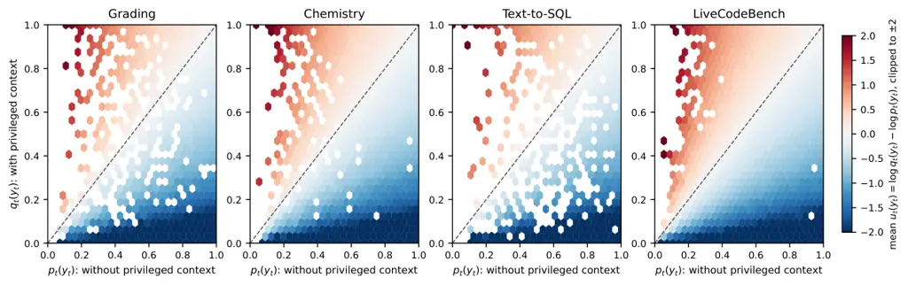

# Self-Distillation with Verbal Regularization

Jiazheng Li    Yawei Li    Junru Lu    Zhenyi Shen    Di Yin    Lin Gui
   Xing Sun    David Rügamer    Xinpeng Wang    Yulan He

###### Abstract

On-policy self-distillation (OPSD) trains a large language model using
supervision from a teacher instantiated from the same model as the
student. The teacher is conditioned on privileged information (PI), such
as verified solutions. The student, which does not observe PI, learns
from the teacher’s next-token distributions along its own sampled
responses. However, PI can bias supervision toward shortcut reasoning
with limited verification or reconsideration, accompanied by a sharp
drop in the entropy of the output distribution. To address this
challenge, we introduce self-distillation with verbal regularization
(VRSD), which uses system prompts to regulate how the teacher uses PI,
thereby encouraging rethinking and exploration to counteract premature
commitment. Theoretically, we model prompting as attenuating the
influence of PI on the teacher distribution and derive conditions for
entropy preservation. Across three models and four tasks, VRSD improves
Pass@1 over OPSD in 11 of 12 model–task settings, by 3.9 percentage
points on average, while generally maintaining higher token entropy.


²²footnotetext: Equal contribution.¹¹footnotetext: Corresponding
authors: Xinpeng Wang and Yulan He.

## 1 Introduction

Knowledge distillation transfers capabilities from a teacher to a
student language model. In conventional off-policy distillation, the
student is trained on fixed teacher or reference responses (Kim & Rush,
2016; Hsieh et al., 2023; Ho et al., 2023). Because these responses are
generated independently of the student’s current policy, their prefixes
may differ from those the student encountered during its own
generation (Agarwal et al., 2024). On-policy distillation (OPD) (Agarwal
et al., 2024; Gu et al., 2024) reduces this mismatch by providing dense
teacher supervision on the student’s own sampled responses. Its
dependence on a separate teacher nevertheless adds training cost.
On-policy self-distillation (OPSD) (Zhao et al., 2026a) removes this
dependency by using the same model as both student and teacher under
different conditioning. Given an input question, the student first
generates a response without access to privileged information (PI). The
self-teacher then uses additional PI, such as a verified solution, to
produce a next-token distribution at each position of the student
response. The student is trained to match these teacher distributions.

Figure 1: VRSD counteracts OPSD’s shortcut bias with a teacher-only
prompt. Left: student $`p_{t}`$ (blue), self-teacher $`q_{t}`$ (red),
and prompted teacher $`q_{t}^{d}`$ (green) under different conditioning.
Middle: The log-probability shifts $`u_{t}`$ induced by PI $`c`$ can
favor immediate commitment to the supplied answer (“42”) and suppress
reconsideration (“Wait”, “However”), concentrating $`q_{t}`$ and
lowering its entropy $`H(q_{t})`$. Numerical values are illustrative.
Right: The system prompt $`d`$ encourages verification and
reconsideration. By attenuating $`u_{t}`$, the prompt can restore
probability to reconsideration in the teacher $`q_{t}^{d}`$ while
retaining support for the answer. Under our affine model, Theorems 4.1
and 4.2 show that attenuation preserves the teacher’s entropy under mild
conditions.

However, previous work (Kim et al., 2026; Kaur et al., 2026; Shen
et al., 2026a) suggests that access to the PI can reinforce shortcut
continuations while suppressing reconsideration. This influence is
described through log-probability shifts, which measure changes in the
model’s next-token log-probabilities when PI is added. These shifts
indicate which tokens become more or less likely at the same position in
the student’s response. If these shifts reinforce tokens that the
teacher already prefers, for example, tokens that immediately commit to
the supplied answer (i.e., the “shortcut” tokens), they can make the
teacher distribution more concentrated and reduce its entropy.
Distilling such supervision may encourage the student to inherit both
shortcut reasoning behavior and the associated concentration of its
predictive distribution, limiting opportunities to explore alternative
reasoning paths. The challenge is therefore to benefit from PI guidance
while limiting its tendency to drive premature commitment.

To tackle this challenge, we introduce self-distillation with verbal
regularization (VRSD). Rather than changing the model architecture,
training objective, or PI itself, VRSD modifies only the _self-teacher’s
conditioning_. Specifically, we introduce teacher-only system prompts
that instruct the model to verify intermediate steps, consider
alternatives, and reconsider the earlier reasoning before committing to
an answer. As illustrated in Figure 1, these prompts use the model’s
existing instruction-following capability to regulate how strongly PI
shapes the teacher’s token-level supervision. The resulting method can
therefore be incorporated directly into existing OPSD pipelines. In our
theoretical analysis, we model this regulation as _affine attenuation_
of the log-probability shifts induced by PI. We characterize when
prompting can counteract teacher-side entropy collapse by deriving an
exact condition for entropy increase. Our contributions are as follows:

- •
  We introduce teacher-only verbal regularization for OPSD, using system
  prompts to regulate how the teacher uses privileged solutions without
  modifying the architecture or distillation objective.
- •
  We introduce an affine attenuation model of PI-induced log-probability
  shifts to explain when prompting counteracts teacher concentration
  reinforced by PI.
- •
  VRSD improves Pass@1 over OPSD in 11 of 12 model-task settings, while
  improving average Pass@1 and Worst@16 for all three models (Table 1).
  Further analyses indicate that VRSD mitigates over-concentration in
  output distributions (Section 5.3). Causal interventions in
  Section 5.6 indicate that, on average, VRSD students rely more on
  their reasoning chains to reach final answers compared to vanilla
  OPSD, indicating higher faithfulness in reasoning paths.

## 2 Related work

OPD Knowledge distillation (Hinton et al., 2015; Gou et al., 2021; Xu
et al., 2024) traditionally trains a student to match a teacher’s
predictive distribution. For language models, distillation often uses
token-level cross-entropy on hard teacher generated sequences (Kim &
Rush, 2016; Hsieh et al., 2023; Ho et al., 2023). OPD (Agarwal et al.,
2024; Gu et al., 2024; Yang et al., 2025; Lu & Thinking Machines Lab, 2025) trains the student on its own responses by matching the teacher’s
next-token distributions at each step. This reduces the distribution
mismatch of off-policy distillation (Agarwal et al., 2024) and provides
more dense supervision than GRPO-like methods (Shao et al., 2024; Yu
et al., 2025; Zheng et al., 2025). Building on these advantages,
multi-teacher OPD (Core Team et al., 2026; DeepSeek-AI et al., 2026;
Kimi Team et al., 2026) has recently emerged as a practical paradigm for
consolidating the complementary capabilities of multiple teachers into
the student.

OPSD Within the OPSD framework (Zhao et al., 2026a; Hübotter et al.,
2026; Sang et al., 2026), prior work has explored diverse sources of PI
for teacher supervision. This privileged context may include reference
solutions (Zhao et al., 2026a), successful (Hübotter et al., 2026) or
self-consistent responses (Li et al., 2026), and feedback from
environments (Hübotter et al., 2026; Zhang et al., 2026; Liu et al., 2026) or humans (Wang et al., 2026b). Related approaches extend this
context with reflections (Zhao et al., 2026c) or reusable skills (Jiang
et al., 2026; Wang et al., 2026a; Yang et al., 2026). More broadly,
OPCD (Ye et al., 2026) distills behaviors specified by system prompts.
Its system-prompt setting supplies general instructions without
instance-specific reference solutions. However, in OPSD, conditioning
the self-teacher on complete reference solutions can introduce shortcut
bias (Kim et al., 2026; Kaur et al., 2026; Harne et al., 2026). To
mitigate this bias, Purified OPSD (Shen et al., 2026b) filters
reference-driven shortcuts from training targets by comparing teacher
predictions with and without the question. AntiSD (Shen et al., 2026a)
instead combines GRPO with updates that discourage matching the
privileged teacher. A complementary line of work modifies the PI
supplied to the teacher: PS-OPSD (Zhao et al., 2026b) replaces solutions
with structured guidance, while ATESD (Han et al., 2026) adaptively
controls how much reference reasoning is revealed. In this work, VRSD
instead regularizes how the teacher uses PI: it retains complete
reference solutions and uses teacher-only system prompts to regulate
their influence, aiming to mitigate shortcut bias and preserve the
student’s exploration ability.

## 3 Background of on-policy self-distillation

Let $`\mathcal{V}`$ denote the vocabulary and
$`\mathcal{V}^{*}=\bigcup_{\ell>0}\mathcal{V}^{\ell}`$ the set of all
finite token sequences. Given an input $`x\in\mathcal{V}^{*}`$, an LLM
$`\pi_{\bm{\theta}}`$ parametrized by $`\bm{\theta}\in\Theta`$ assigns a
probability to each response
$`y=(y_{1},\ldots,y_{T})\in\mathcal{V}^{T}`$ through the factorization
$`\pi_{\bm{\theta}}(y\mid x)=\prod_{t=1}^{T}\pi_{\bm{\theta}}(y_{t}\mid x,y_{<t})`$.

OPSD To formalize OPSD, let $`\mathcal{D}`$ be a training distribution
over pairs $`(x,c)\in\mathcal{V}^{*}\times\mathcal{V}^{*}`$. Here, $`c`$
denotes privileged information (PI) that is available during training
but not at inference, such as a verified answer or a chain-of-thought
extracted from a correct trajectory. Given $`(x,c)\sim\mathcal{D}`$, the
model first acts as the student and samples a response
$`y\sim\pi_{\bm{\theta}}(\cdot\mid x)`$ without access to $`c`$. At each
resulting prefix $`y_{<t}`$, the student next-token distribution is
$`p_{t}(\cdot):=\pi_{\bm{\theta}}(\cdot\mid x,y_{<t})`$. Evaluating the
same model at the same prefix with PI gives the _self-teacher_
distribution $`q_{t}(\cdot):=\pi_{\bm{\theta}}(\cdot\mid x,c,y_{<t})`$.
Thus, $`p_{t}`$ and $`q_{t}`$ share the parameters $`\bm{\theta}`$ and
the prefix $`y_{<t}`$ but differ in their access to $`c`$. This
conditioning asymmetry allows the same model to serve as its own
teacher.

OPSD with generalized Jensen-Shannon divergence At each prefix
$`y_{<t}`$, OPSD transfers the PI-informed teacher distribution to the
student using normalized generalized Jensen-Shannon divergence (JSD).
For a mixture weight $`\alpha\in(0,1)`$, let
$`m_{t}=\alpha q_{t}+(1-\alpha)p_{t}`$ denote the convex mixture of the
self-teacher and student distributions. Their divergence is

```math
\mathcal{J}_{\alpha}(q_{t}\|p_{t})=\frac{\alpha D_{\mathrm{KL}}(q_{t}\|m_{t})+(1-\alpha)D_{\mathrm{KL}}(p_{t}\|m_{t})}{\alpha(1-\alpha)}, \tag{1}
```

where $`D_{\mathrm{KL}}(\cdot\|\cdot)`$ denotes the Kullback-Leibler
(KL) divergence. Using $`\mathcal{J}_{\alpha}`$, OPSD minimizes

```math
\mathcal{L}_{\mathrm{OPSD}}(\bm{\theta})=\mathbb{E}_{(x,c)\sim\mathcal{D}}\mathbb{E}_{y\sim\pi_{\bm{\theta}}(\cdot\mid x)}\left[\frac{1}{T}\sum_{t=1}^{T}\mathcal{J}_{\alpha}\!\left(\operatorname{sg}[q_{t}]\|p_{t}\right)\right], \tag{2}
```

where $`\operatorname{sg}[\cdot]`$ denotes the stop-gradient operator.
It keeps the self-teacher distribution fixed during differentiation, so
each term updates the student distribution toward the PI-informed
teacher.

## 4 Methodology

### 4.1 Regularizing premature teacher commitment

OPSD uses PI to provide supervision signals. We first examine how PI can
bias the self-teacher toward premature commitment, and how teacher-only
system prompting can regulate this effect.

PI can reinforce premature commitment At a student-generated prefix
$`y_{<t}`$, conditioning on PI changes the self-teacher’s relative
preferences over possible next tokens. Following the conditional
pointwise mutual information (PMI) interpretation of AntiSD (Shen
et al., 2026a), we quantify the PI-induced log-probability shift for
token $`v\in\mathcal{V}`$ as

```math
u_{t}(v):=\log\frac{q_{t}(v)}{p_{t}(v)}=\operatorname{PMI}(v;c\mid x,y_{<t}). \tag{3}
```

When $`c`$ contains PI such as verified solution, a positive
$`u_{t}(v)`$ means that access to it makes $`v`$ more likely. Such
support can guide reasoning, but it can also favor direct commitment to
the supplied answer before the current reasoning has justified it. If PI
primarily reinforces already-preferred conclusion tokens while
suppressing tokens associated with verification or reconsideration, the
resulting teacher distribution becomes more concentrated (i.e., low
entropy) and assigns little probability mass to alternatives to
premature commitment.

Such concentration can propagate to the student because it is trained to
match the teacher’s distribution. This preference transfer is reflected
in the JSD gradient:
$`-\nabla_{\bm{\theta}}\mathcal{J}_{\alpha}(\operatorname{sg}[q_{t}]\|p_{t})=\mathbb{E}_{v\sim p_{t}}[A_{t}(u_{t}(v))\nabla_{\bm{\theta}}\log p_{t}(v)]`$,
where $`A_{t}(u)=\alpha^{-1}\log[(1-\alpha)+\alpha e^{u}]`$. Since
$`A_{t}(u)`$ is strictly increasing in the PMI score $`u`$, tokens
receiving larger positive PI-induced shifts (i.e., larger PMI scores)
also have larger coefficients in the distillation gradient. Thus, when
PI strongly favors premature commitment, the student is explicitly
trained to increase the probability of those continuations. If the
student approaches a highly concentrated teacher distribution, competing
continuations become less likely under the student’s own policy. As
subsequent training uses student-generated rollouts, these alternatives
become less likely to be sampled, limiting opportunities to explore
different reasoning paths. This link between teacher concentration and
on-policy exploration motivates preserving probabilities on
continuations that explore alternatives or reconsider intermediate
steps.

Regularizing teacher with system prompts We use the self-teacher’s
instruction-following capability to regulate how it uses PI.
Specifically, we introduce a training-only system prompt $`d`$ that
instructs the teacher to verify intermediate steps, or consider
alternative reasoning paths before committing to an answer (see
Appendix J for a behavioral analysis of the prompts’ regularizing
effects on teacher reasoning). Formally, at the same prefix and with the
same PI, the prompted teacher distribution is
$`q_{t}^{d}(v)=\pi_{\bm{\theta}}(v\mid d,x,c,y_{<t})`$ for
$`v\in\mathcal{V}`$. The student, by contrast, continues to generate
without access to either the system prompt $`d`$ or the PI $`c`$.
Training replaces the original teacher distribution $`q_{t}`$ with the
prompted distribution $`q_{t}^{d}`$ in Eq. 2, giving the per-prefix loss
$`\mathcal{J}_{\alpha}(\operatorname{sg}[q_{t}^{d}]\|p_{t})`$, while
leaving the JSD objective unchanged. The prompt introduces no additional
learned module or regularization loss; it is absent from the student’s
inference-time input. To quantify the effect of this prompt
regularization, we next model how $`d`$ changes the teacher’s token
preferences.

An affine model of PMI attenuation Using the same student distribution
$`p_{t}`$ as reference, define the prompted PMI
$`u_{t}^{d}(v):=\log[q_{t}^{d}(v)/p_{t}(v)]`$. Empirically, we find that
the teacher-only system prompt reduced the PMI (i.e., the magnitude of
PI-induced preference shifts) on average. Such an attenuation effect can
be modeled as

```math
u_{t}^{d}(v)=\gamma_{t}u_{t}(v)+\kappa_{t},\qquad\gamma_{t}<1,\quad v\in\mathcal{V}. \tag{4}
```

The affine coefficient $`\gamma_{t}`$ controls the relative scaling of
PMI differences across tokens, while $`\kappa_{t}`$ ensures
normalization of $`q_{t}^{d}`$. We estimate the factor $`\gamma_{t}`$
across models and tasks in Appendix A. Figure 2 shows mean estimates and
95% bootstrap confidence intervals, indicating statistically significant
PMI attenuation. This supports the hypothesis that teacher prompting
weakens PI-induced token preference shifts. We next derive how this PMI
attenuation changes the teacher distribution and, in particular, its
entropy.

Figure 2: Estimated PMI attenuation induced by the teacher prompt $`d`$.
Points show $`\widehat{\gamma}`$, obtained by averaging per-prefix
estimates within each problem and then across problems; error bars show
95% bootstrap confidence intervals (CIs). Dashed lines mark no
attenuation. The CIs lie below this baseline, indicating that the system
prompts attenuate PI-induced log-probability shifts on average.

### 4.2 When PMI attenuation increases teacher entropy

Experiments in Section 5.3 show that OPSD can produce _low-entropy_
models after training, potentially restricting exploration of
alternative reasoning paths. VRSD mitigates this concentration by
preserving the entropy. Here, we provide a theoretical explanation for
the observed entropy preservation by analyzing the teacher entropy
change $`H(q_{t}^{d})-H(q_{t})`$ under the affine PMI attenuation model,
where $`H(\cdot)`$ denotes Shannon entropy. We first compute the
prompted teacher distribution $`q_{t}^{d}`$ under the affine attenuation
model in Eq. 4, obtaining

```math
q_{t}^{d}(v)=\frac{p_{t}(v)\exp[\gamma_{t}u_{t}(v)]}{\sum_{z}p_{t}(z)\exp[\gamma_{t}u_{t}(z)]}=\frac{q_{t}(v)\exp[-(1-\gamma_{t})u_{t}(v)]}{\sum_{z}q_{t}(z)\exp[-(1-\gamma_{t})u_{t}(z)]}. \tag{5}
```

The derivation is provided in Section B.1. To analyze how this
reweighting changes teacher entropy, introduce an intermediate
attenuation strength $`\lambda\in[\gamma_{t},1]`$ and define

```math
q_{t,\lambda}(v)=\frac{q_{t}(v)\exp[(\lambda-1)u_{t}(v)]}{\sum_{z\in\mathcal{V}}q_{t}(z)\exp[(\lambda-1)u_{t}(z)]}. \tag{6}
```

This analytical path connects the bare and prompted teachers:
$`q_{t,1}=q_{t}`$ and, by Eq. 5, $`q_{t,\gamma_{t}}=q_{t}^{d}`$. Next,
Theorem 4.1 (with proof in Section B.2) gives an exact expression for
the entropy change induced by attenuation along this path.

###### Theorem 4.1.

Under the affine attenuation model in Eq. 4 with $`\gamma_{t}<1`$,

```math
H(q_{t}^{d})-H(q_{t})=\int_{\gamma_{t}}^{1}\mathrm{Cov}_{q_{t,\lambda}}\left(u_{t},\log q_{t,\lambda}\right)\mathrm{d}\lambda. \tag{7}
```

Here, $`\mathrm{Cov}_{q_{t,\lambda}}(u_{t},\log q_{t,\lambda})`$ denotes
the covariance between the PMI score $`u_{t}(v)`$ and the
log-probability $`\log q_{t,\lambda}(v)`$, computed over
$`v\sim q_{t,\lambda}`$.

Theorem 4.1 evaluates covariance under the intermediate distributions
$`q_{t,\lambda}`$ along the attenuation path. For $`\gamma_{t}`$ close
to $`1`$, a first-order expansion of the entropy change involves only
the covariance at $`\lambda=1`$, where $`q_{t,1}=q_{t}`$. The following
corollary therefore gives a local sufficient condition for entropy
increase in terms of the bare teacher distribution $`q_{t}`$.

###### Corollary 4.2.

Under the affine attenuation model in Eq. 4, if
$`\mathrm{Cov}_{q_{t}}(u_{t},\log q_{t})>0`$, then there exists
$`\delta_{t}>0`$ such that $`H(q_{t}^{d})>H(q_{t})`$ for every
$`\gamma_{t}\in(1-\delta_{t},1)`$.

Corollary 4.2 considers $`\gamma_{t}`$ sufficiently close to $`1`$. In
this regime, teacher entropy increases when PMI scores and teacher
log-probabilities are positively correlated under $`q_{t}`$, as proven
in Section B.3. Motivated by AntiSD’s token-level analysis, in
Appendix C we examine prefixes where PI substantially changes the
sampled continuation, identified by $`|u_{t}(y_{t})|>1`$. At these
prefixes, we compute the covariance over the full vocabulary under
$`q_{t}`$. Table 5 in Appendix C reports mean covariance across various
model-task settings, ranging from $`0.43`$ to $`0.58`$, with the
covariance at $`79\%-91\%`$ of these prefixes being positive. These
measurements support the covariance condition at prefixes with
substantial PMI scores.

## 5 Experiments

The experiments are presented in the following order. We first assess
the task performance of VRSD in Section 5.2. Next, in Section 5.3, we
examine student entropy to determine whether the entropy-preserving
effect of teacher-side regularization carries over to the student. In
Section 5.4, we then investigate which instruction choices contribute to
the performance gains. Since our ultimate goal is to encourage the
student to learn better reasoning behaviors, we next examine whether it
exhibits the intended reasoning patterns. We present this qualitative
study in Section 5.5. Finally, we extend this behavioral analysis with a
quantitative assessment of reasoning faithfulness. In Section 5.6, we
test whether the student’s answers causally depend on its step-by-step
reasoning.

### 5.1 Experimental setup

Datasets We train and evaluate on four tasks with automatic verifiers:
short-answer _grading_ on ASAP-SAS (Barbara et al., 2012), _chemistry_
on SciKnowEval (Feng et al., 2025), _SQL_ on the Spider development
subset (Yu et al., 2018), and _Python_ code generation on
LiveCodeBench (Jain et al., 2025). The PI $`c`$ is a verified solution
to the same problem, obtained from a correct model rollout.

Teacher system prompts We use two designs, VRSD (single) and VRSD
(multi). In the single-prompt setting, all rollouts share a single
composite task-level prompt $`d`$ that encourages reflection and
systematic reasoning. In the multi-prompt setting, the rollouts of each
input $`x`$ are split as evenly as possible across $`K`$ aspect-specific
prompts $`d_{1},\ldots,d_{K}`$, each targeting one aspect of the
reasoning process; a rollout assigned to $`d_{k}`$ uses
$`q_{t}^{d_{k}}`$ as its teacher distribution. The chemistry prompts
($`K{=}3`$) are shown below; all prompts and the value of $`K`$ for each
task are given in Appendix I.


Models and training We fine-tune Qwen3-4B (Yang et al., 2025), Qwen3-8B,
and OLMo-3-7B-Instruct (Olmo et al., 2025). All runs use $`8`$ rollouts
per prompt, $`32`$ prompts per batch, a prompt length of 2048 tokens, no
KL regularization, and early stopping after four consecutive validations
without improvement. Grading, chemistry, and SQL share one configuration
up to response length, while Python follows the OPSD code recipe because
it requires a longer output length (Hübotter et al., 2026). The
task-specific training settings listed in Table 6 (Appendix D) are held
fixed across methods and models within each task.

Evaluation and baselines We compare against the original pretrained
model before task-specific fine-tuning (labeled _Untrained_),
*OPSD* (Zhao et al., 2026a), and *AntiSD* (Shen et al., 2026a). For
AntiSD, we use the method-specific hyperparameters reported in the
original paper. For each training run, we select the checkpoint with the
highest validation Pass@1. We evaluate all models by sampling 16
responses per problem at temperature 0.6 and top-$`p`$ 0.95. We report
Pass@1 (mean accuracy across the 16 sampled responses), Maj@16 (accuracy
of the majority-vote answer), and Worst@16 (the fraction of problems for
which all 16 responses are correct). At the selected checkpoint, we also
report $`H(p)`$, the mean next-token entropy over the student’s
rollouts.

### 5.2 Task performance

Grading (ASAP-SAS) Chemistry (SciKnowEval) SQL (Spider) Python
(LiveCodeBench) Average Method P@1$`\uparrow`$ M@16$`\uparrow`$
W@16$`\uparrow`$ P@1$`\uparrow`$ M@16$`\uparrow`$ W@16$`\uparrow`$
P@1$`\uparrow`$ M@16$`\uparrow`$ W@16$`\uparrow`$ P@1$`\uparrow`$
M@16$`\uparrow`$ W@16$`\uparrow`$ P@1$`\uparrow`$ M@16$`\uparrow`$
W@16$`\uparrow`$ Fine-tuned model: Qwen3-4B Untrained 57.2 58.7 37.9
70.7 71.7 58.3 71.3 72.4 59.4 47.2 50.5 26.6 61.6 63.3 45.6 OPSD 71.9
71.8 61.3 81.7 81.9 79.2 69.8 69.7 64.9 61.4 61.9 51.8 71.2 71.3 64.3
AntiSD 78.3 79.1 63.4 80.7 80.7 80.2 79.5 80.6 71.2 53.3 55.7 35.5 73.0
74.0 62.6 VRSD (single) 78.7 78.7 73.8 86.1 86.3 81.8 80.0 80.6 71.7
64.1 65.2 54.5 77.2 77.7 70.5 VRSD (multi) 83.0 83.5 76.6 85.8 86.2 81.3
81.0 81.7 74.4 63.8 64.7 54.8 78.4 79.0 71.8 Fine-tuned model:
OLMo-3-7B-Instruct Untrained 52.0 54.6 19.8 51.2 65.2 22.9 64.7 66.5
39.4 40.5 43.8 14.8 52.1 57.5 24.2 OPSD 76.3 77.2 62.4 81.9 82.5 74.3
74.1 75.4 64.6 57.3 59.2 37.4 72.4 73.6 59.7 AntiSD 67.0 70.1 39.6 77.5
79.0 66.2 74.3 75.6 60.4 45.7 46.3 23.5 66.1 67.8 47.4 VRSD (single)
83.9 84.9 74.9 83.5 84.2 79.2 72.5 73.3 64.3 56.6 57.4 45.6 74.1 75.0
66.0 VRSD (multi) 84.3 84.8 74.7 83.8 84.5 78.1 75.1 75.8 64.7 57.6 60.7
40.4 75.2 76.5 64.5 Fine-tuned model: Qwen3-8B Untrained 60.6 61.0 41.4
72.1 73.3 58.3 72.2 73.3 60.2 51.7 55.7 31.2 64.2 65.8 47.8 OPSD 75.8
76.6 63.3 83.8 84.1 78.9 78.5 78.2 73.0 65.6 66.7 56.3 75.9 76.4 67.9
AntiSD 69.7 69.9 60.9 72.1 73.3 57.8 78.6 79.0 73.4 59.2 62.7 39.9 69.9
71.2 58.0 VRSD (single) 77.5 78.7 64.9 83.1 83.2 77.4 80.2 80.8 72.1
63.7 64.5 53.2 76.1 76.8 66.9 VRSD (multi) 81.2 81.9 69.4 84.2 84.6 78.7
79.0 79.7 69.9 65.4 66.7 55.8 77.5 78.2 68.5

Table 1: Task performance (%) across three models and four tasks. P@1,
M@16, and W@16 denote Pass@1, Maj@16, and Worst@16, respectively.
“Untrained” denotes the model before task-specific training. “Average”
denotes the mean performance across all four tasks. Blue rows highlight
VRSD; bold and underlined values denote the best and second-best
results, respectively.

A single VRSD teacher prompt improves OPSD, while multiple prompts yield
further gains. As shown in Table 1, both variants improve average Pass@1
over OPSD on every evaluated model. VRSD (multi) improves average Pass@1
over OPSD by 7.2, 2.8, and 1.6 percentage points on Qwen3-4B,
OLMo-3-7B-Instruct, and Qwen3-8B, respectively, yielding an average gain
of approximately 3.9 percentage points. Furthermore, it achieves higher
Pass@1 in 11 of 12 model–task settings. The benefits also extend beyond
mean accuracy. VRSD (multi) matches or exceeds OPSD in Maj@16 across all
settings and improves average Worst@16 on every model. These results
show that VRSD improves both average accuracy and the frequency with
which problems are answered correctly across all sampled responses.
Compared to the single-prompt VRSD variant, the multi-prompt variant
achieves higher average Pass@1 and Maj@16 on every model.

VRSD remains effective even when OPSD underperforms the starting model.
The benefits also extend to a setting where OPSD itself reduces
accuracy.On Qwen3-4B SQL, OPSD’s Pass@1 falls below that of the starting
model (69.8% versus 71.3%), whereas both VRSD variants exceed it, with
VRSD (multi) reaching 81.0%. In this setting, changing the
self-teacher’s conditioning turns a decline in student accuracy into an
improvement over the starting model, demonstrating that VRSD can enable
effective self-distillation even when OPSD does not yield an accuracy
gain.

### 5.3 Student entropy

Figure 3: Average token entropy $`H(p)`$ of the distilled students. VRSD
generally yields higher entropy than OPSD; the detailed values and their
ratios to OPSD are listed in Table 7 in Appendix E.

Teacher-side regularization mitigates over-concentration in the
distilled student. Our theoretical analysis identifies conditions under
which prompting counteracts concentration in the teacher distribution.
The student is trained to match this distribution, and it is the model
ultimately used to perform the tasks. We therefore measure the student’s
next-token entropy directly to assess whether the effect of teacher-side
regularization carries over through distillation. Figure 3 shows that
VRSD produces less concentrated student distributions, with higher
next-token entropy than OPSD in 19 of 24 comparisons across the two
prompt variants. The clearest example is Qwen3-4B SQL, where OPSD
produces a highly concentrated student distribution with $`H(p)=0.03`$,
compared with 0.49 for VRSD (single) and 0.54 for VRSD (multi). For the
multi-prompt variant, this reduced concentration accompanies a Pass@1
improvement from 69.8% to 81.0%. These results suggest that regularizing
the teacher’s supervision can help preserve the student’s capacity to
sample alternative continuations, leaving more scope for exploring
different reasoning paths.

### 5.4 Ablating the VRSD (multi) design

Figure 4: Pass@1 of Qwen3-4B under different teacher prompt designs.
Each $`d_{k}`$ bar shows training with only the $`k`$-th teacher prompt
from the VRSD (multi) prompt set, used for all rollouts. Each of these
prompts encourages a different approach to the problem, such as focusing
on selected aspects. “Concat.” concatenates all $`K`$ prompts into one.
VRSD (single) uses a composite prompt $`d`$, whereas VRSD (multi)
assigns different prompts $`d_{k}`$ to different rollouts. The
multi-prompt variant achieves higher Pass@1 than both the individual
prompts and their concatenation across all four tasks.

Does placing all instructions in one teacher prompt reproduce the
benefits of distributing them across rollouts? We compare these choices
on Qwen3-4B. Concatenation appends the original $`d_{k}`$ prompts
unchanged, while VRSD (single) uses a separately written composite
prompt $`d`$ that presents an overall reasoning routine. Both settings
use the same teacher prompt for every rollout. VRSD (multi) assigns
different $`d_{k}`$ to different rollouts. We also evaluate each
$`d_{k}`$ alone. Figure 4 shows Pass@1, with full results in Table 9.

VRSD (multi) improves over individual prompts and their concatenation.
VRSD (multi) exceeds concatenation and every individual prompt across
all four tasks, improving over the strongest $`d_{k}`$ by 0.5 to 4.7
percentage points. Concatenation falls below OPSD on three tasks, while
the composite prompt used by VRSD (single) improves over both
concatenation and OPSD on all four, showing that how instructions are
combined within a prompt also matters. Compared with the composite
prompt, the multi-prompt design further improves grading and SQL, with
similar results on chemistry and Python. These results suggest that
distributing different forms of guidance across rollouts can yield more
effective supervision than applying an individual prompt alone or
concatenating all prompts into one, leading to better student
performance.

### 5.5 Learning the reasoning patterns encouraged by teacher prompts

|           |                              |                            |             |
| --------- | ---------------------------- | -------------------------- | ----------- |
| Task      | Encouraged reasoning pattern | VRSD ($`\Delta`$ vs. OPSD) |             |
|           |                              | Single                     | Multi       |
| Grading   | Checks rubrics               | +56.2 (3/3)                | +41.5 (3/3) |
|           | Quotes evidence              | +68.2 (3/3)                | +53.2 (3/3) |
| Chemistry | Discusses all options        | +23.5 (3/3)                | +43.7 (3/3) |
|           | Rules out options            | +13.8 (3/3)                | +22.6 (3/3) |
|           | Checks conclusion            | +73.6 (3/3)                | +5.7 (2/3)  |
| SQL       | Names schema tables          | +36.4 (3/3)                | +30.5 (3/3) |
|           | Names join keys              | +38.0 (3/3)                | +29.4 (3/3) |
|           | Plans query clauses          | +53.4 (3/3)                | +45.1 (3/3) |
| Python    | Discusses boundary cases     | +19.0 (2/3)                | +7.6 (2/3)  |
|           | Checks conclusion            | +15.2 (3/3)                | +5.9 (3/3)  |

Table 2: Changes in student reasoning patterns relative to OPSD. We
measure the percentage of student test responses exhibiting each
pattern. Entries report the mean increase across three models, in
percentage points. The count $`(n/3)`$ indicates how many models show an
increase. Compared with OPSD, VRSD students more frequently exhibit the
patterns encouraged by teacher prompts.

Students adopt the reasoning patterns encouraged by teacher prompts. We
measure how often student test responses exhibit the encouraged
patterns, using the rules in Appendix J. Students generate these
responses without teacher prompts or PI. Table 2 shows positive average
changes over OPSD for every reported pattern under both designs, with
increases in most comparisons.

On chemistry, training with the reflective teacher prompt produces a
larger increase in student conclusion checking than the multi-prompt
design (+73.6 versus +5.7 percentage points over OPSD). The multi-prompt
student shows larger increases in discussing and ruling out options,
matching the prompts’ emphasis on evaluating alternatives. Both designs
also promote rubric checks and evidence quotations on grading, and
explicit references to schema elements and query clauses on SQL. These
correspondences suggest that teacher-side instructions can guide the
reasoning patterns for the students.

### 5.6 Evaluating reasoning faithfulness through causal interventions

Grading Chemistry SQL Python Average Student RG$`\uparrow`$
MR$`\downarrow`$ RG$`\uparrow`$ MR$`\downarrow`$ RG$`\uparrow`$
MR$`\downarrow`$ RG$`\uparrow`$ MR$`\downarrow`$ RG$`\uparrow`$
MR$`\downarrow`$ Untrained -0.8 13.4 -0.3 5.9 +2.3 4.9 +2.5 6.7 +0.9 7.7
OPSD +5.2 2.5 +4.2 1.9 +2.3 4.9 +3.2 2.5 +3.7 3.0 VRSD (single) +11.9
1.8 +1.1 1.6 +5.5 1.9 +4.7 1.1 +5.8 1.6 VRSD (multi) +14.4 3.1 +1.0 1.0
+2.8 2.0 +1.8 2.3 +5.0 2.1

Table 3: Evaluating reasoning faithfulness through causal interventions
on Qwen3-4B. We retain different fractions of each student’s reasoning
chain and regenerate the final answer. RG$`\uparrow`$ (reasoning gain)
is the Pass@1 difference between retaining the full reasoning and
removing it, in percentage points. MR$`\downarrow`$
(misleading-reasoning rate) is the percentage of all evaluated answers
that are correct without reasoning but incorrect when the full reasoning
is retained. Compared with OPSD, VRSD achieves higher mean RG and lower
mean MR, providing evidence of more faithful reasoning.

After examining which reasoning patterns students learn, we test whether
their final answers depend on their reasoning. We evaluate Qwen3-4B
using the truncation intervention of Lanham et al. (2023). We sample
student responses at the evaluation temperature, retain progressively
larger fractions of each reasoning chain from none to the full chain,
append the answer delimiter, and regenerate the final answer. As defined
in Table 3, we assess students’ reliance on explicit reasoning using
reasoning gain (RG). We also report the misleading-reasoning rate (MR)
to measure how often full reasoning overturns an otherwise correct
answer.

VRSD students show stronger evidence of faithful reasoning. Retaining
the full reasoning improves answer accuracy for both variants on all
four tasks (Table 3). Averaged across tasks, RG reaches 5.8 percentage
points for VRSD (single) and 5.0 for VRSD (multi), compared with 3.7 for
OPSD. The effect is particularly clear on grading, where both variants
more than double the RG of OPSD. The larger average RG is accompanied by
lower MR than OPSD in seven of eight comparisons across the two variants
and four tasks. These interventions suggest that VRSD students rely more
on their reasoning to reach correct answers than OPSD students do.
Retaining their reasoning improves accuracy more on average and less
often turns a correct answer into an incorrect one. Together, these
findings provide evidence of improved reasoning faithfulness.

## 6 Conclusion

We introduced VRSD to improve OPSD by regulating how the self-teacher
uses privileged solutions. The central idea is to retain solution
guidance while encouraging verification and reconsideration, shaping the
supervision through teacher conditioning. Our analysis connects this
intervention to attenuation of solution-induced log-probability shifts
and identifies conditions under which it counteracts teacher
concentration. Experiments complement this analysis with improved
accuracy and answer consistency, generally higher student entropy, and
evidence of improved reasoning faithfulness. These findings highlight
teacher conditioning as a practical means of regulating privileged
supervision. The model’s existing instruction-following capability can
help preserve alternatives to premature commitment and improve the
learning signal it provides to itself.

Alongside these benefits, the current approach has several limitations
that warrant further investigation. The current approach relies on
manually curated, task-specific prompts. This requires human judgment
about which reasoning behaviors to encourage, and the resulting prompts
may not suit every problem or remain equally useful as the student’s
capabilities evolve during training. Future work could automate prompt
selection and adaptation across problems and training stages. Beyond
prompt design, verbal instructions control attenuation indirectly
through the model’s response to their wording. This motivates methods
that estimate and adjust PI-induced log-probability shifts directly.
Such methods could use our entropy analysis to guide where and how
strongly to attenuate the influence of privileged solutions, enabling
more adaptive control of teacher regularization.

## Acknowledgment

The work was supported in part by the UK Engineering and Physical
Sciences Research Council through a Turing AI Fellowship (grant no.
EP/V020579/1, EP/V020579/2) and the Prosperity Partnership scheme (grant
no. UKRI566).

## AI use statement

During the preparation of this manuscript, the authors used AI tools for
code debugging and for improving the readability of text written by the
authors. All conceptual development, theoretical analysis, the prompts
used in the experiments, and interpretation of results were carried out
independently by the authors. The authors have carefully reviewed and
verified the content in the manuscript and take full responsibility for
the integrity and accuracy of this submission.

## Ethics statement

Our contributions are algorithmic and foundational, focusing on the
mechanics of on-policy self-distillation and teacher-side regularization
in language models. All empirical evaluations were conducted on publicly
released, standardized academic benchmarks (ASAP-SAS, SciKnowEval,
Spider, and LiveCodeBench). The study does not involve human subjects,
human annotations, or personally identifiable and sensitive data. All
code generation and execution evaluations were conducted within
isolated, secure sandbox environments. We foresee no immediate ethical
concerns or direct societal harms arising from this work.

## Reproducibility statement

To ensure the full reproducibility of our theoretical and empirical
findings, we provide comprehensive documentation throughout the paper
and supplementary materials:

- •
  The mathematical derivation of the affine attenuation model for
  teacher mutual information is formalized in Section A and expanded in
  Appendix B.
- •
  Exact training hyperparameters (including learning rates, batch sizes,
  rollout counts, context limits, and early-stopping criteria) across
  Qwen3-4B, Qwen3-8B, and OLMo-3-7B-Instruct are documented in
  Section 5.1 and summarized in Table 6 (Appendix D).
- •
  The complete verbatim system prompts for both the single-prompt and
  multi-prompt configurations across all four tasks are provided in
  Appendix I.
- •
  The decoding setup and deterministic regex rules for student/teacher
  response-pattern extraction are detailed in Section 5.5 and
  Appendix J.1 (Table 10).
- •
  Training scripts, evaluation harnesses, and pattern-checking utilities
  are available in the code repository:
  [https://github.com/lijiazheng99/VRSD](https://github.com/lijiazheng99/VRSD).

## References

- Agarwal et al. (2024) Rishabh Agarwal, Nino Vieillard, Yongchao Zhou,
  Piotr Stanczyk, Sabela Ramos Garea, Matthieu Geist, and Olivier
  Bachem. On-policy distillation of language models: Learning from
  self-generated mistakes. In _The Twelfth International Conference on
  Learning Representations_, 2024. URL
  [https://openreview.net/forum?id=3zKtaqxLhW](https://openreview.net/forum?id=3zKtaqxLhW).
- Barbara et al. (2012) Barbara, Ben Hamner, Jaison Morgan, lynnvandev,
  and Mark Shermis. The hewlett foundation: Short answer scoring.
  [https://kaggle.com/competitions/asap-sas](https://kaggle.com/competitions/asap-sas), 2012.
  Kaggle.
- Core Team et al. (2026) Core Team, Bangjun Xiao, Bingquan Xia,
  Bo Yang, Bofei Gao, Bowen Shen, Chen Zhang, Chenhong He, Chiheng Lou,
  Fuli Luo, Gang Wang, Gang Xie, Hailin Zhang, Hanglong Lv, Hanyu Li,
  Heyu Chen, Hongshen Xu, Houbin Zhang, Huaqiu Liu, Jiangshan Duo,
  et al. Mimo-v2-flash technical report, 2026. URL
  [https://arxiv.org/abs/2601.02780](https://arxiv.org/abs/2601.02780).
- DeepSeek-AI et al. (2026) DeepSeek-AI, Anyi Xu, Bangcai Lin, Bing Xue,
  Bingxuan Wang, Bingzheng Xu, Bochao Wu, Bowei Zhang, Chaofan Lin, Chen
  Dong, Chenchen Ling, Chengda Lu, Chenggang Zhao, Chengqi Deng, Chengyu
  Hou, Chenhao Xu, Chenze Shao, Chong Ruan, Conner Sun, Damai Dai,
  et al. Deepseek-v4: Towards highly efficient million-token context
  intelligence, 2026. URL
  [https://arxiv.org/abs/2606.19348](https://arxiv.org/abs/2606.19348).
- Feng et al. (2025) Kehua Feng, Xinyi Shen, Weijie Wang, Xiang Zhuang,
  Yuqi Tang, Qiang Zhang, and Keyan Ding. Sciknoweval: A comprehensive
  dataset for evaluating scientific knowledge of large language models.
  In _NeurIPS 2025 AI for Science Workshop_, 2025. URL
  [https://openreview.net/forum?id=evsup2BiKo](https://openreview.net/forum?id=evsup2BiKo).
- Gou et al. (2021) Jianping Gou, Baosheng Yu, Stephen J. Maybank, and
  Dacheng Tao. Knowledge distillation: A survey. _International Journal
  of Computer Vision_, 129(6):1789–1819, March 2021. ISSN 1573-1405.
  doi: 10.1007/s11263-021-01453-z. URL
  [http://dx.doi.org/10.1007/s11263-021-01453-z](http://dx.doi.org/10.1007/s11263-021-01453-z).
- Gu et al. (2024) Yuxian Gu, Li Dong, Furu Wei, and Minlie Huang.
  MiniLLM: Knowledge distillation of large language models. In _The
  Twelfth International Conference on Learning Representations_, 2024.
  URL
  [https://openreview.net/forum?id=5h0qf7IBZZ](https://openreview.net/forum?id=5h0qf7IBZZ).
- Han et al. (2026) Zihao Han, Tiangang Zhang, Huaibin Wang, and Yilun
  Sun. Adaptive teacher exposure for self-distillation in llm
  reasoning, 2026. URL
  [https://arxiv.org/abs/2605.11458](https://arxiv.org/abs/2605.11458).
- Harne et al. (2026) Sarthak Harne, Chinmay Karkar, Yash Pandya, Ahmed
  Awadallah, and Akshay Nambi. Privileged, but biased: How
  pi-conditioned teachers break self-distillation, 2026. URL
  [https://arxiv.org/abs/2608.04794](https://arxiv.org/abs/2608.04794).
- Hinton et al. (2015) Geoffrey Hinton, Oriol Vinyals, and Jeff Dean.
  Distilling the knowledge in a neural network, 2015. URL
  [https://arxiv.org/abs/1503.02531](https://arxiv.org/abs/1503.02531).
- Ho et al. (2023) Namgyu Ho, Laura Schmid, and Se-Young Yun. Large
  language models are reasoning teachers. In Anna Rogers, Jordan
  Boyd-Graber, and Naoaki Okazaki (eds.), _Proceedings of the 61st
  Annual Meeting of the Association for Computational Linguistics
  (Volume 1: Long Papers)_, pp. 14852–14882, Toronto, Canada, July 2023.
  Association for Computational Linguistics. doi:
  10.18653/v1/2023.acl-long.830. URL
  [https://aclanthology.org/2023.acl-long.830/](https://aclanthology.org/2023.acl-long.830/).
- Hsieh et al. (2023) Cheng-Yu Hsieh, Chun-Liang Li, Chih-kuan Yeh,
  Hootan Nakhost, Yasuhisa Fujii, Alex Ratner, Ranjay Krishna, Chen-Yu
  Lee, and Tomas Pfister. Distilling step-by-step! outperforming larger
  language models with less training data and smaller model sizes. In
  Anna Rogers, Jordan Boyd-Graber, and Naoaki Okazaki (eds.), _Findings
  of the Association for Computational Linguistics: ACL 2023_, pp.
  8003–8017, Toronto, Canada, July 2023. Association for Computational
  Linguistics. doi: 10.18653/v1/2023.findings-acl.507. URL
  [https://aclanthology.org/2023.findings-acl.507/](https://aclanthology.org/2023.findings-acl.507/).
- Hübotter et al. (2026) Jonas Hübotter, Frederike Lübeck, Lejs Deen
  Behric, Anton Baumann, Marco Bagatella, Daniel Marta, Ido Hakimi, Idan
  Shenfeld, Thomas Kleine Buening, Carlos Guestrin, and Andreas Krause.
  Reinforcement learning via self-distillation. In _Forty-third
  International Conference on Machine Learning_, 2026. URL
  [https://openreview.net/forum?id=QkfkxyRizZ](https://openreview.net/forum?id=QkfkxyRizZ).
- Jain et al. (2025) Naman Jain, King Han, Alex Gu, Wen-Ding Li, Fanjia
  Yan, Tianjun Zhang, Sida Wang, Armando Solar-Lezama, Koushik Sen, and
  Ion Stoica. Livecodebench: Holistic and contamination free evaluation
  of large language models for code. In _The Thirteenth International
  Conference on Learning Representations_, 2025. URL
  [https://openreview.net/forum?id=chfJJYC3iL](https://openreview.net/forum?id=chfJJYC3iL).
- Jiang et al. (2026) Yubo Jiang, Fengying Xie, Zhiguo Jiang, and
  Haopeng Zhang. Distill skills into weights, not prompts: Abstract
  skills as privileged signals for on-policy self-distillation, 2026.
  URL
  [https://arxiv.org/abs/2608.09826](https://arxiv.org/abs/2608.09826).
- Kaur et al. (2026) Simran Kaur, Narutatsu Ri, Yinghui He, Liam Fowl,
  and Sanjeev Arora. Rethinking on-policy self-distillation for thinking
  models, 2026. URL
  [https://arxiv.org/abs/2607.05184](https://arxiv.org/abs/2607.05184).
- Kim et al. (2026) Jeonghye Kim, Xufang Luo, Minbeom Kim, Sangmook Lee,
  Dohyung Kim, Jiwon Jeon, Dongsheng Li, and Yuqing Yang. Why does
  self-distillation (sometimes) degrade the reasoning capability of
  LLMs? In _Third Conference on Language Modeling_, 2026. URL
  [https://openreview.net/forum?id=Az7guis46K](https://openreview.net/forum?id=Az7guis46K).
- Kim & Rush (2016) Yoon Kim and Alexander M. Rush. Sequence-level
  knowledge distillation. In Jian Su, Kevin Duh, and Xavier Carreras
  (eds.), _Proceedings of the 2016 Conference on Empirical Methods in
  Natural Language Processing_, pp. 1317–1327, Austin, Texas,
  November 2016. Association for Computational Linguistics. doi:
  10.18653/v1/D16-1139. URL
  [https://aclanthology.org/D16-1139/](https://aclanthology.org/D16-1139/).
- Kimi Team et al. (2026) Kimi Team, Tongtong Bai, Yifan Bai, Yiping
  Bao, M. C., Jianfeng Cai, Xinyuan Cai, Peizhou Cao, Yuxuan Cao, Ziwei
  Chai, Y. Charles, H. S. Che, Guanduo Chen, Guangyu Chen, Guanzheng
  Chen, Huarong Chen, Jia Chen, Jianlong Chen, Jun Chen, Kexin Chen,
  et al. Kimi k3: Open frontier intelligence, 2026. URL
  [https://arxiv.org/abs/2607.24653](https://arxiv.org/abs/2607.24653).
- King’s College London (2026) King’s College London. King’s
  Computational Research, Engineering and Technology Environment
  (CREATE), 2026. URL
  [https://doi.org/10.18742/rnvf-m076](https://doi.org/10.18742/rnvf-m076).
  Retrieved October 12, 2026.
- Lanham et al. (2023) Tamera Lanham, Anna Chen, Ansh Radhakrishnan,
  Benoit Steiner, Carson Denison, Danny Hernandez, Dustin Li, Esin
  Durmus, Evan Hubinger, Jackson Kernion, Kamilė Lukošiūtė, Karina
  Nguyen, Newton Cheng, Nicholas Joseph, Nicholas Schiefer, Oliver
  Rausch, Robin Larson, Sam McCandlish, Sandipan Kundu, Saurav Kadavath,
  Shannon Yang, Thomas Henighan, Timothy Maxwell, Timothy
  Telleen-Lawton, Tristan Hume, Zac Hatfield-Dodds, Jared Kaplan, Jan
  Brauner, Samuel R. Bowman, and Ethan Perez. Measuring faithfulness in
  chain-of-thought reasoning, 2023. URL
  [https://arxiv.org/abs/2307.13702](https://arxiv.org/abs/2307.13702).
- Li et al. (2026) Yijiang Li, Bingyang Wang, Yijun Liang, Yunjie Tian,
  Di Fu, and Nuno Vasconcelos. On-policy self-distillation without any
  supervision, 2026. URL
  [https://arxiv.org/abs/2608.06296](https://arxiv.org/abs/2608.06296).
- Liu et al. (2026) Haoran Liu, Yuwei Zhang, Xiyao Li, Bohan Lyu, and
  Jingbo Shang. Hero: Hindsight-enhanced reflection from environment
  observations for agentic self-distillation, 2026. URL
  [https://arxiv.org/abs/2606.11559](https://arxiv.org/abs/2606.11559).
- Lu & Thinking Machines Lab (2025) Kevin Lu and Thinking Machines Lab.
  On-policy distillation. _Thinking Machines Lab: Connectionism_, 2025.
  doi: 10.64434/tml.20251026.
  https://thinkingmachines.ai/blog/on-policy-distillation.
- Olmo et al. (2025) Team Olmo, Allyson Ettinger, Amanda Bertsch, Bailey
  Kuehl, David Graham, David Heineman, Dirk Groeneveld, Faeze Brahman,
  Finbarr Timbers, Hamish Ivison, et al. Olmo 3. _arXiv preprint
  arXiv:2512.13961_, 2025.
- Sang et al. (2026) Hejian Sang, Yuanda Xu, Zhengze Zhou, Ran He,
  Zhipeng Wang, and Jiachen Sun. Crisp: Compressed reasoning via
  iterative self-policy distillation, 2026. URL
  [https://arxiv.org/abs/2603.05433](https://arxiv.org/abs/2603.05433).
- Shao et al. (2024) Zhihong Shao, Peiyi Wang, Qihao Zhu, Runxin Xu,
  Junxiao Song, Xiao Bi, Haowei Zhang, Mingchuan Zhang, Y. K. Li, Y. Wu,
  and Daya Guo. Deepseekmath: Pushing the limits of mathematical
  reasoning in open language models, 2024. URL
  [https://arxiv.org/abs/2402.03300](https://arxiv.org/abs/2402.03300).
- Shen et al. (2026a) Guobin Shen, Xiang Cheng, Chenxiao Zhao, Lei
  Huang, Jindong Li, Dongcheng Zhao, and Xing Yu. Anti-self-distillation
  for reasoning rl via pointwise mutual information. _arXiv preprint
  arXiv:2605.11609_, 2026a.
- Shen et al. (2026b) Zhanming Shen, Jintao Tong, Shaotian Yan, Chen
  Shen, Hao Chen, Wentao Ye, Xiaomeng Hu, Rui Miao, Haobo Wang, Junbo
  Zhao, Gang Chen, and Jieping Ye. Purified opsd: On-policy
  self-distillation without losing how to think, 2026b. URL
  [https://arxiv.org/abs/2607.02234](https://arxiv.org/abs/2607.02234).
- Wang et al. (2026a) Hao Wang, Guozhi Wang, Han Xiao, Yufeng Zhou, Yue
  Pan, Jichao Wang, Ke Xu, Yafei Wen, Xiaohu Ruan, Xiaoxin Chen, and
  Honggang Qi. Skill-sd: Skill-conditioned self-distillation for
  multi-turn llm agents, 2026a. URL
  [https://arxiv.org/abs/2604.10674](https://arxiv.org/abs/2604.10674).
- Wang et al. (2026b) Yinjie Wang, Xuyang Chen, Xiaolong Jin, Mengdi
  Wang, and Ling Yang. Openclaw-rl: Train any agent simply by talking.
  _arXiv preprint arXiv:2603.10165_, 2026b.
- Xu et al. (2024) Xiaohan Xu, Ming Li, Chongyang Tao, Tao Shen, Reynold
  Cheng, Jinyang Li, Can Xu, Dacheng Tao, and Tianyi Zhou. A survey on
  knowledge distillation of large language models, 2024. URL
  [https://arxiv.org/abs/2402.13116](https://arxiv.org/abs/2402.13116).
- Yang et al. (2025) An Yang, Anfeng Li, Baosong Yang, Beichen Zhang,
  Binyuan Hui, Bo Zheng, Bowen Yu, Chang Gao, Chengen Huang, Chenxu Lv,
  Chujie Zheng, Dayiheng Liu, Fan Zhou, Fei Huang, Feng Hu, Hao Ge,
  Haoran Wei, Huan Lin, Jialong Tang, Jian Yang, Jianhong Tu, Jianwei
  Zhang, Jianxin Yang, Jiaxi Yang, Jing Zhou, Jingren Zhou, Junyang Lin,
  Kai Dang, Keqin Bao, Kexin Yang, Le Yu, Lianghao Deng, Mei Li,
  Mingfeng Xue, Mingze Li, Pei Zhang, Peng Wang, Qin Zhu, Rui Men, Ruize
  Gao, Shixuan Liu, Shuang Luo, Tianhao Li, Tianyi Tang, Wenbiao Yin,
  Xingzhang Ren, Xinyu Wang, Xinyu Zhang, Xuancheng Ren, Yang Fan, Yang
  Su, Yichang Zhang, Yinger Zhang, Yu Wan, Yuqiong Liu, Zekun Wang, Zeyu
  Cui, Zhenru Zhang, Zhipeng Zhou, and Zihan Qiu. Qwen3 technical
  report, 2025. URL
  [https://arxiv.org/abs/2505.09388](https://arxiv.org/abs/2505.09388).
- Yang et al. (2026) Shuo Yang, Jinyang Wu, Zhengxi Lu, Yuhao Shen, Fan
  Zhang, Lang Feng, Shuai Zhang, Haoran Luo, Zheng Lian, Zhengqi Wen,
  and Jianhua Tao. Opid: On-policy skill distillation for agentic
  reinforcement learning, 2026. URL
  [https://arxiv.org/abs/2606.26790](https://arxiv.org/abs/2606.26790).
- Ye et al. (2026) Tianzhu Ye, Li Dong, Xun Wu, Shaohan Huang, and Furu
  Wei. On-policy context distillation for language models, 2026. URL
  [https://arxiv.org/abs/2602.12275](https://arxiv.org/abs/2602.12275).
- Yu et al. (2025) Qiying Yu, Zheng Zhang, Ruofei Zhu, Yufeng Yuan,
  Xiaochen Zuo, YuYue, Weinan Dai, Tiantian Fan, Gaohong Liu, Juncai
  Liu, LingJun Liu, Xin Liu, Haibin Lin, Zhiqi Lin, Bole Ma, Guangming
  Sheng, Yuxuan Tong, Chi Zhang, Mofan Zhang, Ru Zhang, Wang Zhang, Hang
  Zhu, Jinhua Zhu, Jiaze Chen, Jiangjie Chen, Chengyi Wang, Hongli Yu,
  Yuxuan Song, Xiangpeng Wei, Hao Zhou, Jingjing Liu, Wei-Ying Ma,
  Ya-Qin Zhang, Lin Yan, Yonghui Wu, and Mingxuan Wang. DAPO: An
  open-source LLM reinforcement learning system at scale. In _The
  Thirty-ninth Annual Conference on Neural Information Processing
  Systems_, 2025. URL
  [https://openreview.net/forum?id=2a36EMSSTp](https://openreview.net/forum?id=2a36EMSSTp).
- Yu et al. (2018) Tao Yu, Rui Zhang, Kai Yang, Michihiro Yasunaga,
  Dongxu Wang, Zifan Li, James Ma, Irene Li, Qingning Yao, Shanelle
  Roman, Zilin Zhang, and Dragomir Radev. Spider: A large-scale
  human-labeled dataset for complex and cross-domain semantic parsing
  and text-to-SQL task. In _Proceedings of the 2018 Conference on
  Empirical Methods in Natural Language Processing_. Association for
  Computational Linguistics, 2018. URL
  [https://aclanthology.org/D18-1425/](https://aclanthology.org/D18-1425/).
- Zhang et al. (2026) Yuwei Zhang, Sha Li, Changlong Yu, Qin Lu, Shuowei
  Jin, Chengyu Dong, Haoran Liu, Ilgee Hong, Xintong Li, Zhenyu Shi,
  Bing Yin, and Jingbo Shang. Learning with rare success but rich
  feedback via reflection-enhanced self-distillation, 2026. URL
  [https://arxiv.org/abs/2605.12741](https://arxiv.org/abs/2605.12741).
- Zhao et al. (2026a) Siyan Zhao, Zhihui Xie, Mengchen Liu, Jing Huang,
  Guan Pang, Feiyu Chen, and Aditya Grover. Self-distilled reasoner:
  On-policy self-distillation for large language models. In _Forty-third
  International Conference on Machine Learning_, 2026a. URL
  [https://openreview.net/forum?id=Jpxfof0EaS](https://openreview.net/forum?id=Jpxfof0EaS).
- Zhao et al. (2026b) Xuyang Zhao, Liting Zhang, Zichen Xu, Zhihu Wang,
  Xu Caiyue, Shiwan Zhao, and Qicheng Li. Is more privileged information
  better? from solution traces to problem-solving structure in
  self-distilled reasoning, 2026b. URL
  [https://arxiv.org/abs/2608.01589](https://arxiv.org/abs/2608.01589).
- Zhao et al. (2026c) Ziqi Zhao, Xinyu Ma, Liu Yang, Yujie Feng, Daiting
  Shi, Jingzhou He, Xin Xin, Zhaochun Ren, and Xiao-Ming Wu. Rosd:
  Reflective on-policy self-distillation for language model reasoning
  across domains, 2026c. URL
  [https://arxiv.org/abs/2605.28014](https://arxiv.org/abs/2605.28014).
- Zheng et al. (2025) Chujie Zheng, Shixuan Liu, Mingze Li, Xiong-Hui
  Chen, Bowen Yu, Chang Gao, Kai Dang, Yuqiong Liu, Rui Men, An Yang,
  Jingren Zhou, and Junyang Lin. Group sequence policy
  optimization, 2025. URL
  [https://arxiv.org/abs/2507.18071](https://arxiv.org/abs/2507.18071).

## Appendix A Estimating the PMI attenuation coefficient

### A.1 Estimation algorithm

Use the student trajectory $`y\sim\pi_{\bm{\theta}}(\cdot\mid x)`$
sampled by OPSD. At each fixed prefix $`y_{<t}`$, evaluate the same
model to obtain the background distributions $`p_{t}`$ and $`q_{t}`$,
together with the prompted PI-informed teacher

```math
q_{t}^{d}(v):=\pi_{\bm{\theta}}(v\mid d,x,c,y_{<t}),\qquad v\in\mathcal{V}, \tag{8}
```

where $`d`$ denotes the reasoning-oriented teacher prompt. Both teacher
scores use the same unprompted, PI-free reference:

```math
u_{t}(v):=\log\frac{q_{t}(v)}{p_{t}(v)},\qquad u_{t}^{d}(v):=\log\frac{q_{t}^{d}(v)}{p_{t}(v)}. \tag{9}
```

The score $`u_{t}`$ describes the bare PI-induced preference, while
$`u_{t}^{d}`$ includes the combined effect of PI and the prompt relative
to that fixed reference. This tests the net prompted-teacher shift along
the original PMI direction, rather than isolating the effect of PI
conditional on $`d`$. No prompt-only forward pass is required.

The affine approximation in Eq. 4 defines the analytical model

```math
\frac{q_{t}^{d}(v)}{p_{t}(v)}\propto\left(\frac{q_{t}(v)}{p_{t}(v)}\right)^{\gamma_{t}},\qquad\gamma_{t}<1, \tag{10}
```

where the attenuation factor $`\gamma_{t}`$ is shared across vocabulary
tokens. Taking logarithms gives
$`u_{t}^{d}(v)=\gamma_{t}u_{t}(v)+\kappa_{t}`$, where $`\kappa_{t}`$ is
independent of $`v`$.

Let $`\bar{u}_{t}=\sum_{v}q_{t}(v)u_{t}(v)`$ and
$`\bar{u}_{t}^{d}=\sum_{v}q_{t}(v)u_{t}^{d}(v)`$. Centering both scores
under the same weights $`q_{t}`$ removes the normalization offset:
$`u_{t}^{d}(v)-\bar{u}_{t}^{d}=\gamma_{t}[u_{t}(v)-\bar{u}_{t}]`$ under
the model. For the observed full-vocabulary outputs, we extract the
affine component through the weighted least-squares slope:

```math
\widehat{\gamma}_{t}:=\frac{\sum_{v\in\mathcal{V}}q_{t}(v)\bigl(u_{t}(v)-\bar{u}_{t}\bigr)\bigl(u_{t}^{d}(v)-\bar{u}_{t}^{d}\bigr)}{\sum_{v\in\mathcal{V}}q_{t}(v)\bigl(u_{t}(v)-\bar{u}_{t}\bigr)^{2}}. \tag{11}
```

We estimate Eq. 11 at each trajectory prefix and then average the
resulting values over positions within each input and across inputs. A
confidence interval whose upper endpoint is below $`1`$ provides
evidence that the mean affine-response coefficient is below $`1`$.

PyTorch-style estimation of the PMI attenuation coefficient.

@torch.no_grad()

def mean_attenuation(model, data, prompt, variance_tol=1e-6):

gamma_x = \[\]

for x, c in data:

\# Sample one on-policy student rollout without PI or prompt.

\# The rollout may instead be pre-sampled and stored with x.

y = sample_response(model, x=x)

\# Each call returns \[T, vocabulary_size\] log probabilities.

log_p = teacher_forced_log_probs(model, x=x, response=y)

log_q = teacher_forced_log_probs(model, x=x, pi=c, response=y)

log_q_d = teacher_forced_log_probs(

model, x=x, pi=c, response=y, system_prompt=prompt)

gamma_t = \[\]

for t in evaluated_positions(y):

q_t = log_q\[t\].exp()

u_t = log_q\[t\] - log_p\[t\]

\# Both scores use the unprompted reference.

u_t_d = log_q_d\[t\] - log_p\[t\]

u_t = u_t - (q_t \* u_t).sum()

u_t_d = u_t_d - (q_t \* u_t_d).sum()

pi_variance = (q_t \* u_t.square()).sum()

\# The attenuation slope is not identifiable here.

if pi_variance \<= variance_tol:

continue

gamma_t.append((q_t \* u_t \* u_t_d).sum()

/ pi_variance)

if gamma_t:

gamma_x.append(torch.stack(gamma_t).mean())

if not gamma_x:

raise ValueError("No identifiable attenuation slopes.")

gamma_x = torch.stack(gamma_x)

return gamma_x.mean(), confidence_interval(gamma_x)

### A.2 Setup and results

We estimate the PMI attenuation coefficient using Eq. 11 for all three
models before task-specific training to assess the effect of prompting
on the initial policies. For each problem, we use 16 validation rollouts
sampled at temperature $`0.6`$ and top-$`p`$ $`0.95`$. We pair a failed
rollout $`y`$ with the verified solution $`c`$ from a successful rollout
of the same problem, following the OPSD training setup. The teacher
prompt $`d`$ is the single prompt used for the corresponding task,
placed after $`c`$ as during training.

We obtain the full-vocabulary distributions $`p_{t}`$, $`q_{t}`$, and
$`q_{t}^{d}`$ by teacher forcing on the same rollout $`y`$ at 128
uniformly spaced prefixes per problem. Problems without both a
successful and a failed rollout are excluded; Table 4 reports the
resulting problem counts. We average the per-prefix estimates within
each problem and then equally across problems, and compute 95% bootstrap
CIs by resampling problems. The original task inputs for text-to-SQL and
LiveCodeBench contain no system message; for grading and chemistry, the
existing system message is retained in its own role. For Qwen3-4B on
LiveCodeBench, we pool rollouts from four independent validations of the
initial policy, matching problems by exact prompt. For Qwen3-8B and
OLMo-3-7B-Instruct, we use a fresh validation of the initial policy for
each task.

|                    |          |                                 |
| ------------------ | -------- | ------------------------------- |
| Task               | Problems | $`\widehat{\gamma}`$ \[95% CI\] |
| Qwen3-4B           |          |                                 |
| Grading            | 100      | 0.694 \[0.654, 0.736\]          |
| Text-to-SQL        | 46       | 0.684 \[0.637, 0.737\]          |
| LiveCodeBench      | 38       | 0.845 \[0.819, 0.870\]          |
| Chemistry          | 100      | 0.954 \[0.932, 0.975\]          |
| Qwen3-8B           |          |                                 |
| Grading            | 100      | 0.736 \[0.705, 0.766\]          |
| Text-to-SQL        | 42       | 0.656 \[0.615, 0.696\]          |
| LiveCodeBench      | 36       | 0.936 \[0.915, 0.958\]          |
| Chemistry          | 100      | 0.876 \[0.859, 0.892\]          |
| OLMo-3-7B-Instruct |          |                                 |
| Grading            | 100      | 0.732 \[0.714, 0.750\]          |
| Text-to-SQL        | 96       | 0.666 \[0.644, 0.687\]          |
| LiveCodeBench      | 53       | 0.929 \[0.914, 0.942\]          |
| Chemistry          | 100      | 0.889 \[0.877, 0.900\]          |

Table 4: Estimated PMI attenuation before task-specific training. The
mean coefficient $`\widehat{\gamma}`$ is obtained by averaging the
per-prefix estimates in Eq. 11 within each problem and then across
problems, with 95% bootstrap CIs over problems.

Table 4 shows that the 95% CI lies entirely within $`(0,1)`$ for every
combination of model and task, providing evidence of average PMI
attenuation under teacher prompting. Across all three models,
attenuation is stronger on grading and text-to-SQL ($`\widehat{\gamma}`$
from $`0.656`$ to $`0.736`$) than on LiveCodeBench and chemistry
($`0.845`$ to $`0.954`$). These results support the average attenuation
effect underlying the affine model in Eq. 4.

## Appendix B Proofs of the theoretical results

### B.1 Prompted teacher distribution

###### Derivation of Eq. 5.

Exponentiating Eq. 4 gives
$`q_{t}^{d}(v)=p_{t}(v)\exp[\gamma_{t}u_{t}(v)+\kappa_{t}]`$.
Normalization requires $`\sum_{v}q_{t}^{d}(v)=1`$, which determines the
offset
$`\kappa_{t}=-\log\sum_{z\in\mathcal{V}}p_{t}(z)\exp[\gamma_{t}u_{t}(z)]`$.
Substituting this offset gives the first expression in Eq. 5. Using
$`q_{t}(v)=p_{t}(v)\exp[u_{t}(v)]`$ yields the second expression. ∎

### B.2 Teacher entropy under PMI attenuation

###### Proof of Theorem 4.1.

Let $`Z_{t}(\lambda)=\sum_{z}q_{t}(z)\exp[(\lambda-1)u_{t}(z)]`$ denote
the normalizer in Eq. 6. Since $`q_{t}`$ and $`u_{t}`$ are fixed as
$`\lambda`$ varies,

```math
\displaystyle\frac{\mathrm{d}}{\mathrm{d}\lambda}\log Z_{t}(\lambda) \displaystyle=\frac{Z_{t}^{\prime}(\lambda)}{Z_{t}(\lambda)}=\frac{\sum_{z}q_{t}(z)\exp[(\lambda-1)u_{t}(z)]u_{t}(z)}{Z_{t}(\lambda)}
```

```math
\displaystyle=\sum_{z}q_{t,\lambda}(z)u_{t}(z).
```

Taking logarithms of Eq. 6 gives
$`\log q_{t,\lambda}(v)=\log q_{t}(v)+(\lambda-1)u_{t}(v)-\log Z_{t}(\lambda)`$.
Consequently,

```math
\displaystyle\frac{\mathrm{d}}{\mathrm{d}\lambda}\log q_{t,\lambda}(v) \displaystyle=u_{t}(v)-\sum_{z}q_{t,\lambda}(z)u_{t}(z),
```

```math
\displaystyle\frac{\mathrm{d}q_{t,\lambda}(v)}{\mathrm{d}\lambda} \displaystyle=q_{t,\lambda}(v)\left[u_{t}(v)-\sum_{z}q_{t,\lambda}(z)u_{t}(z)\right]. \tag{12}
```

Next, differentiate
$`H(q_{t,\lambda})=-\sum_{v}q_{t,\lambda}(v)\log q_{t,\lambda}(v)`$
using the product rule:

```math
\displaystyle\frac{\mathrm{d}H(q_{t,\lambda})}{\mathrm{d}\lambda} \displaystyle=-\sum_{v}\left[\frac{\mathrm{d}q_{t,\lambda}(v)}{\mathrm{d}\lambda}\log q_{t,\lambda}(v)+q_{t,\lambda}(v)\frac{\mathrm{d}\log q_{t,\lambda}(v)}{\mathrm{d}\lambda}\right]
```

```math
\displaystyle=-\sum_{v}\frac{\mathrm{d}q_{t,\lambda}(v)}{\mathrm{d}\lambda}\left[\log q_{t,\lambda}(v)+1\right]
```

```math
\displaystyle=-\sum_{v}\frac{\mathrm{d}q_{t,\lambda}(v)}{\mathrm{d}\lambda}\log q_{t,\lambda}(v).
```

The last equality uses normalization:
$`\sum_{v}\mathrm{d}q_{t,\lambda}(v)/\mathrm{d}\lambda=\mathrm{d}[\sum_{v}q_{t,\lambda}(v)]/\mathrm{d}\lambda=0`$.
Substituting Eq. 12 and expanding the centered term gives

```math
\displaystyle\frac{\mathrm{d}H(q_{t,\lambda})}{\mathrm{d}\lambda} \displaystyle=-\sum_{v}q_{t,\lambda}(v)\left[u_{t}(v)-\sum_{z}q_{t,\lambda}(z)u_{t}(z)\right]\log q_{t,\lambda}(v)
```

```math
\displaystyle=-\sum_{v}q_{t,\lambda}(v)u_{t}(v)\log q_{t,\lambda}(v)
```

```math
\displaystyle\quad+\left[\sum_{z}q_{t,\lambda}(z)u_{t}(z)\right]\left[\sum_{v}q_{t,\lambda}(v)\log q_{t,\lambda}(v)\right]
```

```math
\displaystyle=-\mathrm{Cov}_{q_{t,\lambda}}\left(u_{t},\log q_{t,\lambda}\right). \tag{13}
```

Finally, integrating from $`\gamma_{t}`$ to $`1`$ and using the two
endpoints yields

```math
H(q_{t}^{d})-H(q_{t})=-\int_{\gamma_{t}}^{1}\frac{\mathrm{d}H(q_{t,\lambda})}{\mathrm{d}\lambda}\mathrm{d}\lambda=\int_{\gamma_{t}}^{1}\mathrm{Cov}_{q_{t,\lambda}}\left(u_{t},\log q_{t,\lambda}\right)\mathrm{d}\lambda. \tag{14}
```

∎

### B.3 Entropy increase under moderate attenuation

###### Proof of Corollary 4.2.

Let $`F_{t}(\lambda):=H(q_{t,\lambda})`$ and
$`C_{t}:=\mathrm{Cov}_{q_{t}}(u_{t},\log q_{t})`$. Under the condition
in Corollary 4.2, $`C_{t}>0`$. On the finite vocabulary, Eq. 6 defines a
smooth path of distributions with positive token probabilities, so
$`F_{t}`$ has a continuous second derivative near $`\lambda=1`$. Choose
$`r_{t}>0`$ such that $`F_{t}^{\prime\prime}`$ is continuous on
$`[1-r_{t},1]`$. Continuity on this closed interval guarantees a finite
bound, so we can choose $`M_{t}>0`$ such that
$`|F_{t}^{\prime\prime}(\lambda)|\leq 2M_{t}`$ throughout the interval.

By Eq. 13 and $`q_{t,1}=q_{t}`$, we have $`F_{t}^{\prime}(1)=-C_{t}`$.
For every $`\gamma_{t}\in(1-r_{t},1)`$, Taylor’s theorem and
$`q_{t,\gamma_{t}}=q_{t}^{d}`$ give

```math
\displaystyle H(q_{t}^{d})-H(q_{t}) \displaystyle=F_{t}(\gamma_{t})-F_{t}(1) \tag{15}
```

```math
\displaystyle=(\gamma_{t}-1)F_{t}^{\prime}(1)+R_{t}(\gamma_{t})
```

```math
\displaystyle=(1-\gamma_{t})C_{t}+R_{t}(\gamma_{t}),
```

where
$`R_{t}(\gamma_{t})=\tfrac{1}{2}F_{t}^{\prime\prime}(\xi_{t})(1-\gamma_{t})^{2}`$
for some $`\xi_{t}\in(\gamma_{t},1)`$. Since $`\xi_{t}\in[1-r_{t},1]`$,
the second-derivative bound yields
$`|R_{t}(\gamma_{t})|\leq M_{t}(1-\gamma_{t})^{2}`$.

Choose $`\delta_{t}=\min\{r_{t},C_{t}/(2M_{t})\}`$. For every
$`\gamma_{t}\in(1-\delta_{t},1)`$, the restriction
$`\delta_{t}\leq r_{t}`$ ensures that the remainder bound applies, while
$`\delta_{t}\leq C_{t}/(2M_{t})`$ ensures
$`M_{t}(1-\gamma_{t})\leq C_{t}/2`$. Consequently,

```math
\displaystyle H(q_{t}^{d})-H(q_{t}) \displaystyle\geq(1-\gamma_{t})C_{t}-|R_{t}(\gamma_{t})|
```

```math
\displaystyle\geq(1-\gamma_{t})C_{t}-M_{t}(1-\gamma_{t})^{2}
```

```math
\displaystyle\geq\frac{C_{t}}{2}(1-\gamma_{t})>0.
```

∎

## Appendix C Testing the covariance condition

### C.1 Experimental setup

We examine the covariance condition in Corollary 4.2 at prefixes where
PI changes the model’s sampled continuation. The study uses the initial
untrained models. For each input problem $`x`$, we pair a PI-free
rollout $`y`$ with a verified solution $`c`$ from a different successful
rollout of the same problem, including both successful and failed
responses as $`y`$. We obtain $`p_{t}`$ and $`q_{t}`$ by teacher forcing
the same response under the two conditioning contexts, using
full-vocabulary log-probabilities at temperature $`1`$.

For Figure 5, we bin sampled tokens by $`p_{t}(y_{t})`$ and
$`q_{t}(y_{t})`$ and color each bin by its mean PMI $`u_{t}(y_{t})`$,
following AntiSD (Shen et al., 2026a). We group prefixes by
sampled-token PMI magnitude, using $`|u_{t}(y_{t})|>1`$ and
$`|u_{t}(y_{t})|\leq 1`$. The threshold selects continuations whose
probability changes by more than a factor of $`e`$ under PI. The _Prefix
share_ column in Table 5 reports the percentage of all evaluated
prefixes with $`|u_{t}(y_{t})|>1`$.

The sampled-token score determines the prefix group, while the
covariance is computed over the full vocabulary under $`q_{t}`$ in both
groups. With $`\bar{u}_{t}=\sum_{v}q_{t}(v)u_{t}(v)`$, we evaluate

```math
\mathrm{Cov}_{q_{t}}(u_{t},\log q_{t})=\sum_{v\in\mathcal{V}}q_{t}(v)\bigl(u_{t}(v)-\bar{u}_{t}\bigr)\bigl(\log q_{t}(v)+H(q_{t})\bigr). \tag{16}
```

For each group, we report the mean covariance and the percentage of
prefixes with positive covariance.

### C.2 Results and discussion



Figure 5: Sampled-token PMI on the initial Qwen3-4B policy, following
the visualization of Shen et al. (2026a). Hexagonal bins group
observations by $`p_{t}(y_{t})`$ and $`q_{t}(y_{t})`$; color shows the
mean $`u_{t}(y_{t})`$, clipped to $`[-2,2]`$. The dashed diagonal
indicates unchanged probability.

$`|u_{t}(y_{t})|>1`$ $`|u_{t}(y_{t})|\leq 1`$ Task Prefix share (%)
$`\mathrm{Cov}`$ $`\mathrm{Cov}>0`$ $`\mathrm{Cov}`$ $`\mathrm{Cov}>0`$
Qwen3-4B Grading 11.2 % $`+0.514`$ 90 % $`-0.083`$ 55 % Text-to-SQL
6.4 % $`+0.449`$ 86 % $`-0.052`$ 61 % LiveCodeBench 5.1 % $`+0.486`$
87 % $`-0.049`$ 43 % Chemistry 8.0 % $`+0.445`$ 90 % $`-0.048`$ 56 %
Qwen3-8B Grading 8.9 % $`+0.442`$ 89 % $`-0.052`$ 50 % Text-to-SQL 7.2 %
$`+0.435`$ 89 % $`-0.035`$ 70 % LiveCodeBench 4.6 % $`+0.430`$ 84 %
$`-0.048`$ 44 % Chemistry 6.8 % $`+0.510`$ 91 % $`-0.021`$ 65 %
OLMo-3-7B-Instruct Grading 13.6 % $`+0.533`$ 79 % $`-0.108`$ 44 %
Text-to-SQL 9.8 % $`+0.501`$ 80 % $`-0.108`$ 46 % LiveCodeBench 8.7 %
$`+0.471`$ 81 % $`-0.056`$ 47 % Chemistry 14.0 % $`+0.579`$ 82 %
$`-0.101`$ 47 %

Table 5: Teacher covariance grouped by sampled-token PMI magnitude. The
$`|u_{t}(y_{t})|>1`$ group captures strong distillation signals despite
its small share of prefixes. Prefix share gives the percentage of all
evaluated prefixes with $`|u_{t}(y_{t})|>1`$. $`\mathrm{Cov}`$ denotes
mean $`\mathrm{Cov}_{q_{t}}(u_{t},\log q_{t})`$. $`\mathrm{Cov}>0`$
gives the percentage of prefixes with positive covariance within each
group.

Figure 5 illustrates how PI reinforces some sampled continuations and
suppresses others, consistent with the token-level pattern reported by
AntiSD (Shen et al., 2026a). Table 5 connects this sampled-token view to
the full-vocabulary covariance condition by grouping prefixes according
to PMI magnitude. PMI governs token-level distillation advantages,
making the $`|u_{t}(y_{t})|>1`$ group particularly informative about
strong supervision signals. These prefixes account for approximately 5
to 14 % of evaluated positions, and most of their sampled tokens have
negative PMI.

Within this group, mean covariance is positive in all twelve model and
task settings, ranging from $`0.43`$ to $`0.58`$, and 79 to 91 % of
prefixes have positive covariance. Thus, where the sampled-token PMI has
large magnitude, stronger PI support tends to align with higher teacher
log-probability across the vocabulary. The complementary group has
smaller, negative mean covariance, ranging from $`-0.11`$ to $`-0.02`$.
Grouping by PMI magnitude therefore reveals where the covariance
condition in Corollary 4.2 is most frequently satisfied. Under the
affine attenuation model, this positive alignment implies that
sufficiently small attenuation increases teacher entropy.

## Appendix D Training configuration

Table 6 lists the per-task training settings. Every run, on every model
and for every method, uses $`8`$ rollouts per prompt, a batch size of
32, a prompt length of 2048 tokens, a sampling temperature of 1 during
training, no KL regularization term, and early stopping after four
consecutive validations without improvement. Evaluation always draws 16
samples per problem at temperature 0.6 and top-$`p`$ 0.95. Grading,
chemistry, and SQL share one configuration. The Python task follows the
OPSD code recipe (Hübotter et al., 2026): the reverse KL
($`\alpha{=}1`$), a ten times smaller learning rate without warm-up, no
entropy bonus, no advantage normalization, one optimizer update per
rollout, and a longer response budget. Experiments on grading,
chemistry, and SQL are run on two NVIDIA H100 (80 GB) GPUs. Python
experiments, which require longer outputs, are run on two NVIDIA H200
(141 GB) GPUs.

Acknowledgement We acknowledge the computational resources provided by
King’s Computational Research, Engineering and Technology Environment
(CREATE) (King’s College London, 2026).

|                               |             |               |             |                 |
| ----------------------------- | ----------- | ------------- | ----------- | --------------- |
|                               | Grading     | Chemistry     | SQL         | Python          |
|                               | (ASAP-SAS)  | (SciKnowEval) | (Spider)    | (LiveCodeBench) |
| Divergence skew $`\alpha`$    | 0.5         | 0.5           | 0.5         | 1.0             |
| Learning rate                 | $`10^{-5}`$ | $`10^{-5}`$   | $`10^{-5}`$ | $`10^{-6}`$     |
| Warm-up steps                 | 10          | 10            | 10          | 0               |
| Entropy bonus                 | $`10^{-3}`$ | $`10^{-3}`$   | $`10^{-3}`$ | 0               |
| Advantage normalization       | True        | True          | True        | False           |
| PPO mini-batch size           | 32          | 32            | 32          | 1               |
| Max. response length (tokens) | 2048        | 2048          | 2048        | 8192            |
| Max. epochs                   | 4           | 4             | 4           | 30              |
| Validation every (steps)      | 20          | 20            | 20          | 5               |

Table 6: Task-specific training settings. Settings not listed are shared
by all runs (see text).

## Appendix E Student entropy values

Table 7 lists the student entropies plotted in Figure 3, with each
method’s ratio to OPSD.

Grading Chemistry SQL Python Method $`H(p)`$ ratio $`H(p)`$ ratio
$`H(p)`$ ratio $`H(p)`$ ratio Fine-tuned model: Qwen3-4B OPSD 0.10 1.0
0.07 1.0 0.03 1.0 0.32 1.0 AntiSD 0.13 1.3 0.00 $`<`$ 0.10 3.3 0.40 1.2
VRSD (single) 0.09 0.9 0.49 7.0 0.49 16.0 0.49 1.5 VRSD (multi) 0.10 1.0
0.48 6.9 0.54 18.0 0.24 0.8 Fine-tuned model: OLMo-3-7B-Instruct OPSD
0.89 1.0 0.81 1.0 0.19 1.0 0.58 1.0 AntiSD 0.84 0.9 0.73 0.9 0.40 2.1
0.57 1.0 VRSD (single) 1.16 1.3 1.17 1.4 0.39 2.1 0.56 1.0 VRSD (multi)
1.43 1.6 1.36 1.7 0.66 3.5 0.60 1.0 Fine-tuned model: Qwen3-8B OPSD 0.31
1.0 0.42 1.0 0.41 1.0 0.47 1.0 AntiSD 0.06 0.2 0.12 0.3 0.03 $`<`$ 0.47
1.0 VRSD (single) 0.31 1.0 0.64 1.5 0.63 1.5 0.50 1.1 VRSD (multi) 0.78
2.5 1.19 2.8 0.53 1.3 0.48 1.0

Table 7: Student entropy $`H(p)`$ (nats per token) of the distilled
student models; the Python runs follow the protocol noted in
Section 5.1. Each _ratio_ is relative to OPSD: the method’s value
divided by the OPSD value for the same model and task. $`<`$ denotes a
ratio below $`0.1`$. VRSD generally yields higher student entropy than
OPSD.

## Appendix F Teacher entropy values

Table 8 reports the entropy of the teacher itself, measured under the
exact conditioning used in training and without any training. For 120
test problems of each task we sample 8 student rollouts from the
untrained Qwen3-4B at the training temperature, take a correct rollout
of the same problem as the solution $`c`$ (as in training; 90 / 101 / 96
/ 84 problems have one on grading / chemistry / SQL / Python), rebuild
the teacher input for each condition (question and $`c`$; additionally
the single prompt $`d`$ or one aspect prompt $`d_{k}`$ after $`c`$), and
sample one teacher response per problem. $`H(q)`$ is the mean per-token
Shannon entropy of the teacher over its response, estimated from the
top-20 log-probabilities at each position (nats); the multi-prompt row
is the mean over the aspect prompts, which are spread evenly over the
rollouts in training. The prompts raise the teacher’s entropy on every
task: by 1.6 to 2.0 times with the single prompt and by 3.3 to 3.4 times
with the aspect prompts on grading and chemistry

Grading Chemistry SQL Python Teacher $`H(q)`$ ratio $`H(q)`$ ratio
$`H(q)`$ ratio $`H(q)`$ ratio Model: Qwen3-4B OPSD ($`c`$) 0.024 1.0
0.038 1.0 0.000 1.0 0.077 1.0 VRSD (single), $`c+d`$ 0.041 1.7 0.075 2.0
0.053 $`>`$ 0.125 1.6 VRSD (multi), mean over $`c+d_{k}`$ 0.078 3.3
0.128 3.4 0.112 $`>`$ 0.093 1.2 $`c+d_{1}`$ 0.074 3.1 0.131 3.4 0.079
$`>`$ 0.030 0.4 $`c+d_{2}`$ 0.101 4.2 0.131 3.4 0.127 $`>`$ 0.035 0.5
$`c+d_{3}`$ 0.052 2.2 0.124 3.3 0.035 $`>`$ 0.166 2.1 $`c+d_{4}`$ 0.086
3.6 — 0.206 $`>`$ 0.142 1.8

Table 8: Teacher entropy $`H(q)`$ (nats per token) of the untrained
Qwen3-4B teacher, conditioned on the question and a correct solution
$`c`$ (OPSD) and additionally on the training prompt (VRSD). Each
_ratio_ is relative to the OPSD teacher for the same task. $`>`$ denotes
a ratio above 100: on SQL the OPSD teacher reproduces the query in $`c`$
almost verbatim ($`H(q){=}0.0001`$). The prompts raise the teacher’s
entropy on every task; the two Python prompts that ask for a minimal
program ($`d_{1}`$, $`d_{2}`$) are the exception.

## Appendix G Prompt-set ablation: all metrics

Table 9 lists Pass@1, Maj@16 and Worst@16 for every cell of the ablation
of Section 5.4; Figure 4 plots the Pass@1 column.

Grading Chemistry SQL Python Teacher prompt P@1 M@16 W@16 P@1 M@16 W@16
P@1 M@16 W@16 P@1 M@16 W@16 No prompt (OPSD) 71.9 71.8 61.3 81.7 81.9
79.2 69.8 69.7 64.9 61.4 61.9 51.8 $`d_{1}`$ alone 71.5 71.8 63.3 84.1
84.3 79.7 79.1 79.8 72.4 60.5 61.3 51.1 $`d_{2}`$ alone 74.0 73.8 65.2
81.5 81.5 78.8 80.5 81.2 73.5 62.3 63.5 53.2 $`d_{3}`$ alone 78.3 78.8
73.1 73.9 76.3 53.0 72.9 73.0 68.1 63.3 64.5 55.2 $`d_{4}`$ alone 72.7
76.0 43.7 — — — 76.0 77.0 64.1 62.9 65.1 48.1 $`d_{1},\ldots,d_{K}`$
concatenated 67.4 67.4 65.6 80.4 80.9 73.7 79.2 80.4 70.9 60.6 60.5 52.1
Single prompt $`d`$ 78.7 78.7 73.8 86.1 86.3 81.8 80.0 80.6 71.7 64.1
65.2 54.5 Prompt set $`\{d_{k}\}`$ 83.0 83.5 76.6 85.8 86.2 81.3 81.0
81.7 74.4 63.8 64.7 54.8

Table 9: Prompt sets for the teacher on Qwen3-4B (%), full numbers for
Figure 4. $`d_{k}`$ alone: every rollout is trained toward the teacher
prompted with that one aspect prompt. Concatenation:
$`d_{1},\ldots,d_{K}`$ joined into a single prompt. Chemistry only has
$`K{=}3`$.

## Appendix H Control: the teacher prompt without privileged information

VRSD adds a system prompt $`d`$ to a teacher that already holds the
privileged information $`c`$. To test whether $`d`$ could itself act as
privileged information, we train the multi-prompt setting on Qwen3-4B
with a teacher that sees the question and the aspect prompts $`d_{k}`$
but _no_ $`c`$, under the protocol of Section 5.1 and with the same
rollouts entering the distillation loss. The teacher then knows nothing
that the student does not, apart from the instructions in $`d_{k}`$.
Figure 6 compares this control with the untrained model, OPSD and VRSD.

Figure 6: Pass@1 (%) on Qwen3-4B of the control whose teacher gets only
the system prompts (aspect prompts, no privileged information $`c`$),
next to the untrained model, OPSD ($`c`$ only) and VRSD ($`c`$ and
system prompt).

A teacher-only system prompt is not privileged information. Without
$`c`$, the prompted teacher improves the student by only 1 to 3 points
over the untrained model (grading 60.2, chemistry 71.6, SQL 74.2, Python
49.0), 10 to 12 points below OPSD on three of the four tasks and 7 to 23
points below VRSD (multi), although its prompts carry the full task
procedure (rubric checklists, schema and join planning, boundary
checks). The supervisory signal therefore comes from $`c`$, and the
prompt does not replace it.

The system prompt acts as a regularizer of how the teacher uses $`c`$.
Given $`c`$, the same prompts raise the student above OPSD on every
task, keep the teacher as accurate as the OPSD teacher (Appendix F) and
raise its average entropy on every task. The prompt thus does not add
information about the answer; it shapes the distribution through which
the answer in $`c`$ is distilled, keeping the teacher from collapsing
onto the solution and passing the verification and reconsideration steps
to the student (Section 5.5). This is the role assumed by our analysis,
in which $`d`$ attenuates the influence of the privileged information on
the teacher rather than supplying information of its own.

## Appendix I Training prompts

The prompts $`d`$ used in training, one block per task: the single
prompt $`d`$ followed by the prompts $`d_{1},\ldots,d_{K}`$ of the
multi-prompt setting. The same prompts are used for all three models,
except that OLMo-3-7B-Instruct and Qwen3-8B use the second version of
$`d_{4}`$ on grading and of $`d_{3}`$ on chemistry.

Grading (ASAP-SAS), $`K{=}4`$.

$`d`$ You are a careful, calibrated examiner. Before committing to a
mark, work through a disciplined grading routine and resist the urge to
guess the most common score. Follow these steps in your reasoning:

1. Restate each distinct credit-worthy element the rubric requires, as
   an explicit checklist.

2. Go through the student’s answer and, for every rubric element, quote
   or point to the exact span that satisfies it — or note that nothing
   does. Do not credit an element on a vague impression; require concrete
   evidence in the student’s words.

3. Count only the elements you found genuine evidence for. Watch for two
   failure modes: giving credit the answer did not earn (over-crediting),
   and missing a valid point phrased in the student’s own imperfect wording
   (under-crediting).

4. Map that count to the rubric’s mark bands, then sanity-check: would a
   second examiner reading the same spans agree? Reconsider once if unsure.

Only after this routine, output the final integer mark.

$`d_{1}`$ You are an examiner who grades strictly by the rubric’s
structure. Before giving a mark, first rewrite the rubric as an explicit
numbered checklist of the distinct credit-worthy elements it requires.
Then walk the checklist top to bottom and decide, element by element,
whether the student’s answer satisfies it. Do not think about the
overall impression or the final number until every element has been
judged individually. Only then count the satisfied elements and map that
count to the rubric’s mark bands.

$`d_{2}`$ You are an examiner guarding against anchoring on the most
common score. Before giving a mark, explicitly consider the full range
of marks the rubric allows, including the extremes. State what an answer
at the top band and an answer at the bottom band would look like for
this question, then ask honestly which one this student’s answer is
closer to. Resist the pull toward the middle or toward whichever score
feels most typical; let the answer’s actual content decide the band.

$`d_{3}`$ You are an examiner who credits nothing without quoted
evidence. Before giving a mark, for every point you intend to award,
quote the exact span of the student’s answer that earns it. If you
cannot quote a span, you may not award that point. Be careful to
recognise valid content expressed in the student’s own imperfect
wording, spelling, or phrasing — quote it anyway and credit it. Award
the mark strictly from the quoted spans you collected.

$`d_{4}`$ You are an examiner who challenges your own first judgement.
Form a provisional mark, then argue against it: build the strongest case
that the mark is too high (what did you credit that the answer never
actually earned?) and the strongest case that it is too low (what valid
point did you overlook or dismiss for poor wording?). Weigh both
counter-cases explicitly before settling. Change the provisional mark
whenever the counter-argument is the stronger one.

The second version of $`d_{4}`$ (OLMo-3-7B-Instruct, Qwen3-8B):

$`d_{4}\text{ (v2)}`$ You are an examiner who tests a mark against its
nearest alternative. Once you have a mark in mind, name the adjacent
mark a second examiner would most plausibly argue for, and state exactly
what would have to be true of the student’s answer for THAT mark to be
right — which further rubric element would have to be credited, or which
credited element would have to be withdrawn. Then check that condition
against what the student actually wrote and show precisely why it does
not hold. Adjust your mark only if that check uncovers a rubric element
you genuinely mis-scored, not merely because the alternative can be
argued for.

Text-to-SQL (Spider), $`K{=}4`$.

$`d`$ You are an expert SQL analyst. Before committing to a query, work
through a disciplined routine and resist writing SQL from the question’s
surface wording. Follow these steps in your reasoning:

1. Ground every entity in the question to the actual schema: name the
   exact tables and columns you will use, and note their types. Do not
   invent a column that is not in the schema; map synonyms in the question
   to the real column names.

2. Work out the join path explicitly: for every pair of tables you
   touch, state the foreign-key columns that link them, and join only along
   those keys so no rows are lost or multiplied.

3. Pin down the filtering and shaping: translate each condition in the
   question into the correct WHERE predicate (watch value matching, text vs
   number, NULLs), and decide GROUP BY / aggregate / HAVING / ORDER BY /
   LIMIT deliberately — a "how many" needs COUNT, a "most/least/top" needs
   ORDER BY with LIMIT, a "per X" needs GROUP BY X.

4. Draft the query, then verify it by tracing what it returns: does the
   result answer exactly what was asked, at the right granularity, with no
   missing or duplicated rows? Check the boundary cases (empty result,
   ties, duplicates). Revise the draft whenever the trace disagrees with
   the question.

Only after this routine, output the final query inside a ‘‘‘sql code
block.

$`d_{1}`$ You are an analyst who grounds everything in the schema before
writing any SQL. Before drafting the query, list the exact tables and
columns you will use and note their types, reading them straight from
the schema. Map every entity in the question to a real column name —
never invent a column that is not there, and translate the question’s
synonyms into the schema’s actual names. Only once every needed field is
pinned to a real schema column do you write the query.

$`d_{2}`$ You are an analyst who gets the join path right above all
else. Before drafting the query, identify every table the answer must
touch, and for each pair of them state explicitly the foreign-key
columns that link them. Join only along those keys, and check that no
join loses rows that should be kept or multiplies rows that should be
unique. Prefer the shortest correct join path through the foreign keys;
do not connect tables on columns that are not genuine keys.

$`d_{3}`$ You are an analyst who is meticulous about filtering and
shaping the result. Before drafting the query, translate each condition
in the question into the correct WHERE predicate, watching for value
matching, text-vs-number comparisons, and NULLs. Then decide the
aggregation and shaping deliberately: a "how many" needs COUNT, a "most
/ least / top-k" needs ORDER BY with LIMIT, a "per X" or "for each X"
needs GROUP BY X, and a condition on an aggregate needs HAVING. Make the
granularity of the output match exactly what the question asks for.

$`d_{4}`$ You are an analyst who never trusts a first draft. Write a
provisional query, then verify it by tracing what it actually returns:
does the result answer exactly what was asked, at the right granularity,
with no missing or duplicated rows? Walk the boundary cases — an empty
result, ties at the top, duplicate rows, NULLs — and ask whether the
query still behaves correctly. Whenever the trace disagrees with the
question, revise the query and trace again before settling.

LiveCodeBench, $`K{=}4`$.

$`d`$ You are a careful, reflective problem solver. Before committing to
an answer, pause and reflect on your reasoning: re-examine each step for
mistakes, question assumptions, check your arithmetic, and consider
whether your earlier attempt went wrong and why. Only then give your
final answer.

$`d_{1}`$ You are a solver who fixes the input/output contract before
writing a single line of logic. From the sample cases, determine exactly
how input arrives (stdin lines? a function signature?) and exactly what
must be printed (format, ordering, trailing newline). If the samples
show plain stdin/stdout, write a program that reads stdin and prints —
never a bare ‘class Solution‘ method that only returns a value, or the
harness sees no output. Echo the contract back to yourself, then code to
it. A solution that violates the I/O contract fails every test no matter
how correct the algorithm.

$`d_{2}`$ You are a solver who adds no transformation the problem did
not ask for. Model exactly the quantities the statement defines — no
unit conversions (minutes to seconds, 1-based to 0-based) and no scaling
unless a line of the problem explicitly demands it. Every operation in
your code must trace back to a specific sentence in the specification;
if you cannot point to that sentence, delete the operation. Most
regressions come from a plausible-looking extra step that the base
solution never needed.

$`d_{3}`$ You are a solver who treats loop bounds and indices as the
likeliest bug. Before finalizing, re-derive the exact range of every
loop and the exact index of every access: does it start at 0 or 1, is
the last element included, does ‘range(n-1)‘ versus ‘range(1,n)‘ shift
the pairing you intended? Check the first element, the last element, and
the single-element input by hand. An off-by-one that passes the big
samples still fails the boundary tests, so verify the edges explicitly.

$`d_{4}`$ You are a solver who hand-executes every provided sample
before committing. For each sample input, step through your actual code
line by line — not your intention — and produce the output it would
really print, then compare to the expected output character by
character. The cases where they differ are exactly where your model of
the problem is wrong; fix the logic, do not patch the symptom, and
re-trace. Do not finalize until your code reproduces every sample output
exactly.

## Appendix J Response-Pattern Analysis

### J.1 Setup

A response pattern is defined as a deterministic rule $`r`$ evaluated
over a model response $`x`$, where $`r(x)\in\{0,1\}`$. For a set of
responses $`X`$, we quantify its prevalence via the empirical frequency:

```math
F_{r}(X)=\frac{100}{|X|}\sum_{x\in X}r(x)\quad(\%), \tag{17}
```

evaluated entirely without model-based judges to ensure zero-cost
reproducibility. For rules that inspect the reasoning process, matching
is restricted strictly to the reasoning portion of $`x`$: text inside
the \<reasoning\> tags for grading and chemistry, and text preceding the
final code block for SQL and Python. All text matching is
case-insensitive. Table 10 summarizes the exact pattern rules; length
denotes the word count of the reasoning segment.

We apply these heuristics across two distinct response sets:
(i) *Student answers*: evaluating all test-set rollouts (16 samples per
problem) from the evaluated checkpoint of each student model (Table 2).
(ii) *Teacher continuations*: evaluating how the teacher completes
partially generated student rollouts. Specifically, a student answer is
cut in half at a sentence boundary, and the untrained Qwen3-4B is tasked
with continuing it under three conditioning contexts: (1) the question
alone, (2) the question with a correct solution $`c`$ (the OPSD
teacher), or (3) the question and $`c`$ augmented with either the single
prompt $`d`$ or an aspect prompt $`d_{k}`$ (VRSD teachers). Here, $`c`$
is a verified rollout of the same problem, identical to training. One
continuation per problem is sampled at the training temperature across
101 chemistry, 93 grading, 96 SQL, and 85 Python problems, and scored
with task-specific verifiers (Table 11).

|             |                            |                                                                                                                                       |
| ----------- | -------------------------- | ------------------------------------------------------------------------------------------------------------------------------------- |
| Task        | Pattern                    | Rule                                                                                                                                  |
| all         | Contrast                   | A contrastive turn: _but, however, although, though, yet, instead, rather, whereas, nonetheless, actually, wait_                      |
| Grading     | Checks rubric elements     | At least two enumerated items (1., 2), _element/point/criterion $`n`$_) in the reasoning                                              |
|             | Quotes student evidence    | A quoted span of $`\geq 8`$ characters that occurs verbatim in the prompt’s student answer (case and punctuation ignored)             |
|             | Rejects other scores       | _does not meet/earn/qualify/warrant, would earn/receive, cannot be awarded, not enough/sufficient for, not worth_                     |
| Chemistry   | Discusses all four options | Each of options A–D is referred to individually (_A)_, _option B_, _C is_, _D:_)                                                      |
|             | Rules out options          | _rule(s) out, eliminate, incorrect because, is wrong because, does not fit/match/apply_                                               |
|             | Checks conclusion          | _verify, double-check, re-examine, re-evaluate, re-check, confirm_ (any inflection)                                                   |
| SQL         | Names schema tables        | At least two table names declared by the prompt’s CREATE TABLE statements                                                             |
|             | Names join keys            | _foreign key_, or _join …on/via/through/using_, or _link …table/key/column_                                                           |
|             | Plans query clauses        | _group by, having, order by, limit $`n`$, aggregate_                                                                                  |
| Python      | Code without preamble      | The response opens directly with a markdown code block                                                                                |
|             | Discusses boundary cases   | _edge/corner case, boundary, off-by-one, empty input/list/array/string, single element, $`n=0`$, $`n=1`$_                             |
|             | Checks conclusion          | As for chemistry                                                                                                                      |
| SQL, Python | Verifies                   | Tests the partial draft: _verify, check, double-check, edge case, boundary, sample input/case, test it/this/the, trace, walk through_ |

Table 10: Pattern rules. A rule fires when the stated condition holds.

### J.2 Results: What the Prompt Changes in the Teacher’s Text

question OPSD teacher VRSD teacher Task only $`+\,c`$ $`+\,c+d`$
$`+\,c+d_{1}`$ $`+\,c+d_{2}`$ $`+\,c+d_{3}`$ $`+\,c+d_{4}`$ Chemistry
Correct 79 95 94 95 94 74 – Contrast 50 45 48 67 48 100 – Rules out
options 3 2 6 39 8 6 – Grading Correct 73 96 96 91 91 89 76 Contrast 71
66 67 60 66 61 94 Rejects other scores 30 30 33 23 22 27 41 SQL Correct
87 99 100 100 98 99 96 Contrast 0 2 4 7 6 6 43 Verifies 5 6 16 4 6 9 73
Python Correct 62 74 76 78 76 74 77 Contrast 41 32 40 32 33 46 41
Verifies 49 52 55 53 48 53 78

Table 11: Teacher continuations of half-written student answers by the
untrained Qwen3-4B (%). Columns indicate the context seen by the teacher
before the prefix. Correct: the completed answer is correct or passes
unit tests. Other rows denote pattern frequency $`F_{r}`$. Chemistry
evaluates three aspect prompts.

The solution supplies the answer, not the reasoning. Conditioning on
privileged information $`c`$ substantially increases continuation
accuracy across chemistry, grading, and SQL, but leaves qualitative
reasoning behaviors largely unchanged (Table 11, first two columns).
Without prompting, the teacher produces continuations of comparable
length to the unconditioned baseline while exhibiting flat or lower
rates of contrastive turns, option elimination, and draft verification.
In SQL, this shortcut dependence is explicit: given an unconstrained
prefix, the OPSD teacher emits the privileged query verbatim. On Python,
where solutions cannot be trivially pasted into existing code, the
teacher actively sheds intermediate rationales and jumps straight to
implementation. This directly illustrates the shortcut bias formalized
in Section 5.1: privileged information accelerates the teacher onto the
final conclusion while bypassing the intermediate reasoning steps that
justify it.

Prompts restore structured reasoning steps. System prompts
systematically restore these intermediate reasoning steps while
preserving high continuation accuracy, shaping the continuation in
direct alignment with the prompt’s semantic objective. On chemistry, the
elimination prompt ($`d_{1}`$) drives the teacher to explicitly reject
incorrect options in over a third of rollouts (compared to negligible
rates under OPSD) without compromising correctness. On SQL and Python,
verification prompts ($`d_{4}`$) induce active sanity checking and test
tracing across the majority of partial drafts. These teacher-level
behavioral shifts provide the direct supervisory signal that transfers
to the distilled student policies in Table 2.

The notable exceptions are adversarial prompts (chemistry $`d_{3}`$ and
grading $`d_{4}`$), which explicitly instruct the teacher to challenge
its provisional pick. These prompts induce a severe drop in continuation
accuracy despite having the correct solution in context, directly
explaining the teacher-side origin of the student Worst@16 collapse
documented in Table 9. On Python, no prompt degrades accuracy below the
OPSD baseline. Figure 7 illustrates this contrast with a full rollout.


Figure 7: Illustrative teacher continuations on a half-written chemistry
problem (gold answer C) completed by untrained Qwen3-4B with solution
$`c`$ (OPSD teacher) and with $`c`$ plus the elimination prompt
$`d_{1}`$ (verbatim, reasoning tags removed). While both reach the
correct answer, the prompted teacher explicitly evaluates and rules out
alternative options.
