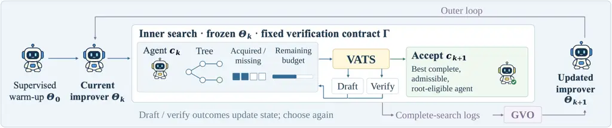
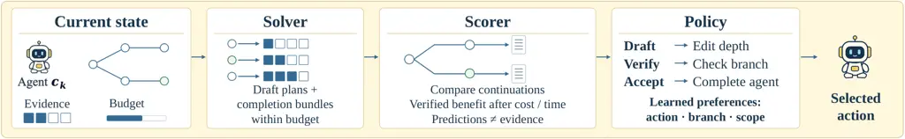
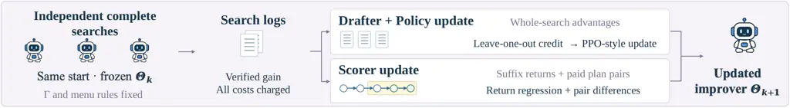

# Drafting Agents, Not Just Tokens: Speculative Recursive Self-Improvement for Agentic Systems

[Xin Xu](mailto:pkushinnxu@tencent.com)    [Ke
Cheng](mailto:ckpassenger@buaa.edu.cn)    [Hao
Wang](mailto:haohaow@zju.edu.cn)    [Yangru
Huang](mailto:yarayrhuang@tencent.com)    [Yanghao
Xiao](mailto:xiaoyanghao22@mails.ucas.ac.cn)    [Zhichao
Chen](mailto:12032042@zju.edu.cn)    [Zhisheng
Zhong](mailto:zszhong@link.cuhk.edu.hk)    [Xun
Liu](mailto:reubenliu@tencent.com)    [Yi
Li](mailto:sincereli@tencent.com)    [Qian
Li](mailto:kathieqli@tencent.com)    [Haibin
Lv](mailto:haibinlv@tencent.com)    [Jun
Zhang](mailto:neoxzhang@tencent.com)    [Jie
Jiang](mailto:zeus@tencent.com)    [Zhouchen
Lin](mailto:zlin@pku.edu.cn)

###### Abstract

Improving an agent through successive revisions requires balancing
exploration and evaluation under a limited budget. A narrow search can
miss useful sequences of edits, while fully evaluating every
intermediate version often exhausts the budget before those sequences
yield a verified improvement. Inspired by the draft–verify principle of
speculative decoding, we propose Speculative Recursive Self-Improvement
(_SpecRSI_), a two-level framework coupling inner-loop agent search with
outer-loop improver learning. _SpecRSI_ drafts successors before their
predecessors are fully evaluated, while adopting only fully evaluated,
admissible versions. In the inner loop, Verification-Aware Tree Search
(VATS) allocates the budget between further edits and outstanding checks
using the predicted verified return of a continuation. In the outer
loop, Group Verification Optimization (GVO) updates the improver from
completed searches while keeping the real evaluator fixed. We evaluate
_SpecRSI_ on scientific optimization (including active queue management
(AQM) for network infrastructure), coding, and general agent-system
benchmarks. Under matched evaluation-call budgets, _SpecRSI_ improves
scientific terminal gain over Janus by 60.0%–96.3% and area under the
budget curve by 32.1%–91.6%, while achieving higher means across all 50
scientific backbone–task pairs and outperforming MetaRSI-v1 by 1.30–2.70
percentage points (pp) in system score across twenty backbones. On
instance-level comparisons, it further improves PyBaMM terminal gain by
142.6% and SWE-Pro success by 6.0 pp at 7.0% and 9.2% lower token cost,
respectively. These results demonstrate the efficacy of the proposed
approach.


Figure 1: From token decoding to agent self-improvement. Gray arrows
mark structural analogies, while green dashed arrows indicate
verification of the same agent version. SpecRSI drafts ahead, verifies
selectively, and adopts only fully evaluated, admissible versions.

## 1 Introduction

Agent systems can improve through successive revisions to their prompts,
tools, and workflows, and recursive self-improvement (RSI) extends this
goal to the mechanisms that generate subsequent improvements. Recent
systems revise agent programs (Zhang et al., 2026a; Wang et al., 2026b),
modify the meta-agent that proposes revisions (Zhang et al., 2026b),
adapt improvement operators and their scheduling in MetaRSI (Tan et al.,
2026), or co-evolve target programs and proxy evaluators to allocate
expensive real evaluations in Janus (Liu et al., 2026). Across these
approaches, proposing changes and establishing their benefits both
consume time and computation. This allocation problem is central to Web
infrastructure and agentic systems: in active queue management (AQM),
revising a controller to manage queue buildup and delay requires
assessing traffic delivery, delay, loss, and fairness across diverse
scenarios, consuming substantial simulator resources (Liu et al., 2026;
de Almeida et al., 2024). This raises a central question: how should an
agent allocate its limited budget between exploring new revisions and
verifying their benefits? Useful revisions often support later
improvements, yet identifying them requires expensive evaluation; the
challenge is turning exploration into verified progress before resources
run out (Figure 1).

Two limiting strategies expose this trade-off. Following one fully
evaluated lineage gives every decision fresh feedback, but narrows the
alternatives and places an evaluation barrier between dependent
edits—for instance, when a coding-agent revision adds a file–test map
that a successor uses for focused intermediate retesting while retaining
the final full suite. Maintaining many lineages explores more broadly,
but fully evaluating them all spends budget on branches that are never
used. Extra workers cut elapsed time without making evaluation free, and
under a fixed budget a wider search may not leave enough computation to
finish the most useful branch. While prior systems partially relax this
barrier by separating expansion from evaluation or validating in
parallel (Wang et al., 2026b; Hu et al., 2026), we focus on drafting
successors ahead of their parents’ full evaluation and jointly selecting
further revisions and bundles of outstanding checks under the remaining
budget.

Allowing successors to be drafted ahead changes where the budget should
be spent next. A candidate that looks strong may still need several
checks before it can be adopted, whereas a child that repairs an
unhelpful parent may need only one remaining check. Evaluating a version
solely by its apparent quality misses the cost of making it usable.
Under a hard budget, what matters is a _continuation_—a sequence of
further edits and checks from the current state—and the verified
improvement it can still deliver with the remaining budget. Because this
return must be estimated _before_ paying for the checks that reveal it,
scoring must shift from static candidate quality to the marginal
verified return of further editing and checking.

Extending speculation from tokens to agent revisions therefore changes
the search space, the verification process, and the learning objective.
Agent versions are revisable programs whose successors may repair or
build on a parent that is not yet admissible. Verification requires
paid, complementary external checks with heterogeneous costs and
dependencies; several may be jointly necessary for adoption, so a single
target-model pass cannot supply this evidence. Progress must
consequently be measured by realized verified gains under resource
limits, accounting for all incurred search costs, including failed and
unfinished work.

Contributions. We introduce _SpecRSI_, a framework for budgeted
speculative agent improvement.
 Two-Level
Speculative Self-Improvement. We decouple speculative exploration from
verified adoption: inner searches extend incompletely evaluated versions
but adopt only fully evaluated, admissible ones, while the improver
remains frozen within each search and learns from complete-search
feedback between rounds.
 Verification-Aware
Tree Search (VATS). VATS allocates the remaining budget across drafting
and verification: the Solver preserves affordable completion bundles,
including individually low-value checks; the Scorer predicts verified
gains attainable through further edits and checks within the remaining
budget; and the Policy selects the next draft or verification plan.
 Group
Verification Optimization (GVO). GVO assigns credit across independent
complete searches from the same start, using verified gains from
searches under matched resource caps to provide delayed credit to
sampled edits and work choices for the Drafter and Policy, while
training the Scorer on realized suffix returns and paid same-state
comparisons.

## 2 Preliminaries and Related Work

### 2.1 Speculative Decoding

Speculative decoding uses a cheap draft model $`q`$ to propose tokens
ahead of a target model $`p`$ (Leviathan et al., 2023). Given prefix
$`x_{<i}`$, let $`q_{i}=q(\cdot\mid x_{<i})`$ and
$`p_{i}=p(\cdot\mid x_{<i})`$:

```math
x_{i}\sim q_{i},\qquad\alpha_{i}=\min\!\left\{1,\frac{p_{i}(x_{i})}{q_{i}(x_{i})}\right\}, \tag{1}
```

where $`i`$ indexes the token position, $`x_{i}`$ is the sampled draft
token, and $`\alpha_{i}`$ is its acceptance probability. Evaluating a
draft block in parallel, the target model retains the accepted prefix;
at the first rejection, it samples a replacement token from the
normalized positive part of $`p_{i}-q_{i}`$ and discards the remaining
drafts, preserving the target distribution. _SpecRSI_ brings this
draft–verify separation to agent revisions (Figure 1), where acceptance
requires complete admissible evidence instead of token-distribution
equivalence (extended related work is in Appendix A).

### 2.2 Recursive Self-Improvement

In recursive self-improvement (RSI), we distinguish an agent version
$`c`$—comprising executable code and persistent prompts, tools, and
workflows—from an improver $`\Theta`$ that proposes and selects
revisions; updating $`\Theta`$ changes how subsequent rounds generate
improvements. Given retained versions $`\mathcal{V}_{t}`$ and observed
history $`H_{t}`$, a proposal–evaluation step within round $`k`$ is

```math
\begin{gathered}\widetilde{c}_{t}\sim\operatorname{Propose}_{\Theta_{k}}(\cdot\mid\mathcal{V}_{t},H_{t}),\quad z_{t}=f_{\rm real}(\widetilde{c}_{t}),\\
(\mathcal{V}_{t+1},H_{t+1})=\operatorname{Update}(\mathcal{V}_{t},H_{t},\widetilde{c}_{t},z_{t}),\end{gathered} \tag{2}
```

where $`t`$ indexes steps under fixed $`\Theta_{k}`$,
$`\widetilde{c}_{t}`$ is the proposed version, and $`z_{t}`$ is its
evaluation outcome. A full real evaluation returns
$`f_{\rm real}(c)=(J(c),v(c))`$, with utility $`J(c)`$ (higher is
better) and admissibility indicator $`v(c)\in\{0,1\}`$. Based on
$`z_{t}`$, $`\operatorname{Update}`$ revises $`\mathcal{V}_{t}`$ and
$`H_{t}`$; retained stepping stones need not immediately outperform the
incumbent.

## 3 Method

### 3.1 Motivation

Figure 2: Performance across ten backbones (five-seed means, with bands
and whiskers showing $`\pm`$ SD). (A) Cost (k tokens). (B) Score (%).
Lines connect model categories, and logos denote model families.

Accurate benefit evaluation is central to guiding RSI toward better
agents under a limited search budget. If benefit evaluation is
inaccurate, search either overlooks useful multi-step edits or wastes
resources on candidates that never become admissible. Effective
allocation must therefore evaluate the verified improvement that
continued work can deliver.

Estimating this benefit is non-trivial because a candidate’s current
quality does not determine the value of continuing from it, due to two
challenges.
 Benefit
evaluation should reflect downstream verified improvement. Intermediate
revisions may serve as stepping stones to later gains, but realizing
those gains requires subsequent edits and real checks.
 Benefit
evaluation should account for completion costs. Complementary checks,
planning, and failed attempts all draw from the same finite resources,
so even promising gains may be too costly to verify. Together, these
challenges induce a performance–cost trade-off: a worthwhile
continuation must offer sufficient verified improvement while remaining
affordable to complete. Figure 2 illustrates this trade-off across ten
backbones, and Section 4.5 analyzes broader lifecycle expenditure.

 (A)
Two-level Speculative RSI Loop
 (B)
Verification-Aware Tree Search (VATS)
 (C) Group
Verification Optimization (GVO)

Figure 3: Two-level Speculative RSI Loop. Within each search, VATS
allocates drafts and checks under a frozen improver before Accept
returns the best complete admissible version; across searches, GVO
updates the improver under a fixed contract $`\Gamma`$.

### 3.2 Two-level Speculative RSI Loop

SpecRSI brings the draft–verify separation of speculative decoding to
the RSI loop, allowing successor agent versions to be drafted before
their parents are fully evaluated while allocating real checks
selectively. Unlike token acceptance in Equation (1), adopting an agent
requires complete admissible evidence. Specifically, we refine
Equation (2) by organizing retained versions $`\mathcal{V}_{t}`$ as
nodes in a search tree $`\mathcal{T}=(\mathcal{C},\mathcal{A})`$
anchored at a complete admissible root $`r`$, where $`\mathcal{C}`$
stores immutable agent versions and $`\mathcal{A}`$ records executed
edit edges, and by decomposing $`f_{\rm real}`$ into paid checks. Each
version freezes its prompts, tools, workflows, and permitted persistent
state (including memory), with model-parameter edits allowed only under
D/H/M permissions. An uneditable verification contract $`\Gamma`$
specifies a finite required-item set $`\mathcal{I}`$, execution and
admission rules, and constraints; its score $`J_{\Gamma}`$ and
admissibility condition instantiate the utility $`J`$ and indicator
$`v`$ from Section 2.2. At any step, state
$`S=(\mathcal{T},\mathcal{E},H,B,N,n_{\mathrm{wrk}})`$ tracks admitted
evidence $`\mathcal{E}`$, history $`H`$, remaining expense budget
$`B\geq 0`$, remaining attempts $`N\geq 0`$, and worker count
$`n_{\mathrm{wrk}}\geq 1`$. In token-accounted runs, $`B`$ and expense
charges are measured in k tokens under the registered cap (while
end-to-end totals also include overhead outside that cap), and elapsed
time is tracked separately. For version $`c`$ and item $`i`$,
$`m_{ci}\in\{0,1\}`$ indicates whether a valid outcome is present,
regardless of whether it passed. The complete admissible set and its
best observed gain are

```math
\begin{gathered}\mathcal{C}_{\mathrm{full}}(S)=\{c\in\mathcal{C}:m_{ci}=1\ \forall i\in\mathcal{I},\ c\text{ admissible}\},\\
F(S)=\max_{c\in\mathcal{C}_{\mathrm{full}}(S)}[J_{\Gamma}(c)-J_{\Gamma}(r)],\end{gathered} \tag{3}
```

where admissibility is judged under $`\Gamma`$ and $`F(S)`$ is the
observed adoption-ready gain rather than a learned estimate; because
root $`r`$ is eligible, search-time $`F(S)\geq 0`$, while held-out gain
is evaluated separately. The fixed contract $`\Gamma`$ and execution
interface $`\operatorname{Acquire}_{\Gamma}`$ constitute the _real
evaluator_: $`\Gamma`$ defines valid evidence, VERIFY invokes
$`\operatorname{Acquire}_{\Gamma}`$ to run selected real checks, and
complete admissible evidence determines $`J_{\Gamma}(c)`$ and ACCEPT
eligibility. By contrast, the learned Scorer
$`\widehat{Q}_{\phi}(S,\omega)`$ for proposed work $`\omega`$ serves as
the _score evaluator_, predicting continuation gain with optional
expense and elapsed-time penalties (Equation (6)) to guide budget
allocation without supplying evidence, whereas DRAFT generates successor
edits without assigning evaluation scores.

At outer round $`k`$, a complete admissible agent $`c_{k}`$ serves as
root $`r`$. SpecRSI parameterizes the improver as
$`\Theta_{k}=(\theta_{k},\psi_{k},\phi_{k},\nu)`$, comprising Drafter
parameters $`\theta_{k}`$, work-selection Policy parameters
$`\psi_{k}`$, continuation-value Scorer parameters $`\phi_{k}`$, and
fixed menu settings $`\nu`$. During search collection, all four
components are frozen, with scorer snapshot $`\bar{\phi}_{k}=\phi_{k}`$.
After $`G\geq 2`$ independent inner searches (counting distinct search
runs rather than shared-tree leaves), GVO updates the learned
parameters:

```math
\begin{gathered}\text{Inner loop:}\kern 5.0pt(c_{k+1}^{(g)},\mathcal{D}_{k}^{(g)})=\operatorname{Search}_{\Theta_{k}}(c_{k}),\quad g=1,\ldots,G,\\[2.0pt]
\text{Outer loop:}\kern 5.0pt\mathcal{D}_{k}=\bigcup\nolimits_{g=1}^{G}\mathcal{D}_{k}^{(g)},\quad\Theta_{k+1}=\operatorname{GVO}(\Theta_{k},\mathcal{D}_{k}),\end{gathered} \tag{4}
```

where $`g`$ indexes the $`G`$ searches, each $`\operatorname{Search}`$
returns an admissible successor $`c_{k+1}^{(g)}`$ and trajectory log
$`\mathcal{D}_{k}^{(g)}`$, and GVO updates $`(\theta,\psi,\phi)`$ from
their union $`\mathcal{D}_{k}`$ while keeping $`\nu`$, $`\Gamma`$, and
the outer update rule fixed (Figure 3; see Algorithm S1 and Algs. S2–S3
in Appendix D). Across outer rounds, _Reset_ returns the task root to
$`c_{0}`$, whereas _Carry_ retains a complete admissible successor
chosen by the registered inter-round selector; both choices operate
independently of within-search acceptance and GVO updates, and neither
resets the learned improver.

Whereas Janus co-evolves programs with proxy evaluators (Liu et al., 2026) and MetaRSI learns operator schedules (Tan et al., 2026), SpecRSI
learns to allocate budget between drafting and verification from
complete-search verified returns (Appendix A).

### 3.3 Inner-loop Search with VATS

Within each inner search, Verification-Aware Tree Search (VATS)
iteratively selects bounded work $`\omega`$ under expense and attempt
caps: either $`\textsc{DRAFT}(P,h)`$, where $`P=(P_{a})_{a=1}^{|P|}`$
indexes existing parent versions and $`h\geq 1`$ bounds edit depth, or
$`\textsc{VERIFY}(\mathcal{J})`$, where $`\mathcal{J}`$ specifies
verification jobs on existing versions. Either action may repeat until
ACCEPT terminates the search. Because complementary checks cannot be
scheduled by token-confidence ranking alone, VATS coordinates three
modules under the frozen improver: the Solver constructs feasible
completion bundles, the Scorer refines verification scope, and the
Policy selects the next action before execution updates the state for
replanning (Appendix D).

#### 3.3.1 Solver

The Solver assembles completion bundles that fit within the remaining
budget. For version $`c`$, let $`U_{c}(S)=\{i\in\mathcal{I}:m_{ci}=0\}`$
denote missing items and $`K_{c}(S)=\{(c,i):i\in U_{c}(S)\}`$ the
corresponding outstanding outcomes. A relation reader
$`\mathcal{R}(S)=\operatorname{Remaining}(S)`$ extracts masks,
dependencies, shared setups, and source relations from existing records
without running new checks or substituting forecasts for missing
evidence (Appendix D). To ensure that versions can reach full
admissibility even when individual checks carry little standalone value,
the Solver forms bundled options:

```math
\Omega_{t}=\mathcal{D}_{\rm draft,t}\cup\{\textsc{VERIFY}(A):A\in\mathcal{M}_{t}\}\cup\{\textsc{ACCEPT}\}, \tag{5}
```

where $`\Omega_{t}`$ is the feasible work menu at decision $`t`$,
$`\mathcal{D}_{\rm draft,t}`$ contains retained draft plans (which may
extend incomplete parents), and $`\mathcal{M}_{t}`$ contains feasible
verification bundles $`A`$. Specifically, a mixed-integer linear program
(MILP) selects bundles covering target $`K_{c}`$ sets and cross-branch
unions subject to prerequisites, shared setups, conflicts, and reserved
budgets. While feasibility guarantees neither passing check outcomes nor
exhaustive tree coverage, original completion seeds remain eligible
throughout subsequent refinement.

#### 3.3.2 Scorer

The Scorer $`\widehat{Q}_{\phi}(S,\omega)`$ estimates the continuation
value of state–work pairs under the frozen procedure $`\pi`$ (which
encompasses edit generation and work selection under fixed menu rules),
accounting for subsequent edits, checks, and branch switches:

```math
Q^{\pi}(S_{t},\omega)=\mathbb{E}_{\pi}\!\bigl[F(S_{\rm end})-F(S_{t})-\lambda C_{t:{\rm end}}-\mu L_{t:{\rm end}}\mid S_{t},\omega\bigr], \tag{6}
```

where $`S_{t}`$ is the state after settling the current preparation cost
from pre-preparation state $`S_{t}^{-}`$ (Alg. S2), and $`S_{\rm end}`$
is the terminal state. Subsequent expense $`C_{t:{\rm end}}`$ and
elapsed time $`L_{t:{\rm end}}`$ include later preparation and failed
work but exclude sunk preparation at step $`t`$. Fixed weights
$`\lambda,\mu\geq 0`$ convert expense and elapsed time into score-unit
penalties ($`\mu=0`$ in cost-only settings; our reference profile sets
$`\lambda=\mu=0`$, relying on resource inputs and hard caps rather than
explicit return penalties). By definition,
$`Q^{\pi}(S,\textsc{ACCEPT})=0`$, and Scorer predictions never replace
observed $`F`$ or admitted evidence.

Given a feasible bundle $`A`$, let $`D_{j}`$ denote job $`j`$ together
with its prerequisites. The frozen scorer snapshot
$`\widehat{Q}_{\bar{\phi}}`$ refines $`A`$ by evaluating the marginal
gain of adding $`D_{j}`$:

```math
\Delta_{\bar{\phi}}(j\mid A,\widetilde{S})=\widehat{Q}_{\bar{\phi}}(\widetilde{S},\textsc{VERIFY}(A\cup D_{j}))-\widehat{Q}_{\bar{\phi}}(\widetilde{S},\textsc{VERIFY}(A)), \tag{7}
```

where both terms are evaluated at the same conservative state
$`\widetilde{S}`$ that reserves the preparation cap. Comparing whole
bundles captures cross-check interactions without summing isolated check
scores, counting shared jobs and setups only once. Query and extension
caps bound refinement overhead while preserving the eligibility of
initial feasible seeds (Appendix D).

#### 3.3.3 Policy

Once preparation cost is settled, the Policy selects work from the
nonempty menu $`\Omega_{t}`$ conditioned on observed relations
$`\mathcal{R}_{t}=\operatorname{Remaining}(S_{t})`$. With
temperature-scaled logits
$`\zeta_{t}(v)=z_{\psi}(S_{t},\mathcal{R}_{t},v)/T_{\rm pol}`$, the
sampling distribution is

```math
\pi_{\psi}(\omega\mid S_{t},\mathcal{R}_{t},\Omega_{t})=(1-\epsilon)\frac{\exp(\zeta_{t}(\omega))}{\sum_{v\in\Omega_{t}}\exp(\zeta_{t}(v))}+\frac{\epsilon}{|\Omega_{t}|}, \tag{8}
```

where $`v\in\Omega_{t}`$, $`T_{\rm pol}>0`$ is the sampling temperature,
and $`\epsilon\in[0,1)`$ is the uniform-exploration rate. Because
preference logits $`z_{\psi}`$ are parameterized separately from value
estimates $`\widehat{Q}`$ (with the ACCEPT logit fixed to zero), the
Policy need not greedily maximize $`\widehat{Q}`$. Search collection
samples from $`\pi_{\psi}`$, whereas deployment selects the
maximum-logit action (Appendix D).

#### 3.3.4 Execution and Acceptance

DRAFT. Given draft plan $`(P,h)`$, the Drafter initializes
$`c_{a,0}=P_{a}`$ for each parent $`a=1,\ldots,|P|`$ and sequentially
generates edits up to depth $`d=1,\ldots,h`$ using only the context
$`H_{a,d}`$ observed prior to that edit:

```math
e_{a,d}\sim\pi_{\theta}(\cdot\mid c_{a,d-1},H_{a,d}),\quad c_{a,d}=\operatorname{Freeze}(\operatorname{Apply}(c_{a,d-1},e_{a,d})), \tag{9}
```

where $`e_{a,d}`$ is sampled from $`\pi_{\theta}`$,
$`\operatorname{Apply}`$ executes the edit, and
$`\operatorname{Freeze}`$ stores the resulting immutable version
$`c_{a,d}`$. The executor $`\operatorname{Generate}_{\theta}(P,h,S)`$
runs this bounded plan on actual artifacts: incomplete parents may be
extended, provided each edit waits for its immediate parent. Any invalid
edit is charged to the budget and terminates that path while preserving
its valid prefix.

VERIFY. For requested jobs $`\operatorname{Jobs}(\omega)`$,
$`\operatorname{Acquire}_{\Gamma}`$ either retrieves valid identical
records or executes real checks. Our core configuration runs direct
checks only, whereas checked reuse imports results after scoped equality
checks via the shared backend used by compatible controls. The executor
records outcomes and updates the state before VATS replans (Appendix D).

ACCEPT. Admitted records must satisfy identity, scope, field, and
provenance requirements, including for failed checks. Upon termination,
VATS adopts

```math
\text{ACCEPT}(S)\in\operatorname*{arg\,max}_{c\in\mathcal{C}_{\mathrm{full}}(S)}J_{\Gamma}(c), \tag{10}
```

returning the root $`r`$ if it attains the maximum, and otherwise the
first maximizer under a fixed version order. Only the adopted version
requires complete admissible evidence, and the reference rule introduces
no hidden completion or adoption margin.

### 3.4 Outer-loop Learning with GVO

Outer-loop training begins with supervised warm-up and then alternates
between frozen-improver search collection and Group Verification
Optimization (GVO) updates. Completed trajectories provide two
supervision signals derived strictly from observed outcomes under the
frozen improver rather than updated Scorer predictions: realized suffix
returns train the Scorer (when return or pair records are present), and
whole-search advantages train the Drafter and Policy over sampled
choices (with empty empirical loss terms contributing zero).

#### 3.4.1 Supervised Warm-up

Prior to the first collection round, supervised warm-up initializes
$`\Theta_{0}`$ by training Drafter $`\theta`$ to imitate executed legal
edits, Policy $`\psi`$ to imitate legal plan choices, and Scorer
$`\phi`$ to predict observed returns; unexecuted alternatives receive no
labels. Throughout training, Solver feasibility rules and menu settings
$`\nu`$ remain fixed, and neither Solver outputs nor environment
outcomes carry policy likelihoods.

#### 3.4.2 Search Returns and Advantages

In each round, we run $`G\geq 2`$ independent searches from a shared
pre-preparation state $`S_{0}^{-}`$ under frozen $`\Theta_{k}`$,
matching the root agent, verification contract, budgets, and worker
count. Each search $`g`$ terminates at state $`S_{\rm end}^{g}`$ without
requiring every visited version to be fully evaluated, logging total
expense $`C_{g}`$ and elapsed time $`L_{g}`$ (including initial
preparation as well as failed or unfinished work):

```math
\begin{gathered}R_{g}=F(S_{\rm end}^{g})-F(S_{0}^{-})-\lambda C_{g}-\mu L_{g},\\
A_{g}=R_{g}-\frac{1}{G-1}\sum_{u=1,\,u\neq g}^{G}R_{u},\end{gathered} \tag{11}
```

where $`R_{g}`$ is the net return of search $`g`$ and $`A_{g}`$ is its
leave-one-out advantage across the group $`\{1,\ldots,G\}`$. Here
$`F(S)`$ is the best observed complete admissible gain over root $`r`$
(Equation (3)), while $`\lambda C_{g}`$ and $`\mu L_{g}`$ penalize total
cost and time in score units; if a search yields no new complete
improvement, its gain is zero while incurred costs are still charged.
Comparing whole searches eliminates the need for a learned baseline and
assigns delayed credit to intermediate edits through their verified
descendants, even when those intermediate versions are not themselves
admissible.

#### 3.4.3 Scorer Training

The Scorer is updated by minimizing a combined regression and pairwise
objective,
$`\min_{\phi}\bigl[\mathcal{L}_{Q}(\phi)+\beta_{\rm pair}\mathcal{L}_{\rm pair}(\phi)\bigr]`$
with weight $`\beta_{\rm pair}\geq 0`$. The regression loss
$`\mathcal{L}_{Q}`$ fits realized, undiscounted suffix returns from
executed plan starts:

```math
\begin{gathered}G_{t}=F(S_{\rm end})-F(S_{t})-\lambda C_{t:{\rm end}}-\mu L_{t:{\rm end}},\\
\mathcal{L}_{Q}(\phi)=\mathbb{E}_{(S_{t},\omega_{t},G_{t})\sim\mathcal{D}_{Q}}\big[(\widehat{Q}_{\phi}(S_{t},\omega_{t})-G_{t})^{2}\big],\end{gathered} \tag{12}
```

where $`G_{t}`$ is the realized net return from executing $`\omega_{t}`$
at paid state $`S_{t}`$, and $`\mathcal{D}_{Q}`$ collects the resulting
state–work–return triples under the frozen procedure (including paid
alternatives). Here $`F(S_{\rm end})-F(S_{t})`$ is the remaining
observed gain, and $`C_{t:{\rm end}},L_{t:{\rm end}}`$ measure expense
and elapsed time from step $`t`$ to termination; unlike $`R_{g}`$,
$`G_{t}`$ excludes sunk preparation at step $`t`$ while charging
subsequent preparation, so $`\widehat{Q}_{\phi}`$ estimates the
conditional expectation $`Q^{\pi}`$ via mean squared error.

To sharpen relative comparisons between legal plans $`a,b`$ at the same
saved paid state $`S`$, paid rollouts under the shared continuation
policy estimate mean returns $`\overline{G}_{a},\overline{G}_{b}`$ and
their difference
$`\widehat{\delta}_{ab}=\overline{G}_{a}-\overline{G}_{b}`$:

```math
\mathcal{L}_{\rm pair}(\phi)=\mathbb{E}_{\mathcal{D}_{\rm pair}}\bigl[(\widehat{Q}_{\phi}(S,a)-\widehat{Q}_{\phi}(S,b)-\widehat{\delta}_{ab})^{2}\bigr], \tag{13}
```

where $`\mathcal{D}_{\rm pair}`$ stores matched tuples
$`(S,a,b,\widehat{\delta}_{ab})`$. While $`\mathcal{L}_{Q}`$ anchors
absolute value levels (which pairwise differences alone cannot
identify), $`\mathcal{L}_{\rm pair}`$ directly supervises relative plan
rankings. Generating these pairs restores paid state $`S`$, forces a
legal initial plan, and continues under the frozen improver; the
resulting rollouts train only the Scorer, with all clones and rollouts
charged to the budget and logged failures retained as valid data
(whereas missing records are never imputed as zero).

#### 3.4.4 Drafter and Policy Training

The actor parameters $`\vartheta=(\theta,\psi)`$ are updated over
sampled edit tokens and plan choices via
$`\min_{\vartheta}\bigl[\mathcal{L}_{\rm GVO}(\vartheta)+\beta_{\rm KL}\mathcal{L}_{\rm KL}(\vartheta)\bigr]`$,
where $`\mathcal{L}_{\rm GVO}`$ reinforces choices from searches with
positive advantage $`A_{g}`$ and $`\beta_{\rm KL}\mathcal{L}_{\rm KL}`$
regularizes divergence from the fixed post-warm-up actor (Appendix D).
Using the PPO-style clipped objective (Schulman et al., 2017) for
sampled choice $`y_{g,j}`$ under context $`H_{g,j}`$ and legal support
$`\mathcal{Y}_{g,j}`$, we have

```math
\begin{gathered}\rho_{g,j}(\vartheta)=\frac{p_{\vartheta}(y_{g,j}\mid H_{g,j},\mathcal{Y}_{g,j})}{p_{\vartheta_{k}}(y_{g,j}\mid H_{g,j},\mathcal{Y}_{g,j})},\\
\mathcal{L}_{\rm GVO}(\vartheta)=-\frac{1}{G}\!\sum_{g=1}^{G}\!\sum_{j=1}^{J_{g}}\!\min\bigl\{\rho_{g,j}(\vartheta)A_{g},\operatorname{clip}(\rho_{g,j}(\vartheta),1-\epsilon_{c},1+\epsilon_{c})A_{g}\bigr\},\end{gathered} \tag{14}
```

where $`j`$ indexes the $`J_{g}`$ sampled choices in search $`g`$,
$`\vartheta_{k}=(\theta_{k},\psi_{k})`$ denotes the frozen collection
parameters, and $`\rho_{g,j}`$ is the probability ratio between current
and collection policies (evaluating Drafter probabilities for edit
tokens and Policy probabilities for plan choices, with
$`\operatorname{clip}`$ radius $`\epsilon_{c}\in(0,1)`$ distinct from
exploration rate $`\epsilon`$). Trajectory logs $`\mathcal{B}_{t}`$
record token contexts, legal supports, and behavior probabilities (which
are empty for VERIFY steps) so that numerator and denominator are
evaluated under identical contexts, supports, temperatures, masks, and
exploration settings. During gradient computation, collection
probabilities and advantages are held constant, invalid sampled edits
retain their likelihood and cost, and each choice contributes once
without search-length normalization. In the single exact-replay step of
Alg. S3, $`\rho_{g,j}(\vartheta_{k})=1`$, so clipping is inactive and
does not bound the update.

Finally, GVO freezes the updated improver $`\Theta_{k+1}`$ for the next
collection round; because actor updates shift the continuation
distribution, subsequent rounds collect fresh searches to recalibrate
the Scorer under the fixed contract $`\Gamma`$, with Drafter and Policy
supervision based on complete-search returns (Appendix D).

## 4 Experimental Results

In this section, we conduct a comprehensive empirical evaluation to
demonstrate the efficacy of SpecRSI, centered on the following research
questions (RQs):

1.  1.  RQ1: _Does SpecRSI produce better successor agents?_ Section 4.2
        compares SpecRSI against competitive baselines across tasks and
        backbones under matched evaluation settings.
2.  2.  RQ2: _How do verification scope and planning in VATS affect search
        quality and cost?_ Section 4.3 examines verification scope,
        draft-ahead, and planning, with additional scorer and evidence-input
        controls in Appendix C.2.
3.  3.  RQ3: _Does GVO learn a more effective improver?_ Section 4.4
        compares frozen and GVO-updated improvers from identical starting
        agents and tracks cumulative gains over successive rounds.
4.  4.  RQ4: _How do planning capacity and parallelism trade off gain, cost,
        and latency?_ Section 4.5 analyzes candidate-plan limits,
        full-lifecycle token expenditure, and multi-worker execution
        latency.

### 4.1 Evaluation Setup

Datasets. We evaluate five scientific tasks (PyBaMM (Sulzer et al.,
2021), AQM (de Almeida et al., 2024), FDTD (Wu et al., 2024),
Reactor (Braniff & Tian, 2024), and IRP (Violi et al., 2024))¹¹ 1
[PyBaMM](https://github.com/pybamm-team/PyBaMM);
[ns-3](https://github.com/nsnam/ns-3-dev-git). Our implementations:
[FDTD](https://github.com/SpecRSI-GPR/SpecRSI/blob/main/src/specrsi/science/fdtd.py),
[Reactor](https://github.com/SpecRSI-GPR/SpecRSI/blob/main/src/specrsi/science/reactor.py),
[IRP](https://github.com/SpecRSI-GPR/SpecRSI/blob/main/src/specrsi/science/irp.py).
and four agent-system benchmarks (Terminal-Bench 2.1 (Merrill et al.,
2026), SWE-Pro (Deng et al., 2025), GPQA-hard100 (Rein et al., 2024),
and AIME).²² 2 [Terminal-Bench
2.1](https://www.tbench.ai/news/terminal-bench-2-1);
[SWE-Pro](https://github.com/scaleapi/SWE-bench_Pro-os);
[GPQA](https://github.com/idavidrein/gpqa);
[AIME](https://maa.org/maa-invitational-competitions/). We further
evaluate specialized settings for code (SWE-Pro (Deng et al., 2025),
HumanEval-Ext. (Chen et al., 2021), MBPP-Advanced (Austin et al., 2021),
FixBench (Li et al., 2025)),³³ 3
[SWE-Pro](https://github.com/scaleapi/SWE-bench_Pro-os);
[HumanEval](https://github.com/openai/human-eval);
[MBPP](https://github.com/google-research/google-research/blob/master/mbpp/README.md);
[Fixbench-RTL](https://huggingface.co/datasets/KSU-HW-SEC/Fixbench-RTL/tree/main).
prompt (GPQA-hard100 (Rein et al., 2024), MMLU-Pro (Wang et al., 2024),
GSM8K-Opt. (Cobbe et al., 2021)),⁴⁴ 4
[GPQA-hard100](https://github.com/idavidrein/gpqa);
[MMLU-Pro](https://github.com/TIGER-AI-Lab/MMLU-Pro);
[GSM8K-Opt](https://github.com/openai/grade-school-math). and workflow
optimization (PlanBench (Valmeekam et al., 2023), Math (Fei et al.,
2026), MBPP (Austin et al., 2021), Game24 (Yao et al., 2023)).⁵⁵ 5
[PlanBench](https://github.com/karthikv792/LLMs-Planning);
[Math](https://github.com/cf3i/Evolving-Multi-Agent-System);
[MBPP](https://github.com/google-research/google-research/blob/master/mbpp/README.md);
[Game24](https://github.com/princeton-nlp/tree-of-thought-llm). Here
HumanEval-Ext., MBPP-Advanced, GPQA-hard100, and GSM8K-Opt. are
benchmark-derived profiles, FixBench uses Fixbench-RTL, and workflow
Math follows EMAS; where a benchmark appears in multiple settings, each
experiment specifies its own cohort, starting agent, and verification
contract.

Baselines. We benchmark SpecRSI against five groups of baselines: (1)
scientific optimization, following Janus’s comparison protocols (Liu
et al., 2026): Alg.-Only (AlphaEvolve-style program evolution with a
fixed evaluator) (Novikov et al., 2025), Direct-LLM (LAEA-style
candidate-quality prediction) (Hao et al., 2024), Embed-GP (a
Gaussian-process surrogate on fixed code embeddings) (Snoek et al.,
2012), and Janus; (2) system-level RSI (Tan et al., 2026): Initial,
Data-RSI, Harness-RSI, Model-RSI, Fixed D$`\to`$M$`\to`$H, a
failure-signature Static router, and MetaRSI-v1; (3) code optimization:
DGM (Zhang et al., 2026a), SICA (Robeyns et al., 2025), HGM (Wang
et al., 2026b), our non-learning Beam-Spec control with speculative
decoding (Leviathan et al., 2023), and FlashEvolve (async/optional) (Hu
et al., 2026); (4) prompt optimization: MIPROv2 (with/without
demonstrations) (Opsahl-Ong et al., 2024), Trace (Cheng et al., 2024),
TextGrad (Yuksekgonul et al., 2025), and GEPA/GEPA+Merge (Agrawal
et al., 2026); and (5) workflow optimization: Genesis/Genesis+SOP (Fei
et al., 2026), AFlow (Zhang et al., 2025), ADAS (Hu et al., 2025), and
EMAS (Fei et al., 2026). All comparisons match edit permissions, where
MetaRSI-H and SpecRSI-H restrict updates to D+H (prompts, tool
workflows, and non-test data) with frozen model weights (Tan et al.,
2026, Sec. 5.3), and SpecRSI executes direct checks. In cross-backbone
transfer tests (Figure 4), we freeze the shared Qwen-trained improver
across all ten scientific and twenty system backbones (nineteen beyond
the reference model; see the [online reproduction
notes](https://github.com/SpecRSI-GPR/SpecRSI/blob/main/docs/results/model_sources.md)),
matching starting agents, contracts, seeds, and evaluation caps ($`K`$
for Janus/SpecRSI in scientific tasks, and D+H splits and search caps
for MetaRSI/SpecRSI in system tasks).

A Scientific gain / AUBC

| Method                           | PyBaMM                      | AQM                         | FDTD                        | Reactor                     | IRP                         |
| -------------------------------- | --------------------------- | --------------------------- | --------------------------- | --------------------------- | --------------------------- |
| Alg.-Only (Novikov et al., 2025) | 0.12±0.02 \[1.5pt\]7.3±0.1  | 0.09±0.03 \[1.5pt\]5.1±0.8  | 0.14±0.05 \[1.5pt\]8.5±0.6  | 0.11±0.05 \[1.5pt\]6.7±0.2  | 0.10±0.07 \[1.5pt\]5.8±0.6  |
| Direct-LLM (Hao et al., 2024)    | 0.21±0.03 \[1.5pt\]19.2±0.8 | 0.17±0.01 \[1.5pt\]14.3±0.5 | 0.23±0.02 \[1.5pt\]22.6±0.3 | 0.18±0.06 \[1.5pt\]16.2±0.1 | 0.18±0.05 \[1.5pt\]13.7±0.3 |
| Embed-GP (Snoek et al., 2012)    | 0.29±0.03 \[1.5pt\]30.5±0.4 | 0.26±0.01 \[1.5pt\]24.8±0.1 | 0.36±0.03 \[1.5pt\]36.2±0.9 | 0.29±0.03 \[1.5pt\]27.4±0.2 | 0.28±0.06 \[1.5pt\]23.1±0.1 |
| Janus (Liu et al., 2026)         | 0.35±0.05 \[1.5pt\]42.8±0.3 | 0.30±0.03 \[1.5pt\]34.7±0.9 | 0.40±0.02 \[1.5pt\]51.4±0.7 | 0.33±0.02 \[1.5pt\]37.0±0.2 | 0.27±0.04 \[1.5pt\]22.6±0.1 |
| SpecRSI (ours)                   | 0.58±0.02 \[1.5pt\]57.7±0.4 | 0.52±0.03 \[1.5pt\]46.8±0.1 | 0.64±0.01 \[1.5pt\]67.9±0.2 | 0.55±0.01 \[1.5pt\]50.3±0.4 | 0.53±0.03 \[1.5pt\]43.3±0.1 |

B System scores (%, $`\uparrow`$)

|                                            |          |          |          |          |
| ------------------------------------------ | -------- | -------- | -------- | -------- |
| Method                                     | TB2.1    | SWE-Pro  | GPQA     | AIME     |
| Initial (Tan et al., 2026)                 | 23.6±0.7 | 10.2±0.3 | 71.2±1.0 | 54.9±0.5 |
| Data-RSI (Tan et al., 2026)                | 27.4±0.3 | 12.4±0.8 | 73.8±0.3 | 57.6±0.1 |
| Harness-RSI (Tan et al., 2026)             | 29.4±0.6 | 14.8±0.3 | 78.2±0.7 | 63.1±0.8 |
| Model-RSI (Tan et al., 2026)               | 27.0±0.3 | 13.9±0.1 | 75.4±0.6 | 59.7±0.2 |
| Fixed D$`\to`$M$`\to`$H (Tan et al., 2026) | 30.3±0.6 | 15.3±0.3 | 79.5±0.2 | 64.2±0.6 |
| Static router (Tan et al., 2026)           | 30.8±0.2 | 14.9±0.3 | 79.7±0.9 | 64.0±0.2 |
| MetaRSI-v1 (Tan et al., 2026)              | 32.1±0.3 | 19.5±0.8 | 83.8±0.2 | 68.5±0.1 |
| SpecRSI (ours)                             | 35.6±0.6 | 23.7±0.1 | 87.3±0.3 | 72.9±0.3 |
| MetaRSI-H (Tan et al., 2026)               | 28.6±0.5 | 14.2±0.2 | 77.5±0.5 | 61.7±0.2 |
| SpecRSI-H (ours)                           | 32.1±0.1 | 17.3±0.5 | 80.9±0.5 | 65.6±0.1 |

Table 1: Scientific and system performance (five-seed mean $`\pm`$ SD;
bold indicates the best comparable mean). (A) Terminal gain (upper) and
call-axis AUBC (lower) in native units, following Janus (Liu et al.,
2026). (B) Scores (%) of complete admissible versions under matched
D/H/M (upper) or D+H (lower) permissions on Terminal-Bench 2.1 (TB2.1),
SWE-Pro, GPQA-hard100 (GPQA), and AIME, following MetaRSI (Tan et al.,
2026).

Evaluation Metrics. We report terminal gain ($`\Delta_{K}`$) and area
under the budget curve (AUBC) on scientific tasks following Janus (Liu
et al., 2026), alongside task scores and mean inference cost ($`C`$).
Token-accounted searches track initial and remaining budgets $`B_{0}`$
and $`B_{t}\geq 0`$ (in k tokens) separately from the evaluation-call
limit $`K`$, which is fixed across scientific methods at
$`K=140,130,160,135,120`$ for PyBaMM, AQM, FDTD, Reactor, and IRP,
respectively. Each call executes one instance’s full real-evaluation
suite (counting failed runs, but excluding cached and proxy
evaluations). Let $`s_{b}`$ denote the held-out score of the complete
admissible incumbent selected on validation after $`b`$ calls (with
held-out scores never used during search selection), and let
$`\Delta_{b}=s_{b}-s_{0}`$. We compute

```math
\Delta_{K}=s_{K}-s_{0},\quad\mathrm{AUBC}=\frac{1}{2}\sum_{b=1}^{K}(\Delta_{b-1}+\Delta_{b}),\quad C=\frac{\sum_{i=1}^{M}T_{i}}{10^{3}M}, \tag{15}
```

where $`M`$ is the number of evaluated instances and $`T_{i}`$ sums all
input and output inference tokens over instance $`i`$’s full execution,
including failed or unfinished attempts. Thus $`C`$ measures online
inference cost in k tokens per task (whereas Figure 2A counts tokens up
to the first qualifying outcome or termination, and seed totals or
training-token costs are listed separately; Appendix C.1). Scientific
gains use dimensionless task scores (Appendix B), and AUBC integrates
gain over calls by carrying the final value forward to $`K`$ after early
stopping. Task scores are reported as accuracy or success percentages
(with absolute differences in percentage points, pp, and relative gains
over the named baseline); higher gain, AUBC, and score and lower cost
indicate better performance. Unless stated otherwise, we average three
searches per training seed and report mean $`\pm`$ SD across five seed
means.

Implementation Details. We implement SpecRSI using Qwen3.5-35B-A3B⁶⁶ 6
[Qwen3.5-35B-A3B](https://huggingface.co/Qwen/Qwen3.5-35B-A3B) as the
reference backbone, equipping the Drafter with rank-16 LoRA (Hu et al., 2022) and using separate 256-dimensional branches for the Scorer and
Policy. Supervised warm-up trains for one epoch using AdamW (Loshchilov
& Hutter, 2019) with a learning rate of $`2\times 10^{-5}`$, followed by
two reference GVO collection-and-update rounds with $`G=3`$ independent
complete searches per group (see Appendix B for full settings and
Appendix C.2 for the 20-round extension).

Figure 4: Performance across categorical backbones (lines connect
five-seed means; shaded bands show $`\pm`$ SD). (A) Terminal-gain and
AUBC uplift over Janus. (B) System scores and seed-paired gains (SpecRSI
$`-`$ MetaRSI-v1). Logos denote model families and axis labels omit
family prefixes (Son: Sonnet; P: Premier; Cmd: Command; Qwen3.5:
total/active parameters; 3.8 Max: Qwen3.8 Max; Maverick: Llama 4
Maverick; ^(∗)reference backbone).

### 4.2 Overall Performance (RQ1)

In this section, we benchmark SpecRSI across tasks and backbones.
 Higher
scientific gains. Across the five scientific tasks, SpecRSI improves
mean terminal gain and call-axis AUBC over Janus by 60.0%–96.3% and
32.1%–91.6%, respectively (Table 1A).
 Better
system-level successors. Under matched D/H/M permissions, SpecRSI
outperforms MetaRSI-v1 by 3.5–4.4 pp, while restricting updates to D+H
retains a 3.48 pp average advantage (Table 1B).
 Gains
persist across backbones. Transferring the frozen improver across models
improves all 50 scientific backbone–task pairs over Janus and
outperforms MetaRSI-v1 by 1.30–2.70 pp across all twenty system
backbones (Figure 4).

Figure 5: Code (A), prompt (B), and workflow (C) performance, showing
task score (%, top row) and mean full-task inference cost (k tokens,
bottom row, with separate axis ranges per column). Points and shaded
bands show five-seed means $`\pm`$ SD across connected method categories
(Beam: Beam-Spec; FE: FlashEvolve async/optional; MIP$`+/-`$: MIPROv2
with/without demonstrations; GEPA+M: GEPA+Merge; Gen+SOP: Genesis+SOP).


Benefits extend across optimization settings. On the eleven code,
prompt, and workflow benchmarks, SpecRSI improves mean scores by 3.5–6.0
pp over the strongest baseline on each task while reducing inference
cost by 3.2%–17.6% (Figure 5; see Appendix C.1 and Figure S1(A,B) for
instance-level results).

Figure 6: Verification scope and planning ablations. (A)
Information-scope controls (draft-ahead off) and (B) draft-ahead-scope
controls (full-state inputs), reporting accepted gain, search cost (k
tokens), and pooled hit rate across $`5\times 25`$ searches per
condition. (C) Held-out gain (retaining negative values) and total cost
across eight execution-only budget caps (100% = 65 k tokens, with
planning and other overhead included in total cost). Error bars and
bands show $`\pm`$ SD across five seed means; see Table S2 and
Appendix C.2 for accounting and paired statistics.

### 4.3 VATS Ablations (RQ2)

In this section, we dissect verification scope and planning in VATS on
PyBaMM (Figure 6).
 Bundles
improve accepted outcomes. With full-state inputs and draft-ahead
disabled, bundled verification raises accepted gain from 4.8 to 6.3 pp
and hit rate (the share of 125 searches returning a complete, admissible
agent with positive gain) from 84% to 92%, while reducing search cost
from 47.96 to 44.99 k tokens.
 Draft-ahead
and bundles yield the best mean outcomes. In the $`2\times 2`$ factorial
comparison, combining draft-ahead with bundled checks achieves the
highest accepted gain (6.02 pp) and hit rate (92%) alongside the lowest
cost (47.64 k tokens).
 Planning
improves the gain–cost trade-off. Full SpecRSI achieves the highest mean
gain and lowest mean cost across all eight budget caps; at the 70% cap,
it reaches 6.00 versus 4.73 pp for additive MILP planning while using
44.76 versus 49.29 k tokens (9.2% less). Under matched inputs, scoring
continuation return (CR) also improves gain by 1.32 pp over
candidate-quality scoring (CQ) at 7.4% lower search cost (Figure S2A,B;
Appendix C.2).

Figure 7: Learning the improver (lines and markers show five-seed means
with $`\pm`$ SD shading; open circles in A and C denote individual
seeds). (A) Original-agent and previous-output starts alongside the
identical-start pre-/post-GVO test. (B) Cumulative gain from
previous-output starts after round-1 initialization, comparing Frozen
improvers with Updated improvers trained each round. (C)
VATS$`\times`$GVO factorial control, where total cost sums training and
eight evaluation searches per seed (protocols in Appendix C.2).

### 4.4 Learning Effectiveness (RQ3)

In this section, we evaluate improver learning across starting agents
and multi-round trajectories (Figure 7).
 GVO
updates improve search quality. When starting searches either from the
original task agent or from the previous round’s output (without
resetting the improver), GVO-only updates raise gains from 4.10/4.80 to
4.60/5.68 pp, respectively (Figure 7A). In the matched factorial
comparison (Figure 7C), GVO adds 0.80 pp under Greedy search and 1.30 pp
under VATS; overall, full SpecRSI outperforms Greedy with a frozen
improver by 2.00 pp at 19.5% lower total token cost (including
training).
 Learning
helps from the same starting agent. Holding the starting task agent
fixed in a paired test, GVO updates increase gain from 5.7 to 6.9 pp
(Figure 7A), yielding a paired improvement of 1.20 pp (95% CI
$`[1.112,1.288]`$, positive across all five seeds; Table S2).
 Gains
accumulate across rounds. Across 20 rounds (comparing frozen
before-training improvers against after-training improvers updated each
round via GVO or MetaRSI’s rule), cumulative gain reaches 42.1 pp for
updated SpecRSI versus 29.6 pp for updated MetaRSI and 21.2 pp for
frozen SpecRSI, with positive mean per-round gains throughout rounds
2–20 (Figure 7B; see also frozen-improver transfer in Figure 4B and
Appendix C.2).

(A) Candidate-plan limit

| Cap | Gain (pp)          | Planning cost (k tokens) |
| --- | ------------------ | ------------------------ |
| 8   | $`5.2\!\pm\!0.35`$ | $`1.8\!\pm\!0.12`$       |
| 16  | $`5.8\!\pm\!0.22`$ | $`2.7\!\pm\!0.15`$       |
| 32  | $`6.3\!\pm\!0.27`$ | $`3.9\!\pm\!0.21`$       |
| 64  | $`6.5\!\pm\!0.16`$ | $`5.6\!\pm\!0.23`$       |

(B) Lifecycle cost (k tokens)

| Category     | MetaRSI-v1           | SpecRSI                       |
| ------------ | -------------------- | ----------------------------- |
| Acquisition  | $`14.5\!\pm\!0.41`$  | $`14.2\!\pm\!0.35`$           |
| Training     | $`38.6\!\pm\!0.96`$  | $`34.8\!\pm\!0.87`$           |
| Search       | $`37.2\!\pm\!0.96`$  | $`36.2\!\pm\!0.86`$           |
| Reuse checks | $`5.1\!\pm\!0.26`$   | $`4.8\!\pm\!0.26`$            |
| Copies       | $`6.3\!\pm\!0.26`$   | $`6.1\!\pm\!0.25`$            |
| Failed work  | $`6.8\!\pm\!0.40`$   | $`6.3\!\pm\!0.32`$            |
| Planning     | $`4.2\!\pm\!0.20`$   | $`3.9\!\pm\!0.20`$            |
| Total        | $`112.7\!\pm\!3.44`$ | $`\mathbf{106.3}\!\pm\!3.09`$ |

(C) Parallel execution

| Wkr. | Gain (pp)           | Time (s)             | Total worker time (worker-s) |
| ---- | ------------------- | -------------------- | ---------------------------- |
| 1    | $`6.30\!\pm\!0.20`$ | $`1287\!\pm\!21.79`$ | $`1287.00\!\pm\!21.79`$      |
| 2    | $`6.40\!\pm\!0.18`$ | $`672\!\pm\!10.91`$  | $`1340.00\!\pm\!24.51`$      |
| 3    | $`6.40\!\pm\!0.26`$ | $`458\!\pm\!9.80`$   | $`1372.00\!\pm\!28.25`$      |
| 4    | $`6.40\!\pm\!0.20`$ | $`354\!\pm\!6.40`$   | $`1412.00\!\pm\!26.08`$      |
| 5    | $`6.40\!\pm\!0.14`$ | $`291\!\pm\!5.43`$   | $`1451.00\!\pm\!28.08`$      |
| 6    | $`6.50\!\pm\!0.21`$ | $`248\!\pm\!5.43`$   | $`1484.00\!\pm\!33.52`$      |
| 7    | $`6.50\!\pm\!0.19`$ | $`216\!\pm\!4.47`$   | $`1508.00\!\pm\!31.76`$      |
| 8    | $`6.50\!\pm\!0.23`$ | $`192\!\pm\!4.47`$   | $`1531.40\!\pm\!34.51`$      |
| 9    | $`6.50\!\pm\!0.19`$ | $`174\!\pm\!4.47`$   | $`1560.90\!\pm\!39.00`$      |
| 10   | $`6.50\!\pm\!0.20`$ | $`160\!\pm\!4.47`$   | $`1594.84\!\pm\!44.63`$      |
| 12   | $`6.60\!\pm\!0.21`$ | $`139\!\pm\!4.47`$   | $`1663.50\!\pm\!54.46`$      |
| 14   | $`6.60\!\pm\!0.24`$ | $`125\!\pm\!4.47`$   | $`1743.24\!\pm\!63.23`$      |
| 16   | $`6.60\!\pm\!0.18`$ | $`114\!\pm\!4.85`$   | $`1818.30\!\pm\!75.62`$      |
| 18   | $`6.64\!\pm\!0.23`$ | $`106\!\pm\!4.47`$   | $`1904.56\!\pm\!80.43`$      |
| 20   | $`6.70\!\pm\!0.23`$ | $`100\!\pm\!4.47`$   | $`1996.80\!\pm\!89.01`$      |

Table 2: Resource trade-offs (five-seed mean $`\pm`$ SD) cover
candidate-plan limits (A), full-run lifecycle costs (B), and parallel
execution (C): 8/20 workers run $`6.7/12.9\times`$ faster at
$`+19.0/55.2\%`$ worker time vs. 1 (Appendix B).

### 4.5 Resource Trade-offs (RQ4)

In this section, we examine candidate-plan limits, lifecycle costs, and
parallel execution (Table 2).
 More
plans yield diminishing gains. Raising the candidate-plan limit from 8
to 32 increases gain from 5.2 to 6.3 pp, whereas doubling it to 64 adds
only 0.2 pp while increasing planning cost from 3.9 to 5.6 k tokens
(Table 2A).
 SpecRSI
uses fewer lifecycle tokens. SpecRSI achieves lower mean token usage
across all seven lifecycle categories, reducing full-run expenditure
(including training and serialized copies) from 112.7 k tokens for
MetaRSI-v1 to 106.3 k tokens ($`-5.7\%`$; Table 2B).
 Parallel
workers reduce latency but use more worker time. Scaling from one to
eight concurrent workers cuts elapsed wall-clock time from 1,287 to 192
s ($`6.7\times`$) at the cost of 19.0% more total worker time, while
twenty workers further reduce latency to 100 s ($`12.9\times`$) with
55.2% more worker time as mean gain rises from 6.3 to 6.7 pp (Table 2C).

## 5 Conclusion

In this work, we present SpecRSI, whose two-level loop extends
incompletely evaluated parents but adopts only complete, admissible
versions. VATS allocates edits and complementary checks by predicted
verified continuation return; GVO updates the improver from completed
searches under a fixed verification contract. SpecRSI improves
terminal-gain and AUBC means over Janus in all 50 scientific
backbone–task pairs and exceeds MetaRSI-v1 by 1.30–2.70 pp in score
across twenty backbones. Full planning outperforms six planning controls
in mean held-out gain and mean total token cost across all eight budget
caps. Starting-artifact controls support gains from improver updates
beyond retaining stronger task agents. Instance-level comparisons show
higher PyBaMM gain and SWE-Pro success with lower token cost. These
results show that planning verification and learning the improver
jointly improve agent performance and token efficiency.

## References

- Agrawal et al. (2026) Lakshya A. Agrawal, Shangyin Tan, Dilara Soylu,
  Noah Ziems, Rishi Khare, Krista Opsahl-Ong, Arnav Singhvi, Herumb
  Shandilya, Michael J. Ryan, Meng Jiang, Christopher Potts, Koushik
  Sen, Alexandros G. Dimakis, Ion Stoica, Dan Klein, Matei Zaharia, and
  Omar Khattab. [GEPA: Reflective Prompt Evolution Can Outperform
  Reinforcement
  Learning](https://proceedings.iclr.cc/paper_files/paper/2026/hash/0e9e708b6f48e14fd0ac29e167413f76-Abstract-Conference.html).
  In _Proc. ICLR_, pp. 8479–8565, 2026.
- Austin et al. (2021) Jacob Austin, Augustus Odena, Maxwell Nye,
  Maarten Bosma, Henryk Michalewski, David Dohan, Ellen Jiang, Carrie
  Cai, Michael Terry, Quoc Le, and Charles Sutton. Program synthesis
  with large language models, 2021.
- Braniff & Tian (2024) Austin Braniff and Yuhe Tian. [A hierarchical
  multi-parametric programming approach for dynamic risk-based model
  predictive quality
  control](https://doi.org/10.1016/j.conengprac.2024.106062). _Control
  Engineering Practice_, 152:106062, 2024.
- Chen et al. (2021) Mark Chen, Jerry Tworek, Heewoo Jun, et al.
  Evaluating large language models trained on code, 2021.
- Cheng et al. (2024) Ching-An Cheng, Allen Nie, and Adith Swaminathan.
  [Trace is the Next AutoDiff: Generative Optimization with Rich
  Feedback, Execution Traces, and
  LLMs](https://doi.org/10.52202/079017-2287). In _NeurIPS_, volume 37,
  pp. 71596–71642, 2024.
- Cobbe et al. (2021) Karl Cobbe, Vineet Kosaraju, Mohammad Bavarian,
  Mark Chen, Heewoo Jun, Lukasz Kaiser, Matthias Plappert, Jerry Tworek,
  Jacob Hilton, Reiichiro Nakano, Christopher Hesse, and John Schulman.
  Training verifiers to solve math word problems, 2021.
- de Almeida et al. (2024) Leandro C. de Almeida, Washington
  Rodrigo Dias da Silva, Thiago C. Tavares, Rafael Pasquini, Chrysa
  Papagianni, and Fábio L. Verdi. [DESiRED—Dynamic, Enhanced, and Smart
  iRED: A P4-AQM with Deep Reinforcement Learning and In-band Network
  Telemetry](https://doi.org/10.1016/j.comnet.2024.110326). _Computer
  Networks_, 244:110326, 2024.
- Deng et al. (2025) Xiang Deng, Jeff Da, Edwin Pan, Yannis Yiming He,
  Charles Ide, Kanak Garg, Niklas Lauffer, Andrew Park, Nitin Pasari,
  Chetan Rane, Karmini Sampath, Maya Krishnan, Srivatsa Kundurthy, Sean
  Hendryx, Zifan Wang, Vijay Bharadwaj, Jeff Holm, Raja Aluri, Chen
  Bo Calvin Zhang, Noah Jacobson, Bing Liu, and Brad Kenstler. SWE-Bench
  Pro: Can AI agents solve long-horizon software engineering
  tasks?, 2025.
- Fei et al. (2026) Chao Fei, Qingyi Si, Kaihua Liang, Yanghua Xiao,
  Panos Kalnis, and Hongcheng Guo. EMAS: Stabilizing multi-agent system
  evolution through evidence-guided revision, 2026.
- Hao et al. (2024) Hao Hao, Xiaoqun Zhang, and Aimin Zhou. [Large
  language models as surrogate models in evolutionary algorithms: A
  preliminary study](https://doi.org/10.1016/j.swevo.2024.101741).
  _Swarm and Evolutionary Computation_, 91:101741, 2024.
- Hu et al. (2022) Edward J. Hu, Yelong Shen, Phillip Wallis, Zeyuan
  Allen-Zhu, Yuanzhi Li, Shean Wang, Lu Wang, and Weizhu Chen. [LoRA:
  Low-Rank Adaptation of Large Language
  Models](https://openreview.net/forum?id=nZeVKeeFYf9). In _Proc.
  ICLR_, 2022.
- Hu et al. (2025) Shengran Hu, Cong Lu, and Jeff Clune. [Automated
  Design of Agentic
  Systems](https://proceedings.iclr.cc/paper_files/paper/2025/hash/36b7acf6f6010652b3f2a433774a66fe-Abstract-Conference.html).
  In _Proc. ICLR_, pp. 21344–21377, 2025.
- Hu et al. (2026) Zhengding Hu, Mingge Lu, Zhen Wang, Jixuan Ruan,
  Chang Chen, Zaifeng Pan, Yue Guan, Ruiyi Wang, Zhongkai Yu, Chao
  Zhang, and Yufei Ding. FlashEvolve: Accelerating agent self-evolution
  with asynchronous stage orchestration, 2026.
- Huangfu & Hall (2018) Q. Huangfu and J. A. J. Hall. [Parallelizing the
  Dual Revised Simplex
  Method](https://doi.org/10.1007/s12532-017-0130-5). _Mathematical
  Programming Computation_, 10(1):119–142, 2018.
- Lee et al. (2019) Juho Lee, Yoonho Lee, Jungtaek Kim, Adam Kosiorek,
  Seungjin Choi, and Yee Whye Teh. [Set Transformer: A Framework for
  Attention-based Permutation-Invariant Neural
  Networks](https://proceedings.mlr.press/v97/lee19d.html). In _Proc.
  36th ICML_, volume 97 of _PMLR_, pp. 3744–3753, 2019.
- Leviathan et al. (2023) Yaniv Leviathan, Matan Kalman, and Yossi
  Matias. [Fast Inference from Transformers via Speculative
  Decoding](https://proceedings.mlr.press/v202/leviathan23a.html). In
  _Proc. ICML_, pp. 19274–19286, 2023.
- Li et al. (2025) Shijie Li, Weimin Fu, Yifang Zhao, Xiaolong Guo, and
  Yier Jin. [Fixbench-RTL: A Comprehensive Benchmark for Evaluating LLMs
  on RTL
  Debugging](https://doi.org/10.1109/AsianHOST68425.2025.11370376). In
  _Proc. AsianHOST_. IEEE, 2025.
- Liu et al. (2026) Ximeng Liu, Qianlong Wang, Yingming Mao, Annan Li,
  Yatao Li, Shizhen Zhao, Jianmin Wu, Dawei Yin, and Dou Shen. Janus: An
  Algorithm-Evaluator Co-Evolution Framework for LLM-Driven Discovery
  under Expensive Evaluation Budgets, 2026.
- Loshchilov & Hutter (2019) Ilya Loshchilov and Frank Hutter.
  [Decoupled Weight Decay
  Regularization](https://openreview.net/forum?id=Bkg6RiCqY7). In _Proc.
  ICLR_, 2019.
- Merrill et al. (2026) Mike Merrill, Alexander Shaw, Nicholas Carlini,
  Boxuan Li, Harsh Raj, Ivan Bercovich, Lin Shi, Jeong Shin, Thomas
  Walshe, E. Kelly Buchanan, Junhong Shen, Guanghao Ye, Haowei Lin,
  Jason Poulos, Maoyu Wang, Marianna Nezhurina, Di Lu, Orfeas
  Menis Mastromichalakis, Zhiwei Xu, Zizhao Chen, Yue Liu, Robert Zhang,
  Leon Liangyu Chen, Anurag Kashyap, Jan-Lucas Uslu, Jeffrey Li, Jianbo
  Wu, Minghao Yan, Song Bian, Vedang Sharma, Ke Sun, Steven Dillmann,
  Akshay Anand, Andrew Lanpouthakoun, Bardia Koopah, Changran Hu, Etash
  Guha, Gabriel Dreiman, Jiacheng Zhu, Karl Krauth, Li Zhong, Niklas
  Muennighoff, Robert Amanfu, Shangyin Tan, Shreyas Pimpalgaonkar,
  Tushar Aggarwal, Xiangning Lin, Xin Lan, Xuandong Zhao, Yiqing Liang,
  Yuanli Wang, Zilong (Ryan) Wang, Changzhi Zhou, David Heineman, Hange
  Liu, Harsh Trivedi, John Yang, Junhong Lin, Manish Shetty, Michael
  Yang, Nabil Omi, Negin Raoof, Shanda Li, Terry Yue Zhuo, Wuwei Lin,
  Yiwei Dai, Yuxin Wang, Wenhao Chai, Shang Zhou, Dariush Wahdany, Ziyu
  She, Jiaming Hu, Zhikang Dong, Yuxuan Zhu, Sasha Cui, Ahson Saiyed,
  Arinbjörn Kolbeinsson, Christopher Rytting, Ryan Marten, Yixin Wang,
  Jenia Jitsev, Alex Dimakis, Andy Konwinski, and Ludwig Schmidt.
  [Terminal-Bench: Benchmarking Agents on Hard, Realistic Tasks in
  Command Line
  Interfaces](https://proceedings.iclr.cc/paper_files/paper/2026/hash/444a3737adaee10d86ad2ef5f74468e6-Abstract-Conference.html).
  In _Proc. ICLR_, pp. 40903–40986, 2026.
- Novikov et al. (2025) Alexander Novikov, Ngân V u, Marvin Eisenberger,
  Emilien Dupont, Po-Sen Huang, Adam Zsolt Wagner, Sergey Shirobokov,
  Borislav Kozlovskii, Francisco J. R. Ruiz, Abbas Mehrabian, M. Pawan
  Kumar, Abigail See, Swarat Chaudhuri, George Holland, Alex Davies,
  Sebastian Nowozin, Pushmeet Kohli, and Matej Balog. AlphaEvolve: A
  coding agent for scientific and algorithmic discovery, 2025.
- Opsahl-Ong et al. (2024) Krista Opsahl-Ong, Michael J. Ryan, Josh
  Purtell, David Broman, Christopher Potts, Matei Zaharia, and Omar
  Khattab. [Optimizing Instructions and Demonstrations for Multi-Stage
  Language Model
  Programs](https://doi.org/10.18653/v1/2024.emnlp-main.525). In _Proc.
  EMNLP 2024_, pp. 9340–9366. ACL, 2024.
- Rein et al. (2024) David Rein, Betty Li Hou, Asa Cooper Stickland,
  Jackson Petty, Richard Yuanzhe Pang, Julien Dirani, Julian Michael,
  and Samuel R. Bowman. [GPQA: A Graduate-Level Google-Proof Q&A
  Benchmark](https://openreview.net/forum?id=Ti67584b98). In _Proc. 1st
  COLM_, 2024.
- Robeyns et al. (2025) Maxime Robeyns, Martin Szummer, and Laurence
  Aitchison. A Self-Improving Coding Agent, 2025. ICLR Workshop on
  Scaling Self-Improving Foundation Models (Oral).
- Schulman et al. (2017) John Schulman, Filip Wolski, Prafulla Dhariwal,
  Alec Radford, and Oleg Klimov. Proximal Policy Optimization
  Algorithms, 2017.
- Shao et al. (2024) Zhihong Shao, Peiyi Wang, Qihao Zhu, Runxin Xu,
  Junxiao Song, Xiao Bi, Haowei Zhang, Mingchuan Zhang, Y. K. Li, Y. Wu,
  and Daya Guo. DeepSeekMath: Pushing the Limits of Mathematical
  Reasoning in Open Language Models, 2024.
- Snoek et al. (2012) Jasper Snoek, Hugo Larochelle, and Ryan P. Adams.
  Practical Bayesian optimization of machine learning algorithms. In
  _NeurIPS_, volume 25, pp. 2951–2959, 2012.
- Sulzer et al. (2021) Valentin Sulzer, Scott G. Marquis, Robert Timms,
  Martin Robinson, and S. Jon Chapman. [Python Battery Mathematical
  Modelling (PyBaMM)](https://doi.org/10.5334/jors.309). _Journal of
  Open Research Software_, 9(1):14, 2021.
- Tan et al. (2026) Zihan Tan, Leixin Sun, Zitong Shi, Yitao Liu, Jiajun
  Wu, Nathaniel Brooks, Jiaru Qian, Xiaoran Shang, Suyuan Huang,
  Yi Ding, Yangxu Liao, Mukai Li, Qiushi Sun, Shudong Liu, Xuankun Rong,
  Xiaohang Yu, Zhuo Chen, Hejia Geng, Chenxin Li, Aozhou Wang, Zengji
  Tu, Robert Tang, Yuxin Zhan, Eric Jiang, Yuxin Wu, Jianqing Zhang,
  Xiao Liang, Fang Wu, Haochi Zhang, Alexander Marlow, and Guancheng
  Wan. MetaRSI / RSI²: A meta-recursive self-improving system for
  recursive self-improving systems themselves, 2026.
- Valmeekam et al. (2023) Karthik Valmeekam, Matthew Marquez, Alberto
  Olmo, Sarath Sreedharan, and Subbarao Kambhampati. [PlanBench: An
  Extensible Benchmark for Evaluating Large Language Models on Planning
  and Reasoning about Change](https://arxiv.org/abs/2206.10498). In
  _NeurIPS_, 2023.
- Violi et al. (2024) Antonio Violi, Annarita De Maio, and Gerarda
  Fattoruso. [Inventory management and delivery of perishable products
  with stochastic demands and risks
  consideration](https://doi.org/10.1016/j.procs.2024.02.110). _Procedia
  Computer Science_, 232:2941–2949, 2024.
- Wang et al. (2026a) Kun Wang, Guibin Zhang, ManKit Ye, Xinyu Deng,
  Dongxia Wang, Xiaobin Hu, Jinyang Guo, Yang Liu, and Yufei Guo. [MAS²:
  Self-Generative, Self-Configuring, Self-Rectifying Multi-Agent
  Systems](https://openreview.net/forum?id=qumy27hMDY). In _Proc. ICLR_,
  2026a.
- Wang et al. (2026b) Wenyi Wang, Piotr Piękos, Li Nanbo, Firas Laakom,
  Yimeng Chen, Mateusz Ostaszewski, Mingchen Zhuge, and Jürgen
  Schmidhuber. [Huxley-Gödel Machine: Human-Level Coding Agent
  Development by an Approximation of the Optimal Self-Improving
  Machine](https://proceedings.iclr.cc/paper_files/paper/2026/hash/821d20219c2f14850af1b5220f0ed13f-Abstract-Conference.html).
  In _Proc. ICLR_, pp. 80356–80386, 2026b.
- Wang et al. (2024) Yubo Wang, Xueguang Ma, Ge Zhang, Yuansheng Ni,
  Abhranil Chandra, Shiguang Guo, Weiming Ren, Aaran Arulraj, Xuan He,
  Ziyan Jiang, Tianle Li, Max Ku, Kai Wang, Alex Zhuang, Rongqi Fan,
  Xiang Yue, and Wenhu Chen. [MMLU-Pro: A More Robust and Challenging
  Multi-Task Language Understanding
  Benchmark](https://arxiv.org/abs/2406.01574). In _NeurIPS_, 2024.
- Wu et al. (2024) Rui Wu, Fengyao Ding, Feng Li, and Yingjie Liu.
  [Inverse-Designed Low-Crosstalk CWDM (De)Multiplexer Assisted by
  Photonic Crystals](https://doi.org/10.1109/JLT.2024.3385741). _Journal
  of Lightwave Technology_, 42(14):4899–4905, 2024.
- Yao et al. (2023) Shunyu Yao, Dian Yu, Jeffrey Zhao, Izhak Shafran,
  Thomas L. Griffiths, Yuan Cao, and Karthik Narasimhan. [Tree of
  Thoughts: Deliberate Problem Solving with Large Language
  Models](https://doi.org/10.52202/075280-0517). In _NeurIPS_,
  volume 36, pp. 11809–11822, 2023.
- Yuksekgonul et al. (2025) Mert Yuksekgonul, Federico Bianchi, Joseph
  Boen, Sheng Liu, Pan Lu, Zhi Huang, Carlos Guestrin, and James Zou.
  [Optimizing generative AI by backpropagating language model
  feedback](https://doi.org/10.1038/s41586-025-08661-4). _Nature_,
  639(8055):609–616, 2025.
- Zhang et al. (2026a) Jenny Zhang, Shengran Hu, Cong Lu, Robert Lange,
  and Jeff Clune. [Darwin Gödel Machine: Open-Ended Evolution of
  Self-Improving
  Agents](https://proceedings.iclr.cc/paper_files/paper/2026/hash/aa5f5e6eb6f613ec412f1d948dfa21a5-Abstract-Conference.html).
  In _Proc. ICLR_, pp. 104223–104294, 2026a.
- Zhang et al. (2026b) Jenny Zhang, Bingchen Zhao, Wannan Yang, Jakob
  Foerster, Jeff Clune, Minqi Jiang, Sam Devlin, and Tatiana Shavrina.
  Hyperagents, 2026b.
- Zhang et al. (2025) Jiayi Zhang, Jinyu Xiang, Zhaoyang Yu, Fengwei
  Teng, Xionghui Chen, Jiaqi Chen, Mingchen Zhuge, Xin Cheng, Sirui
  Hong, Jinlin Wang, Bingnan Zheng, Bang Liu, Yuyu Luo, and Chenglin Wu.
  [AFlow: Automating Agentic Workflow
  Generation](https://proceedings.iclr.cc/paper_files/paper/2025/hash/5492ecbce4439401798dcd2c90be94cd-Abstract-Conference.html).
  In _Proc. ICLR_, pp. 34040–34077, 2025.

## Contents for Appendix

## Appendix A Extended Related Work

Recursive self-improvement. Recent agent-optimization
frameworks—including DGM, SICA, ADAS, AFlow, and GEPA—iteratively refine
agent programs, workflows, or prompts (Zhang et al., 2026a; Robeyns
et al., 2025; Hu et al., 2025; Zhang et al., 2025; Agrawal et al.,
2026). To guide multi-step evolution, HGM expands lineages using
descendant outcomes while scheduling evaluations separately (Wang
et al., 2026b), Hyperagents directly modifies the meta-agent (Zhang
et al., 2026b), MetaRSI adapts improvement operators and their
scheduling (Tan et al., 2026), and Janus co-evolves target programs with
screening proxies under real-validation gates (Liu et al., 2026). By
contrast, SpecRSI learns both successor drafting and verification
allocation directly from the net verified returns of complete searches.

Speculative decoding. Standard speculative decoding accelerates
generation by verifying cheap draft tokens in parallel with a target
model (Leviathan et al., 2023). In agentic settings, FlashEvolve
asynchronously overlaps evolution stages (Hu et al., 2026). SpecRSI
instead brings speculation to persistent agent revisions: only adopted
versions require complete verification, whereas intermediate ancestors
may remain partially evaluated.

Learning for agent improvement. Whereas GRPO estimates group-relative
advantages across responses to the same prompt (Shao et al., 2024) and
MAS² trains meta-agents via Collaborative Tree Optimization (Wang
et al., 2026a), GVO assigns credit across independent complete searches
launched from matched starting states. Its search-level returns reward
verified gains net of all incurred costs—including preparation as well
as failed or unfinished branches—using realized suffix returns to train
the Scorer and whole-search advantages to update the Drafter and Policy.

## Appendix B Implementation Details

In this section, we elaborate on the architecture, optimization,
benchmark, and accounting settings used in Section 4.1 and
Algorithms S1–S3, summarized in Table S1.

Table S1: Implementation and evaluation settings.


## Appendix C More Experimental Results

In this section, we present instance-level RQ1 evaluations, additional
RQ2–RQ3 controls, and qualitative case studies on PyBaMM and SWE-Pro,
complementing Sections 4.2–4.4.

### C.1 Instance-level Performance

In this subsection, we extend RQ1 to paired instances on PyBaMM and
SWE-Pro (Figure S1) under the protocols in Table S3.
 Higher
gains accompany lower cost. SpecRSI improves PyBaMM terminal gain by
142.6% over Janus and SWE-Pro resolution rate by 6.0 pp over HGM, while
reducing token expenditure by 7.0% and 9.2%, respectively.

Figure S1: Instance-level outcomes and cost (in k tokens) across five
seeds on (A) 12 categorical PyBaMM cases (120 records) and (B) 50
SWE-Pro cases (500 records; 155 both-pass, 15 SpecRSI-only, 0 HGM-only,
and 80 neither-pass pairs). Small points denote individual seed runs,
upper lines and bars show per-case means $`\pm`$ SD, and lower panels
summarize per-seed mean gain/success and seed-total cost ($`\pm`$ SD).

| Comparison                                | Difference   | 95% CI                |
| ----------------------------------------- | ------------ | --------------------- |
| PyBaMM gain: vs. Janus^(†)                | $`+0.07992`$ | $`[0.07057,0.08926]`$ |
| SWE-Pro success: vs. HGM^(†)              | $`+6.00`$    | $`[4.244,7.756]`$     |
| Reference-system mean: vs. MetaRSI-v1^(†) | $`+3.90`$    | $`[3.834,3.966]`$     |
| PyBaMM AUBC: vs. Janus^(†)                | $`+14.9`$    | $`[14.776,15.024]`$   |
| Full $`-`$ Additive MILP (70%)^(†)        | $`+1.27`$    | $`[1.118,1.422]`$     |
| Full state: bundle $`-`$ single           | $`+1.50`$    | $`[1.475,1.525]`$     |
| Same start: updated $`-`$ original        | $`+1.20`$    | $`[1.112,1.288]`$     |

Table S2: Paired comparisons for RQ1 (upper) and RQ2/RQ3 (lower). All
seven differences are positive in all five seed pairs, using SpecRSI
minus baseline or the named direction. Units are pp except native-unit
PyBaMM gain/AUBC ($`\dagger`$held-out; last two rows: in-search gains).

### C.2 Search and Learning Controls

In this subsection, we present additional VATS and GVO controls in
Figure S2, with protocols detailed in Table S3.
 Continuation
targets and evidence improve search. Under matched inputs,
continuation-return scoring (CR) improves gain by 1.32 pp (95% CI
$`[1.184,1.456]`$) over complete-evaluation gain scoring (CQ) while
using 3.52 k fewer tokens (7.4%), and full evidence yields 6.30 pp
versus 3.20–5.80 pp under restricted inputs.
 Supervision
and GVO improve accepted gain. On identical plans, adding pairwise
targets raises gain from 5.40 to 6.30 pp at higher training cost;
relative to Greedy/frozen, VATS and GVO add 0.70 and 0.80 pp
individually and 2.00 pp jointly (95% paired CI $`[0.452,3.548]`$,
interaction $`+0.50`$ pp, 95% CI $`[-0.520,1.520]`$; Figure 7C).

Figure S2: Scoring, evidence, and supervision controls (five-seed means
$`\pm`$ SD shading, with open circles showing individual seeds and costs
in k tokens). (A,B) CQ versus CR gain and search-inference cost; (C)
evidence-input ablations; (D,E) held-out supervision gain and training
cost (protocols in Appendix C.2).

Table S3: Additional evaluation protocols (costs in k tokens;
supervision summaries report five-seed mean $`\pm`$ SD).


### C.3 Qualitative Case Studies

In this subsection, we present two representative cases in Tables S4
and S5, separating single-seed execution traces from five-seed
summaries. Search costs count input/output and tool-return tokens,
excluding simulator or test runtime and separately tracked LoRA training
(the [online
supplement](https://github.com/SpecRSI-GPR/SpecRSI/blob/main/docs/results/online_supplement.md#table-o2-dh-csvcut-case)
provides an additional D+H csvcut case with frozen model weights).

| Setup. PyBaMM v23.5; shared root and 140 complete-call budget. Calibrates seven NMC–graphite single-particle-model parameters against a 1C discharge curve at $`25^{\circ}`$C, including diffusivity, SEI resistance, and exchange-current values/SOC dependence. The root uses constant diffusivity/SEI resistance, has maximal mid-SOC voltage error, underestimates low-SOC resistance, and has a 100-fold exchange-current prefactor error. |
| ----------------------------------------------------------------------------------------------------------------------------------------------------------------------------------------------------------------------------------------------------------------------------------------------------------------------------------------------------------------------------------------------------------------------------------------------- |
| Score. Appendix B defines scoring and admissibility. Fixed-reference RMSE: $`\simeq 33.8`$ mV; root: $`J(r)=0.280`$, RMSE $`28.7`$ mV. The 15-mV target ($`J\simeq 0.80`$) is not an admissibility threshold.                                                                                                                                                                                                                                   |
| Janus trace. Calibrates constant diffusivity and then SEI resistance, simulating each step; proxy screening rejects the joint edit after five proxy evaluations and two full 800-s simulations.                                                                                                                                                                                                                                                 |
| SpecRSI trace. Drafts piecewise SOC-dependent diffusivity, exponential SOC-dependent SEI resistance, and exchange-current/concentration corrections; one bound check and one final simulation verify all three edits without intermediate full simulations.                                                                                                                                                                                     |
| Janus, five seeds. Scores: $`0.339,0.344,0.347,0.353,0.349`$; mean $`\mathbf{0.3464}`$ (RMSE equivalent $`27.3`$ mV), gain $`\mathbf{0.0664}`$, cost $`\mathbf{11.264}`$. Token shares: simulation interaction/proxy/generation $`=62/21/17\%`$.                                                                                                                                                                                                |
| SpecRSI, five seeds. Scores: $`0.409,0.421,0.427,0.440,0.433`$; mean $`\mathbf{0.4260}`$ (RMSE equivalent $`25.6`$ mV), gain $`\mathbf{0.1460}`$, cost $`\mathbf{10.504}`$. Token shares: simulation interaction/bounds/generation/planning $`=39/8/36/17\%`$.                                                                                                                                                                                  |
| Analysis. By composing three sequential drafts before full simulation, SpecRSI achieves 119.9% higher mean gain at 6.7% lower token cost.                                                                                                                                                                                                                                                                                                       |

Table S4: PyBaMM calibration case (the median gain-difference case among
the 12 instances in Figure S1A). Scores and gains are dimensionless;
costs are in k tokens.

| Setup. Shared root and 3.5-k-token budget under data, harness, and task-model editing. Repairs accumulation and adds --weight for weighted mean/variance, requiring 28 target tests plus clean syntax/lint. The root passes 21/28 (75%), lacks weighting, and incurs $`10^{-6}`$-order error on mixed large/small values. |
| ------------------------------------------------------------------------------------------------------------------------------------------------------------------------------------------------------------------------------------------------------------------------------------------------------------------------- |
| MetaRSI-v1 trace. Replaces summation with Kahan compensation and then attempts weighted means; two boundary-test failures halt that branch after three full pytest runs, leaving the final version at 26/28 (92.9%) with weighting incomplete.                                                                            |
| SpecRSI trace. Drafts compensated summation, weight parsing, weighted mean/variance, and boundary handling alongside a task-model LoRA update; syntax, precision, weighting-subset, and lightweight post-update checks precede a single full pytest/pyflakes run, passing 28/28.                                          |
| Search cost. MetaRSI-v1: 3.185; SpecRSI: 2.974 ($`-6.6\%`$). Full-test interaction/generation/other search inference account for $`69/22/9\%`$ and $`31/38/17\%`$, respectively, with SpecRSI spending 14% on staged checks.                                                                                              |
| Analysis. SpecRSI completes both features with fewer full test runs and lower token cost, jointly verifying code and adapter updates before adoption.                                                                                                                                                                     |

Table S5: Full D/H/M csvstat case (Table 1B). Search costs are five-seed
means in k tokens.

## Appendix D Algorithms and Training

In this section, we state the execution, MILP, and training rules
supplementing Section 3 and Algorithms S1–S3 (with hyperparameters in
Appendix B).

1: Admissible $`c_{0}`$; warm-up $`\Theta_{0}`$; $`\Gamma,\nu`$;
$`B_{0},N_{0}`$, workers; $`G\geq 2`$, $`K_{\rm out}`$; carry/reset
rule.

2: for $`k=0,\ldots,K_{\rm out}-1`$ do

3:    $`r\leftarrow c_{k}`$; $`\bar{\phi}_{k}\leftarrow\phi_{k}`$;
freeze $`\Theta_{k}`$.

4:   for $`g=1,\ldots,G`$ independently in collection mode do

5:     Initialize $`S_{0}^{-}`$ at $`r`$ with root evidence/budgets;
$`\mathcal{D}\leftarrow\varnothing`$, $`t\leftarrow 0`$,
$`S_{\rm end}\leftarrow S_{0}^{-}`$.

6:    while $`\bar{o}_{B}\leq B_{t}^{-}`$, preparation caps permit, and
$`N_{t}>0`$ do

7:      
$`(S_{t},\Omega_{t},\omega_{t},o_{t},\ell_{t}^{m},\mathcal{P}_{t})\leftarrow\textbf{VATS}(S_{t}^{-})`$
(Alg. S2); log paid preparation once; $`S_{\rm end}\leftarrow S_{t}`$.

8:       If $`\omega_{t}=\textsc{ACCEPT}`$, set $`S_{t+1}^{-}=S_{t}`$;
log zero-cost work, increment $`t`$, and break.

9:       Execute DRAFT (9) or VERIFY via
$`\operatorname{Acquire}_{\Gamma}`$; retain $`Z_{t}`$.

10:       Update tree/valid evidence, debit work and attempts, and log
$`S_{t+1}^{-}`$; $`S_{\rm end}\leftarrow S_{t+1}^{-}`$;
$`t\leftarrow t+1`$.

11:    end while

12:     Store $`\textsc{ACCEPT}(S_{\rm end})`$ (10), terminal
state/index, costs, and $`\mathcal{D}_{k}^{(g)}\leftarrow\mathcal{D}`$.

13:   end for

14:   
$`(\Theta_{k+1},\text{ledger})\leftarrow\textbf{GVO}(\Theta_{k},\{\mathcal{D}_{k}^{(g)}\}_{g=1}^{G})`$
(Alg. S3); retain IDs and ledger.

15:    Reset $`c_{k+1}\leftarrow c_{0}`$, or carry an admissible output
by the registered selector.

16: end for

17: return $`\Theta_{K_{\rm out}}`$, outputs, and logs.

Algorithm S1 SpecRSI: Frozen Search Collection and Learning

##### KL regularization

Writing
$`p_{g,j}^{\vartheta}=p_{\vartheta}(\cdot\mid H_{g,j},\mathcal{Y}_{g,j})`$,
we define

```math
\mathcal{L}_{\rm KL}=\frac{1}{G}\sum_{g=1}^{G}\sum_{j=1}^{J_{g}}\sum_{y\in\mathcal{Y}_{g,j}}p_{g,j}^{\vartheta}(y)\log\frac{p_{g,j}^{\vartheta}(y)}{p_{g,j}^{\vartheta_{0}}(y)}, \tag{16}
```

where the post-warm-up reference $`\vartheta_{0}`$ remains fixed,
detached, and strictly positive on the shared legal support, with both
distributions evaluated under identical logged contexts, temperatures,
masks, and exploration transforms.

1: $`S^{-}`$; frozen $`\bar{\phi},\psi,\nu`$; mode; caps
$`\bar{o},q_{\max},s_{\max},K_{\Omega}`$.

2: $`\mathcal{R}\leftarrow\operatorname{Remaining}(S^{-})`$;
$`\widetilde{S}\leftarrow S^{-}[B\leftarrow B^{-}\!-\bar{o}_{B}]`$;
initialize cache, $`q\leftarrow 0`$, and preparation meter.

3: Select targets under $`\nu`$; form $`\mathcal{M}_{0}`$ from validated
MILP covers and feasible singleton closures.

4: $`\mathcal{M}\leftarrow\mathcal{M}_{0}`$; define
$`W(A)=\widehat{Q}_{\bar{\phi}}(\widetilde{S},\textsc{VERIFY}(A))`$ only
for returned queries.

5: for each $`A_{0}\in\mathcal{M}_{0}`$ in registered order do

6:    $`A\leftarrow A_{0}`$; $`s\leftarrow 0`$; query/cache $`W(A)`$ if
permitted, metering attempted cache misses in $`q,o`$.

7:   while $`s<s_{\max}`$, $`q<q_{\max}`$, and preparation fits do

8:     Query a capped subset of feasible $`U=A\cup D_{j}`$; meter every
attempted cache miss in $`q`$ and expense.

9:     If no available $`W(U)>W(A)`$, break; else take the best
improvement, set $`A\leftarrow U`$, add $`A`$ to $`\mathcal{M}`$,
increment $`s`$.

10:   end while

11: end for

12: Build/cap $`\Omega`$ from ACCEPT, draft plans and
$`\textsc{VERIFY}(A)`$ ($`A\in\mathcal{M}`$); validate, deduplicate and
retain required alternatives.

13: Settle $`o\leq\bar{o}`$ and $`o_{B}\leq\bar{o}_{B}`$ including
Policy; $`S\leftarrow\operatorname{Debit}(S^{-},o_{B})`$; log total
preparation $`o`$.

14: Choose $`\omega`$ by (8): sample in collection, maximize logits in
deployment; finalize elapsed time $`\ell^{m}`$.

15: return $`S,\Omega,\omega,o,\ell^{m},\mathcal{P}`$, logging choice
probability, context/support, mode, snapshots and preparation.

Algorithm S2 Verification-Aware Tree Search (VATS)

##### Execution

Deployment runs a single frozen search, and forced continuations trigger
no outer-loop updates. Disjoint preparation and execution ledgers charge
all failed or unfinished work without imputing missing records as zero
labels. At each step, the menu retains ACCEPT, feasible seeds, available
edits, singleton checks, and affordable completions regardless of their
isolated scores; every non-ACCEPT action consumes at least one attempt,
leaving ACCEPT as the sole option when no other work is feasible, and
inconsistent caps are rejected. Preparation tracks actual and reserved
budget charges $`o_{B},\bar{o}_{B}`$ alongside total expense and cap
$`o,\bar{o}`$ ($`0\leq o_{B}\leq\bar{o}_{B}\leq B^{-}`$); in Figure 6C,
setting $`o_{B}=\bar{o}_{B}=0`$ means $`B`$ caps drafting and
verification while separately capped preparation enters total cost, with
cache hits requiring matched state, scorer snapshot, and plan.

1: Frozen $`\Theta_{k}`$; $`G\geq 2`$ complete logs; saved states/IDs;
fixed post-warm-up $`\vartheta_{0}`$; update settings.

2: Compute complete-search $`R_{g},A_{g}`$ by (11).

3:
$`\mathcal{D}_{\rm actor}\leftarrow\bigcup_{g}\mathcal{D}_{g}^{\rm sampled}`$;
$`\mathcal{D}_{Q}\leftarrow\bigcup_{g}\mathcal{D}_{g}^{\rm plan\ starts}`$
with labels (12); $`\mathcal{D}_{\rm pair}\leftarrow\varnothing`$.

4: for prespecified paid $`S`$, legal $`a\in\mathcal{W}_{S}`$,
$`s=1,\ldots,n_{a}`$ do

5:    Clone paid $`S`$, root/environment; log acquisition separately;
start suffix accounting.

6:    Force $`a`$ at Alg. S1’s work dispatch; skip initialization/first
preparation, then continue with frozen $`\Theta_{k}`$ to termination.

7:    Add logged starts/returns (12) to $`\mathcal{D}_{Q}`$, preserving
IDs/missingness/charges; $`\mathcal{D}_{\rm actor}`$ unchanged.

8: end for

9: Form matched-state $`\mathcal{D}_{\rm pair}`$ with
$`\widehat{\delta}_{ab}=\overline{G}_{a}-\overline{G}_{b}`$ (13).

10: Evaluate all gradients at $`(\vartheta_{k},\phi_{k})`$; empty losses
are zero; detach behavior probabilities and $`A_{g}`$.

11: If Scorer records exist:
$`\phi\leftarrow\phi_{k}-\eta_{\phi}\nabla_{\phi}(\mathcal{L}_{Q}+\beta_{\rm pair}\mathcal{L}_{\rm pair})`$;
otherwise $`\phi\leftarrow\phi_{k}`$.

12: If sampled choices exist:
$`\vartheta\leftarrow\vartheta_{k}-\eta_{\vartheta}\nabla_{\vartheta}(\mathcal{L}_{\rm GVO}+\beta_{\rm KL}\mathcal{L}_{\rm KL})`$
by (14),(16); otherwise $`\vartheta\leftarrow\vartheta_{k}`$.

13: $`(\theta,\psi)\leftarrow\vartheta`$;
$`\Theta_{k+1}\leftarrow(\theta,\psi,\phi,\nu)`$;
$`\bar{\phi}_{k+1}\leftarrow\phi`$; collect fresh searches next round.

14: return $`\Theta_{k+1}`$ and ledger; select checkpoints on
development data only.

Algorithm S3 Group Verification Optimization (GVO)

##### Completion MILP

Each job $`j`$ specifies covered keys $`K_{j}`$, reserved expense
$`\bar{c}_{j}`$, attempts $`\bar{n}_{j}`$, and a setup group
$`\gamma(j)`$ with cost $`s_{\gamma}`$. Using binary decision variables
$`x_{j},y_{\gamma}`$ for jobs and setups under target set
$`K\neq\varnothing`$ and planning budget
$`B_{\rm plan}=B^{-}-\bar{o}_{B}`$, the Solver solves

```math
\begin{gathered}\min_{x_{j},y_{\gamma}\in\{0,1\}}C=\sum_{j}\bar{c}_{j}x_{j}+\sum_{\gamma}s_{\gamma}y_{\gamma},\\
\sum_{j:\xi\in K_{j}}x_{j}\geq 1\ (\xi\in K),\quad C\leq B_{\rm plan},\quad 1\leq\sum_{j}\bar{n}_{j}x_{j}\leq N,\\
x_{j}\leq x_{i}\ (i\text{ prerequisite of }j),\quad x_{i}+x_{j}\leq 1\ (i,j\text{ conflict}),\\
x_{j}\leq y_{\gamma(j)},\qquad y_{\gamma}\leq\sum_{j:\gamma(j)=\gamma}x_{j}.\end{gathered} \tag{17}
```

Only independently validated feasible covers seed the search (valid
timeout incumbents need not be optimal); our implementation uses
SciPy/HiGHS with round-robin targets and an independently seeded
reservoir prior to observing outcomes.
