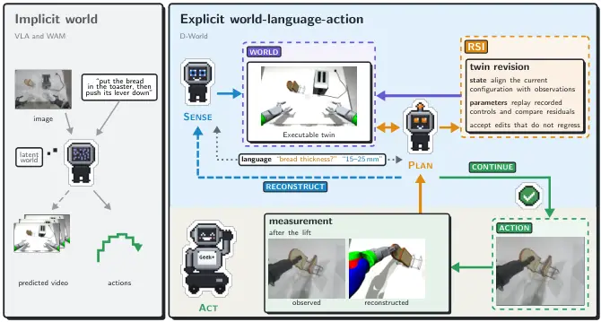
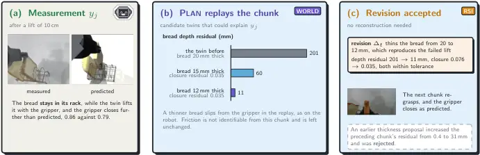
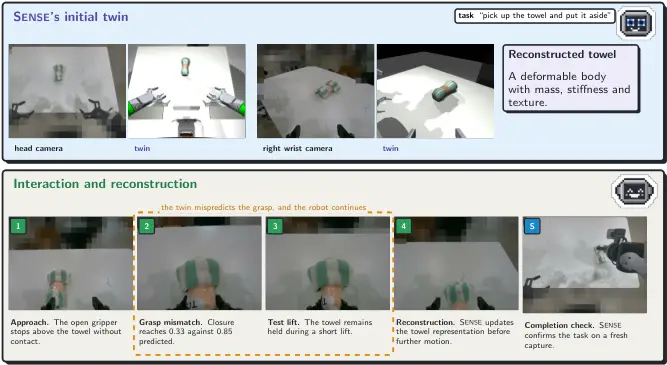
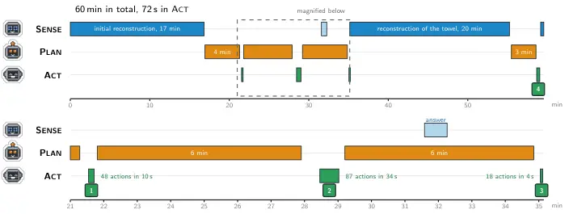
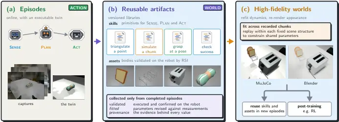

# D-World: An Explicit World-Language-Action Model with Recursive Self-Improvement under Dual Control

Xuan Wen Affiliation: Geek+ Email: [wenxuan23@mails.ucas.ac.cn](mailto:)
   Baichao Wang Affiliation: Geek+
Email: [baichao.wang@geekplus.com](mailto:)

###### Abstract

Frontier large language models (LLMs) now reason about space well enough
to program robots, yet the world models behind robot policies are
implicit, held in network weights or predicted video, and cannot be
inspected or corrected directly. We present D-World, an explicit
world-language-action model built on the Sense, Plan and Act
decomposition. A perception agent writes the scene as an executable
digital twin using generated vision and geometry code. A planning agent
searches for actions in simulation and, after each executed action
chunk, revises the twin’s object states and named physical parameters
against what the robot measured. A parameter revision is accepted only
if replaying the latest chunk does not increase any measured residual
beyond its tolerance, and every chunk is checked in the updated twin
before it runs. Structural mismatches return to perception for
reconstruction. We call this measurement-grounded cycle of correction
and revision recursive self-improvement (RSI), in which the LLM stays
frozen while the world it acts in improves. We model the choice of
actions that both advance the task and expose model error as a dual
control problem and show that the cost of incorporating evidence into
the twin sets the threshold at which probing pays, so cheap local
revision counteracts the turn-off of cautious controllers. Each episode
runs a real-to-sim-to-real loop, and its recorded twins can be refitted
and re-rendered offline into higher-fidelity environments for
post-training. Because perception and planning communicate only through
the twin and language, either can be replaced by a learned model, and
since inference dominates the loop, the loop speeds up with faster
models. On a dual-arm robot, towel and toaster tasks show local
revisions, such as one reducing the bread’s rendered-depth residual from
22.4 to 1.5 mm, that let execution continue without reconstruction.

|     |
| --- |
|     |

> Keywords: World-language-action models, explicit world models, digital
> twins, recursive self-improvement, dual control, real-to-sim-to-real,
> coding agents, Sense, Plan and Act



Figure 1: D-World, an explicit world-language-action model. Implicit
models (left) keep the world in network weights or predicted video.
D-World (right) writes it as an executable twin. Sense constructs the
twin, Plan proposes trajectories and twin revisions, and a gate checks
each action chunk before execution. Measurements of the real robot drive
state correction and replay-checked parameter revision (RSI), and the
dashed path requests reconstruction. In a bread-grasp episode, the twin
shows both grippers open, ACTION shows the robot holding a lifted bread
slice, and the measurement pair compares this post-lift observation with
the reconstructed twin. In the language channel, Plan asks and Sense
answers.

## 1 Introduction

Frontier multimodal LLMs now reason about scene geometry and spatial
relations well enough to write robot programs that compose perception
and control primitives \[1, 2\], or to act on a robot turn by turn \[3,
4\]. This makes agentic robotics practical, but it leaves open where the
agent’s predictions about the physical consequences of its actions come
from. Precise grasps, contact-rich motion and bimanual coordination
remain difficult when an error becomes visible only after execution \[5,
4\].

World-action and world-language-action models address this by predicting
the future together with the action \[6, 7, 8\]. Their world, however,
is implicit and resides in network weights or predicted video. When such
a prediction disagrees with the scene, the disagreement cannot be traced
to a particular quantity, and correcting it requires new data and
training. An explicit world has the complementary property. A coding
agent can write a physical scene as a program that a simulator
executes \[9\], so that every prediction follows from named geometry and
physical parameters. A reconstruction written in one pass still
disagrees with the scene \[10, 11\], yet each disagreement now points to
fields that can be edited and tested.

Building on this property, we call a system an _explicit
world-language-action model_ when its world is an executable program
that can be inspected and revised, language is the medium in which
agents write, revise and question that world, and every action is
checked in that world before execution. Unlike world-language-action
models that unify the three in a single network \[8\], such a system
keeps the world explicit. D-World is an explicit world-language-action
model organized around the classical Sense, Plan and Act (SPA)
decomposition \[12\] (Fig. 1). Its world is an executable digital twin,
hereafter the twin, which a perception module, Sense, writes from the
robot’s cameras. A planning module, Plan, searches for trajectories by
simulation, commits a short prefix, or _chunk_, for execution, and
compares the measured response with its prediction. Classical SPA was
criticized because its model drifts from the world \[13, 14\]. D-World
instead treats this drift as the signal from which the model is
improved.

After each chunk, Plan explains the measured discrepancy by correcting
object states or revising named parameters such as dimensions and
friction. A harness accepts a parameter revision only if replaying the
latest chunk in the revised twin does not increase any measured residual
beyond its tolerance, and it then gates the next chunk in the updated
twin. Structural mismatches return to Sense for reconstruction. We call
this measurement-grounded cycle of correction and revision _recursive
self-improvement_ (RSI), with reconstruction as its structural fallback.
The LLM remains frozen, while the world in which it plans improves. Each
episode thereby runs a real-to-sim-to-real loop \[15\] at the
granularity of action chunks, and the recorded twins can afterwards be
refitted and re-rendered offline into higher-fidelity environments for
post-training.

Because the twin improves through action, the choice of action also
determines what can be learned. Dual control formalizes this coupling
between control and estimation \[16, 17\]. We treat the twin, together
with the set of parameter values that remain consistent with the
measurements, as the belief of the loop. Each chunk both advances the
task and changes this belief. A controller that only avoids uncertain
contact never reduces the uncertainty that motivated its caution, which
is the turn-off phenomenon of adaptive control \[18, 19\]. We show that
probing pays below a success-probability threshold that falls with the
cost of incorporating the probe’s outcome into the model, so local
revision, which absorbs that outcome in one replay-checked edit instead
of a full reconstruction, widens the range of beliefs in which the
planner should probe rather than wait.

Finally, Sense and Plan communicate only through the explicit twin with
its uncertainty ranges, its revisions, the measured evidence, and notes
and questions in language. Either module can therefore be replaced by a
learned reconstruction model or policy without changing the checks, and
since model inference dominates the loop’s running time, the loop
becomes faster and more accurate as the underlying models improve.

Our contributions are as follows.

- •
  An explicit world-language-action model. D-World represents the world
  as an executable twin that a frozen LLM agent writes from robot
  observations, and it plans, checks and acts in this twin, with
  perception and planning decoupled through it.
- •
  Recursive self-improvement within an episode. Measured discrepancies
  drive state corrections and replay-checked parameter revisions, with
  reconstruction reserved for structural change. A dual-control
  formulation characterizes informative chunks by the measurement
  tolerance and shows that inexpensive local revision raises the success
  probability below which probing pays, counteracting turn-off.
- •
  A harness for physical agents, with real-robot evidence. The harness
  manages the agents’ contexts and tools, verifies every revision and
  chunk, and keeps the execution records. On a dual-arm robot, towel and
  toaster tasks show revision, reconstruction and continued execution,
  and the episode records support offline refitting of higher-fidelity
  twins.

## 2 Related Work

#### Implicit and explicit world models.

Vision-language-action models map observations and language directly to
actions \[20, 21\]. World-action models additionally predict future
observations \[6, 22, 7\], and world-language-action models unify world
modeling, language reasoning and action synthesis in a single
network \[8\]. In these models the world is implicit. Explicit
alternatives represent dynamics as programs refined from
interaction \[23, 24\], build object-level world models for zero-shot
manipulation \[25\], or let coding agents construct physical scenes in
executable form \[26, 9, 27\]. VisualPatchWorld fits a dynamics program
from probes and plans with it \[28\]. D-World pairs an executable world
with language-model agents and closes the loop through measurements of
the real robot.

#### Real-to-sim-to-real.

Reconstructed scenes support rollout-based planning \[29, 30\], twin
synchronization for a learned policy \[31\] and policy training \[15,
32\]. LLM-based reconstruction and policy-development systems use
feedback between real trials \[33\], offline replays \[34\] or workspace
observations \[35\]. D-World runs the real-to-sim-to-real cycle within
an episode. Each executed chunk returns measurements, a replay check
accepts revisions, and the updated twin plans and gates the next chunk.

#### Robot agents and harnesses.

LLMs control robots through programs \[1, 36, 37\], coding-agent
workflows \[2, 38\] or turn-by-turn interaction \[39, 3\], and their
perception may compose pretrained modules \[40\] or use agent-written
measurement code \[41, 38\]. The harness of such an agent, comprising
its prompts, tools, context management and control rules, largely
determines how well it performs \[42, 38, 43\]. VISTA supports a
general-purpose multimodal model through visual memory and
model-directed inspection \[42\], SafeHarness adds verified
obstacle-aware route planning \[44\], and RegenHarness gates task-state
commits on evidence and revises its own configuration under regression
checks \[45\]. Since an LLM’s own judgment is an unreliable
verifier \[46\], robot systems check kinematics and collisions \[47\] or
monitor execution in images \[48\]. Our harness centers these functions
on an editable physical twin. Its execution gate follows the model-based
principle of predictive safety filters \[49\], applied to
planner-specified predicates in the nominal twin.

#### Self-improvement, identification and dual control.

Agents accumulate skills \[50\], revise their work from observations and
failures \[51, 52\], and improve harnesses or policies across
tasks \[53, 54, 55, 56\], including evidence-gated revision of a robot
harness \[45\]. Such improvement is bounded by the quality of its
feedback \[57, 58\]. In D-World, the object being improved is the world
model rather than the harness or the policy, and the feedback is
physical measurement. Parameter revision is therefore a form of system
identification, related to LLM-guided fitting through physics
engines \[59, 32\] and refinement from prediction errors \[60\]. EMPIRIC
extends a physics engine with residual code and selects experiments by
their information \[61\], whereas D-World revises the parameters of a
supported scene representation and leaves structural change to
reconstruction. Dual control accounts for how actions affect both the
system and future information \[16, 17, 62, 19\]. Practical approaches
use sampling \[63\], set-membership models \[64\] or shields \[65\], and
robotic probes can reveal intent or physical properties \[66, 67\].

## 3 Problem Formulation

#### Setting and representation.

A robot acts on a language task $`\ell`$ in an unfamiliar scene, using a
supplied kinematic model, controller and camera parameters. An
observation $`o`$ contains images, available depth and measured robot
state. An action specifies bounded end-effector and gripper targets for
one or both arms. The twin is
$`\hat{\mathcal{T}}_{t}=(\mathcal{M}_{t},\hat{\theta}_{t},\hat{x}_{t})`$,
where $`\mathcal{M}_{t}`$ specifies bodies, geometry types and
connectivity, $`\hat{\theta}_{t}`$ contains dimensions, masses,
friction, contact parameters and fixed-body poses, and $`\hat{x}_{t}`$
contains movable-body poses and velocities and articulated-joint states.
Sense constructs this representation from observations. Plan can revise
supported parameter and state fields, whereas changes to body types or
connectivity require reconstruction. Planning and execution share the
robot model and controller, although their simulated response can differ
from the hardware.

#### Measurements and residuals.

The index $`t`$ counts decision rounds, including rounds in which the
gate refuses execution. A proposed chunk $`u_{t}`$ is the prefix of a
trajectory $`\tau_{t}`$ that Plan commits for execution. If executed, it
produces $`y_{t}`$, which comprises proprioception after each action,
requested camera captures, and an observation at the chunk’s end. A
refused round produces no $`y_{t}`$. The history $`I_{t}`$ contains the
observations and executed-chunk records available before round $`t`$.
Each record $`\mathcal{D}`$ stores the starting twin and robot state,
controls and measured response, and a static record contains an
observation alone. The record of the chunk executed in round $`t`$ is
$`\mathcal{D}_{t}`$. For each measured signal $`i`$, the harness
evaluates the residual entry

```math
e_{i}(\mathcal{T};\mathcal{D})=d_{i}\big(y_{i}(\mathcal{D}),\hat{y}_{i}(\mathcal{T};\mathcal{D})\big), \tag{1}
```

where $`\hat{y}_{i}`$ is the prediction from the recorded controls and
starting state, or a rendering for a static record, and $`d_{i}`$ is the
corresponding discrepancy measure. The entries cover end-effector paths,
gripper closure, first resistance and rendered-depth residuals (App. C).
Their operational tolerances are derived from sensor specifications,
observed noise or free-motion discrepancies.

#### Revision acceptance.

Let $`\bar{\mathcal{D}}_{t}`$ be the latest record available at round
$`t`$, namely the latest executed-chunk record since reconstruction, or
the reconstruction observation if no chunk has executed since then. The
same record is used before and after a proposed revision $`\Delta`$, a
collection of named field assignments rather than an additive parameter
vector. A revision can contain state corrections, parameter changes, or
both. Write $`e_{i}^{\mathrm{rep}}(\Delta;\bar{\mathcal{D}}_{t})`$ for
the residual after applying its replayable changes to the recorded twin,
including previously accepted changes applicable to that record. The
baseline $`e_{i}^{\mathrm{rep}}(\varnothing;\bar{\mathcal{D}}_{t})`$
applies no new change. An accepted revision must satisfy

```math
e_{i}^{\mathrm{rep}}(\Delta;\bar{\mathcal{D}}_{t})\leq e_{i}^{\mathrm{rep}}(\varnothing;\bar{\mathcal{D}}_{t})+\varepsilon_{i,t}\quad\text{for all }i\in\mathcal{E}_{t}(\Delta), \tag{2}
```

where $`\mathcal{E}_{t}(\Delta)`$ contains entries available in both
comparisons with a defined tolerance, and $`\varepsilon_{i,t}`$ is fixed
from the baseline comparison. The set can depend on the candidate
because rendered visibility can change, and a missing entry imposes no
constraint. Depth is evaluated at the replay’s endpoint, or on the
available depth for a static record. Corrections to the pose of a body
moved by the chunk, and to articulated-joint state, are excluded from
replay, because they synchronize the current twin rather than explain
the preceding transition. Pose corrections of undisturbed bodies are
replayed. The test thus permits changes within tolerance and enforces
non-regression on the latest evidence. Effects on earlier chunks are
reported to Plan without vetoing an update.

#### Execution gate.

Each chunk carries expectations $`\mathcal{P}_{t}`$ expressed as
predicates on its simulated outcome, including the movable bodies it
affects. The binary gate
$`\mathrm{G}(\hat{\mathcal{T}}_{t}^{+},\delta_{t})`$ equals one exactly
when the proposed motion respects the robot limits, the chunk’s
expectations hold and, if Plan declares the task done, its task
predicates hold over the proposed trajectory. Here
$`\hat{\mathcal{T}}_{t}^{+}`$ denotes the twin after revision selection
and $`\delta_{t}`$ the full decision defined below. The harness first
selects the accepted revisions, possibly none, and then gates the plan
in the resulting twin, so that a refused revision does not by itself
refuse the action plan. The gate certifies a chunk in the nominal
simulation, which uses the current point estimates. Whether the scene
follows the simulation is what the subsequent measurement tests, and
whether the predicates capture the task is what Sense’s completion check
tests.

#### Conditional consistency sets.

To represent parameter uncertainty, let $`\bar{\Theta}_{k,t}`$ be the
candidate interval for scalar parameter $`\theta_{k}`$, spanning Sense’s
range and the values proposed since reconstruction. For a candidate
$`v`$, $`e_{ij}^{(k)}(v;t)`$ denotes residual $`i`$ on record $`j`$ when
$`\theta_{k}`$ is varied, the other parameters are held at their current
estimates, and replay starts from the recorded states. The
coordinate-wise conditional set is

```math
\Theta_{k}(t)=\left\{v\in\bar{\Theta}_{k,t}:e_{ij}^{(k)}(v;t)\leq\inf_{w\in\bar{\Theta}_{k,t}}e_{ij}^{(k)}(w;t)+\varepsilon_{ij,t}\quad\forall(i,j)\in\mathcal{J}_{k,t}\right\}, \tag{3}
```

where $`\mathcal{J}_{k,t}`$ indexes comparisons defined across the
candidate domain, and $`\varepsilon_{ij,t}`$ is the corresponding
comparison tolerance. The implementation evaluates this set on a finite
grid, using motion since reconstruction and depth from the latest
observation (App. C). It reports intervals $`\widetilde{\Theta}_{k}(t)`$
whose product
$`\widetilde{\mathcal{W}}_{t}=\prod_{k}\widetilde{\Theta}_{k}(t)`$
approximates the belief set $`\mathcal{W}_{t}`$ defined below and
supplies parameter vectors for instantiating candidate twins. This
coordinate-wise diagnostic is related to set-membership
estimation \[68\]. Unlike profile likelihood \[69\], it holds the other
parameters at their estimates, so parameter coupling can make
$`\widetilde{\mathcal{W}}_{t}`$ differ from the joint set
$`\mathcal{W}_{t}`$ (App. C). A reconstruction resets these intervals.

#### Decisions.

The planning policy produces

```math
\delta_{t}=\mu_{\pi}(\ell,I_{t},\hat{\mathcal{T}}_{t},h_{t}), \tag{4}
```

where $`\pi`$ is the frozen LLM and $`h_{t}`$ contains the modules’
notes and scripts. The decision $`\delta_{t}`$ contains the trajectory
$`\tau_{t}`$, chunk $`u_{t}`$, proposed revisions $`\Delta_{t}`$,
predicates $`\mathcal{P}_{t}`$ and next step
$`\nu_{t}\in\{\textsc{continue},\textsc{reconstruct},\textsc{done}\}`$,
and it may also supply notes and future chunks. Each evaluation of
$`\mu_{\pi}`$ is a _planning call_, within which Plan may issue many LLM
requests and tool commands. A round makes one planning call and up to
$`R`$ repair calls, or none when a listed chunk continues. After
revision selection and gating, the robot executes $`u_{t}`$, and the
twin advances to the simulated endpoint when measured motion agrees, or
by simulation along the measured motion otherwise. If no call yields a
passing chunk, the round executes nothing, and two consecutive such
rounds terminate the episode. A successful status requires Sense’s
confirmation on a fresh observation. Other stopping conditions are
resource limits and an operator stop. Listed future chunks can bypass a
new planning call when the continuation checks pass (App. A), but each
still passes the gate.

#### Cost.

The time of a round decomposes as

```math
T_{t}=T_{P,t}+T_{A,t}+T_{S,t}+T_{H,t}, \tag{5}
```

where the terms partition the round’s critical path into planning
(including repairs), execution, sensing, and other harness operations or
waiting, with concurrent work counted once. Sensing time is charged when
initialization, reconstruction or completion checking occurs.

#### Belief and its update.

The loop carries the belief
$`b_{t}=(\hat{\mathcal{T}}_{t},\mathcal{W}_{t},\rho_{t})`$, which
consists of the updated twin, the parameter set $`\mathcal{W}_{t}`$, and
a distribution $`\rho_{t}`$ supported on $`\mathcal{W}_{t}`$ from which
Plan samples candidate twins. An executed chunk updates it through

```math
b_{t+1}=\beta(b_{t},u_{t},y_{t}),\qquad\mathcal{W}_{t+1}=\big\{\theta\in\bar{\Theta}_{t+1}:\ d_{i}\big(y_{i,j},\hat{y}_{i}(\theta;\mathcal{D}_{j})\big)\leq\varepsilon_{i,j}\ \ \forall i\in\mathcal{Y}_{j},\ \forall j\in\mathcal{R}_{t+1}\big\}, \tag{6}
```

where $`\bar{\Theta}_{t+1}=\prod_{k}\bar{\Theta}_{k,t+1}`$ is the
candidate domain and $`\mathcal{R}_{t+1}`$ contains the records since
reconstruction, the latest being that of $`u_{t}`$. Here
$`\hat{y}_{i}(\theta;\mathcal{D}_{j})`$ is the prediction obtained by
replaying the controls of record $`\mathcal{D}_{j}`$ from its starting
state in the twin with the structure since reconstruction and parameters
$`\theta`$, and $`\mathcal{Y}_{j}`$ contains the entries measured in
that record. The tolerances $`\varepsilon_{i,j}`$ are the operational
tolerances, applied to the discrepancy between measurement and
prediction rather than to the increase of a residual. The point estimate
$`\hat{\mathcal{T}}_{t+1}`$ is obtained by RSI under Eq. (2) and
advanced to the end of the chunk. The distribution $`\rho_{t+1}`$ is
$`\rho_{t}`$ conditioned on $`\mathcal{W}_{t+1}`$ when the candidate
domain is unchanged and $`\rho_{t}(\mathcal{W}_{t+1})>0`$, and otherwise
a distribution reinitialized on $`\mathcal{W}_{t+1}`$, which exists
whenever $`\mathcal{W}_{t+1}`$ is nonempty. When the candidate domain is
unchanged, Eq. (6) reduces to the recursion
$`\mathcal{W}_{t+1}=\{\theta\in\mathcal{W}_{t}:\ d_{i}(y_{i,t},\hat{y}_{i}(\theta;\mathcal{D}_{t}))\leq\varepsilon_{i,t}\ \forall i\in\mathcal{Y}_{t}\}`$,
so the set can only shrink. An empty $`\mathcal{W}_{t+1}`$ means that no
parameter vector in the candidate domain explains the evidence within
tolerance, so that only an enlarged domain or a reconstruction can
restore consistency. RSI is the point-estimate part of $`\beta`$, and
Eq. (6) its set-valued part. The point estimate need not lie in
$`\mathcal{W}_{t+1}`$, because acceptance requires non-regression rather
than consistency. The implementation approximates $`\mathcal{W}_{t+1}`$
by the coordinate-wise scan of Eq. (3), which relaxes each tolerance by
the best grid candidate’s residual and returns the full range, marked
uninformative, when no candidate passes (App. C).

#### Objective.

The decision problem underlying D-World is to complete the task in the
least expected time,

```math
\min_{\mu}\ \mathbb{E}^{\mu}\Big[\textstyle\sum_{t^{\prime}=t}^{K}T_{t^{\prime}}\ \Big|\ b_{t}\Big], \tag{7}
```

where $`K`$ is the round in which completion is confirmed, and the
expectation under policy $`\mu`$ is over physical parameters
$`\theta\sim\rho_{t}`$ together with the resulting measurements. Because
$`u_{t}`$ influences $`y_{t}`$ and hence $`\mathcal{W}_{t+1}`$ through
Eq. (6), the control affects not only the scene but also the uncertainty
of future beliefs. This is the dual effect \[16, 17\], and it makes
Eq. (7) a dual control problem in which an action is valuable both for
the progress it makes and for the uncertainty it removes. D-World does
not solve Eq. (7) numerically. Plan approximates it by reasoning over
twins sampled from $`\rho_{t}`$, with the confidence $`c_{t}`$ of
Sec. 4.2 as its estimate of the probability that a chunk succeeds, while
the harness enforces the acceptance and gate conditions above.

## 4 D-World

Sense, Plan and the harness realize the loop of Sec. 3 as summarized in
Algorithm 1. Each module runs as a coding agent with its own context,
and the two exchange the twin, revisions and measurement evidence
through the harness.

1: task $`\ell`$, repair budget $`R`$

2:
$`\hat{\mathcal{T}}\leftarrow\textsc{Sense}_{\pi}(\textsc{Observe}(),\ell)`$ $`I,h\leftarrow\varnothing`$ $`\nu\leftarrow\textsc{continue}`$

3: loop

4:   if $`\nu=\textsc{reconstruct}`$ or the operator interrupts then
$`\hat{\mathcal{T}}\leftarrow\textsc{Sense}_{\pi}(\textsc{Observe}(),\ell,\hat{\mathcal{T}},h)`$ $`\nu\leftarrow\textsc{continue}`$

5:   $`(\delta,\hat{\mathcal{T}}^{+})\leftarrow`$ the next listed chunk
and $`\hat{\mathcal{T}}`$, if it passes continuation and $`\mathrm{G}`$,
else $`\bot`$ $`\triangleright`$ no planning call

6:   for $`a=0,\ldots,R`$ while $`\delta=\bot`$ do $`\triangleright`$
Plan, $`a>0`$ is a repair

7:
   $`\delta\leftarrow\mu_{\pi}(\ell,I,\hat{\mathcal{T}},h)`$ $`\hat{\mathcal{T}}^{+}\leftarrow\textsc{RSI}(\hat{\mathcal{T}},\delta.\Delta)`$

8:    if $`\mathrm{G}(\hat{\mathcal{T}}^{+},\delta)=0`$ then
$`\delta\leftarrow\bot`$

9:   end for

10:   if $`\delta=\bot`$ then continue $`\triangleright`$ nothing
executes

11:
  $`y\leftarrow\textsc{Robot}(\delta.u)`$ $`I\leftarrow\big(I,(\hat{\mathcal{T}}^{+},\delta.u,y)\big)`$ $`\hat{\mathcal{T}}\leftarrow\textsc{Advance}(\hat{\mathcal{T}}^{+},\delta.u,y)`$ $`\nu\leftarrow\delta.\nu`$
$`\triangleright`$ Act

12:   if $`\nu=\textsc{done}`$ and
$`\textsc{Check}_{\pi}(\textsc{Observe}(),\ell)`$ then return success
$`\triangleright`$ Sense

13: end loop

14:

15: function RSI($`\hat{\mathcal{T}},\Delta`$) $`\triangleright`$
$`\Delta^{\mathrm{ind}}`$ holds the changes that pass alone

16:   return $`\hat{\mathcal{T}}\oplus\Delta`$ if $`A(\Delta)`$, else
$`\hat{\mathcal{T}}\oplus\Delta^{\mathrm{ind}}`$ if
$`A(\Delta^{\mathrm{ind}})`$, else $`\hat{\mathcal{T}}`$

17: end function

Algorithm 1 The D-World loop. $`\bar{\mathcal{D}}`$ is the latest record
since reconstruction, $`A(S)`$ holds when the revisions $`S`$ satisfy
Eq. (2) on $`\bar{\mathcal{D}}`$, and $`\oplus`$ applies them. Refusals
and Sense’s objections are returned to Plan through $`h`$, revisions
take effect with the executed chunk, and two consecutive rounds without
an executed chunk end the episode.

### 4.1 Writing the Twin

Sense receives the images, the instruction, the robot’s state and the
robot model with its cameras. It writes the twin as an executable
simulation model covering what the robot could reach or collide with,
together with the surfaces these objects rest on. The multimodal agent
interprets the images and writes classical vision and geometry code to
measure them, without additional pretrained perception modules. It
renders its draft from every camera for comparison with the images and
the wrist depth, and a physics check reports what the draft implies
before anything runs, such as interpenetrating or unsupported bodies, or
bodies that move while the robot holds still. Corrections must come from
the images rather than from moving a body to pass the check. With every
estimate, Sense lists the quantities it is uncertain about, with reasons
and with ranges that a sampled twin can instantiate, and these ranges
initialize the intervals $`\bar{\Theta}_{k,t}`$. It answers Plan’s
questions and may request a viewpoint, which Plan reaches with a gated
chunk. Its scripts and notes are passed to Plan, which can rerun and
extend its measurements.

### 4.2 Planning and Acting

Plan performs LLM-guided programmatic search. It writes trajectory
candidates, simulates them, inspects the resulting motion and contacts,
and uses this feedback to propose further candidates within the rollout
budget (App. B). Among the candidates it considers, Plan selects the
action it judges most likely to advance and ultimately complete the task
on the real robot, taking into account the errors that may remain in the
twin. This judgment combines simulated motion and contacts, real
observations, measured residuals and Sense’s reported uncertainties,
evidence that no single fixed cost function encodes. With each chunk,
Plan states a _confidence_ $`c_{t}\in[0,1]`$, its estimate, after the
rollouts and given the residuals the twin still shows, of how likely the
chunk is to achieve its expectations $`\mathcal{P}_{t}`$ on the real
robot. The confidence is recorded and passed to Sense, and it does not
gate execution. Plan can also test a candidate in twins instantiated
from $`\widetilde{\mathcal{W}}_{t}`$. Agreement across these samples
favors actions that tolerate the tested parameter variations, whereas
disagreement points to an informative interaction before a sensitive
action is committed.

At the next planning call, Plan receives measured and predicted motion,
residuals, the outcomes of measurable expectations, resistance events
and the latest observation. A language interruption by the operator
requests reconstruction before further planning.

### 4.3 Recursive Self-Improvement of the Twin



Figure 2: Replay-checked revision after a failed lift. In a failed bread
grasp, the real bread remains in its rack while the twin lifts it with
the gripper. Reducing the modeled thickness reproduces the slip during
replay and reduces both the depth and the closure residual. Friction, to
which this chunk is insensitive, is left unchanged. The revision passes
the non-regression check and is accepted, and the next chunk attempts
another grasp without reconstruction. Here $`j`$ is the latest executed
round and $`t`$ the revision round. An earlier thickness proposal had
increased the residual on the preceding chunk and was rejected.

Under RSI, the twin’s states and parameters evolve with the evidence,
and its structure changes only through reconstruction. Every proposed
change names a supported field, a new value, a reason and its
measurement evidence. A measured discrepancy calls for one of three
kinds of change, which answer different questions. A state correction
answers where the bodies are now. It synchronizes the twin, and for
bodies moved by the chunk and for joints it is excluded from replay,
because it does not explain the preceding transition. A parameter
revision answers why the transition differed from the prediction, and it
must reproduce the measured response under replay. A reconstruction
answers that the representation itself is wrong, for example because a
body is missing or an object no longer matches its modeled form. RSI
performs the first two kinds of change, and the third returns the scene
to Sense.

For parameter fitting, Plan uses rollout search or a least-squares tool
that replays recorded controls through the simulator. The planner and
the acceptance check share the same residual functions. Accepted changes
are marked _fitted_ and carry their evidence, so that every revised
value records its provenance and Sense can keep, correct or undo fitted
values in a later reconstruction.

Interaction supplies evidence that a static image cannot. A wrist that
stops short of its free-motion prediction indicates resistance, gripper
closure constrains object size and compliance, and object motion
separates mass and friction hypotheses. When the evaluated signals are
insensitive to a parameter, the replay check leaves it unconstrained, as
with friction in Fig. 2. Resolving it requires an interaction whose
outcome depends on it, which is the subject of Sec. 4.5.

### 4.4 The Harness

The harness is the software between the two agents and the robot, and it
follows one principle. Judgment belongs to the agents, while the harness
supplies mechanism, measurement and hard checks. It plays three roles
that correspond to the components of agent harnesses in prior work \[53,
45\].

#### Context and tools.

The harness defines what crosses module boundaries, namely the twin as
an executable scene with its uncertainty ranges, revisions as named
field assignments with evidence, chunks with their expectations
$`\mathcal{P}_{t}`$, and a question channel from Plan to Sense. It also
maintains each agent’s long-running context and sandboxed workspace
(App. A).

#### Verification.

The harness selects revisions, gates chunks and requires Sense’s
confirmation of completion, as stated in Proposition 1 below. During
execution, it compares measured end-effector positions and gripper
closures with their predictions and halts motion at the monitor stop
threshold (App. B).

#### Execution records.

The harness stores every round in full (App. A), and these records serve
online replay, offline refitting (Sec. 6) and the analyses of Sec. 5.

###### Proposition 1 (Harness invariants).

Under Algorithm 1, every executed chunk has passed the gate
$`\mathrm{G}`$ in the twin in which it executes, every revision applied
by RSI satisfies Eq. (2) on the latest record since reconstruction, with
moved-body and joint-state corrections excluded from replay, and success
is returned only after Sense confirms completion on an observation taken
after the last executed chunk.

The proof, by inspection of Algorithm 1, is given in App. D. These
invariants tie what reaches the robot to what the twin predicts and what
the measurements support. Transfer of the predicted outcome to the
physical scene additionally depends on the fidelity of the twin, and
App. E gives a sufficient condition.

### 4.5 Informative Actions and Turn-Off

The two results below make operational the two values that a chunk has
under Eq. (7), progress and information, with proofs in App. D.

#### Which actions are informative.

The following lemma states when the predictions of two sampled twins
guarantee that executing a chunk shrinks the belief.

###### Lemma 1 (Discriminating chunks).

Let $`\theta,\theta^{\prime}\in\mathcal{W}_{t}`$, let the chunk
$`u_{t}`$ execute in full, and let $`i`$ be an entry that is measured in
its record $`\mathcal{D}_{t}`$, whose discrepancy $`d_{i}`$ is a
pseudometric and whose tolerance $`\varepsilon_{i,t}`$ does not depend
on the measurement. If
$`d_{i}\big(\hat{y}_{i}(\theta;\mathcal{D}_{t}),\hat{y}_{i}(\theta^{\prime};\mathcal{D}_{t})\big)>2\varepsilon_{i,t}`$,
then for every measured value at least one of $`\theta,\theta^{\prime}`$
is not in $`\mathcal{W}_{t+1}`$.

The operational tolerance that bounds revision acceptance thus also
defines what counts as an informative interaction, and Plan’s comparison
of sampled twins tests the lemma’s condition, following the prospective
reasoning of dual control \[62\]. A test grasp separates thickness
hypotheses through closure, and moving a wrist camera closer reduces the
depth tolerance and sharpens the comparison of depth predictions across
sampled twins, although the depth entry lies outside the lemma’s
hypotheses (App. D). Many such chunks also advance the task.

#### When probing pays, and why local revision counteracts turn-off.

Turn-off is the opposite of probing. A planner that keeps choosing views
or small steps that avoid the uncertain contact never executes a chunk
that meets the condition of Lemma 1 for the parameter that made the
contact uncertain. No measurement is then guaranteed to reduce that
uncertainty, and caution can reinforce itself \[70\]. Whether probing is
worth its price depends on how the probe’s outcome enters the twin.
Consider a sensitive chunk that succeeds with probability $`q`$ under
$`\rho_{t}`$ and otherwise incurs a failure cost $`C_{\mathrm{fail}}`$,
and a discriminating probe that can precede it. The probe takes planning
and execution times $`T^{\prime}_{P}`$ and $`T^{\prime}_{A}`$ and costs
$`C_{\mathrm{probe}}=T^{\prime}_{P}+T^{\prime}_{A}+C_{\mathrm{inc}}`$,
where $`C_{\mathrm{inc}}`$ is the cost of incorporating its outcome into
the twin, which is one replay-checked revision under RSI or a sensing
time $`T_{S}`$ under reconstruction. The sensitive chunk takes $`T_{P}`$
and $`T_{A}`$, and $`C_{\mathrm{fail}}>0`$ is the expected additional
time after its failure, including recovery.

###### Proposition 2 (Probing threshold).

Suppose that the probe itself does not fail and that, after it, the
sensitive chunk succeeds. Then probing first has strictly lower expected
time than committing the sensitive chunk directly if and only if
$`q<q^{\star}=1-C_{\mathrm{probe}}/C_{\mathrm{fail}}`$. The threshold
$`q^{\star}`$ is strictly decreasing in $`C_{\mathrm{inc}}`$, so a
cheaper incorporation raises $`q^{\star}`$ and widens the interval
$`q<q^{\star}`$ in which probing is preferred.

In the towel episode of Fig. 3b, a reconstruction took about 20 min,
whereas a planning call took 3 to 6 min and a chunk seconds, so
incorporating a probe’s outcome by a replay-checked revision instead of
a reconstruction removes the dominant term of $`C_{\mathrm{probe}}`$.
Reconstruction remains preferable when one new view resolves several
uncertainties at once, which amounts to a larger information gain per
unit of $`C_{\mathrm{inc}}`$, and this tradeoff is left to the planner.

### 4.6 Decoupled Modules and Scaling

Sense and Plan share observations and history but exchange only explicit
representations, namely the twin with its uncertainty ranges, its
revisions, expectations, measured evidence, and notes and questions in
language. A learned reconstruction model can therefore supply the twin
and its uncertainty ranges, and a learned policy can propose
trajectories that are evaluated in its simulation, while the harness
continues to check revisions, gate chunks and require confirmation of
completion.

The same structure determines how the loop scales. Perception and
planning inference dominate the critical path of Eq. (5), while robot
motion occupies a small share of it (Fig. 3b). Faster models therefore
shorten each round directly and make shorter chunks affordable, more
capable models write more accurate initial twins that need fewer
revisions, and overlapping perception with planning can remove part of
the remaining serial time (App. F).

## 5 Experiments

### 5.1 Setup

#### Robot and implementation.

The robot is a dual-arm manipulator with an RGB head camera and two
RGB-D wrist cameras. Both modules are coding agents using a frontier
LLM, each in a long-running sandboxed conversation, connected through
the harness (Sec. 4.4). The robot model, controller, reference camera
intrinsics and mounting transforms, and metric depth are supplied
platform inputs. The agents receive no object models and undergo no
task-specific training or preparatory trials.

#### Tasks.

_Towel handling_ asks the robot to pick up a towel and put it aside,
with the initial towel represented as a deformable body. _Toaster
manipulation_ asks it to put bread into a toaster slot and press the
lever.

#### Measurements.

Ground-truth geometry and physical parameters are unavailable on the
real robot, so the twin is evaluated by its agreement with measurements,
namely rendered-depth residuals (App. C), gripper closure and
end-effector motion. The object-level entries in Table 1 take the
maximum of the recorded residuals over the available depth cameras.

### 5.2 Observed Twin Revisions

|     |                                                             |
| --- | ----------------------------------------------------------- |
| (a) |  |
| (b) |  |

Figure 3: Towel handling. (a) The top row shows camera images and the
initial twin rendered from the same cameras, and the bottom row selected
interaction and reconstruction stages, numbered by chunk. Dashed
outlines mark the grasp mismatch between the twin and the robot, after
which reconstruction changes the towel representation to match its
observed configuration. (b) Where the time goes in the same episode.
Sense is blue, lighter while it answers a question, Plan is orange, and
the robot’s chunks are green with the numbers of (a). The bottom lanes
magnify the three chunks between the two reconstructions. Model
inference fills almost the entire hour, whereas the robot moves for
seconds per chunk.

| Case           | Revision                                                                 | Residual        | Before  | After  |
| -------------- | ------------------------------------------------------------------------ | --------------- | ------- | ------ |
| Slot support   | support inside the slot raised by 2 cm                                   | bread depth     | 22.4 mm | 1.5 mm |
| Towel geometry | table aligned with the measured plane and towel thickness scaled by 1.45 | towel depth     | 60.1 mm | 4.3 mm |
| Bread grasp    | bread thickness reduced from 20 to 12 mm                                 | gripper closure | 0.076   | 0.035  |
|                |                                                                          | bread depth     | 201 mm  | 11 mm  |

Table 1: Replay residuals before and after parameter revision. Depth
entries are absolute signed-median residuals, maximized over the
available cameras. Closure is dimensionless on a scale from 0 (open) to
1 (closed).

#### State, parameters and structure.

Parameter revisions bring the twin into agreement with what the robot
measured (Table 1). Thinning the bread from 20 to 12 mm reproduces the
failed lift and reduces both the depth and the closure residual
(Fig. 2), and raising the support inside the toaster slot by 2 cm
reduces the bread’s depth residual from 22.4 to 1.5 mm. In each case of
Table 1, the next chunk executed without reconstruction. When no
parameter explains the evidence, as when the grasped towel no longer
matches its initial representation, Plan requests reconstruction and
Sense rewrites the towel (Fig. 3a).

### 5.3 Sources of Stalled Execution

The episode records separate three sources of slow progress. Turn-off
appears as repeated views or small steps that avoid the contact needed
to resolve uncertainty. Reconstruction adds latency, which is wasted
when a local revision would have sufficed. In the towel episode, the two
reconstructions together took longer than all planning calls of the
episode (Fig. 3b), which is the cost that local revision avoids whenever
it suffices. A gate refusal, in contrast, is a failed model-based check
rather than reluctance to act. The stated confidence $`c_{t}`$ does not
separate these cases, because it estimates whether one chunk succeeds
rather than what the chunk reveals, and missed expectations also occur
at high confidence. The informative quantity is the measured discrepancy
against a stated prediction, together with whether the next action can
resolve it, and this is precisely the quantity on which RSI operates.

## 6 From Episodes to High-Fidelity Worlds



Figure 4: From episodes to high-fidelity worlds. (a) Each episode
records observations, twins, controls and revisions. (b) Versioned
libraries collect agent-written skills, such as perception and motion
primitives, and scene bodies from completed episodes, whose parameters
RSI has validated against the robot’s measurements. (c) Offline,
recorded chunks are replayed jointly to refit parameters, and the
refitted twin is rendered again with the same geometry, here in MuJoCo
and in Blender. Skills and assets can be reused in later episodes, and
refitted twins can serve post-training.

An explicit world outlives the episode in which it was written. Its
records hold every round of interaction (Fig. 4), and the skills and
scene bodies of completed episodes are collected into versioned
libraries. Because the bodies of such a twin have been tested against
the robot’s measurements and revised by RSI where their predictions
disagreed, the library contains assets whose geometry and physical
parameters are consistent with real measurements, together with the
provenance of each value.

Online, RSI fits each revision to the latest chunk, which suffices for
acting. Offline, the same records support a second optimization. Within
each interval of fixed scene structure, all recorded chunks can be
replayed jointly to constrain shared parameters, and the refitted twin
can be rendered at higher fidelity with unchanged geometry. This extends
the real-to-sim-to-real cycle to the level of the dataset. The resulting
twins are reconstructions of real scenes grounded in real robot
measurements, which makes them natural environments for post-training,
for example reinforcement learning of policies that are subsequently
deployed on the robot.

## 7 Limitations

Inference latency currently restricts D-World to quasi-static tasks. The
twin is limited to the mechanisms its simulator represents, and neither
module adds missing physics as residual-engine approaches do \[61\].
Replay acceptance is local. It enforces non-regression on the latest
chunk within operational tolerances, without guaranteeing improvement on
earlier chunks or identifying unique physical parameters, and the
implemented consistency intervals approximate the belief set
coordinate-wise. The gate and monitor check one nominal twin and the
planner’s expectations, without bounding contact forces. Plan
approximates the dual-control objective by judgment over sampled twins
rather than by optimization. Further experiments, including systematic
comparisons with reconstruction-only and learned baselines, remain to be
run.

## 8 Conclusion

D-World treats the world model of a physical agent as an explicit,
executable artifact that the agent writes, tests against the robot’s
measurements and improves while it acts. This choice changes what a
prediction error means. In an implicit model, an error is a symptom that
further training may or may not remove. In an explicit twin, it points
to named fields, and a single replay decides whether a proposed
explanation is consistent with what the robot measured. Recursive
self-improvement builds on this property. State corrections keep the
twin synchronized with the scene and replay-checked parameter revisions
make its predictions agree with the latest response, while
reconstruction changes its structure when no parameter can explain the
evidence.

The same structure makes the loop a dual controller. Every executed
chunk both advances the task and constrains the twin. Because one local
revision absorbs the outcome of an informative interaction, probing
costs far less than reconstruction, and the planner has a reason to
resolve uncertainty rather than avoid it. The harness gives these
judgments the guarantees of Proposition 1. It defines what the agents
exchange, admits only revisions and chunks that pass its checks, and
records every round in a form that can be replayed.

Three properties suggest how the approach scales. Perception and
planning meet only at the twin and in language, so learned
reconstruction models and policies can replace the agents without
changing the checks. Inference dominates the loop, so faster and
stronger models translate directly into shorter rounds, shorter chunks
and more accurate initial twins, which brings dynamic interaction within
reach. Finally, every episode leaves behind reconstructed scenes
grounded in real measurements, which offline refitting can raise to
higher fidelity. Accumulated across tasks and robots, these twins form a
growing set of real-to-sim environments in which policies can be
post-trained, for example with reinforcement learning, and returned to
the robot, which completes the real-to-sim-to-real cycle beyond the
episode.

## References

- \[1\] J. Liang, W. Huang, F. Xia, P. Xu, K. Hausman, B. Ichter,
  P. Florence, and A. Zeng. Code as Policies: Language Model Programs
  for Embodied Control. In _IEEE International Conference on Robotics
  and Automation (ICRA)_, 2023.
- \[2\] L. Fu, J. Yu, K. El-Refai, E. Kou, H. Xue, H. Huang, W. Xiao,
  G. Wang, D. Niu, F.-F. Li, G. Shi, J. Wu, S. Sastry, Y. Zhu,
  K. Goldberg, and L. J. Fan. CaP-X: A Framework for Benchmarking and
  Improving Coding Agents for Robot Manipulation. In _International
  Conference on Machine Learning (ICML)_, 2026.
- \[3\] W. Zhang, K. Wang, Y. Ouyang, X. Huang, L. Li, K. Su, W. Jin,
  W. Chai, H. Liang, Z. Dou, Y. Chen, and T. Chen. An Unexpected Robot
  Policy: Early Evaluations of GPT-6 Astra on RoboDojo and Beyond.
  _arXiv preprint arXiv:2609.24170_, 2026.
- \[4\] Galbot Team. Systematically Exploring the Capabilities of GPT-6
  Astra as Embodied Policies. _arXiv preprint arXiv:2609.38537_, 2026.
- \[5\] T. Chen, Y. Chen, Z. Li, J. Tang, K. Su, H. Lu, W. Wan, B. Chen,
  S. Liu, H. Yan, H. Su, Z. Dou, K. Wang, D. Zhang, Y. Liu, Y. Qin,
  Q. Liang, Q. Wu, Z. Lin, W. Lin, Y. Wang, M. He, T. Wu, R. Wu,
  J. Zhou, K.-C. Lei, H. Yu, Y. Ji, W. Jin, G. Lin, X. Li, Q. Xiong,
  R. Xu, Z. Li, W. Chai, E. Xie, Z. Wang, Y. Mu, H. Dong, W. Matusik,
  M. Ding, W. Ding, P. Luo, and M. Tomizuka. RoboDojo: A Unified
  Sim-and-Real Benchmark for Comprehensive Evaluation of Generalist
  Robot Manipulation Policies. _arXiv preprint arXiv:2607.04434_, 2026.
- \[6\] S. Ye, Y. Ge, K. Zheng, S. Gao, S. Yu, G. Kurian, S. Indupuru,
  Y. L. Tan, C. Zhu, J. Xiang, A. Malik, K. Lee, W. Liang, N. Ranawaka,
  J. Gu, Y. Xu, G. Wang, F. Hu, A. Narayan, J. Bjorck, J. Wang, G. Kim,
  D. Niu, R. Zheng, Y. Xie, J. Wu, Q. Wang, R. Julian, D. Xu, Y. Du,
  Y. Chebotar, S. Reed, J. Kautz, Y. Zhu, L. Fan, and J. Jang. World
  Action Models are Zero-shot Policies. _arXiv preprint
  arXiv:2602.15922_, 2026.
- \[7\] Z. Lu, H. Zhai, G. Wang, H. Zeng, J. Yang, J. Liu, L. Cheng,
  Y. Zhang, Y. Qiu, Z. Cheng, I. Laptev, D. Xu, B. Riviere, G. Loianno,
  E. Xing, and X. Zuo. World-Action Models for Robot Learning and
  Control: A Survey. _arXiv preprint arXiv:2609.16074_, 2026.
- \[8\] Y. Yang, Z. Liu, S. Kou, Y. Chen, Y. Hu, J. Zhou, B. Zhao,
  Z. Wei, X. Xia, X. Li, P. Liu, and Z. Deng. World-Language-Action
  Model for Unified World Modeling, Language Reasoning, and Action
  Synthesis. _arXiv preprint arXiv:2606.05979_, 2026.
- \[9\] H. Wang, Y. Cai, W. Chen, J. Chi, H. Sun, Q. Dai, Y.-H. Hung,
  X. Guo, J. Ren, R. Yao, Z. Liu, M. Long, Y. Duan, J. Gao, J. Lyu,
  F. Liu, and J. Wu. Code as Worlds: Agentic Discovery of Executable
  World Representations for Physical Reasoning. _arXiv preprint
  arXiv:2608.27549_, 2026.
- \[10\] J. Tang, Z. Zhang, J. Yang, Y. Yan, K. Zhou, L. Mao, R. Han,
  J. Cao, W. Xu, L. He, M. Fu, F. Feng, and B. Huang. Video2World:
  Benchmarking Coding Agents for Interactive World Modeling from
  Embodied Videos. _arXiv preprint arXiv:2610.04432_, 2026a.
- \[11\] Y. Y. Tang, D. Shimada, J. Meng, J. Bi, P. Liu, Y. Wang,
  Y. Xiao, Z. Tan, Z. Zhang, C. Huang, S. Liang, Q. Shen, L. Song,
  A. Vosoughi, M. Feng, M. Filvantorkaman, and C. Xu. BVB: Benchmarking
  Agentic Video Understanding via Programmatic Reconstruction in
  Blender. _arXiv preprint arXiv:2609.15478_, 2026b.
- \[12\] N. J. Nilsson. Shakey the Robot. Technical Report Technical
  Note 323, SRI International, 1984.
- \[13\] R. A. Brooks. A Robust Layered Control System for a Mobile
  Robot. _IEEE Journal on Robotics and Automation_, 2(1):14–23, 1986.
- \[14\] R. A. Brooks. Intelligence without Representation. _Artificial
  Intelligence_, 47(1–3):139–159, 1991.
- \[15\] M. Torne, A. Simeonov, Z. Li, A. Chan, T. Chen, A. Gupta, and
  P. Agrawal. Reconciling Reality through Simulation: A
  Real-to-Sim-to-Real Approach for Robust Manipulation. In _Robotics:
  Science and Systems (RSS)_, 2024.
- \[16\] A. A. Feldbaum. Dual Control Theory. I. _Avtomatika i
  Telemekhanika_, 21(9):1240–1249, 1960.
- \[17\] Y. Bar-Shalom and E. Tse. Dual Effect, Certainty Equivalence,
  and Separation in Stochastic Control. _IEEE Transactions on Automatic
  Control_, 19(5):494–500, 1974.
- \[18\] K. J. Åström and B. Wittenmark. Problems of Identification and
  Control. _Journal of Mathematical Analysis and Applications_,
  34(1):90–113, 1971.
  [doi:10.1016/0022-247X(71)90161-2](<http://dx.doi.org/10.1016/0022-247X(71)90161-2>).
- \[19\] B. Wittenmark. Adaptive Dual Control Methods: An Overview.
  _IFAC Proceedings Volumes_, 28:67–72, 1995.
- \[20\] Physical Intelligence, K. Black, N. Brown, J. Darpinian,
  K. Dhabalia, D. Driess, A. Esmail, M. Equi, C. Finn, N. Fusai, M. Y.
  Galliker, D. Ghosh, L. Groom, K. Hausman, B. Ichter, S. Jakubczak,
  T. Jones, L. Ke, D. LeBlanc, S. Levine, A. Li-Bell, M. Mothukuri,
  S. Nair, K. Pertsch, A. Z. Ren, L. X. Shi, L. Smith, J. T.
  Springenberg, K. Stachowicz, J. Tanner, Q. Vuong, H. Walke,
  A. Walling, H. Wang, L. Yu, and U. Zhilinsky. $`\pi_{0.5}`$: a
  Vision-Language-Action Model with Open-World Generalization. In
  _Conference on Robot Learning (CoRL)_, 2025.
- \[21\] NVIDIA, J. Bjorck, F. Castañeda, N. Cherniadev, X. Da, R. Ding,
  L. J. Fan, Y. Fang, D. Fox, F. Hu, S. Huang, J. Jang, Z. Jiang,
  J. Kautz, K. Kundalia, L. Lao, Z. Li, Z. Lin, K. Lin, G. Liu,
  E. Llontop, L. Magne, A. Mandlekar, A. Narayan, S. Nasiriany, S. Reed,
  Y. L. Tan, G. Wang, Z. Wang, J. Wang, Q. Wang, J. Xiang, Y. Xie,
  Y. Xu, Z. Xu, S. Ye, Z. Yu, A. Zhang, H. Zhang, Y. Zhao, R. Zheng, and
  Y. Zhu. GR00T N1: An Open Foundation Model for Generalist Humanoid
  Robots. _arXiv preprint arXiv:2503.14734_, 2025.
- \[22\] T. Yuan, Z. Dong, Y. Liu, and H. Zhao. Fast-WAM: Do World
  Action Models Need Test-time Future Imagination? _arXiv preprint
  arXiv:2603.16666_, 2026.
- \[23\] H. Tang, D. Key, and K. Ellis. WorldCoder, a Model-Based LLM
  Agent: Building World Models by Writing Code and Interacting with the
  Environment. In _Advances in Neural Information Processing Systems
  (NeurIPS)_, 2024.
- \[24\] N. Dainese, M. Merler, M. Alakuijala, and P. Marttinen.
  Generating Code World Models with Large Language Models Guided by
  Monte Carlo Tree Search. In _Advances in Neural Information Processing
  Systems (NeurIPS)_, 2024.
- \[25\] X. Li, G. Chen, and J. Alonso-Mora. Building Explicit World
  Model for Zero-Shot Open-World Object Manipulation. _arXiv preprint
  arXiv:2603.13825_, 2026a.
- \[26\] Z. Li, Y. Liao, and B. Zhu. Recursive Code World Models:
  Building Complex Worlds through Recursive Scene Programs. _arXiv
  preprint arXiv:2609.11499_, 2026b.
- \[27\] Y. Chen, G. Lin, and C. Zhang. Code World Model: Coding Agent
  as World Brain. _arXiv preprint arXiv:2608.25927_, 2026.
- \[28\] J. Bai and J. Xiong. VisualPatchWorld: Code World Models as
  Latent Structured Representations for Planning. _arXiv preprint
  arXiv:2607.25236_, 2026.
- \[29\] C. Ning, K. Fang, and W.-C. Ma. Prompting with the Future:
  Open-World Model Predictive Control with Interactive Digital Twins. In
  _Robotics: Science and Systems (RSS)_, 2025.
- \[30\] H. Liu, S. Yao, H. Chen, J. Gao, J. Mao, J.-B. Huang, and
  Y. Du. SIMPACT: Simulation-Enabled Action Planning using
  Vision-Language Models. In _IEEE/CVF Conference on Computer Vision and
  Pattern Recognition (CVPR)_, 2026.
- \[31\] J. Abou-Chakra, L. Sun, K. Rana, B. May, K. Schmeckpeper,
  N. Suenderhauf, M. V. Minniti, and L. Herlant. Real-is-Sim: Bridging
  the Sim-to-Real Gap with a Dynamic Digital Twin. In _IEEE
  International Conference on Robotics and Automation (ICRA)_, 2026.
- \[32\] M. Wang, S. Tian, A. Swann, O. Shorinwa, J. Wu, and
  M. Schwager. Phys2Real: Fusing VLM Priors with Interactive Online
  Adaptation for Uncertainty-Aware Sim-to-Real Manipulation. In _IEEE
  International Conference on Robotics and Automation (ICRA)_, 2026.
- \[33\] J. Hu, R. Martín-Martín, P. Stone, R. Duan, Z. Jiang, and
  G. Shi. SimEX: Simulation-Integrated Robotics AutoResearch. _arXiv
  preprint arXiv:2609.38982_, 2026.
- \[34\] G. Chen, Q. Xia, J. Peng, H. Zhang, P. Jing, B. Ma, J. Qian,
  Y. Cheng, Z. Jiao, B. Zhou, Y. Qu, L. Ye, K. Zhang, K. Wang, W. Zeng,
  Y. Chen, P. Yang, Z. Zeng, S. Luo, H. Wang, C. Liu, A. Yuille, F. Shi,
  C. Zheng, Y. Li, C. Jiang, and P. Y. Chen. Agentic Real2Sim:
  Physics-based World Modeling with Vision-Language Agents. _arXiv
  preprint arXiv:2607.19190_, 2026.
- \[35\] Y. Li, Y. Feng, S. Sun, J. Chen, H. Ren, B. Yang, W. Xu, Q. Wu,
  H. Cheng, and R. Xu. Agentic RSR: Real-to-Sim-to-Real through Scene
  Reconstruction and Execution-Grounded Robot Policies. _arXiv preprint
  arXiv:2610.10479_, 2026.
- \[36\] W. Huang, C. Wang, R. Zhang, Y. Li, J. Wu, and L. Fei-Fei.
  VoxPoser: Composable 3D Value Maps for Robotic Manipulation with
  Language Models. In _Conference on Robot Learning (CoRL)_, 2023.
- \[37\] W. Huang, C. Wang, Y. Li, R. Zhang, and L. Fei-Fei. ReKep:
  Spatio-Temporal Reasoning of Relational Keypoint Constraints for
  Robotic Manipulation. In _Conference on Robot Learning (CoRL)_, 2024.
- \[38\] Z. Chu, E. T. Barr, C. L. Goues, P. O’Hearn, M. Harman,
  F. Sarro, and H. Ye. OpenRUA: Robot-Use Agents Are Zero-Shot
  Visuomotor Policies. _arXiv preprint arXiv:2610.02459_, 2026.
- \[39\] B. Y. Tsui, A. Y. Fang, and T. J. Hwu. Demonstration-Free
  Robotic Control via LLM Agents. In _IEEE/RSJ International Conference
  on Intelligent Robots and Systems (IROS)_, 2026.
- \[40\] D. Surís, S. Menon, and C. Vondrick. ViperGPT: Visual Inference
  via Python Execution for Reasoning. In _IEEE/CVF International
  Conference on Computer Vision (ICCV)_, 2023.
- \[41\] R. Talwar, E. Nijs, A. Verleysen, and F. wyffels. Generalizing
  Manipulation Skills with a Local Coding Agent. _arXiv preprint
  arXiv:2609.26499_, 2026.
- \[42\] Q. Han, K. Hu, L. Qiu, C. Wu, and K. He. VISTA: A Visual
  Harness for Reasoning in an Interactive World. _arXiv preprint
  arXiv:2610.02200_, 2026.
- \[43\] Z. Wei, F. Tan, and J. Wang. Scale and Selection: What Makes
  Automatic Harness Evolution Work for Visual-Interface Robot Agents.
  _arXiv preprint arXiv:2609.39304_, 2026.
- \[44\] B. Xu, Y. Shang, Z. Dong, and E. Ferrara. Coding Agents with
  Harness for Safe Robot Control. _arXiv preprint
  arXiv:2609.20822_, 2026.
- \[45\] K. Wang, H. Jie, Y. Yan, Z. Heng, and Z. Li. RegenHarness: A
  Robot Agent Harness with Evidence-Gated Recursive Self-Improvement.
  _arXiv preprint arXiv:2609.27612_, 2026.
- \[46\] S. Kambhampati, K. Valmeekam, L. Guan, M. Verma, K. Stechly,
  S. Bhambri, L. Saldyt, and A. Murthy. Position: LLMs Can’t Plan, But
  Can Help Planning in LLM-Modulo Frameworks. In _International
  Conference on Machine Learning (ICML)_, 2024.
- \[47\] W. Hong, L. Wei, and D. Zhang. Bridging Semantics and Physics
  with Constrained LLMs for Safe and Trustworthy Robotic Manipulation.
  In _European Conference on Computer Vision (ECCV) Workshops_, 2026.
- \[48\] E. Zhou, Q. Su, C. Chi, Z. Zhang, Z. Wang, T. Huang, L. Sheng,
  and H. Wang. Code-as-Monitor: Constraint-aware Visual Programming for
  Reactive and Proactive Robotic Failure Detection. In _IEEE/CVF
  Conference on Computer Vision and Pattern Recognition (CVPR)_, 2025.
- \[49\] K. P. Wabersich and M. N. Zeilinger. A predictive safety filter
  for learning-based control of constrained nonlinear dynamical systems.
  _Automatica_, 129:109597, 2021.
- \[50\] G. Wang, Y. Xie, Y. Jiang, A. Mandlekar, C. Xiao, Y. Zhu,
  L. Fan, and A. Anandkumar. Voyager: An open-ended embodied agent with
  large language models. _arXiv preprint arXiv:2305.16291_, 2023.
- \[51\] S. Yao, J. Zhao, D. Yu, N. Du, I. Shafran, K. Narasimhan, and
  Y. Cao. ReAct: Synergizing reasoning and acting in language models. In
  _International Conference on Learning Representations (ICLR)_, 2023.
- \[52\] N. Shinn, F. Cassano, A. Gopinath, K. Narasimhan, and S. Yao.
  Reflexion: Language Agents with Verbal Reinforcement Learning. In
  _Advances in Neural Information Processing Systems (NeurIPS)_, 2023.
- \[53\] H. Lee, J. Xu, J. Seely, D. Lee, M. Zaharia, and Y. Tang.
  Recursive Harness Self-Improvement. _arXiv preprint
  arXiv:2607.15524_, 2026.
- \[54\] P. Xia, R. Han, Z. Wang, Y. Chen, Y. Zhuang, Y. Lee, C. Huang,
  H. Yu, Z. CuiZhu, Y. Ming, H. Yao, B. Gokturk, T. Pfister, and C.-Y.
  Lee. RRSI: Regularized Recursive Self-Improvement of Agent Harnesses.
  _arXiv preprint arXiv:2609.24972_, 2026.
- \[55\] H. Lang, H. Lu, S. Sang, H. Luo, G. Chen, Q. Li, J. Yu, Y. Shi,
  and J. Wang. EmbodiRSI: Recursive Self-Improvement for Data-Efficient
  Robot Adaptation. _arXiv preprint arXiv:2609.38905_, 2026.
- \[56\] P. Song, Z. Liang, K. Fu, M. Wang, J. Yang, and S. Liu.
  EmbodiedRSI: Active Continual Robot Learning Through Hypothesis-Guided
  Co-Evolution. _arXiv preprint arXiv:2610.10498_, 2026.
- \[57\] M. Chen, L. Wang, and B. Qu. Recursive Self-Improvement in AI:
  From Bounded Self-Refinement to Autonomous Research Loops. _arXiv
  preprint arXiv:2607.07663_, 2026.
- \[58\] J. Wang. What Stops Recursive Self-Improvement in Robotics?
  Lessons from 123 Rounds of Agentic Skill Discovery. _arXiv preprint
  arXiv:2609.31760_, 2026.
- \[59\] A. Cherian, R. Corcodel, S. Jain, and D. Romeres. LLMPhy:
  Parameter-Identifiable Physical Reasoning Combining Large Language
  Models and Physics Engines. In _International Conference on Artificial
  Intelligence and Statistics (AISTATS)_, 2026.
- \[60\] X. Zhang, W. Zhang, S.-K. Ng, and Y. Deng. Self-Evolving World
  Models for LLM Agent Planning. In _Findings of the Association for
  Computational Linguistics: EMNLP_, 2026.
- \[61\] Y. Liang, A. Li, D. Nguyen, E. Bunnapradist, M. Naim,
  S. Kodali, M. Merler, B. Li, K. Gopinathan, Y. Liu, N. Pimpalkhare,
  J. B. Tenenbaum, A. Weller, Z. Tavares, T. Silver, and K. Ellis.
  EMPIRIC: Experiment-Driven Learning of Residual World Models for Robot
  Planning. _arXiv preprint arXiv:2609.35047_, 2026.
- \[62\] Y. Bar-Shalom and E. Tse. Caution, Probing, and the Value of
  Information in the Control of Uncertain Systems. _Annals of Economic
  and Social Measurement_, 5(3):323–337, 1976.
- \[63\] A. Mesbah. Stochastic Model Predictive Control with Active
  Uncertainty Learning: A Survey on Dual Control. _Annual Reviews in
  Control_, 45:107–117, 2018.
- \[64\] M. Lorenzen, M. Cannon, and F. Allgöwer. Robust MPC with
  Recursive Model Update. _Automatica_, 103:461–471, 2019.
- \[65\] H. Hu, D. Isele, S. Bae, and J. F. Fisac. Active Uncertainty
  Reduction for Safe and Efficient Interaction Planning: A
  Shielding-Aware Dual Control Approach. _The International Journal of
  Robotics Research_, 43(9):1382–1408, 2024.
- \[66\] D. Sadigh, S. S. Sastry, S. A. Seshia, and A. D. Dragan.
  Information Gathering Actions over Human Internal State. In _IEEE/RSJ
  International Conference on Intelligent Robots and Systems (IROS)_,
  pages 66–73, 2016.
- \[67\] M. Memmel, A. Wagenmaker, C. Zhu, P. Yin, D. Fox, and A. Gupta.
  ASID: Active Exploration for System Identification in Robotic
  Manipulation. In _International Conference on Learning Representations
  (ICLR)_, 2024.
- \[68\] M. Milanese and A. Vicino. Optimal Estimation Theory for
  Dynamic Systems with Set Membership Uncertainty: An Overview.
  _Automatica_, 27(6):997–1009, 1991.
- \[69\] A. Raue, C. Kreutz, T. Maiwald, J. Bachmann, M. Schilling,
  U. Klingmüller, and J. Timmer. Structural and Practical
  Identifiability Analysis of Partially Observed Dynamical Models by
  Exploiting the Profile Likelihood. _Bioinformatics_,
  25(15):1923–1929, 2009.
- \[70\] P. Mookerjee, Y. Bar-Shalom, and J. Molusis. Dual Control and
  Prevention of the Turn-Off Phenomenon in a Class of MIMO Systems. In
  _Proceedings of the 24th IEEE Conference on Decision and Control_,
  pages 1888–1893, 1985.
  [doi:10.1109/CDC.1985.268909](http://dx.doi.org/10.1109/CDC.1985.268909).
- \[71\] R. Si, J. Bi, S. Yang, R. Ni, W. Huang, Q. Wang, S. Jiang,
  D. Wang, X. Li, H. Feng, Z. Dong, and D. Zhou. Fewer Tokens, Better
  Action: GPT-6 Astra Robot Agents with 14% Higher Success Rate but 65%
  Fewer Tokens. _arXiv preprint arXiv:2610.01939_, 2026.
- \[72\] K. Black, M. Y. Galliker, and S. Levine. Real-Time Execution of
  Action Chunking Flow Policies. In _Advances in Neural Information
  Processing Systems (NeurIPS)_, 2025.
- \[73\] S. Karaman, M. R. Walter, A. Perez, E. Frazzoli, and S. Teller.
  Anytime Motion Planning using the RRT\*. In _IEEE International
  Conference on Robotics and Automation (ICRA)_, pages 1478–1483, 2011.
- \[74\] C. Nguyen, S. Jin, F. T. Pokorny, and E. Elmroth. Speculative
  Policy Orchestration: A Latency-Resilient Framework for Cloud-Robotic
  Manipulation. _arXiv preprint arXiv:2603.19418_, 2026.
- \[75\] Y. Leviathan, M. Kalman, and Y. Matias. Fast Inference from
  Transformers via Speculative Decoding. In _International Conference on
  Machine Learning (ICML)_, 2023.

## Appendix A The Harness

The harness applies programmed rules, while the agents choose
reconstructions, parameter estimates, trajectories and expectations.

#### Context and tools.

Each agent keeps a long-running conversation and workspace. When its
context reaches the configured limit, it resumes in a fresh conversation
from its notes and a handoff summary, with its workspace intact. Agent
commands run in a sandbox without network or direct robot access, and
structured outputs are validated against their schemas before use. Sense
writes measurement and reconstruction code and uses a physics-check
tool. Plan simulates candidate trajectories, inspects twin states and
rendered views, replays recorded controls, compares residuals and asks
Sense questions without requesting a full reconstruction. Physics
rollouts run inside the sandbox, and the harness brokers rendering and
the question channel. Observations, reconstruction scripts and estimates
pass from Sense to Plan, and planning statements and revisions pass in
the opposite direction.

#### Verification of revisions and execution.

The harness validates that each revision names supported fields and
selects revisions on the latest record as specified in Sec. 3. Parameter
revisions undergo the replay check, while state corrections of moved
bodies and articulated joints are applied without replay, since they
synchronize rather than explain. When the full revision fails, the
harness accepts the individually passing changes if they also pass
jointly (Algorithm 1), or keeps the twin unchanged, and in either case
it proceeds to gate the action plan. Every committed chunk is then
simulated in the updated twin from the measured robot state and must
satisfy the robot limits and the planner’s expectations. The gate
applies to the committed chunk, and the uncommitted remainder of the
trajectory is checked when it is committed. During execution, the
monitor compares measured end-effector positions and gripper closures
with their predictions, records alerts, and stops motion at the monitor
stop threshold (App. B).

#### Verification before continuation.

A future chunk listed by Plan is gated without a new planning call when
no reconstruction is requested, the preceding chunk executed in full,
end-effector positions, orientations and gripper closures agree with
their predictions within the continuation tolerances, no monitor alert
occurred, and all expectations evaluable from robot measurements held.
These measurable expectations cover wrist coordinates and gripper
closure. In addition, the depth residual of every object with comparable
entries must not grow by more than its tolerance. The listed chunk must
then pass the same gate in the advanced twin from the current measured
state. If any of these checks fails, Plan is called with the new
evidence and the reason for the call.

#### Verification of completion.

A completion proposal that passes the gate and finishes execution
triggers a fresh observation and a completion check by Sense. Only this
confirmation assigns a successful status. If Sense objects, its reasons
are returned to Plan and the episode continues.

#### Execution records.

Each round records its observation, twin, physics-check report, planning
decision, proposed and accepted revisions, gate decision, and any
executed controls with their starting state and measured response,
together with the timing of every planning and perception call. These
records support online replay and offline refitting, and any recorded
twin can be exported as a standalone MuJoCo scene.

## Appendix B Operational Tolerances and Budgets

|                               |                                                |                              |
| ----------------------------- | ---------------------------------------------- | ---------------------------- |
| Symbol                        | Meaning                                        | Value                        |
|                               | max. end-effector step per action              | 5 cm, 0.35 rad               |
|                               | end-effector deviation for monitor alert       | 3 cm                         |
|                               | gripper closure deviation for monitor alert    | 0.5                          |
|                               | end-effector deviation for monitor stop        | 10 cm                        |
| $`\varepsilon^{\mathrm{d}}`$  | depth tolerance at distance $`z`$              | $`\max(0.02z,\kappa z^{2})`$ |
| $`\kappa`$                    | depth noise coefficient, per observation       | 0.014 to 0.10 m⁻¹            |
| $`\varepsilon^{\mathrm{ee}}`$ | position tolerance from free-motion records    | 6.6 mm                       |
| $`\varepsilon^{\mathrm{g}}`$  | closure tolerance for revision comparison      | 0.02                         |
|                               | reported closure resolution                    | 0.001                        |
| $`g_{\mathrm{held}}`$         | closure deficit indicating held-open fingers   | 0.02                         |
|                               | simulated displacement marking a body as moved | 1 cm                         |
|                               | orientation tolerance for continuation         | 2^(∘)                        |
|                               | candidate-rollout budget per round             | 5 to 10                      |
|                               | question budget per round                      | 5                            |
| $`N_{\mathrm{sub}}`$          | sub-agents per reconstruction                  | 4                            |
|                               | max. actions committed per round               | 300 ($`{\approx}60`$ s)      |
| $`R`$                         | repairs after a refused plan                   | 2                            |

Table 2: Operational values and episode budgets. The rollout budget is
fixed within an episode, and the depth coefficient is estimated per
observation.

Closure is normalized from 0 (open) to 1 (closed), and its comparison
tolerance is larger than its reporting resolution to absorb replay and
hardware discrepancies. Position and closure deviations raise alerts,
whereas only position deviation stops motion.

## Appendix C Residuals and Conditional Consistency

#### Motion and depth.

For a record $`\mathcal{D}`$ with $`H`$ actions, let $`p_{r,s}`$ and
$`g_{r,s}`$ be the measured end-effector position and normalized closure
of arm $`r`$ after action $`s`$, $`1\leq s\leq H`$, and let $`Z_{n}`$ be
the measured depth in camera $`n`$ after the chunk. Hats denote
predictions from the same recorded starting state and controls,
dependence on $`\mathcal{D}`$ is suppressed, and norms are Euclidean.
The residuals are

```math
\displaystyle e^{\mathrm{ee}}_{r} \displaystyle=\max_{s\leq H}\lVert p_{r,s}-\hat{p}_{r,s}(\mathcal{T})\rVert, \displaystyle e^{\mathrm{g}}_{r} \displaystyle=\max_{s\leq H}|g_{r,s}-\hat{g}_{r,s}(\mathcal{T})|,
```

```math
\displaystyle e^{\mathrm{d}}_{b} \displaystyle=\max_{n:\Omega_{b,n}(\mathcal{T})\neq\varnothing}\left|\operatorname*{median}_{\omega\in\Omega_{b,n}(\mathcal{T})}\big(Z_{n}(\omega)-\hat{Z}_{n}(\omega;\mathcal{T})\big)\right|, \tag{8}
```

where $`\Omega_{b,n}(\mathcal{T})`$ contains the pixels assigned to body
$`b`$ in the rendered segmentation that also have valid measured depth.
A camera with an empty mask contributes no entry, and a body visible in
no camera has no depth residual, so that missing observations neither
support nor oppose a revision. The depth statistic is the absolute value
of a signed median. It is robust to outlier pixels and sensitive to a
systematic offset along the viewing ray, which is the dominant error of
a misplaced or mis-sized body. Lateral misalignment is captured through
the change of the rendered mask, which depends on the candidate twin.

#### Tolerances.

For depth at measured median distance $`z`$, the tolerance is
$`\max(0.02z,\kappa z^{2})`$. The first term is the camera’s stated
relative accuracy, and the second is the stereo noise estimated from two
depth frames $`Z,Z^{\prime}`$ of the static scene. For each camera and
observation, $`\kappa`$ is the 90th percentile over image cells of
$`|\operatorname{median}(Z-Z^{\prime})|/(\sqrt{2}\,z^{2})`$. Recorded
coefficients range from 0.014 to 0.10 m⁻¹, and the relative term is used
alone when no estimate is available. For revision acceptance, an
object’s tolerance is fixed from the camera with the largest baseline
residual and its measured distance. At $`z=0.5`$ m the relative term is
10 mm, so depth residuals are compared at a resolution no finer than
10 mm.

#### Resistance.

A robot-only replay of the same controls gives free-motion positions
$`p^{\mathrm{f}}_{r,s}`$ and closures $`g^{\mathrm{f}}_{r,s}`$.
Resistance is detected when
$`\lVert p_{r,s}-p^{\mathrm{f}}_{r,s}\rVert>\varepsilon^{\mathrm{ee}}`$
or $`g^{\mathrm{f}}_{r,s}-g_{r,s}>g_{\mathrm{held}}`$, excluding
deviations caused by different clamping under the per-action step limit.
Applying the same detector to measured and predicted motion gives
first-resistance indices $`s_{r}`$ and $`\hat{s}_{r}`$, and the
corresponding residual is

```math
e^{\mathrm{c}}_{r}=\begin{cases}\lVert p_{r,s_{r}}-\hat{p}_{r,\hat{s}_{r}}(\mathcal{T})\rVert&\text{if both indices exist},\\
\text{overshoot along the free path}&\text{if only one exists},\\
0&\text{otherwise},\end{cases} \tag{9}
```

where the overshoot is the largest distance by which the unresisted
trajectory passes the resisting one along the free path during the
resistance interval. This entry uses the tolerance
$`\varepsilon^{\mathrm{ee}}`$ and serves as a kinematic signature of
contact onset.

#### Replay starting states.

Replay starts from the snapshot stored with each executed chunk
(Sec. 3). For comparisons on earlier records, the parameter revisions
made since the snapshot are applied first, whereas corrections to bodies
moved during that chunk and to articulated joints are omitted. The
latest replay endpoint is rendered against the latest observation. This
construction separates changes that explain a recorded transition from
changes that synchronize the current state.

#### Finite coordinate scans.

On request, the harness evaluates Eq. (3) on the endpoints of the
candidate range, the perception estimate, the current estimate and the
midpoint, with duplicates removed. Motion residuals cover the chunks
recorded since reconstruction, and depth is compared at the latest
observation. The reported interval spans the candidates that satisfy all
tested comparisons and extends to the neighboring tested value on each
side. If no candidate satisfies them, the full range is returned and
marked as uninformative.

The scan is coordinate-wise, and coupled parameters show why this
matters. Let a measurement satisfy $`y=\theta_{1}+\theta_{2}=1`$, with
candidate ranges $`[0,1]`$, nominal values $`(0,0)`$ and tolerance 0.1.
The set for $`\theta_{1}`$ with $`\theta_{2}=0`$ is $`[0.9,1]`$, and
likewise for $`\theta_{2}`$, so their product predicts $`y\geq 1.8`$ and
excludes the consistent pair $`(0.5,0.5)`$. Plan therefore treats
$`\widetilde{\mathcal{W}}_{t}`$ as a source of candidate twins to test
rather than as the joint set $`\mathcal{W}_{t}`$, and a measurement that
depends on only one of the coupled parameters resolves such coupling.

## Appendix D Proofs

#### Proof of Proposition 1.

A chunk executes only when $`\delta\neq\bot`$ after the planning loop.
The variable $`\delta`$ becomes a chunk only on the continuation line,
which requires $`\mathrm{G}(\hat{\mathcal{T}},\delta)=1`$ and sets
$`\hat{\mathcal{T}}^{+}=\hat{\mathcal{T}}`$, or inside the planning
loop, where $`\delta`$ is reset to $`\bot`$ unless
$`\mathrm{G}(\hat{\mathcal{T}}^{+},\delta)=1`$. The executed chunk
therefore passed $`\mathrm{G}`$ in $`\hat{\mathcal{T}}^{+}`$, the twin
from which it executes. RSI returns $`\hat{\mathcal{T}}\oplus\Delta`$
only if $`A(\Delta)`$, $`\hat{\mathcal{T}}\oplus\Delta^{\mathrm{ind}}`$
only if $`A(\Delta^{\mathrm{ind}})`$, and otherwise
$`\hat{\mathcal{T}}`$, and $`A`$ evaluates Eq. (2) on the replayable
changes for the latest record $`\bar{\mathcal{D}}`$. The only return of
success follows $`\textsc{Check}_{\pi}(\textsc{Observe}(),\ell)`$, whose
observation is taken after the last executed chunk. ∎

#### Proof of Lemma 1.

Let $`y_{i}`$ be the measured value. If both $`\theta`$ and
$`\theta^{\prime}`$ remained in $`\mathcal{W}_{t+1}`$, Eq. (6) would
give
$`d_{i}(y_{i},\hat{y}_{i}(\theta;\mathcal{D}_{t}))\leq\varepsilon_{i,t}`$
and
$`d_{i}(y_{i},\hat{y}_{i}(\theta^{\prime};\mathcal{D}_{t}))\leq\varepsilon_{i,t}`$,
and symmetry and the triangle inequality would give
$`d_{i}(\hat{y}_{i}(\theta;\mathcal{D}_{t}),\hat{y}_{i}(\theta^{\prime};\mathcal{D}_{t}))\leq 2\varepsilon_{i,t}`$,
a contradiction. ∎

The pseudometric condition holds for the end-effector and closure
entries of Eq. (8), which are maximum norms over the chunk. The depth
entry, a signed median over a candidate-dependent mask, and the
case-defined resistance entry of Eq. (9) do not have this form. For them
the lemma gives no guarantee, although they still constrain
$`\mathcal{W}_{t+1}`$.

The lemma is worst-case, since it holds for every measured value
whatever the noise. The factor $`2`$ is tight when each $`d_{i}`$ is
induced by a norm. If the predictions differ by at most
$`2\varepsilon_{i,t}`$ in every measured entry, the measurement midway
between them in each entry keeps both hypotheses, so no exclusion is
guaranteed. The lemma concerns exclusion from $`\mathcal{W}_{t+1}`$ and
holds whatever the fidelity of the twin. Whether the excluded hypothesis
is the wrong one depends on the error that no parameter value removes,
which enters through $`\gamma`$ in App. E. For the implemented scan, the
same argument shows that, of two grid candidates that differ only in
$`\theta_{k}`$, at least one fails the scan’s test whenever their
predictions differ by more than $`2(\varepsilon_{i,t}+\bar{e}_{i})`$,
where $`\bar{e}_{i}`$ bounds the best grid candidate’s residual. Because
the reported interval is padded to the neighboring grid values, a
failing candidate can still lie inside it.

#### Proof of Proposition 2.

Committing the sensitive chunk directly costs $`T_{P}+T_{A}`$ and, with
probability $`1-q`$, an additional $`C_{\mathrm{fail}}`$, for an
expected time $`T_{P}+T_{A}+(1-q)C_{\mathrm{fail}}`$. Probing first
costs $`C_{\mathrm{probe}}`$, after which the sensitive chunk succeeds
by assumption, for a total of $`C_{\mathrm{probe}}+T_{P}+T_{A}`$. Both
totals contain $`T_{P}+T_{A}`$, so the comparison reduces to
$`C_{\mathrm{probe}}`$ against $`(1-q)C_{\mathrm{fail}}`$. Probing is
better exactly when $`C_{\mathrm{probe}}<(1-q)C_{\mathrm{fail}}`$, that
is, when $`q<1-C_{\mathrm{probe}}/C_{\mathrm{fail}}=q^{\star}`$. Since
$`q^{\star}`$ is affine in $`C_{\mathrm{inc}}`$ with slope
$`-1/C_{\mathrm{fail}}<0`$, it is strictly decreasing. ∎

The comparison is deliberately minimal, and two extensions follow from
the same computation. If the probe only raises the success probability
from $`q`$ to $`q^{\prime}\in(q,1]`$, probing pays exactly when
$`C_{\mathrm{probe}}<(q^{\prime}-q)C_{\mathrm{fail}}`$, that is, when
$`q<q^{\prime}-C_{\mathrm{probe}}/C_{\mathrm{fail}}=q^{\star}-(1-q^{\prime})`$,
so a partially informative probe lowers the threshold. If $`L`$ probes
are needed, $`C_{\mathrm{probe}}`$ contains $`L\,C_{\mathrm{inc}}`$, and
the threshold falls with slope $`-L/C_{\mathrm{fail}}`$, so an
inexpensive incorporation matters $`L`$ times as much. More generally,
whenever the expected time of the probing branch increases with
$`C_{\mathrm{inc}}`$ and that of the direct branch does not depend on
it, the set of beliefs in which probing is preferred shrinks as
$`C_{\mathrm{inc}}`$ grows. This monotonicity, rather than the
particular threshold, is what Sec. 4.5 uses.

## Appendix E A Sufficient Condition for Transfer

The gate certifies a chunk in the nominal twin. The following condition
states when the certified outcome also holds on the robot. Let
$`\eta_{m}(\theta)`$ be the predicted signed margin of task predicate
$`m`$ along a fixed candidate trajectory, positive exactly when the
predicate holds, and define the physical margin likewise. With fixed
positive scales $`\sigma_{m}`$ in the units of the margins, define
dimensionless margins $`f_{m}(\theta)=\eta_{m}(\theta)/\sigma_{m}`$, and
let $`f_{m}^{\mathrm{real}}`$ be the corresponding margin of the
physical trajectory under the same controls.

###### Proposition 3 (A sufficient condition for transfer).

Let $`B`$ be a bounded box of parameter vectors and $`\gamma\geq 0`$.
Suppose that some $`\theta^{\star}\in B`$ satisfies
$`|f_{m}(\theta^{\star})-f_{m}^{\mathrm{real}}|\leq\gamma`$ for every
predicate, and that $`B\cap\{\theta:\min_{m}f_{m}(\theta)>\gamma\}`$ is
convex. If $`\min_{m}f_{m}(\theta)>\gamma`$ at every corner of $`B`$,
all these predicates hold on the physical trajectory.

###### Proof.

The convex set contains every corner of $`B`$ and hence their convex
hull, which for a bounded box is $`B`$ itself. It therefore contains
$`\theta^{\star}`$. Consequently $`f_{m}(\theta^{\star})>\gamma`$ for
every $`m`$, and the discrepancy bound gives
$`f_{m}^{\mathrm{real}}>0`$. ∎

The proposition separates the two sources of transfer error. The box
$`B`$ accounts for parameter uncertainty, for example a box containing
$`\mathcal{W}_{t}`$ when $`\mathcal{W}_{t}`$ contains
$`\theta^{\star}`$, and $`\gamma`$ accounts for the error that remains
at $`\theta^{\star}`$, such as unmodeled dynamics, which no parameter
revision removes. Checking the corners of $`B`$ is an optional
robustness test available to Plan. Convexity is an assumption of the
proposition rather than a property guaranteed by the simulator, and
predicates without a signed margin fall outside the argument.

## Appendix F Reducing Latency

Since model inference dominates the critical path of Eq. (5), latency is
reduced by issuing fewer and shorter requests \[71, 4\] and by
overlapping the work of the two modules. Local revision avoids a
reconstruction whenever a state or parameter change explains the
evidence, and the two extensions below parallelize the remaining work.

#### Parallel perception.

Sense can divide a reconstruction among up to $`N_{\mathrm{sub}}`$
sub-agents, for example by camera, region or object. The sub-agents
receive the observation and the lead’s workspace and return partial
twins, which the lead merges, recording disagreements as uncertain
quantities. With sufficient compute, the perception critical path
becomes the longest concurrent branch plus the merge.

#### Planning ahead of perception.

Related systems overlap inference with motion or speculate on future
computation \[72, 73, 74, 75\]. In the same spirit, Plan can begin from
a draft or predicted twin while Sense reconstructs, provided that the
gate uses the latest completed twin, including accepted revisions,
rather than the draft.

###### Proposition 4 (Gating a speculative proposal).

If every speculative proposal is rechecked in the latest completed twin
at the state used for execution, an executed chunk satisfies the same
nominal gate conditions as a sequentially planned chunk.

This follows from applying the same gate after reconstruction, and
holding the robot still during reconstruction aligns its measured
starting state with the one assumed by the plan. With sensing, planning
and motion durations $`T_{S}`$, $`T_{P}`$ and $`T_{A}`$, and the same
planning work in both schedules, overlapping perception and planning
costs $`\max(T_{S},T_{P})+T_{A}+T_{R}`$, where $`T_{R}`$ is any
additional repair time, compared with $`T_{S}+T_{P}+T_{A}`$
sequentially. Since $`T_{S}+T_{P}-\max(T_{S},T_{P})=\min(T_{S},T_{P})`$,
the overlap is faster exactly when $`T_{R}<\min(T_{S},T_{P})`$.
