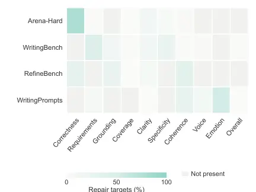

# Verifier–Harness Co-Evolution for Training-Free Self-Improvement on Open-Ended Tasks

Tianyi Xu¹ Yaolun Zhang^(1,4\*) Yiran Wu^(2,4\*) Joe Nguyen¹ Shengyu
Dai³ Saba Moeinizade³ Zhenwen Shao³ Qingyun Wu^(2,4) Huazheng Wang^(1,4)
¹Oregon State University ²Pennsylvania State University ³Johnson &
Johnson ⁴AG2 AI ^(†)^(†)thanks: Equal contribution. Correspondence to
Tianyi Xu and Huazheng Wang
([xut2@oregonstate.edu](mailto:xut2@oregonstate.edu),
[huazheng.wang@oregonstate.edu](mailto:huazheng.wang@oregonstate.edu)).

###### Abstract

Training-free self-improvement lets an agent use feedback to revise the
response it is about to return and to update the harness state that
shapes how it handles later tasks. On open-ended tasks that feedback
rarely comes from reference answers or executable tests, so the agent
has to rely on a model-based verifier. When the verifier is wrong, the
current response can get worse, and misleading experience can persist
across the task stream. A verifier that never changes also grows stale
as the agent’s responses improve and task demands shift. We introduce
_Unified Co-Evolution_ (UCoE), a training-free method that evolves an
executable verifier program together with the agent’s harness state
while all model parameters stay fixed. UCoE synthesizes candidate
verifier programs and tests them on response contrasts, pairs of
responses that differ in one declared property and have a known
preferred side. It selects the candidate whose discrimination on its
weakest contrast family is highest, a quantity we call _driving
capacity_. The selected verifier diagnoses one weakness in each draft,
guides a single repair, decides which response is served, and determines
whether the accepted repair may enter the harness state. As tasks
complete, their diagnostics seed new candidate verifiers, which must
beat the current verifier on the same contrasts before adoption. Across
six open-ended benchmarks, UCoE averages $`59.00\%`$ preference against
matched direct generation with Qwen3-8B and $`57.19\%`$ with
Qwen3.8-27B, margins of $`9.00`$ and $`7.19`$ percentage points. On
three verifiable benchmarks, the same method raises the mean from
$`36.06\%`$ for direct generation to $`38.48\%`$. Code is available at
[https://github.com/tianyi0216/Unified-Co-Evolution](https://github.com/tianyi0216/Unified-Co-Evolution).

|     |
| --- |
|     |

## 1 Introduction

Self-improving agents use feedback in two ways. They revise the response
they are about to return (Madaan et al., 2023), and they retain
experience that shapes how they handle later tasks (Shinn et al., 2023;
Zhao et al., 2024). Recent work extends the second use to the
prompt-level harness that surrounds the model (Lee et al., 2026a). In
mathematics and programming, exact answers or executable tests can
ground this feedback, as in Figure 1a. Open-ended tasks offer no such
anchor. As Figure 1b shows, the agent sees only the public requirements
of a request and must judge correctness, coverage, relevance, and style
on its own. Because the same judgment decides which response is served
and which experience enters the harness state, a single mistaken
judgment can harm the current task and then persist across the stream.

Figure 1: Feedback for open-ended self-improvement. (a) On verifiable
tasks, a known answer marks each response right or wrong and guides
agent improvement. (b) On open-ended tasks there is no ground truth, so
the agent must judge for itself which response is better, and a wrong
judgment harms both the served response and the experience kept for
later tasks. (c) UCoE mines quality cues from blinded response pairs,
builds response contrasts in which a base response is preferred over an
edited copy that lacks one property, tests candidate verifier programs
on them, and uses the selected verifier to guide revision while
experience from completed tasks updates it over time.

Existing methods obtain open-ended feedback from holistic LLM judges,
natural-language rubrics, executable reward programs, or learned
verifiers. A holistic judge gives a convenient overall score or
preference, but the contribution of each quality dimension stays
implicit (Gunjal et al., 2026; Shen et al., 2026), and judge accuracy
alone is not a reliable predictor of downstream selection gain (Lu et
al., 2026). Rubrics make those dimensions explicit, yet generated
criteria can be incomplete, conflated, or redundant (Shen et al., 2026),
so an aggregate score can still hide a blind spot. Executable reward
programs expose the evaluation path (Anonymous, 2026b; Li et al., 2026),
but explicit structure does not guarantee behavior, since the selector a
program induces still has to be tested across failure families.
Training-based methods learn generative reward models, rubric
generators, rubric-conditioned judges, or verifier capabilities within
the policy (Jia et al., 2025; Xu et al., 2026a; Chen et al., 2026; Pan
et al., 2026), at the cost of a model-training stage and its compute.
Training-free pipelines that use prompted rubric-guided refinement or
aggregate several aspect judgments (Wan et al., 2026; Lifshitz et al., 2025) avoid that cost but keep the verifier fixed during deployment,
where it can become stale as responses improve and task demands shift
(Anonymous, 2026b; Li et al., 2026; Iacob et al., 2026).

To address these weaknesses, we introduce _Unified Co-Evolution_ (UCoE),
a training-free method that evolves an executable verifier program
alongside the harness state with model parameters fixed. The program
keeps every criterion explicit, contrast testing measures its behavior
on each failure family, and evolution during deployment keeps it from
going stale. UCoE synthesizes candidate verifier programs and tests them
on response contrasts, pairs of responses that differ in one targeted
property with a declared preference (Gardner et al., 2020; Sai et al.,
2021), grouped by property into families. It selects the candidate with
the highest _driving capacity_, its discrimination on the family where
it is weakest, so that strength on easy properties cannot mask a blind
spot. During deployment the selected verifier diagnoses one weakness in
the draft and guides one local repair. It then chooses between draft and
revision and decides whether the repair may enter the harness state.
Diagnostics from completed tasks seed new candidates, which replace the
current verifier only after meeting the update criteria on the same
contrasts. Figure 1c sketches this loop.

We evaluate UCoE on six open-ended benchmarks and three benchmarks with
verifiable endpoints using Qwen3-8B and Qwen3.8-27B actors. UCoE has the
highest preference against matched direct generation of all compared
feedback methods on every open-ended benchmark at both actor sizes,
averaging $`59.00\%`$ and $`57.19\%`$, and it improves every available
native metric. On the verifiable tasks it raises the mean from
$`36.06\%`$ to $`38.48\%`$ without a loss on any benchmark. Ablations
attribute most of the gain to current-task repair, with verifier
selection, verifier evolution, and retained procedures each adding to
it. Our contributions are:

- •
  We introduce UCoE, a training-free method that evolves an executable
  verifier program with the harness state, so feedback keeps pace with
  the agent it guides.
- •
  We propose driving capacity, a verifier’s discrimination on its
  weakest contrast family, and show that it bounds achievable selection
  gain, giving a safe criterion for verifier updates.
- •
  We show state-of-the-art training-free self-improvement on nine
  benchmarks, with gains that carry over to GPT-5.4 actors and a Codex
  agent harness on SpreadsheetBench-2.

## 2 Related work

Training-free self-improvement. Training-free methods improve the
current response or retain non-parametric state that shapes future
behavior. Self-Refine revises responses within a task (Madaan et al.,
2023), while Reflexion, ExpeL, Dynamic Cheatsheet, and A-MEM retain or
organize reusable experience across trials and tasks (Shinn et al.,
2023; Zhao et al., 2024; Suzgun et al., 2026; Xu et al., 2025). ACE and
Recursive Harness Self-Improvement extend adaptation to the agent’s
context or prompt-level harness (Zhang et al., 2026a; Lee et al.,
2026a). Test-time scaling allocates additional inference computation to
sampling and verification, including in agentic workflows (Snell et al.,
2025; Zhu et al., 2025). All of these methods take the feedback or
selection process as given. UCoE adapts that process too: its verifier
program evolves alongside the harness state, and together they determine
which response is served and which experience is kept.

Open-ended rewards and verification. For tasks without exact answers,
prior work constructs model-based evaluation signals from generated
rubrics, rubric anchors, recursively decomposed and reweighted criteria,
or pairwise generative rewards (Gunjal et al., 2026; Huang et al., 2025;
Shen et al., 2026; Jia et al., 2025). Other methods combine supplied
verifiers, elicit rubric-guided or aspect-specific judgments, or
construct self-verifiable proxy tasks (Lee et al., 2026b; Wan et al.,
2026; Lifshitz et al., 2025; Wang et al., 2026). CoNL evaluates
critiques by the improvements they induce (Sui and Hooi, 2026), and
Eureka expresses feedback as executable reward code for simulated
control (Ma et al., 2024). The reliability of generated evaluators also
needs testing: EvalResearchBench measures how well agent-designed
evaluators reproduce the model rankings of target benchmarks (Zhang et
al., 2026c). UCoE tests whole verifier programs, criteria and
aggregation included, on response contrasts with declared preference
directions, and it lets the diagnostics of completed tasks motivate
later changes to the program.

Co-evolution. Prior co-evolution methods update feedback mechanisms
alongside the systems they guide. Rubric-centered work co-evolves
rubrics with responses or research policies, adjusts rubric complexity
during training, or jointly learns rubric generators, judges, and
verifier capabilities (Guan et al., 2026; Shao et al., 2026; Anonymous,
2026a; Xu et al., 2026a; Chen et al., 2026; Pan et al., 2026). DREAM-RL
and EvoRS evolve executable Reward-DAGs from rollout diagnostics or
on-policy response traces (Anonymous, 2026b; Li et al., 2026). Other
work pairs task generators with solvers, compares changing evaluators
with fixed anchors, adapts multi-agent organization at test time, or
evolves programmatic annotators from labeled validation data (Kwan et
al., 2026; Iacob et al., 2026; Zhang et al., 2026b; Xu et al., 2026b).
Most of these methods rely on parameter training, on-policy reward
traces, or labeled anchors. UCoE keeps the co-evolutionary view but
moves all adaptation outside the model parameters. The criteria and
aggregation of an executable verifier program change together with the
agent’s harness state, diagnostics from completed tasks suggest those
changes, and response contrasts with declared preferences give a common
basis for judging them.

## 3 Method

We introduce UCoE in this section. Figure 2 gives an overview of the
method. See App. B for the complete algorithm.

Figure 2: UCoE workflow. Top, the verifier side: (1) Synthesize proposes
candidate verifier programs from the task requirements and from quality
cues discovered in blinded response pairs. (2) Select edits calibration
responses one property at a time to form response contrasts and deploys
the candidate that is strongest on its weakest family. (3) Evolve
combines the current verifier with diagnostics from completed tasks into
a refined candidate, which is re-tested on the same contrasts before it
can replace the current verifier. Bottom, the agent side: the fixed
actor drafts with the current harness state, the deployed verifier
guides one revision and chooses between draft and revision, and accepted
repairs are distilled into experience that the updated harness state
reuses on later tasks.

### 3.1 Problem setup

Let $`x_{1},\ldots,x_{T}`$ be an ordered task stream and
$`F_{\theta_{0}}`$ a fixed actor. Each method $`\mathcal{A}`$ processes
the same stream with its own harness state $`H_{t}`$, and no method
changes any model parameter. What $`H_{t}`$ contains, and how the actor
reads it, depends on the agent system. It may hold instructions, plans,
tools, skills, or memory that shape later behavior. In the main
experiments it is a bounded procedural memory, and every adaptive method
receives an isolated instance that starts empty and follows the same
capacity, retrieval, and update rules.

All methods follow the same per-task lifecycle. Given $`H_{t}`$, the
actor first generates a draft $`y_{t}^{0}=F_{\theta_{0}}(x_{t};H_{t})`$.
The method then applies its own feedback and selection rules, which may
produce at most one revision $`y_{t}^{R}`$, and returns
$`y_{t}\in\{y_{t}^{0},y_{t}^{R}\}`$. Only after $`y_{t}`$ has been
returned does the method apply its harness update
$`H_{t+1}=U_{\mathcal{A}}(H_{t},\tau_{t}^{\mathcal{A}})`$, where
$`\tau_{t}^{\mathcal{A}}`$ is the completed task trace. This ordering
lets feedback revise the current response while task-derived state
affects only later tasks.

Let $`\mathcal{I}\subseteq\{1,\ldots,T\}`$ denote the tasks included in
final evaluation. We score each method prequentially:

```math
S_{\rm preq}(\mathcal{A})=\frac{1}{|\mathcal{I}|}\sum_{t\in\mathcal{I}}Q_{t}(x_{t},y_{t}),\qquad\theta_{t}=\theta_{0}, \tag{1}
```

where $`Q_{t}`$ is the final evaluator’s score for task $`t`$.
Throughout the stream, methods see public task requirements and their
own model-generated artifacts, never benchmark answers or
final-evaluator feedback. The score is prequential because each
$`y_{t}`$ is produced from the state inherited from earlier tasks,
before task $`t`$ contributes to $`H_{t+1}`$.

### 3.2 Verifier synthesis and contrast-based selection

Initial verifier synthesis. UCoE represents a verifier as a program that
maps a task $`x`$ and a response $`y`$ to a vector of criterion scores
and a scalar reward:

```math
\mathcal{V}=(\Phi,A,D),\qquad\mathbf{s}_{\mathcal{V}}(x,y)=\bigl(\phi_{1}(x,y),\ldots,\phi_{M}(x,y)\bigr),\qquad r_{\mathcal{V}}(x,y)=A\!\left(\mathbf{s}_{\mathcal{V}}(x,y)\right), \tag{2}
```

where $`\Phi`$ is the set of criterion scorers, $`A`$ combines their
scores into a reward in which higher is better, and $`D`$ turns the
weakest participating criterion into repair feedback. Semantic criteria
are scored by a fixed language model that we call the verifier model,
which also proposes programs and diagnoses weaknesses. Evolution may add
criteria to $`\Phi`$ and change $`A`$. The diagnosis procedure, the
program interpreter, and the parameters of the verifier model never
change.

Public task metadata states broad requirements but can miss
domain-specific qualities that recur in real responses. UCoE therefore
begins with relation discovery. On a separate development set, the actor
and a larger frozen comparison model answer the same prompts, and the
verifier model reads each pair in random order with system identities
hidden and turns differences that recur across prompts into general
criteria together with targeted edits that later serve contrast
construction. These fixed relations form $`\mathcal{R}`$. Using the task
metadata, the shared criteria, and $`\mathcal{R}`$, the verifier model
then proposes candidate programs. Each candidate specifies how to
combine the criterion scores and may add up to two criteria of its own.
A lightweight validity check removes malformed or non-executable
programs, and the surviving pool $`\mathcal{K}_{0}`$ is scored on
separate response contrasts, where driving capacity picks the initial
verifier.

Response-contrast construction. Candidate verifiers need a common
behavioral test that shows whether their scores respond to intended
changes in quality and which candidate tracks those changes most
reliably. Arbitrary response pairs differ in many ways at once, so UCoE
instead constructs controlled contrasts that isolate one property at a
time (Gardner et al., 2020; Sai et al., 2021). Each contrast starts from
a calibration response, written by the actor for a public prompt that is
disjoint from deployment, and applies one targeted edit that breaks a
single property while leaving everything else in place. The base
response $`y^{+}`$ and the degraded response $`y^{-}`$ then differ only
in that property, and the declared preference for $`y^{+}`$ concerns
that property alone. Three general families cover omitted required
content, unsupported claims, and irrelevant material. Relation discovery
adds benchmark-specific families under the same rule: a relation is kept
only if it recurs in at least three development prompts and can be
expressed as one binary criterion with one edit that breaks only that
property. The resulting pairs form the response contrasts
$`\mathcal{B}`$ and are split by source before any verifier is scored.
The selection split ranks candidates, and the held-out split later
compares a candidate with the current verifier. See App. D.5 for
construction details.

Driving capacity and selection. Static validation only establishes that
a program runs. Choosing among valid programs at random ignores how they
behave on the contrasts, and ranking them by mean accuracy lets strong
performance on easy families hide a blind spot on a hard one. UCoE
therefore ranks candidates by their weakest family.

Each verifier $`\mathcal{V}`$ induces a strict-margin selector
$`h_{\mathcal{V}}=h_{\mathcal{V},\epsilon}`$ on each contrast, which
picks $`y^{+}`$ over $`y^{-}`$ only when the reward of $`y^{+}`$ exceeds
that of $`y^{-}`$ by more than $`\epsilon`$. A tie or a sub-margin lead
counts as a failure. For a contrast family $`j`$, let $`p_{j}(h)`$ be
the probability that selector $`h`$ picks $`y^{+}`$, and define its
centered accuracy as

```math
J_{j}(h)=2p_{j}(h)-1=2\Pr[h(x,y^{+},y^{-})=y^{+}\mid j]-1. \tag{3}
```

Chance-level selection gives $`J_{j}=0`$, and positive or negative
values mean above- or below-chance selection. The signed driving
capacity of $`\mathcal{V}`$ on the response contrasts $`\mathcal{B}`$ is
one quarter of its worst family value, and the nonnegative driving
capacity clips it at zero:

```math
\widetilde{\mathcal{C}}_{\mathcal{B}}(\mathcal{V})\coloneqq\frac{1}{4}\min_{j}J_{j}(h_{\mathcal{V}}),\qquad\mathcal{C}_{\mathcal{B}}(\mathcal{V})\coloneqq\max\{0,\widetilde{\mathcal{C}}_{\mathcal{B}}(\mathcal{V})\}. \tag{4}
```

The factor of one quarter gives the quantity a covariance meaning. For
valid contrasts, if one of the two response positions is drawn uniformly
at random, $`J_{j}/4`$ is the covariance between the selector choosing
that position and that position holding the targeted property, so
driving capacity is the smallest such selection covariance over the
tested families. See Proposition 1 in App. C.1 for the precise
statement.

The minimum also has a robustness meaning. Suppose the $`m`$ tested
families are mixed with weights
$`w\in\Delta_{m}=\{w:w_{j}\geq 0,\sum_{j}w_{j}=1\}`$, so that the
selector succeeds with probability
$`p_{w}(h_{\mathcal{V}})=\sum_{j}w_{j}p_{j}(h_{\mathcal{V}})`$. The
least favorable mixture puts all of its mass on a weakest family, and
Theorem 1 in App. C.2 shows that
$`\inf_{w\in\Delta_{m}}p_{w}(h_{\mathcal{V}})=\min_{j}p_{j}(h_{\mathcal{V}})=1/2+2\widetilde{\mathcal{C}}_{\mathcal{B}}(\mathcal{V})`$.
Maximizing signed driving capacity therefore maximizes the worst-case
probability of selecting the preferred response over every mixture of
the tested families. UCoE optimizes the signed value rather than the
clipped one because clipping would make all below-chance candidates look
alike. Its empirical objective at checkpoint $`k`$, with $`k=0`$
denoting initialization, is

```math
\widehat{\mathcal{V}}\in\operatorname*{arg\,max}_{\mathcal{V}\in\mathcal{K}_{k}}\min_{j}\widehat{J}_{j}(h_{\mathcal{V}}), \tag{5}
```

where $`\mathcal{K}_{k}`$ is the candidate pool at that checkpoint and
$`\widehat{J}_{j}`$ is centered accuracy on the selection split.
Proposition 3 bounds how far the empirical maximizer can fall short of
the best candidate in the pool. The winner from $`\mathcal{K}_{0}`$
becomes the initial verifier $`\mathcal{V}_{0}`$. Later pools also
contain the current verifier, and their winner must meet the update
criteria of Section 3.3 before it replaces the current verifier.

Driving capacity measures discrimination, and discrimination pays off
only when the compared responses differ in quality. Let
$`Z_{i}\in\{0,1\}`$ mark whether response $`i`$ of a pair is adequate
under the final evaluation, let $`S_{h}\in\{1,2\}`$ be the index that
$`h`$ selects, and let $`q=\Pr(Z_{1}\neq Z_{2})`$ be the fraction of
pairs on which the choice matters. For $`q>0`$, the mixed-pair centered
accuracy $`J_{\rm mix}(h)=2\Pr(Z_{S_{h}}=1\mid Z_{1}\neq Z_{2})-1`$
measures how often the selector picks the adequate response when the two
differ. Pairs of equal adequacy contribute nothing, so for two selectors
$`h`$ and $`h^{\prime}`$ on the same fixed pairs,

```math
\mathbb{E}[Z_{S_{h^{\prime}}}-Z_{S_{h}}]=\frac{q}{2}\{J_{\rm mix}(h^{\prime})-J_{\rm mix}(h)\}. \tag{6}
```

Proposition 2 records this decomposition: the actor supplies the
opportunity $`q`$, the selector supplies the ability $`J_{\rm mix}`$ to
use it, and when $`q=0`$ no selector can change expected adequacy.
Whether gains on constructed contrasts carry over to the actor’s natural
revisions depends on how well the contrast families represent the errors
those revisions contain.

### 3.3 Response revision and co-evolution

Response revision and selection. Let $`\mathcal{V}_{k}`$ be the verifier
active at task $`t`$. It scores the draft $`y_{t}^{0}`$, and from that
fixed score vector and its weakest participating criterion the diagnosis
procedure returns a target criterion $`c_{t}`$, localized evidence
$`w_{t}`$, and a repair instruction $`u_{t}`$, written
$`(c_{t},w_{t},u_{t})=D_{\mathcal{V}_{k}}(x_{t},y_{t}^{0})`$.
Conditioned on this feedback and on $`H_{t}`$, the fixed actor makes one
local repair while preserving unrelated content:

```math
y_{t}^{R}=F_{\theta_{0}}(x_{t},y_{t}^{0},c_{t},w_{t},u_{t};H_{t}). \tag{7}
```

The same $`\mathcal{V}_{k}`$ then scores the draft and the revision, and
the revision is served only when its reward lead exceeds a margin
$`\epsilon\geq 0`$:

```math
y_{t}=\begin{cases}y_{t}^{R},&r_{\mathcal{V}_{k}}(x_{t},y_{t}^{R})>r_{\mathcal{V}_{k}}(x_{t},y_{t}^{0})+\epsilon,\\
y_{t}^{0},&\text{otherwise}.\end{cases} \tag{8}
```

Whenever the comparison cannot be made, because the feedback was
unusable, the revision is missing, or a score is invalid, and whenever
the lead is a tie or falls below the margin, the draft is served. We
write $`a_{t}\in\{0,1\}`$ for this acceptance decision.

Harness update. After the response is returned, a system-specific
operator updates the harness state:

```math
H_{t+1}=\operatorname{UpdateHarness}\bigl(H_{t},x_{t},y_{t}^{0},y_{t}^{R},c_{t},w_{t},a_{t}\bigr). \tag{9}
```

Only an accepted repair, $`a_{t}=1`$, may add task-derived content to
$`H_{t+1}`$. In our bounded procedural-memory implementation, an
accepted revision yields at most one generalized trigger–action
procedure once task-specific content has been removed, and a rejected
revision may update metadata only. See App. D.2 for the retrieval,
deduplication, and eviction rules.

Verifier evolution. As task demands and $`H_{t}`$ change, the draft and
revision pairs that the actor produces can drift away from the contrasts
on which the initial verifier was selected, and its criteria or
aggregation can go stale. Equation (6) makes the cost concrete: the
selection gain on the pairs the actor now produces depends on how well
the current selector discriminates on exactly those pairs. UCoE
therefore revisits the verifier at scheduled checkpoints, after
$`y_{t}`$ and $`H_{t+1}`$ have been finalized. The verifier model
synthesizes new candidates from the current verifier’s definitions and
from unlabeled summaries of the completed tasks, namely how often
revisions were accepted, which criteria were repeatedly the weakest, and
how the harness state has grown. A candidate may append criteria or
change the aggregation. After validation, UCoE adds the current verifier
to the pool and repeats the maximin selection of Section 3.2 on the
fixed contrast families. The winner replaces the current verifier only
if it meets the update criteria: it must improve worst-family
discrimination on the selection split, win more held-out contrasts than
it loses against the current verifier, and stay within a fixed
regression tolerance on every existing family. Otherwise the current
verifier is retained. Any adoption takes effect on the next task. See
App. C.3 for the formal update criteria and App. D.6 for implementation
details.

## 4 Experimental setup

|                           |                    |                    |                    |                    |                    |                    |                    |
| ------------------------- | ------------------ | ------------------ | ------------------ | ------------------ | ------------------ | ------------------ | ------------------ |
| Method                    | Arena- Hard        | Writing Prompts    | WildBench          | Writing Bench      | Multi Challenge    | Refine Bench       | Overall            |
| Qwen3-8B                  |                    |                    |                    |                    |                    |                    |                    |
| Direct Generation         | $`50.00`$          | $`50.00`$          | $`50.00`$          | $`50.00`$          | $`50.00`$          | $`50.00`$          | $`50.00`$          |
| LLM as a Judge            | $`50.60`$          | $`50.54`$          | $`46.34`$          | $`49.50`$          | $`38.87`$          | $`51.98`$          | $`47.97`$          |
| RaR (Gunjal et al., 2026) | $`51.20`$          | $`50.54`$          | $`48.54`$          | $`51.90`$          | $`38.48`$          | $`51.26`$          | $`48.65`$          |
| DREAM (Anonymous, 2026b)  | $`45.60`$          | $`43.90`$          | $`43.12`$          | $`52.60`$          | $`31.05`$          | $`53.78`$          | $`45.01`$          |
| SpyRL (Wang et al., 2026) | $`51.10`$          | $`49.27`$          | $`35.74`$          | $`47.00`$          | $`33.98`$          | $`53.06`$          | $`45.03`$          |
| UCoE                      | $`\mathbf{58.30}`$ | $`\mathbf{62.79}`$ | $`\mathbf{57.42}`$ | $`\mathbf{56.90}`$ | $`\mathbf{57.42}`$ | $`\mathbf{61.15}`$ | $`\mathbf{59.00}`$ |
| Qwen3.8-27B               |                    |                    |                    |                    |                    |                    |                    |
| Direct Generation         | $`50.00`$          | $`50.00`$          | $`50.00`$          | $`50.00`$          | $`50.00`$          | $`50.00`$          | $`50.00`$          |
| LLM as a Judge            | $`49.50`$          | $`48.00`$          | $`48.49`$          | $`50.30`$          | $`36.33`$          | $`48.74`$          | $`46.89`$          |
| RaR (Gunjal et al., 2026) | $`51.60`$          | $`50.49`$          | $`47.56`$          | $`50.60`$          | $`43.36`$          | $`44.78`$          | $`48.07`$          |
| DREAM (Anonymous, 2026b)  | $`53.80`$          | $`59.96`$          | $`48.44`$          | $`52.10`$          | $`46.48`$          | $`48.38`$          | $`51.53`$          |
| SpyRL (Wang et al., 2026) | $`43.40`$          | $`58.84`$          | $`41.89`$          | $`48.60`$          | $`36.33`$          | $`42.99`$          | $`45.34`$          |
| UCoE                      | $`\mathbf{59.70}`$ | $`\mathbf{63.92}`$ | $`\mathbf{55.42}`$ | $`\mathbf{54.40}`$ | $`\mathbf{51.95}`$ | $`\mathbf{57.73}`$ | $`\mathbf{57.19}`$ |

Table 1: Open-ended preference against matched direct generation. Each
entry is the tie-adjusted percentage of tasks on which a method’s
response is preferred to the Direct Generation response of the same
actor, as judged by Qwen3.5-397B-A17B in both presentation orders with
ties given half credit, so $`50`$ is parity and higher is better. All
methods share the actor, the task order, and the fixed-model,
one-revision protocol. Overall is the unweighted mean over the six
benchmarks, and bold marks the best method in each column.

Benchmarks and models. Our open-ended evaluation spans six benchmarks.
Arena-Hard (Li et al., 2025) and WildBench (Lin et al., 2025) test
general assistance on challenging user requests. WritingPrompts (Fan et
al., 2018) tests story generation, and WritingBench (Wu et al., 2025)
covers writing across diverse domains. MultiChallenge (Deshpande et al., 2025) targets multi-turn instruction following, and the Free-Form split
of RefineBench (Lee et al., 2026c) tests response refinement. To check
whether the same method transfers beyond model-judged evaluation, we add
three benchmarks with objective endpoints. IFBench tests compliance with
verifiable instruction constraints (Pyatkin et al., 2025), Hard-MATH is
our competition-mathematics stream drawn from MATH-500 and AIME
2022–2025 (Hendrycks et al., 2021; Lightman et al., 2024), and
BigCodeBench-Hard tests code generation through execution (Zhuo et al.,
2025). We run Qwen3-8B and Qwen3.8-27B (Yang et al., 2025) as actors and
use Qwen3.6-35B-A3B as the fixed verifier model for program synthesis,
semantic criterion scoring, and diagnosis. In relation discovery, the
larger comparison model is Qwen3.8-27B for the Qwen3-8B actor and
Qwen3.5-397B-A17B for the Qwen3.8-27B actor. See App. D.1 for splits and
sizes and App. D.4 for default hyperparameters.

Baselines. We compare UCoE with common baselines for open-ended
self-improvement, chosen to cover different forms of feedback. Direct
Generation uses no feedback and provides the raw-response reference. LLM
as a Judge makes a fixed holistic judgment of response quality (Zheng et
al., 2023). RaR scores responses against task-specific flat rubrics
(Gunjal et al., 2026). DREAM organizes dependent criteria into a
Reward-DAG (Anonymous, 2026b). SpyRL derives feedback from a
task-transformation game with self-verifiable rewards (Wang et al.,
2026). We adapt all four feedback baselines to the same fixed-model,
one-revision protocol: each method uses its own feedback to guide at
most one revision, scores the draft and the revision with its own
signal, and returns the revision only when it passes the method’s
acceptance rule. Stateful methods receive separate procedural memories
with the same capacity and update rules, and all implementations
transfer the feedback mechanisms without reproducing the original
parameter-training pipelines. See App. D.3 and Table 5 for each
baseline’s implementation and acceptance rule.

Evaluation. Open-ended benchmarks do not share an exact notion of
correctness, and their native scores are not directly comparable, so our
primary endpoint is tie-adjusted pairwise preference against the matched
Direct Generation response. This follows established pairwise evaluation
protocols for open-ended model outputs (Zheng et al., 2023; Li et al., 2025) and places every method on the same relative scale.
Qwen3.5-397B-A17B judges each pair of full responses in both
presentation orders without receiving method identities. We merge the
two judgments at the task level and assign half credit to ties, so
values above $`50\%`$ favor the evaluated method over Direct Generation.
We also report the native benchmark-specific metrics wherever they
exist, together with accuracy or Pass@1 on the verifiable tasks. See
App. D.7 for the full evaluation protocols.

## 5 Results

| Method            | IFBench            | Hard-MATH          | BigCodeBench-Hard  | Overall            |
| ----------------- | ------------------ | ------------------ | ------------------ | ------------------ |
| Direct Generation | $`30.00`$          | $`56.54`$          | $`\mathbf{21.62}`$ | $`36.06`$          |
| LLM as a Judge    | $`33.33`$          | $`55.24`$          | $`16.89`$          | $`35.15`$          |
| RaR               | $`32.00`$          | $`57.33`$          | $`18.92`$          | $`36.08`$          |
| DREAM             | $`28.67`$          | $`\mathbf{59.42}`$ | $`18.24`$          | $`35.44`$          |
| SpyRL             | $`30.67`$          | $`58.12`$          | $`18.24`$          | $`35.68`$          |
| UCoE              | $`\mathbf{34.67}`$ | $`59.16`$          | $`\mathbf{21.62}`$ | $`\mathbf{38.48}`$ |

Table 2: Verifiable tasks with Qwen3-8B. Accuracy for IFBench and
Hard-MATH, Pass@1 for BigCodeBench-Hard.

UCoE wins on every open-ended benchmark. Table 1 shows that UCoE is
preferred over matched direct generation in all twelve benchmark and
actor settings, and that its preference is the largest of any feedback
method in every one of them. It averages $`59.00\%`$ with Qwen3-8B and
$`57.19\%`$ with Qwen3.8-27B, gains of $`9.00`$ and $`7.19`$ points over
direct generation, and the gains span general assistance, writing,
multi-turn instruction following, and refinement. The other feedback
methods often fail to improve on direct generation. Even the best
baseline on each benchmark averages only $`49.26\%`$ at 8B and
$`51.60\%`$ at 27B, and none exceeds parity on WildBench at 8B. Every
baseline receives feedback and one revision under the same protocol, so
the gap reflects the feedback signal itself rather than the opportunity
to revise. We also evaluate under each benchmark’s native metric, and
the same picture holds, with UCoE improving over direct generation in
every setting. See App. E.1, E.2, E.3, E.5, and E.6 for native-metric
results, listed-price cost, backbone transfer, pointwise intervals for
Table 1, and an independent-critic audit of the WritingBench revisions.

UCoE also improves verifiable tasks. The same lifecycle helps where
correctness can be checked. In Table 2, UCoE raises the three-benchmark
mean from $`36.06\%`$ to $`38.48\%`$. It improves IFBench by $`4.67`$
points and Hard-MATH by $`2.62`$ points while matching direct generation
on BigCodeBench-Hard. On code, every other feedback method lowers Pass@1
below direct generation, and UCoE is the only method that preserves it,
while on Hard-MATH DREAM edges it by $`0.26`$ points.

| Configuration              | vs. direct %       |
| -------------------------- | ------------------ |
| UCoE                       | $`\mathbf{58.30}`$ |
| Random initial verifier    | $`56.70`$          |
| Fixed verifier             | $`56.60`$          |
| Harness-state updates only | $`50.80`$          |
| No memory updates          | $`56.70`$          |

Table 3: Arena-Hard ablations with Qwen3-8B. Tie-adjusted preference
against direct generation.

Every component contributes. Table 3 removes one component of UCoE at a
time on Arena-Hard, and every removal lowers preference. Removing
current-task repair, so that the verifier only updates the harness
state, costs the most, from $`58.30\%`$ to $`50.80\%`$. Replacing
driving-capacity selection with a random initial verifier, freezing the
verifier instead of updating it at checkpoints, and disabling
harness-state updates from accepted repairs each lower preference to
between $`56.60\%`$ and $`56.70\%`$. The ablations confirm each part of
the design: verifier-guided repair, verifier selection by driving
capacity, verifier updates at checkpoints, and harness-state updates
from feedback all contribute. See App. E.4 for the sensitivity study.

Figure 3: UCoE inside the Codex agent harness on SpreadsheetBench-2.
Exact-match accuracy on a 75-task stream, overall and by task category,
with GPT-5.6-luna as the actor.

UCoE transfers to a Codex agent harness. The main experiments wrap a
bare actor in a prompt-level harness with procedural memory. To test
whether UCoE also works inside a full coding-agent harness, we run it in
the Codex harness on SpreadsheetBench-2 (Zhu et al., 2026), where the
agent edits real workbooks with its tools and the benchmark’s checker
scores each result after recalculating every formula. The harness state
here is the agent’s own context, its tools, a task skill file, and an
experience block in the prompt, so the study also tests whether UCoE’s
harness-state updates transfer beyond the procedural memory of the main
experiments. GPT-5.6-luna is the actor and GPT-5.6-sol the verifier
model, and Figure 3 reports a 75-task stream with checkpoints after
tasks 34 and 67. UCoE reaches $`22.7\%`$ exact-match accuracy against
$`17.3\%`$ for both Direct Generation and LLM as a Judge. The gain comes
from financial-model and debugging tasks, where the fixed judge matches
or trails direct generation, while on template tasks LLM as a Judge
leads. See App. D.8 for details.



(a) Repair-target distributions

(b) Verifier evolution

(c) Fixed-proposal score shifts

(d) Procedure reuse

Figure 4: Mechanism diagnostics. (a) Share of repair targets per
criterion group. Gray marks groups absent from the deployed verifier.
(b) Two verifier updates in WritingPrompts. Each arrow runs from the
current verifier to the candidate selected by driving capacity, in
signed driving capacity against selection gain on frozen response pairs.
(c) Reward margins of 360 Arena-Hard proposals under the initial and
updated verifier. Dashed lines mark the acceptance margin, and colors
give the external judgment for the 94 proposals the updated verifier
selects. (d) Reuse lag of stored procedures at 381 Arena-Hard tasks,
colored by outcome. The dashed line marks the switch to mathematics
tasks.

Verifier updates and stored procedures behave as intended. Figure 4(a)
shows which criterion the verifier targets when it diagnoses a draft.
Correctness receives $`78.9\%`$ of Arena-Hard repairs, requirements lead
on WritingBench at $`42.5\%`$, coherence on RefineBench at $`36.5\%`$,
and emotion on WritingPrompts at $`53.0\%`$, so the deployed verifier
directs repairs at the qualities each task type demands. Figure 4(b)
shows two verifier updates in WritingPrompts. Each candidate selected by
driving capacity raises signed driving capacity on the contrasts, from
$`-0.0625`$ and $`-0.0208`$ to $`0.25`$, and also raises selection gain
on separate frozen response pairs, by $`10.16`$ and $`4.69`$ points, so
gains on constructed contrasts carry over to natural pairs. Figure 4(c)
rescores 360 Arena-Hard proposals under the initial and the updated
verifier. The update widens some reward margins and narrows others,
which changes the set of accepted revisions, and among the 94 proposals
it selects, external judgments favor $`73`$ over the draft, $`7`$ favor
the draft, and $`14`$ tie. The updated verifier therefore accepts mostly
real improvements. Figure 4(d) tracks when stored procedures are
retrieved. Of 639 retrieval events, 76 reuse a procedure after at least
ten intervening tasks, and on the 70 retrieving tasks with external
judgments the served revision beats the draft $`54`$ times, loses $`5`$,
and ties $`11`$, so experience in the harness state is reused long after
it was stored and the tasks that reuse it are mostly judged better than
their drafts.

## 6 Conclusion

We introduced UCoE, a training-free framework in which an executable
verifier program and the harness state around a fixed actor evolve
together. Response contrasts choose the verifier and test every
candidate that would replace it, and the verifier in turn shapes each
response and the experience the agent keeps. On six open-ended
benchmarks, UCoE improves on matched direct generation at both Qwen
actor sizes, and on three verifiable benchmarks it raises the mean while
preserving Pass@1 on BigCodeBench-Hard. Repairing the current task
contributes most of the gain, verifier updates measurably change
selection behavior, and procedures stored from accepted repairs are
reused many tasks later. Training-free self-improvement has so far
adapted responses and harness state around a fixed feedback process.
UCoE extends that adaptation to the feedback process itself, without
touching model parameters. See App. A for limitations.

### AI use statement

Generative AI tools assisted with writing assistance and polishing of
the manuscript. The authors take responsibility for the full content of
this work.

### Ethics statement

This work does not recruit human subjects or collect new personal data.
It evaluates language models on existing research benchmarks. An
evolving verifier can nevertheless reinforce its own errors or biases
through revision and persistent harness state, which may retain
sensitive information without appropriate filtering. Improved generation
may also amplify misinformation or other harmful content, while
additional inference consumes computational resources. Response
contrasts do not establish safety, fairness, or privacy. Consequential
deployments should therefore use independent safety evaluation, human
oversight, explicit retention and deletion rules, and rollback
mechanisms.

### Reproducibility statement

Algorithm 1 specifies the full lifecycle and update order. App. C states
the assumptions and gives complete proofs. App. D documents benchmark
splits, models, baseline implementations, hyperparameters, contrast
construction, verifier rules, and the procedural-memory implementation.
App. E reports native-metric results, cost, cross-backbone transfer,
hyperparameter sensitivity, the intervals behind the main tables, a
natural-revision audit, and qualitative examples.

## References

- Anonymous (2026a) Anonymous CARE: curriculum-aware rubric evolution
  for open-ended text generation. In Submitted to ACL Rolling Review -
  March 2026, Note: under review External Links:
  [Link](https://openreview.net/forum?id=jOlKMHT17D) Cited by: §2.
- Anonymous (2026b) Anonymous DREAM-RL: dynamic reward-system evolution
  with an agentic meta-judge for reinforcement learning on open-ended
  tasks. In Submitted to ACL Rolling Review - May 2026, Note: under
  review External Links:
  [Link](https://openreview.net/forum?id=9idmRtG6M5) Cited by: §1, §2,
  Table 1, Table 1, §4.
- Chen et al. (2026) Y. Chen, H. Li, Q. Ai, F. Zhu, T. Chua, M. Zhang,
  and Y. Liu GenRubric: self-evolving rubric generation for scalable llm
  evaluation. External Links: 2608.29856,
  [Link](https://arxiv.org/abs/2608.29856) Cited by: §1, §2.
- Deshpande et al. (2025) K. Deshpande, V. Sirdeshmukh, J. B. Mols, L.
  Jin, E. Hernandez-Cardona, D. Lee, J. Kritz, W. E. Primack, S. Yue,
  and C. Xing MultiChallenge: a realistic multi-turn conversation
  evaluation benchmark challenging to frontier LLMs. In Findings of the
  Association for Computational Linguistics: ACL 2025, W. Che, J.
  Nabende, E. Shutova, and M. T. Pilehvar (Eds.), Vienna, Austria,
  pp. 18632–18702. External Links:
  [Link](https://aclanthology.org/2025.findings-acl.958/),
  [Document](https://dx.doi.org/10.18653/v1/2025.findings-acl.958), ISBN
  979-8-89176-256-5 Cited by: §4.
- Fan et al. (2018) A. Fan, M. Lewis, and Y. Dauphin Hierarchical neural
  story generation. In Proceedings of the 56th Annual Meeting of the
  Association for Computational Linguistics (Volume 1: Long Papers),
  pp. 889–898. Cited by: §4.
- Gardner et al. (2020) M. Gardner, Y. Artzi, V. Basmov, J. Berant, B.
  Bogin, S. Chen, P. Dasigi, D. Dua, Y. Elazar, A. Gottumukkala, N.
  Gupta, H. Hajishirzi, G. Ilharco, D. Khashabi, K. Lin, J. Liu, N. F.
  Liu, P. Mulcaire, Q. Ning, S. Singh, N. A. Smith, S. Subramanian, R.
  Tsarfaty, E. Wallace, A. Zhang, and B. Zhou Evaluating models’ local
  decision boundaries via contrast sets. In Findings of the Association
  for Computational Linguistics: EMNLP 2020, T. Cohn, Y. He, and Y. Liu
  (Eds.), Online, pp. 1307–1323. External Links:
  [Link](https://aclanthology.org/2020.findings-emnlp.117/),
  [Document](https://dx.doi.org/10.18653/v1/2020.findings-emnlp.117)
  Cited by: §1, §3.2.
- Gazoni and Clark (2024) E. Gazoni and C. Clark Openpyxl: a Python
  library to read/write Excel 2010 xlsx/xlsm files. Note:
  [https://openpyxl.readthedocs.io](https://openpyxl.readthedocs.io)
  Cited by: §D.8.
- Guan et al. (2026) X. Guan, X. Hu, S. Huang, Z. Wang, B. Zhang, Z.
  Li, P. Xie, B. Liu, and J. Cao EvoRubric: self-evolving rubric-driven
  rl for open-ended generation. External Links: 2605.29847,
  [Link](https://arxiv.org/abs/2605.29847) Cited by: §2.
- Gunjal et al. (2026) A. Gunjal, A. Wang, E. Lau, V. Nath, Y. He, B.
  Liu, and S. M. Hendryx Rubrics as rewards: reinforcement learning
  beyond verifiable domains. In The Fourteenth International Conference
  on Learning Representations, External Links:
  [Link](https://openreview.net/forum?id=c1bTcrDmt4) Cited by: §1, §2,
  Table 1, Table 1, §4.
- Hendrycks et al. (2021) D. Hendrycks, C. Burns, S. Kadavath, A.
  Arora, S. Basart, E. Tang, D. Song, and J. Steinhardt Measuring
  mathematical problem solving with the MATH dataset. In Thirty-fifth
  Conference on Neural Information Processing Systems Datasets and
  Benchmarks Track (Round 2), External Links:
  [Link](https://openreview.net/forum?id=7Bywt2mQsCe) Cited by: §4.
- Hoeffding (1963) W. Hoeffding Probability inequalities for sums of
  bounded random variables. Journal of the American statistical
  association 58 (301), pp. 13–30. Cited by: §C.2.
- Holm (1979) S. Holm A simple sequentially rejective multiple test
  procedure. Scandinavian journal of statistics, pp. 65–70. Cited by:
  §E.5.
- Huang et al. (2025) Z. Huang, Y. Zhuang, G. Lu, Z. Qin, H. Xu, T.
  Zhao, R. Peng, J. Hu, Z. Shen, X. Hu, X. Gu, P. Tu, J. Liu, W.
  Chen, Y. Fu, Z. Fan, Y. Gu, Y. Wang, Z. Yang, J. Li, and J. Zhao
  Reinforcement learning with rubric anchors. External Links:
  2508.12790, [Link](https://arxiv.org/abs/2508.12790) Cited by: §2.
- Iacob et al. (2026) A. Iacob, A. Jovanović, W. F. Shen, D.
  Burkhardt, M. Kurmanji, N. Tastan, L. Sani, N. A. E. Venanzi, A.
  Odonnat, Z. Cao, B. Marino, X. Qiu, and N. D. Lane The red queen gödel
  machine: co-evolving agents and their evaluators. External Links:
  2606.26294, [Link](https://arxiv.org/abs/2606.26294) Cited by: §1, §2.
- Jia et al. (2025) R. Jia, Y. Yang, Y. Gai, K. Luo, S. Huang, J.
  Lin, X. Jiang, and G. Jiang Writing-zero: bridge the gap between
  non-verifiable tasks and verifiable rewards. External Links:
  2506.00103, [Link](https://arxiv.org/abs/2506.00103) Cited by: §1, §2.
- Kwan et al. (2026) W. Kwan, A. P. Gema, J. O. J. Leang, and P.
  Minervini SCOPE: self-play via co-evolving policies for open-ended
  tasks. External Links: 2605.31433,
  [Link](https://arxiv.org/abs/2605.31433) Cited by: §2.
- Lee et al. (2026a) H. Lee, J. Xu, J. Seely, D. Lee, M. Zaharia, and Y.
  Tang Recursive harness self-improvement. External Links: 2607.15524,
  [Link](https://arxiv.org/abs/2607.15524) Cited by: §1, §2.
- Lee et al. (2026b) J. Lee, V. Ma, S. Zhao, Y. Nair, A. Spector, R.
  Cohen, and E. J. Candès FUSE: ensembling verifiers with zero labeled
  data. External Links: 2604.18547,
  [Link](https://arxiv.org/abs/2604.18547) Cited by: §2.
- Lee et al. (2026c) Y. Lee, S. Kim, B. Lee, M. Moon, Y. Hwang, J. M.
  Kim, G. Neubig, S. Welleck, and H. Choi RefineBench: evaluating
  refinement capability of language models via checklists. In The
  Fourteenth International Conference on Learning Representations,
  External Links: [Link](https://openreview.net/forum?id=GYJFJz9Dy5)
  Cited by: §4.
- Li et al. (2025) T. Li, W. Chiang, E. Frick, L. Dunlap, T. Wu, B.
  Zhu, J. E. Gonzalez, and I. Stoica From crowdsourced data to
  high-quality benchmarks: arena-hard and benchbuilder pipeline. In
  Forty-second International Conference on Machine Learning, External
  Links: [Link](https://openreview.net/forum?id=KfTf9vFvSn) Cited by:
  §4, §4.
- Li et al. (2026) W. Li, A. Chen, X. Wang, Y. Zhang, Q. Dong, J. Xu, H.
  Hou, W. Zhao, C. Lang, J. Gao, Y. Guo, H. Guo, Y. Xiao, and D. Yang
  EvoRS: on-policy self-evolution of reward systems for open-ended
  reinforcement learning. External Links: 2609.12459,
  [Link](https://arxiv.org/abs/2609.12459) Cited by: §1, §2.
- Lifshitz et al. (2025) S. Lifshitz, S. A. McIlraith, and Y. Du
  Multi-agent verification: scaling test-time compute with multiple
  verifiers. In Second Conference on Language Modeling, External Links:
  [Link](https://openreview.net/forum?id=LriQ3NY9uL) Cited by: §1, §2.
- Lightman et al. (2024) H. Lightman, V. Kosaraju, Y. Burda, H.
  Edwards, B. Baker, T. Lee, J. Leike, J. Schulman, I. Sutskever, and K.
  Cobbe Let’s verify step by step. In The Twelfth International
  Conference on Learning Representations, External Links:
  [Link](https://openreview.net/forum?id=v8L0pN6EOi) Cited by: §4.
- Lin et al. (2025) B. Y. Lin, Y. Deng, K. Chandu, A. Ravichander, V.
  Pyatkin, N. Dziri, R. Le Bras, and Y. Choi Wildbench: benchmarking
  llms with challenging tasks from real users in the wild. In
  International Conference on Learning Representations, Vol. 2025,
  pp. 47852–47870. Cited by: §4.
- Lu et al. (2026) J. Lu, R. Teehan, J. Jin, and M. Ren When does
  verification pay off? a closer look at llms as solution verifiers.
  External Links: 2512.02304, [Link](https://arxiv.org/abs/2512.02304)
  Cited by: §1.
- Ma et al. (2024) Y. J. Ma, W. Liang, G. Wang, D. Huang, O. Bastani, D.
  Jayaraman, Y. Zhu, L. Fan, and A. Anandkumar Eureka: human-level
  reward design via coding large language models. In The Twelfth
  International Conference on Learning Representations, External Links:
  [Link](https://openreview.net/forum?id=IEduRUO55F) Cited by: §2.
- Madaan et al. (2023) A. Madaan, N. Tandon, P. Gupta, S. Hallinan, L.
  Gao, S. Wiegreffe, U. Alon, N. Dziri, S. Prabhumoye, Y. Yang, S.
  Gupta, B. P. Majumder, K. Hermann, S. Welleck, A. Yazdanbakhsh, and P.
  Clark Self-refine: iterative refinement with self-feedback. In
  Thirty-seventh Conference on Neural Information Processing Systems,
  External Links: [Link](https://openreview.net/forum?id=S37hOerQLB)
  Cited by: §1, §2.
- McNemar (1947) Q. McNemar Note on the sampling error of the difference
  between correlated proportions or percentages. Psychometrika 12 (2),
  pp. 153–157. Cited by: §E.5.
- OpenAI (2025a) OpenAI Codex CLI: lightweight coding agent that runs in
  your terminal. Note:
  [https://github.com/openai/codex](https://github.com/openai/codex)
  Cited by: §D.6, §D.8.
- OpenAI (2025b) OpenAI GPT-5 system card. Note:
  [https://openai.com/index/gpt-5-system-card/](https://openai.com/index/gpt-5-system-card/)Model
  documentation for the GPT-5 series, including the GPT-5.4 and GPT-5.6
  models used in this work Cited by: §D.6, §E.3.
- Pan et al. (2026) T. Pan, Y. Yan, Z. Wang, R. Zhang, G. Hou, W.
  Zhang, W. Lu, J. Xiao, and Y. Shen CoVerRL: breaking the consensus
  trap in label-free reasoning via generator-verifier co-evolution.
  External Links: 2603.17775, [Link](https://arxiv.org/abs/2603.17775)
  Cited by: §1, §2.
- Price (1970) G. R. Price Selection and covariance. Nature 227 (5257),
  pp. 520–521. Cited by: §C.1.
- Pyatkin et al. (2025) V. Pyatkin, S. Malik, V. Graf, H. Ivison, S.
  Huang, P. Dasigi, N. Lambert, and H. Hajishirzi Generalizing
  verifiable instruction following. In The Thirty-ninth Annual
  Conference on Neural Information Processing Systems Datasets and
  Benchmarks Track, External Links:
  [Link](https://openreview.net/forum?id=yfYgwjj5F8) Cited by: §4.
- Sagawa\* et al. (2020) S. Sagawa\*, P. W. Koh\*, T. B. Hashimoto,
  and P. Liang Distributionally robust neural networks. In International
  Conference on Learning Representations, External Links:
  [Link](https://openreview.net/forum?id=ryxGuJrFvS) Cited by: §C.2.
- Sai et al. (2021) A. B. Sai, T. Dixit, D. Y. Sheth, S. Mohan,
  and M. M. Khapra Perturbation CheckLists for evaluating NLG evaluation
  metrics. In Proceedings of the 2021 Conference on Empirical Methods in
  Natural Language Processing, M. Moens, X. Huang, L. Specia, and S. W.
  Yih (Eds.), Online and Punta Cana, Dominican Republic, pp. 7219–7234.
  External Links: [Link](https://aclanthology.org/2021.emnlp-main.575/),
  [Document](https://dx.doi.org/10.18653/v1/2021.emnlp-main.575) Cited
  by: §1, §3.2.
- Shao et al. (2026) R. Shao, A. Asai, S. Z. Shen, H. Ivison, V.
  Kishore, J. Zhuo, X. Zhao, M. Park, S. G. Finlayson, D. Sontag, T.
  Murray, S. Min, P. Dasigi, L. Soldaini, F. Brahman, W. Yih, T. Wu, L.
  Zettlemoyer, Y. Kim, H. Hajishirzi, and P. W. Koh DR tulu:
  reinforcement learning with evolving rubrics for deep research. In
  Forty-third International Conference on Machine Learning, External
  Links: [Link](https://openreview.net/forum?id=97NEP1pyS3) Cited by:
  §2.
- Shen et al. (2026) W. F. Shen, X. Qiu, C. Whitehouse, L. Alazraki, S.
  Goel, F. Barbieri, T. Willi, A. Mathur, and I. Leontiadis Rethinking
  rubric generation for improving llm judge and reward modeling for
  open-ended tasks. External Links: 2602.05125,
  [Link](https://arxiv.org/abs/2602.05125) Cited by: §1, §2.
- Shinn et al. (2023) N. Shinn, F. Cassano, A. Gopinath, K. R.
  Narasimhan, and S. Yao Reflexion: language agents with verbal
  reinforcement learning. In Thirty-seventh Conference on Neural
  Information Processing Systems, External Links:
  [Link](https://openreview.net/forum?id=vAElhFcKW6) Cited by: §1, §2.
- Snell et al. (2025) C. Snell, J. Lee, K. Xu, and A. Kumar Scaling llm
  test-time compute optimally can be more effective than scaling
  parameters for reasoning. In International Conference on Learning
  Representations, Vol. 2025, pp. 10131–10165. Cited by: §2.
- Sui and Hooi (2026) Y. Sui and B. Hooi Conversation for non-verifiable
  learning: self-evolving large language models through meta-evaluation.
  In Forty-third International Conference on Machine Learning, External
  Links: [Link](https://openreview.net/forum?id=Wba6w3pzbj) Cited by:
  §2.
- Suzgun et al. (2026) M. Suzgun, M. Yuksekgonul, F. Bianchi, D.
  Jurafsky, and J. Zou Dynamic cheatsheet: test-time learning with
  adaptive memory. In Proceedings of the 19th Conference of the European
  Chapter of the Association for Computational Linguistics (Volume 1:
  Long Papers), V. Demberg, K. Inui, and L. Marquez (Eds.), Rabat,
  Morocco, pp. 7080–7106. External Links:
  [Link](https://aclanthology.org/2026.eacl-long.333/),
  [Document](https://dx.doi.org/10.18653/v1/2026.eacl-long.333), ISBN
  979-8-89176-380-7 Cited by: §2.
- The Document Foundation (2024) The Document Foundation LibreOffice.
  Note: [https://www.libreoffice.org](https://www.libreoffice.org) Cited
  by: §D.8.
- Wan et al. (2026) Y. Wan, T. Fang, Z. LI, Y. Huo, W. Wang, H. Mi, D.
  Yu, and M. R. Lyu Inference-time scaling of verification:
  self-evolving deep research agents via test-time rubric-guided
  verification. In Findings of the Association for Computational
  Linguistics: ACL 2026, M. Liakata, V. P. Moreira, J. Zhang, and D.
  Jurgens (Eds.), San Diego, California, United States, pp. 24822–24835.
  External Links:
  [Link](https://aclanthology.org/2026.findings-acl.1243/),
  [Document](https://dx.doi.org/10.18653/v1/2026.findings-acl.1243),
  ISBN 979-8-89176-395-1 Cited by: §1, §2.
- Wang et al. (2026) Q. Wang, J. Shi, H. Wang, K. Wan, Y. Wu, B. Liu, Q.
  Wu, H. H. Li, Y. Chen, H. Zhao, and W. Zhao From rlvr to rlsvr: task
  transformation induces self-verifiable rewards for open-ended llm
  self-improvement. External Links: 2607.23802,
  [Link](https://arxiv.org/abs/2607.23802) Cited by: §2, Table 1, Table
  1, §4.
- Wu et al. (2025) Y. Wu, J. Mei, M. Yan, C. Li, S. Lai, Y. Ren, W.
  Zijia, J. Zhang, M. Wu, Q. Jin, and F. Huang WritingBench: a
  comprehensive benchmark for generative writing. In The Thirty-ninth
  Annual Conference on Neural Information Processing Systems Datasets
  and Benchmarks Track, External Links:
  [Link](https://openreview.net/forum?id=Pkskg9drDQ) Cited by: §4.
- Xu et al. (2026a) R. Xu, T. Liu, Z. Dong, T. Yu, I. Hong, C. Yang, L.
  Zhang, T. Zhao, and H. Wang Alternating reinforcement learning for
  rubric-based reward modeling in non-verifiable LLM post-training. In
  Forty-third International Conference on Machine Learning, External
  Links: [Link](https://openreview.net/forum?id=3SDg8dtkS8) Cited by:
  §1, §2.
- Xu et al. (2026b) T. Xu, Y. Zhang, X. Ouyang, and H. Wang EvoPool:
  evolutionary programmatic annotation for label-efficient specialized
  supervision. External Links: 2606.01617,
  [Link](https://arxiv.org/abs/2606.01617) Cited by: §2.
- Xu et al. (2025) W. Xu, Z. Liang, K. Mei, H. Gao, J. Tan, and Y. Zhang
  A-mem: agentic memory for LLM agents. In The Thirty-ninth Annual
  Conference on Neural Information Processing Systems, External Links:
  [Link](https://openreview.net/forum?id=FiM0M8gcct) Cited by: §2.
- Yang et al. (2025) A. Yang, A. Li, B. Yang, B. Zhang, B. Hui, B.
  Zheng, B. Yu, C. Gao, C. Huang, C. Lv, C. Zheng, D. Liu, F. Zhou, F.
  Huang, F. Hu, H. Ge, H. Wei, H. Lin, J. Tang, J. Yang, J. Tu, J.
  Zhang, J. Yang, J. Yang, J. Zhou, J. Zhou, J. Lin, K. Dang, K. Bao, K.
  Yang, L. Yu, L. Deng, M. Li, M. Xue, M. Li, P. Zhang, P. Wang, Q.
  Zhu, R. Men, R. Gao, S. Liu, S. Luo, T. Li, T. Tang, W. Yin, X.
  Ren, X. Wang, X. Zhang, X. Ren, Y. Fan, Y. Su, Y. Zhang, Y. Zhang, Y.
  Wan, Y. Liu, Z. Wang, Z. Cui, Z. Zhang, Z. Zhou, and Z. Qiu Qwen3
  technical report. External Links: 2505.09388,
  [Link](https://arxiv.org/abs/2505.09388) Cited by: §4.
- Youden (1950) W. J. Youden Index for rating diagnostic tests. Cancer 3
  (1), pp. 32–35. Cited by: §C.1.
- Zhang et al. (2026a) Q. Zhang, C. Hu, S. Upasani, B. Ma, F. Hong, V.
  Kamanuru, J. Rainton, C. Wu, M. Ji, H. Li, U. Thakker, J. Zou, and K.
  Olukotun Agentic context engineering: evolving contexts for
  self-improving language models. In The Fourteenth International
  Conference on Learning Representations, External Links:
  [Link](https://openreview.net/forum?id=eC4ygDs02R) Cited by: §2.
- Zhang et al. (2026b) Y. Zhang, T. Xu, S. Dai, Z. Shao, Q. Wu, and H.
  Wang EVOCHAMBER: test-time co-evolution of multi-agent system at
  individual, team, and population scales. External Links: 2605.11136,
  [Link](https://arxiv.org/abs/2605.11136) Cited by: §2.
- Zhang et al. (2026c) Y. Zhang, T. Xu, Y. Zhao, J. Zhao, Q. Wu, and H.
  Wang EvalResearchBench: can AI agents design their own evaluations?.
  External Links: 2610.04184, [Link](https://arxiv.org/abs/2610.04184)
  Cited by: §2.
- Zhao et al. (2024) A. Zhao, D. Huang, Q. Xu, M. Lin, Y. Liu, and G.
  Huang Expel: llm agents are experiential learners. In Proceedings of
  the AAAI Conference on Artificial Intelligence, Vol. 38,
  pp. 19632–19642. Cited by: §1, §2.
- Zheng et al. (2023) L. Zheng, W. Chiang, Y. Sheng, S. Zhuang, Z.
  Wu, Y. Zhuang, Z. Lin, Z. Li, D. Li, E. Xing, et al. Judging
  llm-as-a-judge with mt-bench and chatbot arena. Advances in neural
  information processing systems 36, pp. 46595–46623. Cited by: §4, §4.
- Zhu et al. (2026) J. Zhu, Y. Zhang, Z. Ma, B. Zhang, A. Schoepf, D.
  Woloch, P. Y. Wang, G. R. Yang, S. Jacob, S. Nagisetty, A. Chundru, J.
  Lin, S. Mateega, and J. Zhang SpreadsheetBench 2: evaluating agents on
  end-to-end business spreadsheet workflows. External Links: 2606.29955,
  [Link](https://arxiv.org/abs/2606.29955) Cited by: §D.8, §5.
- Zhu et al. (2025) K. Zhu, H. Li, S. Wu, T. Xing, D. Ma, X. Tang, M.
  Liu, J. Yang, J. Liu, Y. E. Jiang, C. Zhang, C. Lin, J. Wang, G.
  Zhang, and W. Zhou Scaling test-time compute for llm agents. External
  Links: 2506.12928, [Link](https://arxiv.org/abs/2506.12928) Cited by:
  §2.
- Zhuo et al. (2025) T. Y. Zhuo, V. M. Chien, J. Chim, H. Hu, W. Yu, R.
  Widyasari, I. N. B. Yusuf, H. Zhan, J. He, I. Paul, S. Brunner, C.
  GONG, J. Hoang, A. R. Zebaze, X. Hong, W. Li, J. Kaddour, M. Xu, Z.
  Zhang, P. Yadav, N. Jain, A. Gu, Z. Cheng, J. Liu, Q. Liu, Z. Wang, D.
  Lo, B. Hui, N. Muennighoff, D. Fried, X. Du, H. de Vries, and L. V.
  Werra BigCodeBench: benchmarking code generation with diverse function
  calls and complex instructions. In The Thirteenth International
  Conference on Learning Representations, External Links:
  [Link](https://openreview.net/forum?id=YrycTjllL0) Cited by: §4.

## Appendix A Limitations

UCoE measures driving capacity on declared families of local edits, so
passing the response contrasts does not guarantee reliable
discrimination on natural revisions, on interacting errors, or on task
properties that no family covers. Broader contrasts with independently
checked preference directions would give verifier selection a stronger
test. The deployed verifier also carries a coupled risk: because it
diagnoses weaknesses, selects the served response, and decides which
repairs enter the harness state, one mistaken judgment can accept a
harmful repair and store a misleading procedure. Independent checks or
rollback rules would reduce that risk. Finally, open-ended evaluation
still relies on model judges, and repeated semantic scoring makes UCoE
more expensive than the simpler feedback baselines, so validation with
diverse evaluators or humans and cheaper verifier execution are the next
steps.

## Appendix B Algorithm

Algorithm 1 gives the complete lifecycle. Initialization runs at
$`t=0`$, and every later checkpoint synthesizes candidates from the
diagnostics of completed tasks only. $`H`$ denotes the harness state,
$`E`$ the diagnostic history, and $`\mathcal{R}`$ the fixed relation
inventory mined from the development pairs $`\mathcal{P}_{\rm dev}`$.
The main experiments instantiate $`H`$ as a bounded procedural memory,
and the agent-harness study of App. D.8 instantiates it as the context
of a coding agent.

1: Public requirements $`R`$, optional development response pairs
$`\mathcal{P}_{\rm dev}`$, actor $`F_{\theta_{0}}`$, verifier model,
initial harness state $`H_{\rm init}`$, and task stream $`x_{1:T}`$

2: Calibration source reservoir $`\mathcal{S}`$ and checkpoint set
$`\mathcal{T}`$

3: Candidate budget $`L`$, contrast families, comparison budgets, margin
$`\epsilon`$, harness-update rules

4: Returned responses $`y_{1:T}`$, harness state $`H`$, and
verifier-decision history

5: $`H\leftarrow H_{\rm init}`$, $`E\leftarrow\varnothing`$, and
$`\mathcal{V}\leftarrow\mathcal{V}_{\bot}`$

6:
$`\mathcal{R}\leftarrow\operatorname{MineRelations}(\mathcal{P}_{\rm dev})`$
if supplied; otherwise $`\mathcal{R}\leftarrow\varnothing`$

7: for $`t=0,\ldots,T`$ do

8:   if $`t>0`$ then

9:    $`y_{t}^{0}\leftarrow F_{\theta_{0}}(x_{t};H)`$ through the
configured harness interface

10:
   $`(y_{t},y_{t}^{R},a_{t},c_{t},w_{t},u_{t})\leftarrow(y_{t}^{0},\bot,0,\bot,\bot,\bot)`$

11:    if $`\mathcal{V}\neq\mathcal{V}_{\bot}`$ then

12:
     $`(c_{t},w_{t},u_{t})\leftarrow D_{\mathcal{V}}(x_{t},y_{t}^{0})`$

13:
     $`y_{t}^{R}\leftarrow F_{\theta_{0}}(x_{t},y_{t}^{0},c_{t},w_{t},u_{t};H)`$

14:      if
$`r_{\mathcal{V}}(x_{t},y_{t}^{R})>r_{\mathcal{V}}(x_{t},y_{t}^{0})+\epsilon`$
then

15:       $`(y_{t},a_{t})\leftarrow(y_{t}^{R},1)`$

16:      end if

17:    end if

18:    Return $`y_{t}`$; subsequent updates derived from task $`t`$
affect only later tasks

19:    if $`\mathcal{V}\neq\mathcal{V}_{\bot}`$ then

20:
     $`H\leftarrow\operatorname{UpdateHarness}(H,x_{t},y_{t}^{0},y_{t}^{R},c_{t},w_{t},a_{t})`$
$`\triangleright`$ new state content only if $`a_{t}=1`$

21:    end if

22:    Append the completed task and available verifier diagnostics to
$`E`$

23:   end if

24:   if $`t=0`$ or $`t\in\mathcal{T}`$ then

25:    $`d\leftarrow\operatorname{Summarize}(E)`$, with
$`d=\varnothing`$ at initialization

26:
   $`\mathcal{K}\leftarrow\operatorname{GenerateVerifiers}(R,\mathcal{R},d,L)`$
using the verifier model

27:    Include $`\mathcal{V}`$ in $`\mathcal{K}`$ if
$`\mathcal{V}\neq\mathcal{V}_{\bot}`$ and discard non-executable
candidates

28:    Freeze all candidate programs and the scoring, diagnosis, and
selection conventions

29:    if $`\mathcal{K}\neq\varnothing`$ then

30:
     $`(B_{\rm sel},B_{\rm val})\leftarrow\operatorname{Contrasts}(\mathcal{S},\mathcal{R})`$
$`\triangleright`$ source-disjoint within checkpoint

31:
     $`\widehat{\mathcal{V}}\in\arg\max_{\mathcal{V}^{\prime}\in\mathcal{K}}\operatorname{round}_{4}(\min_{j}\widehat{J}_{{\rm sel},j}(h_{\mathcal{V}^{\prime}}))`$

32:      Fix $`\widehat{\mathcal{V}}`$ before evaluating any required
held-out comparisons

33:      if $`\mathcal{V}=\mathcal{V}_{\bot}`$ then

34:       $`b\leftarrow 1`$ $`\triangleright`$ adopt the initial
selected candidate

35:      else

36:
      $`b\leftarrow\operatorname{UpdateCriteria}(\widehat{\mathcal{V}},\mathcal{V},B_{\rm sel},B_{\rm val})`$
$`\triangleright`$ Eq. (19)

37:      end if

38:      if $`b=1`$ then

39:       $`\mathcal{V}\leftarrow\widehat{\mathcal{V}}`$
$`\triangleright`$ affects only tasks after $`t`$

40:      end if

41:    end if

42:    Record the selection, held-out comparison, and adopt-or-retain
decision

43:   end if

44: end for

45: Finalize all responses, verifier decisions, and harness states
before final evaluation

46: return $`(y_{1:T},H,E)`$ and the verifier-decision history

Algorithm 1 Unified Co-Evolution

The update criteria in $`\operatorname{UpdateCriteria}`$ require a
strict gain in worst-family accuracy on the selection split, more
held-out contrasts won than lost against the current verifier, and no
regression beyond the tolerance on any existing family, and any failed
or undefined comparison retains the current verifier. Equation (19)
states them exactly. While no verifier is deployed, UCoE serves the
draft and leaves the harness state unchanged, but later checkpoints
still run. Calibration data and final-evaluator feedback never enter
deployment. The reference procedure draws fresh comparison sources at
each checkpoint.

## Appendix C Theoretical analysis

We analyze the selectors induced by UCoE’s verifier programs on fixed
response-pair distributions. The results explain the normalization of
driving capacity, the worst-family selection objective, and the
guarantees of the empirical update rule. Hats denote sample estimates,
and population bounds require the sampling assumptions stated below.

### C.1 Pairwise discrimination and selection gain

For a task $`x`$, let $`y_{c}`$ be the proposed response and $`y_{r}`$
the reference response. With a fixed margin $`\epsilon\geq 0`$, the
verifier induces

```math
h_{\mathcal{V},\epsilon}(x;y_{c},y_{r})=\begin{cases}y_{c},&r_{\mathcal{V}}(x,y_{c})>r_{\mathcal{V}}(x,y_{r})+\epsilon,\\
y_{r},&\text{otherwise}.\end{cases} \tag{10}
```

An undefined comparison returns $`y_{r}`$. Contrasts use
$`(y_{c},y_{r})=(y^{+},y^{-})`$, whereas deployment uses
$`(y_{c},y_{r})=(y^{R},y^{0})`$. We write $`h_{\mathcal{V}}`$ for this
selector at the fixed margin. For family $`j`$, define
$`p_{j}(h)=\Pr(h\text{ selects }y^{+}\mid j)`$ and
$`J_{j}(h)=2p_{j}(h)-1`$. Uniform random choice gives $`J_{j}=0`$. A
verifier that always assigns equal scores has $`J_{j}=-1`$, since every
tie fails the strict-margin test.

For the covariance interpretation (Price, 1970), write
$`(Y_{1},Y_{2})=(y^{+},y^{-})`$ and let $`S_{h}\in\{1,2\}`$ be the
selected position. Let $`U_{i}\in\{0,1\}`$ indicate whether $`Y_{i}`$
satisfies the targeted property. A valid contrast must satisfy
$`(U_{1},U_{2})=(1,0)`$. This is a semantic assumption about the edited
property, which eligibility checks alone cannot establish. Draw
$`I\sim\operatorname{Unif}\{1,2\}`$ independently of the contrast, its
family, and all scoring and selection randomness. Set
$`G_{h}=\mathbf{1}[S_{h}=I]`$ and $`U=U_{I}`$. The auxiliary index does
not change the response order or the selector.

###### Proposition 1 (Pairwise selection covariance).

For valid targeted contrasts and the independent index defined above,

```math
\operatorname{Cov}(G_{h},U\mid j)=\frac{1}{4}J_{j}(h). \tag{11}
```

Thus the signed driving capacity
$`\widetilde{\mathcal{C}}_{\mathcal{B}}`$ in Eq. (4) is the minimum
selection covariance over the tested families. Its nonnegative part is
$`\mathcal{C}_{\mathcal{B}}`$.

###### Proof.

Fix a family $`j`$. Since $`(U_{1},U_{2})=(1,0)`$, we have $`U=1`$
exactly when $`I=1`$. The index $`I`$ is uniform and independent of
$`S_{h}`$ conditional on $`j`$, so

```math
\displaystyle\mathbb{E}[U\mid j] \displaystyle=\Pr(I=1\mid j)=\frac{1}{2},
```

```math
\displaystyle\mathbb{E}[G_{h}\mid j] \displaystyle=\sum_{s=1}^{2}\Pr(I=s,S_{h}=s\mid j)=\frac{1}{2}\sum_{s=1}^{2}\Pr(S_{h}=s\mid j)=\frac{1}{2},
```

```math
\displaystyle\mathbb{E}[G_{h}U\mid j] \displaystyle=\Pr(I=1,S_{h}=1\mid j)=\frac{1}{2}\Pr(S_{h}=1\mid j)=\frac{1}{2}p_{j}(h).
```

The last line uses $`G_{h}U=1`$ exactly when the sampled position and
the selected position are both 1. Substituting these expectations into
the definition of covariance gives

```math
\displaystyle\operatorname{Cov}(G_{h},U\mid j) \displaystyle=\mathbb{E}[G_{h}U\mid j]-\mathbb{E}[G_{h}\mid j]\,\mathbb{E}[U\mid j]
```

```math
\displaystyle=\frac{p_{j}(h)}{2}-\frac{1}{2}\cdot\frac{1}{2}=\frac{2p_{j}(h)-1}{4}=\frac{1}{4}J_{j}(h).
```

For $`h=h_{\mathcal{V}}`$, taking the minimum over the tested families
yields

```math
\min_{j}\operatorname{Cov}(G_{h},U\mid j)=\frac{1}{4}\min_{j}J_{j}(h)=\widetilde{\mathcal{C}}_{\mathcal{B}}(\mathcal{V}).
```

Clipping this minimum at zero gives
$`\mathcal{C}_{\mathcal{B}}(\mathcal{V})`$. ∎

The auxiliary retention rates are $`\Pr(G_{h}=1\mid U=1,j)=p_{j}(h)`$
and $`\Pr(G_{h}=1\mid U=0,j)=1-p_{j}(h)`$, whose difference is Youden’s
index $`J_{j}(h)`$ (Youden, 1950). Because contrasts always place the
preferred response in the proposed position and count ties and reversed
rankings alike as failures, these rates measure discrimination on the
tested property, not the acceptance of natural revisions.

To describe selection gain on general pairs, fix a distribution of
$`(x,Y_{1},Y_{2},Z_{1},Z_{2})`$, where $`Z_{i}\in\{0,1\}`$ is an
evaluation-only adequacy label for $`Y_{i}`$. Each selector chooses a
position $`S_{h}\in\{1,2\}`$ on the same pairs. Let
$`M=\mathbf{1}[Z_{1}\neq Z_{2}]`$, $`q=\Pr(M=1)`$, and, for $`q>0`$,
define $`J_{\rm mix}(h)=2\Pr(Z_{S_{h}}=1\mid M=1)-1`$.

###### Proposition 2 (Selection gain on fixed response pairs).

For any two selectors $`h,h^{\prime}`$ on this pair distribution with
$`q>0`$,

```math
\mathbb{E}[Z_{S_{h^{\prime}}}-Z_{S_{h}}]=\frac{q}{2}\{J_{\rm mix}(h^{\prime})-J_{\rm mix}(h)\}. \tag{12}
```

If $`q=0`$, the expected adequacy difference is zero.

###### Proof.

When $`M=0`$, we have $`Z_{1}=Z_{2}`$, so
$`Z_{S_{h^{\prime}}}-Z_{S_{h}}=0`$ regardless of which positions the
selectors choose. Thus
$`Z_{S_{h^{\prime}}}-Z_{S_{h}}=M(Z_{S_{h^{\prime}}}-Z_{S_{h}})`$. If
$`q=0`$, this difference is zero almost surely, proving the second
claim.

For $`q>0`$, binary adequacy and the definition of $`J_{\rm mix}`$ give

```math
\mathbb{E}[Z_{S_{h}}\mid M=1]=\Pr(Z_{S_{h}}=1\mid M=1)=\frac{1+J_{\rm mix}(h)}{2},
```

and the same equality holds for $`h^{\prime}`$. Conditioning on $`M=1`$
and substituting both expressions, we obtain

```math
\displaystyle\mathbb{E}[Z_{S_{h^{\prime}}}-Z_{S_{h}}] \displaystyle=\mathbb{E}\!\left[M(Z_{S_{h^{\prime}}}-Z_{S_{h}})\right]
```

```math
\displaystyle=q\,\mathbb{E}[Z_{S_{h^{\prime}}}-Z_{S_{h}}\mid M=1]
```

```math
\displaystyle=q\left\{\mathbb{E}[Z_{S_{h^{\prime}}}\mid M=1]-\mathbb{E}[Z_{S_{h}}\mid M=1]\right\}
```

```math
\displaystyle=q\left\{\frac{1+J_{\rm mix}(h^{\prime})}{2}-\frac{1+J_{\rm mix}(h)}{2}\right\}
```

```math
\displaystyle=\frac{q}{2}\left\{J_{\rm mix}(h^{\prime})-J_{\rm mix}(h)\right\}.
```

∎

The factor $`q`$ measures how often selection can matter, and the change
in $`J_{\rm mix}`$ measures how well the new selector uses those
opportunities. The identity is about binary adequacy on a fixed pair
distribution, so carrying it to contrast accuracy or to the deployed
stream, where diagnosis, proposals, and harness state all move the
pairs, needs further assumptions.

### C.2 Worst-family selection over a finite verifier pool

Let $`m\geq 1`$ be the number of contrast families. For population
statements, $`\mathcal{B}`$ denotes their fixed distributions, and
probabilities include any scoring randomness. We write
$`\widetilde{\mathcal{C}}_{\mathcal{B}}(h)=\frac{1}{4}\min_{j}J_{j}(h)`$
and
$`\mathcal{C}_{\mathcal{B}}(h)=\max\{0,\widetilde{\mathcal{C}}_{\mathcal{B}}(h)\}`$
for the capacities of an induced selector. A family mixture has weights
$`w\in\Delta_{m}=\{w\in[0,1]^{m}:\sum_{j}w_{j}=1\}`$ and success
probability $`p_{w}(h)=\sum_{j}w_{j}p_{j}(h)`$.

###### Theorem 1 (Robust interpretation of driving capacity).

For every selector $`h`$,

```math
\inf_{w\in\Delta_{m}}p_{w}(h)=\min_{j}p_{j}(h)=\frac{1}{2}+2\widetilde{\mathcal{C}}_{\mathcal{B}}(h). \tag{13}
```

Maximizing signed driving capacity over a nonempty finite pool therefore
maximizes the worst-case success probability over all mixtures of the
tested families.

###### Proof.

Fix a selector $`h`$ and choose
$`j^{\star}\in\operatorname*{arg\,min}_{1\leq j\leq m}p_{j}(h)`$. For
any $`w\in\Delta_{m}`$, the weights are nonnegative and sum to one, so

```math
\displaystyle p_{w}(h) \displaystyle=\sum_{j=1}^{m}w_{j}p_{j}(h)\geq\sum_{j=1}^{m}w_{j}p_{j^{\star}}(h)
```

```math
\displaystyle=p_{j^{\star}}(h)\sum_{j=1}^{m}w_{j}=p_{j^{\star}}(h).
```

Thus every mixture has success probability at least
$`\min_{j}p_{j}(h)`$. This bound is attained by the weights
$`w^{\star}_{j^{\star}}=1`$ and $`w^{\star}_{j}=0`$ for
$`j\neq j^{\star}`$, which belong to $`\Delta_{m}`$ and satisfy

```math
p_{w^{\star}}(h)=p_{j^{\star}}(h)=\min_{j}p_{j}(h).
```

Combining the lower bound with this attaining mixture gives
$`\inf_{w\in\Delta_{m}}p_{w}(h)=\min_{j}p_{j}(h)`$.

Using $`J_{j}(h)=2p_{j}(h)-1`$ and the definition of signed driving
capacity,

```math
\displaystyle\min_{j}p_{j}(h) \displaystyle=\min_{j}\frac{1+J_{j}(h)}{2}
```

```math
\displaystyle=\frac{1}{2}+\frac{1}{2}\min_{j}J_{j}(h)
```

```math
\displaystyle=\frac{1}{2}+2\left(\frac{1}{4}\min_{j}J_{j}(h)\right)=\frac{1}{2}+2\widetilde{\mathcal{C}}_{\mathcal{B}}(h).
```

The last expression is strictly increasing in signed driving capacity.
Therefore, over any nonempty finite selector pool, signed driving
capacity and worst-case mixture success probability have the same
maximizers. ∎

This is the group maximin structure used in distributionally robust
optimization (Sagawa\* et al., 2020): it covers changes in family
weights while each family’s distribution stays fixed. Maximizing the
signed capacity also maximizes its nonnegative part while still
separating candidates that clipping would assign the same zero value.

#### Sampling assumptions.

Fix a nonempty finite selector pool $`\mathcal{H}`$ and family sample
sizes $`n_{j}\geq 1`$ before drawing selection sources. Each source used
in family $`j`$ contributes one comparison to that family. For a fixed
$`h`$ and $`j`$, assume the outcomes

```math
X_{ijh}=2\mathbf{1}[h\text{ selects }y^{+}\text{ on source }i\text{ in family }j]-1,\qquad i=1,\ldots,n_{j},
```

are independent across sources. Define
$`\widehat{J}_{j}(h)=n_{j}^{-1}\sum_{i}X_{ijh}`$ and assume
$`n_{j}^{-1}\sum_{i}\mathbb{E}[X_{ijh}]=J_{j}(h)`$. This allows fixed
stratification with the corresponding population mixture. Every selector
is evaluated on all declared comparisons with a predeclared outcome for
missing or invalid scores. Candidate-dependent removal of comparisons is
excluded. Different families may share sources, and different selectors
may share scores. For history-generated pools, these assumptions hold
conditional on the history and synthesis information fixed before
sampling.

###### Proposition 3 (Finite-pool maximin selection).

Under these assumptions, for $`\delta\in(0,1)`$ let

```math
\rho_{\delta}=\max_{j}\sqrt{\frac{2}{n_{j}}\log\frac{2|\mathcal{H}|m}{\delta}}. \tag{14}
```

With probability at least $`1-\delta`$,

```math
\sup_{h\in\mathcal{H},\,1\leq j\leq m}|\widehat{J}_{j}(h)-J_{j}(h)|\leq\rho_{\delta}. \tag{15}
```

On this event, any $`\widehat{h}\in\mathcal{H}`$ whose empirical
worst-family score is within $`\tau\geq 0`$ of the maximum satisfies

```math
\min_{j}J_{j}(\widehat{h})\geq\underbrace{\max_{h\in\mathcal{H}}\min_{j}J_{j}(h)}_{\begin{subarray}{c}\text{best population}\\
\text{score in the pool}\end{subarray}}-\underbrace{2\rho_{\delta}}_{\begin{subarray}{c}\text{sampling}\\
\text{error bound}\end{subarray}}-\underbrace{\tau}_{\begin{subarray}{c}\text{optimization}\\
\text{error}\end{subarray}}. \tag{16}
```

Its signed or nonnegative capacity is at most $`\rho_{\delta}/2+\tau/4`$
below the best corresponding capacity in the pool. Exact maximization
has $`\tau=0`$. Maximizing scores rounded to four decimals gives
$`\tau\leq 10^{-4}`$.

###### Proof.

Fix a selector $`h\in\mathcal{H}`$ and a family $`j`$. The sampling
assumptions give independence across sources and
$`\mathbb{E}[\widehat{J}_{j}(h)]=J_{j}(h)`$. Since $`X_{ijh}\in[-1,1]`$,
Hoeffding’s inequality (Hoeffding, 1963) yields, for $`u>0`$,

```math
\Pr\!\left(|\widehat{J}_{j}(h)-J_{j}(h)|>u\right)\leq 2\exp\!\left(-\frac{2n_{j}^{2}u^{2}}{\sum_{i=1}^{n_{j}}(1-(-1))^{2}}\right)=2\exp\!\left(-\frac{n_{j}u^{2}}{2}\right).
```

By the definition of $`\rho_{\delta}`$, each family satisfies
$`n_{j}\rho_{\delta}^{2}/2\geq\log(2|\mathcal{H}|m/\delta)`$.
Substituting $`u=\rho_{\delta}`$ gives

```math
\Pr\!\left(|\widehat{J}_{j}(h)-J_{j}(h)|>\rho_{\delta}\right)\leq 2\exp\!\left(-\log\frac{2|\mathcal{H}|m}{\delta}\right)=\frac{\delta}{|\mathcal{H}|m}.
```

A union bound over all $`|\mathcal{H}|m`$ selector–family pairs then
gives

```math
\displaystyle\Pr\!\left(\sup_{h\in\mathcal{H},\,1\leq j\leq m}|\widehat{J}_{j}(h)-J_{j}(h)|>\rho_{\delta}\right) \displaystyle\leq\sum_{h\in\mathcal{H}}\sum_{j=1}^{m}\Pr\!\left(|\widehat{J}_{j}(h)-J_{j}(h)|>\rho_{\delta}\right)
```

```math
\displaystyle\leq|\mathcal{H}|m\,\frac{\delta}{|\mathcal{H}|m}=\delta.
```

This proves Eq. (15) without requiring independence between different
selectors or families.

Work on this uniform event. For every $`h`$ and $`j`$,
$`\widehat{J}_{j}(h)-\rho_{\delta}\leq J_{j}(h)\leq\widehat{J}_{j}(h)+\rho_{\delta}`$.
Taking minima over $`j`$ gives

```math
\min_{j}\widehat{J}_{j}(h)-\rho_{\delta}\leq\min_{j}J_{j}(h)\leq\min_{j}\widehat{J}_{j}(h)+\rho_{\delta}.
```

Thus each empirical minimum differs from its population minimum by at
most $`\rho_{\delta}`$, even if the minimizing families differ. Choose
$`h^{\star}\in\operatorname*{arg\,max}_{h\in\mathcal{H}}\min_{j}J_{j}(h)`$,
which exists because $`\mathcal{H}`$ is nonempty and finite. The assumed
empirical optimization accuracy means

```math
\min_{j}\widehat{J}_{j}(\widehat{h})\geq\max_{h\in\mathcal{H}}\min_{j}\widehat{J}_{j}(h)-\tau\geq\min_{j}\widehat{J}_{j}(h^{\star})-\tau.
```

Combining these inequalities yields

```math
\displaystyle\min_{j}J_{j}(\widehat{h}) \displaystyle\geq\min_{j}\widehat{J}_{j}(\widehat{h})-\rho_{\delta}
```

```math
\displaystyle\geq\min_{j}\widehat{J}_{j}(h^{\star})-\rho_{\delta}-\tau
```

```math
\displaystyle\geq\min_{j}J_{j}(h^{\star})-2\rho_{\delta}-\tau
```

```math
\displaystyle=\max_{h\in\mathcal{H}}\min_{j}J_{j}(h)-2\rho_{\delta}-\tau,
```

which proves Eq. (16).

Dividing by four and using the definition of signed driving capacity
gives

```math
0\leq\widetilde{\mathcal{C}}_{\mathcal{B}}(h^{\star})-\widetilde{\mathcal{C}}_{\mathcal{B}}(\widehat{h})\leq\frac{2\rho_{\delta}+\tau}{4}=\frac{\rho_{\delta}}{2}+\frac{\tau}{4}.
```

For any $`a\geq b`$, the positive-part map satisfies
$`0\leq\max\{0,a\}-\max\{0,b\}\leq a-b`$. Apply this with
$`a=\widetilde{\mathcal{C}}_{\mathcal{B}}(h^{\star})`$ and
$`b=\widetilde{\mathcal{C}}_{\mathcal{B}}(\widehat{h})`$. Since
$`h^{\star}`$ also maximizes the nonnegative capacity, the same upper
bound holds for its gap to the best in the pool.

Finally, write $`\widehat{F}(h)=\min_{j}\widehat{J}_{j}(h)`$ and
$`\overline{F}(h)=\operatorname{round}_{4}(\widehat{F}(h))`$. Rounding
to four decimals gives $`|\overline{F}(h)-\widehat{F}(h)|\leq\eta`$,
where $`\eta=5\times 10^{-5}`$. If $`\widehat{h}`$ maximizes
$`\overline{F}`$, then for every $`h\in\mathcal{H}`$,

```math
\displaystyle\widehat{F}(\widehat{h}) \displaystyle\geq\overline{F}(\widehat{h})-\eta
```

```math
\displaystyle\geq\overline{F}(h)-\eta
```

```math
\displaystyle\geq\widehat{F}(h)-2\eta.
```

Taking the maximum over $`h`$ shows that the empirical optimization loss
is at most $`2\eta=10^{-4}`$, proving the stated rounding bound. ∎

#### Interpretation.

Equation (16) bounds the selected verifier’s population worst-family
score relative to the best candidate in the fixed pool. The sampling
term $`2\rho_{\delta}`$ allows the selected candidate’s empirical score
to overestimate its true score by $`\rho_{\delta}`$ and the population
optimum’s empirical score to underestimate its true score by another
$`\rho_{\delta}`$. The term $`\tau`$ accounts for approximate empirical
maximization, including rounding. Writing $`n_{\min}=\min_{j}n_{j}`$, we
have $`\rho_{\delta}=\sqrt{(2/n_{\min})\log(2|\mathcal{H}|m/\delta)}`$,
so the least-sampled family controls this uniform bound. The guarantee
is stated on the fixed contrast distributions.

#### Comparison with the current verifier.

Equation (16) compares the selected candidate with the population
optimum in the pool. At an update checkpoint, we can instead compare a
candidate $`h^{\prime}`$ with the current selector $`h_{k}`$, assuming
both belong to $`\mathcal{H}`$. Let their observed, unrounded gain in
empirical worst-family score be

```math
g=\min_{j}\widehat{J}_{j}(h^{\prime})-\min_{j}\widehat{J}_{j}(h_{k}).
```

On the uniform event of Eq. (15), the candidate’s population score is at
least its empirical score minus $`\rho_{\delta}`$, whereas the current
selector’s population score is at most its empirical score plus
$`\rho_{\delta}`$. Subtracting these two bounds gives

```math
\displaystyle\min_{j}J_{j}(h^{\prime})-\min_{j}J_{j}(h_{k}) \displaystyle\geq\left(\min_{j}\widehat{J}_{j}(h^{\prime})-\rho_{\delta}\right)-\left(\min_{j}\widehat{J}_{j}(h_{k})+\rho_{\delta}\right)
```

```math
\displaystyle=g-2\rho_{\delta}.
```

Dividing by four converts the score difference into a signed-capacity
difference:

```math
\widetilde{\mathcal{C}}_{\mathcal{B}}(h^{\prime})-\widetilde{\mathcal{C}}_{\mathcal{B}}(h_{k})\geq\frac{g-2\rho_{\delta}}{4}. \tag{17}
```

Thus $`g`$ is the improvement measured on the selection sample, and
$`2\rho_{\delta}`$ accounts for estimation error on both sides of the
comparison. No optimization term $`\tau`$ is needed here because $`g`$
compares these two selectors directly, regardless of how the candidate
was chosen within the pool. If $`g>2\rho_{\delta}`$, the bound is
strictly positive and certifies an increase in population signed driving
capacity on the uniform event. When $`0<g\leq 2\rho_{\delta}`$ the
sample shows a gain that the bound cannot certify, and small family
budgets make it uninformative. This threshold is a sufficient condition
for the guarantee only. UCoE adopts by the empirical selection gain and
the held-out comparisons of the next subsection.

### C.3 Evolution under the empirical verifier-update rule

At a checkpoint, UCoE includes the current verifier in the selection
pool, chooses a candidate, and fixes it before evaluating held-out
contrasts. Let $`h`$ and $`h^{\prime}`$ be the current and selected
candidate selectors. The family inventory stays fixed. We first
establish what adoption guarantees on the observed comparison sets, then
bound the population capacity change under additional sampling
assumptions. The empirical results below assume common comparison sets
with finite scores for both selectors, so all paired counts and family
accuracies use the same denominators.

Let $`n_{j}\geq 1`$ now denote the held-out count in family $`j`$, with
$`N=\sum_{j}n_{j}`$. For held-out comparison $`i`$ in family $`j`$,
define $`C_{ij}(h)=\mathbf{1}[h\text{ selects }y^{+}]`$,
$`\widehat{J}_{{\rm val},j}(h)=2n_{j}^{-1}\sum_{i}C_{ij}(h)-1`$, and
$`\widehat{p}_{\rm pool}(h)=N^{-1}\sum_{j,i}C_{ij}(h)`$. Thus
$`\widehat{p}_{\rm pool}`$ weights each contrast equally, giving family
$`j`$ weight $`n_{j}/N`$, and it is an equal-family average only when
the family counts are equal. The selection-split estimate
$`\widehat{J}_{{\rm sel},j}`$ is defined in the same way using that
split’s comparisons. Write

```math
\displaystyle W \displaystyle=\sum_{j,i}\mathbf{1}[C_{ij}(h^{\prime})=1,C_{ij}(h)=0], \displaystyle L \displaystyle=\sum_{j,i}\mathbf{1}[C_{ij}(h^{\prime})=0,C_{ij}(h)=1],
```

```math
\displaystyle\widehat{\Delta}J_{j} \displaystyle=\widehat{J}_{{\rm val},j}(h^{\prime})-\widehat{J}_{{\rm val},j}(h), \displaystyle\widehat{\Gamma}_{\rm sel} \displaystyle=\min_{j}\widehat{J}_{{\rm sel},j}(h^{\prime})-\min_{j}\widehat{J}_{{\rm sel},j}(h). \tag{18}
```

Thus $`W`$ and $`L`$ count candidate-only and current-only successes.
Let $`\overline{\Gamma}_{\rm sel}`$ be the difference between the two
selection minima after each is rounded to four decimals. For these
complete comparisons, the update rule is

```math
h_{k+1}=\begin{cases}h^{\prime},&\underbrace{\overline{\Gamma}_{\rm sel}>0}_{\text{selection gain}},\quad\underbrace{W>L}_{\text{held-out gain}},\quad\underbrace{\min_{j}\widehat{\Delta}J_{j}\geq-\kappa}_{\text{bounded family regression}},\\
h,&\text{otherwise},\end{cases}\qquad\kappa=0.10. \tag{19}
```

The first condition requires a strict increase in the selection split’s
worst-family score. The held-out conditions require more candidate-only
than current-only successes and limit the decrease in every family’s
centered accuracy to $`\kappa`$. A missing required family check retains
$`h`$. Initialization adopts a maximin winner without this paired test,
since there is no current verifier.

For $`s\in\{{\rm sel},{\rm val}\}`$, define
$`\widehat{\widetilde{\mathcal{C}}}_{s}(h)=\frac{1}{4}\min_{j}\widehat{J}_{s,j}(h)`$
and
$`\widehat{\mathcal{C}}_{s}(h)=\max\{0,\widehat{\widetilde{\mathcal{C}}}_{s}(h)\}`$.

###### Proposition 4 (Empirical gain and bounded family regression).

Every candidate adopted under Eq. (19) satisfies

```math
\displaystyle\widehat{\widetilde{\mathcal{C}}}_{\rm sel}(h^{\prime})-\widehat{\widetilde{\mathcal{C}}}_{\rm sel}(h) \displaystyle=\frac{1}{4}\widehat{\Gamma}_{\rm sel}>0, \tag{20}
```

```math
\displaystyle\widehat{p}_{\rm pool}(h^{\prime})-\widehat{p}_{\rm pool}(h) \displaystyle=\frac{W-L}{N}>0, \tag{21}
```

```math
\displaystyle\widehat{\widetilde{\mathcal{C}}}_{\rm val}(h^{\prime})-\widehat{\widetilde{\mathcal{C}}}_{\rm val}(h) \displaystyle\geq-\frac{\kappa}{4}. \tag{22}
```

The last bound also holds for the nonnegative held-out capacity.

###### Proof.

Suppose $`h^{\prime}`$ is adopted, so all three conditions in Eq. (19)
hold. Rounding to four decimals is nondecreasing. If the candidate’s
unrounded selection minimum were no larger than the current selector’s,
its rounded minimum could not be larger either. Thus
$`\overline{\Gamma}_{\rm sel}>0`$ implies
$`\widehat{\Gamma}_{\rm sel}>0`$. Substituting the definition of
empirical signed capacity,

```math
\displaystyle\widehat{\widetilde{\mathcal{C}}}_{\rm sel}(h^{\prime})-\widehat{\widetilde{\mathcal{C}}}_{\rm sel}(h) \displaystyle=\frac{1}{4}\left\{\min_{j}\widehat{J}_{{\rm sel},j}(h^{\prime})-\min_{j}\widehat{J}_{{\rm sel},j}(h)\right\}
```

```math
\displaystyle=\frac{1}{4}\widehat{\Gamma}_{\rm sel}>0,
```

which proves Eq. (20).

For the pooled success rate, each difference
$`C_{ij}(h^{\prime})-C_{ij}(h)`$ is $`+1`$ on a candidate-only success,
$`-1`$ on a current-only success, and $`0`$ when the selectors both
succeed or both fail. Summing over the common held-out comparisons
therefore gives

```math
\displaystyle\widehat{p}_{\rm pool}(h^{\prime})-\widehat{p}_{\rm pool}(h) \displaystyle=\frac{1}{N}\sum_{j=1}^{m}\sum_{i=1}^{n_{j}}\{C_{ij}(h^{\prime})-C_{ij}(h)\}
```

```math
\displaystyle=\frac{W-L}{N}>0,
```

where the strict inequality follows from $`W>L`$. This proves Eq. (21).

For the held-out capacity, the regression condition gives, for every
family $`j`$,

```math
\widehat{J}_{{\rm val},j}(h^{\prime})\geq\widehat{J}_{{\rm val},j}(h)-\kappa\geq\min_{\ell}\widehat{J}_{{\rm val},\ell}(h)-\kappa.
```

The last expression is independent of $`j`$, so taking the minimum on
the left yields

```math
\min_{j}\widehat{J}_{{\rm val},j}(h^{\prime})\geq\min_{j}\widehat{J}_{{\rm val},j}(h)-\kappa.
```

Subtracting the current minimum and dividing by four proves Eq. (22),
even if the weakest family changes. To obtain the nonnegative-capacity
bound, write $`a=\widehat{\widetilde{\mathcal{C}}}_{\rm val}(h)`$ and
$`b=\widehat{\widetilde{\mathcal{C}}}_{\rm val}(h^{\prime})`$. We have
$`b\geq a-\kappa/4`$, and hence

```math
\max\{0,b\}\geq\max\{0,a-\kappa/4\}\geq\max\{0,a\}-\kappa/4.
```

The first inequality uses monotonicity of the positive-part map, and the
second uses that reducing its argument by $`\kappa/4`$ reduces its value
by at most $`\kappa/4`$. Subtracting $`\max\{0,a\}`$ proves the
remaining claim. ∎

#### Interpretation.

The three conclusions concern different quantities: signed capacity
strictly increases on the selection split, pooled success rate strictly
increases on the held-out split, and held-out capacity may decrease
within the allowed tolerance. Since $`J_{j}=2p_{j}-1`$, $`\kappa=0.10`$
permits at most a five-percentage-point decrease in any family’s
held-out success rate and a $`0.025`$ decrease in held-out capacity. For
example, on two equally sized held-out families, success rates changing
from $`(0.80,0.60)`$ to $`(0.90,0.56)`$ raise pooled success from
$`0.70`$ to $`0.73`$ while lowering signed capacity from $`0.05`$ to
$`0.03`$. Both held-out conditions pass, although adoption still
requires the separate selection condition. These are exact statements on
the observed comparison sets and need no independence assumption.

#### Population interpretation.

Condition on the history, synthesis, and selection information so that
$`h,h^{\prime}`$ are fixed. Suppose validation uses fresh sources
independent of that information, with fixed family counts $`n_{j}`$.
Within each family, assume the paired outcomes
$`(C_{ij}(h),C_{ij}(h^{\prime}))`$ are independent across sources, with
one comparison per source. Different families may share sources. All
probabilities and expectations below are conditional on this
pre-validation information.

Let $`\Delta J_{j}=J_{j}(h^{\prime})-J_{j}(h)`$ be the population change
in family $`j`$, and define

```math
Y_{ij}=2\{C_{ij}(h^{\prime})-C_{ij}(h)\}\in\{-2,0,2\},\qquad\widehat{\Delta}J_{j}=\frac{1}{n_{j}}\sum_{i=1}^{n_{j}}Y_{ij}.
```

Assume $`n_{j}^{-1}\sum_{i}\mathbb{E}[Y_{ij}]=\Delta J_{j}`$, so the
empirical change has the stated population mean. Because
$`Y_{ij}\in[-2,2]`$ and the paired outcomes are independent across
sources, one-sided Hoeffding gives, for any $`u>0`$,

```math
\displaystyle\Pr\!\left(\Delta J_{j}<\widehat{\Delta}J_{j}-u\right) \displaystyle=\Pr\!\left(\widehat{\Delta}J_{j}-\Delta J_{j}>u\right)
```

```math
\displaystyle\leq\exp\!\left(-\frac{2n_{j}^{2}u^{2}}{\sum_{i=1}^{n_{j}}(2-(-2))^{2}}\right)=\exp\!\left(-\frac{n_{j}u^{2}}{8}\right).
```

For $`\delta\in(0,1)`$, choose

```math
b_{j}=\sqrt{\frac{8}{n_{j}}\log\frac{m}{\delta}}.
```

Substituting $`u=b_{j}`$ bounds the failure probability for family $`j`$
by $`\exp(-n_{j}b_{j}^{2}/8)=\delta/m`$. A union bound over the $`m`$
families gives

```math
\displaystyle\Pr\!\left(\exists j:\Delta J_{j}<\widehat{\Delta}J_{j}-b_{j}\right) \displaystyle\leq\sum_{j=1}^{m}\Pr\!\left(\Delta J_{j}<\widehat{\Delta}J_{j}-b_{j}\right)
```

```math
\displaystyle\leq\sum_{j=1}^{m}\frac{\delta}{m}=\delta.
```

Thus, with conditional probability at least $`1-\delta`$, every
population family change is at least its observed change minus
$`b_{j}`$. Only one fixed selector pair is compared on validation, so
this union bound ranges over families, not the candidate pool.

On this event, for every $`j`$,

```math
J_{j}(h^{\prime})=J_{j}(h)+\Delta J_{j}\geq\min_{\ell}J_{\ell}(h)+\min_{\ell}\Delta J_{\ell}.
```

Taking the minimum over $`j`$ on the left and rearranging yields

```math
\min_{j}J_{j}(h^{\prime})-\min_{j}J_{j}(h)\geq\min_{j}\Delta J_{j}\geq\min_{j}(\widehat{\Delta}J_{j}-b_{j}).
```

The first inequality need not be an equality, since the weakest family
can change between selectors. Dividing by four gives the capacity bound,
so on the same event

```math
\displaystyle\Delta J_{j} \displaystyle\geq\widehat{\Delta}J_{j}-b_{j}\quad\text{for every }j,
```

```math
\displaystyle\widetilde{\mathcal{C}}_{\mathcal{B}}(h^{\prime})-\widetilde{\mathcal{C}}_{\mathcal{B}}(h) \displaystyle\geq\frac{1}{4}\min_{j}(\widehat{\Delta}J_{j}-b_{j}). \tag{23}
```

If the candidate is adopted, $`\widehat{\Delta}J_{j}\geq-\kappa`$ for
every $`j`$, hence

```math
\min_{j}(\widehat{\Delta}J_{j}-b_{j})\geq\min_{j}(-\kappa-b_{j})=-\kappa-\max_{j}b_{j}.
```

Substituting this into Eq. (23) gives

```math
\widetilde{\mathcal{C}}_{\mathcal{B}}(h^{\prime})-\widetilde{\mathcal{C}}_{\mathcal{B}}(h)\geq-\underbrace{\frac{\kappa}{4}}_{\begin{subarray}{c}\text{allowed empirical}\\
\text{capacity regression}\end{subarray}}-\underbrace{\frac{\max_{j}b_{j}}{4}}_{\begin{subarray}{c}\text{sampling}\\
\text{error bound}\end{subarray}}.
```

The bound limits population regression on this event without certifying
a gain, and it holds for one checkpoint conditional on pre-validation
information. The update criteria use only the empirical quantities and
never these confidence bounds.

## Appendix D Experimental settings

### D.1 Benchmarks and dataset splits

Table 4 lists every benchmark with its task type, domain, and number of
evaluated tasks. The six open-ended benchmarks cover general assistance,
story and domain writing, multi-turn instruction following, and response
refinement, and the verifiable benchmarks add instruction compliance,
competition mathematics, code generation, and the spreadsheet stream of
the agent-harness study. Every experiment fixes the task order before
deployment, builds response contrasts from calibration sources disjoint
from deployment, and never exposes benchmark answers or final-evaluator
feedback to an adaptive method.

| Benchmark          | Task type  | Domain                                                      | Evaluated tasks |
| ------------------ | ---------- | ----------------------------------------------------------- | --------------- |
| Arena-Hard         | Open-ended | Challenging user requests to a general assistant            | 500             |
| WritingPrompts     | Open-ended | Story generation from writing prompts                       | 1,024           |
| WildBench          | Open-ended | Real-user requests to a general assistant                   | 1,024           |
| WritingBench       | Open-ended | Writing across diverse professional and creative domains    | 500             |
| MultiChallenge     | Open-ended | Multi-turn conversations with instruction constraints       | 128             |
| RefineBench        | Open-ended | Free-form refinement of an existing response                | 278             |
| IFBench            | Verifiable | Verifiable instruction constraints                          | 150             |
| Hard-MATH          | Verifiable | Competition mathematics from MATH-500 and AIME 2022 to 2025 | 382             |
| BigCodeBench-Hard  | Verifiable | Code generation checked by execution, Instruct split        | 148             |
| SpreadsheetBench-2 | Verifiable | Business spreadsheet workflows in the Codex agent harness   | 75              |

Table 4: Benchmarks, task types, domains, and evaluated tasks.

### D.2 Harness-state instantiation

In the main experiments the harness state is a bounded procedural memory
that sits between the actor and its prompt. Each adaptive method owns an
isolated instance that starts empty and follows the same rules for
capacity, retrieval, distillation, deduplication, and eviction, so
methods differ only in the feedback that decides what enters it. An
entry is a procedure with a trigger of at most 10 words and an action of
at most 14 words, linked to the criterion and quality dimension that
motivated it. When a method accepts a repair, a distillation call turns
the draft, the accepted revision, and the feedback into one such
procedure and strips task-specific entities and answer content, so a
task can add at most one procedure, and only after its response has been
returned. A rejected revision updates usage statistics only. Before each
draft and revision, retrieval ranks stored procedures by criterion
match, then by dimension match, then by their record of accepted and
rejected uses, and returns at most two procedures within 64 words, which
the actor sees as general guidelines in its prompt. Near duplicates are
removed at a normalized token-set Jaccard overlap of 0.75, and when the
global capacity of 12 procedures or the per-dimension capacity of 2 is
exceeded, the procedure with the weakest acceptance record is evicted,
with ties broken by age. Table 6 lists these capacities.

### D.3 Baseline implementations

We compare feedback mechanisms inside one fixed-model, one-revision
lifecycle rather than reproducing the parameter-training pipelines of
RaR, DREAM, or SpyRL. Table 5 gives each method’s feedback interface and
revision decision. In every revision-enabled baseline, the method scores
the draft with its own signal, produces one repair from its own
feedback, rescores the revision with the same signal, and serves the
revision only when its normalized reward rises by more than $`0.01`$.
All methods share the revision prompt, which provides the task, the
draft, the method’s native feedback, and the retrieved procedures, and
asks the actor to preserve correct material and return only the revised
response. Each adaptive baseline also owns an isolated procedural memory
under the rules of App. D.2. No method sees final-evaluator feedback
during deployment.

| Method            | Feedback and parsed output                                                                                                                                                                      | Revision decision                                                                                   |
| ----------------- | ----------------------------------------------------------------------------------------------------------------------------------------------------------------------------------------------- | --------------------------------------------------------------------------------------------------- |
| Direct Generation | No feedback call. The shared draft is served unchanged.                                                                                                                                         | No revision and no procedural memory.                                                               |
| LLM as a Judge    | A fixed prompt reads the task and response. It returns {"success": true\|false} and a separate actionable critique, {"critique": "..."}.                                                        | Binary reward; a revision is accepted only for a $`0\!\rightarrow\!1`$ change.                      |
| RaR               | The task produces 7–15 criteria labeled Essential, Important, Optional, or Pitfall. Grading returns one Boolean per criterion as {"passes": \[...\]}; failed criteria form the feedback.        | Reward is the passed-criterion fraction. Acceptance requires a gain above $`0.01`$.                 |
| DREAM             | The task produces 3–6 weighted criterion nodes and a root threshold as {"nodes": \[...\], "root": {"rule": "weighted_mean", "tau": $`t`$}}. The three lowest-scoring nodes form the feedback.   | Reward is the weighted node mean. Acceptance requires a gain above $`0.01`$.                        |
| SpyRL             | A detector compares responses generated from the full task and a partially masked task. Its vote counts yield a role-normalized civilian advantage; the counts and advantage form the feedback. | The revision plays a second game. It is accepted when its advantage improves by more than $`0.01`$. |

Table 5: Training-free baseline interfaces used in our experiments.

### D.4 Default hyperparameters

Table 6 gives the default UCoE hyperparameters on Arena-Hard. The
Qwen3-8B and Qwen3.8-27B runs share every value, including the
checkpoint schedule and the contrast quotas.

| Component          | Hyperparameter                                         | Value                   |
| ------------------ | ------------------------------------------------------ | ----------------------- |
| Decoding           | Generation / revision temperature                      | $`0.7`$ / $`0.7`$       |
|                    | Scoring / synthesis / distillation temperature         | $`0`$ / $`0`$ / $`0`$   |
| Verifier synthesis | Initial candidates                                     | 2                       |
|                    | New candidates per checkpoint                          | 1                       |
|                    | Maximum new criteria per candidate                     | 2                       |
| Response contrasts | Reference contrast families                            | 3                       |
|                    | Selection sources per family                           | 24                      |
|                    | Held-out sources per family                            | 96                      |
|                    | Selection / held-out sources for the relation family   | 12 / 24                 |
| Response revision  | Revision attempts per task                             | 1                       |
|                    | Acceptance margin $`\epsilon`$                         | $`0.01`$                |
| Procedural memory  | Total capacity                                         | 12                      |
|                    | Maximum entries per dimension                          | 2                       |
|                    | Maximum retrieved procedures                           | 2                       |
|                    | New procedures per accepted revision                   | At most 1               |
|                    | Token-Jaccard deduplication threshold                  | $`0.75`$                |
| Verifier updates   | Checkpoints                                            | After tasks 128 and 256 |
|                    | Regression tolerance $`\kappa`$ on any existing family | $`0.10`$                |

Table 6: Default UCoE hyperparameters on Arena-Hard, shared by the
Qwen3-8B and Qwen3.8-27B runs.

### D.5 Contrast-set construction

#### Sources and splits.

A contrast pairs a base response $`y^{+}`$ with a degraded copy
$`y^{-}`$ of the same response, so the two differ in exactly one
declared property and the preference for $`y^{+}`$ concerns that
property only. Base responses are the actor’s own answers to public
calibration prompts that are disjoint from the deployment stream. Each
source prompt is assigned to the selection split or the held-out split
before any verifier is scored, every contrast built from a source stays
in that split, and a source contributes at most one contrast per family.
Each checkpoint draws fresh sources, and the two splits stay disjoint
within every checkpoint. Benchmark answers and final-evaluator judgments
are never used.

#### Reference families.

Three transformations apply to every benchmark. Omission removes the two
most information-dense sentences, ranked by content-word and numerical
density, or the two densest nonempty lines of a code-dominated response.
Unsupported-claim injection inserts a sentence that attributes an
opposing conclusion to an external review the task never provided.
Irrelevant insertion prepends an unrelated passage and checklist while
keeping the original answer intact. A source is eligible for omission
only with at least five sentences or lines and for claim injection only
with at least two sentences, an edit that leaves the response empty or
unchanged is discarded, and construction walks the preassigned source
order until each family reaches its quota. Story generation replaces
these edits with narrative edits of the same kind, such as inserting a
contradiction, swapping sentences across the story, truncating the
ending, or shuffling sentence order.

#### Relation families.

Relation discovery adds benchmark-specific families under one rule. The
actor and a larger frozen comparison model answer the same development
prompts, the verifier model reads each pair in random order with system
identities hidden and names atomic, task-general differences, and a
relation is kept only if it recurs in at least three prompts and can be
written as one binary criterion with one edit that breaks that property
alone. Each retained relation then follows the same source, split, and
eligibility rules as the reference families. When a relation family
cannot fill its quota, the shortfall is recorded and the run continues
without backfilling.

#### Scoring candidates.

Every candidate verifier scores the same contrasts, with transformation
names and preference directions hidden from the verifier model. A
candidate succeeds on a contrast only if
$`r_{\mathcal{V}}(x,y^{+})>r_{\mathcal{V}}(x,y^{-})+\epsilon`$, and a
missing or nonfinite score counts as a failure. Selection maximizes the
minimum family centered accuracy on the selection split, breaking ties
by mean accuracy, then by aggregation simplicity, then by fixed
candidate order. The selected candidate and the current verifier are
then compared on the same held-out contrasts, and neither may change
once held-out scoring has begun.

### D.6 Implementation details

#### Compute resources.

For the main experiments we serve Qwen3-8B, Qwen3.8-27B,
Qwen3.6-35B-A3B, and Qwen3.5-397B-A17B through the Tinker API, and we
run the WritingBench Critic-7B evaluator in bfloat16 on a single H100.
For the other experiments we access GPT-5.4, GPT-5.4-mini, and GPT-4.1
through the OpenAI API (OpenAI, 2025b), run GPT-5.6-luna and GPT-5.6-sol
through the Codex app server (OpenAI, 2025a), and serve Qwen3-14B on a
cluster of four A100s. Every experiment records actor, verifier-model,
and final-evaluator calls separately.

#### Verifier representation and synthesis.

Beyond the interface of Section 3.2, each criterion carries explicit
descriptions of what earns a score of 0 and of 1, mechanical criteria
such as repetition or length are computed directly, and semantic
criteria are scored by the verifier model. The aggregation is one
expression over criterion scores that may use arithmetic, minima,
maxima, order statistics, and conditional dependencies and must stay
within $`[0,1]`$. A static validator checks that every referenced
criterion is defined, that every new criterion affects the output, and
that probe score vectors produce finite values in range, and it discards
candidates that fail. A checkpoint candidate inherits the current
verifier’s definitions before it appends criteria or changes the
aggregation.

#### Scoring and diagnosis.

The verifier model scores semantic criteria with deterministic decoding,
and candidates that share a criterion reuse the same measurement, so
comparing several candidates costs little more than scoring one. The
diagnosis procedure takes the weakest criterion that participates in the
aggregation, passes its definition, its score, and the response to the
verifier model, and receives a localized diagnosis and one short repair
instruction without any rescoring. The revision prompt then carries the
draft, the diagnosis, the repair instruction, and the retrieved
procedures, and asks for the minimal fix that preserves everything else.

#### Verifier updates.

At a checkpoint, UCoE summarizes the most recent completed tasks, up to
128 of them, into the revision-acceptance rate, the criteria that were
most often weakest, and the size of the harness state, and the verifier
model synthesizes one candidate from this summary and the current
verifier’s definitions. The candidate and the current verifier are
scored on that checkpoint’s response contrasts as in App. D.5, and the
update criteria of Equation (19) decide adoption. A failed or undefined
comparison retains the current verifier, an adopted candidate first
affects the next task, and confidence bounds never enter the decision.

### D.7 Evaluation

#### Preference score.

The primary open-ended endpoint is tie-adjusted pairwise preference
against the matched Direct Generation response of the same actor. For
every task, Qwen3.5-397B-A17B compares the two full responses in both
presentation orders, with deterministic decoding and without method
identities, and the two judgments are merged into one task-level outcome
for the evaluated method, a win, a tie, or a loss, with identical
responses counted as ties. With $`W`$, $`T`$, and $`L`$ the numbers of
tasks won, tied, and lost over the evaluated set,

```math
\mathrm{Pref}=100\cdot\frac{W+\tfrac{1}{2}T}{W+T+L}, \tag{24}
```

so a tie receives half credit and $`50\%`$ is parity.

#### Benchmark-specific metrics.

Table 7 lists the native metric of each benchmark and the model or
program that scores it. We follow each benchmark’s own scoring
procedure, and where it relies on a judge model we use the model named
in the table with deterministic decoding.

| Benchmark          | Native metric                                                                                              | Scorer                                         |
| ------------------ | ---------------------------------------------------------------------------------------------------------- | ---------------------------------------------- |
| Arena-Hard         | Style-adjusted win rate against the o3-mini-2025-01-31 anchor, both orders, five-level $`w_{3}`$ weighting | GPT-4.1 (gpt-4.1-2025-04-14)                   |
| WritingPrompts     | None                                                                                                       |                                                |
| WildBench          | Mean rating from 1 to 10 with the full-response template                                                   | Qwen3.5-397B-A17B                              |
| WritingBench       | Critic score from 1 to 10                                                                                  | Critic-7B                                      |
| MultiChallenge     | Hidden-rubric conversation accuracy                                                                        | Qwen3.5-397B-A17B                              |
| RefineBench        | Checklist accuracy                                                                                         | Qwen3.5-397B-A17B with the benchmark checklist |
| IFBench            | Strict instruction accuracy                                                                                | Programmatic verifiers                         |
| Hard-MATH          | Answer accuracy                                                                                            | Answer match against the reference             |
| BigCodeBench-Hard  | Pass@1                                                                                                     | Execution harness                              |
| SpreadsheetBench-2 | Exact match of the returned workbook                                                                       | Checker with LibreOffice recalculation         |

Table 7: Native metric and scorer for each benchmark.

### D.8 Agent-harness study on SpreadsheetBench-2

This section gives the details of the agent-harness study reported in
Section 5: the harness and models, what the harness state is in this
setting, the benchmark, its checker, and the two methods we compare
against, and the verifier programs.

#### Harness and models.

This study runs UCoE inside the Codex coding-agent harness (OpenAI,
2025a) instead of the prompt-level harness of the main experiments. The
actor is GPT-5.6-luna at medium reasoning effort and the verifier model
is GPT-5.6-sol at extra-high reasoning effort, both served through the
Codex app server with fixed parameters. Every actor and verifier call is
a fresh Codex session in an isolated task directory, with the Codex
tools: a shell that runs Python with openpyxl (Gazoni and Clark, 2024),
file editing confined to the task directory, and a helper that
recalculates a copy of a workbook. The sandbox allows writes only inside
that directory, blocks network access, and requests no approvals. The
directory also holds the task instruction, the input workbook, and a
task skill file that fixes the workflow for every method: write the
completed workbook with openpyxl, use real formulas where the task
implies calculations, never modify the input, and treat nothing outside
the directory as part of the task.

#### Harness state.

In this harness the state $`H_{t}`$ is the agent’s working context: the
Codex tools and sandbox, the task skill file, and an experience block
that the runner injects into the actor’s drafting and revision prompts.
UCoE evolves only the experience block. It is a bounded list of at most
12 trigger and procedure entries over five dimensions, requirements,
formulas, references, preservation, and numbers, with at most 3 entries
per dimension and 2,400 characters in total. Entries are distilled from
accepted repairs, and the oldest entries are dropped when the block
exceeds its size. The tools and the skill file stay fixed, so the study
tests whether UCoE’s harness-state updates transfer from the procedural
memory of the main experiments to the context of a coding agent.

#### Benchmark and evaluation.

SpreadsheetBench-2 (Zhu et al., 2026) provides business spreadsheet
tasks in three categories, Template, Financial Model, and Debugging, and
the stream used here has 75 tasks. The benchmark’s checker recalculates
the returned workbook with LibreOffice (The Document Foundation, 2024)
and compares it cell by cell with the reference workbook, so a task
counts as correct only on an exact match. The agent never sees the
reference workbook, the checker, or any evaluator feedback. We compare
UCoE with Direct Generation, which is the same harness, skill file, and
actor without feedback or harness state, and with LLM as a Judge, which
adds a fixed holistic judge that guides one revision. All three use the
same tasks and inputs and are scored with the same checker.

#### Verifier programs.

Every candidate verifier keeps a fixed catalogue of base criteria:
requirements implemented, formulas correct and consistent, references
pointing at the intended cells, unrelated content preserved, values
numerically plausible, no recalculated error values in the changed
region, and the candidate differing from the input. Requirements,
formulas, references, and numerical plausibility are scored by the
verifier model in a scoring session that may open the workbook with
openpyxl, recalculate an evaluation copy, diff it against the input,
list formula precedents, and count error cells. Preservation is checked
by a tool diff against the input, and the error-value and
changed-workbook checks are deterministic. A candidate may append at
most two criteria of the same shape and chooses the aggregation. Scoring
uses evidence that the runner recalculates and binds to the candidate
workbook, and the diagnosis session receives the frozen scores and
returns one localized repair instruction.

## Appendix E Additional results

### E.1 Benchmark-specific results

|                   |                   |                   |                    |                    |                    |                    |                   |                   |                    |                    |                    |                    |
| ----------------- | ----------------- | ----------------- | ------------------ | ------------------ | ------------------ | ------------------ | ----------------- | ----------------- | ------------------ | ------------------ | ------------------ | ------------------ |
|                   | Qwen3-8B          |                   |                    |                    |                    |                    | Qwen3.8-27B       |                   |                    |                    |                    |                    |
| Method            | Arena- Hard       | Wild Bench        | Writing Bench      | Multi Challenge    | Refine Bench       | Overall            | Arena- Hard       | Wild Bench        | Writing Bench      | Multi Challenge    | Refine Bench       | Overall            |
|                   | %                 | 1 to 10           | 1 to 10            | %                  | %                  | mean               | %                 | 1 to 10           | 1 to 10            | %                  | %                  | mean               |
| Direct Generation | $`7.0`$           | $`5.78`$          | $`6.908`$          | $`33.59`$          | $`43.26`$          | $`42.15`$          | $`51.6`$          | $`7.68`$          | $`8.179`$          | $`56.25`$          | $`67.44`$          | $`66.78`$          |
| LLM as a Judge    | $`8.1`$           | $`5.70`$          | $`6.931`$          | $`\mathbf{39.84}`$ | $`42.85`$          | $`43.42`$          | $`53.5`$          | $`7.84`$          | $`8.206`$          | $`53.12`$          | $`68.10`$          | $`67.04`$          |
| RaR               | $`7.8`$           | $`5.73`$          | $`6.972`$          | $`35.94`$          | $`45.02`$          | $`43.16`$          | $`57.0`$          | $`7.68`$          | $`\mathbf{8.238}`$ | $`51.56`$          | $`67.95`$          | $`67.14`$          |
| DREAM             | $`7.1`$           | $`5.57`$          | $`\mathbf{6.992}`$ | $`29.69`$          | $`44.16`$          | $`41.31`$          | $`57.1`$          | $`7.76`$          | $`8.223`$          | $`\mathbf{57.81}`$ | $`68.14`$          | $`68.58`$          |
| SpyRL             | $`7.2`$           | $`5.25`$          | $`6.948`$          | $`32.03`$          | $`41.76`$          | $`40.59`$          | $`50.9`$          | $`7.59`$          | $`8.178`$          | $`54.69`$          | $`\mathbf{69.00}`$ | $`66.45`$          |
| UCoE              | $`\mathbf{10.2}`$ | $`\mathbf{5.97}`$ | $`6.980`$          | $`38.28`$          | $`\mathbf{45.67}`$ | $`\mathbf{44.73}`$ | $`\mathbf{60.9}`$ | $`\mathbf{7.95}`$ | $`8.215`$          | $`\mathbf{57.81}`$ | $`68.99`$          | $`\mathbf{69.87}`$ |

Table 8: Benchmark-specific metrics for Qwen3-8B and Qwen3.8-27B.
Overall is the unweighted mean after scaling the two 1-to-10 ratings to
0 to 100. Bold marks column maxima.

Table 8 reports each benchmark’s native metric for the same runs as
Table 1, with WritingPrompts omitted because it has no native metric.
UCoE improves over Direct Generation on every metric at both actor sizes
and has the highest overall mean in both blocks, $`44.73`$ against
$`43.42`$ for the next method at 8B and $`69.87`$ against $`68.58`$ at
27B. The largest gains are on Arena-Hard, where the style-adjusted score
rises from $`7.0`$ to $`10.2`$ at 8B and from $`51.6`$ to $`60.9`$ at
27B, and UCoE also leads WildBench at both sizes, RefineBench at 8B, and
ties for the lead on MultiChallenge at 27B. The rubric-based baselines
score slightly higher on WritingBench Critic, LLM as a Judge leads
MultiChallenge at 8B, and SpyRL edges RefineBench at 27B by $`0.01`$, so
the native metrics confirm the preference results without giving UCoE a
uniform lead over every baseline. App. E.6 audits the WritingBench
revisions with Critic-7B directly.

### E.2 Cost analysis

(a) Cost versus preference

(b) UCoE cost by model

Figure 5: Cost and preference on six Qwen3-8B benchmarks. (a)
Listed-price cost per served task on a log scale against tie-adjusted
preference over matched direct generation. Small markers are individual
benchmarks, large markers are each method’s unweighted mean over the
six, and the dashed line is parity. (b) UCoE’s cost per task on each
benchmark broken down by model, with Qwen3.6-35B-A3B as the verifier
model. Costs use list prices and exclude final evaluation.

Figure 5 places the six Qwen3-8B preferences of Table 1 against
listed-price cost. UCoE averages $`59.00\%`$ preference at $`\$0.0142`$
per task. SpyRL, the only baseline in the same price range at
$`\$0.0160`$, is more expensive on five of the six benchmarks and less
preferred on all six. The three simpler baselines cost $`\$0.0050`$ to
$`\$0.0063`$ per task, so UCoE spends $`2.2`$ to $`2.8`$ times as much,
and in return its mean preference is $`10.35`$ to $`13.99`$ points
higher. On every benchmark, most of UCoE’s cost goes to the verifier
model, Qwen3.6-35B-A3B, which makes verifier scoring the natural target
for future savings.

### E.3 Cross-backbone transfer and robustness

|                   | Qwen3-14B          | GPT-5.4            |                    | GPT-5.4-mini       |                    |                    |                    |
| ----------------- | ------------------ | ------------------ | ------------------ | ------------------ | ------------------ | ------------------ | ------------------ |
| Method            | Arena- Hard        | Arena- Hard        | Multi Challenge    | Arena- Hard        | WildBench          | Refine Bench       | Multi Challenge    |
| Direct Generation | $`50.00`$          | $`50.00`$          | $`50.00`$          | $`50.00`$          | $`50.00`$          | $`50.00`$          | $`50.00`$          |
| LLM as a Judge    | $`47.40`$          | $`54.50`$          | $`\mathbf{56.64}`$ | $`52.70`$          | $`54.39`$          | $`50.00`$          | $`50.59`$          |
| RaR               | $`45.80`$          | $`49.20`$          | $`53.12`$          | $`50.80`$          | $`58.74`$          | $`50.72`$          | $`49.22`$          |
| DREAM             | $`47.60`$          | $`54.70`$          | $`\mathbf{56.64}`$ | $`52.30`$          | $`51.61`$          | $`49.10`$          | $`\mathbf{53.32}`$ |
| SpyRL             | $`46.90`$          | $`54.60`$          | $`48.83`$          | $`51.80`$          | $`52.69`$          | $`49.46`$          | $`47.27`$          |
| UCoE              | $`\mathbf{56.70}`$ | $`\mathbf{59.10}`$ | $`51.17`$          | $`\mathbf{59.60}`$ | $`\mathbf{62.26}`$ | $`\mathbf{55.22}`$ | $`50.98`$          |

Table 9: Transfer to other actors: preference against matched direct
generation. Same protocol and judge as Table 1. Qwen3-14B uses
Qwen3.6-35B-A3B as the verifier model, and both GPT actors use GPT-5.4.
MultiChallenge is the 128-conversation development set. Bold marks the
best method in each column.

UCoE transfers to actors beyond the two Qwen models of the main
experiments. Table 9 applies the same protocol to a Qwen3-14B actor and
to GPT-5.4 and GPT-5.4-mini (OpenAI, 2025b), two closed-source models,
with GPT-5.4 as their verifier model. The advantage carries over. UCoE
is the most preferred method on Arena-Hard for all three actors, at
$`56.70`$, $`59.10`$, and $`59.60`$, and on WildBench and RefineBench
with GPT-5.4-mini, at $`62.26`$ and $`55.22`$, while every baseline
falls below parity with the Qwen3-14B actor. MultiChallenge is the weak
spot. UCoE stays near parity there for both GPT actors, at $`51.17`$ and
$`50.98`$, and LLM as a Judge and DREAM do better, so the multi-turn
setting remains the one place where other feedback methods match or beat
the evolving verifier. A matched Qwen3-14B fork also isolates a single
verifier update. Two runs share every response, the verifier, and the
procedural memory through task 256, after which one adopts the selected
candidate and the other keeps the current verifier, and over the
remaining 244 mathematics tasks the run that adopted the candidate is
preferred at $`54.10`$, with 37 wins, 17 losses, and 190 ties.

### E.4 Hyperparameter sensitivity on Arena-Hard

We vary one UCoE hyperparameter at a time on Arena-Hard with Qwen3-8B,
the decision margin $`\epsilon`$ over $`0`$, $`0.01`$, and $`0.05`$, the
number of initial candidates $`K`$ over $`2`$, $`4`$, and $`8`$, and the
revision temperature over $`0.6`$, $`0.7`$, and $`0.8`$, with everything
else at the defaults of Table 6. Table 10 shows that every setting stays
well above direct generation, between $`57.00\%`$ and $`59.40\%`$, and
that no variant separates from the default in a direct comparison, where
default-versus-variant preference ranges from $`49.50\%`$ to
$`50.60\%`$. The settings do change how the loop behaves. Raising
$`\epsilon`$ from $`0`$ to $`0.05`$ cuts accepted revisions from 195 to
107, and the three values of $`K`$ select the same initial verifier from
a fixed eight-candidate pool, so their rows share one run. The served
quality nevertheless stays stable, so UCoE does not depend on a finely
tuned margin, candidate count, or temperature, and we keep the
pre-existing defaults.

| Factor                        | Value    | Worst $`J`$ | Accepted | Updates | vs. direct | Default vs. variant |
| ----------------------------- | -------- | ----------- | -------- | ------- | ---------- | ------------------- |
| Decision margin $`\epsilon`$  | $`0`$    | $`0.500`$   | $`195`$  | $`0`$   | $`59.40`$  | $`49.50`$           |
|                               | $`0.01`$ | $`0.417`$   | $`123`$  | $`2`$   | $`57.90`$  | $`50.00`$           |
|                               | $`0.05`$ | $`0.417`$   | $`107`$  | $`0`$   | $`57.00`$  | $`50.60`$           |
| Initial candidate count $`K`$ | $`2`$    | $`0.417`$   | $`123`$  | $`2`$   | $`57.90`$  | $`50.00`$           |
|                               | $`4`$    | $`0.417`$   | $`123`$  | $`2`$   | $`57.90`$  | $`50.00`$           |
|                               | $`8`$    | $`0.417`$   | $`123`$  | $`2`$   | $`57.90`$  | $`50.00`$           |
| Revision temperature          | $`0.6`$  | $`0.417`$   | $`117`$  | $`0`$   | $`57.10`$  | $`50.60`$           |
|                               | $`0.7`$  | $`0.417`$   | $`123`$  | $`2`$   | $`57.90`$  | $`50.00`$           |
|                               | $`0.8`$  | $`0.417`$   | $`131`$  | $`1`$   | $`57.90`$  | $`50.00`$           |

Table 10: Arena-Hard sensitivity with Qwen3-8B. Each row changes one
factor from $`\epsilon=0.01`$, $`K=2`$, and revision temperature
$`0.7`$.

### E.5 Statistical support for the main tables

Table 11 repeats Table 1 with a pointwise $`95\%`$ interval under every
preference. Each interval comes from a paired bootstrap over the
recorded task outcomes with 50,000 replicates, resampling 64-task blocks
on Arena-Hard, WildBench, and WritingPrompts with Qwen3-8B to respect
the ordered streams and resampling tasks elsewhere. Directional tests
condition on non-tied tasks, binary metrics use exact two-sided McNemar
tests (McNemar, 1947), and multiplicity adjustments use Holm correction
(Holm, 1979) within the named family. The intervals sharpen the picture
of Table 1: UCoE’s interval lies above parity in eleven of the twelve
settings, with MultiChallenge at 27B touching parity at $`49.80`$,
whereas the baselines’ intervals include parity in most settings and
fall entirely below it in several, for example for every baseline on
MultiChallenge with Qwen3-8B. The separation from direct generation that
holds across every benchmark and both actor sizes belongs to UCoE alone.

|                   |                                                |                                                |                                                |                                                |                                                |                                                |
| ----------------- | ---------------------------------------------- | ---------------------------------------------- | ---------------------------------------------- | ---------------------------------------------- | ---------------------------------------------- | ---------------------------------------------- |
| Method            | Arena- Hard                                    | Writing Prompts                                | WildBench                                      | Writing Bench                                  | Multi Challenge                                | Refine Bench                                   |
| Qwen3-8B          |                                                |                                                |                                                |                                                |                                                |                                                |
| Direct Generation | $`50.00`$                                      | $`50.00`$                                      | $`50.00`$                                      | $`50.00`$                                      | $`50.00`$                                      | $`50.00`$                                      |
| LLM as a Judge    | $`50.60`$ \[-1pt\]$`[47.17,\,53.80]`$          | $`50.54`$ \[-1pt\]$`[50.20,\,50.93]`$          | $`46.34`$ \[-1pt\]$`[42.72,\,50.00]`$          | $`49.50`$ \[-1pt\]$`[46.80,\,52.20]`$          | $`38.87`$ \[-1pt\]$`[31.84,\,45.90]`$          | $`51.98`$ \[-1pt\]$`[48.38,\,55.58]`$          |
| RaR               | $`51.20`$ \[-1pt\]$`[48.44,\,54.50]`$          | $`50.54`$ \[-1pt\]$`[50.24,\,50.88]`$          | $`48.54`$ \[-1pt\]$`[45.85,\,51.42]`$          | $`51.90`$ \[-1pt\]$`[49.00,\,54.90]`$          | $`38.48`$ \[-1pt\]$`[31.64,\,45.51]`$          | $`51.26`$ \[-1pt\]$`[46.22,\,56.29]`$          |
| DREAM             | $`45.60`$ \[-1pt\]$`[40.40,\,50.98]`$          | $`43.90`$ \[-1pt\]$`[39.94,\,47.51]`$          | $`43.12`$ \[-1pt\]$`[39.99,\,46.34]`$          | $`52.60`$ \[-1pt\]$`[49.70,\,55.50]`$          | $`31.05`$ \[-1pt\]$`[24.80,\,37.70]`$          | $`53.78`$ \[-1pt\]$`[48.92,\,58.63]`$          |
| SpyRL             | $`51.10`$ \[-1pt\]$`[47.16,\,54.71]`$          | $`49.27`$ \[-1pt\]$`[45.61,\,52.69]`$          | $`35.74`$ \[-1pt\]$`[31.93,\,39.50]`$          | $`47.00`$ \[-1pt\]$`[44.30,\,49.70]`$          | $`33.98`$ \[-1pt\]$`[27.73,\,40.62]`$          | $`53.06`$ \[-1pt\]$`[48.74,\,57.37]`$          |
| UCoE              | $`\mathbf{58.30}`$ \[-1pt\]$`[57.00,\,59.77]`$ | $`\mathbf{62.79}`$ \[-1pt\]$`[61.18,\,64.26]`$ | $`\mathbf{57.42}`$ \[-1pt\]$`[55.96,\,58.98]`$ | $`\mathbf{56.90}`$ \[-1pt\]$`[54.80,\,59.00]`$ | $`\mathbf{57.42}`$ \[-1pt\]$`[53.32,\,61.52]`$ | $`\mathbf{61.15}`$ \[-1pt\]$`[58.63,\,63.85]`$ |
| Qwen3.8-27B       |                                                |                                                |                                                |                                                |                                                |                                                |
| Direct Generation | $`50.00`$                                      | $`50.00`$                                      | $`50.00`$                                      | $`50.00`$                                      | $`50.00`$                                      | $`50.00`$                                      |
| LLM as a Judge    | $`49.50`$ \[-1pt\]$`[46.31,\,52.93]`$          | $`48.00`$ \[-1pt\]$`[45.65,\,50.34]`$          | $`48.49`$ \[-1pt\]$`[45.61,\,51.51]`$          | $`50.30`$ \[-1pt\]$`[47.80,\,52.80]`$          | $`36.33`$ \[-1pt\]$`[29.69,\,43.16]`$          | $`48.74`$ \[-1pt\]$`[43.88,\,53.60]`$          |
| RaR               | $`51.60`$ \[-1pt\]$`[48.11,\,54.79]`$          | $`50.49`$ \[-1pt\]$`[48.14,\,52.83]`$          | $`47.56`$ \[-1pt\]$`[44.29,\,50.98]`$          | $`50.60`$ \[-1pt\]$`[48.10,\,53.10]`$          | $`43.36`$ \[-1pt\]$`[36.33,\,50.39]`$          | $`44.78`$ \[-1pt\]$`[40.47,\,49.10]`$          |
| DREAM             | $`53.80`$ \[-1pt\]$`[51.68,\,56.15]`$          | $`59.96`$ \[-1pt\]$`[57.57,\,62.30]`$          | $`48.44`$ \[-1pt\]$`[46.63,\,50.10]`$          | $`52.10`$ \[-1pt\]$`[49.50,\,54.70]`$          | $`46.48`$ \[-1pt\]$`[39.26,\,53.71]`$          | $`48.38`$ \[-1pt\]$`[43.71,\,53.06]`$          |
| SpyRL             | $`43.40`$ \[-1pt\]$`[41.10,\,45.50]`$          | $`58.84`$ \[-1pt\]$`[56.40,\,61.28]`$          | $`41.89`$ \[-1pt\]$`[38.57,\,45.31]`$          | $`48.60`$ \[-1pt\]$`[46.10,\,51.10]`$          | $`36.33`$ \[-1pt\]$`[30.08,\,42.58]`$          | $`42.99`$ \[-1pt\]$`[38.49,\,47.48]`$          |
| UCoE              | $`\mathbf{59.70}`$ \[-1pt\]$`[58.20,\,61.20]`$ | $`\mathbf{63.92}`$ \[-1pt\]$`[62.45,\,65.38]`$ | $`\mathbf{55.42}`$ \[-1pt\]$`[54.54,\,56.30]`$ | $`\mathbf{54.40}`$ \[-1pt\]$`[52.80,\,56.00]`$ | $`\mathbf{51.95}`$ \[-1pt\]$`[49.80,\,54.30]`$ | $`\mathbf{57.73}`$ \[-1pt\]$`[55.40,\,60.25]`$ |

Table 11: Open-ended preference with pointwise 95% intervals. Same
entries as Table 1, each with its bootstrap interval in brackets. Bold
marks the best method in each column.

### E.6 Natural-revision audit on WritingBench

Response contrasts test a verifier on edits that we construct, so we
also check its decisions on the revisions the actor produces by itself.
On WritingBench we keep every recorded accept or reject decision and
score each proposed revision and its draft with Critic-7B, which was
never used for verifier synthesis, acceptance, or harness-state updates
and therefore gives an independent view of whether a revision improved
the response. Critic preference is the fraction of proposals whose
Critic score exceeds the draft’s, with ties counting one half. Table 12
shows that the verifier’s decisions carry over to real revisions.
Accepted revisions have a Critic preference of $`70.89\%`$ at 8B and
$`69.47\%`$ at 27B, against $`51.46\%`$ and $`51.87\%`$ for rejected
ones, a gap of $`19.43`$ and $`17.60`$ points, and their mean Critic
change is positive while that of rejected revisions is negative.
Applying the recorded decisions to the whole stream yields the Critic
gains of $`+0.072`$ and $`+0.036`$ per task reported in Table 8. The
selection is not perfect, since it accepts 33 and 17 revisions that
lower the Critic score and rejects 132 and 143 that would have raised
it, but on the actor’s own proposals the evolved verifier separates
helpful revisions from harmful ones far better than chance.

| Actor       | Decision | $`\boldsymbol{n}`$ | Better:Worse:Tie | Critic preference (%) | Mean Critic change |
| ----------- | -------- | ------------------ | ---------------- | --------------------- | ------------------ |
| Qwen3-8B    | Accepted | 158                | 99:33:26         | 70.89                 | $`+0.228`$         |
| Qwen3-8B    | Rejected | 309                | 132:123:54       | 51.46                 | $`-0.171`$         |
| Qwen3.8-27B | Accepted | 95                 | 54:17:24         | 69.47                 | $`+0.187`$         |
| Qwen3.8-27B | Rejected | 375                | 143:129:103      | 51.87                 | $`-0.036`$         |

Table 12: Recorded UCoE decisions on natural WritingBench revisions.
Critic preference compares each proposal with its matched draft.

### E.7 Qualitative examples and verifier programs

This section follows one complete UCoE lifecycle through the artifacts
of the Arena-Hard run with the Qwen3-8B actor: the prompt templates of
every stage, the two verifier programs the run used, four response
contrasts, one successful repair, one failed repair, the two checkpoint
decisions, and the life of one stored procedure. Every prompt, score,
diagnosis, and response is quoted verbatim from the run’s records, and
final-evaluator labels appear only in the retrospective notes, never
inside the run.

Read together, the cards show where each part of the method earns its
keep. Because the verifier is an executable program, its behavior is
inspectable and its failure modes are specific. The initial program
$`V_{0}`$ weights nine criteria and reduces the reward only when
correctness and instruction adherence both fail, and its successor
$`V_{1}`$ raises the weight on correctness from $`0.25`$ to $`0.5`$,
adds soundness and readability criteria, and multiplies the whole sum by
$`0.4+0.6\,\mathrm{co}`$, so an incorrect response can keep at most
$`0.4`$ of its score. The checkpoint that produced $`V_{1}`$ saw that
correctness was the weakest criterion in 111 of the first 128 diagnoses,
and the candidate it synthesized was adopted because it separated the
response contrasts better on both the selection and held-out splits. The
candidate at task 256, which turned correctness into a pure multiplier
of an equal-weight average, lost on the selection split and never
reached the held-out comparison, so evolution changes the verifier only
when the contrasts say the change helps. Revision works because the
diagnosis is local. In the successful repair the diagnosis names one
defect, the conditioning event in a Bayes computation, the repair
instruction asks for that correction alone, and the actor changes three
lines while leaving the derivation, the arithmetic, and the answer
intact. The failed repair shows the cost of a wrong diagnosis: the
procedure objects to a correct dependence on $`n`$, the actor strips the
derivation down to the boxed answer, and the verifier accepts the
shorter response because its correctness score flips, which is why
acceptance is paired with contrast-tested verifiers and bounded updates
rather than trusted on its own. Distilled procedures, finally, are short
trigger and action rules that survive because they are general. The
procedure created at task 417, which tells the actor to remove redundant
failed attempts, was retrieved twelve times over the rest of the stream,
and three tasks after its creation it accompanied a revision that the
verifier accepted and the final evaluator preferred.

#### Prompt templates and information flow.

Table 13 lists what each stage receives and produces, and the six cards
that follow give the production wording of each template with runtime
values replaced by angle-bracket placeholders. Verifier-side requests
return one JSON object, the revision request returns prose, response
texts are wrapped in \<ANSWER\> tags and treated as data, and the
verifier model decodes deterministically.

| Stage                          | Information available                                                                                                                           | Output                                                                                                    | Information unavailable                                                                                             |
| ------------------------------ | ----------------------------------------------------------------------------------------------------------------------------------------------- | --------------------------------------------------------------------------------------------------------- | ------------------------------------------------------------------------------------------------------------------- |
| Initial verifier synthesis     | Public task-type description; definitions of the available criteria, including any relation criterion mined from blinded response pairs         | One verifier program: criteria, at most two new criteria with anchors, one bounded aggregation expression | Task stream, drafts, benchmark answers, final-evaluator feedback                                                    |
| Contrast comparison            | Calibration prompts with a base response and one targeted degradation; candidate verifiers                                                      | Per-pair success indicators; worst-family centered accuracy; the selected candidate                       | Transformation names and preference directions (hidden from the verifier model); benchmark answers; final evaluator |
| Criterion scoring              | User request, one response, the definitions of one criterion block                                                                              | One score in $`[0,1]`$ per criterion                                                                      | Other responses, the aggregation, benchmark answers, final evaluator                                                |
| Localized diagnosis            | User request, draft, fixed criterion scores, the weakest criterion and its definition                                                           | A diagnosis grounded in the draft and one repair instruction                                              | Any rescoring, benchmark answers, final evaluator                                                                   |
| Response revision              | User request, draft, the diagnosis and repair instruction, at most two retrieved procedures                                                     | One revised response                                                                                      | Criterion scores, the current verifier program, benchmark answers, final evaluator                                  |
| Checkpoint candidate synthesis | Definitions of the current verifier; aggregate diagnostics of completed tasks (acceptance count, weak-criterion counts, procedural-memory size) | One candidate verifier that keeps the current criteria and adds one or two new criteria                   | Individual drafts or scores, held-out results, benchmark answers, final evaluator                                   |
| Procedure distillation         | Draft, accepted revision, the diagnosis, the weakest criterion                                                                                  | One general procedure: trigger, action, dimension, scope                                                  | Task identity, benchmark answers, final evaluator                                                                   |

Table 13: Information available to and produced by each UCoE stage.


#### Complete verifier programs.

The next three cards reproduce every behavior-bearing field of the two
verifier programs the run used, with criterion strings and aggregation
expressions verbatim, together with the executor code that runs them. Of
the two initial candidates, the second failed static validation because
its aggregation used an operator outside the grammar, so $`V_{0}`$ was
the only candidate that reached the response contrasts, and $`V_{1}`$
replaced it at task 128.


#### Response-contrast gallery.

Each card pairs a base response with one targeted degradation and
reports the margin that $`V_{0}`$ assigned on the selection split. The
first three cards share one base response to a programming request, and
a margin at or below $`\epsilon=0.01`$ counts as a failure, which is the
case for two of the four pairs.


#### End-to-end successful repair.

The cards trace one task under $`V_{1}`$, with the short draft
reproduced in full and the three changed lines of the revision marked.


#### A failed repair.

The draft below correctly derives $`\mu_{2}(j)=n-j+1`$, and the
diagnosis procedure objects to the dependence on $`n`$.


#### Two checkpoint decisions.

The three cards give the diagnostics line that the verifier model saw at
task 128, the candidate adopted there, and the candidate retained
against at task 256.


#### One procedure from creation to reuse.

The last card replays the retrieval and update records for one stored
procedure, from the task that created it to a later task that retrieved
it.


