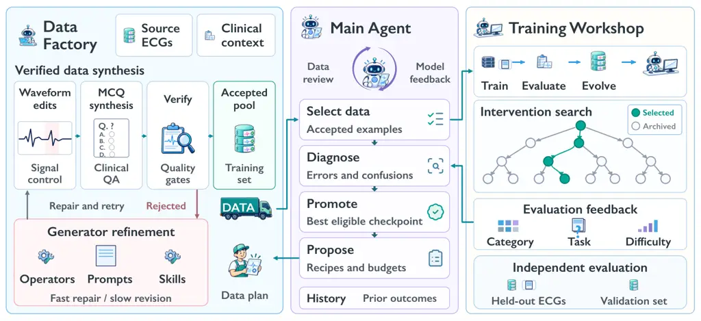
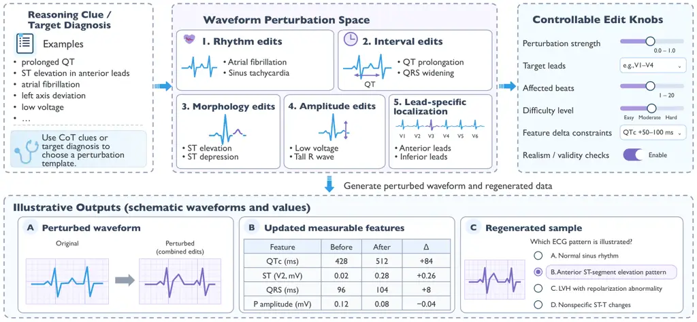
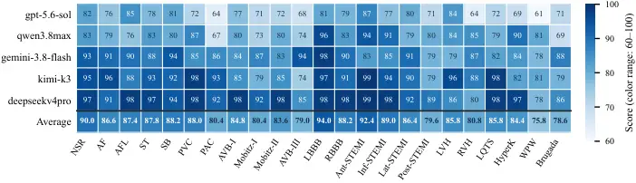

# ECG-RSI: Recursive Self-Improvement through Targeted Electrocardiogram Waveform Evolution

###### Abstract

Electrocardiogram (ECG) models need supervision that targets evolving
weaknesses and remains faithful to waveform evidence. We introduce
ECG-RSI, a recursive self-improvement framework combining verified
waveform synthesis with feedback-guided intervention search. Signal
remeasurement verifies waveform edits; construction errors guide
generator repair, while learner errors motivate interventions compared
on a separate selection set. Across seven benchmarks, three rounds raise
Qwen3.5-35B-A3B's mean question-answering accuracy from 34.57% to 56.04%
and mean classification F1 from 24.27 to 34.03. Across the retained
trajectory, the preferred supervision shifts from direct reinforcement
to confusion-focused contrasts. Continued feedback correction yields
diminishing external gains. These results motivate separating error
diagnosis from intervention selection and checking whether gains on the
feedback set transfer to independent benchmarks.



Figure 1: ECG-RSI: feedback-driven data and model evolution. The data
factory constructs and verifies ECG questions, with rejected candidates
driving local revisions of operators, prompts, and skills. The main
agent diagnoses feedback, proposes interventions, and selects accepted
data for training. The training workshop evaluates candidate checkpoints
and supplies category-, task-, and difficulty-level feedback.
Independent evaluation is separated from the update loop. The search
tree and highlighted path illustrate candidate comparison and model
selection.

## 1 Introduction

Electrocardiogram (ECG) interpretation requires connecting waveform
patterns to measurable features and clinically meaningful conclusions.
Multimodal models have begun to learn this connection from ECG images
and instruction data \[30, 22, 18\]. Effective ECG supervision grounds
each answer in the waveform presented to the model. Changes in heart
rate, intervals, or morphology can alter the interpretation of related
ECG findings.

Existing studies improve ECG supervision through instruction
construction and evidence-aware learning \[30, 22, 18\], while
conditional signal generators expand waveform diversity \[3, 20\]. Yet
it remains difficult to turn a learner’s specific weakness into a
controlled training example. A generated waveform must express the
intended ECG feature without introducing conflicting changes, and its
question and answer must agree with the resulting signal. Training
mixtures must adapt to newly identified weaknesses, persistent
confusions, and shifts in task difficulty after each round. Our central
insight is to use learner feedback to specify ECG evidence and signal
measurements to verify it.

We propose ECG-RSI, a framework that connects targeted ECG data
synthesis with feedback-driven recursive self-improvement (Fig. 1). Its
data factory generates questions from existing signals and uses
constrained reverse perturbations to synthesize waveforms with requested
feature contrasts. The resulting waveforms are remeasured before their
questions and answers are accepted. Construction failures guide
revisions to perturbation operators and question-generation workflows,
while the learner’s errors guide the categories, tasks, and difficulty
levels of subsequent training data. At each round, candidate data
recipes are used to train and compare model branches, and the selected
branch informs the next round of synthesis and training.

Our contributions are threefold:

- •
  We propose ECG-RSI, a framework that separates construction feedback
  for repairing data generation from learner feedback for proposing and
  comparing subsequent training interventions.
- •
  We develop target-driven reverse waveform synthesis, which translates
  desired ECG feature contrasts into constrained signal perturbations
  and verifies the resulting waveforms to provide measurement-grounded
  supervision.
- •
  We analyze how intervention utility changes with the learner: the
  retained trajectory shifts from direct reinforcement to
  confusion-focused contrasts, while continued feedback correction
  yields diminishing gains on external benchmarks.

## 2 Related Work

### 2.1 ECG Multimodal Learning and Evidence-Grounded Supervision

Medical vision-language foundation models provide a broader basis for
domain adaptation. MedGemma adapts Gemma 3 models for medical image and
text understanding and supports further task-specific fine-tuning
\[11\]. Complementary work examines the integration of knowledge graphs
with multimodal learning \[6\].

ECG-language models have progressed from ECG instruction tuning and
multimodal alignment toward more flexible question answering and
clinically grounded interpretation. PULSE, a multimodal large language
model for ECG image comprehension, is instruction-tuned on ECGInstruct,
an ECG image instruction dataset, and evaluated on ECGBench, a benchmark
for ECG image interpretation \[30\]. GEM links signal and image
representations to measurable ECG evidence \[22\]. ECG-R1 incorporates
clinical protocols and diagnostic-evidence supervision into ECG
interpretation \[18\]. Subsequent work broadens the types of questions,
input formats, and supervision available to ECG models: anyECG-chat
supports flexible ECG inputs and multiple tasks \[25\], Q-Heart
introduces knowledge-informed ECG question answering \[37\], ECG-LLM
uses clinically structured questions for cardiac reasoning \[38\], and
ELF studies a simpler encoder-free ECG-language architecture \[13\].
MEETI aligns signals, images, extracted features, and interpretations
within a multimodal ECG dataset \[61\], while ECG-Expert-QA provides
diagnostically diverse questions for evaluation \[44\]. ECG input
representations also affect performance \[12\]. Multi-source contrastive
learning offers another way to broaden supervision: MS-ECG-FM aligns
ECGs with ECG, echocardiography, radiology, and discharge reports, whose
diagnostic information is complementary \[24\].

ECG Mirage probes whether predictions depend on the patient-specific ECG
\[26\]. ECG-Reasoning-Benchmark examines stepwise ECG interpretation
\[36\], and recent work evaluates ECG reasoning by separating waveform
perception from clinical deduction \[50\]. Image-based model evaluations
likewise expose the difficulty of reliable ECG interpretation from
rendered tracings \[42\]. These studies motivate supervision that
remains tied to the waveform presented to the learner. ECG-RSI addresses
this need by constructing requested feature contrasts and deriving
questions and answers from measurements of the resulting signals.

### 2.2 Conditional ECG Synthesis and Controlled Interventions

ECG synthesis has advanced through disease-conditioned adversarial
generation \[3\], conditional diffusion \[1, 41\], clinical-text
conditioning \[8\], and report- and patient-conditioned generation
\[20\]. MIDT-ECG and FlowECG further investigate waveform fidelity,
inter-lead coherence, and generation efficiency \[16, 2\]. More directly
related to controllability, ECGTwin generates condition-guided
personalized ECGs while seeking to preserve individual characteristics
\[21\], and TransDiffECG explores semantically controllable signal
generation \[28\]. Generative counterfactual ECGs have also been used to
study how waveform changes affect an AI-ECG model’s predictions \[17\].

ECG-RSI constructs training examples for a _specified learner weakness_:
it starts with a training-side waveform and a requested feature
contrast, applies a constrained intervention, and remeasures the result.
It accepts an example only when the intended change is achieved and
relevant non-target properties are preserved; its question and answer
are then grounded in the resulting waveform.

### 2.3 Feedback-Driven Data Evolution and Recursive Self-Improvement

Earlier self-improvement methods revise responses or retain verbal
feedback \[33, 39\], generate instruction data \[45, 49\], or
iteratively refresh reasoning supervision \[58\]. More recent systems
connect generated tasks to learner improvement: CoEvolve guides task
synthesis using learner behavior \[54\], NeoHorse-1 adapts post-training
mixtures using capability evidence \[35\], and Absolute Zero and VisPlay
couple task generation with solver improvement \[64, 14\]. SynCo makes
this dependence explicit by jointly training a synthesizer and reasoner,
with task validity, answer reliability, and outcome-grounded
teachability providing feedback to the synthesizer \[55\]. Multiple
reasoner rollouts per task provide this feedback, so estimated teaching
value depends on the current policy’s observed outcomes. RSIBench-Data
places data construction and selection at the center of RSI evaluation
\[34\]. Related studies examine whether a self-synthetic pipeline
continues to provide learnable information \[32\], while VISA revises
multimodal instruction synthesis using verification and target-model
failures \[60\]. Recursive on-policy distillation co-evolves the
privileged teacher with the student \[57\], while RLTL;DR internalizes
concise feedback from failed attempts \[19\]. Both make the supervision
produced by an earlier attempt useful to subsequent learning.

A complementary line changes the mechanism of improvement: agent code
and workflows \[59, 62\], skills \[46\], data preparation \[53, 52\], or
environments and search strategies \[65, 31\]. These updates require
assessment: revision selection \[63, 48\], evolving self-evaluation
\[29\], hidden evaluations \[43\], and pairwise candidate ranking \[10\]
provide different ways to compare candidates. Other studies guide
subsequent adaptation \[15, 5\] or alternate harness evolution with
model learning \[51\]. Structured knowledge is another object of
improvement \[7, 47\]; in medicine, MedZERO couples task generation with
evidence-grounded reasoning and controlled knowledge accumulation \[9\].

Paired evaluations also help identify diminishing returns and earlier
artifacts worth retaining \[56\]. In a setting with frozen model
weights, Agent Plasticity measures how efficiently experience produces
future held-out gains relative to learning cost, showing that endpoint
performance, acquisition efficiency, and transfer to harder conditions
can diverge \[40\]. ECG-RSI grounds intervention proposals in
ECG-specific error diagnostics: construction feedback repairs synthesis,
learner feedback proposes interventions, and separate selection and
external evaluations assess their utility.

## 3 Method

ECG-RSI couples verified synthesis with feedback-driven training (Fig.
1). Construction feedback checks waveform and question validity; learner
feedback selects data for model-specific utility \[34\].

### 3.1 Framework and Feedback Interfaces

##### System state and data boundaries.

At round $`t`$, the system state comprises the accepted learner
$`\theta_{t}`$, retained training pool $`D_{t}`$, and construction
policy $`\phi_{t}`$. The policy contains retrieval constraints, waveform
operators, prompts, and reusable rules, separate from learner weights
\[59\]. Source ECGs and morphology donors are restricted to training
data and are patient-disjoint from development and independent
evaluation data.

$`V_{\mathrm{fb}}`$ diagnoses errors; $`V_{\mathrm{sel}}`$ selects
models. Evaluation data are held out from generation and selection.

##### Two feedback loops.

Construction feedback identifies invalid waveform edits or questions and
guides generator repair. Learner feedback guides recipes using gaps in
ECG capability, question type, difficulty, and confusion pairs.

For a selected update path, one round can be summarized as

```math
\displaystyle e_{t} \displaystyle=\operatorname{Diagnose}(\theta_{t},V_{\mathrm{fb}}), \tag{1}
```

```math
\displaystyle q_{t} \displaystyle=\operatorname{Plan}(e_{t},D_{t};B_{t}),
```

```math
\displaystyle(A_{t},L_{t},\phi_{t+1}) \displaystyle=\operatorname{ConstructValidate}(q_{t},S_{\mathrm{train}},\phi_{t}),
```

```math
\displaystyle\widetilde{\theta}_{t+1} \displaystyle=\operatorname{Train}(\theta_{t},A_{t}\cup R_{t}),
```

```math
\displaystyle\theta_{t+1} \displaystyle=\operatorname{Promote}(\theta_{t},\widetilde{\theta}_{t+1};V_{\mathrm{sel}}).
```

Here $`B_{t}`$ is the construction budget, $`A_{t}`$ the accepted new
examples, $`L_{t}`$ the construction log, and $`R_{t}`$ the replay data.
Equation (1) describes one candidate; sibling recipes use the same
parent with separate examples and policy versions. Promotion adds the
winning examples to $`D_{t}`$; otherwise, the parent and retained pool
remain unchanged.

### 3.2 Targeted ECG Synthesis with Measurement-Grounded Supervision

#### 3.2.1 Targeted Waveform Construction

Forward synthesis derives questions, answers, and explanations from
measured training ECGs. Reverse synthesis edits an eligible waveform to
express a requested feature contrast, then remeasures the signal before
constructing supervision. Both routes check evidence, context, answer
uniqueness, and explanation support.

Reverse requests come from learner weaknesses or distractors in training
questions. A normal-versus-prolonged PR contrast specifies a measurable
target and a corresponding waveform edit.

##### Target selection and constrained editing.

A delineator extracts $`u=f(S)`$ from ECG $`S`$: heart rate (HR), R–R
interval (RR), P-onset-to-QRS-onset interval (PR), QRS duration,
QRS-onset-to-T-end interval (QT), corrected QT (QTc), and amplitudes.
Feature $`k`$ on source $`i`$ is scored by $`s_{ik}=a_{ik}r_{k}d_{k}`$:
definability $`a_{ik}`$, reliability $`r_{k}`$, and diagnostic utility
$`d_{k}`$. Eligible scores exceed the registered threshold. Appendix 7.6
details conversions, weighting, and scale normalization.

An eligible request specifies the target range, protected features and
tolerances, permitted operators and donors, and attempt budget. The
policy applies an operator sequence $`S^{\prime}=T_{\delta}(S)`$ after
checking applicability. PR edits require P and QRS onsets; complex
diagnoses require morphology beyond interval changes (Fig. 2).



Figure 2: Controllable waveform perturbations across rhythm, intervals,
morphology, amplitude, and individual leads. The examples illustrate how
an intended feature change is translated into a localized signal edit.
Edited waveforms are remeasured to check the target and protected
features before question generation, linking controllable signal changes
to evidence-grounded supervision.

#### 3.2.2 Validation and Generator Repair

Re-extract $`u^{\prime}=f(S^{\prime})`$ after editing. For target
feature $`k`$ and requested change $`\Delta_{k}`$, record the target
error

```math
E_{\mathrm{target}}=\left|\bigl[f_{k}(S^{\prime})-f_{k}(S)\bigr]-\Delta_{k}\right|
```

separately from the drift of each protected feature $`j`$,

```math
E_{\mathrm{protect},j}=\left|f_{j}(S^{\prime})-f_{j}(S)\right|.
```

Acceptance requires target and protected-feature errors to satisfy their
respective tolerances, with checks of boundary continuity, unedited
regions, lead consistency, morphology, leakage, diversity, and cost.

The accepted signal is rendered for question, answer, context, and
explanation generation. Review requires a unique supported answer and
evidence for each claimed observation, so supervision follows the
remeasured signal.

##### Construction failure and generator repair.

Repairs follow failures \[53\]: signal errors guide operator revisions;
missing morphology guides applicability/retrieval revisions; ambiguity
guides question/context revisions; unsupported explanations guide prompt
revisions.

Repairs record their trigger, changed rule, validation result, and
scope. Old and revised versions are compared on matched sources,
requests, seeds, and budgets; adoption requires signal and question
checks to pass. Appendices 7.2 and 7.3 describe the rules and recording
protocol; Appendix 10 provides stage prompts.

### 3.3 Feedback-Driven Recursive Model Improvement

#### 3.3.1 Learner Diagnosis and Data Recipes

Errors, invalid outputs, and regressions guide recipes by category
$`g`$, learner-relative difficulty $`d`$, and supervision $`s`$:

```math
\pi_{t}^{a}(g,d,s)=p_{t}^{a}(g)\,p_{t}^{a}(d\mid g)\,p_{t}^{a}(s\mid g,d). \tag{2}
```

Difficulty is learner-relative \[64\]. For training-side question $`i`$,
$`K_{i}`$ independent answers under fixed decoding settings give
$`\widehat{p}_{it}=K_{i}^{-1}\sum_{r=1}^{K_{i}}\mathbf{1}[\widehat{y}_{ir}=y_{i}]`$,
used to group reliably solved, mixed-success, and unresolved examples.
Probe budgets, scoring, output-validity requirements, and thresholds are
fixed before branch comparison.

Supervision can retain the teacher explanation, expand intermediate ECG
evidence, or add checks targeting an observed learner error. As in
iterative reasoning supervision \[58\], explanations supply training
targets; paired variants must preserve the verified image, question,
options, answer, and clinical facts.

Recipes also fix source/edit constraints, replay, and training budgets.
Recipe selection changes the data mixture; operator or prompt repair
changes $`\phi_{t}`$. These interventions are tracked separately
(Appendix 7.1).

#### 3.3.2 Same-Parent Branch Exploration

Feedback and training-side probes define three recipe families from the
same parent $`\theta_{t}`$ \[62, 65\]:

- •
  A: Direct reinforcement. Increase quotas for weak categories and
  question types while retaining related-category controls: a recipe for
  atrioventricular (AV) block emphasizes conduction measurements and
  diagnostic interpretation.
- •
  B: Confusion contrast. Sample recurrently confused category pairs;
  construct options and explanations around their distinguishing ECG
  evidence. Regional ST-elevation myocardial infarction (STEMI)
  contrasts, for example, emphasize lead-specific localization.
- •
  C: Difficulty and task curriculum. Reweight difficulty bins and
  question types using learner probes, e.g., increasing L3, multistep,
  or evidence-chain questions. Curriculum denotes a branch-specific
  mixture.

Recipes specify sampling quotas and construction requests: retrieve
eligible waveforms or apply permitted edits, then run the shared
measurement and question-validity gates (Section 3.2.2). Category,
difficulty, and task constraints can overlap; Tab. 12 lists each round’s
actual mixtures.

Each branch retains the same historical training manifest and adds
10,000 previously unused accepted questions, without an extra shared
baseline set. All branches use three epochs of supervised fine-tuning
(SFT) with matched settings; the language model is updated while the
vision encoder and multimodal aligner remain frozen. For ECG image
$`I`$, question $`Q`$, optional context $`C`$, and explanation–answer
target $`y`$, the training loss is

```math
\mathcal{L}_{\mathrm{MCQ}}=-\sum_{\ell}\log p_{\theta}(y_{\ell}\mid I,Q,C,y_{<\ell}). \tag{3}
```

Replay and new-data exposure are recorded in examples and tokens;
training settings appear in Appendix 7.5.

#### 3.3.3 Model Selection and Retained Lineage

Figure 3: Schematic of feedback-guided model evolution. A/B/C change
category coverage, confusion contrasts, or difficulty/task mixtures.
Each candidate adds 10,000 accepted questions plus replay. Purple shows
an illustrative lineage. Tab. 12 reports measured mixtures, scores, and
choices.

After matched SFT, evaluate candidates on $`V_{\mathrm{sel}}`$. Apply
the predesignated output-validity and non-target regression tolerances,
then retain the highest-scoring qualifying checkpoint and its data
\[48\]. Archive other branches; if none qualifies, retain the parent.

Reevaluate the retained learner on $`V_{\mathrm{fb}}`$ to construct new
recipes: directions are reselected each round. Fig. 3 illustrates the
process; Section 5.7 reports the choices.

## 4 Experiments

We evaluate benchmark performance, round-wise gains, and the training
value of feedback-guided synthesis. The analysis asks how feedback
granularity affects data utility, which candidate directions yield the
strongest updates, and whether reductions in feedback errors transfer to
external benchmarks.

The seven-benchmark aggregate (S7) is the equal-weight mean of four
accuracy and three F1 scores on a 0–100 scale. MMMU-ECG, CSN, and G12EC
use single-choice accuracy; ECG-QA uses exact-match accuracy over answer
sets. PTB-XL, CPSC2018, and CODE-15% are multi-label classification
tasks. F1 is the harmonic mean of precision and recall; $`\Delta`$
denotes an absolute score difference.

##### Evaluation tasks.

We evaluate eight ECG tasks comprising 10,840 items. The seven tasks
included in S7 contain 10,697 items; the 143-item MedXpertQA-MM ECG
subset is reported separately. S7 weights task scores equally and
excludes MedX and LUDB. Appendix 8.5 (Tab. 19) lists the datasets, split
identifiers, sample counts, and metrics.

### 4.1 Main Benchmark Results

Tab. 1 compares the recorded scores of closed-source, open-source, and
ECG-specific models with ECG-RSI on seven benchmarks. ECG-RSI R3 has the
highest S7 (46.61) among the compared models.

After three rounds, Qwen3.5-35B-A3B's mean accuracy across the four
question-answering (QA) benchmarks increases from 34.57% to 56.04%, a
21.47-percentage-point gain; its mean F1 across the three classification
benchmarks increases from 24.27 to 34.03, a 9.77-point gain. Gains are
calculated from unrounded means.

|                                                                                 |               |          |            |             |           |              |             |       |
| ------------------------------------------------------------------------------- | ------------- | -------- | ---------- | ----------- | --------- | ------------ | ----------- | ----- |
| Model / method                                                                  | MMMU ECG Acc. | CSN Acc. | G12EC Acc. | ECG-QA Acc. | PTB-XL F1 | CPSC 2018 F1 | CODE 15% F1 | S7    |
| Proprietary models                                                              |               |          |            |             |           |              |             |       |
| GPT-5.6-sol                                                                     | 56.00         | 58.70    | 60.20      | 32.10       | 37.40     | 24.30        | 42.80       | 44.50 |
| Gemini-3.8-Flash                                                                | 59.10         | 57.90    | 59.60      | 33.40       | 36.80     | 23.70        | 40.90       | 44.49 |
| Open-source and base models                                                     |               |          |            |             |           |              |             |       |
|  LINGSHU-7B \[23\]    | 47.60         | 45.20    | 46.80      | 26.30       | 33.87     | 18.60        | 36.50       | 36.41 |
|  LINGSHU-32B \[23\]   | 51.30         | 48.90    | 50.40      | 28.70       | 39.45     | 20.80        | 38.20       | 39.68 |
|  HuatuoGPT-V-7B \[4\] | 44.80         | 41.60    | 43.20      | 25.40       | 31.15     | 17.30        | 33.90       | 33.91 |
| Qwen3.5-35B-A3B                                                                 | 42.00         | 30.91    | 41.36      | 23.99       | 29.50     | 13.10        | 30.20       | 30.15 |
|  ECG-R1 \[18\]        | 38.12         | 44.87    | 47.05      | 28.63       | 22.91     | 17.88        | 34.55       | 33.43 |
|  PULSE \[30\]         | 39.24         | 45.16    | 43.87      | 21.55       | 26.08     | 14.92        | 26.82       | 31.09 |
| ECG-RSI                                                                         |               |          |            |             |           |              |             |       |
|  ECG-RSI R0           | 42.00         | 30.91    | 41.36      | 23.99       | 29.50     | 13.10        | 30.20       | 30.15 |
|  ECG-RSI R3           | 57.50         | 67.23    | 66.24      | 33.18       | 38.30     | 22.80        | 41.00       | 46.61 |

All scores are on a 0–100 scale. Bold and underlining mark the best and
second-best values within each model group; ties share a rank. Blue
shading highlights our final model.

denotes medical specialization. Qwen3.5-35B-A3B is the initial model
(ECG-RSI R0). ECG-R1 and PULSE are ECG-specific comparison models.

Table 1: Comparison of ECG-RSI with proprietary, open-source, and
ECG-specific models on seven benchmarks. The first four columns report
question-answering accuracy and the next three report classification F1;
S7 is their equal-weight mean on a 0–100 scale. ECG-RSI R3 achieves the
highest aggregate score.

### 4.2 Evolution across Rounds

Tab. 2 and Fig. 4 show the R0–R3 trajectory of series R-A. Each winning
branch adds 10,000 new accepted questions to the cumulative training set
and replays all prior data. Appendix 8 provides feedback breakdowns.

|                       |                    |                    |                     |                     |                   |                     |                     |                    |
| --------------------- | ------------------ | ------------------ | ------------------- | ------------------- | ----------------- | ------------------- | ------------------- | ------------------ |
| R-A round             | MMMU ECG Acc.      | CSN Acc.           | G12EC Acc.          | ECG-QA Acc.         | PTB-XL F1         | CPSC 2018 F1        | CODE 15% F1         | S7                 |
| R0                    | 42.00              | 30.91              | 41.36               | 23.99               | 29.50             | 13.10               | 30.20               | 30.15              |
| R1                    | 48.00$`\uparrow`$  | 61.68$`\uparrow`$  | 64.61$`\uparrow`$   | 33.56$`\uparrow`$   | 32.90$`\uparrow`$ | 23.00$`\uparrow`$   | 38.80$`\uparrow`$   | 43.22$`\uparrow`$  |
| R2                    | 56.00$`\uparrow`$  | 64.86$`\uparrow`$  | 66.39$`\uparrow`$   | 34.55$`\uparrow`$   | 36.40$`\uparrow`$ | 23.90$`\uparrow`$   | 41.50$`\uparrow`$   | 46.23$`\uparrow`$  |
| R3                    | 57.50$`\uparrow`$  | 67.23$`\uparrow`$  | 66.24$`\downarrow`$ | 33.18$`\downarrow`$ | 38.30$`\uparrow`$ | 22.80$`\downarrow`$ | 41.00$`\downarrow`$ | 46.61$`\uparrow`$  |
| $`\Delta`$(R3$`-`$R0) | +15.50$`\uparrow`$ | +36.32$`\uparrow`$ | +24.88$`\uparrow`$  | +9.19$`\uparrow`$   | +8.80$`\uparrow`$ | +9.70$`\uparrow`$   | +10.80$`\uparrow`$  | +16.46$`\uparrow`$ |

R0 is the starting model in R-A. $`\Delta`$(R3$`-`$R0) reports the total
score difference; arrows in R1–R3 indicate changes from the previous
round.

Table 2: Round-wise benchmark performance of series R-A. R0 is the
starting model; each accepted update adds 10,000 new questions while
retaining historical training data. Bold and underlining mark the best
and second-best values within each column; blue/red arrows indicate
increases/decreases from the previous round, and blue shading marks R3.
Aggregate performance improves through R3, although several individual
metrics peak at R2.

Section 4.4 analyzes feedback errors by ECG capability, question type,
and difficulty; Tab. 4 reports the question-type and difficulty
breakdowns, and Tab. 5 reports the ECG-category breakdown.

### 4.3 Validation-Set Performance

MedX denotes the ECG subset of MedXpertQA. LUDB denotes the Lobachevsky
University Electrocardiography Database, whose waveform annotations
include P-wave, QRS-complex, and T-wave boundaries and peaks. The LUDB
accuracy below refers to the ECG evaluation task constructed from that
database.

Tab. 3 and Fig. 4(c) show that MedX accuracy rises from 51.57% to
57.24%, despite a small R2 decline. LUDB accuracy improves at every
round, from 53.45% to 67.24%.

|         |              |       |       |       |                     |           |           |           |
| ------- | ------------ | ----- | ----- | ----- | ------------------- | --------- | --------- | --------- |
|         | Accuracy (%) |       |       |       | Accuracy difference |           |           |           |
| Dataset | R0           | R1    | R2    | R3    | R1$`-`$R0           | R2$`-`$R1 | R3$`-`$R2 | R3$`-`$R0 |
| MedX    | 51.57        | 55.94 | 55.86 | 57.24 | +4.37               | -0.08     | +1.38     | +5.67     |
| LUDB    | 53.45        | 61.28 | 63.28 | 67.24 | +7.83               | +2.00     | +3.96     | +13.79    |

Table 3: Validation accuracy on MedX and LUDB across four rounds. The
change columns report later minus earlier accuracy, in percentage
points. Both datasets improve overall; LUDB increases at every round,
whereas MedX shows a small intermediate decline.

Fig. 4 summarizes round-wise benchmark and validation performance
together with historical strategy trajectories.

Figure 4: Round-wise benchmark, validation, and strategy results. (a)
Four multiple-choice question (MCQ) accuracy metrics; (b) three
classification F1 metrics; (c) MedX and LUDB validation accuracy; (d)
seven-benchmark aggregate score (S7) for tree, uniform-allocation, and
chain trajectories. Higher values indicate better performance. Error
bars show $`\pm 1`$ standard deviation (SD) where available; LUDB has no
SD bars. The panels distinguish broad gains from task-specific
fluctuations and the late-round declines of the two strategy controls.

### 4.4 Feedback Diagnostics across Rounds

Error rates fall from 26.11% to 12.97% for L1, from 38.52% to 24.43% for
L2, and from 58.20% to 38.17% for L3. L3 has the largest reduction and
highest R3 error rate. Errors keep falling as S7 gains diminish (Section
5.9).

Tab. 4 summarizes error rates by question type and difficulty; Tab. 5
gives the ECG-category breakdown. These development-feedback statistics
diagnose data needs. Overall feedback uses 3,000 questions, with 1,189,
983, 803, and 640 errors at R0–R3. Appendix 8 lists the category-level
counts.

Table 4: Feedback error rates (%) by question type and difficulty across
R0–R3. $`N`$ is the group size; full difficulty-level error counts
appear in Tab. 16.

|                     |                     |                     |                     |                     |                     |                     |
| ------------------- | ------------------- | ------------------- | ------------------- | ------------------- | ------------------- | ------------------- |
|                     | Question type       |                     |                     | Difficulty          |                     |                     |
| Round               | PM                  | IA                  | CD                  | L1                  | L2                  | L3                  |
| $`N`$               | 1,037               | 1,186               | 777                 | 1,218               | 1,093               | 689                 |
| R0                  | 32.98               | 38.87               | 43.37               | 26.11               | 38.52               | 58.20               |
| R1                  | 26.62$`\downarrow`$ | 32.80$`\downarrow`$ | 38.74$`\downarrow`$ | 20.28$`\downarrow`$ | 33.12$`\downarrow`$ | 51.81$`\downarrow`$ |
| R2                  | 21.31$`\downarrow`$ | 27.57$`\downarrow`$ | 33.85$`\downarrow`$ | 16.09$`\downarrow`$ | 28.27$`\downarrow`$ | 44.41$`\downarrow`$ |
| R3                  | 17.65$`\downarrow`$ | 23.10$`\downarrow`$ | 29.73$`\downarrow`$ | 12.97$`\downarrow`$ | 24.43$`\downarrow`$ | 38.17$`\downarrow`$ |
| $`\Delta_{0\to 3}`$ | 15.33$`\downarrow`$ | 15.77$`\downarrow`$ | 13.64$`\downarrow`$ | 13.14$`\downarrow`$ | 14.09$`\downarrow`$ | 20.03$`\downarrow`$ |

PM: perception/measurement; IA: interpretation/analysis; CD: clinical
decision/treatment. Blue shading marks R3; bold/underlining mark the
lowest/second-lowest rates. Blue arrows indicate decreases from the
previous round; $`\Delta_{0\to 3}`$ is R0 minus R3 error rate, in
percentage points.

[TABLE]

Table 5: ECG-category feedback error rates (%). $`N`$: recorded sample
count; $`\Delta_{0\to 3}`$: R0 minus R3 error rate, in percentage points
(computed before rounding). Blue marks R3; bold/underline mark the
best/second-best rates; $`\downarrow`$ marks reductions. Full names and
counts: Tab. 8.2.

## 5 Ablation Studies

We first assess waveform validity and the contribution of synthesis
components. We then examine three linked questions: whether finer
feedback improves training utility, whether the most prominent weakness
determines the best training direction, and whether continued feedback
improvement translates into external gains.

### 5.1 Effectiveness of the Synthesis Method

##### Quantitative waveform-feature validation.

We report waveform-feature error statistics, including mean absolute
error (MAE) and root mean squared error (RMSE), from a single synthesis
run of 10,000 samples in Tab. 6.

|         |      |      |       |       |               |             |        |
| ------- | ---- | ---- | ----- | ----- | ------------- | ----------- | ------ |
| Feature | Unit | Bias | MAE   | RMSE  | $`s_{e}^{2}`$ | MAE limit   | Status |
| HR      | bpm  | 0.63 | 2.14  | 2.22  | 4.53          | $`\leq 3`$  | Met    |
| RR      | ms   | 3.11 | 15.28 | 15.36 | 226.28        | $`<20`$     | Met    |
| PR      | ms   | 0.57 | 7.71  | 7.78  | 60.21         | $`\leq 25`$ | Met    |
| QRS     | ms   | 4.12 | 4.58  | 4.61  | 4.28          | $`\leq 30`$ | Met    |
| QT      | ms   | 0.94 | 9.71  | 9.85  | 96.15         | $`\leq 30`$ | Met    |
| QTc     | ms   | 0.86 | 10.22 | 10.34 | 106.19        | $`\leq 40`$ | Met    |

Error is remeasured minus target. Bias, MAE, RMSE, and limits use the
listed unit; $`s_{e}^{2}`$ uses squared units and denominator $`n-1`$.
Limits are the evaluation criteria adopted for this experiment. Variance
values are approximations reconstructed from the reported two-decimal
Bias and RMSE, with $`n=10{,}000`$ valid observations per feature:
$`s_{e}^{2}=\frac{n}{n-1}(\mathrm{RMSE}^{2}-\mathrm{Bias}^{2})`$.

Table 6: Waveform-feature errors from a single synthesis run of 10,000
samples and comparison with the adopted MAE criteria. Blue marks MAE
values meeting the adopted criteria.

All six features meet the adopted MAE criteria (Status = Met),
supporting numerical fidelity of the synthesized waveforms.

For each feature, let $`e_{i}=\hat{x}_{i}-x_{i}`$ and compute

```math
\overline{e}=\frac{1}{n}\sum_{i}e_{i},\quad\mathrm{MAE}=\frac{1}{n}\sum_{i}|e_{i}|,\quad\mathrm{RMSE}=\sqrt{\frac{1}{n}\sum_{i}e_{i}^{2}},\quad s_{e}^{2}=\frac{1}{n-1}\sum_{i}(e_{i}-\overline{e})^{2}. \tag{4}
```

### 5.2 Blinded Review by Human Physicians

We randomly sample 240 examples stratified by six edit types (HR, RR,
PR, QRS, QT, and QTc), with 40 examples per type. Two human physicians
score the examples independently. We report 95% confidence intervals
(CIs) for the review metrics.

|                               |       |                |       |            |
| ----------------------------- | ----- | -------------- | ----- | ---------- |
| Metric                        | Value | 95% CI         | $`n`$ | Source     |
| Target attainment             | 0.82  | \[0.76, 0.87\] | 240   | Stage 2    |
| Non-target preservation       | 0.79  | \[0.73, 0.84\] | 240   | Stage 2    |
| Morphology consistency        | 0.86  | \[0.81, 0.90\] | 240   | Stage 1    |
| Lead consistency              | 0.83  | \[0.78, 0.88\] | 240   | Stage 1    |
| Answer accuracy               | 0.88  | \[0.83, 0.92\] | 240   | Stage 3    |
| Explanation support           | 0.76  | \[0.70, 0.81\] | 240   | Stage 3    |
| Expected-parameter references | 0.09  | \[0.06, 0.13\] | 240   | Stage 3    |
| Inter-rater $`\kappa`$        | 0.78  | \[0.71, 0.85\] | 240   | Two raters |

CIs use Wilson intervals or bootstrap; $`\kappa`$ is Cohen’s $`\kappa`$.
Lower expected-parameter reference rates are better; higher values are
better for the other metrics.

Table 7: Physician review of 240 examples (95% confidence intervals).
Stages 1–3 assess morphology, editing fidelity, and
answers/explanations.

In stage 1, target labels, generation parameters, and teacher responses
are hidden while waveform morphology and lead consistency are assessed.
In stage 2, the physicians inspect the before/after waveforms and
editing targets to assess target attainment and non-target preservation.
Stage 3 assesses answers, explanations, and expected-parameter
references.

Answer correctness and evidence support. Mean physician ratings are 0.88
for answer correctness and 0.76 for explanation support
($`\kappa=0.78`$). The stages assess morphology, editing fidelity, and
answer/explanation quality.

|       |       |        |          |        |        |         |
| ----- | ----- | ------ | -------- | ------ | ------ | ------- |
| Edit  | $`n`$ | Target | Preserve | Morph. | Answer | Support |
| HR    | 40    | 0.85   | 0.80     | 0.88   | 0.90   | 0.78    |
| RR    | 40    | 0.78   | 0.75     | 0.82   | 0.85   | 0.72    |
| PR    | 40    | 0.80   | 0.78     | 0.85   | 0.88   | 0.75    |
| QRS   | 40    | 0.83   | 0.81     | 0.87   | 0.89   | 0.77    |
| QT    | 40    | 0.82   | 0.79     | 0.86   | 0.87   | 0.76    |
| QTc   | 40    | 0.84   | 0.80     | 0.88   | 0.89   | 0.78    |
| Total | 240   | 0.82   | 0.79     | 0.86   | 0.88   | 0.76    |

Table 8: Clinical review by edit type: 40 examples per type, 240
overall. Values are aggregated physician ratings; higher is better.

Variation across edit types. Target attainment ranges from 0.78 for RR
to 0.85 for HR. Explanation support varies from 0.72 to 0.78 and remains
below answer accuracy for every edit type. The stratified results show
that the gap is shared across editing targets.

The columns distinguish target attainment, preservation of non-target
features, morphology consistency, answer accuracy, and explanation
support.

### 5.3 Multi-Model Question-Quality Scores



Figure 5: Recorded scores from five models for synthetic ECG questions
across 23 categories (0–100 scale). The bottom row is the per-category
arithmetic mean across models; the unweighted mean over all 115
model–category cells is 85.09, reported as the full-method Question
score in Tab. 10. The shared color scale spans 60–100, from light blue
(low) to dark blue (high).

Fig. 5 shows five-model scores across 23 ECG categories. R1 uses 10,000
of 16,193 candidate questions.

### 5.4 Data Construction and Feedback Selection

Four data configurations each add 10,000 SFT questions from the same
checkpoint (S7 = 43.22).

|       |                                                |       |              |
| ----- | ---------------------------------------------- | ----- | ------------ |
| Group | Added data                                     | S7    | $`\Delta`$S7 |
| A     | Ordinary training-side questions               | 44.15 | +0.93        |
| B     | Forward-only synthesis                         | 44.27 | +1.05        |
| C     | Forward + reverse, fixed selection proportions | 45.56 | +2.34        |
| D     | Forward + reverse, feedback-guided selection   | 46.23 | +3.01        |

Table 9: Data-construction and selection ablation from a shared
checkpoint with S7 = 43.22.

Tab. 9 separates ordinary questions, forward synthesis, added reverse
synthesis, and feedback-guided selection. $`\Delta`$S7 is relative to
the shared checkpoint. Ordinary questions and forward-only synthesis
yield similar scores (44.15 and 44.27). Adding reverse synthesis raises
S7 to 45.56; feedback-guided selection further raises it to 46.23, the
largest gain.

### 5.5 Synthesis-Component Ablation

Tab. 10 compares synthesis updates at a fixed target of 10,000 accepted
questions. The full method requires 16,193 candidates to reach this
target, versus 36,723 with operator updates frozen and 22,398 with skill
updates frozen (2.27 and 1.38 times as many, respectively). Freezing
updates reduces question-quality scores and downstream R1 S7.

|                         |                     |          |                |       |              |
| ----------------------- | ------------------- | -------- | -------------- | ----- | ------------ |
| Method                  | Candidates required | Pass (%) | Question score | S7    | $`\Delta`$S7 |
| Full method             | 16,193              | 61.76    | 85.09          | 43.22 | 0.00         |
| Freeze operator updates | 36,723              | 27.23    | 71.90          | 39.29 | -3.93        |
| Freeze skill updates    | 22,398              | 44.65    | 79.20          | 40.15 | -3.07        |

Each method trains on 10,000 accepted questions. The full-method
Question score (85.09) is the unweighted arithmetic mean of the 115
model–category scores (five models $`\times`$ 23 categories) in Fig. 5,
using the same question set and scoring rubric. Candidates include
rejections; $`\Delta`$S7 compares with the full method.

Table 10: R1 synthesis efficiency and training outcomes at a fixed
target of 10,000 accepted questions. Candidate counts include rejected
questions, and the pass rate measures the fraction accepted. Question
scores assess generated-data quality, whereas S7 measures downstream
model performance; $`\Delta`$S7 is relative to the full method. Freezing
operator or skill updates increases candidate requirements and reduces
both quality scores and downstream performance.

### 5.6 Feedback Granularity and Training Utility

To isolate feedback resolution, Tab. 11 compares four selection
configurations from the same parent (S7 = 43.22), each adding 10,000
accepted questions. Only the feedback dimensions used for selection
vary.

|                                                |       |              |                        |
| ---------------------------------------------- | ----- | ------------ | ---------------------- |
| Feedback used for selection                    | S7    | $`\Delta`$S7 | $`\Delta`$S7 vs. fixed |
| None: fixed mixture                            | 45.56 | +2.34        | 0.00                   |
| ECG category                                   | 45.60 | +2.38        | +0.04                  |
| Category + question type                       | 45.98 | +2.76        | +0.42                  |
| Category + type + difficulty + confusion pairs | 46.23 | +3.01        | +0.67                  |

Table 11: Feedback granularity under a common parent and a fixed budget
of 10,000 added questions per configuration. $`\Delta`$S7 is relative to
the parent score of 43.22. The final column isolates the gain over fixed
selection.

The fixed-mixture and four-dimensional configurations share their
endpoints with Tab. 9. Category-only feedback yields S7 = 45.60, close
to 45.56 with fixed selection. Adding question type raises S7 to 45.98;
including difficulty and confusion pairs raises it further to 46.23.
With the same added-data volume, resolving these finer capability gaps
produces more useful training examples.

### 5.7 Round-Wise Branch Selection and Data Composition

Feedback-guided branch evolution compares candidate interventions at
each round and retains the best qualifying update on a separate
selection set. Tab. 12 reports all three same-parent candidates at each
transition. Each candidate adds 10,000 accepted questions with matched
historical replay and training settings. Selection uses
$`S_{\mathrm{sel}}`$ on $`V_{\mathrm{sel}}`$, distinct from external S7.

|             |        |                                                                              |                      |          |
| ----------- | ------ | ---------------------------------------------------------------------------- | -------------------- | -------- |
| Round       | Branch | New-data composition                                                         | $`S_{\mathrm{sel}}`$ | Decision |
| R0$`\to`$R1 | A      | AV block 45%; L3 50%; measurement questions 60%                              | 42.66                | ✓ Retain |
|             | B      | Mobitz I/II and LBBB/RBBB contrasts 55%; L3 40%                              | 40.51                | Archive  |
|             | C      | L2+L3 60%; clinical-reasoning questions 50%                                  | 38.27                | Archive  |
| R1$`\to`$R2 | A      | Four regional STEMI categories 50%; L3 55%; image-localization questions 45% | 44.12                | Archive  |
|             | B      | Anterior/lateral and inferior/posterior STEMI contrasts 60%; L3 45%          | 45.08                | ✓ Retain |
|             | C      | L3 70%; multistep-reasoning questions 55%                                    | 43.55                | Archive  |
| R2$`\to`$R3 | A      | AF/AFL/PAC/PVC categories 45%; L3 50%; rhythm-reading questions 55%          | 45.90                | Archive  |
|             | B      | AF/AFL and PAC/PVC contrasts 55%; L3 45%                                     | 46.03                | ✓ Retain |
|             | C      | L3 65%; evidence-chain explanation questions 50%                             | 44.71                | Archive  |

AV: atrioventricular; LBBB/RBBB: left/right bundle branch block; STEMI:
ST-segment elevation myocardial infarction; AF/AFL: atrial
fibrillation/flutter; PAC/PVC: premature atrial/ventricular contraction.

Table 12: Actual candidate compositions and branch choices across three
rounds. A, B, and C denote direct reinforcement, confusion contrast, and
difficulty/task curriculum. Exactly one branch is retained per round.
Percentages describe overlapping attributes of each branch’s 10,000
examples. Pair percentages cover the listed pair families jointly.

##### From weak-category coverage to discriminative evidence.

Direct reinforcement is preferred in the first comparison, despite a 52%
Mobitz I/II confusion error in the parent. Branch A reaches
$`S_{\mathrm{sel}}=42.66`$, compared with 40.51 for the contrast-focused
branch. Its emphasis on AV-block coverage and measurement is followed by
reductions in L3 and Mobitz II errors (Tab. 13). A prominent confusion
therefore does not, by itself, identify the best candidate intervention
in this comparison.

The later comparisons favor confusion-focused supervision. Regional
STEMI contrasts score 45.08 in R1$`\to`$R2, versus 44.12 for direct
reinforcement and 43.55 for curriculum adjustment. Rhythm contrasts
score 46.03 in R2$`\to`$R3, versus 45.90 and 44.71 for the alternatives.
L3 errors remain substantial throughout these comparisons, but the
curriculum-focused candidate is not selected in either comparison.

|                 |                                                                  |                                                                      |
| --------------- | ---------------------------------------------------------------- | -------------------------------------------------------------------- |
| Update          | Retained data                                                    | Error rate (%): before $`\to`$ after                                 |
| R0$`\to`$R1 (A) | AV block: 4,500 (45%); L3: 5,000 (50%); measurement: 6,000 (60%) | L3: 58.20$`\to`$51.81; Mobitz II: 48.57$`\to`$40.95                  |
| R1$`\to`$R2 (B) | Regional STEMI contrasts: 6,000 (60%); L3: 4,500 (45%)           | L3: 51.81$`\to`$44.41; posterior STEMI: 40.74$`\to`$34.26            |
| R2$`\to`$R3 (B) | AF/AFL and PAC/PVC contrasts: 5,500 (55%); L3: 4,500 (45%)       | L3: 44.41$`\to`$38.17; AF: 26.62$`\to`$21.43; AFL: 31.97$`\to`$26.53 |

Table 13: Data retained along the selected lineage and subsequent
feedback outcomes. Counts are derived from the winning branch
percentages and its 10,000 accepted questions. Category/pair counts
overlap with L3 counts. Blue shading marks the final update; bold counts
identify the targeted data, and blue values mark the updated error
rates.

Tab. 13 connects the selected recipes to subsequent feedback outcomes.
Both later recipes retain 4,500 L3 questions while changing the targeted
diagnostic contrasts, illustrating that difficulty and content are
overlapping recipe choices.

### 5.8 Comparison of RSI Evolution Strategies

Tab. 14 and 15 compare tree, uniform-allocation, and chain trajectories
in R-A. Tree finishes at S7 = 46.61, ahead of uniform (41.45), chain
(43.70), and chain's best round (44.75).

|          |       |       |       |       |           |           |             |
| -------- | ----- | ----- | ----- | ----- | --------- | --------- | ----------- |
| Strategy | R0    | R1    | R2    | R3    | R3$`-`$R0 | R3$`-`$R2 | R3 vs. tree |
| Tree     | 30.15 | 43.22 | 46.23 | 46.61 | +16.46    | +0.38     | 0.00        |
| Uniform  | 30.15 | 39.67 | 43.25 | 41.45 | +11.30    | -1.80     | -5.16       |
| Chain    | 30.15 | 44.20 | 44.75 | 43.70 | +13.55    | -1.05     | -2.91       |

Table 14: S7 trajectories in R-A. The last three columns report total
gain, the final-round change, and the final gap to tree. Blue shading
marks tree; all differences use the S7 scale.

All three strategies improve over R0. In the final round, tree rises
from 46.23 to 46.61, while uniform falls from 43.25 to 41.45 and chain
from 44.75 to 43.70. Chain leads R1; tree finishes highest.

Synthesis updates (R1)

|                  |                               |                           |
| ---------------- | ----------------------------- | ------------------------- |
| Method           | S7 (mean $`\pm`$ SD)          | $`\Delta`$                |
| Full method      | $`\mathbf{43.22}\pm 1.40`$    | 0.00                      |
| Freeze operators | $`39.29\pm 1.30`$             | $`{-3.93}`$$`\downarrow`$ |
| Freeze skills    | $`\underline{40.15}\pm 1.30`$ | $`{-3.07}`$$`\downarrow`$ |

R1 S7 falls from 43.22 to 39.29 with frozen operators and to 40.15 with
frozen skills. See Tab. 10 for synthesis efficiency.

Historical strategies

|                     |                    |                     |                     |
| ------------------- | ------------------ | ------------------- | ------------------- |
| Round               | Tree               | Uniform             | Chain               |
| R0                  | 30.15              | 30.15               | 30.15               |
| R1                  | 43.22$`\uparrow`$  | 39.67$`\uparrow`$   | 44.20$`\uparrow`$   |
| R2                  | 46.23$`\uparrow`$  | 43.25$`\uparrow`$   | 44.75$`\uparrow`$   |
| R3                  | 46.61$`\uparrow`$  | 41.45$`\downarrow`$ | 43.70$`\downarrow`$ |
| $`\Delta_{0\to 3}`$ | +16.46$`\uparrow`$ | +11.30$`\uparrow`$  | +13.55$`\uparrow`$  |

Table 15: Synthesis-update ablations and historical strategy
trajectories (S7, higher is better). Left: R1 mean $`\pm`$ standard
deviation; $`\Delta`$ is relative to the full method. Right: round-wise
S7; $`\Delta_{0\to 3}`$ is the total improvement. Blue/red arrows denote
increases/decreases from the reference or previous round.
Bold/underlining mark the best/second-best scores in each comparison.
Blue shading highlights the full method and R3.

### 5.9 Results Analysis

##### Fine-grained feedback improves training utility.

With a shared parent and 10,000 added questions, S7 reaches 46.23 with
full feedback, versus 45.56 with fixed selection and 45.60 with
category-only feedback (Tab. 11).

##### Error diagnosis proposes candidates; comparison selects the update.

The retained path in Tab. 12 changes from direct reinforcement to
confusion-focused supervision. This supports treating feedback as a
source of candidate interventions, rather than a deterministic
prescription for the next data mixture. The training utility of a
proposal is assessed by comparing candidates from the same parent.

##### Useful training evidence changes with the learner.

The selected data move from AV-block measurements to regional STEMI
contrasts and then rhythm contrasts. These changes concern both what
evidence is targeted and how it is presented. Historical data are
replayed, while fresh feedback redirects the next additions; the
reported path therefore reflects repeated intervention selection rather
than repetition of a fixed recipe.

##### Local correction has diminishing external returns.

In the category-level summary, feedback error falls from 39.63% to
21.33% across R0–R3, but successive external S7 gains shrink to 13.07,
3.01, and 0.38 (Tabs. 8.2 and 2). ECG-QA, CPSC2018, and CODE-15% regress
in R3 despite fewer feedback errors. In this run, continued correction
on the feedback set is therefore insufficient to characterize external
progress. Transfer value and regressions must be examined alongside
error frequency.

## 6 Conclusion

ECG-RSI combines verified bidirectional synthesis with empirical
comparison of training interventions. The retained recipe shifts from
direct reinforcement to confusion-focused contrasts as the learner
changes. This supports separating weakness diagnosis from intervention
selection within the tested setting: an error profile proposes
directions, while candidate comparison determines which update to
retain.

Across three rounds, S7 rises from 30.15 to 46.61, and MedXpert ECG
accuracy from 51.57% to 57.24%. Operator and skill updates improve
synthesis efficiency and downstream performance. However, continued
feedback-error reductions yield diminishing S7 gains, so transfer and
regression checks remain necessary for interpreting progress beyond the
feedback set.

##### Declaration of AI Assistance.

AI tools assisted with language polishing, formatting, and figure
preparation.

##### Reproducibility Statement.

The main text reports benchmark trajectories, feedback diagnostics,
controlled ablations, blinded clinical review, and model-based
question-quality scores. Supplementary materials provide the
construction and training protocols, category-level records, prompts,
and complete case responses. The present release is limited to the
manuscript; the implementation and training-data files are not released.

## References

- \[1\] Juan Miguel Lopez Alcaraz and Nils Strodthoff. Diffusion-based
  Conditional ECG Generation with Structured State Space Models. _CoRR_,
  abs/2301.08227, 2023.
- \[2\] Vitalii Bondar, Serhii Semenov, Vira Babenko, and Dmytro
  Holovniak. FlowECG: Using Flow Matching to Create a More Efficient ECG
  Signal Generator. _CoRR_, abs/2509.10491, 2025.
- \[3\] Jintai Chen, Kuanlun Liao, Kun Wei, Haochao Ying, Danny Z. Chen,
  and Jian Wu. ME-GAN: Learning Panoptic Electrocardio Representations
  for Multi-view ECG Synthesis Conditioned on Heart Diseases. _CoRR_,
  abs/2207.10670, 2022.
- \[4\] Junying Chen, Ruyi Ouyang, Anningzhe Gao, Shunian Chen, Guiming
  Hardy Chen, Xidong Wang, Ruifei Zhang, Zhenyang Cai, Ke Ji, Guangjun
  Yu, Xiang Wan, and Benyou Wang. HuatuoGPT-Vision, Towards Injecting
  Medical Visual Knowledge into Multimodal LLMs at Scale. _CoRR_,
  abs/2406.19280, 2024a.
- \[5\] Xiaoyin Chen, Canwen Xu, Yite Wang, Boyi Liu, Zhewei Yao, and
  Yuxiong He. Learning to Self-Evolve. _CoRR_, abs/2603.18620, 2026.
- \[6\] Zhuo Chen, Yichi Zhang, Yin Fang, Yuxia Geng, Lingbing Guo,
  Xiang Chen, Qian Li, Wen Zhang, Jiaoyan Chen, Yushan Zhu, Jiaqi Li,
  Xiaoze Liu, Jeff Z. Pan, Ningyu Zhang, and Huajun Chen. Knowledge
  Graphs Meet Multi-Modal Learning: A Comprehensive Survey. _CoRR_,
  abs/2402.05391, 2024b.
- \[7\] Meiduo Chong, Shaolei Zhang, Ju Fan, and Xiaoyong Du.
  EvoOntology: A Self-Evolving Ontology Layer for Data Agents. _CoRR_,
  abs/2609.15779, 2026.
- \[8\] Hyunseung Chung, Jiho Kim, Joon-Myoung Kwon, Ki-Hyun Jeon, Min
  Sung Lee, and Edward Choi. Text-to-ECG: 12-Lead Electrocardiogram
  Synthesis conditioned on Clinical Text Reports. _CoRR_,
  abs/2303.09395, 2023.
- \[9\] Xilin Dang, Weilin Ruan, Xue Yang, Jinghao Wang, Xiaowei Hu,
  Jinpeng Li, and Pheng-Ann Heng. MedZERO: Self-Evolving Agents for
  Open-Ended Medical Reasoning Through Controlled Knowledge
  Accumulation. _arXiv preprint arXiv:2610.08327_, 2026. URL
  [https://arxiv.org/abs/2610.08327](https://arxiv.org/abs/2610.08327).
- \[10\] Xinghong Fu, Aravinth Kulanthaivelu, and Yutaro Yamada. Self
  Improvement via Fast Tree-search. _CoRR_, abs/2609.19526, 2026.
- \[11\] Google Research and Google DeepMind. MedGemma Technical Report.
  _CoRR_, abs/2507.05201, 2025.
- \[12\] William Han, Chaojing Duan, Zhepeng Cen, Yihang Yao, Xiaoyu
  Song, Atharva Mhaskar, Dylan Leong, Michael A. Rosenberg, Emerson Liu,
  and Ding Zhao. Signal, Image, or Symbolic: Exploring the Best Input
  Representation for Electrocardiogram-Language Models Through a Unified
  Framework. _CoRR_, abs/2505.18847, 2025.
- \[13\] William Han, Tony Chen, Chaojing Duan, Xiaoyu Song, Yihang Yao,
  Yuzhe Yang, Michael A. Rosenberg, Emerson Liu, and Ding Zhao.
  Encoder-Free ECG-Language Models. _CoRR_, abs/2601.18798, 2026.
- \[14\] Yicheng He, Chengsong Huang, Zongxia Li, Jiaxin Huang, and
  Yonghui Yang. VisPlay: Self-Evolving Vision-Language Models from
  Images. _CoRR_, abs/2511.15661, 2025.
- \[15\] Jinxin Hu, Hao Deng, Haibo Xing, Lingyu Mu, Muyu Zou, Weiqin
  Yang, Sirui Chen, Bohao Wang, Zhezheng Hao, Hao Zhang, Zulong Chen,
  Shizhun Wang, Yu Zhang, Xiaoyi Zeng, and Jiawei Chen. Astar: Learning
  to Propose Evolution Directions for Self-Evolving Industrial AI
  Systems. _CoRR_, abs/2608.27287, 2026.
- \[16\] Zhuoyi Huang, Nutan Sahoo, Anamika Kumari, Girish Kumar, Kexuan
  Cai, Shixing Cao, Yue Kang, Tian Xia, Somya Chatterjee, Nick Hausman,
  Aidan Jay, Eric S. Rosenthal, Soundar Srinivasan, Sadid Hasan, Alex
  Fedorov, and Sulaiman Vesal. High-Fidelity Synthetic ECG Generation
  via Mel-Spectrogram Informed Diffusion Training. _CoRR_,
  abs/2510.05492, 2025.
- \[17\] Jong-Hwan Jang, Yong-Yeon Jo, Sora Kang, Jeong Min Son, Hak
  Seung Lee, Joon myoung Kwon, and Min Sung Lee. A novel XAI framework
  for explainable AI-ECG using generative counterfactual XAI (GCX).
  _Scientific Reports_, 15:23608, 2025.
  [10.1038/s41598-025-08080-5](https://doi.org/10.1038/s41598-025-08080-5).
  URL
  [https://doi.org/10.1038/s41598-025-08080-5](https://doi.org/10.1038/s41598-025-08080-5).
- \[18\] Jiarui Jin, Haoyu Wang, Xingliang Wu, Xiaocheng Fang, Xiang
  Lan, Zihan Wang, Deyun Zhang, Bo Liu, Yingying Zhang, Xian Wu, Hongyan
  Li, and Shenda Hong. ECG-R1: Protocol-Guided and Modality-Agnostic
  MLLM for Reliable ECG Interpretation. _CoRR_, abs/2602.04279, 2026.
- \[19\] Michael Kirchhof, Eleonora Gualdoni, Andrew Szot, Khashayar
  Gatmiry, Aryo Lotfi, Abbas Kazerouni, Omar Attia, Sanjoy Chowdhury,
  and Alexander Toshev. RLTL;DR: Self-improvement by Internalizing
  Self-generated Feedback. _CoRR_, abs/2609.37633, 2026.
- \[20\] Yongfan Lai, Jiabo Chen, Deyun Zhang, Yue Wang, Shijia Geng,
  Hongyan Li, and Shenda Hong. DiffuSETS: 12-lead ECG Generation
  Conditioned on Clinical Text Reports and Patient-Specific Information.
  _CoRR_, abs/2501.05932, 2025a.
- \[21\] Yongfan Lai, Bo Liu, Xinyan Guan, Qinghao Zhao, Hongyan Li, and
  Shenda Hong. ECGTwin: Personalized ECG Generation Using Controllable
  Diffusion Model. _CoRR_, abs/2508.02720, 2025b.
- \[22\] Xiang Lan, Feng Wu, Kai He, Qinghao Zhao, Shenda Hong, and
  Mengling Feng. GEM: Empowering MLLM for Grounded ECG Understanding
  with Time Series and Images. _CoRR_, abs/2503.06073, 2025.
- \[23\] LASA Team, Weiwen Xu, Hou Pong Chan, Long Li, Mahani Aljunied,
  Ruifeng Yuan, Jianyu Wang, Chenghao Xiao, Guizhen Chen, Chaoqun Liu,
  Zhaodonghui Li, Yu Sun, Junao Shen, Chaojun Wang, Jie Tan, Deli Zhao,
  Tingyang Xu, Hao Zhang, and Yu Rong. Lingshu: A Generalist Foundation
  Model for Unified Multimodal Medical Understanding and Reasoning.
  _CoRR_, abs/2506.07044, 2025.
- \[24\] Robert A. Lewis, I-Min Chiu, Kyle Verrier, Karthik Jayaraman
  Raghuram, Francoise Marvel, Salar Abbaspourazad, Anshuman Mishra,
  Guillermo Sapiro, Andrew C. Miller, and Joseph Futoma. MS-ECG-FM:
  Towards a More Universal Electrocardiogram Foundation Model for Health
  Monitoring using Multi-source Contrastive Learning, 2026. URL
  [https://arxiv.org/abs/2610.07662](https://arxiv.org/abs/2610.07662).
- \[25\] Haitao Li, Ziyu Li, Yiheng Mao, Ziyi Liu, Zhoujian Sun, and
  Zhengxing Huang. anyECG-chat: A Generalist ECG-MLLM for Flexible ECG
  Input and Multi-Task Understanding. _CoRR_, abs/2506.00942, 2025.
- \[26\] Jinning Liang, Mingcheng Zhu, and Tingting Zhu. ECG Mirage:
  Revealing and Mitigating the Underutilisation of ECGs in
  Vision-Language Models for Clinical Prediction. _CoRR_,
  abs/2609.21755, 2026.
- \[27\] Juekai Lin, Honglin Lin, Yuqian Yuan, Xiaolong Wu, Jie Cao,
  Liang Liang, Yunqi Cao, Yun Zhu, Wenqiao Zhang, and Lijun Wu.
  MMVistaReason: Toward open-data and post-training recipes for
  multimodal reasoning. _CoRR_, abs/2610.01352, 2026.
  [10.48550/ARXIV.2610.01352](https://doi.org/10.48550/ARXIV.2610.01352).
  URL
  [https://arxiv.org/abs/2610.01352](https://arxiv.org/abs/2610.01352).
- \[28\] Yuxin Lin, Jing Ma, Suyu Dong, Chaoyu Sun, Wanting Cong,
  Kuanquan Wang, Gongning Luo, and Wei Wang. TransDiffECG: Semantically
  controllable ECG synthesis via transformer-based diffusion modeling.
  _J. Biomed. Informatics_, 172:104948, 2025.
- \[29\] Kaiyuan Liu, Ziyuan Zhuang, Rongxiang Weng, and Jieping Ye.
  RecurSE: Bounded Recursive Self-Evaluation for LLM Rubric Judges.
  _CoRR_, abs/2608.24231, 2026a.
- \[30\] Ruoqi Liu, Yuelin Bai, Xiang Yue, and Ping Zhang. Teach
  Multimodal LLMs to Comprehend Electrocardiographic Images. _CoRR_,
  abs/2410.19008, 2024.
- \[31\] Shu Liu, Shubham Agarwal, Monishwaran Maheswaran, Mert Cemri,
  Zhifei Li, Qiuyang Mang, Ashwin Naren, Ethan Boneh, Audrey Cheng,
  Melissa Z. Pan, Alexander Du, Kurt Keutzer, Alexandros G. Dimakis,
  Koushik Sen, Matei Zaharia, and Ion Stoica. EvoX: Meta-Evolution for
  Automated Discovery. _CoRR_, abs/2602.23413, 2026b.
- \[32\] Wei Liu, Siya Qi, Yali Du, and Yulan He. Self-Play Only Evolves
  When Self-Synthetic Pipeline Ensures Learnable Information Gain.
  _CoRR_, abs/2603.02218, 2026c.
- \[33\] Aman Madaan, Niket Tandon, Prakhar Gupta, Skyler Hallinan, Luyu
  Gao, Sarah Wiegreffe, Uri Alon, Nouha Dziri, Shrimai Prabhumoye,
  Yiming Yang, Shashank Gupta, Bodhisattwa Prasad Majumder, Katherine
  Hermann, Sean Welleck, Amir Yazdanbakhsh, and Peter Clark.
  Self-Refine: Iterative Refinement with Self-Feedback. In
  _NeurIPS_, 2023.
- \[34\] Fanqing Meng, Lingxiao Du, Qiguang Chen, Ziqi Zhao, Haocheng
  Lu, Mengkang Hu, and Michael Qizhe Shieh. RSIBench-Data: Benchmarking
  Data-Centric Research for Recursive Self-Improvement. _CoRR_,
  abs/2607.25886, 2026.
- \[35\] NeoHorse Team, Guoliang Cao, Guohao Dai, Tianyu Guo, Kai Han,
  Hailin Hu, Zihan Jiang, Xiang Kuang, Boxun Li, Yulong Li, Zehua Pei,
  Yuchuan Tian, Jiamin Wang, Yu Wang, Yunhe Wang, Yihong Wu, Haiyang Xu,
  Shuo Zhang, Hang Zhou, Siyang Cheng, Jiayu Fan, Wei He, Qingrui Jiao,
  Hongguang Li, Zhiyuan Li, Runke Liu, Xi Liu, Xinchen Liu, Sinno Jialin
  Pan, Yi Ren, Liuyang Song, Chenyu Wang, Bei Yu, Quanlu Zhang, Xiangyu
  Zhang, Mengyu Zheng, and Yingjie Zong. NeoHorse-1: Towards Recursive
  Self-Improvement via Agentic Post-Training with Routing Harness.
  _CoRR_, abs/2609.08183, 2026.
- \[36\] Jungwoo Oh, Hyunseung Chung, Junhee Lee, Min-Gyu Kim, Hangyul
  Yoon, Ki Seong Lee, Youngchae Lee, Muhan Yeo, and Edward Choi.
  ECG-Reasoning-Benchmark: A Benchmark for Evaluating Clinical Reasoning
  Capabilities in ECG Interpretation. _CoRR_, abs/2603.14326, 2026.
- \[37\] Hung Manh Pham, Jialu Tang, Aaqib Saeed, and Dong Ma. Q-HEART:
  ECG Question Answering via Knowledge-Informed Multimodal LLMs. In
  _ECAI_, volume 413 of _Frontiers in Artificial Intelligence and
  Applications_, pages 4545–4552. IOS Press, 2025.
- \[38\] Alexander Selivanov, Friederike Jungmann, Jan Kehrer,
  Karl-Ludwig Laugwitz, Eimo Martens, and Daniel Rueckert. ECG-LLM:
  Foundation Model for ECG-Based Cardiac Reasoning. _CoRR_,
  abs/2607.16323, 2026.
- \[39\] Noah Shinn, Federico Cassano, Ashwin Gopinath, Karthik
  Narasimhan, and Shunyu Yao. Reflexion: language agents with verbal
  reinforcement learning. In _NeurIPS_, 2023.
- \[40\] Harman Singh, Anton Bakhtin, Rulin Shao, Gabriel Synnaeve, Ilia
  Kulikov, Rob Fergus, Sanjeev Arora, Kurt Keutzer, Jason Weston, Anuj
  Mahajan, and Anirudh Goyal. Agent Plasticity: Measuring
  Self-Improvement Through Experience, 2026. URL
  [https://arxiv.org/abs/2610.08902](https://arxiv.org/abs/2610.08902).
- \[41\] Sergey Skorik and Aram Avetisyan. SSSD-ECG-nle: New Label
  Embeddings with Structured State-Space Models for ECG generation.
  _CoRR_, abs/2407.11108, 2024.
- \[42\] Nibras Soubh, Eva Rasenack, Helge Haarmann, Felix Wiedmann,
  Markus Zabel, Constanze Schmidt, Rayan Suliman, and Leonard Bergau.
  Performance of Vision-Enabled Large Language Models in Image-Based
  Electrocardiogram Interpretation: Exploratory Evaluation. _Journal of
  Medical Internet Research_, 28:e86692, 2026.
  [10.2196/86692](https://doi.org/10.2196/86692). URL
  [https://doi.org/10.2196/86692](https://doi.org/10.2196/86692).
- \[43\] Dhruv Srikanth, Bingchen Zhao, Dixing Xu, Yuxiang Wu, and
  Zhengyao Jiang. Recursive self-improvement of AI research agents.
  _CoRR_, abs/2609.26457, 2026.
- \[44\] Xu Wang, Jiaju Kang, and Puyu Han. ECG-Expert-QA: A Benchmark
  for Evaluating Medical Large Language Models in Heart Disease
  Diagnosis. _CoRR_, abs/2502.17475, 2025.
- \[45\] Yizhong Wang, Yeganeh Kordi, Swaroop Mishra, Alisa Liu, Noah A.
  Smith, Daniel Khashabi, and Hannaneh Hajishirzi. Self-Instruct:
  Aligning Language Models with Self-Generated Instructions. In _ACL
  (1)_, pages 13484–13508. Association for Computational
  Linguistics, 2023.
- \[46\] Zefeng Wang, Minxi Yan, Jinhe Bi, Sikuan Yan, Volker Tresp, and
  Yunpu Ma. MetaSkill-Evolve: Recursive Self-Improvement of LLM Agents
  via Two-Timescale Meta-Skill Evolution. _CoRR_, abs/2607.05297, 2026.
- \[47\] Ruoyu Wu, Shenfu Xie, Yinqian Sun, Haibo Tong, and Feifei Zhao.
  MediSkill-Evo: Process-Constrained Self-Evolution for
  Evidence-Grounded Clinical Interaction. _CoRR_, abs/2608.23397, 2026.
- \[48\] Peng Xia, Rujun Han, Zifeng Wang, Yanfei Chen, Yufan Zhuang,
  Yoonho Lee, Chengsong Huang, Han Yu, Zhongying CuiZhu, Yifei Ming,
  Huaxiu Yao, Burak Gokturk, Tomas Pfister, and Chen-Yu Lee. RRSI:
  Regularized Recursive Self-Improvement of Agent Harnesses. _CoRR_,
  abs/2609.24972, 2026.
- \[49\] Can Xu, Qingfeng Sun, Kai Zheng, Xiubo Geng, Pu Zhao, Jiazhan
  Feng, Chongyang Tao, Qingwei Lin, and Daxin Jiang. WizardLM:
  Empowering Large Pre-Trained Language Models to Follow Complex
  Instructions. In _ICLR_. OpenReview.net, 2024.
- \[50\] Maxwell A. Xu, Harish Haresamudram, Catherine W. Liu, Patrick
  Langer, Jathurshan Pradeepkumar, Wanting Mao, Sunita J. Ferns,
  Aradhana Verma, Jimeng Sun, Paul Schmiedmayer, Xin Liu, Daniel McDuff,
  Emily B. Fox, and James M. Rehg. How Well Do Multimodal Models Reason
  on ECG Signals? _CoRR_, abs/2603.00312, 2026.
- \[51\] Shuhan Xue, Jianyuan Zhong, Ziyuan Nan, Wenbin Li, Zhaochen Yu,
  Jinchao Ding, Qiang Gao, Pengyu Zhan, Yuntong Zhang, Tian Cheng,
  Zhenfei Yin, Yingcheng Wu, and Ling Yang. ScienceBuddy:
  Recursive-in-Recursive Self-Improvement for Interactive Scientific
  Agents. _CoRR_, abs/2609.17523, 2026.
- \[52\] Siyu Yan, Yizhen Gao, Yilin Wang, Dongxing Mao, and Alex
  Jinpeng Wang. DataEvolver: Self-Evolving Multi-Agent Data Construction
  for Text-Rich Image Generation. _CoRR_, abs/2606.31537, 2026.
- \[53\] Cehao Yang, Xiaojun Wu, Xueyuan Lin, Chengjin Xu, Xuhui Jiang,
  Hui Xiong, and Jian Guo. DataFoundry: Evolving Data Preparators via
  Recursive Self-Improvement. _CoRR_, abs/2608.29966, 2026a.
- \[54\] Shidong Yang, Ziyu Ma, Tongwen Huang, Yiming Hu, Yong Wang, and
  Xiangxiang Chu. CoEvolve: Training LLM Agents via Agent-Data Mutual
  Evolution. _CoRR_, abs/2604.15840, 2026b.
- \[55\] Wei Yang, Shawn Li, Yuehan Qin, Yawei Wang, Mingxi Wang,
  Shixuan Li, Tiankai Yang, Jiate Li, Jesse Thomason, Xuezhe Ma, and Yue
  Zhao. SynCo: Data Synthesis Co-Training for Self-Evolving LLMs via
  Multi-Agent Reinforcement Learning, 2026c. URL
  [https://arxiv.org/abs/2610.11345](https://arxiv.org/abs/2610.11345).
- \[56\] Enoch Yin, Bin Liu, and Zhengling Qi. When Is Enough Enough in
  Self-Evolving LLM Systems? _arXiv preprint arXiv:2610.04756_, 2026a.
  URL
  [https://arxiv.org/abs/2610.04756](https://arxiv.org/abs/2610.04756).
- \[57\] Shangjian Yin, Zehao Zhao, Kavosh Asadi, Rui Liu, Yuchen Lu,
  Shike Mei, Hang Cui, Luke Simon, Zhouxing Shi, and Hamed Firooz.
  Recursive Self-Improvement via On-Policy Distillation for Reasoning.
  _CoRR_, abs/2609.30652, 2026b.
- \[58\] Eric Zelikman, Yuhuai Wu, Jesse Mu, and Noah D. Goodman. STaR:
  Bootstrapping Reasoning With Reasoning. In _NeurIPS_, 2022.
- \[59\] Eric Zelikman, Eliana Lorch, Lester Mackey, and Adam Tauman
  Kalai. Self-Taught Optimizer (STOP): Recursively Self-Improving Code
  Generation. In _Conference on Language Modeling (COLM)_, 2024. URL
  [https://arxiv.org/abs/2310.02304](https://arxiv.org/abs/2310.02304).
- \[60\] Min Zeng, Guanxin Tan, Libin Cen, Yafei Wen, Rui Hu, Liuyang
  Bian, Xiaolong Chen, and Xiaoxin Chen. VISA: Agentic Self-Evolving
  Data Synthesis for Multimodal Instruction Following. _CoRR_,
  abs/2608.26013, 2026.
- \[61\] Deyun Zhang, Xiang Lan, Shijia Geng, Qinghao Zhao, Sumei Fan,
  Mengling Feng, and Shenda Hong. MEETI: A Multimodal ECG Dataset from
  MIMIC-IV-ECG with Signals, Images, Features and Interpretations.
  _CoRR_, abs/2507.15255, 2025a.
- \[62\] Jenny Zhang, Shengran Hu, Cong Lu, Robert T. Lange, and Jeff
  Clune. Darwin Godel Machine: Open-Ended Evolution of Self-Improving
  Agents. _CoRR_, abs/2505.22954, 2025b.
- \[63\] Jenny Zhang, Bingchen Zhao, Wannan Yang, Jakob N. Foerster,
  Jeff Clune, Minqi Jiang, Sam Devlin, and Tatiana Shavrina.
  Hyperagents. _CoRR_, abs/2603.19461, 2026.
- \[64\] Andrew Zhao, Yiran Wu, Yang Yue, Tong Wu, Quentin Xu, Yang Yue,
  Matthieu Lin, Shenzhi Wang, Qingyun Wu, Zilong Zheng, and Gao Huang.
  Absolute Zero: Reinforced Self-play Reasoning with Zero Data. _CoRR_,
  abs/2505.03335, 2025.
- \[65\] Tong Zheng, Xidong Wu, Zheng Zhang, Zhankui He, Chaoyi Zhang,
  Benjamin Coleman, Ruoqiao Wei, Di Bai, Haolin Liu, Rui Liu, Xue Wang,
  Yue Zhuan, Wang-Cheng Kang, Renkai Xiang, Heng Huang, Xinwu Cheng, and
  Yunsong Guo. Dream-RSI: Recursive Self-Improvement through Evolving
  Worlds. _CoRR_, abs/2609.14858, 2026.

\beginappendix

## Appendix Contents and Reading Guide

The entries below link to all supplementary sections and their starting
pages.

[TABLE]

## 7 Supplementary Method Details

### 7.1 Student-Conditioned Data Recipes

Equation (2) defines the joint recipe over category, difficulty, and
supervision representation.

Here $`g`$ is a task/capability category, $`d`$ is learner-relative
difficulty, and $`s`$ is a supervision representation. Each recipe also
registers retrieval/edit constraints, replay, and budgets. The operator
and prompt library $`\phi`$ determines which requests can be
constructed. Selecting among fixed templates changes the recipe; editing
a template or operator changes the library version. These interventions
must be evaluated separately.

##### Difficulty estimation.

With the current learner and decoding settings fixed, answer each
training-side candidate independently $`K_{i}`$ times and estimate
difficulty from its fraction of correct responses:

```math
\widehat{p}_{it}=\frac{1}{K_{i}}\sum_{r=1}^{K_{i}}\mathbf{1}[\widehat{y}_{ir}=y_{i}]. \tag{5}
```

Group candidates into reliably solved, mixed-success, and unresolved
questions.

##### Supervision representations.

A verified question can have (i) the original teacher rationale, (ii) an
evidence-expanded rationale making required intermediate observations
explicit, and (iii) an error-targeted rationale adding checks motivated
by the student’s observed failure pattern. “Chain of thought (CoT)”
denotes teacher-generated explanations used for supervision. Store token
count under the student’s tokenizer, required evidence-step coverage,
and the checks added. Paired expansions preserve the image, question,
options, answer, and clinical facts.

##### Difficulty belongs to the current learner.

Register the rollout budget, concept-level scoring,
position-counterbalancing policy, minimum valid-output rate, and binning
thresholds before branch comparison. Approximate bins are reliably
solved, mixed success, and unresolved; $`0/K_{i}`$ denotes unresolved
performance under this probe. Parsing/truncation remain separate flags:
report end-to-end correctness and correctness conditional on valid
output.

##### ECG-specific supervision repair.

For a QRS-width error, a candidate expanded target identifies QRS
onset/offset, converts grid distance to milliseconds, and checks the
threshold, using independently verified fiducials. If measurements are
already correct but the label is wrong, add the relevant cross-lead
differential evidence. Error type and waveform evidence guide
interventions, supported by contrastive probes, scored outputs, and
signals.

Fig. 3 maps feedback to data-selection and generation requests for
branch validation.

### 7.2 Construction Feedback and Versioned Repair

Acceptance also checks leakage and diversity.

##### Repair by failure type.

Acceptance tracks target attainment, non-target drift, continuity, lead
consistency, morphology, context, answer uniqueness, and cost. Target
errors or boundary artifacts guide operator revisions; missing
morphology guides applicability/retrieval revisions; ambiguity guides
question/context revisions; unsupported explanations guide prompt
revisions.

##### Reusable rules and version records.

Each skill specifies applicability, sources, operator order, parameter
ranges, failure handling, and question rules. Updates record feedback,
changes, proposer, both versions, validation results, and next-round
scope. Compare the original and revised versions on the same source
signals, requests, random seeds, and attempt budgets, and adopt
revisions after independent operator and question regression checks.

### 7.3 Waveform Construction and Validation Details

##### Bidirectional synthesis and reverse perturbation.

The forward route measures and renders a real training waveform, then
constructs a supported question, context, and answer. The reverse route
selects an eligible training waveform for a target contrast, applies
constrained operators, and remeasures it before rendering and question
construction.

A PR-interval contrast requires measurable P and QRS onsets. The edit
must reach the target range while preserving heart rate and QRS
morphology within fixed tolerances. Complex disease patterns require
verified morphology and clinical evidence. Both routes share question,
context, and explanation checks. Bidirectional synthesis creates
examples; dual feedback repairs construction and chooses subsequent
requests.

Sources: (i) retrieved training ECGs, (ii) reused/reweighted accepted
questions, (iii) _training-distractor_ targets, (iv) controlled edits,
and (v) audited training-side morphology donors. Check feasibility,
applicability, and evidence.

For a source $`S`$ and permitted donor set, construct
$`S^{\prime}=T_{\delta}(S)`$ and re-extract
$`u^{\prime}=f(S^{\prime})`$. Store target error
$`|[f_{k}(S^{\prime})-f_{k}(S)]-\Delta_{k}^{\mathrm{request}}|`$ and
protected drift $`|f_{j}(S^{\prime})-f_{j}(S)|`$ separately. Check
continuity, unedited regions, lead alignment, and class morphology.
Sources/donors are patient-disjoint from feedback, selection, and
evaluation.

### 7.4 Bounded Recipe Search within the Learning Loop

Construction feedback validates examples and guides generator repair.
Learner feedback supplies the demand profile and delayed utility for
recipe selection. Each round follows five registered steps:

1.  1.  Score the accepted learner on $`V_{\mathrm{fb}}`$ and probe training
        candidates to update category, difficulty, and error profiles.
2.  2.  Propose a bounded recipe set $`\mathcal{A}_{t}`$ from these profiles
        and prior outcomes; save the proposer and exact recipe.
3.  3.  Construct and validate each recipe’s training data under fixed
        gates. From the _same parent checkpoint_, run matched small-budget
        SFT branches with fixed replay and optimizer settings.
4.  4.  Compare candidates under the registered selection protocol,
        including forgetting and output validity.
5.  5.  Promote the accepted candidate and its recipe/policy versions, then
        remeasure for the next round. Full-budget retraining of a pilot
        winner restarts from the registered parent and requires validation
        before promotion.

For branch $`a`$, the simplest candidate utility is

```math
\Delta U_{t}(a)=S_{\mathrm{sel}}\!\left(\operatorname{SFT}(\theta_{t},D_{t}^{a}\cup R_{t};b)\right)-S_{\mathrm{sel}}(\theta_{t}), \tag{6}
```

Here $`\Delta U_{t}(a)`$ is the selection-score improvement of branch
$`a`$ over its parent, not a weighted sum over branches.
$`S_{\mathrm{sel}}`$ evaluates a learner on $`V_{\mathrm{sel}}`$ and is
distinct from the external seven-benchmark score S7. Here $`b`$ is the
shared pilot budget; $`S_{\mathrm{sel}}`$ is the preregistered
capability-macro score over fixed eligible tasks.

Each round trains candidate branches from the same parent, compares them
on a fixed development set, and retains the best qualifying branch. The
next round starts from that model, while unselected branches are
archived. The search tree records candidates; the retained path records
the selected model updates.

Fig. 3 illustrates candidate exploration and checkpoint inheritance,
with a colored example lineage. Section 3.3.2 defines the three recipe
families; Tab. 12 reports measured compositions, scores, and selections.

### 7.5 Training Configuration

Each round uses three training epochs and a maximum sequence length of
28,672 tokens. Packing, padding-free batching, and sequence parallelism
are enabled. The micro-batch size is per GPU.

Table 15: Training hyperparameters and distributed settings.

|                              |                       |                                       |                           |
| ---------------------------- | --------------------- | ------------------------------------- | ------------------------- |
| Parameter                    | Setting               | Parameter                             | Setting                   |
| Sequence and topology        |                       | Optimization                          |                           |
| Epochs / maximum tokens      | 3 / 28,672            | Optimizer                             | Distributed Adam          |
| Micro-batch / global batch   | 1 / 32                | Peak / minimum LR                     | $`10^{-5}`$ / $`10^{-7}`$ |
| Gradient accumulation        | 1                     | Schedule / warmup                     | Cosine / 5%               |
| GPUs (nodes $`\times`$ GPUs) | $`128\ (16\times 8)`$ | Weight decay / grad. clip             | 0.1 (constant) / 1.0      |
| DP / TP / PP / CP            | 32 / 4 / 1 / 1        | Adam $`\beta_{1}/\beta_{2}/\epsilon`$ | $`0.9/0.95/10^{-8}`$      |
| EP / ETP                     | 8 / 1                 | Compute / master precision            | bfloat16 / float32        |
| Packing / padding-free       | Enabled / enabled     | CPU offload fraction                  | 1.0                       |
| Modules and experts          |                       |                                       |                           |
| Attention backend            | FlashAttention        | Grouped GEMM                          | Enabled                   |
| Recompute modules            | core_attn, moe, mlp   | Permutation fusion                    | Disabled                  |
| Shared-expert overlap        | Enabled               | Auxiliary loss / router dtype         | $`10^{-6}`$ / float32     |

DP, TP, PP, CP, EP, and ETP denote data, tensor, pipeline, context,
expert, and expert-tensor parallelism.

Distributed Adam uses cosine learning-rate (LR) decay with 5% warmup.
Computation uses bfloat16; master parameters, gradients, and Adam states
use float32. Optimizer CPU offload is enabled with fraction 1.0.

The language model is trainable; the vision encoder and multimodal
aligner are frozen. Selected modules are recomputed, with FlashAttention
as the attention backend. GEMM denotes general matrix multiplication.

Open-data curation and capacity-aware post-training for broader
multimodal reasoning are also studied in MMVistaReason \[27\].

### 7.6 Parameter Extraction and Selection Details

A delineator supplies candidate measurements

```math
u=f(S),\quad u\in\mathbb{R}^{M}. \tag{7}
```

At 25 mm/s, a 1 mm horizontal square is 40 ms and a 5 mm square is
200 ms; at 10 mm/mV, 1 mm vertically is 0.1 mV (a 5 mm square is
0.5 mV). PR is measured from P onset to QRS onset, and QT from QRS onset
to T offset.

The parameter selector uses reliability and diagnostic utility,

```math
r_{k}=\frac{1/\hat{\sigma}_{k}}{\sum_{j}1/\hat{\sigma}_{j}}, \tag{8}
```

```math
s_{ik}=a_{ik}r_{k}d_{k}, \tag{9}
```

```math
\mathcal{C}_{i}=\{k:s_{ik}>\tau_{\mathrm{param}}\}. \tag{10}
```

Here $`a_{ik}`$ is definability, $`\hat{\sigma}_{k}`$ an
extraction-error scale, and $`d_{k}`$ a probe-based utility.

Scale specification. Comparing inverse error scales across features
requires a common dimensionless normalization, with reference scales for
measurements in bpm, ms, and mV.

## 8 Supplementary Experiments and Data

This appendix summarizes round-wise feedback statistics,
branch-evaluation results, and waveform data. Overall feedback
statistics use a fixed set of 3,000 questions, with 1,189, 983, 803, and
640 errors at R0–R3, respectively.

### 8.1 Difficulty-Level Feedback Counts

Residual difficulty. L3 error falls from 58.20% to 38.17%, the largest
reduction across difficulty levels. It also retains the highest final
error rate; L1 falls to 12.97%. Counts and group sizes distinguish
changes in error rate from differences in group size.

For this table and Tab. 8.2, blue marks R3. Bold and underlined values
identify the best and second-best rates; $`\downarrow`$ marks a decrease
from the previous round.

|       |                           |                           |                           |
| ----- | ------------------------- | ------------------------- | ------------------------- |
| Round | L1 $`N=1{,}218`$          | L2 $`N=1{,}093`$          | L3 $`N=689`$              |
| R0    | 318 (26.11)               | 421 (38.52)               | 401 (58.20)               |
| R1    | 247 (20.28$`\downarrow`$) | 362 (33.12$`\downarrow`$) | 357 (51.81$`\downarrow`$) |
| R2    | 196 (16.09$`\downarrow`$) | 309 (28.27$`\downarrow`$) | 306 (44.41$`\downarrow`$) |
| R3    | 158 (12.97$`\downarrow`$) | 267 (24.43$`\downarrow`$) | 263 (38.17$`\downarrow`$) |

Table 16: Difficulty-level errors: count (%). Group sizes appear in the
header.

### 8.2 Category-Level Feedback Counts

Tab. 4 and 5 in Section 4.4 summarize the feedback trajectories. The
recorded category-level breakdown follows.

|                                                                                                                                                                                                                                              |       |             |     |     |     |                |                     |                     |                     |
| -------------------------------------------------------------------------------------------------------------------------------------------------------------------------------------------------------------------------------------------- | ----- | ----------- | --- | --- | --- | -------------- | ------------------- | ------------------- | ------------------- |
| Recorded error counts and rates (%) for 23 ECG categories across R0–R3. $`N`$: group size. Each question is assigned to one primary category; category counts sum to 3,000. Error rates are error counts divided by the corresponding $`N`$. |       |             |     |     |     |                |                     |                     |                     |
|                                                                                                                                                                                                                                              |       | Error count |     |     |     | Error rate (%) |                     |                     |                     |
| Group                                                                                                                                                                                                                                        | $`N`$ | R0          | R1  | R2  | R3  | R0             | R1                  | R2                  | R3                  |
| \endfirsthead                                                                                                                                                                                                                                |       | Error count |     |     |     | Error rate (%) |                     |                     |                     |
| Group                                                                                                                                                                                                                                        | $`N`$ | R0          | R1  | R2  | R3  | R0             | R1                  | R2                  | R3                  |
| \endhead Normal Sinus Rhythm                                                                                                                                                                                                                 | 168   | 42          | 33  | 25  | 19  | 25.00          | 19.64$`\downarrow`$ | 14.88$`\downarrow`$ | 11.31$`\downarrow`$ |
| Atrial Fibrillation                                                                                                                                                                                                                          | 154   | 61          | 50  | 41  | 33  | 39.61          | 32.47$`\downarrow`$ | 26.62$`\downarrow`$ | 21.43$`\downarrow`$ |
| Atrial Flutter                                                                                                                                                                                                                               | 147   | 66          | 56  | 47  | 39  | 44.90          | 38.10$`\downarrow`$ | 31.97$`\downarrow`$ | 26.53$`\downarrow`$ |
| Sinus Tachycardia                                                                                                                                                                                                                            | 132   | 37          | 29  | 22  | 17  | 28.03          | 21.97$`\downarrow`$ | 16.67$`\downarrow`$ | 12.88$`\downarrow`$ |
| Sinus Bradycardia                                                                                                                                                                                                                            | 128   | 34          | 26  | 20  | 15  | 26.56          | 20.31$`\downarrow`$ | 15.63$`\downarrow`$ | 11.72$`\downarrow`$ |
| Premature Ventricular Contraction                                                                                                                                                                                                            | 143   | 58          | 48  | 39  | 31  | 40.56          | 33.57$`\downarrow`$ | 27.27$`\downarrow`$ | 21.68$`\downarrow`$ |
| Premature Atrial Contraction                                                                                                                                                                                                                 | 136   | 53          | 44  | 36  | 29  | 38.97          | 32.35$`\downarrow`$ | 26.47$`\downarrow`$ | 21.32$`\downarrow`$ |
| First-Degree AV Block                                                                                                                                                                                                                        | 121   | 46          | 38  | 31  | 24  | 38.02          | 31.40$`\downarrow`$ | 25.62$`\downarrow`$ | 19.83$`\downarrow`$ |
| Mobitz I AV Block                                                                                                                                                                                                                            | 109   | 46          | 38  | 31  | 24  | 42.20          | 34.86$`\downarrow`$ | 28.44$`\downarrow`$ | 22.02$`\downarrow`$ |
| Mobitz II AV Block                                                                                                                                                                                                                           | 105   | 51          | 43  | 36  | 29  | 48.57          | 40.95$`\downarrow`$ | 34.29$`\downarrow`$ | 27.62$`\downarrow`$ |
| Complete AV Block                                                                                                                                                                                                                            | 118   | 52          | 43  | 35  | 28  | 44.07          | 36.44$`\downarrow`$ | 29.66$`\downarrow`$ | 23.73$`\downarrow`$ |
| Left Bundle Branch Block                                                                                                                                                                                                                     | 139   | 51          | 42  | 34  | 27  | 36.69          | 30.22$`\downarrow`$ | 24.46$`\downarrow`$ | 19.42$`\downarrow`$ |
| Right Bundle Branch Block                                                                                                                                                                                                                    | 141   | 50          | 41  | 33  | 26  | 35.46          | 29.08$`\downarrow`$ | 23.40$`\downarrow`$ | 18.44$`\downarrow`$ |
| Anterior STEMI                                                                                                                                                                                                                               | 149   | 66          | 56  | 47  | 39  | 44.30          | 37.58$`\downarrow`$ | 31.54$`\downarrow`$ | 26.17$`\downarrow`$ |
| Inferior STEMI                                                                                                                                                                                                                               | 145   | 63          | 53  | 44  | 36  | 43.45          | 36.55$`\downarrow`$ | 30.34$`\downarrow`$ | 24.83$`\downarrow`$ |
| Lateral STEMI                                                                                                                                                                                                                                | 116   | 54          | 45  | 37  | 30  | 46.55          | 38.79$`\downarrow`$ | 31.90$`\downarrow`$ | 25.86$`\downarrow`$ |
| Posterior STEMI                                                                                                                                                                                                                              | 108   | 53          | 44  | 37  | 30  | 49.07          | 40.74$`\downarrow`$ | 34.26$`\downarrow`$ | 27.78$`\downarrow`$ |
| Left Ventricular Hypertrophy                                                                                                                                                                                                                 | 152   | 57          | 47  | 38  | 30  | 37.50          | 30.92$`\downarrow`$ | 25.00$`\downarrow`$ | 19.74$`\downarrow`$ |
| Right Ventricular Hypertrophy                                                                                                                                                                                                                | 124   | 51          | 42  | 34  | 27  | 41.13          | 33.87$`\downarrow`$ | 27.42$`\downarrow`$ | 21.77$`\downarrow`$ |
| Long QT Syndrome                                                                                                                                                                                                                             | 134   | 55          | 46  | 38  | 30  | 41.04          | 34.33$`\downarrow`$ | 28.36$`\downarrow`$ | 22.39$`\downarrow`$ |
| Hyperkalemia                                                                                                                                                                                                                                 | 117   | 50          | 42  | 35  | 28  | 42.74          | 35.90$`\downarrow`$ | 29.91$`\downarrow`$ | 23.93$`\downarrow`$ |
| Wolff-Parkinson-White Syndrome                                                                                                                                                                                                               | 113   | 47          | 39  | 32  | 25  | 41.59          | 34.51$`\downarrow`$ | 28.32$`\downarrow`$ | 22.12$`\downarrow`$ |
| Brugada Syndrome                                                                                                                                                                                                                             | 101   | 46          | 38  | 31  | 24  | 45.54          | 37.62$`\downarrow`$ | 30.69$`\downarrow`$ | 23.76$`\downarrow`$ |
| Overall reference                                                                                                                                                                                                                            | 3,000 | 1,189       | 983 | 803 | 640 | 39.63          | 32.77$`\downarrow`$ | 26.77$`\downarrow`$ | 21.33$`\downarrow`$ |

### 8.3 Supplementary Branch-Evaluation Records

The parent and three candidates are compared on the same R0$`\to`$R1
development protocol. The table reports overall accuracy, three macro
scores, and selection score $`S`$; $`\Delta S`$ is relative to the
parent.

All candidates pass the score and decline gates. A is promoted with the
highest selection score (42.66); B and C remain eligible. Worst-group
changes are accuracy differences from the parent, in percentage points.

Tab. 12 gives all three rounds of candidate selection and the full
A$`\to`$B$`\to`$B retained path.

Table 17: R0$`\to`$R1 development scores and branch selection. Blue
marks the promoted branch.

|                      |        |        |        |        |
| -------------------- | ------ | ------ | ------ | ------ |
| Metric               | Parent | A      | B      | C      |
| Overall (%)          | 30.15  | 43.22  | 41.09  | 38.78  |
| Five-group macro (%) | 29.80  | 42.10  | 40.25  | 38.10  |
| Task-type macro (%)  | 30.05  | 42.85  | 40.80  | 38.45  |
| Difficulty macro (%) | 29.60  | 41.90  | 39.95  | 37.70  |
| $`S`$                | 29.93  | 42.66  | 40.51  | 38.27  |
| $`\Delta S`$         | –      | +12.73 | +10.58 | +8.34  |
| Worst-group change   | –      | -1.20  | -1.80  | -2.10  |
| Score / decline gate | –      | ✓ Pass | ✓ Pass | ✓ Pass |

### 8.4 Multi-Seed Results on ECG Tasks

Scores are reported for three independent training runs; SD is the
sample standard deviation. The base row uses the same fixed
initialization.

Mean ECG-task scores rise from 33.40 at R1 to 37.82 at R3, with SD
between 0.22 and 0.29 across trained rounds.

|            |        |        |        |                        |
| ---------- | ------ | ------ | ------ | ---------------------- |
| Model      | Seed 1 | Seed 2 | Seed 3 | Mean $`\pm`$ SD        |
| Base       | 30.15  | 30.15  | 30.15  | $`30.15\pm 0.00`$      |
| ECG-RSI R1 | 33.42  | 33.18  | 33.61  | $`33.40\pm 0.22`$      |
| ECG-RSI R2 | 35.27  | 35.04  | 35.48  | $`35.26\pm 0.22`$      |
| ECG-RSI R3 | 37.86  | 37.52  | 38.09  | $`\bm{37.82\pm 0.29}`$ |

Table 18: ECG-task scores across three training seeds.

### 8.5 Evaluation Splits

MMMU-ECG is the MMMU-inspired ECG multiple-choice task in ECGBench. CSN
denotes Chapman–Shaoxing–Ningbo; G12EC denotes the Georgia 12-Lead ECG
Challenge Database. ECG-QA (ECG-QA: A Comprehensive Question Answering
Dataset Combined With Electrocardiogram) uses questions based on PTB-XL.
CPSC2018 denotes the China Physiological Signal Challenge 2018, and
CODE-15% is the public subset of Clinical Outcomes in Digital
Electrocardiography. MedXpert-ECG contains ECG questions selected from
MedXpertQA-MM. The configurations ptb-test-report (500 items) and arena
(50 items) are not enabled and are excluded from the total. LUDB is
evaluated separately from these eight splits.

Figure labels MMMU, G12, ECGQA, PTB, CPSC, and CODE15 correspond to
MMMU-ECG, G12EC, ECG-QA, PTB-XL, CPSC2018, and CODE-15%, respectively.

|              |                 |        |                                 |
| ------------ | --------------- | ------ | ------------------------------- |
| Benchmark    | Split           | $`N`$  | Task / reported metric          |
| MMMU-ECG     | mmmu-ecg        | 200    | Single-choice accuracy          |
| CSN          | csn-test-no-cot | 1,611  | Single-choice accuracy          |
| G12EC        | g12-test-no-cot | 2,026  | Single-choice accuracy          |
| ECG-QA       | ecgqa-test      | 1,317  | Answer-set exact-match accuracy |
| PTB-XL       | ptb-test        | 2,082  | Multi-label F1                  |
| CPSC2018     | cpsc-test       | 2,061  | Multi-label F1                  |
| CODE-15%     | code15-test     | 1,400  | Multi-label F1                  |
| MedXpert-ECG | medxpert-ecg    | 143    | Five-option accuracy (A–E)      |
| Total        |                 | 10,840 |                                 |

Table 19: Enabled evaluation splits. The first seven contribute equally
to S7; MedXpert-ECG is reported separately. Counts describe evaluation
items.

## 9 ECG Task Taxonomy

Fig. 6 groups the 23 ECG tasks by medical category; sector areas encode
category counts.

Figure 6: Medical taxonomy organizing the 23 ECG task categories. Each
outer sector denotes one category; inner sectors group related
categories, with areas and counts indicating the number of categories in
each group. The diagram summarizes task coverage and the grouping used
for category-level feedback.

## 10 Stage-wise Prompt Templates

This appendix documents reusable prompt templates for the method
interfaces. Bracketed fields are filled with request-specific inputs and
tool results. Section 10.3 reproduces the teacher-answer instruction;
the other templates are organized by function. The following cases
retain their original questions and saved responses.

### 10.1 Constrained waveform construction


### 10.2 Evidence-grounded question and context generation


### 10.3 Teacher answer and evidence explanation


### 10.4 Independent quality and acceptance review


### 10.5 Construction failure and versioned repair


### 10.6 Learner-feedback diagnosis and recipe proposal


### 10.7 Candidate comparison and model promotion


## 11 Prompts and Case Studies

Blue bold text marks reasoning cues and reported values; amber text
marks assumptions or grounding concerns.

Figure 7: Targeted PR prolongation, shown through original and edited
ECGs with lead II details. The edit lengthens the PQ segment and
compensates in the TP segment to preserve the RR interval. The target PR
is 300 ms and the remeasured PR is 298 ms; these automatic measurements
support the subsequent parameter-comparison question.

### 11.1 Case 1: PR prolongation


and
. 
Question Question: Under the automatic closed-loop measurement
convention of this data-construction pipeline, which parameter analysis
and conclusion are correct for this 12-lead ECG? Options: A:
,
PR 130.0 ms, QRS 96.0 ms, QTc 393.7 ms -¿ Conclusion: no first-degree
atrioventricular block B: HR 48.0 bpm,
,
QRS 96.0 ms, QTc 393.7 ms -¿ Conclusion: sinus bradycardia with
first-degree atrioventricular block C:
,
,
QRS 96.0 ms, QTc 393.7 ms -¿ Conclusion: first-degree atrioventricular
block D:
,
,
QRS 130.0 ms, QTc 393.7 ms -¿ Conclusion: first-degree atrioventricular
block with intraventricular conduction delay Please reason step by step,
and put your final answer within \boxed{}.  Qwen3.8 response Let me
analyze this ECG question. The question is asking (in Chinese):
”According to the automatic closed-loop measurement criteria of this
data construction pipeline, looking at this 12-lead ECG, which of the
following parameter analyses and conclusions is correct?” Options: A:
,
PR 130.0 ms, QRS 96.0 ms, QTc 393.7 ms $`\rightarrow`$ Conclusion: No
first-degree AV block observed B: HR 48.0 bpm,
,
QRS 96.0 ms, QTc 393.7 ms $`\rightarrow`$ Conclusion: Sinus bradycardia
with first-degree AV block C:
,
,
QRS 96.0 ms, QTc 393.7 ms $`\rightarrow`$ Conclusion: First-degree AV
block D:
,
,
QRS 130.0 ms, QTc 393.7 ms $`\rightarrow`$ Conclusion: First-degree AV
block with intraventricular conduction delay I need to look at the ECG
and determine the parameters. Looking at the ECG: the rhythm strip (II
rhythm) shows about 12 beats over some length. Let me estimate the heart
rate. The rhythm strip is probably 10 seconds? Let me count: I see 12
QRS complexes in the II rhythm strip. If the strip is 10 seconds, HR
$`\approx`$ 12 \* 6 = 72 bpm… actually 12 beats in 10 seconds = 72 bpm.
Hmm, but the option says 74.6 bpm. That’s plausible. Looking at the PR
interval: in lead II, there’s a P wave before each QRS. The PR interval
looks… let me see. In the rhythm strip, the P wave appears just before
the QRS? Actually, there’s a small bump (P wave) before the QRS, and a T
wave after the QRS. Let me look more carefully. In lead II (second row
first column), there’s a small P wave, then QRS, then T wave. The
distance from P to QRS looks short? Hmm. But the question says
”perturbed waveform”—this is a synthetic case with perturbations added.
The question is about the ”automatic closed-loop measurement criteria”
of the data construction pipeline. Probably the ground truth parameters
are: HR 74.6,

(prolonged $`\rightarrow`$ first-degree AV block), QRS 96 ms (normal),
QTc 393.7 ms. Looking at the waveform: in lead II, before each QRS
there’s a P wave… hmm, actually looking at the rhythm strip: after each
QRS there’s a T wave, and before the next QRS there’s a P wave? Let me
look: pattern per beat: QRS spike, then T wave bump, then another bump
(P wave?), then QRS. Actually, in the rhythm strip I see: spike, then
bump, then bump, then spike… spacing: after the spike at ~x=290, bump at
~340, bump at ~390, spike at ~455. Hmm, so two bumps between spikes: T
wave and P wave. If the P wave is at ~390 and QRS at ~455, then PR
interval is ~65 px? Need scale. Scale: 25 mm/s. Grid: large box = 5 mm =
0.2 s = 200 ms. Small box = 1 mm = 40 ms. Let me estimate pixel scale.
Each lead panel width is ~500 px? Hmm, need to guess from image
coordinates. The image is 2338 px wide? Actually the given image
dimensions: width ~2338? Let me think: the figure shows 4 columns of
panels. Each panel ~500 px wide representing 10 seconds? No, each panel
usually shows ~2.5 seconds? Hmm, but the rhythm strip at the bottom
shows 12 beats over full width. Better approach: use RR interval to
determine HR. If HR is 74.6 bpm, RR = 804 ms. If HR is 48, RR = 1250 ms.
Looking at the rhythm strip: 12 beats over full width. If full width is
10 seconds (standard), then average RR = 10/11? Actually 12 beats
$`\rightarrow`$ 11 intervals over ~10 s $`\rightarrow`$ RR $`\approx`$
0.909 s $`\rightarrow`$ HR $`\approx`$ 66. Hmm. But maybe the strip is
longer? Let me count beats in rhythm strip: spikes at approx x
positions: 290, 455, 610, 765, 920, 1075, 1225, 1380, 1530, 1680, 1835,
1990? That’s 12 spikes. Spacing ~155 px. If spacing = 804 ms (HR 74.6),
then px per ms = 155/804 $`\approx`$ 0.1928 px/ms $`\rightarrow`$ 25
mm/s = 0.025 mm/ms… hmm, let me compute mm: at 25 mm/s, 804 ms = 20.1
mm. So 155 px = 20.1 mm $`\rightarrow`$ 7.7 px/mm. Large box (5 mm) =
38.5 px. Small box = 7.7 px. Now PR interval: P wave bump before QRS: in
rhythm strip, bump at ~390 and spike at ~455: difference 65 px = 65/7.7
$`\approx`$ 8.4 mm = 337 ms? Hmm, that’s too long. But maybe the bump at
390 is the P wave and the bump at 340 is the T wave. PR = 455-390 = 65
px $`\rightarrow`$ at 7.7 px/mm $`\rightarrow`$ 8.44 mm $`\rightarrow`$
at 25 mm/s $`\rightarrow`$ 337 ms. Hmm, option says
.
298 ms = 7.45 mm = 57 px. Close to 65 px? My pixel estimates are rough.
Alternatively, if HR were 48 (RR 1250 ms), spacing 155 px
$`\rightarrow`$ 155/1250 = 0.124 px/ms $`\rightarrow`$ px per mm =
0.124\*40 = 4.96 px/mm. Then PR 65 px = 13.1 mm = 524 ms, unlikely. So
HR ~74.6 is consistent with 12 beats over ~9.6 seconds? 11 intervals \*
0.804 s = 8.84 s. Rhythm strip width ~1980 px? Hmm, from x=170 to x=2150
$`\approx`$ 1980 px. At 7.7 px/mm $`\rightarrow`$ 257 mm $`\rightarrow`$
at 25 mm/s $`\rightarrow`$ 10.3 s. OK, plausible: 10-second rhythm strip
with 12 beats $`\rightarrow`$ HR ~72-75. Good. Now PR: is it prolonged
(298 ms)? Looking at lead II panel: P wave before QRS: in lead II panel,
spike at ~190, preceding bump at ~130? Difference 60 px $`\approx`$ 310
ms? Hmm, at 7.7 px/mm: 60 px = 7.8 mm = 312 ms. Yes, consistent with PR
~298 ms. But wait, option A says PR 130 ms (normal). Which is correct
visually? Let me look at lead II more carefully: coordinates within
panel: lead II panel spans x from ~70 to ~560. Spikes at ~190, ~350,
~505. Preceding bumps: ~130? Actually I see a small bump at ~130 (P
wave), then spike at ~190. Then T wave bump at ~230, then another bump
at ~290? Hmm. Actually, typical synthetic ECG with first-degree AV
block: P wave clearly separated from QRS with long PR. In the image, in
lead II, I see a small bump just before each QRS? Hmm, at ~130 there’s a
bump, then flat, then spike at 190. Distance 60 px. Alternatively, the
bump at ~130 might be the P wave and PR = 60 px $`\approx`$ 300 ms. Yes.
Also, the T wave after QRS at ~230-240, and then maybe a U wave? Hmm,
the bump at ~290 might be the P wave of the next beat? No, next spike at
350; bump at ~290 is 60 px before $`\rightarrow`$ P wave. Then bump at
~230 is T wave. OK, consistent: T wave ~40-60 px after QRS, P wave ~60
px before next QRS. So PR $`\approx`$ 60 px $`\approx`$ 300 ms
$`\rightarrow`$ first-degree AV block. HR $`\approx`$ 74.6. QRS: narrow
spike (~96 ms normal). QRS 130 ms would be wide (bundle branch block);
the spike looks narrow (a few px wide). So QRS 96 ms. Thus correct
option: C: HR 74.6, PR 298, QRS 96, QTc 393.7 $`\rightarrow`$
first-degree AV block. Check option B: HR 48 wrong. Option D: QRS 130
wrong. Option A: PR 130 wrong (would be normal). So answer C. But wait:
the question says ”according to the automatic closed-loop measurement
criteria of this data construction pipeline”—probably meaning the ground
truth from the synthesis pipeline. The waveform is ”perturbed waveform”
case 1. Probably the intended answer: C. Let me double-check HR: 12
beats in 10 s $`\rightarrow`$ 72? But option says 74.6; fine. Also check
sinus rhythm: P wave positive in II, negative in aVR? In aVR, after QRS
(negative spike) there’s a negative bump? Hmm, aVR shows negative QRS
and then negative T? P wave in aVR should be negative; hard to see but
plausible. Thus conclusion: first-degree AV block (PR ¿ 200 ms) with
normal HR (74.6) and normal QRS (96 ms). So option C. Therefore answer:
\boxed{C}. Let me reconfirm PR visually: in lead II rhythm strip,
between QRS spikes: T wave bump right after spike, then P wave bump
before next spike. Distance from P bump to spike: e.g., P at ~390, spike
at ~455: 65 px. Large box size: let me estimate grid: panel width ~500
px with ~13 large boxes? Hmm, 500/13 $`\approx`$ 38.5 px per large box
$`\rightarrow`$ consistent with 7.7 px/mm (5 mm = 38.5 px). So 65 px =
1.69 large boxes = 338 ms? Hmm, that’s more than 298. But my pixel
guesses are rough; maybe P at ~400. Anyway, among options, PR 298 is the
prolonged one; 130 would be about half a large box (2.6 small boxes = 26
px). Visually the P-QRS distance is clearly more than 1 large box? Hmm,
298 ms = 7.45 small boxes = 1.49 large boxes. 130 ms = 3.25 small boxes
= 0.65 large boxes. Visually the distance from P bump onset to QRS onset
looks like ~1.5 large boxes? Plausible. Actually, PR interval is
measured from P onset to QRS onset. The P bump peak at ~390-400, onset
maybe ~380; QRS onset ~450. Difference ~70 px $`\approx`$ 1.8 large
boxes = 360 ms? Hmm, too long. But my pixel readings from memory of the
image are unreliable. Given the options, only C is internally
consistent: HR 74.6 (not bradycardia), PR prolonged 298 $`\rightarrow`$
first-degree AV block, QRS normal 96 $`\rightarrow`$ no intraventricular
conduction delay. So C. Thus final answer: C.  Final answer Looking at
the rhythm strip: the R-R intervals correspond to a rate of about 75 bpm
(not bradycardia), each P wave is followed by a QRS with a clearly
prolonged P-R interval (about 300 ms, i.e., ¿200 ms), the QRS complexes
are narrow (about 96 ms, no intraventricular conduction delay), and QTc
is normal (~394 ms). Therefore the correct interpretation is sinus
rhythm at ~74.6 bpm with a prolonged PR interval (298 ms) = first-degree
AV block, with normal QRS duration. - A is wrong because the PR is
clearly prolonged, not 130 ms. - B is wrong because the rate is ~75 bpm,
not 48 bpm. - D is wrong because the QRS is narrow (96 ms), not 130 ms.
\boxed{C}

Case 1 error analysis. At 25 mm/s, 130 ms corresponds to 3.25 small
boxes, not the 2.6 stated in one part of the response. Bundle branch
block assessment combines QRS duration with characteristic morphology.
The response also references the intended answer and calibrates
estimates from option values.

Figure 8: Targeted heart-rate slowing, shown through original and edited
ECGs with lead II details. Extending the TP segment increases the
interval between beats while copying the P–QRS–T segment. The target is
48 bpm and remeasurement gives 47.9 bpm; the subsequent question
compares this rate change with alternative interval-based
interpretations.

### 11.2 Case 2: Heart-rate slowing

,
,
QRS 48 ms, and
. 
Question Question: Under the automatic closed-loop measurement
convention of this data-construction pipeline, which parameter analysis
and conclusion are correct for this 12-lead ECG? Options: A: HR 72.3
bpm, PR 150.0 ms, QRS 48.0 ms,

-¿ Conclusion: normal heart rate B:
,
PR 150.0 ms, QRS 48.0 ms,

-¿ Conclusion: sinus bradycardia C:
,
PR 220.0 ms, QRS 48.0 ms,

-¿ Conclusion: sinus bradycardia with first-degree atrioventricular
block D:
,
PR 150.0 ms, QRS 48.0 ms, QTc 490.0 ms -¿ Conclusion: sinus bradycardia
with QT prolongation Please reason step by step, and put your final
answer within \boxed{}.  Qwen3.8 response Let me analyze this ECG. The
question is in Chinese: ”According to the automatic closed-loop
measurement criteria of this data construction pipeline, looking at this
12-lead ECG, which of the following parameter analyses and conclusions
is correct?” Options: A: HR 72.3 bpm, PR 150.0 ms, QRS 48.0 ms,

$`\rightarrow`$ Conclusion: normal heart rate B:
,
PR 150.0 ms, QRS 48.0 ms,

$`\rightarrow`$ Conclusion: sinus bradycardia C:
,
PR 220.0 ms, QRS 48.0 ms,

$`\rightarrow`$ Conclusion: sinus bradycardia with first-degree AV block
D:
,
PR 150.0 ms, QRS 48.0 ms, QTc 490.0 ms $`\rightarrow`$ Conclusion: sinus
bradycardia with prolonged QT interval I need to look at the ECG and
determine the heart rate, PR interval, QRS width, and QTc. Looking at
the rhythm strip (II rhythm): there are about 8 QRS complexes across the
entire strip. The strip length is probably 10 seconds? Let me estimate.
Paper speed 25 mm/s. Each lead panel shows about 2 beats across roughly
5.5 seconds? Let me look at the grid. Actually, let me estimate the RR
interval from the image. In the II rhythm strip, the QRS complexes
appear at approximately x positions: 253, 483, 713, 943, 1200?, … hmm,
let me look: peaks at about 253, about 483, about 713, about 943, about
1200? Actual spacing: from the figure, peaks at x $`\approx`$ 253, 483,
713, 943, 1200, 1430, 1660, 1890? Hmm, the spacing looks like about 230
pixels. Grid: at 25 mm/s, small box = 1 mm = 0.04 s; large box = 5 mm =
0.2 s. The panel width is probably 250 mm? Hmm. Let me think about the
intended answer. This seems to be from a synthetic dataset (”Case 2
$`\cdot`$ Perturbed waveform”), with ground truth parameters:

(bradycardia),

(normal), QRS 48 ms (narrow? actually 48 ms is quite narrow but
plausible as synthetic),

(normal). So the conclusion: sinus bradycardia. Option B. But let me
check the visual RR interval:

$`\rightarrow`$ RR $`\approx`$ 1.25 s = 31.25 small boxes = 6.25 large
boxes. In the rhythm strip, the distance between QRS peaks: if the strip
is 10 s with 8 beats, then RR $`\approx`$ 1.25 s $`\rightarrow`$ 8 beats
in 10 s gives HR about 48? Actually 8 beats in 10 s: RR = 10/7
$`\approx`$ 1.43 s $`\rightarrow`$ HR 42. Hmm, but with 8 beats across
the strip: intervals = 7; 7 \* 1.25 = 8.75 s, plus margins $`\approx`$
10 s strip. Plausible. Check PR: in lead II, the P wave appears just
before the QRS with a short interval (about 150 ms = 3.75 small boxes).
Visually, the P wave is close to the QRS, not far away. So

is plausible; PR 220 would be first-degree AV block, but the P-QRS
distance looks short (P wave just before QRS). In the rhythm strip, the
P wave appears about 1 small box? Hmm. QTc: QT interval looks normal: T
wave follows QRS soon after. QTc 348.5 is normal (shortish but normal).
QTc 490 would be prolonged; visually the QT interval here: QRS to T end
is probably about 400 ms? At HR 48, QTc = QT / sqrt(RR). If QT
$`\approx`$ 400 ms and RR = 1.25, then QTc = 400/1.118 = 357. So QTc
348.5 is consistent. Therefore the answer is B. But wait: option A says
HR 72.3 with the same other parameters and conclusion ”normal heart
rate.” The rhythm clearly shows bradycardia: RR interval is large (about
6 large boxes). So HR about 48. Thus B. Let me double-check the grid:
each lead panel width is about 540 pixels? The rhythm strip width is
about 1965 pixels? Hmm. Let me estimate: in the rhythm strip, the QRS
peaks are at x $`\approx`$ 253, 483, 713, 943, 1200? Actually from the
image: peaks at about 253, about 483, about 713, about 943, about 1200,
about 1430, about 1660, about 1890. Spacing about 230 pixels. Grid large
box: need pixel per mm. The rhythm strip spans from x=165 to x=2130
$`\approx`$ 1965 pixels. If the strip is 10 s at 25 mm/s = 250 mm, then
pixel/mm $`\approx`$ 7.86. Then RR = 230 px / 7.86 $`\approx`$ 29.3 mm
$`\approx`$ 1.17 s $`\rightarrow`$ HR $`\approx`$ 51. Hmm, close to 48.
Alternatively, the panel: each lead panel width about 540 px? For lead I
panel from x=65 to x=560 $`\approx`$ 495 px, showing 2 beats with RR
about 230 px? Same scale. Given the options, HR 47.9 corresponds to RR =
1.2526 s = 31.3 mm. At 7.86 px/mm that’s 246 px. Observed spacing about
230 px $`\rightarrow`$ RR 1.17 s $`\rightarrow`$ HR 51. Hmm, not exact,
but my pixel estimates are rough. Check PR: P wave before QRS: in the
rhythm strip, the P wave peak is at about 232? QRS at 253. Distance
about 20 px $`\approx`$ 2.5 mm $`\approx`$ 0.1 s? Hmm, PR is from P
onset to QRS onset. P onset probably at 225, QRS onset at 250: 25 px
$`\approx`$ 3.2 mm $`\approx`$ 128 ms. Close to 150 ms. Not 220 ms
(which would be 5.5 mm = 43 px). Visually the P wave is close to QRS, so
PR 150. QT: QRS at 253 to T end at about 320? T wave peak at about 300,
end at about 330. QT $`\approx`$ 77 px $`\approx`$ 9.8 mm $`\approx`$
392 ms. QTc (Bazett) = 392 / sqrt(1.25) = 350. Matches 348.5. Good.
Therefore the answer is B. The question states ”according to the
automatic closed-loop measurement criteria of this data construction
pipeline” — meaning the ground truth parameters used to generate the
synthetic ECG: HR 47.9, PR 150, QRS 48, QTc 348.5, conclusion sinus
bradycardia. Thus the answer: B. Let me double-check option C: PR 220
would be first-degree AV block; but the visual PR is short. Option D:
QTc 490 would require QT $`\approx`$ 548 ms at RR 1.25, which visually
is not the case (T wave ends well before the next P). So B. Therefore
final answer: \boxed{B}.  Final answer Looking at the rhythm strip: the
R-R intervals span roughly 6+ large boxes ($`\approx`$1.25 s), giving a
rate of $`\approx`$48 bpm $`\rightarrow`$ bradycardia, not 72 bpm
(excludes A). Each QRS is preceded by a normal sinus P wave with a
short, constant P-R distance of about 3–4 small boxes (~150 ms), not the
¿5 small boxes (220 ms) needed for first-degree AV block (excludes C).
The QRS is narrow (~48 ms), and the QT interval ends well before the
next P wave (~390–400 ms); corrected for the slow rate (Bazett), QTc
$`\approx`$ 350 ms, which is normal, not 490 ms (excludes D). Thus the
measurements HR $`\approx`$ 47.9 bpm,
,
QRS 48 ms,

correspond to sinus bradycardia with otherwise normal intervals.
\boxed{B}

Case 2 error analysis. Eight beats in ten seconds give approximately 48
bpm. Seven R–R intervals span the first to last R peaks. The response
justifies QRS duration by the synthetic origin and invokes the intended
answer.
