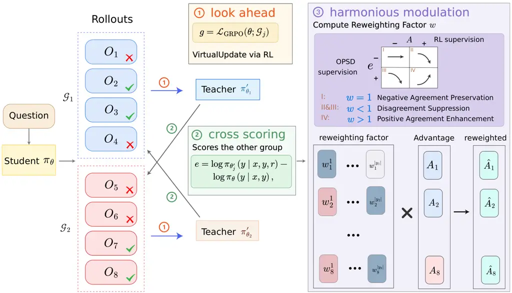

# Teach Me After You Learn It: Lookahead Self-Distillation for RLVR

Zepeng Zhai    Meilin Chen ^(†)^(†)thanks: Corresponding author.
Affiliation: Xiaohongshu Inc.
Email: [{zhaizepeng,chenmeilin2}@xiaohongshu.com](mailto:)

###### Abstract

On-policy self-distillation (OPSD) has emerged as a popular training
paradigm for LLMs, providing dense, token-level supervision by aligning
a model’s own distribution with the distribution induced by privileged
information. However, existing OPSD methods derive supervision solely
from privileged information of the same instance, leaving inter-instance
supervision largely unexplored. We propose LookahEAd self-Distillation
(LEAD), which introduces _inter-instance_ distillation by allowing the
teacher to first learn from other on-policy rollouts before teaching the
student. LEAD constructs lookahead teachers through virtual RL updates
on disjoint subsets of on-policy rollouts, and uses each teacher to
provide cross-group token-level supervision for the other subset. To
reconcile the complementary yet potentially conflicting signals from
OPSD and RLVR, we introduce _harmonious modulation_, which adaptively
modulates the GRPO advantage based on the agreement between the two
signals. Extensive experiments on scientific reasoning and
interactive-agent benchmarks show that LEAD achieves the best in-domain
average performance across model scales while maintaining out-of-domain
generalization comparable to GRPO.

|     |
| --- |
|     |

TL;DR: The self-distillation teacher first learns from _other_ on-policy
rollouts: a virtual RL update on one half of each rollout group scores
the other half, and the agreement between that signal and the GRPO
advantage modulates the update.

## 1 Introduction

Reinforcement Learning with Verifiable Rewards (RLVR) has emerged as an
effective paradigm for improving the reasoning capabilities of large
language models (LLMs), where each trajectory receives only a single
scalar signal determined by the outcome from the environment. On-policy
distillation (OPD) (Agarwal et al., 2024; Gu et al., 2024) complements
this by leveraging a stronger teacher model to provide dense,
token-level logits as learning signals along the student’s trajectories,
enriching the trajectory-level supervision to the token level and
thereby achieving faster convergence. Recent work has shown that OPD
from advanced teachers can match or even outperform RLVR (Lu and Lab,
2025; Li et al., 2026b), establishing it as an equally compelling
paradigm.

Despite its effectiveness, OPD introduces considerable computational
overhead due to relying on a separate teacher model, which is typically
substantially larger than the student. In addition, OPD performs
token-level distribution matching over a shared vocabulary, requiring
the teacher and student to adopt the same vocabulary spaces. This
architectural constraint further limits the scalability and flexibility
of OPD in practice. On-policy self-distillation (OPSD) (Zhao et al.,
2026; Hübotter et al., 2026) provides a more lightweight alternative by
dispensing with an external teacher altogether. Instead, a single model
plays both roles: it acts as the teacher when conditioned on privileged
information, such as a verified reasoning trace or environmental
feedback, and as the student when given only the query.

Despite these advantages, recent studies have revealed an inherent
limitation of naive OPSD: the privileged teacher can induce undesirable
shifts in the student’s output style and cause leakage of privileged
information, ultimately leading to degraded out-of-domain
generalization (Yang et al., 2026; Pan et al., 2026). Motivated by this,
recent approaches seek to combine the benefits of OPSD with the robust
optimization signal provided by RLVR. RLSD (Yang et al., 2026) uses the
RLVR objective to determine the optimization direction, while treating
the self-distillation signal as a modulation of the update magnitude.
RLCSD (Pan et al., 2026) further improves the quality of privileged
self-distillation signals by contrasting correct and incorrect
privileged contexts, thereby suppressing task-irrelevant components such
as privilege-induced style shifts. Refer to Appendix A for detailed
analysis of related works.

Nevertheless, these approaches still follow the prior OPSD paradigm,
where the supervision signal for the $`i`$-th query $`x_{i}`$ in dataset
$`D`$ is derived from
$`e_{i,t}=\log\pi_{\theta}^{T}\left(y_{i,t}\mid x_{i},y_{i,<t},r_{i}\right)-\log\pi_{\theta}^{S}\left(y_{i,t}\mid x_{i},y_{i,<t}\right),`$
where $`y_{i}`$ is a student-sampled rollout, $`T`$ and $`S`$ denote the
same model under different conditioning, and $`r_{i}`$ represents
privileged information associated with query $`x_{i}`$. In this
paradigm, the supervision signal for $`x_{i}`$ is solely derived from
privileged information of the current instance $`x_{i}`$, without
explicitly considering others in dataset $`D`$. We refer to this
paradigm as _intra-instance_ distillation. Therefore, an important
question arises:

_Can the supervision signal for an instance come not only from
privileged information about the instance itself, but also from others?_

Building on this idea, we propose LookahEAd self-Distillation (LEAD),
which introduces _inter-instance_ distillation by allowing the teacher
to first learn from other on-policy rollouts before teaching the
student. Specifically, to avoid the _supervision entanglement_ during
inter-instance distillation, we split the on-policy rollouts into two
groups and perform a _Lookahead_ update on each group independently,
yielding two lookahead teachers. Each lookahead teacher then evaluates
the rollouts from the other group, forming a _Cross Scoring_ mechanism
that transfers knowledge acquired from one group to another. Moreover,
existing approaches typically treat the OPSD and RLVR supervision
signals independently, overlooking that they may provide complementary
yet potentially conflicting guidance. To reconcile them, we introduce
_Harmonious Modulation_, which adaptively modulates the GRPO advantage
according to the agreement between the two signals.

In contrast to prior OPSD, where the supervision signal for $`x_{i}`$ is
solely obtained by conditioning the model on privileged information
specific to $`x_{i}`$, LEAD derives supervision from a teacher that has
first learned from other instances. Taking advantage of this, the
resulting signal provides a more effective and stable optimization
direction. Overall, our contributions are threefold:

- •
  We propose LookahEAd self-Distillation (LEAD), which extends
  self-distillation from intra-instance to inter-instance distillation,
  enabling the teacher to acquire information from other on-policy
  rollouts before providing supervision to the student.
- •
  We introduce _Cross Scoring_ to prevent supervision entanglement by
  explicitly transferring information across disjoint groups of
  on-policy rollouts, and _Harmonious Modulation_ to reconcile the
  complementary yet potentially conflicting OPSD and RLVR signals.
- •
  Extensive experiments across the scientific-reasoning and
  interactive-agent suites demonstrate LEAD achieves the best in-domain
  average performance across model scales while maintaining
  out-of-domain generalization comparable to GRPO.

## 2 Preliminaries

GRPO. Consider a language model $`\pi_{\theta}`$ trained to solve
reasoning tasks. Given a question $`x`$, the model generates a response
$`y=(y_{1},\dots,y_{T})`$ autoregressively. In the RLVR setting, a
verifier provides a binary reward $`R(x,y)\in\{0,1\}`$ indicating
whether the response is correct. Group Relative Policy Optimization
(GRPO) (Shao et al., 2024) samples a group of $`G`$ responses
$`\{y_{1},\dots,y_{G}\}`$ from the current policy for each question
$`x`$, and computes a sequence-level advantage for each response
relative to the group:

```math
A_{i}=\frac{R(x,y_{i})-\mu_{G}}{\sigma_{G}}, \tag{1}
```

where $`\mu_{G}`$ and $`\sigma_{G}`$ are the mean and standard deviation
of the rewards within the group. The policy is then updated via a
clipped surrogate objective:

```math
\mathcal{L}_{\text{GRPO}}(\theta)=\mathbb{E}\left[\frac{1}{G}\sum_{i=1}^{G}\frac{1}{|y_{i}|}\sum_{t=1}^{|y_{i}|}\min\!\left(\rho_{i}A_{i},\;\text{clip}\!\left(\rho_{i},1-\epsilon,1+\epsilon\right)A_{i}\right)\right], \tag{2}
```

where
$`\rho_{i}=\pi_{\theta}(y_{i,t}\mid x,y_{i,<t})/\pi_{\theta_{\text{old}}}(y_{i,t}\mid x,y_{i,<t})`$
is the importance sampling ratio between the current and old policies. A
key limitation of GRPO is that all tokens within a response share the
same advantage $`A_{i}`$, as the reward signal is provided only at the
sequence level.

OPSD. On-Policy Distillation (OPD) (Agarwal et al., 2024) addresses the
sparse reward problem by having the student $`\pi_{S}`$ sample its own
trajectories while a separate, typically larger, teacher model
$`\pi_{T}`$ provides dense token-level supervision. While effective,
maintaining a distinct teacher model throughout training introduces
significant computational overhead. On-Policy Self-Distillation
(OPSD) (Zhao et al., 2026; Hübotter et al., 2026) eliminates this
requirement by instantiating both roles from a single model
$`\pi_{\theta}`$: the teacher gains its informational advantage not from
greater capacity, but from conditioning on privileged information $`r`$
(e.g., a verified reasoning trace).

In OPSD, the teacher and the student are the same model; the teacher is
simply granted access to privileged context unavailable to the student,
such as a ground-truth solution or terminal feedback from the
environment. The standard OPSD objective takes the following dense
distillation form:

```math
\mathcal{L}_{\text{OPSD}}(\theta)=\mathbb{E}_{y\sim\pi_{S}}\left[\frac{1}{|y|}\sum_{t=1}^{|y|}\mathrm{KL}\left(\pi_{S}(\cdot\mid x,y_{<t})\,\|\,\mathrm{sg}[\pi_{T}(\cdot\mid x,r,y_{<t})]\right)\right], \tag{3}
```

where $`T`$ and $`S`$ denote the same model, and $`r`$ is the privileged
context. Inherited from OPD, the OPSD objective is equivalent to
reinforcement learning with per-token advantage
$`A_{t}=\log\pi_{T}(y_{t}\mid x,r,y_{<t})-\log\pi_{S}(y_{t}\mid x,y_{<t})`$.



Figure 1: Overview of LEAD. LEAD consists of three steps: Lookahead,
Cross Scoring, and Harmonious Modulation. Refer to Section 3.1 for the
details.

## 3 LEAD: Lookahead Self-Distillation

### 3.1 Formulation

The key idea of LEAD is to let the teacher first acquire information
from the current on-policy batch through a lookahead update, and then
use the resulting lookahead teacher to provide privileged token-level
supervision. This differs from conventional OPSD, where the teacher
supervision for a rollout is determined only by privileged information
associated with that same rollout.

To understand why such a lookahead teacher can provide additional
supervision, consider a batch of $`N`$ on-policy rollouts
$`\mathcal{B}=\left\{z_{i}=(x_{i},y_{i},r_{i})\right\}_{i=1}^{N}.`$ For
a token $`y_{i,t}`$, we then examine how post update from model
parameter $`\pi_{\theta}`$ to $`\pi_{\theta^{+}}`$ with this rollout
changes the privileged log-probability of a token from rollout $`i`$.
Define the post-update privileged log-probability increment

```math
\Delta_{i,t}=\log\pi_{\theta^{+}}(y_{i,t}\mid x_{i},y_{i,<t},r_{i})-\log\pi_{\theta}(y_{i,t}\mid x_{i},y_{i,<t},r_{i}). \tag{4}
```

Proposition 1 (Post-update Privileged Log-probability Decomposition).
For a token $`y_{i,t}`$ in rollout $`i`$, after a first-order
policy-gradient update on the whole batch $`\mathcal{B}`$, the
post-update privileged log-probability increment on the $`y_{i,t}`$
admits the decomposition

```math
\Delta_{i,t}=\underbrace{\eta A_{i}{h_{i,t}}^{\top}V_{i}}_{\text{self-induced}}+\underbrace{\eta\sum_{j\neq i}A_{j}{h_{i,t}}^{\top}V_{j}}_{\text{cross-induced}}+o(\eta). \tag{5}
```

where $`u_{i,t}=\log\pi_{\theta}(y_{i,t}\mid x_{i},y_{i,<t}),`$ and
$`s_{i,t}=\log\pi_{\theta}(y_{i,t}\mid x_{i},y_{i,<t},r_{i})`$ define
the RL log-probability and the privileged log-probability, with
corresponding gradients
$`v_{i,t}=\nabla_{\theta}u_{i,t},h_{i,t}=\nabla_{\theta}s_{i,t}`$
respectively. $`V_{i}=\sum_{k}v_{i,k}`$ denote the aggregate RL gradient
of rollout $`i`$. $`A_{i}\in\mathbb{R}`$ denotes the advantage of
rollout $`i`$ and $`\eta`$ is the learning rate of RL update. Refer to
Appendix C.1 for detailed proof.

Proposition 1 reveals that the post-update privileged log-probability
increment of an instance consists of two distinct components. The
self-induced term reflects how the RL signal of the instance itself
changes its privileged prediction, whereas the cross-induced term
captures how learning from other instances affects the privileged
prediction of the current instance.

Importantly, the self-induced term introduces a phenomenon we refer to
as _supervision entanglement_: the RL signal first updates the model
based on this instance, and the updated model is then used to evaluate
the privileged prediction of the very same instance. Such supervision
entanglement can amplify instance-specific biases that are not
necessarily beneficial for generalization. In contrast, the
cross-induced term arises from the interaction between the privileged
prediction of one instance and the RL learning signal from other
instances. The resulting supervision therefore reflects information
acquired across instances rather than repeatedly reusing supervision
from the same instance.

Motivated by this observation, LEAD introduces a _cross-scoring_ design:
the teacher is first updated using one set of on-policy rollouts and
then used to score another set of rollouts. This design explicitly
exploits the inter-instance distillation while avoiding the supervision
entanglement, as detailed in the following section.

### 3.2 LEAD

As shown in Figure 1, given an on-policy batch of queries and their
sampled rollouts, LEAD proceeds through three key steps. First, in
_Lookahead_, we split the on-policy rollouts into subsets and perform a
virtual RL update on each subset, allowing the model to acquire
information from the corresponding rollouts without modifying the actual
model parameters. Second, in _Cross Scoring_, the resulting lookahead
teacher from one subset is used to evaluate rollouts from another
subset, thereby transferring learning signals across instances and
explicitly capturing the inter-instance supervision identified in
Proposition 1. Finally, in _Harmonious Modulation_, we combine the
resulting OPSD signal with the RLVR signal, leveraging their
complementary information while accounting for the potential conflict
between the two supervision signals.

#### 3.2.1 Lookahead

Let $`\theta`$ denote the current policy parameters and let
$`\mathcal{L}_{\mathrm{GRPO}}(\theta;\mathcal{G})`$ denote the GRPO
objective trained on a subset of rollouts $`\mathcal{G}`$. Concretely,
consider an on-policy batch consisting of $`Q`$ queries with $`G`$
sampled rollouts each, so that $`N=QG`$. We partition the rollouts along
the rollout dimension into two disjoint groups of $`\tfrac{1}{2}QG`$
rollouts each, denoted by $`\mathcal{G}_{1}`$ and $`\mathcal{G}_{2}`$.

For each group $`\mathcal{G}_{j}`$, we first use the RL gradient to
construct a _lookahead_ parameter state that approximates the model
after learning from $`\mathcal{G}_{j}`$:

```math
\theta^{\prime}_{j}=\operatorname{VirtualUpdate}(\theta,\mathcal{L}_{\mathrm{GRPO}}(\theta;\mathcal{G}_{j})),\qquad j\in\{1,2\}. \tag{6}
```

In practice, $`\operatorname{VirtualUpdate}`$ follows the same
parameter-update rule as the underlying optimizer, including its
accumulated optimization statistics, while keeping the original model
parameters and the optimizer state unchanged. Thus,
$`\theta^{\prime}_{j}`$ represents a learned model that has taken one RL
update on the rollouts in $`\mathcal{G}_{j}`$.

#### 3.2.2 Cross Scoring

After constructing the two lookahead teachers, we evaluate each group
using the teacher obtained from the other group. Specifically, for a
rollout $`y_{i}`$ belonging to $`\mathcal{G}_{2}`$, its token-level OPSD
supervision under the lookahead teacher $`\theta^{\prime}_{1}`$ is

```math
e_{i,t}=\log\pi_{\theta^{\prime}_{1}}\left(y_{i,t}\mid x_{i},y_{i,<t},r_{i}\right)-\log\pi_{\theta}\left(y_{i,t}\mid x_{i},y_{i,<t}\right), \tag{7}
```

Similarly, rollouts in $`\mathcal{G}_{1}`$ are scored by
$`\theta^{\prime}_{2}`$. Since the magnitude of $`e_{i,t}`$ depends on
the scale of the virtual update, we normalize the signal within the
batch:

```math
\hat{e}_{i,t}=\operatorname{clip}\left(\frac{e_{i,t}-\mu_{e}}{\sigma_{e}+10^{-6}},-c,c\right), \tag{8}
```

where $`\mu_{e}`$ and $`\sigma_{e}`$ denote the batch mean and standard
deviation of $`e_{i,t}`$, and $`c`$ is a hyperparameter that controls
the maximum magnitude of the normalized signal. This normalization
removes the dependence of the signal magnitude on the absolute scale of
the virtual update while retaining its directional information.

#### 3.2.3 Harmonious Modulation

Existing approaches typically treat the two supervision signals
independently, overlooking that they may provide complementary yet
potentially conflicting guidance during optimization. GRPO provides
outcome-based credit assignment from the current on-policy rollouts,
whereas LEAD captures how the model’s token-level log-probabilities
would change after learning from other rollouts. Their learning signals
may therefore point in different directions. To reconcile these two
sources of supervision, LEAD introduces _Harmonious Modulation_, which
adaptively modulates the GRPO advantage according to the agreement
between the two signals.

The GRPO advantage is modulated by a reweighting factor:

```math
\hat{A}_{i,t}=w_{i,t}A_{i,t}. \tag{9}
```

_Positive Agreement Enhancement_ applies when both the lookahead signal
and the GRPO advantage are positive. Since the two signals reinforce the
same positive learning direction, we increase the magnitude of the
advantage accordingly. _Disagreement Suppression_ applies when the two
signals point in opposite directions. We reduce the magnitude of the
GRPO advantage to mitigate the conflict while preserving the
outcome-based RL direction. Finally, _Negative Agreement Preservation_
applies when both signals are non-positive. In this case, we leave the
advantage unchanged rather than further amplifying a negative update.
Specifically, we define the reweighting factor as

```math
w_{i,t}=\begin{cases}1+\rho_{a}\dfrac{|\hat{e}_{i,t}|}{c},&\hat{e}_{i,t}>0,\ A_{i,t}>0,\quad\text{(i) Positive Agreement Enhancement}\\[6.0pt]
1-\rho_{b}\dfrac{|\hat{e}_{i,t}|}{c},&\hat{e}_{i,t}A_{i,t}<0,\quad\text{(ii) Disagreement Suppression}\\[6.0pt]
1,&\text{otherwise.}\quad\qquad\ \ \text{(iii) Negative Agreement Preservation}\end{cases} \tag{10}
```

where $`\rho_{a}\geq 0`$ and $`\rho_{b}\in[0,1]`$ control the strengths
of positive-agreement enhancement and disagreement suppression,
respectively. Since $`\hat{e}_{i,t}`$ is clipped to $`[-c,c]`$, the
normalized magnitude $`|\hat{e}_{i,t}|/c`$ lies in $`[0,1]`$.

Therefore, the reweighting factor satisfies

```math
w_{i,t}\in[1-\rho_{b},\,1+\rho_{a}]. \tag{11}
```

where $`\rho_{a}`$ determines the maximum relative amplification under
positive agreement, whereas $`\rho_{b}`$ determines the maximum relative
attenuation under disagreement.

LEAD only modulates the magnitude of the GRPO advantage without changing
its sign. The resulting $`\hat{A}_{i,t}`$ is then used in place of
$`A_{i}`$ in the standard GRPO objective.

## 4 Experiments

### 4.1 Setups

##### Models and Benchmarks.

We evaluate all methods with two Qwen3 (Yang et al., 2025) backbone
models of different scales, Qwen3-4B and Qwen3-8B, to examine whether
the benefits of LEAD persist across model sizes. We evaluate LEAD on two
complementary datasets: _scientific reasoning_, which focuses on
single-response reasoning with outcome-based rewards, and _interactive
agents_, which requires long-horizon, multi-turn decision making with
sparse and delayed rewards. Together, these benchmarks allow us to
examine whether the benefits of inter-instance supervision extend from
conventional reasoning tasks to more challenging agentic settings.

- •
  Scientific reasoning. Following prior works (Hübotter et al., 2026;
  Yang et al., 2026), we train on four datasets from the reasoning
  subset (L3) of SciKnowEval (Feng et al., 2024), covering
  undergraduate-level Biology, Chemistry, Materials Science, and
  Physics.
- •
  Interactive agents. We further evaluate on three agent benchmarks
  following SDAR (Lu et al., 2026): ALFWorld (Shridhar et al., 2021) for
  embodied household tasks, WebShop (Yao et al., 2022) for web
  navigation and purchase, and Search (Jin et al., 2025) for
  tool-augmented question answering. This setting provides a more
  challenging test of LEAD because each training example consists of
  multiple agent turns with sparse, end-of-episode rewards.

##### Scientific Reasoning Dataset Curation.

SciKnowEval (Feng et al., 2024) is widely used by prior works (Hübotter
et al., 2026; Yang et al., 2026) for evaluations. However, we identified
inconsistencies in the original dataset release, including malformed
options and questions without a valid answer. We therefore perform a
systematic audit using independent judgments from GPT-5.5 and Claude
Opus 5. For the training split, items with consistent judgments are
retained, relabelled, or minimally rewritten, while inconsistent cases
are removed. The curation primarily affects Physics: approximately
$`27\%`$ of its training items require correction or removal, compared
with less than $`4\%`$ in Biology, Chemistry, and Materials Science
combined. The test split is affected far less: 4.8% of its items are
removed and 2.7% are corrected. Human verification further shows
$`99.3\%`$ agreement with the curated answers across randomly sampled
items. Detailed curation criteria, statistics, and representative cases
are provided in Appendix B.

##### Evaluation Settings.

Following Pan et al. (2026), we adopt a unified evaluation protocol to
separately assess in-domain performance and cross-domain generalization.
For each method and each domain, we train one model using the training
split of that domain, starting from the corresponding base model. The
resulting model is then evaluated on the test splits of all domains
within the same suite. Specifically:

- •
  In-domain evaluation. The model is evaluated on the test split of the
  same domain used for training. This measures performance on the domain
  seen during training.
- •
  Out-of-domain (OOD) evaluation. The same model is evaluated on the
  test splits of all other domains in the suite, without any further
  training or adaptation. We report the average performance across these
  unseen domains to measure cross-domain generalization.

##### Metrics.

On the scientific-reasoning suite we sample $`16`$ responses per test
question and report the mean accuracy, denoted mean@16; a response
counts as correct only if the verifier matches it against the
ground-truth answer. On the interactive-agent suite, ALFWorld and
WebShop are scored by the environment’s episode success rate over a
fixed held-out set, and Search by the mean exact-match score over its
seven constituent QA datasets. All numbers are reported in percent.

Following Hübotter et al. (2026), in-domain scores are the maximum value
reached over the evaluation checkpoints of a run, whereas OOD scores are
averaged over the last three checkpoints: the former measures how far a
method can push the training domain, the latter describes the model
obtained at the end of training and is therefore insensitive to a
transient peak. Evaluation is run every $`10`$ global steps on the
scientific suite and every $`5`$ steps on the agent suite.

##### Baselines.

We compare LEAD against three baselines: (1) GRPO (Shao et al., 2024)
group relative policy optimization with binary outcome rewards verified
against ground-truth answers; (2) SDPO (Hübotter et al., 2026) is a
representative _dense_ OPSD method, which constructs dense-logit
distillation using Jensen–Shannon divergence; (3) RLSD (Yang et al., 2026) that uses the teacher–student probability gap on sampled tokens to
modulate advantage.

##### Implementation Details.

For each dataset in scientific-reasoning suite, we sample $`G=8`$
on-policy rollouts with a training batch of $`32`$ queries ($`256`$
rollouts per global batch). For the agent suite, we follow the protocol
of SDAR (Lu et al., 2026) and refer to Appendix B.1 for detailed
implementation. For LEAD, the virtual RL update uses an inner learning
rate of $`\eta_{\text{in}}=10^{-5}`$ to obtain the lookahead teacher
parameters. We disable this virtual update for the first $`10`$ global
steps and use a first-moment estimate consisting of $`0.7`$ historical
momentum and $`0.3`$ of the current half-batch gradient. The resulting
virtual RL update is applied only to construct the lookahead teacher and
does not modify the actual model parameters. The lookahead signal is
clipped at $`c=3.0`$, with $`\rho_{a}=0.1`$ and $`\rho_{b}=0.3`$;
$`\rho_{b}`$ is linearly annealed to zero over the first $`70\%`$ of
training. More implementation details are provided in Appendix B.1.

|             |                      |       |       |       |       |                   |         |        |       |
| ----------- | -------------------- | ----- | ----- | ----- | ----- | ----------------- | ------- | ------ | ----- |
|             | Scientific Reasoning |       |       |       |       | Interactive Agent |         |        |       |
| Method      | Bio.                 | Chem. | Mate. | Phy.  | Avg.  | AlfWorld          | WebShop | Search | Avg.  |
| Qwen3-4B    |                      |       |       |       |       |                   |         |        |       |
| Base Model  | 31.86                | 43.67 | 61.74 | 79.67 | 54.24 | 30.68             | 2.73    | 27.03  | 20.15 |
| GRPO        | 52.50                | 78.05 | 80.51 | 94.77 | 76.46 | 71.40             | 75.80   | 41.60  | 62.93 |
| SDPO        | 52.12                | 77.48 | 73.72 | 86.99 | 72.58 | 57.00             | 79.20   | 39.56  | 58.59 |
| RLSD        | 52.88                | 78.51 | 80.38 | 94.67 | 76.61 | 68.80             | 78.10   | 40.50  | 62.47 |
| LEAD (ours) | 53.87                | 81.19 | 85.82 | 93.65 | 78.63 | 72.70             | 79.30   | 42.50  | 64.83 |
| Qwen3-8B    |                      |       |       |       |       |                   |         |        |       |
| Base Model  | 30.47                | 41.87 | 58.78 | 78.84 | 52.49 | 18.20             | 5.47    | 18.26  | 13.98 |
| GRPO        | 54.87                | 82.57 | 78.83 | 91.80 | 77.02 | 71.10             | 84.40   | 41.99  | 65.83 |
| SDPO        | 60.88                | 81.40 | 77.15 | 87.91 | 76.84 | 75.00             | 84.40   | 41.19  | 66.86 |
| RLSD        | 56.88                | 81.52 | 78.23 | 92.32 | 77.24 | 73.30             | 88.30   | 41.56  | 67.72 |
| LEAD (ours) | 58.50                | 82.60 | 80.70 | 94.26 | 79.02 | 84.40             | 86.70   | 42.19  | 71.10 |

Table 1: In-domain results across the scientific-reasoning and
interactive-agent suites. Each result is evaluated on the test split of
the same domain used for training. Maximum mean@16 (%) and success rate
(%) is reported on the scientific-reasoning and interactive-agent
suites, respectively. _Base_ is the untrained model and is listed for
reference and excluded from the ranking. Bold indicates the best result
among the four training methods and underline the second best. On the
scientific-reasoning suite, both the training and the test splits are
curated as described in Appendix B, and all methods use the same curated
splits.

|             |                      |       |       |       |       |                   |         |        |       |
| ----------- | -------------------- | ----- | ----- | ----- | ----- | ----------------- | ------- | ------ | ----- |
|             | Scientific Reasoning |       |       |       |       | Interactive Agent |         |        |       |
| Method      | Bio.                 | Chem. | Mate. | Phy.  | Avg.  | AlfWorld          | WebShop | Search | Avg.  |
| Qwen3-4B    |                      |       |       |       |       |                   |         |        |       |
| Base Model  | 61.69                | 57.76 | 51.73 | 45.76 | 54.24 | 14.88             | 28.85   | 16.70  | 20.14 |
| GRPO        | 60.52                | 58.89 | 50.06 | 48.37 | 54.46 | 14.28             | 30.67   | 20.45  | 21.80 |
| SDPO        | 33.98                | 33.53 | 25.92 | 38.23 | 32.92 | 12.93             | 25.05   | 21.35  | 19.78 |
| RLSD        | 59.88                | 58.63 | 48.83 | 47.20 | 53.64 | 14.43             | 28.41   | 18.02  | 20.29 |
| LEAD (ours) | 58.98                | 57.31 | 52.72 | 48.07 | 54.27 | 15.01             | 28.09   | 21.73  | 21.61 |
| Qwen3-8B    |                      |       |       |       |       |                   |         |        |       |
| Base Model  | 59.83                | 56.03 | 50.39 | 43.71 | 52.49 | 11.87             | 18.23   | 11.84  | 13.98 |
| GRPO        | 61.53                | 59.66 | 50.57 | 45.45 | 54.30 | 8.65              | 13.19   | 19.50  | 13.78 |
| SDPO        | 41.72                | 31.35 | 40.26 | 43.41 | 39.19 | 11.71             | 11.14   | 11.15  | 11.33 |
| RLSD        | 61.12                | 59.55 | 53.01 | 45.37 | 54.76 | 11.16             | 13.76   | 16.22  | 13.71 |
| LEAD (ours) | 61.21                | 59.64 | 52.79 | 45.93 | 54.89 | 10.01             | 14.05   | 18.40  | 14.15 |

Table 2: Out-of-domain results across the scientific-reasoning and
interactive-agent suites. Each result is the averaged performance of the
model trained on the corresponding domain while evaluated on the
_remaining_ domains of the same suite. Bold indicates the best result
among the four training methods and underline the second best.

### 4.2 Main Results

##### In-Domain Results.

As shown in Table 1, LEAD consistently improves in-domain performance
across both model scales and task suites. In scientific reasoning, LEAD
achieves the highest performance for both Qwen3-4B and Qwen3-8B,
outperforming the strongest baseline by $`2.02`$ and $`1.78`$ points,
respectively. The same trend extends to interactive agents. On Qwen3-4B,
LEAD is the best method on all three benchmarks ($`72.70`$, $`79.30`$
and $`42.50`$), giving an agent average of $`64.83`$ against $`62.93`$
for GRPO and $`62.47`$ for RLSD. On Qwen3-8B, LEAD is the best on
ALFWorld ($`84.40`$) and Search ($`42.19`$) and the second best on
WebShop. These results suggest that the inter-instance supervision
captured by the lookahead teacher remains beneficial across both
conventional reasoning and sparse-reward, multi-turn agent tasks.

##### Out-of-Domain Results.

Table 2 shows that LEAD largely preserves the OOD performance of GRPO
while achieving substantially higher in-domain accuracy. On scientific
reasoning, LEAD obtains OOD averages of $`54.27`$ and $`54.89`$ on
Qwen3-4B and Qwen3-8B, nearly matching GRPO at the smaller scale and
achieving the best OOD performance at the larger scale, while improving
its in-domain averages over GRPO by $`2.17`$ and $`2.00`$ points as
shown in Table 1. In contrast, SDPO exhibits a substantial OOD
degradation at both scales, whereas RLSD remains close to GRPO,
suggesting that directly injecting dense privileged supervision can be
detrimental to cross-domain generalization, while bounded advantage
modulation better preserves the outcome-supervised learning behavior. On
the interactive-agent suite, however, the OOD performance of all methods
falls to $`19`$–$`22\%`$ on Qwen3-4B and $`11`$–$`15\%`$ on Qwen3-8B,
far below their in-domain scores. LEAD ranks second on Qwen3-4B
($`21.61`$ vs. $`21.80`$ for GRPO) and achieves the highest OOD
performance on Qwen3-8B ($`14.15`$). In contrast to the scientific
domains, ALFWorld, WebShop, and Search differ substantially in their
action spaces and observation formats, making cross-benchmark transfer
more challenging and limiting the benefit of any single training
objective. Overall, these results show that LEAD improves in-domain
performance without sacrificing the generalization.

### 4.3 Training Dynamics

Figures 2 and 3 provide a step-by-step view of training on Chemistry and
Materials Science, complementing the final results reported in Tables 1
and 2. LEAD consistently achieves strong training rewards and in-domain
performance throughout training, with faster convergence in the early
stages and a sustained advantage toward the end of training. Meanwhile,
its out-of-domain performance remains relatively stable across the
training process, in contrast to the progressive degradation observed
for SDPO. Overall, these dynamics show that LEAD accelerates in-domain
learning while better preserving performance on unseen domains
throughout training.

### 4.4 More Analysis

We conduct the ablation study on the scientific-reasoning suite with
Qwen3-4B, keeping all other hyperparameters identical to the main
experiments. Table 3 evaluates the contribution of the three key
components of LEAD: _Lookahead_, _Cross-Scoring_, and _Harmonious
Modulation_.

##### Lookahead.

Removing the lookahead update (_w/o lookahead_) reduces the in-domain
average from $`78.63`$ to $`76.10`$, a drop of $`2.53`$ points. This
variant uses the current model $`\theta`$ directly as the teacher,
retaining the privileged-context supervision without allowing the
teacher to first acquire information from the on-policy batch. The
degradation across Biology, Chemistry, and Materials Science indicates
that the additional information acquired through the virtual RL update
contributes meaningfully to the learning signal. The OOD average also
decreases slightly from $`54.27`$ to $`54.09`$.

##### Cross-Scoring.

To isolate the effect of cross-scoring, we replace the cross-group
scoring scheme with a self-induced variant (_w/ self-induced_), where
each lookahead teacher scores the same rollouts that were used to
construct it. This modification reintroduces the self-induced component
identified in Proposition 1 while preserving the lookahead update
itself. The in-domain average drops from $`78.63`$ to $`76.90`$,
corresponding to a $`1.73`$-point degradation. This result highlights
the importance of using information acquired from other instances rather
than repeatedly coupling the privileged signal with the RL signal from
the same instance.

##### Harmonious Modulation.

We further ablate the three cases defined in Eq. 10: _Positive Agreement
Enhancement_ (i), _Disagreement Suppression_ (ii), and _Negative
Agreement Preservation_ (iii). Removing _Positive Agreement Enhancement_
(_w/o (i)_) reduces the in-domain average to $`77.61`$ and the OOD
average to $`52.06`$; this variant reaches the highest Biology
($`57.12`$) and Physics ($`93.85`$) scores of the table, but its average
over the four domains remains below LEAD’s. Removing _Disagreement
Suppression_ for positive advantages (_w/o (ii) ($`A>0`$)_) reduces the
in-domain average to $`75.90`$, while the OOD average is $`54.03`$. The
corresponding ablation for negative advantages (_w/o (ii) ($`A<0`$)_)
reduces the in-domain average to $`77.05`$, while the OOD average is
$`53.50`$. Finally, removing _Negative Agreement Preservation_ (_w/o
(iii)_) reduces the in-domain average to $`76.16`$ and the OOD average
to $`53.83`$. These results suggest that the effectiveness of Harmonious
Modulation comes from coordinating the three cases: strengthening
positive agreement, suppressing disagreement, and preserving the
magnitude of negative updates when the two signals agree.

|                         |           |       |       |       |       |               |       |       |       |       |
| ----------------------- | --------- | ----- | ----- | ----- | ----- | ------------- | ----- | ----- | ----- | ----- |
|                         | In-domain |       |       |       |       | Out-of-domain |       |       |       |       |
| Variant                 | Bio.      | Chem. | Mate. | Phy.  | Avg.  | Bio.          | Chem. | Mate. | Phy.  | Avg.  |
| LEAD                    | 53.87     | 81.19 | 85.82 | 93.65 | 78.63 | 58.98         | 57.31 | 52.72 | 48.07 | 54.27 |
| _Lookahead_             |           |       |       |       |       |               |       |       |       |       |
|    w/o lookahead        | 51.50     | 79.34 | 80.51 | 93.06 | 76.10 | 60.04         | 56.23 | 51.60 | 48.49 | 54.09 |
| _Cross-Scoring_         |           |       |       |       |       |               |       |       |       |       |
|    w/ self-induced      | 52.38     | 80.92 | 81.45 | 92.83 | 76.90 | 59.25         | 56.05 | 53.06 | 46.43 | 53.70 |
| _Harmonious Modulation_ |           |       |       |       |       |               |       |       |       |       |
|    w/o (i)              | 57.12     | 78.77 | 80.71 | 93.85 | 77.61 | 55.00         | 57.27 | 50.57 | 45.41 | 52.06 |
|    w/o (ii) ($`A>0`$)   | 51.12     | 79.16 | 80.71 | 92.62 | 75.90 | 59.17         | 57.84 | 51.19 | 47.93 | 54.03 |
|    w/o (ii) ($`A<0`$)   | 51.75     | 80.38 | 82.53 | 93.55 | 77.05 | 56.56         | 57.58 | 51.20 | 48.64 | 53.50 |
|    w/o (iii)            | 49.75     | 80.47 | 81.38 | 93.03 | 76.16 | 59.67         | 56.82 | 51.45 | 47.38 | 53.83 |

Table 3: Ablation study on the scientific-reasoning suite (Qwen3-4B).
In-domain is the maximum mean@16 (%) reached during training on that
domain; out-of-domain is the accuracy of the same model on the remaining
three domains, averaged over the last three evaluation checkpoints. Bold
indicates the best result in each column and underline the second best.

##### Computational Cost.

LEAD introduces an additional lookahead update compared with prior OPSD
methods. Table 4 reports the wall-clock time per training step on the
scientific-reasoning suite with Qwen3-4B. The additional overhead of
LEAD is small: it is $`7.8\%`$ slower than GRPO and $`6.0\%`$ slower
than RLSD. This overhead is expected to be even smaller for long-reason
tasks, such as mathematics and code generation, where rollout generation
accounts for a larger fraction of the total step time. In comparison,
SDPO is $`16.5\%`$ slower than GRPO and $`8.0\%`$ slower than LEAD. This
larger overhead likely stems from its dense token-level distillation
over the top-$`k`$ vocabulary, which makes the optimization stage more
expensive than the sampled-token-level modulation used by RLSD and LEAD.

| Method      | Generation (s/step) | Update (s/step) | Total step (s/step) |
| ----------- | ------------------- | --------------- | ------------------- |
| GRPO        | 16.30               | 9.06            | 25.36               |
| SDPO        | 16.03               | 13.52           | 29.55               |
| RLSD        | 15.88               | 9.92            | 25.80               |
| LEAD (ours) | 15.78               | 11.57           | 27.35               |

Table 4: Wall-clock time per training step (seconds),
scientific-reasoning suite with Qwen3-4B, averaged over the four
domains. _Generation_ is the rollout stage; _Update_ covers the teacher
forward passes, the log-probability recomputation and the policy update.

## 5 Conclusion

We introduced LEAD, a novel on-policy self-distillation method that
enables the teacher to first learn from other on-policy rollouts before
teaching the student. Results on reasoning and agent tasks demonstrate
consistent in-domain improvements and strong OOD robustness.

## AI use statement

In this work, we used generative AI tools for aiding and polishing the
writing of the manuscript, including improving grammar, clarity,
readability, and presentation. We have not used generative AI tools for
research design, data collection, data analysis, experimental execution,
or the generation or verification of experimental results, and the rest
of the required disclosure tasks are not applicable to this work. We
have reviewed all AI-assisted work and verified the accuracy and
consistency of the resulting text. We take responsibility for the final
content of this work, including text, claims, and artifacts produced
with the aid of generative AI.

## References

- Agarwal et al. (2024) R. Agarwal, N. Vieillard, Y. Zhou, P.
  Stanczyk, S. Ramos Garea, M. Geist, and O. Bachem On-policy
  distillation of language models: learning from self-generated
  mistakes. In International Conference on Learning Representations,
  Vol. 2024, pp. 21246–21263. Cited by: §A.1, §1, §2.
- Feng et al. (2024) K. Feng, K. Ding, W. Wang, X. Zhuang, Z. Wang, M.
  Qin, Y. Zhao, J. Yao, Q. Zhang, and H. Chen SciKnowEval: evaluating
  multi-level scientific knowledge of large language models. arXiv
  preprint arXiv:2406.09098. Cited by: Appendix B, 1st item, §4.1.
- Feng et al. (2025) L. Feng, Z. Xue, T. Liu, and B. An Group-in-group
  policy optimization for llm agent training. arXiv preprint
  arXiv:2505.10978. Cited by: 2nd item.
- Gu et al. (2024) Y. Gu, L. Dong, F. Wei, and M. Huang Minillm:
  knowledge distillation of large language models. In International
  Conference on Learning Representations, Vol. 2024, pp. 32694–32717.
  Cited by: §A.1, §1.
- Han et al. (2026) Z. Han, T. Zhang, H. Wang, and Y. Sun Adaptive
  teacher exposure for self-distillation in llm reasoning. arXiv
  preprint arXiv:2605.11458. Cited by: §A.2.
- Hao et al. (2026) G. Hao, Y. Shang, Y. Long, Z. Zhao, and H. Liang
  Self-policy distillation via capability-selective subspace projection.
  arXiv preprint arXiv:2605.22675. Cited by: §A.2.
- Hübotter et al. (2026) J. Hübotter, F. Lübeck, L. Behric, A.
  Baumann, M. Bagatella, D. Marta, I. Hakimi, I. Shenfeld, T. K.
  Buening, C. Guestrin, et al. Reinforcement learning via
  self-distillation. arXiv preprint arXiv:2601.20802. Cited by: §A.2,
  Appendix B, §1, §2, 1st item, §4.1, §4.1, §4.1.
- Jin et al. (2025) B. Jin, H. Zeng, Z. Yue, D. Wang, H. Zamani, and J.
  Han Search-r1: training llms to reason and leverage search engines
  with reinforcement learning. arXiv preprint arXiv:2503.09516. Cited
  by: 2nd item, 2nd item.
- Ko et al. (2024) J. Ko, S. Kim, T. Chen, and S. Yun Distillm: towards
  streamlined distillation for large language models. arXiv preprint
  arXiv:2402.03898. Cited by: §A.1.
- Li et al. (2026a) G. Li, T. Yang, J. Fang, M. Song, M. Zheng, H.
  Guo, D. Zhang, J. Wang, and T. Chua Unifying group-relative and
  self-distillation policy optimization via sample routing. arXiv
  preprint arXiv:2604.02288. Cited by: §A.2.
- Li et al. (2026b) Y. Li, Y. Zuo, B. He, J. Zhang, C. Xiao, C. Qian, T.
  Yu, H. Gao, W. Yang, Z. Liu, et al. Rethinking on-policy distillation
  of large language models: phenomenology, mechanism, and recipe. arXiv
  preprint arXiv:2604.13016. Cited by: §1.
- Liu et al. (2025) Z. Liu, C. Chen, W. Li, P. Qi, T. Pang, C. Du, W. S.
  Lee, and M. Lin Understanding r1-zero-like training: a critical
  perspective. arXiv preprint arXiv:2503.20783. Cited by: §A.1.
- Lu and Lab (2025) K. Lu and T. M. Lab On-policy distillation. Thinking
  Machines Lab: Connectionism. Note:
  https://thinkingmachines.ai/blog/on-policy-distillation External
  Links: [Document](https://dx.doi.org/10.64434/tml.20251026) Cited by:
  §1.
- Lu et al. (2026) Z. Lu, Z. Yao, Q. Gu, and Y. Shen SDAR:
  self-distilled agentic reinforcement learning. arXiv preprint
  arXiv:2605.15155. Cited by: 2nd item, 2nd item, §4.1.
- Pan et al. (2025) L. Pan, S. Tao, Y. Zhai, Z. Fu, L. Fang, M. He, L.
  Zhang, Z. Liu, B. Ding, A. Liu, et al. D-treerpo: towards more
  reliable policy optimization for diffusion language models. arXiv
  preprint arXiv:2512.09675. Cited by: §A.1.
- Pan et al. (2026) L. Pan, S. Tao, Y. Zhai, L. Zhang, Z. Liu, B.
  Ding, A. Liu, and L. Wen RLCSD: reinforcement learning with
  contrastive on-policy self-distillation. arXiv preprint
  arXiv:2606.11709. Cited by: §A.2, §1, §4.1.
- Shao et al. (2024) Z. Shao, P. Wang, Q. Zhu, R. Xu, J. Song, X. Bi, H.
  Zhang, M. Zhang, Y. Li, Y. Wu, et al. Deepseekmath: pushing the limits
  of mathematical reasoning in open language models. arXiv preprint
  arXiv:2402.03300. Cited by: §A.1, §2, §4.1.
- Sheng et al. (2025) G. Sheng, C. Zhang, Z. Ye, X. Wu, W. Zhang, R.
  Zhang, Y. Peng, H. Lin, and C. Wu HybridFlow: a flexible and efficient
  rlhf framework. In Proceedings of the Twentieth European Conference on
  Computer Systems, pp. 1279–1297. External Links:
  [Link](http://dx.doi.org/10.1145/3689031.3696075),
  [Document](https://dx.doi.org/10.1145/3689031.3696075) Cited by: §B.1.
- Shridhar et al. (2021) M. Shridhar, X. Yuan, M. Côté, Y. Bisk, A.
  Trischler, and M. Hausknecht ALFWorld: aligning text and embodied
  environments for interactive learning. In International Conference on
  Learning Representations (ICLR), Cited by: 2nd item.
- Wu et al. (2026) Y. Wu, S. Han, and H. Cai Lightning opd: efficient
  post-training for large reasoning models with offline on-policy
  distillation. arXiv preprint arXiv:2604.13010. Cited by: §A.1.
- Xiao et al. (2026) B. Xiao, B. Xia, B. Yang, B. Gao, B. Shen, C.
  Zhang, C. He, C. Lou, F. Luo, G. Wang, et al. Mimo-v2-flash technical
  report. arXiv preprint arXiv:2601.02780. Cited by: §A.1.
- Yang et al. (2025) A. Yang, A. Li, B. Yang, B. Zhang, B. Hui, B.
  Zheng, B. Yu, C. Gao, C. Huang, C. Lv, et al. Qwen3 technical report.
  arXiv preprint arXiv:2505.09388. Cited by: §4.1.
- Yang et al. (2026) C. Yang, C. Qin, Q. Si, M. Chen, N. Gu, D. Yao, Z.
  Lin, W. Wang, J. Wang, and N. Duan Self-distilled rlvr. arXiv preprint
  arXiv:2604.03128. Cited by: §A.2, Appendix B, §1, 1st item, §4.1,
  §4.1.
- Yao et al. (2022) S. Yao, H. Chen, J. Yang, and K. Narasimhan WebShop:
  towards scalable real-world web interaction with grounded language
  agents. In Advances in Neural Information Processing Systems
  (NeurIPS), Cited by: 2nd item.
- Ye et al. (2025) T. Ye, L. Dong, Z. Chi, X. Wu, S. Huang, and F. Wei
  Black-box on-policy distillation of large language models. arXiv
  preprint arXiv:2511.10643. Cited by: §A.1.
- Yu et al. (2026a) Q. Yu, Z. Zhang, R. Zhu, Y. Yuan, X. Zuo, Y. Yue, W.
  Dai, T. Fan, G. Liu, L. Liu, et al. Dapo: an open-source llm
  reinforcement learning system at scale. Advances in Neural Information
  Processing Systems 38, pp. 113222–113244. Cited by: §A.1.
- Yu et al. (2026b) X. Yu, L. Liao, Y. Zhang, Y. Yu, L. Xue, and Q. Guo
  Preference-based self-distillation: beyond kl matching via reward
  regularization. arXiv preprint arXiv:2605.05040. Cited by: §A.2.
- Zhao et al. (2026) S. Zhao, Z. Xie, M. Liu, J. Huang, G. Pang, F.
  Chen, and A. Grover Self-distilled reasoner: on-policy
  self-distillation for large language models. arXiv preprint
  arXiv:2601.18734. Cited by: §A.2, §1, §2.
- Zheng et al. (2025) C. Zheng, S. Liu, M. Li, X. Chen, B. Yu, C.
  Gao, K. Dang, Y. Liu, R. Men, A. Yang, et al. Group sequence policy
  optimization. arXiv preprint arXiv:2507.18071. Cited by: §A.1.

Figure 2: Reward curve during training on Chemistry and Materials
Science datasets of the scientific-reasoning suite.

Figure 3: Evaluation dynamics on the scientific-reasoning suite. Top
row: in-domain mean@16 on the training domain. Bottom row: out-of-domain
mean@16, averaged over the three domains that were not used for
training.

## Appendix A Related Work

### A.1 RLVR and On-Policy Distillation

Reinforcement learning with verifiable rewards (RLVR) (Shao et al.,
2024; Yu et al., 2026a; Liu et al., 2025; Zheng et al., 2025; Pan et
al., 2025) has become an important post-training paradigm for large
language models, particularly for reasoning. GRPO (Shao et al., 2024)
estimates advantages by normalizing rewards across multiple rollouts
sampled from the same query. However, the resulting supervision remains
at the response level: a single scalar advantage is shared by all
tokens, providing limited credit assignment for intermediate reasoning
steps. On-policy distillation (OPD) (Gu et al., 2024; Agarwal et al., 2024) provides a complementary token-level learning signal by measuring
the distributional gap between a teacher and the student along the
student’s own trajectories. Most existing OPD methods use reverse-KL,
while subsequent work explores alternative divergences, black-box
teachers, and more efficient distillation procedures (Ye et al., 2025;
Wu et al., 2026; Ko et al., 2024). Recent work has further combined
token-level OPD signals with outcome-based RLVR supervision (Xiao et
al., 2026).

Our method builds on both RLVR and on-policy distillation. It retains
the outcome-based optimization direction of RLVR while introducing
token-level supervision through a lookahead self-distillation signal.

### A.2 On-Policy Self-Distillation

Despite success, OPD introduces considerable computational overhead due
to relying on a separate teacher model, which is typically substantially
larger than the student. In addition, OPD performs token-level
distribution matching over a shared vocabulary, requiring the teacher
and student to adopt the same vocabulary spaces. To address these
limitations, on-policy self-distillation (OPSD) has emerged (Zhao et
al., 2026; Han et al., 2026; Yu et al., 2026b; Hao et al., 2026). In
OPSD, the teacher and the student are the same model; the teacher is
simply granted access to privileged context unavailable to the student,
such as a ground-truth solution or terminal feedback from the
environment. Most existing OPSD methods perform dense per-token
distillation, using either forward KL or Jensen–Shannon divergence to
match the teacher and student distributions (Zhao et al., 2026; Hübotter
et al., 2026). SRPO (Li et al., 2026a) further introduces sample-level
routing, applying GRPO to correct samples and dense distillation to
incorrect ones.

More recently, RLSD (Yang et al., 2026; Pan et al., 2026) moves away
from dense distribution matching and instead incorporate OPSD with RLVR.
RLSD argues that OPSD should complement rather than replace the
verifier-derived learning signal. Specifically, the RLVR determines the
update direction, while the OPSD signal only modulates its magnitude.
This design preserves the outcome-grounded direction of RLVR while
incorporating finer-grained privileged supervision.

Nevertheless, these approaches still follow the previous OPSD paradigm,
where the supervision signal is derived solely from the privileged
information of the same instance. LEAD instead obtains supervision from
other rollouts through lookahead updates and cross-scoring, extending
on-policy self-distillation from the intra-instance to the
inter-instance setting.

|           | Training split |             |            |           |         | Test split |           |            |           |         |
| --------- | -------------- | ----------- | ---------- | --------- | ------- | ---------- | --------- | ---------- | --------- | ------- |
| Domain    | Original       | Unchanged   | Relabelled | Rewritten | Removed | Original   | Unchanged | Relabelled | Rewritten | Removed |
| Biology   | $`450`$        | $`447`$     | $`0`$      | $`0`$     | $`3`$   | $`50`$     | $`50`$    | $`0`$      | $`0`$     | $`0`$   |
| Chemistry | $`1{,}890`$    | $`1{,}856`$ | $`1`$      | $`4`$     | $`29`$  | $`210`$    | $`208`$   | $`1`$      | $`0`$     | $`1`$   |
| Material  | $`841`$        | $`801`$     | $`1`$      | $`0`$     | $`39`$  | $`94`$     | $`93`$    | $`0`$      | $`0`$     | $`1`$   |
| Physics   | $`720`$        | $`524`$     | $`26`$     | $`64`$    | $`106`$ | $`80`$     | $`50`$    | $`4`$      | $`7`$     | $`19`$  |
| Total     | $`3{,}901`$    | $`3{,}628`$ | $`28`$     | $`68`$    | $`177`$ | $`434`$    | $`401`$   | $`5`$      | $`7`$     | $`21`$  |

Table 5: Curation results for the SciKnowEval L3 reasoning subset.
_Unchanged_ denotes items whose original question, options, and
ground-truth label are retained. _Relabelled_ denotes items for which
the ground-truth letter is corrected while the question and options
remain unchanged. _Rewritten_ denotes items for which both models agree
that none of the provided options is correct and derive the same answer;
the labelled option is then replaced with the derived answer. _Removed_
denotes items for which the two models reach inconsistent judgments.

## Appendix B Dataset Curation

The reasoning subset (L3) of SciKnowEval (Feng et al., 2024) is released
as four-way multiple-choice questions with a single letter as the ground
truth, covering undergraduate-level Biology, Chemistry, Materials
Science, and Physics. It is widely used by prior works (Hübotter et al.,
2026; Yang et al., 2026).

##### Noise in Dataset.

We identified inconsistencies in the original dataset release. As shown
in Table 7 and Table 8, some items contain part of the question stem as
one of the four answer options, with the malformed option also marked as
the answer key. Other items contain no valid answer among the provided
options. To ensure the reliability and consistency of our evaluation, we
therefore audited all items across the four domains in both the training
and test splits, corrected identifiable issues, and removed the
remaining problematic items.

##### Data Curation.

Each item is independently reviewed by GPT-5.5 and Claude Opus 5. The
two models determine whether a valid answer exists among the provided
options and, when applicable, identify the correct answer. We retain and
curate an item only when the two models reach the same conclusion;
otherwise, the item is removed. Specifically, we consider the following
three cases:

- •
  A valid answer exists. If both models identify the same option as
  correct, we compare it with the original label. If the identified
  option agrees with the original label, the item is left unchanged. If
  it differs, we _relabel_ the item by updating only the ground-truth
  letter, while leaving the question stem and all options unchanged.
- •
  No valid answer exists. If both models conclude that none of the
  provided options is correct and independently derive the same correct
  answer, we _rewrite_ the labelled option using the derived answer. The
  question stem, option positions, and ground-truth letter remain
  unchanged.
- •
  Inconsistent judgment. If the two models disagree on whether a valid
  answer exists, identify different correct answers, or derive different
  answers when no provided option is correct, the item is _removed_
  rather than further modified.

This procedure follows a principle of minimal intervention on both
splits: among items with consistent judgments, only the ground-truth
label or the text of the labelled option is modified, and the question
stem is never altered.

##### Curation Results.

As summarized in Table 5, the curation primarily affects the Physics
domain. Among the $`273`$ training items that are either corrected or
removed, $`196`$ ($`71.8\%`$) are from Physics, including $`90`$
relabelled or rewritten items and $`106`$ removed items. By comparison,
Biology requires no corrections and only $`3`$ items are removed. In
Physics, $`524`$ of the $`720`$ training items ($`72.8\%`$) remain
unchanged, $`26`$ are relabelled, $`64`$ are rewritten, and $`106`$ are
removed, leaving $`614`$ curated items. The test split is affected far
less: $`21`$ ($`4.8\%`$) of its $`434`$ items are removed and $`12`$
($`2.7\%`$) are corrected, leaving $`50`$, $`209`$, $`93`$, and $`61`$
curated items for Biology, Chemistry, Materials Science, and Physics,
respectively, compared with $`50`$, $`210`$, $`94`$, and $`80`$ items in
the original release. All $`7`$ rewritten test items and $`4`$ of the
$`5`$ relabelled ones are in Physics. Refer to Table 7 and Table 8 for
detailed cases.

##### Human Verification.

To ensure the correctness of curation results, we randomly selected 100
samples from the curated samples from dataset. 9 human experts (with
bachelor or higher degree) are divided into 3 groups, each with 3
person. They were asked to judge the following question: Whether the
answers to the questions was correct. The human verification with an
accuracy rate of 100.0%, 99.0% and 99.0%, with an averaged accuracy of
99.3%, indicating the effectiveness of our curation method.

### B.1 Detailed Implementation

|                                           |                                                               |                     |                     |                     |
| ----------------------------------------- | ------------------------------------------------------------- | ------------------- | ------------------- | ------------------- |
|                                           | GRPO                                                          | SDPO                | RLSD                | LEAD (ours)         |
| Learning rate                             | $`1`$e$`\text{-}6`$                                           | $`1`$e$`\text{-}5`$ | $`1`$e$`\text{-}6`$ | $`1`$e$`\text{-}6`$ |
| Entropy coefficient                       | $`0`$                                                         | $`0`$               | $`0.001`$           | $`0`$               |
| KL loss coefficient                       | $`0.001`$                                                     | off                 | $`0.01`$            | $`0.001`$           |
| Optimizer                                 | AdamW                                                         |                     |                     |                     |
| Clip ratio (low, high)                    | $`0.2`$, $`0.28`$; dual-clip $`c_{\text{clip}}=3.0`$          |                     |                     |                     |
| Sampling parameters (training)            | temperature $`1.0`$ with $`16`$ samples at top-$`p`$ $`0.95`$ |                     |                     |                     |
| Sampling parameters (evaluation)          | temperature $`0.6`$ with $`16`$ samples at top-$`p`$ $`0.95`$ |                     |                     |                     |
| Privileged context (scientific reasoning) | a correct rollout from the same group                         |                     |                     |                     |
| Privileged context (Interactive agents)   | the skill document of the task type                           |                     |                     |                     |

Table 6: Method-specific hyperparameters. Training hyperparameters for
GRPO, SDPO, RLSD, and LEAD.

LEAD is implemented on top of verl (Sheng et al., 2025). All experiments
are conducted on $`8\times`$H800 GPUs with FSDP, bfloat16 parameters and
gradient checkpointing, with $`G=8`$ on-policy rollouts per query.
Specifically:

- •
  Scientific reasoning. Each batch samples $`32`$ questions with $`8`$
  rollouts per question, a maximum prompt length of $`2{,}048`$ and a
  maximum response length of $`8{,}192`$ tokens. Each question is
  answered in a single turn, and training runs for $`10`$ epochs over
  the corresponding training split.
- •
  Interactive agents. We follow the protocol of SDAR (Lu et al., 2026)
  and train for $`150`$ steps on each benchmark. For ALFWorld we adopt
  the training data split of Feng et al. (2025), with each batch
  sampling $`16`$ tasks and $`8`$ rollouts per task and a maximum prompt
  length of $`2{,}048`$ tokens. For Search we follow the setup of
  Search-R1 (Jin et al., 2025) and use E5 as the retriever; the training
  data are drawn from NQ and HotpotQA, so that two of the seven
  evaluation QA datasets are seen during training and the remaining five
  are not; the reported Search score averages all seven. Each batch
  samples $`128`$ tasks with a maximum prompt length of $`4{,}096`$
  tokens. For WebShop, $`1{,}000`$ tasks are selected for training, with
  each batch sampling $`16`$ tasks and $`8`$ rollouts per task and a
  maximum prompt length of $`4{,}096`$ tokens. A single turn emits at
  most $`512`$ tokens, and an episode is capped at $`50`$, $`15`$ and
  $`4`$ turns on ALFWorld, WebShop and Search respectively. In all three
  environments the privileged context is a skill document retrieved from
  the SkillBank used by Lu et al. (2026).

More Method-specific hyperparameters are listed in Table 6.

## Appendix C Deferred Proofs

### C.1 Proof of Proposition 1

Consider a batch of $`N`$ rollouts

```math
z_{i}=(x_{i},y_{i},r_{i}),\qquad i=1,\ldots,N,
```

where $`x_{i}`$ is the input, $`y_{i}`$ is the sampled rollout, and
$`r_{i}`$ denotes the privileged information associated with rollout
$`i`$. Let $`A_{i}\in\mathbb{R}`$ denote the scalar advantage of rollout
$`i`$.

For a token $`y_{i,t}`$ in rollout $`i`$, define the RL log-probability
as

```math
u_{i,t}(\theta)=\log\pi_{\theta}\left(y_{i,t}\mid x_{i},y_{i,<t}\right),
```

and define the corresponding privileged log-probability as

```math
s_{i,t}(\theta)=\log\pi_{\theta}\left(y_{i,t}\mid x_{i},y_{i,<t},r_{i}\right).
```

Their gradients with respect to the model parameters are

```math
v_{i,t}=\nabla_{\theta}u_{i,t}(\theta),\qquad h_{i,t}=\nabla_{\theta}s_{i,t}(\theta).
```

For each rollout $`i`$, define its aggregate RL gradient as

```math
V_{i}=\sum_{k}v_{i,k}.
```

We consider the following first-order batch policy-gradient update:

```math
\theta^{+}=\theta+\eta\sum_{j=1}^{N}A_{j}V_{j},
```

where $`\eta>0`$ is the learning rate. Equivalently,

```math
\theta^{+}=\theta+\eta\sum_{j=1}^{N}\sum_{k}A_{j}v_{j,k}.
```

For token $`y_{i,t}`$, we evaluate the change in the privileged
log-probability after this update:

```math
\Delta_{i,t}=s_{i,t}(\theta^{+})-s_{i,t}(\theta).
```

Since $`s_{i,t}(\theta)`$ is differentiable with respect to $`\theta`$,
its first-order Taylor expansion around $`\theta`$ gives

```math
s_{i,t}(\theta^{+})=s_{i,t}(\theta)+\nabla_{\theta}s_{i,t}(\theta)^{\top}(\theta^{+}-\theta)+o\!\left(\|\theta^{+}-\theta\|_{2}\right).
```

Using

```math
\nabla_{\theta}s_{i,t}(\theta)=h_{i,t},
```

we obtain

```math
\Delta_{i,t}={h_{i,t}}^{\top}(\theta^{+}-\theta)+o\!\left(\|\theta^{+}-\theta\|_{2}\right).
```

Substituting the batch policy-gradient update gives

```math
\displaystyle\Delta_{i,t} \displaystyle=\eta{h_{i,t}}^{\top}\sum_{j=1}^{N}A_{j}V_{j}+o(\eta)
```

```math
\displaystyle=\eta\sum_{j=1}^{N}A_{j}{h_{i,t}}^{\top}V_{j}+o(\eta).
```

We now separate the contribution from the same rollout $`i`$ from those
of all other rollouts:

```math
\displaystyle\Delta_{i,t} \displaystyle=\eta A_{i}{h_{i,t}}^{\top}V_{i}+\eta\sum_{j\neq i}A_{j}{h_{i,t}}^{\top}V_{j}+o(\eta).
```

The first term contains the aggregate RL gradient generated by rollout
$`i`$ itself and it therefore represents the contribution of the target
rollout’s own training signal to its post-update privileged
log-probability. We refer to this term as the self-induced component.
The second term contains only the training signals generated by other
rollouts. We refer to this term as the cross-scoring component.

Therefore,

```math
\Delta_{i,t}=\underbrace{\eta A_{i}{h_{i,t}}^{\top}V_{i}}_{\text{self-induced}}+\underbrace{\eta\sum_{j\neq i}A_{j}{h_{i,t}}^{\top}V_{j}}_{\text{cross-induced}}+o(\eta),
```

which proves the proposition.

[TABLE]

Table 7: Curated cases of Physics domain.

[TABLE]

Table 8: Curated cases of Chemistry and Materials Science domains.
