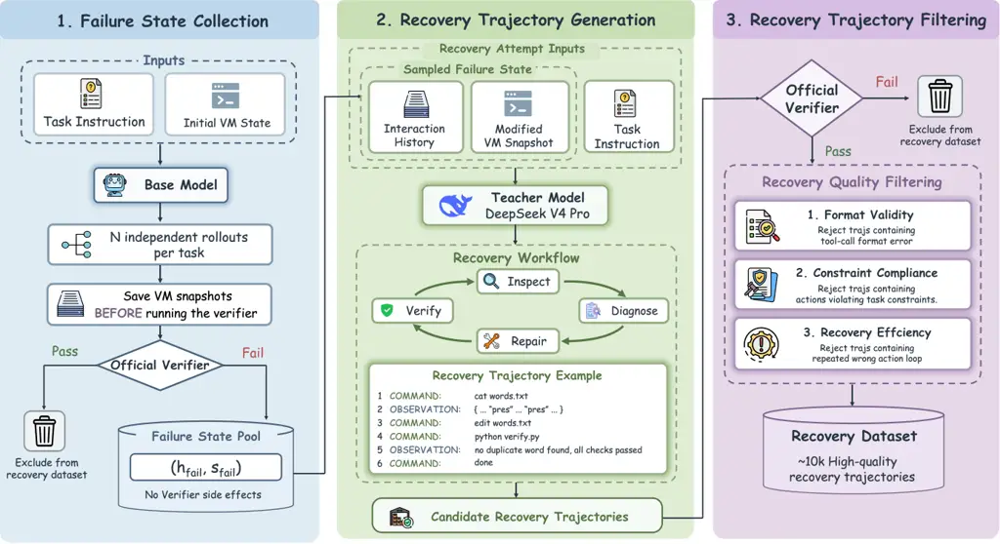

# ReTerm: Recovery Training for Self-Improving Terminal Agents

Wei Xie Affiliation: Fudan University    Kaituo FengShiming Fu
Affiliation: MMLab, The Chinese University of Hong Kong    Yong Liu
Affiliation: Shanghai Jiao Tong University    Xiangyu Yue
Affiliation: MMLab, The Chinese University of Hong Kong    Shuangjia
Zheng ^(†)^(†)thanks: Corresponding author. Affiliation: Shanghai Jiao
Tong University

###### Abstract

Terminal agents have shown strong abilities in complex coding tasks.
However, they often struggle to recover from errors during long-running
execution (e.g., command errors, faulty implementations), eventually
leading to task failures. To this end, we present ReTerm, a
self-improving terminal agent trained by learning how to recover from
its own failed terminal tasks. To support its training, we construct a
customized data pipeline and produce ReTerm-10K, a high-quality dataset
that provides effective recovery demonstrations for SFT cold start.
Furthermore, we propose ReTerm-GRPO, an online RL algorithm that forks
from the agent’s own failure states to generate multiple independent
self-recovery attempts. By learning from whether these attempts
successfully complete the task, the agent self-improves through its own
recovery experience. Built on Qwen3.5-9B, our ReTerm-9B achieves 34.8%
Pass@1 on Terminal-Bench 2.0, improving over the base model by 14.6
points. Further analysis shows that our method achieves consistently
higher recovery rates across diverse error categories compared with
standard GRPO training. All code, data and model are released at
[https://github.com/twothsnd/ReTerm](https://github.com/twothsnd/ReTerm).

|     |
| --- |
|     |

## 1 Introduction

The ability to interact with terminal environments has become
increasingly important for agents to tackle complex coding tasks
(OpenAI, 2025; Anthropic, 2025a). It allows large language models (LLMs)
to work within runtime environments and make progress on the tasks
through long-horizon interactions. Recent works have constructed large
collections of executable tasks to strengthen this capability. These
tasks support supervised fine-tuning (SFT) on generated trajectories
(Yang et al., 2026a; Jain et al., 2025; Li et al., 2026; Shi et al., 2026) and reinforcement learning (RL) with feedback from task verifiers
(Cao et al., 2025; Gandhi et al., 2026; Ivison et al., 2026; Shen et
al., 2026). Such efforts have achieved substantial performance gains on
challenging benchmarks such as Terminal-Bench 2.0 (Merrill et al.,
2026), highlighting the effectiveness of these training approaches.

Despite these advances, terminal agents still encounter errors
frequently during extended execution and struggle to recover (Merrill et
al., 2026; Feng et al., 2026b). For instance, an agent may meet a
command error, misdiagnose its root cause, and continue acting in the
wrong direction. To address this, a contemporary work, TermiGen (Zhu et
al., 2026), actively injects hand-crafted errors into trajectories to
generate recovery samples for training. However, these artificially
constructed errors may exhibit a distributional mismatch with agents’
own naturally generated errors. Moreover, it relies solely on SFT,
leaving the potential of RL to further enhance terminal agents’ recovery
capability unexplored.

To this end, we introduce ReTerm, a self-improving terminal agent
trained to recover from failures produced during its own execution. We
first construct ReTerm-10K, a recovery trajectory dataset generated by
our dedicated data pipeline. Specifically, we use the base model to
execute terminal tasks and collect failed trajectories together with the
environment states they leave behind. Starting from these failure
states, a stronger model is asked to perform recovery based on the
inherited execution history. We then apply a series of quality filters
to remove unsuccessful, malformed, non-compliant, or inefficient
recovery trajectories, retaining only high-quality samples for SFT cold
start. Unlike conventional trajectory synthesis that teaches an agent to
solve tasks from a clean environment, ReTerm-10K explicitly teaches how
to continue from a faulty environment state, identify what went wrong,
and repair the remaining problems.

Figure 1: An inference example revealing the difference in recovery
behavior between models trained by GRPO and our proposed ReTerm-GRPO.
With ReTerm-GRPO, the model formulates a stronger recovery strategy.

Furthermore, we propose ReTerm-GRPO, an online reinforcement learning
algorithm that explicitly learns self-recovery from errors produced by
the evolving policy. For each sampled failed rollout, ReTerm-GRPO
preserves the resulting execution state and branches into multiple
independent self-recovery attempts from the same failure state. Then,
their verifier outcomes provide group-relative learning signals for
optimizing recovery behaviors, turning self-generated failures into
opportunities for self-improvement. To support recovery training when a
single training batch yields too few failed rollouts, we introduce a
recovery task queue to store recovery tasks across training steps. Newly
constructed tasks are inserted at the front and sampled first, while the
oldest tasks are removed when the queue exceeds its capacity. This
design reduces the need for additional rollouts while keeping recovery
training focused on failures generated by recent policies.

We conduct comprehensive experiments to assess the effectiveness of
ReTerm. Built on Qwen3.5-9B (Qwen Team, 2026), our ReTerm-9B achieves
34.8% Pass@1 on Terminal-Bench 2.0 and 58.4% Pass@1 on SWE-bench
Verified (Chowdhury et al., 2024), establishing strong results on
challenging terminal and coding tasks. Beyond these core evaluations,
ReTerm also shows strong generalization across diverse out-of-domain
benchmarks, improving over the base model by 20.0 points on AIME 2025
and 11.0 points on SpreadsheetBench Verified (Ma et al., 2024).
Moreover, the same improvement trend persists under different agent
harnesses, suggesting that our training induces transferable
capabilities across interaction setups. To better understand where these
gains come from, we identify five representative error categories in
terminal interaction trajectories. Across all categories, ReTerm
consistently exhibits higher recovery rates than the model trained by
standard GRPO (Guo et al., 2025). Our main contributions are summarized
as follows:

- •
  We introduce ReTerm, a self-improving terminal agent developed through
  our recovery-oriented post-training framework. To support its
  training, we build a specialized data pipeline and construct
  ReTerm-10K, a high-quality dataset which offers effective recovery
  samples.
- •
  To further improve recovery capability through online learning, we
  propose ReTerm-GRPO, which learns directly from failure states
  generated by the evolving policy and enables self-recovery capability
  to co-evolve with task-solving capability.
- •
  Extensive experiments demonstrate that ReTerm achieves strong
  performance on multiple tough terminal and coding benchmarks and
  generalizes across various out-of-domain tasks and agent harnesses.

## 2 Related Work

#### Terminal Agent.

Terminal agents, such as Codex (OpenAI, 2025) and Claude Code
(Anthropic, 2025a), have demonstrated strong performance on long-horizon
coding tasks. To assess such systems on complete workflows,
Terminal-Bench 2.0 and OpenThoughts-TBLite provide standardized
evaluations in diverse terminal environments (Merrill et al., 2026;
Raoof et al., 2026). Recent work advances terminal agents’ ability by
scaling verifiable training environments (Gandhi et al., 2026; Shen et
al., 2026; Li et al., 2026; Pi et al., 2026) and training agents with
reinforcement learning from verifiable rewards (Yang et al., 2026b). For
instance, TMax generates large-scale synthetic terminal tasks and
explores a reinforcement learning algorithm that filters unstable token
updates, mitigating training instability in long-horizon terminal tasks
(Ivison et al., 2026). ECHO enhances terminal agents’ understanding of
environment dynamics by introducing an auxiliary observation prediction
objective (Shrivastava et al., 2026). However, prior work mainly focuses
on improving task execution. Our work complements these efforts by
studying terminal agents’ recovery ability.

#### Self-Correction.

Self-correction has been widely studied as a way to improve language
model outputs through iterative critique and revision (Madaan et al.,
2023; Shinn et al., 2023; Fan et al., 2026). Prior work has explored SFT
and RL methods to enhance self-correction in static reasoning tasks
(Kumar et al., 2025; Zhang et al., 2026). In interactive environments,
however, self-correction is more challenging since erroneous actions may
alter the environment and affect subsequent execution (Yuan et al.,
2025). Thus, recent work has explored self-correction training in
terminal settings. TermiGen synthesizes recovery trajectories through
active error injection and uses them for SFT (Zhu et al., 2026).
However, hand-crafted errors may exhibit a distributional mismatch with
agents’ own execution errors. Our work differs by training terminal
agents to recover from self-generated failure states.

## 3 Method

### 3.1 Recovery Dataset Formulation



Figure 2: Overview of our data curation pipeline. Starting from an
executable task, we collect various failed attempts induced by the base
model. Then, a stronger model is asked to recover from the resulting
failure state based on the limited information. For the generated
recovery continuations, we finally apply four-step quality filtering and
construct a high-quality dataset.

Training terminal agents to correct their execution errors requires
demonstrations of successful recovery. As illustrated in Figure 2, we
construct such demonstrations through a three-stage pipeline based on
the tasks sampled from TMax-15K (Ivison et al., 2026). First, we execute
the base model on terminal tasks and preserve the interaction history
and environment state of failed attempts. Second, we restore these
failure states and use a stronger teacher model to generate recovery
continuations. Finally, we filter the resulting recovery trajectories,
retaining only high-quality ones for training.

#### Failure State Collection.

We first collect the failed attempts induced by the base model. To
guarantee the diversity of the failures, we use the base model (e.g.,
Qwen3.5-9B (Qwen Team, 2026)) to sample multiple attempts for each task.
In practice, we execute each attempt in a task container hosted inside a
virtual machine and record the full interaction history, including
reasoning content, commands, and observations. To isolate the changes
introduced by the task verifier, at the end of each attempt, we pause
the virtual machine, take a snapshot of its running state and then
resume it to run the verification. Based on the verification results, we
retain the snapshots and interaction histories of failed attempts for
the next stage and exclude successful attempts.

#### Recovery Trajectory Generation.

For each failed attempt, we then restore the saved snapshot and employ
DeepSeek-V4-Pro (Xu et al., 2026) to continue the task conditioned on
the original task instruction and the student’s interaction history.
Specifically, the teacher model is only informed that the previous
attempt failed but receives no detailed feedback from the hidden tests,
so it must infer the unresolved problems from the execution history and
the restored environment. To guide this process, we provide a recovery
workflow that encourages the teacher to inspect the inherited state,
diagnose the failure, plan and execute repairs, and verify the resulting
work. After completing the recovery attempt, we record the teacher’s
continuation as a candidate recovery trajectory for subsequent
filtering. The full recovery workflow is provided in the appendix.

#### Recovery Trajectory Filtering.

The resulting candidate recovery trajectories are then filtered along
four dimensions to ensure recovery quality. (1) Verifier filtering
retains only recoveries that pass the task verifier. (2) Format
filtering removes recoveries with malformed messages or tool calls. (3)
Compliance filtering excludes recoveries containing actions that
explicitly violate task constraints. (4) Efficiency filtering discards
recoveries including meaningless action loops in which the agent repeats
unsuccessful commands without effective adjustment. The verifier and
format filtering are implemented with deterministic rule-based checks.
For compliance and efficiency, we first apply rule-based checks to flag
trajectories with potential compliance or efficiency issues. We then use
DeepSeek-V4.1-Flash (Xu et al., 2026) to assess each flagged case in
context and determine whether it should be filtered out. Finally, we
obtain roughly 10K high-quality recovery trajectories after the
four-step filtering. Detailed review prompts are provided in the
appendix.

Figure 3: ReTerm-10K dataset statistics. (a) Domain distribution of
recovery trajectories. The nine domains have relatively even shares
(8.4–14.2%), and file operations account for the largest share. (b)
Distribution of output token count in recovery continuations. The 4–8k
token range is the most common (37.1%), and 69.6% of recoveries contain
2–8k output tokens. (c) Distribution of assistant turns in the recovery
continuation. 9–16 turns is the most common range (38.0%), and 87.8% of
recoveries finish within 32 turns.

#### Recovery-Targeted Supervision.

We next use the filtered recovery trajectories for SFT. Although the
teacher model is guided by a structured recovery workflow during data
generation, we remove this additional guidance to reduce reliance on
this detailed instruction and retain only a minimal recovery prompt.
Accordingly, the resulting training examples take the task instruction,
the student’s failed interaction history, and the recovery prompt as
input, while the loss is computed solely on the teacher-generated
tokens:

```math
\mathcal{L}_{\mathrm{SFT}}=-\mathbb{E}_{(x,h_{f},r,y)\sim\mathcal{D}_{\mathrm{ReTerm}}}\left[\sum_{t\in\mathcal{A}(y)}\log\pi_{\theta}\!\left(y_{t}\mid x,h_{f},r,y_{<t}\right)\right], \tag{1}
```

where $`x`$ is the task instruction, $`h_{f}`$ is the student’s
interaction history in the failed attempt, $`r`$ is the recovery prompt
and $`y`$ is the teacher’s subsequent recovery trajectory.
$`\mathcal{A}(y)`$ denotes the positions of teacher-generated tokens.
All other tokens are masked from the loss.

### 3.2 ReTerm-GRPO

Figure 4: An illustration of our proposed ReTerm-GRPO.

The recovery demonstrations used for SFT are constructed from failures
generated by a fixed base model. As the policy evolves during RL,
however, its failure distribution may shift beyond that represented in
the fixed dataset. We therefore introduce ReTerm-GRPO, which allows
self-recovery capability to adapt alongside task-solving capability.

#### Algorithm Overview.

Figure 4 illustrates the overall training procedure of ReTerm-GRPO. We
start from an original task pool $`\mathcal{T}=\{(x,s_{0})\}`$, where
$`x`$ denotes the task instruction and $`s_{0}`$ denotes its initial
environment state. For each original task, the policy generates $`G`$
independent rollouts from $`s_{0}`$:

```math
\tau_{i}^{O}\sim\pi_{\theta_{\mathrm{old}}}(\cdot\mid x,s_{0}),\qquad R_{i}^{O}=V_{x}(s_{i}^{O}),\quad i=1,\ldots,G, \tag{2}
```

where $`\tau_{i}^{O}`$ denotes the $`i`$-th rollout for an original
task, $`s_{i}^{O}`$ is its final environment state, $`V_{x}`$ is the
task verifier, and $`R_{i}^{O}`$ is the corresponding verifier reward.
For each original task group containing at least one failed rollout, we
sample one failed rollout and preserve its interaction history $`h_{f}`$
and resulting environment state $`s_{f}`$. Together with the original
task instruction $`x`$, we define the corresponding recovery task as
$`(x,h_{f},s_{f})`$, which requires the policy to recover from the
resulting failure state and complete the original task. We store the
constructed recovery tasks in a recovery task queue, from which they are
sampled in subsequent training iterations. For each recovery task
sampled from the queue, we provide a recovery prompt $`r`$ and generate
$`G`$ independent recovery rollouts from $`s_{f}`$:

```math
\tau_{i}^{R}\sim\pi_{\theta_{\mathrm{old}}}(\cdot\mid x,h_{f},r,s_{f}),\qquad R_{i}^{R}=V_{x}(s_{i}^{R}),\quad i=1,\ldots,G, \tag{3}
```

where $`\tau_{i}^{R}`$ denotes the $`i`$-th rollout for a recovery task,
and $`s_{i}^{R}`$ and $`R_{i}^{R}`$ are its final environment state and
verifier reward, respectively. For both original and recovery tasks, the
verifier rewards of the $`G`$ rollouts are normalized within each group
to derive group-relative advantages. We subsequently optimize the policy
jointly over the two types of groups.

#### Recovery Task Queue.

Since a single training batch may not contain enough failed rollouts, we
maintain a recovery task queue with capacity $`K`$ to retain recovery
tasks across training steps. The stored tasks supplement newly
constructed recovery tasks, allowing recovery training to proceed even
when the current batch produces few or no failures, without requiring
additional original task rollouts solely for failure collection. To keep
the sampled tasks relevant to the evolving policy, newly constructed
tasks are inserted at the front of the queue and sampled before older
ones. When the queue exceeds its capacity, the oldest tasks are removed,
limiting the accumulation of failures generated by much earlier
policies. By retaining recovery tasks across iterations while favoring
recent ones, the queue reduces rollout collection overhead and limits
the mismatch between the sampled recovery tasks and the current policy’s
failure distribution.

#### Policy Optimization.

ReTerm-GRPO computes group-relative advantages and the corresponding
GRPO objective (Guo et al., 2025; Feng et al., 2026a) separately for
original and recovery task groups, and then combines the two objectives
for joint policy optimization. For a training group $`g`$ of type
$`c\in\{\mathrm{O},\mathrm{R}\}`$, where $`\mathrm{O}`$ and
$`\mathrm{R}`$ denote original and recovery task groups, respectively,
let $`\mathcal{A}_{g,i}^{c}`$ denote the model-generated token positions
included in optimization for the $`i`$-th rollout. The training
objective is

```math
\displaystyle\mathcal{J}_{g}^{c}(\theta)\!=\!\mathbb{E}\Bigg[\!\frac{1}{G}\sum_{i=1}^{G}\frac{1}{|\mathcal{A}_{g,i}^{c}|}\!\sum_{t\in\mathcal{A}_{g,i}^{c}}\!\!\min\!\Big\{ \displaystyle\rho_{g,i,t}^{c}(\theta)\hat{A}_{g,i}^{c},\operatorname{clip}\!\left(\rho_{g,i,t}^{c}(\theta),1\!-\!\epsilon_{\mathrm{low}},1\!+\!\epsilon_{\mathrm{high}}\right)\!\hat{A}_{g,i}^{c}\Big\}\Bigg]. \tag{4}
```

For each rollout, the policy ratio and group-relative advantage are
defined as

```math
\rho_{g,i,t}^{c}(\theta)=\frac{\pi_{\theta}(y_{g,i,t}^{c}\mid h_{g,i,t}^{c})}{\pi_{\theta_{\mathrm{old}}}(y_{g,i,t}^{c}\mid h_{g,i,t}^{c})},\qquad\hat{A}_{g,i}^{c}=\frac{R_{g,i}^{c}-\operatorname{mean}(R_{g,j}^{c})}{\operatorname{std}(R_{g,j}^{c})+\delta}. \tag{5}
```

Here, $`y_{g,i,t}^{c}`$ denotes the model-generated token at position
$`t`$, $`h_{g,i,t}^{c}`$ denotes its preceding context, and
$`R_{g,i}^{c}`$ is the verifier reward of the corresponding rollout. Let
$`M_{\mathrm{O}}`$ and $`M_{\mathrm{R}}`$ denote the numbers of original
task and recovery task groups. The overall ReTerm-GRPO objective is

```math
\mathcal{J}_{\mathrm{ReTerm}}(\theta)=\frac{1}{M_{\mathrm{O}}+M_{\mathrm{R}}}\left(\sum_{g=1}^{M_{\mathrm{O}}}\mathcal{J}_{g}^{\mathrm{O}}(\theta)+\sum_{g=1}^{M_{\mathrm{R}}}\mathcal{J}_{g}^{\mathrm{R}}(\theta)\right). \tag{6}
```

In this way, ReTerm-GRPO enables the model to continuously adapt to its
evolving failure modes, allowing self-recovery capability to co-evolve
with task-solving ability throughout training.

## 4 Experiment

### 4.1 Experimental Setup

#### Training Details.

Our training is performed on 16 NVIDIA A100 (80GB) GPUs. We use
Qwen3.5-9B as the base model and partition ReTerm-10K into 6K
trajectories for SFT and 4K task instances for RL. We perform
full-parameter SFT using AdamW with a global batch size of 16 and a
learning rate of $`5\times 10^{-6}`$. We subsequently initialize
ReTerm-GRPO from the SFT checkpoint. For every update, we sample 8
original task groups and 2 recovery task groups. Each GRPO group
contains 16 rollouts and therefore the global batch size is 160. We use
AdamW with a learning rate of $`5\times 10^{-7}`$. Rollouts are sampled
with a maximum generation length of 8,192 tokens, a 65k context window,
and at most 32 interaction turns.

#### Benchmarks.

We evaluate ReTerm on seven benchmarks spanning a variety of domains.
First, we use OpenThoughts-TBLite (OpenThoughts-Agent Team et al., 2026)
and Terminal-Bench 2.0 (Merrill et al., 2026), which contain diverse
executable tasks requiring long-horizon interaction with terminal
environments. We further evaluate on SWE-bench Verified (Chowdhury et
al., 2024), a human-verified benchmark for resolving real-world software
issues in GitHub repositories. To assess out-of-domain generalization,
we include AIME 2024, AIME 2025, Aider Polyglot (Aider, 2024) and
SpreadsheetBench Verified (Ma et al., 2024).

#### Evaluation Protocol.

We implement and use a lightweight ReAct-style harness that exposes a
Bash interface. We allocate a 256k-token budget per task, set the
maximum generation length to 16k tokens, and use a temperature of 1.0,
top-$`p`$ of 1.0, with the task seed fixed at 0 during inference.
Qwen3.5-9B is evaluated under exactly the same harness and evaluation
configuration as ReTerm. For other models, we report results from their
original papers or official releases when available.

|                                    |            |                      |                    |                    |
| ---------------------------------- | ---------- | -------------------- | ------------------ | ------------------ |
| Model                              | Model Size | OpenThoughts- TBLite | Terminal-Bench 2.0 | SWE-bench Verified |
| Closed-Source Models               |            |                      |                    |                    |
| GPT-5 mini                         | –          | –                    | 38.2               | –                  |
| Gemini 3 Flash                     | –          | –                    | 47.6               | 78.0               |
| Claude Sonnet 4.5                  | –          | –                    | 51.0               | 77.2               |
| Claude Opus 4.6                    | –          | –                    | 65.4               | 80.8               |
| Gemini 3.1 Pro                     | –          | –                    | 68.5               | 80.6               |
| GPT-5.5                            | –          | –                    | 82.7               | –                  |
| Open-Source Models ($`>100`$B)     |            |                      |                    |                    |
| GLM-4.7                            | 358B       | –                    | 41.0               | 73.8               |
| Qwen3.5-122B-A10B                  | 122B-A10B  | –                    | 49.4               | 72.0               |
| Kimi K2.5                          | 1T-A32B    | –                    | 50.8               | 76.8               |
| MiniMax-M2.5                       | 230B-A10B  | –                    | 51.7               | 80.2               |
| Qwen3.5-397B-A17B                  | 397B-A17B  | –                    | 52.5               | 76.4               |
| GLM-5                              | 744B-A40B  | –                    | 56.2               | 77.8               |
| Open-Source Models ($`\leq 100`$B) |            |                      |                    |                    |
| Qwen3-8B                           | 8B         | 4.9                  | 1.6                | 0.7                |
| Qwen3-14B                          | 14B        | 5.7                  | 4.3                | –                  |
| Qwen3-32B                          | 32B        | 13.7                 | 7.5                | 29.1               |
| Qwen3.5-4B                         | 4B         | 31.8                 | 16.6               | –                  |
| Qwen3.5-9B                         | 9B         | 44.2                 | 20.2               | 45.2               |
| TMax-4B                            | 4B         | 42.6                 | 18.9               | –                  |
| TMax-9B                            | 9B         | 57.2                 | 27.2               | 53.5               |
| Socratic-SWE                       | 9B         | –                    | 14.6               | 50.4               |
| ECHO-14B                           | 14B        | 15.1                 | 10.8               | –                  |
| Terminal-World-32B                 | 32B        | –                    | 31.5               | –                  |
| TermiGen-32B                       | 32B        | –                    | 19.3               | 21.4               |
| OpenThinkerAgent-32B               | 32B        | 41.3                 | 26.2               | 54.0               |
| Nemotron-Terminal-32B              | 32B        | –                    | 25.1               | 41.9               |
| ReTerm-9B (Ours)                   | 9B         | 60.6                 | 34.8               | 58.4               |

Table 1: Performance comparison on OpenThoughts-TBLite, Terminal-Bench
2.0, and SWE-bench Verified. All results are Pass@1 (%).

### 4.2 Main Results

Table 1 reports the main results across the three core agentic
benchmarks. ReTerm-9B achieves 60.6% Pass@1 on OpenThoughts-TBLite,
34.8% on Terminal-Bench 2.0, and 58.4% on SWE-bench Verified,
corresponding to gains of 16.4, 14.6, and 13.2 points over its
Qwen3.5-9B base model, respectively. At the same model scale, ReTerm-9B
consistently outperforms TMax-9B across all three benchmarks. On
SWE-bench Verified, it also surpasses Socratic-SWE, a self-evolving
software engineering agent built on Qwen3.5-9B. Despite its smaller
model size, ReTerm-9B further outperforms several 32B specialized
agents, including Terminal-World-32B on Terminal-Bench 2.0 and
OpenThinkerAgent-32B on SWE-bench Verified. Overall, these results
demonstrate strong and consistent gains across challenging terminal
tasks and repository-level software engineering.

### 4.3 Generalization

In this section, we examine whether the gains of ReTerm generalize
beyond its default training setup. Specifically, we evaluate two
aspects: robustness across different agent harnesses and transfer to
out-of-domain task distributions.

#### Across Agent Harnesses.

An agent’s performance can depend on the harness that mediates
interaction with the environment, including its prompting format, tool
interface, and interaction protocol. Therefore, we examine whether
ReTerm’s improvement is tied to the particular interaction setup. To
isolate harness effects from task-distribution changes, we keep the
Terminal-Bench 2.0 tasks fixed and evaluate both Qwen3.5-9B and
ReTerm-9B under four harnesses: our training harness (ReAct), Terminus-2
(Merrill et al., 2026), mini-SWE-agent (Yang et al., 2024), and
OpenHands (Wang et al., 2025).

| Model      | Ours  | Terminus-2 | mini-SWE-agent | OpenHands |
| ---------- | ----- | ---------- | -------------- | --------- |
| Qwen3.5-9B | 20.2  | 22.5       | 19.1           | 15.7      |
| ReTerm-9B  | 34.8  | 32.6       | 25.8           | 28.1      |
| $`\Delta`$ | +14.6 | +10.1      | +6.7           | +12.4     |

Table 2: Generalization performance across agent harnesses. All results
are Pass@1 (%).

Table 2 shows that ReTerm-9B consistently improves over the base
Qwen3.5-9B model under all four agent harnesses. It gains 14.6
percentage points under our training harness and retains improvements of
6.7–12.4 points under the three alternative harnesses. Although the
largest gain is observed when the training and evaluation harnesses
match, the improvement remains substantial across different interaction
setups. This suggests that the benefits of our recovery-oriented
training are not specific to the interaction schema during training, but
transfer across different agent harnesses to a meaningful extent.

#### Across Task Domains.

We next evaluate whether the improvements of ReTerm extend to task
distributions that differ substantially from these settings.
Specifically, we consider three complementary domains. AIME 2024 and
AIME 2025 evaluate mathematical reasoning without requiring long-horizon
environment interaction. Aider Polyglot (Aider, 2024) evaluates
challenging coding problems across six programming languages.
SpreadsheetBench Verified (Ma et al., 2024) evaluates real-world
spreadsheet manipulation tasks involving complex table structures,
formulas, and diverse spreadsheet operations.

| Model      | AIME 2024 | AIME 2025 | Aider Polyglot | SpreadsheetBench-V |
| ---------- | --------- | --------- | -------------- | ------------------ |
| Qwen3.5-9B | 76.7      | 73.3      | 17.3           | 37.8               |
| ReTerm-9B  | 86.7      | 93.3      | 20.4           | 48.8               |
| $`\Delta`$ | +10.0     | +20.0     | +3.1           | +11.0              |

Table 3: Generalization performance across task domains. All results are
Pass@1 (%).

As shown in Table 3, ReTerm-9B performs better than the base model on
all four out-of-domain benchmarks. The improvement is especially
substantial on AIME 2025 and SpreadsheetBench-Verified, reaching +20.0
and +11.0 points, while positive changes are also observed on AIME 2024
and Aider Polyglot. This broad improvement pattern suggests that
ReTerm’s performance advantage is not restricted to the terminal and
software-engineering benchmarks used in our main evaluation.

### 4.4 Ablation Study

| Method      | Terminal-Bench 2.0 |
| ----------- | ------------------ |
| Base        | 20.2               |
| SFT         | 25.8               |
| GRPO        | 28.0               |
| ReTerm-GRPO | 34.8               |

Table 4: Ablation study on Terminal-Bench 2.0. All results are Pass@1
(%).

In this section, we compare four training settings to examine the
contribution of different stages in ReTerm: (1) Base, the original
Qwen3.5-9B model without post-training; (2) SFT, which applies
supervised fine-tuning only; (3) GRPO, which performs standard GRPO
training instead of ReTerm-GRPO; and (4) ReTerm-GRPO, our proposed
recovery-oriented RL method. As shown in Table 4, each stage of
post-training improves performance on Terminal-Bench 2.0. SFT provides a
clear gain over the base model, showing the effectiveness of
recovery-targeted supervision. Standard GRPO also improves performance
through reinforcement learning, while ReTerm-GRPO achieves the strongest
result among all variants and substantially outperforms standard GRPO.
The additional gain from ReTerm-GRPO indicates that explicitly
optimizing recovery behavior provides benefits beyond standard RL
training. Overall, the ablation study confirms the effectiveness of our
recovery-oriented training design and highlights the complementary
benefits of supervised fine-tuning and reinforcement learning.

### 4.5 Error Analysis

Figure 5: Recovery rates after encountering different error types.

To understand how our method improves terminal agents, we analyze
trajectories from the base model, the GRPO-trained model, and the
ReTerm-GRPO-trained model on Terminal-Bench 2.0. We define five error
types: (1) Planning Error: misunderstanding requirements or choosing
incorrect strategies; (2) Tool Use Error: mistaken use of terminal
commands, such as invalid commands and improper arguments; (3)
Implementation Error: producing incorrect or incomplete task artifacts;
(4) Verification Error: failing to detect errors through testing and
debugging; and (5) Resource Management Error: leaving the task
unfinished due to poor management of time, interaction budget, or
execution state. We employ DeepSeek-V4.1-Flash (Xu et al., 2026) as an
LLM judge to assess recovery outcomes after the agent encounters each of
the five error types, followed by manual verification. Figure 5 shows
that ReTerm-GRPO achieves higher recovery rates across all categories
than both the base model and the GRPO baseline. Despite these gains,
recovery remains challenging: except for tool use error, the recovery
rates of ReTerm-GRPO remain at or below 32% across all other categories.
This suggests that terminal agents still fail to recover from most
encountered errors, leaving substantial room for further improving
recovery capability.

### 4.6 Training Curves

Figure 6: Mean reward curves during ReTerm-GRPO training.

Figure 6 shows the optimization dynamics of ReTerm-GRPO on original and
recovery tasks. Both groups improve rapidly during the early stage of RL
training and stabilize as training proceeds. Notably, the recovery task
group exhibits a larger improvement from its initial performance. At the
same time, reward on original tasks also improves and remains stable,
suggesting that recovery-oriented examples provide an effective learning
signal and can be jointly optimized with original tasks without
destabilizing the training process.

## 5 Conclusion

In this work, we present ReTerm, a self-improving terminal agent trained
to recover from self-generated execution errors. To support training, we
construct ReTerm-10K, a high-quality dataset that provides effective
recovery demonstrations for SFT cold start. We further propose
ReTerm-GRPO, an online RL algorithm that enables self-recovery
capability to co-evolve with task-solving capability. Extensive
experiments across diverse benchmarks demonstrate the effectiveness of
our approach. We hope this work takes a step toward developing more
capable and robust terminal agents through recovery-driven
self-improvement.

## References

- Aider (2024) Aider Aider-Polyglot Benchmark. Note:
  [https://aider.chat/2024/12/21/polyglot.html#the-polyglot-benchmark](https://aider.chat/2024/12/21/polyglot.html#the-polyglot-benchmark)
  Cited by: §4.1, §4.3.
- Anthropic (2025a) Anthropic Claude code: best practices for agentic
  coding. Note:
  [https://www.anthropic.com/engineering/claude-code-best-practices](https://www.anthropic.com/engineering/claude-code-best-practices)
  Cited by: §1, §2.
- Anthropic (2025b) Anthropic Introducing Claude Sonnet 4.5. Note:
  [https://www.anthropic.com/news/claude-sonnet-4-5](https://www.anthropic.com/news/claude-sonnet-4-5)
  Cited by: Appendix C.
- Anthropic (2026) Anthropic Introducing Claude Opus 4.6. Note:
  [https://www.anthropic.com/news/claude-opus-4-6](https://www.anthropic.com/news/claude-opus-4-6)
  Cited by: Appendix C.
- Cao et al. (2025) S. Cao, D. Li, F. Zhao, S. Yuan, S. R. Hegde, C.
  Chen, C. Ruan, T. Griggs, S. Liu, E. Tang, et al. Skyrl-agent:
  efficient rl training for multi-turn llm agent. arXiv preprint
  arXiv:2511.16108. Cited by: §1.
- Cheng et al. (2026) Z. Cheng, H. Wang, Z. Liu, X. Wang, X. Zhu, Y.
  Guo, W. Lin, J. Z. Pan, and Y. Wang Terminal-world: scaling
  terminal-agent environments via agent skills. arXiv preprint
  arXiv:2605.20876. Cited by: Appendix C.
- Chowdhury et al. (2024) N. Chowdhury, J. Aung, C. J. Shern, O.
  Jaffe, D. Sherburn, G. Starace, E. Mays, R. Dias, M. Aljubeh, M.
  Glaese, C. E. Jimenez, J. Yang, L. Ho, T. Patwardhan, K. Liu, and A.
  Madry Introducing SWE-bench verified. External Links:
  [Link](https://openai.com/index/introducing-swe-bench-verified/) Cited
  by: §1, §4.1.
- Fan et al. (2026) K. Fan, K. Feng, M. Zhang, T. Peng, Z. Li, Y.
  Jiang, S. Chen, and X. Yue Exploring reasoning reward model for
  agents. In Findings of the Association for Computational Linguistics:
  ACL 2026, pp. 1975–1991. Cited by: §2.
- Feng et al. (2026a) K. Feng, K. Gong, B. Li, Z. Guo, Y. Wang, T.
  Peng, J. Wu, X. Zhang, B. Wang, and X. Yue Video-r1: reinforcing video
  reasoning in mllms. Advances in Neural Information Processing Systems
  38, pp. 99114–99137. Cited by: §3.2.
- Feng et al. (2026b) Y. Feng, J. Sun, Z. Yang, J. Ai, C. Li, Z. Li, F.
  Zhang, K. He, R. Ma, J. Lin, et al. Longcli-bench: a preliminary
  benchmark and study for long-horizon agentic programming in
  command-line interfaces. In Findings of the Association for
  Computational Linguistics: ACL 2026, pp. 29952–29963. Cited by: §1.
- Gandhi et al. (2026) K. Gandhi, S. Garg, N. D. Goodman, and D.
  Papailiopoulos Endless terminals: scaling rl environments for terminal
  agents. arXiv preprint arXiv:2601.16443. Cited by: §1, §2.
- Google DeepMind (2025) Google DeepMind Gemini 3 Flash Model Card.
  Note:
  [https://storage.googleapis.com/deepmind-media/Model-Cards/Gemini-3-Flash-Model-Card.pdf](https://storage.googleapis.com/deepmind-media/Model-Cards/Gemini-3-Flash-Model-Card.pdf)
  Cited by: Appendix C.
- Google DeepMind (2026) Google DeepMind Gemini 3.1 Pro Model Card.
  Note:
  [https://deepmind.google/models/model-cards/gemini-3-1-pro/](https://deepmind.google/models/model-cards/gemini-3-1-pro/)
  Cited by: Appendix C.
- Guo et al. (2025) D. Guo, D. Yang, H. Zhang, J. Song, P. Wang, Q.
  Zhu, R. Xu, R. Zhang, S. Ma, X. Bi, et al. Deepseek-r1: incentivizing
  reasoning capability in llms via reinforcement learning. arXiv
  preprint arXiv:2501.12948. Cited by: §1, §3.2.
- Ivison et al. (2026) H. Ivison, J. O. Yin, R. Shao, T. Xiao, N.
  Lambert, and H. Hajishirzi Tmax: a simple recipe for terminal agents.
  arXiv preprint arXiv:2606.23321. Cited by: Appendix C, §1, §2, §3.1.
- Jain et al. (2025) N. Jain, J. Singh, M. Shetty, L. Zheng, K. Sen,
  and I. Stoica R2e-gym: procedural environments and hybrid verifiers
  for scaling open-weights swe agents. arXiv preprint arXiv:2504.07164.
  Cited by: §1.
- Kumar et al. (2025) A. Kumar, V. Zhuang, R. Agarwal, Y. Su, J. D.
  Co-Reyes, A. Singh, K. Baumli, S. Iqbal, C. Bishop, R. Roelofs, et al.
  Training language models to self-correct via reinforcement learning.
  In International Conference on Learning Representations, Vol. 2025,
  pp. 54523–54549. Cited by: §2.
- Li et al. (2026) Z. Li, Y. Shi, Z. Li, R. Wang, A. Li, Z. Huang, J.
  Yang, L. Ke, N. Liu, H. Mi, et al. Recursive synthesis for
  long-horizon terminal tasks. arXiv preprint arXiv:2608.05466. Cited
  by: §1, §2.
- Ma et al. (2024) Z. Ma, B. Zhang, J. Zhang, J. Yu, X. Zhang, X.
  Zhang, S. Luo, X. Wang, and J. Tang Spreadsheetbench: towards
  challenging real world spreadsheet manipulation. Advances in Neural
  Information Processing Systems 37, pp. 94871–94908. Cited by: §1,
  §4.1, §4.3.
- Madaan et al. (2023) A. Madaan, N. Tandon, P. Gupta, S. Hallinan, L.
  Gao, S. Wiegreffe, U. Alon, N. Dziri, S. Prabhumoye, Y. Yang, et al.
  Self-refine: iterative refinement with self-feedback. Advances in
  neural information processing systems 36, pp. 46534–46594. Cited by:
  §2.
- Merrill et al. (2026) M. Merrill, A. Shaw, N. Carlini, B. Li, H.
  Raj, I. Bercovich, L. Shi, J. Shin, T. Walshe, E. K. Buchanan, et al.
  Terminal-bench: benchmarking agents on hard, realistic tasks in
  command line interfaces. In International Conference on Learning
  Representations, Vol. 2026, pp. 40903–40986. Cited by: §1, §1, §2,
  §4.1, §4.3.
- OpenAI (2025) OpenAI Introducing codex. Note:
  [https://openai.com/index/introducing-codex/](https://openai.com/index/introducing-codex/)
  Cited by: §1, §2.
- OpenAI (2026) OpenAI GPT-5.5 System Card. Note:
  [https://openai.com/index/gpt-5-5-system-card/](https://openai.com/index/gpt-5-5-system-card/)
  Cited by: Appendix C.
- OpenThoughts-Agent Team et al. (2026) OpenThoughts-Agent Team, Snorkel
  AI, and Bespoke Labs OpenThoughts-TBLite: a high-signal benchmark for
  iterating on terminal agents. Note:
  [https://www.openthoughts.ai/blog/openthoughts-tblite](https://www.openthoughts.ai/blog/openthoughts-tblite)
  Cited by: §4.1.
- Pi et al. (2026) R. Pi, G. Lam, M. Shoeybi, P. Jannaty, B. Catanzaro,
  and W. Ping On data engineering for scaling llm terminal capabilities.
  arXiv preprint arXiv:2602.21193. Cited by: Appendix C, §2.
- Qwen Team (2026) Qwen Team Qwen3.5: towards native multimodal agents.
  External Links: [Link](https://qwen.ai/blog?id=qwen3.5) Cited by:
  Appendix C, §1, §3.1.
- Raoof et al. (2026) N. Raoof, R. Zhuang, M. Nezhurina, E. Guha, A.
  Tejaswi, R. Marten, C. F. Ruan, T. Griggs, A. G. Shaw, H. Bansal, et
  al. OpenThoughts-agent: data recipes for agentic models. arXiv
  preprint arXiv:2606.24855. Cited by: Appendix C, §2.
- Shen et al. (2026) Q. Shen, Z. Huang, V. Kamanuru, A. Aliev, J.
  Rainton, A. Awelkair, Z. Zeng, J. Li, S. Dong, Y. Yuan, et al. SETA:
  scaling environments for terminal agents. arXiv preprint
  arXiv:2607.10891. Cited by: §1, §2.
- Shi et al. (2026) K. Shi, Z. Wang, Q. Su, S. Huang, Z. Zhang, Z.
  Fang, Q. Ren, J. Liu, Y. Zeng, Y. Zhao, et al. FACET: preserving
  source intent and executable state in terminal task synthesis. arXiv
  preprint arXiv:2608.18580. Cited by: §1.
- Shinn et al. (2023) N. Shinn, F. Cassano, A. Gopinath, K. Narasimhan,
  and S. Yao Reflexion: language agents with verbal reinforcement
  learning. Advances in neural information processing systems 36,
  pp. 8634–8652. Cited by: §2.
- Shrivastava et al. (2026) V. Shrivastava, P. Kauffmann, A. Awadallah,
  and D. Papailiopoulos Echo: terminal agents learn world models for
  free. arXiv preprint arXiv:2605.24517. Cited by: Appendix C, §2.
- Singh et al. (2025) A. Singh, A. Fry, A. Perelman, A. Tart, A.
  Ganesh, A. El-Kishky, A. McLaughlin, A. Low, A. Ostrow, A. Ananthram,
  et al. Openai gpt-5 system card. arXiv preprint arXiv:2601.03267.
  Cited by: Appendix C.
- Team et al. (2026) K. Team, T. Bai, Y. Bai, Y. Bao, S. Cai, Y. Cao, Z.
  Chai, Y. Charles, H. Che, C. Chen, et al. Kimi k2. 5: visual agentic
  intelligence. arXiv preprint arXiv:2602.02276. Cited by: Appendix C.
- Team (2026) M. Team MiniMax m2. 5: built for real-world productivity.
  Cited by: Appendix C.
- Wang et al. (2025) X. Wang, B. Li, Y. Song, F. F. Xu, X. Tang, M.
  Zhuge, J. Pan, Y. Song, B. Li, J. Singh, et al. Openhands: an open
  platform for ai software developers as generalist agents. In
  International Conference on Learning Representations, Vol. 2025,
  pp. 65882–65919. Cited by: §4.3.
- Xiao et al. (2026) C. Xiao, Z. Jiao, S. Wang, W. Wang, B. Zhao, H.
  Wei, L. Zhang, and L. Qu Socratic-swe: self-evolving coding agents via
  trace-derived agent skills. arXiv preprint arXiv:2606.07412. Cited by:
  Appendix C.
- Xu et al. (2026) A. Xu, B. Lin, B. Xue, B. Wang, B. Xu, B. Wu, B.
  Zhang, C. Lin, C. Dong, C. Ling, et al. Deepseek-v4: towards highly
  efficient million-token context intelligence. arXiv preprint
  arXiv:2606.19348. Cited by: §3.1, §3.1, §4.5.
- Yang et al. (2025) A. Yang, A. Li, B. Yang, B. Zhang, B. Hui, B.
  Zheng, B. Yu, C. Gao, C. Huang, C. Lv, et al. Qwen3 technical report.
  arXiv preprint arXiv:2505.09388. Cited by: Appendix C.
- Yang et al. (2024) J. Yang, C. Jimenez, A. Wettig, K. Lieret, S.
  Yao, K. Narasimhan, and O. Press Swe-agent: agent-computer interfaces
  enable automated software engineering. Advances in Neural Information
  Processing Systems 37, pp. 50528–50652. Cited by: §4.3.
- Yang et al. (2026a) J. Yang, K. Lieret, C. Jimenez, A. Wettig, K.
  Khandpur, Y. Zhang, B. Hui, O. Press, L. Schmidt, and D. Yang
  Swe-smith: scaling data for software engineering agents. Advances in
  Neural Information Processing Systems 38. Cited by: §1.
- Yang et al. (2026b) J. Yang, Y. Shi, Z. Li, R. Wang, Z. Li, H. Mi,
  and L. Liang T1: terminal agent reinforcement learning for
  long-horizon tasks. arXiv preprint arXiv:2609.11042. Cited by: §2.
- Yuan et al. (2025) S. Yuan, Z. Chen, Z. Xi, J. Ye, Z. Du, and J. Chen
  Agent-r: training language model agents to reflect via iterative
  self-training. arXiv preprint arXiv:2501.11425. Cited by: §2.
- Z.ai (2025) Z.ai GLM-4.7: advancing the coding capability. Note:
  [https://z.ai/blog/glm-4.7](https://z.ai/blog/glm-4.7) Cited by:
  Appendix C.
- Zeng et al. (2026) A. Zeng, X. Lv, Z. Hou, Z. Du, Q. Zheng, B.
  Chen, D. Yin, C. Ge, C. Huang, C. Xie, et al. Glm-5: from vibe coding
  to agentic engineering. arXiv preprint arXiv:2602.15763. Cited by:
  Appendix C.
- Zhang et al. (2026) X. Zhang, Y. Zhang, H. Sun, K. Feng, C. Lu, C.
  Yang, and H. M. Meng Advancing llm reasoning with natural language and
  numerical feedback. In International Conference on Machine Learning,
  pp. 160575–160632. Cited by: §2.
- Zhu et al. (2026) K. Zhu, Y. Nie, Y. Li, Y. Huang, J. Wu, J. Liu, X.
  Sun, Z. Yin, L. Wang, Z. Liu, et al. Termigen: high-fidelity
  environment and robust trajectory synthesis for terminal agents. arXiv
  preprint arXiv:2602.07274. Cited by: Appendix C, §1, §2.

## Appendix A Prompt Template

### A.1 System Prompt


### A.2 Data Curation


### A.3 Error Analysis


## Appendix B Case Study

To examine recovery behavior, we select five representative intermediate
failure states from the base model’s trajectories. Each state
corresponds to one of the five error types defined in Section 4.5. We
then resume both the GRPO baseline and our ReTerm-GRPO-trained model
from the same environment state and interaction history, and compare how
they diagnose the failure, adjust their actions, and make progress
toward task completion. The five cases are drawn from Terminal-Bench 2.0
tasks: distribution-search, qemu-alpine-ssh, tune-mjcf,
break-filter-js-from-html, and git-multibranch.

### B.1 Planning Error


### B.2 Tool Use Error


### B.3 Implementation Error


### B.4 Verification Error


### B.5 Resource Management Error


## Appendix C Baselines

We compare our model with the following baselines: GPT-5 mini (Singh et
al., 2025), Gemini 3 Flash (Google DeepMind, 2025), Claude Sonnet 4.5
(Anthropic, 2025b), Claude Opus 4.6 (Anthropic, 2026), Gemini 3.1 Pro
(Google DeepMind, 2026), GPT-5.5 (OpenAI, 2026), GLM-4.7 (Z.ai, 2025),
GLM-5 (Zeng et al., 2026), Qwen3-8B, Qwen3-14B, and Qwen3-32B (Yang et
al., 2025), Qwen3.5-4B, Qwen3.5-9B, Qwen3.5-122B-A10B, and
Qwen3.5-397B-A17B (Qwen Team, 2026), Kimi K2.5 (Team et al., 2026),
MiniMax-M2.5 (Team, 2026), TMax-4B and TMax-9B (Ivison et al., 2026),
Socratic-SWE (Xiao et al., 2026), ECHO-14B (Shrivastava et al., 2026),
Terminal-World-32B (Cheng et al., 2026), TermiGen-32B (Zhu et al.,
2026), OpenThinkerAgent-32B (Raoof et al., 2026), and
Nemotron-Terminal-32B (Pi et al., 2026).
