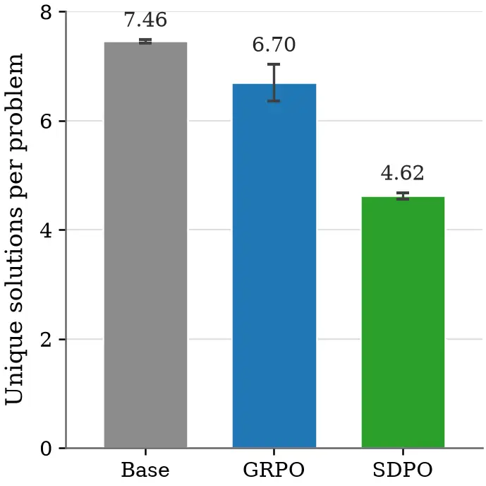
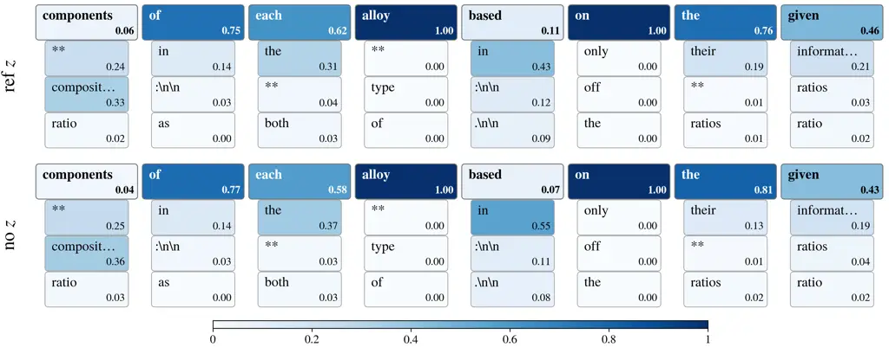
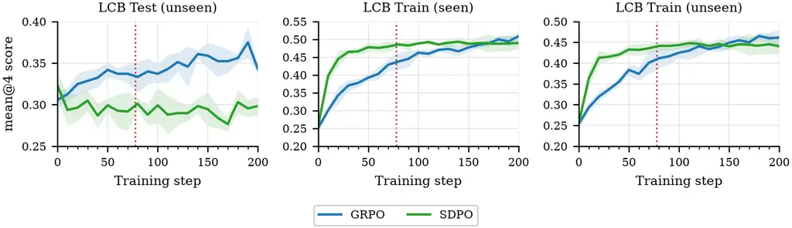
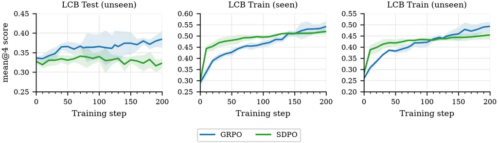
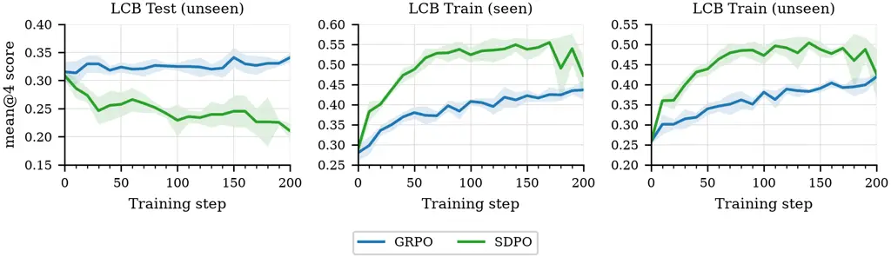
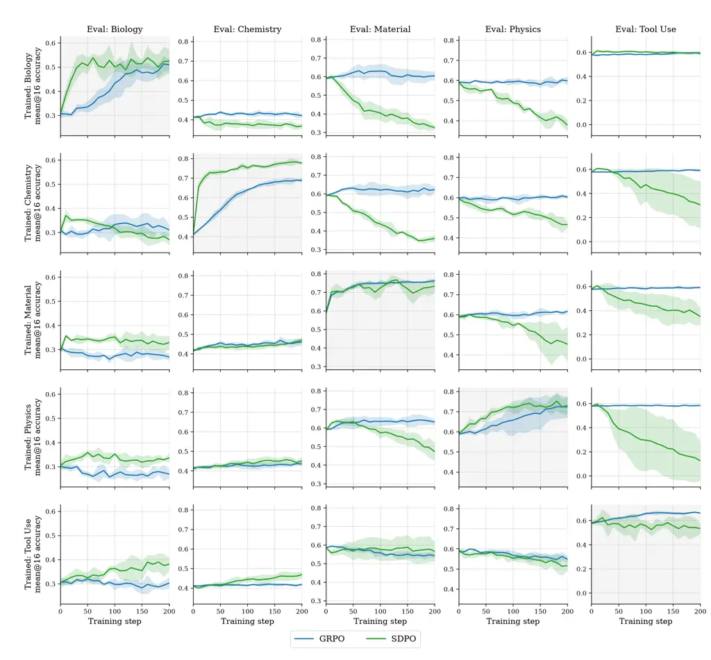

\\\_cmd_normalize_type_g:w

g \\\_cmd_normalize_type_g:wg \\\_cmd_normalize_type_g:wg
\\\_cmd_normalize_type_g:wg \\\_cmd_normalize_type_g:wg
\\\_cmd_normalize_type_g:wg

# Does self-distillation improve reasoning?

Jason Ken Adhinarta ^(†)^(†)thanks: Equal contribution.
Affiliation: Massachusetts Institute of Technology    Raina
Wu¹¹footnotemark: 1 Affiliation: Massachusetts Institute of Technology
   Ashutosh Sharma Affiliation: MIT-IBM Computing Research Lab   
Avinash Balakrishnan Affiliation: MIT-IBM Computing Research Lab   
Rameswar Panda Affiliation: MIT-IBM Computing Research Lab    Polina
Golland Affiliation: Massachusetts Institute of Technology    Yoon Kim
Affiliation: Massachusetts Institute of Technology    Zhang-Wei Hong
Affiliation: MIT-IBM Computing Research Lab

###### Abstract

Self-distillation is an emerging approach that trains a model to imitate
its own predictions when conditioned on privileged information, such as
correct answers or environmental feedback. Recent methods have reported
better sample efficiency and generalization than reinforcement learning
(RL), but it remains unclear whether these gains extend beyond
in-distribution evaluations and whether they stem from privileged
distillation. In this paper, we revisit two representative methods,
Self-Distillation Policy Optimization (SDPO) and On-Policy
Self-Distillation (OPSD), across code, science, tool use, and math
reasoning tasks. We find that their reported gains do not consistently
generalize to unseen problems and are largely explained by overfitting
or transferring existing reasoning behavior, rather than effectively
using privileged information. Moreover, self-distillation gradients show
weak alignment with policy gradients that directly optimize expected
reward, questioning whether they provide an effective direction for
policy improvement. Our experiments across Qwen3 models (1.7B–14B) and
OLMo-3-7B suggest that effectively leveraging privileged information to
improve reasoning remains an open challenge. Our code is available at
[https://github.com/sleepypandu/does-sd-improve-reasoning](https://github.com/sleepypandu/does-sd-improve-reasoning).

|     |
| --- |
|     |

## 1 Introduction



Figure 1: SDPO reduces solution diversity on LiveCodeBench v6.
AST-unique solutions per training problem (from $`8`$ samples) for
Qwen3-14B before (Base) and after $`200`$ steps of GRPO or SDPO (mean
$`\pm`$ std, four seeds). Diversity collapse suggests memorization.

Reinforcement learning with verifiable rewards (RLVR) has become a
standard approach for finetuning large language models (LLMs) on
reasoning tasks such as mathematics and coding (Lambert et al., 2025;
Guo et al., 2025). As responses in these domains are automatically
verifiable, scaling RLVR is straightforward. However, typical RLVR
pipelines use binary rewards that indicate only whether the final answer
is correct or whether all unit tests pass. Such rewards provide no
information on how attempted solutions should be revised. Process reward
models score individual reasoning steps (Wang et al., 2024; Cui et al.,
2025), but require training additional models.

A recently popularized alternative to RLVR is self-distillation, which
requires neither an external stronger model nor an explicit reward
function. It exploits the fact that reasoning tasks often come with
feedback far richer than the binary outcome that RLVR consumes, such as
reference solutions, critiques, error messages, or failing unit tests.
In self-distillation, the model samples a trace and is trained to match,
at each token along that trace, the distribution of a (teacher) copy of
itself that additionally conditions on this privileged information
(Hübotter et al., 2026; Shenfeld et al., 2026; Zhao et al., 2026a). The
self-conditioned teacher converts rich but unstructured feedback into a
dense, per-token training signal.

However, prior work questions the validity of self-distillation
objectives as a mechanism to improve the student policy. The
self-conditioned teacher’s outputs do not express uncertainty through
tokens such as “wait”, “hmmm”, and “perhaps,” so training against it
suppresses the model’s ability to correct past mistakes as it reasons
and shortens the student’s traces in ways that hurt performance (Kim et
al., 2026; Pan et al., 2026; Kaur et al., 2026). Moreover, the
self-conditioned teacher is unable to consistently distinguish between
correct and incorrect student generations (Harne et al., 2026; Nguyen et
al., 2026). Together, these results raise a more fundamental question:
does self-distillation extract useful guidance from privileged
information, or are its reported gains driven by simpler mechanisms?



Figure 2: The reference solution barely changes the self-distillation
teacher. Teacher log-probabilities (thinking on) along a Qwen3-8B
thinking-off student rollout on an OpenThoughts problem, with the
problem’s reference solution in context (ref $`z`$, top) and with no
solution (no $`z`$, bottom). In each panel, the first row is the sampled
token and the three rows below are the student’s next three most likely
tokens. The two teachers assign very similar probabilities, suggesting
that OPSD distillation effects do not significantly depend on $`z`$
(Section 4.3).

We revisit this question through careful reproductions of
self-distillation policy optimization (SDPO) (Hübotter et al., 2026) and
on-policy self-distillation (OPSD) (Zhao et al., 2026a). We leverage
Qwen3 (Qwen Team, 2025) and Olmo-3 (Olmo Team, 2025) models to ensure
our observations hold over a range of model sizes and families. We find
that the reported gains from privileged-information self-distillation in
reasoning domains are weaker than they appear:

- •
  SDPO’s coding gains do not transfer to unseen problems (Section 4.1).
  SDPO’s LiveCodeBench v6 (Jain et al., 2024) results train and evaluate
  on the same set of coding problems. Correcting for this reveals that
  SDPO overfits to its training problems, reducing the diversity of its
  solutions (Figure 1), and degrades on held-out problems while
  policy-gradient training on the same verifiable reward generalizes.
- •
  SDPO’s gains in science reasoning and tool use do not generalize out
  of domain (Section 4.2). Across five science-reasoning (Feng et al., 2024) and tool-use (Tang et al., 2023) domains, SDPO and GRPO
  in-domain performances are similar, but in four of five it lowers
  accuracy on the held-out domains, while GRPO preserves it.
- •
  OPSD transfers thinking-mode behavior, not privileged information
  (Section 4.3). In math reasoning, privileged information barely
  changes the self-conditioned teacher’s token distribution (Figure 2),
  and distilling thinking-mode behavior has a substantially larger
  effect than privileged information within OPSD’s reported results.
- •
  Self-distillation gradients do not align with policy gradients
  (Section 4.4). Prior work motivates self-distillation as approximate
  policy improvement by arguing that its gradient aligns with the policy
  gradient (Shenfeld et al., 2026). This alignment matters because a
  small update improves expected reward only to the extent that it
  follows the policy gradient (Section 3.1). We therefore measure how
  well each method’s training gradient aligns with the policy gradient
  on held-out problems. On Qwen3 models, OPSD and SDPO gradients are
  consistently less aligned than GRPO gradients computed on the same
  training problems and often point away from the held-out policy
  gradient altogether.

## 2 Related works

Reinforcement learning from verifiable rewards (RLVR). The goal of
reinforcement learning is to maximize the expectation of reward under a
policy’s responses. For verifiable tasks in math reasoning and coding,
such rewards are assigned by verifying the equivalence between
expressions or checking whether a proposed program passes all
test-cases. RLVR for LLMs is typically done using policy gradient
algorithms (Williams, 1992; Sutton et al., 2000). Although PPO (Schulman
et al., 2017) was used in foundational work (Ouyang et al., 2022; Bai et
al., 2022), critic-free methods such as GRPO (Shao et al., 2024) and
RLOO (Kool et al., 2019; Ahmadian et al., 2024) have become popular due
to their simplicity, despite feedback only being given at the trajectory
level.

On-policy distillation (OPD). Unlike classic distillation, which tries
to match teacher-generated outputs (Hinton et al., 2015), on-policy
distillation seeks to boost performance by minimizing per-token
divergences between student logits $`\pi_{\theta}(\cdot|x,y_{<t})`$ and
teacher logits $`\pi_{T}(\cdot|x,y_{<t})`$ along prefixes sampled from
the student policy (Lu and Thinking Machines Lab, 2025; Xu et al., 2026;
Gu et al., 2023). OPD has been shown to be effective in post-training
small-models (Qwen Team, 2025) and merging the capabilities of multiple
domain-specialist expert models (Xu et al., 2026; Kimi Team, 2026; Ma et
al., 2026).

Self-distillation and privileged information. Instead of relying on an
external stronger model, self-distillation (Shenfeld et al., 2026; Zhao
et al., 2026a; Hübotter et al., 2026) parameterizes the teacher
distribution as
$`\pi_{T}(\cdot|x,y_{<t})=\pi_{\theta}(\cdot|x,z,y_{<t})`$, with
privileged information $`z`$ which is derived from a reference solution
or environmental feedback. This purportedly moves the student towards a
higher-reward policy, transferring the reference solution’s reasoning
content.

Limitations of self-distillation. Prior work documents several failure
modes of self-distillation: SDPO generalizes poorly out of distribution
and in continual learning settings (Wang et al., 2026),
self-distillation degrades thinking models by suppressing backtracking
behavior and collapsing response lengths (Kaur et al., 2026; Harne et
al., 2026), and the self-conditioned teacher fails to distinguish
correct from incorrect student solutions (Nguyen et al., 2026).
Concurrently, Shrestha and Tessier (2026) show that OPSD’s gains stem
from thinking-mode transfer rather than privileged information. Methods
that retain GRPO and use the teacher only to reweight advantages such as
Pan et al. (2026) fall outside our scope, as we study the
self-distillation objective in isolation. We provide an extended
discussion of existing work on the limitations of self-distillation, and
of how our paper differs from each, in Appendix A.

## 3 Preliminaries

We introduce the baseline training objectives, then show in Section 3.1
that under an optimal teacher all three share the same update direction,
which motivates the gradient analysis of Section 4.4.

Notation. Let $`\mathcal{X}`$, $`\mathcal{Y}`$, and $`\mathcal{Z}`$
denote the spaces of problems, solutions, and privileged information
respectively. We assume all three are finite, as is the case for
language models with a finite vocabulary and a maximum sequence length.
For $`y\in\mathcal{Y}`$, we write $`y_{t}`$ for its $`t`$-th token,
$`y_{<t}`$ for its first $`t-1`$ tokens, and $`|y|`$ for its length. For
distributions $`p,q`$ over $`\mathcal{Y}`$,
$`D_{\mathrm{KL}}(#1\,\|\,#2){p}{q}=\sum_{y\in\mathcal{Y}}p(y)\log\frac{p(y)}{q(y)}`$.

Supervised fine-tuning (SFT). Given a distribution over problems
$`x\sim\rho(\cdot)`$ and a distribution over solutions
$`y\sim\pi_{T}(\cdot|x)`$, supervised finetuning optimizes
$`\pi_{\theta}(\cdot|x)`$ to maximize the likelihood of $`y`$:

```math
\mathcal{L}_{\operatorname{SFT}}(\theta)=-\mathbb{E}_{x\sim\rho(\cdot),y\sim\pi_{T}(y|x)}\left[\sum_{t=1}^{|y|}\log\pi_{\theta}\!\left(y_{t}\mid x,y_{<t}\right)\right]. \tag{1}
```

Note that optimizing the objective above is equivalent to minimizing
$`D_{\mathrm{KL}}(#1\,\|\,#2)`$ from the data distribution to the
policy, namely,
$`\mathbb{E}_{x\sim\rho(\cdot)}[D_{\mathrm{KL}}(#1\,\|\,#2){\pi_{T}(\cdot|x)}{\pi_{\theta}(\cdot|x)}]`$.

Group Relative Policy Optimization (GRPO). Given a distribution over
problems $`x\sim\rho(\cdot)`$ and a reward function
$`R:\mathcal{X}\times\mathcal{Y}\rightarrow\mathbb{R}`$, for a given
$`x`$, GRPO samples a group of $`K`$ rollouts
$`y_{1},\dots,y_{K}\sim\pi_{\theta}(\cdot|x)`$ from the student and
computes their rewards $`r_{i}=R(x,y_{i})`$. The loss is then computed
as

```math
\mathcal{L}_{\operatorname{GRPO}}(\theta)=-\frac{1}{\sum_{i=1}^{K}|y_{i}|}\sum_{i=1}^{K}\sum_{t=1}^{|y_{i}|}\min\left(w_{i,t}(\theta)\,\hat{A}_{i},\;\operatorname{clip}\left(w_{i,t}(\theta),1-\varepsilon,1+\varepsilon\right)\hat{A}_{i}\right), \tag{2}
```

where
$`w_{i,t}(\theta)=\frac{\pi_{\theta}(y_{i,t}\mid x,y_{i,<t})}{\pi_{\theta_{\mathrm{old}}}(y_{i,t}\mid x,y_{i,<t})}`$
is the per-token importance ratio and
$`\hat{A}_{i}=\frac{r_{i}-\bar{r}}{\operatorname{std}(r)}`$ is a
sequence-level $`z`$-score normalized advantage shared by all tokens in
rollout $`i`$. GRPO is an instantiation of policy-gradients which aims
to maximize
$`\mathbb{E}_{x\sim\rho(\cdot),y\sim\pi_{\theta}(\cdot|x)}[R(x,y)]`$ by
using the following gradient update
$`\mathbb{E}_{x\sim\rho(\cdot),y\sim\pi_{\theta}(\cdot|x)}[R(x,y)\nabla_{\theta}\log\pi_{\theta}(y|x)]`$.

Privileged information self-distillation. Given a distribution over
problems $`x\sim\rho(\cdot)`$ and a distribution over privileged
information $`z\sim\gamma(\cdot|x)`$, we construct a privileged teacher
$`\pi_{T}(\cdot|x)=\pi_{\theta}(\cdot|x,z)`$ for problems $`x`$ for some
sampled $`z`$. Zhao et al. (2026a) use a fixed reference solution in the
dataset as $`z`$, while Hübotter et al. (2026) use a successful sibling
rollout and environmental feedback if available. The loss is then
computed as

```math
\mathcal{L}_{\operatorname{SD}}=\mathbb{E}_{x\sim\rho(\cdot),y\sim\operatorname{sg}(\pi_{\theta}(\cdot\mid x)),z\sim\gamma(\cdot|x)}\left[\sum_{t=1}^{|y|}D\left(\pi_{\theta}(\cdot\mid x,y_{<t}),\operatorname{sg}(\pi_{\theta}(\cdot\mid x,y_{<t},z))\right)\right], \tag{3}
```

where $`\operatorname{sg}`$ is the stop-grad operator and $`D`$
represents an information divergence such as forward KL, reverse KL, or
Jensen-Shannon divergence. The sampler $`y\sim\pi_{\theta}(\cdot|x)`$ is
typically not differentiated through due to stability reasons (Agarwal
et al., 2024; Hübotter et al., 2026). Common tweaks include an
EMA-teacher (Hübotter et al., 2026; Shenfeld et al., 2026), top-$`k`$
logit approximations (Hübotter et al., 2026), and per-token clipping
(Zhao et al., 2026a). Notably, by choosing
$`D(p,q)=D_{\mathrm{KL}}(#1\,\|\,#2){p}{q}`$, we have that
$`\mathcal{L}_{\operatorname{SD}}`$ is equal in value to
$`\mathbb{E}_{x\sim\rho(\cdot),\,z\sim\gamma(\cdot\mid x)}\left[D_{\mathrm{KL}}(\,\|\,){\pi_{\theta}(\cdot\mid x)}{\pi_{T}(\cdot\mid x,z)}\right]`$.

The two methods we consider, SDPO Hübotter et al. (2026) and OPSD Zhao
et al. (2026a), differ primarily in their instantiation of Equation 3
and their use of privileged information: the former uses reverse KL
restricted to the student’s top $`k`$ tokens and conditions the teacher
on a successful sibling rollout and environment feedback and the latter
implements forward KL with per-position full-vocabulary divergence
clipping and takes $`z`$ as a reference solution.

### 3.1 Equivalence between Policy Gradient, SFT, and Distillation

Policy gradient improves the policy by ascending expected reward,
whereas self-distillation moves the student towards a teacher, so
whether it improves depends on the teacher. Self-distillation implicitly
assumes that the self-conditioned teacher approximates the
KL-regularized optimal policy relative to the current policy,
$`\pi^{*}(y|x)\propto\pi_{\theta}(y|x)\exp(R(x,y)/\beta)`$, which we
call the optimal teacher (Shenfeld et al., 2026). We show that for this
teacher, the policy gradient, SFT on samples from $`\pi^{*}`$, and
on-policy distillation towards $`\pi^{*}`$ share the same update
direction. Hence, if the assumption holds, self-distillation gradients
should align with the policy gradient, which we test in Section 4.4.

###### Proposition 3.1.

Consider the single-prompt setting, with a fixed $`x\sim\rho(\cdot)`$.
Fix any policy $`\pi_{\theta}(\cdot|x)`$ over $`\mathcal{Y}`$, a binary
reward function $`R:\mathcal{X}\times\mathcal{Y}\rightarrow\{0,1\}`$,
and $`\beta>0`$, and define the optimal teacher
$`\pi^{*}(y|x)=\frac{1}{Z(x)}\pi_{\theta}(y|x)\exp{(R(x,y)/\beta)}`$,
which maximizes
$`\mathbb{E}_{y\sim\pi(\cdot|x)}[R(x,y)]-\beta D_{\mathrm{KL}}(#1\,\|\,#2){\pi(\cdot|x)}{\pi_{\theta}(\cdot|x)}`$
over policies $`\pi`$. Since $`x`$ is fixed, we suppress it from the
notation, writing $`\pi_{\theta}(y)`$, $`R(y)`$, $`Z`$, and
$`\pi^{*}(y)=\frac{1}{Z}\pi_{\theta}(y)\exp{(R(y)/\beta)}`$. Then, we
have that:

```math
\displaystyle\frac{\nabla_{\theta}\mathbb{E}_{y\sim\pi_{\theta}}[R(y)]}{\|\nabla_{\theta}\mathbb{E}_{y\sim\pi_{\theta}}[R(y)]\|_{2}}=-\frac{\nabla_{\theta}D_{\mathrm{KL}}(#1\,\|\,#2){\mathop{\mathrm{sg}}{(\pi^{*})}}{\pi_{\theta}}}{\|\nabla_{\theta}D_{\mathrm{KL}}(#1\,\|\,#2){\mathop{\mathrm{sg}}{(\pi^{*})}}{\pi_{\theta}}\|_{2}}=-\frac{\nabla_{\theta}D_{\mathrm{KL}}(#1\,\|\,#2){\pi_{\theta}}{\mathop{\mathrm{sg}}{(\pi^{*})}}}{\|\nabla_{\theta}D_{\mathrm{KL}}(#1\,\|\,#2){\pi_{\theta}}{\mathop{\mathrm{sg}}{(\pi^{*})}}\|_{2}}, \tag{4}
```

whenever $`\nabla_{\theta}\mathbb{E}_{y\sim\pi_{\theta}}[R(y)]`$ is
non-zero.

We defer the proof to Appendix B.

Crucially, the self-conditioned teacher must stay close to the student.
RL generalizes better than SFT on reasoning tasks (Chu et al., 2025),
plausibly since on-policy RL induces a smaller KL shift from the base
model (Shenfeld et al., 2025); a teacher far from $`\pi_{\theta}`$
forfeits this small-KL-shift property.

## 4 Experimental results

We now examine whether the reported gains of prior self-distillation
works reflect the generalization performance of policy gradients
(Section 4.1), require reasoning behavior (Section 4.2), transfer via
privileged information (Section 4.3), and have gradients that align with
the policy gradient as Proposition 3.1 would require of an optimal
teacher (Section 4.4).

### 4.1 SDPO does not generalize to new coding problems

Harne et al. (2026) suggest that the self-conditioned teacher is heavily
biased towards the reference solution given in context in a way that
does not generalize, which makes the coding gains reported by SDPO
(Hübotter et al., 2026) surprising. We observe that SDPO’s coding
evaluations reuse its training problems, thus not cleanly measuring
generalization. We hypothesize that SDPO’s coding gains stem from this
discrepancy.

SDPO builds its teacher from privileged information available only at
training time. On coding tasks, the teacher sees a successful student
rollout from the same batch along with environment feedback on execution
errors on test cases. They claim that SDPO improves $`7.6\%`$ over GRPO
baselines in accuracy on LiveCodeBench v6 (Jain et al., 2024)
evaluations. We construct a clean split of the LCB data, reproduce SDPO
overall gains on their data split, and observe that SDPO does not lead
to performance gains when evaluated on an unseen test set.



Figure 3: Qwen3-8B SDPO vs. GRPO on LiveCodeBench v6 across four seeds,
scored as the fraction of problems with no failing test cases (mean
$`\pm`$ std). train_seen and train_unseen evaluate training problems on
seen and on held-out test cases respectively; test_unseen evaluates
held-out problems. The $`20000`$ training generations reported by
Hübotter et al. (2026) is marked in red.

Setup. LiveCodeBench v6 pairs each competitive programming problem with
a set of test cases. Concretely, the original work trains on all
problems with half of each problem’s test cases removed, and evaluates
on the unmodified dataset. To separate memorization from generalization,
we instead split the problems into disjoint, equal-size sets
$`\mathcal{P}_{\mathrm{train}}`$ and $`\mathcal{P}_{\mathrm{test}}`$,
giving three evaluation groups: train*seen (test cases used during
training), train_unseen (held-out test cases of problems in
$`\mathcal{P}*{\mathrm{train}}`$), and test_unseen (all test cases of
problems in $`\mathcal{P}\_{\mathrm{test}}`$).

Results. We train Qwen3-8B, Qwen3-14B, and Olmo-3-7B-Instruct on this
split with SDPO and GRPO for 200 steps, four seeds each, otherwise
following the setup of Hübotter et al. (2026); we provide our
hyperparameters in Section E.1. Figure 3 shows Qwen3-8B; results for the
other two models and tables of accuracies are in Section D.1.

SDPO does not improve on new problems. Over 200 steps, GRPO improves
test_unseen by $`3.7`$, $`4.9`$, and $`2.6`$ points on Qwen3-8B,
Qwen3-14B, and Olmo-3-7B-Instruct, whereas SDPO changes it by $`-2.5`$,
$`-0.5`$, and $`-9.9`$ points. The disparity is largest on
Olmo-3-7B-Instruct, where SDPO ends $`13.1`$ points below GRPO ($`21.0`$
vs. $`34.1`$). In summary, we find that mimicking a privileged teacher
does not generalize to new problems.

SDPO does generalize to held-out test cases. SDPO’s gains on train_seen
largely carry over to train_unseen ($`+23.1`$ vs. $`+18.4`$ on Qwen3-8B,
$`+22.5`$ vs. $`+17.2`$ on Qwen3-14B, and $`+18.3`$ vs. $`+16.7`$ on
Olmo-3-7B-Instruct), retaining 76–91% of the gain compared with 81–103%
for GRPO. SDPO therefore overfits at the level of training problems
instead of at the level of unit tests, and produces fewer distinct
solutions per training problem than GRPO (Figure 1). We hypothesize this
is because a problem’s test cases check the same specification, so a
program that passes the seen test cases is usually correct and passes
the held-out ones too. This reconciles our results with those of
Hübotter et al. (2026); indeed, evaluating on train_seen and
train_unseen at 80 steps across all three models, we find that SDPO
beats GRPO.

On Qwen3 models, GRPO overtakes SDPO on training problems with longer
training. SDPO improves faster early on but then slows, while GRPO keeps
improving and overtakes it after $`\sim`$160 steps on both train_seen
and train_unseen. At 200 steps on Qwen3-8B, GRPO scores $`50.9`$ on
train_seen and $`46.2`$ on train_unseen, versus $`48.9`$ and $`44.0`$
for SDPO; on Qwen3-14B, GRPO scores $`54.1`$ and $`49.2`$, versus
$`51.9`$ and $`45.4`$. The $`\sim`$80-step comparison of Hübotter et al.
(2026) therefore does not reflect performance at convergence—at 80
steps, GRPO is still improving and SDPO’s advantage disappears with
further training. In Olmo-3-7B-Instruct, SDPO continues to outperform
GRPO on training problems.

### 4.2 SDPO does not generalize OOD in science reasoning and tool use

Given that SDPO overfits on coding problems, we also examine its
reported gains in science reasoning and tool use, where Hübotter et al.
(2026) find that SDPO outperforms GRPO. We ask how broadly this
advantage holds and whether it remains in out-of-domain settings.

Evaluated on Trained on Biology Chemistry Material Physics Tool use OOD
change Base 30.5$`\pm`$1.6 41.3$`\pm`$0.6 59.0$`\pm`$0.5 59.2$`\pm`$0.7
57.9$`\pm`$0.4 SDPO   Biology 52.5$`\pm`$4.9 36.7$`\pm`$1.5
32.6$`\pm`$1.0 37.8$`\pm`$2.9 58.9$`\pm`$0.9 $`-12.8\pm 0.8`$
  Chemistry 27.1$`\pm`$2.1 77.7$`\pm`$0.6 36.0$`\pm`$1.9 46.6$`\pm`$1.7
30.6$`\pm`$19.6 $`-16.6\pm 4.4`$   Material 33.0$`\pm`$2.7
47.0$`\pm`$1.5 73.5$`\pm`$3.3 45.3$`\pm`$8.8 35.1$`\pm`$7.0
$`-7.1\pm 4.0`$   Physics 33.7$`\pm`$1.8 45.2$`\pm`$2.0 47.2$`\pm`$4.9
73.1$`\pm`$4.3 12.5$`\pm`$16.6 $`-12.5\pm 4.6`$   Tool use
38.1$`\pm`$2.8 46.9$`\pm`$1.5 56.6$`\pm`$5.3 51.7$`\pm`$2.5
53.5$`\pm`$4.5 $`+0.9\pm 1.8`$ GRPO   Biology 51.0$`\pm`$2.2
42.1$`\pm`$0.8 60.5$`\pm`$2.4 59.9$`\pm`$2.0 59.6$`\pm`$1.1
$`+1.2\pm 0.9`$   Chemistry 31.1$`\pm`$2.2 68.9$`\pm`$1.1 62.3$`\pm`$1.5
60.3$`\pm`$0.9 59.1$`\pm`$0.8 $`\mathbf{+1.6\pm 0.4}`$   Material
26.9$`\pm`$1.3 46.1$`\pm`$1.8 76.2$`\pm`$1.6 61.7$`\pm`$0.8
59.1$`\pm`$0.4 $`+1.2\pm 0.7`$   Physics 27.0$`\pm`$1.7 43.6$`\pm`$1.1
63.2$`\pm`$1.5 72.4$`\pm`$5.2 58.4$`\pm`$0.8 $`+0.9\pm 0.1`$   Tool use
30.4$`\pm`$2.2 41.9$`\pm`$0.4 54.3$`\pm`$1.6 54.8$`\pm`$1.8
66.3$`\pm`$0.7 $`-2.1\pm 1.2`$

Table 1: Cross-domain validation accuracy (avg@16) of Qwen3-8B after
$`200`$ training steps (mean$`\pm`$std over four seeds). Rows vary
across training domains while columns vary across evaluation domains.
OOD change is defined as the change in mean accuracy over all
non-training domains.

Setup. Hübotter et al. (2026) evaluate SDPO on SciKnowEval
multiple-choice science questions (Feng et al., 2024) and ToolAlpaca
(Tang et al., 2023), with teachers conditioned on correct neighboring
solutions. Unlike more difficult math and coding tasks, where reaching
the answer requires multi-step derivation, answers in these domains can
be directly produced by choosing among four options or emitting an API
call whose structure is largely determined by the prompt. We train
Qwen3-8B with SDPO and GRPO on each domain for $`200`$ steps over four
seeds, following their settings, and evaluate each trained model on the
held-out validation set of all five domains; we report our
hyperparameters in Section E.1 and full training curves in Section D.2.

SDPO improves on the training domain faster, but GRPO converges to
comparable accuracies. In biology, chemistry, and physics, SDPO improves
in-domain accuracy faster than GRPO early in training, while GRPO
improves gradually over all $`200`$ steps (Figure 6). By step $`200`$,
the two methods are within one standard deviation of each other in
biology, material, and physics (SDPO vs. GRPO: $`52.5`$ vs. $`51.0`$,
$`73.5`$ vs. $`76.2`$, and $`73.1`$ vs. $`72.4`$); the only clear
differences are chemistry, where SDPO leads ($`77.7`$ vs. $`68.9`$), and
tool use, where GRPO leads ($`53.5`$ vs. $`66.3`$) (Table 1). Averaged
over the five domains, both methods reach similar in-domain accuracy
($`66.1`$ for SDPO and $`67.0`$ for GRPO, up from $`49.6`$ for the base
model).

SDPO degrades out of domain, while GRPO does not. Training SDPO on any
of the four science domains lowers average out-of-domain accuracy by
$`7.1`$ to $`16.6`$ points, whereas GRPO slightly improves it ($`+0.9`$
to $`+1.6`$; Table 1). Training on tool use is the exception, with SDPO
slightly improving out-of-domain accuracy ($`+0.9`$), with GRPO slightly
lowering it ($`-2.1`$). The drops are largest when evaluating on
material, physics, and tool use, where SDPO’s accuracy peaks early in
training and then declines steadily (Figure 6). SDPO’s in-domain gains
thus come at the cost of out-of-domain performance that policy-gradient
training generally preserves.

### 4.3 OPSD gains depend on thinking mode transfer, not privileged information

OPSD (Zhao et al., 2026a) reports gains on AIME24, AIME25, and HMMT25
(Mathematical Association of America, 2024; Balunović et al., 2025) by
distilling a thinking-on Qwen3 teacher conditioned on a reference
solution $`z`$ into the same model with thinking off (Appendix C). The
teacher thus differs from the student in two ways: it sees $`z`$, and it
thinks.

We therefore seek to isolate the influence of the content of $`z`$ with
the teacher thinking mode. If OPSD gains come from conditioning on
$`z`$, replacing it with the reference solution of a different problem
or removing it entirely should degrade performance.

Setup. Following Zhao et al. (2026a), we train on OpenThoughts (Guha et
al., 2025) math problems, each paired with a reference solution. We fix
the student to thinking-off and ablate the teacher’s thinking mode (on
or off) and its privileged information: the problem’s own reference
solution (ref $`z`$), no reference solution (no $`z`$), or the reference
solution of a different problem (shuffled $`z`$). The teacher template
is otherwise fixed, so the three differ only in the content of $`z`$.

Zhao et al. (2026a) train Qwen3-1.7B to 8B with OPSD for 100 steps and
compare against thinking-on GRPO (500 steps) and SFT (100 steps). To
evaluate fully converged performance, we train OPSD and SFT for 200
steps and GRPO, with thinking on and off, for 500 steps, and evaluate on
the same datasets with thinking on and off. As Shenfeld et al. (2026);
Hübotter et al. (2026) suggest self-distillation works better for larger
models, we also test Qwen3-14B and a second model family,
Olmo-3-7B-Instruct. As the latter has no thinking toggle, we instead
compare two teachers given the same privileged information: the student
itself (self-distillation) and Olmo-3-7B-Think, a separately trained
thinking model from the same family (cross-model distillation), which
cleanly separates privileged information from thinking-mode transfer. We
report Qwen3-8B validation results in Table 2, remaining results and
statistics in Section D.3, and hyperparameters in Table 24.

Thinking-on eval Thinking-off eval Method AIME24 AIME25 HMMT25 Avg.
AIME24 AIME25 HMMT25 Avg. Baselines Base 75.6 68.6 45.0 63.1 26.9 21.4
9.4 19.3 GRPO$`{}_{\text{think}}`$ 76.5$`\pm`$0.3 69.4$`\pm`$1.0
45.1$`\pm`$2.7 63.7 28.5$`\pm`$0.8 22.4$`\pm`$1.7 11.8$`\pm`$1.5 20.9
GRPO$`{}_{\text{nothink}}`$ 76.5$`\pm`$0.5 70.8$`\pm`$1.4 45.6$`\pm`$1.8
64.3 34.6$`\pm`$2.0 23.6$`\pm`$1.3 12.9$`\pm`$1.1 23.7 SFT
76.0$`\pm`$1.7 70.0$`\pm`$0.5 43.0$`\pm`$1.7 63.0 65.1$`\pm`$1.0
51.2$`\pm`$2.0 33.8$`\pm`$1.0 50.0 OPSD (teacher thinking-on) Ref $`z`$
77.2$`\pm`$1.1 71.6$`\pm`$1.1 46.4$`\pm`$0.4 65.0 45.1$`\pm`$1.6
34.5$`\pm`$0.7 19.8$`\pm`$2.4 33.1 No $`z`$ 78.1$`\pm`$1.0
71.0$`\pm`$1.4 46.7$`\pm`$1.3 65.3 57.6$`\pm`$1.2 45.6$`\pm`$2.0
30.6$`\pm`$2.9 44.6 Shuffled $`z`$ 78.3$`\pm`$0.6 71.2$`\pm`$0.9
45.9$`\pm`$1.0 65.1 41.5$`\pm`$7.3 36.7$`\pm`$4.5 21.2$`\pm`$3.4 33.2
OPSD (teacher thinking-off) Ref $`z`$ 77.2$`\pm`$0.8 70.2$`\pm`$1.7
46.2$`\pm`$1.3 64.6 26.8$`\pm`$1.6 22.7$`\pm`$0.8 9.1$`\pm`$0.5 19.5 No
$`z`$ 76.4$`\pm`$1.4 72.1$`\pm`$1.3 44.9$`\pm`$0.3 64.5 26.5$`\pm`$2.3
22.6$`\pm`$0.7 12.1$`\pm`$0.4 20.4 Shuffled $`z`$ 77.6$`\pm`$0.6
70.2$`\pm`$0.8 46.8$`\pm`$0.9 64.9 26.9$`\pm`$1.9 19.2$`\pm`$1.5
11.2$`\pm`$1.7 19.1

Table 2: Qwen3-8B training methods evaluated under avg@12 with
thinking-on and thinking-off evaluation. OPSD think/no think denote
whether teacher thinking was on during OPSD training. The subscript on
GRPO runs denotes whether thinking was on or off during training. Denote
$`z`$ as the reference solution shown to the teacher. For every
evaluation mode, we report the checkpoint with the best average
performance (averaged over four seeds), reporting mean$`\pm`$std
accuracy.

The content of $`z`$ does not matter. Holding the teacher’s thinking
mode and the evaluation mode fixed, we ablate $`z`$; on a sample
rollout, removing it barely changes the teacher’s token probabilities
(Figure 2). “No $`z`$” often matches or outperforms “ref $`z`$”,
especially in Zhao et al. (2026a)’s original setting (thinking teachers
and thinking-on evaluations), and “ref $`z`$” achieves the best average
accuracy in only three of $`18`$ configurations, each by under one
point. In the remaining thinking-on evaluations, the best choice is
always “no $`z`$” or “shuffled $`z`$”. Except for thinking-off
evaluations with a thinking-on teacher, the average accuracies of the
three choices of $`z`$ lie within $`3.6`$ points of each other in every
configuration other than Qwen3-1.7B with a non-thinking teacher (up to
$`5.2`$; Table 2, Section D.3). With a thinking-on teacher, thinking-off
accuracy varies more across $`z`$ (up to $`11.7`$ points), but “ref
$`z`$” is never the best choice: “no $`z`$” or “shuffled $`z`$” beats it
by up to $`11.5`$ points on Qwen3-8B. At every scale, a variant lacking
either the presence or the relevance of a correct reference matches “ref
$`z`$”, so neither is required for OPSD’s gains.

Thinking-on gains are small and do not discriminate between hypotheses.
OPSD’s headline results are thinking-on evaluations of students trained
with thinking teachers, which Zhao et al. (2026a) attribute to teacher
reasoning transfer. Beyond the smallest model, gains are modest
($`7.4`$, $`0.8`$, $`2.2`$, and $`1.1`$ points for Qwen3-1.7B to
Qwen3-14B for the best $`z`$), and every variant tested recovers them:
thinking-off distillation ($`6.1`$, $`0.8`$, $`1.8`$, and $`0.7`$), any
choice of $`z`$, and, on Qwen3-8B, a loss restricted to the last
$`10\%`$ of tokens (Section D.5). GRPO trained thinking-off is also
always slightly larger than thinking-on GRPO. Thinking-on gains are thus
not evidence for any particular transfer mechanism, so we focus on
thinking-off evaluations, the student’s native inference mode.

Thinking-on teachers induce student thinking. Rather than improving
student direct-answer capabilities, OPSD with a thinking teacher relies
on thinking-mode transfer. Enabling teacher thinking improves average
thinking-off accuracy by $`7.6`$, $`22.9`$, $`17.3`$, and $`28.9`$
points for Qwen3-1.7B to Qwen3-14B, whereas replacing ref $`z`$ with
shuffled $`z`$ changes it by $`2.15`$, $`-0.2`$, $`-0.15`$, and
$`-0.15`$ points. Likewise, Olmo-3-7B-Instruct gains $`3.6`$ points with
a self-teacher but $`13.8`$ with Olmo-3-7B-Think, averaged over choices
of $`z`$ (Table 11). Since Zhao et al. (2026a) report only results with
a thinking teacher, their remaining thinking-off gains are driven by the
teacher’s thinking mode, not by privileged information. This transfer is
visible in the students’ outputs: in thinking-off evaluations, Qwen3
students distilled from a thinking teacher often emit an orphan
\</think\> token, closing a thinking block that the chat template has
already closed (Appendix C). These rollouts reason in the first person,
box an answer, emit \</think\>, then write a clean solution, mirroring a
thinking-on response (Figures 9, 7 and 8). Among on-policy methods,
orphan tokens occur mainly in thinking-off rollouts from OPSD with
thinking teachers (up to $`69.9\%`$); GRPO and the base model produce
none, and OPSD with a thinking-off teacher at most $`6.7\%`$.
Thinking-on teachers also increase response length by $`2.72`$ to
$`5.82`$ times, approaching the base model’s thinking-on lengths
(Table 14, Section D.3), whereas length stays more stable with teacher
thinking disabled ($`0.8`$ to $`2.52`$ times the base model’s). Thus,
with teacher thinking enabled, OPSD’s thinking-off gains come from
forcing thinking-mode behavior into thinking-off mode, which requires no
privileged information.

### 4.4 Self-distillation gradients do not align with policy gradients

Method Similarity Baselines GRPO$`{}_{\text{think}}`$
$`-0.014\pm 0.019`$ GRPO$`{}_{\text{nothink}}`$
$`\mathbf{+0.118\pm 0.050}`$ SFT $`-0.075\pm 0.031`$ OPSD (teacher
thinking-on) Ref $`z`$ $`-0.160\pm 0.020`$ No $`z`$ $`-0.157\pm 0.019`$
Shuffled $`z`$ $`-0.157\pm 0.019`$ OPSD (teacher thinking-off) Ref $`z`$
$`-0.163\pm 0.013`$ No $`z`$ $`-0.172\pm 0.018`$ Shuffled $`z`$
$`-0.163\pm 0.011`$

Model GRPO SDPO Qwen3-8B $`\mathbf{+0.121\pm 0.011}`$
$`-0.167\pm 0.063`$ Qwen3-14B $`\mathbf{+0.070\pm 0.042}`$
$`+0.013\pm 0.112`$ Olmo-3-7B-Instruct $`\mathbf{+0.422\pm 0.091}`$
$`+0.062\pm 0.028`$

Table 3: Cosine similarity with the held-out GRPO$`{}_{\text{nothink}}`$
gradient on math for Qwen3-8B (pooled over four seeds $`\pm`$ jackknife
error).

Table 4: Cosine similarity with the held-out GRPO gradient on
LiveCodeBench v6 (test_unseen) for methods trained on train_seen (pooled
over four seeds $`\pm`$ jackknife error).

The preceding sections examine the behavior of trained models. We now
examine the self-distillation update itself and ask whether a
self-distillation step moves the policy in a direction that increases
reward on held-out problems. Let $`J_{\text{held}}(\theta)`$ be
$`\pi_{\theta}`$’s expected reward on held-out problems and $`g`$ be a
given method’s update direction. To a first order approximation,

```math
J_{\text{held}}(\theta_{0}+\eta g)-J_{\text{held}}(\theta_{0})=\eta\langle\nabla_{\theta}J_{\text{held}}(\theta_{0}),g\rangle+O(\eta^{2}), \tag{5}
```

so for $`\eta`$ sufficiently small, a step along $`g`$ increases
held-out reward if and only if $`g`$ has positive cosine similarity with
$`\nabla_{\theta}J_{\text{held}}`$. We estimate
$`\nabla_{\theta}J_{\text{held}}`$ by the GRPO gradient on held-out
problems and $`g`$ by the self-distillation gradient and propose that
their cosine similarity therefore measures whether a method’s update
generalizes locally, without needing to train to convergence. This
cosine similarity metric is also loosely motivated by Section 3.1): if
the self-conditioned teacher approximates $`\pi^{*}`$ (Equation 4), as
Shenfeld et al. (2026) assume, the distillation gradient should follow
the policy gradient on the training problems. Here we ask the analogous
question on held-out problems, where the policy gradient is the
direction that improves generalization.

Setup. Practical self-distillation losses differ from the idealized
objectives of Proposition 3.1: they use other divergences such as
Jensen–Shannon, per-token clipping, top-$`k`$ logit approximations, and
EMA teachers (Equation 3), so rather than testing the proposition’s
equality directly, we test a consequence: a method whose teacher
approximates the optimal teacher should update the model in the same
direction as the policy gradient. We therefore measure the cosine
similarity between each method’s training gradient and a reference, the
GRPO gradient on held-out problems, which is the policy gradient
direction that increases reward on new problems. To a first order
approximation, a small step along a method’s gradient increases held-out
reward if its cosine similarity with the reference is positive, and
decreases it if negative. All gradients are estimated at the base model:
on-policy RL favors high-reward policies that stay close to the base
model in KL (Shenfeld et al., 2025), so we test whether the teacher is
KL-optimal relative to the base model. We use the same setup as
Section 4.1 and Section 4.3: for math, methods train on OpenThoughts and
the reference is GRPO$`{}_{\text{nothink}}`$ on AIME24, AIME25, and
HMMT25 (held-out math policy gradient); for LiveCodeBench v6, methods
train on train_seen and the reference is GRPO on test_unseen. We report
our complete results in Section D.6. Since cosine similarity is a
nonlinear function of the pooled gradients and we estimate gradients
over four seeds, we estimate its error with a leave-one-seed-out
jackknife; we detail our gradient estimation method in Section E.3.

OPSD points away from the held-out math policy gradient. Across
Qwen3-1.7B to 14B, GRPO$`{}_{\text{nothink}}`$ is the only method with
positive cosine similarity with the held-out policy gradient on every
model ($`+0.018`$ to $`+0.166`$), and clearly so on Qwen3-8B and 14B
($`+0.118\pm 0.050`$ and $`+0.166\pm 0.029`$; Tables 4 and 18). In
contrast, all $`24`$ OPSD variants have negative cosine similarity
($`-0.205`$ to $`-0.067`$). On Qwen3-8B, the six variants lie between
$`-0.172`$ and $`-0.157`$, within each other’s error bars. Notably, OPSD
with a thinking-on teacher points away from the held-out policy gradient
despite its large thinking-off gains (Table 2): rather than moving the
student towards its own high-reward solutions like policy gradients, it
improves performance by matching the teacher’s thinking style
(Section 4.3). Instead, on Olmo-3-7B-Instruct, GRPO and all six OPSD
variants have small positive cosine similarity ($`+0.026`$ to
$`+0.062`$), but their jackknife errors ($`0.021`$ to $`0.054`$) are
comparable to the values themselves, so none are clearly resolved from
zero (Table 19).

SDPO gradients are less aligned than GRPO gradients. On LiveCodeBench
v6, SDPO is less aligned with the held-out policy gradient than GRPO on
all three models, and points away from it on Qwen3-8B (Table 4). These
results are consistent with SDPO’s failure to improve test_unseen
accuracy (Section 4.1), suggesting the self-distillation objective is
only weakly correlated with generalizable reward maximization.

Self-distillation gradients have low variance but are misaligned. OPSD
and SDPO gradients are nearly identical across seeds: their gradient
noise scale (McCandlish et al., 2018), a normalized measure of variance
across seeds where $`0`$ is noiseless (Section E.3), is at most
$`0.05`$, versus $`1.97`$ to $`4.11`$ for GRPO across all models (see
Section D.6). Self-distillation thus delivers the low-variance signal it
promises, but that signal does not point along the held-out policy
gradient: the self-conditioned teacher does not approximate the optimal
teacher of Proposition 3.1.

## 5 Limitations

Our experiments are limited to the Qwen3 and Olmo model families and the
SDPO and OPSD self-distillation recipes. We do not address the more
recent developments on self-distillation techniques, which include
harnesses (Zhao et al., 2026b), contrastive formulations (Pan et al.,
2026), or more complex aggregation of feedback from neighboring rollouts
(Yu et al., 2026), which may combat the limitations of these
self-distillation methods. Moreover, we focus on verifiable domains and
acknowledge that self-distillation has use cases in non-verifiable
settings (Buening et al., 2026).

## 6 Conclusion

We show that the gains attributed to privileged self-distillation either
do not generalize or do not come from privileged information. SDPO’s
improvements on LiveCodeBench v6 are confined to problems seen during
training, and its gains in other domains are come at the cost of
out-of-distribution performance. OPSD’s math gains rely on thinking-mode
transfer, with privileged information having little effect. Finally,
self-distillation gradients do not align with the policy gradient on
held-out problems, indicating that the self-conditioned teacher does not
approximate the optimal teacher. Together, these results highlight the
need to develop principled reinforcement learning methods that can
exploit privileged information.

### AI use statement

In this work, we used generative AI tools to propose or refine
hypotheses, design or provide feedback on research methodology or
experiments, implement methods, support qualitative and thematic data
analysis, and interpret results. We did not use generative AI tools to
help develop theoretical models or conceptual frameworks, formulate
mathematical claims, provide critical ingredients for proving
mathematical claims, or assist in writing proofs. Generating synthetic
datasets, translation, and cleaning or reformatting datasets are not
applicable to this work. Additionally, we used generative AI tools to
create or modify scientific figures, summarize or analyze existing
literature, discover research topics or identify gaps, brainstorm,
search for information, identify relevant literature, propose a title or
keywords, draft parts of the paper, edit the paper for readability, and
create or edit software code. We have reviewed all AI-assisted work: two
authors reviewed and tested LLM-generated code for correctness, and we
checked all LLM-retrieved examples. We take responsibility for the final
content of this work, including text, claims, and artifacts produced
with the aid of generative AI.

### Reproducibility statement

We make our code publicly available at
[https://github.com/sleepypandu/does-sd-improve-reasoning](https://github.com/sleepypandu/does-sd-improve-reasoning).
We detail our experimental setups and hyperparameters for SDPO and GRPO
on LiveCodeBench v6, SciKnowEval, and ToolAlpaca in Section E.1; for
OPSD, GRPO, and SFT on OpenThoughts in Section E.2; for the gradient
similarity analysis in Section E.3; and the OPSD prompts in Section E.4.
The proof of Proposition 3.1 is in Appendix B.

## References

- Agarwal et al. (2024) R. Agarwal, N. Vieillard, Y. Zhou, P.
  Stanczyk, S. R. Garea, M. Geist, and O. Bachem On-policy distillation
  of language models: learning from self-generated mistakes. In The
  Twelfth International Conference on Learning Representations, External
  Links: [Link](https://openreview.net/forum?id=3zKtaqxLhW) Cited by:
  §3.
- Ahmadian et al. (2024) A. Ahmadian, C. Cremer, M. Gallé, M. Fadaee, J.
  Kreutzer, O. Pietquin, A. Üstün, and S. Hooker Back to basics:
  revisiting reinforce style optimization for learning from human
  feedback in llms. External Links: 2402.14740,
  [Link](https://arxiv.org/abs/2402.14740) Cited by: §2.
- Bai et al. (2022) Y. Bai, A. Jones, K. Ndousse, A. Askell, A. Chen, N.
  Dassarma, D. Drain, S. Fort, D. Ganguli, T. Henighan, N. Joseph, S.
  Kadavath, J. Kernion, T. Conerly, S. El-Showk, N. Elhage, Z.
  Hatfield-Dodds, D. Hernandez, T. Hume, S. Johnston, S. Kravec, L.
  Lovitt, N. Nanda, C. Olsson, D. Amodei, T. B. Brown, J. Clark, S.
  McCandlish, C. Olah, B. Mann, and J. Kaplan Training a helpful and
  harmless assistant with reinforcement learning from human feedback.
  ArXiv abs/2204.05862. External Links:
  [Link](https://api.semanticscholar.org/CorpusID:248118878) Cited by:
  §2.
- Balunović et al. (2025) M. Balunović, J. Dekoninck, I. Petrov, N.
  Jovanović, and M. Vechev MathArena: evaluating LLMs on uncontaminated
  math competitions. In Advances in Neural Information Processing
  Systems (Datasets and Benchmarks Track), Cited by: §4.3.
- Buening et al. (2026) T. K. Buening, J. Hübotter, B. Pásztor, I.
  Shenfeld, G. Ramponi, and A. Krause Aligning language models from user
  interactions. arXiv preprint arXiv:2603.12273. Cited by: §5.
- Chu et al. (2025) T. Chu, Y. Zhai, J. Yang, S. Tong, S. Xie, D.
  Schuurmans, Q. V. Le, S. Levine, and Y. Ma SFT memorizes, RL
  generalizes: a comparative study of foundation model post-training. In
  Forty-second International Conference on Machine Learning, External
  Links: [Link](https://openreview.net/forum?id=dYur3yabMj) Cited by:
  §3.1.
- Cui et al. (2025) G. Cui, L. Yuan, Z. Wang, H. Wang, Y. Zhang, J.
  Chen, W. Li, B. He, Y. Fan, T. Yu, Q. Xu, W. Chen, J. Yuan, H.
  Chen, K. Zhang, X. Lv, S. Wang, Y. Yao, X. Han, H. Peng, Y. Cheng, Z.
  Liu, M. Sun, B. Zhou, and N. Ding Process reinforcement through
  implicit rewards. External Links: 2502.01456,
  [Link](https://arxiv.org/abs/2502.01456) Cited by: §1.
- Feng et al. (2024) K. Feng, K. Ding, W. Wang, X. Zhuang, Z. Wang, M.
  Qin, Y. Zhao, J. Yao, Q. Zhang, and H. Chen SciKnowEval: evaluating
  multi-level scientific knowledge of large language models. External
  Links: 2406.09098 Cited by: 2nd item, §4.2.
- Gu et al. (2023) Y. Gu, L. Dong, F. Wei, and M. Huang Minillm:
  on-policy distillation of large language models. arXiv preprint
  arXiv:2306.08543. Cited by: §2.
- Guha et al. (2025) E. Guha, R. Marten, S. Keh, N. Raoof, G.
  Smyrnis, H. Bansal, M. Nezhurina, J. Mercat, T. Vu, Z. Sprague, A.
  Suvarna, B. Feuer, L. Chen, Z. Khan, E. Frankel, S. Grover, C.
  Choi, N. Muennighoff, S. Su, W. Zhao, J. Yang, S. Pimpalgaonkar, K.
  Sharma, C. C. Ji, Y. Deng, S. Pratt, V. Ramanujan, J. Saad-Falcon, J.
  Li, A. Dave, A. Albalak, K. Arora, B. Wulfe, C. Hegde, G. Durrett, S.
  Oh, M. Bansal, S. Gabriel, A. Grover, K. Chang, V. Shankar, A.
  Gokaslan, M. A. Merrill, T. Hashimoto, Y. Choi, J. Jitsev, R.
  Heckel, M. Sathiamoorthy, A. G. Dimakis, and L. Schmidt OpenThoughts:
  data recipes for reasoning models. External Links: 2506.04178,
  [Link](https://arxiv.org/abs/2506.04178) Cited by: §E.2, §4.3.
- Guo et al. (2025) D. Guo, D. Yang, H. Zhang, J. Song, P. Wang, Q.
  Zhu, R. Xu, R. Zhang, S. Ma, X. Bi, X. Zhang, X. Yu, Y. Wu, Z. F.
  Wu, Z. Gou, Z. Shao, Z. Li, Z. Gao, A. Liu, B. Xue, B. Wang, B. Wu, B.
  Feng, C. Lu, C. Zhao, C. Deng, C. Ruan, D. Dai, D. Chen, D. Ji, E.
  Li, F. Lin, F. Dai, F. Luo, G. Hao, G. Chen, G. Li, H. Zhang, H.
  Xu, H. Ding, H. Gao, H. Qu, H. Li, J. Guo, J. Li, J. Chen, J. Yuan, J.
  Tu, J. Qiu, J. Li, J. L. Cai, J. Ni, J. Liang, J. Chen, K. Dong, K.
  Hu, K. You, K. Gao, K. Guan, K. Huang, K. Yu, L. Wang, L. Zhang, L.
  Zhao, L. Wang, L. Zhang, L. Xu, L. Xia, M. Zhang, M. Zhang, M.
  Tang, M. Zhou, M. Li, M. Wang, M. Li, N. Tian, P. Huang, P. Zhang, Q.
  Wang, Q. Chen, Q. Du, R. Ge, R. Zhang, R. Pan, R. Wang, R. J.
  Chen, R. L. Jin, R. Chen, S. Lu, S. Zhou, S. Chen, S. Ye, S. Wang, S.
  Yu, S. Zhou, S. Pan, S. S. Li, S. Zhou, S. Wu, T. Yun, T. Pei, T.
  Sun, T. Wang, W. Zeng, W. Liu, W. Liang, W. Gao, W. Yu, W.
  Zhang, W. L. Xiao, W. An, X. Liu, X. Wang, X. Chen, X. Nie, X.
  Cheng, X. Liu, X. Xie, X. Liu, X. Yang, X. Li, X. Su, X. Lin, X. Q.
  Li, X. Jin, X. Shen, X. Chen, X. Sun, X. Wang, X. Song, X. Zhou, X.
  Wang, X. Shan, Y. K. Li, Y. Q. Wang, Y. X. Wei, Y. Zhang, Y. Xu, Y.
  Li, Y. Zhao, Y. Sun, Y. Wang, Y. Yu, Y. Zhang, Y. Shi, Y. Xiong, Y.
  He, Y. Piao, Y. Wang, Y. Tan, Y. Ma, Y. Liu, Y. Guo, Y. Ou, Y.
  Wang, Y. Gong, Y. Zou, Y. He, Y. Xiong, Y. Luo, Y. You, Y. Liu, Y.
  Zhou, Y. X. Zhu, Y. Huang, Y. Li, Y. Zheng, Y. Zhu, Y. Ma, Y. Tang, Y.
  Zha, Y. Yan, Z. Z. Ren, Z. Ren, Z. Sha, Z. Fu, Z. Xu, Z. Xie, Z.
  Zhang, Z. Hao, Z. Ma, Z. Yan, Z. Wu, Z. Gu, Z. Zhu, Z. Liu, Z. Li, Z.
  Xie, Z. Song, Z. Pan, Z. Huang, Z. Xu, Z. Zhang, and Z. Zhang
  DeepSeek-r1 incentivizes reasoning in llms through reinforcement
  learning. Nature 645 (8081), pp. 633–638. External Links: ISSN
  1476-4687, [Link](http://dx.doi.org/10.1038/s41586-025-09422-z),
  [Document](https://dx.doi.org/10.1038/s41586-025-09422-z) Cited by:
  §1.
- Harne et al. (2026) S. Harne, C. Karkar, Y. Pandya, A. Awadallah,
  and A. Nambi Privileged, but biased: how pi-conditioned teachers break
  self-distillation. arXiv preprint arXiv:2608.04794. Cited by: Appendix
  A, Appendix A, Appendix A, §1, §2, §4.1.
- Hinton et al. (2015) G. Hinton, O. Vinyals, and J. Dean Distilling the
  knowledge in a neural network. External Links: 1503.02531,
  [Link](https://arxiv.org/abs/1503.02531) Cited by: §2.
- Hübotter et al. (2026) J. Hübotter, F. Lübeck, L. Behric, A.
  Baumann, M. Bagatella, D. Marta, I. Hakimi, I. Shenfeld, T. K.
  Buening, C. Guestrin, and A. Krause Reinforcement Learning via
  Self-Distillation. (en). External Links:
  [Link](https://arxiv.org/abs/2601.20802v2) Cited by: §E.1, §E.1, §1,
  §1, §2, §3, §3, §3, Figure 3, §4.1, §4.1, §4.1, §4.1, §4.2, §4.2,
  §4.3.
- Ichihara et al. (2026) Y. Ichihara, N. Iwase, M. A. Quamar, and J.
  Komiyama Privileged solutions or context-induced teacher behavior?
  dissecting on-policy self-distillation. arXiv preprint
  arXiv:2608.09228. Cited by: Appendix A.
- Jain et al. (2024) N. Jain, K. Han, A. Gu, W. Li, F. Yan, T. Zhang, S.
  Wang, A. Solar-Lezama, K. Sen, and I. Stoica LiveCodeBench: holistic
  and contamination free evaluation of large language models for code.
  External Links: 2403.07974, [Link](https://arxiv.org/abs/2403.07974)
  Cited by: 1st item, §4.1.
- Kaur et al. (2026) S. Kaur, N. Ri, Y. He, L. Fowl, and S. Arora
  Rethinking on-policy self-distillation for thinking models. External
  Links: 2607.05184, [Link](https://arxiv.org/abs/2607.05184) Cited by:
  Appendix A, Appendix A, §1, §2.
- Kim et al. (2026) J. Kim, X. Luo, M. Kim, S. Lee, D. Kim, J. Jeon, D.
  Li, and Y. Yang Why does self-distillation (sometimes) degrade the
  reasoning capability of llms?. arXiv preprint arXiv:2603.24472. Cited
  by: Appendix A, §1.
- Kimi Team (2026) Kimi Team Kimi k3: open frontier intelligence. arXiv
  preprint arXiv:2607.24653. Cited by: §2.
- Kool et al. (2019) W. Kool, H. van Hoof, and M. Welling Buy 4
  reinforce samples, get a baseline for free!. In DeepRLStructPred@ICLR,
  External Links:
  [Link](https://api.semanticscholar.org/CorpusID:198489118) Cited by:
  §2.
- Kwon et al. (2023) W. Kwon, Z. Li, S. Zhuang, Y. Sheng, L.
  Zheng, C. H. Yu, J. E. Gonzalez, H. Zhang, and I. Stoica Efficient
  memory management for large language model serving with
  pagedattention. In Proceedings of the ACM SIGOPS 29th Symposium on
  Operating Systems Principles, Cited by: Appendix E.
- Lambert et al. (2025) N. Lambert, J. Morrison, V. Pyatkin, S.
  Huang, H. Ivison, F. Brahman, L. J. V. Miranda, A. Liu, N. Dziri, S.
  Lyu, Y. Gu, S. Malik, V. Graf, J. D. Hwang, J. Yang, R. L. Bras, O.
  Tafjord, C. Wilhelm, L. Soldaini, N. A. Smith, Y. Wang, P. Dasigi,
  and H. Hajishirzi Tulu 3: pushing frontiers in open language model
  post-training. External Links: 2411.15124,
  [Link](https://arxiv.org/abs/2411.15124) Cited by: §1.
- Lu and Thinking Machines Lab (2025) K. Lu and Thinking Machines Lab
  On-policy distillation. Thinking Machines Lab: Connectionism. Note:
  https://thinkingmachines.ai/blog/on-policy-distillation External
  Links: [Document](https://dx.doi.org/10.64434/tml.20251026) Cited by:
  §2.
- Ma et al. (2026) W. Ma, J. Wei, L. Zhao, H. Zhang, B. Xiao, L. Li, Q.
  Yang, B. Gao, Y. Wang, R. Li, et al. Mopd: multi-teacher on-policy
  distillation for capability integration in llm post-training. arXiv
  preprint arXiv:2606.30406. Cited by: §2.
- Mathematical Association of America (2024) Mathematical Association of
  America American Invitational Mathematics Examination (AIME). Note:
  [https://maa.org/maa-invitational-competitions/](https://maa.org/maa-invitational-competitions/)
  Cited by: §4.3.
- McCandlish et al. (2018) S. McCandlish, J. Kaplan, D. Amodei,
  and O. D. Team An empirical model of large-batch training. arXiv
  preprint arXiv:1812.06162. Cited by: §E.3, §4.4.
- Nguyen et al. (2026) X. Nguyen, Z. L. Liu, Y. Li, S. Pandit, Y.
  Zhao, A. Koul, and S. Joty Privileged likelihood is not automatically
  value: three checks for token credit in on-policy self-distillation.
  External Links: 2608.09263, [Link](https://arxiv.org/abs/2608.09263)
  Cited by: Appendix A, §1, §2.
- Olmo Team (2025) Olmo Team Olmo 3. arXiv preprint arXiv:2512.13961.
  Cited by: §1.
- Ouyang et al. (2022) L. Ouyang, J. Wu, X. Jiang, D. Almeida, C. L.
  Wainwright, P. Mishkin, C. Zhang, S. Agarwal, K. Slama, A. Ray, J.
  Schulman, J. Hilton, F. Kelton, L. Miller, M. Simens, A. Askell, P.
  Welinder, P. Christiano, J. Leike, and R. Lowe Training language
  models to follow instructions with human feedback. In Proceedings of
  the 36th International Conference on Neural Information Processing
  Systems, NIPS ’22, Red Hook, NY, USA. External Links: ISBN
  9781713871088 Cited by: §2.
- Pan et al. (2026) L. Pan, S. Tao, Y. Zhai, L. Zhang, Z. Liu, B.
  Ding, A. Liu, and L. Wen RLCSD: reinforcement learning with
  contrastive on-policy self-distillation. arXiv preprint
  arXiv:2606.11709. Cited by: Appendix A, Appendix A, §1, §2, §5.
- Qwen Team (2025) Qwen Team Qwen3 technical report. External Links:
  2505.09388, [Link](https://arxiv.org/abs/2505.09388) Cited by:
  Appendix C, §1, §2.
- Schulman et al. (2017) J. Schulman, F. Wolski, P. Dhariwal, A.
  Radford, and O. Klimov Proximal policy optimization algorithms. arXiv
  preprint arXiv:1707.06347. Cited by: §2.
- Shao et al. (2024) Z. Shao, P. Wang, Q. Zhu, R. Xu, J. Song, X. Bi, H.
  Zhang, M. Zhang, Y. Li, Y. Wu, et al. Deepseekmath: pushing the limits
  of mathematical reasoning in open language models. arXiv preprint
  arXiv:2402.03300. Cited by: §2.
- Shenfeld et al. (2026) I. Shenfeld, M. Damani, J. Hübotter, and P.
  Agrawal Self-Distillation Enables Continual Learning. (en). External
  Links: [Link](https://arxiv.org/abs/2601.19897) Cited by: Appendix A,
  4th item, §1, §2, §3.1, §3, §4.3, §4.4.
- Shenfeld et al. (2025) I. Shenfeld, J. Pari, and P. Agrawal RL’s
  Razor: Why On-Policy Reinforcement Learning Forgets Less. (en).
  External Links: [Link](https://arxiv.org/abs/2509.04259) Cited by:
  §3.1, §4.4.
- Sheng et al. (2024) G. Sheng, C. Zhang, Z. Ye, X. Wu, W. Zhang, R.
  Zhang, Y. Peng, H. Lin, and C. Wu HybridFlow: a flexible and efficient
  rlhf framework. arXiv preprint arXiv: 2409.19256. Cited by: Appendix
  E.
- Shrestha and Tessier (2026) S. Shrestha and A. Tessier Rethinking
  privileged information in on-policy self-distillation. External Links:
  2608.18271, [Link](https://arxiv.org/abs/2608.18271) Cited by:
  Appendix A, §2.
- Sutton et al. (2000) R. S. Sutton, D. A. McAllester, S. P. Singh,
  and Y. Mansour Policy gradient methods for reinforcement learning with
  function approximation. In Advances in Neural Information Processing
  Systems, S. A. Solla, T. K. Leen, and K. Müller (Eds.), Vol. 12,
  pp. 1057–1063. Cited by: §2.
- Tang et al. (2023) Q. Tang, Z. Deng, H. Lin, X. Han, Q. Liang, and L.
  Sun ToolAlpaca: generalized tool learning for language models with
  3000 simulated cases. External Links: 2306.05301 Cited by: 2nd item,
  §4.2.
- von Werra et al. (2020) TRL: Transformers Reinforcement Learning
  External Links: [Link](https://github.com/huggingface/trl) Cited by:
  Appendix E.
- Wang et al. (2026) M. Wang, H. Zhao, W. Liu, L. Yang, G. Liu, H.
  Guo, G. Xie, G. Meng, H. Liu, and F. Zhu Denser $`\neq`$ better:
  limits of on-policy self-distillation for continual post-training.
  External Links: 2607.01763, [Link](https://arxiv.org/abs/2607.01763)
  Cited by: Appendix A, §2.
- Wang et al. (2024) P. Wang, L. Li, Z. Shao, R. Xu, D. Dai, Y. Li, D.
  Chen, Y. Wu, and Z. Sui Math-shepherd: verify and reinforce llms
  step-by-step without human annotations. In Proceedings of the 62nd
  Annual Meeting of the Association for Computational Linguistics
  (Volume 1: Long Papers), pp. 9426–9439. Cited by: §1.
- Williams (1992) R. J. Williams Simple statistical gradient-following
  algorithms for connectionist reinforcement learning. Machine Learning
  8 (3–4), pp. 229–256. External Links:
  [Document](https://dx.doi.org/10.1007/BF00992696) Cited by: §2.
- Xu et al. (2026) A. Xu, B. Lin, B. Xue, B. Wang, B. Xu, B. Wu, B.
  Zhang, C. Lin, C. Dong, C. Ling, et al. Deepseek-v4: towards highly
  efficient million-token context intelligence. arXiv preprint
  arXiv:2606.19348. Cited by: §2.
- Yang et al. (2026) C. Yang, C. Qin, Q. Si, M. Chen, N. Gu, D. Yao, Z.
  Lin, W. Wang, J. Wang, and N. Duan Self-distilled rlvr. External
  Links: 2604.03128, [Link](https://arxiv.org/abs/2604.03128) Cited by:
  Appendix A, Appendix A.
- Yu et al. (2026) W. Yu, X. Li, Y. Zhao, X. Liu, R. Zhang, H. Wang, Y.
  Luo, C. H. Wu, G. Mittal, M. Fredrikson, et al. Multi-rollout
  on-policy distillation via peer successes and failures. arXiv preprint
  arXiv:2605.12652. Cited by: §5.
- Zhang et al. (2026) X. Zhang, W. Chow, J. Fang, X. Zhu, Z. Liang,
  and T. Chua What does privileged information add to on-policy
  self-distillation?. External Links: 2609.20612,
  [Link](https://arxiv.org/abs/2609.20612) Cited by: Appendix A.
- Zhao et al. (2026a) S. Zhao, Z. Xie, M. Liu, J. Huang, G. Pang, F.
  Chen, and A. Grover Self-distilled reasoner: on-policy
  self-distillation for large language models. In Forty-third
  International Conference on Machine Learning, External Links:
  [Link](https://openreview.net/forum?id=Jpxfof0EaS) Cited by: Table 17,
  §E.2, §E.4, §1, §1, §2, §3, §3, §3, §4.3, §4.3, §4.3, §4.3, §4.3,
  §4.3.
- Zhao et al. (2026b) Z. Zhao, L. Ma, and W. Zhang Training with
  harnesses: on-policy harness self-distillation for complex reasoning.
  External Links: 2605.08741, [Link](https://arxiv.org/abs/2605.08741)
  Cited by: §5.

## Appendix A Extended related works

We divide existing work on the limitations of self-distillation
techniques into the following:

Empirical re-evaluations. Wang et al. (2026) demonstrate that SDPO
struggles to generalize to out-of-distribution domains, and fail in
continual learning settings where GRPO succeeds. Kaur et al. (2026)
highlight that self-distillation degrades thinking-models; with previous
works primarily focusing on instruction-tuned models. Concurrent to our
work, Shrestha and Tessier (2026); Zhang et al. (2026); Ichihara et al.
(2026) show that OPSD does not rely on privileged information, but on
thinking-mode transfer. In contrast to these works, we provide our
results with an exact reproduction of SDPO and OPSD training and
evaluating settings, and we ask whether SDPO’s gains in other domains
reflect improvements in reasoning.

Token-level symptoms. Kim et al. (2026); Kaur et al. (2026); Pan et al.
(2026); Harne et al. (2026) show that self-distillation losses
concentrate on tokens which express uncertainty and have high entropy.
This results in a suppression of the student’s backtracking behavior and
collapse in response lengths. Instead, we focus on the positive results
reported by OPSD, and find through token-level diagnoses and response
length metrics, that performance improvements relate to thinking-mode
transfer.

Sequence-level diagnoses. Nguyen et al. (2026) develop statistics that
indicate that the self-conditioned teacher cannot differentiate between
correct and incorrect solutions generated by the student. Harne et al.
(2026) present analogous results, showing that the self-conditioned
teacher is greatly biased towards the reference solution it is provided,
mirroring Yang et al. (2026)’s results indicating that the teacher leaks
privileged information. On the other hand, we diagnose whether the
self-conditioned teacher approximates the optimal KL-regularized model,
which is an assumption behind prior self-distillation work (Shenfeld et
al., 2026).

Remedies. Pan et al. (2026) and Yang et al. (2026) retain GRPO as a
learning signal and use the self-conditioned teacher only to modulate
its per-token advantages. Because these methods do not rely on the
self-distillation loss alone, which is the setting we study, they fall
outside the scope of this work. Their reliance on GRPO is consistent
with Harne et al. (2026), who question whether the self-distillation
objective on its own, without such auxiliary machinery, yields any
performance gains at all.

## Appendix B Proof of Proposition 3.1

We restate the proposition for convenience. See 3.1

###### Proof.

We use the notation of the proposition, suppressing $`x`$. Since
$`\mathcal{Y}`$ is finite, all expectations over $`\mathcal{Y}`$ are
finite sums, so gradients commute with expectations, and we have the
log-derivative identity
$`\nabla_{\theta}\pi_{\theta}(y)=\pi_{\theta}(y)\nabla_{\theta}\log\pi_{\theta}(y)`$
and the score identity
$`\mathbb{E}_{y\sim\pi_{\theta}}[\nabla_{\theta}\log\pi_{\theta}(y)]=\sum_{y}\nabla_{\theta}\pi_{\theta}(y)=0`$.
Let $`J(\theta)=\mathbb{E}_{y\sim\pi_{\theta}}[R(y)]`$ and
$`g=\nabla_{\theta}J(\theta)`$. We show that both KL gradients are
negative multiples of $`g`$.

Policy gradient. By the log-derivative identity,

```math
g=\mathbb{E}_{y\sim\pi_{\theta}}\left[R(y)\,\nabla_{\theta}\log\pi_{\theta}(y)\right].
```

Reverse KL. Since $`\mathop{\mathrm{sg}}{(\pi^{*})}`$ is constant in
$`\theta`$,

```math
\displaystyle\nabla_{\theta}D_{\mathrm{KL}}(#1\,\|\,#2){\pi_{\theta}}{\mathop{\mathrm{sg}}{(\pi^{*})}} \displaystyle=\sum_{y}(\nabla_{\theta}\pi_{\theta}(y))\log\frac{\pi_{\theta}(y)}{\pi^{*}(y)}+\sum_{y}\pi_{\theta}(y)\,\nabla_{\theta}\log\pi_{\theta}(y)
```

```math
\displaystyle=\mathbb{E}_{y\sim\pi_{\theta}}\left[\log\frac{\pi_{\theta}(y)}{\pi^{*}(y)}\,\nabla_{\theta}\log\pi_{\theta}(y)\right]
```

```math
\displaystyle=\mathbb{E}_{y\sim\pi_{\theta}}\left[\left(\log Z-R(y)/\beta\right)\nabla_{\theta}\log\pi_{\theta}(y)\right] \pi^{*}
```

```math
\displaystyle=-\frac{1}{\beta}\,g.
```

Forward KL. Since $`\pi^{*}(y)>0`$ if and only if $`\pi_{\theta}(y)>0`$,
we may change measure from $`\pi^{*}`$ to $`\pi_{\theta}`$:

```math
\displaystyle\nabla_{\theta}D_{\mathrm{KL}}(#1\,\|\,#2){\mathop{\mathrm{sg}}{(\pi^{*})}}{\pi_{\theta}} \displaystyle=-\mathbb{E}_{y\sim\pi^{*}}\left[\nabla_{\theta}\log\pi_{\theta}(y)\right]
```

```math
\displaystyle=-\mathbb{E}_{y\sim\pi_{\theta}}\left[\frac{\pi^{*}(y)}{\pi_{\theta}(y)}\,\nabla_{\theta}\log\pi_{\theta}(y)\right]
```

```math
\displaystyle=-\frac{1}{Z}\,\mathbb{E}_{y\sim\pi_{\theta}}\left[\exp(R(y)/\beta)\,\nabla_{\theta}\log\pi_{\theta}(y)\right].
```

Because $`R(y)\in\{0,1\}`$, we have
$`\exp(R(y)/\beta)=1+(e^{1/\beta}-1)R(y)`$. Substituting and applying
the score identity to the constant term,

```math
\nabla_{\theta}D_{\mathrm{KL}}(#1\,\|\,#2){\mathop{\mathrm{sg}}{(\pi^{*})}}{\pi_{\theta}}=-\frac{e^{1/\beta}-1}{Z}\,g.
```

Conclusion. Both $`1/\beta`$ and $`(e^{1/\beta}-1)/Z`$ are strictly
positive for $`\beta>0`$. Hence, whenever $`g\neq\vec{0}`$, the negated
gradients of both KL objectives are positive multiples of $`g`$, and
normalizing each to unit $`\ell_{2}`$ norm yields Equation 4. ∎

## Appendix C Qwen3 thinking modes

Qwen3 models support a thinking and a non-thinking mode in the same
model (Qwen Team, 2025). For the flagship models (Qwen3-32B and
Qwen3-235B-A22B), the two modes are merged during post-training
(Thinking Mode Fusion) by fine-tuning on a mixture of “thinking” and
“non-thinking” data. The smaller models (Qwen3 0.6B to 14B and
Qwen3-30B-A3B) inherit both of these modes through supervised
fine-tuning and on-policy-distillation from the flagship models.
Concretely, in thinking mode, the model reasons inside a
\<think\>…\</think\> block before responding. The mode is toggled via
the enable_thinking argument of the chat template. When it is set to
False, an empty think block is prefilled in the assistant turn:

```ltx_verbatim
<|im_start|>assistant
<think>

</think>
```

In non-thinking mode, the model is trained to respond directly after
this empty thinking block.

## Appendix D Extended experimental results

### D.1 SDPO LiveCodeBench v6 performance

Figures 4 and 5 show the LiveCodeBench v6 training curves for Qwen3-14B
and Olmo-3-7B-Instruct, complementing Figure 3 for Qwen3-8B. Tables 6, 7
and 5 also reports the scores of all three models on test_unseen,
train_seen, and train_unseen at training steps 0, 80, and 200.



Figure 4: Qwen3-14B SDPO vs. GRPO on LiveCodeBench v6 across four seeds,
scored as the fraction of problems with no failing test cases (mean
$`\pm`$ std). train_seen and train_unseen evaluate problems seen during
training, on seen and on held-out test cases respectively; test_unseen
evaluates held-out problems.



Figure 5: Olmo-3-7B-Instruct SDPO vs. GRPO on LiveCodeBench v6 across
four seeds, scored as the fraction of problems with no failing test
cases (mean $`\pm`$ std). train_seen and train_unseen evaluate problems
seen during training, on seen and on held-out test cases respectively;
test_unseen evaluates held-out problems.

| Model              | Method | Step 0         | Step 80        | Step 200       |
| ------------------ | ------ | -------------- | -------------- | -------------- |
| Qwen3-8B           | SDPO   | 32.3$`\pm`$1.6 | 30.1$`\pm`$0.7 | 29.8$`\pm`$1.1 |
|                    | GRPO   | 30.6$`\pm`$1.0 | 33.3$`\pm`$1.9 | 34.3$`\pm`$0.5 |
| Qwen3-14B          | SDPO   | 32.8$`\pm`$0.7 | 33.9$`\pm`$2.8 | 32.3$`\pm`$1.3 |
|                    | GRPO   | 33.6$`\pm`$0.4 | 36.4$`\pm`$3.7 | 38.5$`\pm`$2.2 |
| Olmo-3-7B-Instruct | SDPO   | 30.9$`\pm`$1.0 | 25.2$`\pm`$1.0 | 21.0$`\pm`$1.4 |
|                    | GRPO   | 31.5$`\pm`$1.8 | 32.7$`\pm`$1.2 | 34.1$`\pm`$0.8 |

Table 5: LiveCodeBench v6 score (fraction of problems with no failing
test cases, mean$`\pm`$std over four seeds) on test_unseen for SDPO and
GRPO at initialization, 80 steps, and 200 steps. Bold marks the better
method at each step.

| Model              | Method | Step 0         | Step 80        | Step 200       |
| ------------------ | ------ | -------------- | -------------- | -------------- |
| Qwen3-8B           | SDPO   | 25.8$`\pm`$1.8 | 48.6$`\pm`$0.7 | 48.9$`\pm`$1.6 |
|                    | GRPO   | 25.1$`\pm`$0.7 | 43.8$`\pm`$2.4 | 50.9$`\pm`$1.1 |
| Qwen3-14B          | SDPO   | 29.4$`\pm`$0.4 | 49.2$`\pm`$1.3 | 51.9$`\pm`$1.5 |
|                    | GRPO   | 29.0$`\pm`$2.0 | 45.4$`\pm`$1.8 | 54.1$`\pm`$2.5 |
| Olmo-3-7B-Instruct | SDPO   | 28.9$`\pm`$1.7 | 52.9$`\pm`$2.3 | 47.2$`\pm`$4.7 |
|                    | GRPO   | 28.0$`\pm`$1.9 | 39.7$`\pm`$1.3 | 43.7$`\pm`$2.4 |

Table 6: LiveCodeBench v6 score (fraction of problems with no failing
test cases, mean$`\pm`$std over four seeds) on train_seen for SDPO and
GRPO at initialization, 80 steps, and 200 steps. Bold marks the better
method at each step.

| Model              | Method | Step 0         | Step 80        | Step 200       |
| ------------------ | ------ | -------------- | -------------- | -------------- |
| Qwen3-8B           | SDPO   | 25.6$`\pm`$0.5 | 44.1$`\pm`$1.0 | 44.0$`\pm`$1.7 |
|                    | GRPO   | 25.4$`\pm`$1.0 | 41.2$`\pm`$2.4 | 46.2$`\pm`$2.0 |
| Qwen3-14B          | SDPO   | 28.2$`\pm`$1.4 | 43.0$`\pm`$0.2 | 45.4$`\pm`$2.1 |
|                    | GRPO   | 26.0$`\pm`$1.0 | 41.8$`\pm`$1.6 | 49.2$`\pm`$2.0 |
| Olmo-3-7B-Instruct | SDPO   | 25.9$`\pm`$1.6 | 48.5$`\pm`$1.4 | 42.6$`\pm`$6.2 |
|                    | GRPO   | 25.8$`\pm`$0.4 | 36.2$`\pm`$2.3 | 41.9$`\pm`$0.8 |

Table 7: LiveCodeBench v6 score (fraction of problems with no failing
test cases, mean$`\pm`$std over four seeds) on train_unseen for SDPO and
GRPO at initialization, 80 steps, and 200 steps. Bold marks the better
method at each step.

### D.2 SDPO science reasoning and tool use performance

Figure 6 shows the validation accuracy of GRPO and SDPO on all five
SciKnowEval and ToolAlpaca domains throughout training, complementing
the step $`200`$ results in Table 1 (Section 4.2).



Figure 6: Cross-domain validation accuracy of Qwen3-8B trained with GRPO
and SDPO on SciKnowEval and ToolAlpaca, averaged over four seeds. Panels
vary over training domains (across rows) and evaluation domains (across
columns).

### D.3 OPSD metrics on Qwen3 models

Thinking-on eval Thinking-off eval Method AIME24 AIME25 HMMT25 Avg.
AIME24 AIME25 HMMT25 Avg. Baselines Base 46.7 34.4 21.9 34.4 15.8 10.0
4.4 10.1 GRPO$`{}_{\text{think}}`$ 49.9$`\pm`$3.5 36.3$`\pm`$1.3
23.5$`\pm`$3.1 36.6 15.3$`\pm`$1.8 8.7$`\pm`$1.9 5.9$`\pm`$1.4 10.0
GRPO$`{}_{\text{nothink}}`$ 49.9$`\pm`$2.1 37.8$`\pm`$1.7 24.7$`\pm`$1.1
37.4 14.7$`\pm`$1.1 11.4$`\pm`$0.6 6.7$`\pm`$0.6 10.9 SFT 50.3$`\pm`$0.8
36.9$`\pm`$1.3 25.8$`\pm`$1.4 37.6 37.8$`\pm`$3.3 27.6$`\pm`$1.2
18.3$`\pm`$2.1 27.9 OPSD (teacher thinking-on) Ref $`z`$ 56.0$`\pm`$1.2
42.4$`\pm`$1.6 27.1$`\pm`$0.5 41.8 26.7$`\pm`$2.0 19.7$`\pm`$1.7
12.2$`\pm`$1.3 19.5 No $`z`$ 53.0$`\pm`$2.3 39.7$`\pm`$1.0
26.5$`\pm`$0.9 39.7 16.4$`\pm`$1.4 13.1$`\pm`$0.7 7.4$`\pm`$0.9 12.3
Shuffled $`z`$ 56.0$`\pm`$1.4 39.2$`\pm`$0.7 27.8$`\pm`$0.5 41.0
28.8$`\pm`$1.6 21.5$`\pm`$1.0 16.0$`\pm`$1.2 22.1 OPSD (teacher
thinking-off) Ref $`z`$ 54.1$`\pm`$1.9 39.7$`\pm`$0.9 27.2$`\pm`$1.2
40.3 15.2$`\pm`$0.7 11.5$`\pm`$1.5 6.4$`\pm`$0.7 11.0 No $`z`$
49.0$`\pm`$2.8 36.9$`\pm`$0.9 21.8$`\pm`$1.3 35.9 11.2$`\pm`$0.8
7.2$`\pm`$0.8 4.2$`\pm`$0.7 7.5 Shuffled $`z`$ 54.0$`\pm`$0.8
40.1$`\pm`$2.0 27.4$`\pm`$1.7 40.5 16.4$`\pm`$1.6 13.2$`\pm`$1.4
8.5$`\pm`$0.3 12.7

Table 8: Qwen3-1.7B training methods evaluated under avg@12 with
thinking-on and thinking-off evaluation. OPSD think/no think denote
whether teacher thinking was on during OPSD training. The subscript on
GRPO runs denotes whether thinking was on or off during training. Denote
$`z`$ as the reference solution shown to the teacher. For every
evaluation mode, we report the checkpoint with the best average
performance (averaged over four seeds), reporting mean$`\pm`$std
accuracy.

Thinking-on eval Thinking-off eval Method AIME24 AIME25 HMMT25 Avg.
AIME24 AIME25 HMMT25 Avg. Baselines Base 76.4 67.8 43.1 62.4 21.7 20.3
11.9 18.0 GRPO$`{}_{\text{think}}`$ 73.3$`\pm`$0.9 67.0$`\pm`$1.7
44.3$`\pm`$1.6 61.6 23.6$`\pm`$0.9 20.8$`\pm`$1.0 11.7$`\pm`$0.9 18.7
GRPO$`{}_{\text{nothink}}`$ 74.3$`\pm`$0.3 66.2$`\pm`$0.8 44.9$`\pm`$0.7
61.8 28.3$`\pm`$1.6 22.6$`\pm`$0.8 14.4$`\pm`$0.6 21.8 SFT
74.1$`\pm`$1.6 68.3$`\pm`$1.1 42.3$`\pm`$1.1 61.6 61.9$`\pm`$2.5
50.7$`\pm`$1.4 32.9$`\pm`$1.5 48.5 OPSD (teacher thinking-on) Ref $`z`$
76.1$`\pm`$1.0 67.2$`\pm`$0.9 44.9$`\pm`$1.1 62.7 54.4$`\pm`$2.1
51.9$`\pm`$2.2 31.1$`\pm`$2.0 45.8 No $`z`$ 74.5$`\pm`$2.0
70.0$`\pm`$2.2 45.0$`\pm`$0.8 63.2 42.0$`\pm`$0.7 37.3$`\pm`$2.0
24.0$`\pm`$1.1 34.4 Shuffled $`z`$ 75.6$`\pm`$1.9 67.2$`\pm`$0.6
46.1$`\pm`$1.4 62.9 55.9$`\pm`$2.6 51.5$`\pm`$3.5 31.0$`\pm`$0.8 46.1
OPSD (teacher thinking-off) Ref $`z`$ 76.2$`\pm`$0.5 66.9$`\pm`$1.3
43.6$`\pm`$1.5 62.2 27.3$`\pm`$1.7 21.6$`\pm`$0.8 12.1$`\pm`$1.0 20.3 No
$`z`$ 74.0$`\pm`$0.3 66.5$`\pm`$1.8 43.1$`\pm`$1.1 61.2 22.6$`\pm`$0.9
19.3$`\pm`$1.7 11.3$`\pm`$0.1 17.8 Shuffled $`z`$ 76.2$`\pm`$1.1
68.1$`\pm`$2.2 45.2$`\pm`$0.7 63.2 26.2$`\pm`$1.8 22.6$`\pm`$1.6
10.1$`\pm`$0.7 19.6

Table 9: Qwen3-4B training methods evaluated under avg@12 with
thinking-on and thinking-off evaluation. OPSD think/no think denote
whether teacher thinking was on during OPSD training. The subscript on
GRPO runs denotes whether thinking was on or off during training. Denote
$`z`$ as the reference solution shown to the teacher. For every
evaluation mode, we report the checkpoint with the best average
performance (averaged over four seeds), reporting mean$`\pm`$std
accuracy.

Thinking-on eval Thinking-off eval Method AIME24 AIME25 HMMT25 Avg.
AIME24 AIME25 HMMT25 Avg. Baselines Base 80.0 73.9 49.2 67.7 29.7 23.3
12.2 21.8 GRPO$`{}_{\text{think}}`$ 80.8$`\pm`$1.1 74.0$`\pm`$0.6
50.1$`\pm`$1.0 68.3 31.1$`\pm`$1.1 24.6$`\pm`$0.5 12.6$`\pm`$0.6 22.8
GRPO$`{}_{\text{nothink}}`$ 80.7$`\pm`$1.7 73.5$`\pm`$0.8 51.2$`\pm`$1.8
68.5 30.7$`\pm`$1.8 24.7$`\pm`$2.4 13.6$`\pm`$0.5 23.0 SFT
79.7$`\pm`$1.0 71.6$`\pm`$1.1 49.6$`\pm`$0.9 66.9 65.7$`\pm`$1.2
54.7$`\pm`$1.7 33.8$`\pm`$1.4 51.4 OPSD (teacher thinking-on) Ref $`z`$
80.8$`\pm`$0.6 72.7$`\pm`$1.3 49.7$`\pm`$1.5 67.7 65.3$`\pm`$3.8
51.8$`\pm`$6.5 35.4$`\pm`$2.4 50.8 No $`z`$ 82.3$`\pm`$1.1
73.1$`\pm`$1.4 51.0$`\pm`$2.3 68.8 66.3$`\pm`$3.3 59.9$`\pm`$1.8
41.0$`\pm`$2.9 55.7 Shuffled $`z`$ 80.5$`\pm`$0.7 73.9$`\pm`$1.1
49.7$`\pm`$1.2 68.0 64.2$`\pm`$5.8 54.7$`\pm`$5.0 37.6$`\pm`$4.6 52.1
OPSD (teacher thinking-off) Ref $`z`$ 80.7$`\pm`$1.0 72.6$`\pm`$1.1
50.0$`\pm`$2.5 67.8 32.6$`\pm`$1.4 25.6$`\pm`$0.8 13.1$`\pm`$1.1 23.8 No
$`z`$ 81.5$`\pm`$1.1 73.9$`\pm`$0.8 50.0$`\pm`$1.3 68.4 34.2$`\pm`$1.9
26.8$`\pm`$0.7 16.5$`\pm`$1.4 25.8 Shuffled $`z`$ 80.0$`\pm`$1.0
74.0$`\pm`$1.3 50.8$`\pm`$2.0 68.3 29.2$`\pm`$2.3 24.7$`\pm`$1.0
12.6$`\pm`$1.7 22.2

Table 10: Qwen3-14B training methods evaluated under avg@12 with
thinking-on and thinking-off evaluation. OPSD think/no think denote
whether teacher thinking was on during OPSD training. The subscript on
GRPO runs denotes whether thinking was on or off during training. Denote
$`z`$ as the reference solution shown to the teacher. For every
evaluation mode, we report the checkpoint with the best average
performance (averaged over four seeds), reporting mean$`\pm`$std
accuracy.

|                     |                |                |                |      |
| ------------------- | -------------- | -------------- | -------------- | ---- |
| Method              | AIME24         | AIME25         | HMMT25         | Avg. |
| Baselines           |                |                |                |      |
| Base                | 50.3           | 37.2           | 23.6           | 37.0 |
| GRPO                | 51.9$`\pm`$1.3 | 39.2$`\pm`$1.0 | 25.6$`\pm`$2.3 | 38.9 |
| SFT                 | 53.1$`\pm`$0.5 | 40.4$`\pm`$0.9 | 24.7$`\pm`$1.2 | 39.4 |
| OPSD (self-distill) |                |                |                |      |
| Ref $`z`$           | 55.4$`\pm`$1.0 | 41.7$`\pm`$0.4 | 26.4$`\pm`$0.8 | 41.2 |
| No $`z`$            | 54.0$`\pm`$1.7 | 41.7$`\pm`$1.3 | 25.3$`\pm`$0.9 | 40.3 |
| Shuffled $`z`$      | 53.3$`\pm`$1.9 | 40.6$`\pm`$1.1 | 26.7$`\pm`$1.2 | 40.2 |
| OPSD (cross-model)  |                |                |                |      |
| Ref $`z`$           | 64.6$`\pm`$2.5 | 50.7$`\pm`$1.1 | 35.9$`\pm`$2.2 | 50.4 |
| No $`z`$            | 66.1$`\pm`$1.3 | 52.3$`\pm`$2.1 | 38.1$`\pm`$1.3 | 52.2 |
| Shuffled $`z`$      | 63.7$`\pm`$1.1 | 51.0$`\pm`$1.0 | 34.7$`\pm`$2.0 | 49.8 |

Table 11: Olmo-3-7B-Instruct training methods evaluated under avg@12.
OPSD self-distill uses the frozen Olmo-3-7B-Instruct as the teacher,
while OPSD cross-model uses Olmo-3-7B-Think as the teacher. Denote $`z`$
as the reference solution shown to the teacher. We report the checkpoint
with the best average performance (averaged over four seeds), reporting
mean$`\pm`$std accuracy.

Thinking-on eval Thinking-off eval Method Tok@200 Tok@best Orph. %
Tok@200 Tok@best Baselines Base 18413 18413 0.0 2889 2889
GRPO$`{}_{\text{think}}`$ 18220$`\pm`$1459 18356$`\pm`$743 0.0$`\pm`$0.0
2985$`\pm`$374 2827$`\pm`$145 GRPO$`{}_{\text{nothink}}`$
19089$`\pm`$1475 19517$`\pm`$1849 0.0$`\pm`$0.0 3161$`\pm`$874
3187$`\pm`$580 SFT 14646$`\pm`$219 20023$`\pm`$160 48.4$`\pm`$1.5
15438$`\pm`$118 15438$`\pm`$118 OPSD (teacher thinking-on) Ref $`z`$
20526$`\pm`$224 21301$`\pm`$271 31.7$`\pm`$1.0 10602$`\pm`$157
10602$`\pm`$157 No $`z`$ 20991$`\pm`$356 20967$`\pm`$111 3.2$`\pm`$0.8
9887$`\pm`$978 9534$`\pm`$773 Shuffled $`z`$ 19821$`\pm`$288
19933$`\pm`$102 42.2$`\pm`$1.0 11397$`\pm`$422 11456$`\pm`$243 OPSD
(teacher thinking-off) Ref $`z`$ 18869$`\pm`$217 20026$`\pm`$166
0.3$`\pm`$0.2 3442$`\pm`$311 4008$`\pm`$104 No $`z`$ 18553$`\pm`$295
17374$`\pm`$165 0.0$`\pm`$0.0 4816$`\pm`$3008 2381$`\pm`$197 Shuffled
$`z`$ 17619$`\pm`$45 21258$`\pm`$66 0.7$`\pm`$0.2 3121$`\pm`$208
5470$`\pm`$231

Table 12: Qwen3-1.7B average response length and percentage of rollouts
with an orphan \</think\> tokens generated per method. Statistics are
pooled over the rollouts generated from the existing AIME 24, AIME 25,
and HMMT 25 evaluations at the best checkpoint when performance was
averaged over four seeds. We report mean$`\pm`$std over seeds. Tok@best
refers to the average response length in tokens of the best checkpoint,
Tok@200 is the same quantity at checkpoint $`200`$, and Orph.% refers to
the fraction of thinking-off rollouts generated by the best checkpoint
that emit a \</think\> with no opener of their own (we do not compute
this for thinking-on as the model emits its own \<think\> and the closer
is always matched).

Thinking-on eval Thinking-off eval Method Tok@200 Tok@best Orph. %
Tok@200 Tok@best Baselines Base 17556 17556 0.0 3719 3719
GRPO$`{}_{\text{think}}`$ 17742$`\pm`$197 17456$`\pm`$106 0.0$`\pm`$0.0
3604$`\pm`$170 3746$`\pm`$277 GRPO$`{}_{\text{nothink}}`$
17855$`\pm`$350 18078$`\pm`$585 0.0$`\pm`$0.0 4348$`\pm`$652
4693$`\pm`$537 SFT 13871$`\pm`$153 18273$`\pm`$220 53.0$`\pm`$1.7
14028$`\pm`$70 14028$`\pm`$70 OPSD (teacher thinking-on) Ref $`z`$
19814$`\pm`$161 19832$`\pm`$129 64.1$`\pm`$1.6 16518$`\pm`$339
16445$`\pm`$308 No $`z`$ 20711$`\pm`$205 20310$`\pm`$193 20.3$`\pm`$3.2
18560$`\pm`$759 15733$`\pm`$502 Shuffled $`z`$ 19542$`\pm`$302
19789$`\pm`$51 69.9$`\pm`$2.6 16758$`\pm`$322 16732$`\pm`$126 OPSD
(teacher thinking-off) Ref $`z`$ 19666$`\pm`$161 19666$`\pm`$161
1.9$`\pm`$0.3 7138$`\pm`$209 7127$`\pm`$372 No $`z`$ 18161$`\pm`$207
17082$`\pm`$114 0.0$`\pm`$0.0 4621$`\pm`$177 3395$`\pm`$126 Shuffled
$`z`$ 19368$`\pm`$145 19879$`\pm`$118 2.0$`\pm`$0.2 6670$`\pm`$135
6670$`\pm`$135

Table 13: Qwen3-4B average response length and orphan \</think\> tokens
generated per method. Statistics are pooled over the rollouts generated
from the existing AIME 24, AIME 25, and HMMT 25 evaluations at the best
checkpoint when performance was averaged over four seeds. We report
mean$`\pm`$std over seeds. Tok@best refers to the average response
length in tokens of the best checkpoint and Tok@200 is the same quantity
at checkpoint 200. Orph.% refers to the fraction of rollouts generated
by the best checkpoint with thinking disabled that emit a \</think\>
with no opener of their own (we do not compute this for thinking-on as
the model emits its own \<think\> and the closer is always matched).

Thinking-on eval Thinking-off eval Method Tok@200 Tok@best Orph. %
Tok@200 Tok@best Baselines Base 18264 18264 0.0 3580 3580
GRPO$`{}_{\text{think}}`$ 18209$`\pm`$484 18160$`\pm`$417 0.0$`\pm`$0.0
3762$`\pm`$123 3762$`\pm`$123 GRPO$`{}_{\text{nothink}}`$
18453$`\pm`$203 18479$`\pm`$243 0.0$`\pm`$0.0 4116$`\pm`$367
4355$`\pm`$313 SFT 17807$`\pm`$86 18511$`\pm`$254 75.0$`\pm`$1.0
14488$`\pm`$143 14456$`\pm`$206 OPSD (teacher thinking-on) Ref $`z`$
20255$`\pm`$167 20188$`\pm`$131 30.6$`\pm`$2.5 12025$`\pm`$223
9750$`\pm`$384 No $`z`$ 20174$`\pm`$123 20284$`\pm`$189 40.1$`\pm`$3.5
15493$`\pm`$447 15493$`\pm`$447 Shuffled $`z`$ 20008$`\pm`$131
19669$`\pm`$524 25.2$`\pm`$6.3 13864$`\pm`$636 13864$`\pm`$636 OPSD
(teacher thinking-off) Ref $`z`$ 19460$`\pm`$151 19403$`\pm`$45
4.7$`\pm`$1.3 5870$`\pm`$110 5384$`\pm`$241 No $`z`$ 19003$`\pm`$146
19003$`\pm`$146 0.0$`\pm`$0.0 6736$`\pm`$544 5944$`\pm`$230 Shuffled
$`z`$ 19385$`\pm`$157 19356$`\pm`$156 6.7$`\pm`$0.3 5710$`\pm`$252
9027$`\pm`$160

Table 14: Qwen3-8B average response length and orphan \</think\> tokens
generated per method. Statistics are pooled over the rollouts generated
from the existing AIME 24, AIME 25, and HMMT 25 evaluations at the best
checkpoint when performance was averaged over four seeds. We report
mean$`\pm`$std over seeds. Tok@best refers to the average response
length in tokens of the best checkpoint and Tok@200 is the same quantity
at checkpoint 200. Orph.% refers to the fraction of rollouts generated
by the best checkpoint with thinking disabled that emit a \</think\>
with no opener of their own (we do not compute this for thinking-on as
the model emits its own \<think\> and the closer is always matched).

Thinking-on eval Thinking-off eval Method Tok@200 Tok@best Orph. %
Tok@200 Tok@best Baselines Base 16757 16757 0.0 3341 3341
GRPO$`{}_{\text{think}}`$ 16435$`\pm`$223 16447$`\pm`$144 0.0$`\pm`$0.0
3389$`\pm`$142 3438$`\pm`$79 GRPO$`{}_{\text{nothink}}`$ 16638$`\pm`$200
16646$`\pm`$270 0.0$`\pm`$0.0 3500$`\pm`$357 3569$`\pm`$89 SFT
17061$`\pm`$138 17597$`\pm`$160 48.4$`\pm`$1.6 13145$`\pm`$117
13119$`\pm`$74 OPSD (teacher thinking-on) Ref $`z`$ 17484$`\pm`$109
17525$`\pm`$128 55.7$`\pm`$10.4 13609$`\pm`$1780 13609$`\pm`$1780 No
$`z`$ 18370$`\pm`$23 18179$`\pm`$202 67.7$`\pm`$6.2 20468$`\pm`$532
19456$`\pm`$631 Shuffled $`z`$ 17653$`\pm`$200 17794$`\pm`$142
64.6$`\pm`$17.2 16657$`\pm`$403 14496$`\pm`$832 OPSD (teacher
thinking-off) Ref $`z`$ 17449$`\pm`$125 17576$`\pm`$194 0.0$`\pm`$0.0
8608$`\pm`$411 5998$`\pm`$273 No $`z`$ 17460$`\pm`$139 17636$`\pm`$69
0.0$`\pm`$0.0 8522$`\pm`$1134 6526$`\pm`$791 Shuffled $`z`$
17327$`\pm`$239 17292$`\pm`$282 0.0$`\pm`$0.0 7903$`\pm`$459
5653$`\pm`$407

Table 15: Qwen3-14B average response length and orphan \</think\> tokens
generated per method. Statistics are pooled over the rollouts generated
from the existing AIME 24, AIME 25, and HMMT 25 evaluations at the best
checkpoint when performance was averaged over four seeds. We report
mean$`\pm`$std over seeds. Tok@best refers to the average response
length in tokens of the best checkpoint and Tok@200 is the same quantity
at checkpoint 200. Orph.% refers to the fraction of rollouts generated
by the best checkpoint with thinking disabled that emit a \</think\>
with no opener of their own (we do not compute this for thinking-on as
the model emits its own \<think\> and the closer is always matched).

Thinking-off eval Method Orph. % Tok@200 Tok@best Baselines Base 63.0
7732 7732 GRPO 63.7$`\pm`$1.7 7888$`\pm`$134 7915$`\pm`$214 SFT
69.3$`\pm`$1.3 8794$`\pm`$175 8646$`\pm`$71 OPSD (self teacher) Ref
$`z`$ 56.4$`\pm`$1.3 7501$`\pm`$131 8262$`\pm`$101 No $`z`$
56.2$`\pm`$1.0 7266$`\pm`$110 8427$`\pm`$78 Shuffled $`z`$
55.3$`\pm`$1.7 7897$`\pm`$121 8347$`\pm`$183 OPSD (teacher
Olmo-3-7B-Think) Ref $`z`$ 99.1$`\pm`$0.3 14239$`\pm`$84 14239$`\pm`$84
No $`z`$ 98.4$`\pm`$0.4 14745$`\pm`$24 14745$`\pm`$24 Shuffled $`z`$
99.2$`\pm`$0.4 14019$`\pm`$178 14019$`\pm`$178

Table 16: Olmo-3-7B-Instruct average response length and orphan
\</think\> tokens generated per method. Statistics are pooled over the
rollouts generated from the existing AIME 24, AIME 25, and HMMT 25
evaluations at the best checkpoint when performance was averaged over
four seeds. We report mean$`\pm`$std over seeds. Tok@best refers to the
average response length in tokens of the best checkpoint and Tok@200 is
the same quantity at checkpoint 200. Orph.% refers to the fraction of
rollouts generated by the best checkpoint with thinking disabled that
emit a \</think\> with no opener of their own. Olmo-3-7B-Instruct’s chat
template already ignores enable_thinking (every variant renders an
identical prompt with no tag prefilled, hence no thinking-on column),
and its native format is to reason with no opener and then emit
\</think\> before a clean final answer, so its base model already scores
63.0% and emits \<think\> in 0.0% of rollouts.

### D.4 OPSD example generations

Problem: There exist real numbers $`x`$ and $`y`$, both greater than 1,
such that $`\log_{x}\left(y^{x}\right)=\log_{y}\left(x^{4y}\right)=10`$.
Find $`xy`$.

Model output (thinking-off):

We are given the following equations involving logarithms:

\$\$  
\log_x(yˆx) = 10 \quad \text{and} \quad \log_y(xˆ{4y}) = 10  
\$\$

We are to find the value of \$ xy \$, where \$ x \> 1 \$ and \$ y \> 1
\$ are real numbers.

\[... solution continues ...\]

\### Step 3: Multiply equations (3) and (4)

Let’s multiply both equations together:

\$\$  
\left(x \cdot \frac{\log y}{\log x} \right) \cdot \left(4y \cdot
\frac{\log x}{\log y} \right) = 10 \cdot 10 = 100  
\$\$

Simplify the left-hand side:

\$\$  
x \cdot 4y \cdot \frac{\log y}{\log x} \cdot \frac{\log x}{\log y} =
4xy  
\$\$

So:

\$\$  
4xy = 100 \Rightarrow xy = \frac{100}{4} = 25  
\$\$

---

\### Final Answer:

\$\$  
\boxed{25}  
\$\$

Figure 7: Base Qwen3-8B thinking-off rollout on an AIME24 problem
generated with temperature $`1.0`$. The chat template opens a \<think\>
block, the model reasons in the first person, tests several numerical
values of $`x`$ before finding a one-line argument, and closes the block
with a single matched \</think\> before writing a polished solution.
Exactly one \<think\> and one \</think\> appear in the generation. The
full generation is $`559`$ tokens long.

Problem: There exist real numbers $`x`$ and $`y`$, both greater than 1,
such that $`\log_{x}\left(y^{x}\right)=\log_{y}\left(x^{4y}\right)=10`$.
Find $`xy`$.

Model output (thinking-on):

\<think\>  
Okay, so I need to solve this problem where there are real numbers x and
y, both greater than 1, such that log base x of yˆx equals log base y of
xˆ{4y} equals 10. And I need to find the product xy. Alright, let me try
to unpack this step by step.

First, let me recall some logarithm properties. The logarithm log_b(a)
is equal to ln(a)/ln(b) if I remember correctly. Also, there’s a power
rule: log_b(aˆc) = c\*log_b(a). \[... reasoning continues ...\]

What if x is smaller? Let’s try x = 2. Let me check again. Wait, tried x
= 2, got around 7.28. Let me try x = 1.5. Then y = 25 / 1.5 $`\approx`$
16.666...

Compute log\_{1.5}(yˆ1.5) = 1.5 \* log\_{1.5}(y). log\_{1.5}(y) =
log\_{1.5}(25 / 1.5) = log\_{1.5}(25) - log\_{1.5}(1.5) =
log\_{1.5}(25) - 1. Let me compute log\_{1.5}(25). Let me use natural
logs: ln(25)/ln(1.5) $`\approx`$ 3.2189 / 0.4055 $`\approx`$ 7.936. So
log\_{1.5}(y) $`\approx`$ 7.936 - 1 = 6.936. Multiply by 1.5:
$`\approx`$ 10.404. That’s close to 10. Maybe with x slightly larger
than 1.5?

Wait, so with x = 1.5, the value is approximately 10.4, which is
slightly above 10. Let me try x = 1.6. \[... solution continues ...\]

Therefore, I think that’s solid. I can’t find any mistake in this
reasoning. So I think the answer is 25.

\*\*Final Answer\*\*  
\boxed{25}  
\</think\>

To solve the given problem, we are given two equations involving
logarithms:

\$\$  
\log_x(yˆx) = 10 \quad \text{and} \quad \log_y(xˆ{4y}) = 10  
\$\$

Our goal is to find the value of \$ xy \$, where \$ x \$ and \$ y \$ are
both greater than 1.

---

\### Step 1: Use the Power Rule of Logarithms

\[... solution continues ...\]  
Thus, the result is consistent across all derivations.

---

\### Final Answer

\$\$  
\boxed{25}  
\$\$

Figure 8: Base Qwen3-8B thinking-on rollout on an AIME24 problem
generated with temperature $`1.0`$. The chat template opens a \<think\>
block, the model reasons in the first person, tests several numerical
values of $`x`$ before finding a one-line argument, and closes the block
with a single matched \</think\> before writing a polished solution.
Exactly one \<think\> and one \</think\> appear in the generation. The
generation is $`5,067`$ tokens.

Problem: There exist real numbers $`x`$ and $`y`$, both greater than 1,
such that $`\log_{x}\left(y^{x}\right)=\log_{y}\left(x^{4y}\right)=10`$.
Find $`xy`$.

Model output:

Not sure what to do with this one. Maybe I can try to find the value of
x and y?

Okay, the problem says there exist real numbers \$ x \$ and \$ y \$,
both greater than 1, such that:  
\[... reasoning continues ...\]

Wait, that seems straightforward. Did I do everything right?  
Let me check again.

\[... reasoning continues ...\]

This is a transcendental equation and may not have an algebraic
solution, but the problem says such real numbers exist, so it’s
sufficient that we found \$ xy = 25 \$, and the problem doesn’t ask us
to find specific x and y.

Therefore, my conclusion is that \$ xy = 25 \$.

So the answer should be \boxed{25}

\*\*Final Answer\*\*  
\boxed{25}  
\</think\>

To solve the problem, we are given two expressions involving
logarithms:

\$\$ \log_x(y^x) = \log_y(x^{4y}) = 10 \$\$

We are to determine the value of the product \$ xy \$, where both \$ x
\$ and \$ y \$ are real numbers greater than 1.

---

\### Step 1: Simplify the First Logarithmic Expression

We begin by simplifying the logarithmic expression:

\$\$ \log_x(y^x) \$\$

Using the logarithmic identity:

\$\$ \log_b(a^n) = n \cdot \log_b(a) \$\$

\[... solution continues ...\]

\### Step 5: Final Answer

We conclude that the product \$ xy \$ is:

\$\$ \boxed{25} \$\$

Figure 9: Qwen3-8B emits an orphan \</think\> token under thinking-off
evaluation. The model was trained with OPSD using a thinking-mode
teacher and matched privileged information z and this rollout was
generated from checkpoint 160 on an AIME24 problem, taking $`2,529`$
tokens total. Although thinking is disabled (the chat template already
supplies an empty \<think\>\</think\> block; see Appendix C), the
response opens with an extended first-person reasoning trace, boxes an
answer, emits a second, unmatched \</think\>, and only then writes a
polished solution, reproducing the structure of a thinking-on response.

### D.5 OPSD masking results

To isolate LLM reasoning and grading improvements from unrelated
distillation in, we do ablations for Qwen3-8B confining losses to the
first $`90\%`$ of the student rollout and last $`10\%`$ of the student
rollout.

Thinking-on eval Thinking-off eval Priv. info AIME24 AIME25 HMMT25 Avg.
AIME24 AIME25 HMMT25 Avg. Last 10% of tokens Ref. $`z`$ 77.2$`\pm`$0.3
69.9$`\pm`$1.5 46.9$`\pm`$1.3 64.7 33.6$`\pm`$1.7 25.1$`\pm`$1.6
15.1$`\pm`$0.8 24.6 No $`z`$ 77.8$`\pm`$1.4 69.3$`\pm`$1.4
48.1$`\pm`$1.2 65.1 34.8$`\pm`$0.9 28.4$`\pm`$1.6 16.9$`\pm`$1.0 26.7
Shuffled $`z`$ 76.6$`\pm`$1.0 71.9$`\pm`$0.9 47.6$`\pm`$1.0 65.4
31.9$`\pm`$0.9 23.8$`\pm`$1.6 16.2$`\pm`$2.4 24.0 All but last 10% Ref.
$`z`$ 77.1$`\pm`$0.5 70.8$`\pm`$2.1 47.6$`\pm`$1.8 65.2 35.1$`\pm`$1.2
27.6$`\pm`$1.0 17.3$`\pm`$1.7 26.7 No $`z`$ 77.7$`\pm`$0.6
72.6$`\pm`$0.9 47.5$`\pm`$0.7 65.9 47.4$`\pm`$1.8 37.3$`\pm`$1.5
26.2$`\pm`$1.2 36.9 Shuffled $`z`$ 77.4$`\pm`$1.4 71.6$`\pm`$1.1
46.2$`\pm`$1.1 65.1 46.0$`\pm`$2.7 35.4$`\pm`$1.6 22.6$`\pm`$2.5 34.7

Table 17: Masking ablation for Qwen3-8B OPSD training runs evaluated
with avg@12 on AIME24, AIME25, and HMMT25. Blocks refer to which parts
of student tokens the distillation loss is applied to (the rest is
masked out). Rows within a block are the privileged information $`z`$
shown to the teacher (the reference solution, one shuffled from another
problem, or absent). Teacher thinking was on during OPSD training
throughout. Each row contains the numbers aggregated over 4 seeds of a
single checkpoint trained using the given privileged information.
Accuracy is mean$`\pm`$std across those seeds. All settings and
hyperparameters except masking follow (Zhao et al., 2026a).

### D.6 Gradient alignment results

We report gradient cosine similarities for the remaining Qwen3 models in
Table 18 and for Olmo-3-7B-Instruct in Table 19, following Section E.3.
Tables 20 and 21 report the gradient noise scale of every gradient.

Method Qwen3-1.7B Qwen3-4B Qwen3-8B Qwen3-14B Baselines
GRPO$`{}_{\text{think}}`$ $`-0.008\pm 0.013`$ $`+0.008\pm 0.017`$
$`-0.014\pm 0.019`$ $`-0.004\pm 0.027`$ GRPO$`{}_{\text{nothink}}`$
$`+0.018\pm 0.047`$ $`+0.060\pm 0.050`$ $`+0.118\pm 0.050`$
$`+0.166\pm 0.029`$ SFT $`-0.153\pm 0.026`$ $`-0.056\pm 0.021`$
$`-0.075\pm 0.031`$ $`-0.056\pm 0.015`$ OPSD (teacher thinking-on) Ref
$`z`$ $`-0.205\pm 0.058`$ $`-0.132\pm 0.056`$ $`-0.160\pm 0.020`$
$`-0.075\pm 0.017`$ No $`z`$ $`-0.204\pm 0.062`$ $`-0.134\pm 0.041`$
$`-0.157\pm 0.019`$ $`-0.071\pm 0.018`$ Shuffled $`z`$
$`-0.198\pm 0.057`$ $`-0.139\pm 0.052`$ $`-0.157\pm 0.019`$
$`-0.067\pm 0.014`$ OPSD (teacher thinking-off) Ref $`z`$
$`-0.185\pm 0.058`$ $`-0.086\pm 0.056`$ $`-0.163\pm 0.013`$
$`-0.090\pm 0.023`$ No $`z`$ $`-0.087\pm 0.068`$ $`-0.145\pm 0.064`$
$`-0.172\pm 0.018`$ $`-0.087\pm 0.025`$ Shuffled $`z`$
$`-0.157\pm 0.060`$ $`-0.076\pm 0.053`$ $`-0.163\pm 0.011`$
$`-0.093\pm 0.021`$

Table 18: Cosine similarity between the gradient of each method trained
on OpenThoughts and the GRPO$`{}_{\text{nothink}}`$ gradient on AIME24,
AIME25, and HMMT25, measured at the base model (pooled over four seeds,
$`\pm`$ paired jackknife error). Teacher thinking-on/off denotes whether
thinking was enabled for the OPSD teacher, and $`z`$ denotes the
reference solution shown to the teacher.

|                     |                     |
| ------------------- | ------------------- |
| Method              | Cosine              |
| Baselines           |                     |
| GRPO                | $`+0.026\pm 0.021`$ |
| SFT                 | $`-0.060\pm 0.021`$ |
| OPSD (self-distill) |                     |
| Ref $`z`$           | $`+0.057\pm 0.052`$ |
| No $`z`$            | $`+0.051\pm 0.047`$ |
| Shuffled $`z`$      | $`+0.062\pm 0.054`$ |
| OPSD (cross-model)  |                     |
| Ref $`z`$           | $`+0.052\pm 0.031`$ |
| No $`z`$            | $`+0.056\pm 0.028`$ |
| Shuffled $`z`$      | $`+0.052\pm 0.028`$ |

Table 19: Cosine similarity between the gradient of each method trained
on OpenThoughts and the GRPO gradient on AIME24, AIME25, and HMMT25 for
Olmo-3-7B-Instruct, measured at the base model (pooled over four seeds,
$`\pm`$ paired jackknife error). OPSD self-distill uses the frozen
Olmo-3-7B-Instruct as the teacher, while OPSD cross-model uses
Olmo-3-7B-Think as the teacher.

|                                            |            |           |           |           |                    |
| ------------------------------------------ | ---------- | --------- | --------- | --------- | ------------------ |
| Gradient                                   | Qwen3-1.7B | Qwen3-4B  | Qwen3-8B  | Qwen3-14B | Olmo-3-7B-Instruct |
| Reference                                  | $`3.583`$  | $`3.436`$ | $`3.666`$ | $`3.736`$ | $`4.033`$          |
| Baselines                                  |            |           |           |           |                    |
| GRPO$`{}_{\text{think}}`$                  | $`3.979`$  | $`4.108`$ | $`3.889`$ | $`3.786`$ | –                  |
| GRPO$`{}_{\text{nothink}}`$                | $`3.653`$  | $`3.483`$ | $`3.322`$ | $`2.717`$ | $`3.951`$          |
| SFT                                        | $`0.000`$  | $`0.000`$ | $`0.001`$ | $`0.001`$ | $`0.002`$          |
| OPSD (teacher thinking-on / cross-model)   |            |           |           |           |                    |
| Ref $`z`$                                  | $`0.001`$  | $`0.001`$ | $`0.002`$ | $`0.001`$ | $`0.008`$          |
| No $`z`$                                   | $`0.002`$  | $`0.002`$ | $`0.003`$ | $`0.002`$ | $`0.011`$          |
| Shuffled $`z`$                             | $`0.001`$  | $`0.001`$ | $`0.001`$ | $`0.001`$ | $`0.010`$          |
| OPSD (teacher thinking-off / self-distill) |            |           |           |           |                    |
| Ref $`z`$                                  | $`0.003`$  | $`0.004`$ | $`0.003`$ | $`0.004`$ | $`0.010`$          |
| No $`z`$                                   | $`0.010`$  | $`0.008`$ | $`0.010`$ | $`0.007`$ | $`0.017`$          |
| Shuffled $`z`$                             | $`0.004`$  | $`0.004`$ | $`0.002`$ | $`0.006`$ | $`0.011`$          |

Table 20: Gradient noise scale across four seeds for the math probe,
where each seed’s gradient is the mean over 64 iterations; $`0`$ is a
noiseless estimate. The reference is GRPO$`{}_{\text{nothink}}`$ on
AIME24, AIME25, and HMMT25. For Olmo-3-7B-Instruct, the teacher
thinking-on and thinking-off rows are replaced by OPSD cross-model
(Olmo-3-7B-Think teacher) and self-distill, respectively.

| Gradient  | Qwen3-8B  | Qwen3-14B | Olmo-3-7B-Instruct |
| --------- | --------- | --------- | ------------------ |
| Reference | $`1.968`$ | $`3.152`$ | $`1.999`$          |
| GRPO      | $`2.855`$ | $`3.125`$ | $`2.076`$          |
| SDPO      | $`0.043`$ | $`0.018`$ | $`0.020`$          |

Table 21: Gradient noise scale across four seeds for the LiveCodeBench
v6 probe, where each seed’s gradient is the mean over 8 iterations;
$`0`$ is a noiseless estimate. The reference is GRPO on test_unseen;
GRPO and SDPO are trained on train_seen.

## Appendix E Implementation details

All our experiments are run were run with 8xH100 nodes (with no
multi-node parallelism), primarily leveraging the vLLM inference engine
(Kwon et al., 2023). We run our experiments on top of the OPSD codebase
written in TRL (von Werra et al., 2020) and the SDPO codebase which uses
veRL (Sheng et al., 2024). Our SDPO LCBv6 runs train for $`\sim`$40
hours, while the SDPO science and tool use jobs took $`\sim`$3 hours.
OPSD runs took up to $`\sim`$2 hours and GRPO runs on the OpenThoughts
dataset took up to $`\sim`$6 hours. OPSD thinking-on evaluations took up
to $`\sim`$2.5 hours per dataset and OPSD thinking-off evaluations took
up to $`\sim`$1 hour per dataset. Our gradient similarity analyses took
up to $`\sim`$2 hours per training setting.

### E.1 SDPO hyperparameters

#### LiveCodeBench v6.

We summarize hyperparameters used for in the LCBv6 experiments in
Table 22, mirroring the hyperparameters taken from the SDPO
setup (Hübotter et al., 2026). We use the exact same rich feedback
settings and prompts as Hübotter et al. (2026), changing only the
dataset splits.

Parameter GRPO SDPO General Model {Qwen3-8/14B, Olmo-3-7B-Instruct}
{Qwen3-8/14B, Olmo-3-7B-Instruct} Thinking False False Total steps 200
200 Data Max. prompt length 2048 2048 Batching Question batch size 32 32
Mini batch size 8 1 Number of rollouts 8 8 Rollout Inference engine vLLM
vLLM Temperature 1.0 1.0 Max. response length 8192 8192 Validation
Number of rollouts 4 4 Temperature 0.6 0.6 Top-$`p`$ 0.95 0.95 Max.
response length 8192 8192 SDPO loss Top-$`K`$ distillation - 20
Distillation divergence - Reverse-KL Clip advantages - - Teacher-EMA
update rate - 0.01 Rollout importance sampling clip - 2.0 GRPO loss
$`\epsilon`$-high 0.28 - Rollout importance sampling clip 2.0 - KL
coefficient ($`\lambda`$) 0.0 - Training Optimizer AdamW AdamW Learning
rate $`1\times 10^{-6}`$ $`1\times 10^{-6}`$ Warmup steps 0 0 Weight
decay 0.01 0.01 Gradient clip norm 1.0 1.0

Table 22: SDPO and GRPO training hyperparameters on LiveCodeBench v6.

#### SciKnowEval and ToolAlpaca.

We also follow the SDPO and GRPO hyperparameters used in Hübotter et al.
(2026) for SciKnowEval and ToolAlpaca, except that we find that GRPO is
unstable with learning rate $`1\times 10^{-5}`$, we report results with
$`1\times 10^{-6}`$, running SDPO and GRPO in an on-policy manner. We
summarize these hyperparameters in Table 23.

|                                  |                     |                     |
| -------------------------------- | ------------------- | ------------------- |
| Parameter                        | GRPO                | SDPO                |
| General                          |                     |                     |
| Model                            | Qwen3-8B            | Qwen3-8B            |
| Thinking                         | False               | False               |
| Total steps                      | 200                 | 200                 |
| Data                             |                     |                     |
| Max. prompt length               | 2048                | 2048                |
| Batching                         |                     |                     |
| Question batch size              | 32                  | 32                  |
| Mini batch size                  | 32                  | 32                  |
| Number of rollouts               | 8                   | 8                   |
| Rollout                          |                     |                     |
| Inference engine                 | vLLM                | vLLM                |
| Temperature                      | 1.0                 | 1.0                 |
| Max. response length             | 8192                | 8192                |
| Validation                       |                     |                     |
| Number of rollouts               | 16                  | 16                  |
| Temperature                      | 0.6                 | 0.6                 |
| Top-$`p`$                        | 0.95                | 0.95                |
| Max. response length             | 8192                | 8192                |
| SDPO loss                        |                     |                     |
| Top-$`K`$ distillation           | \-                  | 100                 |
| Distillation divergence          | \-                  | Jensen-Shannon      |
| Clip advantages                  | \-                  | \-                  |
| Teacher-EMA update rate          | \-                  | 0.05                |
| Rollout importance sampling clip | \-                  | 2.0                 |
| Training                         |                     |                     |
| Optimizer                        | AdamW               | AdamW               |
| Learning rate                    | $`1\times 10^{-6}`$ | $`1\times 10^{-5}`$ |
| Warmup steps                     | 0                   | 0                   |
| Weight decay                     | 0.01                | 0.01                |
| Gradient clip norm               | 1.0                 | 1.0                 |

Table 23: GRPO and SDPO training hyperparameters on SciKnowEval and
ToolAlpaca

### E.2 OPSD hyperparameters

We report our hyperparameters in Table 24; we follow the training
configurations provided by Zhao et al. (2026a), training on OpenThoughts
(Guha et al., 2025), changing only the content of $`z`$. The one
exception is training length: we run OPSD and SFT for 100 steps longer
than Zhao et al. (2026a) to evaluate fully converged performance.

Parameter GRPO OPSD SFT General Model Qwen3-{1.7, 4, 8, 14}B,
Olmo-3-7B-Instruct Student-thinking {True, False}^(†) False^(†)
False^(†) Teacher-thinking - {True, False}^(†) - Total steps 500 200 200
Data Max. prompt length 2048 2048 2048 Batching Question batch size 4 32
32 Number of rollouts 8 1 - Optimizer steps per generation 2 1 - Rollout
Inference engine vLLM vLLM vLLM Temperature 1.2 1.1 - Top-$`p`$ 1.0
0.95 - Top-$`k`$ - 20 - Max. response length 16000 1024 - Validation
Student-thinking {True, False}^(†) {True, False}^(†) {True, False}^(†)
Number of rollouts 12 12 12 Temperature 1.0 1.0 1.0 Top-$`p`$ 0.95
(thinking-on), 0.8 (thinking-off), 0.8 (Olmo-3-7B-Instruct)
Top-$`k`$ - - - Max. response length 38912 38912 38912 OPSD loss Teacher
policy - Frozen student or Olmo-3-7B-Think^(†) - Teacher $`z`$ - {ref
$`z`$, no $`z`$, shuffled $`z`$} - Distillation divergence - Forward
KL - Token clip (Qwen3-1.7B, 4B) - 0.05 - Token clip (Qwen3-8B, 14B) -
0.06 - Token clip (Olmo-3-7B-Instruct) - 0.06 - Training Optimizer AdamW
AdamW AdamW Learning rate $`5\times 10^{-6}`$ $`5\times 10^{-6}`$
$`5\times 10^{-6}`$ Warmup steps 0 0 0 Weight decay 0 0 0 Gradient clip
norm 1.0 0.1 1.0 LoRA rank 64 64 64 LoRA alpha 128 128 128

Table 24: GRPO, OPSD, and SFT training hyperparameters on OpenThoughts.
^(†)Olmo-3-7B-Instruct has no thinking toggle, so thinking settings do
not apply: it is trained and evaluated in its native mode, and its OPSD
teacher is either the frozen student (self-distillation) or
Olmo-3-7B-Think (cross-model).

### E.3 Gradient similarity analysis

We record each method’s gradients by running its training loop from the
base model with learning rate zero, so the weights never change, and
averaging the gradients over all iterations of each run for downstream
computation. We use the hyperparameters of Tables 22 and 24, with two
exceptions: GRPO uses num_iterations$`=1`$, since at learning rate zero
a second pass over the same rollouts gives the same gradient, and we
record gradients with respect to all parameters rather than the LoRA
adapters (for the math results), since LoRA’s zero-initialized matrices
may lead to poorly defined gradient behavior. We run 64 iterations per
seed for OPSD on OpenThoughts and 8 for SDPO on LiveCodeBench v6, with
four seeds per method.

We define the following quantities for use in our analysis:

Pooled cosine similarity. Given $`S=4`$ seeds, let $`\bar{g}_{s}`$
denote the gradient of seed $`s`$ averaged over its iterations, and
$`\bar{g}=\frac{1}{S}\sum_{s=1}^{S}\bar{g}_{s}`$ the pooled gradient. We
report the cosine similarity between the pooled gradients of the
reference and of each method:

```math
c=\frac{\bar{g}^{\mathrm{ref}}\cdot\bar{g}^{\mathrm{method}}}{\|\bar{g}^{\mathrm{ref}}\|_{2}\,\|\bar{g}^{\mathrm{method}}\|_{2}}. \tag{6}
```

Jackknife error. Let $`c_{-s}`$ denote the pooled cosine similarity
computed with seed $`s`$ removed from both the reference and the method,
and $`\bar{c}`$ the mean of the $`c_{-s}`$. The jackknife error is then

```math
\mathrm{SE}=\sqrt{\frac{S-1}{S}\sum_{s=1}^{S}\left(c_{-s}-\bar{c}\right)^{2}}. \tag{7}
```

Gradient noise scale. Following McCandlish et al. (2018), we measure the
noise of each pooled gradient as

```math
\frac{\operatorname{tr}(\Sigma)}{\|\bar{g}\|_{2}^{2}}, \tag{8}
```

where $`\Sigma`$ is the covariance of $`\bar{g}_{1},\dots,\bar{g}_{S}`$.
It is $`0`$ for a noiseless estimate.

### E.4 OPSD teacher and student prompts

We use the standard prompts used by Zhao et al. (2026a).

Student Prompt

 

Problem: {problem}

Please reason step by step, and put your final answer within \boxed{}.

Figure 10: Student prompt for OPSD.

Privileged Teacher Prompt

 

Problem: {problem}

Here is a reference solution to this problem:  
=== Reference Solution Begin ===  
{z}  
=== Reference Solution End ===

After reading the reference solution above, make sure you truly
understand the reasoning behind each step---do not copy or paraphrase
it. Now, using your own words and independent reasoning, derive the same
final answer to the problem above. Think step by step, explore different
approaches, and don’t be afraid to backtrack or reconsider if something
doesn’t work out:

Please reason step by step, and put your final answer within \boxed{}.

Figure 11: Teacher prompt template for OPSD. The privileged information
ablations “ref $`z`$”, “no $`z`$”, and “shuffled $`z`$” differ only by
the content of what “{$`z`$}” is replaced by in the template.
