# Inverse Reasoning Models for Efficient Post-Training and Verification from Answer-Only Data

Eric O. Korman Affiliation: Striveworks
Email: [eric.korman@gmail.com](mailto:)

###### Abstract

Post-training reasoning large language models (LLMs) often requires
making a tradeoff between costly supervision and compute inefficiency:
supervised finetuning typically requires reasoning traces, which is data
inefficient since in many applications one only has prompt-answer tuples
and lacks the groundtruth chain-of-thought (CoT) sequence. On the other
hand, reinforcement learning (with verifiable rewards, for example) can
operate without CoT data but it is much more compute-inefficient since
it requires multiple autoregressive completions per optimization step,
none of which are guaranteed to give a non-zero policy gradient. In this
work we explore a middleground, a self-distillation technique that uses
answer-only data, treating CoT as latent variables. This relies on
training a partner “inverse reasoning LLM” that generates the original’s
reasoning traces conditioned on the answer. The inverse model is trained
once and reused across incoming batches of answer-only data, with all
generation happening offline and up front, making the approach
particularly suited to continual post-training. Using Qwen3-0.6B on the
Countdown and GSM8K tasks, we show that after GRPO training has
saturated, a single offline distillation round from the inverse model
roughly doubles pass@1 on hard prompts (e.g. $`0.08\to 0.19`$ on
Countdown) and, on Countdown, outperforms rejection-sampling
self-distillation on every hard-tail metric at every mix ratio (with
smaller gains on GSM8K); rejection sampling by construction has no
signal on problems the model never solves on its own. Continued GRPO on
the fresh data retains an edge at hard pass@1 ($`0.23`$) but trails
distillation at pass@8 and pass@32 while regenerating rollouts at every
step. As an added bonus we see that the inverse model has a second
application as an accurate verifier of correctness. When used for
best-of-$`n`$ selection at test time, it raises selection accuracy on
Countdown from 0.753 (majority voting) to 0.969.

|     |
| --- |
|     |

## 1 Introduction

Chain-of-thought (CoT) reasoning (Wei et al., 2023) has extended the
abilities of large language models (LLMs) from their initial defining
task of text generation to being capable of solving complex problems.
From the perspective of an LLM, there is no difference between the
tokens that are part of the prompt, the CoT sequence, or the final
answer. Functionally, however, these tokens serve very different
purposes: CoT tokens are largely a means to an end, providing additional
computation steps that bridge the prompt and the final answer. The
asymmetry also has a counterpart at the data level, where
question–answer pairs are often abundant but reasoning traces are
scarce. This has been a large factor in the focus on reinforcement
learning (RL) techniques such as GRPO (Shao et al., 2024) over
supervised finetuning (SFT), which would require groundtruth reasoning
traces, especially on verifiable tasks (Lambert et al., 2024). Here,
groundtruth CoT is not needed as the learning signal comes solely from
whether the final answer is correct. While these approaches have proven
effective, they are typically far less compute-efficient than supervised
finetuning, requiring many rollouts per prompt before the LLM stumbles
upon a correct answer that provides a learning signal.

The starting point for our work is how we can do efficient, supervised
finetuning for CoT reasoning LLMs on question-answer pairs without
reasoning data. We do this by treating the CoT sequences as latent
variables and take a variational inference approach that makes use of a
learned inverse model. This is a separate LLM trained to generate the
CoT of the original LLM given both the prompt and answer. Using an
auxiliary answer-conditioned model has firm standing in the literature,
including the earlier work of Zelikman et al. (2022) and Phan et al.
(2023), and the very recently developed techniques of RAVR (Lin et al., 2026) and CoVRL (Wen et al., 2025), though these operate in the online
RL setting rather than the SFT/offline-RL setting we target (see
Section 3 for a detailed comparison).

Our main experiments are self-distillation applications, where the
inverse model is trained from CoT on correct answers from the forward
model, and then the forward model is finetuned so its CoT matches the
inverse model’s. This works with either the original data the inverse
model was trained on or on new data, which can be considered an instance
of offline reinforcement learning.

As an additional use case, we find that the inverse model forms an
accurate verifier of correctness, which we show can be used as a more
efficient alternative to (adaptive) best-of-n sampling (Cobbe et al.,
2021; Aggarwal et al., 2023).

For validating our techniques, we run experiments using Qwen3-0.6B (Yang
et al., 2025) with the Countdown (Gandhi et al., 2024) and GSM8K (Cobbe
et al., 2021) datasets. In both environments we start from a model whose
GRPO training has saturated and show that distillation from the inverse
model roughly doubles pass@1 on _hard_ prompts (those the starting model
solves at most 25% of the time) while maintaining overall pass@8 and
pass@32. On Countdown it beats the rejection-sampling baseline on every
hard-tail metric at every mix ratio, and on GSM8K it matches or modestly
exceeds it; the hard tail is exactly the regime where rejection sampling
is structurally blind since it can only train on problems the forward
model already solves. On the other hand, the inverse model can propose a
correct-leading CoT for problems the forward model never solves on its
own. Continued GRPO on fresh data remains the strongest method at hard
pass@1, but distillation surpasses it at pass@8 and pass@32 without any
on-policy rollouts during training.

We open-source the codebase for all of our experiments at
[https://github.com/ekorman/dialectic](https://github.com/ekorman/dialectic).

## 2 Method

### 2.1 Overview

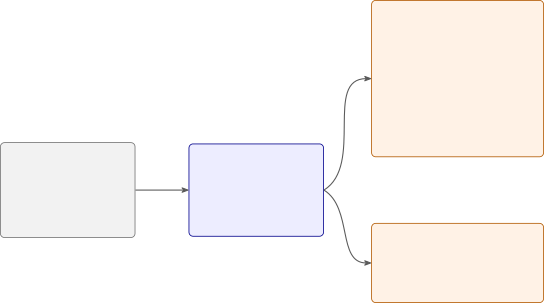

Figure 1: Overview of our method. Starting from answer-only data
$`\mathcal{D}`$ and a reasoning model $`p_{\theta}`$ that already solves
part of it, we train an _inverse model_ $`q_{\varphi}`$ to reconstruct
$`p_{\theta}`$’s chain-of-thought from the answer. The inverse model
then supports two downstream uses: (top) self-distillation, where
$`p_{\theta}`$ is finetuned on $`q_{\varphi}`$-generated reasoning
traces that remain forward-consistent with $`p_{\theta}`$, after which
the finetuned $`p_{\theta}`$ is deployed alone; and (bottom) test-time
verification, where $`q_{\varphi}`$ scores candidate answers sampled
from $`p_{\theta}`$.

We now give an overview of our method, whose summary can be seen in
Figure 1. Consider a dataset distribution
$`\mathcal{D}=\{(P,A)\}\subset\mathcal{P}\times\mathcal{A}`$ where
$`\mathcal{P}`$ is a space of prompts and $`\mathcal{A}`$ is a space of
answers. Let $`p_{\theta}`$ be an LLM with parameters $`\theta`$ (we
will also use $`p_{\theta}`$ to denote the probability distribution the
LLM determines on the token space). We assume that the LLM is a
reasoning model, i.e. from a prompt $`P`$ an answer is arrived at by
first generating a CoT sequence $`C`$ (commonly distinguished from the
prompt and answer by being enclosed in \<think\> tags) from $`P`$ and
then generating $`A`$ from $`P`$ and $`C`$.

Our ultimate goal is to treat the CoT sequences as latent variables and
find $`\theta`$ that maximizes the log-likelihood

```math
\ell(\theta)=\sum_{(P,A)\in\mathcal{D}}\log p_{\theta}(A|P)
```

This is difficult because we only readily have access to
$`p_{\theta}(C|P)`$ and $`p_{\theta}(A|C,P)`$, and computing
$`p_{\theta}(A|P)`$ by marginalizing over $`C`$ is intractable. However,
we can take advantage of Fisher’s identity (Cappé et al., 2005)

```math
\nabla_{\theta}\ell(\theta_{0})=\sum_{(P,A)\in\mathcal{D}}\mathbb{E}_{C\sim p_{\theta_{0}}(\cdot|P,A)}\left.\left[\nabla_{\theta}\log p_{\theta}(C,A|P)\right]\right|_{\theta=\theta_{0}} \tag{1}
```

if we can get a hold of the posterior $`p_{\theta}(C|P,A)`$. For this we
take a variational inference approach and approximate this distribution
via a separate language model $`q_{\varphi}`$ that generates $`C`$ from
$`(P,A)`$, writing
$`q_{\varphi}(\cdot\mid P,A)\approx p_{\theta}(\cdot\mid P,A)`$. This is
trained via supervised finetuning on the completions that $`p_{\theta}`$
got correct.

### 2.2 Training $`q_{\varphi}`$

Naively training $`q_{\varphi}`$ via gradient descent against the
negative log likelihood (NLL) objective on correct completions,

```math
L_{nll}(P)=-\log q_{\varphi}(C|P,A),~\text{ where }C\sim p_{\theta}(P),A\sim p_{\theta}(P,C),(P,A)\in\mathcal{D} \tag{2}
```

turns out to not work well in practice: we found that $`q_{\varphi}`$
trained in this way tends to ignore $`A`$ and will generate some
reasoning traces that lead to a wrong answer. This is likely due to the
token imbalance (of most environments, including the ones we use) where
CoT sequences are significantly longer than the answer sequences.
Therefore, to encourage $`q_{\varphi}`$ to take $`A`$ into account, we
supplement the NLL loss with a contrastive term. We do this by picking a
group size $`g>1`$ and generate $`g`$-many completions from
$`p_{\theta}`$. We then filter the generated group completions to those
where the group contains at least one correct and one incorrect answer.
Let $`\ell_{+}(P)`$ and $`\ell_{-}(P)`$ be the average log probs (across
tokens) that $`q_{\varphi}`$ assigns for all completions of a prompt
$`P`$ that lead to correct and incorrect answers, respectively. We then
define the contrastive margin loss as

```math
L_{cont}(P)=\max\left(m-(\ell_{+}(P)-\ell_{-}(P)),0\right) \tag{3}
```

where $`m>0`$ is the margin hyperparameter. We combine these, via a
hyperparameter $`\lambda`$, to form our total objective

```math
L_{q}=L_{nll}+\lambda L_{cont}, \tag{4}
```

which we optimize over minibatches of prompts using stochastic gradient
descent. Note that the $`L_{nll}`$ term only takes in correct
completions while $`L_{cont}`$ makes use of the entire group of
completions.

### 2.3 Applying $`q_{\varphi}`$

From $`q_{\varphi}`$ we get two applications.

#### 2.3.1 Distillation from $`q_{\varphi}`$ to $`p_{\theta}`$

The first, which is our main focus, finetunes $`p_{\theta}`$ from the
CoT traces generated by $`q_{\varphi}`$. This proceeds by starting from
a dataset $`\mathcal{D}^{\prime}`$ (which may or may not be
$`\mathcal{D}`$) of prompt-answer pairs, and then using $`q_{\varphi}`$
to generate CoT traces for it. From these, we filter to include only
those that lead $`p_{\theta}`$ to the correct answer, thus forming the
dataset,

```math
\mathcal{D}^{\prime}_{q_{\varphi},p_{\theta}}=\{(P,C,A)\mid C\sim q_{\varphi}(P,A),~A\sim p_{\theta}(P,C),~(P,A)\in\mathcal{D}^{\prime}\}.
```

which we can directly do SFT of $`p_{\theta}`$ on since this has
complete reasoning traces with answers. Concretely, we sample a single
CoT from $`q_{\varphi}`$ per prompt and keep it only if it is _forward
consistent_: conditioned on the prompt and $`q_{\varphi}`$’s CoT,
$`p_{\theta}`$ greedy-decodes the correct answer. We additionally drop
$`q_{\varphi}`$-CoTs for prompts on which every $`p_{\theta}`$ rollout
is already correct, concentrating $`q_{\varphi}`$’s supervision where
$`p_{\theta}`$ needs it.

As the optimization process updates the weights of $`p_{\theta}`$, the
distributional approximation accuracy of $`q_{\varphi}`$ may drift from
the changing $`p_{\theta}(\cdot|P,A)`$ since
$`\mathcal{D}^{\prime}_{q_{\varphi},p_{\theta}}`$ is fixed from the
start (we do not resample from $`p_{\theta}`$ during distillation).
Therefore as a regularization term to keep $`p_{\theta}`$ from drifting
too much we supplement $`\mathcal{D}^{\prime}_{q_{\varphi},p_{\theta}}`$
with rejection sampling trajectories of $`p_{\theta}`$ alone, the set of
which we will denote by $`\mathcal{D}^{\prime}_{RS_{p_{\theta}}}`$: we
sample a group of completions from $`p_{\theta}`$ for each prompt and
keep every correct completion as its own training example. We let the
parameter $`0\leq\mu\leq 1`$, which we call the mix ratio, denote the
ratio of data in a batch that is drawn from
$`\mathcal{D}^{\prime}_{q_{\varphi},p_{\theta}}`$ (the rest coming from
$`\mathcal{D}^{\prime}_{RS_{p_{\theta}}}`$), with examples drawn
uniformly from each pool. We experiment and show the tradeoffs for
choosing values of $`\mu\in\{0,0.25,0.5,0.75,1\}`$.

We note importantly that in this application $`q_{\varphi}`$ is used
only during training: at deployment the finetuned $`p_{\theta}`$
operates alone, leaving inference cost and interface unchanged.

We also highlight where the generation cost is paid. All sampling,
namely the CoT traces from $`q_{\varphi}`$ and the rejection-sampling
trajectories from $`p_{\theta}`$, happens once, up front, before any
weight update. The remainder of training is plain SFT over a fixed
dataset. This is in contrast to online policy-gradient methods such as
GRPO, which must regenerate a fresh group of rollouts for every prompt
at every training step because the rollouts must come from the current
policy. Our approach is thus naturally an offline one: the up-front
generations can be batched with high throughput, reused across runs
(e.g. across the mix-ratio sweep in Section 4.2), and the training
itself never blocks on autoregressive sampling.

#### 2.3.2 Using $`q_{\varphi}`$ as a verifier of $`p_{\theta}`$

The second application uses $`q_{\varphi}`$ as a verifier of
$`p_{\theta}`$’s correctness. Given a prompt $`P`$, CoT $`C`$, and
answer $`A`$ computed from $`p_{\theta}`$, we can use $`q_{\varphi}`$ to
compute $`q_{\varphi}(C|P,A)`$, which is its estimate for the likelihood
of the reasoning given the prompt and generated answer. Concretely, the
score we use is the length-normalized log-likelihood
$`\frac{1}{|C|+1}\log q_{\varphi}(C,\texttt{eos}\mid P,A)`$, computed in
a single forward pass; since attention among CoT tokens is causal
(Section 4), this is an ordinary autoregressive sequence likelihood.
Unlike the distillation application, here $`q_{\varphi}`$ is deployed at
test time; this requires no groundtruth answer since $`q_{\varphi}`$
scores the answer that $`p_{\theta}`$ itself generated. Because of the
contrastive term (eq. 3) used in training $`q_{\varphi}`$, it is
reasonable to expect that this number correlates with the correctness of
$`A`$. In other words, we can think of the function
$`(P,C,A)\mapsto q_{\varphi}(C|P,A)`$ as similar to the trained
verifiers of Cobbe et al. (2021). In Section 4.3 we measure its
performance as both a best-of-n and adaptive (Aggarwal et al., 2023)
sampler.

## 3 Comparison to related work

RAVR (Lin et al., 2026) and CoVRL (Wen et al., 2025), which also take a
variational inference approach, are most similar to our work but their
focus is on RL instead of SFT: they use the answer-conditioned model to
improve the sample efficiency of online algorithms such as GRPO, and
still require continuously sampling multiple rollouts per prompt from
the current policy during training. Because of our contrastive loss (eq.
3), our method also requires multiple rollouts per prompt for training
$`q_{\varphi}`$, but this is incurred once up-front and the same
$`q_{\varphi}`$ can be used across fresh datasets as we show in Section
4.2. Consistent with their findings, our results in Section 4.1 show
that $`q_{\varphi}`$ allows for more usable traces per generation
compared to sampling from $`p_{\theta}`$ alone. We also highlight that
both RAVR and CoVRL use the same LLM for both the forward and inverse
model, using different prompt templates to switch between the two modes.
We, on the other hand, train a separate inverse model, which as we show
additionally serves as an accurate verifier for the forward model
(Section 4.3).

STaR (Zelikman et al., 2022) and TRICE (Phan et al., 2023) are early
works that used rejection sampling and answer-conditioned reasoning.
STaR is an iterative finetuning algorithm built on rejection sampling
and rationalization, which provides reasoning conditioned on the
groundtruth answer, while TRICE treats CoT as a latent variable as we
do. Neither trains a separate inverse model to get an amortized
posterior: STaR does in-context proposals by injecting the answer into
the prompt, and TRICE utilizes a non-amortized Markov-chain Monte Carlo
expectation-maximization algorithm with a memory bank.

From a data-efficiency perspective, we view our work as a middle ground
between GRPO-style reinforcement learning (e.g. RAVR/CoVRL) and the
finetuning technique of STaR. The former techniques are able to take
advantage of rollouts that do not get the correct answer (indeed, to get
a learning signal from GRPO on the binary tasks we have been considering
requires groups that have both correct and incorrect answers), while
pure SFT does not. In our approach, these mixed rollouts are essential
for the contrastive term that is needed to effectively train
$`q_{\varphi}`$.

## 4 Experiments and Results

We use two environments: GSM8K (Cobbe et al., 2021) and Countdown
(Gandhi et al., 2024). We recall that the Countdown task involves
finding an arithmetic expression that uses $`n`$ given numbers and
evaluates to a target number. We programmatically generate the Countdown
datasets we use, taking $`n=4`$ and generating 50,000 examples. We then
break this into an 80/10/10 train/val/test split. For GSM8K we use the
official train/test split, with no validation set carved out, and use
the test set only for final reporting.

For each environment, we begin with the pre-trained Qwen3-0.6B model
(Yang et al., 2025) and train it via GRPO on the train dataset until
performance saturates, forming the forward model $`p_{\theta}`$ for all
experiments. Our interest is in what can be extracted _after_ RL has
plateaued, when further GRPO yields diminishing returns. We then train
$`q_{\varphi}`$ on this dataset as described in Section 2.2.

While there are no real restrictions on $`q_{\varphi}`$ architecturally,
in our experiments we take $`q_{\varphi}`$ to be LoRA (Hu et al.,
2022)-finetuned from a copy of $`p_{\theta}`$. Separately, we drop the
causality restriction on the attention layers within the prefix, which
is the concatenation $`[P;A]`$. Explicitly, all tokens within $`[P;A]`$
attend to one another, while the CoT generation is causal, i.e. those
tokens attend to $`[P;A]`$ and the preceding CoT tokens. The same mask
is used when training $`q_{\varphi}`$ and when scoring with it as a
verifier.

Full details of our training datasets and hyperparameters can be found
in Appendix A.

### 4.1 FCR of $`q_{\varphi}`$

The core metric we use to evaluate $`q_{\varphi}`$ is the forward
consistency rate at n ($`\text{FCR@}n`$). This is the proportion of
prompts where $`p_{\theta}`$ generates a correct answer out of $`n`$
completions when conditioned on the CoT generated by $`q_{\varphi}`$
(the filter used when building training data, described in Section
2.3.1, is the greedy variant of this check). Of course, this alone is
not a complete measure of $`q_{\varphi}`$: if $`q_{\varphi}`$ just
repeated the answer it is conditioned on then this makes
$`p_{\theta}`$’s job easy and FCR will be high. However, this metric is
important since when using $`q_{\varphi}`$ to finetune $`p_{\theta}`$ we
only use those CoT that are forward consistent. In Table 1 we report the
FCR scores for the inverse models trained on each environment, at
various values of $`n`$. To show that $`q_{\varphi}`$ can extend the
ability of $`p_{\theta}`$, we also report FCR on the subset of prompts
where $`p_{\theta}`$ by itself generates the correct answer at most 25%
of the time, which we label as FCR-hard.

The results for Countdown and GSM8K are in Table 1. We see that
$`q_{\varphi}`$ drastically increases the set of solvable problems in
Countdown, while for GSM8K the gains are concentrated on the hard subset
(and are significant, though not as extreme). We believe one of the main
reasons for the discrepancy is that an answer in Countdown, being a full
arithmetic expression, exposes much more of the solution’s structure to
reason backwards from than the single number that constitutes a GSM8K
answer. This does not make $`q_{\varphi}`$ vacuous on Countdown: its
reasoning is trained to match $`p_{\theta}`$’s and, crucially, it
transfers: as we see in the following distillation experiments,
finetuning $`p_{\theta}`$ on it gives a significant improvement.
Appendix C shows a qualitative example of this on a prompt that
$`p_{\theta}`$ never solves on its own: $`q_{\varphi}`$’s CoT is a
non-trivial backward decomposition of the answer, and after distillation
$`p_{\theta}`$ reproduces the same strategy unaided. A second factor is
that GSM8K simply has less room for improvement, with the baseline
$`p_{\theta}`$ already at 0.94 pass@32. For our main application of
distilling $`q_{\varphi}`$ into $`p_{\theta}`$, what matters most is the
high FCR on hard prompts, i.e. extending the set of prompts from which a
correct-leading CoT can be obtained at all. When we run SFT with mix
ratio $`\mu>0`$ we sample CoT from both $`p_{\theta}`$ and
$`q_{\varphi}`$, so prompts that $`p_{\theta}`$ solves but that are not
forward consistent under $`q_{\varphi}`$ are not lost.

|                                                       | Countdown |       |        | GSM8K |       |        |
| ----------------------------------------------------- | --------- | ----- | ------ | ----- | ----- | ------ |
|                                                       | FCR@1     | FCR@8 | FCR@32 | FCR@1 | FCR@8 | FCR@32 |
| _All prompts_                                         |           |       |        |       |       |        |
|    $`p_{\theta}`$                                     | 0.59      | 0.83  | 0.91   | 0.82  | 0.91  | 0.94   |
|    $`q_{\varphi}`$                                    | 0.71      | 0.96  | 0.99   | 0.78  | 0.91  | 0.94   |
| _Hard prompts ($`p_{\theta}`$ correct $`\leq 25\%`$)_ |           |       |        |       |       |        |
|    $`p_{\theta}`$                                     | 0.09      | 0.42  | 0.67   | 0.07  | 0.31  | 0.52   |
|    $`q_{\varphi}`$                                    | 0.45      | 0.89  | 0.97   | 0.15  | 0.42  | 0.57   |

Table 1: Forward consistency rates of $`q_{\varphi}`$ compared with the
$`p_{\theta}`$ baseline (where FCR is just the pass rate) on all prompts
and on the hard subset ($`p_{\theta}`$ correct at most 25% of the time).

### 4.2 Distillation from $`q_{\varphi}`$ to $`p_{\theta}`$

Here we do two general experiments. In the first, to show the
generalizability of $`q_{\varphi}`$, we distill to $`p_{\theta}`$ using
a dataset that $`q_{\varphi}`$ was not trained on. This mimics the
important real-world continual learning situation where new
prompt-answer pairs arrive and we want to efficiently update
$`p_{\theta}`$.

In the second experiment we distill on the same dataset that
$`q_{\varphi}`$ (and, via GRPO, $`p_{\theta}`$) was trained on. With the
data held fixed, this experiment isolates how much additional learning
$`q_{\varphi}`$ can extract from a dataset on which GRPO performance has
already saturated.

#### 4.2.1 Fresh data

Because of the small dataset size of GSM8K and it only having a
train/test split, for this experiment we only use the Countdown dataset.
Let $`\mathcal{D}_{0}`$ be the dataset that $`q_{\varphi}`$ was trained
on and $`\mathcal{D}_{1}`$ be a fresh dataset (so
$`\mathcal{D}^{\prime}=\mathcal{D}_{1}`$ in the notation of Section
2.3.1). $`\mathcal{D}_{1}`$ consists of 40,000 Countdown problems
generated with the same procedure and parameters as $`\mathcal{D}_{0}`$
but a different random seed, deduplicated against all splits of
$`\mathcal{D}_{0}`$ so that no problem (as a multiset of numbers and
target) appears in both. This dataset is used for training only and all
evaluations are on $`\mathcal{D}_{0}`$’s test split. The up-front
generation on $`\mathcal{D}_{1}`$ consists of 32 rollouts per prompt
from $`p_{\theta}`$ (which supplies
$`\mathcal{D}^{\prime}_{RS_{p_{\theta}}}`$, the all-correct filter of
Section 2.3.1, and the per-prompt difficulty estimates used in
evaluation) and one answer-conditioned CoT per prompt from
$`q_{\varphi}`$. To study the effect of the mix ratio, we run
distillation for each $`\mu\in\{0,0.25,0.5,0.75,1\}`$. Note that
$`\mu=0`$ is rejection sampling (Yuan et al., 2023), which we use as a
baseline to compare against. For other baseline comparisons we use the
performance of $`p_{\theta}`$ before distillation and of $`p_{\theta}`$
further finetuned, using GRPO, on $`\mathcal{D}_{1}`$.

We evaluate with pass@$`k`$, the probability that at least one of $`k`$
sampled completions answers correctly, and its restriction to the hard
subset defined above, hard pass@$`k`$. For all runs in this experiment,
we choose each run’s checkpoint by its best hard pass@8 over
$`\mathcal{D}_{0}`$’s val split, and then report all metrics from
evaluating that checkpoint once on the held-out test split. We repeat
this for each experiment with two seeds and report the mean and standard
deviation in Table 2.

Distillation with $`\mu\geq 0.5`$ is strongest on every pass@8 and
pass@32 metric, while the baselines retain an edge at pass@1 (rejection
sampling on all prompts, continued GRPO on the hard subset). This split
is consistent with what each method optimizes: training only on the
model’s own reachable solutions (rejection sampling) or sharpening the
current policy’s modes (GRPO) improves single-sample precision, whereas
distilling $`q_{\varphi}`$’s traces adds newly solvable prompts whose
solutions are initially sampled with low probability, a gain that
surfaces at larger $`k`$.

|                     |                                           |                                           |                                           |                                           |                                           |                                           |
| ------------------- | ----------------------------------------- | ----------------------------------------- | ----------------------------------------- | ----------------------------------------- | ----------------------------------------- | ----------------------------------------- |
|                     | hard pass@1                               | hard pass@8                               | hard pass@32                              | pass@1                                    | pass@8                                    | pass@32                                   |
| mix ratio 1.0       | $`0.19{\scriptstyle\,\pm 0.00}`$          | $`0.62{\scriptstyle\,\pm 0.00}`$          | $`0.85{\scriptstyle\,\pm 0.00}`$          | $`0.54{\scriptstyle\,\pm 0.00}`$          | $`0.87{\scriptstyle\,\pm 0.00}`$          | $`\mathbf{0.96}{\scriptstyle\,\pm 0.00}`$ |
| mix ratio 0.75      | $`0.19{\scriptstyle\,\pm 0.00}`$          | $`\mathbf{0.64}{\scriptstyle\,\pm 0.00}`$ | $`\mathbf{0.87}{\scriptstyle\,\pm 0.00}`$ | $`0.57{\scriptstyle\,\pm 0.02}`$          | $`\mathbf{0.88}{\scriptstyle\,\pm 0.00}`$ | $`\mathbf{0.96}{\scriptstyle\,\pm 0.00}`$ |
| mix ratio 0.5       | $`0.18{\scriptstyle\,\pm 0.01}`$          | $`0.63{\scriptstyle\,\pm 0.02}`$          | $`\mathbf{0.87}{\scriptstyle\,\pm 0.01}`$ | $`0.56{\scriptstyle\,\pm 0.02}`$          | $`\mathbf{0.88}{\scriptstyle\,\pm 0.01}`$ | $`\mathbf{0.96}{\scriptstyle\,\pm 0.00}`$ |
| mix ratio 0.25      | $`0.16{\scriptstyle\,\pm 0.01}`$          | $`0.59{\scriptstyle\,\pm 0.01}`$          | $`0.84{\scriptstyle\,\pm 0.00}`$          | $`0.60{\scriptstyle\,\pm 0.00}`$          | $`0.87{\scriptstyle\,\pm 0.00}`$          | $`0.95{\scriptstyle\,\pm 0.00}`$          |
| mix ratio 0 (RS)    | $`0.13{\scriptstyle\,\pm 0.00}`$          | $`0.50{\scriptstyle\,\pm 0.02}`$          | $`0.75{\scriptstyle\,\pm 0.02}`$          | $`\mathbf{0.61}{\scriptstyle\,\pm 0.01}`$ | $`0.85{\scriptstyle\,\pm 0.00}`$          | $`0.93{\scriptstyle\,\pm 0.01}`$          |
| GRPO full finetune  | $`\mathbf{0.23}{\scriptstyle\,\pm 0.01}`$ | $`0.59{\scriptstyle\,\pm 0.02}`$          | $`0.79{\scriptstyle\,\pm 0.02}`$          | $`0.59{\scriptstyle\,\pm 0.00}`$          | $`0.85{\scriptstyle\,\pm 0.01}`$          | $`0.93{\scriptstyle\,\pm 0.01}`$          |
| Base $`p_{\theta}`$ | 0.08                                      | 0.38                                      | 0.64                                      | 0.58                                      | 0.81                                      | 0.90                                      |

Table 2: Distillation on fresh Countdown data ($`\mathcal{D}_{1}`$).
Rows with mix ratio $`\mu>0`$ are our method; $`\mu=0`$ is the
rejection-sampling baseline, and we also compare against continued GRPO
training on $`\mathcal{D}_{1}`$ and the starting model $`p_{\theta}`$.
We report mean $`\pm`$ standard deviation over two seeds.

##### Efficiency

Our method is clearly more data-efficient than traditional SFT
techniques that require groundtruth CoT traces, and in this section we
highlight the structural properties of it that make it more
compute-efficient than policy gradient methods (such as GRPO) from a
continual learning perspective, where the recurring cost is ingesting
each new batch of prompt-answer data.

_Generation cost scales with data, not with training._ Every completion
GRPO learns from must be sampled from the current policy, inside the
training loop: prompts are re-rolled-out at every visit, so generation
cost grows with training length (and dominated it in our runs). Our
pipeline computes rollouts for each batch exactly once, and the
artifacts are reused by every subsequent run on that batch (e.g. all ten
SFT runs behind Table 2 used the same rollout data). The inverse model
itself is a one-time cost: $`q_{\varphi}`$ was trained on
$`\mathcal{D}_{0}`$ and applied to $`\mathcal{D}_{1}`$ with no
retraining.

_Generation decouples from training._ Because the SFT dataset is fixed
by design, its rollouts never go stale: they can be produced on
separate, inference-optimized hardware concurrently with training.
Offline generation also batches continuously over the entire dataset at
full GPU occupancy, whereas on-policy generation is capped at one group
per prompt and drains as short completions finish, which leads to
significantly less throughput.

_Training memory scales with one sequence, not a group._ A GRPO update
computes gradients through the log-probabilities of every completion in
a group, so group size is capped by training memory. SFT backpropagates
through a single CoT per example, however many rollouts were sampled
offline.

_Compute converts into signal on the hard tail._ On the 17% of fresh
prompts that $`p_{\theta}`$ never solves, every GRPO rollout group is
uniformly incorrect and the gradient is identically zero however long
training runs, while $`q_{\varphi}`$ produces forward-consistent CoT for
30% of exactly those prompts. Consistently, continued GRPO plateaued
below the $`\mu\geq 0.5`$ distillation arms on hard pass@8 and pass@32
(Table 2) despite running for more than twice the RL that produced
$`p_{\theta}`$.

#### 4.2.2 Original data

These experiments are the same as above except we distill on
$`\mathcal{D}_{0}`$, the dataset $`q_{\varphi}`$ was trained on, and
experiment on GSM8K as well as Countdown. For metrics we show held-out
evaluation curves over training checkpoints (Figure 2) and report in
Table 3 the mean over the last 30% of checkpoints. On GSM8K the
hard-tail gains over rejection sampling are smaller (at most $`+0.03`$
hard pass@32) and several cells tie, while pass@1 falls below both
rejection sampling and the starting model at high mix ratios, the same
precision-versus-coverage tradeoff seen on fresh data. Figure 6 in
Appendix C traces a held-out GSM8K prompt through this experiment where
the starting $`p_{\theta}`$ fails on all 32 rollouts but the distilled
model solves greedily, ruling out memorization.

|                     |                                           |                                           |                                           |                                  |                                           |                                           |
| ------------------- | ----------------------------------------- | ----------------------------------------- | ----------------------------------------- | -------------------------------- | ----------------------------------------- | ----------------------------------------- |
|                     | GSM8K                                     |                                           |                                           |                                  |                                           |                                           |
|                     | hard pass@1                               | hard pass@8                               | hard pass@32                              | pass@1                           | pass@8                                    | pass@32                                   |
| mix ratio 1         | $`\mathbf{0.15}{\scriptstyle\,\pm 0.01}`$ | $`0.42{\scriptstyle\,\pm 0.00}`$          | $`0.62{\scriptstyle\,\pm 0.01}`$          | $`0.76{\scriptstyle\,\pm 0.00}`$ | $`0.91{\scriptstyle\,\pm 0.00}`$          | $`0.95{\scriptstyle\,\pm 0.00}`$          |
| mix ratio 0.75      | $`0.14{\scriptstyle\,\pm 0.00}`$          | $`\mathbf{0.44}{\scriptstyle\,\pm 0.00}`$ | $`\mathbf{0.65}{\scriptstyle\,\pm 0.00}`$ | $`0.79{\scriptstyle\,\pm 0.00}`$ | $`\mathbf{0.92}{\scriptstyle\,\pm 0.00}`$ | $`\mathbf{0.96}{\scriptstyle\,\pm 0.00}`$ |
| mix ratio 0.5       | $`0.13{\scriptstyle\,\pm 0.00}`$          | $`0.42{\scriptstyle\,\pm 0.01}`$          | $`0.63{\scriptstyle\,\pm 0.02}`$          | $`0.80{\scriptstyle\,\pm 0.00}`$ | $`\mathbf{0.92}{\scriptstyle\,\pm 0.00}`$ | $`0.95{\scriptstyle\,\pm 0.00}`$          |
| mix ratio 0.25      | $`0.14{\scriptstyle\,\pm 0.00}`$          | $`\mathbf{0.44}{\scriptstyle\,\pm 0.01}`$ | $`0.64{\scriptstyle\,\pm 0.00}`$          | $`0.80{\scriptstyle\,\pm 0.00}`$ | $`\mathbf{0.92}{\scriptstyle\,\pm 0.00}`$ | $`\mathbf{0.96}{\scriptstyle\,\pm 0.00}`$ |
| mix ratio 0 (RS)    | $`0.13{\scriptstyle\,\pm 0.00}`$          | $`0.42{\scriptstyle\,\pm 0.00}`$          | $`0.62{\scriptstyle\,\pm 0.00}`$          | $`0.81{\scriptstyle\,\pm 0.00}`$ | $`\mathbf{0.92}{\scriptstyle\,\pm 0.00}`$ | $`0.95{\scriptstyle\,\pm 0.00}`$          |
| Base $`p_{\theta}`$ | 0.07                                      | 0.31                                      | 0.53                                      | 0.82                             | 0.91                                      | 0.94                                      |

|                     |                                           |                                           |                                           |                                           |                                           |                                           |
| ------------------- | ----------------------------------------- | ----------------------------------------- | ----------------------------------------- | ----------------------------------------- | ----------------------------------------- | ----------------------------------------- |
|                     | Countdown                                 |                                           |                                           |                                           |                                           |                                           |
|                     | hard pass@1                               | hard pass@8                               | hard pass@32                              | pass@1                                    | pass@8                                    | pass@32                                   |
| mix ratio 1         | $`\mathbf{0.18}{\scriptstyle\,\pm 0.00}`$ | $`0.56{\scriptstyle\,\pm 0.00}`$          | $`0.79{\scriptstyle\,\pm 0.00}`$          | $`0.57{\scriptstyle\,\pm 0.00}`$          | $`0.85{\scriptstyle\,\pm 0.00}`$          | $`0.93{\scriptstyle\,\pm 0.00}`$          |
| mix ratio 0.75      | $`0.17{\scriptstyle\,\pm 0.00}`$          | $`\mathbf{0.59}{\scriptstyle\,\pm 0.00}`$ | $`\mathbf{0.83}{\scriptstyle\,\pm 0.00}`$ | $`0.58{\scriptstyle\,\pm 0.00}`$          | $`0.86{\scriptstyle\,\pm 0.00}`$          | $`\mathbf{0.95}{\scriptstyle\,\pm 0.00}`$ |
| mix ratio 0.5       | $`0.16{\scriptstyle\,\pm 0.00}`$          | $`0.58{\scriptstyle\,\pm 0.00}`$          | $`\mathbf{0.83}{\scriptstyle\,\pm 0.00}`$ | $`0.59{\scriptstyle\,\pm 0.00}`$          | $`\mathbf{0.87}{\scriptstyle\,\pm 0.00}`$ | $`\mathbf{0.95}{\scriptstyle\,\pm 0.00}`$ |
| mix ratio 0.25      | $`0.14{\scriptstyle\,\pm 0.00}`$          | $`0.53{\scriptstyle\,\pm 0.01}`$          | $`0.79{\scriptstyle\,\pm 0.01}`$          | $`0.58{\scriptstyle\,\pm 0.00}`$          | $`0.85{\scriptstyle\,\pm 0.00}`$          | $`0.94{\scriptstyle\,\pm 0.00}`$          |
| mix ratio 0 (RS)    | $`0.12{\scriptstyle\,\pm 0.00}`$          | $`0.46{\scriptstyle\,\pm 0.00}`$          | $`0.72{\scriptstyle\,\pm 0.00}`$          | $`\mathbf{0.60}{\scriptstyle\,\pm 0.00}`$ | $`0.83{\scriptstyle\,\pm 0.00}`$          | $`0.91{\scriptstyle\,\pm 0.00}`$          |
| Base $`p_{\theta}`$ | 0.08                                      | 0.37                                      | 0.62                                      | 0.57                                      | 0.80                                      | 0.88                                      |

Table 3: Distillation on the original data ($`\mathcal{D}_{0}`$) for
GSM8K (top; evaluated on the standard held-out GSM8K test set) and
Countdown (bottom; evaluated on the held-out test split). Values are the
mean over the last 30% of training checkpoints, reported as mean $`\pm`$
standard deviation over two seeds.

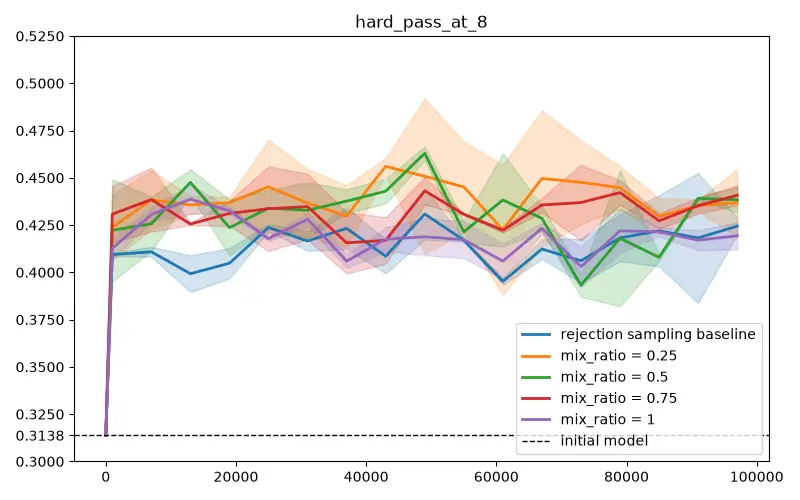

(a) GSM8K, hard pass@8

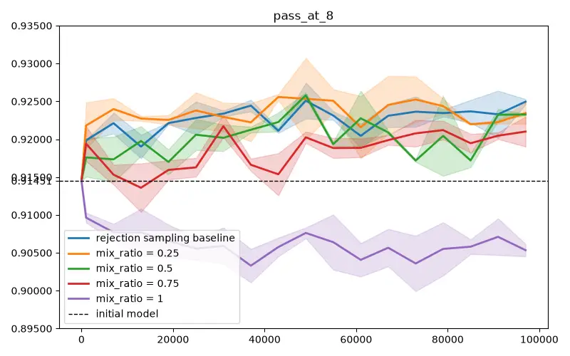

(b) GSM8K, pass@8

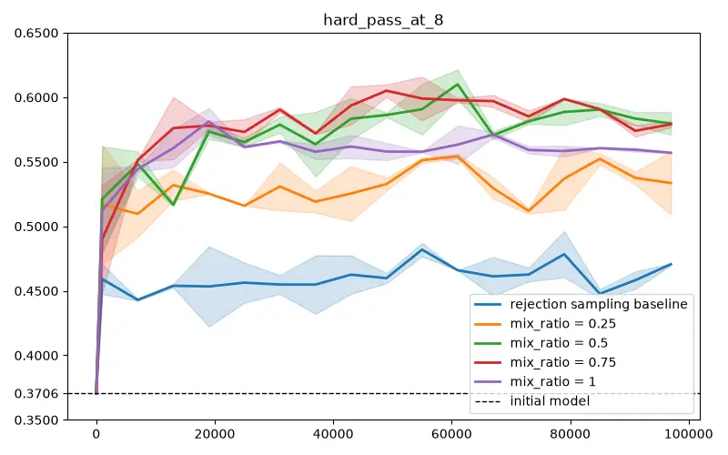

(c) Countdown, hard pass@8

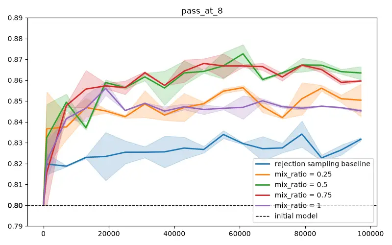

(d) Countdown, pass@8

Figure 2: Held-out evaluation curves over training checkpoints on GSM8K
(top) and Countdown (bottom), for each mix ratio $`\mu`$ and the
rejection-sampling baseline ($`\mu=0`$). Shaded bands show $`\pm 1`$
standard deviation across the two seeds; the dashed line is the initial
model $`p_{\theta}`$. Curves for the remaining values of $`k`$ are in
Appendix B.

### 4.3 $`q_{\varphi}`$-verifier results

We now evaluate the second application of $`q_{\varphi}`$, as a
test-time verifier that selects among candidate completions of
$`p_{\theta}`$. We do two experiments: a fixed-budget best-of-$`n`$
comparison and an adaptive variant (Aggarwal et al., 2023) where
sampling stops early once a confidence condition is met.

#### 4.3.1 Best-of-$`n`$

For baselines we take the following:

- •
  Majority vote (Wang et al., 2022) From the $`n`$ samples return the
  answer that appeared most often.
- •
  Shortest CoT Many incorrect responses, especially for Countdown, have
  long CoT, as the model has to try a bunch of different ideas from
  scratch trying to get the correct answer. As such, we consider the
  selector that from the $`n`$ samples returns the one with shortest CoT
  sequence.
- •
  $`p_{\theta}`$’s self-confidence The log probs of $`p_{\theta}`$’s
  completion of the prompt.

Our results are in Table 5. We restrict to _mixed_ prompts, i.e. those
whose $`n`$ samples contain both a correct and an incorrect answer,
since on the remaining prompts every selector scores identically and
including them would only dilute the comparison. On Countdown, selecting
with $`q_{\varphi}`$ cuts the selection error of majority vote from
24.7% to 3.1%. On GSM8K, the aggregate difference between
$`q_{\varphi}`$ and majority vote (0.765 vs. 0.754 on 472 prompts) is
within noise at this sample size; Table 5 shows where they differ.
Stratifying by whether the correct completions form a minority of the
samples (i.e. whether $`p_{\theta}`$’s consensus is wrong), we see that
$`q_{\varphi}`$’s advantage concentrates precisely on the
correct-minority prompts, where majority vote is by construction at or
below random. This is the same hard-tail regime targeted by our
distillation experiments, and exactly where a verifier is most valuable.
On correct-majority prompts voting is near-perfect and $`q_{\varphi}`$
adds nothing (slightly losing to it on GSM8K).

| Selector                         | Countdown | GSM8K |
| -------------------------------- | --------- | ----- |
| $`q_{\varphi}`$                  | 0.969     | 0.765 |
| majority vote                    | 0.753     | 0.754 |
| shortest CoT                     | 0.869     | 0.699 |
| $`p_{\theta}`$’s self-confidence | 0.757     | 0.631 |
| random                           | 0.561     | 0.638 |

Table 4: Selection accuracy of best-of-$`n`$ techniques for $`n=32`$, on
mixed prompts (those with at least one correct and one incorrect sample;
3,483 for Countdown, 472 for GSM8K).

|                    |                   |                 |
| ------------------ | ----------------- | --------------- |
| Selector           | Countdown         | GSM8K           |
| _Correct-minority_ | _($`n`$ = 1,387)_ | _($`n`$ = 141)_ |
| $`q_{\varphi}`$    | 0.929             | 0.383           |
| majority vote      | 0.388             | 0.193           |
| random             | 0.196             | 0.217           |
| _Correct-majority_ | _($`n`$ = 2,096)_ | _($`n`$ = 331)_ |
| $`q_{\varphi}`$    | 0.995             | 0.927           |
| majority vote      | 0.991             | 0.997           |
| random             | 0.816             | 0.848           |

Table 5: Best-of-$`n`$ selection accuracy stratified by whether correct
completions are a minority among the prompt’s samples, i.e. whether
$`p_{\theta}`$’s consensus is wrong.

#### 4.3.2 Adaptive best-of-$`n`$

Adaptive best-of-$`n`$ techniques (Aggarwal et al., 2023) involve the
specification of a stopping criterion so that an answer may be returned
before generating all $`n`$ completions. A threshold $`\tau`$ on the
verifier determines such a condition by returning the first generated
answer with $`q_{\varphi}(C|P,A)>\tau`$. For baselines, we take adaptive
analogs of majority vote and of the shortest-CoT selector: for a
positive integer $`m`$, we stop as soon as the most common answer
appears $`m`$ more times than any other; and for a length $`L`$, we
return the first completion whose CoT has at most $`L`$ tokens (falling
back to the shortest seen). To make a fair comparison, we sweep
$`\tau`$, $`m`$, and $`L`$ respectively and, for each setting, measure
both the selection accuracy and the expected number of completions drawn
per prompt, using the same random completion orderings for all three.
Table 6 compares the methods at matched expected budgets.

On Countdown, $`q_{\varphi}`$ at $`{\sim}2`$ expected draws already
exceeds adaptive majority vote at _any_ budget. The length rule is the
stronger baseline on Countdown, beating the vote margin at every budget,
yet $`q_{\varphi}`$ leads it by 6–13 points throughout, so the advantage
is not a length artifact; on GSM8K the length rule is weak, consistent
with Table 5. Against majority vote on GSM8K a significant advantage is
confined to small budgets. The structural reason is that a vote margin
is a population signal, in particular it cannot trigger before $`m`$
draws and may never build up when answers scatter. However a verifier
score is a per-sample signal that can trigger after a single draw.

|                         | Countdown       |        |        | GSM8K           |        |        |
| ----------------------- | --------------- | ------ | ------ | --------------- | ------ | ------ |
| Expected draws          | $`q_{\varphi}`$ | margin | length | $`q_{\varphi}`$ | margin | length |
| $`\sim 2`$              | 0.767           | 0.606  | 0.705  | 0.747           | 0.694  | 0.688  |
| $`\sim 4`$              | 0.962           | 0.667  | 0.835  | 0.752           | 0.746  | 0.698  |
| $`\sim 8`$              | 0.968           | 0.740  | 0.888  | 0.762           | 0.756  | 0.700  |
| full $`N`$ ($`\sim`$32) | 0.969           | 0.753  | 0.869  | 0.765           | 0.754  | 0.699  |

Table 6: Adaptive best-of-$`n`$: selection accuracy at matched expected
numbers of completions drawn per prompt, for the
$`q_{\varphi}`$-threshold stopping rule versus the adaptive
majority-vote (margin) and length-threshold (length) baselines, on mixed
prompts.

## 5 Conclusion and future work

In this work we demonstrated the utility of treating CoT tokens as
latent variables and training an inverse model $`q_{\varphi}`$ that
generates reasoning conditioned on both the prompt and groundtruth
answer. Our experiments show that after RL training has saturated, cheap
SFT training using $`q_{\varphi}`$-generated traces recovers substantial
performance on the hard tail of prompts. These are problems that
rejection sampling discards entirely because the forward model never
solves them. Further, the effectiveness of this SFT technique extends to
fresh answer-only data, making the approach suitable as an offline,
continual-learning update that avoids the per-step rollout cost of
policy-gradient methods such as GRPO. We have also shown that
$`q_{\varphi}`$ is a suitable verifier for correctness, enabling
efficient best-of-$`n`$ and adaptive test-time selection precisely in
the regime where majority voting fails.

In terms of sample efficiency, our method occupies a middle ground
between RL and SFT: the mixed correct/incorrect rollouts that GRPO needs
at every training step are needed only once, up front, to train
$`q_{\varphi}`$ via the contrastive objective. All subsequent learning
is supervised. We also note that little in the method is specific to
LLMs or to CoT: the same recipe applies to any latent-variable sequence
model where an observed outcome can be conditioned on to propose the
latent.

For future work, a natural extension is to iterate: refresh
$`q_{\varphi}`$ against the updated $`p_{\theta}`$ and alternate the two
updates, which places the method in the
expectation-maximization/wake-sleep family, with the single-step version
presented here as one outer step. Relatedly, generating multiple CoT
candidates per prompt would permit self-normalized importance weighting
in place of our hard forward-consistency filter. Finally, scaling the
study to larger models and harder environments, and using
$`q_{\varphi}`$-synthesized traces to re-seed RL on the hard tail where
GRPO currently receives no gradient signal, are both promising
directions.

## References

- Aggarwal et al. (2023) P. Aggarwal, A. Madaan, Y. Yang, et al. Let’s
  sample step by step: adaptive-consistency for efficient reasoning and
  coding with llms. In Proceedings of the 2023 Conference on Empirical
  Methods in Natural Language Processing, pp. 12375–12396. Cited by: §1,
  §2.3.2, §4.3.2, §4.3.
- Cappé et al. (2005) O. Cappé, E. Moulines, and T. Rydén Inference in
  hidden markov models. Springer. Cited by: §2.1.
- Cobbe et al. (2021) K. Cobbe, V. Kosaraju, M. Bavarian, M. Chen, H.
  Jun, L. Kaiser, M. Plappert, J. Tworek, J. Hilton, R. Nakano, et al.
  Training verifiers to solve math word problems. arXiv preprint
  arXiv:2110.14168. Cited by: §1, §1, §2.3.2, §4.
- Gandhi et al. (2024) K. Gandhi, D. Lee, G. Grand, M. Liu, W. Cheng, A.
  Sharma, and N. D. Goodman Stream of search (sos): learning to search
  in language. arXiv preprint arXiv:2404.03683. Cited by: §1, §4.
- Hu et al. (2022) E. J. Hu, Y. Shen, P. Wallis, Z. Allen-Zhu, Y. Li, S.
  Wang, L. Wang, W. Chen, et al. Lora: low-rank adaptation of large
  language models.. Iclr 1 (2), pp. 3. Cited by: §4.
- Lambert et al. (2024) N. Lambert, J. Morrison, V. Pyatkin, S.
  Huang, H. Ivison, F. Brahman, L. J. V. Miranda, A. Liu, N. Dziri, S.
  Lyu, et al. Tulu 3: pushing frontiers in open language model
  post-training. arXiv preprint arXiv:2411.15124. Cited by: §1.
- Lin et al. (2026) T. Lin, X. Zhao, X. Zhang, R. Long, Y. Xu, Z.
  Jiang, W. Su, and B. Zheng RAVR: reference-answer-guided variational
  reasoning for large language models. In Findings of the Association
  for Computational Linguistics: ACL 2026, M. Liakata, V. P. Moreira, J.
  Zhang, and D. Jurgens (Eds.), San Diego, California, United States,
  pp. 18757–18775. External Links:
  [Document](https://dx.doi.org/10.18653/v1/2026.findings-acl.936), ISBN
  979-8-89176-395-1,
  [Link](https://aclanthology.org/2026.findings-acl.936/) Cited by: §1,
  §3.
- Phan et al. (2023) D. Phan, M. D. Hoffman, D. Dohan, S. Douglas, T. A.
  Le, A. Parisi, P. Sountsov, C. Sutton, S. Vikram, and R. A Saurous
  Training chain-of-thought via latent-variable inference. Advances in
  Neural Information Processing Systems 36, pp. 72819–72841. Cited by:
  §1, §3.
- Shao et al. (2024) Z. Shao, P. Wang, Q. Zhu, R. Xu, J. Song, X. Bi, H.
  Zhang, M. Zhang, Y. Li, Y. Wu, et al. Deepseekmath: pushing the limits
  of mathematical reasoning in open language models. arXiv preprint
  arXiv:2402.03300. Cited by: §1.
- Wang et al. (2022) X. Wang, J. Wei, D. Schuurmans, Q. Le, E. Chi, S.
  Narang, A. Chowdhery, and D. Zhou Self-consistency improves chain of
  thought reasoning in language models. arXiv preprint arXiv:2203.11171.
  Cited by: 1st item.
- Wei et al. (2023) J. Wei, X. Wang, D. Schuurmans, M. Bosma, B.
  Ichter, F. Xia, E. Chi, Q. Le, and D. Zhou Chain-of-thought prompting
  elicits reasoning in large language models. External Links:
  2201.11903, [Link](https://arxiv.org/abs/2201.11903) Cited by: §1.
- Wen et al. (2025) X. Wen, J. Lou, Y. Liu, H. Lin, B. He, X. Han, L.
  Sun, Y. Lu, and D. Zhang Coupled variational reinforcement learning
  for language model general reasoning. arXiv preprint arXiv:2512.12576.
  Cited by: §1, §3.
- Yang et al. (2025) A. Yang, A. Li, B. Yang, B. Zhang, B. Hui, B.
  Zheng, B. Yu, C. Gao, C. Huang, C. Lv, et al. Qwen3 technical report.
  arXiv preprint arXiv:2505.09388. Cited by: §1, §4.
- Yuan et al. (2023) Z. Yuan, H. Yuan, C. Li, G. Dong, K. Lu, C. Tan, C.
  Zhou, and J. Zhou Scaling relationship on learning mathematical
  reasoning with large language models. arXiv preprint arXiv:2308.01825.
  Cited by: §4.2.1.
- Zelikman et al. (2022) E. Zelikman, Y. Wu, J. Mu, and N. Goodman Star:
  bootstrapping reasoning with reasoning. Advances in Neural Information
  Processing Systems 35, pp. 15476–15488. Cited by: §1, §3.

## Appendix A Training details

### A.1 GRPO training of $`p_{\theta}`$

Table 7 summarizes the hyperparameters used for GRPO. They are shared by
the initial training of $`p_{\theta}`$ on each environment and by the
continued-GRPO baseline of the fresh-data experiment; the latter is an
exact continuation of the original run—same hyperparameters, with
optimizer state restored—on the fresh dataset $`\mathcal{D}_{1}`$.
Unlike $`q_{\varphi}`$ and the distillation SFT below, GRPO updates all
model weights: in preliminary experiments we found GRPO training with
LoRA to be unstable.

|                            |                                            |
| -------------------------- | ------------------------------------------ |
| Hyperparameter             | Value                                      |
| _GRPO_                     |                                            |
|    Group size $`g`$        | 8                                          |
|    KL weight $`\beta`$     | 0                                          |
|    Advantage normalization | Yes                                        |
|    Length normalization    | Yes                                        |
|    Reward                  | correctness $`+\ 0.1\times`$ answer-format |
| _Optimization_             |                                            |
|    Finetuning              | full (no LoRA)                             |
|    Optimizer               | Adam                                       |
|    Learning rate           | $`1\times 10^{-5}`$                        |
|    Prompts per step        | 32                                         |
|    Gradient clipping       | 1                                          |
|    Precision               | bf16                                       |
| _Sampling_                 |                                            |
|    Temperature             | 1                                          |
|    Max CoT tokens          | 600                                        |

Table 7: Hyperparameters used for GRPO training of $`p_{\theta}`$ (both
the initial training and the continued-GRPO baseline).

### A.2 Training $`q_{\varphi}`$

The hyperparameters used to train $`q_{\varphi}`$ are summarized in
Table 8. Here $`m`$ is the margin and $`\lambda`$ the weight of the
contrastive loss term (see eq. 3).

|                                 |                     |
| ------------------------------- | ------------------- |
| Hyperparameter                  | Value               |
| _Contrastive loss_              |                     |
|    Margin $`m`$                 | 1                   |
|    Loss weight $`\lambda`$      | 1                   |
|    Normalize by sequence length | Yes                 |
| _LoRA_                          |                     |
|    Rank $`r`$                   | 32                  |
|    $`\alpha`$                   | 64                  |
| _Optimization_                  |                     |
|    Optimizer                    | Adam                |
|    Learning rate                | $`2\times 10^{-4}`$ |
|    Batch size                   | 32                  |
|    Weight decay                 | 0.01                |
|    Gradient clipping            | 10                  |
|    Precision                    | bf16                |
| _Sampling_                      |                     |
|    Temperature                  | 1                   |
|    Max CoT tokens               | 600                 |
|    Group size $`g`$             | 32                  |

Table 8: Hyperparameters used for training $`q_{\varphi}`$.

We first train $`q_{\varphi}`$ for Countdown and saw FCR scores on the
val split plateau around optimization step 25,000. When training the
smaller dataset GSM8K, which only has a train/test split, we therefore
did not do any train-time validation and simply took the checkpoint at
step 25,000 for $`q_{\varphi}`$.

### A.3 Distilling $`q_{\varphi}`$ into $`p_{\theta}`$

The hyperparameters used for the distillation SFT are summarized in
Table 9, and are shared across both the Countdown and GSM8K experiments.
The only hyperparameter we vary is the mix ratio $`\mu`$, which controls
the fraction of CoTs sampled from $`q_{\varphi}`$ versus $`p_{\theta}`$.

|                      |                     |
| -------------------- | ------------------- |
| Hyperparameter       | Value               |
| _LoRA_               |                     |
|    Rank $`r`$        | 16                  |
|    $`\alpha`$        | 32                  |
| _Optimization_       |                     |
|    Optimizer         | Adam                |
|    Learning rate     | $`5\times 10^{-4}`$ |
|    Batch size        | 16                  |
|    Gradient clipping | 1                   |
|    Precision         | bf16                |
| _Distillation_       |                     |
|    Mix ratio $`\mu`$ | varied              |
|    Max CoT tokens    | 600                 |
|    Temperature       | 1                   |

Table 9: Hyperparameters used for distilling $`q_{\varphi}`$ into
$`p_{\theta}`$.

## Appendix B Additional metrics

Figures 3 and 4 show the held-out evaluation curves of the original-data
distillation experiment for the values of $`k`$ not shown in the main
text.

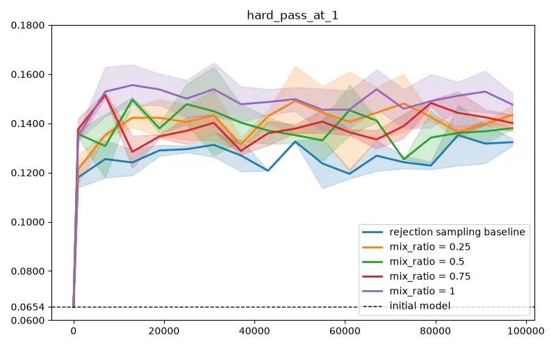

(a) hard pass@1

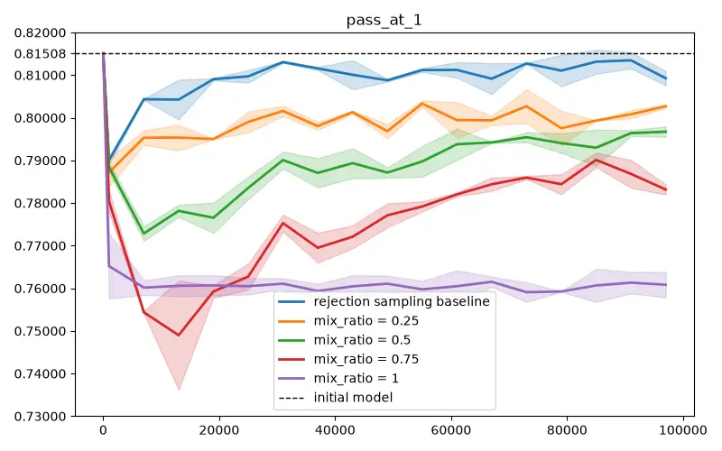

(b) pass@1

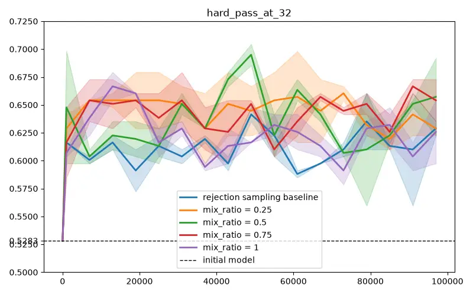

(c) hard pass@32

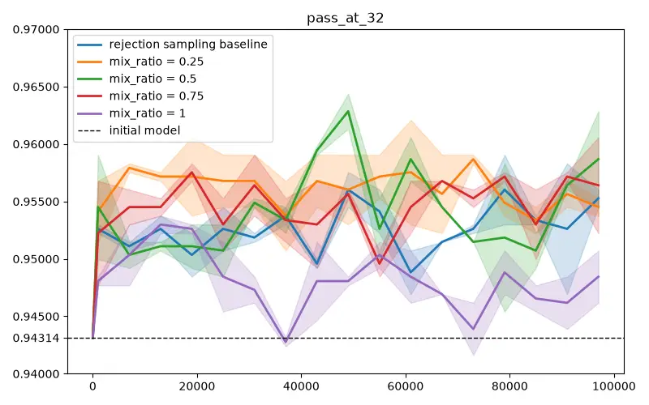

(d) pass@32

Figure 3: Held-out evaluation curves over training checkpoints on GSM8K
at $`k\in\{1,32\}`$, complementing Figure 2. Shaded bands show $`\pm 1`$
standard deviation across the two seeds; the dashed line is the initial
model $`p_{\theta}`$.

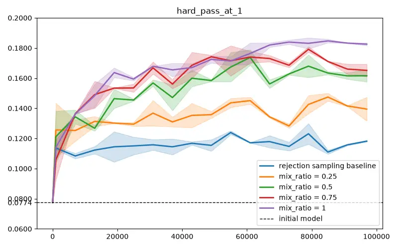

(a) hard pass@1

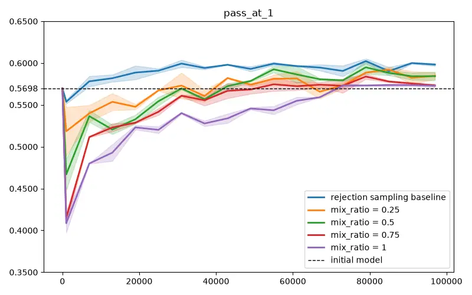

(b) pass@1

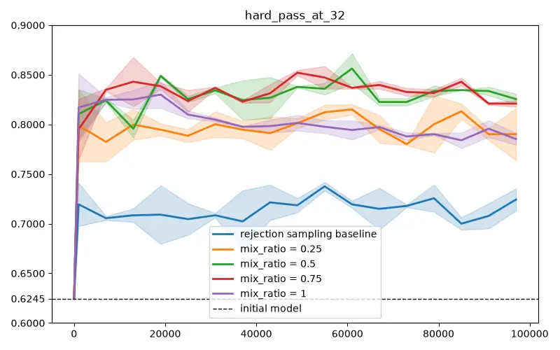

(c) hard pass@32

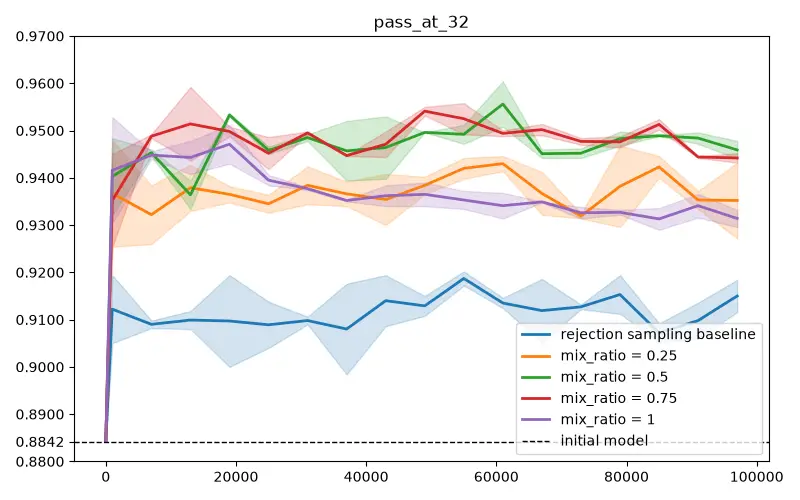

(d) pass@32

Figure 4: Held-out evaluation curves over training checkpoints on
Countdown at $`k\in\{1,32\}`$, complementing Figure 2. Shaded bands show
$`\pm 1`$ standard deviation across the two seeds; the dashed line is
the initial model $`p_{\theta}`$.

## Appendix C Qualitative examples

Figures 5 and 6 each trace a single hard prompt through our pipeline: a
prompt the starting $`p_{\theta}`$ never solves (0 of 32 rollouts), on
which $`q_{\varphi}`$ nevertheless produces a forward-consistent CoT,
and which the distilled $`p_{\theta}`$ then solves with greedy decoding.
The Countdown example (Figure 5) is a training prompt from the
fresh-data experiment (Section 4.2.1) and illustrates the transfer
mechanism; the GSM8K example (Figure 6) is a _held-out_ prompt from the
original-data experiment (Section 4.2.2), so the distilled model’s
success cannot be memorization.

Prompt (train): Using the numbers \[75, 7, 7, 4\], create an equation
that equals 244. You can use basic arithmetic operations (+, -, \*, /)
and each number exactly once. _(gold: 4 \* ((75 - 7) - 7))_

- (a)
  $`p_{\theta}`$ before distillation (all 32 rollouts incorrect; the
  shortest is shown). The arithmetic is correct, but the expression uses
  three 7s—a constraint violation that looks right:

  > First, 244 divided by 7 is about 34.57, not helpful. How about (75 \* 4) = 300, then minus 56. How get 56 from 7 and 7: 7\*7=49, plus
  > 7=56. So (75 \* 4) - (7\*7 + 7) = 300 - 56 = 244.

- (b)
  $`q_{\varphi}`$’s CoT, conditioned on the groundtruth answer 4 \*
  ((75 - 7) - 7) (forward-consistent, and the actual SFT training
  datum). It decomposes backward from the target:

  > First, 244 divided by 4 is 61. How do I get 61 from the other
  > numbers? 75 - 14 = 61, but where do I get 14 from? 7 + 7 = 14. So
  > (75 - (7 + 7)) = 75 - 14 = 61, then multiply by 4: 61\*4=244.

- (c)
  $`p_{\theta}`$ after distillation, greedy decoding (deterministic, and
  with no answer conditioning), correct:

  > \<think\> Okay, let’s see. I need to get 244 using the numbers 75,
  > 7, 7, and 4. Hmm. Let me think. First, 244 divided by 4 is 61. How
  > can I get 61 from the other numbers: 75, 7, 7. Let’s see. 75 - 7 =
  > 68, minus 7 is 61. So (75 - (7 + 7)) - 4 = 75 - 14 = 61, then 61 \*
  > 4 = 244. \</think\> \<answer\> (75 - (7 + 7)) \* 4 \</answer\>

Figure 5: A qualitative example from the fresh-data Countdown
experiment. The starting model $`p_{\theta}`$ fails on all 32 rollouts
(a); given the answer, $`q_{\varphi}`$ derives a plan backward from the
target—divide by 4, then decompose 61 (b); after distillation,
$`p_{\theta}`$ executes the same divide-the-target strategy unaided (c).
This is a training prompt, so (b) is the _actual SFT training datum_,
letting us see the supervision and what was learned from it side by
side. Notably, even though the model trained on this very prompt, (c) is
not a replay of (b): the student reaches 61 by a different route
($`75-7-7`$ rather than $`75-(7+7)`$), slips and self-corrects (“- 4”
before “\* 4”), and brackets the final expression differently—what
transfers is the strategy, not the memorized sequence. Held-out
generalization is established quantitatively in Table 2 and
qualitatively in Figure 6. All model outputs are kept verbatim.

Prompt (held out): The local firefighters are doing a “fill the boot”
fundraiser. Their goal is to raise \$6300. After the first 3 hours, they
have raised \$2100. For how many hours do they have to fundraise in
total to reach their goal, assuming an equal amount raised in every
hour? _(gold: 9)_

(a) $`p_{\theta}`$ rollout _(all 32 incorrect, all answering 6; shortest
shown)_:

> First, total amount needed: $`6300-2100=4200`$. Each hour they raise
> an equal amount. Time already used is 3 hours. So, the amount per hour
> would be $`2100/3=\$700`$ per hour. Therefore, remaining hours needed
> would be $`4200/700=6`$ hours. So answer is 6.

*Correct arithmetic — but it answers “how many *more* hours,” not the
total asked for.*

(b) $`q_{\varphi}`$’s CoT _(conditioned on the answer 9; the 1-of-8
sample passing the forward-consistency check — shown for illustration:
held-out prompts contribute no training data)_:

> First, total amount needed: $`6300-2100=4200`$. Time already spent: 3
> hours. \[…\] So amount per hour would be $`4200/3=\$1400`$ per hour.
> \[…\] Wait, no. Since they have already raised 2100 after 3 hours.
> \[…\] amount per hour is same as $`2100/3=700`$ per hour. So
> $`4200/700=6`$. So number of hours needed is $`6+3=9`$.

_Conditioning on 9 forces the derivation through the step $`p_{\theta}`$
omits — via visible self-correction._

(c) distilled $`p_{\theta}`$ _(greedy; correct)_:

> Total needed: \$6300. Already raised: \$2100. So remaining amount
> needed: $`6300-2100=4200`$. \[…\] Since after 3 hours they have raised 2100. So, per hour, amount is $`2100/3=700`$. \[…\] Therefore,
> remaining hours needed: $`4200/700=6`$ hours. So total hours needed
> would be $`3+6=9`$ hours.  $`\Rightarrow`$ 9

_Same rate computation, same intermediate 6 — plus the one
question-reading step $`p_{\theta}`$ omits._

Figure 6: A held-out GSM8K example from the original-data experiment.
The starting $`p_{\theta}`$ fails all 32 rollouts, unanimously answering
6—correct arithmetic for the number of _additional_ hours, but not the
total the question asks for (a). Conditioned on the gold answer 9,
$`q_{\varphi}`$’s derivation is forced through the step $`p_{\theta}`$
omits, with visible self-correction (b); its forward-consistency rate on
this prompt (1 of 8) is in line with the hard-prompt FCR@1 of 0.15 in
Table 1. The distilled $`p_{\theta}`$ solves the prompt greedily (c).
Since the prompt is held out it contributed no training data—(b) is
illustrative of the training signal on similar prompts—so memorization
is impossible by construction. Outputs abridged where marked (\[…\]).
