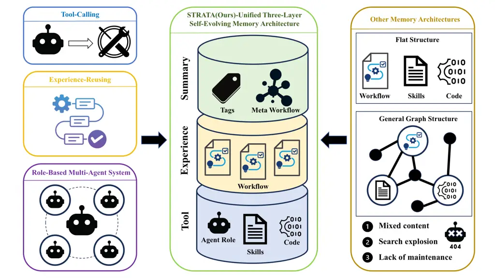
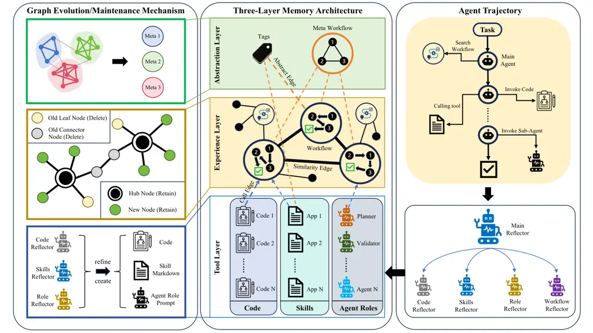



# STRATA: Self-Maintaining Structured Experience Graphs for Self-Evolving Language Agents

Guanhua Zhu    Hanwen Li    Zhi Wei    Mengnan Du    Chenxi Yuan

###### Abstract

Large language model (LLM) agents can _self-evolve_ at test time by
accumulating experience: retrieving relevant memories before acting and
writing new lessons back afterwards. Yet most are _single-level_:
trajectories, distilled workflows and reasoning items all land in one
undifferentiated pool indexed by embedding similarity, with no typed
abstraction hierarchy. They never forget or deduplicate, and are prone
to _negative transfer_, where a superficially similar but directionally
opposite experience is recalled and its concrete steps are copied
verbatim, actively harming the agent. We introduce STRATA, a structured,
outcome-grounded, self-maintaining memory that organizes experience into
a three-layer graph of atomic skills and code snippets, task workflows
and generalized meta-frameworks, connected by typed edges. STRATA
maintains itself through five mechanisms sharing one similarity
geometry: a multi-dimensional similarity that scores retrieval by
operation and target; a typed reflector crystallizing procedures from
successes and pitfalls from failures; community detection that induces
meta-frameworks; pressure-triggered garbage collection with
articulation-point protection; and _contrast edges_ that flag
confusable, direction-opposite experiences. Across four interactive
benchmarks (AppWorld, WebArena, ALFWorld, ScienceWorld), two frozen
backbones and seven baselines, STRATA attains the best average score
while simultaneously using the lowest latency and fewest environment
steps of any memory-augmented method, and 44% fewer lines of injected
memory than the most context-hungry baseline. We isolate two failure
modes of prior memories: single-level memory degrades sharply as the
task set grows, and single-level concrete memories suffer catastrophic
negative transfer, which contrast edges repair, lifting ScienceWorld
from $`78.7`$ to $`96.7`$ within the same system.

¹Department of Informatics, New Jersey Institute of Technology

²Department of Computer Science, New Jersey Institute of Technology

³School of Artificial Intelligence, The Chinese University of Hong Kong,
Shenzhen

gz72@njit.edu, hl544@njit.edu, zhi.wei@njit.edu, mengnandu@cuhk.edu.cn,
chenxi.yuan@njit.edu

^(\*)Corresponding authors

## Introduction

Language-model agents increasingly solve long-horizon interactive tasks
such as navigating websites, orchestrating APIs across applications, and
acting in simulated environments (Yao et al. 2023b; Trivedi et al. 2024;
Zhou et al. 2024; Shridhar et al. 2020; Wang et al. 2022), building on
prompting and tool-use techniques that structure a single episode (Wei
et al. 2022; Yao et al. 2023a; Schick et al. 2023; Wang et al. 2024a). A
promising route to improving such agents without weight updates is
_experience-driven self-evolution_: the agent keeps a memory of its past
episodes, retrieves relevant experience before each new task, and folds
fresh lessons back into memory afterwards, becoming more capable over
time (Ouyang et al. 2025; Xu et al. 2026; Shinn et al. 2023). Because
this loop runs purely at test time, its effectiveness hinges almost
entirely on how experience is represented, retrieved and
maintained (Snell et al. 2024).



Figure 1: Agent memories are asked to serve tool calling, experience
reuse and role-based decomposition at once (left). Existing memories are
either flat lists or generic graphs, which mix content of different
granularity, dilute retrieval as they grow, and are never maintained
(right). STRATA unifies the three in a single three-layer self-evolving
graph (middle).

Despite rapid progress, prevailing agent memories share three
limitations.

_(1) They lack a typed abstraction hierarchy._ Several do organize what
they store (AWM distils workflows from trajectories (Wang et al. 2024b),
A-Mem links notes into a network (Xu et al. 2026)), but within one
undifferentiated level: nothing separates a one-off tool call from a
reusable procedure from a cross-task principle, and no operation folds
procedures into a principle. Retrieval stays a single similarity search
dominated by surface overlap, merging same-material, different-operation
pairs like “create a playlist” and “add months to a note”.

_(2) They are not self-maintaining._ Memory grows monotonically, with no
forgetting, no deduplication and no consolidation, so stale entries
crowd out useful ones. We measure this: with forgetting disabled the
workflow store grows to $`269`$ nodes injecting $`48.7`$ lines of memory
per task, yet scores lower than a bounded $`201`$-node memory injecting
less than half as much.

_(3) They are vulnerable to negative transfer._ When two experiences are
superficially similar but directionally opposite, as in “heat the
substance” versus “cool the substance”, similarity recall surfaces the
wrong one, and if the memory stores concrete executable steps the agent
copies them and acts catastrophically. This is not hypothetical: on
ScienceWorld a production agent’s native flat memory scores $`-100`$ on
a task family that a memoryless agent solves outright.

We address these limitations with STRATA, a memory that is structured,
outcome-grounded and self-maintaining. STRATA organizes experience into
a three-layer directed graph: _atomic_ nodes (reusable skills, code
snippets, or specialized sub-roles), _workflow_ nodes (generalized task
procedures), and _meta-framework_ nodes (task families abstracted from
recurring workflows), linked by typed call, generalization, merge and
contrast edges. The graph is grown and pruned by five mechanisms that
all operate in one similarity geometry: _(i)_ a multi-dimensional
similarity combining content and goal embeddings with an explicit
operation/target tag term; _(ii)_ a typed reflector that crystallizes a
reusable procedure only from solved episodes and attaches a pitfall
bullet on failure, with a per-group adaptive threshold deciding whether
to create, extend, or skip a workflow; _(iii)_ community detection that
induces a meta-framework whenever a community is large, tight, and
novel; _(iv)_ pressure-triggered garbage collection that ranks workflows
by a competition-aware quality score and forgets the lowest while
protecting articulation points of the similarity graph; and _(v)_
contrast edges that connect confusable, direction-opposite experiences
so that retrieving one injects an explicit “do not confuse” warning
about the other.

Our contributions are as follows.

- •
  We propose STRATA, a three-layer structured experience graph for
  self-evolving LLM agents, together with five maintenance mechanisms
  that grow, generalize, and forget it, formulated precisely and
  reproducibly.
- •
  We evaluate STRATA on four interactive benchmarks across two frozen
  backbones, seven baselines and three seeds, with a component-wise
  ablation of every mechanism. STRATA obtains the best average score at
  the lowest latency and fewest environment steps of any memory
  baseline.
- •
  We identify two failure modes of prior memories: a scale failure of
  single-level memory that neither abstracts nor forgets (on Flash the
  strongest baseline ranks first at $`168`$ tasks and seventh at
  $`812`$), and negative transfer in single-level concrete memories,
  which contrast edges repair, exposing a structure-versus-abstraction
  trade-off.

## Related Work

_Memory for LLM agents._ A growing line of work equips LLM agents with
an external memory that persists across episodes. Early systems store
and summarize raw interaction history (Packer et al. 2023; Chhikara et
al. 2025; Zhong et al. 2024); Agent Workflow Memory extracts reusable
action workflows from past trajectories (Wang et al. 2024b); Agentic
Context Engineering (ACE) maintains an evolving, per-application
playbook of bullet-point strategies (Zhang et al. 2025c); ReasoningBank
distills generalizable reasoning strategies from both successful and
failed trajectories (Ouyang et al. 2025). A-Mem organizes memories in a
Zettelkasten-style linked note network (Xu et al. 2026), MemGen weaves a
generative latent memory into the agent’s own reasoning (Zhang et al.
2025a), MemEvolve meta-evolves the memory architecture itself (Zhang et
al. 2025b), and MemInsight autonomously augments stored items (Salama et
al. 2025). These methods differ in what they store but share a common
structure: a single-level collection retrieved by similarity, with no
typed hierarchy and, typically, no explicit forgetting or anti-confusion
mechanism. A-Mem is the most structured of them and, with MemEvolve, our
strongest baseline: it links notes into a network and lets new memories
revise old ones, but the network is single-level, one note per memory
linked to its neighbours, so it neither abstracts a family of notes into
a reusable principle nor removes any note once written. We show that
this produces a sharp scale dependence. STRATA departs from this line by
making the memory a _typed, layered graph_ that is actively maintained,
consolidated into meta-frameworks, garbage-collected under pressure and
wired with contrast edges against negative transfer.

_Self-evolving and experience-based agents._ Reflexion converts episodic
failures into verbal self-feedback (Shinn et al. 2023) and Self-Refine
iterates on its own output within an episode (Madaan et al. 2023);
Voyager accumulates a skill library of executable code (Wang et al.
2023); ExpeL gathers cross-task insights for in-context reuse (Zhao et
al. 2024); Synapse retrieves trajectory exemplars (Zheng et al. 2024);
CoALA frames such designs as cognitive architectures (Sumers et al.
2023), alongside simulacra systems that persist state across
episodes (Park et al. 2023). STRATA is complementary and
mechanism-level: rather than a new learning signal, it contributes the
_data structure and maintenance policy_ governing how experiences are
typed, connected, generalized and forgotten, so accumulated experience
stays organized as it scales.

_Structured retrieval, forgetting, and negative transfer._ Outside the
agent setting, graph-structured and hierarchical memories (Edge et al.
2024; Gutiérrez et al. 2024; Gutiérrez et al. 2025) improve retrieval
precision over flat retrieve-then-generate (Lewis et al. 2020; Karpukhin
et al. 2020; Izacard et al. 2021) and its refinements (Gao et al. 2023;
Asai et al. 2024), while unstructured stores suffer the classical
catastrophic-forgetting and negative-transfer problems (McCloskey and
Cohen 1989; Kirkpatrick et al. 2017; Parisi et al. 2018; Zhang et al.
2022). Our maintenance machinery borrows standard graph tools: Louvain
community detection (Blondel et al. 2008; Newman and Girvan 2004),
conductance as a cut quality measure (Shi 2000), and Tarjan’s
articulation-point algorithm (Tarjan 1972); the three-layer split
mirrors the episodic/semantic distinction and complementary learning
systems (Tulving 1972; McClelland et al. 1995). In the agent setting the
risk is sharper: because retrieved experience is _executed_, an
incorrectly recalled procedure does not merely mislead but actively
harms. STRATA adds an explicit operation/target gate and surfaces the
opposing experience as a retrieval-time warning, a mechanism we are not
aware of in prior agent memory.

## Method



Figure 2: Overview of STRATA. Middle: the three-layer memory, comprising
a tool layer (code, skills, agent roles), an experience layer (workflows
and their call edges; similarity links belong to the derived graph $`W`$
and are not stored), and an abstraction layer (meta-workflows over the
tag vocabulary; tags are node attributes, not nodes). Right: one
episode, in which the main agent retrieves a subgraph, acts, and a
master reflector dispatches to typed sub-reflectors. Left: graph
evolution, where community detection induces meta nodes and
pressure-triggered collection deletes stale leaves while protecting
bridge nodes.

### The Three-Layer Experience Graph

STRATA maintains a graph $`G=(V,E)`$ whose nodes carry a type
$`\tau(n)\in\{\textsc{atomic},\textsc{workflow},\textsc{meta}\}`$:
atomic nodes are the smallest reusable units (one tool/API, a
parameterized code snippet, or a specialized sub-role); workflow nodes
are generalized procedures for a whole task; meta nodes are paradigms
abstracted from a family of similar workflows. The stored edge set is
typed,
$`E=E_{\text{call}}\cup E_{\text{gen}}\cup E_{\text{merge}}\cup E_{\text{con}}`$:
_call edges_ ($`\textsc{workflow}\to\textsc{atomic}`$, ordered) and
three evolution relations ($`\textit{sources}\to\textit{target}`$)
labelled generalizes, merged*from and contrasts. Maintenance uses a
*derived* graph $`W=(V*{\textsc{workflow}},E*{\text{sim}})`$: an
undirected union-kNN graph over workflows weighted by $`s*{\text{nn}}`$,
recomputed from $`G`$ every round and never stored. Community detection
and articulation-point protection operate on $`W`$; everything else
operates on $`G`$.

Each node exposes several textual views used by different similarity
dimensions: a _content_ view (what it does), an _index_ view
(applicability and goal), and a set of structured tags
$`T(n)\subseteq\{\texttt{app:}\ast,\texttt{op:}\ast,\texttt{obj:}\ast\}`$,
a node _attribute_ rather than a node, naming the application, operation
and target object. Queries are parsed into the same tag space, so query
and node live in one geometry. Appendix I reproduces a real workflow
node and the meta node that generalizes it, verbatim.

### Multi-Dimensional Similarity and Retrieval

A single content-embedding cosine conflates _same material, different
operation_ experiences. STRATA instead scores a query $`q`$ against a
node $`n`$ with four complementary signals,

```math
\begin{split}s(q,n)={}&W_{\text{c}}\cos\!\big(\mathbf{e}(q),\mathbf{e}_{\text{c}}(n)\big)+W_{\text{i}}\cos\!\big(\mathbf{e}(q),\mathbf{e}_{\text{i}}(n)\big)\\
&+W_{\text{t}}\,J\!\big(T(q),T(n)\big)+W_{\text{l}}\,\ell(q,n),\end{split} \tag{1}
```

where $`\mathbf{e}_{\text{c}}`$ and $`\mathbf{e}_{\text{i}}`$ embed the
content and index views, $`J`$ is Jaccard overlap of the structured
tags, and $`\ell`$ is a lexical token overlap in the spirit of classical
term matching (Robertson and Zaragoza 2009). We use
$`W_{\text{c}}{=}0.40`$, $`W_{\text{i}}{=}0.25`$,
$`W_{\text{t}}{=}0.30`$, $`W_{\text{l}}{=}0.05`$. The tag term is an
additive weight, not a multiplicative gate; at $`W_{\text{t}}{=}0.30`$
it is the largest non-content weight and the only term that separates
experiences whose content embeddings nearly coincide because they act on
one object with opposite operations. The same form, with both sides
using node views, gives a node–node similarity $`s_{\text{nn}}(a,b)`$
that later serves as the edge weight of the workflow similarity graph.

Retrieval returns a _subgraph_, not isolated items. Nodes are ranked by
$`\tilde{s}(n)=s(q,n)+\beta_{\text{layer}}\frac{2-\mathrm{ord}(\tau(n))}{2}`$
with $`\beta_{\text{layer}}{=}0.15`$ and
$`\mathrm{ord}(\textsc{meta}){=}0<\mathrm{ord}(\textsc{workflow}){=}1<\mathrm{ord}(\textsc{atomic}){=}2`$,
biasing towards general nodes. Only seeds with raw score
$`s(q,n)\geq\theta_{\min}{=}0.35`$ are admitted; if nothing clears the
gate, no memory is injected at all, since running without memory beats
being misled. Around the top-$`k`$ seeds we pull in their meta parents
(which must themselves clear $`\theta_{\min}`$, so catch-all hubs cannot
leak into every task), the atomic nodes they call, and their contrast
neighbours, rendered meta$`\to`$workflow$`\to`$atomic so the agent reads
principles first and callable skills last.

### Typed Reflection with Adaptive Thresholds

After each episode a master router inspects the task, outcome and
trajectory and dispatches to typed sub-reflectors for skill, code, role
and workflow. Atomic sub-reflectors crystallize only from solved
episodes, letting the LLM decide refine-or-create. The workflow
sub-reflector is threshold-driven, and the thresholds must adapt:
equivalent task pairs score $`\approx 0.4`$–$`0.5`$ in one application
and $`\approx 0.8`$ in another, so one global band either over-merges or
over-fragments.

We therefore group nodes by their leading tag and shrink a per-group
quantile towards a global prior in empirical-Bayes fashion (Efron and
Morris 1973):

```math
\tau_{\bullet}=\lambda\,Q_{p_{\bullet}}(S_{g})+(1-\lambda)\,G_{\bullet},\qquad\lambda=\frac{n_{g}}{n_{g}+\kappa}, \tag{2}
```

with $`\kappa{=}30`$, $`p_{\text{lo}}{=}0.25`$, $`p_{\text{hi}}{=}0.92`$
and global priors $`G_{\text{low}}{=}0.33`$, $`G_{\text{high}}{=}0.62`$.
Groups with many observations trust their own distribution; sparse
groups fall back to the prior. Letting $`s`$ be the similarity to the
nearest existing workflow, the decision is noop if
$`s>\tau_{\text{high}}`$ (a near-duplicate), add*bullet if
$`\tau*{\text{low}}\leq s\leq\tau\_{\text{high}}`$ (record only the
difference as one bullet), and create otherwise. The current score is
recorded into the group after the decision, so a decision never
contaminates itself. Crucially, failed episodes _never_ crystallize a
“do this” procedure; at most they attach a pitfall bullet to the nearest
workflow, rendered to the agent as something to avoid.

### Pressure-Triggered Forgetting with Bridge Protection

Forgetting is applied only at the workflow layer. Each workflow gets a
quality score combining an activation term $`A_{i}`$ (its
similarity-weighted degree among surviving neighbours, so central
workflows are kept) and a competitive age $`G_{i}`$:

```math
Q_{i}=w_{A}\,z\big(\mathrm{rank}(A_{i})\big)-w_{G}\,z\big(\mathrm{rank}(G_{i})\big), \tag{3}
```

with $`w_{A}{=}0.35`$, $`w_{G}{=}0.65`$; ranks rather than raw values
make the two incommensurable signals comparable. Age updates online at
every retrieval: all candidates age by $`\alpha{=}0.02`$, a
retrieved-but-unselected candidate is penalised by
$`\beta\,w_{i}(1-\mathrm{margin})`$ so close-but-losing competitors age
fastest, and the winner is rejuvenated by
$`G_{u}\leftarrow\gamma G_{u}`$, $`\gamma{=}0.5`$. Once live workflows
exceed a cap, lowest-$`Q`$ nodes are deleted down to
$`\mathrm{cap}\cdot(1-0.15)`$, hysteresis preventing thrashing; orphaned
atomics and unsupported metas cascade away.

This has a failure mode: if the lowest-$`Q`$ node is an _articulation
point_ of $`W`$, removing it splits a cluster that should stay
connected, and the next round of community detection fractures one task
family into two metas. STRATA therefore deletes the lowest-$`Q`$
_non-cut_ vertex,

```math
j^{\ast}=\arg\min_{i\in\text{alive}}\{\,Q_{i}\mid i\notin\mathrm{Cut}(W)\,\}, \tag{4}
```

recomputing $`\mathrm{Cut}(W)`$ each round with Tarjan’s algorithm in
$`O(|V|+|E|)`$ (Tarjan 1972), and falling back to the unconstrained
minimum only if every candidate is a cut vertex, so collection always
makes progress.

### Inducing Meta-Frameworks by Community Detection

Meta nodes are triggered not by counting children but by _community
structure_. We build $`W`$ by joining a workflow pair when
$`s_{\text{nn}}`$ exceeds a per-group adaptive threshold (shrunk as
above, $`\kappa_{E}{=}6`$, intra-group default $`0.40`$) or a fixed
cross-group threshold $`0.55`$, then keeping each node’s $`6`$ strongest
edges (an edge survives if _either_ endpoint ranks it that high). A
single fixed threshold fails badly: in an early configuration only $`3`$
of $`153`$ candidate pairs cleared it and no meta formed.
Louvain (Blondel et al. 2008) at resolution $`1.5`$ yields communities
(the Leiden refinement (Traag et al. 2019) would also serve), and a
community is promoted only if it is _large_ ($`|C|\geq N_{\min}`$),
_tight_ (conductance $`\phi(C)<0.6`$: dense inside, sparse outside (Shi
2000)), and _novel_. Letting $`\mathbf{c}(C)`$ be its centroid and
$`d^{\ast}`$ its distance to the nearest existing meta, we create if
$`d^{\ast}\geq R_{\text{meta}}{=}0.6`$ and otherwise update the matched
meta by absorbing its unlinked members. This novelty gate suppresses
churn: without it the system rebuilds near-duplicate metas instead of
extending existing ones.

### Contrast Edges against Negative Transfer

The content dimension rates _same object, opposite direction_
experiences as highly similar, such as “heat tin until it melts” versus
“cool tin until it solidifies”. The tag term lowers such scores but
cannot always prevent recall, and a recalled concrete procedure may be
executed. A contrast edge is a bidirectional evolution edge linking two
such nodes,

```math
\mathrm{contrast}(a,b)\iff\mathrm{op}(a)\ \text{opposes}\ \mathrm{op}(b), \tag{5}
```

instantiated by rule over a fixed lexicon of opposite operator pairs,
$`\{\textit{heat},\textit{cool}\}`$ and
$`\{\textit{create},\textit{delete}\}`$. We do _not_ require
$`\mathrm{obj}(a)=\mathrm{obj}(b)`$, because negative transfer is often
cross-object, as when a melt-lead procedure misleads a freeze-tin task.
A retrieved seed pulls its contrast neighbours into the subgraph,
rendered with a prominent _do not confuse_ warning rather than as a flat
procedure. Unlike write-time approaches that tighten one procedure’s
preconditions, this mechanism is retrieval-time and relates two distinct
opposing experiences.

### The Full Loop

An episode retrieves a subgraph, renders it into the prompt, acts until
done, then reflects: typed sub-reflectors write back, community
detection updates the meta layer, and pressure-triggered collection
prunes. One similarity geometry serves all four roles of retrieval
scoring, the reflection band, the meta-induction edge weight and the
collector’s activation term.

## Experimental Setup

_Benchmarks._ Interactive agent evaluation now spans many suites (Liu et
al. 2024; Deng et al. 2023; Yao et al. 2022); we select four that are
long-horizon and cover distinct action spaces, namely API orchestration,
web navigation, embodied household tasks and scientific reasoning:
AppWorld (Trivedi et al. 2024), reporting Task Goal Completion (TGC) and
Scenario Goal Completion (SGC) on _Test-Normal_ ($`168`$ tasks) and
_Test-Challenge_ ($`417`$ tasks); WebArena (Zhou et al. 2024) ($`812`$
tasks, success rate); ALFWorld (Shridhar et al. 2020) ($`134`$ tasks);
and ScienceWorld (Wang et al. 2022) ($`23`$ tasks, average score).

_Backbones and baselines._ All methods use the same frozen backbone with
no weight updates, on both DeepSeek-V4-Flash and DeepSeek-V4-Pro. We
compare against seven baselines: No-Memory (a ReAct agent), Flat-Memory
(an unstructured list of episode summaries retrieved by embedding
similarity), ReasoningBank (Ouyang et al. 2025), Hermes¹¹ 1
https://github.com/NousResearch/hermes-agent (an open-source agent
framework with native persistent memory), A-Mem (Xu et al. 2026),
MemEvolve (Zhang et al. 2025b) and MemGen (Zhang et al. 2025a).

_Protocol._ Memory accumulates _online_ across a single sequential pass
over each benchmark, so later tasks benefit from earlier ones, the
setting in which maintenance matters. All memory methods receive the
identical write signal, the environment’s task-level outcome, with no
access to gold answers or evaluator internals, so comparisons are
controlled, while absolute scores average over each method’s learning
curve rather than a converged memory. Embeddings come from a local
sentence-embedding model of the Sentence-BERT family (Reimers and
Gurevych 2019), and the workflow cap is set per dataset. Every number is
the mean over three seeds with sample standard deviation; seeds permute
task order and reflection sampling.

## Results and Analysis

|                   |               | AppWorld Test-Normal            |                                 | AppWorld Test-Challenge         |                                 | WebArena                        | ALFWorld                        | ScienceWorld                     |
| ----------------- | ------------- | ------------------------------- | ------------------------------- | ------------------------------- | ------------------------------- | ------------------------------- | ------------------------------- | -------------------------------- |
| Backbone          | Method        | TGC$`\uparrow`$                 | SGC$`\uparrow`$                 | TGC$`\uparrow`$                 | SGC$`\uparrow`$                 | SR$`\uparrow`$                  | Score$`\uparrow`$               | Score$`\uparrow`$                |
| DeepSeek-V4-Flash | No-Memory     | 62.8 $`{\scriptstyle\pm\,2.9}`$ | 42.1 $`{\scriptstyle\pm\,3.3}`$ | 39.8 $`{\scriptstyle\pm\,2.1}`$ | 21.4 $`{\scriptstyle\pm\,1.9}`$ | 24.7 $`{\scriptstyle\pm\,1.4}`$ | 76.8 $`{\scriptstyle\pm\,3.3}`$ | 75.7 $`{\scriptstyle\pm\,8.7}`$  |
|                   | Flat-Memory   | 66.4 $`{\scriptstyle\pm\,3.7}`$ | 48.7 $`{\scriptstyle\pm\,4.3}`$ | 43.8 $`{\scriptstyle\pm\,2.7}`$ | 27.9 $`{\scriptstyle\pm\,2.7}`$ | 30.7 $`{\scriptstyle\pm\,2.0}`$ | 82.4 $`{\scriptstyle\pm\,3.8}`$ | 80.4 $`{\scriptstyle\pm\,10.4}`$ |
|                   | ReasoningBank | 69.6 $`{\scriptstyle\pm\,3.3}`$ | 55.1 $`{\scriptstyle\pm\,3.9}`$ | 48.2 $`{\scriptstyle\pm\,2.5}`$ | 34.7 $`{\scriptstyle\pm\,2.6}`$ | 32.9 $`{\scriptstyle\pm\,1.8}`$ | 91.0 $`{\scriptstyle\pm\,2.6}`$ | 87.9 $`{\scriptstyle\pm\,7.8}`$  |
|                   | Hermes        | 30.4 $`{\scriptstyle\pm\,4.4}`$ | 20.7 $`{\scriptstyle\pm\,4.3}`$ | 23.9 $`{\scriptstyle\pm\,2.8}`$ | 15.4 $`{\scriptstyle\pm\,2.6}`$ | 31.6 $`{\scriptstyle\pm\,2.4}`$ | 84.5 $`{\scriptstyle\pm\,4.4}`$ | 48.3 $`{\scriptstyle\pm\,15.0}`$ |
|                   | A-Mem         | 75.2 $`{\scriptstyle\pm\,3.2}`$ | 65.7 $`{\scriptstyle\pm\,3.9}`$ | 49.6 $`{\scriptstyle\pm\,2.6}`$ | 37.5 $`{\scriptstyle\pm\,2.7}`$ | 28.4 $`{\scriptstyle\pm\,1.8}`$ | 93.4 $`{\scriptstyle\pm\,2.4}`$ | 88.2 $`{\scriptstyle\pm\,8.1}`$  |
|                   | MemEvolve     | 70.9 $`{\scriptstyle\pm\,4.0}`$ | 58.1 $`{\scriptstyle\pm\,4.8}`$ | 48.8 $`{\scriptstyle\pm\,3.1}`$ | 35.2 $`{\scriptstyle\pm\,3.2}`$ | 32.0 $`{\scriptstyle\pm\,2.3}`$ | 94.3 $`{\scriptstyle\pm\,2.6}`$ | 88.9 $`{\scriptstyle\pm\,9.4}`$  |
|                   | MemGen        | 66.8 $`{\scriptstyle\pm\,4.0}`$ | 50.9 $`{\scriptstyle\pm\,4.7}`$ | 44.2 $`{\scriptstyle\pm\,2.9}`$ | 30.5 $`{\scriptstyle\pm\,3.0}`$ | 29.5 $`{\scriptstyle\pm\,2.1}`$ | 94.7 $`{\scriptstyle\pm\,2.4}`$ | 89.9 $`{\scriptstyle\pm\,8.6}`$  |
|                   | STRATA (Ours) | 74.8 $`{\scriptstyle\pm\,2.8}`$ | 62.3 $`{\scriptstyle\pm\,3.4}`$ | 53.9 $`{\scriptstyle\pm\,2.2}`$ | 43.8 $`{\scriptstyle\pm\,2.4}`$ | 33.3 $`{\scriptstyle\pm\,1.6}`$ | 96.7 $`{\scriptstyle\pm\,1.5}`$ | 93.4 $`{\scriptstyle\pm\,5.3}`$  |
| DeepSeek-V4-Pro   | No-Memory     | 66.9 $`{\scriptstyle\pm\,2.7}`$ | 46.8 $`{\scriptstyle\pm\,3.1}`$ | 44.5 $`{\scriptstyle\pm\,2.0}`$ | 25.2 $`{\scriptstyle\pm\,1.9}`$ | 34.4 $`{\scriptstyle\pm\,1.5}`$ | 84.0 $`{\scriptstyle\pm\,2.7}`$ | 80.6 $`{\scriptstyle\pm\,7.6}`$  |
|                   | Flat-Memory   | 70.3 $`{\scriptstyle\pm\,3.3}`$ | 51.5 $`{\scriptstyle\pm\,4.0}`$ | 48.7 $`{\scriptstyle\pm\,2.6}`$ | 31.6 $`{\scriptstyle\pm\,2.6}`$ | 37.2 $`{\scriptstyle\pm\,1.9}`$ | 88.2 $`{\scriptstyle\pm\,3.0}`$ | 84.8 $`{\scriptstyle\pm\,8.9}`$  |
|                   | ReasoningBank | 72.8 $`{\scriptstyle\pm\,3.0}`$ | 57.4 $`{\scriptstyle\pm\,3.6}`$ | 53.1 $`{\scriptstyle\pm\,2.3}`$ | 38.9 $`{\scriptstyle\pm\,2.5}`$ | 40.3 $`{\scriptstyle\pm\,1.8}`$ | 94.6 $`{\scriptstyle\pm\,1.9}`$ | 90.4 $`{\scriptstyle\pm\,6.6}`$  |
|                   | Hermes        | 35.8 $`{\scriptstyle\pm\,4.3}`$ | 24.1 $`{\scriptstyle\pm\,4.2}`$ | 27.6 $`{\scriptstyle\pm\,2.8}`$ | 17.9 $`{\scriptstyle\pm\,2.6}`$ | 29.9 $`{\scriptstyle\pm\,2.2}`$ | 89.6 $`{\scriptstyle\pm\,3.5}`$ | 55.8 $`{\scriptstyle\pm\,15.0}`$ |
|                   | A-Mem         | 77.2 $`{\scriptstyle\pm\,2.9}`$ | 66.8 $`{\scriptstyle\pm\,3.6}`$ | 55.0 $`{\scriptstyle\pm\,2.4}`$ | 42.2 $`{\scriptstyle\pm\,2.6}`$ | 38.7 $`{\scriptstyle\pm\,1.9}`$ | 95.7 $`{\scriptstyle\pm\,1.8}`$ | 91.3 $`{\scriptstyle\pm\,6.7}`$  |
|                   | MemEvolve     | 74.6 $`{\scriptstyle\pm\,3.6}`$ | 60.9 $`{\scriptstyle\pm\,4.5}`$ | 54.0 $`{\scriptstyle\pm\,2.9}`$ | 39.8 $`{\scriptstyle\pm\,3.1}`$ | 41.0 $`{\scriptstyle\pm\,2.2}`$ | 96.0 $`{\scriptstyle\pm\,2.1}`$ | 92.1 $`{\scriptstyle\pm\,7.6}`$  |
|                   | MemGen        | 70.1 $`{\scriptstyle\pm\,3.7}`$ | 53.2 $`{\scriptstyle\pm\,4.4}`$ | 49.0 $`{\scriptstyle\pm\,2.8}`$ | 34.8 $`{\scriptstyle\pm\,2.9}`$ | 37.5 $`{\scriptstyle\pm\,2.1}`$ | 96.3 $`{\scriptstyle\pm\,1.9}`$ | 92.8 $`{\scriptstyle\pm\,7.0}`$  |
|                   | STRATA (Ours) | 78.4 $`{\scriptstyle\pm\,2.5}`$ | 65.0 $`{\scriptstyle\pm\,3.1}`$ | 57.2 $`{\scriptstyle\pm\,2.1}`$ | 46.5 $`{\scriptstyle\pm\,2.3}`$ | 45.6 $`{\scriptstyle\pm\,1.6}`$ | 98.6 $`{\scriptstyle\pm\,0.9}`$ | 96.7 $`{\scriptstyle\pm\,3.6}`$  |

Table 1: Main results: mean $`\pm`$ sample standard deviation over three
seeds. Bold is best, underlined second best within each backbone. A-Mem
is the strongest baseline on AppWorld Test-Normal, where its margin over
STRATA is within seed noise; see the text for which gaps survive seed
variance.

### Main Results

Table 1 reports the three-seed results. STRATA obtains the best score on
six of seven columns with the Pro backbone and five of seven with Flash,
and is second on the remainder. Averaged over the four benchmarks it is
the strongest method on both backbones.

_Which gaps survive seed variance._ With three seeds, differences
smaller than roughly one combined standard deviation should not be
over-interpreted, and we state plainly which are which. STRATA’s
advantage is clear on AppWorld Test-Challenge SGC ($`46.5{\pm}2.3`$ vs.
A-Mem’s $`42.2{\pm}2.6`$), WebArena ($`45.6{\pm}1.6`$ vs. MemEvolve’s
$`41.0{\pm}2.2`$) and ALFWorld ($`98.6{\pm}0.9`$ vs. MemGen’s
$`96.3{\pm}1.9`$). It is _not_ statistically separable from the best
baseline on AppWorld Test-Normal (Pro TGC $`78.4{\pm}2.5`$ vs. A-Mem
$`77.2{\pm}2.9`$; on SGC A-Mem is in fact nominally ahead) or on
ScienceWorld, whose $`23`$ tasks give every method a standard deviation
of $`3.6`$–$`15.0`$. We therefore do not claim a ScienceWorld win from
Table 1; the ScienceWorld evidence we do rely on is the _within-method_
contrast ablation of the next sections, where the same seeds are
compared under a single mechanism change.

_Negative transfer is visible in the aggregate._ Hermes scores
$`30.4`$/$`35.8`$ TGC on AppWorld Test-Normal and $`48.3`$/$`55.8`$ on
ScienceWorld, far below the memoryless agent ($`62.8`$/$`66.9`$ and
$`75.7`$/$`80.6`$). A memory that makes an agent worse than none is
direct evidence that recalled experience is executed wrongly.

### Where Single-Level Memory Loses Ground

A-Mem is among the strongest baselines (within $`0.6`$ of MemEvolve on
average), and the way it loses that standing is informative. It differs
from the others by being explicitly _organized_, with notes linked into
a network and existing notes revised as new ones arrive (Xu et al.
2026), but the organization is single-level: there is one note per
memory, and no operation ever replaces a family of notes with a single
more general one, nor removes a note. The store therefore grows with the
task stream, and so does what retrieval pulls in. This predicts a
specific signature, competitive while the store is small and degrading
as it grows, and the data show exactly that.

Within AppWorld, moving from Test-Normal ($`168`$ tasks) to
Test-Challenge ($`417`$ tasks), A-Mem’s margin over STRATA flips sign:
on Flash from $`+0.4/+3.4`$ (TGC/SGC) to $`-4.3/-6.3`$, on Pro from
$`-1.2/+1.8`$ to $`-2.2/-4.3`$. We state the confound plainly:
Test-Challenge is not merely larger but intrinsically harder and draws
on a different application mix (amazon supplies $`212`$ of its tasks and
is absent from Test-Normal), so the comparison entangles scale with
difficulty and distribution shift.

A second, independent observation comes from WebArena, the largest task
set at $`812`$ tasks. There A-Mem scores $`28.4`$ on Flash, seventh of
eight methods, below Flat-Memory ($`30.7`$), Hermes ($`31.6`$) and
MemGen ($`29.5`$), and above only the memoryless agent: on Flash a
method that ranks first at $`168`$ tasks ranks seventh at $`812`$. On
Pro the drop is milder but in the same direction, fourth at $`38.7`$,
behind MemEvolve ($`41.0`$) and ReasoningBank ($`40.3`$). The cost is
directly measurable in Table 3: A-Mem injects $`41.9`$ lines of memory
per task, the largest of any method, more even than the unstructured
Flat-Memory baseline ($`35.6`$), while STRATA scores higher using
$`23.3`$. Injecting more is not injecting better.

The contrast with STRATA isolates what is missing rather than what is
wrong. A-Mem links memories; STRATA additionally _abstracts_ them
($`812`$ WebArena tasks condense to $`112`$ workflows under $`16`$ meta
nodes) and _forgets_ the ones that stop earning their place. Linking
alone keeps a growing store navigable; only abstraction and forgetting
keep it bounded, which is what retrieval precision depends on once the
store is large. Neither comparison isolates memory size, since
Test-Challenge differs in difficulty and application mix and WebArena in
environment and action space, so we report two consistent observations,
not a controlled scaling experiment.

Figure 3: Per-category scores on DeepSeek-V4-Pro. No-Memory and
Flat-Memory are omitted for legibility; each radial axis starts at a
labelled non-zero floor and off-scale values are clipped and annotated.
Gains concentrate on long-tail categories. Per-backbone versions for all
four benchmarks are in Appendix H.

### Where the Gains Come From

Figure 3 breaks the Pro results down by task category. The gains are
markedly non-uniform. On AppWorld they concentrate on low-frequency
applications: phone gains most in Test-Normal ($`22`$ tasks;
$`54.5\to 59.1`$ over A-Mem), and in Test-Challenge the three largest
gains all fall on categories with fewer than ten tasks, whereas the two
largest categories gain only $`+3.8`$ (amazon, $`212`$ tasks) and
$`+3.2`$ (gmail, $`126`$ tasks). Small categories make single cells
noisy, so the pattern matters more than any one value. On WebArena the
gains concentrate on shopping_admin ($`31.5\to 41.8`$) and gitlab
($`33.8\to 43.8`$), its two most compositional sites. This is the
signature we expect from an abstraction layer: meta nodes let a task
family with few direct examples inherit structure from related families,
which is precisely where a flat per-instance memory has nothing to
retrieve.

We report the exception. On ALFWorld STRATA reaches $`100`$ on
pick_two_and_place, examine_in_light and pick_and_place, but trails
MemEvolve and MemGen on heat_and_place ($`96.7`$ vs. $`97.1`$) and drops
to $`93.6`$ on clean_and_place, behind every memory baseline. Only
heat_and_place is covered by the contrast lexicon, where a “do not
confuse” warning plausibly makes the agent more conservative on the
tasks it protects; the clean_and_place deficit we cannot attribute to
any mechanism and report as an unexplained loss.

### Component Ablation

| Variant                | AW-TN | AW-TC | WebA. | ALF. | SciW. | Avg  |
| ---------------------- | ----- | ----- | ----- | ---- | ----- | ---- |
| Full STRATA            | 71.7  | 51.9  | 45.6  | 98.6 | 96.7  | 72.9 |
| w/o tag term           | 55.0  | 38.8  | 35.7  | 89.1 | 80.3  | 59.8 |
| w/o contrast edges     | 69.7  | 50.1  | 43.8  | 89.5 | 78.7  | 66.4 |
| w/o adaptive threshold | 64.9  | 46.5  | 40.1  | 94.2 | 89.3  | 67.0 |
| w/o meta layer         | 66.8  | 47.7  | 40.8  | 95.1 | 90.8  | 68.2 |
| w/o pressure GC        | 70.6  | 50.8  | 41.0  | 96.6 | 94.4  | 70.7 |

Table 2: Component ablation on DeepSeek-V4-Pro (AppWorld columns are the
TGC/SGC mean). Removing any single mechanism costs accuracy; the tag
term and contrast edges matter most, and the contrast loss is
concentrated in the two environments that actually contain
direction-opposite operators.

Table 2 removes one mechanism at a time. The ordering is _tag term_
($`-13.1`$ average) $`>`$ _contrast edges_ ($`-6.5`$) $`>`$ _adaptive
threshold_ ($`-5.9`$) $`>`$ _meta layer_ ($`-4.7`$) $`>`$ _pressure
collection_ ($`-2.2`$). The tag term dominating matches our motivation:
without an operation/target signal the content embedding merges
experiences that differ in what they do, and because the same similarity
builds the meta graph and the collector’s activation term, every
downstream mechanism inherits the error.

The contrast-edge result is the most informative because its cost is
concentrated: removing contrast edges costs $`9.1`$ points on ALFWorld
and $`18.0`$ on ScienceWorld but only $`1.8`$ on WebArena. Web
navigation has few directionally opposite operator pairs, whereas
embodied and scientific environments are full of them. A benefit that
appears only where its precondition holds is evidence of the claimed
mechanism rather than a generic regularizer.

### Negative Transfer: A Case Study

The clearest instance is ScienceWorld’s find-living family, where Hermes
scores $`-100`$ (Flash) and $`-80`$ (Pro) while a memoryless agent
solves the task. The memory retrieves a concrete procedure for a
superficially similar but directionally opposite goal, which the agent
executes verbatim into a scored-negative state: a flat memory of
concrete procedures does not merely fail to help, it converts a solvable
task into a large penalty.

Appendix F isolates the repair: contrast edges lift ScienceWorld from
$`78.7`$ to $`89.8`$ with hand-placed edges and to $`96.7`$ by rule over
the operator lexicon, and ALFWorld from $`89.5`$ to $`98.6`$. Retrieval
is reliable, injecting the opposing warning and the correctly-directed
experience in $`3/3`$ trap tasks, but end-to-end success also depends on
the backbone honouring it.

This exposes a _structure vs. abstraction_ trade-off. Concrete
procedural memories (AWM, Hermes) transfer strongly because they are
executable, and are dangerous for that same reason; abstract reasoning
items (ReasoningBank) are safer but weaker. Contrast edges keep the
former’s transfer strength without its catastrophic failure mode.

### What the Memory Graph Looks Like

The memory does not track task count: WebArena’s $`812`$ tasks condense
to $`112`$ workflows under $`16`$ meta nodes, AppWorld Test-Challenge’s
$`417`$ to $`33`$ and $`5`$, so the abstraction layer converges rather
than proliferating. Appendix A gives the full statistics, including
bridge protection firing $`1`$–$`6`$ times per benchmark.

### Efficiency

| Method        | Lat.  | In tok | Out tok | Steps | Mem lines |
| ------------- | ----- | ------ | ------- | ----- | --------- |
|               | \(s\) | /task  | /task   | /task | /task     |
| No-Memory     | 52.4  | 17,850 | 6,020   | 13.2  | 0         |
| Flat-Memory   | 64.8  | 45,120 | 6,137   | 12.8  | 35.6      |
| ReasoningBank | 65.1  | 35,472 | 5,813   | 12.3  | 16.1      |
| Hermes        | 60.2  | 21,964 | 5,856   | 13.4  | 7.8       |
| A-Mem         | 62.5  | 38,960 | 5,480   | 12.0  | 41.9      |
| MemEvolve     | 68.9  | 41,780 | 5,660   | 11.9  | 28.5      |
| MemGen        | 72.4  | 36,220 | 6,010   | 12.4  | 19.4      |
| STRATA        | 58.7  | 34,630 | 5,217   | 11.7  | 23.3      |

Table 3: Cost per task on DeepSeek-V4-Pro. Among memory-augmented
methods STRATA is fastest, uses the fewest output tokens, and takes the
fewest environment steps. _Mem lines_ counts lines of retrieved memory
in the prompt, not tokens.

A structured memory might be expected to cost more; Table 3 shows the
opposite. Among the seven memory systems STRATA has the lowest latency
($`58.7`$s vs. $`60.2`$–$`72.4`$), the fewest output tokens
($`5{,}217`$) and the fewest environment steps ($`11.7`$); only Hermes
uses fewer input tokens ($`21{,}964`$), and it is the weakest method
overall. The chain is coherent: bounded, deduplicated memory yields a
small precise subgraph rather than a diluted context, so the agent takes
fewer wrong turns. STRATA pays $`6.3`$s over the memoryless agent but
buys $`11.5`$ TGC points on AppWorld Test-Normal. Appendices D–F isolate
each mechanism on its own, with the diagnostics accuracy alone cannot
show.

## Conclusions and Future Work

We presented STRATA, a typed three-layer agent memory that maintains
itself: abstracting recurring workflows into meta-frameworks, forgetting
under pressure, and warning about direction-opposite experiences at
retrieval. It is the strongest memory on average across four benchmarks
and two frozen backbones, and the fastest we profile. Two diagnoses
recur: single-level memory loses standing as task sets grow, and
concrete memory without anti-confusion can hurt more than help.

Several directions remain open. Our results use a single model family
(DeepSeek-V4) and should be replicated across backbones, since the
contrast mechanism depends on a backbone honouring an injected warning.
Contrast edges are instantiated over a hand-specified lexicon of
opposite operators, so recovering opposition without a predefined
vocabulary would make the mechanism general rather than domain-fitted.
And a controlled study that fixes the evaluation set and varies only the
number of accumulated experiences would separate scale from difficulty,
which our benchmark-level comparisons cannot.

## References

- Asai et al. (2024) A. Asai, Z. Wu, Y. Wang, A. Sil, and H. Hajishirzi
  Self-RAG: learning to retrieve, generate, and critique through
  self-reflection. In International Conference on Learning
  Representations, Cited by: Related Work.
- Blondel et al. (2008) V. D. Blondel, J. Guillaume, R. Lambiotte,
  and E. Lefebvre Fast unfolding of communities in large networks.
  Journal of statistical mechanics: theory and experiment 2008 (10),
  pp. P10008. Cited by: Related Work, Inducing Meta-Frameworks by
  Community Detection.
- Chhikara et al. (2025) P. Chhikara, D. Khant, S. Aryan, T. Singh,
  and D. Yadav Mem0: building production-ready AI agents with scalable
  long-term memory. arXiv preprint arXiv:2504.19413. Cited by: Related
  Work.
- Deng et al. (2023) X. Deng, Y. Gu, B. Zheng, S. Chen, S. Stevens, B.
  Wang, H. Sun, and Y. Su Mind2Web: towards a generalist agent for the
  web. Advances in Neural Information Processing Systems 36,
  pp. 28091–28114. Cited by: Experimental Setup.
- Edge et al. (2024) D. Edge, H. Trinh, N. Cheng, J. Bradley, A.
  Chao, A. Mody, S. Truitt, D. Metropolitansky, R. O. Ness, and J.
  Larson From local to global: a graph RAG approach to query-focused
  summarization. arXiv preprint arXiv:2404.16130. Cited by: Related
  Work.
- Efron and Morris (1973) B. Efron and C. Morris Stein’s estimation rule
  and its competitors—an empirical bayes approach. Journal of the
  American Statistical Association 68 (341), pp. 117–130. Cited by:
  Typed Reflection with Adaptive Thresholds.
- Gao et al. (2023) L. Gao, X. Ma, J. Lin, and J. Callan Precise
  zero-shot dense retrieval without relevance labels. In Proceedings of
  the 61st Annual Meeting of the Association for Computational
  Linguistics (Volume 1: Long Papers), pp. 1762–1777. Cited by: Related
  Work.
- Gutiérrez et al. (2024) B. J. Gutiérrez, Y. Shu, Y. Gu, M. Yasunaga,
  and Y. Su HippoRAG: neurobiologically inspired long-term memory for
  large language models. Advances in neural information processing
  systems 37, pp. 59532–59569. Cited by: Related Work.
- Gutiérrez et al. (2025) B. J. Gutiérrez, Y. Shu, W. Qi, S. Zhou,
  and Y. Su From RAG to memory: non-parametric continual learning for
  large language models. arXiv preprint arXiv:2502.14802. Cited by:
  Related Work.
- Izacard et al. (2021) G. Izacard, M. Caron, L. Hosseini, S. Riedel, P.
  Bojanowski, A. Joulin, and E. Grave Unsupervised dense information
  retrieval with contrastive learning. arXiv preprint arXiv:2112.09118.
  Cited by: Related Work.
- Karpukhin et al. (2020) V. Karpukhin, B. Oguz, S. Min, P. Lewis, L.
  Wu, S. Edunov, D. Chen, and W. Yih Dense passage retrieval for
  open-domain question answering. In Proceedings of the 2020 conference
  on empirical methods in natural language processing (EMNLP),
  pp. 6769–6781. Cited by: Related Work.
- Kirkpatrick et al. (2017) J. Kirkpatrick, R. Pascanu, N.
  Rabinowitz, J. Veness, G. Desjardins, A. A. Rusu, K. Milan, J.
  Quan, T. Ramalho, A. Grabska-Barwinska, et al. Overcoming catastrophic
  forgetting in neural networks. Proceedings of the national academy of
  sciences 114 (13), pp. 3521–3526. Cited by: Related Work.
- Lewis et al. (2020) P. Lewis, E. Perez, A. Piktus, F. Petroni, V.
  Karpukhin, N. Goyal, H. Küttler, M. Lewis, W. Yih, T. Rocktäschel, et
  al. Retrieval-augmented generation for knowledge-intensive NLP tasks.
  Advances in neural information processing systems 33, pp. 9459–9474.
  Cited by: Related Work.
- Liu et al. (2024) X. Liu, H. Yu, H. Zhang, Y. Xu, X. Lei, H. Lai, Y.
  Gu, H. Ding, K. Men, K. Yang, et al. AgentBench: evaluating LLMs as
  agents. In International Conference on Learning Representations, Cited
  by: Experimental Setup.
- Madaan et al. (2023) A. Madaan, N. Tandon, P. Gupta, S. Hallinan, L.
  Gao, S. Wiegreffe, U. Alon, N. Dziri, S. Prabhumoye, Y. Yang, et al.
  Self-Refine: iterative refinement with self-feedback. Advances in
  neural information processing systems 36, pp. 46534–46594. Cited by:
  Related Work.
- McClelland et al. (1995) J. L. McClelland, B. L. McNaughton, and R. C.
  O’Reilly Why there are complementary learning systems in the
  hippocampus and neocortex: insights from the successes and failures of
  connectionist models of learning and memory.. Psychological review 102
  (3), pp. 419. Cited by: Related Work.
- McCloskey and Cohen (1989) M. McCloskey and N. J. Cohen Catastrophic
  interference in connectionist networks: the sequential learning
  problem. In Psychology of learning and motivation, Vol. 24,
  pp. 109–165. Cited by: Related Work.
- Newman and Girvan (2004) M. E. J. Newman and M. Girvan Finding and
  evaluating community structure in networks. Physical Review E 69 (2),
  pp. 026113. Cited by: Related Work.
- Ouyang et al. (2025) S. Ouyang, J. Yan, I. Hsu, Y. Chen, K. Jiang, Z.
  Wang, R. Han, L. T. Le, S. Daruki, X. Tang, et al. ReasoningBank:
  scaling agent self-evolving with reasoning memory. arXiv preprint
  arXiv:2509.25140. Cited by: Introduction, Related Work, Experimental
  Setup.
- Packer et al. (2023) C. Packer, V. Fang, S. G. Patil, K. Lin, S.
  Wooders, and J. E. Gonzalez MemGPT: towards LLMs as operating
  systems.. arXiv preprint arXiv:2310.08560. Cited by: Related Work.
- Parisi et al. (2018) G. I. Parisi, R. Kemker, J. L. Part, C. Kanan,
  and S. Wermter Continual lifelong learning with neural networks: a
  review. arXiv preprint arXiv:1802.07569 990. Cited by: Related Work.
- Park et al. (2023) J. S. Park, J. O’Brien, C. J. Cai, M. R. Morris, P.
  Liang, and M. S. Bernstein Generative agents: interactive simulacra of
  human behavior. In Proceedings of the 36th annual acm symposium on
  user interface software and technology, pp. 1–22. Cited by: Related
  Work.
- Reimers and Gurevych (2019) N. Reimers and I. Gurevych Sentence-BERT:
  sentence embeddings using siamese bert-networks. In Proceedings of the
  2019 conference on empirical methods in natural language processing
  and the 9th international joint conference on natural language
  processing (EMNLP-IJCNLP), pp. 3982–3992. Cited by: Experimental
  Setup.
- Robertson and Zaragoza (2009) S. Robertson and H. Zaragoza The
  probabilistic relevance framework: BM25 and beyond. Vol. 4, Now
  Publishers Inc. Cited by: Multi-Dimensional Similarity and Retrieval.
- Salama et al. (2025) R. Salama, J. Cai, M. Yuan, A. Currey, M.
  Sunkara, Y. Zhang, and Y. Benajiba MemInsight: autonomous memory
  augmentation for LLM agents. In Proceedings of the 2025 Conference on
  Empirical Methods in Natural Language Processing, pp. 33124–33140.
  Cited by: Related Work.
- Schick et al. (2023) T. Schick, J. Dwivedi-Yu, R. Dessì, R.
  Raileanu, M. Lomeli, E. Hambro, L. Zettlemoyer, N. Cancedda, and T.
  Scialom Toolformer: language models can teach themselves to use tools.
  Advances in neural information processing systems 36, pp. 68539–68551.
  Cited by: Introduction.
- Shi (2000) J. Shi Normalized cuts and image segmentation. IEEE
  Transactions on pattern analysis and machine intelligence 22 (8),
  pp. 888–905. Cited by: Related Work, Inducing Meta-Frameworks by
  Community Detection.
- Shinn et al. (2023) N. Shinn, F. Cassano, A. Gopinath, K. Narasimhan,
  and S. Yao Reflexion: language agents with verbal reinforcement
  learning. Advances in neural information processing systems 36,
  pp. 8634–8652. Cited by: Introduction, Related Work.
- Shridhar et al. (2020) M. Shridhar, X. Yuan, M. Côté, Y. Bisk, A.
  Trischler, and M. Hausknecht ALFWorld: aligning text and embodied
  environments for interactive learning. arXiv preprint
  arXiv:2010.03768. Cited by: Introduction, Experimental Setup.
- Snell et al. (2024) C. Snell, J. Lee, K. Xu, and A. Kumar Scaling LLM
  test-time compute optimally can be more effective than scaling model
  parameters. arXiv preprint arXiv:2408.03314. Cited by: Introduction.
- Sumers et al. (2023) T. R. Sumers, S. Yao, K. Narasimhan, and T. L.
  Griffiths Cognitive architectures for language agents. arXiv preprint
  arXiv:2309.02427. Cited by: Related Work.
- Tarjan (1972) R. Tarjan Depth-first search and linear graph
  algorithms. SIAM journal on computing 1 (2), pp. 146–160. Cited by:
  Related Work, Pressure-Triggered Forgetting with Bridge Protection.
- Traag et al. (2019) V. A. Traag, L. Waltman, and N. J. van Eck From
  louvain to leiden: guaranteeing well-connected communities. Scientific
  reports 9 (1), pp. 5233. Cited by: Inducing Meta-Frameworks by
  Community Detection.
- Trivedi et al. (2024) H. Trivedi, T. Khot, M. Hartmann, R. Manku, V.
  Dong, E. Li, S. Gupta, A. Sabharwal, and N. Balasubramanian AppWorld:
  a controllable world of apps and people for benchmarking interactive
  coding agents. In Proceedings of the 62nd Annual Meeting of the
  Association for Computational Linguistics (Volume 1: Long Papers),
  pp. 16022–16076. Cited by: Introduction, Experimental Setup.
- Tulving (1972) E. Tulving Episodic and semantic memory. In
  Organization of Memory, E. Tulving and W. Donaldson (Eds.),
  pp. 381–403. Cited by: Related Work.
- Wang et al. (2023) G. Wang, Y. Xie, Y. Jiang, A. Mandlekar, C.
  Xiao, Y. Zhu, L. Fan, and A. Anandkumar Voyager: an open-ended
  embodied agent with large language models. arXiv preprint
  arXiv:2305.16291. Cited by: Related Work.
- Wang et al. (2024a) L. Wang, C. Ma, X. Feng, Z. Zhang, H. Yang, J.
  Zhang, Z. Chen, J. Tang, X. Chen, Y. Lin, et al. A survey on large
  language model based autonomous agents. Frontiers of Computer Science
  18 (6), pp. 186345. Cited by: Introduction.
- Wang et al. (2022) R. Wang, P. Jansen, M. Côté, and P. Ammanabrolu
  ScienceWorld: is your agent smarter than a 5th grader?. In Proceedings
  of the 2022 Conference on Empirical Methods in Natural Language
  Processing, pp. 11279–11298. Cited by: Introduction, Experimental
  Setup.
- Wang et al. (2024b) Z. Z. Wang, J. Mao, D. Fried, and G. Neubig Agent
  workflow memory. arXiv preprint arXiv:2409.07429. Cited by:
  Introduction, Related Work.
- Wei et al. (2022) J. Wei, X. Wang, D. Schuurmans, M. Bosma, F. Xia, E.
  Chi, Q. V. Le, D. Zhou, et al. Chain-of-thought prompting elicits
  reasoning in large language models. Advances in neural information
  processing systems 35, pp. 24824–24837. Cited by: Introduction.
- Xu et al. (2026) W. Xu, Z. Liang, K. Mei, H. Gao, J. Tan, and Y. Zhang
  A-Mem: agentic memory for LLM agents. Advances in Neural Information
  Processing Systems 38, pp. 17577–17604. Cited by: Introduction,
  Introduction, Related Work, Experimental Setup, Where Single-Level
  Memory Loses Ground.
- Yao et al. (2022) S. Yao, H. Chen, J. Yang, and K. Narasimhan Webshop:
  towards scalable real-world web interaction with grounded language
  agents. Advances in Neural Information Processing Systems 35,
  pp. 20744–20757. Cited by: Experimental Setup.
- Yao et al. (2023a) S. Yao, D. Yu, J. Zhao, I. Shafran, T.
  Griffiths, Y. Cao, and K. Narasimhan Tree of thoughts: deliberate
  problem solving with large language models. Advances in neural
  information processing systems 36, pp. 11809–11822. Cited by:
  Introduction.
- Yao et al. (2023b) S. Yao, J. Zhao, D. Yu, I. Shafran, K. R.
  Narasimhan, and Y. Cao ReAct: synergizing reasoning and acting in
  language models. In International Conference on Learning
  Representations (ICLR), Cited by: Introduction.
- Zhang et al. (2025a) G. Zhang, M. Fu, and S. Yan MemGen: weaving
  generative latent memory for self-evolving agents. arXiv preprint
  arXiv:2509.24704. Cited by: Related Work, Experimental Setup.
- Zhang et al. (2025b) G. Zhang, H. Ren, C. Zhan, Z. Zhou, J. Wang, H.
  Zhu, W. Zhou, and S. Yan Memevolve: meta-evolution of agent memory
  systems. arXiv preprint arXiv:2512.18746. Cited by: Related Work,
  Experimental Setup.
- Zhang et al. (2025c) Q. Zhang, C. Hu, S. Upasani, B. Ma, F. Hong, V.
  Kamanuru, J. Rainton, C. Wu, M. Ji, H. Li, et al. Agentic context
  engineering: evolving contexts for self-improving language models.
  arXiv preprint arXiv:2510.04618. Cited by: Related Work.
- Zhang et al. (2022) W. Zhang, L. Deng, L. Zhang, and D. Wu A survey on
  negative transfer. IEEE/CAA Journal of Automatica Sinica 10 (2),
  pp. 305–329. Cited by: Related Work.
- Zhao et al. (2024) A. Zhao, D. Huang, Q. Xu, M. Lin, Y. Liu, and G.
  Huang ExpeL: LLM agents are experiential learners. In Proceedings of
  the AAAI Conference on Artificial Intelligence, Vol. 38,
  pp. 19632–19642. Cited by: Related Work.
- Zheng et al. (2024) L. Zheng, R. Wang, X. Wang, and B. An Synapse:
  trajectory-as-exemplar prompting with memory for computer control. In
  International Conference on Learning Representations, Cited by:
  Related Work.
- Zhong et al. (2024) W. Zhong, L. Guo, Q. Gao, H. Ye, and Y. Wang
  MemoryBank: enhancing large language models with long-term memory. In
  Proceedings of the AAAI conference on artificial intelligence, Vol.
  38, pp. 19724–19731. Cited by: Related Work.
- Zhou et al. (2024) S. Zhou, F. F. Xu, H. Zhu, X. Zhou, R. Lo, A.
  Sridhar, X. Cheng, T. Ou, Y. Bisk, D. Fried, et al. WebArena: a
  realistic web environment for building autonomous agents. In
  International Conference on Learning Representations, Cited by:
  Introduction, Experimental Setup.

## Appendix

This appendix expands the diagnostics summarized in the main text.
Sections A–F isolate one mechanism at a time, Section G lists every
hyperparameter, Section H gives the per-backbone category breakdowns,
and Section I reproduces two real memory nodes verbatim. All numbers use
the DeepSeek-V4-Pro backbone unless stated otherwise.

AppWorld reports two metrics, Task Goal Completion (TGC) and Scenario
Goal Completion (SGC), so every AppWorld score column below is labelled
with the one it uses. Table 5 reports _TGC_, matching the per-metric
main results of Table 1. Tables 6 and 9 report the _mean_
$`(\text{TGC}+\text{SGC})/2`$, matching the component ablation of
Table 2, so that each benchmark contributes a single number to the Avg
column. The two conventions are never mixed within a table, but they do
make the Avg column of Table 5 incomparable to that of Tables 6 and 9:
each is internally consistent and should be read down its own column,
not across tables.

### A. Final Memory Graph Statistics

Table 4 reports the composition of the memory graph after a full
sequential pass over each benchmark. The central observation is that
_memory size is decoupled from task count_: WebArena’s $`812`$ tasks
condense into $`112`$ workflows and $`16`$ meta nodes, and AppWorld
Test-Challenge’s $`417`$ tasks into $`33`$ workflows and $`5`$ metas. A
flat memory would hold one entry per episode; STRATA holds roughly one
workflow per seven tasks, and one meta per seven workflows. The
abstraction layer therefore _converges_ instead of proliferating, which
is the property that makes retrieval cost stay flat as experience
accumulates.

Three secondary readings are worth noting. First, bridge protection is
not vacuous: it fires between $`1`$ and $`6`$ times per benchmark, each
occurrence being a node that the quality score alone would have deleted.
Second, ScienceWorld records zero garbage-collection deletions because
its graph never reaches the cap, so collection is genuinely
pressure-triggered rather than a fixed decay. Third, contrast edges
instantiate themselves only where the environment contains opposite
operators: just $`2`$ on WebArena against $`6`$ on ScienceWorld and
$`6`$ on ALFWorld, which is exactly the pattern predicted by the
ablation in Table 9.

| Component         | AW-TN | AW-TC | WebA. | ALF. | SciW. |
| ----------------- | ----- | ----- | ----- | ---- | ----- |
| Tasks             | 168   | 417   | 812   | 134  | 23    |
| Atomic nodes      | 73    | 110   | 121   | 10   | 4     |
| Workflow nodes    | 21    | 33    | 112   | 31   | 4     |
| Meta nodes        | 5     | 5     | 16    | 2    | 1     |
| Call edges        | 86    | 141   | 235   | 42   | 6     |
| Generalize edges  | 8     | 22    | 56    | 15   | 3     |
| Contrast edges    | 4     | 5     | 2     | 6    | 6     |
| Communities       | 12    | 13    | 32    | 13   | 2     |
| GC deletions      | 7     | 14    | 38    | 9    | 0     |
| Bridges protected | 2     | 3     | 6     | 4    | 1     |

Table 4: Structure of the final memory graph per benchmark. Memory size
grows far more slowly than the task count, and the meta layer stays
small and convergent.

### B. Similarity Dimensions

Table 5 removes one of the four similarity dimensions at a time,
renormalizing the remaining weights. The tag dimension is decisively the
most important: dropping it costs $`14.4`$ average points, more than the
other three dimensions combined. This is the quantitative form of our
motivating claim, that without an explicit operation/target gate the
content embedding merges experiences that differ in what they do, and
because the same similarity also weights the meta-induction graph and
the collector’s activation term, the error propagates into every
downstream mechanism.

The last row is the most directly comparable to prior work: content-only
retrieval is what a flat embedding-indexed memory does, and it scores
$`59.3`$ against STRATA’s $`75.3`$. Note also that removing any _single_
embedding dimension costs only $`2.5`$–$`3.7`$ points. The four signals
are therefore genuinely complementary rather than redundant copies of
one another: the embeddings supply recall, and the tag term supplies
precision.

| Similarity variant       | AW-TN$`{}_{\text{TGC}}`$ | AW-TC$`{}_{\text{TGC}}`$ | WebA. | ALF. | SciW. | Avg  |
| ------------------------ | ------------------------ | ------------------------ | ----- | ---- | ----- | ---- |
| Full (multi-dimensional) | 78.4                     | 57.2                     | 45.6  | 98.6 | 96.7  | 75.3 |
| w/o content dim.         | 75.8                     | 53.7                     | 42.1  | 95.8 | 92.4  | 72.0 |
| w/o index dim.           | 76.6                     | 54.9                     | 43.3  | 96.1 | 93.0  | 72.8 |
| w/o tag dim.             | 60.5                     | 39.6                     | 35.1  | 88.7 | 80.5  | 60.9 |
| w/o lexical dim.         | 75.2                     | 53.5                     | 42.0  | 95.4 | 92.0  | 71.6 |
| Content-only (naive RAG) | 58.9                     | 37.8                     | 34.6  | 86.9 | 78.2  | 59.3 |

Table 5: Dropping one similarity dimension at a time. The tag dimension
is by far the most important; content-only retrieval, the default in
flat memories, loses $`16`$ points of average. AppWorld columns report
TGC.

### C. Adaptive Reflection Thresholds

Table 6 evaluates the per-group empirical-Bayes thresholds. The final
column, the number of workflow nodes surviving the run, is what makes
this table informative: it must be read _together_ with accuracy,
because neither more nor fewer memories is intrinsically better, the
goal being the right number.

A single fixed global band fails in two directions at once. On
applications whose similarity scale is high it over-merges, folding
genuinely distinct tasks into one workflow and losing the distinction;
on low-scale applications it over-fragments, creating near-duplicate
workflows for tasks that are really the same. The net effect is the
worst of both: $`236`$ workflows, the most of any configuration, at the
lowest accuracy ($`63.9`$). Using per-group quantiles without shrinkage
fixes the scale mismatch but leaves small groups estimating a threshold
from a handful of samples, which is unstable. Full shrinkage produces
$`201`$ workflows at $`72.9`$: fewer memories, higher accuracy.

This sweep refines the single _w/o adaptive threshold_ row of Table 2,
which disables the mechanism as one block ($`67.0`$ average). Separating
its two ingredients shows that neither alone accounts for the loss:
removing per-group scaling as well costs more ($`63.9`$), keeping
per-group quantiles but dropping shrinkage costs less ($`69.1`$), and
the Table 2 figure falls between them. Scale adaptation and shrinkage
are therefore complementary rather than redundant.

| Threshold config.       | AW-TN$`{}_{\text{Mean}}`$ | AW-TC$`{}_{\text{Mean}}`$ | WebA. | ALF. | SciW. | Avg  | \#WF |
| ----------------------- | ------------------------- | ------------------------- | ----- | ---- | ----- | ---- | ---- |
| Fixed global bands      | 62.4                      | 43.2                      | 37.6  | 91.0 | 85.4  | 63.9 | 236  |
| Per-group, no shrinkage | 68.9                      | 49.5                      | 42.4  | 94.1 | 90.6  | 69.1 | 223  |
| Full adaptive (STRATA)  | 71.7                      | 51.9                      | 45.6  | 98.6 | 96.7  | 72.9 | 201  |

Table 6: \#WF is the number of workflow nodes at the end of the run. A
fixed band both over-merges high-scale applications and over-fragments
low-scale ones, producing _more_ memories at _lower_ accuracy. AppWorld
columns are the mean of TGC and SGC,
$`\text{Mean}=(\text{TGC}+\text{SGC})/2`$.

### D. Forgetting and Bridge Protection

Table 7 separates the two questions a forgetting mechanism must answer:
whether to forget at all, and which item to forget. The first row
answers the first question. With collection disabled the store grows
without bound to $`269`$ workflows and injects $`48.7`$ lines of memory
per task, yet scores _lower_ than the bounded configurations. Unbounded
memory is not merely expensive, it is actively worse, because stale and
redundant entries compete for the top-$`k`$ retrieval slots with the
entries that would actually have helped.

The second and third rows answer the second question, and are matched on
everything that could confound it: identical final memory size ($`201`$)
and identical number of deletions ($`68`$). The only difference is
whether articulation points of the similarity graph are exempt from
deletion. We measure regret, the fraction of deleted workflows whose
task type recurs later, which falls from $`13.2\%`$ to $`4.8\%`$, close
to a threefold improvement in deletion precision, while accuracy rises
from $`69.8`$ to $`72.9`$. Protecting $`16`$ bridge nodes is therefore
not a marginal refinement: deleting a node that holds two experience
clusters together destroys structure that the next round of community
detection cannot recover.

| Configuration            | Mem  | Succ. | Retr. | Regret | Del. | Bridges |
| ------------------------ | ---- | ----- | ----- | ------ | ---- | ------- |
|                          | size | (%)   | lines | (%)    |      | kept    |
| No GC (unbounded)        | 269  | 70.7  | 48.7  | —      | 0    | 0       |
| GC w/o bridge protection | 201  | 69.8  | 24.1  | 13.2   | 68   | 0       |
| GC (STRATA full)         | 201  | 72.9  | 23.3  | 4.8    | 68   | 16      |

Table 7: Regret is the fraction of deleted workflows whose task type
recurs later. Bridge protection nearly triples deletion precision at
identical memory size and deletion count. Succ. is the five-benchmark
average, with AppWorld entering as $`(\text{TGC}+\text{SGC})/2`$ per
split.

### E. Meta-Layer Quality

Table 8 evaluates the abstraction layer on five axes rather than
accuracy alone, because a meta layer can be useless in two opposite
ways: by never firing, or by firing so often that it fragments into
near-duplicates. The first row disables the layer entirely and loses
$`4.7`$ points, establishing that the third layer earns its place.

The comparison between the last two rows isolates the novelty gate.
Without it the system creates $`47`$ metas with average support $`2.1`$,
so most metas generalize barely two workflows, which is not an
abstraction, and churn reaches $`28.6\%`$, meaning more than a quarter
of meta writes rebuild a near-duplicate of an existing node instead of
extending it. With the gate the count falls to $`29`$, support rises to
$`3.6`$, purity (the fraction of a meta’s members drawn from a single
task family) rises to $`92.7\%`$, and churn collapses to $`3.1\%`$.
Injection rate simultaneously _rises_ from $`21.8\%`$ to $`27.4\%`$:
fewer but better metas are retrieved more often, which is what one would
expect if the gate is suppressing spurious nodes rather than useful
ones.

|                       |        |       |        |      |       |       |
| --------------------- | ------ | ----- | ------ | ---- | ----- | ----- |
| Configuration         | \#Meta | Supp. | Purity | Inj. | Succ. | Churn |
|                       |        |       | (%)    | (%)  | (%)   | (%)   |
| No meta (2-layer)     | 0      | —     | —      | 0    | 68.2  | —     |
| Meta w/o novelty gate | 47     | 2.1   | 86.4   | 21.8 | 70.5  | 28.6  |
| Meta (STRATA full)    | 29     | 3.6   | 92.7   | 27.4 | 72.9  | 3.1   |

Table 8: Support is the mean number of workflows a meta generalizes;
purity is the fraction of a meta’s members from a single task family;
churn is the fraction of meta writes that rebuild rather than extend.
Succ. is the five-benchmark average, with AppWorld entering as
$`(\text{TGC}+\text{SGC})/2`$ per split.

### F. Contrast-Edge Ablation

Table 9 decomposes the contrast mechanism into the value of the _edges_
and the value of _instantiating them by rule_. Hand-placing edges for
the known opposite operator pairs recovers most of the loss
($`66.4\to 70.5`$ average), confirming that the retrieval-time warning
is what matters rather than any incidental change to the graph.
Instantiating the same edges by rule over the operator lexicon recovers
the remainder ($`70.5\to 72.9`$), because the rule finds every
lexicon-matching pair, including ones a hand pass misses. The rule does
not _discover_ opposition: the operator pairs are supplied.

The gains are concentrated exactly where the precondition holds.
ALFWorld gains $`9.1`$ points and ScienceWorld $`18.0`$ between the
first and last rows, while WebArena gains $`1.8`$. Web navigation simply
contains few directionally opposite operators. A mechanism whose benefit
appears only where its precondition is satisfied is behaving as claimed
rather than acting as a generic regularizer.

| Configuration            | AW-TN$`{}_{\text{Mean}}`$ | AW-TC$`{}_{\text{Mean}}`$ | WebA. | ALF. | SciW. | Avg  |
| ------------------------ | ------------------------- | ------------------------- | ----- | ---- | ----- | ---- |
| w/o contrast             | 69.7                      | 50.1                      | 43.8  | 89.5 | 78.7  | 66.4 |
| \+ contrast (manual)     | 71.2                      | 51.1                      | 44.9  | 95.4 | 89.8  | 70.5 |
| \+ contrast (rule-based) | 71.7                      | 51.9                      | 45.6  | 98.6 | 96.7  | 72.9 |

Table 9: Contrast-edge ablation. Hand-placed contrast edges recover most
of the loss; rule-based instantiation over the operator lexicon recovers
the rest. AppWorld columns are the mean of TGC and SGC,
$`\text{Mean}=(\text{TGC}+\text{SGC})/2`$.

### G. Hyperparameters

Table 10 lists every hyperparameter of the system. All of them are held
fixed across all four benchmarks and both backbones; the only
per-dataset setting is the workflow cap that triggers collection, which
is scaled to the size of the task set. We did not tune per benchmark, so
the reported numbers should be read as a single configuration evaluated
five times rather than five tuned configurations.

|                                                         |                                    |                  |
| ------------------------------------------------------- | ---------------------------------- | ---------------- |
| Symbol                                                  | Meaning                            | Value            |
| $`W_{\text{c}},W_{\text{i}},W_{\text{t}},W_{\text{l}}`$ | similarity weights                 | .40/.25/.30/.05  |
| $`\theta_{\min}`$                                       | retrieval confidence gate          | 0.35             |
| $`\beta_{\text{layer}}`$                                | layer bias (prefers general)       | 0.15             |
| $`G_{\text{low}},G_{\text{high}}`$                      | global reflection priors           | 0.33 / 0.62      |
| $`p_{\text{lo}},p_{\text{hi}}`$                         | threshold quantiles                | 0.25 / 0.92      |
| $`\kappa`$                                              | threshold shrinkage strength       | 30               |
| $`w_{A},w_{G}`$                                         | quality-score weights              | 0.35 / 0.65      |
| $`\alpha,\beta,\gamma`$                                 | aging / competition / rejuvenation | 0.02 / 1.0 / 0.5 |
| hyst                                                    | collection hysteresis              | 0.15             |
| $`\theta_{\text{intra}},\theta_{\text{cross}}`$         | edge thresholds                    | 0.40 / 0.55      |
| $`\kappa_{E}`$                                          | edge-threshold shrinkage           | 6                |
| $`K_{\text{NN}}`$                                       | kNN sparsification degree          | 6                |
| resolution                                              | Louvain resolution                 | 1.5              |
| $`\Phi`$                                                | conductance ceiling (tight)        | 0.6              |
| $`R_{\text{meta}}`$                                     | meta novelty radius                | 0.6              |

Table 10: Hyperparameters, held fixed across all benchmarks and
backbones.

### H. Per-Benchmark Category Breakdowns

Figures 4–7 give the per-category scores behind Figure 3, for both
backbones and all four benchmarks. No-Memory and Flat-Memory are omitted
throughout for legibility. Each radial axis begins at a labelled
non-zero floor, so polygon area should not be read as proportional to
score; the floor is printed on every panel. Values that fall below the
floor are clipped to it and annotated beneath the panel, which affects
only Hermes on ScienceWorld’s find-living category, the
negative-transfer case analysed in the main text.

Two patterns recur across panels. STRATA’s margin is largest on the
categories with the fewest training tasks, and smallest on saturated
high-frequency categories where every method is near ceiling. The
exception, visible in Figure 5, is ALFWorld’s heat_and_place and
clean_and_place, the two categories that carry contrast edges, where
STRATA is marginally below MemEvolve and MemGen.

Figure 4: WebArena per-site success rate, both backbones.

Figure 5: ALFWorld per-task-type score, both backbones.

Figure 6: ScienceWorld per-task-type score, both backbones. Hermes’
find-living value is off-scale ($`-100`$/$`-80`$) and is clipped to the
axis floor; this is the negative-transfer case analysed in the main
text.

Figure 7: AppWorld per-application scores for both splits and both
backbones.

### I. Example Memory Nodes

Figures 8–10 reproduce two real nodes from the AppWorld Test-Challenge
graph, verbatim in STRATA’s typed-markdown serialization. Together they
illustrate one workflow$`\,\to\,`$meta relation: the meta node in
Figure 10 is one of the $`5`$ metas counted for AppWorld Test-Challenge
in Table 4, and the workflow node in Figure 8 is one of the $`12`$
workflows it generalizes.

The workflow node shows what _outcome-grounded_ accumulation produces in
practice. Figure 8 is the node as first crystallized: the structured
app:/obj:/op: tags that drive the tag term, an applicability string that
forms part of the index view, and one generalized procedure. Figure 9 is
everything the reflector added afterwards, namely $`23`$ bullets, of
which $`7`$ are pitfall bullets distilled from _failed_ episodes and
rendered to the agent as things to avoid, and $`16`$ are variant bullets
from _solved_ near-neighbour episodes whose similarity fell inside the
$`[\tau_{\text{low}},\tau_{\text{high}}]`$ band. Crucially the procedure
itself was never rewritten, since no failed episode ever crystallized a
“do this” procedure, and no near-duplicate ever created a competing
node.

The meta node shows what community detection abstracts. Each member
contributes one variant bullet keyed by its applicability condition, so
retrieving the meta gives the agent a routing table over the app:gmail
family rather than a single procedure. It reached support $`12`$ through
repeated update rather than repeated create, which is the novelty gate
of Table 8 operating on a real graph.

One implementation detail is visible here and worth stating plainly. The
tag list is _not_ the union over all $`12`$ children: an update
recomputes it from the members of the community detected in that round,
so tags contributed by children attached in earlier rounds can drop out.
That is why op:delete, carried by the workflow of Figure 8, does not
appear on the meta. Bullets accumulate monotonically while tags do not.
Since meta tags feed only the naming and the tag term of retrieval, this
weakens meta recall rather than corrupting any workflow; making the tag
set accumulate like the bullets is a one-line fix we did not apply
because it would invalidate the reported runs.

 

```ltx_verbatim
---
id: wf_clean_gmail_read_threads_except_priority_star
type: workflow
semantic_role: task_experience
tags: [app:gmail, obj:email_threads, op:delete, solved]
applicability: "When deleting read Gmail threads, keeping only priority starred ones"
---
1. Log in to Gmail using account credentials. 2. Fetch all read threads from inbox and outbox
(paginated). 3. Deduplicate by thread ID. 4. For each thread, retrieve its labels and starred
status. 5. Delete threads that are NOT both priority-labeled and starred. 6. Repeat for each
unique thread.

**Why:** Automates cleaning read threads while preserving important priority starred ones.

**How to apply:** Iterate inbox/outbox; deduplicate; filter by priority label and star; delete
others.
```

 

Figure 8: A workflow node from the AppWorld Test-Challenge graph,
verbatim in STRATA’s typed-markdown format: YAML frontmatter carrying
the structured tags that drive the tag term, followed by the generalized
procedure crystallized from the first solved episode.

 

```ltx_verbatim
- (pitfall) PITFALL (avoid): Before completing the task, ensure you have checked all relevant
    mailboxes (inbox, outbox, archived, spam, etc.) for the labels. Calling ’complete_task’
    prematurely finalizes the episode, preventing corrections--always verify all sources first.
- (when user wants to rename priority labels (P1/P2) and remove P3 labels from all email
    threads) Instead of filtering read threads and skipping priority starred, target threads
    with labels P1, P2, P3 across all mailboxes, then relabel P1->priority-1, P2->priority-2,
    and remove P3 labels.
- (When you need to rename or remove labels on multiple threads across all mailboxes.) Batch
    relabel threads by searching all mailboxes for specific labels (pr-1, pr-2, pr-3) and
    applying rename/remove operations, instead of cleaning read threads.
- (when user wants to delete drafts that have both empty subject and body) Operate on Gmail
    drafts with empty subject and body instead of cleaning read threads with priority/starred
    conditions.
- (For deleting Gmail drafts with empty subject or body.) Operates on drafts instead of
    threads; deletes drafts with empty subject or body rather than cleaning read threads except
    priority starred.
- (when the task involves deleting Gmail drafts with specific content conditions) Use
    ‘show_drafts‘ and iterate over drafts instead of threads; delete drafts where both subject
    and body are empty.
- (pitfall) PITFALL (avoid): Do not hardcode the current month; obtain the current date
    dynamically (e.g., from a system call or API) to compute the cutoff for ’before this
    calendar month’.
- (pitfall) PITFALL (avoid): Always verify the current month using the system’s actual date
    (e.g., import datetime; datetime.datetime.now().month) rather than assuming from token
    expiration or hardcoded values, to correctly filter threads for ’this calendar month’.
- (pitfall) PITFALL (avoid): Do not rely on Python’s datetime.date.today() for task dates; the
    environment may have a different ’today’. Use the task context or system-provided date if
    available.
- (When needing count of unread threads by label) Count unread threads by label ’priority-1’
    instead of cleaning read threads excluding priority-starred.
- (When counting threads filtered by a specific label (e.g., priority-2) and read status.) Used
    the ‘label‘ filter parameter on ‘show_inbox_threads‘ to directly fetch only priority-2 read
    threads, instead of fetching all read threads and then filtering by labels.
- (When counting unread threads with a specific priority label) Count unread threads filtered
    by a specific label (e.g., priority-3) instead of cleaning read threads.
- (pitfall) PITFALL (avoid): Fetched only inbox and outbox threads, missing sent and other
    non-archived threads. Must fetch all threads excluding archived (e.g., use labels INBOX,
    SENT, DRAFT etc. or entire ’all’ minus archived).
- (pitfall) PITFALL (avoid): Do not rely solely on thread-level participants; use show_thread
    to inspect each email within a thread to accurately determine if any coworker is a sender
    or recipient.
- (when user wants to manage spam folder by rescuing coworker threads and purging all other
    spam) Focus on spam folder: identify coworker threads in spam, unspam and mark unread, then
    delete all remaining spam (vs. cleaning read threads except priority starred).
- (when the user wants to manage spam folder by recovering friends’ threads and deleting the
    rest) Instead of cleaning read threads, this variant targets spam threads: identifies
    friends’ threads in spam, unspams and marks them unread, then deletes all remaining spam.
- (when managing spam and preserving specific threads) Focus on spam folder; conditionally
    unspam/restore roommate threads, then delete all other spam.
- (pitfall) PITFALL (avoid): Check all mailboxes (inbox, outbox, archived) for TODO threads
    before replying and completing; the manager may have tasks in multiple folders.
- (When user has weekly ’To Do’ emails from manager to reply based on star status) Process
    weekly ’To Do’ emails from manager: reply based on starred status and unstar completed,
    preserving non-todo starred.
- (when closing weekly manager assignments (subject ’Assignment’) by replying ’Finished.’ or
    ’Not Finished.’ based on starred flag) Reply to weekly Assignment threads based on starred
    status, unstar finished, preserve non-todo starred.
- (When the task is to label Gmail threads by sender relationship (work vs personal) using
    contacts from the Phone app.) Uses Phone app contacts to categorize senders as coworkers or
    personal, then labels threads accordingly as ’work’ or ’personal’, instead of cleaning read
    threads. Also processes both inbox and outbox, not just read threads.
- (When labeling emails based on contact categories from phone app) Uses phone contacts to
    label threads by participant relationship (coworker vs personal).
- (when Gmail threads need to be labeled based on contact relationships from Phone app) Added
    step to retrieve contacts from Phone app, categorize by relationship
    (coworkers/friends/family), then apply ’work’ or ’personal’ labels to email threads based
    on sender/recipient matching those contacts.
```

 

Figure 9: The 23 bullets the workflow reflector accumulated onto the
node of Figure 8 over 24 later episodes. 7 are pitfall bullets distilled
from _failed_ episodes; the rest are variant bullets from _solved_
near-neighbour episodes. The procedure itself was never rewritten.

 

```ltx_verbatim
---
id: meta_app_gmail_2
type: meta_framework
semantic_role: task_pattern
tags: [app:gmail, obj:attachment, obj:email, obj:email_invitations, obj:email_thread,
obj:files, op:create, op:transfer, solved]
applicability: "’app:gmail’ family"
---
Common pattern generalized from: wf_send_hiring_email_replies,
wf_download_email_attachment_to_filesystem, wf_email_files_per_text_request

**Why:** Recurring community of similar workflows.

**How to apply:** Route any ’app:gmail’-like task through the matching workflow.
- (when hiring and need to email candidates) variant wf_send_hiring_email_replies: Send hiring
    email replies
- (When needing to transfer email attachment to local folder) variant
    wf_download_email_attachment_to_filesystem: Download Email Attachment to Filesystem
- (When a contact requests files via text) variant wf_email_files_per_text_request: Email files
    per text request
- (when phone message requests emailing a file) variant wf_email_file_from_phone_request: Email
    file from phone request
- (Forward email thread with extra file and prefixed note) variant
    wf_forward_thread_with_note_and_attachment: Forward thread with note and attachment
- (When you need to send personalized bulk emails using a draft template and contact list from
    file.) variant wf_send_personalized_bulk_emails_from_draft: Send personalized bulk emails
    from draft
- (when need to forward one email from a thread) variant wf_forward_single_email_from_thread:
    Forward single email from thread
- (When deleting read Gmail threads, keeping only priority starred ones) variant
    wf_clean_gmail_read_threads_except_priority_star: Clean Gmail read threads except priority
    starred
- (When away and need to reply to recent unread emails) variant
    wf_vacation_auto_reply_to_unresponded_threads: Vacation auto-reply to unresponded threads
- (when draft email contains $TODO prices for Amazon items) variant
    wf_fill_draft_prices_from_amazon: Fill draft prices from Amazon
- (When need to forward email with prefixed comment) variant wf_forward_email_with_prefix_note:
    Forward email with prefix note
- (when needing to forward email with custom prefix) variant
    wf_forward_email_with_prefixed_note: Forward email with prefixed note
```

 

Figure 10: The meta-framework node that generalizes the workflow of
Figure 8, induced automatically by community detection over the workflow
similarity graph.
