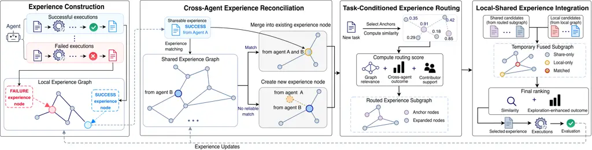

# XferAgent: Cross-Agent Experience Transfer for Self-Improving LLM Agents

Weihao Li    Jun Bai Affiliation: School of Computer Science, McGill
University    Shijie Chen Affiliation: McCormick School of Engineering,
Northwestern University    Qincheng Lu Affiliation: School of Computer
Science, McGill University Affiliation: Mila – Quebec AI Institute   
Xinyu Wang Affiliation: School of Computer Science, McGill University
Affiliation: Mila – Quebec AI Institute    Ziyang Song
Affiliation: School of Electrical Engineering and Computer Science, Ohio
University

###### Abstract

Large language model (LLM) agents can reuse experience from prior task
executions to improve performance on subsequent tasks. Although existing
methods enable cross-agent experience sharing, differences in agents’
execution histories and task requirements make shared experiences
difficult to reuse effectively. We propose XferAgent, a framework for
cross-agent experience transfer that organizes reusable experience in
local and shared experience graphs. XferAgent reconciles compatible
contributions from heterogeneous agents while avoiding unreliable
merges. For each new task, it selects shared experiences and integrates
them with the target agent’s local experience to support task execution.
Experiments across diverse task domains show improvements over
representative memory-based methods and effective experience transfer
between heterogeneous agent frameworks. Cumulative task success also
increases over successive task passes as agents update and reuse their
experiences.

^(†)^(†)footnotetext: ^(∗) Equal contribution.^(†)^(†)footnotetext: ^(†)
Corresponding author: ziyangs@ohio.edu.

## 1 Introduction

Large language model (LLM) agents are increasingly used to solve complex
tasks through multi-step reasoning, tool use, and interaction with
external environments (Yao et al., 2022; Hong et al., 2024; Qin et al.,
2024). Solving these tasks often requires iterative execution,
exploration, and feedback-driven refinement before an agent reaches a
successful outcome (Shinn et al., 2023). Across tasks, agents often
encounter recurring reasoning patterns, tool-use procedures, and failure
modes. Organizing these execution outcomes as reusable experience can
help agents reuse effective strategies and avoid repeating previous
failures on subsequent tasks. Recent work has therefore explored
experience-driven self-improvement, where agents distill prior
executions into reusable experience to improve performance on subsequent
tasks (Zhao et al., 2024; Wang et al., 2025; Cao et al., 2026).

Existing memory-based approaches support local self-improvement by
organizing experience from an agent’s past executions. Reflexion turns
task feedback into self-reflection stored in episodic memory for
subsequent attempts (Shinn et al., 2023), while A-MEM dynamically links
and updates memory notes as new experience arrives (Xu et al., 2026b).
ExpGraph organizes reusable skills and lessons in an experience
graph (Feng et al., 2026), while ReasoningBank distills successful and
failed executions into reusable reasoning memories for subsequent
tasks Ouyang et al. (2026). These approaches establish that experience
accumulated from past executions can improve subsequent behavior.
However, they primarily support local experience reuse, where an agent
can draw only on the strategies and failure lessons contained in its own
execution history. Relevant strategies or failure lessons absent from
one agent’s execution history may already have been acquired by other
agents, motivating experience reuse beyond a single agent’s local
history.

Recent work extends experience-driven self-improvement across agents by
allowing one agent to reuse strategies and failure lessons learned by
others. Agent KB aggregates trajectories from heterogeneous agent
frameworks into a shared knowledge base (Tang et al., 2025), while FoT
aggregates reasoning experience from independently operating agents into
a shared insight library (Yao et al., 2026). These studies show that
agents can benefit from shared experience, but differences in reasoning
protocols, tools, and execution histories make cross-agent experience
transfer difficult (Tang et al., 2025; Xu et al., 2026a; Li et al.,
2026). The central challenge is therefore to reconcile experience from
heterogeneous agents into reusable shared experience and identify which
shared experiences are useful for a new task while considering the
target agent’s local experience.

In this study, we propose XferAgent, a framework for Cross-Agent
Experience Transfer across heterogeneous agents. XferAgent organizes
each agent’s reusable experience in a local experience graph and
experience contributed across agents in a shared experience graph.
Through Cross-Agent Experience Reconciliation, XferAgent aligns
compatible contributions while avoiding unreliable merges. For a new
task, Task-Conditioned Experience Routing selects a task-relevant subset
of the Shared Experience Graph to construct a connected routed
experience subgraph. Local-Shared Experience Integration combines the
routed subgraph with the target agent’s local experience to select
task-relevant guidance. Following task evaluation, Experience Updates
support subsequent experience reuse. Our main contributions are:

- •
  We formulate cross-agent experience transfer in experience-driven
  self-improving LLM agents and introduce XferAgent to support
  experience reuse across heterogeneous agents.
- •
  We develop Cross-Agent Experience Reconciliation to align compatible
  contributions from heterogeneous agents while avoiding unreliable
  merges.
- •
  We combine Task-Conditioned Experience Routing and Local-Shared
  Experience Integration to select task-relevant experiences using both
  local and cross-agent outcome evidence.
- •
  Experiments across diverse tasks and LLM backbones demonstrate
  improvements over representative memory-based methods, with additional
  evidence of cross-framework experience reuse and increasing cumulative
  task success across repeated executions.

## 2 Related Work

#### Experience-Driven Agent Learning and Structured Memory.

Experience-driven self-improvement enables LLM agents to leverage
knowledge from prior executions without updating model parameters.
Reflexion (Shinn et al., 2023) uses verbal feedback to guide subsequent
attempts, ExpeL (Zhao et al., 2024) distills reusable insights from
execution trajectories, and ReasoningBank (Ouyang et al., 2026) extracts
strategies from successful and failed experiences. More structured
approaches organize such experiences through evolving memory
representations. A-MEM (Xu et al., 2026b) dynamically links related
memories, AriGraph (Anokhin et al., 2025) integrates semantic and
episodic knowledge into a graph-based world model, and ExpGraph (Feng et
al., 2026) organizes skills and lessons through graph-based retrieval
and utility-aware ranking. However, these methods primarily focus on
experience reuse within individual agents.

#### Cross-Agent Experience Sharing and Transfer.

Recent studies explore cross-agent experience reuse through shared
knowledge representations. Agent KB (Tang et al., 2025) aggregates
experiences from heterogeneous agent frameworks into a shared knowledge
base, while FICAL (Wu et al., 2024) exchanges distilled knowledge for
federated in-context learning. FoT (Yao et al., 2026) further distills
distributed reasoning experiences into reusable metacognitive insights.
These approaches facilitate cross-agent experience sharing, but
experiences from heterogeneous agents may be difficult to align, and not
all shared experiences are useful for a new task. XferAgent addresses
these challenges by reconciling contributed experiences and integrating
task-relevant shared experiences with the target agent’s local
experience.

## 3 XferAgent



Figure 1: Overview of XferAgent. Agents construct local experience
graphs by extracting experiences from successful and failed task
executions. Cross-Agent Experience Reconciliation incorporates
contributed experiences into a shared experience graph. Task-Conditioned
Experience Routing selects task-relevant anchors and constructs a routed
experience subgraph. Local–Shared Experience Integration combines local
and shared candidates into a temporary fused graph and ranks experiences
for task execution, followed by evaluation-based experience updates.

### 3.1 Problem Setup

We consider $`N`$ heterogeneous agents, indexed by
$`i\in\{1,\ldots,N\}`$. Agent $`i`$ maintains a local experience graph
$`\mathcal{G}_{i}^{L,t}`$, while experience contributed across agents is
organized in a shared experience graph $`\mathcal{G}^{S,t}`$, where
$`t`$ denotes the task step. Each node $`v`$ contains experience text
$`e_{v}`$, a type $`k_{v}\in\{\textsc{success},\textsc{failure}\}`$, an
embedding $`h_{v}=\phi(e_{v})`$ computed by a text encoder $`\phi`$,
provenance, and outcome statistics. Edges represent semantic similarity
and typed relations between experiences.

For a new task $`x_{t}`$ assigned to agent $`i`$ at time $`t`$,
XferAgent retrieves experience from the graph state at $`t-1`$, before
the task is executed. After task evaluation produces an outcome score
$`r_{t}`$, XferAgent updates outcome statistics only for experiences
included in the agent’s prompt for that task. The completed execution is
also converted into new reusable experience for subsequent tasks.

As shown in Figure 1, XferAgent enables cross-agent experience transfer
through Cross-Agent Experience Reconciliation (Section 3.2),
Task-Conditioned Experience Routing (Section 3.3), Local-Shared
Experience Integration (Section 3.4), and Experience Updates
(Section 3.5).

### 3.2 Cross-Agent Experience Reconciliation

XferAgent converts each completed agent execution into reusable
experience using a schema-constrained mapper. A successful execution
produces a success experience, while an unsuccessful execution produces
a failure experience describing a failed strategy or required check
rather than the incorrect answer itself. The local experience node may
retain richer execution details, such as tool observations and
intermediate planning details. When the experience is contributed to the
shared experience graph, XferAgent removes task-specific and
execution-sensitive information, including the raw task, final answer,
and complete trajectory. For a contributed experience, a stable
identifier links the local experience node to its representation in the
shared experience graph.

To organize reusable experiences into a graph, XferAgent connects each
experience to a sparse set of semantically related experiences. For each
node, it retains its $`K_{\mathrm{edge}}`$ most similar experiences
whose cosine similarity exceeds $`\theta_{\mathrm{edge}}`$. A semantic
edge is retained if either node selects the other, with cosine
similarity used as its weight.

XferAgent reconciles each contributed experience before incorporating it
into the shared experience graph. This is necessary because experience
contributions from heterogeneous agents are not naturally aligned and
may contain overlapping or semantically similar content. If a stable
identifier matches an existing node in the shared experience graph,
XferAgent merges the contributed experience with that node directly.
Otherwise, XferAgent searches the shared experience graph for potential
matches with the same experience type and sufficient semantic
similarity. For a contributed experience $`v`$, the candidate set is

```math
\mathcal{C}(v)=\{u\in\mathcal{V}^{S}:k_{u}=k_{v},\cos(h_{u},h_{v})\geq\theta_{\mathrm{rec}}\}, \tag{1}
```

where $`\theta_{\mathrm{rec}}`$ is the minimum cosine similarity for a
candidate match. The reconciliation rule considers three cases: (1) If
no candidate exists, XferAgent creates a new node. (2) If exactly one
candidate exists, XferAgent merges the contributed experience with that
node. (3) If multiple candidates exist, XferAgent merges the contributed
experience with the most similar candidate only when its cosine
similarity exceeds that of the second-most similar candidate by at least
a similarity margin $`\delta_{\mathrm{rec}}`$; otherwise, it creates a
new node to avoid an unreliable merge. When experiences are merged,
their provenance is combined, while outcome statistics remain separate
by agent. After reconciliation, XferAgent constructs semantic edges
among the resulting nodes in the shared experience graph.

Beyond the undirected semantic edges, XferAgent also preserves typed
relations between experiences. XferAgent adds a DERIVED-FROM relation
from each newly contributed experience to every shared experience
included in that task’s prompt. These relations have a fixed weight of

1.

### 3.3 Task-Conditioned Experience Routing

For a new task $`x_{t}`$, XferAgent constructs a task-relevant routed
experience subgraph instead of delivering the entire shared experience
graph. Agent $`i`$ receives the identifiers and embeddings of available
shared experience nodes and computes their task similarity locally as
$`a(x_{t},v)=\cos(\phi(x_{t}),h_{v})`$. It selects up to a fixed number
of the highest-scoring positive matches above
$`\theta_{\mathrm{match}}`$ as anchors, which serve as starting points
for graph search. Only the selected identifiers and similarity scores
are sent for subgraph construction, while the raw task and its embedding
remain with the agent.

Direct cosine similarity may miss experiences that are connected to
relevant anchors but have low similarity to the task description.
XferAgent therefore propagates task relevance from the anchors over the
shared experience graph. The positive anchor scores are normalized to
sum to one, defining $`\boldsymbol{\rho}_{i}(x_{t})`$, while other nodes
receive zero weight. We use personalized PageRank (PPR) to compute graph
relevance scores (Page et al., 1999):

```math
\mathbf{s}_{i}^{\mathrm{graph},(\ell+1)}=\alpha\boldsymbol{\rho}_{i}(x_{t})+(1-\alpha)A^{\top}\mathbf{s}_{i}^{\mathrm{graph},(\ell)}, \tag{2}
```

where $`A`$ is the row-normalized weighted adjacency matrix of the
shared experience graph, $`\alpha`$ is the restart probability that
balances anchor relevance and propagation through graph edges, and
$`\ell`$ indexes the iterations. After iterations,
$`s^{\mathrm{graph}}_{i,v}`$ denotes the graph relevance score of
experience $`v`$, corresponding to its component in the resulting vector
$`\mathbf{s}_{i}^{\mathrm{graph}}`$.

XferAgent also considers previous task outcomes when selecting shared
experiences, since graph relevance alone does not capture past task
performance. For target agent $`i`$, XferAgent computes a cross-agent
outcome score from other agents’ past task outcomes. Each experience
$`v`$ in the shared experience graph stores a usage count $`n^{S}_{jv}`$
and a cumulative task outcome score $`z^{S}_{jv}`$ for each agent $`j`$.
These statistics cover only tasks in which experience $`v`$ was included
in agent $`j`$’s prompt. The leave-one-agent-out (LOAO) calculation
excludes agent $`i`$’s own outcomes. Therefore, XferAgent aggregates
these statistics over all other agents $`j\neq i`$:

```math
\displaystyle n^{S}_{-i,v}=\sum_{j\neq i}n^{S}_{jv},\quad z^{S}_{-i,v}=\sum_{j\neq i}z^{S}_{jv},
```

```math
\displaystyle s^{\mathrm{outcome}}_{-i,v}=\frac{z^{S}_{-i,v}+\kappa u_{0}}{n^{S}_{-i,v}+\kappa}, \tag{3}
```

where $`u_{0}`$ is the prior outcome score and $`\kappa`$ controls the
strength of this prior.

XferAgent also considers contributor support
$`s^{\mathrm{support}}_{-i,v}`$, which counts the number of distinct
agents other than $`i`$ that contributed experience $`v`$. Repeated
contributions from the same agent count only once. To favor less-used
experiences, XferAgent adds an exploration bonus to the cross-agent
outcome score based on other agents’ usage counts. The resulting
exploration-enhanced cross-agent outcome score is capped at one and
denoted by $`s^{\text{exp-outcome}}_{-i,v}`$. XferAgent combines the
graph relevance score, the exploration-enhanced outcome score, and the
contributor support score to compute the final routing score:

```math
\displaystyle s^{\mathrm{route}}_{i,v}={} \displaystyle\beta_{g}\operatorname{Norm}(s^{\mathrm{graph}}_{i,v})+\beta_{o}\operatorname{Norm}(s^{\text{exp-outcome}}_{-i,v})
```

```math
\displaystyle+\beta_{s}\operatorname{Norm}(s^{\mathrm{support}}_{-i,v}), \tag{4}
```

where $`\operatorname{Norm}`$ applies min-max normalization separately
to each term over the available shared experience nodes. The fixed
weights $`\beta_{g}`$, $`\beta_{o}`$, and $`\beta_{s}`$ control graph
relevance, exploration-enhanced outcome, and contributor support,
respectively. Computational details appear in Appendix A.

XferAgent uses the routing scores to construct a connected routed
experience subgraph. It starts from the anchor with the highest task
similarity and repeatedly selects the highest-scoring unselected
neighbor of the selected nodes. Each candidate is scored using its
routing score plus a fixed-weight bonus for its strongest edge to a
selected node. Expansion stops when the node budget $`B`$ is reached or
no eligible neighboring nodes remain. The resulting subgraph contains
the selected shared experiences, their connecting edges, embeddings, and
cross-agent outcome scores. If no qualifying anchor exists, XferAgent
returns an empty subgraph.

### 3.4 Local-Shared Experience Integration

XferAgent integrates the routed experience subgraph with the target
agent’s local experience graph to select experiences for the task
prompt. XferAgent first selects candidate experiences separately from
the local experience graph and the routed experience subgraph, using
task-matching nodes as anchors. It applies PPR to each graph using its
own edges and retains a bounded number of nodes with the highest
positive graph relevance scores. If the routed experience subgraph is
empty, the agent can still select experiences from its local experience
graph.

XferAgent then builds a temporary fused graph to combine local and
shared candidates. For each local candidate, it first checks for a match
using its recorded shared identifier. If no identifier match exists,
XferAgent merges it with the highest-similarity experience of the same
type already in the pool, provided their cosine similarity meets the
fusion threshold. The pool includes previously processed local
experiences. If no qualifying match exists, the experience remains
separate. When a local experience matches a shared experience, it
retains the richer local content while retaining the shared identifier
for cross-agent outcome statistics.

XferAgent retains the graph edges among selected candidates and adds
semantic links between unmatched local and shared experiences that meet
the similarity threshold. It then applies PPR to the fused graph and
retains a bounded number of candidates for final ranking. The fused
graph is used only for the current task and does not modify either
persistent experience graph. Merging matched experiences and adding
semantic links can change the structure of the temporary fused graph.
XferAgent therefore applies PPR again and retains a bounded number of
nodes with the highest positive graph relevance scores for final
ranking. The fused graph does not modify the structure of either
original graph. Appendix A provides details on edge construction, seed
selection, and tie-breaking.

When the target agent has limited outcome history for an experience,
outcomes from other agents provide an initial estimate. As local
observations accumulate, they receive greater weight. Before executing
task $`x_{t}`$, agent $`i`$ reads how often each local experience was
included in its prompt, $`n_{iv}^{L,t-1}`$, and the sum of the
corresponding task outcome scores, $`z_{iv}^{L,t-1}`$. For a candidate
matched across both graphs, agent $`i`$ uses the cross-agent outcome
score $`s_{-i,v}^{\mathrm{outcome},t-1}`$ as a shared prior and combines
it with these local statistics:

```math
s^{\mathrm{fused}}_{i,v}=\frac{z_{iv}^{L,t-1}+\kappa s^{\mathrm{outcome}}_{-i,v}}{n_{iv}^{L,t-1}+\kappa}, \tag{5}
```

Here, $`s^{\mathrm{fused}}_{i,v}`$ denotes the fused outcome score for
$`x_{t}`$, and $`\kappa`$ controls the weight of the shared prior
relative to local observations. A local-only candidate uses the default
prior $`u_{0}`$ while retaining its local usage count and cumulative
outcome score. A shared-only candidate uses the cross-agent outcome
score directly. All statistics are taken from the pre-task state
$`t-1`$.

XferAgent ranks the remaining candidates using direct task similarity
and the fused outcome score. To favor less-used experiences, it adds the
exploration bonus from Section 3.3 to the fused outcome score. The
resulting exploration-enhanced fused outcome score is capped at one and
denoted by $`s^{\text{exp-fused},t}_{i,v}`$. For matched candidates, the
exploration count combines local usage with other agents’ shared usage.
Otherwise, only the available count is used. The final selection score
is defined as follows:

```math
\displaystyle s^{\mathrm{select}}_{i,v}= \displaystyle(1-\lambda_{u})\operatorname{Norm}(a(x_{t},v))
```

```math
\displaystyle+\lambda_{u}\operatorname{Norm}(s^{\text{exp-fused}}_{i,v}). \tag{6}
```

Here, $`a(x_{t},v)`$ denotes task similarity. When candidates are
merged, XferAgent retains the highest similarity score without
recomputing it for the selected local content. The two terms are
independently min-max normalized over the candidates selected by PPR on
the fused graph. If a term has zero range, its values are clipped to the
unit interval without rescaling (see Appendix A). The fixed weight
$`\lambda_{u}`$ controls their balance. XferAgent selects experiences in
descending score order, subject to limits on the number of experiences
and their total text length. XferAgent selects no experiences when no
usable seed exists in the fused graph or the highest score is below a
fixed threshold. Selected experiences are included as success or
failure.

### 3.5 Experience Updates

Before executing task $`x_{t}`$, XferAgent records the local and shared
experiences included in agent $`i`$’s prompt. After task evaluation
produces an outcome score $`r_{t}`$, XferAgent updates each recorded
experience’s usage count as $`n_{v}^{t}=n_{v}^{t-1}+1`$ and cumulative
outcome score as $`z_{v}^{t}=z_{v}^{t-1}+r_{t}`$. XferAgent updates only
experiences included in the prompt, modifying agent $`i`$’s local
statistics and its corresponding records in the shared experience graph.
XferAgent then converts the completed execution into reusable experience
as described in Section 3.2. The richer experience is added to the local
experience graph, while its shareable representation is reconciled
before entering the shared experience graph. XferAgent also links the
new shared experience to each shared experience included in the task
prompt through a DERIVED-FROM relation. These relations have a fixed
weight of 1.

## 4 Experiments

### 4.1 Experimental Setup

#### Datasets and Backbones.

We evaluate XferAgent primarily on GAIA (Mialon et al., 2024) and
ALFWorld (Shridhar et al., 2020), which assess complementary agent
capabilities: multi-step reasoning and tool use versus interactive task
execution. GAIA contains 301 test tasks across three difficulty levels,
evaluated with Qwen3-Next-80B-A3B-Instruct and GPT-5.6 Luna. ALFWorld
comprises 274 tasks (140 seen and 134 unseen), evaluated with
Qwen3.8-27B. To examine experience reuse in coding, we include a
supplementary evaluation on MBPP (Austin et al., 2021) (60 coding
tasks), using Llama-3.1-8B-Instruct.

#### Agent and Memory Configurations.

For GAIA, we use SmolAgents (Roucher et al., 2025) for the main
evaluation and additionally consider OWL (Hu et al., 2025) for
cross-framework experience transfer. For ALFWorld, agents interact with
the environment through its text-based action interface. MBPP employs
three logical agents with fixed task assignments and a shared LLM
backbone. Across ALFWorld and MBPP, we use a remote-memory budget of
$`B=8`$, at most 10 final experience items, and a nominal 2,400-token
memory allowance. Memory construction and retrieval settings for these
two benchmarks are detailed in Appendix C.

#### Baselines.

We compare XferAgent with No Memory and five representative memory-based
methods. No Memory evaluates the same base agent without experience
retrieval, providing a reference for assessing the benefits of memory
augmentation. The memory-based baselines include AgentKB (Tang et al., 2025) for cross-agent experience sharing, ReasoningBank (Ouyang et al., 2026) for reusable reasoning memories, ExpGraph (Feng et al., 2026) for
graph-structured experience retrieval, Mem0 (Chhikara et al., 2025) for
persistent memory management, and LightMem (Fang et al., 2026) for
efficient memory consolidation. For cross-agent evaluation, we use
benchmark-specific AgentKB configurations and adapt the other memory
systems to support bounded retrieval across agent-owned memories.
Implementation details for the supplementary-benchmark adapters are
provided in Appendix C.

#### Evaluation Protocols and Metrics.

For the main benchmark comparisons, we evaluate the reuse of
pre-constructed experience memories, keeping memory content and
historical outcome statistics fixed during testing. Within each
benchmark, methods use the same reasoning backbone and evaluation
cohort, with benchmark-specific memory construction and retrieval
settings. We separately examine Experience Updates over three task
passes on 165 GAIA validation tasks, reporting cumulative task recovery
as memories are updated after task evaluation. Performance is measured
by accuracy on GAIA, success rate on ALFWorld, and program pass rate on
MBPP. Failed or unparseable cases are included in the evaluation
denominators. Further details on GAIA Test evaluation and the other two
benchmark protocols are provided in Appendices B and C, respectively.

### 4.2 Main Results

The main experiments assess cross-agent experience transfer across
diverse tasks and LLM backbones, covering question answering (GAIA),
interactive task execution (ALFWorld), and code generation (MBPP).
Table 1 presents the overall performance of XferAgent against
representative memory-based methods.

#### GAIA Results.

On GAIA (301 test tasks), XferAgent achieves the highest overall
accuracy across both backbones. With GPT-5.6 Luna, it reaches 52.16%,
exceeding No Memory by 3.99 percentage points and the strongest
memory-based baseline, ExpGraph, by 4.65 points. With
Qwen3-Next-80B-A3B-Instruct, XferAgent achieves 29.57%, compared with
28.90% for AgentKB and 27.57% for No Memory. Notably, all competing
memory-based methods underperform No Memory with Luna, indicating that
experience reuse does not necessarily improve task performance.
Difficulty-level results are provided in Appendix B.

|               | GAIA                        |              | ALFWorld    | MBPP                  |
| ------------- | --------------------------- | ------------ | ----------- | --------------------- |
| Method        | Qwen3-Next-80B A3B-Instruct | GPT-5.6 Luna | Qwen3.8-27B | Llama-3.1-8B Instruct |
| No Memory     | 27.57                       | 48.17        | 84.7        | 50.0                  |
| AgentKB       | 28.90                       | 46.51        | 88.3        | 50.0                  |
| ReasoningBank | 26.91                       | 46.18        | 85.0        | 46.7                  |
| ExpGraph      | 27.24                       | 47.51        | 88.3        | 48.3                  |
| Mem0          | 25.91                       | 44.85        | 84.7        | 45.0                  |
| LightMem      | 21.59                       | 41.86        | 81.8        | 40.0                  |
| XferAgent     | 29.57                       | 52.16        | 88.7        | 53.3                  |

Table 1: Overall performance across GAIA, ALFWorld, and MBPP (%).
Metrics are accuracy, task success rate, and program pass rate,
respectively. ALFWorld and MBPP follow benchmark-specific single-run
protocols (Appendix C). Bold indicates the best result in each column.

#### ALFWorld Task Completion.

On 274 ALFWorld tasks, XferAgent achieves the highest success rate of
88.7%, outperforming No Memory (84.7%) by 4.0 percentage points and
slightly exceeding AgentKB and ExpGraph (both 88.3%). This extends
cross-agent experience transfer to multi-step interactive task
execution. Implementation details, including AgentKB’s retrieval of up
to eight cross-agent candidates, are provided in Appendix C.

#### MBPP Code Generation.

On 60 MBPP tasks, XferAgent achieves the highest pass rate of 53.3%,
compared with 50.0% for both No Memory and AgentKB, and 48.3% for
ExpGraph. Although the performance margin is relatively modest, the
results provide complementary evidence of effective experience reuse in
code generation. Together with GAIA and ALFWorld, these comparisons
demonstrate the applicability of XferAgent across different task
settings, with varying improvements over existing memory-based
approaches.

### 4.3 Progressive Self-Improvement through Experience Evolution

To examine progressive self-improvement through experience evolution, we
conduct three task passes over 165 GAIA validation tasks. After each
execution, agents update their experience memories based on evaluation
feedback for subsequent reuse. An independently evaluated No Memory
baseline serves as a reference.

Figure 2: Cumulative task performance through experience evolution on
GAIA validation (165 tasks). Passes 1–3 report cumulative task success
across repeated executions. The independent No Memory baseline is
connected to Pass 1 by dashed segments for visual comparison. Overall
accuracy is computed over all 165 tasks.

Across three task passes, cumulative overall accuracy increases from
56.36% to 67.88% and 74.55%, compared with 52.12% for No Memory
(Figure 2). Gains occur across all difficulty levels, with Level 3
improving from 42.31% to 69.23%. These results reflect cumulative
success on repeated tasks rather than generalization to unseen tasks,
and the independent No Memory baseline does not control for repeated
attempts.

### 4.4 Cross-Framework Experience Transfer

We examine cross-framework experience transfer between SmolAgents and
OWL with 2, 4, and 8 agents on GAIA validation. The initial two agents
use different frameworks, while additional agents are randomly assigned
to either framework as the group expands. Each agent builds experiences
from 20 questions sampled from a shared pool of 105, yielding 40, 80,
and 160 agent–question learning instances with possible overlap. All
configurations are evaluated on the same 60 held-out questions (18, 29,
and 13 at Levels 1–3).

Figure 3: Cross-framework experience transfer with 2, 4, and 8 agents on
60 held-out GAIA validation questions. Gray bars represent the 2-agent
baseline, while light and dark red segments indicate accuracy gains from
2 to 4 and 4 to 8 agents, respectively. Average denotes the unweighted
mean of accuracy across the three difficulty levels.

The macro-average accuracy increases from 40.4% with 2 agents to 47.2%
with 4 agents and 55.0% with 8 agents (Figure 3). Gains occur across all
difficulty levels, with Level 3 improving from 15.4% to 30.8%. Since
agent count and total learning exposure increase together, their
individual effects cannot be isolated, nor can the effect of framework
heterogeneity. Sampling details are provided in Appendix C.3.

### 4.5 Ablation Studies

We conduct ablation studies on XferAgent using GAIA with GPT-5.6 Luna to
assess the contributions of different experience sources and selection
mechanisms. As shown in Table 2, Local Experience Only disables
retrieval from the Shared Experience Graph, reducing overall accuracy
from 52.16% to 46.84%, while Shared Experience Only excludes local
experience retrieval and achieves 50.83%. This difference indicates that
local and shared experiences provide complementary information, with
local experience contributing more strongly in this setting.
Furthermore, w/o Outcome-Based Ranking removes outcome-based scoring
from experience ranking, decreasing accuracy to 48.17%. w/o Connectivity
Constraint relaxes the connectivity requirement during shared experience
selection, yielding 46.84%. These findings highlight the contributions
of outcome-informed selection and connected subgraph routing to
effective experience reuse.

| Variant                     | Overall (%) | $`\Delta`$ (pp) |
| --------------------------- | ----------- | --------------- |
| XferAgent (Full)            | 52.16       | –               |
| Local Experience Only       | 46.84       | -5.32           |
| Shared Experience Only      | 50.83       | -1.33           |
| w/o Outcome-Based Ranking   | 48.17       | -3.99           |
| w/o Connectivity Constraint | 46.84       | -5.32           |

Table 2: Ablation study of XferAgent on GAIA (301 test tasks) using
GPT-5.6 Luna. Overall accuracy is reported in percentages, and
$`\Delta`$ denotes the change relative to the full system in percentage
points.

### 4.6 Sensitivity Analysis

We examine four key parameters of XferAgent’s experience reconciliation,
routing, and integration on 45 held-out GAIA validation tasks using
GPT-5.6 Luna, with experience graphs constructed from the remaining 120
tasks. The default settings are $`B=24`$ (subgraph budget), $`K=3`$
(final experience limit), $`\lambda_{u}=0.40`$ (ranking weight), and
$`\delta_{\mathrm{rec}}=0.03`$ (reconciliation margin). Each parameter
is varied independently, with the others fixed. Reconciliation variants
replay the recorded graph construction trajectory, while other
configurations reuse the same constructed memories. Further protocol
details are provided in Appendix D.

| Parameter                 | Value          | Overall (%) | $`\Delta`$ (pp) |
| ------------------------- | -------------- | ----------- | --------------- |
| $`B`$                     | 8              | 51.11       | -6.67           |
|                           | 24 (default)   | 57.78       | –               |
|                           | 40             | 46.67       | -11.11          |
| $`K`$                     | 1              | 51.11       | -6.67           |
|                           | 3 (default)    | 57.78       | –               |
|                           | 5              | 62.22       | +4.44           |
| $`\lambda_{u}`$           | 0              | 53.33       | -4.44           |
|                           | 0.40 (default) | 57.78       | –               |
|                           | 1              | 55.56       | -2.22           |
| $`\delta_{\mathrm{rec}}`$ | 0              | 51.11       | -6.67           |
|                           | 0.03 (default) | 57.78       | –               |
|                           | 0.08           | 48.89       | -8.89           |

Table 3: Parameter sensitivity of XferAgent on 45 held-out GAIA
validation tasks using GPT-5.6 Luna. One parameter is varied at a time,
with others fixed at their default values. $`\Delta`$ denotes the
accuracy change relative to the default in percentage points.

Increasing the final experience limit to $`K=5`$ yields the highest
observed accuracy of 62.22% (Table 3), while the default ranking weight
$`\lambda_{u}=0.40`$ outperforms both tested extremes. Changes to $`B`$
and $`\delta_{\mathrm{rec}}`$ do not alter the logged routing decisions
or final experience selections, so their accuracy differences do not
establish retrieval-related improvements. These comparisons characterize
the observed parameter sensitivity rather than identifying optimal
settings.

## 5 Conclusion

We introduced XferAgent, a framework for Cross-Agent Experience Transfer
that enables heterogeneous LLM agents to collaboratively reuse
experiences beyond their individual memories. Experiments across diverse
tasks demonstrate improvements over representative memory-based
approaches, while repeated-task evaluations show increasing cumulative
success through experience evolution. XferAgent provides a foundation
for experience-level collaboration toward self-improving agent
ecosystems.

## Limitations

For cross-agent experience sharing, XferAgent removes task-specific and
execution-sensitive information from contributed experiences while
keeping raw tasks and task embeddings on the agent side. These measures
limit the information shared but do not provide formal privacy
guarantees. XferAgent currently focuses on text-based reusable
experiences, and future work may extend the framework to more complex
multimodal agent settings. Separating source and evaluation tasks does
not rule out semantic overlap or exposure during model pretraining.

## References

- Anokhin et al. (2025) P. Anokhin, N. Semenov, A. Sorokin, D.
  Evseev, M. Burtsev, and E. Burnaev AriGraph: learning knowledge graph
  world models with episodic memory for llm agents. Proceedings of the
  Thirty-Fourth International Joint Conference on Artificial
  Intelligence. External Links: [Link](https://arxiv.org/abs/2407.04363)
  Cited by: §2.
- Austin et al. (2021) J. Austin, A. Odena, M. Nye, M. Bosma, H.
  Michalewski, D. Dohan, E. Jiang, C. Cai, M. Terry, Q. Le, et al.
  Program synthesis with large language models. arXiv preprint
  arXiv:2108.07732. Cited by: §4.1.
- Cao et al. (2026) Z. Cao, J. Deng, L. Yu, W. Zhou, Z. Liu, B. Ding,
  and H. Zhao Remember me, refine me: a dynamic procedural memory
  framework for experience-driven agent evolution. In Findings of the
  Association for Computational Linguistics: ACL 2026, pp. 16803–16822.
  Cited by: §1.
- Chhikara et al. (2025) P. Chhikara, D. Khant, S. Aryan, T. Singh,
  and D. Yadav Mem0: building production-ready ai agents with scalable
  long-term memory. arXiv preprint arXiv:2504.19413. Cited by: §4.1.
- Fang et al. (2026) J. Fang, X. Deng, H. Xu, Z. Jiang, Y. Tang, Z.
  Xu, S. Deng, Y. Yao, M. Wang, S. Qiao, et al. Lightmem: lightweight
  and efficient memory-augmented generation. In International Conference
  on Learning Representations, Vol. 2026, pp. 98706–98729. Cited by:
  §4.1.
- Feng et al. (2026) T. Feng, C. Ye, T. Luo, J. Xu, X. Xu, H. Zhang, Z.
  Hua, Y. Xie, S. Yang, G. Liu, and J. You ExpGraph: model-agnostic
  experience learning with graph-structured memory for LLM agents. arXiv
  preprint arXiv:2605.30712. Cited by: §1, §2, §4.1.
- Hong et al. (2024) S. Hong, M. Zhuge, J. Chen, X. Zheng, Y. Cheng, J.
  Wang, C. Zhang, Z. Wang, S. K. S. Yau, Z. Lin, L. Zhou, C. Ran, L.
  Xiao, C. Wu, and J. Schmidhuber MetaGPT: meta programming for a
  multi-agent collaborative framework. In The Twelfth International
  Conference on Learning Representations, External Links:
  [Link](https://openreview.net/forum?id=VtmBAGCN7o) Cited by: §1.
- Hu et al. (2025) M. Hu, Y. Zhou, W. Fan, Y. Nie, Z. Ye, B. Xia, T.
  Sun, Z. Jin, Y. Li, Z. Zhang, Y. Wang, Q. Ye, B. Ghanem, P. Luo,
  and G. Li OWL: optimized workforce learning for general multi-agent
  assistance in real-world task automation. In The Thirty-ninth Annual
  Conference on Neural Information Processing Systems, External Links:
  [Link](https://openreview.net/forum?id=MBJ46gd1CT) Cited by: §4.1.
- Li et al. (2026) W. Li, J. Bai, and Z. Song FedAgentKE: federated
  semantic knowledge evolution for heterogeneous agents. arXiv preprint
  arXiv:2607.21361. Cited by: §1.
- Mialon et al. (2024) G. Mialon, C. Fourrier, T. Wolf, Y. LeCun, and T.
  Scialom Gaia: a benchmark for general ai assistants. In International
  Conference on Learning Representations, Vol. 2024, pp. 9025–9049.
  Cited by: §4.1.
- Ouyang et al. (2026) S. Ouyang, J. Yan, I. Hsu, Y. Chen, K. Jiang, Z.
  Wang, R. Han, L. Le, S. Daruki, X. Tang, et al. Reasoningbank: scaling
  agent self-evolving with reasoning memory. In International Conference
  on Learning Representations, Vol. 2026, pp. 94327–94354. Cited by: §1,
  §2, §4.1.
- Page et al. (1999) L. Page, S. Brin, R. Motwani, and T. Winograd The
  pagerank citation ranking : bringing order to the web. In The Web
  Conference, External Links:
  [Link](https://api.semanticscholar.org/CorpusID:1508503) Cited by:
  §3.3.
- Qin et al. (2024) Y. Qin, S. Liang, Y. Ye, K. Zhu, L. Yan, Y. Lu, Y.
  Lin, X. Cong, X. Tang, B. Qian, et al. Toolllm: facilitating large
  language models to master 16000+ real-world apis. In International
  Conference on Learning Representations, Vol. 2024, pp. 9695–9717.
  Cited by: §1.
- Roucher et al. (2025) A. Roucher, A. V. del Moral, T. Wolf, L. von
  Werra, and E. Kaunismäki ‘Smolagents‘: a smol library to build great
  agentic systems.. Note:
  [https://github.com/huggingface/smolagents](https://github.com/huggingface/smolagents)
  Cited by: §4.1.
- Shinn et al. (2023) N. Shinn, F. Cassano, A. Gopinath, K. Narasimhan,
  and S. Yao Reflexion: language agents with verbal reinforcement
  learning. Advances in neural information processing systems 36,
  pp. 8634–8652. Cited by: §1, §1, §2.
- Shridhar et al. (2020) M. Shridhar, X. Yuan, M. Côté, Y. Bisk, A.
  Trischler, and M. Hausknecht Alfworld: aligning text and embodied
  environments for interactive learning. arXiv preprint
  arXiv:2010.03768. Cited by: §4.1.
- Tang et al. (2025) X. Tang, T. Qin, T. Peng, Z. Zhou, Y. Shao, T.
  Du, X. Wei, H. Zhu, G. Zhang, J. Liu, X. Wang, S. Hong, C. Wu, and W.
  Zhou AGENT KB: a hierarchical memory framework for cross-domain
  agentic problem solving. In ICML 2025 Workshop on Collaborative and
  Federated Agentic Workflows, External Links:
  [Link](https://openreview.net/forum?id=ohXoWHlrn8) Cited by: §1, §2,
  §4.1.
- Wang et al. (2025) Z. Z. Wang, J. Mao, D. Fried, and G. Neubig Agent
  workflow memory. In Forty-second International Conference on Machine
  Learning, External Links:
  [Link](https://openreview.net/forum?id=NTAhi2JEEE) Cited by: §1.
- Wu et al. (2024) P. Wu, K. Li, J. Nan, and F. Wang Federated
  in-context llm agent learning. arXiv preprint arXiv:2412.08054.
  External Links: [Link](https://arxiv.org/abs/2412.08054) Cited by: §2.
- Xu et al. (2026a) J. Xu, A. Koesdwiady, S. Bei, Y. Han, B. Huang, D.
  Wang, Y. Chen, Z. Wang, P. Wang, P. Li, et al. Rethinking the value of
  multi-agent workflow: a strong single agent baseline. arXiv preprint
  arXiv:2601.12307. Cited by: §1.
- Xu et al. (2026b) W. Xu, Z. Liang, K. Mei, H. Gao, J. Tan, and Y.
  Zhang A-mem: agentic memory for llm agents. Advances in Neural
  Information Processing Systems 38, pp. 17577–17604. Cited by: §1, §2.
- Yao et al. (2026) D. Yao, T. Rabbani, M. Zaheer, and T. Li Federation
  over text: insight sharing for multi-agent reasoning. arXiv preprint
  arXiv:2604.16778. External Links:
  [Link](https://arxiv.org/abs/2604.16778) Cited by: §1, §2.
- Yao et al. (2022) S. Yao, J. Zhao, D. Yu, N. Du, I. Shafran, K.
  Narasimhan, and Y. Cao React: synergizing reasoning and acting in
  language models. arXiv preprint arXiv:2210.03629. Cited by: §1.
- Zhao et al. (2024) A. Zhao, D. Huang, Q. Xu, M. Lin, Y. Liu, and G.
  Huang Expel: llm agents are experiential learners. In Proceedings of
  the AAAI Conference on Artificial Intelligence, Vol. 38,
  pp. 19632–19642. Cited by: §1, §2.

## Appendix A Algorithm and Implementation Details

Algorithm 1 describes XferAgent’s routing, integration, execution, and
experience updates. Reconcile maps new contributions into the Shared
Experience Graph. RouteConnected applies PPR and grows a connected
Routed Experience Subgraph under the node budget. IntegrateAndSelect
expands the local and routed graphs, constructs a temporary fused graph,
and selects experiences for the prompt.

Here, $`i`$ identifies the target agent for outcome and contributor
statistics; $`f_{i}`$ identifies its execution framework. $`D_{i}`$ maps
a completed execution to an experience node, and $`P_{i}`$ produces its
shareable representation. $`\mathcal{I}_{i}`$ contains available node
identifiers and embeddings; $`\mathcal{A}_{i}`$ contains anchors and
their task similarities. $`\mathcal{B}_{i}`$ is the Routed Experience
Subgraph, and $`\mathcal{R}_{i,t}`$ contains the experiences selected
for the task prompt.

1: Local Experience Graphs $`\{\mathcal{G}_{i}^{L}\}`$, Shared
Experience Graph $`\mathcal{G}^{S}`$, node budget $`B`$, frozen
configuration $`\Gamma`$, evaluation mode

2: for target task $`x_{t}`$ assigned to agent $`i`$ in commit order do

3:   $`\mathcal{I}_{i}\leftarrow`$ available node identifiers and
embeddings from $`\mathcal{G}^{S}`$ under the authorization policy for
$`f_{i}`$

4:
  $`\mathcal{A}_{i}\leftarrow\textsc{AgentAnchors}(x_{t},\mathcal{I}_{i};\Gamma)`$

5:
  $`\mathcal{B}_{i}\leftarrow\textsc{RouteConnected}(\mathcal{G}^{S},\mathcal{A}_{i},i,f_{i},B;\Gamma)`$

6:   if the Shared Experience Graph state changed during routing then

7:    Repeat lines 2–4 using the updated Shared Experience Graph

8:   end if

9:
  $`\mathcal{R}_{i,t}\leftarrow\textsc{IntegrateAndSelect}(x_{t},\mathcal{G}_{i}^{L},\mathcal{B}_{i},i;\Gamma)`$

10:   Record the Routed Experience Subgraph and exact local and shared
experience nodes represented in $`\mathcal{R}_{i,t}`$

11:
  $`y_{t}\leftarrow\operatorname{Agent}_{f_{i}}(x_{t};\mathcal{R}_{i,t})`$

12:   $`r_{t}\leftarrow Q(x_{t},y_{t})`$

13:   if experience updates are enabled then

14:    Update outcome statistics only for experiences in the prompt:
local observations and agent-$`i`$ records in the Shared Experience
Graph

15:    $`\widetilde{v}_{i,t}\leftarrow D_{i}(x_{t},y_{t},r_{t})`$

16:
   $`\mathcal{G}_{i}^{L}\leftarrow\textsc{InsertAndRebuild}(\mathcal{G}_{i}^{L},\widetilde{v}_{i,t};\Gamma)`$

17:    $`\overline{v}_{i,t}\leftarrow P_{i}(\widetilde{v}_{i,t})`$

18:
   $`(\mathcal{G}^{S},v^{S})\leftarrow\textsc{Reconcile}(\mathcal{G}^{S},\overline{v}_{i,t},i;\Gamma)`$

19:    Add a DERIVED-FROM relation from $`v^{S}`$ to each shared
experience node included in the task prompt

20:   end if

21: end for

22: return $`\{\mathcal{G}_{i}^{L}\}`$ and $`\mathcal{G}^{S}`$

Algorithm 1 XferAgent with Task-Conditioned Experience Routing

#### Evaluation and updates.

Frozen-memory evaluation runs routing, integration, execution, and
grading without updating statistics, constructing experiences, or
writing back to the graphs. When updates are enabled, only experiences
included in the prompt receive outcome-statistics updates. A failed task
may lower their scores and produce a new FAILURE experience. A task
whose prompt contains no experiences leaves prior statistics unchanged
but may still produce a new experience after grading.

#### Routing interface.

Before routing, the agent receives only available node identifiers and
embeddings; experience text, provenance, outcome statistics, contributor
identities, and graph structure remain in the Shared Experience Graph
until the routed subgraph is delivered. AgentAnchors computes the task
embedding locally. Positive anchor similarities are normalized to form
the PPR restart distribution, and isolated nodes receive self-loops.

#### Local–Shared integration.

Shared candidates initialize the pool. Local candidates are processed in
descending source-graph PPR order, matching first by a recorded shared
identifier when its candidate is present, otherwise by similarity among
all same-type candidates already in the pool. This includes earlier
local candidates. Each match preserves any shared identifier but
replaces the text, embedding, and local statistics with those of the
incoming local candidate. The last local match therefore supplies the
representative; local statistics are not pooled. Task similarity retains
the maximum pre-merge value rather than being recomputed for the
retained text.

Edges are remapped to the fused nodes, discarding self-loops and taking
the maximum weight for duplicate edges. Additional semantic edges
connect only local-only and shared-only candidates, retaining the most
similar neighbors subject to the similarity threshold and neighbor
limit. PPR on this temporary graph uses the highest-similarity
candidates meeting the task-matching threshold as anchors, up to the
anchor limit. Positive similarities supply the normalized restart
weights; without them, retrieval returns no experiences. Candidates with
positive PPR scores are retained in descending order up to the candidate
limit before final ranking. Stable identifiers resolve sorting and
matching ties throughout integration.

#### Scoring and normalization.

All outcome scores use pre-task statistics. Candidates with both local
and shared records combine local outcome sums and usage counts with the
cross-agent outcome score as a prior (Eq. 5). Local-only candidates use
$`u_{0}`$ as the prior; shared-only candidates use the cross-agent score
directly.

The exploration bonus is
$`c\sqrt{\log(1+T_{\mathrm{pool}})/\max(1,n_{v})}`$, where $`c`$ is
fixed, $`n_{v}`$ is the node’s usage count, and $`T_{\mathrm{pool}}`$ is
the total usage count in the relevant pool. Routing uses available
shared nodes and excludes the target agent’s own uses. The bonus is
added to $`s^{\mathrm{outcome}}_{-i,v}`$ and capped at one to obtain
$`s^{\mathrm{exp-outcome}}_{-i,v}`$. Contributor support
$`s^{\mathrm{support}}_{-i,v}`$ counts distinct other contributing
agents, measuring provenance breadth rather than successful uses.

Final ranking uses only candidates retained by fused-graph PPR.
Candidates with both local and shared records combine local usage counts
with other agents’ shared counts; local-only and shared-only candidates
use their available counts. The bonus is added to
$`s^{\mathrm{fused}}_{i,v}`$ and capped at one to obtain
$`s^{\mathrm{exp-fused}}_{i,v}`$. Each score term is min-max normalized
within its routing or final-ranking pool. If the range is numerically
zero, the original values are retained after clipping to $`[0,1]`$.

Benchmark settings are specified with their adapters: Table 7 reports
the ALFWorld graph configuration, Appendix C.1 gives MBPP memory and
inference limits, and Appendix D defines the GAIA sensitivity defaults.

## Appendix B GAIA Evaluation Details

We report GAIA 2023 Test results for two reasoning backbones in Table 1.
The Test set contains 301 tasks: 93 at Level 1, 159 at Level 2, and 49
at Level 3. Correct-answer counts come from the official hidden-label
evaluation. Memories remain frozen during GAIA Test evaluation.

#### Memory construction and execution.

The validation source pool contains 165 tasks: 53 at Level 1, 86 at
Level 2, and 26 at Level 3. The three-client GAIA adapters assign each
level to a logical client with its own local memory. Shared retrieval
accesses experiences published by other clients. Test tasks do not
supply construction feedback, and no model weights are fine-tuned.

Construction is method-specific. Qwen ReasoningBank extracts strategy
memories from cached AgentKB validation trajectories generated with the
same backbone. Luna ReasoningBank and Mem0 collect fresh validation
trajectories. Memory size varies with the construction method and
completed source records.

Qwen3-Next-80B-A3B-Instruct is served through Vertex MaaS; GPT-5.6 Luna
uses the OpenAI API. The GAIA execution interface uses SmolAgents with
search, browser, document, and Python tools. Overall accuracy uses all
301 tasks; level-wise accuracy uses 93, 159, and 49 tasks for
Levels 1–3, respectively. Failed tasks remain in their corresponding
denominators. Blank answers count as incorrect; nonempty submitted
answers are scored by the official evaluator, including answers retained
after execution errors.

Table 4 provides the difficulty-level breakdown of the GAIA Test results
in Table 1.

| Qwen3-Next-80B-A3B-Instruct |         |       |       |       |
| --------------------------- | ------- | ----- | ----- | ----- |
| Method                      | Overall | L1    | L2    | L3    |
| No Memory                   | 27.57   | 41.94 | 26.42 | 4.08  |
| AgentKB                     | 28.90   | 49.46 | 22.64 | 10.20 |
| ReasoningBank               | 26.91   | 43.01 | 23.27 | 8.16  |
| ExpGraph                    | 27.24   | 44.09 | 24.53 | 4.08  |
| Mem0                        | 25.91   | 41.94 | 23.27 | 4.08  |
| LightMem                    | 21.59   | 35.48 | 16.98 | 10.20 |
| XferAgent                   | 29.57   | 47.31 | 24.53 | 12.24 |
| GPT-5.6 Luna                |         |       |       |       |
| Method                      | Overall | L1    | L2    | L3    |
| No Memory                   | 48.17   | 66.67 | 45.91 | 20.41 |
| AgentKB                     | 46.51   | 60.22 | 46.54 | 20.41 |
| ReasoningBank               | 46.18   | 59.14 | 45.91 | 22.45 |
| ExpGraph                    | 47.51   | 68.82 | 41.51 | 26.53 |
| Mem0                        | 44.85   | 65.59 | 40.88 | 18.37 |
| LightMem                    | 41.86   | 52.69 | 42.77 | 18.37 |
| XferAgent                   | 52.16   | 72.04 | 48.43 | 26.53 |

Table 4: GAIA Test accuracy (%) by difficulty. Bold marks the best score
in each column within each model block, including ties.

#### Progressive evaluation.

Section 4.3 evaluates cumulative recovery over three passes on the same
165 validation tasks (53/86/26 at Levels 1–3). The first pass starts
with empty experience memories. Each subsequent pass re-evaluates all
165 tasks, including those solved previously. Experience updates follow
task grading, and memories are carried forward between passes. Later
attempts may therefore retrieve experiences derived from earlier
attempts on the same task. A task is counted as correct if it has been
solved at least once by the end of the current pass; each task
contributes at most once, and the denominator remains 165. This protocol
combines repeated attempts with experience updates. No Memory provides
an independent reference rather than a matched three-pass control.

## Appendix C Additional Evaluation Protocols

Table 5 summarizes the ALFWorld, MBPP, and cross-framework GAIA
protocols. Memory methods use benchmark-specific adapters with
agent-owned memories and bounded cross-agent retrieval. Memories are
constructed from collected trajectories without fine-tuning model
weights.

Within each benchmark, models, evaluation tasks, and retrieval limits
are matched across methods. ALFWorld uses a fixed cohort across
adaptations. ALFWorld and MBPP rates include failed and unparsed cases
and are rounded to one decimal place.

| Setting                                 | ALFWorld                        | MBPP                              | Cross-framework GAIA                                   |
| --------------------------------------- | ------------------------------- | --------------------------------- | ------------------------------------------------------ |
| Backbone                                | Qwen3.8-27B (Tinker)            | Llama-3.1-8B-Instruct             | GPT-5.6 Luna                                           |
| Construction data                       | 90 training trajectories        | 265 cached training trajectories  | 20 questions per agent from a 105-question source pool |
| Evaluation cohort                       | 274 tasks: 140 Seen, 134 Unseen | 60 development tasks              | 60 tasks: 18 / 29 / 13 at Levels 1–3                   |
| Agent arrangement                       | Three logical agents            | Three logical agents              | Nested 2 / 4 / 8 contributors; one fixed receiver      |
| Shared budget $`B`$ / final limit $`K`$ | 8 / 10                          | 8 / 10                            | 24 / 3                                                 |
| Memory allowance                        | 2,400 tokens                    | 2,400 tokens (character estimate) | 12,000 tokens                                          |

Table 5: Settings for the additional evaluations. Memory content and
outcome statistics are frozen during evaluation. Memory allowances
specify the token limits for retrieved context.

### C.1 MBPP: Coding Development Subset

The evaluation cohort in Table 5 contains 60 tasks from a mixed
MBPP/MBPPPlus development pool of 100 tasks. Cached construction
trajectories have a non-IID three-agent assignment. The
memory-construction and evaluation sets are disjoint at the task level.

#### Inference and memory settings.

MBPP uses greedy decoding, per-call limits of 4,096 input and 2,048
output tokens, and a single beginning-of-sequence token. Dense retrieval
uses the frozen Contriever encoder with a 256-token encoding limit.
Agent ownership and evaluation IDs are fixed within each comparison;
inference and memory limits appear in Table 5.

#### Experience-sharing baseline adapters.

For MBPP, the memory-based methods use agent-owned memories and bounded
cross-agent retrieval; No Memory evaluates without retrieval. AgentKB
ranks up to 10 local and eight remote candidates by dense similarity and
includes at most 10 entries in the prompt. Table 6 summarizes the
method-specific adaptations. Agents are logical partitions with
in-process routing; network efficiency is outside the evaluation scope.

#### Evaluation.

Each task produces one final program, extracted with the frozen parser
and evaluated using the stored check(candidate) harness with a 30-second
timeout. Pass rate is computed using this stored harness rather than the
full-benchmark EvalPlus suite.

| Method        | Benchmark-specific adaptation                                               |
| ------------- | --------------------------------------------------------------------------- |
| AgentKB       | Flat workflow entries; bounded local and cross-client similarity retrieval. |
| ReasoningBank | Dense retrieval over cached training experiences.                           |
| ExpGraph      | Graph retrieval over cached training experiences, frozen during evaluation. |
| Mem0          | Source-preserving procedural-memory updates in a persistent store.          |
| LightMem      | Short-term grouping and offline consolidation with source text retained.    |

Table 6: Memory adapters used for MBPP.

### C.2 ALFWorld: Embodied Task Completion

ALFWorld evaluates language-guided household tasks through a textual
environment. Success rate is pooled over the Seen and Unseen cohort in
Table 5, using the final environment state. Thinking is disabled and
temperature is zero, with per-call limits of 8,192 input and 256 output
tokens. The action interface exposes legal actions. Generated actions
are passed to the environment unchanged, including invalid actions.
Retrieval uses a training-derived TF-IDF adaptation for the reported
memory and graph methods.

The 90 source trajectories were generated with Qwen3.5-9B and
reprocessed by the 27B model, yielding 74 AgentKB entries, 90
ReasoningBank entries, and 80 XferAgent entries.

Table 7 lists the key settings. The ALFWorld adapter additionally checks
Jaccard overlap between task-facet sets derived from task keywords and
capability tags before merging. Nonempty tool sets must overlap, as must
nonempty failure-condition sets for failure experiences. During
connected expansion, anchor rewards use task similarities, edge rewards
use edge weights, and connector costs sum $`1-w`$ along the path, with
edge weights clipped to $`[0,1]`$. The disclosure-risk term is inactive:
all frozen shared nodes have zero risk scores.

No Memory uses no retrieved experience. The AgentKB adapter uses a flat
knowledge base partitioned across three logical agents. Each episode
retrieves once at the start, using at most 10 private candidates from
the target agent and eight cross-agent candidates, then at most 10 final
entries within 2,400 tokens. It uses neither graph structure nor
outcome-based ranking, and its KB is frozen throughout testing.

The other adapters also use the 90 raw training trajectories.
ReasoningBank uses local and cross-agent TF-IDF similarity over the
re-extracted memories. ExpGraph uses diffusion within agent-owned
graphs. Mem0 applies ADD/UPDATE/DELETE operations to agent-owned
memories; LightMem extracts short-term lessons and consolidates them
within each agent.

| Setting                                       | Value              |
| --------------------------------------------- | ------------------ |
| Shared node budget / final limit              | 8 / 10             |
| Memory allowance (tokens)                     | 2,400              |
| Experience-text limit (characters)            | 5,000              |
| Reconciliation threshold / margin             | 0.92 / 0           |
| Structural-overlap threshold                  | 0.50               |
| Anchor limit / task-match threshold           | 10 / 0.08          |
| Expansion / fused-candidate limits            | 20 / 20            |
| Fusion-merge threshold                        | 0.92               |
| PPR restart probability                       | 0.35               |
| Outcome prior $`u_{0}`$ / strength $`\kappa`$ | 0.50 / 2           |
| Exploration weight $`c`$                      | 0.25               |
| Final outcome weight                          | 0.40               |
| Routing: relevance / outcome / support        | 0.55 / 0.25 / 0.15 |
| Edge / anchor / connector weights             | 0.10 / 0.25 / 0.10 |

Table 7: Key settings of the ALFWorld XferAgent adapter.

### C.3 Cross-Framework Transfer Protocol

#### Data and agent groups.

The 165 GAIA validation questions are split into the source and
evaluation cohorts in Table 5. Table 8 gives the contributor groups.
Larger groups retain the smaller groups’ agents and constructed
memories. Each agent samples its source questions uniformly without
replacement; samples may overlap across agents.

|        |            |     |                 |
| ------ | ---------- | --- | --------------- |
| Agents | SmolAgents | OWL | Total instances |
| 2      | 1          | 1   | 40              |
| 4      | 2          | 2   | 80              |
| 8      | 4          | 4   | 160             |

Table 8: Nested contributor groups for cross-framework transfer. Each
contributor builds memory from 20 source questions. Totals count
agent–question instances; questions may overlap across agents.

#### Construction and evaluation.

Each agent constructs local memory from its selected source tasks;
contributions are imported in a fixed agent order to construct the
Shared Experience Graph. The receiver is the first SmolAgents
contributor, using the same local memory in every condition. It answers
all 60 evaluation questions, producing one final answer per question
without multi-agent voting.

Model calls allow up to three API attempts with a 120-second request
timeout and no additional SDK retries; the task time limit is 2,700
seconds. The figure’s Average is the unweighted mean of the three level
accuracies, not pooled accuracy over the 60 questions. Agent count and
aggregate learning exposure increase together.

## Appendix D Sensitivity Protocol

The sensitivity study in Section 4.6 uses GPT-5.6 Luna with 120 GAIA
validation tasks for memory construction and 45 disjoint held-out tasks
for evaluation. Construction contains 38, 63, and 19 questions at
Levels 1–3; evaluation contains 15, 23, and 7, respectively. One logical
agent is assigned to each level.

Each variant changes one factor from the default: $`B=24`$, $`K=3`$,
$`\lambda_{u}=0.40`$, and reconciliation margin $`0.03`$. $`K`$ limits
the experiences included in the prompt; $`\lambda_{u}`$ weights the
outcome term in final ranking, not shared graph routing.

Table 3 reports nine configurations: one default and eight variants. The
default rows repeat the same 45-task result, not separate evaluations.

Margin variants reconstruct the shared graph by replaying the original
construction and feedback events without new solver calls. Feedback is
assigned to corresponding reconstructed nodes available at each replay
step, counting each mapped node at most once per historical exposure.
Local graphs and their identifiers remain unchanged; integration follows
Appendix A. Other variants reuse the original graphs. Memories and
outcome statistics are frozen during evaluation; all remaining settings
are held fixed.

Each task contributes one outcome per configuration; failures count as
incorrect in the 45-task denominator.
