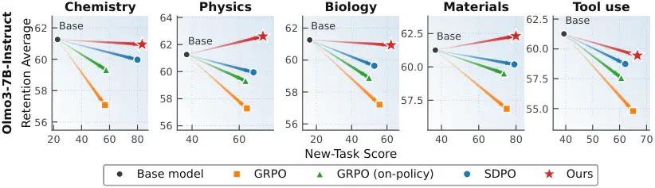

# Function-Space Temporal Self-Distillation for Policy Optimization

Aryan Das    Arnab Bhattacharya Affiliation:  Indian Institute of
Technology Kanpur, India    Vinay Kumar Verma

###### Abstract

Reinforcement Learning with Verifiable Rewards (RLVR) improves reasoning
in language models, but scalar outcomes provide coarse supervision over
response trajectories. Self-distillation offers denser token-level
guidance by comparing an unassisted policy with a feedback-informed
self-teacher, yet the teacher evolves with the student, creating
unstable targets and motivating additional regularization. We introduce
Function-Space Policy Optimization (FSPO), a single-policy framework
that combines current privileged adaptation with function-space temporal
consolidation. FSPO stores sparse historical next-token distributions as
fixed temporal targets, providing temporal separation without
maintaining a persistent teacher model. It further introduces privileged
disagreement correction to explicitly suppress locally overvalued
actions, reliability-adaptive grounding that strengthens reference
supervision when self-generated evidence repeatedly fails, and quality-
and coverage-aware temporal memory that retains verified behaviors and
improves privileged demonstrations. Across reasoning and tool-use
benchmarks, FSPO achieves the highest average accuracy under a 5-hour
training budget, improving over the strongest baseline by approximately
4% points on average while reducing peak memory from about 70 GB to
56 GB on Olmo3-7B-Instruct. ^(†)^(†)footnotetext: ^(\*) Equal
Contributions

|     |
| --- |
|     |

## 1 Introduction

Figure 1: Average Generated Tokens vs. avg@16 Accuracy
(Olmo3-7B-Instruct, 5h) across five tasks. Ours reaches the highest
accuracy with the fewest tokens.

RLVR has become a paradigm for post-training Large Language Models
(LLMs), driving substantial improvements in reasoning, problem solving,
code generation, and tool use Shao et al. (2024); Team et al. (2025);
Lambert et al. (2024). Most RLVR methods still reduce an entire response
to a single scalar outcome, despite decisions of varying quality along
the trajectory. This creates a difficult credit-assignment problem,
particularly when rewards are sparse or when all sampled responses for a
problem receive the same outcome Kazemnejad et al. (2024); Hubotter et
al. (2026). Recent self-distillation methods offer a compelling
alternative by extracting richer supervision from the model’s own
behavior rather than relying solely on scalar advantages or a separate
expert teacher Agarwal et al. (2023); Shenfeld et al. (2026); Zhao et
al. (2026). In particular, Self-Distillation Policy Optimization
(SDPO) Hubotter et al. (2026) shows that a single policy can serve as
both student and self-teacher, first generating a response independently
and then re-evaluating it using additional feedback. The difference
between these views provides token-level supervision for finer credit
assignment than outcome rewards.

SDPO has several limitations that arise from its reliance on a
continuously evolving self-teacher. Because the student and self-teacher
are instantiated from the same policy, the teacher distribution changes
whenever the policy parameters are updated. Although stop-gradient
prevents gradient flow through the teacher within an optimization step,
it does not provide temporal separation across training iterations,
creating a moving-target problem that can weaken the stability of the
distillation signal. SDPO therefore relies on stabilization mechanisms
such as EMA or trust-region regularization; the EMA variant requires an
additional persistent parameter copy, introducing memory overhead that
grows with model size. SDPO also treats student–teacher disagreement
primarily through distribution matching and does not explicitly
distinguish ordinary mismatch from cases where the student strongly
overvalues a candidate rejected by the privileged view. Such severe
local disagreements may require more targeted directional correction. In
addition, SDPO lacks a mechanism for adapting supervision according to
the reliability of the policy’s behavior on individual problems.
Examples that the policy repeatedly fails to solve are therefore not
explicitly differentiated, in supervision strength, from those for which
reliable self-generated guidance is consistently available. Finally,
SDPO primarily relies on the current feedback-conditioned policy and
does not maintain an explicit temporal memory of useful privileged
predictions discovered earlier in training. As a result, informative
past behaviors are not systematically preserved and replayed, nor are
historical experiences selected to balance solution quality with
structural diversity. These limitations restrict stable temporal
supervision, targeted local correction, reliability-aware learning, and
preservation of complementary behaviors across training.


FSPO addresses these limitations through a unified self-distillation
framework that improves temporal stability, strengthens local
correction, adapts supervision to policy reliability, and preserves
useful historical knowledge. To mitigate the moving-target problem,
informative privileged predictions from earlier optimization steps are
materialized as sparse next-token distributions and retained as fixed
temporal targets. Because these historical function values remain
unchanged while the current policy evolves, they provide temporal
separation across training iterations without requiring a persistent EMA
teacher or an additional resident parameter copy. FSPO also goes beyond
distribution-level matching by identifying candidates that the
unassisted policy strongly prefers but the privileged view rejects, and
explicitly suppressing these locally overvalued decisions. This
distinguishes severe privileged disagreement from ordinary distribution
mismatch and provides a more targeted directional learning signal.
Supervision is further adapted according to the reliability of the
policy on each problem over time. A smoothed estimate of rollout
performance distinguishes problems on which the policy repeatedly fails
from those for which it consistently produces reliable solutions. When
the policy repeatedly fails and its own evidence becomes unreliable, the
reference loss is strengthened; as the policy improves and begins to
solve the problem consistently, this supervision is progressively
reduced. FSPO additionally maintains a temporal memory of useful
privileged behaviors discovered earlier in training. This memory
provides fixed historical targets for consolidation and stronger
demonstrations when the current rollout group lacks a verified
successful response. By retaining trajectories according to both
solution quality and structural complementarity, FSPO preserves diverse,
nonredundant solution strategies and enables the policy to benefit from
complementary historical knowledge throughout optimization. As shown in
Figure 1, these design choices translate into the highest average
accuracy across the five tasks while requiring the fewest generated
tokens. Our contributions are summarized as follows:

- •
  Preserves temporal knowledge through sparse historical next-token
  distributions while combining current privileged adaptation with
  historical function-space consolidation, enabling temporally separated
  supervision with a single resident policy.
- •
  Introduces targeted privileged disagreement correction that suppresses
  candidates strongly overvalued by the unassisted policy but rejected
  by the privileged view, providing stronger directional correction
  beyond distribution matching.
- •
  Adapts reference supervision to the reliability of self-generated
  guidance, strengthening it when the policy repeatedly fails and
  reducing it as reliable solutions emerge. Quality- and coverage-aware
  temporal memory further preserves diverse, nonredundant behaviors.
- •
  Achieves approximately 4% points higher average accuracy than the
  strongest baseline across reasoning and tool-use benchmarks, while
  reducing peak memory from about 70 GB to 56 GB for Olmo3-7B-Instruct
  by eliminating the persistent EMA teacher.

## 2 Function-Space Policy Optimization

Figure 2: FSPO Overview. For each query, the policy samples rollouts in
Agent mode; a successful verified rollout is used as a demo. The Student
mode predicts from the query alone, while the Teacher mode conditions on
the query with a demo, producing token-level supervision. Verified
solutions are then stored as sparse function-space targets in a cache
and later replayed for temporal consolidation, preserving useful past
behavior without maintaining a separate parameter-space teacher.

1: $`\pi_{\theta}`$, $`\mathcal{D}`$, $`\hat{r}_{p}\leftarrow 0`$,
memory $`\mathcal{M}\leftarrow`$ reference seeds

2: for $`s=1,\ldots,T`$ do

3:   Draw $`G`$ rollouts $`y_{p,j}`$, score $`r_{p,j}`$

4:   Demo $`d_{p,j}`$: sibling
$`\rightarrow\tilde{y}_{p}\rightarrow g_{p}`$

5:   Student $`p_{p,j,t}`$, teacher $`q_{p,j,t}`$

6:   Keep top-$`K_{\mathrm{cur}}`$ support $`S_{p,j,t}`$

7:   Overvalued set $`\mathcal{N}_{p,j,t}`$ via margin $`\gamma`$

8:
  $`\mathcal{L}_{\mathrm{cur}}\leftarrow\mathcal{L}_{\mathrm{distill}}+\lambda_{\mathrm{neg}}\mathcal{L}_{\mathrm{neg}}`$

9:   Update $`\hat{r}_{p}^{(s)}`$, $`w_{p}^{(s)}`$; get
$`\mathcal{L}_{\mathrm{CE}}`$

10:   Replay $`\mathcal{R}_{s}\subset\mathcal{M}`$ by group

11:   $`\mathcal{L}_{\mathrm{temp}}`$ vs. fixed targets
$`\tilde{q}_{p,t}`$

12:   Set $`\rho_{s}`$ by cyclic schedule

13:   Update $`\theta_{s}`$ by minimizing $`\mathcal{L}(\theta_{s})`$

14:   Retain verified rollouts (quality/coverage)

15:   Store $`(\tilde{S}_{p,t},\tilde{q}_{p,t})`$ in $`\mathcal{M}`$

16:   if $`s\bmod F=0`$ then

17:    Refresh $`\zeta`$ of entries aged $`>H`$

18:   end if

19: end for

Algorithm 1 FSPO Training

Self-distillation provides dense supervision by comparing an unassisted
policy with a privileged self-teacher conditioned on stronger evidence.
However, because both views evolve with the same policy, the teacher
remains a moving target across optimization steps. FTSD addresses this
by preserving informative historical policy outputs directly in function
space rather than maintaining a persistent parameter-space teacher. Let
$`\pi_{\theta_{s}}`$ denote the policy at step $`s`$, with

```math
F_{\theta_{s}}(c)=\pi_{\theta_{s}}(\cdot\mid x,y_{<t}) \tag{1}
```

for prefix $`c=(x,y_{<t})`$. Selected privileged predictions are
materialized as sparse next-token distributions and retained as temporal
targets, providing temporal separation as the policy evolves. FTSD
further combines current privileged adaptation with targeted
disagreement correction for strongly overvalued actions, quality- and
coverage-aware temporal consolidation of complementary historical
behaviors, and reliability-adaptive reference grounding. Reference
supervision is strengthened when self-generated evidence fails and
progressively reduced as reliable behavior emerges, yielding stable,
selective, and adaptive self-distillation within a single-policy
framework. Figure 2 illustrates the overall framework, while Algorithm 1
summarizes the complete training procedure.

### 2.1 Privileged Adaptation and Disagreement Correction

We first construct dense supervision by comparing the current policy
under an unassisted view and a privileged view with access to stronger
evidence. Let $`\mathcal{D}=\{(x_{p},g_{p})\}_{p=1}^{N}`$ denote the
training set, where $`g_{p}`$ is the verified reference solution. For
each problem, the policy samples $`G`$ responses,

```math
y_{p,j}\sim\pi_{\theta_{s}}(\cdot\mid x_{p}),\qquad r_{p,j}=R(x_{p},y_{p,j},g_{p})\in[0,1]. \tag{2}
```

An unsuccessful rollout reveals where the policy fails, but not how its
local token decisions should change. We therefore construct a privileged
demonstration using the strongest reliable evidence available:

```math
d_{p,j}=\begin{cases}y_{p,k},&\exists\,k\neq j:\;r_{p,k}\geq\tau_{\mathrm{succ}},\\
\tilde{y}_{p},&\text{if a verified temporal trajectory is available},\\
g_{p},&\text{otherwise}.\end{cases} \tag{3}
```

This hierarchy, with success threshold $`\tau_{\mathrm{succ}}>0`$,
prioritizes a verified sibling response, followed by previously retained
policy behavior, while using the reference solution as a reliable
fallback. At each response position $`t`$, the unassisted student and
privileged self-teacher evaluate the same response prefix,

```math
p_{p,j,t}=\pi_{\theta_{s}}(\cdot\mid x_{p},y_{p,j,<t}),\qquad q_{p,j,t}=\operatorname{stopgrad}\left[\pi_{\theta_{s}}(\cdot\mid x_{p}\oplus d_{p,j},y_{p,j,<t})\right]. \tag{4}
```

Since both views share the same policy and response history, their
disagreement reflects how privileged evidence changes the next-token
prediction at the same response state.

To avoid matching the full vocabulary distribution, we retain the
$`K_{\mathrm{cur}}`$ highest-probability student tokens and aggregate
the remaining probability mass into a tail category:

```math
\Phi_{S}(a)=\left(\{a(v)\}_{v\in S},1-\sum_{v\in S}a(v)\right). \tag{5}
```

where a is a probability distribution over the vocabulary, a(v) is the
probability that distribution assigns to token v and S is a fixed subset
of the vocabulary. Specifically it’s the top-K highest-probability
tokens under the student’s distribution. $`\Phi_{S}(a)`$ reduces the
full distribution a down to: its values on that subset
$`\{a(v)\}_{v\in S}`$, plus one extra "tail" bucket holding all the
leftover mass $`1-\sum_{v\in S}a(v)`$.

Let $`S_{p,j,t}`$ denote the student support and $`M_{p,j,t}`$ indicate
valid response positions. We transfer privileged information using
generalized Jensen-Shannon divergence (JSD),

```math
\mathcal{L}_{\mathrm{distill}}=\frac{1}{Z_{\mathrm{cur}}}\sum_{p,j,t}M_{p,j,t}\times JSD\left(\Phi_{S_{p,j,t}}(p_{p,j,t}),\Phi_{S_{p,j,t}}(q_{p,j,t})\right),\qquad Z_{\mathrm{cur}}=\sum_{p,j,t}M_{p,j,t}. \tag{6}
```

This provides a distinct privileged target at every response position,
yielding dense local supervision rather than a single outcome-level
signal.

Some disagreements, however, provide a stronger directional signal. When
the student assigns substantially more probability to a token than the
privileged view, that candidate is locally overvalued. We identify such
tokens as

```math
\mathcal{N}_{p,j,t}=\left\{v\in S_{p,j,t}:\log p_{p,j,t}(v)-\log q_{p,j,t}(v)>\gamma\right\}, \tag{7}
```

and penalize them using

```math
\ell_{\mathrm{neg}}(p,j,t)=\frac{1}{\max(1,|\mathcal{N}_{p,j,t}|)}\sum_{v\in\mathcal{N}_{p,j,t}}\left[\log p_{p,j,t}(v)-\operatorname{stopgrad}(\log q_{p,j,t}(v))-\gamma\right]_{+}, \tag{8}
```

```math
\mathcal{L}_{\mathrm{neg}}=\frac{1}{Z_{\mathrm{cur}}}\sum_{p,j,t}M_{p,j,t}\,\ell_{\mathrm{neg}}(p,j,t). \tag{9}
```

The privileged adaptation objective is therefore

```math
\mathcal{L}_{\mathrm{cur}}=\mathcal{L}_{\mathrm{distill}}+\lambda_{\mathrm{neg}}\mathcal{L}_{\mathrm{neg}}. \tag{10}
```

This provides dense token-level supervision while explicitly correcting
local decisions that are strongly contradicted by privileged evidence.

### 2.2 Function-Space Temporal Consolidation

Privileged adaptation provides supervision at the current optimization
step, but its target evolves together with the policy. Thus,
stop-gradient separates the student and self-teacher within an update,
but does not provide temporal separation across updates. We address this
by preserving selected privileged predictions from earlier stages as
fixed function-space targets rather than maintaining a persistent
historical teacher.

For each problem $`p`$, the temporal memory stores a retained trajectory
$`\tilde{y}_{p}`$, its verifier score $`\tilde{r}_{p}`$, structural
signature $`\sigma_{p}`$, and sparse privileged predictions
$`\{\tilde{S}_{p,t},\tilde{q}_{p,t}\}_{t}`$. To improve the usefulness
of this memory, trajectories are retained based on both verifier quality
and structural complementarity rather than reward alone. This
discourages repeatedly storing similar solution patterns and promotes
broader coverage of distinct behaviors. A candidate replaces the stored
trajectory when its retention score, which combines verifier quality
with the coverage of its structural signature, exceeds that of the
stored entry. During consolidation, memories are also sampled evenly
across structural groups, preventing dominant signatures from
overwhelming replay.

Let $`\theta_{p}^{\mathrm{src}}`$ denote the policy state from which a
temporal target is materialized. We use $`\tilde{d}_{p}=\tilde{y}_{p}`$
when $`\tilde{r}_{p}\geq\tau_{\mathrm{succ}}`$ and
$`\tilde{d}_{p}=g_{p}`$ otherwise. The source policy produces

```math
\bar{q}_{p,t}=\operatorname{stopgrad}\left[\pi_{\theta_{p}^{\mathrm{src}}}(\cdot\mid x_{p}\oplus\tilde{d}_{p},\tilde{y}_{p,<t})\right]. \tag{11}
```

Rather than retaining the source parameters, we store only its dominant
predictions,

```math
\tilde{S}_{p,t}=\operatorname{TopK}(\bar{q}_{p,t},K_{\mathrm{temp}}),\qquad\tilde{q}_{p,t}=\Phi_{\tilde{S}_{p,t}}(\bar{q}_{p,t}), \tag{12}
```

which remain fixed while the current policy evolves.

At optimization step $`s`$, let $`\mathcal{R}_{s}`$ denote the temporal
memories selected for consolidation. The current policy evaluates each
retained trajectory under the original problem context and is matched
against its fixed historical privileged target:

```math
\mathcal{L}_{\mathrm{temp}}=\frac{1}{Z_{\mathrm{temp}}}\sum_{p\in\mathcal{R}_{s}}\sum_{t}\tilde{M}_{p,t}D_{\alpha}\left(\Phi_{\tilde{S}_{p,t}}\left[\pi_{\theta_{s}}(\cdot\mid x_{p},\tilde{y}_{p,<t})\right],\tilde{q}_{p,t}\right),\qquad Z_{\mathrm{temp}}=\sum_{p\in\mathcal{R}_{s},t}\tilde{M}_{p,t}. \tag{13}
```

Unlike the current privileged target, $`\tilde{q}_{p,t}`$ remains fixed
while the policy evolves. Privileged adaptation therefore captures what
should be learned from current evidence, whereas temporal consolidation
preserves behavior that was informative at earlier stages of training.

To avoid stale targets without collapsing temporal separation, we use
delayed and staggered refresh. A stored target becomes eligible for
refresh after $`H`$ optimization steps, and a fraction $`\zeta`$ of
eligible entries is updated every $`F`$ steps. This maintains temporal
targets of different ages while allowing the memory to gradually track
policy improvement.

### 2.3 Reliability-Adaptive Reference Grounding

Privileged adaptation and temporal consolidation primarily rely on
supervision generated by the policy itself. However, this signal can be
unreliable for problems that the policy repeatedly fails to solve. We
therefore use the reference solution as an adaptive grounding signal
whose strength depends on the reliability of self-generated behavior.

For problem $`p`$, we measure the current rollout reliability and its
smoothed estimate as

```math
r_{p}^{(s)}=\frac{1}{G}\sum_{j=1}^{G}r_{p,j},\qquad\hat{r}_{p}^{(s)}=(1-\nu)\hat{r}_{p}^{(s-1)}+\nu r_{p}^{(s)}, \tag{14}
```

where $`\nu`$ controls the influence of recent outcomes. Given a target
reliability $`\tau`$, the reference weight is

```math
w_{p}^{(s)}=\operatorname{clip}\left(\frac{\tau-\hat{r}_{p}^{(s)}}{\tau},0,1\right). \tag{15}
```

Thus, reference supervision is strongest when the policy repeatedly
fails and its own evidence remains unreliable, and gradually decreases
as the policy begins to solve the problem consistently.

Let $`g_{p}=(g_{p,1},\ldots,g_{p,L_{p}})`$ be the tokenized reference
solution,
$`\mathcal{B}_{s}^{\mathrm{CE}}=\{p\in\mathcal{B}_{s}:w_{p}^{(s)}>0\}`$
the grounded problems, and $`A_{p,t}\in\{0,1\}`$ a mask over valid
reference tokens excluding prompt and padding positions. The grounding
objective is

```math
\mathcal{L}_{\mathrm{CE}}=-\frac{1}{Z_{\mathrm{CE}}}\sum_{p\in\mathcal{B}_{s}^{\mathrm{CE}}}\sum_{t}w_{p}^{(s)}A_{p,t}\log\pi_{\theta_{s}}(g_{p,t}\mid x_{p},g_{p,<t}),\qquad Z_{\mathrm{CE}}=\sum_{p\in\mathcal{B}_{s}^{\mathrm{CE}},t}A_{p,t}. \tag{16}
```

The reference therefore acts as a reliability-dependent grounding signal
rather than uniform supervised training: it supports problems for which
self-generated evidence is weak and progressively vanishes as reliable
self-supervision emerges.

### 2.4 Unified Adaptation and Consolidation Objective

The complete objective combines current privileged adaptation,
historical consolidation, and reliability-adaptive grounding:

```math
\mathcal{L}(\theta_{s})=(1-\rho_{s})\mathcal{L}_{\mathrm{cur}}+\rho_{s}\mathcal{L}_{\mathrm{temp}}+\lambda_{\mathrm{CE}}\mathcal{L}_{\mathrm{CE}}, \tag{17}
```

Here, $`\rho_{s}\in[0,1]`$ controls the balance between acquiring
current privileged information and consolidating useful historical
behavior, while $`\lambda_{\mathrm{neg}}`$ and $`\lambda_{\mathrm{CE}}`$
determine the strengths of disagreement correction and reference
grounding.

Rather than fixing this balance throughout training, we periodically
shift emphasis from adaptation toward consolidation:

```math
\rho_{s}=\rho_{\min}+(\rho_{\max}-\rho_{\min})\frac{(s-1)\bmod C}{\max(1,C-1)}, \tag{18}
```

where $`C`$ is the cycle length. Since memory is pre-seeded with
reference trajectories, temporal consolidation starts immediately. Each
cycle initially favors current privileged supervision and progressively
increases the weight of historical targets, balancing adaptation with
retention.

## 3 Experiments

|                       |           |      |         |      |         |      |           |      |          |      |        |
| --------------------- | --------- | ---- | ------- | ---- | ------- | ---- | --------- | ---- | -------- | ---- | ------ |
|                       | Chemistry |      | Physics |      | Biology |      | Materials |      | Tool use |      | Avg@5h |
|                       | 1h        | 5h   | 1h      | 5h   | 1h      | 5h   | 1h        | 5h   | 1h       | 5h   |        |
| Qwen3-8B              | 41.2      |      | 59.2    |      | 30.8    |      | 58.9      |      | 57.5     |      | 49.5   |
|    + GRPO             | 65.9      | 74.5 | 63.8    | 72.7 | 35.1    | 59.9 | 74.3      | 77.1 | 64.9     | 67.7 | 70.4   |
|    + GRPO (on-policy) | 63.3      | 63.4 | 63.6    | 63.6 | 49.8    | 49.8 | 73.9      | 74.1 | 60.2     | 65.7 | 63.3   |
|    + SDPO (on-policy) | 73.2      | 80.9 | 66.6    | 75.6 | 50.6    | 56.8 | 72.1      | 78.4 | 68.0     | 68.5 | 72.0   |
|    + FSPO (on-policy) | 81.8      | 83.4 | 66.7    | 76.0 | 71.2    | 71.2 | 81.7      | 81.7 | 66.6     | 68.5 | 76.2   |
| Olmo3-7B-Instruct     | 22.8      |      | 37.7    |      | 16.2    |      | 36.7      |      | 39.3     |      | 30.5   |
|    + GRPO             | 39.7      | 56.7 | 55.3    | 63.3 | 35.6    | 55.8 | 70.9      | 75.0 | 56.4     | 65.0 | 63.2   |
|    + GRPO (on-policy) | 51.4      | 57.5 | 62.7    | 62.7 | 49.8    | 49.8 | 73.3      | 73.5 | 56.8     | 60.6 | 60.8   |
|    + SDPO (on-policy) | 68.0      | 80.0 | 59.9    | 66.1 | 48.0    | 52.8 | 73.7      | 79.1 | 60.8     | 62.1 | 68.0   |
|    + FSPO (on-policy) | 81.0      | 83.3 | 66.4    | 70.1 | 62.3    | 62.3 | 76.3      | 79.9 | 57.6     | 66.6 | 72.4   |

Table 1: Comparison of FSPO with GRPO and SDPO across benchmarks. We
report the highest avg@16 achieved within 1-hour and 5-hour wall-clock
training budgets for Qwen3-8B and Olmo3-7B-Instruct, with baseline
results for GRPO, on-policy GRPO, and SDPO taken from SDPO Hubotter et
al. (2026). The final column reports the average performance across all
five benchmarks at the 5-hour budget. FSPO follows the SDPO training and
evaluation setting on 4 NVIDIA GH200 GPUs.

Figure 3: Convergence of best-within-window avg@16 accuracy over
wall-clock training time for Qwen3-8B (top row) and Olmo3-7B-Instruct
(bottom row) across five tasks.

Figure 4: Average time per training step over wall-clock time for
Olmo3-7B-Instruct across five tasks.



Figure 5: Catastrophic-forgetting trade-off on Olmo3-7B-Instruct. Each
panel corresponds to training on one task, with the horizontal axis
showing the best avg@16 achieved on that task within 5 h and the
vertical axis showing the mean score on the $`5`$ prior-capability
benchmarks.

Figure 6: Comparison of Memory Footprint. (a) Breakdown for
Olmo3-7B-Instruct: policy weights, gradients, AdamW state, and
activations plus KV cache are common to all methods. GRPO adds a synced
colocated rollout copy, and SDPO adds a persistent EMA teacher copy.
FSPO needs no extra model copy, since on-policy rollouts reuse the model
being trained. (b) Projecting the same accounting to larger models, the
absolute gap grows with parameter count.

We evaluate FSPO across scientific reasoning and tool-use tasks to
determine whether solution-conditioned self-distillation improves
learning while eliminating the persistent teacher used by EMA-stabilized
on-policy distillation. We compare against verifier-based policy
optimization and teacher-based dense supervision under matched
wall-clock training budgets.

### 3.1 Experimental Setting

We evaluate four level-3 reasoning subsets of SciKnowEval Feng et al.
(2024): Chemistry, Physics, Biology, and Materials science, together
with ToolAlpaca (Tool use) Tang et al. (2023) for structured tool use.
We use Qwen3-8B Yang et al. (2025) and Olmo3-7B-Instruct Ettinger et al.
(2025) as initial checkpoints and construct disjoint train–test splits
for each task. Performance is measured using avg@16 on the held-out
split. We use a single hyperparameter setting across all models and
datasets (Appendix A.4), without dataset specific tuning.

We compare FSPO against GRPO Shao et al. (2024), on-policy GRPO, and
on-policy SDPO Hubotter et al. (2026), with baseline results taken from
SDPO. All methods use the same initialization and hardware budget. Each
run is performed on four NVIDIA GH200 GPUs, and we report the highest
accuracy obtained within 1-hour and 5-hour wall-clock training budgets.
On-policy GRPO, SDPO, and FSPO perform one gradient update per
generation batch, whereas GRPO performs four off-policy mini-batch
updates.

### 3.2 Main Results

We first examine whether the proposed temporal self-distillation
strategy translates into consistent improvements across tasks, model
backbones, and training budgets. Table 1 shows that FSPO achieves the
highest Avg@5h for both Qwen3-8B and Olmo3-7B-Instruct, with the best
5-hour performance on every scientific reasoning task. The improvements
remain consistent across Chemistry, Physics, Biology, and Materials,
suggesting that the gains are not tied to a particular domain or
backbone. The margin is smaller on Tool use, where the baselines already
reach performance close to ours within the same budget. Even in this
setting, FSPO remains competitive at the 5-hour budget, matching the
strongest Qwen3-8B result and improving over the baselines on
Olmo3-7B-Instruct, although SDPO is stronger at the 1-hour budget on
both backbones.

The same behavior becomes clearer when considering optimization over
time. As shown in Figure 3, FSPO obtains a large fraction of its final
improvement early in training and approaches its peak substantially
faster than the baselines across most tasks. Figure 4 further shows that
this faster learning is accompanied by a rapid reduction in per-step
cost. Privileged supervision and disagreement correction provide
stronger local guidance by suppressing overvalued token choices, while
temporal consolidation reinforces previously successful solution
patterns. As these signals accumulate, the policy increasingly produces
shorter responses, which contributes to its lower generation cost. In
contrast, GRPO and SDPO tend to generate longer trajectories as training
progresses, causing their generation-dominated step time to gradually
increase.

### 3.3 Learning without Forgetting

Improving performance on a target task can degrade behaviors acquired
from other domains, making cross-task retention an important measure of
stable post-training. Figure 5 examines this trade-off by comparing
new-task gains with performance retained on five prior-capability
benchmarks. FSPO improves the trained task while exhibiting consistently
higher retention than the baselines. We attribute this to function-space
temporal consolidation, which replays fixed historical predictions. This
mechanism regularizes updates toward previously useful behavior and
reduces catastrophic forgetting during continued adaptation. Detailed
cross-task scores are provided in Appendix A.2.

### 3.4 Memory and Computational Properties

|        |                                                                            |                           |          |      |
| ------ | -------------------------------------------------------------------------- | ------------------------- | -------- | ---- |
| Cases  | Setting                                                                    | Accuracy (%) $`\uparrow`$ |          |      |
|        |                                                                            | Biology                   | Tool Use | Avg. |
| Case 1 | Full objective (ours)                                                      | 62.3                      | 66.6     | 64.5 |
|        | $`\mathcal{L}_{\mathrm{distill}}`$ only                                    | 54.9                      | 57.2     | 56.0 |
|        | w/o $`\mathcal{L}_{\mathrm{neg}}`$                                         | 61.9                      | 65.8     | 63.8 |
|        | w/o $`\mathcal{L}_{\mathrm{temp}}`$                                        | 59.9                      | 60.3     | 60.1 |
|        | w/o $`\mathcal{L}_{\mathrm{CE}}`$                                          | 59.1                      | 64.3     | 61.7 |
|        | w/o $`\mathcal{L}_{\mathrm{temp}}`$ & $`\mathcal{L}_{\mathrm{CE}}`$        | 54.4                      | 53.8     | 54.1 |
| Case 2 | Sibling $`\rightarrow`$ $`\tilde{y}_{p}`$ $`\rightarrow`$ reference (ours) | 62.3                      | 66.6     | 64.5 |
|        | Reference only                                                             | 41.8                      | 39.1     | 40.5 |
|        | Verified sibling only                                                      | 57.9                      | 60.2     | 59.0 |
|        | w/o $`\tilde{y}_{p}`$                                                      | 58.8                      | 62.6     | 60.7 |
| Case 3 | Function-space cache (ours)                                                | 62.3                      | 66.6     | 64.5 |
|        | Parameter snapshot (every $`H`$ steps)                                     | 59.4                      | 58.1     | 58.8 |
|        | EMA teacher ($`\mu=0.99`$)                                                 | 62.3                      | 64.2     | 63.2 |
|        | EMA teacher ($`\mu=0.999`$)                                                | 61.3                      | 61.3     | 61.3 |
|        | Frozen initial policy                                                      | 56.8                      | 56.1     | 56.5 |
|        | CE replay of $`\tilde{y}_{p}`$                                             | 58.7                      | 58.3     | 58.5 |
| Case 4 | Quality + coverage retention (ours)                                        | 62.3                      | 66.6     | 64.5 |
|        | Reward-only retention                                                      | 59.8                      | 64.1     | 61.9 |
|        | Coverage-only retention                                                    | 56.3                      | 57.8     | 57.0 |
|        | Uniform sampling                                                           | 58.9                      | 62.4     | 60.6 |
|        | Random retention + uniform sampling                                        | 54.8                      | 59.4     | 57.1 |
| Case 5 | Reliability-adaptive $`w_{p}^{(s)}`$ (ours)                                | 62.3                      | 66.6     | 64.5 |
|        | Constant $`w_{p}^{(s)}=1`$                                                 | 60.2                      | 65.1     | 62.6 |
|        | Binary $`w_{p}^{(s)}`$                                                     | 60.6                      | 65.4     | 63.0 |
| Case 6 | Cyclic, adaptation $`\rightarrow`$ consolidation (ours)                    | 62.3                      | 66.6     | 64.5 |
|        | Fixed $`\rho_{s}=0.4`$                                                     | 60.6                      | 65.1     | 62.8 |
|        | Monotonic ramp                                                             | 60.8                      | 64.2     | 62.5 |
|        | Reverse cyclic, consolidation $`\rightarrow`$ adaptation                   | 57.6                      | 61.7     | 59.7 |
| Base   | Olmo3-7B-Instruct (zero-shot)                                              | 16.2                      | 39.3     | 27.8 |
| FSPO   | Complete Method                                                            | 62.3                      | 66.6     | 64.5 |

Table 2: Ablation study of FSPO on Olmo3-7B-Instruct across Biology and
Tool Use. Shaded rows marked (ours) denote the setting used in the full
model; unless stated otherwise.

Temporal regularization stabilizes self-distillation, but additional
model copies become increasingly costly at scale. FSPO addresses this by
storing temporal information as sparse function-space targets rather
than as a persistent network. Historical response tokens, selected token
probabilities, and pooled tail mass are retained in host memory, while
only the current policy remains resident during optimization. Figure 6
illustrates the resulting difference. For Olmo3-7B-Instruct, the common
training state occupies approximately 56 GB, whereas GRPO and SDPO reach
70 GB because of an additional rollout copy and EMA teacher,
respectively. Since FSPO reuses the current policy for generation and
privileged evaluation, it avoids these persistent model-sized copies, at
the cost of additional activations for temporal replay. Under the same
accounting, eliminating one bf16 parameter copy corresponds to roughly
12 TB of aggregate memory at 6T parameters. It is also worth noting that
although the cache grows during training, its peak memory overhead
remains negligible at about 5 MB (Appendix A.5).

### 3.5 Ablation Study

We ablate the main components of FSPO on Olmo3-7B-Instruct across
Biology and Tool Use to assess their contributions. As shown in Table 2,
we ablate the objective, privileged demonstrations, temporal
supervision, memory retention, and adaptive grounding while keeping all
other settings fixed. Together, these components raise average accuracy
from 27.8% for the zero-shot base model to 64.5%, reflecting their
complementary contributions. Additional analyses of the choices are
provided in Appendix A.3.

Effective supervision. Case 1 first reveals that FSPO benefits from
combining complementary forms of supervision rather than relying solely
on privileged distillation. Temporal consolidation and reference
grounding account for the largest gains, particularly on Tool Use, while
disagreement correction provides a smaller but consistent improvement.
Importantly, these signals depend on one another: retaining disagreement
correction after removing both temporal and reference anchors performs
worse than distillation alone, suggesting that aggressive local
correction is useful only when the evolving self-teacher is sufficiently
stabilized. The source of privileged evidence is equally important.
Reference-only supervision leads to a substantial drop, whereas verified
siblings and retained trajectories remain closer to the policy’s
response distribution. Their combination in the full hierarchy therefore
provides the strongest current supervision (Case 2).

Temporal stability. The remaining ablations show that temporal stability
depends not simply on retaining past information, but on what is
preserved and how it is reused. Sparse function-space targets outperform
parameter snapshots, EMA teachers, frozen policies, and trajectory-level
CE replay; several of these alternatives even fall below removing
temporal consolidation altogether (Case 3). Within the memory itself,
retaining trajectories by both quality and coverage performs better than
either criterion alone, while uniform or random replay further weakens
the historical signal (Case 4). This selective preservation is
complemented by reliability-adaptive grounding, which improves over
constant or binary reference weighting by adjusting supervision as the
policy becomes more reliable (Case 5). Finally, cyclic adaptation
followed by consolidation performs best, whereas reversing this order
causes a marked degradation, supporting the intended progression from
acquiring new privileged information to stabilizing it over time
(Case 6).

## 4 Related Work

Policy-gradient methods (Williams, 2004; Schulman et al., 2017) underpin
modern RLVR, with GRPO (Shao et al., 2024) and its variants (Yu et al.,
2025; Liu et al., 2025) improving reasoning, coding, tool use, and
visual grounding (Team et al., 2025; Lambert et al., 2024; El-Kishky et
al., 2025; Khatri et al., 2025; Karim and Verma, 2026). However,
trajectory-level rewards provide coarse credit when feedback is sparse
or uniform across rollouts (Kazemnejad et al., 2024; Chen et al.,
2025b). Prior work addresses this through step-level verifiers (Lightman
et al., 2023; Wang et al., 2024; Setlur et al., 2024), dense reward
redistribution (Cui et al., 2025; Chan et al., 2024; Cao et al., 2025b),
and selective updates at high-entropy decisions (Wang et al., 2025).
Richer supervision has also emerged through critiques (Scheurer et al.,
2023; Luo et al., 2025; Song et al., 2026), self-reflection (Shinn et
al., 2023; Madaan et al., 2023; Lee et al., 2024), hindsight
(Andrychowicz et al., 2017; Liu et al., 2023; Zhang et al., 2023),
context distillation (Snell et al., 2022; Choi et al., 2022; Kujanpää et
al., 2024), and verified self-training (Zelikman et al., 2022; Yang et
al., 2024). On-policy self-distillation brings these ideas together by
conditioning the same policy on references (Zhao et al., 2026),
demonstrations (Shenfeld et al., 2026), or feedback and successful
siblings (Hubotter et al., 2026), and SALD (Das et al., 2026c) extends a
similar self-referenced objective, akin to SDPO and SDFT, to
text-to-image diffusion models (Das et al., 2026a; Das et al., 2026b;
Das et al., 2025); yet the resulting teacher evolves with the student
and can suppress useful uncertainty (Kim et al., 2026; Das et al.,
2026d). FTSD retains this single-policy setting while introducing
temporally fixed historical supervision.

Knowledge distillation transfers teacher distributions to a student
(Hinton et al., 2015; Romero et al., 2014), with sequence-level and
on-policy variants extending it to language models (Kim and Rush, 2016;
Gu et al., 2023; Agarwal et al., 2023). Student-generated trajectories
reduce train–inference mismatch (Ross et al., 2010), while divergence
choice governs how teacher behavior is matched (Amini et al., 2025).
Evolving targets are commonly stabilized through target networks (Mnih
et al., 2015), EMA teachers (Grill et al., 2020; Tarvainen and Valpola,
2017), trust regions (Schulman et al., 2015), or expert iteration
(Anthony et al., 2017). In parallel, on-policy adaptation can reduce
forgetting (Shenfeld et al., 2025; Chen et al., 2025a), while continual
learning relies on parameter regularization (Kirkpatrick et al., 2016),
output distillation (Li and Hoiem, 2016), and experience replay (Rolnick
et al., 2018). Closest to FTSD are function-space approaches that
preserve previous outputs (Benjamin and Kording, 2018; Pan et al.,
2020), including stored-logit replay (Buzzega et al., 2020). FTSD adapts
this principle to LLM self-distillation through sparse privileged
distributions used only during training, rather than memory-augmented
inference (Behrouz et al., 2024; Cao et al., 2025a), learned context
representations (Eyuboglu et al., 2025), or persistent model copies
common in RL systems (Sheng et al., 2024).

## 5 Conclusion

We introduced FSPO, a single-policy self-distillation framework that
preserves historical behavior via sparse function-space targets rather
than a persistent teacher model. By combining privileged adaptation with
disagreement correction, reliability-adaptive grounding, and quality-
and coverage-aware temporal memory, FSPO provides stable supervision
while retaining verified behaviors across training. Across scientific
reasoning and tool-use tasks on two model backbones, FSPO achieves the
highest average accuracy under a 5-hour wall-clock budget, converges
faster, and better preserves prior capabilities, while reducing
estimated peak memory from about 70 GB to 56 GB on Olmo3-7B-Instruct.
The ablations further show that these gains arise from the interaction
between current adaptation, temporal consolidation, and adaptive
grounding rather than any single component. Overall, the results suggest
that temporal knowledge can be preserved effectively in function space,
enabling more memory-efficient and stable self-distillation for
continual post-training.

## References

- Agarwal et al. (2023) R. Agarwal, N. Vieillard, Y. Zhou, P.
  Stańczyk, S. Ramos, M. Geist, and O. Bachem On-policy distillation of
  language models: learning from self-generated mistakes. In
  International Conference on Learning Representations, External Links:
  2306.13649,
  [Link](https://www.semanticscholar.org/paper/a57ef1f5c3af185af79751855b8033b7fc6d89b3)
  Cited by: §1, §4.
- Amini et al. (2025) A. Amini, T. Vieira, and R. Cotterell Better
  estimation of the kullback–leibler divergence between language models.
  In Advances in Neural Information Processing Systems 38, External
  Links: [Document](https://dx.doi.org/10.52202/085713-3745),
  [Link](https://doi.org/10.52202/085713-3745) Cited by: §4.
- Andrychowicz et al. (2017) M. Andrychowicz, D. Crow, A. Ray, J.
  Schneider, R. Fong, P. Welinder, B. McGrew, J. Tobin, P. Abbeel,
  and W. Zaremba Hindsight experience replay. In Neural Information
  Processing Systems, External Links: 1707.01495,
  [Link](https://www.semanticscholar.org/paper/429ed4c9845d0abd1f8204e1d7705919559bc2a2)
  Cited by: §4.
- Anthony et al. (2017) T. W. Anthony, Z. Tian, and D. Barber Thinking
  fast and slow with deep learning and tree search. In Neural
  Information Processing Systems, External Links: 1705.08439,
  [Link](https://www.semanticscholar.org/paper/745c614dbd23bc1e3def79f600680b88cee28700)
  Cited by: §4.
- Behrouz et al. (2024) A. Behrouz, P. Zhong, and V. Mirrokni Titans:
  learning to memorize at test time. In Neural Information Processing
  Systems, External Links: 2501.00663,
  [Link](https://www.semanticscholar.org/paper/5e7a795d89910634f001cc3a631023f1dd4e2e23)
  Cited by: §4.
- Benjamin and Kording (2018) A. S. Benjamin and K. P. Kording Improving
  generalization by regularizing in $`L^{2}`$ function space. External
  Links:
  [Link](https://www.semanticscholar.org/paper/cc6dfb0b9a1c7ff877fba5be80c139b4d4de42e4)
  Cited by: §4.
- Buzzega et al. (2020) P. Buzzega, M. Boschini, A. Porrello, D. Abati,
  and S. Calderara Dark experience for general continual learning: a
  strong, simple baseline. In Neural Information Processing Systems,
  External Links: 2004.07211,
  [Link](https://www.semanticscholar.org/paper/e10b7cb072737b1fbdcba7948e573268b3573ae9)
  Cited by: §4.
- Cao et al. (2025a) B. Cao, D. Cai, and W. Lam InfiniteICL: breaking
  the limit of context window size via long short-term memory
  transformation. In Findings of the Association for Computational
  Linguistics: ACL 2025, External Links:
  [Document](https://dx.doi.org/10.18653/v1/2025.findings-acl.595),
  [Link](https://doi.org/10.18653/v1/2025.findings-acl.595) Cited by:
  §4.
- Cao et al. (2025b) M. Cao, S. Zhang, X. Chang, and D. Precup SCAR:
  shapley credit assignment for more efficient rlhf. arXiv.org. External
  Links: 2505.20417,
  [Link](https://www.semanticscholar.org/paper/2109255b50868c453d397bc732fc44d8e83a164f)
  Cited by: §4.
- Chan et al. (2024) A. J. Chan, H. Sun, S. Holt, and M. Schaar Dense
  reward for free in reinforcement learning from human feedback. In
  International Conference on Machine Learning, External Links:
  2402.00782,
  [Link](https://www.semanticscholar.org/paper/9732c864d1d4161fcb106f2961d9a80dd4fffc9a)
  Cited by: §4.
- Chen et al. (2025a) H. Chen, N. Razin, K. R. Narasimhan, and D. Chen
  Retaining by doing: the role of on-policy data in mitigating
  forgetting. arXiv.org. External Links: 2510.18874,
  [Link](https://www.semanticscholar.org/paper/e6f4a5f8a271f3830d0aea0b071986d87ed72999)
  Cited by: §4.
- Chen et al. (2025b) Z. Chen, R. Lu, A. Zhao, Z. Wang, Y. Yue, S. Song,
  and G. Huang Does reinforcement learning really incentivize reasoning
  capacity in llms beyond the base model?. In Advances in Neural
  Information Processing Systems 38, External Links:
  [Document](https://dx.doi.org/10.52202/085713-1933),
  [Link](https://doi.org/10.52202/085713-1933) Cited by: §4.
- Choi et al. (2022) E. Choi, Y. Jo, J. Jang, and M. Seo Prompt
  injection: parameterization of fixed inputs. arXiv.org. External
  Links: 2206.11349, [Link](http://arxiv.org/pdf/2206.11349) Cited by:
  §4.
- Cui et al. (2025) G. Cui, L. Yuan, Z. Wang, H. Wang, Y. Zhang, W.
  Li, B. He, Y. Fan, T. Yu, Q. Xu, W. Chen, J. Yuan, H. Chen, K.
  Zhang, X. Lv, S. Wang, Y. Yao, X. Han, H. Peng, Y. Cheng, Z. Liu, M.
  Sun, B. Zhou, and N. Ding Process reinforcement through implicit
  rewards. Trans. Mach. Learn. Res.. External Links: 2502.01456,
  [Link](https://www.semanticscholar.org/paper/e23379a9752f57732d311f7a97af2c69af6fae7b)
  Cited by: §4.
- Das et al. (2026a) A. Das, K. Biswas, M. Abdar, and V. K. Verma UNITY:
  attention flow networks for adaptive conditioning in diffusion.
  External Links: 2606.20971, [Link](https://arxiv.org/abs/2606.20971)
  Cited by: §4.
- Das et al. (2026b) A. Das, K. Biswas, S. K. Roy, B. N. Patro,
  and V. K. Verma Efficient text-guided convolutional adapter for the
  diffusion model. External Links: 2602.14514,
  [Link](https://arxiv.org/abs/2602.14514) Cited by: §4.
- Das et al. (2026c) A. Das, S. Dey, K. Biswas, S. K. Roy, M. Abdar, A.
  Bhattacharya, and V. K. Verma SALD: self-referenced advantage learning
  for diffusion models. External Links: 2610.01496,
  [Link](https://arxiv.org/abs/2610.01496) Cited by: §4.
- Das et al. (2025) A. Das, R. Mahto, W. Wang, A. Jamali, P. Singh,
  and S. K. Roy A generative framework for detection and classification
  of plant leaf disease using diffusion network. Applied Soft Computing
  177, pp. 113152. External Links: ISSN 1568-4946,
  [Document](https://dx.doi.org/https%3A//doi.org/10.1016/j.asoc.2025.113152),
  [Link](https://www.sciencedirect.com/science/article/pii/S1568494625004636)
  Cited by: §4.
- Das et al. (2026d) A. Das, T. Rachamalla, K. Biswas, S. K. Roy, and V.
  Kumar Verma Uncertainty-aware vision-language segmentation for medical
  imaging. In 2026 IEEE/CVF Winter Conference on Applications of
  Computer Vision (WACV), Vol. , pp. 8490–8499. External Links:
  [Document](https://dx.doi.org/10.1109/WACV61042.2026.00819) Cited by:
  §4.
- El-Kishky et al. (2025) A. El-Kishky, A. Z. Wei, A. Saraiva, B.
  Minaev, D. Selsam, D. Dohan, F. Song, H. Lightman, I. Clavera, J.
  Pachocki, J. Tworek, L. Kuhn, L. Kaiser, M. Chen, M. Schwarzer, M.
  Rohaninejad, N. McAleese, O. Contributors, O. Murk, R. Garg, R.
  Shu, S. Sidor, V. Kosaraju, and W. Zhou Competitive programming with
  large reasoning models. arXiv.org. External Links: 2502.06807,
  [Link](https://www.semanticscholar.org/paper/fe2864e9ed7fd1256e52ed17282914d1ddf3fd85)
  Cited by: §4.
- Ettinger et al. (2025) A. Ettinger, A. Bertsch, B. Kuehl, D. W.
  Graham, D. Heineman, D. Groeneveld, F. Brahman, F. Timbers, H.
  Ivison, J. D. Morrison, J. Poznanski, K. Lo, L. Soldaini, M.
  Jordan, M. F. Chen, M. Noukhovitch, N. Lambert, P. Walsh, P.
  Dasigi, R. Berry, S. Malik, S. Shah, S. Geng, S. Arora, S. Gupta, T.
  Anderson, T. Xiao, T. C. Murray, T. Romero, V. Graf, A. Asai, A.
  Bhagia, A. Wettig, A. Liu, A. Rangapur, C. Anastasiades, C. Huang, D.
  Schwenk, H. M. Trivedi, I. Magnusson, J. Lochner, J. Liu, L. J. V.
  Miranda, M. Sap, M. Morgan, M. Schmitz, M. Guerquin, M. Wilson, R.
  Huff, R. L. Bras, R. Xin, R. Shao, S. Skjonsberg, S. Z. Shen, S. S.
  Li, T. Wilde, V. Pyatkin, W. Merrill, Y. Chang, Y. Gu, Z. Zeng, A.
  Sabharwal, L. Zettlemoyer, P. W. Koh, A. Farhadi, N. A. Smith, and H.
  Hajishirzi Olmo 3. External Links:
  [Link](https://api.semanticscholar.org/CorpusID:283908770) Cited by:
  §3.1.
- Eyuboglu et al. (2025) S. Eyuboglu, R. Ehrlich, S. Arora, N. Guha, D.
  Zinsley, E. Liu, W. Tennien, A. Rudra, J. Zou, A. Mirhoseini, and C.
  Ré Cartridges: lightweight and general-purpose long context
  representations via self-study. In arXiv.org, External Links:
  2506.06266,
  [Link](https://www.semanticscholar.org/paper/d1427999c5cd8e9645c81f5dd3c1fb5260514138)
  Cited by: §4.
- Feng et al. (2024) K. Feng, X. Shen, W. Wang, Z. Xiang, Y. Tang, Q.
  Zhang, and K. Ding SciKnowEval: evaluating multi-level scientific
  knowledge of large language models. External Links:
  [Link](https://api.semanticscholar.org/CorpusID:281887235) Cited by:
  §3.1.
- Grill et al. (2020) J. Grill, F. Strub, F. Altch’e, C. Tallec, P. H.
  Richemond, E. Buchatskaya, C. Doersch, B. ’. Pires, Z. Guo, M. G.
  Azar, B. Piot, K. Kavukcuoglu, R. Munos, and M. Valko Bootstrap your
  own latent: a new approach to self-supervised learning. In Neural
  Information Processing Systems, External Links: 2006.07733,
  [Link](https://www.semanticscholar.org/paper/38f93092ece8eee9771e61c1edaf11b1293cae1b)
  Cited by: §4.
- Gu et al. (2023) Y. Gu, L. Dong, F. Wei, and M. Huang MiniLLM:
  on-policy distillation of large language models. External Links:
  [Link](https://api.semanticscholar.org/CorpusID:259164722) Cited by:
  §4.
- Hinton et al. (2015) G. E. Hinton, O. Vinyals, and J. Dean Distilling
  the knowledge in a neural network. ArXiv abs/1503.02531. External
  Links: [Link](https://api.semanticscholar.org/CorpusID:7200347) Cited
  by: §4.
- Hubotter et al. (2026) J. Hubotter, F. Lubeck, L. Behric, A.
  Baumann, M. Bagatella, D. Marta, I. Hakimi, I. Shenfeld, T. K.
  Buening, C. Guestrin, and A. Krause Reinforcement learning via
  self-distillation. External Links: 2601.20802,
  [Link](https://www.semanticscholar.org/paper/89e83ee3eb95843292b1f75f0e50b89e7667b828)
  Cited by: §A.4, §1, §3.1, Table 1, §4.
- Karim and Verma (2026) M. A. Karim and V. K. Verma FOCUS: forcing
  in-context object localization through visual support constraints and
  policy optimization. External Links: 2605.31145,
  [Link](https://arxiv.org/abs/2605.31145) Cited by: §4.
- Kazemnejad et al. (2024) A. Kazemnejad, M. Aghajohari, E.
  Portelance, A. Sordoni, S. Reddy, A. Courville, and N. L. Roux
  VinePPO: refining credit assignment in rl training of llms. In
  International Conference on Machine Learning, External Links:
  2410.01679,
  [Link](https://www.semanticscholar.org/paper/ab116ae3e6bc3aedfd1b6ec165e59a8219a5d2f5)
  Cited by: §1, §4.
- Khatri et al. (2025) D. Khatri, L. Madaan, R. Tiwari, R. Bansal, S. S.
  Duvvuri, M. Zaheer, I. S. Dhillon, D. Brandfonbrener, and R. Agarwal
  The art of scaling reinforcement learning compute for llms. In
  arXiv.org, External Links: 2510.13786,
  [Link](https://www.semanticscholar.org/paper/b1762ae7d8d999213f17856c7f250aa99ab19e5e)
  Cited by: §4.
- Kim et al. (2026) J. Kim, X. Luo, M. Kim, S. Lee, D. Kim, J. Jeon, D.
  Li, and Y. Yang Why does self-distillation (sometimes) degrade the
  reasoning capability of llms?. In arXiv.org, External Links:
  2603.24472,
  [Link](https://www.semanticscholar.org/paper/9f5901fa33e9e66791bcf38f83cf9fba5c036187)
  Cited by: §4.
- Kim and Rush (2016) Y. Kim and A. M. Rush Sequence-level knowledge
  distillation. In Conference on Empirical Methods in Natural Language
  Processing, External Links:
  [Document](https://dx.doi.org/10.18653/v1/D16-1139),
  [Link](https://doi.org/10.18653/v1/D16-1139) Cited by: §4.
- Kirkpatrick et al. (2016) J. Kirkpatrick, R. Pascanu, N. C.
  Rabinowitz, J. Veness, G. Desjardins, A. A. Rusu, K. Milan, J.
  Quan, T. Ramalho, A. Grabska-Barwinska, D. Hassabis, C. Clopath, D.
  Kumaran, and R. Hadsell Overcoming catastrophic forgetting in neural
  networks. Proceedings of the National Academy of Sciences of the
  United States of America. External Links:
  [Document](https://dx.doi.org/10.1073/pnas.1611835114),
  [Link](https://doi.org/10.1073/pnas.1611835114) Cited by: §4.
- Kujanpää et al. (2024) K. Kujanpää, P. Marttinen, H. Valpola, and A.
  Ilin Efficient knowledge injection in llms via self-distillation.
  External Links: 2412.14964,
  [Link](https://www.semanticscholar.org/paper/90d454b3bc86ae8018e79276919e2046e24bc9cd)
  Cited by: §4.
- Lambert et al. (2024) N. Lambert, J. D. Morrison, V. Pyatkin, S.
  Huang, H. Ivison, F. Brahman, L. J. V. Miranda, A. Liu, N. Dziri, X.
  Lyu, Y. Gu, S. Malik, V. Graf, J. D. Hwang, J. Yang, R. L. Bras, O.
  Tafjord, C. Wilhelm, L. Soldaini, N. A. Smith, Y. Wang, P. Dasigi,
  and H. Hajishirzi TÜlu 3: pushing frontiers in open language model
  post-training. In arXiv.org, External Links: 2411.15124,
  [Link](https://www.semanticscholar.org/paper/6a7c29829227bfd65ae0ffec294a874bb9ea0871)
  Cited by: §1, §4.
- Lee et al. (2024) K. Lee, D. Hwang, S. Park, Y. Jang, and M. Lee
  Reinforcement learning from reflective feedback (rlrf): aligning and
  improving llms via fine-grained self-reflection. arXiv.org. External
  Links: 2403.14238,
  [Link](https://www.semanticscholar.org/paper/553c86ba967f55db9caffe08240061b1282da893)
  Cited by: §4.
- Li and Hoiem (2016) Z. Li and D. Hoiem Learning without forgetting.
  IEEE Transactions on Pattern Analysis and Machine Intelligence.
  External Links:
  [Document](https://dx.doi.org/10.1007/978-3-319-46493-0%5F37),
  [Link](https://doi.org/10.1007/978-3-319-46493-0_37) Cited by: §4.
- Lightman et al. (2023) H. Lightman, V. Kosaraju, Y. Burda, H.
  Edwards, B. Baker, T. Lee, J. Leike, J. Schulman, I. Sutskever, and K.
  Cobbe Let’s verify step by step. In International Conference on
  Learning Representations, External Links: 2305.20050,
  [Link](http://arxiv.org/pdf/2305.20050) Cited by: §4.
- Liu et al. (2023) H. Liu, C. Sferrazza, and P. Abbeel Chain of
  hindsight aligns language models with feedback. International
  Conference on Learning Representations. External Links: 2302.02676,
  [Link](https://arxiv.org/pdf/2302.02676) Cited by: §4.
- Liu et al. (2025) Z. Liu, C. Chen, W. Li, P. Qi, T. Pang, C. Du, W.
  Lee, and M. Lin Understanding r1-zero-like training: a critical
  perspective. In arXiv.org, External Links: 2503.20783,
  [Link](https://www.semanticscholar.org/paper/de23d38bc2604dcf334dcc46aff217eb6bcd1fe1)
  Cited by: §4.
- Luo et al. (2025) R. Luo, Z. Liu, X. Liu, C. Du, M. Lin, W. Chen, W.
  Lu, and T. Pang Language models can learn from verbal feedback without
  scalar rewards. arXiv.org. External Links: 2509.22638,
  [Link](https://www.semanticscholar.org/paper/df0a07beb75eea9c71ca70344726e5c822974c40)
  Cited by: §4.
- Madaan et al. (2023) A. Madaan, N. Tandon, P. Gupta, S. Hallinan, L.
  Gao, S. Wiegreffe, U. Alon, N. Dziri, S. Prabhumoye, Y. Yang, et al.
  Self-refine: iterative refinement with self-feedback. Advances in
  neural information processing systems 36, pp. 46534–46594. External
  Links:
  [Link](https://proceedings.neurips.cc/paper_files/paper/2023/hash/91edff07232fb1b55a505a9e9f6c0ff3-Abstract-Conference.html)
  Cited by: §4.
- Mnih et al. (2015) V. Mnih, K. Kavukcuoglu, D. Silver, A. A. Rusu, J.
  Veness, M. G. Bellemare, A. Graves, M. A. Riedmiller, A. Fidjeland, G.
  Ostrovski, S. Petersen, C. Beattie, A. Sadik, I. Antonoglou, H.
  King, D. Kumaran, D. Wierstra, S. Legg, and D. Hassabis Human-level
  control through deep reinforcement learning. External Links:
  [Document](https://dx.doi.org/10.1038/nature14236),
  [Link](https://doi.org/10.1038/nature14236) Cited by: §4.
- Pan et al. (2020) P. Pan, S. Swaroop, A. Immer, R. Eschenhagen, R. E.
  Turner, and M. E. Khan Continual deep learning by functional
  regularisation of memorable past. In Neural Information Processing
  Systems, External Links: 2004.14070,
  [Link](https://www.semanticscholar.org/paper/a61fbcf925485f5b42e0dd185776342862836932)
  Cited by: §4.
- Rolnick et al. (2018) D. Rolnick, A. Ahuja, J. Schwarz, T. Lillicrap,
  and G. Wayne Experience replay for continual learning. In Neural
  Information Processing Systems, External Links: 1811.11682,
  [Link](https://www.semanticscholar.org/paper/d9ff7a9344dd5d6653bd7a02bfd704422bb29951)
  Cited by: §4.
- Romero et al. (2014) A. Romero, N. Ballas, S. E. Kahou, A.
  Chassang, C. Gatta, and Y. Bengio FitNets: hints for thin deep nets.
  In International Conference on Learning Representations, External
  Links: 1412.6550,
  [Link](https://www.semanticscholar.org/paper/8604f376633af8b347e31d84c6150a93b11e34c2)
  Cited by: §4.
- Ross et al. (2010) S. Ross, G. J. Gordon, and J. Bagnell A reduction
  of imitation learning and structured prediction to no-regret online
  learning. External Links: 1011.0686,
  [Link](https://www.semanticscholar.org/paper/79ab3c49903ec8cb339437ccf5cf998607fc313e)
  Cited by: §4.
- Scheurer et al. (2023) J. Scheurer, J. A. Campos, T. Korbak, J. S.
  Chan, A. Chen, K. Cho, and E. Perez Training language models with
  language feedback at scale. arXiv.org. External Links: 2303.16755,
  [Link](http://arxiv.org/pdf/2303.16755) Cited by: §4.
- Schulman et al. (2015) J. Schulman, S. Levine, P. Abbeel, M. I.
  Jordan, and P. Moritz Trust region policy optimization. In
  International Conference on Machine Learning, External Links:
  [Link](https://api.semanticscholar.org/CorpusID:16046818) Cited by:
  §4.
- Schulman et al. (2017) J. Schulman, F. Wolski, P. Dhariwal, A.
  Radford, and O. Klimov Proximal policy optimization algorithms. ArXiv
  abs/1707.06347. External Links:
  [Link](https://api.semanticscholar.org/CorpusID:28695052) Cited by:
  §4.
- Setlur et al. (2024) A. R. Setlur, C. Nagpal, A. Fisch, X. Geng, J.
  Eisenstein, R. Agarwal, A. Agarwal, J. Berant, and A. Kumar Rewarding
  progress: scaling automated process verifiers for llm reasoning. In
  International Conference on Learning Representations, External Links:
  2410.08146,
  [Link](https://www.semanticscholar.org/paper/66d9550a51cb493aaeeae72d396b0bdb1ca47fe9)
  Cited by: §4.
- Shao et al. (2024) Z. Shao, P. Wang, Q. Zhu, R. Xu, J. Song, M.
  Zhang, Y. K. Li, Y. Wu, and D. Guo DeepSeekMath: pushing the limits of
  mathematical reasoning in open language models. arXiv.org. External
  Links: 2402.03300,
  [Link](https://www.semanticscholar.org/paper/35b142ea69598e6241f0011312128031df55895c)
  Cited by: §1, §3.1, §4.
- Shenfeld et al. (2026) I. Shenfeld, M. Damani, J. Hübotter, and P.
  Agrawal Self-distillation enables continual learning. arXiv.org.
  External Links: 2601.19897,
  [Link](https://www.semanticscholar.org/paper/370a293b5dcf9d456ba7f805b5b0a3d8e984ff6e)
  Cited by: §1, §4.
- Shenfeld et al. (2025) I. Shenfeld, J. Pari, and P. Agrawal RL’s
  razor: why online reinforcement learning forgets less. In arXiv.org,
  External Links: 2509.04259,
  [Link](https://www.semanticscholar.org/paper/ad74032137b4129b54c5c06be208843d73792e7f)
  Cited by: §4.
- Sheng et al. (2024) G. Sheng, C. Zhang, Z. Ye, X. Wu, W. Zhang, R.
  Zhang, Y. Peng, H. Lin, and C. Wu HybridFlow: a flexible and efficient
  rlhf framework. External Links:
  [Document](https://dx.doi.org/10.1145/3689031.3696075),
  [Link](https://doi.org/10.1145/3689031.3696075) Cited by: §4.
- Shinn et al. (2023) N. Shinn, F. Cassano, B. Labash, A. Gopinath, K.
  Narasimhan, and S. Yao Reflexion: language agents with verbal
  reinforcement learning. In Neural Information Processing Systems,
  External Links: [Document](https://dx.doi.org/10.52202/075280-0377),
  [Link](https://doi.org/10.52202/075280-0377) Cited by: §4.
- Snell et al. (2022) C. B. Snell, D. Klein, and R. Zhong Learning by
  distilling context. arXiv.org. External Links: 2209.15189,
  [Link](http://arxiv.org/pdf/2209.15189) Cited by: §4.
- Song et al. (2026) Y. Song, L. Chen, F. Tajwar, R. Munos, D.
  Pathak, J. Bagnell, A. Singh, and A. Zanette Expanding the
  capabilities of reinforcement learning via text feedback. arXiv.org.
  External Links: 2602.02482,
  [Link](https://www.semanticscholar.org/paper/89e0ab207c62915b5d6d0ae058811bf97fabf171)
  Cited by: §4.
- Tang et al. (2023) Q. Tang, Z. Deng, H. Lin, X. Han, Q. Liang, B. Cao,
  and L. Sun ToolAlpaca: generalized tool learning for language models
  with 3000 simulated cases. arXiv.org. External Links: 2306.05301,
  [Link](https://arxiv.org/pdf/2306.05301) Cited by: §3.1.
- Tarvainen and Valpola (2017) A. Tarvainen and H. Valpola Mean teachers
  are better role models: weight-averaged consistency targets improve
  semi-supervised deep learning results. In Neural Information
  Processing Systems, External Links:
  [Link](https://www.semanticscholar.org/paper/7493389667058116dbc7e808987f129325ee60d7)
  Cited by: §4.
- Team et al. (2025) K. Team, A. Du, B. Gao, B. Xing, C. Jiang, C.
  Chen, C. Li, C. Xiao, C. Du, C. Liao, C. Tang, C. Wang, D. Zhang, E.
  Yuan, E. Lu, F. Tang, F. Sung, G. Wei, G. Lai, H. Guo, H. Zhu, H.
  Ding, H. Hu, H. Yang, H. Zhang, H. Yao, H. Zhao, H. Lu, H. Li, H.
  Yu, H. Gao, H. Zheng, H. Yuan, J. Chen, J. Guo, J. Su, J. Wang, J.
  Zhao, J. Zhang, J. Liu, J. Yan, J. Wu, L. Shi, L. Ye, L. Yu, M.
  Dong, N. Y. Zhang, N. Ma, Q. Pan, Q. Gong, S. Liu, S. Ma, S. Wei, S.
  Cao, S. Huang, T. Jiang, W. Gao, W. Xiong, W. He, W. Huang, W. Wu, W.
  He, X. Wei, X. Jia, X. Wu, X. Xu, X. Zu, X. Zhou, X. Pan, Y.
  Charles, Y. Li, Y. Hu, Y. Liu, Y. Chen, Y. Wang, Y. Liu, Y. Qin, Y.
  Liu, Y. Yang, Y. Bao, Y. Du, Y. Wu, Y. Wang, Z. Zhou, Z. Wang, Z.
  Li, Z. Zhu, Z. Zhang, Z. Wang, Z. Yang, Z. Huang, Z. Huang, Z. Xu,
  and Z. Yang Kimi k1.5: scaling reinforcement learning with llms.
  External Links: 2501.12599,
  [Link](https://www.semanticscholar.org/paper/668075792a7ab40457d92e09da28d35c879271c3)
  Cited by: §1, §4.
- Wang et al. (2024) P. Wang, L. Li, Z. Shao, R. Xu, D. Dai, Y. Li, D.
  Chen, Y. Wu, and Z. Sui Math-shepherd: verify and reinforce llms
  step-by-step without human annotations. In Proceedings of the 62nd
  Annual Meeting of the Association for Computational Linguistics
  (Volume 1: Long Papers), External Links:
  [Document](https://dx.doi.org/10.18653/v1/2024.acl-long.510),
  [Link](https://doi.org/10.18653/v1/2024.acl-long.510) Cited by: §4.
- Wang et al. (2025) S. Wang, L. Yu, C. Gao, C. Zheng, S. Liu, R. Lu, K.
  Dang, X. Chen, J. Yang, Z. Zhang, Y. Liu, A. Yang, A. Zhao, Y. Yue, S.
  Song, B. Yu, G. Huang, and J. Lin Beyond the 80/20 rule: high-entropy
  minority tokens drive effective reinforcement learning for llm
  reasoning. In Advances in Neural Information Processing Systems 38,
  External Links: [Document](https://dx.doi.org/10.52202/085713-3850),
  [Link](https://doi.org/10.52202/085713-3850) Cited by: §4.
- Williams (2004) R. J. Williams Simple statistical gradient-following
  algorithms for connectionist reinforcement learning. External Links:
  [Document](https://dx.doi.org/10.1023/A%3A1022672621406),
  [Link](https://doi.org/10.1023/A:1022672621406) Cited by: §4.
- Yang et al. (2025) A. Yang, A. Li, B. Yang, B. Zhang, B. Hui, B.
  Zheng, B. Yu, C. Gao, C. Huang, C. Lv, C. Zheng, D. Liu, F. Zhou, F.
  Huang, F. Hu, H. Ge, H. Wei, H. Lin, J. Tang, J. Yang, J. Tu, J.
  Zhang, J. Yang, J. Yang, J. Zhou, J. Zhou, J. Lin, K. Dang, K. Bao, K.
  Yang, L. Yu, L. Deng, M. Li, M. Xue, M. Li, P. Zhang, P. Wang, Q.
  Zhu, R. Men, R. Gao, S. Liu, S. Luo, T. Li, T. Tang, W. Yin, X.
  Ren, X. Wang, X. Zhang, X. Ren, Y. Fan, Y. Su, Y. Zhang, Y. Zhang, Y.
  Wan, Y. Liu, Z. Wang, Z. Cui, Z. Zhang, Z. Zhou, and Z. Qiu Qwen3
  technical report. External Links: 2505.09388,
  [Link](https://www.semanticscholar.org/paper/d2d84d56f730f81d276a02b48d5d44db5bde0b4a)
  Cited by: §3.1.
- Yang et al. (2024) Z. Yang, T. Pang, H. Feng, H. Wang, W. Chen, M.
  Zhu, and Q. Liu Self-distillation bridges distribution gap in language
  model fine-tuning. In Proceedings of the 62nd Annual Meeting of the
  Association for Computational Linguistics (Volume 1: Long Papers),
  External Links:
  [Document](https://dx.doi.org/10.18653/v1/2024.acl-long.58),
  [Link](https://doi.org/10.18653/v1/2024.acl-long.58) Cited by: §4.
- Yu et al. (2025) Q. Yu, Z. Zhang, R. Zhu, Y. Yuan, X. Zuo, Y. Yue, W.
  Dai, T. Fan, G. Liu, L. Liu, X. Liu, H. Lin, Z. Lin, B. Ma, G.
  Sheng, Y. Tong, C. Zhang, M. Zhang, W. Zhang, H. Zhu, J. Zhu, J.
  Chen, J. Chen, C. Wang, H. Yu, Y. Song, X. Wei, H. Zhou, J. Liu, W.
  Ma, Y. Zhang, L. Yan, M. Qiao, Y. Wu, and M. Wang DAPO: an open-source
  llm reinforcement learning system at scale. External Links:
  2503.14476, [Link](https://arxiv.org/abs/2503.14476) Cited by: §4.
- Zelikman et al. (2022) E. Zelikman, Y. Wu, J. Mu, and N. D. Goodman
  STaR: bootstrapping reasoning with reasoning. In Advances in Neural
  Information Processing Systems 35, External Links:
  [Document](https://dx.doi.org/10.52202/068431-1126),
  [Link](https://doi.org/10.52202/068431-1126) Cited by: §4.
- Zhang et al. (2023) T. Zhang, F. Liu, J. Wong, P. Abbeel, and J. E.
  Gonzalez The wisdom of hindsight makes language models better
  instruction followers. In International Conference on Machine
  Learning, External Links: 2302.05206,
  [Link](http://arxiv.org/pdf/2302.05206) Cited by: §4.
- Zhao et al. (2026) S. Zhao, Z. Xie, M. Liu, J. Huang, G. Pang, F.
  Chen, and A. Grover Self-distilled reasoner: on-policy
  self-distillation for large language models. arXiv.org. External
  Links: 2601.18734,
  [Link](https://www.semanticscholar.org/paper/06571d39f14fbd771423bf57c9a237faaf7994bf)
  Cited by: §1, §4.

## Appendix A Appendix

### A.1 Complete Training Procedure

Algorithm 2 expands Algorithm 1 into the complete training loop of FSPO,
using the notation of Section 2. Each step follows six stages: the
policy explores the problem, learns from current privileged evidence, is
grounded on the reference solution when it remains unreliable,
consolidates fixed historical targets, updates its parameters, and
finally refreshes its temporal memory. For readability,
$`\operatorname{mean}`$ denotes the average over valid response
positions, matching the normalizers $`Z_{\mathrm{cur}}`$,
$`Z_{\mathrm{temp}}`$, and $`Z_{\mathrm{CE}}`$, and $`D_{\alpha}`$
denotes the same generalized JSD ($`\alpha=0.5`$) used in
$`\mathcal{L}_{\mathrm{distill}}`$.

Each memory entry holds a retained trajectory $`\tilde{y}_{p}`$, its
verifier score $`\tilde{r}_{p}`$, its structural signature
$`\sigma_{p}`$ (the invoked action sequence for Tool Use, the predicted
option for multiple-choice tasks), and its sparse targets
$`\{\tilde{S}_{p,t},\tilde{q}_{p,t}\}_{t}`$. Memory is seeded with
reference solutions for the problems in the initial batches, marked with
$`\tilde{r}_{p}=0`$ so that they serve only as fallback targets and are
not used as verified demonstrations. Verified rollouts are added for
problems not yet in memory and replace an existing entry when their
retention score, which combines verifier quality with signature coverage
using a coverage weight of $`0.5`$, exceeds that of the stored
trajectory.

1: Training set $`\mathcal{D}=\{(x_{p},g_{p})\}_{p=1}^{N}`$, policy
$`\pi_{\theta_{1}}`$, verifier $`R`$, hyperparameters in Table 5

2: Initialize memory $`\mathcal{M}`$ with reference solutions for the
initial batches and Store their targets

3: for $`s=1,\ldots,T`$ do

4:   Sample a question batch $`\mathcal{B}_{s}\subset\mathcal{D}`$

5:   // 1. Explore

6:   Sample $`y_{p,j}\sim\pi_{\theta_{s}}(\cdot\mid x_{p})`$ and score
$`r_{p,j}=R(x_{p},y_{p,j},g_{p})`$ for $`j=1,\ldots,G`$

7:   // 2. Learn from current privileged evidence

8:   Choose demonstration $`d_{p,j}`$: verified sibling $`\rightarrow`$
retained $`\tilde{y}_{p}`$ $`\rightarrow`$ reference $`g_{p}`$

9:   Student $`p_{p,j,t}=\pi_{\theta_{s}}(\cdot\mid x_{p},y_{p,j,<t})`$,
  teacher
$`q_{p,j,t}=\operatorname{stopgrad}[\pi_{\theta_{s}}(\cdot\mid x_{p}\oplus d_{p,j},y_{p,j,<t})]`$

10:
  $`\mathcal{L}_{\mathrm{distill}}\leftarrow\operatorname{mean}\,\mathrm{JSD}\big(\Phi_{S}(p_{p,j,t}),\Phi_{S}(q_{p,j,t})\big)`$,
  $`S=\operatorname{TopK}(p_{p,j,t},K_{\mathrm{cur}})`$

11:
  $`\mathcal{L}_{\mathrm{neg}}\leftarrow\operatorname{mean}\,[\log p_{p,j,t}(v)-\log q_{p,j,t}(v)-\gamma]_{+}`$
over overvalued tokens $`v\in\mathcal{N}_{p,j,t}`$

12:
  $`\mathcal{L}_{\mathrm{cur}}\leftarrow\mathcal{L}_{\mathrm{distill}}+\lambda_{\mathrm{neg}}\mathcal{L}_{\mathrm{neg}}`$

13:   // 3. Ground on the reference when the policy is unreliable

14:
  $`\hat{r}_{p}\leftarrow(1-\nu)\,\hat{r}_{p}+\nu\cdot\frac{1}{G}\sum_{j}r_{p,j}`$,

 
$`w_{p}\leftarrow\operatorname{clip}\big((\tau-\hat{r}_{p})/\tau,0,1\big)`$

15:
  $`\mathcal{L}_{\mathrm{CE}}\leftarrow-\operatorname{mean}\,w_{p}\log\pi_{\theta_{s}}(g_{p,t}\mid x_{p},g_{p,<t})`$

16:   // 4. Consolidate fixed historical targets

17:   Sample $`\mathcal{R}_{s}\subset\mathcal{M}`$ evenly across
signature groups

18:
  $`\mathcal{L}_{\mathrm{temp}}\leftarrow\operatorname{mean}\,D_{\alpha}\big(\Phi_{\tilde{S}_{p,t}}[\pi_{\theta_{s}}(\cdot\mid x_{p},\tilde{y}_{p,<t})],\tilde{q}_{p,t}\big)`$
for $`p\in\mathcal{R}_{s}`$

19:
  $`\rho_{s}\leftarrow\rho_{\min}+(\rho_{\max}-\rho_{\min})\frac{(s-1)\bmod C}{\max(1,C-1)}`$

20:   // 5. Update the policy

21:
  $`\mathcal{L}(\theta_{s})\leftarrow(1-\rho_{s})\mathcal{L}_{\mathrm{cur}}+\rho_{s}\mathcal{L}_{\mathrm{temp}}+\lambda_{\mathrm{CE}}\mathcal{L}_{\mathrm{CE}}`$

22:
  $`\theta_{s+1}\leftarrow\operatorname{AdamW}\big(\theta_{s},\nabla_{\theta}\mathcal{L}(\theta_{s})\big)`$

23:   // 6. Update the temporal memory

24:   for each $`p\in\mathcal{B}_{s}`$ with a verified rollout
$`y_{p,j^{\star}}`$ ($`r_{p,j^{\star}}\geq\tau_{\mathrm{succ}}`$) do

25:    if $`p\notin\mathcal{M}`$ or $`y_{p,j^{\star}}`$ has a higher
retention score than $`\tilde{y}_{p}`$ then

26:
     $`(\tilde{y}_{p},\tilde{r}_{p},\sigma_{p})\leftarrow(y_{p,j^{\star}},r_{p,j^{\star}},\sigma(y_{p,j^{\star}}))`$
and Store($`p`$)

27:    end if

28:   end for

29:   if $`s\bmod F=0`$ then

30:    Store($`p`$) again for a fraction $`\zeta`$ of entries older than
$`H`$ steps $`\triangleright`$ staggered refresh

31:   end if

32: end for

33:

34: procedure Store($`p`$) $`\triangleright`$ materialize fixed targets
with the current policy $`\theta_{p}^{\mathrm{src}}`$

35:   $`\tilde{d}_{p}\leftarrow\tilde{y}_{p}`$ if
$`\tilde{r}_{p}\geq\tau_{\mathrm{succ}}`$, else $`g_{p}`$

36:
  $`\bar{q}_{p,t}\leftarrow\operatorname{stopgrad}[\pi_{\theta_{p}^{\mathrm{src}}}(\cdot\mid x_{p}\oplus\tilde{d}_{p},\tilde{y}_{p,<t})]`$

37:
  $`\tilde{S}_{p,t}\leftarrow\operatorname{TopK}(\bar{q}_{p,t},K_{\mathrm{temp}})`$,
  $`\tilde{q}_{p,t}\leftarrow\Phi_{\tilde{S}_{p,t}}(\bar{q}_{p,t})`$
$`\triangleright`$ kept fixed in host memory

38: end procedure

Algorithm 2 FSPO: Complete Training Procedure

### A.2 Additional Details on Catastrophic Forgetting

Table 3 provides a broader view of how task-specific adaptation affects
capabilities already present in the base model. Across all five
adaptation datasets, standard GRPO produces the largest degradation on
the retained benchmarks, indicating substantial drift toward the newly
optimized task. On-policy GRPO reduces this degradation, while SDPO
further improves retention through dense self-distillation. FSPO
consistently provides the strongest overall retention among the adapted
models, achieving the highest average score for every training dataset.
On the scientific tasks, its average performance remains close to or
exceeds the original Olmo3-7B-Instruct checkpoint: Chemistry and Biology
reach 60.95 and 60.94 compared with the base score of 61.26, while
Physics and Materials improve to 62.61 and 62.32, respectively. These
results indicate that preserving historical behavior in function space
can limit catastrophic forgetting without preventing beneficial transfer
from the newly learned task.

The benchmark-wise results further reveal how this behavior varies
across prior capabilities. HumanEval shows the clearest positive
transfer under scientific adaptation with FSPO, increasing from 47.56 in
the base model to 51.83–58.54 across Chemistry, Physics, Biology, and
Materials, with the largest improvement observed after Physics training.
MMLU is comparatively stable, remaining close to the original 58.77 and
slightly exceeding it after Materials and Tool-use adaptation. In
contrast, HellaSwag, Winogrande, and TruthfulQA generally remain below
their respective base-model scores, indicating that these capabilities
are more susceptible to task-specific adaptation. Tool-use training
represents the most challenging setting, where FSPO attains an average
retention score of 59.45 compared with 61.26 for the base model.
Nevertheless, it still outperforms GRPO (54.79), on-policy GRPO (57.58),
and SDPO (58.73) in overall retention. Taken together, these results
show that function-space temporal consolidation substantially reduces
destructive behavioral drift while still allowing improvements learned
during adaptation to transfer to compatible prior capabilities.

### A.3 Additional Ablation Study

|                   |           |           |       |           |            |            |       |
| ----------------- | --------- | --------- | ----- | --------- | ---------- | ---------- | ----- |
| Method            | Dataset   | HumanEval | MMLU  | HellaSwag | Winogrande | TruthfulQA | Avg.  |
| Olmo3-7B-Instruct | –         | 47.56     | 58.77 | 76.04     | 66.14      | 57.79      | 61.26 |
| GRPO              | Chemistry | 43.90     | 54.18 | 71.42     | 62.51      | 53.37      | 57.08 |
|                   | Physics   | 44.51     | 53.95 | 70.88     | 63.14      | 53.92      | 57.28 |
|                   | Biology   | 42.68     | 54.58 | 71.95     | 63.69      | 53.14      | 57.21 |
|                   | Materials | 43.29     | 53.82 | 70.61     | 62.75      | 53.85      | 56.86 |
|                   | Tool use  | 38.41     | 52.94 | 69.95     | 60.77      | 51.88      | 54.79 |
| GRPO (on-policy)  | Chemistry | 45.73     | 56.28 | 74.31     | 64.25      | 56.08      | 59.33 |
|                   | Physics   | 44.51     | 56.75 | 74.62     | 64.33      | 56.41      | 59.32 |
|                   | Biology   | 45.12     | 55.98 | 73.85     | 63.77      | 55.72      | 58.89 |
|                   | Materials | 46.34     | 56.52 | 74.24     | 64.17      | 56.33      | 59.52 |
|                   | Tool use  | 40.85     | 55.37 | 73.42     | 63.30      | 54.95      | 57.58 |
| SDPO (on-policy)  | Chemistry | 46.95     | 57.48 | 73.82     | 65.19      | 56.42      | 59.97 |
|                   | Physics   | 45.73     | 57.92 | 74.35     | 64.88      | 56.85      | 59.95 |
|                   | Biology   | 46.34     | 57.15 | 73.58     | 64.64      | 56.51      | 59.64 |
|                   | Materials | 46.95     | 57.68 | 74.12     | 65.27      | 56.92      | 60.19 |
|                   | Tool use  | 43.29     | 56.82 | 73.65     | 64.01      | 55.88      | 58.73 |
| FSPO (on-policy)  | Chemistry | 51.83     | 58.23 | 74.59     | 64.80      | 55.32      | 60.95 |
|                   | Physics   | 58.54     | 57.93 | 74.47     | 64.80      | 57.31      | 62.61 |
|                   | Biology   | 51.83     | 56.90 | 74.79     | 64.96      | 56.22      | 60.94 |
|                   | Materials | 56.10     | 58.97 | 74.64     | 64.80      | 57.07      | 62.32 |
|                   | Tool use  | 42.68     | 58.87 | 75.63     | 64.96      | 55.11      | 59.45 |

Table 3: Prior-capability retention on Olmo3-7B-Instruct. Performance
for each method on $`5`$ prior-capability benchmarks after training on
each task dataset.

|         |                                                |                           |          |      |
| ------- | ---------------------------------------------- | ------------------------- | -------- | ---- |
| Cases   | Setting                                        | Accuracy (%) $`\uparrow`$ |          |      |
|         |                                                | Biology                   | Tool Use | Avg. |
| Case 7  | $`G=4`$                                        | 59.6                      | 63.9     | 61.8 |
|         | $`G=8`$ (ours)                                 | 62.3                      | 66.6     | 64.5 |
|         | $`G=16`$                                       | 61.4                      | 66.7     | 64.0 |
| Case 8  | Forward KL                                     | 59.4                      | 64.2     | 61.8 |
|         | JSD, $`\alpha=0.25`$                           | 60.8                      | 65.3     | 63.0 |
|         | JSD, $`\alpha=0.5`$ (ours)                     | 62.3                      | 66.6     | 64.5 |
|         | JSD, $`\alpha=0.75`$                           | 61.1                      | 65.9     | 63.5 |
|         | Reverse KL                                     | 60.2                      | 62.7     | 61.5 |
| Case 9  | $`\gamma=0.0`$                                 | 60.9                      | 64.1     | 62.5 |
|         | $`\gamma=0.3`$                                 | 61.6                      | 66.2     | 63.9 |
|         | $`\gamma=0.5`$ (ours)                          | 62.3                      | 66.6     | 64.5 |
|         | $`\gamma=1.0`$                                 | 61.3                      | 64.8     | 63.0 |
|         | $`\lambda_{\mathrm{neg}}=0.05`$                | 61.7                      | 66.3     | 64.0 |
|         | $`\lambda_{\mathrm{neg}}=0.1`$ (ours)          | 62.3                      | 66.6     | 64.5 |
|         | $`\lambda_{\mathrm{neg}}=0.5`$                 | 62.3                      | 65.3     | 63.8 |
|         | $`\lambda_{\mathrm{neg}}=1.0`$                 | 59.4                      | 62.2     | 60.8 |
| Case 10 | Immediate refresh ($`H=1`$)                    | 56.6                      | 57.3     | 57.0 |
|         | $`H=2`$                                        | 60.3                      | 63.9     | 62.1 |
|         | $`H=4`$ (ours)                                 | 62.3                      | 66.6     | 64.5 |
|         | $`H=8`$                                        | 58.8                      | 63.3     | 61.0 |
|         | No refresh ($`H=\infty`$)                      | 58.4                      | 61.8     | 60.1 |
|         | $`\zeta=0.1`$                                  | 60.3                      | 64.6     | 62.4 |
|         | $`\zeta=0.25`$                                 | 60.8                      | 63.8     | 62.3 |
|         | $`\zeta=0.5`$ (ours)                           | 62.3                      | 66.6     | 64.5 |
|         | Synchronous refresh ($`\zeta=1`$)              | 60.2                      | 63.2     | 61.7 |
| Case 11 | $`\nu=0.1`$                                    | 60.4                      | 64.6     | 62.5 |
|         | $`\nu=0.3`$ (ours)                             | 62.3                      | 66.6     | 64.5 |
|         | $`\nu=0.5`$                                    | 61.3                      | 64.6     | 62.9 |
|         | No smoothing ($`\nu=1`$)                       | 58.8                      | 63.4     | 61.1 |
|         | $`\tau=0.25`$                                  | 61.3                      | 65.9     | 63.6 |
|         | $`\tau=0.6`$ (ours)                            | 62.3                      | 66.6     | 64.5 |
|         | $`\tau=0.75`$                                  | 61.3                      | 64.8     | 63.0 |
|         | $`\tau=1.0`$                                   | 59.3                      | 63.4     | 61.3 |
|         | $`\lambda_{\mathrm{CE}}=0.05`$                 | 60.2                      | 64.1     | 62.1 |
|         | $`\lambda_{\mathrm{CE}}=0.1`$ (ours)           | 62.3                      | 66.6     | 64.5 |
|         | $`\lambda_{\mathrm{CE}}=0.5`$                  | 58.4                      | 60.4     | 59.4 |
|         | $`\lambda_{\mathrm{CE}}=1.0`$                  | 54.8                      | 55.8     | 55.3 |
| Case 12 | $`C=2`$                                        | 60.2                      | 63.7     | 62.0 |
|         | $`C=5`$ (ours)                                 | 62.3                      | 66.6     | 64.5 |
|         | $`C=10`$                                       | 61.9                      | 65.9     | 63.9 |
|         | $`(\rho_{\min},\rho_{\max})=(0.1,0.3)`$        | 60.1                      | 64.2     | 62.2 |
|         | $`(\rho_{\min},\rho_{\max})=(0.3,0.5)`$ (ours) | 62.3                      | 66.6     | 64.5 |
|         | $`(\rho_{\min},\rho_{\max})=(0.5,0.7)`$        | 60.8                      | 63.4     | 62.1 |
|         | $`(\rho_{\min},\rho_{\max})=(0.1,0.7)`$        | 61.8                      | 65.4     | 63.6 |

Table 4: Additional ablations of FSPO on Olmo3-7B-Instruct across
Biology and Tool Use. Shaded rows marked (ours) denote the setting used
in the full model; unless stated otherwise, all other settings follow
the full model.

|                                                                    |                                                |
| ------------------------------------------------------------------ | ---------------------------------------------- |
| Parameters                                                         | Value                                          |
| General                                                            |                                                |
| Model                                                              | Qwen/Qwen3-8B                                  |
|                                                                    | allenai/Olmo3-7B-Instruct                      |
| Thinking                                                           | False                                          |
| Data                                                               |                                                |
| Max. prompt length                                                 | 2048                                           |
| Max. reprompt (teacher) length                                     | 10240                                          |
| Max. response length                                               | 8192                                           |
| Batching                                                           |                                                |
| Question batch size                                                | 32                                             |
| Mini batch size                                                    | 32                                             |
| Number of rollouts                                                 | 8                                              |
| Rollout                                                            |                                                |
| Inference engine                                                   | HF Transformers (resident policy)              |
| Temperature                                                        | 1.0                                            |
| Top-$`p`$                                                          | 1.0                                            |
| Validation                                                         |                                                |
| Inference engine                                                   | vLLM                                           |
| Number of rollouts                                                 | 16                                             |
| Temperature                                                        | 0.6                                            |
| Top-$`p`$                                                          | 0.95                                           |
| Distillation loss                                                  |                                                |
| Top-$`K`$ distillation ($`K_{\mathrm{cur}}`$)                      | 100                                            |
| Distillation divergence                                            | Jensen–Shannon ($`\alpha=0.5`$)                |
| Training                                                           |                                                |
| Optimizer                                                          | AdamW ($`\beta_{1}=0.9`$, $`\beta_{2}=0.999`$) |
| Learning rate                                                      | $`1\times 10^{-5}`$                            |
| Warmup steps                                                       | 10                                             |
| Weight decay                                                       | 0.01                                           |
| Gradient clip norm                                                 | 1.0                                            |
| Precision                                                          | bf16                                           |
| FSPO-specific                                                      |                                                |
| Temporal cache top-$`K`$ ($`K_{\mathrm{temp}}`$)                   | 32                                             |
| Success threshold $`\tau_{\mathrm{succ}}`$                         | 0.5                                            |
| Refresh delay $`H`$                                                | 4                                              |
| Staggered refresh period $`F`$ / fraction $`\zeta`$                | 10 / 0.5                                       |
| Coverage weight in memory retention                                | 0.5                                            |
| Replayed trajectories per step                                     | 1$`\times`$ local batch                        |
| Disagreement margin $`\gamma`$ / weight $`\lambda_{\mathrm{neg}}`$ | 0.5 / 0.1                                      |
| Grounding weight $`\lambda_{\mathrm{CE}}`$                         | 0.1                                            |
| Target reliability $`\tau`$ / smoothing $`\nu`$                    | 0.6 / 0.3                                      |
| Schedule range $`(\rho_{\min},\rho_{\max})`$ / cycle $`C`$         | (0.3, 0.5) / 5                                 |

Table 5: Training configuration of FSPO.

Figure 7: Training dynamics of FSPO averaged across five tasks on
Olmo3-7B-Instruct. Metrics are reported as mean $`\pm`$ 1 $`\sigma`$
over Biology, Chemistry, Materials, Physics, and Tool Use. When a task’s
training completes before the longest run, its final values are held
constant so that all five tasks contribute to the average at every step.
(a) Weighted contributions of the current, temporal, and
reference-grounding objectives under the cyclic $`\rho`$ schedule. (b)
Number of guidance-tier assignments per training step. (c) Per-token JSD
divergence for the current and temporal components, with cache signature
entropy $`H_{\mathrm{sig}}`$ (right axis; science tasks only). (d)
Growth of the temporal cache, showing total and ready entries. (e) Mean
rollout reward and per-problem solve rate. (f) Mean cache reward and
active-token length normalized to its steady-state baseline.

Figure 8: Memory footprint of the temporal cache during training. CPU
memory of ready cache entries plotted against cache size, averaged
across the same five tasks as in Figure 7(d). The black marker denotes
the seeded cache at step 1, and the red marker denotes the largest
observed cache. Each individual task cache is non-decreasing; completed
runs are held at their final value so that the cross-task average grows
monotonically.

Table 4 continues the ablation study of Section 3.5 with sensitivity
analyses over the rollout group size, matching objective, disagreement
correction, target refresh, reference grounding, and schedule
parameters. As in Table 2, each case modifies a single factor while
keeping all other settings identical to the full model.

Rollout size and matching objective. A group size of $`G=8`$ provides
enough rollouts to find verified siblings for most problems, while
$`G=16`$ yields no further gain under the fixed wall-clock budget (Case
7). The matching objective consistently favors intermediate choices:
symmetric JSD outperforms both forward and reverse KL (Case 8), and a
moderate correction margin and weight help, whereas aggressive
correction ($`\lambda_{\mathrm{neg}}=1.0`$) falls below removing
$`\mathcal{L}_{\mathrm{neg}}`$ entirely (Case 9).

Target refresh. Refresh exhibits a trade-off between freshness and
temporal separation. Refreshing targets too early ($`H=1`$) weakens
temporal separation, absent refresh leaves targets stale, and a delayed,
staggered update ($`H=4`$, $`\zeta=0.5`$) performs best (Case 10).

Grounding and schedule parameters. Smoothing the reliability estimate is
important, as reacting to single-step outcomes ($`\nu=1`$) degrades
performance, and an overly strict target reliability ($`\tau=1.0`$)
keeps grounding active on problems the policy already solves. Strong
grounding sharply degrades performance by overriding useful
self-generated behavior, with $`\lambda_{\mathrm{CE}}=1.0`$ falling
close to the $`\mathcal{L}_{\mathrm{distill}}`$-only variant (Case 11).
For the schedule, a moderate cycle length and consolidation range work
best, while the wide range $`(0.1,0.7)`$ remains competitive (Case 12).

### A.4 Training Configuration

Table 5 lists the training configuration of FSPO. We follow the SDPO
setting without environment feedback (Hubotter et al., 2026), from which
our baseline results are taken, for the backbones, data limits,
batching, rollout sampling, validation protocol, distillation objective,
and optimizer, so that the comparison isolates the effect of the
proposed objective. Because FSPO performs rollouts and privileged
evaluation with the single resident policy, it requires neither an EMA
teacher nor rollout importance-sampling correction. Hyperparameters
specific to FSPO are listed in the lower block and follow the full-model
settings of Table 2.

### A.5 Training Dynamics

Final performance alone does not reveal how the components of FSPO
interact during optimization. We therefore examine the training dynamics
in Figure 7, following how supervision evolves as the policy moves from
unreliable early rollouts toward stable self-generated guidance. The
analysis tracks how the strength and source of supervision change over
time, how temporal disagreement is preserved, how the cache matures, and
how these mechanisms translate into improved rollout quality and more
stable generations. Figure 8 then complements this view by showing that
the historical memory supporting temporal consolidation remains
negligible in cost even as the cache grows.

Figure 7(a) first shows how the effective loss budget changes over this
transition. Reference grounding contributes strongly at the beginning,
when rollout quality is still low and the adaptive weight
$`w_{p}^{(s)}`$ therefore places greater emphasis on
$`\mathcal{L}_{\mathrm{CE}}`$. Its contribution then falls rapidly as
the policy begins to produce reliable evidence on its own. The current
privileged objective follows a similar decline as the student aligns
with its contemporaneous self-teacher. Temporal consolidation, in
contrast, remains active for longer because cached targets were produced
by earlier policy states and therefore continue to disagree with the
evolving student. The smaller recurrent fluctuations later in training
reflect the cyclic $`\rho_{s}`$ schedule, which repeatedly rebalances
adaptation and consolidation rather than fixing their relative
importance throughout optimization.

The source of this privileged guidance evolves accordingly in
Figure 7(b). Verified siblings already account for a substantial portion
of guidance early in training and soon become dominant as successful
rollouts become more frequent. Reference answers serve mainly as a
fallback during the least reliable stage, but their use quickly declines
once the policy can generate sufficiently good evidence itself. Retained
temporal trajectories occupy the intermediate tier of the hierarchy:
they are selected when the current rollout group lacks a verified
sibling but useful historical behavior is available in memory. Their
contribution therefore remains smaller and gradually becomes rare. The
occasional later spikes in the fallback tiers correspond to isolated
batches in which verified siblings are unavailable, rather than a
reversal of the broader movement toward self-supported supervision.

Figure 7(c) clarifies why temporal supervision remains useful after
current adaptation has mostly converged. The current JSD falls rapidly
toward zero as the unassisted and privileged predictions become aligned
at the same policy state. Temporal JSD starts substantially higher and
decays more slowly, preserving a nontrivial gap long after the current
divergence becomes small. This sustained mismatch is precisely what
temporal consolidation is meant to preserve: cached distributions remain
fixed while the policy continues to evolve, so the student continues to
receive a historical correction signal until those targets are
refreshed. At the same time, the cache signature entropy
$`H_{\mathrm{sig}}`$ rises during early memory formation and then
stabilizes. Since the signature on these tasks is the predicted option,
the plateau near $`\ln 4`$ indicates that the memory remains balanced
across answer options rather than collapsing toward a single one.

The memory underlying this process is shown directly in Figure 7(d). The
cache does not start empty: before the first update it is seeded with
reference trajectories and sparse teacher targets, so temporal
consolidation is active from the beginning of training. From this
initial pool, the cache grows steadily within each task as new verified
behaviors are admitted or existing entries are replaced, while the
number of ready entries closely tracks the total count. This close
coupling indicates that most retained experiences quickly become usable
temporal targets. The gradual flattening of the averaged curve as tasks
complete simply reflects that finished runs hold their final cache size
while the remaining tasks continue to grow. The narrowing variance band
likewise reflects the convergence of cache sizes across tasks as each
run reaches its dataset limit.

Figure 8 translates this expansion into actual memory cost. As the
number of retained entries increases, the footprint grows gradually from
the seeded cache at step 1 to 942 mean entries and $`4.8`$ MB across
five tasks. The growth remains small because each entry stores only
sparse function-space information, including trajectory tokens, a
top-$`K`$ teacher distribution, and pooled tail mass, rather than any
model-sized state. Each task’s cache size is non-decreasing; completed
runs are held at their final value so the averaged curve reflects
cumulative growth across all five tasks. Even at its peak, the cache
occupies only about $`5`$ MB of CPU memory, confirming that the temporal
memory remains negligible relative to the resident model state.

The effect of these mechanisms on policy quality becomes visible in
Figure 7(e). Both mean rollout reward and solve rate improve sharply
during the early phase, but the solve rate rises faster and saturates
sooner. This separation follows from how the two quantities are defined:
a problem is counted as solved once one successful rollout appears
within its group, whereas mean reward averages performance across all
$`G`$ sampled trajectories. Early in training, the policy can therefore
discover one correct trajectory while still producing several
unsuccessful alternatives, yielding a high solve rate but a lower
average reward. As training progresses, successful behavior becomes more
consistent across the rollout group, narrowing this gap and reducing the
variance across tasks. The resulting plateau indicates that rapid early
improvement gives way to a stable regime rather than continued
oscillation.

Finally, Figure 7(f) shows how the quality of retained behavior and
generation structure evolve together. Mean cache reward rises rapidly as
stronger verified trajectories replace weaker initial memories and then
approaches a stable high-quality regime. Active-token length follows a
different pattern: it exhibits a brief spike at the very beginning, when
the unadapted policy can generate substantially longer trajectories, but
then quickly contracts toward its steady-state level and remains stable
thereafter. This sharp early correction suggests that the policy is
learning to produce more task-sufficient responses rather than simply
generating longer ones. Together with the rise in cache reward, this
indicates that improved solution quality emerges alongside increasingly
compact and stable generations, rather than being driven by uncontrolled
expansion of trajectory length.
