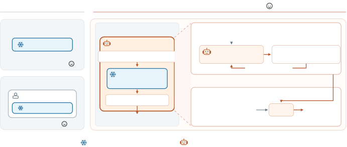

# TimeRSI: Towards Self-Improved Agentic Deployment for Time-Series Foundation Models

Haoxin Liu ^(†)^(†)thanks: Contact us at
[hliu763@gatech.edu](mailto:hliu763@gatech.edu),
[badityap@cc.gatech.edu](mailto:badityap@cc.gatech.edu).
Affiliation: Georgia Institute of Technology    Deqing Fu
Affiliation: University of Southern California    Lucheng Fu
Affiliation: Georgia Institute of Technology    Yiqiao Jin
Affiliation: Georgia Institute of Technology    Rushi Qiang
Affiliation: Georgia Institute of Technology    Harshavardhan Kamarthi
Affiliation: Georgia Institute of Technology Affiliation: Samay AI    B.
Aditya Prakash Affiliation: Georgia Institute of Technology
Affiliation: Samay AI

###### Abstract

Time-series foundation models provide strong zero-shot forecast, but
deployment for real-world applications still requires task-specific
designs for model inputs and outputs. Direct inference can leave domain
knowledge and recurring forecast errors unaddressed, while tailored
pipelines require substantial human expertise and effort. We introduce
TimeRSI, a self-improving agentic deployment system around frozen
forecasting models. A coding agent translates task descriptions into
executable pipeline changes. It tests each revision on historical
forecasting windows and uses observed errors to guide subsequent
revisions. During deployment, an adaptive selector chooses among the
resulting pipelines using completed forecasts under similar conditions.
Across 198 tasks on TIME and FEV-bench, TimeRSI outperforms all
submissions on six point and probabilistic forecasting metrics.
Controlled comparisons support the value of feedback-guided revision
over non-iterative pipeline search. Further experiments verify the
generalization with different coding agents and forecasting models. Code
is available at
[https://github.com/haoxin1998/TimeRSI](https://github.com/haoxin1998/TimeRSI).



Fig. 1: From conventional to self-improved TSFM deployment. (a) Direct
inference leaves task-specific adaptation to the user, while tailored
pipelines require human design and revision. (b) TimeRSI automates
pipeline improvement through task-aware code edits and historical
forecasting feedback, then selects among the resulting pipelines for
each new forecast. The TSFM remains frozen.

## 1 Introduction

Time-series foundation models (TSFMs) provide strong forecasts on new
datasets without task-specific weight updates (Das et al., 2024; Ansari
et al., 2024; Woo et al., 2024). In real-world time-series forecasting
(TSF), effective deployment still depends on how task knowledge shapes
the model’s inputs and outputs. For example, recurring holiday closures
can inform demand forecasts, while known tidal cycles can guide
ocean-current forecasts. Turning this knowledge into a _deployment
pipeline_ around the model still requires substantial human expertise
and effort.

Code agents based on large language models (LLMs) offer a way to
automate pipeline development through program generation and evaluation
(Jiang et al., 2025; Fu et al., 2026). Two challenges arise in
forecasting. First, a plausible change may not improve accuracy.
Calendar information, for instance, can enter through model inputs or a
separate predictor, and these choices can yield different results.
Historical forecast errors help evaluate and refine such decisions.
Second, a pipeline that performs well on average may be less suitable as
forecasting conditions change.

We introduce TimeRSI, which applies recursive self-improvement (RSI) to
deployment pipelines around frozen TSFMs (Fig. 1). Our central idea is
to use task knowledge to guide what to try and forecasting feedback to
guide how to revise and use each pipeline. The agent edits input
transformations, features, and forecast corrections while keeping the
foundation model’s weights fixed.

Specifically, TimeRSI combines two stages. _Iterative pipeline
improvement_ evaluates code revisions on historical forecasting windows
and returns errors to the agent for further revision. A separate set of
later historical windows identifies candidates for deployment. _Adaptive
pipeline selection_ then chooses among these candidates for each new
forecast using their performance under similar historical conditions.

We evaluate TimeRSI on TIME and FEV-bench (Qiao et al., 2026; Shchur
et al., 2026), covering 198 tasks. TimeRSI achieves the best scores
among all existing submissions across six point and probabilistic
forecasting metrics. Ablations show that our iterative deployment
improvement outperforms non-iterative pipeline search with the same
number of candidates. Further experiments show gains with different
coding agents and TSFMs, while case studies illustrate how task
knowledge becomes effective deployment code.

#### Related work.

Beyond direct deployment of foundation time-series models (Kamarthi and
Prakash, 2024; Das et al., 2024; Woo et al., 2024; Ansari et al., 2024),
we study agentic deployment for realistic applications via recursive
self-improvement (RSI) (Lee et al., 2026; Srikanth et al., 2026). See
App. A for additional related work.

## 2 TimeRSI: Self-Improved Deployment for Time-Series Foundation Models

TimeRSI automates two deployment decisions: how to improve a
task-specific pipeline and which pipeline to use for a new forecast. A
code agent develops pipelines through repeated execution, evaluation,
and revision. An adaptive selector chooses among them using past
outcomes under similar forecasting conditions. The TSFM’s weights remain
fixed in both stages.

Fig. 2: TimeRSI ranks first among the compared submissions across six
reported metrics on TIME and FEV-bench. Labels name the frozen backbone
of TimeRSI; LPTM (Kamarthi and Prakash, 2024) is appended below the
dashed line when outside the top ten. See App. E for metrics including
WQL Skill and WAPE Skill, and full results of more methods.

Formally, let $`x_{t}`$ contain the observed history and known
covariates at forecast origin $`t`$, and let $`m`$ describe the task,
variable meanings, and sampling frequency. A pipeline $`p`$ uses a
frozen model $`F_{\theta}`$ to forecast the next $`H`$ steps as
$`\widehat{y}_{t+1:t+H}=p(F_{\theta},x_{t};m)`$. The agent improves
$`p`$, while the backbone parameters $`\theta`$ remain fixed.

The agent writes Python code across four stages: preprocessing, feature
construction, context selection, and post-processing. On the input side,
it can transform observations, encode task knowledge as additional
variables, and choose which histories or variable groups the TSFM
receives. On the output side, it can combine forecasts, fit auxiliary
predictors, and correct systematic errors. This action space lets the
agent translate task information into executable changes to the model’s
inputs and outputs. App. B gives the programming interface.

#### Iterative Pipeline Improvement

The outcome of a new forecast is not yet known, so TimeRSI uses
completed historical windows to evaluate pipeline changes. For each
window, the system supplies the history and known covariates at its
forecast origin, runs the candidate, and scores its predictions for the
following $`H`$ steps. Earlier windows form an adaptation set for
iterative code revision; later windows form a selection set for choosing
the deployment candidates.

The loop starts from direct TSFM inference as the reference pipeline. In
each iteration, the agent uses the task description and earlier results
to propose and implement a code revision. The system executes it on the
adaptation windows and returns forecasting scores, window-level errors,
and execution logs. The agent inspects this feedback to decide whether
to refine its approach, combine useful changes, or try a different one.
All earlier code and evaluation records remain accessible, so later
revisions can build on successful ideas and address errors observed in
previous attempts. Task semantics guide what to try, while execution
feedback guides what to change next.

After the search budget is exhausted, the system evaluates the resulting
candidates on the later selection windows. It retains the highest-ranked
pipelines together with the reference to form a deployment set
$`\mathcal{P}`$. This set provides several task-specific strategies for
subsequent forecasts.

#### Adaptive Pipeline Selection

A pipeline that performs well on average may not be the best choice for
every future window. TimeRSI therefore selects a pipeline for each
target variable at each new forecast origin. The selector describes the
current conditions using numerical features of the recent history and
reference forecast, including level changes, recent trends, and forecast
shape. It retrieves similar completed windows and compares how the
retained pipelines performed on them.

For a given target, let $`\mathcal{N}_{t}`$ denote the retrieved windows
whose outcomes are fully observed by $`t`$. Each window $`s`$ receives a
similarity-based weight $`w_{t,s}`$. Let $`\ell(p,s)`$ be the error of
pipeline $`p`$ on window $`s`$ relative to the reference. The selector
chooses the pipeline with the lowest weighted historical error,
$`p_{t}^{*}=\arg\min_{p\in\mathcal{P}}\frac{\sum_{s\in\mathcal{N}_{t}}w_{t,s}\ell(p,s)}{\sum_{s\in\mathcal{N}_{t}}w_{t,s}}`$.
The selected pipeline supplies the full forecast horizon and all
quantiles for that target. App. C specifies the features, weights, and
loss.

At each origin, TimeRSI runs and records forecasts from every retained
pipeline. Once a window is complete, the system adds each pipeline’s
errors to its feedback history and uses them to inform subsequent
choices. Pipeline code remains fixed during this stage, while selection
adapts as new outcomes arrive. Thus, iterative revision improves the
available strategies, and adaptive selection determines when to use
them.

## 3 Experiments


|                                     | TIME: normalized errors |                     | FEV-bench: skill scores (%) |                         |
| ----------------------------------- | ----------------------- | ------------------- | --------------------------- | ----------------------- |
| Method                              | MASE $`\downarrow`$     | CRPS $`\downarrow`$ | SQL Skill $`\uparrow`$      | MASE Skill $`\uparrow`$ |
| Direct TimesFM 3.0                  | 0.640                   | 0.536               | 48.984                      | 37.786                  |
| Non-Iterative Search for Deployment | 0.650 ✗                 | 0.549 ✗             | 42.832 ✗                    | 30.509 ✗                |
| TimeRSI Deployment                  | 0.630 ✓                 | 0.528 ✓             | 51.243 ✓                    | 40.579 ✓                |

Fig. 3: Agentic deployment examples via TimeRSI. The agent adds calendar
features for parking, separates tidal patterns for ocean currents,
applies holiday rules for supply-chain demand, and restores daily
accumulation and reset patterns for solar counters. These agentic
deployments reduce MASE by 2.86–6.70% over direct TimesFM 3.0.

Fig. 4: Ablation of iterative deployment improvement. With the same
number of candidate pipelines, non-iterative search without
feedback-guided revision underperforms direct TimesFM 3.0 inference,
while TimeRSI improves performance on both benchmarks.

#### Data and Metrics.

We evaluate all 98 tasks of
[TIME](https://huggingface.co/spaces/Real-TSF/TIME-leaderboard) (Qiao
et al., 2026) and all 100 tasks of
[FEV-bench](https://huggingface.co/spaces/autogluon/fev-bench) (Shchur
et al., 2026), covering 111,177 and 235,039 forecast instances,
respectively. Each instance is a series–window–target combination. Our
default configuration pairs
[TimesFM 3.0](https://huggingface.co/google/timesfm-3.0-pytorch) with
Claude Code (Claude Fable 5). Following TIME, we report normalized mean
absolute scaled error (MASE) and continuous ranked probability score
(CRPS), where lower is better. Following FEV-bench, we report Skill
Scores for MASE, scaled quantile loss (SQL), weighted quantile loss
(WQL), and weighted absolute percentage error (WAPE), where higher is
better. See App. E for metric definitions and protocol details.

Baselines. We compare with published results from all 32 submissions on
TIME and 31 on FEV-bench, covering foundation models, supervised
forecasters, and statistical methods. Major baselines include
TimesFM 3.0 (Google) (Das et al., 2024), Chronos-2 (Amazon) (Ansari
et al., 2025), Toto 2.0 (Datadog) (Khwaja et al., 2026), QiYao-M
(Huawei) (Cheng et al., 2026), and TiRex-2 (NXAI) (Podest et al., 2026).

Main results. TimeRSI achieves the best scores on both benchmarks across
all six reported metrics (Fig. 2). Relative to direct inference with the
same frozen TimesFM 3.0, it reduces MASE by 1.52% and CRPS by 1.61% on
TIME. On FEV-bench, it raises MASE Skill by 2.79 percentage points and
SQL Skill by 2.26 points. App. E gives the full comparisons, including
WQL and WAPE Skill. These results show that improving the deployment
pipeline can improve forecasting accuracy without updating the
foundation model.

Ablation. Feedback-guided revision improves deployment. We compare
TimeRSI with Non-Iterative Search, which proposes the same number of
candidate pipelines and selects among them without feedback-guided
revision (Tab. 4). Non-iterative search underperforms direct inference
on both benchmarks, whereas TimeRSI improves it. These results support
revising pipelines based on forecast errors, rather than only proposing
and selecting candidates.

Generalization. Effective across coding agents and TSFMs. The gains
extend beyond our default components (Tab. 7). With TimesFM 3.0 fixed,
Antigravity (Gemini 3.8 Flash) reaches normalized MASE/CRPS of
0.637/0.532, outperforming the compared external submissions on TIME.
With Claude Code fixed, TimeRSI reduces MASE/CRPS from 0.662/0.556 to
0.647/0.545 for Chronos-2 and from 0.669/0.572 to 0.641/0.549 for LPTM,
whose FEV-bench MASE/SQL Skill also rises from 30.70/43.20 to
34.63/46.33 (Fig. 2). The Claude Code–TimesFM 3.0 combination achieves
better results, consistent with the advantages of more advanced coding
agents and TSFMs.

#### Case studies.

The agent translates task knowledge into pipeline changes (Fig. 4):
calendar features for parking, tidal decomposition for ocean currents,
history-supported holiday corrections for demand, and daily-reset shape
corrections for solar counters. The resulting pipelines reduce
task-level MASE by 2.86–6.70%. The parking case also illustrates
feedback-guided revision: after a calendar-predictor blend increases
historical error, the agent switches to calendar inputs and adds
weekend–time interactions. Feedback thus guides changes in strategy, not
just parameter tuning. App. D provides full traces and additional
examples.

## 4 Conclusion

We introduce TimeRSI to automate task-specific deployment through
iterative pipeline improvement and adaptive selection around frozen
TSFMs. On TIME and FEV-bench, TimeRSI ranks first across six forecasting
metrics compared with competitive external submissions.

## Limitations

TimeRSI relies on clear task and variable descriptions to connect
numerical patterns with domain knowledge. Besides, gains on historical
windows do not guarantee gains on future forecasts. This highlights the
open problem, i.e., distribution shift, in time-series forecasting (Liu
et al., 2024a; Kim et al., 2025).

## Acknowledgements

This paper was supported in part by the NSF (Expeditions CCF-1918770,
CAREER IIS-2028586, Medium IIS-1955883, Medium IIS-2403240, Medium
IIS-2106961), NIH (1R01HL184139), CDC MInD program, Meta, and Dolby
faculty gifts.

## References

- Agrawal et al. (2026) Lakshya A Agrawal, Shangyin Tan, Dilara Soylu,
  Noah Ziems, Rishi Khare, Krista Opsahl-Ong, Arnav Singhvi, Herumb
  Shandilya, Michael J Ryan, Meng Jiang, Christopher Potts, Koushik Sen,
  Alex Dimakis, Ion Stoica, Dan Klein, Matei Zaharia, and Omar
  Khattab. 2026. [Gepa: Reflective prompt evolution can outperform
  reinforcement
  learning](https://proceedings.iclr.cc/paper_files/paper/2026/file/0e9e708b6f48e14fd0ac29e167413f76-Paper-Conference.pdf).
  In _International Conference on Learning Representations_, volume
  2026, pages 8479–8565.
- Ansari et al. (2025) Abdul Fatir Ansari, Oleksandr Shchur, Jaris
  Küken, Andreas Auer, Boran Han, Pedro Mercado, Syama Sundar
  Rangapuram, Huibin Shen, Lorenzo Stella, Xiyuan Zhang, Mononito
  Goswami, Shubham Kapoor, Danielle C. Maddix, Pablo Guerron, Tony Hu,
  Junming Yin, Nick Erickson, Prateek Mutalik Desai, Hao Wang, and 4
  others. 2025. [Chronos-2: From univariate to universal
  forecasting](https://arxiv.org/abs/2510.15821). _Preprint_,
  arXiv:2510.15821.
- Ansari et al. (2024) Abdul Fatir Ansari, Lorenzo Stella, Caner
  Turkmen, Xiyuan Zhang, Pedro Mercado, Huibin Shen, Oleksandr Shchur,
  Syama Sundar Rangapuram, Sebastian Pineda Arango, Shubham Kapoor,
  Jasper Zschiegner, Danielle C. Maddix, Hao Wang, Michael W. Mahoney,
  Kari Torkkola, Andrew Gordon Wilson, Michael Bohlke-Schneider, and
  Yuyang Wang. 2024. [Chronos: Learning the language of time
  series](https://arxiv.org/abs/2403.07815). _Preprint_,
  arXiv:2403.07815.
- Chan et al. (2025) Jun Shern Chan, Neil Chowdhury, Oliver Jaffe, James
  Aung, Dane Sherburn, Evan Mays, Giulio Starace, Kevin Liu, Leon
  Maksin, Tejal Patwardhan, Aleksander Madry, and Lilian Weng. 2025.
  [Mle-bench: Evaluating machine learning agents on machine learning
  engineering](https://proceedings.iclr.cc/paper_files/paper/2025/file/7e3767db483c942b883eb4f8cfb74e31-Paper-Conference.pdf).
  In _International Conference on Learning Representations_, volume
  2025, pages 50466–50494.
- Cheng et al. (2026) Hanyin Cheng, Linfeng Wang, Zhengbo Qu, Yang Shu,
  Zhongwen Rao, Meng Wang, Yijie Li, Xin Jiang, Bin Yang, and Chenjuan
  Guo. 2026. [Qiyao-m: Multimodal time series foundation model with
  role-aware modeling of endogenous and exogenous
  modalities](https://arxiv.org/abs/2609.34842). _Preprint_,
  arXiv:2609.34842.
- Das et al. (2024) Abhimanyu Das, Weihao Kong, Rajat Sen, and Yichen
  Zhou. 2024. [A decoder-only foundation model for time-series
  forecasting](https://proceedings.mlr.press/v235/das24c.html). In
  _Proceedings of the 41st International Conference on Machine
  Learning_, volume 235 of _Proceedings of Machine Learning Research_,
  pages 10148–10167. PMLR.
- Fu et al. (2026) Deqing Fu, Huangyuan Su, Rajat Sen, Taman Narayan,
  Sujay Sanghavi, Abhimanyu Das, and Weihao Kong. 2026. [Tabfm-auto:
  Self-evolving pipelines for tabular foundation
  models](https://arxiv.org/abs/2609.37989). _Preprint_,
  arXiv:2609.37989.
- Huang et al. (2024) Qian Huang, Jian Vora, Percy Liang, and Jure
  Leskovec. 2024. [MLAgentBench: Evaluating language agents on machine
  learning
  experimentation](https://proceedings.mlr.press/v235/huang24y.html). In
  _Proceedings of the 41st International Conference on Machine
  Learning_, volume 235 of _Proceedings of Machine Learning Research_,
  pages 20271–20309. PMLR.
- Jiang et al. (2025) Zhengyao Jiang, Dominik Schmidt, Dhruv Srikanth,
  Dixing Xu, Ian Kaplan, Deniss Jacenko, and Yuxiang Wu. 2025. [Aide:
  Ai-driven exploration in the space of
  code](https://arxiv.org/abs/2502.13138). _Preprint_, arXiv:2502.13138.
- Kamarthi and Prakash (2024) Harshavardhan Kamarthi and B. Aditya
  Prakash. 2024. [Large pre-trained time series models for cross-domain
  time series analysis tasks](https://doi.org/10.52202/079017-1788). In
  _Advances in Neural Information Processing Systems_, volume 37, pages
  56190–56214. Curran Associates, Inc.
- Khwaja et al. (2026) Emaad Khwaja, Chris Lettieri, Gerald Woo, Eden
  Belouadah, Marc Cenac, Guillaume Jarry, Enguerrand Paquin, Xunyi Zhao,
  Viktoriya Zhukov, Othmane Abou-Amal, Chenghao Liu, Ameet Talwalkar,
  and David Asker. 2026. [Toto 2.0: Time series forecasting enters the
  scaling era](https://arxiv.org/abs/2605.20119). _Preprint_,
  arXiv:2605.20119.
- Kim et al. (2025) Jongseon Kim, Hyungjoon Kim, HyunGi Kim, Dongjun
  Lee, and Sungroh Yoon. 2025. [A comprehensive survey of deep learning
  for time series forecasting: architectural diversity and open
  challenges](https://doi.org/10.1007/s10462-025-11223-9). _Artificial
  Intelligence Review_, 58(7):216.
- Lee et al. (2026) Yoonho Lee, Roshen Nair, Qizheng Zhang, Kangwook
  Lee, Omar Khattab, and Chelsea Finn. 2026. [Meta-harness: End-to-end
  optimization of model harnesses](https://arxiv.org/abs/2603.28052).
  _Preprint_, arXiv:2603.28052.
- Liu et al. (2024a) Haoxin Liu, Harshavardhan Kamarthi, Lingkai Kong,
  Zhiyuan Zhao, Chao Zhang, and B. Aditya Prakash. 2024a. [Time-series
  forecasting for out-of-distribution generalization using invariant
  learning](https://proceedings.mlr.press/v235/liu24ae.html). In
  _Proceedings of the 41st International Conference on Machine
  Learning_, volume 235 of _Proceedings of Machine Learning Research_,
  pages 31312–31325. PMLR.
- Liu et al. (2025) Haoxin Liu, Chenghao Liu, and B. Aditya
  Prakash. 2025. [A picture is worth a thousand numbers: Enabling LLMs
  reason about time series via
  visualization](https://doi.org/10.18653/v1/2025.naacl-long.383). In
  _Proceedings of the 2025 Conference of the Nations of the Americas
  Chapter of the Association for Computational Linguistics: Human
  Language Technologies (Volume 1: Long Papers)_, pages 7486–7518,
  Albuquerque, New Mexico. Association for Computational Linguistics.
- Liu et al. (2024b) Haoxin Liu, Shangqing Xu, Zhiyuan Zhao, Lingkai
  Kong, Harshavardhan Kamarthi, Aditya B. Sasanur, Megha Sharma, Jiaming
  Cui, Qingsong Wen, Chao Zhang, and B. Aditya Prakash. 2024b.
  [Time-mmd: Multi-domain multimodal dataset for time series
  analysis](https://doi.org/10.52202/079017-2476). In _Advances in
  Neural Information Processing Systems_, volume 37, pages 77888–77933.
  Curran Associates, Inc.
- Liu et al. (2024c) Haoxin Liu, Zhiyuan Zhao, Jindong Wang,
  Harshavardhan Kamarthi, and B. Aditya Prakash. 2024c. [LSTPrompt:
  Large language models as zero-shot time series forecasters by
  long-short-term
  prompting](https://doi.org/10.18653/v1/2024.findings-acl.466). In
  _Findings of the Association for Computational Linguistics: ACL 2024_,
  pages 7832–7840, Bangkok, Thailand. Association for Computational
  Linguistics.
- Liu et al. (2026a) Haoxin Liu, Yichen Zhou, Rajat Sen, B. Aditya
  Prakash, and Abhimanyu Das. 2026a. [Rethinking multimodal time-series
  forecasting
  evaluation](https://proceedings.mlr.press/v306/liu26go.html). In
  _Proceedings of the 43rd International Conference on Machine
  Learning_, volume 306 of _Proceedings of Machine Learning Research_,
  pages 80183–80283. PMLR.
- Liu et al. (2026b) Zewen Liu, Zhan Shi, Yisi Sang, Bing He, Minhua
  Lin, Tianxin Wei, Dakuo Wang, Benoit Dumoulin, Wei Jin, and Hanqing
  Lu. 2026b. [Adaptive auto-harness: Sustained self-improvement for
  agentic system deployment on open-ended task
  streams](https://arxiv.org/abs/2606.01770). _Preprint_,
  arXiv:2606.01770.
- Madaan et al. (2023) Aman Madaan, Niket Tandon, Prakhar Gupta, Skyler
  Hallinan, Luyu Gao, Sarah Wiegreffe, Uri Alon, Nouha Dziri, Shrimai
  Prabhumoye, Yiming Yang, Shashank Gupta, Bodhisattwa Prasad Majumder,
  Katherine Hermann, Sean Welleck, Amir Yazdanbakhsh, and Peter
  Clark. 2023. [Self-refine: Iterative refinement with
  self-feedback](https://doi.org/10.52202/075280-2019). In _Advances in
  Neural Information Processing Systems_, volume 36, pages 46534–46594.
  Curran Associates, Inc.
- Podest et al. (2026) Patrick Podest, Marco Pichler, Elias Bürger,
  Levente Zólyomi, Bernhard Voggenberger, Wilhelm Berghammer, Daniel
  Klotz, Sebastian Böck, Günter Klambauer, and Sepp Hochreiter. 2026.
  [Tirex-2: Generalizing tirex to multivariate data and
  streaming](https://arxiv.org/abs/2607.01204). _Preprint_,
  arXiv:2607.01204.
- Qiao et al. (2026) Zhongzheng Qiao, Sheng Pan, Anni Wang, Viktoriya
  Zhukova, Yong Liu, Xudong Jiang, Qingsong Wen, Mingsheng Long, Ming
  Jin, and Chenghao Liu. 2026. [It’s time: Towards the next generation
  of time series forecasting
  benchmarks](https://arxiv.org/abs/2602.12147). _Preprint_,
  arXiv:2602.12147.
- Shchur et al. (2026) Oleksandr Shchur, Abdul Fatir Ansari, Caner
  Turkmen, Lorenzo Stella, Nick Erickson, Pablo Guerron, Michael
  Bohlke-Schneider, and Yuyang Wang. 2026. [fev-bench: A realistic
  benchmark for time series
  forecasting](https://arxiv.org/abs/2509.26468). _Preprint_,
  arXiv:2509.26468.
- Shinn et al. (2023) Noah Shinn, Federico Cassano, Ashwin Gopinath,
  Karthik Narasimhan, and Shunyu Yao. 2023. [Reflexion: language agents
  with verbal reinforcement
  learning](https://doi.org/10.52202/075280-0377). In _Advances in
  Neural Information Processing Systems_, volume 36, pages 8634–8652.
  Curran Associates, Inc.
- Srikanth et al. (2026) Dhruv Srikanth, Bingchen Zhao, Dixing Xu,
  Yuxiang Wu, and Zhengyao Jiang. 2026. [Recursive self-improvement of
  ai research agents](https://arxiv.org/abs/2609.26457). _Preprint_,
  arXiv:2609.26457.
- Woo et al. (2024) Gerald Woo, Chenghao Liu, Akshat Kumar, Caiming
  Xiong, Silvio Savarese, and Doyen Sahoo. 2024. [Unified training of
  universal time series forecasting
  transformers](https://proceedings.mlr.press/v235/woo24a.html). In
  _Proceedings of the 41st International Conference on Machine
  Learning_, volume 235 of _Proceedings of Machine Learning Research_,
  pages 53140–53164. PMLR.

## Appendix A Additional Related Work

#### Pretrained forecasting models.

TimesFM (Das et al., 2024), Chronos (Ansari et al., 2024), and Moirai
(Woo et al., 2024) learn from diverse numerical series to support
forecasting on new datasets. LPTM (Kamarthi and Prakash, 2024) studies
adaptive segmentation during pretraining for cross-domain time-series
analysis. These works develop the numerical backbone. TimeRSI addresses
a complementary question: how can an agent adapt the deployment pipeline
around an existing backbone while keeping its weights fixed?

#### Semantics and temporal generalization.

LSTPrompt (Liu et al., 2024c) studies structured prompting for
time-series forecasting. VL-Time (Liu et al., 2025) uses visual
representations to support language-guided time-series reasoning.
Time-MMD (Liu et al., 2024b) and TimesX (Liu et al., 2026a) provide
benchmarks connecting numerical series with textual context. These
studies motivate using information beyond raw target values; our agent
turns task information into executable pipeline changes. FOIL (Liu
et al., 2024a) addresses out-of-distribution forecasting through
invariant learning. Rather than learning invariant backbone
representations, TimeRSI uses completed forecasts to choose among
candidate pipelines.

#### Agent improvement.

Self-Refine (Madaan et al., 2023) alternates generation, self-feedback,
and revision. Reflexion (Shinn et al., 2023) carries verbal reflections
from task feedback into later attempts. GEPA (Agrawal et al., 2026)
evolves prompts using execution traces and reflective feedback. Adaptive
Auto-Harness (Liu et al., 2026b) combines harness evolution and
task-wise routing on open-ended streams. TimeRSI focuses on executable
pipelines around a frozen numerical forecaster. It separates historical
code search from deployment selection, where completed forecast windows
supply the new feedback.

#### Machine learning engineering agents.

MLAgentBench (Huang et al., 2024) evaluates agents that read and write
files, execute experiments, and inspect outputs. MLE-bench (Chan et al., 2025) assesses model development and experimentation on machine learning
competitions. AIDE (Jiang et al., 2025) searches over code solutions,
while TabFM-Auto (Fu et al., 2026) focuses pipeline search around a
frozen tabular model. Our design shares the code–execution–feedback
pattern, but couples pipeline adaptation with chronological feedback and
strategy selection for repeated forecasting.

## Appendix B Pipeline Interface

Four functions pass prepared data and state between pipeline stages. The
first, preprocess, receives the observed history and task description
and returns prepared data and local state. engineer constructs variables
from these inputs. select_context creates one or more forecasting cases,
specifying the histories and variable groups supplied to the foundation
model. postprocess maps model outputs back to the target scale and
returns point and quantile forecasts in the original target units. State
is local to the current invocation. It can hold fitted transforms or
auxiliary predictors derived from the available history. During
deployment, these components may be fitted again on newly available
history while their code remains fixed.

The evaluator supplies the same chronological windows to all candidates.
Candidate code receives no target values beyond each window’s origin.
The agent can access the labels of the adaptation windows through
evaluation feedback; these labels are not passed to the pipeline as
prediction inputs. Later selection feedback is used by the system only
after code search finishes. All four functions and their evaluation
records are retained so the agent can inspect earlier attempts.

## Appendix C Historical Selection Details

The reference configuration describes each target using up to 96 recent
observations and the reference median forecast. Its six features are:
the latest value relative to the recent median; the mean of the last
eight observations relative to the mean of the earlier half of the
recent history; the first forecast relative to the latest observation;
the mean forecast relative to the recent median; the standard deviation
across the forecast horizon; and the last forecast relative to the
first. Each feature is scaled by the recent historical standard
deviation, with a small floor for nearly constant series.

At a new origin, the selector first filters out windows whose outcomes
are not yet complete. It uses records for the current item when at least
three distinct origins are available; otherwise it pools the available
records. For each target, it standardizes the feature coordinates using
the historical feature standard deviations, floored at $`0.25`$.
Distance is the mean squared difference in these coordinates. The
selector retrieves up to 12 nearest records and gives each an initial
weight of $`1/(1+d)`$, where $`d`$ is this distance. Weights are then
normalized within each origin before applying the weighted-error
selection rule.

For each candidate and historical window, the loss is its mean absolute
scaled error (MASE) divided by the reference MASE, with a denominator
floor of $`10^{-8}`$. MASE divides mean absolute forecast error by the
mean absolute seasonal difference in the history available at that
origin. Candidate ranking before deployment uses mean selection-window
MASE, with the quantile score as a tie-breaker. The portable
configuration retains three ranked candidates plus the reference if it
is not already among them. Initial feedback comes from the completed
adaptation and selection windows; subsequent completed forecasts extend
this history. With no available feedback, the selector uses the
reference pipeline.

## Appendix D Discovered Deployment Strategies

|                                 |           | Test MASE $`\downarrow`$ |          | Relative error reduction |        |
| ------------------------------- | --------- | ------------------------ | -------- | ------------------------ | ------ |
| Task                            | Horizon   | Direct                   | TimeRSI  | MASE                     | CRPS   |
| Supply chain                    | 30 days   | 0.557750                 | 0.520378 | 6.70%                    | 6.76%  |
| Parking availability            | 1 week    | 0.678730                 | 0.641658 | 5.46%                    | 5.37%  |
| Ocean currents                  | 72 hours  | 0.871531                 | 0.835129 | 4.18%                    | 0.64%  |
| Solar counters                  | 72 hours  | 0.574087                 | 0.557693 | 2.86%                    | 2.66%  |
| Auto-production seasonal factor | 12 months | 0.756537                 | 0.233980 | 69.07%                   | 66.37% |
| COVID reports                   | 30 days   | 3.138536                 | 2.890121 | 7.91%                    | 15.62% |
| Atmospheric variables           | 24 hours  | 0.476581                 | 0.466005 | 2.22%                    | 1.22%  |

Tab. 1: Different tasks lead to different deployment programs.
Complete-task test scores for the selected examples. Relative reductions
compare TimeRSI with direct TimesFM inference. The auto-production case
uses an agent-written specialist for point forecasts and the foundation
model for distributional information.

These cases illustrate task-specific features, domain-informed
representations, business rules, measurement structure, and auxiliary
predictors. Tab. 1 compares seven example tasks with direct inference
using the same frozen TimesFM 3.0 backbone. Each test score covers all
official windows and targets of its task. Historical adaptation and
selection scores are reported separately; the selected examples do not
represent the aggregate benchmark result.

### D.1 Supply Chain: Learning When Demand Is Zero

A holiday can break an otherwise regular weekly pattern. On July 4,
2024, in the first official forecast window of Supply_Chain_Customer,
the first customer’s observed order count is zero. The direct model’s
median forecast is $`195.23`$; TimeRSI’s is zero.

The agent writes a date-based correction rather than a general
low-demand threshold. It checks past observations on July 4,
Thanksgiving, Christmas, and New Year’s Day. For each target, the
correction requires at least four past holiday observations, of which at
least 80% must be zero. When this condition holds, it sets all nine
forecast quantiles to zero on the relevant holiday. Thus, a calendar
hypothesis becomes a rule supported by that target’s history.

The agent also tests corrections for the day after a holiday. Historical
feedback leads it to restrict this adjustment to the day after July 4
rather than applying it to dates such as Black Friday. Further revisions
align the normalized forecast shapes of orders, pieces, and revenue for
the same customer. Tab. 2 shows all six revisions in this search. The
main adaptation gain comes from the first holiday-aware correction;
later edits refine it.

| Revision                             | MASE $`\downarrow`$ |
| ------------------------------------ | ------------------- |
| Starting pipeline                    | 0.522271            |
| 1\. Holiday and weekday corrections  | 0.489970            |
| 2\. Post-holiday adjustment          | 0.490036            |
| 3\. Align related forecast shapes    | 0.489901            |
| 4\. Stronger post-holiday adjustment | 0.489933            |
| 5\. Restrict adjustment to July 5    | 0.489834            |
| 6\. Refine shape alignment           | 0.489810            |

Tab. 2: Supply-chain revisions evaluated on the same adaptation windows.
The starting pipeline already contains earlier adaptations; its score is
not the direct-inference baseline.

The task contains 36 targets and 12 windows of 30 days. On the four
relevant holiday dates, all 144 target values are zero; direct inference
predicts nonzero values, while TimeRSI predicts zero. Across all dates
and targets, the complete pipeline reduces MASE by 6.70%, including its
other corrections.

### D.2 Parking: Revising How the Model Uses the Calendar

The task predicts available parking spaces every 15 minutes for the next
week. Calendar information can describe more than a change in average
availability: the daily pattern may also differ between weekdays and
weekends. The agent explores both using a separate calendar predictor
and supplying calendar features to TimesFM.

Tab. 3 shows all six evaluated revisions. The first calendar-predictor
blend increases adaptation error. The agent then removes its
contribution and builds known-future calendar inputs instead. The
selected program contains 22 features: daily and weekly sine and cosine
terms, weekend and Saturday indicators, and weekend–time-of-day
interactions. Features cover both historical and future timestamps. The
program includes a periodic feature only when the history spans at least
1.5 of its cycles.

| Revision                     | Adaptation | Selection |
| ---------------------------- | ---------- | --------- |
| Direct TimesFM               | 0.9421     | 0.6142    |
| 1\. Calendar-expert blend    | 0.9578     | 0.6171    |
| 2\. Calendar inputs          | 0.9208     | 0.6038    |
| 3\. History-length condition | 0.9208     | 0.6038    |
| 4\. Weekend–time features    | 0.9268     | 0.6010    |
| 5\. Median and range edits   | 0.9208     | 0.6038    |
| 6\. Fewer calendar inputs    | 0.9152     | 0.6021    |

Tab. 3: Parking MASE on adaptation and separate selection windows; lower
is better. Adaptation uses three origins and selection uses five, each
with 32 car parks. Comparisons are within columns. Revision 4 is
deployed, rather than the last revision or the adaptation winner.

The chosen pipeline keeps the calendar predictor’s output weight at
zero: the improvement comes from a program that supplies new inputs to
the frozen model. On the full test task of 354 car parks, MASE falls
from $`0.678730`$ to $`0.641658`$ and CRPS from $`0.046609`$ to
$`0.044105`$. The trace shows feedback changing the agent’s approach,
while separate historical selection determines which resulting program
is deployed.

 

```ltx_verbatim
weekend = np.where(dow >= 5, 1., -1.)
for k in (1, 2, 3):
    phase = 2 * np.pi * k * tod
    rows += [weekend * np.sin(phase),
             weekend * np.cos(phase)]
```

 

Fig. 5: Calendar interactions in the generated program. The core feature
code, condensed for readability. Here, tod is the fraction of a day and
dow ranges from Monday (0) to Sunday (6). These features cover both
history and forecast dates.

### D.3 Ocean Currents: Using Tidal Knowledge in Model Inputs

In current_velocity/10T/long, the agent uses known tidal periods to
separate predictable oscillations from the remaining signal. Its program
includes tidal constituents such as M2 (12.42 hours) and K1 (23.93
hours). It selects constituents whose frequencies can be distinguished
over the available history and fits their amplitudes and phases for each
target. Before applying the decomposition, a historical backtest checks
whether the tidal fit improves on a constant-mean predictor.

The program subtracts the fitted tidal component from the history,
supplies the residual to TimesFM, and adds the extrapolated component
back to the point and quantile forecasts. Thus, domain knowledge changes
the model’s numerical input rather than only adding a textual
description. The selected pipeline reduces MASE from $`0.871531`$ to
$`0.835129`$ (4.18%) and CRPS from $`0.278207`$ to $`0.276433`$ (0.64%).
These scores cover ten series, six variables, and five official windows,
each forecasting 432 ten-minute steps (72 hours).

### D.4 Solar: Respecting a Daily-Reset Pattern

In Australia_Solar, the agent identifies a pattern consistent with a
daily-reset counter: values rise within the day, reach a plateau, and
reset. This observed structure motivates a different correction from one
designed for instantaneous power.

The program estimates a normalized daily profile $`s(h)`$ from the
previous 28 valid days. For each forecast day and quantile, it fits a
level $`T`$ to the model output and reconstructs the path as $`Ts(h)`$.
The correction preserves the historical daily shape and reset while
using the model forecast to set the level.

The agent also explores daily-total experts and seasonal profiles.
Separate historical selection favors the simpler shape projection. The
selected pipeline reduces MASE by 2.86% and CRPS by 2.66% across three
targets and 35 official windows, each covering 72 hours.

### D.5 Auto Production: Building a Calendar-Aware Specialist

The official task Auto_Production_SF/M/short contains the monthly
seasonal-factor series RSF_AutoProduction, not vehicle production
counts. The agent builds on a calendar-aware predictor and explores
holiday interactions, month-specific trends, and reversible seasonal
transformations. It uses historical forecasts to choose a smoothing rate
for each month, then shrinks these choices toward a common default.

The resulting specialist supplies the point forecast. TimesFM’s quantile
deviations and historical forecast errors inform the predictive
distribution. This case illustrates the broader action space of
deployment code: the agent can fit an auxiliary predictor, not only add
input features.

Across all five 12-month test windows, MASE falls from $`0.756537`$ for
direct inference to $`0.233980`$ for TimeRSI, a 69.07% reduction. The
pipeline used to start the final search already achieves $`0.313005`$;
the six further revisions reduce its test MASE by 25.25%. These
comparisons distinguish the complete deployment gain from the additional
gain of that search.

### D.6 COVID Reports: Revising an Overextended Trend

A plausible first idea need not be the best program. On ECDC_COVID, the
agent starts with a reversible logarithmic transformation, but
adaptation MASE increases from $`3.9173`$ to $`4.1816`$. It then
examines past forecast errors and finds overly strong upward
extrapolation in the cases it inspects.

The next revision blends the model with a damped trend predictor,
lowering adaptation MASE to $`2.9624`$. Further edits handle isolated
reporting spikes and repeated values at the end of the history. The
agent also tests shorter context and adjusts positive trend damping
according to how long the recent growth has lasted. Tab. 4 gives the
complete six-revision trace.

| Revision                     | Adaptation | Selection |
| ---------------------------- | ---------- | --------- |
| Direct TimesFM               | 3.9173     | 5.0403    |
| 1\. Log transformation       | 4.1816     | 4.2079    |
| 2\. Damped trend blend       | 2.9624     | 3.8822    |
| 3\. Repeated-value handling  | 2.7920     | 4.1122    |
| 4\. Shorter context          | 2.7604     | 4.1589    |
| 5\. Growth-duration damping  | 2.7252     | 4.1114    |
| 6\. Milder damping and blend | 2.8398     | 3.7878    |

Tab. 4: COVID-report MASE on separate historical sets. Selection favors
revision 6, which uses milder damping, over revision 5, which has the
lowest adaptation error.

The selected pipeline gives equal weight to the model and the auxiliary
predictor in log space. Across nine countries and five 30-day test
windows, it reduces task-level MASE by 7.91% and CRPS by 15.62%. These
are aggregate gains across the task, not improvements in every country
or window.

### D.7 Atmospheric Variables: Separating the Daily Cycle

NE_China_Wind forecasts four atmospheric variables, including wind
components, geopotential height, and temperature. The agent fits daily
harmonics in overlapping historical segments, allowing their amplitudes
to change over time. It subtracts the estimated cycle, lets TimesFM
forecast the remaining signal, and restores the future cycle afterward.

The transformation is reversible and fitted from the available history.
The selected program reduces MASE by 2.22% across all four variables and
30 official 24-hour windows.

## Appendix E Benchmark Protocol and Full Results

TIME: normalized errors

| Method               | MASE $`\downarrow`$ | CRPS $`\downarrow`$ |
| -------------------- | ------------------- | ------------------- |
| TimeRSI              | 0.630               | 0.528               |
| QiYao-M              | 0.638               | 0.536               |
| ChakraTS             | 0.639               | 0.537               |
| TimesFM 3.0          | 0.640               | 0.536               |
| Toto 2.0 (2.5B)      | 0.642               | 0.539               |
| Toto 2.0 (313M)      | 0.644               | 0.542               |
| Toto 2.0 (1B)        | 0.645               | 0.545               |
| PatchTST-FM-Extended | 0.662               | 0.557               |
| Chronos-2            | 0.662               | 0.556               |
| T0-beta              | 0.665               | 0.555               |
| Tabby                | 0.668               | 0.553               |
| TimesFM 2.5          | 0.669               | 0.567               |
| OmniScient           | 0.669               | 0.562               |
| Toto 2.0 (22M)       | 0.670               | 0.562               |
| PatchTST-FM-R1       | 0.671               | 0.564               |
| Tabby-Pretrain       | 0.678               | 0.566               |
| TiRex                | 0.683               | 0.573               |
| Toto 2.0 (4M)        | 0.691               | 0.582               |
| TS-ICL               | 0.694               | 0.581               |
| Toto                 | 0.698               | 0.584               |
| Eidos                | 0.700               | 0.587               |
| Timer-S1             | 0.702               | 0.589               |
| Moirai 2.0           | 0.703               | 0.588               |
| TimesFM 2.0          | 0.718               | 0.620               |
| Chronos-Bolt         | 0.733               | 0.620               |
| Kairos               | 0.739               | 0.644               |
| sundial_base         | 0.758               | 0.663               |
| Fracast-0            | 0.768               | 0.649               |
| litespecformer       | 0.787               | 0.653               |
| TimesFM 1.0          | 0.788               | 0.689               |
| visiontspp_base      | 0.805               | 0.671               |
| Moirai_base          | 0.826               | 0.666               |
| seasonal_naive       | 1.000               | 1.000               |

FEV-bench: Skill Score (%)

| Method          | MASE $`\uparrow`$ | SQL $`\uparrow`$ |
| --------------- | ----------------- | ---------------- |
| TimeRSI         | 40.579            | 51.243           |
| TimesFM 3.0     | 37.816            | 48.994           |
| ChakraTS        | 36.930            | 48.143           |
| Chronos-2       | 35.496            | 47.281           |
| Lingjiang2.0    | 35.377            | 47.020           |
| T0-beta         | 34.863            | 46.653           |
| TiRex-2         | 33.743            | 45.499           |
| Toto 2.0 (2.5B) | 32.539            | 44.421           |
| TabPFN-TS-3     | 30.562            | 43.150           |
| TS-ICL          | 31.113            | 43.115           |
| Toto 2.0 (22M)  | 30.609            | 42.907           |
| TiRex           | 30.012            | 42.576           |
| TimesFM 2.5     | 30.198            | 42.201           |
| TabPFN-TS       | 29.834            | 41.487           |
| CITRAS-FM       | 29.329            | 41.178           |
| Toto 1.0        | 28.233            | 40.755           |
| FlowState       | 27.830            | 39.911           |
| Moirai 2.0      | 27.225            | 39.314           |
| Chronos-Bolt    | 26.515            | 38.893           |
| Sundial-Base    | 24.746            | 33.423           |
| TFT             | 20.479            | 32.179           |
| PatchTST        | 18.365            | 30.089           |
| DeepAR          | 17.521            | 29.084           |
| CatBoost        | 23.692            | 22.998           |
| AutoARIMA       | 11.626            | 21.304           |
| LightGBM        | 21.692            | 20.979           |
| Stat. Ensemble  | 16.443            | 20.655           |
| AutoTheta       | 10.988            | 5.457            |
| Seasonal Naive  | 0.000             | 0.000            |
| AutoETS         | 2.259             | -26.819          |
| Naive           | -16.674           | -45.399          |
| Drift           | -18.139           | -45.776          |

Tab. 5: Full public-result comparison. All visible methods in the
captured snapshot. Bold marks TimeRSI. TIME values are normalized
errors; FEV-bench values are Skill Scores. TIME includes the accepted
entry; the FEV-bench TimeRSI row is the submitted, not yet merged
result. Rows are ordered by TIME MASE and FEV-bench SQL Skill.

#### Evaluation scope.

TIME provides 98 dataset–frequency–horizon tasks from 50 datasets,
covering 111,177 forecast instances. FEV-bench provides 100 tasks; our
results cover all 1,308 specified forecast windows and 235,039 forecast
instances. One instance is one series–window–target combination. We
follow the released task definitions, including their target columns,
sampling frequencies, horizons, forecast origins, and seasonal periods.
All target variables and test windows contribute to each task’s score.
Available covariates retain their official roles: past-only covariates
stop at the forecast origin, while known-future covariates may extend
across the horizon.

#### Pipeline configuration.

The default backbone is
[TimesFM 3.0](https://huggingface.co/google/timesfm-3.0-pytorch). Its
weights stay fixed throughout search and deployment. Our default code
agent is Claude Code (Claude Fable 5). The frozen candidate archive also
includes programs developed with Claude Opus 5. Agents can use task and
variable descriptions, timestamps, observed values, and available
covariates. The editable stages are listed in App. B; the historical
selector is specified in App. C. Predictions contain nine quantiles, at
levels $`0.1,0.2,\ldots,0.9`$; the median supplies the point forecast.

#### Agent search budget.

The default loop allows up to six iterations, with one candidate
pipeline evaluated per iteration. Claude Code uses high reasoning effort
(--effort high), with a maximum of 256 agent turns and a 90-minute
timeout per search session.

#### Chronological feedback.

Historical adaptation windows provide code-search feedback, and a
separate later block evaluates candidates. At deployment, only windows
whose entire outcome has arrived can supply selection feedback. The
forecast being evaluated cannot supply its own target values to the
pipeline or selector. Fixed code may fit auxiliary predictors to the
history available at the current origin. This is task-adapted deployment
with a frozen backbone, rather than a claim of zero-shot operation for
the whole system.

#### Point forecasting: MASE.

Consider one target and forecast origin. Let $`x_{1:L}`$ be its observed
history, $`y_{1:H}`$ its future outcomes, and $`q_{\tau,h}`$ its
forecast at quantile level $`\tau`$ and lead $`h`$. The point forecast
is $`q_{0.5,h}`$. With seasonal period $`s`$, the historical scale and
mean absolute scaled error are

```math
\displaystyle a_{s} \displaystyle=\frac{1}{L-s}\sum_{\ell=s+1}^{L}|x_{\ell}-x_{\ell-s}|, \tag{1}
```

```math
\displaystyle\operatorname{MASE} \displaystyle=\frac{1}{Ha_{s}}\sum_{h=1}^{H}|y_{h}-q_{0.5,h}|. \tag{2}
```

Lower is better. The seasonal scale makes errors comparable across
targets with different units.

#### Probabilistic forecasting: SQL and CRPS.

Let $`\mathcal{Q}=\{0.1,0.2,\ldots,0.9\}`$. Define the doubled quantile
loss as

```math
L_{\tau}(y,q)=2\bigl(\tau-\mathbf{1}[y<q]\bigr)(y-q). \tag{3}
```

FEV-bench’s scaled quantile loss divides by the historical seasonal
scale:

```math
\operatorname{SQL}=\frac{\sum_{\tau\in\mathcal{Q}}\sum_{h=1}^{H}L_{\tau}(y_{h},q_{\tau,h})}{|\mathcal{Q}|Ha_{s}}. \tag{4}
```

TIME reports a quantile approximation to the continuous ranked
probability score (CRPS), normalized by the target magnitude. Its
implementation uses mean weighted quantile loss:

```math
\operatorname{CRPS}_{\mathrm{TIME}}=\frac{\sum_{\tau\in\mathcal{Q}}\sum_{h=1}^{H}L_{\tau}(y_{h},q_{\tau,h})}{|\mathcal{Q}|\sum_{h=1}^{H}|y_{h}|}. \tag{5}
```

Both are lower-is-better. The distinction is the denominator: SQL uses
past seasonal differences; TIME’s CRPS uses the magnitude of the
outcomes being scored. We use the official evaluators to aggregate over
series, targets, and windows, retaining their handling of missing values
and undefined scales.

#### TIME aggregation.

Let $`E_{i,m}`$ be the official task-level error for metric $`m`$ and
$`B_{i,m}`$ the corresponding Seasonal Naive error. Define
$`r_{i,m}=E_{i,m}/B_{i,m}`$. TIME reports

```math
R_{m}=\exp\left(\frac{1}{N}\sum_{i=1}^{N}\log r_{i,m}\right),\quad N=98. \tag{6}
```

Lower is better and Seasonal Naive scores 1. The public TIME table
displays three decimal places. Tab. 5 preserves that precision, while
Tab. 6 uses our saved full-precision aggregates.

#### FEV-bench aggregation.

Using the same task-relative error notation, FEV-bench reports the Skill
Score $`S_{m}`$:

```math
S_{m}=100\left[1-\exp\left(\frac{1}{N}\sum_{i=1}^{N}\log\widetilde{r}_{i,m}\right)\right], \tag{7}
```

where $`N=100`$ and
$`\widetilde{r}_{i,m}=\min(100,\max(0.01,r_{i,m}))`$. Higher is better;
0 matches Seasonal Naive. We retain the official missing-result and
pretraining-overlap handling: missing results use Seasonal Naive and
flagged pretraining overlap uses Chronos-Bolt. Models marked hidden in
the public metadata are omitted, matching the leaderboard’s display
policy.

#### Baseline sources.

The public comparison includes TimesFM (Das et al., 2024), Chronos-2
(Ansari et al., 2025), Toto 2.0 (Khwaja et al., 2026), QiYao-M (Cheng
et al., 2026), and TiRex-2 (Podest et al., 2026). These citations
identify the model families; the exact released versions are named in
Tab. 5. API and release-only entries, such as
[ChakraTS](https://huggingface.co/yhatlabs/ChakraTS), follow the
official model cards and benchmark release records (Qiao et al., 2026;
Shchur et al., 2026). We use their published scores, rather than
rerunning or retuning their configurations.

#### Comparison scope.

Public baseline scores use the October 10, 2026 snapshot of both
benchmarks. They include pretrained forecasters and, where available,
task-trained and statistical methods. The comparison uses their
published configurations, not a common compute budget. TIME has accepted
our entry; the FEV-bench table adds our pending submission to the public
baseline files. Tab. 6 separately compares TimeRSI with direct inference
in our environment.

|                                         |          |          |       |
| --------------------------------------- | -------- | -------- | ----- |
| Metric                                  | Direct   | TimeRSI  | Gain  |
| TIME: normalized error $`\downarrow`$   |          |          |       |
| MASE                                    | 0.639759 | 0.630011 | 1.52% |
| CRPS                                    | 0.536328 | 0.527713 | 1.61% |
| FEV-bench: Skill Score (%) $`\uparrow`$ |          |          |       |
| MASE                                    | 37.786   | 40.579   | 4.49% |
| SQL                                     | 48.984   | 51.243   | 4.43% |

Tab. 6: Paired comparison with direct inference. The reference uses our
environment and the same backbone. Gain denotes relative error
reduction. For FEV-bench it is computed from $`100-\text{Skill}`$. The
public FEV TimesFM row differs slightly from this local reference.

#### Generalization across agents and TSFMs.

We report additional TIME configurations in Tab. 7. The agent comparison
uses TimesFM 3.0 with Claude Code (Claude Fable 5) or Antigravity
(Gemini 3.8 Flash). The backbone comparison uses Claude Code (Claude
Fable 5) to evaluate TimeRSI with Chronos-2 and LPTM against direct
inference with the same backbone. Scores use the same normalized MASE
and CRPS metrics as the main comparison and are reported to three
decimal places. On all 100 FEV-bench tasks, TimeRSI with LPTM reaches
SQL, MASE, WQL, and WAPE Skill Scores of 46.33%, 34.63%, 50.96%, and
38.58%, compared with 43.20%, 30.70%, 47.60%, and 34.18% for direct LPTM
inference. These experiments evaluate the framework with different
components.

| Configuration        | MASE $`\downarrow`$ | CRPS $`\downarrow`$ |
| -------------------- | ------------------- | ------------------- |
| TimesFM 3.0 backbone |                     |                     |
| Direct inference     | 0.640               | 0.536               |
| TimeRSI: Claude Code | 0.630               | 0.528               |
| TimeRSI: Antigravity | 0.637               | 0.532               |
| Chronos-2 backbone   |                     |                     |
| Direct inference     | 0.662               | 0.556               |
| TimeRSI: Claude Code | 0.647               | 0.545               |
| LPTM backbone        |                     |                     |
| Direct inference     | 0.669               | 0.572               |
| TimeRSI: Claude Code | 0.641               | 0.549               |

Tab. 7: Deployment gains across coding agents and TSFMs. Normalized
errors on all 98 TIME tasks. Claude Code uses Claude Fable 5;
Antigravity uses Gemini 3.8 Flash. Bold marks the best scores within
each backbone group.

### E.1 Additional FEV-bench Metrics

Tab. 8 gives the complete comparison across the four FEV-bench metrics.
TimeRSI ranks first in each, including WQL Skill of 55.759% and WAPE
Skill of 44.788%.

| Method          | SQL Skill $`\uparrow`$ | MASE Skill $`\uparrow`$ | WQL Skill $`\uparrow`$ | WAPE Skill $`\uparrow`$ |
| --------------- | ---------------------- | ----------------------- | ---------------------- | ----------------------- |
| TimeRSI         | 51.243                 | 40.579                  | 55.759                 | 44.788                  |
| TimesFM 3.0     | 48.994                 | 37.816                  | 53.278                 | 41.656                  |
| ChakraTS        | 48.143                 | 36.930                  | 52.440                 | 40.576                  |
| Chronos-2       | 47.281                 | 35.496                  | 51.520                 | 39.410                  |
| Lingjiang2.0    | 47.020                 | 35.377                  | 51.457                 | 39.229                  |
| T0-beta         | 46.653                 | 34.863                  | 50.827                 | 38.318                  |
| TiRex-2         | 45.499                 | 33.743                  | 49.542                 | 37.014                  |
| Toto 2.0 (2.5B) | 44.421                 | 32.539                  | 49.217                 | 36.655                  |
| TabPFN-TS-3     | 43.150                 | 30.562                  | 48.824                 | 35.887                  |
| TS-ICL          | 43.115                 | 31.113                  | 47.233                 | 34.312                  |
| Toto 2.0 (22M)  | 42.907                 | 30.609                  | 47.668                 | 34.553                  |
| TiRex           | 42.576                 | 30.012                  | 46.666                 | 33.560                  |
| TimesFM 2.5     | 42.201                 | 30.198                  | 46.726                 | 33.719                  |
| TabPFN-TS       | 41.487                 | 29.834                  | 46.646                 | 34.853                  |
| CITRAS-FM       | 41.178                 | 29.329                  | 45.997                 | 33.229                  |
| Toto 1.0        | 40.755                 | 28.233                  | 45.021                 | 31.521                  |
| FlowState       | 39.911                 | 27.830                  | 46.006                 | 33.122                  |
| Moirai 2.0      | 39.314                 | 27.225                  | 43.852                 | 30.624                  |
| Chronos-Bolt    | 38.893                 | 26.515                  | 43.187                 | 29.770                  |
| Sundial-Base    | 33.423                 | 24.746                  | 37.437                 | 27.263                  |
| TFT             | 32.179                 | 20.479                  | 34.969                 | 22.701                  |
| PatchTST        | 30.089                 | 18.365                  | 34.333                 | 21.454                  |
| DeepAR          | 29.084                 | 17.521                  | 32.580                 | 20.002                  |
| CatBoost        | 22.998                 | 23.692                  | 26.618                 | 25.514                  |
| AutoARIMA       | 21.304                 | 11.626                  | 24.478                 | 13.599                  |
| LightGBM        | 20.979                 | 21.692                  | 24.360                 | 23.221                  |
| Stat. Ensemble  | 20.655                 | 16.443                  | 22.373                 | 19.454                  |
| AutoTheta       | 5.457                  | 10.988                  | 7.846                  | 13.795                  |
| Seasonal Naive  | 0.000                  | 0.000                   | 0.000                  | 0.000                   |
| AutoETS         | -26.819                | 2.259                   | -27.027                | 4.329                   |
| Naive           | -45.399                | -16.674                 | -39.121                | -6.111                  |
| Drift           | -45.776                | -18.139                 | -40.059                | -8.605                  |

Tab. 8: Full FEV-bench comparison across four metrics. Skill Scores (%;
higher is better) cover all 100 tasks. We include all 31 publicly
visible baselines and our submitted result. Rows are ordered by SQL
Skill; bold marks the best score in each column.

#### Metric definitions.

For one target variable in a forecast window, let $`i`$ index series and
$`h`$ index future time steps. Using the quantile loss $`L_{\tau}`$ and
levels $`\mathcal{Q}`$ defined above, weighted quantile loss is

```math
\operatorname{WQL}=\frac{\sum_{\tau\in\mathcal{Q}}\sum_{i,h}L_{\tau}(y_{i,h},q_{\tau,i,h})}{|\mathcal{Q}|\sum_{i,h}|y_{i,h}|}. \tag{8}
```

Weighted absolute percentage error uses the point forecast
$`\widehat{y}_{i,h}`$:

```math
\operatorname{WAPE}=\frac{\sum_{i,h}|y_{i,h}-\widehat{y}_{i,h}|}{\sum_{i,h}|y_{i,h}|}. \tag{9}
```

The official evaluator averages scores over target variables and
forecast windows. Lower raw WQL and WAPE are better; their Skill Scores
follow Eq. 7, with higher values indicating better performance relative
to Seasonal Naive. We apply the same missing-result,
pretraining-overlap, and visibility rules as for SQL and MASE.

## Appendix F Use of AI Assistants

AI assistants were used to refine language, improve manuscript
organization, and support coding and experimental workflows. The authors
guided the research and take responsibility for the study design,
methodological choices, reported results, and final manuscript.
