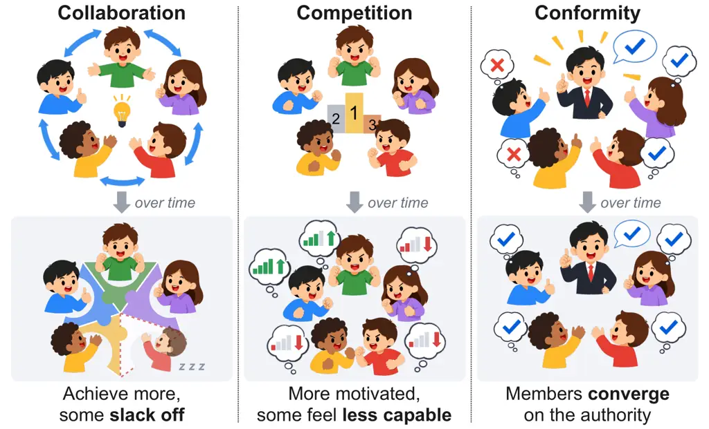

# Evolve Together, Fall into Place: How Social Scaffolding Shapes Self-Evolving Multi-Agent Systems

Seojin Hwang Affiliation: Chung-Ang University
Email: [swiftie1230@cau.ac.kr](mailto:)    Youngmin Choi
Affiliation: Chung-Ang University
Email: [martinus.choi@gmail.com](mailto:)    Hwanhee Lee ^(†)^(†)thanks:
Corresponding author. Affiliation: Chung-Ang University
Email: [hwanheelee@cau.ac.kr](mailto:)

###### Abstract

Recent work lets LLM agents evolve their own harness, up to the team
itself. Yet in human groups, the same abilities achieve different
outcomes under different social conditions. Borrowing the notion of
scaffolding from developmental psychology, we investigate whether the
_social scaffolding_ of a self-evolving multi-agent system (MAS), namely
its _team composition_ and _structure of interdependence_ (e.g.,
collaboration, conformity, or competition), shapes how the team evolves.
We present AGORA (Agents Growing through Organization and Relational
Arrangements), a framework that varies the two axes independently across
three evolution mechanisms. Across web search, codebase understanding,
and document QA, we find that (1) evolution alone rarely helps, while
the right scaffolding surpasses a strong agent evolved alone by up to 25
points; (2) it does so by moving authority to the most capable member
while the others step back; and (3) this member, having grown within the
team, outperforms the same model alone. Thus, designing a self-evolving
MAS requires designing its social scaffolding, which shapes not only how
its agents learn but also who gets to lead.

## 1 Introduction

As Large Language Model (LLM) agents take on increasingly complex tasks,
they rarely work as bare models. They run inside a harness that shapes
their performance Meng et al. (2026). Prior work has focused on its
technical design, from what a single agent sees and is allowed to do Lee
et al. (2026); Lou et al. (2026) to how LLM calls are composed into
workflows Zhang et al. (2025). The same holds for multi-agent systems
(MAS) Liu et al. (2026b), and a growing line of work goes further and
lets agents evolve their own harness, by rewriting their skills,
memories, and even the team itself Hao et al. (2026); Yang et al.
(2026); Zhang et al. (2026c).

Figure 1: How different social scaffolding leads to different
evolutionary outcomes in human groups.

However, as shown in Figure 1, evolution in human groups never happens
in a social vacuum. Organizational and evolutionary theories suggest
that people with the same abilities can achieve and behave differently,
depending on how they compare with those around them and how much they
rely on one another Deutsch (1949); Johnson and Johnson (2009). Much
like a human group, a self-evolving MAS consists of agents that differ
in ability, depend on one another, and change through experience. This
raises a natural question: does the social layer of its harness shape
how the team evolves, as social conditions do for human groups?

Prior work on self-evolving MAS either fixes this social layer as a
design Liu et al. (2026a); Chen et al. (2025); Pan et al. (2025) or
folds it into the evolution process itself Hao et al. (2026). We instead
treat this social layer as the central variable of study. We borrow the
developmental-psychology notion of scaffolding, the support a learner’s
social environment provides during development and withdraws once it is
no longer needed Wood et al. (1976), and call this layer _social
scaffolding_. We operationalize it for MAS along the two factors above:
_team composition_, which sets how capable each agent is relative to its
teammates, and the _structure of interdependence_, which sets how agents
share information and decide on team changes.

To isolate its effect on what a team evolves into, we build AGORA
(Agents Growing through Organization and Relational Arrangements), a
framework that extends the three-level evolution loop of Meta-Team (Hao
et al., 2026). After each batch of training tasks, every agent improves
itself (L1), agents take notes on their teammates when a structure of
interdependence is in place (L2), and the team revises itself as a whole
(L3), with each team revision checked on a held-out set.

AGORA varies the two axes independently: team composition sets the mix
of agent capabilities (onlyweak, onlystrong, or weakstrong), and the
structure of interdependence (none, collaboration, conformity, or
competition) sets which permissions agents hold, how they share
information at L2, and how team changes are decided at L3. We cross
these axes with three evolution mechanisms that govern L1, Meta-Team Hao
et al. (2026), SkillOpt Yang et al. (2026), and MemRL Zhang et al.
(2026c), holding everything else fixed so that differences can be traced
to social scaffolding.

Using AGORA on three benchmarks spanning web search (GAIA), codebase
understanding (LoCoBench), and document QA (OfficeQA Pro), we
investigate three research questions: whether social scaffolding changes
what a self-evolving MAS achieves (RQ1); how the team reorganizes under
the right scaffolding (RQ2); and why the reorganized team outperforms
the same model working alone (RQ3). Experiments yield three findings.

- •
  Evolution alone is rarely enough (RQ1). Evolving under no structure of
  interdependence rarely improves a team, whereas the right social
  scaffolding does, surpassing a strong agent evolved alone by up to
  25.0 points. Which structure helps depends on who is in the team.
- •
  Authority moves to the most capable member (RQ2). Effective
  scaffolding hands the chair to the most capable member, as human
  groups gain from recognizing expertise, and the others step back
  unless they remove a bottleneck. Unlike human groups, they drop out
  rather than loaf.
- •
  The team grows its leader (RQ3). The member left leading, having
  learned from its teammates, outperforms the same model evolved alone.

These findings show that plugging an evolution mechanism into an
off-the-shelf MAS is not enough; the social scaffolding under which the
team evolves matters just as much, deciding not only how its agents
learn, but who gets to lead.

## 2 Related Work

Figure 2: Overview of AGORA. After completing a task as a team (Team
Session), each agent updates itself (L1) and writes memos about its
peers, guided by social scaffolding (L2). Based on these memos,
team-level structural changes are proposed (L3) and then retained or
rejected by a held-out gate (L3 Gate). Throughout this process, we vary
the social scaffolding and the evolution mechanism to examine how a
self-evolving MAS evolves.

### 2.1 Social Dynamics in Human Groups

In human groups, individuals with identical abilities can reach
different outcomes depending on their social scaffolding. Collaboration
raises achievement over competing or working alone Deutsch (1949);
Johnson and Johnson (2009), but members may loaf when the work is
shared Latané et al. (1979); Karau and Williams (1993). Competition
raises motivation, but equally able members feel less capable among
stronger peers Marsh (1987). Conformity reduces individual error but can
suppress innovation Henrich and Boyd (1998), and since people obey even
wrong authority Milgram (1963) and groups that suppress dissent decide
poorly Janis (1972), the outcome depends on the decision-maker.

### 2.2 Evolution and Social Dynamics in LLM Agents

Evolving agents improve their external state without updating model
weights, refining memory Zhu et al. (2026b); Choi et al. (2026b); Zhang
et al. (2026c); Wang et al. (2026); Liu et al. (2026c) or skills Zhang
et al. (2026b); Zhu et al. (2026a); Zhang et al. (2026a); Yang et al.
(2026), and recently agent composition and interaction Yuan et al.
(2025); Lee et al. (2025); Dang et al. (2026). MAS gain more over single
agents when their sub-agents are weaker Ke et al. (2026), suggesting
that well-organized weak agents can close much of the gap to stronger
ones.

In MAS, collaboration does not always help Tran and Kiela (2026); Pappu
et al. (2026), competition can increase systemic failure Mori and
Johnson (2026), and conformity varies with group structure and
roles Weng et al. (2025); Cho et al. (2025); Choi et al. (2025); Bito et
al. (2026); Han et al. (2026); Bellina et al. (2026); Choi et al.
(2026a). Social structures are also used to improve agents through
self-play, mutual checks Liu et al. (2026a); Chen et al. (2025); Pan et
al. (2025), or orchestration Qi et al. (2026), and Meta-Team Hao et al.
(2026) jointly evolves the agents, their interactions, and the team.
These methods, however, fix a single interdependence structure, often on
closed-answer tasks. AGORA instead turns this social layer into a
controlled variable, varying team composition and the structure of
interdependence on open-ended, real-world tasks.

## 3 AGORA Framework

|                 |                                                       |                                            |                                                |         |
| --------------- | ----------------------------------------------------- | ------------------------------------------ | ---------------------------------------------- | ------- |
| Level           | What changes                                          | Who changes it                             | Takes effect                                   | Gate    |
| L1 (individual) | Skill document                                        | Mechanism (SkillOpt)                       | Next iteration                                 | L1 gate |
|                 | Memory bank                                           | Mechanism (MemRL)                          | Next iteration                                 | None    |
|                 | Prompt patch                                          | Agent itself (Meta-Team)                   | Next task                                      | None    |
| L2 (relational) | L2 memo                                               | Each agent, about teammates it worked with | Next iteration                                 | None    |
| L3 (team)       | Roles, agent prompts and configurations, constitution | Proposed by Tier 1 agents                  | Next iteration, unless reverted by the L3 gate | L3 gate |

Table 1: Levels of the AGORA operation. L1 and L3 evolve the agents and
the team, while L2 records relations between agents only when the social
scaffolding includes interdependence. Social scaffolding acts directly
only on L2 and L3, and reaches L1 through the trajectories and L2 memos
that every mechanism learns from.

As shown in Figure 2, to test whether social scaffolding shapes how a
self-evolving MAS evolves, we design AGORA as a controlled testbed.
AGORA keeps the basic loop of Meta-Team (Hao et al., 2026), in which a
chairman-led team evolves its external state at the individual (L1),
relational (L2), and team (L3) levels, but turns its fixed social layer,
where the chairman alone decides team changes, into the variable under
study. AGORA varies team composition and the structure of
interdependence while swapping in different L1 evolution mechanisms,
separating their effects.

### 3.1 Overall Framework Formulation

#### 3.1.1 Team Definition

A team is a set of role-specific agents, defined by a team configuration
(e.g., chairman, team budgets), a constitution of team-wide rules that
can be revised as the team evolves, and the agents themselves. Each
agent has a configuration (e.g., model and tools), a prompt, and an
evolution state such as a skill document or a memory bank. The chairman
receives the task, calls on the other agents, and submits the final
answer.

#### 3.1.2 Session Execution

Each task is handled in a single team session, whose final answer from
the chairman is scored. Within a session, agents operate concurrently
rather than taking turns, interleaving tool calls (e.g., web search)
with messages through a shared mailbox, under a budget on messages, and
time that is reported after every call. Detailed limits are given in
Appendices B and F.

#### 3.1.3 Three-Level Operation

Under a given social scaffolding, AGORA repeats an evolution loop of a
team session followed by three levels of evolution and a held-out gate
(Figure 2 and Table 1). L1 improves each agent through its own evolution
mechanism, L2 records what agents learn about one another, L3 revises
the team as a whole, and the L3 gate reverts a revision only if it
clearly hurts the team on held-out data.

##### L1 evolution (Individual)

After completing a task as a team (Figure 2, ‘Team Session’), each agent
evolves through its own evolution mechanism (Figure 2, ‘L1 $`\cdot`$
Individual’). Specifically, it updates a skill with its gate record in
SkillOpt, a memory bank of Q-valued entries in MemRL, and a prompt patch
with self-written skills in Meta-Team. Unlike L2 and L3, L1 operates in
the same way under every social scaffolding; the scaffolding affects it
only indirectly, through the trajectories and L2 memos from which the
agents learn.

##### L2 recording (Relational)

L2 models what teammates learn about one another through social
interaction (Figure 2, ‘L2 $`\cdot`$ Relational’). Once L1 has finished,
each agent writes a memo on every teammate it has worked with, recording
strengths, weaknesses, collaboration notes, and contradictions; a judge
model flags contradictions but does not block the memo. How much agents
share and whether memos are reviewed before saving depend on the
structure of interdependence (Section 3.3.2), and L2 is skipped under
none. Memos enter the author’s system prompt in later sessions, inform
L3 revisions, and are passed to the update models of SkillOpt and MemRL.

##### L3 evolution (Team)

After each agent has written memos on its teammates in L2, L3 evolves
the team as a whole based on these memos, by adding or removing roles
and revising the agents’ prompts and configurations, and the
constitution. Tier 1 agents propose revisions, which are aggregated
according to the social scaffolding and kept unless the L3 gate judges
the revised team to be clearly worse (Figure 2, ‘L3 Gate’). Details of
Tier 1 are provided in Section 3.3.2.

|                             |                                                |                                                 |                                                      |
| --------------------------- | ---------------------------------------------- | ----------------------------------------------- | ---------------------------------------------------- |
|                             | Meta-Team                                      | SkillOpt                                        | MemRL                                                |
| What evolves                | Prompt patches and skills written by the agent | Skill document                                  | Memory bank with Q-values                            |
| Injected into execution     | Own patches and skill list                     | Current skill document                          | Up to 5 retrieved memories (success/failure scripts) |
| Evolution timing            | Right after each task                          | End of iteration                                | End of iteration                                     |
| Evolution signal            | Agent’s self-reflection                        | Reflection on trajectories with grading results | Task success or failure as reward                    |
| L1 gate                     | None                                           | Held-out binomial test                          | None                                                 |
| Model performing the update | Agent’s own model (weak or strong)             | The strong model (fixed), with L2 notes         | The strong model (fixed), with L2 notes              |
| Steps $`\times`$ batch      | $`1\times(17/20)`$                             | $`4\times(17/20)`$                              | $`4\times(17/20)`$                                   |
| Batch execution             | Sequential                                     | Concurrent                                      | Concurrent                                           |

Table 2: Evolution mechanisms. Batch sizes are 17 for GAIA and 20 for
LoCoBench and OfficeQA Pro. All mechanisms share the same L2 and L3 and
the same L3 gate.

#### 3.1.4 L3 Held-out Gate

The L3 held-out gate reverts a team revision only if it clearly harms
the team. The current and revised teams each solve the same 20
validation problems with the same seeds, so that the two are compared on
equal footing (Figure 2, ‘L3 Gate’). The validation set is disjoint from
the train and test sets, and the gate is applied identically under every
evolution mechanism and structure of interdependence.

All L3 changes of an iteration are reverted if the revised team succeeds
less often and a one-sided binomial test against the current team’s
success rate finds the drop significant. For example, if the current
team solves 10 of the 20 problems, the changes are reverted only if the
revised team solves 8 or fewer. This is because L3 revisions are
decisions the team made under its own structure of interdependence; it
blocks only clear harm and leaves the rest to the team. We use a relaxed
$`\alpha=0.3`$ because re-running the same team changes the outcome of
about a third of the validation problems, so a strict level would rarely
catch even real degradation. Details about thresholds are in
Appendix D.5. Each iteration also applies at most two role additions or
deletions and two patch bundles, so that each gate judges only a few
changes and the team cannot grow without bound.

### 3.2 Evolution Mechanism

As shown in Table 2, we include three L1 mechanisms that differ in what
they update and what drives the update: an agent’s own reflection
(Meta-Team), reflection on graded trajectories (SkillOpt), and task
reward on a memory bank (MemRL). We adapt the original implementations
to the multi-agent setting with minimal changes. The mechanism
determines only L1. Details and all changes from the original are in
Appendix D.

##### Meta-Team

Following the original design, Meta-Team runs a single iteration with
its batch executed sequentially. Right after each task, each agent
reflects on its own behavior and edits its own prompt patch and skills
with its own model, and the edits take effect immediately without a
gate.

##### SkillOpt

SkillOpt runs for four iterations. At the end of each iteration, each
role applies reflect, merge, and apply steps to its trajectories from
that iteration, both successful and failed, together with their grading
results, to produce a candidate skill document. The candidate replaces
the current document in the role’s system prompt only if it passes the
L1 gate, that is, only if it clearly improves performance on the
validation set (Appendix D.5).

##### MemRL

MemRL runs for four iterations, with a separate memory bank for each
role. Before a session, up to five memories are retrieved by combining
their similarity to the problem with their Q-values. At the end of each
iteration, the Q-values of the retrieved memories are updated according
to task success, and each trajectory, successful or not, is summarized
as a procedural script and added as a new memory. Updates take effect
without a gate, so the bank keeps both what worked and what failed.

### 3.3 Social Scaffolding Implementation

In human teams, how members grow depends both on the capabilities of
their teammates, including the gaps between them, and on how they depend
on one another while working together. Following this, we implement
social scaffolding along two axes: team composition and the structure of
interdependence (Figure 2, top).

|                  |               |           |                   |                         |                         |
| ---------------- | ------------- | --------- | ----------------- | ----------------------- | ----------------------- |
| Intervention     | Aspect        | None      | Collaboration     | Conformity              | Competition             |
| Permission tiers | Chairman      | Fixed     | Fixed             | Fixed                   | Rotates to top scorer   |
|                  | Tier 1 roles  | All roles | All roles         | Chairman only           | Chairman only           |
| L2 memo          | Sharing       | Disabled  | Active            | When stuck; deferential | Minimal; scores shown   |
|                  | Finalization  | Disabled  | After peer review | Immediately             | After peer review       |
| L3 team config   | Proposals     | All roles | All roles         | Chairman only           | Chairman only           |
|                  | Peer review   | No        | Majority          | No                      | Majority                |
|                  | Decision rule | Keep all  | Review tally      | Chairman alone          | Chairman, given reviews |

Table 3: Structures of interdependence. ‘Majority’ peer review passes
once a majority of participating teammates have responded, and Tier 2
roles can only suggest L3 changes to the chairman. Details are given in
Section 3.3.2.

#### 3.3.1 Team Composition

To realize capability differences among team members, we use two model
tiers, weak and strong, drawn from the same model family so that the
capability gap remains the main variable and confounds from mixing model
families are avoided. As shown in ’Team composition’ in Figure 2, we
compare three configurations: onlyweak, onlystrong, and weakstrong.
Onlyweak and onlystrong assign the weak and strong model, respectively,
to every role. Weakstrong upgrades only the bottleneck role of each
benchmark to the strong model (web_agent for GAIA, developer for
LoCoBench, and reader for OfficeQA), while all other roles, including
the chairman, remain weak.

On GAIA, varying which and how many roles are strong shows that which
role matters far more than how many: before evolution, a strong
bottleneck role alone gives 48.3, a strong non-bottleneck role at most
28.3, and further strong roles barely help (51.7–52.5). Details on model
selection, bottleneck roles, role tools, and these variants are in
Appendices B and K.1, and representative role prompts and the full
constitution in Appendix L.

#### 3.3.2 Structure of Interdependence

To realize how members depend on one another, we define four conditions:
none, collaboration, conformity, and competition. As shown in Table 3,
each condition differs not only in prompt wording but in tools,
permissions, and decision rules, and intervenes at three corresponding
points of the loop, marked (i)–(iii) in Figure 2. The three points are
(i) _permission tiers_, which set who is Tier 1 and can read the whole
team’s memos, while Tier 2 agents read only their own; (ii) _L2 memos_,
which set how much agents share and whether memos are saved directly or
staged for objection before finalized; and (iii) _L3 decisions_, which
set who can propose, whether proposals go through peer review, and who
makes the end-of-iteration decision by what rule.

##### None.

A baseline without social interaction: all agents are Tier 1, there is
no L2 (skipped under None in Figure 2), and all L3 proposals are kept at
the end-of-iteration decision.

##### Collaboration.

All agents are Tier 1 and share actively, and both memos and L3
proposals go through peer review. A memo is finalized once every
teammate the author interacted with in the task has responded, and an L3
proposal passes once a majority of the participating teammates have
commented on it. The end-of-iteration decision tallies the SUPPORT and
OPPOSE reviews.

##### Conformity.

Only the chairman is Tier 1 and decides alone, and agents have no tool
for raising objections. In L2, agents defer to their teammates’
self-assessments, contact teammates only when stuck, and save memos
directly.

##### Competition.

Agents share minimally and are shown comparative scores of their own
contribution. Memos and L3 proposals go through the same peer review as
in collaboration, with objections citing these scores, but the chairman
decides alone at the end of each iteration. The role with the sole top
score then becomes Tier 1 and the chairman for the next iteration, as
shown by ‘Competition only’ in Figure 2. This rotation is applied after
the L3 gate, outside L3, and is not itself gated.

|             |           |                 |                 |                 |                 |                 |                  |                 |                 |                 |                 |                 |                 |
| ----------- | --------- | --------------- | --------------- | --------------- | --------------- | --------------- | ---------------- | --------------- | --------------- | --------------- | --------------- | --------------- | --------------- |
|             |           | GAIA            |                 |                 |                 | LoCoBench       |                  |                 |                 | OfficeQA Pro    |                 |                 |                 |
| Team        | Structure | Pre             | Meta-Team       | SkillOpt        | MemRL           | Pre             | Meta-Team        | SkillOpt        | MemRL           | Pre             | Meta-Team       | SkillOpt        | MemRL           |
| solo_weak   | None      | 20.8 $`\pm`$1.4 | 20.8 $`\pm`$5.2 | 20.8 $`\pm`$5.2 | 20.0 $`\pm`$0.0 | 54.5 $`\pm`$2.0 | 50.8 $`\pm`$1.2  | 49.5 $`\pm`$3.6 | 46.8 $`\pm`$3.8 | 2.7 $`\pm`$0.9  | 2.7 $`\pm`$0.9  | 5.9 $`\pm`$0.9  | 2.2 $`\pm`$2.5  |
| solo_strong | None      | 51.7 $`\pm`$2.9 | 52.5 $`\pm`$5.0 | 49.2 $`\pm`$1.4 | 53.3 $`\pm`$5.2 | 73.1 $`\pm`$1.5 | 76.4 $`\pm`$3.1  | 74.4 $`\pm`$2.5 | 76.8 $`\pm`$1.7 | 28.5 $`\pm`$0.9 | 31.2 $`\pm`$4.9 | 34.4 $`\pm`$0.9 | 29.0 $`\pm`$8.4 |
| onlyweak    | None      | 21.7 $`\pm`$5.2 | 21.7 $`\pm`$9.5 | 20.0 $`\pm`$4.3 | 18.3 $`\pm`$6.3 | 52.9 $`\pm`$3.5 | 43.4 $`\pm`$5.3  | 48.5 $`\pm`$5.6 | 43.4 $`\pm`$4.0 | 1.1 $`\pm`$0.9  | 0.5 $`\pm`$0.9  | 0.5 $`\pm`$0.9  | 2.2 $`\pm`$0.9  |
|             | Collab.   |                 | 25.0 $`\pm`$4.3 | 19.2 $`\pm`$6.3 | 24.2 $`\pm`$1.4 |                 | 59.3 $`\pm`$4.1  | 54.9 $`\pm`$6.1 | 46.8 $`\pm`$5.1 |                 | 0.0 $`\pm`$0.0  | 0.5 $`\pm`$0.9  | 1.1 $`\pm`$0.9  |
|             | Conform.  |                 | 25.0 $`\pm`$2.5 | 20.8 $`\pm`$1.4 | 17.5 $`\pm`$2.5 |                 | 54.2 $`\pm`$2.3  | 45.8 $`\pm`$6.7 | 39.1 $`\pm`$5.9 |                 | 1.1 $`\pm`$0.9  | 0.0 $`\pm`$0.0  | 0.5 $`\pm`$0.9  |
|             | Compet.   |                 | 27.5 $`\pm`$2.5 | 28.3 $`\pm`$1.4 | 13.3 $`\pm`$3.8 |                 | 22.6 $`\pm`$10.5 | 28.3 $`\pm`$1.7 | 49.8 $`\pm`$3.1 |                 | 0.5 $`\pm`$0.9  | 2.2 $`\pm`$2.5  | 6.5 $`\pm`$3.2  |
| weakstrong  | None      | 48.3 $`\pm`$1.4 | 51.7 $`\pm`$2.9 | 51.7 $`\pm`$2.9 | 50.0 $`\pm`$4.3 | 80.5 $`\pm`$1.5 | 81.1 $`\pm`$5.9  | 72.7 $`\pm`$3.0 | 80.5 $`\pm`$1.5 | 17.2 $`\pm`$4.9 | 18.8 $`\pm`$4.7 | 21.5 $`\pm`$2.4 | 14.5 $`\pm`$4.3 |
|             | Collab.   |                 | 43.3 $`\pm`$5.2 | 62.5 $`\pm`$4.3 | 50.8 $`\pm`$1.4 |                 | 84.8 $`\pm`$2.0  | 85.9 $`\pm`$5.6 | 82.2 $`\pm`$1.5 |                 | 16.1 $`\pm`$3.2 | 16.7 $`\pm`$1.8 | 15.1 $`\pm`$3.4 |
|             | Conform.  |                 | 47.5 $`\pm`$0.0 | 50.8 $`\pm`$3.8 | 58.3 $`\pm`$5.8 |                 | 83.2 $`\pm`$3.5  | 79.1 $`\pm`$1.2 | 77.4 $`\pm`$4.1 |                 | 19.4 $`\pm`$4.3 | 8.6 $`\pm`$0.9  | 13.4 $`\pm`$3.7 |
|             | Compet.   |                 | 63.3 $`\pm`$7.6 | 74.2 $`\pm`$3.8 | 50.8 $`\pm`$5.8 |                 | 86.5 $`\pm`$0.6  | 82.5 $`\pm`$4.6 | 84.8 $`\pm`$1.0 |                 | 14.5 $`\pm`$2.8 | 15.1 $`\pm`$3.3 | 10.2 $`\pm`$1.9 |
| onlystrong  | None      | 45.0 $`\pm`$5.0 | 61.7 $`\pm`$2.9 | 60.8 $`\pm`$5.8 | 59.2 $`\pm`$8.0 | 63.0 $`\pm`$2.3 | 58.6 $`\pm`$6.3  | 76.8 $`\pm`$2.7 | 64.3 $`\pm`$4.2 | 33.9 $`\pm`$2.8 | 34.4 $`\pm`$2.5 | 35.5 $`\pm`$4.3 | 29.6 $`\pm`$2.5 |
|             | Collab.   |                 | 59.2 $`\pm`$1.4 | 51.7 $`\pm`$8.0 | 60.8 $`\pm`$1.4 |                 | 72.4 $`\pm`$1.2  | 82.8 $`\pm`$1.7 | 59.3 $`\pm`$3.8 |                 | 34.9 $`\pm`$3.7 | 36.0 $`\pm`$3.3 | 30.6 $`\pm`$1.6 |
|             | Conform.  |                 | 55.0 $`\pm`$7.5 | 57.5 $`\pm`$6.6 | 53.3 $`\pm`$3.8 |                 | 64.0 $`\pm`$2.1  | 87.2 $`\pm`$2.1 | 56.2 $`\pm`$3.3 |                 | 35.5 $`\pm`$4.3 | 36.6 $`\pm`$6.5 | 29.6 $`\pm`$3.4 |
|             | Compet.   |                 | 43.3 $`\pm`$7.6 | 51.7 $`\pm`$5.2 | 54.2 $`\pm`$1.4 |                 | 70.0 $`\pm`$2.5  | 83.8 $`\pm`$1.0 | 83.5 $`\pm`$1.2 |                 | 36.0 $`\pm`$3.4 | 33.9 $`\pm`$1.6 | 35.5 $`\pm`$3.2 |

Table 4: Main results (avg@3 success rate, %) on the test set. Cell
color shows the change from _Pre_: rose for gains and blue for drops
(_Pre_ : same team before evolution), darker for larger changes. Bold:
best structure of interdependence for each team, mechanism, and
benchmark. Values are mean $`\pm`$ SD over three rollouts.

##### Shared settings.

In every condition, the end-of-iteration decision is made by the
chairman’s own model with a fixed decision prompt (see Appendix L for
the prompt), so no model outside the team decides for it.¹¹ 1 The only
components outside the team are the L2 contradiction judge and the
SkillOpt and MemRL update models, all fixed to the strong model. Gate
sessions run under the same condition, tiers, and chairman as training,
and all conditions, including none, share the same L3 gate (Figure 2,
‘L3 Gate’) and revision cap, so that only the social layer differs.
Appendix E gives the full specification of each condition.

## 4 Experimental Setup

We cross every evolution mechanism with every combination of team
composition and interdependence structure on three benchmarks, comparing
each evolved team with its unevolved self and a single agent of each
tier (RQ1, Section 5), and then trace its final-evaluation sessions to
see how it reorganizes and why (RQ2 and RQ3, Section 6).

##### Benchmarks

We use web-based reasoning (GAIA; Mialon et al., 2024), long codebase
understanding (LoCoBench; Qiu et al., 2025), and document-based
numerical question answering (OfficeQA Pro; Opsahl-Ong et al., 2026),
each split into non-overlapping train, val, and test sets (split sizes
and task formats in Appendix A).

##### Models

The weak and strong tiers are Qwen3-30B-A3B-Instruct-2507 and
Qwen3.6-35B-A3B, run with thinking off and temperature 0.1 (model
selection in Appendix B; serving in Appendix G).

##### Session Budgets

Each session is limited to 900 seconds and 100 team messages (50 for
solo), and each agent to 50 steps. A session terminated by its time or
message limit is not graded and counts as a failure (0) in every score,
including both gates; only sessions that crash are excluded.

##### Experiment Matrix

We use two kinds of baselines. Solo baselines give the whole task to one
weak or strong agent with every tool. Preevolve baselines evaluate each
of the five configurations (two solo setups and three team compositions)
on the test set without evolution. Each benchmark thus comprises 47
experiments: five preevolve baselines, six solo runs, and 36 MAS runs.

##### Evaluation

Tasks are scored as success or failure: exact match for GAIA, an LCBS
score of at least 3.0 for LoCoBench, and a verdict from gpt-5-mini for
OfficeQA Pro, a judge from a different model family to avoid
self-preference.

## 5 Does Social Scaffolding Change What a Team Achieves?

To answer RQ1, we compare each team before evolution, after evolving
under _none_, and after evolving under structure of interdependence
(Table 4).

##### Evolution alone falls short.

Evolution alone brings little across the 27 MAS settings: it raises the
score by at most 4.3 points over _Pre_ in 23 of them and even lowers it
in 11, and 17 of them fall short of a single strong agent evolved with
the same mechanism. Large gains appear mainly in teams of identical
strong agents (13.8–16.7 points), the most expensive teams to deploy.

##### The right scaffolding makes evolution pay off.

An appropriate structure outperforms evolution alone in 24 of the 27
settings, and the best combination of team composition and structure
surpasses the strong agent evolved alone on every benchmark and
mechanism, by up to 25.0 points (74.2 vs. 49.2 with SkillOpt on GAIA).
The same evolution mechanism thus yields far larger gains once the team
is organized appropriately.

##### The best scaffolding differs from team to team.

Which structure helps depends on who is in the team. On GAIA with
SkillOpt, the onlystrong team is best under evolution alone (60.8), but
the weakstrong team is best under competition (74.2). On LoCoBench with
Meta-Team, competition lifts the onlystrong team (70.0) but collapses
the onlyweak team (22.6). Gains are large both when members clearly
differ in ability and when all are strong, and no structure helps when
one member is near zero: on OfficeQA Pro, where the weak model scores
2.7 alone, even the best mixed team (21.5) stays below the strong agent
alone (28.5). Section 6 explains why: what the right scaffolding changes
is who leads the team.

|                    |                |        |       |     |          |                      |        |       |      |          |                      |        |       |      |       |
| ------------------ | -------------- | ------ | ----- | --- | -------- | -------------------- | ------ | ----- | ---- | -------- | -------------------- | ------ | ----- | ---- | ----- |
| GAIA weakstrong    |                |        |       |     |          | LoCoBench weakstrong |        |       |      |          | LoCoBench onlystrong |        |       |      |       |
|                    |                |        |       |     |          | chair: planner (W)   |        |       |      |          | chair: planner (S)   |        |       |      |       |
| Run                | Chair          | Agents | Calls | TO  | avg@3    | Run                  | Agents | Calls | TO   | avg@3    | Run                  | Agents | Calls | TO   | avg@3 |
| Solo strong, _Pre_ | –              | 1.00   | 22.6  | 0.0 | 51.7     | Solo strong, _Pre_   | 1.00   | 24.3  | 12.8 | 73.1     | Team, _Pre_          | 3.20   | 73.3  | 23.2 | 63.0  |
| Team, _Pre_        | plan_agent (W) | 2.76   | 46.8  | 7.5 | 48.3     | Team, _Pre_          | 4.18   | 80.0  | 5.4  | 80.5     | SO, none             | 1.40   | 27.0  | 12.8 | 76.8  |
| SO, none           | plan_agent (W) | 2.97   | 39.6  | 3.3 | 51.7     | SO, conform.         | 4.62   | 107.3 | 5.1  | 79.1     | SO, collab.          | 1.00   | 19.7  | 5.1  | 82.8  |
| SO, compet.        | web_agent (S)  | 1.38   | 19.4  | 0.0 | 74.2     | SO, compet.          | 4.55   | 91.5  | 3.4  | 82.5     | SO, conform.         | 1.00   | 18.3  | 4.4  | 87.2  |
| MT, compet.        | web_agent (S)  | 1.01   | 17.0  | 0.8 | 63.3     | MR, conform.         | 4.43   | 100.9 | 6.1  | 77.4     | SO, compet.          | 1.01   | 21.1  | 3.7  | 83.8  |
| MR, compet.        | plan_agent (W) | 2.98   | 40.0  | 7.5 | 50.8     | MR, compet.          | 4.01   | 74.8  | 4.7  | 84.8     | MR, conform.         | 1.17   | 29.3  | 11.8 | 56.2  |

Table 5: Process metrics per session in the final evaluation for the
runs discussed in Section 6 (GAIA $`n{=}120`$, LoCoBench $`n{=}297`$
sessions per run; all scores in Table 4). _Chair_: the role holding the
chair and its model; on LoCoBench, the chair stays the planner in every
run shown. _Agents_: roles started in the session; _Calls_: LLM calls;
_TO_: share of sessions stopped by the 900-second limit (%). Bold: best
avg@3 in each block. (SO: SkillOpt, MT: Meta-Team, MR: MemRL; W: weak,
S: strong)

## 6 How the Team Reorganizes, and Why It Works

To answer RQ2 and RQ3, we trace the final-evaluation sessions of the
teams with the largest effects (Table 5) and relate them to human
groups. Sections 6.1 and 6.2 answer RQ2, and Section 6.3 answers RQ3.
Additional experiments with a much weaker model, different assignments
of strong roles, and other model families lead to largely the same
conclusions (Appendix K).

### 6.1 Authority Moves to the Most Capable Member

The first way the team reorganizes (RQ2) is in who leads it. GAIA
weakstrong starts with the weak plan_agent as chair, which relays
sub-tasks to the strong web_agent and doubles the LLM calls of the
strong agent alone (46.8 vs. 22.6). Competition removes this relay by
handing the chair to the strong web_agent under SkillOpt and Meta-Team,
which then works alone at solo-level cost (74.2 and 63.3). Promoting a
weak role instead backfires: on OfficeQA Pro weakstrong, competition
hands the chair to a weak role and drops the team below evolution alone
(15.1 vs. 21.5 with SkillOpt; Table 4). Every chair change under
competition, with the score that decided it, is listed in Table 13. Like
human groups, which gain from their most capable member only when they
recognize it Littlepage et al. (1997) and pay for poorly suited
leaders Milgram (1963); Janis (1972), competition helps only when the
right role rises.

### 6.2 The Others Step Back, Unless They Remove a Bottleneck

The second way the team reorganizes (RQ2) is in who works. Coordination
pays off only when it removes a bottleneck. On LoCoBench weakstrong, the
weak readers take over the reading, halving the timeouts of the strong
agent alone (5.4% vs. 12.8%) and outscoring it before evolution (80.5
vs. 73.1; Table 5). Coordination beyond this costs the team: conformity
raises the LLM calls per session from 80.0 to 107.3 with SkillOpt and
100.9 with MemRL, and drops the team below _Pre_ (79.1 and 77.4), adding
cost without removing any further bottleneck.

In onlystrong, where every member is equally capable, splitting the work
adds waiting (23.2% timeouts), so SkillOpt moves the work to the planner
alone (1.00–1.40 active agents). Here conformity helps most, with the
fewest LLM calls (18.3): it writes a planner-implements rule and removes
the developer within two iterations, as conformity spreads one practice
and preserves it Henrich and Boyd (1998). The same structure thus helps
when it removes coordination and hurts when it adds it. Unlike humans,
who may loaf beside more capable members Latané et al. (1979); Karau and
Williams (1993), the others drop out, and the team does better.

### 6.3 The Team Grows Its Leader

|                  |      |      |           |      |
| ---------------- | ---- | ---- | --------- | ---- |
|                  | GAIA |      | LoCoBench |      |
|                  | Solo | Team | Solo      | Team |
| avg@3            | 49.2 | 74.2 | 74.4      | 87.2 |
| Skills accepted  | 0/4  | 2/4  | 2/4       | 2/4  |
| Solved only here | 5    | 35   | 8         | 46   |

Table 6: Team-grown agent (_Team_) vs. the same model alone (_Solo_)
under SkillOpt in GAIA weakstrong (competition) and LoCoBench onlystrong
(conformity). Skills accepted: this agent’s skills that passed the L1
gate, out of its candidates that reached the gate. Solved only here:
(task, rollout) pairs only this agent solved.

The reorganized team outperforms the same model working alone (RQ3)
because the agent left leading it has learned from its teammates. This
agent outperforms the same model evolved alone (Table 6), solving 35
(task, rollout) pairs the solo agent misses against 5 the other way on
GAIA, and 46 against 8 on LoCoBench. On GAIA, the strong agent alone
accepts none of its four candidate skills, whereas web_agent accepts two
of its four within the team, and on LoCoBench the planner follows the
workflow its team wrote into the constitution. MemRL under conformity
consolidates the work without such learning and falls below _Pre_ (56.2
vs. 63.0). The team thus acts as scaffolding in its original sense Wood
et al. (1976); Cole et al. (1978): support the leader needs while it
develops and no longer needs once it has.

### 6.4 What This Means for Team Design

Taken together, the answers to RQ1–RQ3 suggest three principles for
designing a self-evolving MAS. First, decide who leads before deciding
how agents learn: on GAIA, the same weakstrong team scores 74.2 with the
strong web_agent in the chair but at most 62.5 while the weak plan_agent
keeps it. Second, let performance choose the leader, but check that it
picks a capable role: competition helps when it promotes the strong
web_agent and hurts when it promotes a weak role, as on OfficeQA Pro
(Section 6.1). Third, keep teammates only where they remove a
bottleneck: readers that share a long codebase cut timeouts on
LoCoBench, whereas in an onlystrong team the work moves to the planner
alone and the score rises (Section 6.2).

## 7 Conclusion

We investigate whether the social layer of a self-evolving MAS shapes
its evolution, as in human groups, and build AGORA to vary team
composition and the structure of interdependence with all else fixed.
Evolution alone rarely helps; the right scaffolding works by
reorganizing the team: authority moves to the most capable member, the
others step back unless they remove a bottleneck, and the member left
leading, having learned from its teammates, outperforms the same model
alone. An evolution mechanism alone is not enough, since the social
scaffolding under which a team evolves decides how its agents learn and
who gets to lead.

## Limitations

Results are partly confounded with benchmarks, so differences in task
type may contribute to the patterns we attribute to ability. Our
experiments that change the models (Appendix K) partially separate the
two, but a full factorial design over ability and task type is left to
future work. Each session has a 900-second wall-clock limit, and up to
six sessions run concurrently on shared GPUs. Because more active agents
can raise the server load and slow down each call, the observation that
the team improves when the others step back may partly reflect this
serving setup. Due to cost, we run evolution only once per condition.
The reported standard deviations reflect only the noise of evaluating
the same evolved team three times, not the variance of the evolution
process itself.

## Acknowledgments

This work was supported by the Institute of Information & Communications
Technology Planning & Evaluation (IITP) grant funded by the Korea
government (MSIT) (No. 2021-0-01341, Artificial Intelligence Graduate
School Program (Chung-Ang University)), the National Research Foundation
of Korea (NRF) grant funded by the Korea government (MSIT)
(No. RS-2026-25494299), and the “Advanced GPU Utilization Support
Program” funded by the Government of the Republic of Korea (Ministry of
Science and ICT).

## References

- Bellina et al. (2026) A. Bellina, G. D. Marzo, and D. Garcia
  Conformity and social impact on ai agents. External Links: 2601.05384,
  [Link](https://arxiv.org/abs/2601.05384) Cited by: §2.2.
- Bito et al. (2026) M. Bito, K. Nishimoto, K. Asatani, and I. Sakata
  Large language models exhibit normative conformity. External Links:
  2604.19301, [Link](https://arxiv.org/abs/2604.19301) Cited by: §2.2.
- Chen et al. (2025) Y. Chen, Y. Wang, S. Zhu, H. Yu, T. Feng, M.
  Zhang, M. Patwary, and J. You Multi-agent evolve: llm self-improve
  through co-evolution. External Links: 2510.23595,
  [Link](https://arxiv.org/abs/2510.23595) Cited by: §1, §2.2.
- Cho et al. (2025) Y. Cho, S. C. Guntuku, and L. Ungar Herd behavior:
  investigating peer influence in llm-based multi-agent systems. arXiv
  preprint arXiv:2505.21588. Cited by: §2.2.
- Choi et al. (2026a) J. Choi, J. Kwon, H. Kim, H. Cho, H. Jung, S. Min,
  and B. Kim Belief in authority: impact of authority in multi-agent
  evaluation framework. In Findings of the Association for Computational
  Linguistics: ACL 2026, M. Liakata, V. P. Moreira, J. Zhang, and D.
  Jurgens (Eds.), San Diego, California, United States, pp. 21305–21319.
  External Links:
  [Link](https://aclanthology.org/2026.findings-acl.1071/),
  [Document](https://dx.doi.org/10.18653/v1/2026.findings-acl.1071),
  ISBN 979-8-89176-395-1 Cited by: §2.2.
- Choi et al. (2025) M. Choi, K. Kim, S. Chae, and S. Baek An empirical
  study of group conformity in multi-agent systems. External Links:
  2506.01332, [Link](https://arxiv.org/abs/2506.01332) Cited by: §2.2.
- Choi et al. (2026b) M. Choi, S. Yang, D. Kim, S. Kim, J. Son, Y.
  Lee, J. Choo, and Y. Kwak Membrane: a self-evolving contrastive safety
  memory for llm agent defense. arXiv preprint arXiv:2606.05743. Cited
  by: §2.2.
- Cole et al. (1978) M. Cole, V. John-Steiner, S. Scribner, and E.
  Souberman Mind in society. Mind in society the development of higher
  psychological processes. Cambridge, MA: Harvard University Press.
  Cited by: §6.3.
- Dang et al. (2026) Y. Dang, C. Qian, X. Luo, J. Fan, Z. Xie, R.
  Shi, W. Chen, C. Yang, X. Che, Y. Tian, et al. Multi-agent
  collaboration via evolving orchestration. Advances in neural
  information processing systems 38, pp. 165025–165059. Cited by: §2.2.
- Deutsch (1949) M. Deutsch A theory of co-operation and competition.
  Human relations 2 (2), pp. 129–152. Cited by: §1, §2.1.
- Han et al. (2026) C. Han, J. Tan, B. Yu, W. Zheng, and X. Tang
  Conformity dynamics in llm multi-agent systems: the roles of topology
  and self-social weighting. External Links: 2601.05606,
  [Link](https://arxiv.org/abs/2601.05606) Cited by: §2.2.
- Hao et al. (2026) Z. Hao, T. Wang, H. Dong, Z. Liu, H. Wang, X.
  Lin, Q. Lin, C. Wang, H. Dong, and J. Chen Evolve as a team:
  collaborative self-evolution for llm-based multi-agent systems. arXiv
  preprint arXiv:2605.29790. Cited by: Appendix C, §1, §1, §1, §1, §2.2,
  §3.
- Henrich and Boyd (1998) J. Henrich and R. Boyd The evolution of
  conformist transmission and the emergence of between-group
  differences. Evolution and human behavior 19 (4), pp. 215–241. Cited
  by: §2.1, §6.2.
- Janis (1972) I. L. Janis Victims of groupthink: a psychological study
  of foreign-policy decisions and fiascoes. Houghton Mifflin, Boston.
  Cited by: §2.1, §6.1.
- Johnson and Johnson (2009) D. W. Johnson and R. T. Johnson An
  educational psychology success story: social interdependence theory
  and cooperative learning. Educational researcher 38 (5), pp. 365–379.
  Cited by: §1, §2.1.
- Karau and Williams (1993) S. J. Karau and K. D. Williams Social
  loafing: a meta-analytic review and theoretical integration. Journal
  of Personality and Social Psychology 65 (4), pp. 681. Cited by: §2.1,
  §6.2.
- Ke et al. (2026) Z. Ke, Y. Ming, A. Xu, R. Chin, X. Nguyen, P.
  Jwalapuram, J. Wang, S. Yavuz, C. Xiong, and S. Joty Mas-orchestra:
  understanding and improving multi-agent reasoning through holistic
  orchestration and controlled benchmarks. arXiv preprint
  arXiv:2601.14652. Cited by: §2.2.
- Latané et al. (1979) B. Latané, K. Williams, and S. Harkins Many hands
  make light the work: the causes and consequences of social loafing.
  Journal of Personality and Social Psychology 37 (6), pp. 822. Cited
  by: §2.1, §6.2.
- Lee et al. (2025) K. Lee, I. Fischer, Y. Wu, D. Marwood, S. Baluja, D.
  Schuurmans, and X. Chen Evolving deeper llm thinking. arXiv preprint
  arXiv:2501.09891. Cited by: §2.2.
- Lee et al. (2026) Y. Lee, R. Nair, Q. Zhang, K. Lee, O. Khattab,
  and C. Finn Meta-harness: end-to-end optimization of model harnesses.
  arXiv preprint arXiv:2603.28052. Cited by: §1.
- Littlepage et al. (1997) G. Littlepage, W. Robison, and K. Reddington
  Effects of task experience and group experience on group performance,
  member ability, and recognition of expertise. Organizational behavior
  and human decision processes 69 (2), pp. 133–147. Cited by: §6.1.
- Liu et al. (2026a) B. Liu, L. Guertler, S. Yu, Z. Liu, P. Qi, D.
  Balcells, M. Liu, C. Tan, W. Shi, M. Lin, W. S. Lee, and N. Jaques
  SPIRAL: self-play on zero-sum games incentivizes reasoning via
  multi-agent multi-turn reinforcement learning. External Links:
  2506.24119, [Link](https://arxiv.org/abs/2506.24119) Cited by: §1,
  §2.2.
- Liu et al. (2026b) H. Liu, C. Shou, X. Liu, H. Wen, Y. Chen, R. J.
  Fang, and Y. Feng Synthesizing multi-agent harnesses for vulnerability
  discovery. arXiv preprint arXiv:2604.20801. Cited by: §1.
- Liu et al. (2026c) J. Liu, X. Ye, P. Xia, Z. Zheng, C. Xie, M. Ding,
  and H. Yao Evolvemem: self-evolving memory architecture via
  autoresearch for llm agents. arXiv preprint arXiv:2605.13941. Cited
  by: §2.2.
- Lou et al. (2026) X. Lou, M. Lázaro-Gredilla, A. Dedieu, C.
  Wendelken, W. Lehrach, and K. P. Murphy Autoharness: improving llm
  agents by automatically synthesizing a code harness. arXiv preprint
  arXiv:2603.03329. Cited by: §1.
- Marsh (1987) H. W. Marsh The big-fish-little-pond effect on academic
  self-concept.. Journal of educational psychology 79 (3), pp. 280.
  Cited by: §2.1.
- Meng et al. (2026) Q. Meng, Y. Wang, L. Chen, Y. Li, W. Wu, W.
  Jiang, Q. Wang, C. Lu, Y. Gao, Y. Wu, et al. Agent harness for large
  language model agents: a survey. Preprints. External Links:
  [Document](https://dx.doi.org/10.20944/preprints202604.0428.v3),
  [Link](https://www.preprints.org/manuscript/202604.0428/v3) Cited by:
  §1.
- Mialon et al. (2024) G. Mialon, C. Fourrier, T. Wolf, Y. LeCun, and T.
  Scialom Gaia: a benchmark for general ai assistants. In International
  Conference on Learning Representations, Vol. 2024, pp. 9025–9049.
  Cited by: §4.
- Milgram (1963) S. Milgram Behavioral study of obedience.. The Journal
  of abnormal and social psychology 67 (4), pp. 371. Cited by: §2.1,
  §6.1.
- Mori and Johnson (2026) D. M. Mori and N. F. Johnson Three ai-agents
  walk into a bar . . . . ‘lord of the flies’ tribalism emerges among
  smart ai-agents. External Links: 2602.23093,
  [Link](https://arxiv.org/abs/2602.23093) Cited by: §2.2.
- Opsahl-Ong et al. (2026) K. Opsahl-Ong, A. Singhvi, J. Collins, I.
  Zhou, C. Wang, A. Baheti, O. Oertell, J. Portes, S. Havens, E. Elsen,
  et al. Officeqa pro: an enterprise benchmark for end-to-end grounded
  reasoning. arXiv preprint arXiv:2603.08655. Cited by: §4.
- Pan et al. (2025) Z. Pan, Y. Zhang, Z. Liu, Y. Y. Tang, Z. Zhang, H.
  Luo, Y. Han, J. Zhang, D. Wu, H. Chen, H. Lu, H. Fang, M. Li, C.
  Xu, P. S. Yu, and H. Liu AdvEvo-marl: shaping internalized safety
  through adversarial co-evolution in multi-agent reinforcement
  learning. External Links: 2510.01586,
  [Link](https://arxiv.org/abs/2510.01586) Cited by: §1, §2.2.
- Pappu et al. (2026) A. Pappu, B. El, H. Cao, C. di Nolfo, Y. Sun, M.
  Cao, and J. Zou Multi-agent teams hold experts back. External Links:
  2602.01011, [Link](https://arxiv.org/abs/2602.01011) Cited by: §2.2.
- Qi et al. (2026) S. Qi, J. Ma, R. Xing, W. Guo, X. Huang, Z. Gao, J.
  Deng, J. Liu, L. Zhang, B. Wei, B. Yang, P. Wang, J. Sun, J. Tao, Y.
  Wu, H. Liu, Y. Yao, and T. Liu Beyond individual intelligence:
  surveying collaboration, failure attribution, and self-evolution in
  llm-based multi-agent systems. External Links: 2605.14892,
  [Link](https://arxiv.org/abs/2605.14892) Cited by: §2.2.
- Qiu et al. (2025) J. Qiu, Z. Liu, Z. Liu, R. Murthy, J. Zhang, H.
  Chen, S. Wang, M. Zhu, L. Yang, J. Tan, et al. Locobench: a benchmark
  for long-context large language models in complex software
  engineering. arXiv preprint arXiv:2509.09614. Cited by: §4.
- Tran and Kiela (2026) D. Tran and D. Kiela Single-agent llms
  outperform multi-agent systems on multi-hop reasoning under equal
  thinking token budgets. External Links: 2604.02460,
  [Link](https://arxiv.org/abs/2604.02460) Cited by: §2.2.
- Wang et al. (2026) J. Wang, H. Zhao, X. Wang, Y. Wang, Q. Deng, M.
  Zhang, et al. SAGE: a self-evolving agentic graph-memory engine for
  structure-aware associative memory. arXiv preprint arXiv:2605.12061.
  Cited by: §2.2.
- Weng et al. (2025) Z. Weng, G. Chen, and W. Wang Do as we do, not as
  you think: the conformity of large language models. arXiv preprint
  arXiv:2501.13381. Cited by: §2.2.
- Wood et al. (1976) D. Wood, J. S. Bruner, and G. Ross The role of
  tutoring in problem solving. Journal of child psychology and
  psychiatry 17 (2), pp. 89–100. Cited by: §1, §6.3.
- Yang et al. (2026) Y. Yang, Z. Gong, W. Huang, Q. Yang, Z. Zhou, Z.
  Huang, Y. Li, X. Gao, Q. Dai, B. Liu, et al. Skillopt: executive
  strategy for self-evolving agent skills. arXiv preprint
  arXiv:2605.23904. Cited by: §1, §1, §2.2.
- Yuan et al. (2025) S. Yuan, K. Song, J. Chen, X. Tan, D. Li, and D.
  Yang Evoagent: towards automatic multi-agent generation via
  evolutionary algorithms. In Proceedings of the 2025 Conference of the
  Nations of the Americas Chapter of the Association for Computational
  Linguistics: Human Language Technologies (Volume 1: Long Papers),
  pp. 6192–6217. Cited by: §2.2.
- Zhang et al. (2026a) A. Zhang, J. Guo, F. Jia, C. Lv, B. Wang, and F.
  Li EvoAgent: an evolvable agent framework with skill learning and
  multi-agent delegation. arXiv preprint arXiv:2604.20133. Cited by:
  §2.2.
- Zhang et al. (2026b) H. Zhang, S. Fan, H. P. Zou, Y. Chen, Z. Wang, J.
  Zhou, C. Li, W. Huang, Y. Yao, K. Zheng, et al. Coevoskills:
  self-evolving agent skills via co-evolutionary verification. arXiv
  preprint arXiv:2604.01687. Cited by: §2.2.
- Zhang et al. (2025) J. Zhang, J. Xiang, Z. Yu, F. Teng, X. Chen, J.
  Chen, M. Zhuge, X. Cheng, S. Hong, J. Wang, et al. Aflow: automating
  agentic workflow generation. In International Conference on Learning
  Representations, Vol. 2025, pp. 34040–34077. Cited by: §1.
- Zhang et al. (2026c) S. Zhang, J. Wang, R. Zhou, J. Liao, Y. Feng, Z.
  Li, Y. Zheng, W. Zhang, Y. Wen, Z. Li, et al. Memrl: self-evolving
  agents via runtime reinforcement learning on episodic memory. arXiv
  preprint arXiv:2601.03192. Cited by: §1, §1, §2.2.
- Zhu et al. (2026a) J. Zhu, H. Dou, S. Jiang, J. Li, L. Guo, F.
  Chen, C. Zhang, and F. Kong ESC-skills: discovering and self-evolving
  skills for emotional support conversations. arXiv preprint
  arXiv:2605.27908. Cited by: §2.2.
- Zhu et al. (2026b) Z. Zhu, Y. Hu, Y. Dai, J. Fang, C. Jiang, S. Hu,
  and Y. Zhao Unified context evolution for llm agents. arXiv preprint
  arXiv:2606.02304. Cited by: §2.2.

## Appendix A Benchmark Details

For each benchmark, we fix 20 val problems and divide the remaining
problems into train and test at a 4:5 ratio (at least 40 test problems,
seed 42). Gates always use val, and final evaluation always uses test.
Training tasks are drawn epoch-wise: the train problems are shuffled
once per epoch and consumed in consecutive, non-overlapping batches. The
last batch of an epoch may be smaller, after which the problems are
reshuffled. Split sizes and scoring criteria are summarized in Table 7.

For GAIA, we use only the 77 problems without attached files, and
answers are scored by exact match on the text after “FINAL ANSWER:”. Web
search uses the Serper API, with identical queries cached for
reproducibility, and each task starts with an empty working directory.
Since train has only 17 problems, the same 17 problems are repeated in a
reshuffled order with the same seeds over the 4 iterations, so
per-iteration batch success rates on GAIA are compared on the same
problems.

For LoCoBench, we use 199 Python scenarios. Because the whole codebase
has to be read, a 200k-token context is required. A task counts as a
success if its LCBS score, which is based on static analysis and ranges
up to 5, is 3.0 or higher. Over the 4 iterations, each of the 80 train
problems is solved once, so per-iteration batch success rates also
reflect differences in problem difficulty.

For OfficeQA, the Pro set consists of 133 hard problems. One to three
relevant documents are copied into each task’s working directory, and an
LLM judge (openai/gpt-5-mini) compares the answer with the ground truth
and returns correct or incorrect.

|              |       |     |      |                                 |            |
| ------------ | ----- | --- | ---- | ------------------------------- | ---------- |
| Benchmark    | Train | Val | Test | Success criterion               | Judge      |
| GAIA         | 17    | 20  | 40   | Exact match of the final answer | –          |
| LoCoBench    | 80    | 20  | 99   | LCBS $`\geq`$ 3.0 (out of 5)    | –          |
| OfficeQA Pro | 51    | 20  | 62   | Judged correct                  | gpt-5-mini |

Table 7: Benchmark splits and scoring. The validation set (20 tasks) is
fixed first; the rest is split train : test = 4 : 5 (test $`\geq`$ 40,
seed 42). Gates always use the validation set and the final evaluation
always uses the test set.

## Appendix B Team Configurations

Table 8 lists the roles of each benchmark, the tools assigned to each
role, and which role is strong in weakstrong. In solo, a single agent
uses all tools of the benchmark and has no constitution. Since it has no
teammates, it evolves through L1 alone, without L2 or L3.

|           |                       |                                        |                     |
| --------- | --------------------- | -------------------------------------- | ------------------- |
| Benchmark | Role                  | Tools                                  | Model in weakstrong |
| GAIA      | plan_agent (chairman) | –                                      | weak                |
|           | web_agent             | web_search, web_fetch, bash, read_file | strong              |
|           | file_agent            | bash, read_file, write_file            | weak                |
|           | answer_agent          | bash, read_file                        | weak                |
| LoCoBench | planner (chairman)    | read_file, bash                        | weak                |
|           | developer             | read_file, write_file, bash            | strong              |
|           | reader-1–4            | read_file, bash                        | weak                |
| OfficeQA  | planner (chairman)    | –                                      | weak                |
|           | reader-1, reader-2    | bash, read_file, web_search, web_fetch | strong              |
|           | calculator            | bash                                   | weak                |
|           | answer_agent          | –                                      | weak                |

Table 8: Roles, tools, and model assignment in weakstrong for each
benchmark. Weak: Qwen3-30B-A3B-Instruct-2507; strong: Qwen3.6-35B-A3B.
All roles also have the messaging tools; the chairman additionally has
the role-management (start_agent / stop_agent) and answer-submission
(finalize_task) tools. In weakstrong, only the bottleneck role is
strong; OfficeQA runs this role (reader) as two identical instances,
both strong.

We chose the weak and strong models based on the MMLU-Pro, GPQA, and
SWE-bench Verified scores reported on their official model cards,
although the evaluation settings there may differ from ours. The weak
model, Qwen3-30B-A3B-Instruct-2507, reports 78.4 on MMLU-Pro and 70.4 on
GPQA; it does not report SWE-bench Verified (43.2 on LiveCodeBench v6).
The strong model, Qwen3.6-35B-A3B, reports 85.2 on MMLU-Pro, 86.0 on
GPQA (Diamond), and 73.4 on SWE-bench Verified. Both are MoE models with
about 3B active parameters, and thinking mode is turned off for both. In
weakstrong, the strong role is the bottleneck role of each benchmark,
that is, the role that gathers information or writes the final output.
When that role has multiple instances, all of them are made strong.

All template roles use a temperature of 0.1 and a limit of 50 steps per
agent, and each task session has a time limit of 900 seconds, separate
from the time budget for reflection (Appendix F). The maximum number of
output tokens is 16,384 for GAIA (4,096 for answer_agent), 10,000 for
LoCoBench, and 16,384 for OfficeQA (8,192 for the readers and the
calculator, and 4,096 for answer_agent). Solo agents use 16,384 on every
benchmark. The team message limit is 100 for MAS and 50 for solo, and a
message sent to several recipients counts once per recipient.
Representative role prompts and the full constitutions are shown in
Appendix L.

## Appendix C Differences from Meta-Team

AGORA builds on the public implementation of Meta-Team (Hao et al.,
2026). From it, AGORA inherits the basic loop: a chairman-led team of
LLM agents solves tasks by exchanging messages, evolves only its
external state rather than model weights, and revises itself at the
individual (L1), relational (L2), and team (L3) levels. Table 9
summarizes what AGORA changes.

The main change is in purpose. Meta-Team uses the three-level loop to
improve a single team under one fixed social design: the chairman alone
proposes and applies team changes, while other members can only send
suggestions. At L3, this design is closest to our conformity condition.
AGORA instead treats this social layer as the variable under study. It
parameterizes L2 and L3 by four structures of interdependence, adds team
composition as a second axis, and makes L1 a slot for interchangeable
evolution mechanisms so that their effect can be separated from that of
social scaffolding.

Two further changes keep conditions comparable. First, Meta-Team applies
team changes immediately, with no check on held-out data; AGORA checks
SkillOpt skill revisions and every L3 revision on the same validation
set (Section 3.1.4), so that no condition keeps changes that clearly
hurt the team. Second, Meta-Team solves training tasks one at a time and
reflects right after each task; AGORA runs sessions concurrently with
explicit budgets and defers reflection until the batch is done
(Appendix F). Under the Meta-Team mechanism, we keep the original
sequential execution and single training pass.

|                  |                                 |                                     |
| ---------------- | ------------------------------- | ----------------------------------- |
|                  | Meta-Team                       | AGORA                               |
| Goal             | Improve one team                | Compare social conditions           |
| L1 update        | Agent’s own edits               | Meta-Team, SkillOpt, or MemRL       |
| L2               | Single fixed protocol           | Set by structure; off under None    |
| L3 proposal      | Chairman alone; others suggest  | Tier 1 proposes                     |
| L3 decision      | Applied by the chairman         | Rule set by structure               |
| Chairman         | Fixed by default                | Fixed, or rotates under Competition |
| Team composition | One model for all roles         | Weak/strong per role                |
| Held-out gate    | None; changes apply immediately | L1 (SkillOpt) and L3, same val set  |
| Execution        | One task at a time              | Concurrent sessions^(†)             |
| Reflection       | Right after each task           | Deferred until the batch ends^(†)   |

Table 9: What AGORA inherits from and changes in Meta-Team. ^(†)Except
under the Meta-Team mechanism, which keeps the original sequential
execution and single training pass (Table 2).

## Appendix D Evolution Details

This section follows the three evolution levels in Table 1: the L1
mechanisms that update each role (Appendix D.2), the relational notes of
L2, the team-level proposals of L3, and the gates that decide whether L1
and L3 changes are applied (Appendix D.5).

### D.1 Models Used at Each Stage

Table 10 lists the model that performs each stage. Everything an agent
does inside a session, including its L1, L2, and L3 reflection, uses
that agent’s own model, so under Meta-Team the team’s own models revise
themselves. In contrast, the SkillOpt optimizer, the MemRL memory
writer, and the L2 contradiction judge are fixed to the strong model
regardless of team composition. In the logs of all GAIA Meta-Team runs,
every L1 tool call (an edit or a skip) was made by the calling agent’s
own model.

|                                        |                                       |
| -------------------------------------- | ------------------------------------- |
| Stage                                  | Model                                 |
| Task execution                         | the role’s own model (weak or strong) |
| L1, L2, and L3 reflection in a session | the agent’s own model                 |
| L3 decision at the end of an iteration | the current chairman’s model          |
| Gate sessions                          | as in task execution                  |
| SkillOpt analysis and edits            | the strong model (fixed)              |
| MemRL memory writing                   | the strong model (fixed)              |
| L2 contradiction judge                 | the strong model (fixed)              |
| MemRL retrieval embedding              | bge-m3                                |
| OfficeQA scoring                       | openai/gpt-5-mini                     |

Table 10: Model used at each stage. “Fixed” means the same model
regardless of team composition.

### D.2 L1: Evolution Mechanisms

#### D.2.1 Meta-Team

Meta-Team has no separate mechanism: right after a session, in the L1
phase, agents directly edit their own prompt patches and skills. There
is no L1 gate, and as in the original design, batches run sequentially
for a single iteration. L3 changes go through the same L3 gate as in the
other mechanisms. The preevolve runs give Meta-Team zero iterations, so
the template team is evaluated on test as is.

#### D.2.2 SkillOpt

We use the reflect $`\rightarrow`$ merge $`\rightarrow`$ apply functions
of the original SkillOpt without modification and run them concurrently
for each role. The input to the analysis model follows the original
format: trajectories that pair each action with its outcome, the grading
result appended at the end (prediction, ground truth, and correctness,
or the LCBS sub-scores), the failure reason, and the system prompt of
that session. Each analysis call batches up to eight trajectories from
the same role. If a batch exceeds the context limit, it is split evenly
into the fewest smaller batches that fit, and the longest tool outputs
are truncated first only when a single session alone exceeds the limit.

Each iteration uses an edit budget of 4, 16 parallel workers, and the
strong model as the optimizer model. Every reflect call writes to a
fresh output directory so that revisions from previous iterations are
not reused, and slightly malformed JSON in analysis responses is
repaired with json_repair, a dependency of the original implementation.

The resulting candidate skill documents are adopted only if they pass
the L1 gate. The L1 gate uses the same 20-problem validation set and
one-sided binomial test as the L3 gate (Section 3.1.4), but whereas the
L3 gate keeps a revision unless it is clearly worse, the L1 gate adopts
a candidate only if it is clearly better than the current skill. For
example, if the current skill solves 10 of the 20 problems, a candidate
must solve at least 12 to be adopted. The significance level is
$`\alpha=0.3`$, the same as for the L3 gate. Because merely re-running
the same team changes the outcome of about a third of the validation
problems, a strict level would fail to distinguish genuine improvements
from noise and would reject almost every candidate (full thresholds in
Appendix D.5).

#### D.2.3 MemRL

We use the query-based retrieval of the original MemRL runner. Only
memories above the similarity threshold become candidates; they are
ranked by $`0.5\,z(\mathrm{sim})+0.5\,z(Q)`$, and up to five are
selected. With probability 10%, the selection is random instead, with
the random state fixed by the session seed, and memories with $`Q<-0.8`$
are excluded. All selected memories are added to the session prompt,
each marked with its success or failure and its similarity. Every
selected memory then receives a reward of $`r=+1`$ (success) or $`-1`$
(failure), and $`Q`$ is updated as $`Q\leftarrow(1-\alpha)Q+\alpha r`$
with $`\alpha=0.3`$.

To create a new memory, the trajectory, including actions but excluding
the system prompt that contains the retrieved older memories, is
summarized as a procedural script. Failed trajectories are also stored,
as “scripts of failed attempts.” The output is capped at 12,800 tokens
and each memory at 12,000 characters. If the similarity to an existing
retrieval key is 0.8 or higher, the memory is attached to that key;
otherwise, it is indexed under a new key. MemRL has no gate.

We made five changes to the original. First, we use a local bge-m3
embedding model instead of the original text-embedding-3-large, and
therefore re-tuned the threshold per benchmark so that about 16% of
val–train pairs pass, using only the unlabeled task inputs; no labels or
scores were used: 0.38 for GAIA, 0.62 for LoCoBench, and 0.56 for
OfficeQA (the original also uses a different value per benchmark,
ranging from 0.25 to 0.62). Second, the retrieval key uses only the
problem content, without the shared prompt template; with the template
included, even unrelated GAIA problems reached a similarity of 0.64.
Third, each role has its own memory bank, and every experiment starts
with an empty bank. Fourth, updates are applied together at the end of
each iteration rather than after each task, because sessions in a batch
run concurrently. Finally, the model that writes memories is fixed to
the strong model regardless of team composition.

### D.3 L2: Relational Notes

L2 produces two artifacts: a profile of each teammate and collaboration
notes for each teammate. A profile holds at most 5 strengths, 5
weaknesses, 3 notes, and 5 recorded contradictions, newest first,
together with a cumulative observation count. Tier 1 can read the notes
of the whole team, while Tier 2 can read only its own. Under
collaboration and competition, a staged note is finalized once every
teammate the author interacted with in the task has responded; if such a
teammate finishes its L2 phase without responding, the note is finalized
automatically.

To check for contradictions, a strong judge is asked whether a new
observation contradicts earlier ones and answers either NO or YES: \<one
sentence\>. A contradiction is only flagged and does not block saving.
Since sessions in a batch run concurrently, if the file at save time
differs from the version a session saw at its start, the notes written
by other sessions are kept below the new note. In SkillOpt and MemRL, L2
notes are also passed to the L1 update as reference text.

### D.4 L3: Proposals and Review

A new role is proposed as a config and prompt in a new folder, and a
removal is proposed by marking the config as deleted. Proposals are not
applied immediately but accumulate in a iteration buffer. Tier 2 agents
cannot make proposals directly, but they can send a suggestion, which is
added to the chairman’s review list.

Under collaboration and competition, proposals go through peer review. A
proposal passes once a majority ($`\lfloor m/2\rfloor+1`$) of the
teammates who took part in the task, excluding the proposer, have
commented on it. Without a majority, it still passes 180 seconds after
its last edit, and teammates who did not comment are recorded as
non-responses. Reviews are stored per version of each proposal file, so
editing one proposal does not erase the reviews of another. However a
session ends, whether by a timeout or by the chairman skipping,
proposals not yet applied are passed on to the gate at the end of the
iteration. As safeguards, the model of a new role is reset to the strong
model in onlystrong teams and to the weak model otherwise, including
weakstrong.

### D.5 Gates

Both gates score candidates on the same 20 val problems, but they point
in opposite directions: L1 accepts a change only if it is clearly
better, whereas L3 accepts a change unless it is clearly worse. L1
follows the original SkillOpt, which keeps a new skill only if it scores
higher than the current one, and adds a binomial test against the noise
of the small val set. L3 instead checks structural changes that the team
itself decided under its structure of interdependence, so it blocks only
changes that clearly hurt and otherwise leaves the decision to the team.
Both use $`\alpha=0.3`$. Given the noise in 20 val problems (re-running
the same team changes the outcome of about a third of the tasks), we use
this relaxed threshold instead of a strict significance level. Table 11
lists the resulting thresholds for $`n=20`$: L1 needs about two or more
successes above the reference, and L3 reverts only at two or more
successes below it. Gate sessions run under the same structure of
interdependence, tiers, and chairman as training, except the shared
iteration-0 L1 baseline, which is measured once under none
(Appendix D.5.1).

|                 |            |                         |                            |
| --------------- | ---------- | ----------------------- | -------------------------- |
| Reference       |            | L1: accept if candidate | L3: revert if changed team |
| Successes (/20) | Rate $`b`$ | $`\geq`$ (/20)          | $`\leq`$ (/20)             |
| 0               | 0.00       | 2                       | –                          |
| 1               | 0.05       | 2                       | –                          |
| 2               | 0.10       | 4                       | 0                          |
| 3               | 0.15       | 5                       | 1                          |
| 4               | 0.20       | 6                       | 2                          |
| 5               | 0.25       | 7                       | 3                          |
| 6               | 0.30       | 8                       | 4                          |
| 7               | 0.35       | 9                       | 5                          |
| 8               | 0.40       | 10                      | 6                          |
| 9               | 0.45       | 11                      | 7                          |
| 10              | 0.50       | 12                      | 8                          |
| 11              | 0.55       | 13                      | 9                          |
| 12              | 0.60       | 14                      | 10                         |

Table 11: Gate thresholds for $`n=20`$ and $`\alpha=0.3`$. The reference
is the stored skill score for L1 and the current team’s score for L3. L1
accepts a candidate skill only if it is clearly better (about two or
more tasks above the reference); L3 reverts the changes only if the
changed team is clearly worse (two or more tasks below). “–”: never
reverted.

#### D.5.1 L1 Gate (SkillOpt)

Let $`b`$ be the baseline success rate and $`s`$ the number of successes
of the candidate out of $`n`$ tasks. With $`p_{0}=\max(b,0.5/n)`$ and
$`X\sim\mathrm{Bin}(n,p_{0})`$, the candidate is accepted
$`\iff s>b\,n\;\wedge\;P(X\geq s)\leq\alpha`$. Tasks in which the role
was not called are excluded, so $`n`$ can be smaller than 20.

The iteration-0 baseline is measured once on val using the untrained
template team under none and is shared by all SkillOpt runs with the
same team composition. A fingerprint of the settings that affect the
result is stored with it, and the baseline is re-measured if the
fingerprint changes. After an accepted update, the baseline becomes the
accepted score. For a newly added role, the baseline is set to its
success rate on the tasks where it was called during L3 gate scoring.

#### D.5.2 L3 Gate (single_check)

The L3 gate first merges the proposals from all sessions of the
iteration. For the same file, the last proposal wins, and the config and
prompt of a new role are bundled into a single role addition. It then
drops invalid proposals: removing the chairman, a new role without a
config, and invalid paths. Under competition, proposals that change the
chairman are also dropped, since the ranking decides the chairman.

Next, the decision rule of the team’s structure of interdependence
(Table 12) determines which proposals to keep and in what order. The
decision is made by the actual model of the team’s chairman, and if its
response cannot be parsed, all proposals are kept. Following this order,
at most two role changes and two patch bundles are kept, so that each
gate judges only a few changes; this cap applies to every condition,
including none. In preliminary runs without the cap, teams that started
with six roles grew to as many as 17 (LoCoBench, Meta-Team weakstrong).

The current team and the team with all remaining changes applied then
each solve the same 20 val problems with the same seeds (40 sessions,
with a separate working directory for each team). With $`s_{b}`$
successes out of $`n_{b}`$ for the current team and $`s_{c}`$ out of
$`n_{c}`$ for the modified team, let $`b=s_{b}/n_{b}`$ and
$`X\sim\mathrm{Bin}(n_{c},b)`$. All changes are reverted
$`\iff s_{c}<b\,n_{c}\;\wedge\;P(X\leq s_{c})\leq\alpha`$; otherwise,
all are applied. If fewer than 10 sessions complete without crashing,
nothing is applied. The team folder is backed up before changes are
applied and restored if applying them fails.

## Appendix E Structure of Interdependence Specification

|                          |           |                                                        |                     |                                                        |
| ------------------------ | --------- | ------------------------------------------------------ | ------------------- | ------------------------------------------------------ |
|                          | None      | Collaboration                                          | Conformity          | Competition                                            |
| L2 sharing               | Disabled  | Active                                                 | Only when blocked   | Minimal                                                |
| L2 note commit           | –         | Stage $`\rightarrow`$ challenge $`\rightarrow`$ commit | Direct write        | Stage $`\rightarrow`$ challenge $`\rightarrow`$ commit |
| Comparative scores shown | –         | –                                                      | –                   | Yes                                                    |
| Tier 1                   | All roles | All roles                                              | Chairman            | Top scorer                                             |
| L3 proposal right        | All roles | All roles                                              | Chairman            | Tier 1                                                 |
| L3 challenge tool        | No        | Yes                                                    | No                  | Yes                                                    |
| Peer review              | No        | Majority, 180 s                                        | No                  | Majority, 180 s                                        |
| End-of-step decision     | Keep all  | Drop if OPPOSE $`>`$ SUPPORT                           | Chairman alone      | Chairman alone                                         |
| Order under the cap      | Arrival   | SUPPORT$`-`$OPPOSE                                     | Chairman’s priority | Chairman’s priority                                    |
| Chairman change          | No        | No                                                     | No                  | Top scorer, every step                                 |

Table 12: Full specification of the structure of interdependence.
Scoring and revert rules are identical across conditions. Gate sessions
run under the same condition, tiers, chairman, and constitution as
training sessions.

We confirmed over repeated calls that both the weak and strong models
follow the response format of the decision prompt ({"keep": \[…\],
"order": \[…\]}). Under collaboration, the decision follows an explicit
rule that classifies each review as SUPPORT, OPPOSE, or NEUTRAL and
counts them, so the decision model’s own opinion is not taken into
account.

### E.1 Competition: Promotion and Chairman Change

At the end of each iteration, a score is computed for each role, and the
sole top scorer becomes Tier 1 and the chairman for the next iteration;
in case of a tie, the current Tier 1 stays. The score depends on the
mechanism. Under SkillOpt, it is the current gate score of the role’s
skill (the iteration-0 baseline or the last accepted score); under
MemRL, it is the mean $`Q`$ of the role’s memory bank; and under
Meta-Team, it is the success rate on tasks the role took part in during
its single training iteration.

When the chairman changes, the original chairman is recorded in the team
configuration, and a notice of the change is added to the session
prompts. The new chairman is told that it has taken over the chairman’s
authority (receiving the task, calling roles, and submitting the final
answer) and that it can still call the original chairman as a teammate.
The original chairman and the other roles are told who the chairman is
and that their own duties are unchanged. In sessions without a
promotion, the prompts are identical byte for byte. The promoted
chairman decides on its own whom to call, and we treat this behavior
itself as an object of observation.

The score has no minimum sample size, so a rarely called role can reach
first place through an extreme value from a small sample (e.g., 1/1). We
keep this rule and report, for every promotion, the role, its score, the
sample size, and performance before and after (Table 13). Across the
three benchmarks, the chairman changed 20 times in 16 of the 27
competition runs. Of the 12 changes under SkillOpt and Meta-Team, whose
scores count tasks, five rested on three or fewer tasks, and on GAIA,
file_agent, which takes part in only 2–9% of sessions (Table 22), became
the chairman three times. The new chairman ran on the weak model in 13
of the 20 changes, including every change in OfficeQA Pro weakstrong,
where the strong roles are the readers.

|              |           |            |      |                                               |       |              |       |                 |                              |       |
| ------------ | --------- | ---------- | ---- | --------------------------------------------- | ----- | ------------ | ----- | --------------- | ---------------------------- | ----- |
|              |           |            |      |                                               |       | New chairman |       | Runner-up       | Batch success (%)            | avg@3 |
| Bench.       | Mechanism | Team       | Step | Chairman change                               | Model | score        | $`n`$ | score ($`n`$)   | before $`\rightarrow`$ after | (%)   |
| GAIA         | SkillOpt  | onlyweak   | 1    | plan_agent $`\rightarrow`$ verifier_agent^(†) | W     | 0.67         | 3     | 0.20 (20)       | 11.8 $`\rightarrow`$ 32.4    | 28.3  |
| GAIA         | SkillOpt  | weakstrong | 0    | plan_agent $`\rightarrow`$ web_agent          | S     | 0.56         | 16    | 0.50 (20)       | 58.8 $`\rightarrow`$ 88.2    | 74.2  |
| GAIA         | SkillOpt  | onlystrong | 0    | plan_agent $`\rightarrow`$ file_agent         | S     | 1.00         | 1     | 0.75 (20)       | 64.7 $`\rightarrow`$ 47.1    | 51.7  |
| GAIA         | MemRL     | onlyweak   | 2    | plan_agent $`\rightarrow`$ answer_agent       | W     | $`-0.218`$   | 48    | $`-0.220`$ (49) | 23.5 $`\rightarrow`$ 41.2    | 13.3  |
| GAIA         | MemRL     | onlyweak   | 3    | answer_agent $`\rightarrow`$ file_agent       | W     | 0.023        | 7     | $`-0.203`$ (63) | 41.2 $`\rightarrow`$ –       |       |
| GAIA         | Meta-Team | weakstrong | 0    | plan_agent $`\rightarrow`$ web_agent          | S     | 0.69         | 16    | 0.65 (17)       | 64.7 $`\rightarrow`$ –       | 63.3  |
| GAIA         | Meta-Team | onlystrong | 0    | plan_agent $`\rightarrow`$ file_agent         | S     | 1.00         | 1     | 0.71 (17)       | 70.6 $`\rightarrow`$ –       | 43.3  |
| LoCoBench    | SkillOpt  | onlyweak   | 1    | planner $`\rightarrow`$ verifier^(†)          | W     | 1.00         | 1     | 0.70 (20)       | 70.0 $`\rightarrow`$ 35.0    | 28.3  |
| LoCoBench    | MemRL     | onlystrong | 1    | planner $`\rightarrow`$ developer             | S     | 0.101        | 17    | 0.022 (33)      | 45.0 $`\rightarrow`$ 77.5    | 83.5  |
| LoCoBench    | Meta-Team | onlyweak   | 0    | planner $`\rightarrow`$ reader-1              | W     | 0.53         | 19    | 0.50 (20)       | 50.0 $`\rightarrow`$ –       | 22.6  |
| OfficeQA Pro | SkillOpt  | onlyweak   | 0    | planner $`\rightarrow`$ answer_agent          | W     | 0.14         | 7     | 0.10 (10)       | 10.0 $`\rightarrow`$ 8.3     | 2.2   |
| OfficeQA Pro | SkillOpt  | weakstrong | 0    | planner $`\rightarrow`$ calculator            | W     | 0.38         | 13    | 0.35 (20)       | 15.0 $`\rightarrow`$ 22.4    | 15.1  |
| OfficeQA Pro | SkillOpt  | weakstrong | 1    | calculator $`\rightarrow`$ answer_agent       | W     | 1.00         | 2     | 0.38 (13)       | 20.0 $`\rightarrow`$ 23.6    |       |
| OfficeQA Pro | SkillOpt  | onlystrong | 1    | planner $`\rightarrow`$ calculator            | S     | 0.62         | 13    | 0.50 (2)        | 50.0 $`\rightarrow`$ 35.7    | 33.9  |
| OfficeQA Pro | MemRL     | onlyweak   | 1    | planner $`\rightarrow`$ reader-2              | W     | 0.000        | 9     | $`-0.027`$ (11) | 0.0 $`\rightarrow`$ 7.0      | 6.5   |
| OfficeQA Pro | MemRL     | onlyweak   | 3    | reader-2 $`\rightarrow`$ reader-1             | W     | $`-0.250`$   | 15    | $`-0.266`$ (15) | 5.0 $`\rightarrow`$ –        |       |
| OfficeQA Pro | MemRL     | weakstrong | 1    | planner $`\rightarrow`$ answer_agent          | W     | 0.080        | 25    | 0.077 (20)      | 35.0 $`\rightarrow`$ 19.5    | 10.2  |
| OfficeQA Pro | MemRL     | weakstrong | 2    | answer_agent $`\rightarrow`$ verifier^(†)     | W     | 0.000        | 11    | $`-0.027`$ (31) | 9.1 $`\rightarrow`$ 30.0     |       |
| OfficeQA Pro | MemRL     | onlystrong | 3    | planner $`\rightarrow`$ calculator            | S     | 0.039        | 54    | 0.012 (57)      | 40.0 $`\rightarrow`$ –       | 35.5  |
| OfficeQA Pro | Meta-Team | weakstrong | 0    | planner $`\rightarrow`$ calculator            | W     | 0.14         | 14    | 0.13 (15)       | 10.0 $`\rightarrow`$ –       | 14.5  |

Table 13: Chairman changes under competition. _Model_: the model of the
new chairman (W: weak, S: strong). The score that decides the ranking is
the skill’s gate score for SkillOpt ($`n`$: val tasks), the mean $`Q`$
of the memory bank for MemRL ($`n`$: memories), and the success rate on
the role’s batch tasks for Meta-Team ($`n`$: tasks). Batch success is
measured in the step of the change and averaged over the later steps; –
marks a change at the last step. LoCoBench and OfficeQA Pro batches
differ across steps, so their values are not directly comparable. In
weakstrong teams, the change helps when the strong role takes the chair
(GAIA: 74.2 and 63.3, the best structure) and hurts when a weak role
does (OfficeQA Pro: 15.1, 10.2, and 14.5, at or near the bottom). No
other competition run changed its chairman. ^(†)Role added by L3 in an
earlier step.

## Appendix F Execution Engine Details

This section describes how sessions and reflection are run.

### F.1 Session Execution

Up to six sessions run concurrently in training batches, gate scoring,
and final evaluation. Ordinary messages are delivered when the recipient
is waiting, whereas a phase-transition notice, if unread, is attached to
the agent’s next tool result and delivered immediately. If an agent
sends the same recipient a message identical to its previous one, or
retries a send that just failed (to a nonexistent recipient, to itself,
or without content), the message is not sent and the agent waits until a
new message arrives. Without this safeguard, agents never waited; they
repeated the same message hundreds to thousands of times without ever
receiving a reply.

The remaining steps, team messages, and time are given as the last
message of each call and are not stored in the conversation history, and
the system prompt stays fixed throughout a session to keep the prefix
cache. Once the history exceeds 151 messages, only the latest 120 are
kept. Only when the next call would exceed the model limit (200k minus
the role’s output allowance minus an 8k margin) are older tool outputs
shortened, step by step; the system prompt, the task, and the agent’s
own messages are never truncated. Sessions terminated by the time or
message limit are not graded and count as failures, since their working
directories may be left half-written; a session in which agents stop on
their own is graded on its final output (the chairman’s last answer, or
the files in solution/ on LoCoBench).

### F.2 Deferred Reflection

Reflection is deferred: sessions in a batch wait after finishing their
task, and reflection starts once every task in the batch is done, three
sessions at a time. Reflection has its own time budget, separate from
task time: 300 seconds for L1, 900 for L2, and 900 for L3 (at most 2,160
seconds per session in total, including a margin). Debates are capped at
20 rounds in L2 and 30 in L3. Meta-Team is excluded, since its batch
runs sequentially and it reflects right after each task.

We defer reflection because, when it ran right after each task, finished
sessions entering L2 re-prefilled their whole history while other
sessions were still solving tasks. The resulting prefill load raised
timeouts even in gate sessions (48/120 vs. 21/120 at step 0 in one
LoCoBench run).

### F.3 Seeds and Repeated Evaluation

Training and gate sessions are seeded by task ID, and final evaluation
by a hash of (task ID, run), so all experiments share the same set of
seeds. Since outcomes still vary across repeats (Appendix G), we report
avg@3 with its SD. The SD reflects evaluation noise only, not the
variance of the single evolution run per condition. Going from three to
five passes would shrink the standard error only modestly (from 2.9 to
2.25 points on the 99 LoCoBench test problems) at 67% more cost.

## Appendix G Infrastructure and Validation

We serve the models on sets of two GPUs. In each set, one GPU hosts the
weak model (memory fraction 0.90) and the bge-m3 embedding model (0.03),
and the other hosts the strong model (0.90). Each of the four sets runs
one experiment behind its own LiteLLM proxy. Calls to the strong model
are about 1.1–1.3 times slower than calls to the weak model, measured by
time to first token.

To validate the FP8 KV cache, we ran LoCoBench solo_weak preevolve on
the 99 test problems with BF16 and FP8 KV caches, using the same seeds
and time limit. The success rate was 0.444 with BF16 and 0.545 with FP8
(paired McNemar $`p=0.11`$), so we found no evidence of degradation. On
the 67 problems with no timeout under either setting, the median session
time dropped from 333 to 215 seconds, and the KV cache capacity of the
weak model grew from about 298k to 578k tokens.

Even with seeds fixed per task, repeating the same experiment three
times changed the outcome of 32 of the 99 LoCoBench test problems,
likely due to numerical differences from GPU batch composition and the
timing of asynchronous execution. This is why we report avg@3. The main
GAIA, LoCoBench, and OfficeQA experiments ran on machines with eight
NVIDIA RTX PRO 6000 Blackwell GPUs (96 GB), and the analysis experiments
(Appendix J) on eight RTX PRO 6000 Blackwell Workstation Edition GPUs
(team composition and capability gap) and four RTX PRO 6000 Blackwell
Server Edition GPUs (model family). We used vLLM 0.28.0 with FlashInfer
0.6.16.post3, Transformers 5.18.0, and PyTorch 2.13, and LiteLLM 1.101.0
as the proxy; the Mistral models ran on a separate install with vLLM
0.31.0. Each model server handles up to 16 concurrent sequences with a
200k-token context (131,072 tokens in the Gemma experiment). Thinking is
turned off on every request through the chat template
(enable_thinking=false), which overrides any server default. The Mistral
tokenizer does not accept this argument, so it is omitted for the
Mistral models, whose reasoning is off by default
(reasoning_effort=none). The wall-clock time of one experiment on one
GPU set was 4.5–16.0 hours for SkillOpt, 3.4–9.1 hours for MemRL, and
2.1–4.9 hours for Meta-Team on GAIA, and 14.5–37.2 hours for SkillOpt on
LoCoBench.

## Appendix H Patterns by Ability Band

The results in Table 4 follow how capable each agent is on the task.
Before evolution, the weak model scores 2.7, 20.8, and 54.5 alone on
OfficeQA Pro, GAIA, and LoCoBench, and the strong model 28.5, 51.7, and
73.1. Grouping agents into bands by this solo score (0–20, 20–50, 50–70,
and 70+) reveals five main patterns in the best social scaffolding; the
two remaining teams are discussed in Appendix H.1.

- •
  P1. A near-zero member (OfficeQA Pro onlyweak and weakstrong). No
  structure rescues the team; even the best mixed team (21.5) stays
  below the strong agent alone (28.5).
- •
  P2. Identical 20–50 agents (GAIA onlyweak, OfficeQA Pro onlystrong).
  Structures help little, adding at most 8.3 points over evolution.
- •
  P3. 20–50 mixed with 50–70 (GAIA weakstrong). Competition helps most
  with SkillOpt and Meta-Team, lifting the team to 74.2 and 63.3, well
  above any other structure; with MemRL, where competition leaves the
  chair weak, the best structure adds only 8.3 points over evolution, no
  more than in P2.
- •
  P4. 50–70 mixed with 70+ (LoCoBench weakstrong). Already strong before
  evolution, the team gains 1.7–6.0 points over _Pre_ under
  collaboration and competition, while conformity ranks last among the
  three structures under every mechanism.
- •
  P5. Identical 70+ agents (LoCoBench onlystrong). Every mechanism has a
  structure that helps strongly, but a different one: conformity with
  SkillOpt (87.2), collaboration with Meta-Team (72.4), and competition
  with MemRL (83.5).

### H.1 Teams of Identical 50–70 Agents

The two teams of identical 50–70 agents fit none of the five patterns
above. Evolution alone already lifts GAIA onlystrong by 14.2–16.7
points, and no structure adds to it under Meta-Team or SkillOpt, whereas
LoCoBench onlyweak gains most from collaboration under Meta-Team and
SkillOpt (59.3 and 54.9) and collapses under competition (22.6 and
28.3).

## Appendix I Process Metrics

Social scaffolding can change final performance only through what
happens during evolution. We therefore trace its effect in stages: the
structure of interdependence changes how agents reflect, reflection
changes the team structure, and the team structure changes how agents
collaborate and how efficiently they solve tasks, which in turn
determines performance. We define metrics for each stage so that a
difference in performance can be attributed to a specific change in
process. All metrics are computed from three records kept for every
experiment: per-session event logs, which record every message, tool
call, LLM call with its token counts, timeout, and session duration;
per-iteration snapshots of the team, including its roles, prompts, and
iteration result; and the decisions of the L1 and L3 gates.

### I.1 Reflection

The structure of interdependence acts most directly on reflection
(Table 14). Under none, L2 is skipped and L3 proposals are kept without
discussion, so the metrics that depend on peer interaction are defined
only for collaboration, conformity, and competition.

|                              |                                                                                   |
| ---------------------------- | --------------------------------------------------------------------------------- |
| Metric                       | Definition                                                                        |
| Challenge rate               | Challenges to a teammate’s note or reflection, divided by the number of proposals |
| Withdrawal rate              | Notes withdrawn by their author, divided by the number of notes                   |
| Reflection adoption rate     | Reflections applied, divided by reflections proposed                              |
| Skip rate                    | Share of sessions in which the agent skips L2 or L3 reflection                    |
| Team-improvement suggestions | Suggestions sent to the chairman by Tier 2 agents                                 |
| Teammate-model updates       | Updates to teammate profiles and collaboration notes                              |

Table 14: Reflection metrics, counted per session and averaged per
iteration.

### I.2 Team Structure

Table 15 lists the metrics for changes made through L3. Proposals are
counted in units of one role addition, one role removal, one
constitution patch, or one patch to an existing role, matching the units
that the L3 gate merges and caps (Appendix D.5). Initial team sizes
differ across benchmarks (Table 8), so we report team size both as an
absolute number and relative to the initial team.

|                             |                                                                                            |
| --------------------------- | ------------------------------------------------------------------------------------------ |
| Metric                      | Definition                                                                                 |
| Roles added and removed     | Per iteration and cumulative, counting only changes that pass the L3 gate                  |
| Final team size             | Number of roles after the last iteration                                                   |
| Proposals and adoption rate | Proposals made, proposals kept by the decision rule, and proposals applied after the gate  |
| Change types                | Shares of role additions, constitution patches, and patches to existing roles              |
| Gate margin                 | Validation successes of the current and modified teams and the $`p`$-value of each L3 gate |
| Usage of added roles        | Share of later sessions in which an added role is actually called                          |

Table 15: Team-structure metrics for L3.

### I.3 Role-level Updates

L1 updates are recorded per role and per iteration: for SkillOpt, the
number of candidate skills accepted by the L1 gate and each role’s gate
score over iterations; for MemRL, the size of each role’s memory bank,
its mean $`Q`$, and the number of value updates. Under competition, we
also record each chairman change, its step, and the score margin
(Table 13).

### I.4 Collaboration

Collaboration metrics describe how a team solves a single task
(Table 16). Under competition, the chairman can change across
iterations, so chairman-mediated messages are counted with respect to
the chairman of that session.

|                        |                                                                                                                |                               |
| ---------------------- | -------------------------------------------------------------------------------------------------------------- | ----------------------------- |
| Metric                 | Definition                                                                                                     | What it indicates             |
| Messages               | Messages sent per session                                                                                      | Volume of communication       |
| Active roles           | Roles called per session                                                                                       | Team size in use              |
| Speaker concentration  | Gini coefficient of each role’s share of messages                                                              | Hierarchical vs. flat         |
| Chairman share         | Share of messages between the chairman and a teammate, among all messages                                      | Hub vs. mesh                  |
| Coordination overhead  | Calls to wait for replies or check teammates’ status, divided by calls to work tools (file, shell, web search) | Waiting relative to working   |
| Communication failures | Sends blocked as repeats and sends to roles that do not exist                                                  | Confusion as the team changes |

Table 16: Collaboration metrics, computed per session.

### I.5 Efficiency and Failures

Table 17 lists the efficiency and failure metrics. Timeouts and session
durations are reported separately for training and final evaluation.

|                    |                                                                                                                                 |
| ------------------ | ------------------------------------------------------------------------------------------------------------------------------- |
| Metric             | Definition                                                                                                                      |
| Batch success rate | Success rate of each training batch                                                                                             |
| Timeout rate       | Sessions that hit the 900-second limit, divided by all sessions                                                                 |
| Session duration   | Median and 90th percentile of session time                                                                                      |
| Cost per session   | Messages, LLM calls, and input and output tokens                                                                                |
| Abnormal endings   | Sessions in which the chairman exits without submitting an answer, and sessions whose last message is used as a fallback answer |
| Context trimming   | Times per session that older tool outputs are shortened (Appendix F)                                                            |

Table 17: Efficiency and failure metrics.

|                                                     |      |      |        |     |          |         |          |         |     |            |         |          |         |     |            |         |          |         |
| --------------------------------------------------- | ---- | ---- | ------ | --- | -------- | ------- | -------- | ------- | --- | ---------- | ------- | -------- | ------- | --- | ---------- | ------- | -------- | ------- |
|                                                     |      | Solo |        |     | onlyweak |         |          |         |     | weakstrong |         |          |         |     | onlystrong |         |          |         |
| Mechanism                                           | Step | Weak | Strong |     | None     | Collab. | Conform. | Compet. |     | None       | Collab. | Conform. | Compet. |     | None       | Collab. | Conform. | Compet. |
| GAIA (17 problems per step, the same at every step) |      |      |        |     |          |         |          |         |     |            |         |          |         |     |            |         |          |         |
| SkillOpt                                            | S0   | 29.4 | 70.6   |     | 5.9      | 35.3    | 11.8     | 17.6    |     | 58.8       | 41.2    | 47.1     | 58.8    |     | 58.8       | 70.6    | 82.4     | 64.7    |
|                                                     | S1   | 35.3 | 58.8   |     | 29.4     | 17.6    | 23.5     | 11.8    |     | 41.2       | 41.2    | 58.8     | 94.1    |     | 70.6       | 76.5    | 82.4     | 35.3    |
|                                                     | S2   | 29.4 | 70.6   |     | 29.4     | 23.5    | 23.5     | 23.5    |     | 58.8       | 58.8    | 58.8     | 88.2    |     | 70.6       | 76.5    | 70.6     | 47.1    |
|                                                     | S3   | 41.2 | 70.6   |     | 35.3     | 29.4    | 11.8     | 41.2    |     | 52.9       | 70.6    | 52.9     | 82.4    |     | 64.7       | 82.4    | 88.2     | 58.8    |
| MemRL                                               | S0   | 35.3 | 70.6   |     | 11.8     | 17.6    | 29.4     | 11.8    |     | 35.3       | 47.1    | 58.8     | 47.1    |     | 64.7       | 52.9    | 52.9     | 52.9    |
|                                                     | S1   | 41.2 | 70.6   |     | 41.2     | 29.4    | 11.8     | 29.4    |     | 58.8       | 70.6    | 52.9     | 76.5    |     | 76.5       | 82.4    | 76.5     | 64.7    |
|                                                     | S2   | 35.3 | 82.4   |     | 17.6     | 35.3    | 23.5     | 23.5    |     | 58.8       | 64.7    | 52.9     | 76.5    |     | 70.6       | 76.5    | 70.6     | 70.6    |
|                                                     | S3   | 47.1 | 70.6   |     | 41.2     | 41.2    | 17.6     | 41.2    |     | 64.7       | 76.5    | 58.8     | 70.6    |     | 82.4       | 41.2    | 76.5     | 70.6    |
| Meta-Team                                           | S0   | 23.5 | 70.6   |     | 11.8     | 23.5    | 17.6     | 29.4    |     | 52.9       | 52.9    | 52.9     | 64.7    |     | 52.9       | 64.7    | 58.8     | 70.6    |
| LoCoBench (20 problems per step)                    |      |      |        |     |          |         |          |         |     |            |         |          |         |     |            |         |          |         |
| SkillOpt                                            | S0   | 75.0 | 80.0   |     | 40.0     | 50.0    | 60.0     | 45.0    |     | 85.0       | 75.0    | 85.0     | 85.0    |     | 50.0       | 55.0    | 55.0     | 65.0    |
|                                                     | S1   | 60.0 | 85.0   |     | 40.0     | 70.0    | 50.0     | 70.0    |     | 70.0       | 80.0    | 80.0     | 75.0    |     | 65.0       | 75.0    | 70.0     | 60.0    |
|                                                     | S2   | 55.0 | 90.0   |     | 35.0     | 40.0    | 60.0     | 35.0    |     | 65.0       | 95.0    | 90.0     | 95.0    |     | 75.0       | 75.0    | 90.0     | 90.0    |
|                                                     | S3   | 45.0 | 80.0   |     | 45.0     | 50.0    | 40.0     | 35.0    |     | 80.0       | 90.0    | 85.0     | 80.0    |     | 70.0       | 90.0    | 85.0     | 75.0    |
| MemRL                                               | S0   | 55.0 | 70.0   |     | 50.0     | 40.0    | 55.0     | 60.0    |     | 70.0       | 70.0    | 90.0     | 85.0    |     | 65.0       | 55.0    | 60.0     | 65.0    |
|                                                     | S1   | 55.0 | 75.0   |     | 25.0     | 50.0    | 50.0     | 60.0    |     | 90.0       | 85.0    | 80.0     | 75.0    |     | 60.0       | 55.0    | 60.0     | 45.0    |
|                                                     | S2   | 60.0 | 70.0   |     | 45.0     | 55.0    | 30.0     | 45.0    |     | 80.0       | 95.0    | 90.0     | 90.0    |     | 80.0       | 65.0    | 60.0     | 75.0    |
|                                                     | S3   | 55.0 | 85.0   |     | 35.0     | 45.0    | 30.0     | 50.0    |     | 80.0       | 95.0    | 95.0     | 85.0    |     | 55.0       | 75.0    | 60.0     | 80.0    |
| Meta-Team                                           | S0   | 65.0 | 90.0   |     | 85.0     | 55.0    | 65.0     | 50.0    |     | 75.0       | 85.0    | 85.0     | 85.0    |     | 80.0       | 65.0    | 65.0     | 70.0    |
| OfficeQA Pro (20 problems per step; 11 at S2)       |      |      |        |     |          |         |          |         |     |            |         |          |         |     |            |         |          |         |
| SkillOpt                                            | S0   | 0.0  | 25.0   |     | 5.0      | 5.0     | 5.0      | 10.0    |     | 15.0       | 25.0    | 15.0     | 15.0    |     | 30.0       | 25.0    | 35.0     | 40.0    |
|                                                     | S1   | 10.0 | 40.0   |     | 5.0      | 0.0     | 0.0      | 20.0    |     | 30.0       | 25.0    | 15.0     | 20.0    |     | 55.0       | 55.0    | 45.0     | 50.0    |
|                                                     | S2   | 9.1  | 36.4   |     | 0.0      | 0.0     | 9.1      | 0.0     |     | 18.2       | 27.3    | 9.1      | 27.3    |     | 54.5       | 63.6    | 45.5     | 36.4    |
|                                                     | S3   | 5.0  | 35.0   |     | 0.0      | 0.0     | 0.0      | 5.0     |     | 25.0       | 30.0    | 15.0     | 20.0    |     | 35.0       | 50.0    | 50.0     | 35.0    |
| MemRL                                               | S0   | 5.0  | 20.0   |     | 5.0      | 5.0     | 0.0      | 5.0     |     | 5.0        | 10.0    | 20.0     | 20.0    |     | 40.0       | 30.0    | 20.0     | 35.0    |
|                                                     | S1   | 0.0  | 65.0   |     | 0.0      | 0.0     | 0.0      | 0.0     |     | 30.0       | 35.0    | 25.0     | 35.0    |     | 55.0       | 60.0    | 55.0     | 65.0    |
|                                                     | S2   | 0.0  | 63.6   |     | 0.0      | 0.0     | 9.1      | 9.1     |     | 18.2       | 18.2    | 27.3     | 9.1     |     | 63.6       | 63.6    | 63.6     | 54.5    |
|                                                     | S3   | 0.0  | 35.0   |     | 5.0      | 0.0     | 0.0      | 5.0     |     | 15.0       | 20.0    | 30.0     | 30.0    |     | 55.0       | 55.0    | 40.0     | 40.0    |
| Meta-Team                                           | S0   | 5.0  | 40.0   |     | 0.0      | 0.0     | 5.0      | 0.0     |     | 10.0       | 30.0    | 15.0     | 10.0    |     | 25.0       | 40.0    | 35.0     | 30.0    |

Table 18: Training batch success rate (%) at each step (S0–S3);
Meta-Team runs a single step. On GAIA every step solves the same 17
train problems in a new order, so steps are comparable; on LoCoBench and
OfficeQA Pro each step solves different problems, and step 2 of OfficeQA
Pro has only 11 problems (Appendix A).

The batch success rate is not comparable across iterations, because each
iteration solves different problems (except on GAIA, Appendix A) and the
last batch of an epoch is smaller (11 problems at iteration 2 of
OfficeQA). We use it only as a secondary signal.

|            |           |      |      |       |      |     |           |      |       |      |     |              |      |       |      |
| ---------- | --------- | ---- | ---- | ----- | ---- | --- | --------- | ---- | ----- | ---- | --- | ------------ | ---- | ----- | ---- |
|            |           | GAIA |      |       |      |     | LoCoBench |      |       |      |     | OfficeQA Pro |      |       |      |
| Team       | Structure | TO   | Time | Calls | Msgs |     | TO        | Time | Calls | Msgs |     | TO           | Time | Calls | Msgs |
| onlyweak   | _Pre_     | 11.7 | 257  | 45.8  | 15.4 |     | 17.8      | 530  | 106.6 | 26.9 |     | 79.6         | 902  | 96.5  | 17.2 |
|            | None      | 8.6  | 271  | 66.7  | 13.1 |     | 23.4      | 581  | 112.6 | 27.0 |     | 53.2         | 728  | 90.5  | 19.9 |
|            | Collab.   | 5.0  | 226  | 60.3  | 9.1  |     | 19.1      | 575  | 99.3  | 26.4 |     | 46.8         | 773  | 79.1  | 14.8 |
|            | Conform.  | 8.3  | 259  | 48.2  | 8.2  |     | 26.1      | 619  | 127.4 | 33.5 |     | 86.4         | 908  | 77.0  | 14.7 |
|            | Compet.   | 5.3  | 168  | 75.0  | 18.7 |     | 35.5      | 738  | 142.3 | 40.6 |     | 41.7         | 692  | 106.8 | 27.3 |
| weakstrong | _Pre_     | 7.5  | 132  | 46.8  | 20.4 |     | 5.4       | 341  | 80.0  | 19.6 |     | 44.6         | 772  | 109.8 | 15.1 |
|            | None      | 3.1  | 66   | 41.6  | 6.6  |     | 7.8       | 374  | 93.1  | 23.2 |     | 36.0         | 634  | 110.7 | 19.1 |
|            | Collab.   | 3.3  | 57   | 36.3  | 5.2  |     | 4.6       | 327  | 81.9  | 19.6 |     | 39.1         | 750  | 129.7 | 21.9 |
|            | Conform.  | 1.7  | 139  | 55.7  | 8.3  |     | 5.6       | 395  | 98.9  | 23.2 |     | 42.6         | 712  | 113.7 | 17.8 |
|            | Compet.   | 2.8  | 48   | 25.5  | 2.3  |     | 3.9       | 342  | 78.7  | 18.0 |     | 23.8         | 301  | 128.8 | 33.2 |
| onlystrong | _Pre_     | 22.5 | 182  | 42.4  | 6.0  |     | 23.2      | 534  | 73.3  | 4.8  |     | 34.4         | 525  | 91.9  | 11.8 |
|            | None      | 14.5 | 136  | 38.6  | 5.5  |     | 22.7      | 545  | 56.8  | 3.7  |     | 33.1         | 336  | 81.4  | 12.1 |
|            | Collab.   | 15.0 | 150  | 43.2  | 5.7  |     | 16.1      | 471  | 37.4  | 1.7  |     | 25.4         | 355  | 88.9  | 12.4 |
|            | Conform.  | 15.3 | 169  | 40.6  | 6.1  |     | 14.7      | 447  | 43.4  | 2.1  |     | 26.9         | 373  | 78.4  | 12.5 |
|            | Compet.   | 20.8 | 159  | 45.1  | 5.1  |     | 11.9      | 444  | 35.6  | 1.9  |     | 30.3         | 129  | 51.3  | 7.1  |

Table 19: Efficiency in the final evaluation. _TO_: sessions stopped by
the 900-second limit (%); _Time_: median session time (s); _Calls_: LLM
calls per session; _Msgs_: messages sent per session. Evolved rows
average the Meta-Team, SkillOpt, and MemRL runs of each structure; _Pre_
is the same team before evolution.

Table 18 lists the batch success rate at each iteration and Table 19 the
efficiency of the final evaluation. On GAIA, where every iteration
solves the same problems, the batch success of SkillOpt weakstrong under
competition jumps from 58.8 to 94.1 right after competition hands the
chair to web_agent (Table 13), whereas the other structures stay between
41.2 and 70.6. In the final evaluation, timeouts fall most where
performance rises most: in LoCoBench onlystrong they drop from 23.2%
before evolution to 3.7–12.8% under SkillOpt (Table 5), while the score
rises from 63.0 to 76.8–87.2.

### I.6 Linking Process to Performance

We connect the process metrics to performance in three ways. First,
across all evolved conditions of the three benchmarks, we correlate the
change in avg@3 from the preevolve baseline with the change in team
size, timeout rate, and messages per session. Second, we compare
outcomes task by task before and after evolution, which is less affected
by evaluation noise than comparing means (Appendix F.3). Third, for
conditions with large effects, we compare the evolved skills and team
configurations directly with the templates. Where performance is near
the floor, as for the OfficeQA onlyweak team, differences in avg@3 carry
little information, and we describe these conditions through the process
metrics instead.

|              |       |                     |              |                    |                 |
| ------------ | ----- | ------------------- | ------------ | ------------------ | --------------- |
|              | $`n`$ | $`\Delta`$Team size | $`\Delta`$TO | $`\Delta`$Messages | $`\Delta`$Calls |
| GAIA         | 36    | $`-`$0.59           | $`-`$0.46    | 0.06               | $`-`$0.28       |
| LoCoBench    | 36    | $`-`$0.45           | $`-`$0.83    | $`-`$0.65          | $`-`$0.67       |
| OfficeQA Pro | 36    | $`-`$0.17           | $`-`$0.22    | 0.00               | $`-`$0.16       |
| Pooled       | 108   | $`-`$0.32           | $`-`$0.42    | $`-`$0.36          | $`-`$0.33       |

Table 20: Spearman correlation between the change in avg@3 from _Pre_
and the change in each process metric, over all evolved runs (36 per
benchmark). Bold: $`p<0.05`$.

Across the 108 evolved runs, a larger gain over _Pre_ goes with a
smaller team and fewer timeouts (Table 20; pooled Spearman
$`\rho=-0.32`$ and $`-0.42`$). The link is strongest on LoCoBench, where
the change in timeouts alone tracks the change in score
($`\rho=-0.83`$), and absent on OfficeQA Pro, where most teams stay near
their floor. Messages per session follow performance on LoCoBench but
not on GAIA, where the best runs replace the relay through the chairman
with a single working agent.

|              |           |            |                |                         |         |     |                |         |
| ------------ | --------- | ---------- | -------------- | ----------------------- | ------- | --- | -------------- | ------- |
|              |           |            |                | Best structure vs. none |         |     | None vs. _Pre_ |         |
| Bench.       | Mechanism | Team       | Best structure | $`+`$/$`-`$             | $`p`$   |     | $`+`$/$`-`$    | $`p`$   |
| GAIA         | Meta-Team | onlyweak   | Compet.        | +17/$`-`$10             | 0.248   |     | +14/$`-`$14    | 1.000   |
| GAIA         | Meta-Team | weakstrong | Compet.        | +26/$`-`$12             | 0.034   |     | +23/$`-`$19    | 0.644   |
| GAIA         | Meta-Team | onlystrong | Collab.        | +15/$`-`$18             | 0.728   |     | +28/$`-`$8     | 0.001   |
| GAIA         | SkillOpt  | onlyweak   | Compet.        | +17/$`-`$7              | 0.064   |     | +10/$`-`$12    | 0.832   |
| GAIA         | SkillOpt  | weakstrong | Compet.        | +34/$`-`$7              | \<0.001 |     | +21/$`-`$17    | 0.627   |
| GAIA         | SkillOpt  | onlystrong | Conform.       | +13/$`-`$17             | 0.585   |     | +25/$`-`$6     | \<0.001 |
| GAIA         | MemRL     | onlyweak   | Collab.        | +18/$`-`$11             | 0.265   |     | +11/$`-`$15    | 0.557   |
| GAIA         | MemRL     | weakstrong | Conform.       | +22/$`-`$12             | 0.121   |     | +17/$`-`$15    | 0.860   |
| GAIA         | MemRL     | onlystrong | Collab.        | +16/$`-`$14             | 0.856   |     | +25/$`-`$8     | 0.005   |
| LoCoBench    | Meta-Team | onlyweak   | Collab.        | +93/$`-`$46             | \<0.001 |     | +50/$`-`$78    | 0.017   |
| LoCoBench    | Meta-Team | weakstrong | Compet.        | +41/$`-`$25             | 0.064   |     | +39/$`-`$37    | 0.909   |
| LoCoBench    | Meta-Team | onlystrong | Collab.        | +70/$`-`$29             | \<0.001 |     | +40/$`-`$53    | 0.213   |
| LoCoBench    | SkillOpt  | onlyweak   | Collab.        | +78/$`-`$59             | 0.124   |     | +59/$`-`$72    | 0.294   |
| LoCoBench    | SkillOpt  | weakstrong | Collab.        | +59/$`-`$20             | \<0.001 |     | +36/$`-`$59    | 0.023   |
| LoCoBench    | SkillOpt  | onlystrong | Conform.       | +45/$`-`$14             | \<0.001 |     | +69/$`-`$28    | \<0.001 |
| LoCoBench    | MemRL     | onlyweak   | Compet.        | +76/$`-`$57             | 0.118   |     | +54/$`-`$82    | 0.020   |
| LoCoBench    | MemRL     | weakstrong | Compet.        | +38/$`-`$25             | 0.130   |     | +43/$`-`$43    | 1.000   |
| LoCoBench    | MemRL     | onlystrong | Compet.        | +72/$`-`$15             | \<0.001 |     | +46/$`-`$42    | 0.749   |
| OfficeQA Pro | Meta-Team | onlyweak   | Conform.       | +2/$`-`$1               | 1.000   |     | +0/$`-`$1      | 1.000   |
| OfficeQA Pro | Meta-Team | weakstrong | Conform.       | +16/$`-`$15             | 1.000   |     | +11/$`-`$8     | 0.648   |
| OfficeQA Pro | Meta-Team | onlystrong | Compet.        | +25/$`-`$22             | 0.771   |     | +16/$`-`$15    | 1.000   |
| OfficeQA Pro | SkillOpt  | onlyweak   | Compet.        | +4/$`-`$1               | 0.375   |     | +1/$`-`$2      | 1.000   |
| OfficeQA Pro | SkillOpt  | weakstrong | Collab.        | +15/$`-`$24             | 0.200   |     | +20/$`-`$12    | 0.215   |
| OfficeQA Pro | SkillOpt  | onlystrong | Conform.       | +22/$`-`$20             | 0.878   |     | +19/$`-`$16    | 0.736   |
| OfficeQA Pro | MemRL     | onlyweak   | Compet.        | +11/$`-`$3              | 0.057   |     | +4/$`-`$2      | 0.688   |
| OfficeQA Pro | MemRL     | weakstrong | Collab.        | +13/$`-`$12             | 1.000   |     | +10/$`-`$15    | 0.424   |
| OfficeQA Pro | MemRL     | onlystrong | Compet.        | +28/$`-`$17             | 0.135   |     | +12/$`-`$20    | 0.215   |

Table 21: Task-level paired comparison on the 120 (GAIA), 297
(LoCoBench), and 186 (OfficeQA Pro) (task, rollout) pairs of the test
set, which share seeds across runs. $`+`$/$`-`$: pairs solved only by
the first / only by the second run; $`p`$: exact McNemar test. _Best
structure_: the best of collaboration, conformity, and competition.
Bold: $`p<0.05`$.

Task by task (Table 21), the best structure solves more (task, rollout)
pairs than evolution alone in 24 of the 27 settings, and the difference
is significant ($`p<0.05`$, exact McNemar test) in 7 of them. These are
exactly the settings where Appendix H reports that structure matters: P3
with SkillOpt and Meta-Team (competition), P4 with SkillOpt
(collaboration), P5 with all three mechanisms, and LoCoBench onlyweak
with Meta-Team (collaboration; Appendix H.1). None falls in P1 or P2,
where we report that structures help little or not at all, and P3 with
MemRL, whose best structure is conformity because competition leaves the
chair weak, is not significant ($`p=0.12`$). Evolution alone differs
significantly from _Pre_ in 7 settings: it helps the three GAIA
onlystrong teams and LoCoBench SkillOpt onlystrong, and hurts LoCoBench
Meta-Team and MemRL onlyweak and SkillOpt weakstrong. Because the best
structure is chosen after the fact from three and the three rollouts of
a task are not independent, these $`p`$-values are optimistic; we read
them as a check on which effects stand out from evaluation noise rather
than as confirmatory tests.

## Appendix J Additional Experiment Setup

The three additional experiments use the same harness, hyperparameters,
splits, and seeds as the main experiments. The team-composition and
capability-gap experiments run on GAIA, and the model-family experiment
runs on GAIA with Gemma-4 and on LoCoBench with Mistral. Only the models
or the assignment of strong roles change, as described below, and web
access is not restricted, as in the main experiments.

|                       |          |              |               |            |
| --------------------- | -------- | ------------ | ------------- | ---------- |
| Role                  | Sessions | Input tokens | Output tokens | Tool calls |
| web_agent             | 78–80    | 50–78        | 28–52         | 33–54      |
| plan_agent (chairman) | 100      | 15–32        | 39–58         | 30–42      |
| answer_agent          | 97–99    | 5–15         | 9–12          | 12–22      |
| file_agent            | 2–9      | 0–2          | 0–4           | 0–3        |

Table 22: Workload of each GAIA role (%): share of sessions it joins and
of the team’s tokens and tool calls, given as the range over the three
teams before evolution.

##### Team composition.

The main weakstrong team makes only web_agent strong (1 strong : 3
weak). To make more roles strong, we add strong roles in order of
workload, measured on the scored test sessions of the untrained
onlyweak, weakstrong, and onlystrong teams (Table 22). web_agent
consumes the largest share of input tokens, plan_agent takes part in
every session and produces a large share of the output tokens,
answer_agent takes part in almost every session but does little work,
and file_agent takes part in only 2–9% of sessions. The 2:2 team
therefore makes web_agent and plan_agent strong, and the 3:1 team
additionally makes answer_agent strong; file_agent stays weak in all
teams. Because plan_agent is the chairman, the L3 decision in these two
teams is made by the strong model. Workload alone does not show which
role gains most from a stronger model, so we also evaluate, without
evolution, a team in which only plan_agent is strong and a team in which
only answer_agent is strong, and compare them with the main weakstrong
team. The 2:2 and 3:1 teams are trained with all three mechanisms under
all four structures.

##### Capability gap.

The weak model is replaced by Qwen3.5-2B (thinking off, as for all
models), and the strong model is unchanged. On its official model card,
Qwen3.5-2B reports 55.3 on MMLU-Pro and 51.6 on GPQA (measured in
thinking mode), so the gap to the strong model grows from 6.8 to 29.9
points on MMLU-Pro and from 15.6 to 34.4 points on GPQA. We evaluate
solo_weak and weakstrong without evolution and train weakstrong with
SkillOpt, Meta-Team, and MemRL under all four structures.

##### Model family.

The weak and strong models are replaced by Gemma-4 E4B and Gemma-4
26B-A4B. Their model cards report 69.4 and 82.6 on MMLU-Pro and 58.6 and
82.3 on GPQA Diamond (measured in thinking mode), gaps of 13.2 and 23.7
points. The two models are served under the same names as in the main
experiments, so every stage fixed to the strong model (Table 10) uses
Gemma-4 26B-A4B. Since E4B supports a 128K context, both models are
served with a 131,072-token limit instead of 200k; in the main GAIA
runs, only 0.57% of sessions grew long enough to be affected by this
limit. This experiment uses SkillOpt only, with solo_weak and
solo_strong under none and onlyweak, weakstrong, and onlystrong under
all four structures.

With thinking off, the Gemma-4 chat template starts each model turn with
an empty thought block, and Gemma-4 26B-A4B often keeps emitting further
empty thought blocks (\<\|channel\>thought\<channel\|\>) until it
reaches the output limit, without calling a tool. This happened mostly
to the chairman: without evolution, 78 of the 120 test sessions of the
onlystrong team hit the 900-second limit, and the team scored 20.0.
Removing the empty block from the template did not stop the loop. We
therefore suppress the token that opens a thought block (\<\|channel\>)
for the strong model with a logit bias of $`-100`$, which keeps thinking
off; with this, the same team scored 58.3. The weak model showed no such
loop and is left unchanged. All reported Gemma runs that involve the
strong model use this suppression.

On LoCoBench, the weak and strong models are replaced by Ministral-3-8B
and Mistral-Small-4-119B-A6B (NVFP4). Their model cards report no
benchmark on which both were evaluated in the same setting, so we
characterize the pair by its solo scores on LoCoBench (58.2 and 77.4),
which fall in the same 50–70 and 70+ bands as the Qwen pair. As with
Gemma-4, every stage fixed to the strong model uses Mistral-Small-4, and
the experiment uses SkillOpt only, with solo_weak and solo_strong under
none and onlyweak, weakstrong, and onlystrong under all four structures.

## Appendix K Additional Experiment Results

This section reports the three analysis experiments whose setup is given
in Appendix J. Each table reads its columns against the same team’s
_Pre_, as in Table 4. Appendix H.1 additionally discusses two teams from
the main results. The results support the reading of Section 6: a
structure of interdependence helps when it routes the work to a capable
role, and which role is strong matters more than how many roles are
strong.

### K.1 Team Composition

|                             |                 |
| --------------------------- | --------------- |
| Strong role                 | Pre             |
| web_agent (main weakstrong) | 48.3 $`\pm`$1.4 |
| plan_agent                  | 28.3 $`\pm`$2.9 |
| answer_agent                | 25.0 $`\pm`$2.5 |
| web + plan (2:2)            | 52.5 $`\pm`$6.6 |
| web + plan + answer (3:1)   | 51.7 $`\pm`$3.8 |

Table 23: Which role is strong matters (GAIA, no evolution, avg@3, %;
mean $`\pm`$ SD over three rollouts). Each row makes the listed role(s)
strong and the rest weak.

Before evolution, the choice of the strong role matters far more than
the number of strong roles (Table 23). Making only web_agent strong
gives 48.3, whereas making only plan_agent strong gives 28.3 and making
only answer_agent strong gives 25.0, close to the onlyweak team (21.7).
Adding strong roles on top of web_agent barely helps: the 2:2 team
scores 52.5 and the 3:1 team 51.7.

After evolution, the structure that helps most shifts once the chairman
is strong (Table 24). In the 1:3 team, where the weak plan_agent chairs,
competition is the best structure for SkillOpt and Meta-Team (74.2 and
63.3) because it moves the chair to the strong web_agent (Section 6.1).
In the 2:2 and 3:1 teams, plan_agent is already strong, so competition
has no weak chair to replace. With SkillOpt it moves the chair from one
strong role to another (plan_agent to web_agent) and gains little (54.2
and 55.0); with Meta-Team it moves the chair to the weak file_agent and
gives the lowest score of its column (44.2 and 49.2); with MemRL the
chair does not change. Instead, collaboration becomes the best structure
for Meta-Team (60.8 and 63.3), for SkillOpt (57.5 and 56.7), and for
MemRL in the 2:2 team (61.7). More strong roles do not raise the
ceiling: the best 2:2 and 3:1 teams (61.7 and 63.3) stay below the 1:3
team under SkillOpt competition (74.2).

|           |                        |                 |                 |                 |                          |                 |                 |                 |                                   |                 |                 |                 |
| --------- | ---------------------- | --------------- | --------------- | --------------- | ------------------------ | --------------- | --------------- | --------------- | --------------------------------- | --------------- | --------------- | --------------- |
|           | 1:3 main (strong: web) |                 |                 |                 | 2:2 (strong: web + plan) |                 |                 |                 | 3:1 (strong: web + plan + answer) |                 |                 |                 |
| Structure | Pre                    | Meta-Team       | SkillOpt        | MemRL           | Pre                      | Meta-Team       | SkillOpt        | MemRL           | Pre                               | Meta-Team       | SkillOpt        | MemRL           |
| None      | 48.3 $`\pm`$1.4        | 51.7 $`\pm`$2.9 | 51.7 $`\pm`$2.9 | 50.0 $`\pm`$4.3 | 52.5 $`\pm`$6.6          | 56.7 $`\pm`$1.4 | 49.2 $`\pm`$5.2 | 57.5 $`\pm`$2.5 | 51.7 $`\pm`$3.8                   | 58.3 $`\pm`$2.9 | 55.8 $`\pm`$8.0 | 56.7 $`\pm`$7.6 |
| Collab.   |                        | 43.3 $`\pm`$5.2 | 62.5 $`\pm`$4.3 | 50.8 $`\pm`$1.4 |                          | 60.8 $`\pm`$3.8 | 57.5 $`\pm`$2.5 | 61.7 $`\pm`$3.8 |                                   | 63.3 $`\pm`$7.6 | 56.7 $`\pm`$3.8 | 54.2 $`\pm`$5.8 |
| Conform.  |                        | 47.5 $`\pm`$0.0 | 50.8 $`\pm`$3.8 | 58.3 $`\pm`$5.8 |                          | 58.3 $`\pm`$1.4 | 55.0 $`\pm`$6.6 | 58.3 $`\pm`$5.2 |                                   | 54.2 $`\pm`$3.8 | 48.3 $`\pm`$2.9 | 55.0 $`\pm`$2.5 |
| Compet.   |                        | 63.3 $`\pm`$7.6 | 74.2 $`\pm`$3.8 | 50.8 $`\pm`$5.8 |                          | 44.2 $`\pm`$1.4 | 54.2 $`\pm`$7.2 | 57.5 $`\pm`$2.5 |                                   | 49.2 $`\pm`$5.2 | 55.0 $`\pm`$2.5 | 60.0 $`\pm`$6.6 |

Table 24: Team composition on GAIA (avg@3, %, mean $`\pm`$ SD over three
rollouts): the ratio of strong to weak roles in the weakstrong team.
Strong roles are added in order of measured workload (web $`>`$ plan
$`>`$ answer). Colors show the change from _Pre_ of the same team as in
Table 4; bold marks the best structure of interdependence in each
column.

|            |           |                                 |                 |                 |                 |                                |                 |                 |                 |
| ---------- | --------- | ------------------------------- | --------------- | --------------- | --------------- | ------------------------------ | --------------- | --------------- | --------------- |
|            |           | Main gap (weak = Qwen3-30B-A3B) |                 |                 |                 | Larger gap (weak = Qwen3.5-2B) |                 |                 |                 |
| Team       | Structure | Pre                             | Meta-Team       | SkillOpt        | MemRL           | Pre                            | Meta-Team       | SkillOpt        | MemRL           |
| solo_weak  | None      | 20.8 $`\pm`$1.4                 | 20.8 $`\pm`$5.2 | 20.8 $`\pm`$5.2 | 20.0 $`\pm`$0.0 | 16.7 $`\pm`$5.8                | 14.2 $`\pm`$5.8 | 15.0 $`\pm`$6.6 | 8.3 $`\pm`$3.8  |
| weakstrong | None      | 48.3 $`\pm`$1.4                 | 51.7 $`\pm`$2.9 | 51.7 $`\pm`$2.9 | 50.0 $`\pm`$4.3 | 3.3 $`\pm`$3.8                 | 4.2 $`\pm`$1.4  | 5.0 $`\pm`$5.0  | 5.8 $`\pm`$2.9  |
|            | Collab.   |                                 | 43.3 $`\pm`$5.2 | 62.5 $`\pm`$4.3 | 50.8 $`\pm`$1.4 |                                | 4.2 $`\pm`$3.8  | 1.7 $`\pm`$2.9  | 5.0 $`\pm`$2.5  |
|            | Conform.  |                                 | 47.5 $`\pm`$0.0 | 50.8 $`\pm`$3.8 | 58.3 $`\pm`$5.8 |                                | 3.3 $`\pm`$1.4  | 5.8 $`\pm`$6.3  | 1.7 $`\pm`$1.4  |
|            | Compet.   |                                 | 63.3 $`\pm`$7.6 | 74.2 $`\pm`$3.8 | 50.8 $`\pm`$5.8 |                                | 3.3 $`\pm`$1.4  | 0.0 $`\pm`$0.0  | 65.8 $`\pm`$6.3 |

Table 25: Larger weak–strong gap on GAIA (avg@3, %, mean $`\pm`$ SD over
three rollouts). The strong model is Qwen3.6-35B-A3B in both settings;
only the weak model changes. Colors show the change from _Pre_ of the
same team as in Table 4; bold marks the best structure of
interdependence in each column.

### K.2 Capability Gap

As shown in Table 25, with Qwen3.5-2B as the weak model, the solo weak
agent scores 16.7, in the 0–20 band of P1, and evolving it alone does
not help (14.2, 15.0, and 8.3 with Meta-Team, SkillOpt, and MemRL). The
weakstrong team falls to 3.3 before evolution, far below both its own
weak agent alone and the strong agent alone (51.7). The 2B chairman
fails to lead: in 47 of the 120 test sessions the team hits the
900-second limit, and in 61 the chairman never submits an answer,
repeatedly starting agents and sending messages without the required
fields. Evolution leaves the team near zero (0.0–5.8) in 11 of the 12
settings, as P1 predicts. The exception is MemRL under competition,
which hands the chair to the weak answer_agent in the second iteration
and to the strong web_agent in the third; the training batch success
then jumps from 17.0 to 82.0, web_agent solves 118 of the 120 final
sessions alone, and the team reaches 65.8, above even the strong agent
alone. SkillOpt competition instead moves the chair only to
answer_agent, in the last iteration, and scores 0.0, and Meta-Team
competition does not change the chair (3.3). The same team thus scores
near zero under a weak chair and 65.8 once the strong role takes the
chair, the extreme case of Section 6.1.

### K.3 Model Family

|             |           |                 |                 |                 |                  |
| ----------- | --------- | --------------- | --------------- | --------------- | ---------------- |
|             |           | Qwen (main)     |                 | Gemma-4         |                  |
| Team        | Structure | Pre             | SkillOpt        | Pre             | SkillOpt         |
| solo_weak   | None      | 20.8 $`\pm`$1.4 | 20.8 $`\pm`$5.2 | 27.5 $`\pm`$0.0 | 28.3 $`\pm`$3.8  |
| solo_strong | None      | 51.7 $`\pm`$2.9 | 49.2 $`\pm`$1.4 | 44.2 $`\pm`$5.2 | 43.3 $`\pm`$3.8  |
| onlyweak    | None      | 21.7 $`\pm`$5.2 | 20.0 $`\pm`$4.3 | 20.0 $`\pm`$7.5 | 19.2 $`\pm`$3.8  |
|             | Collab.   |                 | 19.2 $`\pm`$6.3 |                 | 20.8 $`\pm`$7.6  |
|             | Conform.  |                 | 20.8 $`\pm`$1.4 |                 | 21.7 $`\pm`$6.3  |
|             | Compet.   |                 | 28.3 $`\pm`$1.4 |                 | 30.0 $`\pm`$6.6  |
| weakstrong  | None      | 48.3 $`\pm`$1.4 | 51.7 $`\pm`$2.9 | 35.8 $`\pm`$3.8 | 37.5 $`\pm`$0.0  |
|             | Collab.   |                 | 62.5 $`\pm`$4.3 |                 | 30.8 $`\pm`$5.2  |
|             | Conform.  |                 | 50.8 $`\pm`$3.8 |                 | 25.8 $`\pm`$8.0  |
|             | Compet.   |                 | 74.2 $`\pm`$3.8 |                 | 32.5 $`\pm`$5.0  |
| onlystrong  | None      | 45.0 $`\pm`$5.0 | 60.8 $`\pm`$5.8 | 58.3 $`\pm`$5.8 | 54.2 $`\pm`$3.8  |
|             | Collab.   |                 | 51.7 $`\pm`$8.0 |                 | 56.7 $`\pm`$5.2  |
|             | Conform.  |                 | 57.5 $`\pm`$6.6 |                 | 59.2 $`\pm`$10.1 |
|             | Compet.   |                 | 51.7 $`\pm`$5.2 |                 | 50.0 $`\pm`$6.6  |

Table 26: Different model family on GAIA (avg@3, %, mean $`\pm`$ SD over
three rollouts), SkillOpt only. Gemma-4: weak = E4B, strong = 26B-A4B;
the SkillOpt optimizer is the family’s strong model. Colors show the
change from _Pre_ of the same team as in Table 4; bold marks the best
structure of interdependence in each column.

|             |           |                 |                 |                 |                 |
| ----------- | --------- | --------------- | --------------- | --------------- | --------------- |
|             |           | Qwen (main)     |                 | Mistral         |                 |
| Team        | Structure | Pre             | SkillOpt        | Pre             | SkillOpt        |
| solo_weak   | None      | 54.5 $`\pm`$2.0 | 49.5 $`\pm`$3.6 | 58.2 $`\pm`$1.5 | 67.3 $`\pm`$3.5 |
| solo_strong | None      | 73.1 $`\pm`$1.5 | 74.4 $`\pm`$2.5 | 77.4 $`\pm`$3.5 | 80.5 $`\pm`$3.5 |
| onlyweak    | None      | 52.9 $`\pm`$3.5 | 48.5 $`\pm`$5.6 | 68.0 $`\pm`$3.2 | 71.4 $`\pm`$2.1 |
|             | Collab.   |                 | 54.9 $`\pm`$6.1 |                 | 70.0 $`\pm`$3.1 |
|             | Conform.  |                 | 45.8 $`\pm`$6.7 |                 | 63.6 $`\pm`$2.0 |
|             | Compet.   |                 | 28.3 $`\pm`$1.7 |                 | 45.5 $`\pm`$3.6 |
| weakstrong  | None      | 80.5 $`\pm`$1.5 | 72.7 $`\pm`$3.0 | 78.5 $`\pm`$2.9 | 83.5 $`\pm`$2.5 |
|             | Collab.   |                 | 85.9 $`\pm`$5.6 |                 | 83.8 $`\pm`$3.0 |
|             | Conform.  |                 | 79.1 $`\pm`$1.2 |                 | 83.2 $`\pm`$2.3 |
|             | Compet.   |                 | 82.5 $`\pm`$4.6 |                 | 61.6 $`\pm`$4.4 |
| onlystrong  | None      | 63.0 $`\pm`$2.3 | 76.8 $`\pm`$2.7 | 55.2 $`\pm`$3.8 | 45.8 $`\pm`$5.2 |
|             | Collab.   |                 | 82.8 $`\pm`$1.7 |                 | 58.9 $`\pm`$4.7 |
|             | Conform.  |                 | 87.2 $`\pm`$2.1 |                 | 31.3 $`\pm`$5.6 |
|             | Compet.   |                 | 83.8 $`\pm`$1.0 |                 | 33.0 $`\pm`$2.9 |

Table 27: Different model family on LoCoBench (avg@3, %, mean $`\pm`$ SD
over three rollouts), SkillOpt only. Mistral: weak = Ministral-3-8B,
strong = Mistral-Small-4-119B-A6B (NVFP4); teams that use only the
strong model serve it on two GPUs. Colors show the change from _Pre_ of
the same team as in Table 4; bold marks the best structure of
interdependence.

In Table 26, both Gemma-4 agents fall in the 20–50 band on GAIA (27.5
and 44.2 alone), so the weakstrong team is a P2-like mix rather than the
P3 mix of the Qwen pair, and Appendix H predicts small effects of
evolution and structure. This holds across the teams. In weakstrong,
evolution alone adds 1.7 points (37.5) and no structure helps further
(30.8, 25.8, and 32.5 under collaboration, conformity, and competition);
competition moves the chair after the first iteration, but to the weak
answer_agent rather than the strong web_agent, and the team ends below
none, as in OfficeQA Pro weakstrong (Section 6.1). The onlystrong team
already outscores the strong agent alone before evolution (58.3 vs
44.2), but evolution barely changes it under any structure (50.0–59.2).
In onlyweak, every structure stays within 1.7 points of _Pre_ (20.0)
except competition (30.0), which hands the chair to web_agent, the role
that does most of the work; in the main GAIA onlyweak team, competition
is likewise the best structure with SkillOpt and Meta-Team (28.3 and
27.5). Evolving either agent alone does not help either (28.3 and 43.3).

On LoCoBench, the Mistral pair (58.2 and 77.4 alone) falls in the same
bands as the Qwen pair (Table 27). Two results carry over: collaboration
is again the best or tied-best structure for the weakstrong and
onlystrong teams (83.8 and 58.9), and competition again collapses the
onlyweak team (45.5 vs. 71.4 under none, cf. 28.3 with Qwen). Unlike
with Qwen, competition also lowers the weakstrong team (61.6 vs. 78.5
before evolution), and no structure consolidates the onlystrong team.
Instead of moving the work to one role as in P5, the team grows from six
to eight to eleven roles, and the share of final sessions that time out
rises from 30% before evolution to 43–53% under none, conformity, and
competition (45.8, 31.3, and 33.0). Only collaboration keeps timeouts at
the Pre level (29%) and improves on Pre. As in Section 6.2, added roles
pay off only when they remove a bottleneck; here they mostly add
waiting.

## Appendix L Prompt Examples

We show the prompts that define the task, the team, and each structure
of interdependence. All prompts are copied verbatim from the experiment
code; values filled in by the code appear as placeholders in braces
(e.g., {partner_name}), and the first line of each box gives the source
file and line. Role prompts and constitutions are the weakstrong
templates; across team compositions, only the model: line of each role
differs, except that the OfficeQA weakstrong constitution adds a Model
split paragraph. The prompts of SkillOpt and MemRL are used without
modification from their public implementations and are omitted.

### L.1 Task Prompts

GAIA and OfficeQA require a FINAL ANSWER: line, while LoCoBench is
scored on the files written to solution/. OfficeQA answers are judged by
openai/gpt-5-mini with the official HLE grading prompt.

### L.2 Constitutions and Chairman Prompts

The chairman is plan_agent in GAIA and planner in LoCoBench and
OfficeQA. Prompts of the other roles are in the code repository.

### L.3 Structure of Interdependence

Each structure of interdependence differs in how agents discuss L2
notes, who decides on L3 changes, and, under competition, who leads.

##### L2 discussion.

Under none, L2 is skipped.

##### L3 proposals and decisions.

The chairman receives the structure prompt below. At the end of each
iteration, the actual model of the chairman decides which proposals to
keep in a single call (temperature 0); under none, all proposals are
kept without a call.

##### Chairman change under competition.

When another role becomes the chairman, each agent receives a notice;
only the authority to lead passes to the new chairman.

### L.4 Meta-Team Self-Reflection

Under Meta-Team, each agent edits its own prompt patches and skills
after a session with the prompt below.

## Appendix M Usage of AI Assistants

All content of this paper was written by the authors. We used an AI
assistant (ChatGPT) only to polish the language, such as improving
clarity, correcting grammar, and enhancing readability. It was not
involved in developing research ideas, designing experiments,
interpreting results, or generating any content.
