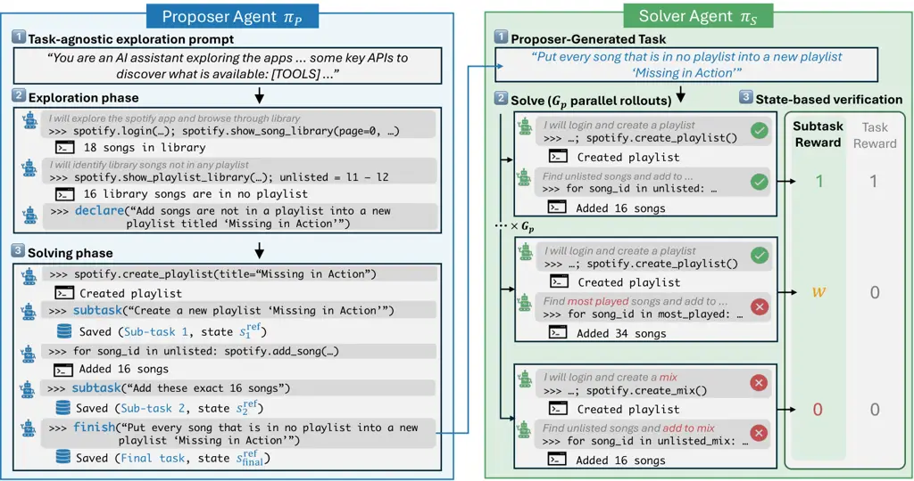

# Explorer-Zero: Improving Self-Play for Long-Horizon Tasks with Decomposable Verifiable RewardsThanks: Qualcomm AI Research is an initiative of Qualcomm Technologies, Inc.

Tianyu Liu  ^(†)^(†)thanks: Work completed during an internship at
Qualcomm AI Research Affiliation:  ETH Zurich    Davide Belli
Affiliation:  Qualcomm AI Research    Bence Major Affiliation:  Qualcomm
AI Research    Arash Behboodi Affiliation:  Qualcomm AI Research   
Tribhuvanesh Orekondy Affiliation:  Qualcomm AI Research

###### Abstract

Training LLM agents on long-horizon interactive tasks with reinforcement
learning typically relies on human-annotated tasks and reliable
verification, both expensive to construct for stateful environments.
Self-play offers an alternative, but must generate achievable,
compositional tasks and provide feedback beyond binary outcomes. We
propose Explorer-Zero, a self-play framework that _jointly generates
tasks and fine-grained, verifiable rewards through environment
interaction_. A learned proposer explores the environment, constructs
tasks, and records intermediate and final states as verification
targets. These checkpoints reward partial completion, while alternating
proposer–solver training adapts the generated curriculum. We show
theoretically that subtask rewards reduce collapse among unsuccessful
rollouts when they complete different numbers of subtasks. Without
human-annotated training tasks, Explorer-Zero outperforms the evaluated
self-play baselines across ALFWorld, ScienceWorld, and AppWorld; on
AppWorld, our 30B agent reaches $`59.67\%`$ task success, approaching
$`62.65\%`$ for RL on human-annotated tasks. Further analyses support
task-relevant composition and benefits on complex tasks, while self-play
initialization improves subsequent human-data RL across all three
benchmarks.

|     |
| --- |
|     |

## 1 Introduction

LLM agents are increasingly applied to open-ended, long-horizon tasks,
from coding (Jimenez et al., 2024) and tool use (Yao et al., 2024) to
embodied environments (Shridhar et al., 2021) and application control
(Trivedi et al., 2024). The dominant training recipe is reinforcement
learning with verifiable rewards (RLVR), but it depends on tasks that
are achievable, diverse, and paired with reliable success checks
(Lambert et al., 2024; Guo et al., 2025a). Creating such supervision for
stateful environments is expensive: task designers must understand what
the current state permits, specify a meaningful change to it, and define
how to verify that change. Human task construction therefore limits how
broadly agentic RL can scale.

Self-play can remove this bottleneck by training a proposer to generate
tasks for a solver. It has been particularly effective when tasks and
success checks can be produced from static artifacts: game rules
determine the winner (Silver et al., 2017; Sukhbaatar et al., 2018),
execution or formal checking validates code (Zhao et al., 2026; Wilf et
al., 2026), retrieved evidence supplies answers to search questions (Yue
et al., 2026; Lu et al., 2026), and structured specifications define
correct tool calls (Acikgoz et al., 2026). Long-horizon interaction in a
stateful environment is different: the proposer often cannot determine
from the initial observation which goals are reachable, and a final
binary success check discards the progress made toward an unsuccessful
task.

Our approach is motivated by two observations. First, long-horizon
agentic tasks are often _compositional_: their completion requires a
sequence of meaningful state changes. For instance, in embodied
scenarios, an agent must locate an item before it can pick it up and
move it to a destination. Generating each task in one shot overlooks
this structure; a proposer that acts in the environment can instead
discover feasible components and compose them into a grounded task.
Second, the delayed outcomes of long-horizon tasks make sparse rewards
particularly limiting, while fine-grained feedback can provide a
substantially more useful learning signal (Ng et al., 1999;
Arjona-Medina et al., 2019; Lightman et al., 2024). In group-normalized
RL, this can cause _reward collapse_: a binary reward assigns the same
value to sampled trajectories, so their advantages vanish despite
meaningful differences in progress (Razin et al., 2025).

We introduce Explorer-Zero, a self-play framework in which a learned
proposer explores the environment and generates a natural-language task
grounded in its trajectory. As it acts, the proposer declares meaningful
subtasks and saves the corresponding environment states; its final state
provides the task-level success check. This design has two benefits.
First, exploration lets the proposer build compositional tasks from
demonstrated state transitions, producing complex training problems that
better reflect real long-horizon use than isolated goals. Second, the
saved intermediate states become verifiable subgoal checkpoints: failed
solver trajectories receive fine-grained rewards according to the
subtasks they complete, reducing the frequency with which binary rewards
collapse and discard partial progress. Because the proposer itself is
trained alongside the solver, the generated curriculum can evolve as the
solver improves without relying on human-written tasks or a prompted
frontier model.

Our main contributions are:

1.  1.  Self-play that jointly generates compositional tasks and
        supervision. We introduce a learned proposer that explores stateful
        environments, constructs compositional tasks, and records verifiable
        subtask checkpoints. These checkpoints provide fine-grained solver
        rewards, enabling self-play without human-authored training tasks or
        learned judges.
2.  2.  Theoretical and empirical analysis of subtask supervision. We derive
        conditions under which subtask rewards preserve a learning signal
        even when all sampled trajectories fail to complete the task. Our
        empirical analyses show that the subtask incentive encourages
        task-relevant compositions, with downstream gains concentrated on
        tasks requiring multiple dependent operations.
3.  3.  Effective agent training with and without human-annotated tasks.
        Across ALFWorld, ScienceWorld, and AppWorld, Explorer-Zero
        outperforms the evaluated self-play baselines without
        human-annotated training tasks and improves final performance when
        used to initialize RL on human-annotated tasks. Controlled ablations
        quantify the benefits of interactive proposal and subtask
        supervision.

Without human-annotated training tasks, Explorer-Zero outperforms
Self-Challenging, the strongest evaluated self-play baseline, by
$`18.67`$ points on ALFWorld and $`7.23`$ on ScienceWorld with 4B
agents. On AppWorld, the 30B agent reaches $`59.67`$ TGC, exceeding this
baseline by $`7.74`$ points and approaching human-data RL ($`62.65`$).
Self-play initialization also improves subsequent human-data RL across
all three environments.

## 2 Related Work

Self-play with verifiable tasks. Self-play has produced superhuman
game-playing policies and automatic curricula in embodied control
(Silver et al., 2017; Sukhbaatar et al., 2018; OpenAI et al., 2021).
Recent proposer–solver methods generate code problems checked by
execution or formal verification (Zhao et al., 2026; Wilf et al., 2026),
while R-Zero uses a challenger–solver loop to generate verifiable
reasoning problems (Huang et al., 2026). Related approaches generate
questions grounded in documents or retrieved evidence (Yang et al.,
2026; Yue et al., 2026; Lu et al., 2026) and structured tool-call
problems (Acikgoz et al., 2026); J-Zero instead uses a learned judge for
open-ended tasks (Chu et al., 2026). GenEnv and SPADE extend self-play
by generating executable environments and adapting their difficulty to
the solver (Guo et al., 2025b; Liu et al., 2026). These approaches rely
on known answers, automatic checks, or model-generated environments, and
therefore do not address the central challenge in a stateful target
environment: discovering reachable, compositional goals through
interaction and retaining a learning signal when the solver cannot yet
complete them.

Interaction-grounded task generation. Several methods generate training
tasks from environment interaction. Learn-by-Interact converts collected
trajectories into instructions (Su et al., 2025), while Self-Challenging
Language Model Agents (Zhou et al., 2026) has a tool-using challenger
produce an instruction, executable verifier, example solution, and
failure cases. AutoPlay (Ramrakhya et al., 2025) verifies explored UI
tasks with a multimodal judge and filters them by executor success.
AgentSynth (Xie et al., 2025) composes executor-performed subtasks into
longer computer-use tasks, but does not reuse them as reward
checkpoints. In these methods, task generation is performed by fixed,
prompted models rather than learned jointly with the solver. Moreover,
their interaction trajectories are not reused as intermediate reward
checkpoints, so partial progress is not preserved as supervision.
Relatedly, hindsight experience replay relabels trajectories with
reached goals (Andrychowicz et al., 2017), and concurrent State2State
(Lei et al., 2026) turns states collected largely through random
exploration into state-matched goals for mid-training. Unlike methods
centered on individual reached states, Explorer-Zero trains the proposer
to compose a natural-language task from multiple demonstrated
transitions and uses the same states to verify intermediate progress.

Fine-grained supervision for long-horizon RL. Fine-grained feedback is
well established in RL: reward shaping augments sparse task rewards with
intermediate signals (Ng et al., 1999), RUDDER (Arjona-Medina et al., 2019) attributes delayed rewards to consequential earlier decisions, and
process supervision applies intermediate feedback to language-model
reasoning (Lightman et al., 2024). Theory further shows that even
accurate rewards provide little learning signal when they fail to
distinguish outputs from the current policy (Razin et al., 2025). To
address this problem, self-play methods typically steer proposers toward
tasks with intermediate solve rates (Zhao et al., 2026; Huang et al.,
2026; Yue et al., 2026; Guo et al., 2025b). SPADE (Liu et al., 2026)
instead uses the performance gap with and without a privileged hint to
guide environment generation. These approaches improve task selection
rather than derive fine-grained solver rewards from task generation.
Outside self-play, GiGPO and milestone-guided shaping provide finer
feedback on predefined agent tasks through matched states or
hand-designed progress rules (Feng et al., 2025; Wang et al., 2026).
Explorer-Zero brings fine-grained supervision into self-play: the same
proposer trajectory generates the task and the verifiable checkpoints
used to reward partial completion.

## 3 Methodology

We introduce Explorer-Zero, a proposer–solver self-play framework for
long-horizon stateful environments.

Problem setup and notation. An agent with policy
$`{\pi}_{{\mathbf{\theta}}}`$ interacts with a stateful environment
$`{\mathcal{E}}`$: given a task $`{x}`$, it produces a trajectory
$`{\tau}=({a}_{1},{o}_{1},\dots,{a}_{T},{o}_{T})`$ of actions
$`{a}_{t}`$ and observations $`{o}_{t}`$, traversing environment states
$`{s}_{0},\dots,{s}_{T}`$.

Standard RLVR and its data-curation bottleneck. Standard RLVR trains an
agent with policy-gradient methods to maximize expected reward over a
fixed task distribution:
$`\max_{{\mathbf{\theta}}}\;\mathbb{E}_{{x}\sim{\mathcal{D}},\,{\tau}\sim{\pi}_{{\mathbf{\theta}}}(\cdot\mid{x})}\left[{R}({x},{\tau})\right]`$.
A verifier assigns a typically binary reward
$`{R}({x},{\tau})\in\{0,1\}`$ using an executable test, answer check, or
state-based predicate. Building this training distribution requires
human-authored tasks, contexts, and reliable success checks. Examples
include initial world states and rule-based checks in ALFWorld and
ScienceWorld (Shridhar et al., 2021; Wang et al., 2022), and initial
database states and unit tests in AppWorld (Trivedi et al., 2024). This
curation is expensive because tasks must be both achievable and
challenging, while verification must remain robust to reward hacking.
For example, Trivedi et al. (2024) report five months of human effort
for data generation.



Figure 1: Overview of Explorer-Zero. Left: the proposer
$`{{\pi}_{\textnormal{P}}}`$ explores the environment, declares an
initial task intent (declare), completes subtasks (subtask) and the
final task $`{x}`$ (finish). Each subtask and finish call snapshots the
environment as a reference state, yielding
$`{s}^{\operatorname{ref}}_{1},\dots,{s}^{\operatorname{ref}}_{{K}}`$
and $`{{s}^{\operatorname{ref}}_{\textnormal{final}}}`$. Right: the
solver $`{{\pi}_{\textnormal{S}}}`$’s traversed states are matched
against the reference states to compute $`{{R}^{\textnormal{solver}}}`$,
and the resulting solve rate determines
$`{{R}^{\textnormal{proposer}}}`$.

Our approach: High-level idea. Explorer-Zero replaces the fixed task
distribution with tasks generated by a proposer
$`{{\pi}_{\textnormal{P}}}`$. The proposer interacts with the
environment to generate a task and state-based verification artifacts. A
solver $`{{\pi}_{\textnormal{S}}}`$ is trained on the accepted tasks.
The two policies are optimized in alternating phases, allowing the task
distribution to evolve with the solver. Our method is illustrated in
Fig. 1, and the full procedure is shown in Algorithm 1.

### 3.1 Proposer: Interactive Generation of Compositional Tasks

During proposer training, the solver is frozen. We describe how the
proposer generates tasks, verification artifacts, and its training
reward.

Proposer: Main idea. Starting from $`{s}_{0}`$, the proposer at the end
of a successful rollout generates
$`\left({x},{{s}^{\operatorname{ref}}_{\textnormal{final}}},\{({g}_{k},{s}^{\operatorname{ref}}_{k})\}_{k=1}^{{K}}\right)`$,
where $`{x}`$ is the final task,
$`{{s}^{\operatorname{ref}}_{\textnormal{final}}}`$ is its reference
outcome, and $`({g}_{k},{s}^{\operatorname{ref}}_{k})`$ are optional
intermediate checkpoints. All reference states are reached during the
proposer trajectory, grounding the task in a demonstrated outcome. Here,
the final task $`{x}`$ and subtask descriptions $`{g}_{k}`$ are in
natural language (tokens generated by the LLM policy) and the states
$`{s}^{\operatorname{ref}}_{k}`$ correspond to snapshots of the
environmental state.

Phases: Exploration to task generation. The proposer interacts with the
environment for at most $`T_{\mathrm{P}}`$ steps. Proposal proceeds in
two phases. During the exploration phase, the proposer examines the
environment over multiple turns and identifies a candidate task. During
the solving phase, the proposer attempts to complete its own task. It
may label meaningful subtasks as they are completed and finally submits
the final task description. We denote the complete interaction by the
proposer trajectory $`{{\tau}^{\textnormal{prop}}}`$. This separation
serves two purposes. Exploration allows the proposer to discover what
the current environment state permits, while solving demonstrates that
the proposed outcome is reachable. It also allows the final task
description to reflect information obtained during interaction rather
than only the initial observation.

Verification artifacts. Generating a task description alone is
insufficient for RLVR because the solver also requires a reliable
task-specific verification signal. To enable this, we use environment
states reached by the proposer as verification artifacts. When the
proposer completes its task, we snapshot the resulting environment state
as the final reference state
$`{{s}^{\operatorname{ref}}_{\textnormal{final}}}`$. Given a solver
trajectory with terminal state $`{s}_{T}`$, task completion can then be
checked by comparing $`{s}_{T}`$ with
$`{{s}^{\operatorname{ref}}_{\textnormal{final}}}`$. The proposer
trajectory therefore provides both the task and an executable
state-based verification target without requiring a task-specific
predicate, model-based judge, or model-written test. We evaluate state
equality through changes relative to the common initial state
$`{s}_{0}`$. A solver state $`{s}`$ matches a reference state
$`{s}^{\operatorname{ref}}`$, written
$`{s}\simeq{s}^{\operatorname{ref}}`$, if $`{s}`$ reproduces the
task-relevant changes exhibited by $`{s}^{\operatorname{ref}}`$ relative
to $`{s}_{0}`$. The concrete matching rules for each environment are
described in Section 4.

Compositionality. The proposer trajectory provides more than a final
verification target. As the proposer solves its task, it can identify
meaningful intermediate outcomes and snapshot their corresponding
states. Each declared subtask $`{g}_{k}`$ is therefore paired with a
reference state $`{s}^{\operatorname{ref}}_{k}`$ reached after
completing that component. These intermediate states expose the
compositional structure of the generated task. Instead of predicting a
distant goal in one step, the proposer can establish one outcome,
continue interacting from the resulting state, and construct later
components that depend on earlier ones. The final task describes the
cumulative outcome of these demonstrated transitions. For simplicity, we
use the declared subtasks as an unordered checklist of verification
conditions, without explicitly modeling dependencies between them. A
solver may satisfy them in any order, provided that their state
conditions are reached. The proposer chooses the number of subtasks
$`{K}`$ and when $`{K}=0`$, it generates only the final task and its
reference state.

Proposer’s reward. For each proposal, we sample
$`{{G}_{\textnormal{P}}}`$ trajectories from the frozen solver and
estimate
$`{\hat{p}}({x})=\frac{1}{{{G}_{\textnormal{P}}}}\sum_{i=1}^{{{G}_{\textnormal{P}}}}{R}({x},{\tau}_{i})`$,
where $`{R}({x},{\tau}_{i})\in\{0,1\}`$ indicates final-task completion
using state-based verification. The proposer reward is

```math
{{R}^{\textnormal{proposer}}}({x},{{\tau}^{\textnormal{prop}}})=\begin{cases}{{R}^{\textnormal{difficulty}}}({x})+{{R}^{\textnormal{subtask}}}({x},{{\tau}^{\textnormal{prop}}})+{{R}^{\textnormal{diversity}}}({{\tau}^{\textnormal{prop}}}),&\textnormal{if the proposal is valid},\\
0,&\textnormal{otherwise}.\end{cases} \tag{1}
```

The difficulty reward is:

```math
{{R}^{\textnormal{difficulty}}}({x})=1-\left|2{\hat{p}}({x})-1\right| \tag{2}
```

which is maximized at a solve rate of $`0.5`$ and penalizes tasks that
are consistently solved or consistently failed. The remaining terms
encourage intermediate structure and diverse interaction:

```math
\displaystyle{{R}^{\textnormal{subtask}}}({x},{{\tau}^{\textnormal{prop}}}) \displaystyle={w_{\textnormal{sub}}}{K}, \tag{3}
```

```math
\displaystyle{{R}^{\textnormal{diversity}}}({{\tau}^{\textnormal{prop}}}) \displaystyle={w_{\textnormal{div}}}\left|{\mathcal{A}}({{\tau}^{\textnormal{prop}}})\right|, \tag{4}
```

where $`{K}`$ is the number of declared subtasks,
$`{\mathcal{A}}({{\tau}^{\textnormal{prop}}})`$ is the set of distinct
proposer action types, and
$`{w_{\textnormal{sub}}},{w_{\textnormal{div}}}>0`$ are weighting
coefficients.

Implementation details. The proposer starts from the same state
$`{s}_{0}`$ later used for solver rollouts. Each proposer GRPO group
shares one initial state (an ALFWorld or ScienceWorld environment
instance, or an AppWorld persona). Its prompt contains the environment
interface and encourages broad exploration. In addition to environment
actions, it has three control tools: (i)
$`{\texttt{declare}}(\texttt{task\_description})`$ ends exploration and
declares a candidate task; (ii)
$`{\texttt{subtask}}(\texttt{subtask\_description})`$ records a
completed subtask and its reference artifact; (iii)
$`{\texttt{finish}}(\texttt{task\_description})`$ submits the final task
and records $`{{s}^{\operatorname{ref}}_{\textnormal{final}}}`$. For
state-changing outcomes, the reference artifact is the state delta
relative to $`{s}_{0}`$. For observational subtasks without a persistent
state change, it also records the action or API call that produced the
relevant observation and its returned value, which the solver must
reproduce. We define action types as command verbs in ALFWorld and
ScienceWorld, and as applications in AppWorld. The coefficients
$`{w_{\textnormal{sub}}},{w_{\textnormal{div}}}>0`$ control the two
incentives. Two subtasks are redundant if their state deltas are
identical and their descriptions have word-level Jaccard similarity
above $`0.6`$. The subtask term in Eq. 3 is applied only to
non-redundant checkpoints.

### 3.2 Solver: Training a Policy to Solve

During solver training, the proposer is frozen. The solver is trained on
accepted proposer-generated tasks using final-task and subtask
verification.

Task generation and filtering. At each solver-training iteration, the
frozen proposer samples tasks and their associated verification
artifacts from a set of initial world states. A generated example
consists of an initial state $`{s}_{0}`$, a task description $`{x}`$, a
final reference state
$`{{s}^{\operatorname{ref}}_{\textnormal{final}}}`$, and zero or more
subtask reference states
$`{s}^{\operatorname{ref}}_{1},\dots,{s}^{\operatorname{ref}}_{{K}}`$.
Before using an example for solver training, we apply a rule-based
validity filter. We retain a task only if: (i) the proposer submits a
natural-language task through finish; (ii) the task contains no
redundant subtasks; and (iii) every application or object named in the
task description appears in the proposer trajectory. These checks remove
malformed proposals, repeated checkpoints, and instructions that are
unsupported by the demonstrated interaction. Tasks rejected by the
filter are not included in the solver training distribution.

Task and rollout. For each accepted task, the environment is reset to
the proposer’s initial state $`{s}_{0}`$. The solver observes only the
task description and environment interface, not the proposer trajectory
nor verification artifacts. The solver generates
$`{{\tau}^{\textnormal{solv}}}=({a}_{1},{o}_{1},\dots,{a}_{T},{o}_{T})`$.
We retain its visited states
$`{\mathcal{S}}({{\tau}^{\textnormal{solv}}})=\{{s}_{0},\dots,{s}_{T}\}`$,
so that a subtask remains verifiable even if its state is later
modified.

State-based verification and rewards. The final-task reward compares the
solver’s terminal state with the final reference state:

```math
{R}({x},{{\tau}^{\textnormal{solv}}})={\mathbb{I}}\left\{{s}_{T}\simeq{{s}^{\operatorname{ref}}_{\textnormal{final}}}\right\}. \tag{5}
```

For $`{K}>0`$, the subtask reward is

```math
{{R}^{\textnormal{subgoal}}}({x},{{\tau}^{\textnormal{solv}}})=\frac{1}{{K}}\sum_{k=1}^{{K}}{\mathbb{I}}\left\{\exists\,{s}\in{\mathcal{S}}({{\tau}^{\textnormal{solv}}}):{s}\simeq{s}^{\operatorname{ref}}_{k}\right\}. \tag{6}
```

We set
$`{{R}^{\textnormal{subgoal}}}({x},{{\tau}^{\textnormal{solv}}})=0`$
when $`{K}=0`$. The solver reward is

```math
{{R}^{\textnormal{solver}}}({x},{{\tau}^{\textnormal{solv}}})=\begin{cases}1,&\textnormal{if }{R}({x},{{\tau}^{\textnormal{solv}}})=1,\\
{{R}^{\textnormal{subgoal}}}({x},{{\tau}^{\textnormal{solv}}}),&\textnormal{otherwise}.\end{cases} \tag{7}
```

Thus, successful trajectories receive the maximum reward, while
unsuccessful trajectories are distinguished by verified subtask
completion. The solver is updated with a group-based policy-gradient
objective over multiple rollouts per task.

### 3.3 Subtask Rewards Reduce Reward Collapse

We now examine how the reward in Eq. 7 can preserve a learning signal on
tasks that the solver rarely completes. With binary outcome rewards,
unsuccessful trajectories all receive zero reward, even when they make
different amounts of progress. GRPO computes advantages by normalizing
rewards within a group of $`{G}\geq 2`$ i.i.d. rollouts (Appendix A).
When all rollouts receive the same reward, every reward-normalized
advantage is zero³³ 3 We adopt the standard convention that the
advantage is set to zero when the group std vanishes., and the group
provides no reward-driven policy-gradient signal. We refer to this event
as reward collapse.

To quantify how subtask rewards affect collapse, let
$`p({x})=\Pr_{{{\tau}^{\textnormal{solv}}}\sim{{\pi}_{\textnormal{S}}}(\cdot\mid{x})}[{R}({x},{{\tau}^{\textnormal{solv}}})=1]`$
denote the current solver’s success probability, estimated empirically
by $`{\hat{p}}({x})`$ given a task $`{x}`$.

###### Proposition 1 (Subtask rewards reduce reward collapse).

Under the binary task reward, a group collapses with probability
$`p^{{G}}+(1-p)^{{G}}`$. Conditional on all sampled rollouts failing,
binary rewards collapse with probability one. Under Eq. 7, conditional
on all rollouts failing, the collapse probability is
$`\sum_{j=0}^{{K}}\tilde{q}_{j}^{\,{G}}`$, where $`\tilde{q}_{j}`$ is
the probability that a failed rollout completes exactly $`j`$ subtasks.
This probability is strictly below one whenever at least two
subtask-completion counts have positive probability among failed
rollouts.

The proof and an analysis of the effect of group size are given in
Appendix B. Larger groups can reduce binary-reward collapse by
increasing the chance of sampling a successful trajectory, but become
costly on difficult tasks: as $`p\to 0`$, keeping the collapse
probability below a fixed threshold requires $`{G}`$ to grow on the
order of $`1/p`$. Higher sampling temperatures may likewise improve the
chance of success through exploration, but neither sampling choice
changes the fact that binary rewards assign identical values to all
failed trajectories. Subtask rewards complement these choices by making
differences in partial completion available for learning: even when
every rollout fails, completing different numbers of subtasks yields
nonzero normalized advantages.

## 4 Experiments

### 4.1 Experimental Setup

Benchmarks and evaluation. We evaluate on ALFWorld (Shridhar et al.,
2021), a text-based household environment; ScienceWorld (Wang et al.,
2022), a text-based science environment; and AppWorld (Trivedi et al.,
2024), an ecosystem of API-controlled applications. Evaluation follows
benchmark success criteria, not proposer-generated training checkpoints.
Unless stated otherwise, we report task success rates on ALFWorld’s
unseen validation split and ScienceWorld’s test split. On AppWorld’s
test_normal split, we report task goal completion (TGC), the percentage
of tasks passing all benchmark tests, and scenario goal completion
(SGC), the percentage of scenarios with all task variants completed.
Tables report means and standard deviations over four sampled
evaluations per task.

Training-time verification. To compute rewards on self-generated
training tasks, we instantiate the reference-state verification rule of
Section 3.2 for each environment. In AppWorld, we compare changes in
applications that changed in the reference trajectory and are mentioned
in the task. In ALFWorld and ScienceWorld, we compare object types while
ignoring instance indices, so manipulating interchangeable instances
such as apple 1 and apple 2 is equally valid.

Models and training. Self-play uses environment resets without
human-authored training tasks, demonstrations, or reward annotations.
The proposer and solver are initialized from Qwen3-4B on ALFWorld and
ScienceWorld and from Qwen3-4B-Instruct-2507 on AppWorld, where we
additionally evaluate Qwen3-30B-A3B-Instruct-2507 (Yang et al., 2025).
We focus the larger-model evaluation on AppWorld, whose
multi-application workflows allow us to test whether the benefits of
compositional self-play persist with a stronger base agent. We train
with GRPO; hyperparameters and interaction budgets are given in
Appendix D.

Baselines. We compare two self-play approaches: Self-Challenging Agents
(Zhou et al., 2026), whose frozen proposer generates tasks and
executable verifiers, and R-Zero (Huang et al., 2026), whose learned
proposer generates tasks verified through solver consensus. Our R-Zero
implementation uses the majority final state across solver rollouts as
the pseudo-reference state. Additional comparisons include the zero-shot
base model, in-context learning with $`1`$–$`4`$ human demonstrations,
and RL on the full human-annotated training set as a reference for
training with curated supervision.

|                                       |              |                   |                   |                   |                   |                    |                   |
| ------------------------------------- | ------------ | ----------------- | ----------------- | ----------------- | ----------------- | ------------------ | ----------------- |
|                                       | \#annotation | ALFWorld          | ScienceWorld      | AppWorld          |                   |                    |                   |
|                                       |              | Qwen3-4B          | Qwen3-4B          | Qwen3-4B-inst     |                   | Qwen3-30B-A3B-inst |                   |
|                                       |              |                   |                   | TGC               | SGC               | TGC                | SGC               |
| Without human-annotated training data |              |                   |                   |                   |                   |                    |                   |
| Baseline                              | n=0          | 17.14 $`\pm`$ 5.7 | 07.03 $`\pm`$ 0.5 | 14.03 $`\pm`$ 5.1 | 03.95 $`\pm`$ 3.2 | 25.15 $`\pm`$ 5.2  | 08.04 $`\pm`$ 7.5 |
| In-Context                            | n=1          | 19.28 $`\pm`$ 7.7 | 11.40 $`\pm`$ 0.4 | 12.28 $`\pm`$ 3.7 | 06.58 $`\pm`$ 4.6 | 28.95 $`\pm`$ 5.0  | 15.79 $`\pm`$ 7.7 |
|                                       | n=2          | 18.57 $`\pm`$ 4.7 | 09.50 $`\pm`$ 0.4 | 15.35 $`\pm`$ 4.0 | 01.32 $`\pm`$ 1.3 | 27.63 $`\pm`$ 4.8  | 11.84 $`\pm`$ 6.2 |
|                                       | n=3          | 33.57 $`\pm`$ 3.3 | 18.10 $`\pm`$ 0.7 | 14.91 $`\pm`$ 3.9 | 03.95 $`\pm`$ 2.9 | 26.32 $`\pm`$ 5.3  | 14.47 $`\pm`$ 7.2 |
|                                       | n=4          | 30.71 $`\pm`$ 7.1 | 18.50 $`\pm`$ 0.3 | 13.16 $`\pm`$ 3.8 | 02.63 $`\pm`$ 2.6 | 31.11 $`\pm`$ 0.2  | 17.11 $`\pm`$ 7.9 |
| R-Zero                                | n=0          | 24.28 $`\pm`$ 1.5 | 24.76 $`\pm`$ 0.9 | 17.41 $`\pm`$ 5.8 | 05.80 $`\pm`$ 1.6 | 47.32 $`\pm`$ 1.8  | 25.00 $`\pm`$ 2.7 |
| Self-Challenging                      | n=0          | 66.40 $`\pm`$ 3.5 | 35.69 $`\pm`$ 0.7 | 32.20 $`\pm`$ 3.2 | 16.25 $`\pm`$ 2.5 | 51.93 $`\pm`$ 1.3  | 32.25 $`\pm`$ 2.3 |
| Ours                                  | n=0          | 85.07 $`\pm`$ 1.6 | 42.92 $`\pm`$ 0.7 | 38.39 $`\pm`$ 2.4 | 16.96 $`\pm`$ 1.9 | 59.67 $`\pm`$ 3.1  | 39.29 $`\pm`$ 3.2 |
| With human-annotated training data    |              |                   |                   |                   |                   |                    |                   |
| RL                                    | full         | 95.71 $`\pm`$ 0.9 | 49.63 $`\pm`$ 0.4 | 46.38 $`\pm`$ 3.2 | 25.00 $`\pm`$ 2.4 | 62.65 $`\pm`$ 1.8  | 38.39 $`\pm`$ 3.2 |
| RL + Ours                             | full         | 98.57 $`\pm`$ 0.9 | 63.26 $`\pm`$ 0.4 | 50.00 $`\pm`$ 2.0 | 32.14 $`\pm`$ 3.0 | 69.20 $`\pm`$ 4.6  | 53.12 $`\pm`$ 3.0 |

Table 1: Experimental results on ALFWorld, ScienceWorld, and AppWorld.
We report success rates on ALFWorld (unseen validation split) and
ScienceWorld (test split), and TGC and SGC (task and scenario goal
completion) on AppWorld (test normal split). We report means and
standard deviations over four samples per task prompt.

|           |                      |                   |                   |                   |                   |
| --------- | -------------------- | ----------------- | ----------------- | ----------------- | ----------------- |
|           |                      | ALFWorld          | ScienceWorld      | AppWorld          |                   |
|           |                      |                   |                   | TGC               | SGC               |
| Self-play | one-shot proposer    | 59.29 $`\pm`$ 9.4 | 04.80 $`\pm`$ 2.0 | 29.46 $`\pm`$ 4.7 | 16.96 $`\pm`$ 2.0 |
|           | interactive proposer | 65.71 $`\pm`$ 2.3 | 24.70 $`\pm`$ 1.2 | 45.83 $`\pm`$ 1.9 | 33.04 $`\pm`$ 2.7 |
|           | \+ subtask           | 84.29 $`\pm`$ 1.5 | 42.92 $`\pm`$ 0.7 | 59.67 $`\pm`$ 3.1 | 39.29 $`\pm`$ 3.2 |

Table 2: Ablation of Explorer-Zero components. Results on ALFWorld are
on valid-seen, and results on AppWorld are with
Qwen3-30B-A3B-Instruct-2507.

### 4.2 Main Results and Ablations

Comparison with self-play baselines. In Table 1, Explorer-Zero
outperforms both self-play baselines across all three environments
without human-annotated training tasks. Relative to Self-Challenging
Agents (the stronger baseline) it improves ALFWorld performance by
$`18.67`$ points and ScienceWorld performance by $`7.23`$ points. On
AppWorld, the TGC gains are $`6.19`$ points with the 4B model and
$`7.74`$ with the 30B model, showing that the advantage persists at both
model sizes.

Comparison with human-data RL. RL on human-annotated tasks remains
stronger on the primary task-level metrics, but the gap is particularly
small for the 30B AppWorld agent: Explorer-Zero reaches $`59.67`$ TGC
compared with $`62.65`$ for RL on the full training set. This result
shows that self-generated tasks and verification can support performance
close to human-data RL in this setting, without using its task
annotations.

Combining Explorer-Zero and RL. We further evaluate self-play as a
pretraining stage for RL on human-annotated tasks, denoted by RL + Ours
in Table 1. We first train the solver with Explorer-Zero for $`200`$
steps, then continue training on human-annotated tasks for $`150`$ RL
steps using the same hyperparameters as the RL-only baseline. The
combined protocol improves over RL alone across all three environments,
including gains of $`13.63`$ points on ScienceWorld and $`6.55`$ TGC
points on AppWorld with the 30B model. These results support self-play
as a useful initialization for agentic RL even when human-annotated
tasks are available.

Explorer-Zero ablations. Table 2 compares three variants. The _one-shot
proposer_ generates tasks from the environment description and uses the
most common final state across solver attempts as the reference outcome
for verification. The _interactive proposer_ grounds tasks and their
reference outcomes in an executed trajectory, but rewards the solver
only for final task completion. The full method additionally declares
subtasks and rewards intermediate progress. Moving from one-shot to
interactive proposal improves performance in all three environments,
showing the value of grounding both task generation and verification in
interaction. Adding subtask supervision then yields a further $`18.58`$
points on ALFWorld, $`18.22`$ on ScienceWorld, and $`13.84`$ TGC points
on AppWorld. Subtask supervision thus adds substantial gains beyond
interactive task generation. This ablation measures the combined benefit
of changing task construction and solver rewards; it does not isolate
reward granularity alone. Training curves are included in Section E.1.

## 5 Analysis

Figure 2: Task relevance of AppWorld proposer trajectories with and
without subtask supervision. Left two: Trajectory lengths are similar
across the two variants, while the proposer with subtasks makes fewer
API calls on average. Right two: With subtasks, a larger fraction of
steps and API calls contributes to the final task. We identify
contributing interactions using backward program slicing (Weiser, 1984):
they either produce target-state changes or support those changes
through Python data flow.

Figure 3: Proposer and solver training dynamics on AppWorld. Left: The
proposer shifts its effort from environment exploration toward executing
the task it proposes: exploration turns decrease from $`14`$ to $`7`$,
while solving turns rise from $`7`$ to $`10`$. Center: The mean number
of declared subtasks increases from around $`0.8`$ to $`2.3`$. Right:
The fraction of zero-reward solver rollouts with subtask supervision
remains consistently below the no-subtask ablation, ending near $`22\%`$
versus $`39\%`$.

### 5.1 Subtask Supervision Produces Task-Relevant Compositions

Rewarding subtask declarations could encourage the proposer to insert
irrelevant intermediate steps rather than construct meaningful task
compositions. However, the left two panels of Fig. 2 show that proposer
trajectories have similar lengths with and without subtask supervision,
while the subtask variant makes fewer API calls on average. The
difference lies in the relevance of those interactions to the final
task. The right two panels show that subtask supervision increases the
fraction of contributing interactions, identified by backward program
slicing (Weiser, 1984), indicating that the proposer incorporates a
larger share of its trajectory into the final task. A complementary
analysis finds that dependencies across subtasks increase during
training without broader API or application coverage (Section E.2).
_Together, these findings indicate that subtask supervision encourages
task-relevant composition rather than simply adding more interactions._

### 5.2 The Proposer Learns to Construct Structured Tasks

During self-play, the proposer shifts from exploring the environment to
executing its proposed tasks (Fig. 3, left). Exploration turns (before
declare) decrease from roughly $`14`$ to $`7`$, while solving turns
(from declare to finish) increase from around $`7`$ to $`10`$.
Meanwhile, the average number of declared subtasks rises from
approximately $`0.8`$ to $`2.3`$ (center). These trends indicate that
_the proposer increasingly allocates its interactions to task execution
while constructing tasks with more explicit compositional structure_.
Trends in filter acceptance and task-description length are in
Section E.3.

### 5.3 Subtask Rewards Preserve Learning Signal

We next examine the optimization mechanism developed in Section 3.3.
With task-level binary rewards, every unsuccessful rollout receives zero
reward regardless of its progress. Explorer-Zero distinguishes partially
successful trajectories by rewarding the subtask checkpoints they reach.
In Fig. 3 (right), the fraction of zero-reward solver rollouts with
subtask supervision remains consistently below the no-subtask ablation
and ends near $`22\%`$, compared with $`39\%`$ without subtasks. _By
rewarding differences in subtask completion, Explorer-Zero preserves a
learning signal even when every sampled rollout fails to complete the
task._

Figure 4: Left: On AppWorld, tasks with greater multi-step solution
complexity (measured by the number of test-case predicates, API calls,
or lines of code in their reference solutions) are substantially harder
for the RL agent trained on human-authored tasks. Center: Subtask
supervision in Explorer-Zero provides little consistent benefit on
simpler tasks but substantially higher success in the highest-complexity
bins. Right: Per-app success rates on AppWorld test_normal, where each
task counts toward every app it requires. The largest gains occur for
Todoist and Splitwise, which are the only apps appearing exclusively in
multi-app tasks.

### 5.4 Benefits Concentrate on Compositional Tasks

Finally, on AppWorld, success rates for an agent trained with RL on
human-authored tasks decrease sharply with multi-step solution
complexity (Fig. 4, left). We use three complementary proxies:
evaluation predicates count the conditions the final state must satisfy,
while API calls and lines of code in reference solutions capture the
required operations and computation. Comparing self-play with and
without subtask supervision (center), the variants perform similarly on
simpler tasks, but subtask supervision yields a large and consistent
advantage in the highest-complexity bins. Its benefits thus concentrate
where sparse task-level feedback is expected to be least informative.

The per-app breakdown provides a complementary view of composition
through tasks spanning multiple applications (Fig. 4, right). The
largest gains occur on Todoist and Splitwise, followed by Venmo. These
applications predominantly appear in multi-app tasks; Todoist and
Splitwise appear exclusively in such tasks in this evaluation set. These
tasks require carrying information and effects across application
boundaries, a demanding form of composition. Together with the
structural analyses, these results suggest that _subtask supervision
encourages task-relevant dependencies, with its largest gains on tasks
requiring multiple dependent operations_.

## 6 Conclusion

We presented Explorer-Zero, which uses environment interaction to
jointly generate compositional tasks and fine-grained, verifiable
rewards. Our theoretical analysis characterizes when subtask rewards
preserve a learning signal despite task failure. Experiments show that
subtask supervision encourages task-relevant dependencies, with the
largest gains on tasks requiring multiple dependent operations. Across
three benchmarks, Explorer-Zero outperforms the evaluated self-play
baselines without human-annotated training tasks and improves subsequent
human-data RL. These findings support using task-generation trajectories
as a source of both compositional tasks and intermediate supervision.

Generative AI Statement. We used generative AI tools to refine
conceptual framing and hypotheses, provide feedback on experimental
methodology, review mathematical claims and proofs, assist with
reference verification, interpret experimental results, and assist with
code implementation and review. LLMs also generated training tasks and
trajectories as part of the self-play method described in Section 3. We
did not use generative AI tools for translation or for cleaning or
reformatting datasets. We used these tools for literature discovery,
manuscript organization, drafting, and readability improvements. The
authors derived the proofs manually, conducted their own quantitative
and qualitative analyses of experimental results, and independently
checked references, code, and literature recommendations. We take
responsibility for the final content of this work, including text,
claims, and artifacts produced with the assistance of generative AI.

Ethics Statement. Our experiments study agent training in benchmark
environments rather than deployment in live services. Nevertheless,
improving autonomous agents’ ability to execute long-horizon tasks
creates potential risks from unintended actions or misuse. The
reference-state checks used for training measure task completion, not
whether a task is safe or appropriate. Deployment beyond these
benchmarks would therefore require additional safeguards, including
access controls, restrictions on permitted actions, and human oversight
for consequential operations.

Reproducibility Statement. The task-generation procedure,
reference-state verification, and reward functions are described in
Section 3, with the alternating training algorithm in Appendix C. The
experimental setup specifies the benchmarks, evaluation protocols, and
baseline adaptations (Section 4.1); training hyperparameters and
hardware are reported in Appendix D, and prompt templates in Appendix G.
The assumptions and proof of the reward-collapse analysis are provided
in Sections 3.3 and B. Additional definitions and procedures for the
task-composition analysis appear in Section E.2.

Acknowledgements. We thank Amir Jalalirad and Gabriele Cesa for
insightful discussions and comments during the project.

## References

- Acikgoz et al. (2026) E. C. Acikgoz, C. Qian, J. Hübotter, H. Ji, D.
  Hakkani-Tür, and G. Tur Tool-r0: self-evolving LLM agents for
  tool-learning from zero data. External Links: 2602.21320,
  [Link](https://arxiv.org/abs/2602.21320) Cited by: §1, §2.
- Andrychowicz et al. (2017) M. Andrychowicz, F. Wolski, A. Ray, J.
  Schneider, R. Fong, P. Welinder, B. McGrew, J. Tobin, P. Abbeel,
  and W. Zaremba Hindsight experience replay. In NeurIPS, Cited by: §2.
- Arjona-Medina et al. (2019) J. A. Arjona-Medina, M. Gillhofer, M.
  Widrich, T. Unterthiner, J. Brandstetter, and S. Hochreiter RUDDER:
  return decomposition for delayed rewards. In NeurIPS, Cited by: §1,
  §2.
- Chu et al. (2026) G. Chu, M. Jeon, and E. Yang J-zero: unified
  challenger–solver–judge co-evolution from zero data. arXiv preprint
  arXiv:2608.26582. Cited by: §2.
- Feng et al. (2025) L. Feng, Z. Xue, T. Liu, and B. An Group-in-group
  policy optimization for LLM agent training. External Links:
  2505.10978, [Link](https://arxiv.org/abs/2505.10978) Cited by: §2.
- Guo et al. (2025a) D. Guo, D. Yang, H. Zhang, J. Song, P. Wang, Q.
  Zhu, R. Xu, R. Zhang, S. Ma, X. Bi, et al. Deepseek-r1: incentivizing
  reasoning capability in llms via reinforcement learning. arXiv
  preprint arXiv:2501.12948. Cited by: Appendix A, §1.
- Guo et al. (2025b) J. Guo, L. Yang, P. Chen, Q. Xiao, Y. Wang, X.
  Juan, J. Qiu, K. Shen, and M. Wang GenEnv: difficulty-aligned
  co-evolution between LLM agents and environment simulators. arXiv
  preprint arXiv:2512.19682. External Links:
  [Link](https://arxiv.org/abs/2512.19682) Cited by: §2, §2.
- Huang et al. (2026) C. Huang, W. Yu, X. Wang, H. Zhang, Z. Li, R.
  Li, J. Huang, H. Mi, and D. Yu R-zero: self-evolving reasoning LLM
  from zero data. In ICLR, Cited by: §2, §2, §4.1.
- Jimenez et al. (2024) C. E. Jimenez, J. Yang, A. Wettig, S. Yao, K.
  Pei, O. Press, and K. Narasimhan SWE-bench: can language models
  resolve real-world GitHub issues?. In ICLR, Cited by: §1.
- Lambert et al. (2024) N. Lambert, J. Morrison, V. Pyatkin, S.
  Huang, H. Ivison, F. Brahman, L. J. V. Miranda, A. Liu, N. Dziri, S.
  Lyu, et al. Tulu 3: pushing frontiers in open language model
  post-training. arXiv preprint arXiv:2411.15124. Cited by: §1.
- Lei et al. (2026) X. Lei, Y. Zhu, C. Li, K. Liu, P. Li, M. Yan, J.
  Ye, Y. Zhang, and Y. Liu State2State: environment-derived mid-training
  for LLM agents. External Links: 2608.04934,
  [Link](https://arxiv.org/abs/2608.04934) Cited by: §2.
- Lightman et al. (2024) H. Lightman, V. Kosaraju, Y. Burda, H.
  Edwards, B. Baker, T. Lee, J. Leike, J. Schulman, I. Sutskever, and K.
  Cobbe Let’s verify step by step. In ICLR, Cited by: §1, §2.
- Liu et al. (2026) B. Liu, S. Yu, Y. Jiang, A. Qu, A. Zhao, Z. Liu, J.
  Kim, Z. Zhou, S. Kim, T. Ren, M. Liu, H. Yu, Z. Chen, W. Shi, P. P.
  Liang, L. Zettlemoyer, Y. Choi, and N. Jaques SPADE: self-play in
  adaptive synthetic executable environments. External Links:
  2608.19197, [Link](https://arxiv.org/abs/2608.19197) Cited by: §2, §2.
- Lu et al. (2026) H. Lu, Y. Wen, P. Cheng, R. Ding, J. Guo, H. Xu, C.
  Wang, H. Chen, X. Jiang, and G. Jiang Search self-play: pushing the
  frontier of agent capability without supervision. In ICLR, Cited by:
  §1, §2.
- Ng et al. (1999) A. Y. Ng, D. Harada, and S. Russell Policy invariance
  under reward transformations: theory and application to reward
  shaping. In ICML, Cited by: §1, §2.
- OpenAI et al. (2021) O. OpenAI, M. Plappert, R. Sampedro, T. Xu, I.
  Akkaya, V. Kosaraju, P. Welinder, R. D’Sa, A. Petron, H. P. d. O.
  Pinto, et al. Asymmetric self-play for automatic goal discovery in
  robotic manipulation. arXiv preprint arXiv:2101.04882. Cited by: §2.
- Ramrakhya et al. (2025) R. Ramrakhya, A. Szot, O. Attia, Y. Yang, A.
  Nguyen, B. Mazoure, Z. Gan, H. Agrawal, and A. Toshev Scaling
  synthetic task generation for agents via exploration. arXiv preprint
  arXiv:2509.25047. External Links:
  [Link](https://arxiv.org/abs/2509.25047) Cited by: §2.
- Razin et al. (2025) N. Razin, Z. Wang, H. Strauss, S. Wei, J. D. Lee,
  and S. Arora What makes a reward model a good teacher? an optimization
  perspective. In NeurIPS, Cited by: §1, §2.
- Shao et al. (2024) Z. Shao, P. Wang, Q. Zhu, R. Xu, J. Song, X. Bi, H.
  Zhang, M. Zhang, Y. K. Li, Y. Wu, and D. Guo DeepSeekMath: pushing the
  limits of mathematical reasoning in open language models. External
  Links: 2402.03300, [Link](https://arxiv.org/abs/2402.03300) Cited by:
  Appendix A.
- Shridhar et al. (2021) M. Shridhar, X. Yuan, M. Côté, Y. Bisk, A.
  Trischler, and M. Hausknecht ALFWorld: aligning text and embodied
  environments for interactive learning. In ICLR, Cited by: §1, §3,
  §4.1.
- Silver et al. (2017) D. Silver, J. Schrittwieser, K. Simonyan, I.
  Antonoglou, A. Huang, A. Guez, T. Hubert, L. Baker, M. Lai, A. Bolton,
  et al. Mastering the game of go without human knowledge. Nature. Cited
  by: §1, §2.
- Su et al. (2025) H. Su, R. Sun, J. Yoon, P. Yin, T. Yu, and S. Ö. Arık
  Learn-by-interact: a data-centric framework for self-adaptive agents
  in realistic environments. In ICLR, Cited by: §2.
- Sukhbaatar et al. (2018) S. Sukhbaatar, Z. Lin, I. Kostrikov, G.
  Synnaeve, A. Szlam, and R. Fergus Intrinsic motivation and automatic
  curricula via asymmetric self-play. In ICLR, Cited by: §1, §2.
- Trivedi et al. (2024) H. Trivedi, T. Khot, M. Hartmann, R. Manku, V.
  Dong, E. Li, S. Gupta, A. Sabharwal, and N. Balasubramanian AppWorld:
  a controllable world of apps and people for benchmarking interactive
  coding agents. In ACL, Cited by: §1, §3, §4.1.
- Wang et al. (2022) R. Wang, P. Jansen, M. Côté, and P. Ammanabrolu
  Scienceworld: is your agent smarter than a 5th grader?. In EMNLP,
  Cited by: §3, §4.1.
- Wang et al. (2026) Z. Wang, Y. Yan, H. Li, T. Pan, D. Li, R. Zhang, W.
  Lu, J. Xiao, Y. Zhuang, and Y. Shen Milestone-guided policy learning
  for long-horizon language agents. arXiv preprint arXiv:2605.06078.
  External Links: [Link](https://arxiv.org/abs/2605.06078) Cited by: §2.
- Weiser (1984) M. Weiser Program slicing. IEEE Transactions on software
  engineering SE-10, pp. 352–357. Cited by: Figure 2, §5.1.
- Wilf et al. (2026) A. Wilf, P. Aggarwal, B. Parno, D. Fried, L.
  Morency, P. P. Liang, and S. Welleck Propose, solve, verify: self-play
  through formal verification. In ICML, Cited by: §1, §2.
- Xie et al. (2025) J. Xie, D. Xu, X. Zhao, and D. Song AgentSynth:
  scalable task generation for generalist computer-use agents. arXiv
  preprint arXiv:2506.14205. External Links:
  [Link](https://arxiv.org/abs/2506.14205) Cited by: §2.
- Yang et al. (2025) A. Yang, A. Li, B. Yang, B. Zhang, B. Hui, B.
  Zheng, B. Yu, C. Gao, C. Huang, C. Lv, et al. Qwen3 technical report.
  arXiv preprint arXiv:2505.09388. Cited by: Appendix D, §4.1.
- Yang et al. (2026) Z. Yang, W. Shen, C. Li, R. Chen, F. Wan, M.
  Yan, X. Quan, and F. Huang SPELL: self-play reinforcement learning for
  evolving long-context language models. In ICLR, Cited by: §2.
- Yao et al. (2024) S. Yao, N. Shinn, P. Razavi, and K. Narasimhan
  $`\tau`$-Bench: a benchmark for tool-agent-user interaction in
  real-world domains. arXiv preprint arXiv:2406.12045. External Links:
  [Link](https://arxiv.org/abs/2406.12045) Cited by: §1.
- Yue et al. (2026) Z. Yue, K. Upasani, X. Yang, S. Ge, S. Nie, Y.
  Mao, Z. Liu, and D. Wang Dr. zero: self-evolving search agents without
  training data. External Links: 2601.07055,
  [Link](https://arxiv.org/abs/2601.07055) Cited by: §1, §2, §2.
- Zhao et al. (2026) A. Zhao, Y. Wu, T. Wu, Q. Xu, Y. Yue, M. Lin, S.
  Wang, Q. Wu, Z. Zheng, and G. Huang Absolute zero: reinforced
  self-play reasoning with zero data. NeurIPS. Cited by: §1, §2, §2.
- Zhou et al. (2026) Y. Zhou, S. Levine, J. Weston, X. Li, and S.
  Sukhbaatar Self-challenging language model agents. NeurIPS. Cited by:
  §2, §4.1.

## Appendix A Preliminaries

Reinforcement learning with verifiable rewards. The general framework of
agentic training on long-horizon tasks is reinforcement learning with
verifiable rewards (RLVR) (Guo et al., 2025a). We consider an agent,
given by a policy $`{\pi}_{{\mathbf{\theta}}}`$ with parameters
$`{\mathbf{\theta}}`$, interacting with a stateful environment
$`{\mathcal{E}}`$. Given a task $`{x}`$, the agent produces a trajectory
$`{\tau}=({a}_{1},{o}_{1},\dots,{a}_{T},{o}_{T})`$, alternating between
actions
$`{a}_{t}\sim{\pi}_{{\mathbf{\theta}}}(\cdot\mid{x},{a}_{<t},{o}_{<t})`$
and observations $`{o}_{t}`$ returned by $`{\mathcal{E}}`$. Rather than
relying on a learned reward model, RLVR assumes a deterministic verifier
that assigns a binary reward $`{R}({x},{\tau})\in\{0,1\}`$ to a
_completed trajectory_, e.g., by checking the final answer in
mathematical reasoning or by executing unit tests in code generation.
The training objective is the expected verifiable reward

```math
{\mathcal{L}}_{\textnormal{RLVR}}({\mathbf{\theta}})=\mathbb{E}_{{x}\sim{\mathcal{D}}}\,\mathbb{E}_{{\tau}\sim{\pi}_{{\mathbf{\theta}}}(\cdot\mid{x})}\big[{R}({x},{\tau})\big], \tag{8}
```

where $`{\mathcal{D}}`$ is a task distribution, typically a
human-curated training set.

Group relative policy optimization. We optimize
$`{\mathcal{L}}_{\textnormal{RLVR}}`$ with group relative policy
optimization (GRPO) (Shao et al., 2024), which forgoes a learned value
function and estimates advantages relative to a group of rollouts
instead. For each task $`{x}`$, we sample $`{G}`$ trajectories
$`\{{\tau}_{i}\}_{i=1}^{{G}}`$ from the previous policy
$`{{\pi}_{\textnormal{old}}}`$ and compute the group-normalized
advantage

```math
{A}_{i}=\frac{{R}_{i}-{\textnormal{mean}}\big(\{{R}_{j}\}_{j=1}^{{G}}\big)}{{\textnormal{std}}\big(\{{R}_{j}\}_{j=1}^{{G}}\big)},\qquad{R}_{i}={R}({x},{\tau}_{i}). \tag{9}
```

The policy is updated by maximizing the clipped surrogate objective

```math
{\mathcal{L}}_{\textnormal{GRPO}}({\mathbf{\theta}})=\mathbb{E}_{{x},\,\{{\tau}_{i}\}\sim{{\pi}_{\textnormal{old}}}}\bigg[\frac{1}{{G}}\sum_{i=1}^{{G}}\min\Big(\ratio_{i}{A}_{i},\;{\textnormal{clip}}\big(\ratio_{i},1-{\varepsilon}_{1},1+{\varepsilon}_{2}\big){A}_{i}\Big)\bigg]-\beta\,\mathrm{KL}\big({\pi}_{{\mathbf{\theta}}}\,\|\,{\pi}_{\textnormal{ref}}\big), \tag{10}
```

where
$`\ratio{}_{i}={\pi}_{{\mathbf{\theta}}}({\tau}_{i}\mid{x})/{{\pi}_{\textnormal{old}}}({\tau}_{i}\mid{x})`$
is the importance ratio, $`{\varepsilon}_{1},{\varepsilon}_{2}`$ are the
clipping thresholds, and $`\beta`$ weights a KL penalty toward a
reference policy $`{\pi}_{\textnormal{ref}}`$ (Table 3). In practice,
the ratio and clipping are applied per token, and only agent-generated
tokens contribute to the objective while environment observations are
masked out.

## Appendix B Proof of Proposition 1

Rollouts in a group are i.i.d. draws from
$`{{\pi}_{\textnormal{S}}}(\cdot\mid{x})`$, so their rewards are i.i.d.
random variables. A group of rollouts undergoes reward collapse when all
$`{G}`$ rewards are equal.

Under the binary reward, all rewards are equal if and only if all
rollouts succeed or all fail, which has probability
$`p^{{G}}+(1-p)^{{G}}`$ by independence. As $`p\to 0`$,
$`(1-p)^{{G}}\to 1`$; at $`p=0`$ the probability equals $`1`$.

Conditional on the all-fail event, each reward equals the subgoal
fraction and takes values in $`\{0,1/{K},\dots,1\}`$ with conditional
masses $`\tilde{q}_{0},\dots,\tilde{q}_{{K}}`$. For i.i.d. discrete
variables, the probability that all $`{G}`$ values coincide is
$`\sum_{j}\tilde{q}_{j}^{\,{G}}`$. If two levels $`a\neq b`$ have
$`\tilde{q}_{a},\tilde{q}_{b}>0`$, then every $`\tilde{q}_{j}<1`$, hence
$`\tilde{q}_{j}^{\,{G}}<\tilde{q}_{j}`$ for every $`j`$ with
$`\tilde{q}_{j}>0`$, and summing gives
$`\sum_{j}\tilde{q}_{j}^{\,{G}}<\sum_{j}\tilde{q}_{j}=1`$. ∎

The comparison above is conditional on all sampled rollouts failing. It
does not imply that subtask rewards always reduce the unconditional
collapse probability: under Eq. 7, a failed rollout that completes every
subtask receives the same reward as a successful rollout.

Effect of group size. Increasing the group size reduces collapse under
binary rewards, but becomes costly as tasks become harder. Let

```math
C_{\mathrm{bin}}(p,{G})=p^{{G}}+(1-p)^{{G}}
```

denote the binary-reward collapse probability. For any target collapse
probability $`\delta\in(0,1)`$, the condition
$`C_{\mathrm{bin}}(p,{G})\leq\delta`$ necessarily implies

```math
(1-p)^{{G}}\leq\delta\qquad\Longrightarrow\qquad{G}\geq\frac{\log\delta}{\log(1-p)}.
```

Since $`\log(1-p)=-p+O(p^{2})`$ as $`p\to 0`$, the required group size
grows as

```math
{G}=\Omega\left(\frac{\log(1/\delta)}{p}\right).
```

Thus, keeping collapse below a fixed threshold requires the number of
rollouts per task to grow inversely with the solver’s success
probability. For illustration, if $`p=0.01`$, the collapse probability
is approximately $`0.85`$ with the group size $`{G}=16`$ used in our
experiments and remains approximately $`0.53`$ with $`{G}=64`$. Reducing
it below $`0.05`$ requires at least $`299`$ rollouts per task.

Subtask rewards can reduce collapse without increasing $`{G}`$. Let
$`\tilde{q}_{\max}=\max_{j}\tilde{q}_{j}`$. Conditional on all rollouts
failing,

```math
\sum_{j=0}^{{K}}\tilde{q}_{j}^{\,{G}}\leq\tilde{q}_{\max}^{\,{G}-1}\sum_{j=0}^{{K}}\tilde{q}_{j}=\tilde{q}_{\max}^{\,{G}-1}.
```

Whenever failed rollouts reach more than one subtask-completion level,
$`\tilde{q}_{\max}<1`$, and the probability of collapse decreases with
the group size while already remaining strictly below the binary
reward’s conditional collapse probability of one. The magnitude of the
reduction depends on how broadly failed rollouts are distributed across
subtask-completion levels.

## Appendix C Training Algorithm

Solver training and co-evolution. The two agents are trained in
alternating phases. In the proposer phase, each proposed task is scored
by sampling $`{{G}_{\textnormal{P}}}=8`$ rollouts from the solver, which
is held fixed at its most recent checkpoint; these rollouts serve only
to estimate the solve rate $`{\hat{p}}({x})`$ in the proposer reward
(Eq. 1). In the solver phase, the solver draws fresh rollouts on the
pool of proposed tasks and is updated with GRPO under the subtask-level
reward of Eq. 7. Tasks that fail a validity check—malformed outputs or
unverifiable completion conditions—are discarded from solver training,
and the proposer receives zero reward for them. The two agents are
updated in alternation: as the solver improves, previously challenging
tasks become easy, and the proposer is driven to explore further and
compose longer subtask sequences, sustaining an automatic curriculum.
The full procedure is given in Algorithm 1.

1: environment $`{\mathcal{E}}`$, base model, outer loops $`N`$,
proposer/solver training steps
$`M_{\textnormal{P}},M_{\textnormal{S}}`$, group size $`{G}`$, scoring
rollouts $`{{G}_{\textnormal{P}}}`$, exploration turn budget
$`T_{\textnormal{P}}`$

2: Initialize proposer $`{{\pi}_{\textnormal{P}}}`$ and solver
$`{{\pi}_{\textnormal{S}}}`$ from the base model

3: for $`n=1,\dots,N`$ do

4:   for $`m=1,\dots,M_{\textnormal{P}}`$ do $`\triangleright`$ proposer
phase

5:    Reset $`{\mathcal{E}}`$ to initial state $`{s}_{0}`$

6:    $`{{\pi}_{\textnormal{P}}}`$ explores $`{\mathcal{E}}`$ for up to
$`T_{\textnormal{P}}`$ steps, producing
$`{{\tau}^{\textnormal{prop}}}`$; a declare call ends exploration and
states a candidate task; each $`{\texttt{subtask}}({g}_{k})`$ call
snapshots a reference state $`{s}^{\operatorname{ref}}_{k}`$; a final
$`{\texttt{finish}}({x})`$ call declares the task $`{x}`$ and snapshots
the final reference state
$`{{s}^{\operatorname{ref}}_{\textnormal{final}}}`$

7:    Sample $`{{G}_{\textnormal{P}}}`$ solver rollouts
$`\{{\tau}_{i}\}_{i=1}^{{{G}_{\textnormal{P}}}}\sim{{\pi}_{\textnormal{S}}}(\cdot\mid{x})`$
from $`{s}_{0}`$ and compute the solve rate $`{\hat{p}}({x})`$

8:    Compute
$`{{R}^{\textnormal{proposer}}}({x},{{\tau}^{\textnormal{prop}}})`$
(Eq. 1) and update $`{{\pi}_{\textnormal{P}}}`$ with GRPO, grouping
proposals that start from the same $`{s}_{0}`$

9:   end for

10:   for $`m=1,\dots,M_{\textnormal{S}}`$ do $`\triangleright`$ solver
phase

11:    Sample a proposed task $`{x}`$ with its initial state
$`{s}_{0}`$, subtasks $`\{{g}_{k}\}_{k=1}^{{K}}`$, reference states
$`\{{s}^{\operatorname{ref}}_{k}\}_{k=1}^{{K}}`$, and final reference
state $`{{s}^{\operatorname{ref}}_{\textnormal{final}}}`$

12:    Sample $`{G}`$ rollouts
$`\{{\tau}_{i}\}_{i=1}^{{G}}\sim{{\pi}_{\textnormal{S}}}(\cdot\mid{x})`$,
each after resetting $`{\mathcal{E}}`$ to $`{s}_{0}`$; check the final
state against $`{{s}^{\operatorname{ref}}_{\textnormal{final}}}`$ and
each subtask against $`{s}^{\operatorname{ref}}_{k}`$

13:    Compute $`{{R}^{\textnormal{solver}}}({x},{\tau}_{i})`$ (Eq. 7)
and update $`{{\pi}_{\textnormal{S}}}`$ with GRPO

14:   end for

15: end for

16: return solver $`{{\pi}_{\textnormal{S}}}`$

Algorithm 1 Self-play with subtask annotation (Explorer-Zero)

## Appendix D Implementation Details

The proposer and solver are both initialized from Qwen3-4B on ALFWorld
and ScienceWorld and from Qwen3-4B-Instruct-2507 or
Qwen3-30B-A3B-Instruct-2507 on AppWorld (Yang et al., 2025), and all
trained baselines start from the same base model. Both policies are
trained with LoRA adapters of rank $`32`$ and scaling $`\alpha=32`$. For
read-only AppWorld subtasks, the expected value is the variable named by
value_of in the proposer prompt (Fig. 17). Self-play training runs for
four outer loops, each of which first updates the proposer and then the
solver. Prompt templates are given in Appendix G. All training
hyperparameters are listed in Table 3. The reported wall-clock times are
per training step on $`8\times`$H100 GPUs, i.e., roughly $`15`$ GPU-node
hours per ALFWorld run and $`29`$ per AppWorld run.

[TABLE]

Table 3: Hyperparameters of Explorer-Zero. A single value applies to all
environments.

## Appendix E Additional Results

### E.1 Training Curves

Figure 5: Learning curves on AppWorld (Qwen3-30B-A3B-Instruct-2507)
(left: TGC, right: SGC; shaded bands: standard error). Curves evaluate
_one single rollout per task_ at each checkpoint, so endpoints are not
directly comparable to the reported averaged metric in Table 1. Without
any human-annotated task, the full method (_with subtask_) keeps
improving throughout training, whereas removing the subtask reward (_no
subtask_) plateaus earlier and converges to lower scores. _R-Zero_ and
_one-shot proposer_ verify tasks against solver-rollout consensus states
instead of proposer snapshots, with interactively and one-shot generated
tasks, respectively.

Figure 5 examines these differences over training with the 30B AppWorld
agent. The full method keeps improving in both TGC and SGC throughout
the training, while the interactive variant without subtasks remains
near its performance level after the first 60 steps. The one-shot
proposer improves initially but loses much of that gain later. Despite
fluctuations during training, the full method’s late improvement
suggests that subtask supervision supports progress beyond the initial
gains from self-play. We use these checkpoint evaluations to examine
training dynamics and Table 1 for the final performance comparisons.
Qualitative examples of generated tasks are provided in Appendix F.

### E.2 Additional Analysis of Generated Task Composition

On the proposer’s own AppWorld exploration rollouts, tasks become more
compositional over training. We compute three structural diagnostics
directly from the executed Python steps, recorded environment deltas,
and proposer-declared subtask boundaries:

1.  1.  _Environment-grounded_: a declared subtask is counted when it is
        supported by a task-relevant AppWorld API and records either a
        nonempty environment delta or a value obtained from that API. For
        read-only subtasks, backward data-flow tracing verifies that the
        recorded value originates from an environment API rather than from a
        locally introduced constant. Setup operations such as
        authentication, documentation lookup, and supervisor access are
        excluded.
2.  2.  _Verified_: a declared checkpoint is counted when it records an
        environment state change and the final task adds at least one
        further state change beyond that checkpoint. A read-only checkpoint
        can instead qualify through a captured value whose provenance traces
        to a task-relevant API. Checkpoints must occur at distinct,
        increasing execution steps.
3.  3.  _Dependency-chained_: we parse each executed Python step into the
        variables it binds and uses. A subtask boundary is counted when a
        variable returned by a task-relevant API before the boundary is used
        in a later step. This captures information flow across components,
        such as retrieving an address from Contacts and subsequently using
        it to place an order.

From the first to the last $`10`$-step training block, the mean number
of dependency-chained segments per proposal increases from $`0.57`$ to
$`1.13`$, environment-grounded subgoals from $`0.55`$ to $`1.22`$, and
verified segments from $`0.29`$ to $`0.77`$; the fraction of well-posed
proposals rises from $`56\%`$ to $`77\%`$. This growth is not explained
by broader exploration: distinct APIs per task decrease from $`5.9`$ to
$`5.2`$, and the fraction of multi-app tasks decreases from $`27\%`$ to
$`18\%`$. Instead, the proposer increasingly combines operations within
a task into deeper dependency structures. Consistent with this
interpretation, the proposer declares subgoals for a growing fraction of
tasks ($`53\%`$ to $`74\%`$), and the mean number of declared subgoals
rises from $`0.89`$ to $`1.19`$.

A control proposer trained without the subtask reward exhibits a
comparable increase in well-posed proposals ($`57\%`$ to $`79\%`$) and
execution success ($`85\%`$ to $`93\%`$), suggesting that the
compositional trend is not merely a consequence of proposals becoming
better formed. Its exploration also narrows more rapidly: effective APIs
per task fall by $`26\%`$, compared with $`18\%`$ with subtask
supervision, while the number of applications that provide values to
later steps falls by $`52\%`$, compared with $`30\%`$. These
measurements suggest that subtask supervision encourages dependency
structure while slowing the loss of exploratory breadth during proposer
training.

### E.3 Additional Proposer Training Dynamics

Figure 6: Additional proposer training dynamics on AppWorld. Left: The
fraction of proposed tasks accepted for solver training increases from
roughly $`45\%`$ early in training to around $`80\%`$ in later stages.
Right: Task descriptions become longer over training, rising from
roughly $`25`$ tokens to around $`35`$, with substantial variation
between steps.

Task acceptance. The acceptance rate is the fraction of proposals that
pass the rule-based filter described in Section 3.2 and can be used for
solver training. The filter requires a final task description, a
non-redundant subtask checklist, and that applications or objects
mentioned in the description also occur in the proposer trajectory.
Under these criteria, acceptance rises from roughly $`45\%`$ to around
$`80\%`$ over training (Fig. 6, left). This trend indicates that the
proposer increasingly generates tasks that meet the requirements for
inclusion in the solver’s training distribution.

Task-description length. Descriptions also become longer, increasing
from roughly $`25`$ tokens early in training to around $`35`$ in later
stages (Fig. 6, right). This trend accompanies the increase in declared
subtasks shown in Fig. 3. Longer descriptions are consistent with
specifying more task components, but token count alone does not
establish compositionality or instruction quality. The evidence for task
relevance and downstream utility comes from the analyses in Section 5.

## Appendix F Qualitative Examples

Figures 7 and 8 show truncated proposer explorations from the first and
third self-play phase on AppWorld, in the todoist and spotify apps
respectively, and Figs. 9 and 10 show the same for ALFWorld. The
subtask-declaration tool, written subtask in the main text, is exposed
to the model under the name sub_finish, which is what the prompts and
the 4B listings show; the 30B listings write it as subtask and the
task-declaration tool as declare_task. In all listings, the proposer’s
tool calls and reasoning are shown on a white background, and
environment responses are shaded. In phase 1, the proposer inspects the
API documentation, logs in, lists projects and tasks, and creates a
single task, retrying once after an invalid-parameter error; it declares
no subtasks, and the resulting task requires a single state change. In
phase 3, the proposer declares three subtasks along the way (logging in,
surveying the user’s liked songs and playlists, and creating a
playlist), creates the playlist, adds four songs to it, and finishes
with a task that names the playlist and all four songs to be added. On
ALFWorld, the phase-1 proposer picks up a spoon, fails to place it in a
cabinet (“Nothing happens”), succeeds with a drawer, and finishes with a
single pick-and-place task; the phase-3 proposer retrieves a plate,
cools it in the fridge, declares the cooled plate as a subtask, and
returns it to the cabinet, composing two operations into a
_cool-and-place_ task with one intermediate checkpoint.

Figures 11 and 12 show two explorations by the
Qwen3-30B-A3B-Instruct-2507 proposer on AppWorld. In these listings the
subtask-declaration tool appears as subtask, and each call is placed
directly after the step it records.

  

\# Proposer exploration, phase 1 (AppWorld / todoist). Tool calls: 8,
subtask: 0.

\>\>\> print(apis.api_docs.show_app_descriptions())

\>\>\> print(apis.api_docs.show_api_descriptions(app_name=’todoist’))

\>\>\> supervisor_passwords = apis.supervisor.show_account_passwords()

\>\>\> todoist_login = apis.todoist.login(username="ch-burch@gmail.com",
password=...)

\>\>\> projects = \[item for page_index in range(0, 10)

... for item in apis.todoist.show_projects(access_token=...,
page_index=page_index)\]

\>\>\> inbox_tasks = apis.todoist.show_tasks(access_token=...,
project_id=32) \# Inbox project

\>\>\> new_task = apis.todoist.create_task(access_token=...,
project_id=32,

... title="Schedule a weekly mental health check-in", priority="medium",

... due_date=None, assignee_email=None)

Exception: Unexpected parameter ’assignee_email’ passed to the
create_task API ...                                          

\>\>\> new_task = apis.todoist.create_task(access_token=...,
project_id=32,

... title="Schedule a weekly mental health check-in", priority="medium",
due_date=None)

{"message": "Task created.", "task_id": 6334}

                                         

\>\>\> finish("Create a new task titled ’Schedule a weekly mental health
check-in’ in the

... Inbox project of my todoist account with medium priority and no due
date.")

Exploration finished.                                            

Figure 7: Proposer exploration in an early self-play phase (phase 1) on
AppWorld (todoist) with Qwen3-4B-Instruct-2507. The proposer inspects
the API documentation, logs in, lists projects and tasks, and creates a
single task, retrying once after an invalid-parameter error; it declares
no subtasks, and the final task requires one state change. Shaded lines
are environment responses.

  

\# Proposer exploration, phase 3 (AppWorld / spotify). Tool calls: 11,
subtask: 3.

\>\>\> print(apis.api_docs.show_api_descriptions(app_name=’spotify’))

\>\>\> spotify_login =
apis.spotify.login(username="kathrynmaldonado@gmail.com", password=...)

\>\>\> subtask("Login to Spotify using the supervisor’s credentials and
obtain an access

... token.")

Subtask recorded.                                          

\>\>\> liked_songs = \[item for page_index in range(0, 10)

... for item in apis.spotify.show_liked_songs(access_token=...)\]

\[{"song_id": 298, "title": "When Dawn Breaks Without You", ...},
{"song_id": 165, ...}\]                                          

\>\>\> playlists = \[item for page_index in range(0, 10)

... for item in apis.spotify.show_playlist_library(access_token=...)\]

\[{"playlist_id": 526, "title": "Sunset Chill: Songs for Golden Hours",
...}, ...\]                                          

\>\>\> subtask("Explore the user’s liked songs and playlists to identify
musical preferences

... for creating a meaningful playlist.")

Subtask recorded.                                          

\>\>\> apis.spotify.create_playlist(title="Evening Reflections:
Melancholic Melodies",

... access_token=...)

{"message": "Playlist created.", "playlist_id": 654}

                                         

\>\>\> subtask("Create a new playlist titled \\Evening Reflections:
Melancholic Melodies\\ and

... add relevant songs based on the user’s liked songs and emotional
themes.")

Subtask recorded.                                          

\>\>\> apis.spotify.add_song_to_playlist(song_id=298, playlist_id=654,
access_token=...)

\>\>\> apis.spotify.add_song_to_playlist(song_id=165, playlist_id=654,
access_token=...)

... \# likewise for song_id=183 and song_id=9

Execution successful.                                          

\>\>\> finish("Create a new playlist titled ’Evening Reflections:
Melancholic Melodies’ and add

... the songs ’When Dawn Breaks Without You’, ’Hearts on Fire’, ’In the
Tunnels of Despair’,

... and ’When Fate Becomes a Foe’ to it.")   

Figure 8: Proposer exploration in a late self-play phase (phase 3) on
AppWorld (spotify) with Qwen3-4B-Instruct-2507. The proposer declares
three subtasks: after logging in, after surveying the user’s liked songs
and playlist library, and after creating a new playlist (declared before
the songs are added, so its reference state is the empty playlist). The
login subtask is setup that the prompt asks the proposer not to declare,
and the validity filter of Section 3.2 does not remove it. The proposer
then adds four liked songs to the playlist and finishes with a task that
specifies the playlist title and all four songs. Shaded lines are
environment responses.

  

\# Proposer exploration, phase 1 (ALFWorld). Actions: 9, subtask: 0.
Shown as verb(args).

\>\>\> go_to("countertop 1")

On the countertop 1, you see a bowl 2, a bread 1, a dishsponge 2, a
kettle 2, a knife 3, ...                                          

\>\>\> take("spoon 1", from="countertop 1")

You pick up the spoon 1 from the countertop 1.

                                         

\>\>\> go_to("cabinet 1")

You arrive at cabinet 1. The cabinet 1 is closed.

                                         

\>\>\> open("cabinet 1")

You open the cabinet 1. The cabinet 1 is open. In it, you see a
kettle 1.                                          

\>\>\> move("spoon 1", to="cabinet 1")

Nothing happens.                                          

\# proposer: I tried to move the spoon 1 to the cabinet, but it didn’t
work. ... Let me try a

\# different approach.

\>\>\> go_to("drawer 1")

You arrive at drawer 1. The drawer 1 is closed.

                                         

\>\>\> open("drawer 1")

You open the drawer 1. The drawer 1 is open. In it, you see a fork 1.

                                         

\>\>\> move("spoon 1", to="drawer 1")

You move the spoon 1 to the drawer 1.

                                         

\>\>\> finish("Put a spoon in the drawer.")

Exploration finished.                                            

Figure 9: Proposer exploration in an early self-play phase (phase 1) on
ALFWorld with Qwen3-4B. The proposer picks up a spoon from the
countertop, fails to place it in a cabinet, recovers by opening a drawer
and placing it there, and finishes with a single pick-and-place task.
Shaded lines are environment responses.

  

\# Proposer exploration, phase 3 (ALFWorld). Actions: 8, subtask: 1.
Shown as verb(args).

\>\>\> go_to("cabinet 1")

You arrive at cabinet 1. The cabinet 1 is closed.

                                         

\>\>\> open("cabinet 1")

You open the cabinet 1. The cabinet 1 is open. In it, you see a plate 1.

                                         

\>\>\> take("plate 1", from="cabinet 1")

You pick up the plate 1 from the cabinet 1.

                                         

\# proposer: I now have the plate. I can move it to another location.
Let me go to the fridge to

\# cool the plate.

\>\>\> go_to("fridge 1")

You arrive at fridge 1. The fridge 1 is closed.

                                         

\>\>\> cool("plate 1", with="fridge 1")

You cool the plate 1 using the fridge 1.

                                         

\>\>\> subtask("Cool a plate.")

Subtask recorded.                                          

\>\>\> go_to("cabinet 1")

You arrive at cabinet 1. The cabinet 1 is open. In it, you see nothing.

                                         

\>\>\> move("plate 1", to="cabinet 1")

You move the plate 1 to the cabinet 1.

                                         

\>\>\> finish("Cool a plate and put it in a cabinet.")

Exploration finished.                                            

Figure 10: Proposer exploration in a late self-play phase (phase 3) on
ALFWorld with Qwen3-4B. The proposer retrieves a plate from a cabinet,
cools it using the fridge and declares this as a subtask, then returns
the plate to the cabinet, finishing with a task that composes two
operations (_cool_ and _put_). Shaded lines are environment responses.

  

\# Proposer exploration, phase 1 (AppWorld / spotify, 30B). Tool calls:
18, subtask: 2.

\>\>\> spotify_access_token =
apis.spotify.login(username="jes.mill@gmail.com",

... password=...)\["access_token"\]

\>\>\> song_library = \[item for page_index in range(0, 10)

... for item in apis.spotify.show_song_library(page_index=page_index,
access_token=...)\]

Collected 18 songs from library.

                                         

\>\>\> playlist_library = \[item for page_index in range(0, 10)

... for item in
apis.spotify.show_playlist_library(page_index=page_index,
access_token=...)\]

Collected 5 playlists.                                          

\>\>\> for playlist in playlist_library: playlist_song_ids \|=
set(playlist\["song_ids"\])

\>\>\> unplanned_song_ids = {song\["song_id"\] for song in
song_library} - playlist_song_ids

Number of songs not in any playlist: 16

                                         

\>\>\> declare_task("Create a new Spotify playlist titled \\Missing in
Action\\ and add every song

... from my library that is not in any of my playlists.")

\>\>\> playlist_id = apis.spotify.create_playlist(title="Missing in
Action", is_public=False,

... access_token=...)\["playlist_id"\]

Created playlist with ID: 654                                          

\>\>\> subtask("Create a new Spotify playlist titled \\Missing in
Action\\.")

Subtask recorded.                                          

\>\>\> for song_id in unplanned_song_ids:

... apis.spotify.add_songs_to_playlist(playlist_id=playlist_id,
song_ids=\[song_id\], ...)

Exception: No API named ’add_songs_to_playlist’ found in the spotify
app.                                          

\>\>\> print(apis.api_docs.show_api_descriptions(app_name=’spotify’))

\>\>\> for song_id in unplanned_song_ids:

... apis.spotify.add_song_to_playlist(playlist_id=playlist_id,
song_id=song_id, ...)

\>\>\> subtask("Add every song from my library that is not in any
playlist to the

... \\Missing in Action\\ playlist.")

Subtask recorded.                                          

\>\>\> ... \# read the playlist back and compare with unplanned_song_ids

Match: True                                          

\>\>\> finish(...)

Exploration finished.                                            

Figure 11: Proposer exploration in the first self-play phase on AppWorld
(spotify) with Qwen3-30B-A3B-Instruct-2507. The proposer computes the
library songs that are in no playlist, declares a task conditioned on
this set, creates the playlist and adds the songs, declaring one subtask
for each step, and verifies the result before finishing. Shaded lines
are environment responses.

  

\# Proposer exploration, phase 1 (AppWorld / amazon+todoist, 30B).

\# Tool calls: 19, subtask: 2.

\>\>\> amazon_access_token =
apis.amazon.login(username=’matthew.blac@gmail.com’,

... password=...)\[’access_token’\]

\>\>\> page = apis.amazon.show_order_history(access_token=...,
page_index=page_index)

Exception: No API named ’show_order_history’ found in the amazon app.

                                         

\>\>\> print(apis.api_docs.show_api_descriptions(app_name=’amazon’))

\>\>\> page = apis.amazon.show_orders(access_token=...,
page_index=page_index)

Total delivered orders: 0                                          

\>\>\> cart_items = apis.amazon.show_cart(access_token=...)

{"base_cost": 8390.7, ..., "cart_items": \[{"product_name": "Picnic Time
Country ...                                          

\>\>\> wish_list_items = apis.amazon.show_wish_list(access_token=...)

Total items in wish list: 1                                          

\>\>\> for cart_item in cart_items\["cart_items"\]:

... apis.amazon.delete_product_from_cart(access_token=...,

... product_id=cart_item\["product_id"\])

All items removed from Amazon cart.

                                         

\>\>\> subtask("Remove all items from the Amazon cart.")

Subtask recorded.                                          

\>\>\> task = apis.todoist.create_task(access_token=...,

... content="Review high-cost Amazon purchases", due_date="2023-05-25")

Exception: Unexpected parameter ’content’ passed to create_task. Allowed
parameters                                          

are: \[’project_id’, ’title’, ...\]

                                         

\>\>\> task = apis.todoist.create_task(access_token=..., title="Review
high-cost Amazon ...", ...)

Response status code is 422: project_id: Input should be a valid integer
...                                          

\>\>\> projects = apis.todoist.show_projects(access_token=...)

\[..., {"name": "Inbox", "is_inbox": true, "project_id": 41, ...}, ...\]

                                         

\>\>\> task = apis.todoist.create_task(access_token=..., title="Review
high-cost Amazon purchases",

... due_date="2023-05-25", project_id=41)

Todoist task created in Inbox.                                          

\>\>\> subtask("Create a Todoist task titled ’Review high-cost Amazon
purchases’ with a due

... date of 2023-05-25 in the Inbox project.")

Subtask recorded.                                          

\>\>\> finish("Remove all items from my Amazon cart and create a Todoist
task titled

... ’Review high-cost Amazon purchases’ due on 2023-05-25 to follow up
on the

... cleared items.")

Exploration finished.                                            

Figure 12: Proposer exploration in the first self-play phase on AppWorld
(amazon and todoist) with Qwen3-30B-A3B-Instruct-2507. The proposer
clears the Amazon cart and creates a follow-up Todoist task, recovering
from three API errors along the way, and declares one subtask per app
before finishing with a cross-app task. Shaded lines are environment
responses.

## Appendix G Prompt Templates

Figures 13 to 18 show the prompt templates used in our experiments: the
proposer and solver prompts for ALFWorld, ScienceWorld, and AppWorld.
The proposer prompts instruct the model to explore without a given task
and expose the subtask and finish tool calls that declare subtasks and
the final task. The AppWorld solver prompt follows the AppWorld
benchmark’s standard prompt, with its worked example omitted here.
Details are omitted for space; “…” marks omitted content.

  

system:

You are an AI agent exploring ALFWorld, a text-based household
environment.

You are NOT given a task.

Your job is to EXPLORE this scene by interacting with it, and DISCOVER
an interesting task

that could be done here.

Take a sequence of actions that changes the state of the world ... Aim
for about 10 to 20

actions.

IMPORTANT: respond in this format.

- On each exploration step: the \<think\>\</think\> tags stay empty;
  write a brief plain-text

reasoning AFTER them about what interesting, state-changing action to
take next, then

output your action in \<tool_call\>\</tool_call\> tags.

Common actions. Each example shows only the \`arguments\` object --
always emit it wrapped as

\`{"name":"alfworld_tool","arguments":{...}}\` inside
\<tool_call\>\</tool_call\> tags:

- Go To: Move to a location. \`{"action_type": "go_to",
  "receptacle_name": "table 1"}\`

- Take: Pick up an object. Example: \`{"action_type": "take",
  "object_name": "apple 2",

"receptacle_name": "counter 1"}\`

... (further actions: look, inventory, open, close, move, examine, use,
heat, clean, cool,

slice)

WHEN YOU ARE DONE: once you have accomplished something interesting and
state-changing, END

by emitting a single "finish" tool call stating that task:

\`{"name":"alfworld_tool","arguments": {"action_type": "finish",
"task_description": "\<one

concise sentence\>"}}\`

Write the task_description as an imperative instruction, never as a
report: "Put a pen in the

garbagecan.", never "I put a pen in the garbagecan." ...

MULTI-STEP TASKS: if the task you are building has more than one
sub-step (e.g. FIRST heat an

object, THEN place it somewhere), call "sub_finish" right after EACH
completed sub-step

to declare it, and reserve "finish" for the very last sub-step:

\`{"name":"alfworld_tool","arguments": {"action_type": "sub_finish",
"task_description":

"\<that sub-step, as an imperative instruction\>"}}\`

sub_finish records the sub-step WITHOUT ending the episode -- you keep
acting afterward.

Example: heat an apple -\> sub_finish("Heat an apple.") -\> put it on
the countertop -\>

finish("Heat some apple and put it on the countertop.").

user:

{current_observation}

Explore this scene. Take one action per turn. When you have reached an
interesting

state-changing result, stop and call \`finish\` with a
\`task_description\` stating that task

as an imperative instruction ...   

Figure 13: ALFWorld proposer prompt template. Details omitted for space.

  

system:

You are an AI assistant playing ALFWorld, a text-based household
environment.

Your goal is to complete household tasks by interacting with objects.

IMPORTANT: You MUST respond in the following format:

1. The \<think\>\</think\> tags stay empty; write your brief plain-text
   plan AFTER them

2. Then, output your action in \<tool_call\>\</tool_call\> tags

Common actions. Each example shows only the \`arguments\` object --
always emit it wrapped as

\`{"name":"alfworld_tool","arguments":{...}}\` inside
\<tool_call\>\</tool_call\> tags:

- Go To: Move to a location. \`{"action_type": "go_to",
  "receptacle_name": "table 12"}\`

- Take: Pick up an object. Example: \`{"action_type": "take",
  "object_name": "apple 2",

"receptacle_name": "counter 1"}\`

- Heat: Heat an object. Example: \`{"action_type": "heat",
  "object_name": "potato 2",

"receptacle_name": "microwave 1"}\`

... (further actions: look, inventory, open, close, move, examine, use,
clean, cool, slice)

user:

\# Example Omitted

\# Your Task

{current_observation}

Your task is: {task_description}

Explore the environment and complete the task.   

Figure 14: ALFWorld solver prompt template. Details omitted for space.

  

system:

You are an agent exploring ScienceWorld, a text-based simulator of a
house where you can do

science: move between rooms, open and close containers, pick things up
and move them,

activate and deactivate devices ..., heat, cool, melt, boil or freeze
substances, mix

ingredients, plant seeds, and connect electrical components.

You are NOT given a task.

Your job is to EXPLORE this scene and DISCOVER an interesting task that
could be done here, by

actually doing it. ... Do something of that kind: a sequence of actions
that CHANGES

THE STATE OF THE WORLD, usually across more than one room. Aim for about
8 to 20 actions ...

Call the \`scienceworld_tool\` tool exactly once per turn with a single
\`action\` string. ...

FOCUS FIRST: every task in this house is about one main object ...
\`focus on \<object\>\` BEFORE

you change it, and begin your task_description with "First, focus on the
\<object\>. Then

\<what to do\>." ...

... (find-task rules omitted)

WHEN YOU ARE DONE: once you have changed the world in an interesting
way, END with a single

\`finish\` call stating that task:

action: "finish", task_description: "\<one concise sentence\>"

Write the task_description as an imperative instruction, never as a
report ... It must name

the objects, containers and end state you actually reached ...

MULTI-STEP TASKS: if the task you are building has more than one
sub-step (e.g. FIRST move a

substance into a container, THEN heat it until it boils), call
\`sub_finish\` right after

EACH completed sub-step to declare it, and reserve \`finish\` for the
very last sub-step:

action: "sub_finish", task_description: "\<that sub-step, as an
imperative instruction\>"

sub_finish records the sub-step WITHOUT ending the episode -- you keep
acting afterward. ...

declare each sub-step ONCE, right after it is done ...

user:

\# Scene

{current_observation}

Explore this scene. Take one action per turn. When you have changed the
world in an

interesting way, stop and call \`finish\` with a \`task_description\`
stating that task as an

imperative instruction, never as a report of what you did.   

Figure 15: ScienceWorld proposer prompt template. Details omitted for
space.

  

system:

You are an agent completing persistent household-science tasks in the
ScienceWorld

simulator. Each task gives you a goal to accomplish by moving around a
house-like

environment and interacting with objects ...

Call the \`scienceworld_tool\` tool exactly once per turn with a single
\`action\` string.

Prefer one of the valid actions listed in your latest observation ...
Read the

observation returned after each action before deciding your next move,
and keep working

until the task is complete.

user:

Task: {task_description}

{formatted_observation}   

Figure 16: ScienceWorld solver prompt template. Details omitted for
space.

  

system:

You are an AI assistant exploring the apps connected to a supervisor’s
accounts (spotify,

venmo, gmail, amazon, phone, ... and others).

You are NOT given a task.

Your job is to SURVEY these apps, DECIDE on a task a supervisor might
plausibly ask for,

and carry it out. ... Take a sequence of

API calls that CHANGES the supervisor’s state ... Aim for a short,
coherent task (about 5

to 15 code steps including the setup).

You interact through a Python REPL: on each step you write ONE small
chunk of Python code

inside a tool call ... Call \`apis.\<app\>.\<api\>(...)\` to use an
app’s API.

... (API discovery, credentials, response format, coding rules,
task-condition rules,

question-answering tasks, and no-narration rules omitted)

WHEN YOU ARE DONE: once you have accomplished something interesting and
state-changing, END

by emitting a single \`finish\` action that STATES that task:

{"name": "appworld_tool", "arguments": {"action_type": "finish",
"task_description":

"\<one concise sentence\>"}}

WRITE IT AS AN IMPERATIVE REQUEST, NEVER AS A REPORT. ...

MULTI-STEP TASKS: A TASK SPANNING TWO APPS IS THE MOST VALUABLE KIND --
read a value in one

app, then act on it in another. Declare each sub-step as you finish it
with \`sub_finish\`,

reserving \`finish\` for the LAST one:

{"name": "appworld_tool", "arguments": {"action_type": "sub_finish",
"task_description":

"\<that sub-step, as an imperative request\>", "value_of": "\<the name
of variable that

holds the expected value if the sub-step is about finding
information\>"}}

It records the sub-step WITHOUT ending the episode. ... What is NEVER a
sub-step is setup

every task needs -- logging in, reading API docs, fetching your own
profile ...

user:

{current_observation}

Explore these apps. Take ONE action per turn -- normally an
\`appworld_tool\` call with a

\`code\` argument, plus \`sub_finish\` / \`finish\` when the moment
calls for it. ...

When you have reached an interesting, state-changing result, stop and
call \`finish\`

with a \`task_description\` stating that task as an imperative request,
never as a

report of what you did.   

Figure 17: AppWorld proposer prompt template. Details omitted for space.

  

SYSTEM:

When you receive a tool call response, use the output to format an
answer to the original

user question.

You are a helpful assistant with tool calling capabilities.

USER:

I am your supervisor, and you are an AI Assistant whose job is to
complete my day-to-day

tasks fully autonomously.

To do this, you will need to interact with app(s) (e.g., spotify, venmo
etc) using their

associated APIs on my behalf. ...

Here are three key APIs that you need to know to get more information

print(apis.api_docs.show_app_descriptions())

print(apis.api_docs.show_api_descriptions(app_name=’spotify’))

print(apis.api_docs.show_api_doc(app_name=’spotify’, api_name=’login’))

Each code execution will produce an output that you can use in
subsequent calls. ...

My name is: {{ main_user.first_name }} {{ main_user.last_name }}. My
personal email is {{

main_user.email }} and phone number is {{ main_user.phone_number }}.

Task: How many playlists do I have in my Spotify playlist library?

... \[worked example omitted: alternating ASSISTANT code chunks and USER
outputs\] ...

USER:

\*\*Key instructions\*\*:

A. General instructions:

- Act fully on your own. You must make all decisions yourself and never
  ask me or anyone else

to confirm or clarify. ...

... (further general, app-specific, and code-operation instructions
omitted)

D. Task-completion instructions:

You must call the \`apis.supervisor.complete_task\` API after completing
the task.

- If an answer is needed, e.g., for "How many songs are in the Spotify
  queue?", call it with

the appropriate answer argument value.

- The task is doable, but if you cannot find a way, you can call it
  with status="fail" to

exit with failure.

USER:

Using these APIs, now generate code to solve the actual task:

Today’s date is: {{ date }}

My name is: {{ main_user.first_name }} {{ main_user.last_name }}. My
personal email is {{

main_user.email }} and phone number is {{ main_user.phone_number }}.

Task: {{ instruction }}   

Figure 18: AppWorld solver prompt template. Details omitted for space.

## Appendix H Limitations

Our approach has limitations that suggest directions for future work.
Snapshot-based verification requires an environment that can be reset
and whose state can be recorded and compared, an assumption that holds
in simulators but not, e.g., on the live web. Extending reference-state
matching to partially observable or irreversible environments is an open
problem. The proposer prompts (Appendix G) carry inductive biases that
may make the generated task distribution differ from real-world tasks.
The control run of Section 5, trained with the same prompts but without
the subtask reward, helps separate the contribution of the subtask
reward from that of the prompts. We believe grounding self-generated
tasks in executed interaction, and reusing that interaction as process
supervision, will remain a useful recipe as self-evolving agents move to
richer environments.
