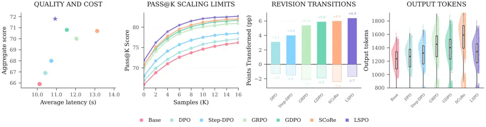
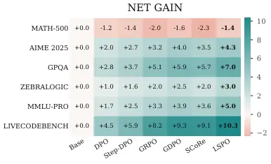
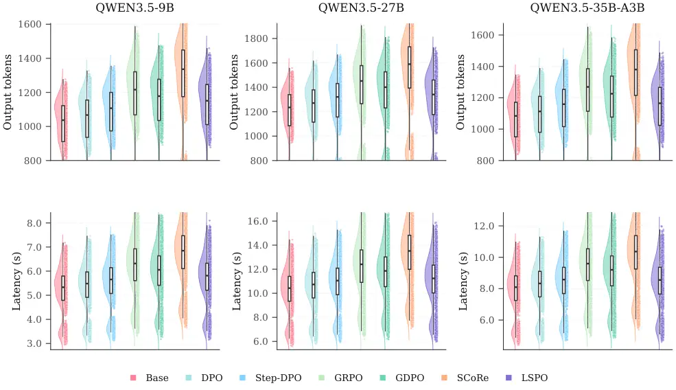

^(†)^(†)footnotetext: Corresponding author.

# Lifted State Policy Optimization: Internalizing Self-Correction through Transition Geometry

Ren Zhuang    Ben Wang    Shuifa Sun Hangzhou Normal University
venomrko97@gmail.com, {20170056, watersun}@hznu.edu.cn

###### Abstract

Preference optimization ranks final answers and trajectory RL maximizes
aggregate returns, yet neither credits the local change that turns a
flawed reasoning state into a better one. We introduce Lifted State
Policy Optimization (LSPO), which establishes this finite, cost-adjusted
transition as the primary unit of learning. Each textual answer is
augmented with a learned continuous coordinate, forming a lifted state
that an energy function evaluates and orders. A shaped reward drives
energy descent net of edit and step costs, and an internalization loss
absorbs selected low-energy answers into the direct generator. On
Qwen3.5-27B, the resulting single-pass policy reaches 71.8% aggregate
accuracy across mathematics, science, code, and logic benchmarks,
matching test-time reflection at 71.9% with 28% lower latency and 25.8%
fewer tokens. The pattern holds across dense and mixture-of-experts
backbones, and matched controls confirm that transition credit and the
lifted coordinate each contribute, as does answer internalization. Our
code is available at
[https://github.com/Venomrko/lspo](https://github.com/Venomrko/lspo).

Figure 1: Improvements found during training persist in direct
generation. On Qwen3.5-27B, the LSPO policy attains the highest
aggregate direct pass@1 and pass@16 accuracy across benchmarks in the
left panels, selected training endpoints align closely with deployed
outputs in the top right, and final energy separates correct from
incorrect answers in the bottom right.

## 1 Introduction

Even strong language models make local mistakes within otherwise sound
reasoning, and one faulty step can invalidate the final answer (Uesato
et al., 2022; Lightman et al., 2023). Inference methods address this
through chain of thought, self-consistency, critique, and repeated
refinement (Wei et al., 2022; Wang et al., 2022; Madaan et al., 2023;
Shinn et al., 2023), and large reasoning models extend deliberation into
long trajectories (Shao et al., 2024; Zelikman et al., 2024; Guo et al.,
2025). These procedures improve difficult answers, but their gains
require additional sampling budgets or persistent refinement loops at
deployment. Training can absorb useful corrections into the policy
itself, removing this cost.

A central question is defining the appropriate unit of supervision.
Current objectives provide supervision at coarse granularity; preference
optimization ranks complete outputs (Rafailov et al., 2023; Hong et al.,
2024; Meng et al., 2024; Liu et al., 2025b), trajectory RL maximizes
aggregate returns over full rollouts (Ouyang et al., 2022; Schulman et
al., 2017), and self-correction methods learn from entire refinement
traces (Kumar et al., 2024; Ma et al., 2025). Each focuses on endpoints
or full trajectories, leaving the local transition that resolves a
flawed reasoning state as an unmodeled unit of credit. We formalize this
gap through _transition credit_, where the unit of learning is a finite
state transition, evaluated by the decrease in a learned energy function
net of edit and step costs (Sutton et al., 1998; Kaufmann et al., 2024;
Lambert, 2025).

We introduce Lifted State Policy Optimization (LSPO). LSPO augments the
textual answer $`x`$ with a continuous coordinate $`z`$, forming a
lifted state $`s=(x,z)`$ that carries refinement context beyond discrete
surface text. An energy function $`\tilde{E}(s;q)`$ orders candidate
states; a shaped reward favors transitions that decrease energy net of
edit and step costs; and an internalization loss trains the generator to
produce selected low-energy answers directly from the original input.

We evaluate LSPO across the Qwen3.5 family (Qwen Team, 2026) on
mathematics (Hendrycks et al., 2021; Zhang and Math-AI, 2025), science
(Rein et al., 2024; Wang et al., 2024), executable code (Jain et al.,
2024), and logic (Lin et al., 2025). On Qwen3.5-27B, the single-pass
policy reaches 71.8% aggregate accuracy, matching test-time reflection
at 71.9% with 28% lower latency and 25.8% fewer tokens. The pattern
holds across scales, reaching 60.8% at 9B and 72.6% on the 35B-A3B
mixture-of-experts backbone. At the mechanism level, as reported in
Figure 1, LSPO converts 6.4% of incorrect answers to correct while
regressing only 1.7%, yielding a 4.7-point net transition gain.

Our core contributions are threefold.

- •
  Single-pass reliability. Absorbing selected low-energy endpoints
  relocates deliberation from inference into training; the deployed
  policy reaches reflective accuracy in a single pass, across dense and
  mixture-of-experts backbones.
- •
  Cost-adjusted transition credit. LSPO establishes a finite state
  transition as the primary unit of learning, scored by energy decrease
  net of edit and step costs. Unlike a step-level score, this quantity
  is relative to a prompt’s candidate pool, steering policy movement
  rather than global state ranking. Bounded energy error perturbs
  cumulative credit only through the endpoints, and removing the
  progress reward costs more net gain than removing any other component.
- •
  Lifting as refinement context. A learned continuous coordinate carries
  information about constructive transitions that surface text alone
  does not; probes on held-out transitions show higher action prediction
  and energy ranking, while shuffled or zeroed coordinates eliminate
  this advantage.

## 2 Method

### 2.1 Overview

LSPO learns local directions of improvement in a lifted state space and
transfers selected answers into a direct policy. It combines a
continuous coordinate for refinement context, an energy objective for
crediting finite state changes, and an internalization loss that trains
the generator on selected answers. Figure 2 contrasts this localized
mechanism with paradigms centered on terminal answers or aggregate
returns.

Figure 2: Comparison of training paradigms. Preference learning in the
top left panel optimizes static final answers, while trajectory RL in
the top right panel maximizes returns across full rollouts. LSPO in the
bottom panel assigns credit to local transitions and internalizes
selected endpoints.

### 2.2 Lifted State

Standard optimization procedures target a distribution
$`p_{\theta}(y\mid q)`$ over complete outputs for a given input $`q`$,
masking the intermediate dynamics of local revisions. To expose these
dynamics for training, we cast local improvement as a Markov decision
process in an augmented state space. We define a lifted state

```math
s_{t}=(x_{t},z_{t}), \tag{1}
```

where $`x_{t}`$ represents the surface text and $`z_{t}`$ is a
continuous auxiliary coordinate. The auxiliary coordinate is initialized
from the input and current answer, updated by the transition block, and
projected away when the final answer is written back into text.

We introduce an energy function

```math
\tilde{E}(s_{t};q)=\tilde{E}(x_{t},z_{t};q), \tag{2}
```

to evaluate state quality. The energy head orders candidate states and
defines which answer becomes the target for direct generation. The
policy induces a transition distribution
$`P_{\theta}(s_{t+1}\mid s_{t},a_{t},q)`$. Training optimizes the action
policy $`\pi_{\theta}(a_{t}\mid s_{t},q)`$ to favor short sequences
whose transitions reduce energy.

Because surface text is discrete, moves are finite and are evaluated
within visited neighborhoods.

### 2.3 Training Procedure

The training phase constructs short moves in the lifted state space. At
each step, the policy samples an action
$`a_{t}\in\{\text{revise},\text{switch},\text{stop}\}`$ from
$`\pi_{\theta}(a_{t}\mid s_{t},q)`$ to modify the surface text, move the
auxiliary coordinate toward an alternative refinement mode, or halt
within the current local basin. The frozen projection initializes
$`z_{0}`$; Revise recursively updates $`z_{t}`$, and Switch resets
$`z_{t}`$ before a residual update. The primary configuration uses
$`d_{z}=8`$, and the energy head scores the resulting state. The
resulting sequence is $`\tau=(s_{0},a_{0},s_{1},a_{1},\dots,s_{T})`$.
Appendix C defines the edit metric, rollout collection, advantage
estimator, and complete training procedure.

### 2.4 Energy Model and Selection

The energy model establishes an ordering over candidate states that
guides both local transitions and final answer selection. It operates as
a scalar head over $`(q,x_{t},z_{t})`$, shared across training families
and fitted on sampled states. Gold answers and executable checkers
provide scalar supervision. Verified candidates receive lower energy
than unsuccessful ones, with ties broken by shorter edit distance and
lower step cost. Pairs are formed within each prompt’s candidate
rollouts, assigning lower energy to verified states than to failed or
perturbed alternatives.

Selection uses the same object. The generated sequence induces a
candidate set $`\mathcal{C}(q)`$ containing the direct answer state and
its successors. The method selects the state with the lowest energy

```math
s^{*}(q)=\arg\min_{s\in\mathcal{C}(q)}\tilde{E}(s;q) \tag{3}
```

and sets $`x_{T}^{*}(q)`$ to be its surface text component as the
transfer target. The model is trained to emit $`x_{T}^{*}(q)`$ from the
original input. Before policy training, we fit and freeze the entire
scoring branch, encompassing the text encoder, lift projection,
transition block, and energy head, as detailed in Appendix C.

### 2.5 Objective

The LSPO objective unifies shaped reinforcement learning over
intermediate transitions with answer internalization. The reward for
stepwise progress is formulated as

```math
r_{t}=\tilde{E}(s_{t};q)-\tilde{E}(s_{t+1};q)-\lambda_{\mathrm{edit}}d(x_{t+1},x_{t})-\lambda_{\mathrm{step}}, \tag{4}
```

for Revise and Switch. Stop preserves the current state and yields zero
reward. Here $`d`$ penalizes surface edits and
$`\lambda_{\mathrm{step}}`$ regularizes trajectory length. We index the
$`T`$ text-changing moves by $`t=0,\ldots,T-1`$; an optional final Stop
contributes zero to their sum.

###### Proposition 1 (Telescoping Trajectory Reward).

For an input $`q`$ and a finite trajectory
$`\tau=(s_{0},a_{0},\dots,s_{T})`$, the cumulative shaped reward
$`R(\tau;q)=\sum_{t=0}^{T-1}r_{t}`$ satisfies

```math
R(\tau;q)=\tilde{E}(s_{0};q)-\tilde{E}(s_{T};q)-\lambda_{\mathrm{edit}}\sum_{t=0}^{T-1}d(x_{t+1},x_{t})-\lambda_{\mathrm{step}}T. \tag{5}
```

Because intermediate energy terms telescope, cumulative return reflects
net endpoint improvement minus total accrued penalties. The proof
appears in Appendix C.

The same telescoping structure provides robustness to scoring error.
When training energy differs from $`\tilde{E}`$ by at most
$`\varepsilon`$ at visited states, cumulative reward shifts by at most
$`2\varepsilon`$ through the endpoints alone, preserving the ranking of
trajectories separated by more than $`2\varepsilon`$, as established in
Proposition 4 and Corollary 2.

At update $`k`$, the rollout snapshot $`\bar{\theta}_{k}`$ fixes the
initial-state distribution $`\rho_{\bar{\theta}_{k}}`$ and text-proposal
kernel $`K_{\bar{\theta}_{k}}`$. Controller RL uses the per-update
objective

```math
J_{\mathrm{ctrl}}^{(k)}(\theta)=\mathbb{E}_{\tau\sim P_{\rho_{\bar{\theta}_{k}},\pi_{\theta},K_{\bar{\theta}_{k}}}}\Big[\sum_{t}r_{t}-\beta\sum_{t}D_{\mathrm{KL}}\!\left(\pi_{\theta}(\cdot\mid s_{t},q)\|\pi_{\mathrm{ref}}(\cdot\mid s_{t},q)\right)\Big], \tag{6}
```

where the action KL includes Stop. The initialization and proposal
mechanisms are held fixed within an update and refreshed for the next
one. The visited-state KL follows regularized policy optimization
(Schulman et al., 2015; Schulman et al., 2017; Ouyang et al., 2022; Guo
et al., 2025).

To absorb the selected improvements into the generator, we incorporate a
loss for selected internalization

```math
J_{\mathrm{SI}}(\theta)=\mathbb{E}_{q}\left[\log p_{\theta}(x_{T}^{*}(q)\mid q)\right], \tag{7}
```

where $`x_{T}^{*}(q)`$ denotes the selected final output with the lowest
energy produced during the alignment phase. The final objective is

```math
J_{\mathrm{LSPO}}^{(k)}(\theta)=J_{\mathrm{ctrl}}^{(k)}(\theta)+\alpha J_{\mathrm{SI}}(\theta). \tag{8}
```

Task feedback supplies the supervision used to fit the energy ordering.

Formal properties of the objective appear in the appendices. In
particular, the internalization loss corresponds to a forward KL
projection onto the selected answer distribution in Appendix D, while
Appendix A gives a path-distribution relaxation and an information
criterion for useful lifting.

At deployment, the compiled conditional distribution serves each answer
through direct generation, requiring no auxiliary lifted-state
computation during inference.

## 3 Experiments

|                   |             |          |      |        |      |      |      |      |      |            |      |          |      |         |      |
| ----------------- | ----------- | -------- | ---- | ------ | ---- | ---- | ---- | ---- | ---- | ---------- | ---- | -------- | ---- | ------- | ---- |
| Model             | Method      | MATH-500 |      | AIME25 |      | GPQA |      | LCB  |      | ZebraLogic |      | MMLU-Pro |      | Average |      |
|                   |             | @1       | @16  | @1     | @16  | @1   | @16  | @1   | @16  | @1         | @16  | @1       | @16  | @1      | @16  |
| Qwen3.5-9B        | Base        | 84.8     | 93.6 | 39.6   | 57.2 | 45.8 | 61.4 | 41.9 | 48.6 | 60.2       | 73.4 | 56.3     | 68.8 | 54.8    | 67.2 |
|                   | DPO         | 85.6     | 94.1 | 40.9   | 58.3 | 46.6 | 62.3 | 43.1 | 50.1 | 61.2       | 74.3 | 57.2     | 69.7 | 55.8    | 68.1 |
|                   | Step-DPO    | 86.4     | 94.7 | 42.7   | 60.5 | 47.5 | 63.5 | 44.4 | 52.0 | 62.4       | 75.3 | 58.1     | 70.8 | 56.9    | 69.5 |
|                   | GRPO        | 87.6     | 95.3 | 46.0   | 65.0 | 49.1 | 66.4 | 46.6 | 55.0 | 64.4       | 77.0 | 59.8     | 72.7 | 58.9    | 71.9 |
|                   | GDPO        | 88.0     | 95.5 | 46.6   | 65.9 | 50.0 | 67.8 | 47.4 | 55.9 | 65.1       | 77.5 | 60.6     | 73.7 | 59.6    | 72.7 |
|                   | SCoRe       | 88.0     | 95.8 | 46.4   | 66.1 | 49.5 | 67.6 | 47.4 | 56.2 | 65.0       | 77.8 | 60.0     | 73.3 | 59.4    | 72.8 |
|                   | LSPO (Ours) | 89.0     | 95.9 | 49.0   | 69.2 | 50.2 | 67.7 | 49.2 | 58.4 | 66.9       | 78.9 | 60.5     | 73.1 | 60.8    | 73.9 |
| Qwen3.5-27B       | Base        | 90.8     | 96.8 | 61.7   | 76.4 | 55.6 | 67.2 | 53.4 | 61.3 | 69.8       | 80.7 | 64.1     | 74.6 | 65.9    | 76.2 |
|                   | DPO         | 91.6     | 97.3 | 63.0   | 77.5 | 56.4 | 68.1 | 54.6 | 62.8 | 70.8       | 81.6 | 65.0     | 75.5 | 66.9    | 77.1 |
|                   | Step-DPO    | 92.4     | 97.9 | 64.8   | 79.7 | 57.3 | 69.3 | 55.9 | 64.7 | 72.0       | 82.6 | 65.9     | 76.6 | 68.0    | 78.5 |
|                   | GRPO        | 93.6     | 98.5 | 68.1   | 84.2 | 58.9 | 72.2 | 58.1 | 67.7 | 74.0       | 84.3 | 67.6     | 78.5 | 70.0    | 80.9 |
|                   | GDPO        | 94.0     | 98.7 | 68.7   | 85.1 | 59.8 | 73.6 | 58.9 | 68.6 | 74.7       | 84.8 | 68.4     | 79.5 | 70.8    | 81.7 |
|                   | SCoRe       | 94.1     | 99.1 | 68.8   | 85.6 | 59.5 | 73.6 | 59.1 | 69.1 | 74.8       | 85.3 | 68.0     | 79.3 | 70.7    | 82.0 |
|                   | LSPO (Ours) | 94.9     | 99.0 | 70.8   | 88.1 | 59.9 | 73.4 | 60.5 | 70.9 | 76.3       | 86.0 | 68.2     | 78.8 | 71.8    | 82.7 |
| Qwen3.5-35B-A3B   | Base        | 91.9     | 97.2 | 65.4   | 79.8 | 57.1 | 68.9 | 55.8 | 63.6 | 71.4       | 81.8 | 65.2     | 75.1 | 67.8    | 77.7 |
|                   | DPO         | 92.7     | 97.7 | 66.7   | 80.9 | 57.9 | 69.8 | 57.0 | 65.1 | 72.4       | 82.7 | 66.1     | 76.0 | 68.8    | 78.7 |
|                   | Step-DPO    | 93.5     | 98.3 | 68.5   | 83.1 | 58.8 | 71.0 | 58.3 | 67.0 | 73.6       | 83.7 | 67.0     | 77.1 | 70.0    | 80.0 |
|                   | GRPO        | 94.4     | 98.7 | 71.2   | 86.9 | 60.1 | 73.5 | 60.0 | 69.4 | 75.2       | 85.0 | 68.4     | 78.7 | 71.6    | 82.0 |
|                   | GDPO        | 94.8     | 98.9 | 71.8   | 87.8 | 61.0 | 74.9 | 60.9 | 70.4 | 75.9       | 85.5 | 69.2     | 79.7 | 72.3    | 82.9 |
|                   | SCoRe       | 94.7     | 99.0 | 71.5   | 87.9 | 60.5 | 74.7 | 60.7 | 70.5 | 75.7       | 85.7 | 68.6     | 79.3 | 71.9    | 82.9 |
|                   | LSPO (Ours) | 95.2     | 98.8 | 72.9   | 89.7 | 60.6 | 74.1 | 61.6 | 71.7 | 76.8       | 86.1 | 68.5     | 78.5 | 72.6    | 83.1 |
| gpt-oss-120b      |             | 96.3     | 99.0 | 81.8   | 91.6 | 75.6 | 82.4 | 61.7 | 70.9 | 80.4       | 87.5 | 80.8     | 86.1 | 79.4    | 86.2 |
| Claude Sonnet 4.5 |             | 97.0     | 99.1 | 87.0   | 94.2 | 83.4 | 89.0 | 66.8 | 75.0 | 83.6       | 90.0 | 82.2     | 87.0 | 83.3    | 89.0 |

Table 1: Main results across Qwen3.5 backbones. LSPO achieves the
highest aggregate accuracy among the listed baselines that generate
directly under both pass@1 and pass@16 evaluation, with frontier models
included as scale references.

We investigate whether geometry-inspired transition credit produces
reliable direct reasoning. The main text tests answer quality,
preservation of correct states, deployment cost, component
contributions, and training dynamics; benchmark-level held-out
evaluations and supplemental transfer tests appear in Appendix E.

### 3.1 Protocol

#### Models.

We evaluate LSPO across the Qwen3.5 family (Qwen Team, 2026) to assess
scaling dynamics. Qwen3.5-27B is the primary model for component and
mechanism analysis; Qwen3.5-35B-A3B supplies transfer evidence for the
mixture-of-experts setting alongside its architectural ablation. We also
include reference metrics from gpt-oss-120b (OpenAI, 2025) and Claude
Sonnet 4.5 (Anthropic, 2025).

#### Benchmarks.

The evaluation spans six suites covering MATH-500 (Hendrycks et al.,
2021), AIME25 (Zhang and Math-AI, 2025), GPQA (Rein et al., 2024),
LiveCodeBench (Jain et al., 2024), ZebraLogic (Lin et al., 2025), and
MMLU-Pro (Wang et al., 2024). Code tasks measure execution validity
through pass@$`k`$ evaluation (Chen et al., 2021). We additionally
incorporate GSM8K (Cobbe et al., 2021), ARC-Challenge (Clark et al.,
2018), BBH (Suzgun et al., 2023), HumanEval (Chen et al., 2021), and
MBPP (Austin et al., 2021) to assess transfer to task families outside
the training distribution.

#### Baselines.

We compare LSPO against several baselines, including the preference
optimization methods DPO (Rafailov et al., 2023) and Step-DPO (Lai et
al., 2024), the RL approaches GRPO (Guo et al., 2025) and GDPO
(Panaganti et al., 2026), and SCoRe (Kumar et al., 2024), a
self-correction method that learns directly from revision traces
generated by the model. Matched training alternatives for candidate
selection, answer internalization, coordinate controls, and test-time
reflection complement these primary baselines.

#### Implementation Details.

All primary comparisons use fixed configurations across random seeds 42,
1234, and 3407. The primary runs use short training sequences with
$`T_{\max}=6`$, top-$`p`$ 0.95, an 8-dimensional auxiliary lift
$`d_{z}=8`$, and an internalization weight of 0.3. Appendix C details
optimizers, sampling parameters, sweep ranges, matched training
alternatives, and extended analyses. The deployment comparison reports
direct pass@1 generation for LSPO alongside an iterative reflection
baseline evaluated with two inference passes under identical seeds and
settings. Training targets use verifiers and search; the deployment
comparison samples from the trained conditional model.

### 3.2 Main Results

#### Overall Performance.



Figure 3: Quality, sampling, revision, and token cost on Qwen3.5-27B.
LSPO reaches 71.8% accuracy at 10.9 s latency in a single pass;
test-time reflection adds 0.1 points but costs 4.3 s more and 440
additional tokens. LSPO remains above the pass@$`k`$ curve, most often
converts incorrect answers to correct ones, and avoids the long latency
tail of repeated refinement.

Table 1 reports direct pass@1 accuracy across six benchmark suites. LSPO
achieves the highest aggregate accuracy among direct-generation
baselines on each Qwen3.5 backbone, with the largest margins on
structured reasoning tasks, including MATH-500, AIME25, ZebraLogic, and
LiveCodeBench, where local intermediate state transitions crucially
govern final outcomes. On the knowledge-oriented GPQA and MMLU-Pro
benchmarks, LSPO improves over the base model while maintaining a
compact direct-generation profile. The pattern holds across all three
backbones in Appendix B, with the largest improvements at 9B and 27B
where exploration has more headroom to reshape generation.

#### Deployment Efficiency.

Figure 3 shows the LSPO policy reaching 71.8% aggregate accuracy with
10.93 s average latency and 1265 output tokens. It remains above the
pass@$`k`$ curve across sampled budgets and executes the highest volume
of constructive edits. Test-time reflection reaches 71.9% with 15.18 s
and 1705 tokens across two inference passes. LSPO thus achieves
comparable observed accuracy in a single pass with 4.25 s lower latency
and 440 fewer tokens per answer, serving each answer directly through
the compiled generator.

### 3.3 Mechanism Analyses

#### Preserving Improvements.

|          |          |              |                |
| -------- | -------- | ------------ | -------------- |
| Method   | Net gain | Direct $`E`$ | Terminal $`E`$ |
| Base     | 0.0      | 0.468        | N/A            |
| DPO      | 1.8      | 0.450        | N/A            |
| Step-DPO | 2.5      | 0.438        | N/A            |
| GRPO     | 3.3      | 0.420        | 0.203          |
| GDPO     | 4.0      | 0.411        | 0.201          |
| SCoRe    | 3.6      | 0.411        | 0.197          |
| LSPO     | 4.7      | 0.398        | 0.195          |

Table 2: Preservation of improvements on Qwen3.5-27B. LSPO yields the
highest net gain and lowest energy across all methods.

Table 2 measures whether policies retain improvements found along
training paths while protecting correct states. Over the same
paired-answer denominator, LSPO repairs 6.4% and damages 1.7% of
answers, yielding a 4.7-point net gain. It records the lowest direct
energy of $`0.398`$ and terminal energy of $`0.195`$ among methods with
an energy head; the terminal value bounds exploration capacity during
training, while the direct value measures whether improvements are
internalized into the policy. The span audit preserves 95.8% of
initially valid spans and yields a 16.0-point net validity gain as
detailed in Appendix D.

#### Sources of Improvement.

|                 |                            |             |        |
| --------------- | -------------------------- | ----------- | ------ |
| Method          | Agg. $`{}_{\pm\text{SD}}`$ | Latency (s) | Tokens |
| Select then SFT | 70.6 \_(±0.17)             | 10.58       | 1218   |
| SI only         | 70.8 \_(±0.16)             | 10.74       | 1246   |
| GRPO            | 70.0 \_(±0.18)             | 12.04       | 1370   |
| SCoRe           | 70.7 \_(±0.18)             | 13.12       | 1501   |
| Reflection      | 71.9 \_(±0.19)             | 15.18       | 1705   |
| LSPO            | 71.8 \_(±0.15)             | 10.93       | 1265   |

Table 3: Training alternatives and deployment cost. Test-time reflection
matches LSPO accuracy at higher deployment cost.

Table 3 separates gains from target selection and internalization from
those of the full LSPO objective, then compares the resulting policy
with test-time reflection at deployment. LSPO exceeds Select then SFT
and selected internalization, listed as SI only in the table, by 1.2 and
1.0 aggregate points, respectively. This reflection baseline reaches
comparable accuracy at 71.9% while incurring substantially higher
deployment overhead, requiring two inference passes that add 4.25 s
latency and 440 tokens per query.

#### Generalization Across Task Families.

Direct generation and frozen energy ordering are evaluated on five
benchmark suites held out from policy training, energy fitting, and
endpoint selection in Appendix E. LSPO improves over Base on every
held-out benchmark and reaches an average of 74.9, above SCoRe at 74.3.
The frozen energy model also preserves local candidate ordering on this
benchmark-level holdout, showing that the learned state signal remains
useful on task families excluded from fitting and endpoint selection.

#### Training Dynamics.

Figure 4 tracks the learning phases. Transition stability and net gain
rise rapidly in the early steps, marking the formation of a geometric
landscape before the accuracy curve plateaus. LSPO first stabilizes
constructive local moves and then converts this geometry into deployed
accuracy. In contrast, SCoRe trains on unconstrained self-revision
traces without step penalties, which leads to aggressive rewriting of
correct spans and higher C$`\to`$W degradation, regressing initially
correct answers into erroneous states. LSPO avoids this failure mode by
bounding the revision scope throughout training.

Figure 4: Training dynamics across transition stability, net gain, and
direct accuracy. Transition stability and net gain plateau before direct
accuracy, consistent with the geometric landscape forming before the
generator absorbs it.

#### Component Ablations.

|                       |      |          |             |        |         |
| --------------------- | ---- | -------- | ----------- | ------ | ------- |
| Variant               | Agg. | Net gain | Latency (s) | Tokens | GPU hrs |
| LSPO full             | 71.8 | 4.7      | 10.93       | 1265   | 2983    |
| - w/o lifting         | 70.9 | 3.2      | 11.70       | 1316   | 2804    |
| - w/o progress reward | 70.0 | 1.6      | 12.35       | 1366   | 2715    |
| - w/o internalization | 70.3 | 2.4      | 12.02       | 1341   | 2566    |
| GRPO                  | 70.0 | 3.3      | 12.04       | 1370   | 2386    |
| DPO                   | 66.9 | 1.8      | 10.42       | 1196   | 1218    |

Table 4: Component ablations on Qwen3.5-27B. The full LSPO stack leads
in aggregate score while controlling latency, output length, and
training cost.

Table 4 isolates each core mechanism. Removing the lifted coordinate
reduces aggregate quality and net transition gain, while dropping the
progress reward lowers net gain and inflates output verbosity. Removing
answer internalization degrades retention and lowers aggregate accuracy.
Parameter-matched coordinate controls retain the same training budget
yet remain 0.9–1.5 aggregate points below full LSPO, supporting a role
for learned refinement context beyond parameter count alone. The full
LSPO stack requires additional training compute, while its structural
constraints reduce deployment latency and token count relative to
unshaped RL baselines. Appendix C provides the coordinate controls,
matched training alternatives, and the full MoE ablation.

#### Policy Energy and Task-Level Gains.

Figure 5 tracks recorded energy across policy updates alongside
task-level correction outcomes. Energy decreases rapidly during early
training and then approaches a plateau, with fluctuations between
updates. The cumulative minimum curve records the lowest energy observed
across updates, with highlighted points marking new minima. The right
panel reports benchmark-level net correction gains independently, with
LSPO showing negative net gain on MATH-500 and positive net gains on the
other five benchmarks.

## 4 Discussion



Figure 5: Policy-training energy and task-level net gains. The left
panel shows recorded energy across policy updates, where the curve
tracks the cumulative minimum and points mark new minima. The right
panel independently reports net correction gains across benchmarks.

#### Scope and Boundaries of Local Correction.

The transition audits show positive net correction gains on five of six
benchmarks, with MATH-500 marking an operational boundary for test-time
revision. In tightly coupled algebraic derivations, modifying an
isolated step without revising preceding assertions leaves upstream
inconsistencies that cause test-time perturbations to degrade more
answers than they repair across all methods. As illustrated in
Appendix F on AIME25, resolution requires rebuilding from an alternative
decomposition beyond finite-radius edits. In this regime, LSPO
internalizes and preserves valid proof structures; training on
low-energy trajectories commits coherent derivations to the generator,
allowing direct accuracy in Table 1 to advance even where test-time
trajectory gain does not. Removing internalization costs 1.5 aggregate
points and degrades correct-span retention, confirming that the
generator drives this gain.

Prior analyses of iterative self-correction (Madaan et al., 2023; Shinn
et al., 2023; Huang et al., 2023; Ma et al., 2025) describe the same
distinction. Local correction repairs errors that represent isolated
adjustments within a sound plan, including sign choices, index offsets,
and lemma applications. Conversely, when the overarching plan requires
fundamental restructuring, local energy gradients offer no direct
descent toward the target answer. Traversing such global transitions
requires either test-time search or training curricula that expose the
policy to plan-level pivots.

#### Training Cost and Deployment Trade-offs.

LSPO invests 2983 GPU-hours during training to yield per-query
reductions of 4.25 s in latency and 440 output tokens at deployment. The
return on this compute investment scales with serving volume, where
low-throughput regimes favor minimal training overhead, while
high-throughput serving amortizes it through cumulative per-query
latency and token savings.

This compute allocation also differs qualitatively from test-time
scaling. Reflection-based methods (Snell et al., 2024; Zhang et al.,
2025; Sun, 2026) let a single checkpoint serve both simple and complex
queries by dynamically varying inference compute. In contrast, LSPO
compiles deliberation directly into network parameters, producing a
faster single-pass deployment where each query incurs identical
inference cost regardless of difficulty. Hybrid designs that use LSPO as
a fast initial pass and fall back to explicit search on high-energy
outputs could combine the advantages of both regimes.

#### Representational Role of the Lifted Coordinate.

Frozen probing evaluations demonstrate that appending the learned
coordinate $`z`$ to textual representations improves action prediction
and energy ranking on held-out transitions in Table C.8, whereas
prompt-shuffled controls degrade performance, confirming that the
coordinate carries prompt-specific information inaccessible to a text
predictor. Architecturally, the coordinate can encode compressed
revision histories reflecting edit count and convergence, or establish
distinct neighborhoods through Switch to identify candidate answer
basins, both of which match empirical observations.

The learned coordinate guides local trajectory steps within candidate
vicinities. As shown by the selection-budget analysis in Appendix E,
energy-based ranking discriminates reliably across moderate candidate
neighborhoods, whereas unconstrained candidate expansion encounters
non-convex surface irregularities. The lifted coordinate thereby
provides directionality along local improvement paths, guiding policy
updates without assuming global convexity.

## 5 Related Work

#### Final Answers, Steps, and Trajectories.

Outcome supervision and preference learning supply signals over final
answers through RLHF (Christiano et al., 2017; Ziegler et al., 2019;
Stiennon et al., 2020), constitutional AI (Bai et al., 2022), and direct
optimization objectives (Rafailov et al., 2023). ORPO (Hong et al.,
2024), SimPO (Meng et al., 2024), and rewards generated by the model
(Yuan et al., 2024) refine this interface for ranking answers (Liu et
al., 2025b). Process supervision moves the learning signal into
intermediate reasoning steps (Cobbe et al., 2021; Uesato et al., 2022;
Lightman et al., 2023), with Step-DPO as a prominent example (Lai et
al., 2024). Unlike absolute step scores suited to reranking individual
states, LSPO credits relative transitions net of edit and step costs
within a prompt’s candidate pool, steering policy movement rather than
global state ranking. GRPO (Guo et al., 2025) and GDPO (Panaganti et
al., 2026) optimize returns over sampled trajectories.

#### Learning from Refinement.

Refinement during inference enables models to critique, revise, or retry
initial answers (Madaan et al., 2023; Shinn et al., 2023; Huang et al.,
2023; Sun, 2026). Recent training variants convert these revisions into
supervision through rewards generated by the model, revision analysis,
and refinement pipelines for code (Liu et al., 2024; Ma et al., 2025;
Bensal et al., 2025; Xiong et al., 2025; Jiang et al., 2026). SCoRe is
the closest baseline, learning from refinement traces generated by the
model (Kumar et al., 2024).

#### Representing Intermediate States.

State representation determines which movements can be compared and
optimized. Plain text exposes the current answer but confines candidate
alternatives to a brittle discrete space. Calibration and
semantic-uncertainty studies show that confidence and correctness
signals reside on separable manifolds in the hidden state (Guo et al.,
2017; Kuhn et al., 2023; Farquhar et al., 2024); semantic probes and
over-confidence analyses further confirm that correctness structure is
geometrically accessible (Kossen et al., 2024; Morosini et al., 2026).
Complementary geometric methods treat latent representations as
substrates for reasoning and model connectivity (Xie et al., 2025;
Zhuang et al., 2026). LSPO operationalizes this view by lifting surface
answers into an augmented state space, ordering candidate transitions by
energy, and transferring the selected lower-energy answer into direct
generation.

## 6 Limitations and Future Directions

The framework is designed for verifiable reasoning tasks where
programmatic checkers or scalar outcomes ground the energy landscape.
Policy improvement relies on alignment between the learned energy
$`\tilde{E}(s;q)`$ and true answer validity. While intermediate
fluctuations cancel telescopically along trajectories, terminal
discrimination remains bounded by the fidelity of the fitted scoring
head. Operating over visited neighborhoods, transition credit addresses
local repairs within an established derivation, while problems requiring
global proof reformulations from scratch remain outside this local
search scope. Trajectory exploration concentrates compute during
training, making the framework most advantageous for high-throughput
serving environments where amortized efficiency provides operational
gains.

Our analysis evaluates scaling across the Qwen3.5 family (Qwen Team,
2026), the 35B-A3B mixture-of-experts backbone, and cross-family
transfer on Gemma-4-E4B-it (Google DeepMind, 2026). In this work, the
auxiliary coordinate models textual deliberation; incorporating tool
executions, evidence graphs, or multi-turn interaction traces would
define the corresponding state representation for structured
environments. Preliminary evaluations in Appendix E show positive policy
transfer on open-form writing and roleplay benchmarks, with geometric
ordering aligning best with instruction fit, coherence, and character
consistency. More comprehensive open-ended creative tasks remain to be
evaluated under distinct criteria. Further advances will require latent
state spaces that score and retain structured movements across these
varied task formats.

## 7 Conclusion

LSPO establishes that direct policy execution can attain the reliability
of iterative refinement. It matches the accuracy of test-time reflection
in a single pass, and transition diagnostics confirm that the policy
repairs incorrect states while preserving correct ones. The learned
stopping behavior mitigates redundant revisions, and the policy
transfers across model scales, to held-out benchmarks, and to
mixture-of-experts architectures. Attributing credit to geometric
transitions and internalizing selected endpoints thus relocates
deliberation from inference into the deployed policy.

## Acknowledgments and Disclosure of Funding

We thank the anonymous reviewers for their constructive feedback. This
work was supported by the School of Information Science and Technology
at Hangzhou Normal University. The authors declare no competing
interests.

## References

- Aichberger et al. (2024) L. Aichberger, K. Schweighofer, M. Ielanskyi,
  and S. Hochreiter Improving uncertainty estimation through
  semantically diverse language generation. arXiv preprint
  arXiv:2406.04306. Cited by: Appendix E.
- Anthropic (2025) Anthropic Introducing claude sonnet 4.5. External
  Links: [Link](https://www.anthropic.com/news/claude-sonnet-4-5) Cited
  by: §3.1.
- Austin et al. (2021) J. Austin, A. Odena, M. Nye, M. Bosma, H.
  Michalewski, D. Dohan, E. Jiang, C. Cai, M. Terry, Q. Le, et al.
  Program synthesis with large language models. arXiv preprint
  arXiv:2108.07732. Cited by: §E.1, §3.1.
- Bai et al. (2022) Y. Bai, S. Kadavath, S. Kundu, A. Askell, J.
  Kernion, A. Jones, A. Chen, A. Goldie, A. Mirhoseini, C. McKinnon, et
  al. Constitutional ai: harmlessness from ai feedback. arXiv preprint
  arXiv:2212.08073. Cited by: §5.
- Bensal et al. (2025) S. Bensal, U. Jamil, C. Bryant, M. Russak, K.
  Kamble, D. Mozolevskyi, M. Ali, and W. AlShikh Reflect, retry, reward:
  self-improving llms via reinforcement learning. arXiv preprint
  arXiv:2505.24726. Cited by: §5.
- Bradley and Terry (1952) R. A. Bradley and M. E. Terry Rank analysis
  of incomplete block designs: i. the method of paired comparisons.
  Biometrika 39 (3/4), pp. 324–345. Cited by: §E.1.
- Chen et al. (2021) M. Chen, J. Tworek, H. Jun, Q. Yuan, H. P. D. O.
  Pinto, J. Kaplan, H. Edwards, Y. Burda, N. Joseph, G. Brockman, et al.
  Evaluating large language models trained on code. arXiv preprint
  arXiv:2107.03374. Cited by: Appendix B, §E.1, Appendix E, §3.1.
- Christiano et al. (2017) P. F. Christiano, J. Leike, T. Brown, M.
  Martic, S. Legg, and D. Amodei Deep reinforcement learning from human
  preferences. Advances in neural information processing systems 30.
  Cited by: §5.
- Clark et al. (2018) P. Clark, I. Cowhey, O. Etzioni, T. Khot, A.
  Sabharwal, C. Schoenick, and O. Tafjord Think you have solved question
  answering? try arc, the ai2 reasoning challenge. arXiv preprint
  arXiv:1803.05457. Cited by: §E.1, §3.1.
- Cobbe et al. (2021) K. Cobbe, V. Kosaraju, M. Bavarian, M. Chen, H.
  Jun, L. Kaiser, M. Plappert, J. Tworek, J. Hilton, R. Nakano, et al.
  Training verifiers to solve math word problems. arXiv preprint
  arXiv:2110.14168. Cited by: §E.1, §3.1, §5.
- Cramér (1946) H. Cramér A contribution to the theory of statistical
  estimation. Scandinavian Actuarial Journal 1946 (1), pp. 85–94. Cited
  by: §E.4.
- Farquhar et al. (2024) S. Farquhar, J. Kossen, L. Kuhn, and Y. Gal
  Detecting hallucinations in large language models using semantic
  entropy. Nature 630 (8017), pp. 625–630. Cited by: Appendix E, §5.
- Fawcett (2006) T. Fawcett An introduction to roc analysis. Pattern
  recognition letters 27 (8), pp. 861–874. Cited by: §E.1.
- Fisher (1925) R. A. Fisher Theory of statistical estimation. In
  Mathematical proceedings of the Cambridge philosophical society, Vol.
  22, pp. 700–725. Cited by: §E.4.
- Google DeepMind (2026) Google DeepMind Gemma-4-E4B-it. Note:
  [https://huggingface.co/google/gemma-4-E4B-it](https://huggingface.co/google/gemma-4-E4B-it)
  Cited by: §B.1, §6.
- Guo et al. (2017) C. Guo, G. Pleiss, Y. Sun, and K. Q. Weinberger On
  calibration of modern neural networks. In International conference on
  machine learning, pp. 1321–1330. Cited by: Appendix D, §E.1, Appendix
  E, §5.
- Guo et al. (2025) D. Guo, D. Yang, H. Zhang, J. Song, P. Wang, Q.
  Zhu, R. Xu, R. Zhang, S. Ma, X. Bi, et al. DeepSeek-r1 incentivizes
  reasoning in llms through reinforcement learning. Nature 645 (8081),
  pp. 633–638. Cited by: Appendix B, Appendix E, §1, §2.5, §3.1, §5.
- Hendrycks et al. (2021) D. Hendrycks, C. Burns, S. Kadavath, A.
  Arora, S. Basart, E. Tang, D. Song, and J. Steinhardt Measuring
  mathematical problem solving with the math dataset. arXiv preprint
  arXiv:2103.03874. Cited by: §1, §3.1.
- Hong et al. (2024) J. Hong, N. Lee, and J. Thorne Orpo: monolithic
  preference optimization without reference model. In Proceedings of the
  2024 Conference on Empirical Methods in Natural Language Processing,
  pp. 11170–11189. Cited by: §1, §5.
- Huang et al. (2023) J. Huang, X. Chen, S. Mishra, H. S. Zheng, A. W.
  Yu, X. Song, and D. Zhou Large language models cannot self-correct
  reasoning yet. arXiv preprint arXiv:2310.01798. Cited by: §F.2, §4,
  §5.
- Jain et al. (2024) N. Jain, K. Han, A. Gu, W. Li, F. Yan, T. Zhang, S.
  Wang, A. Solar-Lezama, K. Sen, and I. Stoica Livecodebench: holistic
  and contamination free evaluation of large language models for code.
  arXiv preprint arXiv:2403.07974. Cited by: §1, §3.1.
- Jiang et al. (2026) J. Jiang, J. Shen, S. Kim, K. M. Yoo, J. Kim,
  and S. Kim ReflexiCoder: teaching large language models to
  self-reflect on generated code and self-correct it via reinforcement
  learning. arXiv preprint arXiv:2603.05863. Cited by: §D.4, §5.
- Jordan et al. (2024) K. Jordan, Y. Jin, V. Boza, Y. Jiacheng, F.
  Cesista, L. Newhouse, and J. Bernstein Muon: an optimizer for hidden
  layers in neural networks. External Links:
  [Link](https://kellerjordan.github.io/posts/muon/) Cited by: §C.6.
- Kadavath et al. (2022) S. Kadavath, T. Conerly, A. Askell, T.
  Henighan, D. Drain, E. Perez, N. Schiefer, Z. Hatfield-Dodds, N.
  DasSarma, E. Tran-Johnson, et al. Language models (mostly) know what
  they know. arXiv preprint arXiv:2207.05221. Cited by: Appendix D.
- Kaufmann et al. (2024) T. Kaufmann, P. Weng, V. Bengs, and E.
  Hüllermeier A survey of reinforcement learning from human feedback.
  Transactions on Machine Learning Research. Cited by: Appendix C, §1.
- Kendall (1938) M. G. Kendall A new measure of rank correlation.
  Biometrika 30 (1-2), pp. 81–93. Cited by: §E.1.
- Kossen et al. (2024) J. Kossen, J. Han, M. Razzak, L. Schut, S. Malik,
  and Y. Gal Semantic entropy probes: robust and cheap hallucination
  detection in llms. arXiv preprint arXiv:2406.15927. Cited by: Appendix
  E, §5.
- Kuhn et al. (2023) L. Kuhn, Y. Gal, and S. Farquhar Semantic
  uncertainty: linguistic invariances for uncertainty estimation in
  natural language generation. arXiv preprint arXiv:2302.09664. Cited
  by: Appendix E, §5.
- Kumar et al. (2024) A. Kumar, V. Zhuang, R. Agarwal, Y. Su, J. D.
  Co-Reyes, A. Singh, K. Baumli, S. Iqbal, C. Bishop, R. Roelofs, et al.
  Training language models to self-correct via reinforcement learning.
  arXiv preprint arXiv:2409.12917. Cited by: Appendix C, Appendix D, §1,
  §3.1, §5.
- Lai et al. (2024) X. Lai, Z. Tian, Y. Chen, S. Yang, X. Peng, and J.
  Jia Step-dpo: step-wise preference optimization for long-chain
  reasoning of llms. arXiv preprint arXiv:2406.18629. Cited by: Appendix
  C, §3.1, §5.
- Lai et al. (2026) Y. Lai, M. Huang, H. Guo, X. Wang, H. Li, S.
  Zhan, L. Zhao, C. Yao, Y. Zhang, Q. Han, et al. R-align: enhancing
  generative reward models through rationale-centric meta-judging. arXiv
  preprint arXiv:2602.06763. Cited by: §C.3.
- Lambert (2025) N. Lambert Reinforcement learning from human feedback.
  arXiv preprint arXiv:2504.12501. Cited by: Appendix C, §1.
- Le et al. (2026) K. Le, Y. Mroueh, P. Nguyen, C. Lin, S. Gao, T. Hua,
  and N. V. Chawla Transform-augmented grpo improves pass@ k. arXiv
  preprint arXiv:2601.22478. Cited by: §C.3.
- Lightman et al. (2023) H. Lightman, V. Kosaraju, Y. Burda, H.
  Edwards, B. Baker, T. Lee, J. Leike, J. Schulman, I. Sutskever, and K.
  Cobbe Let’s verify step by step. In The twelfth international
  conference on learning representations, Cited by: Appendix C, §1, §5.
- Lin et al. (2025) B. Y. Lin, R. L. Bras, K. Richardson, A.
  Sabharwal, R. Poovendran, P. Clark, and Y. Choi Zebralogic: on the
  scaling limits of llms for logical reasoning. arXiv preprint
  arXiv:2502.01100. Cited by: §1, §3.1.
- Liu et al. (2024) D. Liu, A. Nassereldine, Z. Yang, C. Xu, Y. Hu, J.
  Li, U. Kumar, C. Lee, R. Qin, Y. Shi, et al. Large language models
  have intrinsic self-correction ability. arXiv preprint
  arXiv:2406.15673. Cited by: §5.
- Liu et al. (2025a) J. Liu, J. Su, X. Yao, Z. Jiang, G. Lai, Y. Du, Y.
  Qin, W. Xu, E. Lu, J. Yan, et al. Muon is scalable for llm training.
  arXiv preprint arXiv:2502.16982. Cited by: §C.6.
- Liu et al. (2025b) S. Liu, W. Fang, Z. Hu, J. Zhang, Y. Zhou, K.
  Zhang, R. Tu, T. Lin, F. Huang, M. Song, et al. A survey of direct
  preference optimization. arXiv preprint arXiv:2503.11701. Cited by:
  §1, §5.
- Ma et al. (2025) R. Ma, P. Wang, C. Liu, X. Liu, J. Chen, B. Zhang, X.
  Zhou, N. Du, and J. Li S2r: teaching llms to self-verify and
  self-correct via reinforcement learning. In Proceedings of the 63rd
  Annual Meeting of the Association for Computational Linguistics
  (Volume 1: Long Papers), pp. 22632–22654. Cited by: Appendix D, §F.2,
  §1, §4, §5.
- Madaan et al. (2023) A. Madaan, N. Tandon, P. Gupta, S. Hallinan, L.
  Gao, S. Wiegreffe, U. Alon, N. Dziri, S. Prabhumoye, Y. Yang, et al.
  Self-refine: iterative refinement with self-feedback. Advances in
  neural information processing systems 36, pp. 46534–46594. Cited by:
  §F.2, §1, §4, §5.
- Meng et al. (2024) Y. Meng, M. Xia, and D. Chen Simpo: simple
  preference optimization with a reference-free reward. Advances in
  Neural Information Processing Systems 37, pp. 124198–124235. Cited by:
  §1, §5.
- Morosini et al. (2026) A. Morosini, M. Gjika, T. Poggio, and P.
  Beneventano Too sharp, too sure: when calibration follows curvature.
  arXiv preprint arXiv:2604.20614. Cited by: §5.
- Naeini et al. (2015) M. P. Naeini, G. Cooper, and M. Hauskrecht
  Obtaining well calibrated probabilities using bayesian binning. In
  Proceedings of the AAAI conference on artificial intelligence, Vol. 29. Cited by: §E.1.
- Ng et al. (1999) A. Y. Ng, D. Harada, and S. Russell Policy invariance
  under reward transformations: theory and application to reward
  shaping. In Icml, Vol. 99, pp. 278–287. Cited by: §C.8, Appendix C.
- Niculescu-Mizil and Caruana (2005) A. Niculescu-Mizil and R. Caruana
  Predicting good probabilities with supervised learning. In Proceedings
  of the 22nd international conference on Machine learning, pp. 625–632.
  Cited by: Appendix E.
- OpenAI (2025) OpenAI Gpt-oss-120b & gpt-oss-20b model card. External
  Links: [Link](https://huggingface.co/openai/gpt-oss-120b) Cited by:
  §3.1.
- Ouyang et al. (2022) L. Ouyang, J. Wu, X. Jiang, D. Almeida, C.
  Wainwright, P. Mishkin, C. Zhang, S. Agarwal, K. Slama, A. Ray, et al.
  Training language models to follow instructions with human feedback.
  Advances in neural information processing systems 35, pp. 27730–27744.
  Cited by: §1, §2.5.
- Pan et al. (2026) P. Pan, Y. Liang, and S. Lin Reward modeling for
  reinforcement learning-based llm reasoning: design, challenges, and
  evaluation. arXiv preprint arXiv:2602.09305. Cited by: §C.3.
- Panaganti et al. (2026) K. Panaganti, Z. Liang, W. Yu, H. Mi, and D.
  Yu Group distributionally robust optimization-driven reinforcement
  learning for llm reasoning. arXiv preprint arXiv:2601.19280. Cited by:
  Appendix C, §3.1, §5.
- Qwen Team (2026) Qwen Team Qwen3.5: towards native multimodal agents.
  External Links: [Link](https://qwen.ai/blog?id=qwen3.5) Cited by: §1,
  §3.1, §6.
- Rafailov et al. (2023) R. Rafailov, A. Sharma, E. Mitchell, C. D.
  Manning, S. Ermon, and C. Finn Direct preference optimization: your
  language model is secretly a reward model. Advances in neural
  information processing systems 36, pp. 53728–53741. Cited by: §1,
  §3.1, §5.
- Rao et al. (1945) C. R. Rao et al. Information and the accuracy
  attainable in the estimation of statistical parameters. Bull. Calcutta
  Math. Soc 37 (3), pp. 81–91. Cited by: §E.4.
- Rein et al. (2024) D. Rein, B. L. Hou, A. C. Stickland, J.
  Petty, R. Y. Pang, J. Dirani, J. Michael, and S. R. Bowman Gpqa: a
  graduate-level google-proof q&a benchmark. In First conference on
  language modeling, Cited by: §1, §3.1.
- Rényi (1961) A. Rényi On measures of entropy and information. In
  Proceedings of the fourth Berkeley symposium on mathematical
  statistics and probability, volume 1: contributions to the theory of
  statistics, Vol. 4, pp. 547–562. Cited by: §E.4.
- Schulman et al. (2015) J. Schulman, P. Moritz, S. Levine, M. Jordan,
  and P. Abbeel High-dimensional continuous control using generalized
  advantage estimation. arXiv preprint arXiv:1506.02438. Cited by: §2.5.
- Schulman et al. (2017) J. Schulman, F. Wolski, P. Dhariwal, A.
  Radford, and O. Klimov Proximal policy optimization algorithms. arXiv
  preprint arXiv:1707.06347. Cited by: §1, §2.5.
- Shannon (1948) C. E. Shannon A mathematical theory of communication.
  The Bell system technical journal 27 (3), pp. 379–423. Cited by: §E.4.
- Shao et al. (2024) Z. Shao, P. Wang, Q. Zhu, R. Xu, J. Song, X. Bi, H.
  Zhang, M. Zhang, Y. Li, Y. Wu, et al. Deepseekmath: pushing the limits
  of mathematical reasoning in open language models. arXiv preprint
  arXiv:2402.03300. Cited by: Appendix B, §1.
- Shinn et al. (2023) N. Shinn, F. Cassano, A. Gopinath, K. Narasimhan,
  and S. Yao Reflexion: language agents with verbal reinforcement
  learning. Advances in neural information processing systems 36,
  pp. 8634–8652. Cited by: §F.2, §1, §4, §5.
- Snell et al. (2024) C. Snell, J. Lee, K. Xu, and A. Kumar Scaling llm
  test-time compute optimally can be more effective than scaling model
  parameters. arXiv preprint arXiv:2408.03314. Cited by: §4.
- Spearman (1961) C. Spearman The proof and measurement of association
  between two things.. Appleton-Century-Crofts. Cited by: §E.1.
- Stiennon et al. (2020) N. Stiennon, L. Ouyang, J. Wu, D. Ziegler, R.
  Lowe, C. Voss, A. Radford, D. Amodei, and P. F. Christiano Learning to
  summarize with human feedback. Advances in neural information
  processing systems 33, pp. 3008–3021. Cited by: §5.
- Sun (2026) X. Sun Reinforcement inference: leveraging uncertainty for
  self-correcting language model reasoning. arXiv preprint
  arXiv:2602.08520. Cited by: §4, §5.
- Sutton et al. (1998) R. S. Sutton A. G. Barto et al. Reinforcement
  learning: an introduction. Vol. 1, MIT press Cambridge. Cited by:
  §C.3, §1.
- Suzgun et al. (2023) M. Suzgun, N. Scales, N. Schärli, S. Gehrmann, Y.
  Tay, H. W. Chung, A. Chowdhery, Q. Le, E. Chi, D. Zhou, et al.
  Challenging big-bench tasks and whether chain-of-thought can solve
  them. In Findings of the Association for Computational Linguistics:
  ACL 2023, pp. 13003–13051. Cited by: §E.1, §3.1.
- Uesato et al. (2022) J. Uesato, N. Kushman, R. Kumar, F. Song, N.
  Siegel, L. Wang, A. Creswell, G. Irving, and I. Higgins Solving math
  word problems with process-and outcome-based feedback. arXiv preprint
  arXiv:2211.14275. Cited by: Appendix C, §1, §5.
- Wang et al. (2022) X. Wang, J. Wei, D. Schuurmans, Q. Le, E. Chi, S.
  Narang, A. Chowdhery, and D. Zhou Self-consistency improves chain of
  thought reasoning in language models. arXiv preprint arXiv:2203.11171.
  Cited by: Appendix B, §1.
- Wang et al. (2024) Y. Wang, X. Ma, G. Zhang, Y. Ni, A. Chandra, S.
  Guo, W. Ren, A. Arulraj, X. He, Z. Jiang, et al. Mmlu-pro: a more
  robust and challenging multi-task language understanding benchmark.
  Advances in Neural Information Processing Systems 37, pp. 95266–95290.
  Cited by: §1, §3.1.
- Wei et al. (2024) J. Wei, N. Karina, H. W. Chung, Y. J. Jiao, S.
  Papay, A. Glaese, J. Schulman, and W. Fedus Measuring short-form
  factuality in large language models. arXiv preprint arXiv:2411.04368.
  Cited by: §E.4.
- Wei et al. (2022) J. Wei, X. Wang, D. Schuurmans, M. Bosma, F. Xia, E.
  Chi, Q. V. Le, D. Zhou, et al. Chain-of-thought prompting elicits
  reasoning in large language models. Advances in neural information
  processing systems 35, pp. 24824–24837. Cited by: §1.
- Wu et al. (2026a) T. Wu, Z. Zu, B. Zhou, and N. Wong The art of
  efficient reasoning: data, reward, and optimization. arXiv preprint
  arXiv:2602.20945. Cited by: Appendix C.
- Wu et al. (2026b) Y. Wu, J. Mei, M. Yan, C. Li, S. Lai, Y. Ren, Z.
  Wang, J. Zhang, M. Wu, Q. Jin, et al. Writingbench: a comprehensive
  benchmark for generative writing. Advances in Neural Information
  Processing Systems 38. Cited by: §E.5.
- Xie et al. (2025) Z. Xie, Y. Wei, H. Cao, C. Zhao, C. Deng, J. Li, D.
  Dai, H. Gao, J. Chang, K. Yu, et al. MHC: manifold-constrained
  hyper-connections. arXiv preprint arXiv:2512.24880. Cited by: §5.
- Xiong et al. (2025) W. Xiong, H. Zhang, C. Ye, L. Chen, N. Jiang,
  and T. Zhang Self-rewarding correction for mathematical reasoning.
  arXiv preprint arXiv:2502.19613. Cited by: Appendix D, §5.
- Xu et al. (2025) Y. Xu, T. Chakraborty, S. Sharma, L. Nunes, S.
  Sharma, K. D. Demopulos, E. Kıcıman, S. Lu, and R. Chandra Direct
  reasoning optimization: token-level reasoning reflectivity meets
  rubric gates for unverifiable tasks. arXiv preprint arXiv:2506.13351.
  Cited by: §E.5.
- Yin et al. (2023) Z. Yin, Q. Sun, Q. Guo, J. Wu, X. Qiu, and X. Huang
  Do large language models know what they don’t know?. In Findings of
  the association for Computational Linguistics: ACL 2023,
  pp. 8653–8665. Cited by: Appendix D.
- Yuan et al. (2024) W. Yuan, R. Y. Pang, K. Cho, X. Li, S.
  Sukhbaatar, J. Xu, and J. E. Weston Self-rewarding language models. In
  Forty-first International Conference on Machine Learning, Cited by:
  §5.
- Zelikman et al. (2024) E. Zelikman, G. Harik, Y. Shao, V. Jayasiri, N.
  Haber, and N. D. Goodman Quiet-star: language models can teach
  themselves to think before speaking. arXiv preprint arXiv:2403.09629.
  Cited by: §1.
- Zhang et al. (2025) Q. Zhang, F. Lyu, Z. Sun, L. Wang, W. Zhang, W.
  Hua, H. Wu, Z. Guo, Y. Wang, N. Muennighoff, et al. A survey on
  test-time scaling in large language models: what, how, where, and how
  well?. arXiv preprint arXiv:2503.24235. Cited by: §4.
- Zhang and Math-AI (2025) Y. Zhang and T. Math-AI American invitational
  mathematics examination (aime) 2025. External Links:
  [Link](https://huggingface.co/datasets/math-ai/aime25) Cited by: §1,
  §3.1.
- Zheng et al. (2023) L. Zheng, W. Chiang, Y. Sheng, S. Zhuang, Z.
  Wu, Y. Zhuang, Z. Lin, Z. Li, D. Li, E. Xing, et al. Judging
  llm-as-a-judge with mt-bench and chatbot arena. Advances in neural
  information processing systems 36, pp. 46595–46623. Cited by: §E.5.
- Zhuang et al. (2026) R. Zhuang, B. Wang, and S. Sun The geometric
  reasoner: manifold-informed latent foresight search for long-context
  reasoning. arXiv preprint arXiv:2601.18832. Cited by: §5.
- Ziegler et al. (2019) D. M. Ziegler, N. Stiennon, J. Wu, T. B.
  Brown, A. Radford, D. Amodei, P. Christiano, and G. Irving Fine-tuning
  language models from human preferences. arXiv preprint
  arXiv:1909.08593. Cited by: §5.

## Appendices

The appendix follows the evidential order of the main text. It first
fixes the formal objects used by LSPO, then tests scale and transfer,
isolates training mechanisms, audits internalization and energy
ordering, and closes with cases that mark the method boundary.

- •
  Appendix A derives the path form with KL regularization and the
  information criterion for lifted states.
- •
  Appendix B reports scale and transfer across Qwen sizes, benchmark
  families, and a distinct Gemma backbone.
- •
  Appendix C connects the update contract to component ablations,
  sensitivity analyses, and the fixed training configuration.
- •
  Appendix D audits alignment from training to direct generation,
  stopping behavior, and the boundary with test-time reflection.
- •
  Appendix E quantifies deployment cost, energy ordering on benchmark
  suites held out from training, and compute accounting.
- •
  Appendix F maps the mechanism onto representative repairs and a global
  search failure case.

## Appendix A Formal Properties of the Path Objective and State Lifting

This appendix studies an unrestricted path-distribution relaxation and
an information criterion for lifting. Their conclusions concern the
stated distributions and assumptions.

###### Proposition 2 (Gibbs form of the path optimizer constrained by KL divergence).

Fix a prompt $`q`$, let $`P_{\mathrm{ref}}(\cdot\mid q)`$ be a reference
distribution over finite correction trajectories, and define the path
score

```math
F_{q}(\tau)=\sum_{t=0}^{T(\tau)-1}r_{t}. \tag{A.1}
```

Consider the variational problem

```math
\sup_{P\ll P_{\mathrm{ref}}(\cdot\mid q)}\left\{\mathbb{E}_{\tau\sim P}[F_{q}(\tau)]-\beta D_{\mathrm{KL}}\!\big(P\,\|\,P_{\mathrm{ref}}(\cdot\mid q)\big)\right\}. \tag{A.2}
```

For $`\beta>0`$ and $`0<Z_{q}<\infty`$, its unique maximizer is the
exponentially tilted path distribution

```math
\frac{dP_{q}^{\star}}{dP_{\mathrm{ref}}}(\tau)=\frac{\exp(F_{q}(\tau)/\beta)}{Z_{q}},\hskip 18.49988ptZ_{q}=\mathbb{E}_{\tau\sim P_{\mathrm{ref}}(\cdot\mid q)}\left[\exp(F_{q}(\tau)/\beta)\right], \tag{A.3}
```

and the optimal objective value equals $`\beta\log Z_{q}`$.

#### Variational argument.

Let $`P_{q}^{\star}`$ be the tilted path distribution defined in
eq. A.3. For any admissible $`P`$, we have

```math
\frac{dP_{q}^{\star}}{dP_{\mathrm{ref}}}(\tau)=\frac{\exp(F_{q}(\tau)/\beta)}{Z_{q}}. \tag{A.4}
```

This gives

```math
\log\frac{dP_{q}^{\star}}{dP_{\mathrm{ref}}}(\tau)=\frac{F_{q}(\tau)}{\beta}-\log Z_{q}. \tag{A.5}
```

Using

```math
D_{\mathrm{KL}}(P\,\|\,P_{q}^{\star})=\mathbb{E}_{\tau\sim P}\left[\log\frac{dP}{dP_{q}^{\star}}(\tau)\right]=\mathbb{E}_{\tau\sim P}\left[\log\frac{dP}{dP_{\mathrm{ref}}}(\tau)-\frac{F_{q}(\tau)}{\beta}+\log Z_{q}\right], \tag{A.6}
```

we rearrange to obtain

```math
\mathbb{E}_{\tau\sim P}[F_{q}(\tau)]-\beta D_{\mathrm{KL}}\!\big(P\,\|\,P_{\mathrm{ref}}(\cdot\mid q)\big)=\beta\log Z_{q}-\beta D_{\mathrm{KL}}(P\,\|\,P_{q}^{\star}). \tag{A.7}
```

The right side is maximized uniquely at $`P=P_{q}^{\star}`$, where the
KL term vanishes.

#### Path Variational Form.

Proposition 2 casts the path problem with a KL constraint as a
variational optimization whose solution tilts the reference distribution
toward paths with larger cumulative progress. Together with
proposition 1, the result places lower final energy, edit cost, and step
cost within a single path preference.

#### Relation to the Implemented Regularizer.

For a fixed prompt, a policy-induced path distribution factors as

```math
P_{\theta}(\tau\mid q)=\rho_{\theta}(s_{0}\mid q)\prod_{t}\pi_{\theta}(a_{t}\mid s_{t},q)K_{\theta}(s_{t+1}\mid s_{t},a_{t},q), \tag{A.8}
```

including the Stop decision and absorbing termination. Under absolute
continuity, the chain rule gives

```math
\displaystyle D_{\mathrm{KL}}(P_{\theta}\|P_{\mathrm{ref}})={} \displaystyle D_{\mathrm{KL}}(\rho_{\theta}\|\rho_{\mathrm{ref}}) \tag{A.9}
```

```math
\displaystyle+\mathbb{E}_{P_{\theta}}\sum_{t}D_{\mathrm{KL}}(\pi_{\theta}(\cdot\mid s_{t},q)\|\pi_{\mathrm{ref}}(\cdot\mid s_{t},q))
```

```math
\displaystyle+\mathbb{E}_{P_{\theta}}\sum_{t}D_{\mathrm{KL}}(K_{\theta}(\cdot\mid s_{t},a_{t},q)\|K_{\mathrm{ref}}(\cdot\mid s_{t},a_{t},q)).
```

Equality with the action-KL term requires shared initial-state
distributions and conditional transition kernels. Within update $`k`$,
LSPO fixes $`\rho_{\bar{\theta}_{k}}`$ and $`K_{\bar{\theta}_{k}}`$ for
both the controller and the reference, whereby the first and third terms
above cancel and the path KL reduces to the visited-state action KL.
Controller RL therefore targets the fixed-mechanism controller objective
in eq. 6 rather than the unrestricted path objective; the snapshot is
refreshed at the next update. The Gibbs result concerns the unrestricted
path-distribution relaxation, whose optimum further requires
realizability under the specified dynamics.

### A.1 Information in the Lifted State

The lifted coordinate $`z_{t}`$ augments the discrete textual state.
Whether lifting adds value depends on the information it carries about
constructive moves beyond what the surface text and prompt alone
provide.

###### Proposition 3 (Lifted state reduces optimal move prediction loss by the conditional mutual information).

Let $`U_{t}`$ denote any target associated with state $`s_{t}`$, for
example an indicator that a candidate local move decreases energy
without harming correctness. Define the Bayes optimal predictors

```math
p^{\star}_{\mathrm{surf}}(u\mid x,q)=\mathbb{P}(U_{t}=u\mid X_{t}=x,Q=q) \tag{A.10}
```

and

```math
p^{\star}_{\mathrm{lift}}(u\mid x,z,q)=\mathbb{P}(U_{t}=u\mid X_{t}=x,Z_{t}=z,Q=q). \tag{A.11}
```

The achievable reduction in log loss from using the lifted state instead
of the surface state alone is

```math
\mathbb{E}\!\left[-\log p^{\star}_{\mathrm{surf}}(U_{t}\mid X_{t},Q)\right]-\mathbb{E}\!\left[-\log p^{\star}_{\mathrm{lift}}(U_{t}\mid X_{t},Z_{t},Q)\right]=I(U_{t};Z_{t}\mid X_{t},Q). \tag{A.12}
```

#### Information identity.

By the definition of Bayes optimal log loss,

```math
\mathbb{E}\!\left[-\log p^{\star}_{\mathrm{surf}}(U_{t}\mid X_{t},Q)\right]=H(U_{t}\mid X_{t},Q) \tag{A.13}
```

and

```math
\mathbb{E}\!\left[-\log p^{\star}_{\mathrm{lift}}(U_{t}\mid X_{t},Z_{t},Q)\right]=H(U_{t}\mid X_{t},Z_{t},Q). \tag{A.14}
```

Subtracting yields

```math
H(U_{t}\mid X_{t},Q)-H(U_{t}\mid X_{t},Z_{t},Q)=I(U_{t};Z_{t}\mid X_{t},Q). \tag{A.15}
```

This is the conditional mutual information identity.

#### Lift Criterion.

For a fixed joint distribution of $`(Q,X_{t},Z_{t},U_{t})`$ with finite
conditional entropies, the identity yields an information criterion. The
lifted coordinate $`z_{t}`$ improves prediction exactly when it carries
information about constructive moves absent from the surface text and
input. Positive conditional mutual information equals the achievable
reduction in optimal log loss.

For a deterministic reprojection $`Z_{t}=g(Q,X_{t})`$ at fixed
parameters, the conditional mutual information is zero. Recursive
coordinates can retain history since their most recent reset; positive
conditional information depends on the resulting state distribution and
target $`U_{t}`$. The finite-capacity probes quantify accessible
predictive information, and their NLL differences give empirical
prediction gains.

## Appendix B Full Scaling Profiles and Cross-Architecture Transfer

This appendix extends the 27B analysis across benchmarks, model scales,
and pass@$`k`$ budgets. Following established protocols for reasoning
and executable code evaluation \[Wang et al., 2022, Chen et al., 2021\],
it reports performance for each benchmark across all three Qwen
backbones.

Figure B.1: Benchmark profile for Qwen3.5-9B. LSPO improves direct
accuracy while preserving substantial sampled pass@16 headroom in the
smaller dense backbone.

Figure B.2: Benchmark profile for Qwen3.5-27B. LSPO achieves consistent
direct gains while preserving the sampled pass@16 envelope.

Figure B.3: Benchmark profile for Qwen3.5-35B-A3B. LSPO remains the
strongest direct policy as available performance headroom narrows in the
MoE backbone.

Across scales, LSPO attains the highest direct accuracy without
collapsing the pass@16 envelope, while expanding sampled ceilings on
complex reasoning suites, as illustrated in Figures B.1, B.2 and B.3.
The separation is largest on MATH-500, GPQA, and ZebraLogic, where
methods based on preferences capture less of the available revision
signal than on broad knowledge tasks. Smaller models retain wider gaps
between pass@1 and pass@16, indicating more residual search headroom.

These distributions relate LSPO to recent reasoning systems operating at
scale, such as DeepSeekMath and DeepSeek-R1 \[Shao et al., 2024, Guo et
al., 2025\]. Reasoning RL at large scale can improve quality by
reshaping output distributions and spending inference compute. The
pass@16 diagnostics isolate the portion of that improvement absorbed
into deployed generation while sampled diversity remains available.

### B.1 Transfer Across Backbones

|        |          |      |      |           |             |
| ------ | -------- | ---- | ---- | --------- | ----------- |
| Method | MATH-500 | GPQA | LCB  | Aggregate | Latency (s) |
| Base   | 87.6     | 48.7 | 47.1 | 61.1      | 6.81        |
| DPO    | 88.3     | 49.4 | 48.0 | 61.9      | 7.04        |
| GRPO   | 89.2     | 50.1 | 49.4 | 62.9      | 7.18        |
| LSPO   | 90.7     | 51.3 | 52.0 | 64.7      | 7.31        |

Table B.1: Transfer across backbones to Gemma-4-E4B-it. LSPO attains the
highest aggregate score on this distinct architecture while incurring
only a minor latency overhead relative to direct preference baselines.

While primary scaling experiments evaluate the Qwen3.5 family under
consistent formatting, Table B.1 examines transfer to Gemma-4-E4B-it
\[Google DeepMind, 2026\]. On this distinct backbone, LSPO attains the
highest aggregate score, improving over both offline preference
optimization and online reinforcement learning with only a modest
latency increase. This confirms that transition credit and answer
internalization transfer robustly beyond the primary Qwen family.

### B.2 Benchmark Coverage

The benchmark suite spans complementary reasoning regimes. MATH-500 and
AIME assess multi-step mathematical derivations. LiveCodeBench tests
executable code synthesis under formal test specifications. ZebraLogic
probes constrained deduction and local backtrack revisions. GPQA and
MMLU-Pro assess multi-step scientific and domain knowledge. In addition,
held-out task suites such as BBH, GSM8K, and HumanEval are evaluated in
Appendix E to audit out-of-distribution calibration.

## Appendix C Update Mechanics, Ablations, and Sensitivity Analyses

This appendix links the training procedure to the mechanisms tested in
the main text. The three core mechanisms of LSPO play complementary
roles. Lifting defines the state in which correction moves are compared;
the progress reward supplies dense local credit, aligned with reward
shaping and process supervision \[Ng et al., 1999, Uesato et al., 2022,
Lightman et al., 2023\]; and answer internalization moves selected
candidates into the deployed policy.

Baseline comparisons place LSPO mechanics against neighboring training
strategies. Step-DPO \[Lai et al., 2024\] strengthens supervision over
long reasoning chains relative to standard DPO while retaining a
preference objective. GDPO \[Panaganti et al., 2026\] addresses
stability in RL over sampled paths through group weighting. SCoRe
\[Kumar et al., 2024\] trains online self-correction from the model’s
own generation traces. LSPO combines cost-aware move shaping with answer
internalization so that selected states enter generation in a single
pass.

The accompanying ablations examine the contributions of state lifting
and reward shaping under the reported configurations, complementing
studies of shaped training signals in reinforcement learning \[Kaufmann
et al., 2024, Lambert, 2025, Wu et al., 2026a\].

### C.1 Update Mechanics

Figure C.1 and Algorithm 1 specify the computational graph and
algorithmic procedure for a single LSPO update.

Figure C.1: A single LSPO training update. Move shaping in the lifted
space and answer internalization act concurrently on the selected
candidate.

The initial generation at the top of the update graph represents the
deployed answer before revision. This output initializes the lifted path
and the candidate set. Each state encodes the surface text, the lifted
coordinate, and the scalar energy. Each action proposes a local move and
receives the reward increment from eq. 4. This decomposition combines
credit assignment over paths with direct training on the selected
answer. The advantage estimator targets the controller objective in
eq. 6.

### C.2 Architecture and Data Transparency

The primary Qwen3.5-27B implementation uses the architecture and public
corpus mixture in Tables C.1 and C.2. These details fix how the lifted
coordinate enters the model, how the energy head receives text and state
features, and which data mixture supplies the shared training budget.

minibatch $`\mathcal{B}`$; direct generator $`p_{\theta}`$; action
policy $`\pi_{\theta}`$; value head $`V_{\omega}`$; reference
$`\pi_{\mathrm{ref}}`$

frozen $`(h_{\xi},g_{\psi},f_{\eta},E_{\phi})`$ defining $`\tilde{E}`$;
optional verifier $`V`$; horizon $`T_{\max}`$

weights
$`(\alpha,\beta,\lambda_{\mathrm{edit}},\lambda_{\mathrm{step}})`$;
optimizer $`\mathrm{Opt}`$

updated parameters $`(\theta,\omega)`$; deployment uses only
$`p_{\theta}(\cdot\mid q)`$

Fix rollout snapshot $`\bar{\theta}_{k}\leftarrow\theta`$ for initial
answers and text proposals

Initialize path buffer $`\mathcal{R}\leftarrow\emptyset`$ and imitation
buffer $`\mathcal{I}\leftarrow\emptyset`$

for each prompt $`q\in\mathcal{B}`$ do

  Sample direct answer
$`x^{\mathrm{dir}}\sim p_{\bar{\theta}_{k}}(\cdot\mid q)`$

  Set $`h_{0}=h_{\xi}(q,x^{\mathrm{dir}})`$,
$`s_{0}=(x^{\mathrm{dir}},g_{\psi}(h_{0}))`$, and
$`\mathcal{C}\leftarrow\{(x^{\mathrm{dir}},s_{0},\tilde{E}(s_{0};q))\}`$

  for $`t=0,\ldots,T_{\max}-1`$ do

   Sample $`a_{t}\sim\pi_{\bar{\theta}_{k}}(\cdot\mid s_{t},q)`$ from
{revise, switch, stop}

   if $`a_{t}=\texttt{stop}`$ then

      Set $`r_{t}=0`$, $`s_{t+1}=s_{t}`$, and
$`\mathrm{done}=\mathrm{True}`$

      Record
$`(q,s_{t},a_{t},s_{t},0,\log\pi_{\bar{\theta}_{k}}(a_{t}\mid s_{t},q),\log\pi_{\mathrm{ref}}(a_{t}\mid s_{t},q),\mathrm{done})`$
in $`\mathcal{R}`$

      break

   end if

   Execute $`a_{t}`$ using $`K_{\bar{\theta}_{k}}`$ to obtain
$`x_{t+1}`$; set $`h_{t+1}=h_{\xi}(q,x_{t+1})`$

   Set $`b_{t}=z_{t}`$ for Revise, or $`b_{t}=g_{\psi}(h_{t+1})`$ for
Switch

   Set
$`z_{t+1}=\mathrm{LN}(b_{t}+f_{\eta}(h_{t+1}-h_{t},b_{t},e(a_{t})))`$

   Set $`s_{t+1}=(x_{t+1},z_{t+1})`$ and
$`\mathrm{done}=(t=T_{\max}-1)`$

   Compute
$`r_{t}=\tilde{E}(s_{t};q)-\tilde{E}(s_{t+1};q)-\lambda_{\mathrm{edit}}d(x_{t+1},x_{t})-\lambda_{\mathrm{step}}`$

   Record
$`(q,s_{t},a_{t},s_{t+1},r_{t},\log\pi_{\bar{\theta}_{k}}(a_{t}\mid s_{t},q),\log\pi_{\mathrm{ref}}(a_{t}\mid s_{t},q),\mathrm{done})`$
in $`\mathcal{R}`$

   Append $`(x_{t+1},s_{t+1},\tilde{E}(s_{t+1};q))`$ to $`\mathcal{C}`$

  end for

  Select $`x_{T}^{*}(q)`$ from $`\mathcal{C}`$ by minimum energy, using
$`V`$ only to break training ties

  Append $`(q,x_{T}^{*}(q))`$ to $`\mathcal{I}`$

end for

Estimate advantages from $`\mathcal{R}`$ and form the sampled controller
loss $`\mathcal{L}_{\mathrm{ctrl}}^{(k)}`$ with action KL

Form answer internalization loss
$`\mathcal{L}_{\mathrm{SI}}=-\mathbb{E}_{\mathcal{I}}[\log p_{\theta}(x_{T}^{*}(q)\mid q)]`$

Update policy/generator with
$`\mathcal{L}_{\mathrm{ctrl}}^{(k)}+\alpha\mathcal{L}_{\mathrm{SI}}`$;
fit value head $`V_{\omega}`$ to returns

Algorithm 1 LSPO update contract

Algorithm 1 fixes the training contract. The model generates the
deployed answer, explores lifted states during training, selects a
candidate, and updates the direct generator on that answer. The energy
model, verifier, candidate selection, and explicit revision actions
serve as instruments during training only.

|                              |                                     |                                                                 |                                         |
| ---------------------------- | ----------------------------------- | --------------------------------------------------------------- | --------------------------------------- |
| Component                    | Architecture                        | Input / output                                                  | Key setting                             |
| Lift projection $`g_{\psi}`$ | 2-layer MLP, width 1024, GELU       | Hidden state $`\rightarrow z\in\mathbb{R}^{8}`$                 | Input LayerNorm                         |
| Energy head $`\tilde{E}`$    | 3-layer MLP, width 1024, SiLU       | Pooled text, $`z`$, task embedding $`\rightarrow`$ scalar       | Pairwise margin 0.20                    |
| Transition block             | 2 residual blocks, width 1024, SiLU | Text delta, $`b_{t}`$, action embedding $`\rightarrow\Delta z`$ | $`z_{t+1}=\mathrm{LN}(b_{t}+\Delta z)`$ |
| Action embedding             | Lookup table, width 128             | Revise, Switch, Stop $`\rightarrow`$ vector                     | Frozen transition conditioning          |
| Value head                   | 2-layer MLP, width 512, SiLU        | Transition state $`\rightarrow`$ scalar value                   | GAE 0.95, clip 0.2                      |

Table C.1: Architectural specifications for the primary Qwen3.5-27B LSPO
implementation.

|             |                                                                                                                                                   |         |
| ----------- | ------------------------------------------------------------------------------------------------------------------------------------------------- | ------- |
| Task family | Public corpus source                                                                                                                              | Samples |
| Math        | open-r1/OpenR1-Math-220k¹¹ 1 [https://huggingface.co/datasets/open-r1/OpenR1-Math-220k](https://huggingface.co/datasets/open-r1/OpenR1-Math-220k) | 38,000  |
| Code        | BAAI/TACO²² 2 [https://huggingface.co/datasets/BAAI/TACO](https://huggingface.co/datasets/BAAI/TACO)                                              | 24,000  |
| Science     | allenai/sciq³³ 3 [https://huggingface.co/datasets/allenai/sciq](https://huggingface.co/datasets/allenai/sciq)                                     | 18,000  |
| Logic       | longface/logicLM⁴⁴ 4 [https://huggingface.co/datasets/longface/logicLM](https://huggingface.co/datasets/longface/logicLM)                         | 12,000  |

Table C.2: Training corpus mixture and sample counts shared by the
compared methods.

#### Transition Operators.

The action set contains three operators. Revise edits the active surface
answer by sampling a bounded patch over a reasoning, equation, or code
span and recursively updating its coordinate. Switch replaces the active
candidate with another sampled state for the same prompt, including its
surface text and projected coordinate, before the transition block
applies the residual update. Stop terminates expansion and leaves the
current state as a candidate for selection. The edit term
$`d(x_{t+1},x_{t})`$ is computed after normalizing whitespace,
mathematical tokens, and code tokens. Long answers are segmented into
reasoning spans, and the distance is the normalized Levenshtein distance
at token level over changed spans, capped at one for each transition.
This convention charges local rewrites without making copied context
dominate the penalty.

#### Lifted Coordinate.

Let $`h_{t}=h_{\xi}(q,x_{t})`$ be the frozen text representation and
$`e(a_{t})`$ the frozen action embedding used by the transition block.
Initialization uses $`z_{0}=g_{\psi}(h_{0})`$. For Revise, the residual
update starts from $`b_{t}=z_{t}`$; for Switch, it starts from
$`b_{t}=g_{\psi}(h_{t+1})`$. Both use

```math
z_{t+1}=\mathrm{LN}\!\left(b_{t}+f_{\eta}(h_{t+1}-h_{t},b_{t},e(a_{t}))\right). \tag{C.1}
```

Revise therefore retains refinement history through $`z_{t}`$, while
Switch resets that history to the replacement candidate. Stop preserves
$`z_{t}`$. The energy $`\tilde{E}(s_{t};q)=E_{\phi}(h_{t},z_{t},q)`$ and
action policy $`\pi_{\theta}(\cdot\mid s_{t},q)`$ consume the same
stored coordinate.

#### Training Stages and Gradient Scope.

We first fit the scoring branch on sampled training states using the
energy-ranking supervision described below. Before policy optimization,
we freeze the text encoder $`h_{\xi}`$, projection $`g_{\psi}`$,
transition block $`f_{\eta}`$ (including its conditioning embeddings and
normalization), and energy head $`E_{\phi}`$. The scoring encoder is a
fixed parameter copy, separate from the trainable generator. These
components remain fixed throughout rollout collection, candidate
selection, RL/SI updates, and ordering audits. Coordinates can evolve
recursively even though the update function is frozen.

Within each update, initial answers and text proposals are sampled using
the rollout snapshot and treated as fixed environment outcomes for
controller RL. Shared parameters receive gradients from both controller
RL and answer internalization, which maximizes the likelihood of
selected answers given the original prompt. A value-regression loss
trains the value head. Rewards, stored scoring features, and selected
targets are detached supervision; the ranking loss is confined to
scoring-branch fitting. Thus RL/SI gradients leave all scoring-branch
parameters unchanged.

#### Energy Supervision.

Energy supervision is built from comparisons among states visited for
the same prompt. Checkers for exact match, executable tests, multiple
choice labels, and task verifiers identify successful states. Failed
answers, states rejected by verifiers, longer states with no verifier
improvement, variants with noisy energy, and controls using terminal
rewards only supply negatives. The scalar head is fit with a pairwise
margin objective so that verified states or states with lower cost
receive lower energy than alternatives from the same prompt. The head is
fit on training families, then frozen for candidate selection and for
the ordering audit on held-out families in Appendix E; GSM8K,
ARC-Challenge, BBH, HumanEval, and MBPP are excluded from fitting and
endpoint selection in that audit.

#### Policy Update.

Rollouts are generated by the current policy for the current minibatch,
and no replay buffer carries trajectories across optimizer updates.
Advantages are computed from the shaped rewards with generalized
advantage estimation using discount $`\gamma=1`$ and $`\lambda=0.95`$,
followed by normalization and value clipping at $`0.2`$. The KL term is
evaluated against the fixed reference action policy
$`\pi_{\mathrm{ref}}`$ on the same visited states. The rollout policy
$`\pi_{\bar{\theta}_{k}}`$ supplies the sampling probabilities for the
update and is distinct from this reference. Stop is recorded with zero
reward and a terminal mask, giving zero value bootstrap while retaining
its policy-gradient and action-KL terms. The finite rollout horizon also
terminates the episode with zero bootstrap. Scoring-branch fitting
precedes these policy updates.

#### Action Statistics.

The observed action frequencies in Table C.3 show a shift from
exploration toward termination over training. Revise and Switch
transitions decrease energy in most executed cases, while the lower
probability of reaching $`T_{\max}`$ later in training is consistent
with the stop action terminating local basins once further movement no
longer offsets its costs.

|                      |            |            |          |                        |
| -------------------- | ---------- | ---------- | -------- | ---------------------- |
| Measure / phase      | Revise (%) | Switch (%) | Stop (%) | Reach $`T_{\max}`$ (%) |
| Overall              | 49.8       | 25.9       | 24.3     | 11.8                   |
| Energy decrease rate | 70.8       | 63.4       | –        | –                      |
| Early 0–30%          | 56.1       | 30.8       | 13.1     | 21.4                   |
| Late 70–100%         | 42.6       | 20.2       | 37.2     | 5.9                    |

Table C.3: Observed action use across LSPO training phases on
Qwen3.5-27B. Revise and Switch transitions are also reported by their
energy decrease rates.

#### Objective Components.

The flow diagram follows information propagation through the update
sequence. Figure C.2 maps each symbolic block to its contribution within
that update.

Figure C.2: Annotated reward and objective for LSPO. The assignment of
credit per step, the regularization of the policy, and direct training
on the answer occupy distinct terms within the update.

### C.3 Objective Context

From a reinforcement learning perspective, LSPO addresses the balance
between sparse final rewards, dense shaping signals, and variance
control \[Sutton et al., 1998\]. The progress reward gives the optimizer
a local signal over lifted moves rather than raw token sequences, making
constructive revisions legible while reducing the burden on credit
assigned only to the final answer.

Recent reasoning RL literature reinforces the emphasis on signal
structure. Reward design shapes whether policy learning remains stable
and semantically aligned \[Pan et al., 2026\]. The LSPO ablations study
the components governing state definition, local improvement criteria,
and deployed execution.

Two contemporary research strands reinforce this reading. Transformed
objectives improve pass@$`k`$ performance within frameworks similar to
GRPO \[Le et al., 2026\], indicating that reasoning RL is sensitive to
objective design. Reward model analyses further show that downstream RL
depends on accurate preferences and verifiable rationales \[Lai et al.,
2026\]. LSPO applies this lesson to individual moves, where the
supervisory signal is shaped by energy descent and edit costs.

### C.4 Training Component Analysis

Figure C.3: Training alternatives on Qwen3.5-27B. LSPO achieves accuracy
comparable to test-time reflection with lower deployment cost and gains
from constructive state changes.

|                                |                   |                     |                     |
| ------------------------------ | ----------------- | ------------------- | ------------------- |
| Method                         | Agg. $`\pm`$ SD   | LSPO diff. (95% CI) | Inference contract  |
| Select then SFT                | 70.6 $`\pm`$ 0.17 | +1.2 \[0.7, 1.6\]   | direct              |
| SI only                        | 70.8 $`\pm`$ 0.16 | +1.0 \[0.6, 1.4\]   | direct              |
| Without lifting                | 70.9 $`\pm`$ 0.18 | +0.9 \[0.5, 1.3\]   | direct              |
| Without progress reward        | 70.0 $`\pm`$ 0.19 | +1.8 \[1.3, 2.3\]   | direct              |
| Return-matched terminal reward | 69.7 $`\pm`$ 0.20 | +2.1 \[1.5, 2.6\]   | direct              |
| Test-time reflection           | 71.9 $`\pm`$ 0.19 | –                   | critique + revision |
| LSPO                           | 71.8 $`\pm`$ 0.15 | –                   | direct              |

Table C.4: Matched training alternatives on Qwen3.5-27B. Evaluation
examples and nominal budgets are shared; Table C.7 specifies candidate
pools, reward definitions, and SI/SFT matching. SI only uses a fixed
LSPO candidate pool.

|        |                      |                |          |
| ------ | -------------------- | -------------- | -------- |
| Family | Variant              | Aggregate drop | Net gain |
| Lift   | $`z`$ dimension = 64 | 0.6            | 3.9      |
| Lift   | $`z`$ dimension = 2  | 0.8            | 3.7      |
| Lift   | No lift              | 0.9            | 3.2      |
| Lift   | No switch            | 1.4            | 3.1      |
| Lift   | Revise only          | 1.7            | 2.7      |
| Lift   | Switch only          | 2.0            | 2.5      |
| Energy | No margin            | 1.2            | 3.2      |
| Energy | Noisy energy         | 1.5            | 2.9      |
| Energy | No energy stop       | 1.8            | 2.4      |
| Energy | Terminal only        | 2.1            | 2.2      |

Table C.5: Extended ablations on Qwen3.5-27B. Perturbations to the
lifted coordinate and corruption of energy degrade distinct metrics,
separating the role of state geometry from that of local reward shaping.

|                       |      |      |          |       |          |
| --------------------- | ---- | ---- | -------- | ----- | -------- |
| Energy signal         | Agg. | Drop | Net gain | AUC   | Pairwise |
| Clean LSPO energy     | 71.8 | 0.0  | 4.7      | 0.792 | 0.734    |
| Gaussian noise        | 70.3 | 1.5  | 2.9      | 0.731 | 0.681    |
| Label flip or shuffle | 68.6 | 3.2  | 0.7      | 0.508 | 0.506    |
| Terminal only         | 69.7 | 2.1  | 2.2      | 0.681 | 0.641    |

Table C.6: Sensitivity to energy corruption on Qwen3.5-27B. Gaussian
noise weakens but preserves part of the transition gain, whereas flipped
or shuffled ordering drives rank metrics toward chance.

|                                |                 |                  |                      |                |                                  |                        |
| ------------------------------ | --------------- | ---------------- | -------------------- | -------------- | -------------------------------- | ---------------------- |
| Variant                        | Candidate pool  | State space      | Target selector      | Controller RL  | Reward signal                    | Transfer target        |
| Full LSPO                      | Dynamic rollout | Lifted $`(x,z)`$ | Frozen $`\tilde{E}`$ | Dense policy   | $`\Delta\tilde{E}-\text{costs}`$ | $`\min\tilde{E}`$ (SI) |
| Return-matched terminal reward | Dynamic rollout | Lifted $`(x,z)`$ | Frozen $`\tilde{E}`$ | Delayed policy | Trajectory $`R(\tau)`$           | $`\min\tilde{E}`$ (SI) |
| SI only on fixed pool          | Fixed Full pool | Lifted $`(x,z)`$ | Frozen $`\tilde{E}`$ | None           | None                             | $`\min\tilde{E}`$ (SI) |
| Select then SFT                | Fixed Full pool | Surface text     | Task verifier        | None           | None                             | Verifier-best (SFT)    |
| Without lifting                | Dynamic rollout | Surface text     | Surface $`E`$        | Dense policy   | $`\Delta E-\text{costs}`$        | $`\min E`$ (SI)        |
| Without progress reward        | Dynamic rollout | Lifted $`(x,z)`$ | Frozen $`\tilde{E}`$ | Dense policy   | $`-\text{costs only}`$           | $`\min\tilde{E}`$ (SI) |

Table C.7: Control specifications for training alternatives. Nominal
budgets specify candidate limits, update counts, and sampling settings;
they do not imply identical realized token counts or GPU hours.

Figure C.3 reports the primary 27B comparison. Test-time reflection
reaches 71.9% aggregate accuracy, 0.1 points above LSPO’s 71.8%, while
LSPO uses 4.25 s less latency and 440 fewer tokens. GRPO supplies a
reinforcement learning comparison over final-answer rewards under the
same seed set and sampling budget.

Tables C.4 and C.7 compare LSPO with controlled training alternatives.
SI only on a fixed LSPO candidate pool uses the candidates and selected
targets produced by Full LSPO, and measures what answer internalization
achieves given those teacher candidates. Select then SFT uses the same
fixed pool with verifier-based selection and predetermined cost rules.
Candidate construction is accounted for separately from the matched
SI/SFT token exposure and updates. LSPO leads both alternatives; the
paired intervals are positive. These comparisons distinguish downstream
training effects conditional on the candidate pool; the teacher pool
itself already reflects LSPO exploration.

#### Return-Matched Terminal Reward.

To isolate reward timing, the terminal control retains the scoring
function, edit metric, action space, target selection, termination
rules, SI, and action KL of Full LSPO. For a completed trajectory with
$`M`$ executed Revise/Switch moves and final state $`s_{M}`$, define

```math
R(\tau;q)=\tilde{E}(s_{0};q)-\tilde{E}(s_{M};q)-\lambda_{\mathrm{edit}}\sum_{t=0}^{M-1}d(x_{t+1},x_{t})-\lambda_{\mathrm{step}}M. \tag{C.2}
```

Let $`L`$ count all recorded decisions, including an explicit Stop when
present. The terminal control pays

```math
r_{t}^{\mathrm{terminal}}=\begin{cases}0,&t<L-1,\\
R(\tau;q),&t=L-1.\end{cases}\hskip 18.49988pt\sum_{t=0}^{L-1}r_{t}^{\mathrm{terminal}}=\sum_{t=0}^{L-1}r_{t}^{\mathrm{dense}}=R(\tau;q). \tag{C.3}
```

An explicit Stop receives the delayed trajectory return; at the horizon,
the last executed move receives it. Immediate Stop gives $`M=0`$ and
zero return. Full LSPO retains zero reward for Stop itself. With
$`\gamma=1`$ and unchanged KL regularization, the two objectives assign
the same return to every identical trajectory. Their sampled updates
differ through reward timing, value fitting, and GAE with
$`\lambda=0.95`$, thereby testing finite-sample optimization rather than
a different ideal trajectory objective.

Table C.5 extends the ablation analysis. Restricting the policy to paths
that only revise degrades both aggregate quality and transition gain,
pointing to the role of motion in the lifted state space beyond surface
rewriting. Table C.6 measures sensitivity to energy corruption. Gaussian
perturbations weaken but preserve part of the transition gain, while
flipped or shuffled ordering drives rank metrics toward chance. The
terminal reward control retains the trajectory return while delaying its
feedback to termination.

### C.5 Lifted Coordinate Analysis and MoE Transfer

The frozen probe in Table C.8 tests the predictive utility of $`z`$ for
a finite-capacity predictor on held-out transitions. Text plus the
learned coordinate improves action prediction, reduces NLL, and
increases energy AUC; shuffling $`z`$ disrupts the prompt association.
These probe differences measure predictive utility for the fitted probe;
the information identity in Proposition 3 concerns Bayes-optimal log
loss.

Table C.9 evaluates whether the lifted-coordinate result is explained by
parameter count or generic conditioning capacity. The controls use the
same Qwen3.5-27B backbone, candidate budget, training budget, and
three-seed protocol as full LSPO. A same-parameter no-lift MLP, a random
coordinate, a learned nuisance coordinate, and a frozen or random
projection all remain below full LSPO. Their net gains range from 2.8 to
3.0 points, compared with 4.7 for full LSPO; the paired intervals for
the aggregate gaps remain positive. These results support the
interpretation that the learned, prompt-conditioned coordinate carries
refinement-relevant information beyond extra parameters alone.

Table C.10 repeats the component analysis on Qwen3.5-35B-A3B. The same
ordering of full LSPO over the component removals provides transfer
evidence for the MoE backbone, while Qwen3.5-27B remains the setting
used for the primary causal comparison.

|                          |                        |                     |                       |
| ------------------------ | ---------------------- | ------------------- | --------------------- |
| Input condition          | Action acc. $`\pm`$ SD | NLL $`\pm`$ SD      | Energy AUC $`\pm`$ SD |
| Text only                | 62.8 $`\pm`$ 0.7       | 0.842 $`\pm`$ 0.011 | 0.681 $`\pm`$ 0.010   |
| Text plus $`z`$          | 68.9 $`\pm`$ 0.6       | 0.768 $`\pm`$ 0.010 | 0.732 $`\pm`$ 0.009   |
| Text plus shuffled $`z`$ | 60.9 $`\pm`$ 0.8       | 0.874 $`\pm`$ 0.013 | 0.641 $`\pm`$ 0.012   |
| Text plus zero $`z`$     | 63.4 $`\pm`$ 0.7       | 0.831 $`\pm`$ 0.012 | 0.687 $`\pm`$ 0.011   |

Table C.8: Frozen probe for information in the lifted coordinate on
transitions held out from fitting. Adding the learned coordinate
improves action prediction and energy ordering; shuffled coordinates
remove the association.

|                                       |                   |          |                             |
| ------------------------------------- | ----------------- | -------- | --------------------------- |
| Variant                               | Agg. $`\pm`$ SD   | Net gain | LSPO $`-`$ variant (95% CI) |
| Full LSPO                             | 71.8 $`\pm`$ 0.15 | 4.7      | –                           |
| Reference baseline (Table 4)          |                   |          |                             |
| Current no-lift baseline              | 70.9 $`\pm`$ 0.18 | 3.2      | +0.9 \[0.5, 1.3\]           |
| Parameter-matched coordinate controls |                   |          |                             |
| Same-parameter no-lift MLP            | 70.8 $`\pm`$ 0.18 | 3.0      | +1.0 \[0.6, 1.4\]           |
| Random $`z`$, matched dim.            | 70.3 $`\pm`$ 0.19 | 2.8      | +1.5 \[1.1, 1.9\]           |
| Learned nuisance coordinate           | 70.6 $`\pm`$ 0.18 | 2.9      | +1.2 \[0.8, 1.6\]           |
| Frozen / random projection            | 70.4 $`\pm`$ 0.18 | 2.9      | +1.4 \[1.0, 1.8\]           |

Table C.9: Parameter-matched controls for the lifted coordinate on
Qwen3.5-27B. All variants use the same candidate budget, training
budget, and three-seed protocol. The final column reports the paired
aggregate gap between full LSPO and each control.

|                         |      |      |             |        |           |
| ----------------------- | ---- | ---- | ----------- | ------ | --------- |
| Variant                 | Agg. | Gain | Latency (s) | Tokens | GPU hours |
| LSPO full               | 72.6 | 4.4  | 8.30        | 1097   | 2410      |
| Without lifting         | 71.6 | 2.9  | 8.88        | 1141   | 2265      |
| Without progress reward | 70.8 | 1.3  | 9.38        | 1185   | 2193      |
| Without internalization | 71.1 | 2.1  | 9.13        | 1163   | 2073      |
| Outcome RL              | 71.5 | 2.7  | 9.33        | 1200   | 1940      |
| DPO                     | 68.8 | 1.5  | 8.08        | 1048   | 990       |

Table C.10: Component ablation on the Qwen3.5-35B-A3B MoE backbone. The
dense 27B model remains the primary attribution setting; this table
tests whether the component pattern transfers to the MoE model.

### C.6 Training Configuration

The following configuration specifies the primary training setting and
the sensitivity ranges used in the component analyses.

The primary 27B LSPO run follows a fixed configuration. Reported means
use seeds 42, 1234, and 3407. The objective coefficients are
$`\beta=0.02`$, $`\lambda_{\mathrm{edit}}=0.10`$, and
$`\lambda_{\mathrm{step}}=0.01`$. The environment uses a maximum path
length of 6, an auxiliary dimension of $`8`$, an imitation weight of
0.3, temperature 0.6, and top-$`p=0.95`$. Optimization uses the Muon
optimizer across all trainable parameters \[Jordan et al., 2024, Liu et
al., 2025a\]. The configuration sets a learning rate of
$`2\times 10^{-5}`$, momentum $`0.95`$, Nesterov updates, five
Newton–Schulz steps, weight decay 0.1, and gradient clipping at 1.0. The
schedule applies $`500`$ warmup steps and cosine decay to $`10^{-7}`$
over a $`15{,}000`$ step global horizon.

The benchmark suite and evaluation metrics remain fixed. Deployment
evaluation measures pass@1 with direct generation or execution success.
Supporting diagnostics include pass@16, transition rates, energy,
latency, and output length.

#### Reported Variation.

For the main experiments and training ablations, $`\pm`$ denotes the
sample standard deviation across the three independent training seeds.
We first average each seed’s results over the complete evaluation set,
then compute SD across those three means, using divisor $`3-1`$. The
selection-budget audit in Table E.8 instead fixes one checkpoint and
reports bootstrap SD over evaluation inputs.

### C.7 Hyperparameter Selection

The 27B hyperparameter search considers
$`\beta\in\{0.005,0.01,0.02,0.05,0.1\}`$,
$`\lambda_{\mathrm{edit}}\in\{0.0,0.05,0.1,0.2,0.4\}`$, and
$`\lambda_{\mathrm{step}}\in\{0.0,0.005,0.01,0.02,0.05\}`$. Selection by
aggregate validation accuracy under the three-seed protocol, with ties
broken by minimized transition harm, yields $`(0.02,0.10,0.01)`$. These
ranges describe model selection; the reported dimension ablations and
joint candidate/horizon sweep provide the corresponding empirical
sensitivity results.

Baseline models are instantiated under fixed matched settings. Standard
preference optimization methods use minimal latency budgets; methods
that operate on sampled paths consume longer outputs and higher latency
budgets. LSPO narrows this efficiency gap by embedding machinery for
local transitions into the parameters through answer internalization.

### C.8 Reward Decomposition

The shaped path functional supplies the empirical ablations with a
formal counterpart. Proposition 1, established in Section 2, shows that
the progress reward telescopes into final energy improvement minus
accrued edit and step costs, and Corollary 1 explains the preference for
short, localized repairs over destructive global rewrites.

#### Telescoping identity.

Here $`T`$ counts executed Revise/Switch moves. A terminal Stop is a
zero-reward self-transition and leaves the identities unchanged.
Substituting the move reward from eq. 4 gives

```math
\displaystyle\sum_{t=0}^{T-1}r_{t} \displaystyle=\sum_{t=0}^{T-1}\big(\tilde{E}(s_{t};q)-\tilde{E}(s_{t+1};q)\big)-\lambda_{\mathrm{edit}}\sum_{t=0}^{T-1}d(x_{t+1},x_{t})-\lambda_{\mathrm{step}}T \tag{C.4}
```

```math
\displaystyle=\tilde{E}(s_{0};q)-\tilde{E}(s_{T};q)-\lambda_{\mathrm{edit}}\sum_{t=0}^{T-1}d(x_{t+1},x_{t})-\lambda_{\mathrm{step}}T.
```

###### Corollary 1 (Preference for economical paths).

Let $`\tau`$ and $`\tau^{\prime}`$ be two trajectories for the same
prompt $`q`$ with identical initial and terminal states, satisfying
$`s_{0}=s_{0}^{\prime}`$ and
$`s_{T_{\tau}}=s_{T_{\tau^{\prime}}}^{\prime}`$. If

```math
\sum_{t=0}^{T_{\tau}-1}d(x_{t+1},x_{t})\leq\sum_{t=0}^{T_{\tau^{\prime}}-1}d(x_{t+1}^{\prime},x_{t}^{\prime})\hskip 18.49988pt\text{and}\hskip 18.49988ptT_{\tau}\leq T_{\tau^{\prime}}, \tag{C.5}
```

then the cumulative shaped reward satisfies
$`R(\tau;q)\geq R(\tau^{\prime};q)`$. The inequality is strict whenever
at least one inequality is strict and the corresponding coefficient
$`\lambda_{\mathrm{edit}}`$ or $`\lambda_{\mathrm{step}}`$ is strictly
positive.

#### Path economy argument.

Under identical endpoints ($`s_{0}=s_{0}^{\prime}`$ and
$`s_{T_{\tau}}=s_{T_{\tau^{\prime}}}^{\prime}`$), the net energy term
$`\tilde{E}(s_{0};q)-\tilde{E}(s_{T};q)`$ is invariant across paths.
Under this telescoping relation, $`R(\tau;q)-R(\tau^{\prime};q)`$
reduces entirely to differences in cumulative edit and step penalties,
favoring trajectories that achieve the same descent with fewer tokens
altered and fewer transitions taken.

The difference in energy aligns formally with potential reward shaping
\[Ng et al., 1999\]. The edit and step penalties restrict the preferred
policy class by penalizing unnecessarily long or destructive correction
paths, favoring economical paths with net energy improvement.

### C.9 Noise Robustness

The ablation with noisy energy motivates a sensitivity analysis. Because
the LSPO path reward relies on local energy differences, any bounded
state perturbation results in a bounded endpoint error.

###### Proposition 4 (Bounded energy noise perturbs cumulative reward only through endpoint error).

Let

```math
\hat{E}(s;q)=\tilde{E}(s;q)+\delta(s;q) \tag{C.6}
```

with $`|\delta(s;q)|\leq\varepsilon`$ for every visited state. Let
$`R(\tau;q)`$ denote the cumulative shaped reward computed from
$`\tilde{E}`$, and let $`\hat{R}(\tau;q)`$ denote the cumulative shaped
reward computed from $`\hat{E}`$ using the same edit and step penalties.
For any trajectory $`\tau=(s_{0},a_{0},\dots,s_{T})`$,

```math
\hat{R}(\tau;q)-R(\tau;q)=\delta(s_{0};q)-\delta(s_{T};q),\hskip 18.49988pt\text{and}\hskip 18.49988pt\left|\hat{R}(\tau;q)-R(\tau;q)\right|\leq 2\varepsilon. \tag{C.7}
```

#### Endpoint perturbation.

By proposition 1,

```math
R(\tau;q)=\tilde{E}(s_{0};q)-\tilde{E}(s_{T};q)-\lambda_{\mathrm{edit}}\sum_{t=0}^{T-1}d(x_{t+1},x_{t})-\lambda_{\mathrm{step}}T \tag{C.8}
```

and

```math
\hat{R}(\tau;q)=\hat{E}(s_{0};q)-\hat{E}(s_{T};q)-\lambda_{\mathrm{edit}}\sum_{t=0}^{T-1}d(x_{t+1},x_{t})-\lambda_{\mathrm{step}}T. \tag{C.9}
```

Subtracting the two expressions cancels the penalty terms and leaves

```math
\hat{R}(\tau;q)-R(\tau;q)=\delta(s_{0};q)-\delta(s_{T};q). \tag{C.10}
```

The bound uses $`|\delta|\leq\varepsilon`$ at the two endpoints.

###### Corollary 2 (Trajectory ranking is preserved under a sufficient terminal margin).

Let $`\tau`$ and $`\tau^{\prime}`$ be two trajectories for the same
prompt that start from the same initial state $`s_{0}`$. Under the
conditions of proposition 4, if

```math
R(\tau;q)-R(\tau^{\prime};q)>2\varepsilon, \tag{C.11}
```

the perturbed ranking satisfies
$`\hat{R}(\tau;q)>\hat{R}(\tau^{\prime};q)`$.

#### Ranking margin.

Because the two trajectories share the same initial state,

```math
\big(\hat{R}(\tau;q)-\hat{R}(\tau^{\prime};q)\big)-\big(R(\tau;q)-R(\tau^{\prime};q)\big)=-\delta(s_{T};q)+\delta(s_{T}^{\prime};q). \tag{C.12}
```

Its absolute value is at most $`2\varepsilon`$, giving

```math
\hat{R}(\tau;q)-\hat{R}(\tau^{\prime};q)\geq R(\tau;q)-R(\tau^{\prime};q)-2\varepsilon>0, \tag{C.13}
```

so the perturbed ranking is retained.

This bound gives a sufficient stability condition for a fixed candidate
set under uniformly bounded state-wise corruption. The Gaussian-noise
ablation provides a separate empirical sensitivity test. Applying the
deterministic bound to any noise realization requires that all evaluated
perturbations satisfy the stated limit.

## Appendix D Internalization and Stopping Diagnostics

This appendix evaluates the alignment between training rollouts and
direct policy execution, the step-level monotonicity of energy descent,
and the formal mechanics governing stopping conditions and answer
internalization.

Figure D.1: Energy discriminates correct from incorrect endpoints across
scales. Correct outputs consistently concentrate in regions with lower
energy.

Figure D.2: Training endpoints align with direct outputs after LSPO. The
divergence between terminal states selected during alignment and direct
generations is minimal under the LSPO objective.

Figure D.3: Step diagnostics across scales. LSPO preserves the strongest
monotonicity in energy descent, correct local structure, and stop
optimality across the evaluated backbones.

Figure D.4: Transition gains across scales. LSPO achieves the largest
surplus of conversions from incorrect to correct on every backbone while
keeping conversions from correct to incorrect modest.

Figure D.1 evaluates energy as an ordering signal. Across all three
model scales, lower final energy is associated with higher correctness,
though slopes and separation margins vary by capacity. We therefore
compare absolute energy values within each backbone, consistent with
prior work on model calibration and uncertainty \[Kadavath et al., 2022,
Yin et al., 2023, Guo et al., 2017\].

Figure D.2 separates training exploration from deployed policy outputs.
LSPO shows the smallest energy gap between selected training answers and
direct outputs, the empirical signature of answer internalization. The
analysis measures whether correction traces shift the policy
distribution, complementing prior studies of self-correction \[Kumar et
al., 2024, Ma et al., 2025, Xiong et al., 2025\].

Figure D.3 resolves the mechanism at the step level. The energy
monotonicity rate measures how often a move decreases state energy; the
rate of preserving correct states measures whether already correct
states are retained; and the stop optimality rate evaluates whether
generation ends near the empirical minimum along the visited path. The
ordering of these diagnostics follows the geometric constraints
encouraged by LSPO.

Figure D.4 extends the transition diagnostic beyond the primary 27B
setting. The ordering persists at 9B and 35B-A3B. LSPO increases
constructive conversions from incorrect to correct without the large
conversions from correct to incorrect observed in search baselines with
high cost.

### D.1 Answer and Span Transition Metrics

For each method, answer-level transitions compare the before and after
correctness labels of the same $`N`$ answer pairs. Let $`n_{W\to C}`$
and $`n_{C\to W}`$ count repairs (wrong to correct) and regressions
(correct to wrong), respectively. Both reported rates use the full
paired sample as denominator,

```math
G_{\mathrm{ans}}=100\,n_{W\to C}/N,\hskip 18.49988ptH_{\mathrm{ans}}=100\,n_{C\to W}/N,\hskip 18.49988pt\mathrm{NetGain}=G_{\mathrm{ans}}-H_{\mathrm{ans}}. \tag{D.1}
```

Thus the 6.4% repair and 1.7% regression frequencies for LSPO yield a
4.7-point net gain. Correct-to-correct (C$`\to`$C) and
incorrect-to-incorrect (W$`\to`$W) pairs contribute zero to this
difference.

The span audit in Table D.1 uses before/after validity labels, denoted
$`V`$ and $`I`$, for paired spans. Each method has its own initial valid
fraction $`p_{V}`$. Preservation and damage condition on initially valid
spans, while repair conditions on initially invalid spans,

```math
\displaystyle P_{\mathrm{span}} \displaystyle=\Pr(V_{\mathrm{after}}\mid V_{\mathrm{before}}), \displaystyle D_{\mathrm{span}} \displaystyle=1-P_{\mathrm{span}}, \tag{D.2}
```

```math
\displaystyle R_{\mathrm{span}} \displaystyle=\Pr(V_{\mathrm{after}}\mid I_{\mathrm{before}}), \displaystyle\mathrm{NetSpanGain} \displaystyle=100[(1-p_{V})R_{\mathrm{span}}-p_{V}D_{\mathrm{span}}].
```

Probabilities in this equation lie in $`[0,1]`$; net gain is in
percentage points. Full LSPO preserves 95.8% of initially valid spans
and repairs 29.5% of initially invalid spans, yielding a 16.0-point
increase in the valid-span fraction. The matched no-lift control yields
9.9 points. These results support preservation and repair of the spans
assessed by the validity labels; answer-level and span-level gains
describe distinct units of analysis.

|                            |                   |            |            |            |          |
| -------------------------- | ----------------- | ---------- | ---------- | ---------- | -------- |
| Method                     | Initial $`p_{V}`$ | $`V\to V`$ | $`I\to V`$ | $`V\to I`$ | Net gain |
| Full LSPO                  | 40.1              | 95.8       | 29.5       | 4.2        | +16.0    |
| Same-parameter no-lift MLP | 39.7              | 92.1       | 21.6       | 7.9        | +9.9     |
| Without progress reward    | 39.8              | 89.8       | 18.7       | 10.2       | +7.2     |
| Terminal-only reward       | 39.1              | 90.3       | 16.9       | 9.7        | +6.5     |
| GRPO                       | 39.4              | 90.9       | 18.6       | 9.1        | +7.7     |

Table D.1: Span validity transitions. Initial validity, preservation,
repair, and damage are percentages; net gain is in percentage points.
Preservation and damage condition on initially valid spans; repair
conditions on initially invalid spans. Net gain weights these rates by
each method’s initial valid fraction.

### D.2 Stopping Condition

The stop optimality diagnostic has a formal counterpart. Continuing from
a state cannot improve cumulative reward when every future energy
decrease is exhausted by the associated edit and step costs.

###### Proposition 5 (A sufficient stopping condition).

Fix an input $`q`$ and a move index $`t`$, counting Revise/Switch
transitions. Suppose that for every admissible continuation

```math
s_{t},s_{t+1},\dots,s_{T} \tag{D.3}
```

starting from $`s_{t}`$, each future transition indexed by
$`u\in\{t,\dots,T-1\}`$ satisfies

```math
\tilde{E}(s_{u};q)-\tilde{E}(s_{u+1};q)\leq\lambda_{\mathrm{edit}}d(x_{u+1},x_{u})+\lambda_{\mathrm{step}}. \tag{D.4}
```

Every such continuation has nonpositive additional cumulative reward,

```math
\sum_{u=t}^{T-1}r_{u}\leq 0. \tag{D.5}
```

For the unregularized shaped return, stopping with zero reward weakly
dominates these continuations. The action-KL penalty in eq. 6 can change
the regularized policy preference.

#### Stopping argument.

The assumed inequality implies

```math
\tilde{E}(s_{u};q)-\tilde{E}(s_{u+1};q)-\lambda_{\mathrm{edit}}d(x_{u+1},x_{u})-\lambda_{\mathrm{step}}\leq 0 \tag{D.6}
```

for every $`u\geq t`$, i.e., $`r_{u}\leq 0`$. Summing over
$`u=t,\dots,T-1`$ gives nonpositive cumulative reward.

### D.3 Internalization Projection

The alignment figures motivate a formal interpretation of the answer
internalization objective. Training selects an answer distribution with
lower energy, and the deployed generator is then optimized toward it as
closely as model capacity permits. For each input $`q`$, hold fixed the
sampled-target distribution $`\mu_{q}`$ of selected outputs
$`x_{T}^{*}(q)`$ induced by the selection procedure during training.

###### Proposition 6 (Answer internalization as forward KL projection).

For each input $`q`$,

```math
\mathbb{E}_{x\sim\mu_{q}}\!\left[\log p_{\theta}(x\mid q)\right]=-H(\mu_{q})-D_{\mathrm{KL}}\!\big(\mu_{q}\,\|\,p_{\theta}(\cdot\mid q)\big), \tag{D.7}
```

so maximizing $`J_{\mathrm{SI}}(\theta)`$ is equivalent, up to the
parameter-independent constant $`\mathbb{E}_{q}[H(\mu_{q})]`$, to
minimizing the expected forward KL to the selected-answer distributions.

#### Projection identity.

Substituting $`\mathbb{E}_{x\sim\mu_{q}}[\log\mu_{q}(x)]=-H(\mu_{q})`$
into the definition of forward relative entropy yields the identity;
averaging over $`q`$ and dropping the constant term gives the
equivalence.

###### Proposition 7 (Bounded task scores are controlled by forward KL on the selected-answer distribution).

Fix an input $`q`$ and let $`c_{q}(x)\in[0,1]`$ denote any correctness
or task success score for output $`x`$. Define

```math
\Delta_{q}(\theta)=\mathbb{E}_{x\sim\mu_{q}}[c_{q}(x)]-\mathbb{E}_{x\sim p_{\theta}(\cdot\mid q)}[c_{q}(x)]. \tag{D.8}
```

The gap for each input obeys

```math
\left|\Delta_{q}(\theta)\right|\leq\mathrm{TV}\!\big(\mu_{q},p_{\theta}(\cdot\mid q)\big)\leq\sqrt{\frac{1}{2}D_{\mathrm{KL}}\!\big(\mu_{q}\,\|\,p_{\theta}(\cdot\mid q)\big)}. \tag{D.9}
```

Averaging over inputs gives

```math
\mathbb{E}_{q}\!\left[\left|\Delta_{q}(\theta)\right|\right]\leq\sqrt{\frac{1}{2}\mathbb{E}_{q}\!\left[D_{\mathrm{KL}}\!\big(\mu_{q}\,\|\,p_{\theta}(\cdot\mid q)\big)\right]}. \tag{D.10}
```

#### Total variation bound.

For any function $`f\in[0,1]`$,

```math
\left|\mathbb{E}_{\mu_{q}}[f(x)]-\mathbb{E}_{p_{\theta}(\cdot\mid q)}[f(x)]\right|\leq\mathrm{TV}\!\big(\mu_{q},p_{\theta}(\cdot\mid q)\big). \tag{D.11}
```

Applying this to $`f=c_{q}`$ gives the first bound. The second bound is
Pinsker’s inequality,

```math
\mathrm{TV}\!\big(\mu_{q},p_{\theta}(\cdot\mid q)\big)\leq\sqrt{\frac{1}{2}D_{\mathrm{KL}}\!\big(\mu_{q}\,\|\,p_{\theta}(\cdot\mid q)\big)}. \tag{D.12}
```

Finally, averaging over $`q`$ and using Jensen’s inequality for the
concave square root function yields

```math
\mathbb{E}_{q}\!\left[\left|\Delta_{q}(\theta)\right|\right]\leq\mathbb{E}_{q}\!\left[\sqrt{\frac{1}{2}D_{\mathrm{KL}}\!\big(\mu_{q}\,\|\,p_{\theta}(\cdot\mid q)\big)}\right]\leq\sqrt{\frac{1}{2}\mathbb{E}_{q}\!\left[D_{\mathrm{KL}}\!\big(\mu_{q}\,\|\,p_{\theta}(\cdot\mid q)\big)\right]}. \tag{D.13}
```

For each fixed target distribution, the bound links the alignment
diagnostic in Figure D.2 to the training objective, showing that as the
forward KL term decreases, the expected gap in bounded task success
scores is correspondingly controlled. It conditions on a fixed
$`\mu_{q}`$ and is informative only where the generator can approach
that distribution; thus, we use it as a consistency interpretation of
the alignment figures rather than as an accuracy guarantee.

### D.4 Comparison with Test-Time Reflection

Test-time reflection systems retain critique and revision within the
inference loop \[Jiang et al., 2026\]. LSPO generates and selects
training traces before deployment, then serves answers with the direct
generator. The alignment diagnostics above measure how much of the
resulting improvement persists in that generator, while the deployment
comparison quantifies the cost of retaining deliberation at inference.

## Appendix E Deployment Complexity and Held-Out Energy Ordering

Deployment cost, energy ordering on tasks held out from training, and
compute accounting summarize LSPO’s operational profile. The diagnostics
characterize energy as a local ordering signal and quantify the
inference cost that remains after correction traces are absorbed into
the model.



Figure E.1: Deployment cost distributions. LSPO stays within the latency
and length ranges established by preference optimization, remaining
below baselines that use extensive search.

Figure E.1 quantifies the deployment cost of the direct policy. Systems
that use extensive search can incur large latency and verbosity
penalties \[Chen et al., 2021, Guo et al., 2025\]. LSPO produces
slightly longer generations than standard preference methods such as
DPO, yet remains below the token and latency costs of GRPO and SCoRe.
The method stays within a practical deployment range while preserving
the accuracy gains reported in the main text.

The next analyses study the relationship between state energy and
empirical correctness. When lower scores correlate with correct outputs,
the scalar can serve as both a shaping signal during training and a
diagnostic of candidate quality. Prior work on calibration fragility
\[Niculescu-Mizil and Caruana, 2005, Guo et al., 2017\] and semantic
uncertainty \[Kuhn et al., 2023, Farquhar et al., 2024, Kossen et al.,
2024, Aichberger et al., 2024\] motivates interpreting energy as a
structural indicator of local state ordering.

### E.1 Energy Ordering on Held-Out Tasks

The empirical correlation between low energy and correctness reported in
Figure D.1 motivates a conditional calibration analysis. Under a shared
prompt-wise monotone calibration map, an almost-sure energy ordering
under a coupling implies an ordering of expected correctness.

All ordering metrics evaluate the utility score
$`u(s,q)=-\tilde{E}(s;q)`$, where higher $`u`$ indicates lower energy
and a preferred candidate under the learned ordering. The AUC between
energy and correctness measures the probability that a correct candidate
receives a higher $`u`$ than an incorrect candidate \[Fawcett, 2006\].
Spearman and Kendall compute rank correlations between $`u`$ and the
binary correctness label over the evaluated candidate set, with Kendall
using a rank statistic corrected for ties \[Spearman, 1961, Kendall,
1938\]. Pairwise preference accuracy calculates the fraction of
differently labeled candidate pairs within each prompt where the correct
candidate has lower energy, aligning with the standard pairwise ranking
logic of preference models \[Bradley and Terry, 1952\]. The Bins metric
partitions candidates into five equal-frequency energy bins and reports
the length of the contiguous monotone prefix, measuring how many of the
five bins preserve the expected decrease in empirical correctness as
energy rises. ECE partitions candidates into bins with equal numbers via
a frozen monotonic calibration map and reports the expected absolute
difference between the predicted and empirical correctness probabilities
\[Naeini et al., 2015, Guo et al., 2017\].

Figure E.2: Frozen energy ordering under distribution shift. On tasks
held out from fitting (GSM8K, ARC-Challenge, BBH, HumanEval, and MBPP),
the LSPO energy head outperforms outcome only, shuffled, and random
controls in area under the curve, Spearman correlation, and pairwise
accuracy.

|                                                                                    |       |          |         |          |      |       |
| ---------------------------------------------------------------------------------- | ----- | -------- | ------- | -------- | ---- | ----- |
| Score                                                                              | AUC   | Spearman | Kendall | Pairwise | Bins | ECE   |
| Task families used for fitting include math, code, logic, and science              |       |          |         |          |      |       |
| Random energy                                                                      | 0.502 | 0.01     | 0.01    | 0.502    | 2    | 0.241 |
| Outcome only score                                                                 | 0.681 | 0.31     | 0.22    | 0.641    | 4    | 0.132 |
| LSPO energy                                                                        | 0.792 | 0.48     | 0.35    | 0.734    | 5    | 0.071 |
| Shuffled LSPO energy                                                               | 0.508 | 0.01     | 0.01    | 0.506    | 2    | 0.235 |
| Task families held out from fitting include GSM8K, ARC-C, BBH, HumanEval, and MBPP |       |          |         |          |      |       |
| Random energy                                                                      | 0.501 | 0.00     | 0.00    | 0.501    | 2    | 0.247 |
| Outcome only score                                                                 | 0.612 | 0.20     | 0.14    | 0.583    | 3    | 0.170 |
| LSPO energy                                                                        | 0.704 | 0.34     | 0.24    | 0.658    | 4    | 0.112 |
| Shuffled LSPO energy                                                               | 0.511 | 0.02     | 0.01    | 0.507    | 2    | 0.238 |

Table E.1: Frozen energy ordering under distribution shift. LSPO yields
the strongest AUC, rank correlation, and pairwise preference accuracy on
both the fitted task families and tasks held out from fitting.

#### Data Separation and Locked Evaluation.

Table C.2 identifies the public training corpora. The main evaluation
suites are MATH-500, AIME25, GPQA, LiveCodeBench, ZebraLogic, and
MMLU-Pro. GSM8K \[Cobbe et al., 2021\], ARC-Challenge \[Clark et al.,
2018\], BBH \[Suzgun et al., 2023\], HumanEval \[Chen et al., 2021\],
and MBPP \[Austin et al., 2021\] provide additional benchmark-level
holdouts for transfer and frozen energy-ordering audits. Both groups
follow the same exclusion rules.

Domain overlap is permitted. Evaluation examples and near-duplicates are
excluded from policy training, energy fitting, pairwise ranking
construction, training-target selection, verifier/checker threshold
tuning, hyperparameter search, checkpoint selection, selection of
training and audit budgets, and construction of prompts, rubrics, or
synthetic references. Use of other examples from the same benchmark
requires explicit deduplication against the evaluation set.

Evaluation questions enter only the locked final evaluation. Generation
and candidate selection use the fixed model and scoring branch without
gold answers, correctness labels, test-time verifiers, or judge
feedback. External checkers and judges score the resulting outputs for
reporting. Decoding settings and the training budget $`K`$ and audit
budgets $`K_{\mathrm{sel}}`$ are fixed before evaluation; test results
serve only to report performance across those budgets.

As reported in Figure E.2 and Table E.1, the domain shift reduces the
LSPO energy AUC from 0.792 to 0.704 and pairwise preference accuracy
from 0.734 to 0.658. Both metrics remain above the outcome only and
shuffled controls, supporting energy as a local ranking signal beyond
the fitted task families.

### E.2 Direct Generation on Tasks Outside the Training Distribution

The evaluation on benchmarks held out from fitting also tests the
deployed policy itself. The suites in Table E.2 follow the exclusion
rules above, including exclusion from training-target selection. LSPO
improves over Base on all five tasks and reaches an average of 74.9 on
held-out tasks, above SCoRe at 74.3, without a regression on any task
relative to Base. The held-out policy results complement the ordering
audit: the frozen energy head retains local signal under shift, and the
compiled policy transfers the corresponding improvement gains to direct
generation.

|        |       |       |      |           |      |                   |
| ------ | ----- | ----- | ---- | --------- | ---- | ----------------- |
| Method | GSM8K | ARC-C | BBH  | HumanEval | MBPP | Avg. $`\pm`$ SD   |
| Base   | 88.4  | 84.7  | 66.2 | 55.5      | 62.4 | 71.4 $`\pm`$ 0.22 |
| DPO    | 89.0  | 85.3  | 67.1 | 56.4      | 63.0 | 72.2 $`\pm`$ 0.20 |
| GRPO   | 90.6  | 86.7  | 69.0 | 58.6      | 64.8 | 73.9 $`\pm`$ 0.22 |
| SCoRe  | 91.1  | 87.1  | 69.3 | 59.1      | 65.0 | 74.3 $`\pm`$ 0.24 |
| LSPO   | 91.5  | 87.4  | 70.4 | 60.1      | 65.2 | 74.9 $`\pm`$ 0.20 |

Table E.2: Direct generation on benchmark suites held out from policy
training, energy fitting, and endpoint selection. LSPO improves over
Base on every benchmark.

### E.3 Joint Candidate and Horizon Sensitivity

Candidate quantity and transition horizon affect the local candidate
space explored during alignment. Here $`K`$ is the maximum total number
of candidate states retained per input $`q`$, including the initial
direct-generation state $`s_{0}`$. Table E.3 varies $`K`$ and
$`T_{\max}`$ together under the same training and evaluation protocol,
measuring sensitivity to their joint budget. The gain persists at every
tested budget; aggregate accuracy reaches 71.8 at the primary
configuration $`(T_{\max},K)=(6,7)`$ and remains at that value for
$`(8,9)`$. The larger budget increases realized path length and reduces
the ratio of unique candidates.

|              |       |                   |                  |             |              |
| ------------ | ----- | ----------------- | ---------------- | ----------- | ------------ |
| $`T_{\max}`$ | $`K`$ | Agg. $`\pm`$ SD   | Gain $`\pm`$ SD  | Path length | Unique ratio |
| 2            | 3     | 70.9 $`\pm`$ 0.18 | 3.2 $`\pm`$ 0.30 | 1.6         | 0.82         |
| 4            | 5     | 71.5 $`\pm`$ 0.16 | 4.2 $`\pm`$ 0.26 | 2.7         | 0.76         |
| 6            | 7     | 71.8 $`\pm`$ 0.15 | 4.7 $`\pm`$ 0.23 | 3.4         | 0.71         |
| 8            | 9     | 71.8 $`\pm`$ 0.16 | 4.8 $`\pm`$ 0.24 | 3.7         | 0.66         |

Table E.3: Joint candidate and horizon sensitivity on Qwen3.5-27B. $`K`$
counts the maximum number of retained states per input, including the
initial direct state $`s_{0}`$. Values are means $`\pm`$ sample SD
across three independent training seeds. Aggregate accuracy reaches 71.8
at $`(T_{\max},K)=(6,7)`$ and remains at that value for $`(8,9)`$.

|             |                   |                 |                   |                 |      |
| ----------- | ----------------- | --------------- | ----------------- | --------------- | ---- |
| Method      | WritingBench L&A  | $`\Delta`$ Base | MT-Bench Roleplay | $`\Delta`$ Base | avg. |
| Base        | 7.42 $`\pm`$ 0.08 | 0.00            | 7.61 $`\pm`$ 0.11 | 0.00            | 7.52 |
| DPO         | 7.50 $`\pm`$ 0.07 | +0.08           | 7.68 $`\pm`$ 0.10 | +0.07           | 7.59 |
| GRPO        | 7.36 $`\pm`$ 0.09 | -0.06           | 7.53 $`\pm`$ 0.12 | -0.08           | 7.45 |
| SCoRe       | 7.32 $`\pm`$ 0.09 | -0.10           | 7.49 $`\pm`$ 0.12 | -0.12           | 7.41 |
| DRO-adapted | 7.53 $`\pm`$ 0.08 | +0.11           | 7.70 $`\pm`$ 0.10 | +0.09           | 7.62 |
| LSPO        | 7.48 $`\pm`$ 0.08 | +0.06           | 7.66 $`\pm`$ 0.10 | +0.05           | 7.57 |

Table E.4: Policy transfer pilot on subjective tasks. LSPO maintains
positive transfer over Base across both benchmarks without requiring
test-time rubrics, reference answers, or verifier loops.

###### Proposition 8 (Accuracy improvement under monotone energy calibration).

Fix a prompt $`q`$ and two endpoint distributions $`\mu_{q},\nu_{q}`$.
Assume a common measurable nonincreasing map $`\phi_{q}`$ calibrates
correctness under each distribution, so that for
$`\kappa\in\{\mu_{q},\nu_{q}\}`$

```math
\mathbb{P}_{S\sim\kappa}\big(\mathrm{correct}=1\mid\tilde{E}(S;q)=e,q\big)=\phi_{q}(e). \tag{E.1}
```

Suppose there exists a coupling $`(S_{\mu},S_{\nu})`$ with marginals
$`\mu_{q}`$ and $`\nu_{q}`$ such that

```math
\tilde{E}(S_{\mu};q)\leq\tilde{E}(S_{\nu};q) \tag{E.2}
```

holds with probability one. Then the coupled endpoints satisfy

```math
\mathbb{E}_{S_{\mu}\sim\mu_{q}}\!\left[\phi_{q}\big(\tilde{E}(S_{\mu};q)\big)\right]\geq\mathbb{E}_{S_{\nu}\sim\nu_{q}}\!\left[\phi_{q}\big(\tilde{E}(S_{\nu};q)\big)\right]. \tag{E.3}
```

#### Coupling argument.

Under the assumed coupling and the monotonicity of $`\phi_{q}`$, the
pointwise ordering
$`\phi_{q}(\tilde{E}(S_{\mu};q))\geq\phi_{q}(\tilde{E}(S_{\nu};q))`$
holds almost surely. Taking expectations directly preserves the
inequality.

The common calibration map and coupled ordering are sufficient
conditions for the correctness comparison. An ordering of mean energy
alone is insufficient. The empirical ordering audits assess local
ranking utility and leave these distribution-level assumptions
conditional.

### E.4 Energy Semantics and Local Ordering

The energy $`\tilde{E}`$ is a learned scalar head trained for state
ranking. Unlike global uncertainty measures such as entropy or Fisher
information \[Shannon, 1948, Rényi, 1961, Fisher, 1925, Rao and others,
1945, Cramér, 1946\], it serves as a local diagnostic of state quality,
where lower energy identifies a preferred candidate within the immediate
vicinity.

Recent evaluations of factuality in short form text show that empirical
correctness depends on measurement protocols specific to each domain
\[Wei et al., 2024\]. The scalar carries evidence here because it tracks
constructive revisions within the transition geometry induced by LSPO.
We pair energy analysis with transition diagnostics to evaluate both
state ordering and answer changes.

### E.5 Open Form Transfer

The open form pilot measures policy transfer on subjective tasks. We use
the Literature and Arts subset of WritingBench \[Wu et al., 2026b\] and
the Roleplay subset of MT-Bench \[Zheng et al., 2023\]. Each method
generates one response per turn without revision or candidate selection,
and the same judge model and protocol score all outputs. We also
evaluate DRO-adapted, based on Direct Reasoning Optimization \[Xu et
al., 2025\]. DRO optimizes unverifiable reasoning via token-level
self-certainty rewards (R3), query-specific rubric gating, and
variance-based filtering over GRPO. Because the original framework
targets reference-based tasks like ParaRev, RaR-Medicine, ContractNLI,
and FinQA, we adapt it to open form evaluation by supplying synthesized
references and task rubrics.

As shown in Table E.4, training paradigms diverge sharply on subjective
tasks. Standard RL with GRPO and self-correction with SCoRe degrade
below Base to combined averages of 7.45 and 7.41, as optimizing
exclusively for verifiable correctness weakens open-ended
expressiveness. Preference tuning with DPO maintains conversational
quality at 7.59. DRO-adapted reaches the highest combined average of
7.62 by leveraging rubric gating and reference guidance. Meanwhile, LSPO
achieves positive transfer across both suites at a 7.57 combined
average, clearly exceeding GRPO and SCoRe while remaining close to DPO.
Crucially, while DRO-adapted depends on synthesized references and
rubrics, LSPO operates in a clean direct generation regime with zero
test-time references, rubrics, or verifier loops.

For a more local audit, we score seven candidates from the same prompt
with the frozen energy head and use judge scores only as evaluation
labels. We compute correlations within each input and pairwise ordering,
then average those quantities across prompts. Table E.5 shows moderate
alignment, strongest for instruction fit, coherence, and character
consistency. Table E.6 identifies prompts requiring high creativity and
playful improvisation, where the learned ordering is less reliable.
Energy supports local assessment of constrained style and consistency;
literary quality and expressive richness require additional signals.

|                                  |                   |                   |                     |            |
| -------------------------------- | ----------------- | ----------------- | ------------------- | ---------- |
| Subset                           | Spearman $`\rho`$ | Kendall $`\tau`$  | Pairwise AUC        | $`\Delta`$ |
| WritingBench Literature and Arts | 0.34 $`\pm`$ 0.04 | 0.24 $`\pm`$ 0.03 | 0.675 $`\pm`$ 0.018 | +0.42      |
| MT-Bench Roleplay                | 0.29 $`\pm`$ 0.06 | 0.20 $`\pm`$ 0.04 | 0.642 $`\pm`$ 0.026 | +0.35      |

Table E.5: Frozen energy ordering in open form transfer. Energy is
evaluated as an ordering of seven candidates from each input; judge
scores are used only for evaluation.

|                                  |                                        |                         |                                   |
| -------------------------------- | -------------------------------------- | ----------------------- | --------------------------------- |
| Subset                           | Strongest alignment                    | Weakest alignment       | Failure slice                     |
| WritingBench Literature and Arts | Instruction fit, coherence             | Creativity, originality | Prompts requiring high creativity |
| MT-Bench Roleplay                | Character consistency, instruction fit | Expressive richness     | Playful improvisation             |

Table E.6: Alignment dimensions and failure slices for the open form
audit. The frozen energy ordering is most reliable on constrained
dimensions, while open-ended creativity and expressive richness remain
its main failure modes.

|          |               |                  |         |                 |             |               |
| -------- | ------------- | ---------------- | ------- | --------------- | ----------- | ------------- |
| Method   | Peak mem (GB) | Elapsed time (h) | GPU hrs | Pilot GPU hours | Latency (s) | Output tokens |
| DPO      | 57.7          | 152.2            | 1217.6  | 146.1           | 10.42       | 1196          |
| Step-DPO | 57.7          | 203.1            | 1624.8  | 195.0           | 10.73       | 1242          |
| GRPO     | 57.7          | 298.3            | 2386.4  | 286.4           | 12.04       | 1370          |
| GDPO     | 57.7          | 335.6            | 2684.8  | 322.2           | 11.54       | 1324          |
| SCoRe    | 57.7          | 358.2            | 2865.7  | 343.9           | 13.12       | 1501          |
| LSPO     | 61.9          | 372.9            | 2983.2  | 358.0           | 10.93       | 1265          |

Table E.7: Compute and deployment accounting for Qwen3.5-27B. Training
uses $`8\times`$ NVIDIA A100 80GB GPUs. The LSPO cost of 2983.2
GPU-hours is the mean per-run cost across three seeds.

|                      |                     |             |                             |                   |                   |
| -------------------- | ------------------- | ----------- | --------------------------- | ----------------- | ----------------- |
| $`K_{\mathrm{sel}}`$ | Mean $`\tilde{E}`$  | Energy drop | MATH-500 $`\Delta`$ EM (pp) | WritingBench L&A  | MT-Bench Roleplay |
| 0                    | $`0.398\pm 0.0041`$ | 0.0%        | 0.0                         | $`7.47\pm 0.077`$ | $`7.65\pm 0.104`$ |
| 1                    | $`0.322\pm 0.0044`$ | 19.1%       | +0.2                        | $`7.50\pm 0.083`$ | $`7.68\pm 0.109`$ |
| 2                    | $`0.268\pm 0.0047`$ | 32.7%       | +0.6                        | $`7.53\pm 0.091`$ | $`7.71\pm 0.115`$ |
| 4                    | $`0.224\pm 0.0049`$ | 43.7%       | +0.4                        | $`7.53\pm 0.087`$ | $`7.71\pm 0.121`$ |
| 8                    | $`0.195\pm 0.0052`$ | 51.0%       | +0.2                        | $`7.50\pm 0.096`$ | $`7.68\pm 0.128`$ |
| 16                   | $`0.171\pm 0.0057`$ | 57.0%       | -0.4                        | $`7.45\pm 0.111`$ | $`7.62\pm 0.141`$ |

Table E.8: Energy ordering under increasing selection budgets with one
fixed Full LSPO checkpoint. $`K_{\mathrm{sel}}`$ counts additional
candidates beyond the direct output; selection uses all
$`K_{\mathrm{sel}}+1`$ candidates. Energy and open-form scores are means
$`\pm`$ bootstrap SD over evaluation inputs. Mean energy averages one
selected state per input. Energy drop and MATH-500 change are relative
to direct generation; open-form scores are absolute.

### E.6 Compute Disclosure

Training uses $`8\times`$ NVIDIA A100 80GB GPUs. The reported 2983.2
GPU-hours for LSPO is the mean cost of one training run across seeds 42,
1234, and 3407. Engineering evaluation requires concrete resource
accounting alongside complexity analysis. Table E.7 documents the
primary 27B hardware footprint and deployment cost in one view,
including peak memory, elapsed time, total GPU hours, pilot budgets,
latency, and output length.

The resource table fixes the balance between training and deployment.
LSPO spends more during training than SCoRe, adding 117.5 GPU hours on
27B. At deployment it avoids explicit critique, revision, or search,
reducing average latency from 13.12 to 10.93 s and output length from
1501 to 1265 tokens.

### E.7 Energy Ordering under Increasing Selection Budgets

We audit how the frozen energy ordering behaves as the candidate pool
expands around a fixed trained policy. The deployment results use direct
generation ($`K_{\mathrm{sel}}=0`$); this diagnostic varies additional
candidate generation while holding the checkpoint and scoring branch
fixed. The evaluation-time budget $`K_{\mathrm{sel}}`$ counts additional
candidates generated beyond the direct output, giving
$`K_{\mathrm{sel}}+1`$ candidates in the selection pool. For positive
budgets, we select the minimum-energy state from the pool, including the
direct output. The joint $`(T_{\max},K)`$ sweep above concerns retained
training states; this audit concerns additional generation after
training.

For each evaluation input $`q_{i}`$, let
$`\mathcal{C}_{i}(K_{\mathrm{sel}})`$ be its candidate pool and select
$`s_{i}^{\star}=\arg\min_{s\in\mathcal{C}_{i}(K_{\mathrm{sel}})}\tilde{E}(s;q_{i})`$.
The energy column averages exactly one selected state per input over all
$`N`$ audit inputs,

```math
\overline{E}(K_{\mathrm{sel}})=\frac{1}{N}\sum_{i=1}^{N}\tilde{E}(s_{i}^{\star};q_{i}). \tag{E.4}
```

All inputs contribute regardless of selected-answer correctness. Energy
and open-form score entries report means $`\pm`$ bootstrap SD, obtained
by resampling evaluation inputs with the checkpoint fixed. The SD
therefore describes sampling variation over inputs.

Table E.8 reports MATH-500 exact-match changes in percentage points
relative to direct generation, alongside absolute WritingBench
Literature and Arts and MT-Bench Roleplay scores. On the 500 MATH-500
questions, the changes correspond to $`0,+1,+3,+2,+1,-2`$ correct
answers relative to direct generation for
$`K_{\mathrm{sel}}=0,1,2,4,8,16`$, respectively. Energy reductions use
the fixed scoring scale in this audit. Increasing the budget continues
to lower selected energy, while external quality peaks at smaller
budgets and declines at the largest budget tested.

From $`K_{\mathrm{sel}}=8`$ to $`16`$, mean selected energy falls from
$`0.195`$ to $`0.171`$, a 12.3% reduction, while MATH-500 exact match
falls by 0.6 points and the two open-form scores fall by 0.05 and 0.06.
These are observed changes in means. The continued decrease in selected
energy alongside the decline in external-quality means at larger budgets
identifies a boundary of the learned ordering under increased selection
pressure. These observations qualify the use of energy as a local
ranking signal over the evaluated candidate distributions.

## Appendix F Qualitative Case Studies and Failure Modes

These cases translate the quantitative diagnostics into four repair
regimes covering targeted mathematical correction, bounded code repair,
preservation of correct local logic, and global backtracking.

### F.1 Repair Regimes

The mathematics and logic examples exhibit the pattern measured by the
transition metrics. Successful revisions change the flawed step while
preserving surrounding correct structure. LSPO fits this regime, where
the desired update is nearby and the energy signal can rank adjacent
states.

The code examples highlight excessive editing as a distinct failure
mode. RL over sampled paths can discover executable solutions at the
cost of broad rewrites. The edit and step penalties in LSPO bias
optimization toward economical patches that leave the surrounding logic
intact, providing a case example of the tighter latency and output
length distributions reported in Appendix E.

### F.2 Global Search Failure Mode

Case 4 marks the principal failure mode. LSPO repairs nearby slips
within a flawed path, whereas problems requiring exhaustive exploration
may need a procedure that rebuilds a global search tree at inference.
Geometric shaping is most effective when the required improvement lies
near the current state, consistent with prior work on self-correction
\[Madaan et al., 2023, Shinn et al., 2023, Huang et al., 2023, Ma et
al., 2025\].


## NeurIPS Paper Checklist

1.  1.  Claims
2.  Question: Do the main claims made in the abstract and introduction
    accurately reflect the paper’s contributions and scope?
3.  Answer: \[Yes\]
4.  Justification: The abstract and introduction present cost-adjusted
    transition credit, lifted-state learning, and answer
    internalization, with the primary 27B accuracy and deployment-cost
    comparison. Section 2 formalizes the objective, Section 3 evaluates
    it across dense and mixture-of-experts Qwen3.5 backbones, and
    Section 6 states its scope and limitations.
5.  Guidelines:
    - •
      The answer \[N/A\] means that the abstract and introduction do not
      include the claims made in the paper.
    - •
      The abstract and/or introduction should clearly state the claims
      made, including the contributions made in the paper and important
      assumptions and limitations. A \[No\] or \[N/A\] answer to this
      question will not be perceived well by the reviewers.
    - •
      The claims made should match theoretical and experimental results,
      and reflect how much the results can be expected to generalize to
      other settings.
    - •
      It is fine to include aspirational goals as motivation as long as
      it is clear that these goals are not attained by the paper.

6.  2.  Limitations
7.  Question: Does the paper discuss the limitations of the work
    performed by the authors?
8.  Answer: \[Yes\]
9.  Justification: Section 6 discusses dependence on energy-ordering
    fidelity, the local-repair scope, upfront training cost, and the
    current restriction of the auxiliary coordinate to textual
    deliberation and mainly verifiable reasoning tasks.
10. Guidelines:
    - •
      The answer \[N/A\] means that the paper has no limitation while
      the answer \[No\] means that the paper has limitations, but those
      are not discussed in the paper.
    - •
      The authors are encouraged to create a separate “Limitations”
      section in their paper.
    - •
      The paper should point out any strong assumptions and how robust
      the results are to violations of these assumptions (e.g.,
      independence assumptions, noiseless settings, model
      well-specification, asymptotic approximations only holding
      locally). The authors should reflect on how these assumptions
      might be violated in practice and what the implications would be.
    - •
      The authors should reflect on the scope of the claims made, e.g.,
      if the approach was only tested on a few datasets or with a few
      runs. In general, empirical results often depend on implicit
      assumptions, which should be articulated.
    - •
      The authors should reflect on the factors that influence the
      performance of the approach. For example, a facial recognition
      algorithm may perform poorly when image resolution is low or
      images are taken in low lighting. Or a speech-to-text system might
      not be used reliably to provide closed captions for online
      lectures because it fails to handle technical jargon.
    - •
      The authors should discuss the computational efficiency of the
      proposed algorithms and how they scale with dataset size.
    - •
      If applicable, the authors should discuss possible limitations of
      their approach to address problems of privacy and fairness.
    - •
      While the authors might fear that complete honesty about
      limitations might be used by reviewers as grounds for rejection, a
      worse outcome might be that reviewers discover limitations that
      aren’t acknowledged in the paper. The authors should use their
      best judgment and recognize that individual actions in favor of
      transparency play an important role in developing norms that
      preserve the integrity of the community. Reviewers will be
      specifically instructed to not penalize honesty concerning
      limitations.

11. 3.  Theory assumptions and proofs
12. Question: For each theoretical result, does the paper provide the
    full set of assumptions and a complete (and correct) proof?
13. Answer: \[Yes\]
14. Justification: The formal results are stated with explicit
    assumptions and proved in Appendices A, C, D, and E. The main-text
    equations (Equations 4, 6, 7 and 8) are accompanied by propositions
    and corollaries with complete derivations in those appendices.
15. Guidelines:
    - •
      The answer \[N/A\] means that the paper does not include
      theoretical results.
    - •
      All the theorems, formulas, and proofs in the paper should be
      numbered and cross-referenced.
    - •
      All assumptions should be clearly stated or referenced in the
      statement of any theorems.
    - •
      The proofs can either appear in the main paper or the supplemental
      material, but if they appear in the supplemental material, the
      authors are encouraged to provide a short proof sketch to provide
      intuition.
    - •
      Inversely, any informal proof provided in the core of the paper
      should be complemented by formal proofs provided in appendix or
      supplemental material.
    - •
      Theorems and Lemmas that the proof relies upon should be properly
      referenced.

16. 4.  Experimental result reproducibility
17. Question: Does the paper fully disclose all the information needed
    to reproduce the main experimental results of the paper to the
    extent that it affects the main claims and/or conclusions of the
    paper (regardless of whether the code and data are provided or not)?
18. Answer: \[Yes\]
19. Justification: Appendix C provides LSPO pseudocode and the fixed
    seed set, objective coefficients, path-length limit, optimizer
    settings, and validation/checkpoint schedule. The public
    implementation and configuration are available at
    [https://github.com/Venomrko/lspo](https://github.com/Venomrko/lspo).
20. Guidelines:
    - •
      The answer \[N/A\] means that the paper does not include
      experiments.
    - •
      If the paper includes experiments, a \[No\] answer to this
      question will not be perceived well by the reviewers, because
      reproducibility is important regardless of whether the code and
      data are provided.
    - •
      If the contribution is a dataset and/or model, the authors should
      describe the steps taken to make their results reproducible or
      verifiable.
    - •
      Depending on the contribution, reproducibility can be accomplished
      in various ways. For example, if the contribution is a novel
      architecture, describing the architecture fully might suffice, or
      if the contribution is a specific model and empirical evaluation,
      it may be necessary to either make it possible for others to
      replicate the model with the same dataset, or provide access to
      the model. In general. releasing code and data is often one good
      way to accomplish this, but reproducibility can also be provided
      via detailed instructions for how to replicate the results, access
      to a hosted model (e.g., in the case of a large language model),
      releasing of a model checkpoint, or other means that are
      appropriate to the research performed.
    - •
      While NeurIPS does not require releasing code, the conference does
      require all submissions to provide some reasonable avenue for
      reproducibility, which may depend on the nature of the
      contribution. For example
      1.  (a)
          If the contribution is primarily a new algorithm, the paper
          should make it clear how to reproduce that algorithm.
      2.  (b)
          If the contribution is primarily a new model architecture, the
          paper should describe the architecture clearly and fully.
      3.  (c)
          If the contribution is a new model (e.g., a large language
          model), then there should either be a way to access this model
          for reproducing the results or a way to reproduce the model
          (e.g., with an open-source dataset or instructions for how to
          construct the dataset).
      4.  (d)
          We recognize that reproducibility may be tricky in some cases,
          in which case authors are welcome to describe the particular
          way they provide for reproducibility. In the case of
          closed-source models, it may be that access to the model is
          limited in some way (e.g., to registered users), but it should
          be possible for other researchers to have some path to
          reproducing or verifying the results.

21. 5.  Open access to data and code
22. Question: Does the paper provide open access to the data and code,
    with sufficient instructions to faithfully reproduce the main
    experimental results, as described in supplemental material?
23. Answer: \[Yes\]
24. Justification: The public repository at
    [https://github.com/Venomrko/lspo](https://github.com/Venomrko/lspo)
    provides the LSPO implementation, training and evaluation scripts,
    baseline and ablation scripts, dependencies, paper configuration,
    public training-data identifiers, and setup and execution commands.
    Appendix C documents the fixed experimental protocol.
25. Guidelines:
    - •
      The answer \[N/A\] means that paper does not include experiments
      requiring code.
    - •
      Please see the NeurIPS code and data submission guidelines
      ([https://neurips.cc/public/guides/CodeSubmissionPolicy](https://neurips.cc/public/guides/CodeSubmissionPolicy))
      for more details.
    - •
      While we encourage the release of code and data, we understand
      that this might not be possible, so \[No\] is an acceptable
      answer. Papers cannot be rejected simply for not including code,
      unless this is central to the contribution (e.g., for a new
      open-source benchmark).
    - •
      The instructions should contain the exact command and environment
      needed to run to reproduce the results. See the NeurIPS code and
      data submission guidelines
      ([https://neurips.cc/public/guides/CodeSubmissionPolicy](https://neurips.cc/public/guides/CodeSubmissionPolicy))
      for more details.
    - •
      The authors should provide instructions on data access and
      preparation, including how to access the raw data, preprocessed
      data, intermediate data, and generated data, etc.
    - •
      The authors should provide scripts to reproduce all experimental
      results for the new proposed method and baselines. If only a
      subset of experiments are reproducible, they should state which
      ones are omitted from the script and why.
    - •
      At submission time, to preserve anonymity, the authors should
      release anonymized versions (if applicable).
    - •
      Providing as much information as possible in supplemental material
      (appended to the paper) is recommended, but including URLs to data
      and code is permitted.

26. 6.  Experimental setting/details
27. Question: Does the paper specify all the training and test details
    (e.g., data splits, hyperparameters, how they were chosen, type of
    optimizer) necessary to understand the results?
28. Answer: \[Yes\]
29. Justification: Section 3 gives the model and benchmark setup.
    Appendix C specifies the Muon optimizer settings, learning rate,
    momentum, weight decay, path-length limit, internalization weight,
    hyperparameter sweep ranges, selected primary configuration, seed
    set, and validation/checkpoint cadence.
30. Guidelines:
    - •
      The answer \[N/A\] means that the paper does not include
      experiments.
    - •
      The experimental setting should be presented in the core of the
      paper to a level of detail that is necessary to appreciate the
      results and make sense of them.
    - •
      The full details can be provided either with the code, in
      appendix, or as supplemental material.

31. 7.  Experiment statistical significance
32. Question: Does the paper report error bars suitably and correctly
    defined or other appropriate information about the statistical
    significance of the experiments?
33. Answer: \[Yes\]
34. Justification: The main and appendix tables report sample standard
    deviation across independent training seeds 42, 1234, and 3407, with
    paired confidence intervals for selected controls. Appendix C
    defines how the seed-level standard deviation is calculated; the
    fixed-checkpoint selection audit reports bootstrap standard
    deviation over evaluation inputs.
35. Guidelines:
    - •
      The answer \[N/A\] means that the paper does not include
      experiments.
    - •
      The authors should answer \[Yes\] if the results are accompanied
      by error bars, confidence intervals, or statistical significance
      tests, at least for the experiments that support the main claims
      of the paper.
    - •
      The factors of variability that the error bars are capturing
      should be clearly stated (for example, train/test split,
      initialization, random drawing of some parameter, or overall run
      with given experimental conditions).
    - •
      The method for calculating the error bars should be explained
      (closed form formula, call to a library function, bootstrap, etc.)
    - •
      The assumptions made should be given (e.g., Normally distributed
      errors).
    - •
      It should be clear whether the error bar is the standard deviation
      or the standard error of the mean.
    - •
      It is OK to report 1-sigma error bars, but one should state it.
      The authors should preferably report a 2-sigma error bar than
      state that they have a 96% CI, if the hypothesis of Normality of
      errors is not verified.
    - •
      For asymmetric distributions, the authors should be careful not to
      show in tables or figures symmetric error bars that would yield
      results that are out of range (e.g., negative error rates).
    - •
      If error bars are reported in tables or plots, the authors should
      explain in the text how they were calculated and reference the
      corresponding figures or tables in the text.

36. 8.  Experiments compute resources
37. Question: For each experiment, does the paper provide sufficient
    information on the computer resources (type of compute workers,
    memory, time of execution) needed to reproduce the experiments?
38. Answer: \[Yes\]
39. Justification: Appendix E provides a compute-disclosure table for
    the primary 27B comparisons, covering the GPU type, peak memory,
    elapsed time, GPU-hours, and pilot GPU-hours. The main-text tables
    and cost plots report deployment latency and output length.
40. Guidelines:
    - •
      The answer \[N/A\] means that the paper does not include
      experiments.
    - •
      The paper should indicate the type of compute workers CPU or GPU,
      internal cluster, or cloud provider, including relevant memory and
      storage.
    - •
      The paper should provide the amount of compute required for each
      of the individual experimental runs as well as estimate the total
      compute.
    - •
      The paper should disclose whether the full research project
      required more compute than the experiments reported in the paper
      (e.g., preliminary or failed experiments that didn’t make it into
      the paper).

41. 9.  Code of ethics
42. Question: Does the research conducted in the paper conform, in every
    respect, with the NeurIPS Code of Ethics
    [https://neurips.cc/public/EthicsGuidelines](https://neurips.cc/public/EthicsGuidelines)?
43. Answer: \[Yes\]
44. Justification: To the best of our knowledge, the work conforms with
    the NeurIPS Code of Ethics. It uses existing model families and
    publicly available benchmarks and does not involve human subjects.
45. Guidelines:
    - •
      The answer \[N/A\] means that the authors have not reviewed the
      NeurIPS Code of Ethics.
    - •
      If the authors answer \[No\] , they should explain the special
      circumstances that require a deviation from the Code of Ethics.
    - •
      The authors should make sure to preserve anonymity (e.g., if there
      is a special consideration due to laws or regulations in their
      jurisdiction).

46. 10. Broader impacts
47. Question: Does the paper discuss both potential positive societal
    impacts and negative societal impacts of the work performed?
48. Answer: \[No\]
49. Justification: Section 6 discusses deployment efficiency and
    technical failure modes, but the paper does not explicitly assess
    both positive and negative societal impacts beyond those technical
    considerations.
50. Guidelines:
    - •
      The answer \[N/A\] means that there is no societal impact of the
      work performed.
    - •
      If the authors answer \[N/A\] or \[No\] , they should explain why
      their work has no societal impact or why the paper does not
      address societal impact.
    - •
      Examples of negative societal impacts include potential malicious
      or unintended uses (e.g., disinformation, generating fake
      profiles, surveillance), fairness considerations (e.g., deployment
      of technologies that could make decisions that unfairly impact
      specific groups), privacy considerations, and security
      considerations.
    - •
      The conference expects that many papers will be foundational
      research and not tied to particular applications, let alone
      deployments. However, if there is a direct path to any negative
      applications, the authors should point it out. For example, it is
      legitimate to point out that an improvement in the quality of
      generative models could be used to generate Deepfakes for
      disinformation. On the other hand, it is not needed to point out
      that a generic algorithm for optimizing neural networks could
      enable people to train models that generate Deepfakes faster.
    - •
      The authors should consider possible harms that could arise when
      the technology is being used as intended and functioning
      correctly, harms that could arise when the technology is being
      used as intended but gives incorrect results, and harms following
      from (intentional or unintentional) misuse of the technology.
    - •
      If there are negative societal impacts, the authors could also
      discuss possible mitigation strategies (e.g., gated release of
      models, providing defenses in addition to attacks, mechanisms for
      monitoring misuse, mechanisms to monitor how a system learns from
      feedback over time, improving the efficiency and accessibility of
      ML).

51. 11. Safeguards
52. Question: Does the paper describe safeguards that have been put in
    place for responsible release of data or models that have a high
    risk for misuse (e.g., pre-trained language models, image
    generators, or scraped datasets)?
53. Answer: \[N/A\]
54. Justification: The current release provides research code, but no
    new model weights, dataset, or public inference endpoint with a high
    risk for misuse.
55. Guidelines:
    - •
      The answer \[N/A\] means that the paper poses no such risks.
    - •
      Released models that have a high risk for misuse or dual-use
      should be released with necessary safeguards to allow for
      controlled use of the model, for example by requiring that users
      adhere to usage guidelines or restrictions to access the model or
      implementing safety filters.
    - •
      Datasets that have been scraped from the Internet could pose
      safety risks. The authors should describe how they avoided
      releasing unsafe images.
    - •
      We recognize that providing effective safeguards is challenging,
      and many papers do not require this, but we encourage authors to
      take this into account and make a best faith effort.

56. 12. Licenses for existing assets
57. Question: Are the creators or original owners of assets (e.g., code,
    data, models), used in the paper, properly credited and are the
    license and terms of use explicitly mentioned and properly
    respected?
58. Answer: \[Yes\]
59. Justification: The paper credits the model families, benchmarks,
    datasets, and prior methods used. The public repository identifies
    its training-data sources, notes that model weights and datasets
    retain their respective licenses, and releases the original LSPO
    code under the MIT license. Third-party model weights and datasets
    are not redistributed.
60. Guidelines:
    - •
      The answer \[N/A\] means that the paper does not use existing
      assets.
    - •
      The authors should cite the original paper that produced the code
      package or dataset.
    - •
      The authors should state which version of the asset is used and,
      if possible, include a URL.
    - •
      The name of the license (e.g., CC-BY 4.0) should be included for
      each asset.
    - •
      For scraped data from a particular source (e.g., website), the
      copyright and terms of service of that source should be provided.
    - •
      If assets are released, the license, copyright information, and
      terms of use in the package should be provided. For popular
      datasets,
      [paperswithcode.com/datasets](https://paperswithcode.com/datasets)
      has curated licenses for some datasets. Their licensing guide can
      help determine the license of a dataset.
    - •
      For existing datasets that are re-packaged, both the original
      license and the license of the derived asset (if it has changed)
      should be provided.
    - •
      If this information is not available online, the authors are
      encouraged to reach out to the asset’s creators.

61. 13. New assets
62. Question: Are new assets introduced in the paper well documented and
    is the documentation provided alongside the assets?
63. Answer: \[Yes\]
64. Justification: The new LSPO software is available at
    [https://github.com/Venomrko/lspo](https://github.com/Venomrko/lspo)
    with an MIT license, dependency list, paper configuration,
    data-source identifiers, hardware requirements, and training and
    evaluation instructions. No new dataset or model checkpoint is
    released.
65. Guidelines:
    - •
      The answer \[N/A\] means that the paper does not release new
      assets.
    - •
      Researchers should communicate the details of the
      dataset/code/model as part of their submissions via structured
      templates. This includes details about training, license,
      limitations, etc.
    - •
      The paper should discuss whether and how consent was obtained from
      people whose asset is used.
    - •
      At submission time, remember to anonymize your assets (if
      applicable). You can either create an anonymized URL or include an
      anonymized zip file.

66. 14. Crowdsourcing and research with human subjects
67. Question: For crowdsourcing experiments and research with human
    subjects, does the paper include the full text of instructions given
    to participants and screenshots, if applicable, as well as details
    about compensation (if any)?
68. Answer: \[N/A\]
69. Justification: The work does not involve crowdsourcing or research
    with human subjects.
70. Guidelines:
    - •
      The answer \[N/A\] means that the paper does not involve
      crowdsourcing nor research with human subjects.
    - •
      Including this information in the supplemental material is fine,
      but if the main contribution of the paper involves human subjects,
      then as much detail as possible should be included in the main
      paper.
    - •
      According to the NeurIPS Code of Ethics, workers involved in data
      collection, curation, or other labor should be paid at least the
      minimum wage in the country of the data collector.

71. 15. Institutional review board (IRB) approvals or equivalent for
        research with human subjects
72. Question: Does the paper describe potential risks incurred by study
    participants, whether such risks were disclosed to the subjects, and
    whether Institutional Review Board (IRB) approvals (or an equivalent
    approval/review based on the requirements of your country or
    institution) were obtained?
73. Answer: \[N/A\]
74. Justification: The work does not involve crowdsourcing or research
    with human subjects, so IRB approval is not applicable.
75. Guidelines:
    - •
      The answer \[N/A\] means that the paper does not involve
      crowdsourcing nor research with human subjects.
    - •
      Depending on the country in which research is conducted, IRB
      approval (or equivalent) may be required for any human subjects
      research. If you obtained IRB approval, you should clearly state
      this in the paper.
    - •
      We recognize that the procedures for this may vary significantly
      between institutions and locations, and we expect authors to
      adhere to the NeurIPS Code of Ethics and the guidelines for their
      institution.
    - •
      For initial submissions, do not include any information that would
      break anonymity (if applicable), such as the institution
      conducting the review.

76. 16. Declaration of LLM usage
77. Question: Does the paper describe the usage of LLMs if it is an
    important, original, or non-standard component of the core methods
    in this research? Note that if the LLM is used only for writing,
    editing, or formatting purposes and does _not_ impact the core
    methodology, scientific rigor, or originality of the research,
    declaration is not required.
78. Answer: \[Yes\]
79. Justification: The core method post-trains and evaluates large
    language models. The model family, post-training setup, and
    deployment configuration are described in Sections 2 and 3.
80. Guidelines:
    - •
      The answer \[N/A\] means that the core method development in this
      research does not involve LLMs as any important, original, or
      non-standard components.
    - •
      Please refer to our LLM policy in the NeurIPS handbook for what
      should or should not be described.
