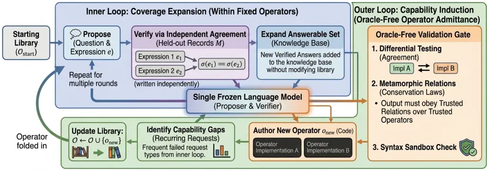
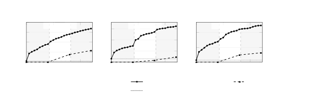
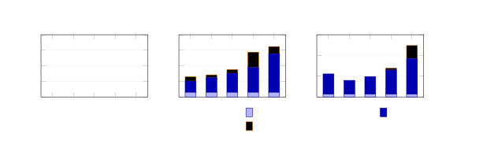
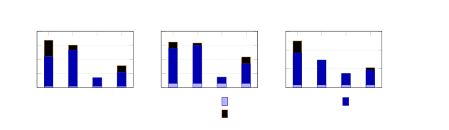
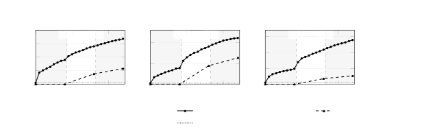
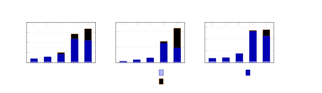
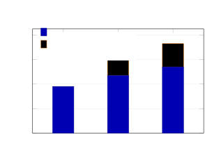

# A Self-Improving Agent that Grows its Own DSL: Oracle-Free Operator Induction for Exact Question Answering

Yun-Shiuan Chuang^(\*)    Yirou Ge^(\*)    Yixi Li^(\*)    Yiming Bian
   Zijie Pan Affiliation: Jenna L. Ballard, Uma Kona, Linsey Pang,
Prakhar Mehrotra Affiliation: PayPal AI

###### Abstract

A self-improving agent has to decide which new skills to keep, and in
practice it keeps whatever earns a high reward, convinces a judge model,
or compresses its library, even when the skill is wrong. That is fine
until the answers have to be exactly right: over a table of
transactions, a total is either right or wrong. We ask a harder
question: can an agent grow what it can compute with no reward, no
judge, and no answer key, and still be exactly right? A single frozen
model runs two nested loops over a small, exact _domain-specific
language_ (DSL). The inner loop answers new questions only when two
independently written expressions agree on every record. The outer loop
discovers its own missing capability and authors an operator for it,
admitted only when an independent second implementation agrees and the
result obeys a conservation law, all without ground truth. The inner
loop roughly triples the answerable-question set, and the outer loop
self-extends on disjoint starting sets, inventing operators outside the
starting closure; a no-induction control answers none of the new
questions. The admission rule is empirically sound: it rejects 138 of
138 buggy operator variants under an independent reference, even one
written by a different model family, where the admit-if-it-runs,
self-consistency, and compression signals the field relies on admit most
of them. Unmodified, the same mechanism self-extends on two further
domains with unrelated schemas, business-ledger and clinical-encounter
question answering, growing their answerable sets more than tenfold and
nearly twentyfold. The loop transfers across model families too: run
with further proposers, the gate stays sound and independent families
self-extend comparably, with only the induction yield tracking each
proposer’s DSL fluency.

|     |
| --- |
|     |

¹¹footnotetext: Equal contribution.

## 1 Introduction

Getting a language-model agent to improve itself is easy to want and
hard to trust. An agent can fine-tune its weights, rewrite its prompts,
or grow a library of skills (Wang et al., 2024a; Cai et al., 2024), and
in each case it keeps a new capability because that capability earned a
high reward (Romera-Paredes et al., 2024; Novikov et al., 2025),
convinced a judge model, or compressed the library (Ellis et al., 2021;
Grand et al., 2024; Wang et al., 2024b). With no ground truth, those are
about the best signals available. When the answers have to be exactly
right, they are not enough. A wrong skill can score well, satisfy a
judge, and compress the library as neatly as a correct one. Ask “how
much did my top buyer spend?” of a merchant’s transaction history and
the total is either right or wrong. We study self-improvement with no
teacher: can an agent expand what it can compute using no reward, no
judge, and no answer key, while every answer stays exactly checkable by
a trusted program?

One dependable route to exact answers is to have the model write a
program instead of doing the arithmetic in its head. Program-of-thoughts
methods (Chen et al., 2023) take this route. In our setting the program
is an expression in a small sandboxed _domain-specific language_ (DSL):
a set of operators that compose like code and run under a trusted
interpreter. But coverage is the limit. A fixed operator set
$`\mathcal{O}`$ answers exactly the questions you can build by composing
its operators, its closure $`\mathrm{cl}(\mathcal{O})`$. A per-group
total, when the DSL has only whole-table reductions, is simply out of
reach, and writing a fresh operator by hand for every question a domain
raises does not scale. So the agent has to grow its own DSL, adding the
operators its questions demand, without ever admitting one it cannot
verify. Think of a language with a fixed vocabulary: you can only say
what its words combine to express, so the agent has to coin new words. A
coined word is dangerous if no one can check what it means.

Whether this works then depends on the rule for admitting a new
operator. A rule built on reward, compression, or a model’s judgment
does not preserve exactness: a wrong operator can score well, compress
beautifully, or convince a judge, and even a judge that happens to be
right supplies no checkable guarantee (Appendix M). We hold a harder
line: an operator is admitted only on evidence that needs no answer key
and no judge. The model writes it twice, independently, and the two
implementations must agree on every record. It must also obey
conservation laws stated over the operators already trusted, the
simplest being that per-group totals add back up to the global total.
This rule is oracle-free but _empirical_, not a formal proof:
independent agreement is checked on a finite validation set within a
small numerical tolerance, and the conservation laws are the ones the
model states, so admission certifies an operator against targeted tests
rather than over all possible inputs.

The method is two nested loops (Figure 1, Appendix B), both run by a
single frozen model. The inner loop adds no operators. It proposes
questions it has not seen, answers each with one expression, and keeps
the answer only when a second expression, written from the question
alone, agrees on every record and computes something new. The outer loop
adds capability. When the model keeps asking for something outside
$`\mathrm{cl}(\mathcal{O})`$, it works out what is missing, writes an
operator for it, and puts it through the gate above. If the operator
passes, it joins the library and the inner loop runs again on the larger
set.

We make six contributions. First, a teacher-free basis for
self-improvement: an agent grows what it can compute using only evidence
that needs no answer key, two independently written programs that agree
on every record and conservation laws over operators it already trusts,
replacing the reward, judge, and compression signals that self-evolving
agents and library-learning systems (Grand et al., 2024; Wang et al.,
2024b) rely on. Second, a two-loop, single-model self-extending DSL
agent that instantiates it, with direct evidence the admission rule is
sound: it admits none of 138 buggy operator variants under an
independent reference, including ones built to slip past the agreement
check, and stays sound with the reference in a _separate_ call and from
a _different model family_, Gemma-3-27B (Gemma Team et al., 2025),
whereas admit-if-it-runs, self-consistency, and compression each admit
most. Third, a _gap-seeking_ use of the frozen model that surfaces and
ranks the capabilities its own questions demand but its operators cannot
express, so the agent picks what to add. Fourth, a controlled end-to-end
study on financial-transaction QA over a fully synthetic corpus (no real
customer data; Appendix A): the inner loop roughly triples coverage
across 13 starting sets, the outer loop extends three disjoint sets into
operators outside the original closure with a no-operator control
isolating them, and the grown DSL agrees exactly with an independent
human-authored gold extractor on every compute type. Fifth, evidence it
is not specific to merchant transactions: with no code changes beyond a
schema-adapting parser, the same loop self-extends on two further
domains, business-ledger and clinical-encounter QA (Appendices Q, R).
Sixth, evidence it is not tied to one model family: run with three
further proposers the gate stays sound for all, and two independent
families, Mistral-Small-24B (Mistral AI, 2025) and
Llama-3.3-70B (Grattafiori et al., 2024; Meta AI, 2024), self-extend
comparably, with yield tracking each proposer’s DSL fluency (§4.4).

## 2 Preliminaries: the base agent and the exact-verifiability invariant

The base agent answers a question about one record sequence by emitting
a single expression in the restricted DSL. Expressions are parsed to an
abstract syntax tree and evaluated by a sandboxed interpreter that
allows only a whitelisted set of node types and calls to bare,
registered functions; there is no attribute access, no arbitrary call
target, and no state. Every operator is a small, audited Python function
with exact numeric semantics. The invariant we preserve throughout is:
an answer is trusted only if it is computed by this interpreter, and a
new operator is trusted only if its correctness is established by
relations that hold independently of any single model’s judgment.

#### Notation.

We validate expressions on a fixed set of records $`M`$. For an
expression $`e`$, write $`\sigma(e)`$ for the vector of $`e`$’s values
across $`M`$, its _value signature_; two expressions with equal
signatures compute the same quantity on $`M`$. An operator set
$`\mathcal{O}`$ answers a question when some expression over
$`\mathcal{O}`$ matches the question’s value signature, and the set of
all such questions is the closure $`\mathrm{cl}(\mathcal{O})`$. The
inner loop enlarges the answerable set within a fixed
$`\mathrm{cl}(\mathcal{O})`$; the outer loop enlarges $`\mathcal{O}`$
itself, and hence $`\mathrm{cl}(\mathcal{O})`$.

#### Fixed starting point.

Every experiment begins from one fixed, minimal state: a small set of
seed question types and _exactly_ the operators needed to answer them,
and no others. That fixed start is the control that makes “extension”
meaningful: an operator the outer loop induces is genuinely new only if
it lies outside the closure of this fixed initial set, so we never leak
a target capability into the starting library.

#### Substrate and its boundary.

The loop grows the operator vocabulary but never alters a fixed
_substrate_: the raw data representation and an attribute-free,
first-order sandbox for operator bodies (Appendix D). This keeps exact
verifiability total, every induced operator composes over audited base
operators in a language too small to escape to arbitrary computation, so
the library stays auditable with no supervision. The substrate has a
precise, checkable _reach_; a gap needing something outside it (e.g.
banned attribute access) cannot be closed, and extending the reach is a
deliberate, logged act, not a relaxation of the invariant.

## 3 Method

Figure 1: The two nested loops, both run by a single frozen model with
no ground-truth oracle and no judge. The inner loop (blue) expands the
answerable set within a fixed operator set, keeping a question only when
two independently written expressions agree on every record
($`\sigma(e_{1})=\sigma(e_{2})`$). The outer loop (green) induces a new
operator when a capability gap recurs, admits it through the oracle-free
validation gate, and folds it into the library before re-running the
inner loop. Detailed in Section 3.

### 3.1 Inner loop: expanding coverage within a fixed operator set

Given a starting set of question types and a fixed operator set, the
inner loop (InnerLoop in Algorithm 1, Appendix B) runs four stages, all
by the frozen base model.

1.  1.  Propose. Shown a few example (question, expression) pairs, the model
        invents different natural questions one expression over the same
        data can answer; we draw many samples.
2.  2.  Execute. Each expression is evaluated on every validation record
        (held-out synthetic merchants, Appendix A) under an interpreter
        exposing _only_ the current operators; those calling an outside
        operator or not returning a single number are discarded.
3.  3.  Verify. The model then answers the _question text alone_,
        separately, and the proposal is kept only if this independently
        written expression matches the first on every record, strong
        evidence they compute the same quantity with no ground-truth answer.
4.  4.  Keep if new. A verified quantity counts only if its value across the
        records differs from every starting type and every quantity already
        accepted.

The inner loop adds no capability: everything recombines the current
operators, measuring how much larger the answerable set is than the
starting set.

### 3.2 Outer loop: inducing a new operator, verifiably

Restricted to a small operator set, the base model repeatedly reaches
the boundary of what it can express and _names_ the missing capability.
The outer loop (OuterLoop in Algorithm 1) turns such a recurring request
into a new operator in four steps: (1) discover the gap by tallying
which missing capability its questions most demand, and author an
operator; (2) validate it with no ground-truth answer; (3) re-run the
inner loop with the enlarged set; (4) report. Admission is gated, not
teacher-selected, so the agent attempts the top-$`K`$ gaps in rank order
($`K=3`$) and keeps the first admissible operator, so an un-inducible
top entry does not stall the loop, at no cost to soundness (Appendix V).

The most-requested capability is per-group aggregation, not expressible
by the 9 whole-table reducers. The model authors
per_group_sum$`(keys,values)`$, returning the per-key sum as a plain
list, written _method-free_ (bare calls and comprehensions over the seed
reducers, no attribute or method calls) as the sandbox of Section 2
requires; a list keeps the result composable, so
max(per_group_sum(buyer_ids, amounts)) answers “which buyer’s total
spend is highest” as one expression, unlocking a whole per-group family.
A per-group count is admitted the same way (group counts sum to the
record count), and its frequency comes with it; the mode _value_, a
non-numeric argmax with no conservation law, stays outside (Section 6).

#### Validation with no answer key.

A brand-new operator has nothing to check against, so we admit it the
way one trusts a new instrument with no reference standard: build it
twice, independently, and require the copies to agree, and require it to
obey conservation laws already trusted. Concretely, on the validation
records and fuzzed inputs (empty, singleton, duplicate-key, missing,
permuted):

1.  1.  _Two implementations agree_, i.e. differential testing (McKeeman,
        1998; Yang et al., 2011): the model builds the operator twice and
        the two must return equal value signatures across the records
        (relative tolerance $`10^{-6}`$). The reference is generated
        separately, shown only the question text and told to use a different
        coding style; Section 4.3 measures how much this independence buys,
        including when both copies share a mistake.
2.  2.  _Conservation and structure hold_, i.e. metamorphic relations (Chen
        et al., 1998; Segura et al., 2016) written only from already-trusted
        operators (e.g. per-group totals sum to the global total,
        sum(op(keys, amounts)) == sum(amounts); one result per distinct key;
        empty in, empty out; order invariance). Each relation must actually
        bind a trusted operator (a relation that is just True is rejected)
        and is checked on populated validation data; edge cases such as
        missing keys are covered by the differential fuzz inputs, so the
        gate declines rather than silently admits (Appendix I).
3.  3.  _The answers hold up downstream_: every question the operator
        unlocks must still pass the inner loop’s independent-agreement
        check.

No single test is an answer key; a wrong operator would have to pass all
of them together.

## 4 Experiments

#### Setup.

All runs use a single frozen mid-size open model, Qwen3.6-35B-A3B (Qwen
Team, 2026), no fine-tuning, reasoning off, temperature 1.0. Every
merchant-transaction experiment uses a fully synthetic merchant corpus
(Appendix A), sampled from aggregate statistics of a real transaction
distribution; no real user or customer record is used anywhere. (The
domain-transfer studies of §4.5 instead use BookSQL and EHRSQL over
MIMIC-III; see Appendices Q, R.) Each candidate is validated on a
held-out set of 63 synthetic merchants (43 in the text-to-SQL study),
held fixed across the trajectory run so its curve is comparable end to
end; the sampling budget is stated with each result and jobs run on B200
GPUs. Appendix C gives the environment and reproduction protocol, and
Appendices D to N detail the sandbox, prompts, seeds, and each
experiment’s protocol.

#### Overview.

Figure 2 shows the whole system running end to end on merchant
transactions and, with no code changes beyond a schema-adapting parser,
on two further domains with unrelated schemas: the inner loop expands
coverage within a fixed operator set, an outer-loop induction adds
operators that the loop then uses to climb further, and the run stops on
its own when the next gap has no checkable invariant.

Figure 2: One continuous closed-loop trajectory per domain.
Shaded/unshaded bands are successive inner-loop phases; each dashed
vertical line is an outer-loop induction ($`+n`$ operators admitted);
the solid line is cumulative answerable types and the dashed orange line
the subset whose expression uses an induced operator. Two rounds grow
the set $`10\to 336`$ (Merchant, amounts/timing seed), $`15\to 162`$
(BookSQL), and $`13\to 248`$ (EHRSQL) under the same namespace and gate.
Discussed in §4.2 and 4.5.

### 4.1 Inner loop: coverage expansion

From an amounts-and-timing starting set of 10 question types and 9
operators, one inner round proposes 82 candidate questions, of which 40
run to a single number on every record, 35 pass the
independent-expression check, and 26 are new quantities, so the
answerable set grows $`10\to 36`$ with _no new operator_. Repeating
(counting only what earlier rounds missed), the new counts are
$`26,18,9`$ as the total climbs $`36,54,63`$ (Table 2, Appendix F);
returns diminish, and a robust stopping rule is left to future work.

#### Robustness.

The expansion is not specific to one starting set: across 13 starting
sets (3 hand-chosen, 10 random) every one yields $`+9`$ to $`+39`$ new
verified types in a single round (mean $`+18.3`$), and across 8
sampling-budget settings the count never approaches zero.

#### Held-out validity against independent gold.

Coverage counts the loop’s own round-trip-verified types, so a fair
worry is that it certifies internal consistency but not correctness. As
an external check we score the DSL’s expressions against an
_independent_ gold-answer extractor (the leaderboard gold pipeline, with
separately-implemented answer functions); both are deterministic code,
so their agreement is a property of the code, not the corpus. Across
3,000 held-out merchants the DSL and the gold agree exactly on every
precise/compute type on non-truncated sequences, the only systematic
disagreement being the count-tie “busiest day/hour” categories (gold
breaks ties by dollar volume, the DSL by first occurrence). The growth
counts (e.g. $`10\to 336`$) thus measure the diversity of
exactly-computable quantities this proposer reaches and verifies, and
this check confirms they are computed correctly.

### 4.2 Outer loop: automated operator induction

The fully closed loop runs on three independent starting sets, each with
the minimal operator set that answers its seed types and each _inducing
from its own_ operators (Appendix F): amounts/timing (9 operators),
top-buyer (8), and timing (15). Each set _discovers its own gap_ by
tallying which capabilities its questions most demand outside its
closure, then _authors_ operators to close it, admitted only on evidence
needing no answer key. The gap differs by set (amounts/timing and timing
most-request a _mode_ reducer, top-buyer a _count_), but in every set it
lies in the same family, per-group aggregation, that none can express,
and the loop self-extends: each set admits 2 to 6 distinct per-group
operators with no oracle (deduplicated by value signature). The
workhorse is per_group_sum; a count gap instead admits a per-group
_count_ on the analogous conservation law. The gate rejects other drafts
on the failure modes it should (reverted method calls, disagreement, a
false relation), and the admitted operators span several families, not
per-group alone (filtering, thresholding, binning, distinct counts;
Appendix T). Self-extension does not depend on co-generating the
reference: with a separate-call reference each set still self-extends,
admission yield $`14\pm 7.4`$, $`2.4\pm 0.8`$, $`4.6\pm 1.5`$ operators,
positive in $`5/5`$ runs (Appendices U, V).

#### The induced operators are used, and a control isolates them.

Re-running the inner loop with the enlarged set (Table 3), a meaningful
share of newly answerable types call an operator admitted this round:
$`25`$ of $`65`$ (amounts/timing), $`6`$ of $`62`$ (top-buyer), $`2`$ of
$`66`$ (timing), all per-group totals, counts, or derived statistics no
composition of the starting operators could express. The control (same
round, no new operator) yields new types but _zero_ using any per-group
operator, isolating induction as the cause.

#### The loop chains across rounds.

With round-1 operators in the library, the model discovers a _further_
gap and induces more operators outside the enlarged closure ($`2`$,
$`4`$, $`1`$ for amounts/timing, top-buyer, timing, closing a
weighted-mode, equality, and argmax gap), and uses them: cumulatively
$`116`$, $`254`$, and $`53`$ of each set’s answerable types call an
induced operator (Figure 5, Table 3), so the extension _compounds_
rather than repeating.

#### Two further growth modes.

The three disjoint seeds converge on a shared answerable set, each
computing the same quantities through independently authored per-group
operators admitted to identical values; and the same discipline supports
verified _compression_, folding a recurring pattern into a named
operator admitted only if equivalent to the pattern on every record,
unlike library-learning systems that refactor and trust the result
(Ellis et al., 2021) (Appendices S, J).

### 4.3 Gate soundness: a mutation study

The gate admits operators with no answer key, so a fair worry is that it
rubber-stamps a plausible but wrong one. For each admitted operator we
generate every single-point mutation of its implementation; a mutant
that still matches the original on every input is discarded as
equivalent, leaving 138 genuinely buggy mutants across the 14 operators
(the original labels mutants only; the gate never sees it). Each runs
through the same gate under two threat models (Appendix K, Table 1).
With an independent reference, the setting the loop uses, the
false-admit rate is $`0/138`$: differential testing kills all 138. In
the _correlated_ worst-case, where the identical bug is written into
both implementations so differential is blind, the metamorphic
conservation checks still leave only 10 admitted ($`10/138`$). The two
layers are complementary, independent agreement catches independent
mistakes and conservation against trusted primitives catches shared
ones, and the residual $`10/138`$ arises only when independence is
deliberately defeated, which motivates the protocol below.

#### Independence: the reference need not be co-generated.

The implementation and its reference are written in one response, so a
fair objection is that the differential is not a genuine independence
test, a shared error could sit in both. We re-run the mutation study
with the reference generated in a _separate_ call, conditioned only on
the operator’s name, signature, and one-line spec and never shown the
implementation. A fully independent reference still admits $`0/138`$
buggy mutants, matching the co-generated setting, so soundness does not
depend on co-generation. The reference need not even come from the same
model: written by a different family, Gemma-3-27B, it still admits
$`0/138`$ (Appendix U).

#### A gate component ablation.

Toggling each layer over the same pool (Table 1) shows the two
verification layers are complementary: differential testing kills all
138 buggy mutants under an independent reference ($`0/138`$) but is
defeated when the same bug is co-written into both implementations
($`129/138`$), the regime the metamorphic conservation checks cover
instead ($`10/138`$ on their own, and the full gate’s $`10/138`$
correlated worst-case versus $`0/138`$ under the independent reference
the loop uses); the method-free sandbox alone admits $`129/138`$.
Precision is high but not perfect: $`1`$ of the $`14`$ correct operators
is rejected, by a mis-stated relation rather than a wrong value, and the
outcome is invariant to validation-set size ($`0/138`$ at $`N=3`$ to
$`63`$; Appendices W, K).

| Configuration          | Threat model | Buggy   | Adv. | False rej. |
| ---------------------- | ------------ | ------- | ---- | ---------- |
| Compile-only (sandbox) | n/a          | 129/138 | 6/6  | 0/14       |
|    +differential       | uncorrelated | 0/138   | 4/6  | 0/14       |
|    +differential       | correlated   | 129/138 | 6/6  | 0/14       |
|    +metamorphic        | n/a          | 10/138  | 5/6  | 1/14       |
| Full gate              | uncorrelated | 0/138   | 4/6  | 1/14       |
| Full gate              | correlated   | 10/138  | 5/6  | 1/14       |

Table 1: Gate-component ablation on the mutation/adversarial pool (14
operators, their 138 buggy single-point mutants, and 6 adversarial
constructions; 63 merchants), each check toggled independently; the
threat model is uncorrelated (independent reference) or correlated
(reference carries the same bug). _Buggy_, _Adv._, and _False rej._
count false-admits over the 138 mutants, admits of the 6 adversarial
constructions, and wrongful rejections of the 14 correct operators.

#### No teacher-free signal substitutes for the gate.

Two natural alternatives fail where the gate does not (Table 1):
admitting whatever runs (the no-oracle analog of library-learning
admission) and self-consistency each admit $`129/138`$ buggy operators
and a reuse/compression rule $`101/138`$, while asking the frozen model
to judge correctness wrongly rejects 2 of 14 correct operators with none
of the gate’s checkable basis (Appendices X, M).

#### Adversarial constructions bound the guarantee.

A bug _designed with full knowledge of what the gate checks_ can pass: a
conservation-preserving _relabeling_ of a per-group output defeats every
symmetric relation, but harmlessly, since the sandbox exposes no keyed
lookup that could surface it; and a size-changing merge escapes only
when its witnessing relation names a bare builtin rather than a trusted
operator (the study’s single false admit). Both are characterized rather
than hidden, and re-validating with one added call simulating keyed
access catches every relabeling under an independent reference ($`4/4`$;
Appendix L).

### 4.4 The mechanism transfers across base models

Everything so far runs on one base model. To check self-extension is a
property of the method, we re-run the entire outer loop with four Qwen3
_dense_ models (Yang et al., 2025) (4B/8B/14B/32B) across all three
domains (Figure 3); the 35B-A3B main model is a later-generation
mixture-of-experts ($`\approx`$3B active parameters), read as a
cross-architecture point rather than the top of a size axis. The
seed-sensitivity companion across all three merchant seeds is in
Figure 6 (Appendix P).

The gate stays sound at every scale on every domain: no wrong operator
is admitted by any model, and where induction fails the model simply
wrote nothing admissible. Induction fires across the size range, not
only at the top, though not monotonically: every dense model except 8B
self-extends on merchant amounts/timing, 32B on all three merchant
seeds, every dense model on BookSQL, and only 32B on EHRSQL. The 35B-A3B
main model self-extends on every merchant seed and both transfer domains
despite far fewer active parameters than the largest dense model, so
what the gate gates on tracks capability, not active-parameter count or
architecture (per-model counts in Appendix P).

We read the ladder for gate soundness and whether induction fires, not
as a coverage ranking: absolute height on the metadata-rich
BookSQL/EHRSQL schemas is volume-sensitive (a weaker model emitting more
candidate expressions accumulates more verified signatures), a bounded
effect that does not reach the growth claims (Appendix P).

Figure 3: Base-model ablation: the same outer loop run with five base
models per domain, in the stacked convention of Figure 2 (light: initial
seed types; solid: additional types expressible with the seed operators;
hatched: types needing an induced operator; label: operators admitted).
4B/8B/14B/32B are Qwen3 dense models and 35B is the Qwen3.6-35B-A3B main
model. Read for gate soundness and whether induction fires, not as a
cross-model coverage ranking (absolute coverage is volume-sensitive;
§4.4, Appendix P).

#### Three further model families.

To check the mechanism is not tied to Qwen, we re-run the entire closed
loop, same frozen prompt and gate, with three independent families as
the proposer, Mistral-Small-24B, Gemma-3-27B, and Llama-3.3-70B
(Figure 4, Table 11). The gate stays sound for all four families: no
wrong operator is admitted by any family on any domain or seed.
Induction transfers too: Mistral and Llama both drive the loop to fresh
coverage and induce sound operators (Mistral on four of five conditions,
Llama on all five), so the oracle-free co-evolution of scope and
operators is a property of the method, not one model. Yield tracks DSL
fluency: Gemma’s expressions execute far less often (median $`13\%`$ vs
$`31\%`$/$`34\%`$ for Mistral/Llama), so it self-extends only on the
timing seed while still never admitting a wrong operator.

Figure 4: Cross-family transfer: the same closed loop, same frozen
prompt and gate, with four proposer _families_ (Qwen3.6-35B-A3B,
Mistral-Small-24B, Gemma-3-27B, Llama-3.3-70B) on the three domains, in
the stacked convention of Figure 3. The gate stays sound for every
family (zero false admits throughout), and two further families
self-extend (Mistral on Merchant and BookSQL, Llama on all three). Read
for soundness and induction, not coverage ranking; per-family compile
rates and the three-seed companion are in Table 11 (§4.4).

#### Comparison to a text-to-SQL baseline.

As a substrate comparison (a fixed general query language vs. a growing
exact DSL, illustrative rather than a headline), the same model emits
SQLite for each verified pair, scored against the DSL’s exact answer
with the median and population-standard-deviation aggregates SQLite
lacks granted. SQL is capable but brittle, strong on flat aggregation
but model-, stack-, and prompt-sensitive on ordered and per-group
queries, whereas the DSL is exact by construction, uniform across every
category and model, and concise (Table 8, Appendix N).

### 4.5 The mechanism generalizes across domains

Everything so far runs on merchant transactions. To check self-extension
is a property of the mechanism, not of one schema, we run the unmodified
loop, same namespace, same gate, no new harness code beyond a
schema-adapting parser, on two further domains (Figure 2).
BookSQL (Kumar et al., 2024) (business-ledger accounts): seeded from 15
question types and 9 operators, two induction rounds grow the answerable
set $`15\to 162`$, more than tenfold, both closing a per-group gap
(Appendix Q). EHRSQL (Lee et al., 2022) (clinical encounters over
MIMIC-III (Johnson et al., 2016)): seeded from 13 types, the same loop
grows the set $`13\to 248`$, nearly twentyfold, closing a per-group gap
then a conditional-filter gap (Appendix R). Both capability families are
ones the merchant operator census already spans (Appendix T): the
mechanism finds the same small set of missing capabilities wherever a
transaction-shaped schema hides them.

### 4.6 Human validation of the generated items

As an external check, three annotators independently and blindly rated a
stratified sample of $`150`$ generated questions and all $`53`$ induced
operators without seeing the gate’s decisions. A majority judged
$`89\%`$ of the DSL expressions faithful and $`97\%`$ of the questions
well-formed, and for all $`53`$ operators the annotators unanimously
agreed the two independent implementations compute the same function,
the property the gate certifies automatically (Appendix Y).

## 5 Related work

Library learning / DSL induction. DreamCoder (Ellis et al., 2021) learns
reusable abstractions by wake-sleep library learning, LILO (Grand
et al., 2024) compresses LLM-written programs into a reusable library,
and TroVE (Wang et al., 2024b) grows and trims a toolbox of functions;
all build reusable abstractions from solved or executable tasks, whereas
our gate uses no answer key, admitting only on agreement between two
independent implementations and conservation laws over trusted
operators. We isolate this: the LLM-judge baseline (Appendix M) and the
compile-only ablation (Table 1) are the “admit by judgment” and “admit
if it runs” proxies, both admitting wrong operators the gate rejects.
Verifier-guided program discovery. FunSearch (Romera-Paredes et al., 2024) and AlphaEvolve (Novikov et al., 2025) score candidates against an
objective and keep the best; our gate has no objective and no
competition, admitting or rejecting once by agreement and conservation.
Self-extending agents. Voyager (Wang et al., 2024a), LATM (Cai et al.,
2024), and CREATOR (Qian et al., 2023) grow skill/tool libraries where a
tool earns its place by working on tasks or by the model’s judgment,
whereas ours are exact DSL operators admitted with no task reward and no
judge. Program-of-thoughts. PoT (Chen et al., 2023) has the model emit a
program and delegates the computation to an interpreter over a fixed set
of primitives; our agent is likewise a program emitter, but its operator
set grows through oracle-free induction, so PoT is the special case of
one fixed operator set. Verification without a judge. Our checks combine
hardened self-consistency (Wang et al., 2023), differential testing
(McKeeman, 1998; Yang et al., 2011), and oracle-free metamorphic testing
(Chen et al., 1998; Segura et al., 2016) into an admission gate for
self-authored operators; like POET (Wang et al., 2019), our asker
co-evolves against the operator library.

## 6 Conclusion and limitations

We presented a two-loop, single-model system that grows its own DSL
under an oracle-free admission rule: an inner loop triples coverage, and
an outer loop invents operators verified with no answer key. It
transfers unmodified to two further domains and stays sound across four
model families.

#### Limitations.

\(i\) The most-requested capability across every seed and domain, a
most-frequent-value (mode) reducer, is permanently out of reach: it is
the top-ranked gap everywhere and has no conservation law, so only the
mode _value_ (a non-numeric argmax) stays outside, while per-group count
and frequency are admitted like per-group sum (Appendix O). (ii) We
demonstrate up to three induction rounds per seed across all three
seeds, none stalling (Appendix G); scaling to many rounds is untested.
(iii) Admission yield is modest, most drafts rejected because the
different-style reference reverts to sandbox-forbidden method calls
($`81\%`$ of rejections), a throughput cost that leaves soundness
unaffected (Appendix W). (iv) A declared relation only binds if it names
another trusted operator (Section 4.3): a relabeling defeats the gate
harmlessly (no legal question surfaces it), and a size-changing bug
escapes if its only witnessing relation is a bare builtin, needing a
sandbox-level fix. (v) All three seeds center on per-group aggregation,
what transaction QA most demands; the 16 operators still span four
families (Appendix T), but a seed around a qualitatively unrelated gap
is untested, though we test transfer across _domains_ (§4.5).

## Reproducibility Statement

All merchant-transaction experiments run on a fully synthetic corpus of
merchant transaction histories (Appendix A) that matches the
distribution of real merchant transactions without using any customer
data; the supplementary code includes the three generator scripts and
the aggregate parameter file they sample from, so the corpus regenerates
by a single command with no access to proprietary data. The two
domain-transfer studies (§4.5) instead run on BookSQL and
MIMIC-III/EHRSQL, external research benchmarks obtained from their own
sources under their own release terms (Appendices Q, R). The
supplementary code contains the DSL and its tests, the inner- and
outer-loop agent with the exact prompts, every study and ablation, the
seed question sets, and a top-level README with the environment setup
and per-script commands. Given the sampled expressions, every admission
check (execution, value-signature comparison, differential and
metamorphic tests) is deterministic, so every reported result
regenerates from the released scripts.

## Ethics Statement

All merchant-transaction experiments (everything outside §4.5) run on a
fully synthetic corpus (Appendix A) containing no real customer data.
The domain-transfer study additionally uses two existing public research
benchmarks, rather than any newly collected data: BookSQL
(business-ledger records) and EHRSQL (clinical encounters). EHRSQL is
built over MIMIC-III, a de-identified critical-care database released
for research under PhysioNet’s credentialed-access Data Use Agreement;
we obtained MIMIC-III through PhysioNet’s credentialed-access process
and reproduced our EHRSQL results from it. We attempt no
re-identification, and this paper reports only aggregate, cohort-level
statistics (accuracy percentages, operator counts, coverage numbers); no
patient-level record, free-text note, or identifier appears anywhere in
the paper.

## Use of Large Language Models

In preparing this manuscript, the authors used an AI coding assistant
(Claude Code) to draft and revise prose in the results and appendix
sections, and to produce and iterate on LaTeX figures and tables.

## References

- Cai et al. (2024) Tianle Cai, Xuezhi Wang, Tengyu Ma, Xinyun Chen, and
  Denny Zhou. Large language models as tool makers. In _The Twelfth
  International Conference on Learning Representations_, 2024. URL
  [https://openreview.net/forum?id=qV83K9d5WB](https://openreview.net/forum?id=qV83K9d5WB).
- Chen et al. (1998) Tsong Y. Chen, Shing C. Cheung, and Siu M. Yiu.
  Metamorphic testing: A new approach for generating next test cases.
  Technical Report HKUST-CS98-01, Department of Computer Science, Hong
  Kong University of Science and Technology, 1998.
- Chen et al. (2023) Wenhu Chen, Xueguang Ma, Xinyi Wang, and William W.
  Cohen. Program of thoughts prompting: Disentangling computation from
  reasoning for numerical reasoning tasks. _Transactions on Machine
  Learning Research (TMLR)_, 2023.
- Ellis et al. (2021) Kevin Ellis, Catherine Wong, Maxwell Nye, Mathias
  Sablé-Meyer, Lucas Morales, Luke Hewitt, Luc Cary, Armando
  Solar-Lezama, and Joshua B. Tenenbaum. DreamCoder: Bootstrapping
  inductive program synthesis with wake-sleep library learning. In
  _Proceedings of the ACM SIGPLAN International Conference on
  Programming Language Design and Implementation (PLDI)_, 2021.
- Gemma Team et al. (2025) Gemma Team, Aishwarya Kamath, Johan Ferret,
  Shreya Pathak, Nino Vieillard, Ramona Merhej, Sarah Perrin, Tatiana
  Matejovicova, Alexandre Ramé, Morgane Rivière, et al. Gemma 3
  technical report. _arXiv preprint arXiv:2503.19786_, 2025.
- Grand et al. (2024) Gabriel Grand, Lionel Wong, Maddy Bowers, Theo X.
  Olausson, Muxin Liu, Joshua B. Tenenbaum, and Jacob Andreas. LILO:
  Learning interpretable libraries by compressing and documenting code.
  In _International Conference on Learning Representations
  (ICLR)_, 2024.
- Grattafiori et al. (2024) Aaron Grattafiori et al. The Llama 3 herd of
  models. _arXiv preprint arXiv:2407.21783_, 2024. Llama-3 architecture
  reference.
- Gwet (2008) Kilem Li Gwet. Computing inter-rater reliability and its
  variance in the presence of high agreement. _British Journal of
  Mathematical and Statistical Psychology_, 61(1):29–48, 2008. doi:
  10.1348/000711006X126600.
- Johnson et al. (2016) Alistair E. W. Johnson, Tom J. Pollard, Lu Shen,
  Li-wei H. Lehman, Mengling Feng, Mohammad Ghassemi, Benjamin Moody,
  Peter Szolovits, Leo Anthony Celi, and Roger G. Mark. MIMIC-III, a
  freely accessible critical care database. _Scientific Data_,
  3(1):160035, 2016.
- Kumar et al. (2024) Rahul Kumar, Amar Raja Dibbu, Shrutendra Harsola,
  Vignesh Subrahmaniam, and Ashutosh Modi. BookSQL: A large scale
  text-to-SQL dataset for accounting domain. In _Proceedings of the 2024
  Conference of the North American Chapter of the Association for
  Computational Linguistics: Human Language Technologies (Volume 1: Long
  Papers)_, pp. 497–516, 2024.
- Lee et al. (2022) Gyubok Lee, Hyeonji Hwang, Seongsu Bae, Yeonsu Kwon,
  Woncheol Shin, Seongjun Yang, Minjoon Seo, Jong-Yeup Kim, and Edward
  Choi. EHRSQL: A practical text-to-SQL benchmark for electronic health
  records. In S. Koyejo, S. Mohamed, A. Agarwal, D. Belgrave, K. Cho,
  and A. Oh (eds.), _Advances in Neural Information Processing Systems_,
  volume 35, pp. 15589–15601. Curran Associates, Inc., 2022. doi:
  10.52202/068431-1134. URL
  [https://proceedings.neurips.cc/paper_files/paper/2022/file/643e347250cf9289e5a2a6c1ed5ee42e-Paper-Datasets_and_Benchmarks.pdf](https://proceedings.neurips.cc/paper_files/paper/2022/file/643e347250cf9289e5a2a6c1ed5ee42e-Paper-Datasets_and_Benchmarks.pdf).
- McKeeman (1998) William M. McKeeman. Differential testing for
  software. _Digital Technical Journal_, 10(1):100–107, 1998.
- Meta AI (2024) Meta AI. Llama-3.3-70B-Instruct.
  [https://huggingface.co/meta-llama/Llama-3.3-70B-Instruct](https://huggingface.co/meta-llama/Llama-3.3-70B-Instruct), 2024.
  Released 2024-12-06.
- Mistral AI (2025) Mistral AI. Mistral Small 3.
  [https://mistral.ai/news/mistral-small-3/](https://mistral.ai/news/mistral-small-3/), 2025.
  Mistral-Small-24B-Instruct-2501.
- Novikov et al. (2025) Alexander Novikov, Ngân Vũ, Marvin Eisenberger,
  Emilien Dupont, Po-Sen Huang, Adam Zsolt Wagner, Sergey Shirobokov,
  Borislav Kozlovskii, Francisco J. R. Ruiz, Abbas Mehrabian, M. Pawan
  Kumar, Abigail See, Swarat Chaudhuri, George Holland, Alex Davies,
  Sebastian Nowozin, Pushmeet Kohli, and Matej Balog. AlphaEvolve: A
  coding agent for scientific and algorithmic discovery. _arXiv preprint
  arXiv:2506.13131_, 2025.
- Qian et al. (2023) Cheng Qian, Chi Han, Yi Fung, Yujia Qin, Zhiyuan
  Liu, and Heng Ji. CREATOR: Tool creation for disentangling abstract
  and concrete reasoning of large language models. In _Findings of the
  Association for Computational Linguistics: EMNLP 2023_, pp.
  6922–6939, 2023.
- Qwen Team (2026) Qwen Team. Qwen3.6-35B-A3B: Agentic coding power, now
  open to all, April 2026. URL
  [https://qwen.ai/blog?id=qwen3.6-35b-a3b](https://qwen.ai/blog?id=qwen3.6-35b-a3b).
- Romera-Paredes et al. (2024) Bernardino Romera-Paredes, Mohammadamin
  Barekatain, Alexander Novikov, Matej Balog, M Pawan Kumar, Emilien
  Dupont, Francisco JR Ruiz, Jordan S Ellenberg, Pengming Wang, Omar
  Fawzi, et al. Mathematical discoveries from program search with large
  language models. _Nature_, 625(7995):468–475, 2024.
- Segura et al. (2016) Sergio Segura, Gordon Fraser, Ana Belén Sánchez,
  and Antonio Ruiz-Cortés. A survey on metamorphic testing. _IEEE
  Transactions on Software Engineering_, 42(9):805–824, 2016.
- Wang et al. (2024a) Guanzhi Wang, Yuqi Xie, Yunfan Jiang, Ajay
  Mandlekar, Chaowei Xiao, Yuke Zhu, Linxi Fan, and Anima Anandkumar.
  Voyager: An open-ended embodied agent with large language models.
  _Transactions on Machine Learning Research_, 2024a. ISSN 2835-8856.
  URL
  [https://openreview.net/forum?id=ehfRiF0R3a](https://openreview.net/forum?id=ehfRiF0R3a).
- Wang et al. (2019) Rui Wang, Joel Lehman, Jeff Clune, and Kenneth O
  Stanley. Paired open-ended trailblazer (POET): Endlessly generating
  increasingly complex and diverse learning environments and their
  solutions. _arXiv preprint arXiv:1901.01753_, 2019.
- Wang et al. (2023) Xuezhi Wang, Jason Wei, Dale Schuurmans, Quoc Le,
  Ed Chi, Sharan Narang, Aakanksha Chowdhery, and Denny Zhou.
  Self-consistency improves chain of thought reasoning in language
  models. In _International Conference on Learning Representations
  (ICLR)_, 2023.
- Wang et al. (2024b) Zhiruo Wang, Graham Neubig, and Daniel Fried.
  TroVE: Inducing verifiable and efficient toolboxes for solving
  programmatic tasks. In Ruslan Salakhutdinov, Zico Kolter, Katherine
  Heller, Adrian Weller, Nuria Oliver, Jonathan Scarlett, and Felix
  Berkenkamp (eds.), _Proceedings of the 41st International Conference
  on Machine Learning_, volume 235 of _Proceedings of Machine Learning
  Research_, pp. 51177–51191. PMLR, 21–27 Jul 2024b. URL
  [https://proceedings.mlr.press/v235/wang24az.html](https://proceedings.mlr.press/v235/wang24az.html).
- Yang et al. (2025) An Yang, Anfeng Li, Baosong Yang, Beichen Zhang,
  Binyuan Hui, Bo Zheng, Bowen Yu, Chang Gao, Chengen Huang, Chenxu Lv,
  et al. Qwen3 technical report. _arXiv preprint
  arXiv:2505.09388_, 2025.
- Yang et al. (2011) Xuejun Yang, Yang Chen, Eric Eide, and John Regehr.
  Finding and understanding bugs in C compilers. In _Proceedings of the
  32nd ACM SIGPLAN Conference on Programming Language Design and
  Implementation (PLDI)_, pp. 283–294, 2011.

## Appendix A Dataset: a synthetic transaction corpus

Every merchant-transaction experiment in this paper (all results outside
§4.5) runs on a _fully synthetic_ corpus of merchant transaction
histories. No real user or customer data is used anywhere in these
experiments: not in training, validation, induction, gate evaluation, or
the held-out check. (The domain-transfer studies use BookSQL, a public
benchmark, and EHRSQL over MIMIC-III, a credentialed-access clinical
database under PhysioNet’s Data Use Agreement; both are unrelated to
this corpus, and Appendices Q, R describe their own, separate
provenance.) To keep the corpus realistic, we fit _only aggregate_
statistics of a real merchant-transaction distribution (quantile grids
and frequency tables, never individual records) and sample fresh
merchants from those statistics under standard generative assumptions
(empirical marginals, a Zipf buyer-frequency skew, and clustered
active-day timestamps). The synthetic corpus therefore matches the real
distribution on the properties the operators and questions exercise,
while no record, identifier, timestamp, or field is copied from or
derived from any individual. The aggregate-fitted generator and the
aggregate parameter file it samples from are free of customer-derived
rows, so the corpus regenerates, and the entire pipeline runs, with no
access to any proprietary data.

#### What a record is.

Each merchant is a chronological sequence of transactions; each
transaction has an amount, a timestamp (with weekday, hour, date), a
buyer identifier, a buyer country, a buyer account age, and a
guest/registered flag, plus per-merchant scalars (category, country,
account age, distinct-buyer and transaction counts). This is the schema
the interpreter parses (Appendix E).

#### Generation (three scripts, all in the supplementary code).

synth_stats.py reads a real corpus and writes _only_ aggregate
statistics to a params file: quantile grids for amounts, transaction
counts, account ages, inter-transaction gaps, and the distinct-buyer and
active-day ratios; frequency tables for weekday, hour, buyer country,
category, and merchant country; a guest rate; and a Zipf exponent for
buyer-frequency skew. No raw record leaves this step. synth_gen.py then
samples fresh merchants: transaction counts, amounts, and ages from the
empirical marginals; timestamps by placing transactions on a smaller set
of weekday-seasonal _active days_ (reproducing the bimodal
intra-day/inter-day gap structure); buyers by a Zipf process with
guaranteed coverage (reproducing the buyer-frequency skew per-group
operators rely on); and _freshly minted_ buyer identifiers. Per-buyer
country, guest status, and account age are held consistent across a
buyer’s transactions.

#### Fidelity.

We validate the match by re-extracting the aggregate statistics from the
synthetic corpus and comparing to the real params (synth_fidelity.py).
On the operator-relevant fields the match is tight: median relative
error is $`0.000`$ for transaction count, $`0.002`$ for merchant age,
$`0.014`$ for the distinct-buyer ratio, $`0.004`$ for amount, and
$`0.054`$ for buyer age; the total-variation distance between the real
and synthetic frequency tables is $`\leq 0.02`$ for weekday, hour, buyer
country, category, and merchant country; the guest rate ($`0.090`$ vs
$`0.090`$) and buyer-frequency Zipf exponent ($`0.90`$ vs $`0.92`$)
match. The inter-transaction gap distribution matches in scale and tail
(median $`5.0`$h vs $`7.2`$h, $`90`$th percentile $`324`$h vs $`309`$h);
it slightly under-represents the near-instant burst tail, which does not
affect the results, since the gap-based operators test exact computation
on whatever gaps occur.

#### Sizes.

We generate $`12{,}000`$ synthetic merchants; the coverage, induction,
mutation, and adversarial studies each draw a 63-merchant validation set
from this corpus. The DSL’s expression map is additionally cross-checked
against the independent gold extractors, whose comparison logic is
validated by a self-test over all 50 question types (agreement is a
property of the two deterministic implementations, not of the corpus).

## Appendix B Algorithm listing

Figure 1 (main text, Section 3) diagrams both loops; Algorithm 1 gives
them as pseudocode.

1: procedure InnerLoop(starting question types $`T`$, operators $`O`$,
records $`M`$)

2:   $`K\leftarrow\{\,\textsc{sig}(t,M):t\in T\,\}`$ $`\triangleright`$
quantities already answerable

3:   repeat

4:    for each $`(q,e)`$ the model proposes as a (question, expression)
pair using only $`O`$ do

5:      $`s\leftarrow\textsc{Evaluate}(e,M)`$ $`\triangleright`$ skip if
$`e`$ uses an operator $`\notin O`$ or is not a single number

6:      $`E^{\prime}\leftarrow\textsc{AnswerFromQuestion}(q)`$
$`\triangleright`$ expressions written from the question text alone

7:      if some $`e^{\prime}\in E^{\prime}`$ has
$`\textsc{sig}(e^{\prime},M)=s`$ and $`s\notin K`$ then

8:       add $`s`$ to $`K`$;   record the question type $`(q,e)`$
$`\triangleright`$ agreement + not seen before

9:      end if

10:    end for

11:   until a full pass adds nothing to $`K`$

12:   return the recorded question types

13: end procedure

14:

15: procedure OuterLoop(operators $`O`$, records $`M`$, a request
outside the closure of $`O`$)

16:
  $`(f,f^{\prime})\leftarrow\textsc{Induce}(\text{missing capability})`$
$`\triangleright`$ model writes TWO independent implementations

17:
  $`ok\leftarrow\textsc{Differential}(f,f^{\prime},M)\ \wedge\ \textsc{Metamorphic}(f,M)`$
$`\triangleright`$ agree on every input; obey trusted relations

18:   if $`ok`$ then

19:    return
$`\textsc{InnerLoop}(\text{starting types},\ O\cup\{f\},\ M)`$
$`\triangleright`$ admit; downstream round-trip re-checks each type

20:   else

21:    return reject $`f`$ $`\triangleright`$ admitting it would break
exact verifiability

22:   end if

23: end procedure

Algorithm 1 Self-extending DSL agent. Both loops run on a frozen base
model $`\pi`$ with no ground-truth oracle and no LLM judge.
$`\textsc{sig}(e,M)`$ is expression $`e`$’s value vector over the
validation records $`M`$; equal signatures mean equal quantities.
Metamorphic checks conservation and structural relations stated over the
trusted primitives (Appendix I).

## Appendix C Reproducibility and environment

All runs use a single frozen base model, Qwen3.6-35B-A3B, served with
vLLM on NVIDIA B200 GPUs (one GPU per job). The model is never
fine-tuned and its reasoning traces are disabled; sampling uses
temperature $`1.0`$ and top-$`p`$ $`0.95`$. Randomness enters only
through sampling: given the sampled expressions, every downstream check
(execution, value-signature comparison, differential and metamorphic
tests) is deterministic. The default budgets are: $`64`$ operator drafts
per induction, $`24`$ generations for autonomous gap discovery with
$`12`$ questions requested each, $`1`$ repair retry, $`4`$ independent
answers per question in verification, and up to $`2048`$ new tokens per
generation. The outer-loop induction, mutation soundness,
adversarial-operator, independence, repeated-run variance,
admission-baseline, operator-family, and text-to-SQL studies are each
regenerated by a single fixed command; the released
inner_loop/OUTPUTS.md maps every result file each command produces to
the table, figure, or number it backs. Table 3, for instance, is
produced by the closed_loop_ps\_\* runs (63 merchants), not the earlier
same-named 203-merchant closed_loop\_{round1,buyer,timing} run that
survives only as the text-to-SQL script’s default evaluation set. The
exact commands, the harness, prompts, and seed sets are provided in the
supplementary materials.

## Appendix D The DSL sandbox and the method-free operator subset

Two sandboxes enforce the exact-verifiability invariant.

#### Expression sandbox (answers).

A candidate answer is a single expression, parsed to an abstract syntax
tree and evaluated under an allowlist of node types. It permits literals
and collections, arithmetic and comparison, indexing and slicing, and
calls whose target is a bare registered name. It forbids attribute
access (no x.y), imports, the \*\* operator, comprehensions with side
effects, assignment, any name beginning with a double underscore, and
calls to arbitrary expressions. Built-ins are emptied and only the
registered operators are in scope. A per-evaluation wall-clock timeout
(via SIGALRM) bounds every call.

#### Operator-body sandbox (induced operators).

A new operator is one method-free function definition, compiled under a
superset of the expression allowlist that additionally permits def,
arguments, return, assignment and augmented assignment, bounded for, if,
pass, break, continue, and list/dict/set comprehensions. It still
forbids attribute access and therefore any method call (no .append,
.get, .items), imports, while, \*\*, dunder names, and recursion. A call
target must be a bare name or an element of a local table,
tbl\[key\](...), which supports a dispatch table of reducers without a
method call. The available callables are a fixed builtin whitelist (len,
sum, min, max, sorted, zip, range, enumerate, set, dict, list, any, all,
abs, round) plus the operators already trusted. Each induced operator
runs under the same per-call timeout. Because the subset is first-order
and attribute-free, an induced operator cannot escape to arbitrary
computation, so the growing library stays auditable with no supervision.

## Appendix E Prompts

All prompts are issued to the same frozen model. The data schema shared
by the prompts is:

Per-transaction lists (index-aligned): amounts (\$ floats), timestamps
(datetimes),

hours (0-23), weekdays (names), dates, buyer_ids, buyer_countries,

buyer_ages_days, is_guest.

Merchant scalars: total_transactions, distinct_buyers,
merchant_age_days,

merchant_category, merchant_country.

#### Autonomous gap discovery.

The model is given only the current operators and asked to propose
natural questions, writing a new operator name where the current set
cannot express one:

You are a financial-data analyst with a small calculator over one
merchant’s

transactions. You have ONLY these operators: \<library\>. Data columns:
\<schema\>.

Propose diverse, natural analytics questions a merchant would actually
ask. For

each, write the single expression you would use to answer it. If the
operators

above CANNOT express it, still write the expression using a NEW operator
you wish

existed, giving it a clear descriptive name and plausible arguments --
do not

force-fit the existing operators. This is how we discover what is
missing.

An expression that calls a name outside the current library marks a gap;
the loop tallies these and induces the most-requested capability.

#### Operator induction.

The authoring prompt states the method-free rules and a strict output
format (name, signature, spec, implementation, an independently written
reference, metamorphic relations, and example calls). The rules are:

A new operator is a Python function run in a SANDBOX that allows ONLY a

METHOD-FREE subset: def, return, assignment, for, if, and
comprehensions;

builtins
len,sum,min,max,sorted,zip,range,enumerate,set,dict,list,any,all,abs,

round; the existing DSL operators -- and NOTHING else (no group-by, no
windowing;

inventing one is the whole point). STRICTLY FORBIDDEN (function
rejected):

attribute access or ANY method call (.append,.get,.items,...); imports;
while;

\*\*; dunder names; recursion. A local dispatch table IS allowed, e.g.

reducers={’sum’:sum,’max’:max} then reducers\[op\](xs). Group with a
comprehension

and reduce each group with a listed reducer; RETURN A LIST (one number
per group).

Build lists with a comprehension or "out = out + \[x\]", NEVER
"out.append(x)". The

REFERENCE must also be method-free, written in a different style.

#### Text-to-SQL baseline.

For the baseline the same model is asked for one SQLite query:

You answer analytics questions over one merchant’s transactions using
SQLite.

Table ‘txns‘, one row per transaction, columns: amount REAL, timestamp
REAL (unix

seconds), hour INTEGER, weekday TEXT, date TEXT, buyer_country TEXT,

buyer_age_days INTEGER, is_guest INTEGER, buyer_id TEXT.

Two extra aggregate functions are available, matching a full analytics
SQL engine:

median(x) and stddev(x) (population standard deviation).

Write ONE SQLite query that returns the answer as a single numeric value
(one row,

one column). Output ONLY the SQL, nothing else.

## Appendix F The three starting sets

A starting set is a small collection of question types together with the
minimal operator set that answers them, and no others; an induced
operator is genuinely new only if it lies outside that set’s closure, so
we never leak a target capability into the starting library. We run the
closed outer loop on three independent starting sets, each of which
_induces from its own_ minimal operators (the gap-discovery and
induction prompts list exactly that set’s operators):

- •
  _amounts/timing_: mean, min, max, median, std, sum, ratio, gaps_hours,
  gaps_days (9);
- •
  _top-buyer_: max, mean, median, nunique, pct_of, ratio, sum, top_count
  (8);
- •
  _timing_: days_between, earliest, first_half, gaps_days, gaps_hours,
  int, max, mean, median, nunique, percent_change, ratio, second_half,
  std, sum (15).

None of the three can express per-group aggregation, and in each the
loop discovers a gap it cannot express (a mode reducer for
amounts/timing and timing, a conditional-proportion reducer for
top-buyer) and induces a per-group operator demonstrably outside that
set’s closure, then re-runs the inner loop on that set’s question types.
The outer-loop result is thus genuinely across three independent
starting sets. The inner-loop robustness sweep is separate: it varies
the operator set across fourteen starting sets, each yielding a strictly
positive number of new verified types.

Figure 5: One continuous closed-loop trajectory per starting set, on a
fixed validation set (63 merchants). Shaded and unshaded bands mark
successive inner-loop phases; a dashed vertical line at each phase
boundary is an outer-loop induction, labeled with the number of
operators it admits ($`+n`$). The inner loop climbs on its current
operators (solid), an induction enlarges the library, and it climbs
again. The capability each induction closes, in order, is: a
most-common-value gap closed by a family of per-group aggregation and
counting operators, then a related weighted-mode gap closed by more
per-group counting operators (Amounts & Timing); a count gap closed by
conditional-filter and per-group count/sum operators, then an equality
gap closed by equality-filter and grouped-sum operators (Top Buyer); and
a most-common-value gap closed by per-group counting operators, then an
argmax gap closed by a single grouped-sum reducer (Timing). The orange
dashed line counts only the answerable types whose expression _calls an
operator admitted this round_: it is flat at zero through the first
inner phase (no operator to use) and rises only after an induction, so
the post-induction gains are genuinely induction-driven, not the inner
loop continuing on the base operators. Of the newly answerable types in
the first post-induction phase, $`76/100`$ (Amounts & Timing),
$`178/208`$ (Top Buyer), and $`35/120`$ (Timing) call an induced
operator; the cumulative counts after the second post-induction phase
are $`116`$, $`254`$, and $`53`$ respectively. All three starting sets
admit new operators at both inductions and keep climbing through a third
inner phase; none self-limits within the two induction rounds tested
here. Inner phases are capped at eight passes and are still rising at
the cap, so these are lower bounds on each phase’s reachable set.

Table 2 gives the full round-by-round funnel, proposed, executable,
verified, behind the coverage numbers cited in Section 4.1.

|       |              |          |            |          |     |                  |
| ----- | ------------ | -------- | ---------- | -------- | --- | ---------------- |
| Round | Known before | Proposed | Executable | Verified | New | Total answerable |
| 1     | 0            | 82       | 40         | 35       | 26  | 36               |
| 2     | 26           | 75       | 48         | 40       | 18  | 54               |
| 3     | 44           | 68       | 43         | 39       | 9   | 63               |

Table 2: Inner-loop coverage growth on the amounts/timing starting set
with a fixed operator set (diminishing returns; each round counts only
types not found earlier). Columns: distinct (question, expression) pairs
_proposed_, those _executable_ to one number per record, those also
_verified_ by the independent-expression check, the _new_ types, and the
cumulative _total_. The ten seed types count in _total_ but not _new_
(§4.1).

| Starting set                           | Init. ops | Gap   | Admitted | Proposed | Executable | Verified | New | Using induced |
| -------------------------------------- | --------- | ----- | -------- | -------- | ---------- | -------- | --- | ------------- |
| Amounts/timing                         | 9         | mode  | 6        | 387      | 108        | 79       | 65  | 25            |
| Top-buyer                              | 8         | where | 5        | 590      | 140        | 81       | 62  | 6             |
| Timing                                 | 15        | mode  | 2        | 332      | 133        | 95       | 66  | 2             |
| Amounts/timing (round 2)               | 15        | mode  | 2        | 339      | 119        | 88       | 67  | 3             |
| Control (amounts/timing, no induction) | 9         | n/a   | 0        | 277      | 103        | 92       | 69  | 0             |

Table 3: Automated outer-loop induction on three independent starting
sets, each from its _own_ minimal operator set (63 validation
merchants). _Using induced_ counts new types whose expression calls an
operator admitted this round; the control runs amounts/timing with
induction skipped (Appendix F).

## Appendix G The induced operators

per_group_sum is a representative admitted operator, authored
method-free from the seed reducers. Its implementation and the
independently written reference it must agree with, both emitted
method-free in the induction response and shown here verbatim from a
run, are:

def per_group_sum(keys, values): \# implementation

filtered = \[(k, v) for k, v in zip(keys, values) if k is not None and v
is not None\]

if not filtered:

return \[\]

unique_keys = sorted(set(k for k, \_ in filtered))

out = \[\]

for k in unique_keys:

group_vals = \[v for kk, v in filtered if kk == k\]

out = out + \[sum(group_vals)\]

return out

def group_addition(keys, values): \# independent reference

pairs = \[(x, y) for x, y in zip(keys, values) if x is not None and y is
not None\]

if not pairs:

return \[\]

distinct = sorted(set(p\[0\] for p in pairs))

result = \[\]

for key in distinct:

total = 0

for pair in pairs:

if pair\[0\] == key:

total = total + pair\[1\]

result = result + \[total\]

return result

Both drop None keys and values, group by the sorted unique key, and sum
each group, so they agree element-wise despite using different filtering
styles (a list comprehension vs. an explicit tuple-pair loop).
Differential testing compares their return values on every validation
merchant and on fuzzed namespaces, empty, singleton, duplicate-key, and
None-key, each also with the array order reversed, here $`0`$
disagreements over $`213`$ checks. The comparison is order-sensitive, so
the reversed-order fuzz is precisely what forces the two implementations
to commit to the same deterministic grouping order. Two of the
metamorphic relations the model declared, each tying the operator to a
trusted primitive, are:

sum(per_group_sum(buyer_ids, amounts)) == sum(amounts)

sum(per_group_sum(buyer_countries, amounts)) == sum(amounts)

The reference need not resemble the implementation. An admitted
per_group_max pairs a comprehension-style implementation with an
explicit dictionary-and-loop reference, and the two must still agree on
every input ($`0/213`$):

def per_group_max(keys, values): \# implementation

uniq = sorted(set(k for k in keys if k is not None))

return \[max(\[v for kk, v in zip(keys, values) if kk == k\]) for k in
uniq\]

def per_group_max_ref(keys, values): \# independent reference

groups = {}

for k, v in zip(keys, values):

if k not in groups:

groups\[k\] = \[\]

groups\[k\] = groups\[k\] + \[v\]

uniq = sorted(set(k for k in keys if k is not None))

result = \[\]

for k in uniq:

vals = groups\[k\]

best = None

for x in vals:

if best is None or x \> best:

best = x

result = result + \[best\]

return result

Across the three starting sets the gate admitted 6, 5, and 2 distinct
operators respectively, almost all per-group aggregations outside that
set’s closure (amounts/timing’s admitted set also includes one
whole-corpus utility, distinct_count, needed to express a seed-adjacent
question but not itself grouped). The amounts/timing set admitted
per_group_max, group_median, grouped_sum, distinct_count, per_group_sum,
and per_group_total; the top-buyer set admitted per_flag_split_ratio,
pct_by_flag, pct_of_boolean, group_count_ratio, and pct_group; the
timing set admitted group_first_occurrence_index and group_agg. The
most-requested capabilities were a mode reducer (amounts/timing and
timing) and a conditional-proportion reducer, closing a where-style gap
(top-buyer). Per-group count and frequency operators _are_ admitted, on
the conservation law that group counts sum to the number of records
(e.g. sum(per_group_count(buyer_ids)) == total_transactions), so the
mode’s frequency is reachable as max of such a vector; only the mode
value itself, an argmax over keys, has no conservation law and is not
admitted.

#### A third round.

Table 3’s round-2 row already chains one induction onto another via
--prior-ops, loading a prior round’s admitted operators into the library
before inducing again. We chain a third round the same way onto all
three seeds’ first two rounds. On amounts/timing (18 operators in the
library), the autonomously discovered gap is a new_filter-style
capability, and the gate admits an operator, group_and_sum_keys, on the
first attempt, no fallback gap needed, newly verifying 56 more question
types. On top-buyer, the discovered gap is a uniqueness-style capability
and the gate admits three operators (pct_by_country, group_pct_share,
pct_by_category), newly verifying 154 more types. On timing, the
top-ranked gap is again mode, and the gate admits two operators
(per_day_counts, group_agg_sum_by_keys), newly verifying 207 more types.
All three seeds self-extend into a third round; none stalls. This is
still not a systematic sweep of many rounds, only evidence the loop does
not stop at two, not a claim that three is a general ceiling.

## Appendix H Anatomy of an induction: authored, unlocked, and rejected

We walk through one induction end to end on the amounts/timing set, from
the committed run of Figure 5. The autonomously discovered gap is a
_mode_ reducer, surfaced by questions such as “what is the most frequent
buyer country?”, “the most common hour of the day?”, and “the most
frequent weekday?”. The mode _value_ has no conservation law and is not
admitted; the model instead authors the per-group operators around it
that _do_ (Appendix G), and the loop admits six this round (among them
group_agg_by, count_per_group, group_sum, group_max, and
per_group_total).

#### What it unlocks.

With these in the library the inner loop verifies question types no
composition of the base operators could express, for example:

Highest transaction count in a single hour of day? -\>
max(count_per_group(hours, amounts))

The merchant’s best day by total sales volume? -\> max(group_sum(dates,
amounts))

Std. dev. of the transaction count per buyer? -\>
std(count_per_group(buyer_ids, amounts))

The _count_ of the mode is thus reachable (max of a per-group count)
even though the mode value is not.

#### What is rejected, and why.

The gate turns drafts away on the two failure modes it should. Most are
rejected by the _substrate_: a mode draft that reaches for method calls
(counts.values(), counts.items()) or a lambda never compiles under the
method-free sandbox. A draft that _compiles_ can still be rejected on
_semantics_. The model proposed a correct per-group mean but attached a
false conservation claim:

def group_mean(keys, values):

groups = {}; order = \[\]

for k, v in zip(keys, values):

if v is None: continue

if k in groups: groups\[k\] = groups\[k\] + \[v\]

else: groups\[k\] = \[v\]; order = order + \[k\]

results = \[\]

for k in order:

results = results + \[sum(groups\[k\]) / len(groups\[k\])\]

return results

\# declared relation (FALSE): sum(group_mean(buyer_ids, amounts)) ==
sum(amounts)

The implementation is a valid per-group mean, but the metamorphic
relation the model declared for it is false: per-group means do not sum
to the global total. The gate evaluates that relation on the data and
rejects the draft. Declared invariants are checked, not taken on faith:
a plausible draft whose stated invariant does not hold is turned away
(and this is one reason admission yield is modest: a valid operator can
be lost when the model attaches a bad relation to it).

## Appendix I Oracle-free validation gate

An operator is admitted only if all of the following hold. (1)
Differential. Its two implementations return the same value on every
declared call, over the synthetic merchants and over fuzzed inputs:
empty, singleton, duplicate-key, containing None, and each of these with
the record order reversed. (2) Metamorphic. Every declared relation
holds on every synthetic merchant, and at least one relation is
non-trivial: it must call the new operator _and_ a trusted operator and
be a comparison, so a relation that is just True is rejected; equalities
are compared with a small floating-point tolerance, checked on the
validation records rather than the fuzz battery differential testing
above uses, a conservation law being a claim about what the data
contains, not about synthetic edge cases. (3) Round-trip. After
admission, every new question the operator unlocks must still pass the
inner loop’s independent-agreement check. No single test is an answer
key; a wrong operator would have to pass all of them together.

## Appendix J Verified compression

Compression mines recurring structure from the verified expressions the
loops produced and folds it into new named operators, admitted by
equivalence rather than by task reward. From the 219 verified
expressions we abstract each recurring sub-expression’s data-column and
constant leaves into parameters (a leaf shared across occurrences
becomes a shared parameter), rank the resulting templates by reuse, and
for each candidate synthesize a method-free operator whose body is the
template. The gate admits it only if it compiles under the operator-body
sandbox (Appendix D) and every occurrence agrees with the abstraction on
all 63 merchants, an oracle-free equivalence check that needs no answer
key. Table 4 lists the five most-reused patterns, all admitted this way;
the “checks” column is the number of (occurrence $`\times`$ merchant)
equivalence evaluations each abstraction had to pass.

| Compressed operator         | Sites | Questions | Chars saved | Equiv. checks |
| --------------------------- | ----- | --------- | ----------- | ------------- |
| max(per_group_sum(a0, a1))  | 14    | 10        | 84          | 882           |
| ratio(sum(a0), nunique(a1)) | 6     | 6         | 42          | 378           |
| max(gaps_days(a0))          | 4     | 4         | 8           | 252           |
| min(gaps_days(a0))          | 4     | 4         | 8           | 252           |
| mean(gaps_days(a0))         | 4     | 4         | 12          | 252           |

Table 4: Verified compression: the most-reused sub-expression patterns
among the 219 verified expressions are folded into named operators, each
admitted only if _equivalent_ to the pattern it replaces on every record
(63 merchants). _Sites_ is occurrences across _questions_ distinct
questions; _checks_ is the equivalence evaluations (sites $`\times`$
merchants) that all agreed.

## Appendix K Mutation study details

For each admitted operator we generate every single-point mutant of its
implementation with a fixed set of mutation operators: swap an
arithmetic operator ($`+\leftrightarrow-`$, $`*\leftrightarrow/`$), swap
a comparison (including is/is not), perturb a numeric constant by
$`\pm 1`$, swap a called reducer for another (sum to max, and so on),
swap the first two arguments of a call, swap the two function
parameters, and negate an if guard. A mutant that matches the original
on every input, evaluated over the synthetic merchants plus the fuzz
battery, is an equivalent mutant and is discarded; the original operator
is used only for this labeling and the gate never sees it. Each
remaining buggy mutant is run through the gate under two threat models:
_uncorrelated_, in which only the implementation is mutated and the
reference stays correct, and _correlated_, in which the same mutation is
written into both implementations, so the differential check cannot
catch it; only the metamorphic and structural checks can. Table 5
reports the per-operator outcome; the gate’s false-admit rate is
$`0/138`$ under an independent reference, and $`10/138`$ under the
correlated worst-case (the identical bug written into both
implementations, defeating the differential check, the regime
independence is designed to prevent).

| Operator            | Buggy mutants | Diff. kills | Metamorphic kills | Structural kills | False admits |
| ------------------- | ------------- | ----------- | ----------------- | ---------------- | ------------ |
| per_group_reducer   | 7             | 7           | 6                 | 1                | 0            |
| group_reduce_by_key | 11            | 11          | 10                | 1                | 0            |
| per_group_count     | 5             | 5           | 5                 | 0                | 0            |
| per_group_size      | 9             | 9           | 7                 | 0                | 2            |
| per_group_sum       | 13            | 13          | 11                | 2                | 0            |
| group_reduce        | 13            | 13          | 11                | 1                | 1            |
| per_filter_sum      | 12            | 12          | 12                | 0                | 0            |
| conditional_agg     | 12            | 12          | 11                | 0                | 1            |
| per_hour_count      | 4             | 4           | 4                 | 0                | 0            |
| cond_sum            | 9             | 9           | 9                 | 0                | 0            |
| mask_amounts        | 9             | 9           | 4                 | 1                | 4            |
| group_by_and_reduce | 12            | 12          | 11                | 1                | 0            |
| conditional_sum     | 8             | 8           | 6                 | 1                | 1            |
| group_sum           | 14            | 14          | 12                | 1                | 1            |
| Total               | 138           | 138         | 119               | 9                | 10           |

Table 5: Mutation study of the admission gate. For each admitted
operator we generate every single-point mutant of its implementation,
discard the ones that still match the original on every input
(equivalent mutants), and run the rest through the gate. _diff. kills_
is the uncorrelated model (only the implementation is mutated, the
reference stays correct), where differential testing alone should catch
the bug. _metamorphic_ and _structural_ kills are the correlated model
(the same bug is written into both implementations, so differential
cannot catch it), where only the conservation checks or a no-output
rejection can catch it. _false admits_ is $`0/138`$ under the
uncorrelated (independent-reference) model the loop uses, and $`10/138`$
under the correlated worst-case, where the identical bug is written into
both implementations so differential is blind and only metamorphic
conservation remains. Validation on 63 synthetic merchants.

Re-running the full gate on the same candidate pool at $`N=3,10,30,63`$
merchants leaves every rate flat: the buggy false-admit rate stays
$`0/138`$, the correct-operator false-reject rate stays $`1/14`$ (the
same isolated miss as Table 1), and the one correlated-threat
adversarial weak point (Section 4.3) stays $`5/6`$; the gate’s outcome
is invariant to the validation-set size.

## Appendix L Adversarial operator details

group_size (signature group_size(keys), a per-key count) is admitted
from the timing starting set on:

sum(group_size(buyer_ids)) == total_transactions

sum(group_size(hours)) == total_transactions

mean(group_size(buyer_ids)) == ratio(total_transactions,
distinct_buyers)

Together with per_group_sum (Appendix G), we hand-write three wrong
implementations of each: _cyclic_ reports each key’s slot using the
previous key’s true value (a rotation by one), _swap_ transposes exactly
the first two keys’ true values, and _merge_ adds the first two keys’
true values into one slot and drops the other. Cyclic and swap permute
the same multiset of per-key values the correct operator produces, so
sum, len, min, max, and mean of their output equal the correct
operator’s on every input; merge is not a permutation and serves as a
control. Each of the six mutants is run through validate_operator
(Appendix I) against the same 63-merchant validation set the mutation
study uses (63 synthetic merchants; Appendix A), under the uncorrelated
and correlated threat models of Appendix K. Table 6 reports every cell;
the constructions are deterministic and the outcomes follow from the
relations and the constructions, not from properties specific to this
sample.

The one false admit, per_group_sum + merge under the correlated model,
depends on which of its four relations (Appendix G) are size-sensitive.
len(per_group_sum(buyer_ids, amounts)) == distinct_buyers would catch a
merge, since dropping a group shortens the output list, but
non-triviality (Appendix I) requires a relation to name a trusted
_operator_, and len is a builtin available inside an operator’s own body
(Appendix D) but is not itself a registered operator, so this relation
never qualifies and is never evaluated. Widening non-triviality to
accept it would not be enough on its own: relations execute in the same
restricted namespace as answer expressions, which resolves only
registered operator names and never raw builtins, so the relation would
still fail to evaluate. Closing this needs relations to reach the same
builtin surface an operator’s body already can, a sandbox-level change,
not a filter fix; we leave it to future work. per_group_sum’s other
three relations are size-insensitive sums and a lower bound, so none can
distinguish a merge; group_size’s single size-sensitive relation is
written with mean and ratio, both registered operators, so it is
checkable and correctly kills the same construction.

Finally, we test whether relabeling is exploitable downstream, i.e.
whether any legal answer expression could look up one specific key’s
value from a per-group result rather than only aggregate over it. We
evaluate zip(\[1\], \[2\]), sorted(\[2, 1\]), and set(\[1, 1\]) directly
in the same expression sandbox a question’s answer runs in; all three
fail with a name error, confirming Appendix D’s restriction empirically
rather than only by reading it. No answer expression can build the keyed
lookup a relabeling would need to be exposed downstream.

A natural follow-up is whether this protection survives if the DSL later
grows to expose such a lookup. We re-validate each relabeling with one
added differential call that reads the per-group list directly, not
through a symmetric aggregate, simulating exactly that growth. Under an
independent reference this rejects every relabeling ($`4/4`$: cyclic and
swap for both per_group_sum and group_size), flipping them from admitted
to rejected, while the correct operators still pass. Under the
correlated model, where the same buggy source serves as its own
reference, the added call leaves all four still admitted: two copies of
identical code cannot disagree on any call one adds, the same limit
differential testing meets against correlated bugs throughout this
paper, and here the metamorphic layer cannot back it up either, since
every declared relation is a symmetric aggregate, inherently blind to
relabeling. So an admitted operator’s soundness is relative to the
downstream surface available at admission time: extending that surface
and re-validating catches a previously-harmless error, but only when the
re-validation reference is independent of the original bug.

| Operator      | Construction     | Uncorrelated | Correlated |
| ------------- | ---------------- | ------------ | ---------- |
| per_group_sum | cyclic (relabel) | admitted     | admitted   |
| per_group_sum | swap (relabel)   | admitted     | admitted   |
| per_group_sum | merge (control)  | rejected     | admitted   |
| group_size    | cyclic (relabel) | admitted     | admitted   |
| group_size    | swap (relabel)   | admitted     | admitted   |
| group_size    | merge (control)  | rejected     | rejected   |

Table 6: Adversarial, conservation-preserving wrong operators. Each
construction is built to satisfy every relation per_group_sum or
group_size declares (relabeling), or is a control that should not
(merge). Validated against the same gate as the closed loop, under the
two mutation-study threat models. The lone false admit, per_group_sum +
merge under the correlated model, is bold.

## Appendix M LLM-judge admission baseline

A natural alternative to the oracle-free gate is to let the same frozen
model judge each operator’s correctness directly. We ask it exactly that
over the same pool as the soundness studies (the 14 admitted operators,
their 138 buggy single-point mutants, and the 6 adversarial
constructions), majority vote over 5 samples per candidate with
reasoning enabled; only 11 of 790 generations produced no parseable
verdict. Table 7 reports the result against the gate. The judge is not
unsound on this pool: it admits none of the 138 buggy mutants, and its
blanket suspicion even rejects all 6 adversarial relabelings the gate
admits. But it is unusable as an admission rule. First, it is imprecise:
it wrongly rejects 2 of the 14 correct operators. In each case the
operator’s own free-text specification, authored alongside it during
induction, does not quite match its own implementation: a per-key sum
specified to preserve first-appearance order but implemented sorted by
key, and a per-key max specified as “paired with their corresponding
values” but implemented as a bare list of maxima. These mismatches are
harmless to the gate, since admission never checks specification text
against code, only differential agreement and conservation; the judge,
reading the specification literally, treats each as disqualifying. A
loop gated this way would discard half the valid capabilities it
induces. Its apparent soundness is the same literal strictness, not
principled verification: it rejects whatever the prose does not exactly
match, which happens to include the relabelings and, equally, correct
operators. Second, and more fundamentally, a judge’s verdict is a
probabilistic opinion with no checkable basis, whereas the gate’s
admission is a deterministic, re-runnable check, differential agreement
plus conservation against trusted primitives, that an auditor can
reproduce. On this pool the gate is both sound and more precise than the
judge: it wrongly rejects only 1 of the 14 correct operators where the
judge rejects 2, and its verdicts are reproducible where the judge’s are
not. The 4 adversarial relabelings the gate admits are observationally
equivalent under the current DSL (Appendix L), wrong to no expressible
question.

| Admission rule                    | Buggy  | Adv. | False rej. |
| --------------------------------- | ------ | ---- | ---------- |
| Oracle-free gate (uncorrelated)   | 0/138  | 4/6  | 1/14       |
| Oracle-free gate (correlated)     | 10/138 | 5/6  | 1/14       |
| LLM judge (same model, maj. of 5) | 0/138  | 0/6  | 2/14       |

Table 7: LLM-judge admission baseline versus the oracle-free gate, on
the same pool (138 mutants, 6 adversarial constructions, 14 correct
operators; 63 merchants). The judge is the same frozen model, majority
vote over 5 reasoning samples per candidate; columns as in Table 1.

## Appendix N Text-to-SQL baseline details

The evaluation set is the verified (question, expression) pairs the
loops produced; the DSL expression is the exact gold. Each question is
categorized by the operators its expression uses: _flat_ (whole-table
reduction), _per-group_ (a per-key reduction, a GROUP BY in SQL), or
_order-dependent_ (consecutive-transaction gaps, needing an ordered
window). To test the substrate and not a deliberately minimal engine,
SQL is granted the median and population-standard-deviation aggregates
SQLite omits, defined to match the DSL; each query is also capped at 5
seconds of wall-clock (correct aggregates run in well under 1 second),
so a pathological model query is scored wrong rather than stalling the
evaluation. Because the inner-loop set has few order-dependent
questions, we add eight curated gaps probes (longest, shortest, mean,
median, and standard deviation of the inter-transaction gaps, and so
on), all exact in the DSL and all needing a window function in SQL. For
each question the model writes five SQLite queries; we execute each on a
per-merchant table and take the majority value (no gold peeking), then
compare to the DSL result. Accuracy is per query, each (question,
merchant) instance scored against gold, the same convention as the
BookSQL and EHRSQL baselines; an authored reference SQL reproduces gold
on all order-dependent instances (337/337), so every question is
answerable in SQL and each miss is a model error. Table 8 reports the
result, including a three-exemplar few-shot column that lifts the
order-dependent category from 0.61 to 0.79 (model-dependent; see BookSQL
and EHRSQL for backbones the same exemplars regress). The
order-dependent _failures_ are typically both wrong and long; a
representative one for “the sum of all inter-transaction gaps in hours”,
sum(gaps_hours(timestamps)) in the DSL, is:

SELECT SUM(gaps_hours) FROM (

SELECT (julianday(t2.timestamp) - julianday(t1.timestamp)) \* 24 AS
gaps_hours

FROM txns t1 JOIN txns t2 ON t1.rowid = (

SELECT rowid FROM txns WHERE timestamp \> t1.timestamp

ORDER BY timestamp LIMIT 1) ...

which is not only verbose but incorrect here, since julianday expects a
date string while timestamp holds unix seconds.

| category        | questions | SQL (0-shot) | SQL (3-shot) | DSL acc. | mean SQL len. | mean DSL len. |
| --------------- | --------- | ------------ | ------------ | -------- | ------------- | ------------- |
| flat            | 129       | 0.87         | 0.88         | 1.00     | 59            | 37            |
| per-group       | 25        | 0.75         | 0.71         | 1.00     | 118           | 45            |
| order-dependent | 29        | 0.61         | 0.79         | 1.00     | 258           | 38            |
| overall         | 183       | 0.81         | 0.84         | 1.00     | n/a           | n/a           |

Table 8: Text-to-SQL baseline on the verified (question, expression)
pairs (43 merchants), Qwen3.6-35B-A3B. Each question’s DSL expression is
the exact gold; the model emits a SQLite query (best-of-5, majority vote
over the executed results, temperature 0.4) run on a per-merchant
transactions table and compared. To test the substrate rather than a
deliberately minimal engine, SQL is granted the two analytics aggregates
SQLite omits, median and population standard deviation (as
Postgres/BigQuery/DuckDB provide), matching the DSL’s definitions.
Accuracy is per query (each (question, merchant) instance scored against
gold), the same convention as BookSQL (Table 12) and EHRSQL (Table 13).
An authored reference SQL reproduces gold on all order-dependent
instances (337/337), so every question is answerable in SQL. Numbers are
the mean of 3 seeds (per-cell std $`\leq 0.01`$). Lengths are mean
characters of the query; the DSL is exact by construction. The _3-shot_
column prepends three hand-authored (question, SQL) exemplars to the
prompt (one GROUP BY, one ordered window, one granted aggregate),
disjoint from the eval and illustrating form only; it lifts the
order-dependent category (0.61$`\to`$0.79) at a small cost to per-group,
confirming the order gap is largely elicitation rather than a substrate
limit.

## Appendix O Reach of the admission gate

A draft operator must pass two filters in turn: the method-free
_substrate_ sandbox (Appendix D), then the oracle-free _verification_
gate (Appendix I). The gate’s reach is their intersection: what a
method-free body can express, and what a conservation relation can vouch
for. We bucket all 384 drafts the model authored across the six
induction runs by which filter decided each (Table 9).

Two things follow. First, throughput is bounded by the substrate, not by
verification. The method-free sandbox turns away 70% of drafts, almost
always because the model reached for a method call on a harder operator,
while verification turns away 17%. The modest admission yield therefore
comes from a deliberate choice to keep the sandbox auditable; relaxing
it would raise yield without touching soundness. Second, verification is
precise as well as sound: every draft it rejects fails a real check,
either a metamorphic relation or the differential test, not a
bookkeeping formality. Together with the zero false admits of the
mutation study (Appendix K), the gate admits no wrong operator and
rejects few correct ones.

The capability map is what one would predict. Per-group reductions,
counts, and distinct-counts each carry a parts-to-whole conservation
law, and these are the classes that get in. The most-requested
capability, a _mode_ (the most-frequent value), is admitted by neither
filter: its drafts die at the substrate, since computing a mode wants a
method call, and even written method-free it is an argmax over keys with
no conservation law. Its _count_, the frequency of the mode, does pass,
because group counts sum to the number of records. The reach is thus
predictable in advance: conservation-checkable reductions are inside it,
non-numeric selections are not.

| Outcome                             | Drafts | Share |
| ----------------------------------- | ------ | ----- |
| Admitted                            | 41     | 11%   |
| Rejected by substrate (method-free) | 270    | 70%   |
|    Method call or attribute access  | 196    |       |
|    Other banned syntax              | 74     |       |
| Rejected by verification            | 64     | 17%   |
|    A metamorphic relation fails     | 44     |       |
|    The two implementations disagree | 20     |       |
| Rejected: no output (structural)    | 7      | 2%    |
| Rejected: unparseable / format      | 2      | 1%    |

Table 9: Reach of the admission gate over 384 operator drafts from six
induction runs. A draft must pass two filters in turn: the method-free
_substrate_ sandbox, then _verification_ (differential and metamorphic).
Most drafts are turned away by the substrate, not by verification,
because the model reaches for a method call on a harder operator;
verification, in turn, rejects almost only wrong operators. Sub-counts
are indented.

## Appendix P Base-model ablation: is self-extension specific to the 35B?

The main results run on one base model. To test whether self-extension
is a property of that particular model or of the method, we re-run the
entire closed loop, inner loop, induction, and gate, unchanged, with
four dense models from the same family and generation (Qwen3-4B, 8B,
14B, and 32B) on the same three starting sets and the same fixed
63-merchant validation set, with gate-topk $`K=3`$ (Appendix B) so a
seed continues to a further induction round whenever the prior round
admits an operator. Figure 6 and Table 10 report the outcome; the
Qwen3.6-35B-A3B used in the main experiments is shown alongside as a
reference point (its numbers are the closed-loop run reported in
Table 3). The dense sweep isolates capability within one family,
generation, and architecture, varying only size; the 35B-A3B is a
mixture-of-experts of a later generation with far fewer active
parameters, so we read it as a cross-architecture reference point rather
than a rung of the same parameter-count axis.

Figure 6: Base-model ablation on the merchant domain across all three
starting sets (Amounts & Timing, Top Buyer, Timing), the
seed-sensitivity companion to the cross-domain ladder of Figure 3. Five
base models per seed, same stacked convention: the light band at the
base is the initial seed types (constant across base models), the solid
above it is the additional subset expressible with the seed operators
alone, hatched is the subset whose expression calls an induced operator,
and the label above a bar is the number of operators admitted, shown
when at least one answerable type uses them (omitted for zero admissions
and for admitted-but-unused ones; e.g. 4B on Amounts & Timing admits
four operators that no answerable type ends up using). 4B/8B/14B/32B are
Qwen3 dense models, a controlled same-family, same-generation,
same-architecture scale sweep; 35B is the Qwen3.6-35B-A3B
mixture-of-experts main model ($`\approx`$3B active parameters, a later
generation), shown as a cross-architecture reference point. Discussed in
Section 4.4 and Appendix P.

| Base model        | Starting set   | Inner cov. | Gap                    | Drafts | Admitted | Final |
| ----------------- | -------------- | ---------- | ---------------------- | ------ | -------- | ----- |
| Qwen3-4B (dense)  | Amounts/timing | 39         | group_by, mode         | 320    | 4        | 39    |
|                   | Top-buyer      | 17         | mode                   | 192    | 0        | 17    |
|                   | Timing         | 36         | latest                 | 128    | 0        | 36    |
| Qwen3-8B (dense)  | Amounts/timing | 57         | mode                   | 128    | 0        | 57    |
|                   | Top-buyer      | 36         | mode                   | 64     | 0        | 36    |
|                   | Timing         | 42         | mode                   | 192    | 0        | 42    |
| Qwen3-14B (dense) | Amounts/timing | 77         | count, (unresolved)    | 192    | 5        | 100   |
|                   | Top-buyer      | 61         | count                  | 64     | 0        | 61    |
|                   | Timing         | 76         | mode                   | 192    | 0        | 76    |
| Qwen3-32B (dense) | Amounts/timing | 183        | count, count_by_values | 256    | 8        | 285   |
|                   | Top-buyer      | 90         | count, where           | 256    | 2        | 274   |
|                   | Timing         | 137        | most_common, max_key   | 320    | 3        | 272   |
| 35B-A3B^(†)       | Amounts/timing | 180        | mode, mode_weighted    | 64     | 8        | 336   |
| (main)            | Top-buyer      | 155        | count, equal           | 64     | 9        | 445   |
|                   | Timing         | 97         | mode, argmax           | 64     | 6        | 278   |

^(†) Qwen3.6-35B-A3B, the mixture-of-experts model used in the main
experiments ($`\approx`$3B active parameters, a later generation than
the dense ladder); its row is the continuous closed-loop trajectory
reported in Figure 2, not the dense sweep’s per-seed ablation protocol
above, since (unlike the dense sweep) it is a cross-architecture
reference point rather than a controlled rung on the same axis. Both
induction rounds admit operators on every seed here; “admitted” sums
both rounds ($`6{+}2`$, $`5{+}4`$, $`5{+}1`$) and “final” is the
trajectory’s endpoint after both.

Table 10: Base-model ablation on synthetic data: the full closed loop
re-run with four Qwen3 dense base models on the three starting sets and
the fixed 63-merchant validation set, gate-topk $`K=3`$ (Appendix B),
the same gate throughout. “inner cov.” is the answerable types the inner
loop reaches on the seed operators; “gap” is the top-tallied missing
capability the model discovers (each seed is given up to two induction
rounds, hence some seeds show two gaps); “drafts” is the operator
candidates proposed across all attempted gaps; “admitted” is how many
pass the gate; “final” is the total answerable types after all rounds
for that seed. The gate is sound at every scale: _no_ false operator is
admitted anywhere. Self-extension is not monotone in size: 8B authors no
gate-passing operator on any of its $`128`$–$`192`$ drafts per seed
despite matching or exceeding 4B’s inner coverage, and 4B’s own four
admitted operators unlock no further measured coverage in this run; the
largest dense model, 32B, admits the most operators overall and is the
only dense model to self-extend beyond amounts/timing, on both timing
and top-buyer.

|                        |                        |       |        |                  |        |        |          |
| ---------------------- | ---------------------- | ----- | ------ | ---------------- | ------ | ------ | -------- |
|                        | Merchant seeds (final) |       |        | Transfer (final) |        | False  | Compile  |
| Proposer (family)      | Amt                    | Buyer | Timing | BookSQL          | EHRSQL | Admits | (median) |
| Qwen3.6-35B-A3B (main) | 336                    | 445   | 278    | 162              | 248    | 0      | n/a      |
| Mistral-Small-24B      | 302                    | 258   | 243    | 158              | 147    | 0      | 31%      |
| Gemma-3-27B            | 70                     | 25    | 121    | 37               | 75     | 0      | 13%      |
| Llama-3.3-70B          | 155                    | 143   | 181    | 109              | 106    | 0      | 34%      |

Operators admitted per condition (amt/buyer/timing/BookSQL/EHRSQL): main
$`8/9/6/7/26`$; Mistral $`3/7/2/1/0`$; Gemma $`0/0/2/0/0`$; Llama
$`12/8/8/2/5`$. Compile is the median executable fraction
(executed/candidate) over the five conditions from the committed
inner-loop results; the per-pass draft-rejection analysis is in
Appendix P.

Table 11: Cross-family summary: the full closed loop re-run with three
additional families (Mistral-Small-24B, Gemma-3-27B, Llama-3.3-70B) as
the proposer, same frozen prompt and protocol as the main model, across
the three merchant seeds and two transfer domains. _Final_ is answerable
types after both rounds; _compile_ is the median fraction of proposed
expressions that execute (the proposer’s DSL fluency). Every family
admits zero wrong operators; discussion in §4.4.

Two things hold across the ladder, and one does not. _The gate stays
sound at every scale._ No false operator is admitted in any of the
seventeen runs (four dense models $`\times`$ three seeds, plus five
continuation rounds: 4B, 14B, and 32B on amounts/timing, and 32B again
on timing and top-buyer). Every admitted operator compiles in the
method-free sandbox and passes both differential testing and all of its
declared metamorphic relations. _The inner loop works at every scale_:
even the smallest model here, 4B, expands coverage past the ten seed
types on all three sets (to 39, 17, and 36), and 8B matches or exceeds
it on every seed (57, 36, 42) despite admitting no operators at all.
_What does not hold is a monotone relationship between size and
induction yield._ 8B’s $`128`$–$`192`$ drafts per seed are turned away
by the gate’s own checks on every one of the three starting sets. 8B’s
failure is not simply a harsher version of the sandbox bottleneck every
model hits: of its $`384`$ drafts across the three seeds, $`80`$
($`21\%`$) compile under the method-free sandbox, somewhat below the
main model’s $`30\%`$ aggregate substrate pass rate (Appendix O), but
among those $`80`$ compiling drafts, $`70`$ ($`87.5\%`$) never produce a
value on the real validation records at all, versus a $`6\%`$ share for
that same failure mode in the main model’s pool (Appendix O); only $`9`$
fail a declared relation and $`1`$ a differential check, and none are
admitted. So 8B is not unusually bad at writing method-free code; among
the drafts that do compile, it is unusually bad at writing code that
runs at all on real data, a distinct and sharper failure than the
style-compliance bottleneck that dominates elsewhere in this paper. 4B
admits four operators on the amounts/timing seed (gap group_by, then
mode on a second round) but they unlock no further measured coverage
within this run’s budget; 14B’s five induced operators are used by
$`17`$ further types, and 32B’s eight by $`50`$. Every dense model that
self-extends does so on amounts/timing; the largest, 32B, is the only
one to self-extend beyond it, on both timing (three operators used by
$`7`$ types) and top-buyer (two used by $`23`$). The 35B-A3B main model,
with far fewer active parameters than the largest dense model here,
self-extends on all three seeds ($`8`$, $`9`$, and $`6`$ operators
admitted, summed across both induction rounds; Figure 6). Self-extension
is a property of the method, and the gate’s soundness holds regardless
of model capability. But induction _yield_ does not simply track
parameter count within one family: what determines whether a model
self-extends is what it can express and defend under the gate’s checks,
separate from raw size.

#### The same test on the two transfer domains.

We repeat this ablation on BookSQL and EHRSQL (Appendices Q, R): four
dense models (4B/8B/14B/32B) against each domain’s own single seed, with
the domain-transfer 35B-A3B run as the reference point (Figure 3). The
property we most want to hold on unfamiliar schemas does: the gate stays
sound in both domains, no admitted operator fails differential testing
or its own declared relations, and where a model fails to induce it
fails by writing nothing admissible, never by having something wrong
slip through. Induction also fires across the size range rather than
only at the top. On BookSQL every dense model induces successfully. On
EHRSQL, only 32B induces (closing $`13\to 139`$) while 4B, 8B, and 14B
each independently converge on the same top-ranked gap, mode, and are
rejected on every attempt, mostly by the sandbox (a reverted method
call, the dominant rejection cause throughout this paper) but also by a
failed metamorphic relation or disagreement between the two
implementations, leaving them at 111, 80, and 98 purely from the inner
loop on the nine seed operators.

#### Reading the ladder: coverage height is volume-sensitive.

We read Figure 3 for gate soundness and for whether induction fires.
Absolute inner-loop coverage on these two schemas is a poor stand-in for
a capability ranking across models: both expose many scalar metadata
fields (transaction counts, record spans, distinct-party counts, patient
ages), and a weaker model that emits a larger, less canonical spray of
candidate expressions over them accumulates more distinct
round-trip-verified value-signatures, so coverage height partly tracks
generation volume, which scrambles the ordering here: for instance 4B
reaches 111 answerable types on EHRSQL, above both 8B’s 80 and 14B’s 98,
whereas on the narrower merchant schema (Figure 6), where there is
little to spray, it does not lead. The effect is bounded and does not
reach the growth claims: dropping the handful of data-independent
(constant-valued) expressions moves the main-run totals by under $`2\%`$
($`15\to 162`$ becomes $`15\to 159`$ on BookSQL, $`13\to 248`$ becomes
$`13\to 246`$ on EHRSQL), and additionally collapsing every trivial
monotone variant (unit rescalings, reciprocal ratios) leaves
$`15\to 141`$ and $`13\to 239`$, so every reported growth multiple is
robust to the counting convention.

## Appendix Q Generalization to a second domain: BookSQL

The main results run on one domain, merchant transaction QA. To test
whether the method generalizes to a schema built around different
entities and fields, not just a different model, we ran the unmodified
inner and outer loop on BookSQL (Kumar et al., 2024), a public
business-accounting dataset unrelated to the merchant corpus: entities
are ledgers, one per (business, account) pair, and events are billed
transactions in \$ rather than customer purchases. Unlike the main
corpus, BookSQL is real, publicly released data (not a synthetic
stand-in); this is a different concern from the main text’s
synthetic-corpus motivation, which was specifically about not exposing
proprietary customer data, and does not apply to a dataset that is
already public.

#### What a record is.

One entity per ledger: an account name, a business identifier, the
ledger’s date span, its total entry count, and its chronological list of
billed entries (date, weekday, amount, entry type, and counterparty
id/name/role). The loop reuses the same restricted namespace and seed
operators as the merchant study; no new harness code was needed, only a
schema-adapting parser.

#### Stats.

1,753 accounts across 27 businesses. Entry counts per account are
heavily skewed (median 1, mean 462, max 6,213; 945 of 1,753 accounts are
single-entry, a structural property of certain account types rather than
noise), so the usable pool for a validation cohort is the 754 accounts
with at least 30 entries.

#### Result.

On a 63-account cohort (matching the main study’s validation-set size),
seeded from 15 ledger-native question types and the same 9 base
operators used for the merchant amounts/timing seed, the closed loop ran
two full induction rounds with no round self-limiting:

- •
  Inner loop on the 9 seed operators: $`15\to 73`$ answerable types over
  8 passes.
- •
  Induction 1 admits 4 operators (mode, mode_grouped, mode_group,
  mode_per_group), closing a most-common-value gap.
- •
  Inner loop on the enlarged 13-operator library: $`73\to 136`$ over 8
  more passes; $`8/63`$ of this phase’s newly answerable types call an
  induced operator (e.g. mean(mode_grouped(buyer_ids, amounts)) for “the
  average amount of the most frequent transaction for each buyer”).
- •
  Induction 2 admits 3 more operators (mean_group, mean_per_group,
  mean_grouped), closing a grouped-mean gap.
- •
  Inner loop on the enlarged 16-operator library: $`136\to 162`$ over 8
  more passes; $`15/26`$ of this phase’s newly answerable types call an
  induced operator.

The answerable set grows more than tenfold from the 15 seed types,
across the same admission gate, unmodified, on a domain the method was
never designed around. A base-model ablation for this domain (does
self-extension depend on the 35B specifically?) is in Appendix P.

#### Text-to-SQL comparison.

Scored per query, the same convention as the merchant (Table 8) and
EHRSQL (Table 13) baselines. The pattern matches those baselines: flat
aggregation is easy for every model at scale (_agg_ is at or near
ceiling from Qwen3-4B up), while the order-dependent category is the
hardest zero-shot for five of the six models (the exception, Qwen3-8B,
finds the derived-ratio category marginally harder). The few-shot column
tells the same story as the other domains: three form-only exemplars
sharply raise order for the larger Qwen models (32B and 35B to
$`\approx`$1.00) but the effect is model-dependent, regressing Qwen3-8B
and Gemma. The DSL is exact by construction across every category and
every model.

|                 | zero-shot |       |       |         | few-shot |         |
| --------------- | --------- | ----- | ----- | ------- | -------- | ------- |
| model           | agg       | ratio | order | overall | order    | overall |
| Qwen3-4B        | 1.000     | 0.667 | 0.500 | 0.800   | 0.750    | 0.800   |
| Qwen3-8B        | 0.750     | 0.443 | 0.498 | 0.622   | 0.319    | 0.624   |
| Qwen3-14B       | 0.993     | 0.667 | 0.250 | 0.729   | 0.507    | 0.868   |
| Qwen3-32B       | 1.000     | 0.996 | 0.448 | 0.852   | 1.000    | 0.933   |
| Qwen3.6-35B-A3B | 1.000     | 0.859 | 0.514 | 0.842   | 0.990    | 0.944   |
| Gemma-3-27B     | 0.891     | 1.000 | 0.802 | 0.889   | 0.743    | 0.865   |
| DSL (ours)      | 1.000     | 1.000 | 1.000 | 1.000   | 1.000    | 1.000   |

Table 12: Text-to-SQL baseline on a second domain, BookSQL
(business-ledger accounts): 3,000 self-generated compositional questions
(15 templates across three categories, 200 each) over 300 accounts. The
same frozen base models emit a SQLite query (best-of-5, majority vote
over the executed results, temperature 0.4, matching the merchant
baseline of Table 8 and EHRSQL’s Table 13) over a _flat per-account_
table that mirrors the DSL context one-to-one, so no query needs a JOIN.
SQL is granted the median and population-standard-deviation aggregates
SQLite omits, defined to match the DSL. Accuracy is per query (each
(question, account) instance scored against gold), the same convention
used throughout the merchant (Table 8) and EHRSQL (Table 13) baselines.
_agg_ is flat aggregation, _ratio_ is a derived statistic (coefficient
of variation, peak-to-average, daily volume), and _order_ is a
consecutive-entry gap statistic, needing an ordered window function in
SQL. Numbers are the mean of 3 seeds (per-cell std $`\leq 0.01`$); the
DSL is exact by construction. The _few-shot_ columns prepend three
hand-authored (question, SQL) exemplars (one GROUP BY, one ordered
window, one granted aggregate), disjoint from the eval; few-shot sharply
raises order for the larger Qwen models (32B/35B to $`\approx`$1.00) but
is model-dependent, regressing Qwen3-8B and Gemma.

We also run the full closed loop, unmodified, on a third domain,
de-identified clinical encounter records (EHRSQL); see Appendix R for
the dataset, the text-to-SQL fairness comparison, and the self-extension
result.

## Appendix R Generalization to a third domain: EHRSQL

The main results run on merchant transaction QA and the second-domain
study runs on business ledgers. To test the method on a schema built
around yet another kind of entity, we run it on EHRSQL (Lee et al.,
2022), over MIMIC-III (Johnson et al., 2016), where one entity is one
patient (SUBJECT_ID). Unlike the synthetic merchant corpus, MIMIC-III is
real, de-identified clinical data available only to credentialed
researchers under PhysioNet’s Data Use Agreement. It is an established
external benchmark rather than a synthetic stand-in, so the main text’s
synthetic-corpus motivation, which concerns not exposing proprietary
customer data, does not apply here; we instead comply with MIMIC-III’s
own governance directly, using it under credentialed access.

#### What a record is.

One entity per patient: that patient’s diagnoses, procedures, lab tests,
and prescriptions merged into a single chronological event stream,
together with per-visit fields (admission type, insurance, marital
status, ethnicity) and stay durations, so every question is answerable
from one entity with no cross-table join. The loop reuses the same
restricted namespace and seed operators as the merchant study; no new
harness code was needed, only a schema-adapting parser.

#### Stats.

300 patients. Two evaluation tracks are built and round-trip verified
(below): 7,660 verified compositional instances and 4,500 verified
retrieval instances, both scored in full here.

#### The fairness setup.

EHRSQL’s published gold SQL is written against the normalized 17-table
MIMIC-III schema, so most questions require JOINs the DSL never
performs. We remove that asymmetry exactly as for the merchant study:
text2sql answers over a _flat per-patient table that mirrors the DSL
context one-to-one_, so it writes single-table queries and the
comparison isolates NL$`\to`$answer reasoning, not schema navigation.
Gold is trustworthy by round-trip verification: for each instance we
compute the answer two independent ways and keep it only if they agree
(for retrieval questions, the original gold SQL on the real DB vs. the
value derived from the DSL context; for compositional questions, the DSL
evaluator vs. an independent flat-SQL query). As in Table 8, SQL is
granted the median and population-standard-deviation aggregates SQLite
lacks. Length of stay is recomputed with julianday (the published
day-of-year gold is off by fractional days and negative across year
boundaries), a documented deviation from the EHRSQL leaderboard confined
to the two duration templates.

#### Two tracks.

The main track is _Compositional_: self-generated questions that stress
the DSL’s operators (standard deviation, median, coefficient of
variation, consecutive-event gaps, category proportions), with gold
agreed by the two independent references above and no external answer
key. A supplementary _Retrieval_ track of real EHRSQL attribute look-ups
acts as a fairness control: the DSL is exact on both tracks, and five of
the six text-to-SQL baselines score higher on Retrieval than on
Compositional (Table 13), so the compositional gap is better explained
by reasoning difficulty than by a baseline that is weak across the
board.

#### Scoring.

We score per query, i.e., each (question, patient) instance against gold
under the same denotation tolerance as the merchant and BookSQL studies.
EHRSQL questions are patient-specific over 300 patients, so an
all-or-nothing-across-300 unit would collapse almost every template on a
single hard patient; per-query is also how EHRSQL is scored in the
benchmark literature. An authored flat-SQL reference reproduces gold
across the compositional pool by the round-trip verification above, so
every text2sql miss is a genuine model failure, not a mislabeled
question.

#### Text-to-SQL comparison.

The text2sql baseline across six open-weight backbones (best-of-5,
temperature 0.4) is Table 13. Within the compositional track the
failures concentrate in the order-dependent category (consecutive-event
gaps needing an ordered window function), the same category that is
hardest zero-shot in the merchant and BookSQL studies; the median/stddev
grant makes the plain aggregates perfect across all models. A
three-exemplar few-shot column lifts every Qwen backbone but is
model-dependent: Gemma-3-27B drops, because the window exemplar induces
an aggregate-over-window SQLite rejects where zero-shot it used legal
self-joins. The DSL is exact by construction on both tracks.

| model           | Compositional (main) | Compositional (few-shot) | Retrieval (supp.) |
| --------------- | -------------------- | ------------------------ | ----------------- |
| Qwen3-4B        | 0.635                | 0.852                    | 0.809             |
| Qwen3-8B        | 0.763                | 0.740                    | 0.775             |
| Qwen3-14B       | 0.774                | 0.850                    | 0.848             |
| Qwen3-32B       | 0.821                | 0.887                    | 0.808             |
| Qwen3.6-35B-A3B | 0.911                | 0.917                    | 0.958             |
| Gemma-3-27B     | 0.885                | ^(†)0.768                | 0.859             |
| DSL (ours)      | 1.000                | 1.000                    | 1.000             |

Table 13: Text-to-SQL baseline on a third domain, EHRSQL (MIMIC-III):
the full verified pools (7,660 compositional and 4,500 retrieval
instances) over 300 single-patient contexts. The same frozen base models
emit a SQLite query (best-of-5, majority vote over the executed results,
temperature 0.4, matching the merchant baseline of Table 8) over a _flat
per-patient_ table that mirrors the DSL context one-to-one, so no query
needs a JOIN. SQL is granted the median and
population-standard-deviation aggregates SQLite omits, defined to match
the DSL. Accuracy is per query (each (question, patient) instance scored
against gold). _Compositional_ is the main track (self-generated
statistical/ordered questions); _Retrieval_ is a supplementary control
of real EHRSQL attribute look-ups, where both systems are near ceiling.
Numbers are the mean of 3 seeds (per-cell std $`\leq 0.01`$); the DSL is
exact by construction. The _Compositional (few-shot)_ column prepends
three hand-authored (question, SQL) exemplars (one GROUP BY, one ordered
window, one granted aggregate), disjoint from the eval; it lifts most
Qwen backbones (4B $`+0.22`$, 14B $`+0.08`$, 32B $`+0.07`$) but is
model-dependent: Gemma-3-27B _drops_ (^(†)0.768), where the window
exemplar induces an aggregate-over-window (AVG(LAG() OVER ...)) that
SQLite rejects, a form it avoided zero-shot with legal self-joins.

#### Result.

On a 63-patient cohort (matching the main study’s validation-set size),
seeded from 13 clinically-native question types and the same 9 base
operators used for the merchant amounts/timing seed, the closed loop
runs two full induction rounds with no round self-limiting. The inner
loop on the 9 seed operators grows the answerable set $`13\to 138`$ over
8 passes. Induction 1 closes a most-common-value gap, admitting 17
distinct operators (mode, per_group_sum, grouped_sum, group_reduce,
group_agg, among others); many independently-sampled drafts converge on
the same per-group-reduction capability under different names (e.g.
sum_by, agg_by, by_group, keyed_reduce), and the harness registers every
distinct name that independently passes the gate, not only the first.
The inner loop on the enlarged 26-operator library grows the set
$`138\to 222`$ over 8 more passes; $`48/84`$ of this phase’s newly
answerable types call an induced operator, e.g.
max(grouped_agg(dept_codes, amounts, ’sum’)) for “the maximum total cost
among all department types (diagnoses, procedures, labs, and
prescriptions) billed for this patient.” Induction 2 closes a
filtered-sum gap, admitting 9 more operators (cond_agg, conditional_sum,
conditional_agg, filter_sum, threshold_sum, among others). The inner
loop on the enlarged 35-operator library grows the set $`222\to 248`$
over 8 more passes; $`9/26`$ of this phase’s newly answerable types call
an induced operator, e.g. mean(conditional_agg(amounts, dept_codes,
"LAB", "==")) for “the average cost of this patient’s lab tests.” The
answerable set grows nearly twentyfold from the 13 seed types, across
the same admission gate, unmodified, on a domain built around individual
patients rather than merchants or business ledgers. A base-model
ablation for this domain is in Appendix P.

## Appendix S Convergence: independent seeds reach a shared per-group core

The three starting sets begin with disjoint themes and different minimal
operator sets (Appendix F), so a natural question is whether they merely
grow in separate directions or converge. We measure convergence
directly. Every answerable type is recorded with its value signature,
the vector of its expression’s values over the fixed 63-merchant
validation set (Appendix C); because all three runs use the same 63
merchants, two types from different runs compute the same quantity
exactly when their signatures match. We can therefore intersect the
runs’ answerable sets by quantity, not by surface form. This value
signature is also how we identify _semantic duplicates across
independently-named operators_: two operators are the same capability
when they induce the same signature on the shared merchants, so the
“distinct operators admitted” counts in Section 4.2 collapse name
variants to one. (Analysis script: convergence.py over the committed run
artifacts; numbers in convergence_results.json.)

Figure 7 plots the resulting 3-way intersection across induction stages.
Table 14 shows the sharpest form of that convergence at the operator
level: $`13`$ of the shared-core quantities are each computed by a
differently-named per-group operator in every run, and the table lists
four representative rows.

Figure 7: Three independent starting sets converge on a shared
answerable set. Bars count the quantities answerable in _all three_ runs
(the 3-way intersection of their answerable sets, compared by value
signature on the shared 63-merchant validation set) at each induction
stage. Before any induction the three share $`38`$ quantities, all
expressible from their common seed operators and _none_ per-group. After
induction the shared core grows to $`73`$, of which $`19`$ are per-group
aggregations (hatched) that lie outside every starting set’s closure, so
the convergence is in the induced capability, not the seed operators.
The three do not collapse into one identical set (each also keeps
exploring its own directions; final per-run sizes $`326/435/268`$,
pairwise overlaps $`102`$–$`118`$); rather, from disjoint seeds they
independently acquire the same per-group capability and a common set of
exactly-computable quantities.

| Quantity (same value on all 63 merchants) | Amounts/timing  | Top-buyer         | Timing        |
| ----------------------------------------- | --------------- | ----------------- | ------------- |
| Median transactions per buyer             | count_per_group | per_bsigner_count | mode_counts   |
| Busiest hour’s transaction count          | count_per_group | group_count       | mode_counts   |
| Buyers with more than one transaction     | count_per_group | group_count       | mode_counts   |
| Busiest weekday’s transaction count       | count_per_group | group_count       | mode_count_by |

Table 14: Convergent evolution of operators. Each row is one quantity
that ends up answerable in all three runs and evaluates to the _same
value_ on every one of the 63 merchants (identical value signature), yet
each run computes it with a per-group operator its own outer loop
authored and named independently. The starting set fixes the path, not
the destination: three disjoint seeds reinvent the same capability under
different names. Full expressions are in the committed
convergence_results.json.

## Appendix T Operator families induced

The 16 distinct operators admitted across the main runs (the 14 in the
round-1 pool used by the mutation study, plus filter_and_reduce and
filter_col, admitted only in the amounts/timing seed’s round-2 chaining)
fall into four capability families, not per-group aggregation alone
(classified by declared name and spec; operator_families.py over the
committed induce artifacts). _Per-group aggregation_ (6): cond_sum,
group_by_and_reduce, group_reduce, group_reduce_by_key, group_sum,
per_group_sum. _Filter, select, rank, and bin_ (6), which are not
per-group aggregations: conditional_agg, conditional_sum,
filter_and_reduce, filter_col, mask_amounts, per_filter_sum. _Distinct
and cardinality_ (3): per_group_count, per_group_reducer,
per_group_size. The remaining operator, per_hour_count, is a
temporal-count reducer outside the other three families. The gate’s
reach is thus not tied to a single operator family.

## Appendix U Independence of the reference: separate call and cross-family

The differential reference is written independently of the
implementation. We stress this independence at three levels.
Co-generated (baseline): implementation and reference emitted in one
response; the three starting sets admit $`6`$, $`5`$, and $`2`$
operators. Separate call, same model: the reference is generated in a
distinct call conditioned only on the operator’s name, signature, and
one-line spec, never shown the implementation. Re-running the full
natural induction this way (induce.py --separate-reference;
sepref_induce\_{amt,buyer,timing}\_results.json) still self-extends on
every set, admitting $`7`$, $`7`$, and $`4`$ operators (discovering
mode, where, and mode as the respective gaps). Different model family:
the reference is written by Gemma-3-27B while the implementations come
from the Qwen base model. On the mutation pool (mutation_soundness.py
--separate-reference --llm-path .../gemma-3-27b-it;
sepref_mutation_crossfam_results.json) the cross-family reference admits
$`0/138`$ buggy mutants under an independent reference (and $`10/138`$
under the correlated worst-case, as with the same-family reference).
Independence therefore does not depend on co-generation or even on
sharing a model.

## Appendix V Repeated-run variance

Because sampling is the only source of randomness, we repeat the full
outer loop five times per starting set (repeat_variance.py;
repeat_variance_results.json). Admitted-operator counts are
amounts/timing $`\{22,19,5,5,19\}`$ (mean $`14\pm 7.43`$), top-buyer
$`\{2,3,3,3,1\}`$ ($`2.4\pm 0.8`$), and timing $`\{5,6,4,2,6\}`$
($`4.6\pm 1.5`$). At least one operator is admitted in every run across
all three starting sets ($`5/5`$ each). The stable statistic is the
direction (a positive count, versus zero for the no-operator control),
not the exact number.

## Appendix W False-rejects among naturally-proposed operators

The $`1/14`$ false-reject figure is measured on the 14 admitted
operators; a fairer question is how often the gate rejects a _correct_
operator among the ones the model actually proposes. We measure this
oracle-free over the committed induction drafts
(false_reject_analysis.py; false_reject_results.json). Of $`192`$
drafts, $`17`$ are admitted and $`175`$ rejected. The rejections break
down as $`141`$ ($`80.6\%`$) sandbox violations (the reference or
implementation used a forbidden method or failed to compile), $`9`$
($`5.1\%`$) differential disagreements (the two implementations differ,
so at least one is wrong), $`22`$ ($`12.6\%`$) relation-only (the two
implementations agree but a declared metamorphic relation failed), and
$`3`$ other. Within the relation-only bucket, recomputing each draft’s
value signature on the synthetic merchants shows $`10`$ whose signature
equals an already-admitted operator: correct operators rejected only
because the model mis-stated a conservation law. These are a throughput
cost, not a lost capability, since the same quantity is admitted through
another draft.

## Appendix X Admission-rule baselines

We compare the admission rule against the teacher-free signals
self-evolving agents and library-learning systems rely on, measured on
the same $`138`$ buggy mutants as the mutation study
(admission_baselines.py; admission_baselines_results.json), plus the
LLM-judge rule (Appendix M).

| Admission rule                                 | Buggy admitted                                      |
| ---------------------------------------------- | --------------------------------------------------- |
| Admit-if-it-runs (reward/compression floor)    | $`129/138`$                                         |
| Self-consistency (operator agrees with itself) | $`129/138`$                                         |
| Reuse / compression (call shape recurs)        | $`101/138`$                                         |
| LLM-judge                                      | $`0/138`$ admitted, but $`2/14`$ correct _rejected_ |
| Independent agreement + conservation (ours)    | $`\mathbf{0/138}`$, and $`1/14`$ correct rejected   |

Each teacher-free signal is correctness-blind for a self-authored
operator: a wrong operator runs, is self-consistent, and shares the
correct operator’s call shape. Requiring agreement with an _independent_
implementation plus conservation is what separates correct from wrong.

## Appendix Y Human validation: protocol and agreement

As an external counterpart to the automated held-out check (§4.1), three
annotators (members of the project team) independently rated a seeded,
stratified sample of the agent’s self-generated outputs, blind to the
gate’s admission decisions and to one another: $`150`$ question and
DSL-expression pairs (stratified across the three domains and the seed-
and induced-operator segments) and all $`53`$ distinct induced
operators. For each question they judged whether the DSL expression
computes exactly what the question asks (faithfulness) and whether the
question is well-formed; for each operator they first wrote a
description of the implementation blind to its name, then judged whether
the two independently generated implementations are equivalent, whether
the revealed name and specification match the code, and whether the
operator is a sensible reusable primitive.

By majority vote, $`89\%`$ of expressions were judged faithful and
$`97\%`$ of questions well-formed; faithfulness was higher on
seed-operator questions ($`93\%`$) than on the harder induced-operator
questions ($`84\%`$). The three annotators agreed on $`91\%`$ of
pairwise faithfulness judgments. Because the faithful label dominates
(about $`88\%`$ prevalence), chance-corrected agreement is better
summarized by Gwet’s AC₁, which is robust to high prevalence (Gwet,
2008), than by Fleiss’ or Cohen’s $`\kappa`$, which that prevalence
deflates: AC$`{}_{1}=0.88`$ for faithfulness and $`0.94`$ for
well-formedness. On the $`53`$ induced operators, the annotators
unanimously judged every pair of independent implementations equivalent
(the property the gate certifies automatically, §4.3), and both
annotators judged the revealed name and specification accurate, and the
operator a sensible primitive, for $`81\%`$ of operators on each axis.
