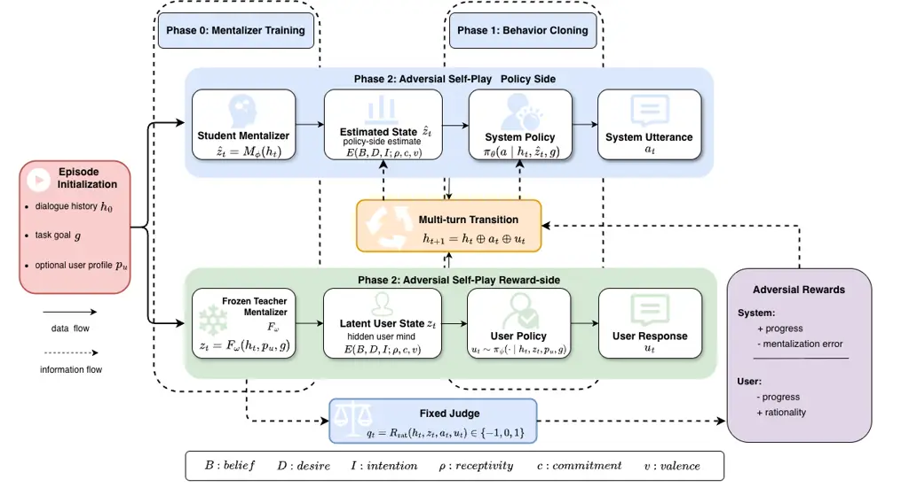

# Stop Training Against Soft Users: Mentalized Adversarial Self-Play for Proactive Dialogue

Zanwu Liu Affiliation: School of Artificial Intelligence, Beihang
University, Beijing, China    Dan Zhang Affiliation: Dongchezu
Technology Co., Ltd., Beijing, China    Xiaodi Wang
Affiliation: Dongchezu Technology Co., Ltd., Beijing, China    Yongbo
Mao Affiliation: Dongchezu Technology Co., Ltd., Beijing, China   
Xiaoyang Guo Affiliation: Dongchezu Technology Co., Ltd., Beijing, China
   Yonglin Wu Affiliation: Dongchezu Technology Co., Ltd., Beijing,
China    Peiyue Jiang Affiliation: Dongchezu Technology Co., Ltd.,
Beijing, China    Yangyang Wei Affiliation: Dongchezu Technology Co.,
Ltd., Beijing, China    Zecheng Lin Affiliation: Dongchezu Technology
Co., Ltd., Beijing, China    ^(\*)Equal contribution. Corresponding
author. First author:
[liuaudi801@gmail.com](mailto:liuaudi801@gmail.com)  Correspondence:
[chengyi.2024@dcarlife.com](mailto:chengyi.2024@dcarlife.com)

###### Abstract

Proactive dialogue agents must guide multi-turn interactions toward task
goals while adapting to users whose intentions and attitudes evolve.
Existing planners improve system side action selection through search,
learned policies, or user aware planning, but are often trained and
evaluated against fixed or overly compliant simulators; as a result,
high simulated success can reflect soft user bias rather than robust
dialogue ability. We introduce MASP, a Mentalized Adversarial Self Play
framework that treats proactive dialogue as a partially observable game
between a system and a rationally resisting user. MASP represents the
user’s evolving mental state with a BDI based latent state, separates
reward side teacher mentalization from policy side student
mentalization, and alternates self play updates for the system and user
policies. This turns robustness to rational resistance into a training
objective rather than only an evaluation condition. Across diverse
proactive dialogue benchmarks, compared with the widely used SFT and
Planner-only approaches, MASP substantially improves success rate (SR)
and rationality constrained success (RCSR), reduces average turns (AT),
and performs better against hard users who make the task goal more
difficult to achieve.

## 1 Introduction

Proactive dialogue requires more than a fluent next response. In tasks
such as persuasion, emotional support, empathy, and negotiation, an
agent must guide a multi-turn interaction toward a goal while
anticipating how each utterance may change the user’s beliefs, desires,
and decisions. Although large language models (LLMs) are strong reactive
conversationalists, proactive dialogue remains challenging because
next-token optimization alone does not provide long-range strategic
adaptation (He et al., 2024a; He et al., 2024b). Recent work has studied
various planning and simulation approaches to this challenge Wang et al.
(2023); Hong et al. (2023); Liu et al. (2025); Wu et al. (2025); Zhang
et al. (2025a).

Most progress, however, remains centered on planners. Prior methods
improve system-side action selection through trainable planners, search,
and user world modeling (Deng et al., 2023; He et al., 2024a; Zhang
et al., 2024b; He et al., 2025; He et al., 2024b; Rakib et al., 2025;
Kim et al., 2025; Dao and Liao, 2025; Dong et al., 2025). Despite their
different mechanisms, they largely preserve the same training asymmetry:
the system is optimized as the sole strategic learner, whereas the user
is fixed, externally specified, or only weakly modeled.

This asymmetry can lead to misleading progress. A policy trained against
a fixed or overly permissive simulator may achieve high simulated
success while learning brittle behavior that fails once the user is less
compliant (Kreyssig et al., 2018; Keizer et al., 2023; Zhang et al.,
2024a). Recent LLM-based work moves beyond prompted role-play toward
dedicated user LMs, profile-conditioned simulators, and iterative
adversarial refinement Davidson et al. (2023); Sekuli’c et al. (2024);
Naous et al. (2025); Zhu et al. (2025). These works make the soft user
problem explicit, but they mainly strengthen the simulator or evaluation
environment; they do not directly answer how a proactive policy should
be trained so that its gains survive stronger, more strategic, and
partially observed users.

A natural way to address this issue is to model the user’s evolving
internal state. Recent studies have examined intention modeling, user
state tracking, and theory of mind for persuasion and emotional support
Yu et al. (2025); Zhang et al. (2025b); Park et al. (2026), yet such
information remains an auxiliary feature or simulator-side component
rather than the basis of the training interaction. We propose MASP
(Mentalized Adversarial Self Play)¹¹ 1 Code and resources are available
at:
[https://github.com/Tecitomous/MASP-Proactive-Dialogue](https://github.com/Tecitomous/MASP-Proactive-Dialogue).,
a training paradigm that instead formulates proactive dialogue as a
partially observable game between two agents over a shared latent mental
state space. Each turn is governed by a hidden user state represented by
free-form _belief_, _desire_, and _intention_ (BDI) together with
compact affective variables. The user policy conditions on this hidden
state, while the system observes only an estimate inferred from dialogue
history; consequently, the system is trained not only to choose useful
utterances, but also to infer who it is talking to and how that person
changes over time.

The key design of MASP is to make mentalization part of the optimization
itself. A frozen teacher mentalizer defines the latent state used by
reward computation, whereas the system observes only a student estimate,
reducing the risk that the policy directly exploits an adaptive reward
state estimator. On top of this latent state, MASP defines dense
progress toward a task-specific target mind state, measured relative to
the user’s own starting state. The system is rewarded for both moving
the user toward the target and accurately inferring the current state,
while the user is rewarded for rational resistance rather than
unconditional rejection. This formulation differs from planner-focused
approaches by coupling opponent modeling, long-horizon dialogue control,
and simulator robustness within a single training game; it also differs
from work that only builds simulators because the user model is not
merely an evaluation tool, but an adaptive training opponent.

We evaluate MASP on proactive dialogue benchmarks spanning persuasion,
emotional support, empathy, and negotiation, with a focus on
rationality-constrained success under difficult user simulators. Our
contributions are threefold: (1) to our knowledge, MASP is the first
multi-turn dialogue training framework to explicitly model BDI mental
states and let those states evolve during training; (2) we are the first
to apply self-play to a multi-turn dialogue training framework,
proposing a mentalized self-play method that jointly trains the system
and user and is designed to avoid the soft user problem in practical
applications; and (3) to address the fact that widely used evaluation
rules do not capture model performance against difficult users in
realistic settings, we evaluate models under difficult user simulators
and introduce rationality-constrained success rate to better reflect
performance with near-realistic users.

## 2 Related Work

Proactive dialogue planning has progressed from search at test time to
trainable planners and policy learning with user information. GDP-Zero
uses Monte Carlo Tree Search over LLM simulated continuations (Yu
et al., 2023), while PPDPP trains a planner module with supervised fine
tuning and self play reinforcement learning (Deng et al., 2023). Later
methods improve planning through dual process deliberation, diversified
user simulation, latent policy learning, intrinsic user world modeling,
and online selection based on value estimates over frozen LLM proposals
(He et al., 2024a; Zhang et al., 2024b; He et al., 2024b; He et al.,
2025; Rakib et al., 2025). These methods strengthen system action
selection, but still largely optimize a system planner against fixed,
prompted, or otherwise externally specified users.

User simulation is central to dialogue training and evaluation, but
simulator realism remains a bottleneck (Shi et al., 2019; Davidson
et al., 2023; Sekulic et al., 2024; Luo et al., 2024; Wang et al.,
2025b). Prior work shows that simulator choice affects policy quality
and transferability, and that offline policy learning can overfit to
simulator artifacts (Kreyssig et al., 2018; Keizer et al., 2023; Zhang
et al., 2024a). Recent LLM based studies make this issue sharper:
_Flipping the Dialogue_ trains dedicated User LMs from converted human
assistant conversations (Naous et al., 2025), and DIAL improves
simulator realism through iterative adversarial refinement (Zhu et al.,
2025). These works improve simulators or evaluation environments, but do
not directly turn user resistance into a coupled training objective for
the system policy.

MASP also connects to adversarial and multiagent training. SMAC-Hard
shows that narrow opponent distributions can induce brittle multiagent
policies (Deng et al., 2024), and GAIA formulates noncollaborative
dialogue planning as a two player zero sum game with self play and
Chain-of-Mind reasoning (Wang et al., 2025a). MASP shares the concern
that soft or narrow user models produce brittle policies, but differs by
modeling proactive dialogue as a partially observable game over a latent
mental state geometry: the system sees only a student estimate of the
user’s hidden state, while the user is trained to resist rationally.

## 3 Method



Figure 1: Overview of MASP. The framework trains BDI mentalizers, warm
starts system and user policies with behavior cloning, and then performs
alternating GRPO self play with latent progress, rationality, and KL
regularization to reference policies.

As shown in Figure 1, MASP is organized as a three-phase training
pipeline. Phase 0 trains BDI mentalizers from silver annotations;
Phase 1 uses behavior cloning to obtain warm-start and reference
policies for the system and user; Phase 2 alternates GRPO updates for
the system and user policies with frozen reward-side modules.

### 3.1 Problem Formulation

An episode is defined as

```math
\xi=(p_{u},g,h_{0}), \tag{1}
```

where $`p_{u}`$ denotes an optional user profile, $`g`$ is the task
goal, and $`h_{0}`$ is the initial dialogue context. If a dataset does
not provide user profiles, we simply set $`p_{u}=\varnothing`$.

At turn $`t`$, the current history prefix is denoted by $`h_{t}`$. The
system first generates an utterance $`a_{t}`$, after which the user
generates a response $`u_{t}`$, yielding the transition

```math
h_{t+1}=h_{t}\oplus a_{t}\oplus u_{t}. \tag{2}
```

We model this interaction as a partially observable game between two
agents. The user policy conditions on its current latent mental state
$`z_{t}`$, while the system policy only has access to an estimate
$`\hat{z}_{t}`$:

```math
a_{t}\sim\pi_{\theta}(\cdot\mid h_{t},\hat{z}_{t},g), \tag{3}
```

```math
u_{t}\sim\pi_{\psi}(\cdot\mid h_{t},z_{t},p_{u},g). \tag{4}
```

Here, $`\pi_{\theta}`$ is the system policy and $`\pi_{\psi}`$ is the
user policy. The asymmetry between $`z_{t}`$ and $`\hat{z}_{t}`$ is
essential: unlike user aware planners that condition directly on fixed
personas or externally provided user descriptions, MASP treats the
user’s internal state as hidden and dynamically evolving across turns.

The two agents optimize different objectives. Let $`r_{t}^{S}`$ and
$`r_{t}^{U}`$ denote the reward at each turn for the system and the
user, respectively. Their discounted objectives are

```math
\displaystyle J_{S}(\theta) \displaystyle=\mathbb{E}\!\left[\sum_{t=0}^{T-1}\gamma^{t}r_{t}^{S}\right], \tag{5}
```

```math
\displaystyle J_{U}(\psi) \displaystyle=\mathbb{E}\!\left[\sum_{t=0}^{T-1}\gamma^{t}r_{t}^{U}\right].
```

All reported self-play runs use $`\gamma=0.97`$. As we show below, both
rewards are defined in a shared latent state geometry, but they induce
different behaviors: the system is rewarded for progress and accurate
mentalization, whereas the user is rewarded for rational resistance.

### 3.2 Latent Mental State and Mentalization

A central question is how to represent the user’s internal state. A pure
dialogue embedding is flexible but opaque, making it difficult to
specify meaningful target states; task-specific slot schemas are
interpretable but transfer poorly across domains. BDI provides a useful
middle ground: beliefs, desires, and intentions are semantically
interpretable enough to anchor target state design, yet general enough
to apply across persuasion, support, empathy, and negotiation. We
therefore adopt a BDI-based hybrid representation:

```math
m_{t}=(B_{t},D_{t},I_{t},\rho_{t},c_{t},v_{t}), \tag{6}
```

where $`B_{t}`$, $`D_{t}`$, and $`I_{t}`$ are free form natural language
descriptions of the user’s _belief_, _desire_, and _intention_,
respectively; $`\rho_{t}\in[0,1]`$ denotes receptivity,
$`c_{t}\in[0,1]`$ denotes commitment or confidence, and
$`v_{t}\in[-1,1]`$ denotes valence. The textual BDI component captures
_what_ the user currently believes, wants, and plans to do, while the
three scalar variables provide a compact affective geometry that remains
stable across tasks.

We encode the three textual BDI components separately with a frozen text
encoder $`E(\cdot)`$. In our implementation, $`E`$ is the corresponding
frozen Qwen3 backbone used as a sentence encoder: we mean-pool its final
hidden states and $`\ell_{2}`$ normalize the pooled vector.

```math
e_{B}=E(B_{t}),\quad e_{D}=E(D_{t}),\quad e_{I}=E(I_{t}), \tag{7}
```

where each component embedding is normalized to unit length. We then
define the final vector state as

```math
z_{t}=[e_{B};e_{D};e_{I};\sqrt{\alpha_{\rho}}\rho_{t};\sqrt{\alpha_{c}}c_{t};\sqrt{\alpha_{v}}v_{t}]. \tag{8}
```

This preconditions the scalar dimensions by the same weights used in the
latent metric, while keeping the representation deliberately dynamic: it
describes _the user’s current state_, not a static persona category. In
persuasion, support, empathy, or negotiation, what matters is not only
who the user is, but what the user currently believes and how that state
changes over the course of a dialogue.

To obtain this latent state, MASP uses two mentalization modules. A
teacher mentalizer $`F_{\omega}`$ predicts the latent state from
dialogue history, optional profile, and task goal:

```math
z_{t}=F_{\omega}(h_{t},p_{u},g). \tag{9}
```

This teacher is pretrained on offline silver annotations and then
frozen. Crucially, it is the only state estimator used on the reward
side. The system policy never observes $`z_{t}`$ directly. Instead, it
receives a student estimate

```math
\hat{z}_{t}=M_{\phi}(h_{t}), \tag{10}
```

where $`M_{\phi}`$ only conditions on the observable dialogue history.
This split between teacher and student is one of the key design choices
of MASP. Because the reward depends on the frozen teacher state while
the policy only sees a student estimate, the policy must learn to infer
the user rather than directly exploit the reward model. In other words,
mentalization is not just an auxiliary diagnostic module; it becomes
part of the optimization problem itself.

The offline silver annotations also define a BDI cache. The cache stores
dialogue-prefix records with silver BDI states, and also stores a
session-level initial BDI state for each training dialogue. We use the
term BDI prior for the non-parametric pool of these initial training
states, together with any available profile text. This prior is used to
sample initial user states in self play and to render continuous student
estimates into text by nearest-neighbor retrieval in the encoded BDI
space.

### 3.3 User Relative Progress in Latent Space

For each task, we instantiate a target latent state $`z^{\star}`$ from a
fixed task-level BDI target template, rather than extracting it from
test dialogues. The template contains belief, desire, and intention
descriptions for a successful end state, plus scalar targets for
receptivity, confidence, and valence; it is encoded with the same
$`E(\cdot)`$ and scalar preconditioning as Eq. (8). For instance, in
persuasion the target describes a receptive user who intends to donate,
while in emotional support it describes reduced distress and a more
constructive intention. Appendix B.2 lists the concrete templates used
in the experiments. Since the BDI embedding may have much higher
dimensionality than the scalar variables, we use a weighted metric. The
scalar importance weights are applied by pre-scaling the scalar
coordinates in Eq. (8), through the factors $`\sqrt{\alpha_{\rho}}`$,
$`\sqrt{\alpha_{c}}`$, and $`\sqrt{\alpha_{v}}`$. The matrix

```math
A=\mathrm{diag}\!\left(\frac{1}{3d}I_{3d},1,1,1\right), \tag{11}
```

therefore serves to normalize the high-dimensional textual BDI block
relative to the three already weighted scalar coordinates, where $`d`$
is the encoder dimension for one BDI component. Its scalar diagonal
entries are set to one because $`\alpha_{\rho},\alpha_{c},\alpha_{v}`$
have already been absorbed into $`z_{t}`$. We denote the corresponding
norm by

```math
\|x\|_{A}^{2}=x^{\top}Ax. \tag{12}
```

Minimizing the absolute distance between $`z_{t}`$ and $`z^{\star}`$ is
inappropriate because different users begin from different initial
states: a trajectory that is clearly improving for one user may remain
far from the global target, while another user may start close without
intervention. We therefore define _user-relative progress_ as the
projection of the current state onto the direction from the user’s own
initial state $`z_{0}`$ to the target $`z^{\star}`$:

```math
s_{t}=\frac{(z_{t}-z_{0})^{\top}A(z^{\star}-z_{0})}{(z^{\star}-z_{0})^{\top}A(z^{\star}-z_{0})+\varepsilon_{\mathrm{prog}}}, \tag{13}
```

and define the incremental progress by

```math
\Delta s_{t}=s_{t+1}-s_{t}. \tag{14}
```

We set $`\varepsilon_{\mathrm{prog}}=10^{-6}`$ for numerical stability.
This formulation measures whether the dialogue is moving in the _right
direction_ from the user’s own starting point and yields a dense reward
signal at every turn, even when task success itself is sparse.

1: Dialogue data $`\mathcal{D}`$, BDI cache, teacher $`F_{\omega}`$,
student $`M_{\phi}`$, system policy $`\pi_{\theta}`$, user policy
$`\pi_{\psi}`$

2: Train teacher $`F_{\omega}`$ on silver BDI annotations and freeze it.

3: Train student $`M_{\phi}`$ to predict the teacher state from dialogue
history.

4: Warm start $`\pi_{\theta}`$ and $`\pi_{\psi}`$ with supervised
learning; save frozen references $`\pi_{\theta_{0}}`$ and
$`\pi_{\psi_{0}}`$.

5: for outer iteration $`k=1,\ldots,K`$ do

6: System update

7:   Freeze $`\pi_{\psi}`$ and reward side modules.

8:   Roll out dialogues with $`\pi_{\theta}`$ and $`\pi_{\psi}`$.

9:   Compute
$`r_{S}=w_{\mathrm{prog}}\Delta s-w_{\mathrm{inf}}\|\hat{z}-z\|_{A}^{2}`$.

10:   Update $`\pi_{\theta}`$ with GRPO style grouped advantages and KL
to $`\pi_{\theta_{0}}`$.

11: User update

12:   Freeze $`\pi_{\theta}`$ and reward side modules.

13:   Roll out dialogues with the updated $`\pi_{\theta}`$ and current
$`\pi_{\psi}`$.

14:   Compute $`r_{U}=-w_{\mathrm{prog}}\Delta s+w_{\mathrm{rat}}q`$.

15:   Update $`\pi_{\psi}`$ with GRPO style grouped advantages and KL to
$`\pi_{\psi_{0}}`$.

16: Student refresh

17:   Collect self play prefixes and teacher targets.

18:   Update $`M_{\phi}`$ on self play prefixes mixed with real dialogue
prefixes.

19: end for

Algorithm 1 MASP training

### 3.4 Adversarial Rewards

The system should both influence the user and understand the user. We
therefore define the system reward as

```math
r_{t}^{S}=w_{\mathrm{prog}}\Delta s_{t}-w_{\mathrm{inf}}\|\hat{z}_{t}-z_{t}\|_{A}^{2}. \tag{15}
```

The first term rewards movement toward the target state, while the
second rewards accurate mentalization. The inference term is especially
important: it makes the system optimize not only for _what to say_, but
also for _how well it understands the person it is talking to_.

The user policy is trained adversarially, but not as an unconstrained
adversary. A user that always rejects everything is not realistic, and a
user that always agrees is equally uninformative. To prevent both
collapse modes, we define

```math
r_{t}^{U}=-w_{\mathrm{prog}}\Delta s_{t}+w_{\mathrm{rat}}q_{t}, \tag{16}
```

where $`q_{t}\in\{-1,0,1\}`$ is a fixed rationality judge signal
indicating whether the user response is rational under the current
mental state. The first term rewards resistance to unjustified state
change, while the second rewards coherent and rational behavior.
Intuitively, the user is not rewarded for rejecting the system blindly;
it is rewarded for _resisting when resistance is warranted_ and
_yielding when change is genuinely justified_. This is what makes the
user a useful training opponent rather than merely a harder simulator.

The scalar rollout rewards in Equations 15 and 16 do not include KL
penalties. Instead, both policies are regularized by a token level KL
term inside the GRPO training objective against their supervised warm
start reference policies, as described in Appendix B.4. This matches the
implementation: rewards provide task, mentalization, and rationality
feedback, while the trainer applies the KL term to the reference policy.

### 3.5 Training

Training follows the three stage pipeline in Algorithm 1. We first train
teacher and student mentalizers from silver BDI annotations, then use
behavior cloning to initialize the system and user policies as warm
start references, and finally run alternating GRPO self play with frozen
reward side modules. The algorithm is the high level flow used in the
implementation; additional optimization and prompting details are
provided in Appendix B.1.

## 4 Experiments

| Dataset    | Backbone   | Method       | Soft User      |                  |                  | Hard User      |                  |                  |
| ---------- | ---------- | ------------ | -------------- | ---------------- | ---------------- | -------------- | ---------------- | ---------------- |
|            |            |              | SR$`\uparrow`$ | AT$`\downarrow`$ | RCSR$`\uparrow`$ | SR$`\uparrow`$ | AT$`\downarrow`$ | RCSR$`\uparrow`$ |
| P4G        | Qwen3-4B   | MASP         | 0.859          | 4.08             | 0.556            | 0.788          | 4.56             | 0.566            |
|            |            | SFT          | 0.616          | 6.08             | 0.384            | 0.576          | 6.23             | 0.455            |
|            |            | Planner-only | 0.677          | 4.88             | 0.434            | 0.616          | 5.55             | 0.384            |
|            | Qwen3-0.6B | MASP         | 0.707          | 5.14             | 0.465            | 0.626          | 5.76             | 0.434            |
|            |            | SFT          | 0.414          | 6.99             | 0.253            | 0.354          | 7.35             | 0.242            |
|            |            | Planner-only | 0.424          | 6.32             | 0.232            | 0.364          | 6.84             | 0.202            |
| ESConv     | Qwen3-4B   | MASP         | 0.990          | 1.96             | 0.949            | 1.000          | 1.88             | 0.964            |
|            |            | SFT          | 0.467          | 7.17             | 0.410            | 0.390          | 7.27             | 0.333            |
|            |            | Planner-only | 0.969          | 2.38             | 0.923            | 0.980          | 2.08             | 0.918            |
|            | Qwen3-0.6B | MASP         | 1.000          | 2.11             | 0.949            | 1.000          | 1.65             | 0.928            |
|            |            | SFT          | 0.297          | 7.56             | 0.226            | 0.323          | 7.32             | 0.241            |
|            |            | Planner-only | 0.954          | 2.77             | 0.897            | 0.990          | 1.84             | 0.903            |
| Craigslist | Qwen3-4B   | MASP         | 0.689          | 4.60             | 0.073            | 0.621          | 5.61             | 0.259            |
|            |            | SFT          | 0.646          | 5.38             | 0.045            | 0.558          | 6.28             | 0.234            |
|            |            | Planner-only | 0.431          | 5.67             | 0.020            | 0.315          | 6.86             | 0.091            |
|            | Qwen3-0.6B | MASP         | 0.728          | 4.24             | 0.030            | 0.641          | 5.50             | 0.211            |
|            |            | SFT          | 0.726          | 4.84             | 0.057            | 0.547          | 6.47             | 0.191            |
|            |            | Planner-only | 0.172          | 7.07             | 0.011            | 0.484          | 6.41             | 0.129            |
| Empathetic | Qwen3-4B   | MASP         | 0.092          | 7.46             | 0.059            | 0.072          | 7.57             | 0.048            |
|            |            | SFT          | 0.030          | 7.89             | 0.017            | 0.022          | 7.91             | 0.013            |
|            |            | Planner-only | 0.042          | 7.75             | 0.027            | 0.037          | 7.78             | 0.024            |
|            | Qwen3-0.6B | MASP         | 0.063          | 7.64             | 0.044            | 0.036          | 7.78             | 0.024            |
|            |            | SFT          | 0.013          | 7.95             | 0.007            | 0.002          | 7.99             | 0.001            |
|            |            | Planner-only | 0.032          | 7.82             | 0.023            | 0.021          | 7.88             | 0.013            |

Table 1: Main results on proactive dialogue benchmarks; soft/hard
meanings are defined in Evaluation Metrics.

#### Datasets.

We evaluate on four dialogue benchmarks with multiple turns, spanning
proactive and socially grounded interaction: Persuasion for Good (P4G)
(Wang et al., 2019), ESConv (Liu et al., 2021), EmpatheticDialogues
(Rashkin et al., 2019), and CraigslistBargain (He et al., 2018). P4G
consists of charity persuasion dialogues where a persuader encourages a
persuadee to donate, with user level traits and strategy annotations for
a subset of conversations. ESConv contains help seeker and supporter
conversations grounded in emotional support strategies.
EmpatheticDialogues provides emotion grounded open domain conversations
for evaluating empathetic response generation. CraigslistBargain
contains price negotiations between buyers and sellers over online
listings. Together, these datasets cover persuasion, emotional support,
empathy, and negotiation, spanning both cooperative and competitive
proactive dialogue settings. Appendix C provides dataset statistics and
task specific success criteria.

#### Closed-loop evaluation.

Each evaluation episode starts from a held-out initial context. At turn
$`t`$, the system generates $`a_{t}`$, the user policy generates
$`u_{t}`$, and both are appended to the history $`h_{t+1}`$. The
rationality judge then reads the full accumulated dialogue rather than
an isolated response. This loop continues until success or the
eight-exchange limit. Appendix C.2 provides the complete protocol and a
concrete rollout.

#### Rationality-Constrained Success Rate.

Conventional success rate can overestimate proactive dialogue ability
when a user simulator accepts the system’s proposal without sufficient
justification. We therefore introduce RCSR@T, which counts a dialogue as
successful only when the task is completed and the user behavior up to
completion remains rational. After each assistant–user exchange, a fixed
LLM-based rationality judge receives the task description, the current
BDI state $`z_{t}`$, the assistant utterance $`a_{t}`$, and the user
reply $`u_{t}`$. The judge answers RATIONAL or NOT*RATIONAL; we map
these labels to a turn score $`q*{t}=+1`$ and $`q*{t}=-1`$,
respectively, and assign $`q*{t}=0`$ when the judge output is
unparseable or the call fails. If a dialogue first succeeds at turn
$`\tau\_{s}\leq T`$, its success-prefix rationality is

```math
\bar{q}_{\tau_{s}}=\frac{1}{\tau_{s}}\sum_{t=1}^{\tau_{s}}q_{t}. \tag{17}
```

The episode-level rationality-constrained success indicator is

```math
\mathrm{RCSR@T}=\mathbb{I}\!\left[\tau_{s}\leq T\;\wedge\;\bar{q}_{\tau_{s}}\geq\tau_{q}\right], \tag{18}
```

and failed dialogues receive zero. We report the mean of this indicator
over evaluation dialogues with $`\tau_{q}=0.70`$. This threshold
requires the successful prefix to be consistently rational while still
tolerating occasional unparseable or weak judgments in longer
interactions. Unlike SR alone, RCSR filters successes caused by
simulator sycophancy or unjustified concessions, and is therefore closer
to evaluating whether a model can succeed with near-realistic users,
especially difficult users who should resist until given convincing
reasons. The exact judge prompt is given in Appendix C.2.

#### Evaluation Metrics.

For each method, we evaluate under soft and hard user conditions, where
_soft_ denotes the easier simulator for the system under the dataset’s
task objective and _hard_ denotes the more difficult one. For P4G,
ESConv, and EmpatheticDialogues, these correspond to the conventional
imitation-style and learned adversarial users, respectively;
CraigslistBargain reverses this convention because the system is the
buyer and the Phase 1 BC seller is harder for buyer-side utility (see
Appendix C.7). We report SR@8, the fraction of dialogues that reach the
task-specific success criterion within $`T=8`$ turns; AT, the average
turns to success with failures counted as $`T`$; and RCSR@8, success
under the rationality constraint defined above. Thus, SR and AT measure
task effectiveness and efficiency, while RCSR tests whether success
reflects rational user behavior rather than degenerate or overly
compliant interactions.

#### Implementation.

We compare MASP with two controlled baselines under matched backbones,
user settings, turn budgets, and success judges within each dataset. SFT
uses the supervised dialogue policy without self play. Planner-only uses
the same system side warmup and adaptive planning scaffold as MASP, but
does not train the adversarial user policy through mentalized self play.
MASP is our full method, which further trains the system and user
policies with alternating GRPO style self play. Unless otherwise
specified, we report results for both Qwen3-4B and Qwen3-0.6B backbones.
Dataset specific success definitions, judge prompts, sampling settings,
and additional implementation details are provided in Appendix C.

#### Main Results.

Table 1 shows that MASP consistently improves over both SFT and
Planner-only on the completed benchmarks. On P4G, MASP gives the best
SR, AT, and RCSR under both soft and hard users for both backbones,
indicating that mentalized self play improves not only task completion
but also rationality constrained success. On ESConv, MASP reaches
near-ceiling SR, but this reflects the prior success convention where
somewhat_better counts as successful rather than requiring full
resolution. We therefore treat ESConv mainly as transfer and efficiency
evidence and avoid overinterpreting saturated SR. On CraigslistBargain,
MASP again leads on SR and AT for both backbones, including the
buyer-side hard setting where the Phase 1 BC seller is less favorable to
the buyer. The main exception is Qwen3-0.6B soft RCSR, where SFT
slightly exceeds MASP; this is a small speed-rationality tradeoff in the
most permissive seller setting, not a failure of the overall negotiation
behavior. The very low Planner-only 0.6B soft SR is not a table bug: in
the buyer role, the fixed planner scaffold can still miss closure
against a seller whose concessions do not match its hand-written closing
strategy, so the learned buyer policy is needed to exploit the phase 2
seller distribution. On EmpatheticDialogues, absolute SR is lower
because success requires a strict resolved outcome, but MASP still
yields the best results for soft and hard users across both backbones. A
P4G horizontal comparison with prior systems, reported in Appendix A.1,
shows the same trend in absolute comparison.

### 4.1 Ablation Study

We further isolate the contribution of each MASP component on P4G,
following the component analysis style used in prior P4G systems (Deng
et al., 2023; Rakib et al., 2025). Table 2 reports Qwen3-4B results on
the 99 example test split. The No GRPO self play row keeps only the
supervised Phase 1 policy, while No adversarial self play uses the
Planner-only scaffold without mentalized adversarial self play. The
remaining rows ablate the P4G specific inference scaffold by removing
the warmup policy, the adaptive close injection, or both.

| Variant                  | Removed or changed component     | Soft User      |                  |                  | Hard User      |                  |                  |
| ------------------------ | -------------------------------- | -------------- | ---------------- | ---------------- | -------------- | ---------------- | ---------------- |
|                          |                                  | SR$`\uparrow`$ | AT$`\downarrow`$ | RCSR$`\uparrow`$ | SR$`\uparrow`$ | AT$`\downarrow`$ | RCSR$`\uparrow`$ |
| Full MASP                | none                             | 0.859          | 4.08             | 0.556            | 0.788          | 4.56             | 0.566            |
| No adaptive close        | remove adaptive close injection  | 0.707          | 4.86             | 0.556            | 0.707          | 4.95             | 0.495            |
| No warmup                | remove P4G warmup policy         | 0.828          | 3.83             | 0.283            | 0.727          | 4.55             | 0.283            |
| No eval scaffold         | remove warmup and adaptive close | 0.606          | 6.12             | 0.404            | 0.626          | 6.28             | 0.394            |
| No adversarial self play | Planner-only scaffold            | 0.677          | 4.88             | 0.434            | 0.616          | 5.55             | 0.384            |
| No GRPO self play        | supervised Phase 1 policy only   | 0.616          | 6.08             | 0.384            | 0.576          | 6.23             | 0.455            |

Table 2: P4G ablation study on Qwen3-4B. All rows use the same 99
example test split, $`T=8`$, and RCSR threshold $`\tau=0.70`$. SR and
RCSR are higher better; AT is lower better.

The full model gives the strongest overall result, especially in SR and
hard user RCSR. Removing the adaptive close injection reduces SR by 15.2
points under the soft user and 8.1 points under the hard user, while
preserving soft user RCSR. Removing the entire evaluation scaffold hurts
both SR and AT, and removing self play components leaves large gaps to
full MASP; these trends show that the gains come from both mentalized
self play training and the P4G specific inference scaffold.

The No warmup row illustrates why RCSR is needed in addition to SR and
AT. Without the warmup policy, the model reaches the lowest AT under
both user settings, including 3.83 turns for the soft user, and still
keeps a relatively high SR. However, its RCSR drops from 0.556 to 0.283
under the soft user and from 0.566 to 0.283 under the hard user. This
pattern suggests that the model can learn a shortcut-like behavior that
asks for commitment earlier and sometimes obtains a successful endpoint,
but does so before the dialogue has provided enough context or
user-state change to satisfy the rationality constraint. The warmup
component therefore acts less like a speed booster and more like a
stabilizer: it helps the system establish the task, surface the user’s
stance, and make later persuasion attempts count as rationally grounded
successes rather than merely fast successes.

### 4.2 Human Validation and Statistical Reliability

Because the silver BDI states and rationality signal are LLM based, we
additionally audit both components with human annotation. Across 160
dialogue prefixes, the three BDI text fields receive mean scores of
4.55–4.62 out of 5, with 91.9–94.4% scoring at least 4; the scalar
fields obtain MAE of 0.071–0.094 and Spearman correlations of 0.79–0.84.
On 425 P4G turns, human labels agree with the rationality judge on 91.8%
of cases ($`\kappa=0.801`$); across 100 dialogues, mean turn agreement
is 91.2% and human–AI rationality scores correlate at $`\rho=0.81`$.
Full protocols and component-level results are reported in Appendix A.3.

For the 99-session Qwen3-4B hard-user P4G evaluation, 10,000 paired
bootstrap resamples show that MASP’s improvements over Planner-only have
95% confidence intervals excluding zero for SR, AT, and RCSR. Against
SFT, the intervals exclude zero for SR and AT, while the RCSR interval
$`[-0.0202,0.2424]`$ includes zero. Of the 21 unsuccessful sessions, 20
contain at least three refusal labels; the most frequent overlapping
patterns are dialogue breakdowns and repeated pressure. Appendix A.4 and
Appendix A.5 provide the complete intervals and failure analysis.

### 4.3 Effectiveness Across Dialogue Turns

The P4G results show that MASP reaches stronger final performance within
the full eight turn budget. We next examine when this advantage appears
under the rationality-constrained metric, focusing on the hard user
setting where resistance is strongest. On the same Qwen3-4B P4G test
split, we compute RCSR@t for intermediate turn budgets and retain SR@8
as endpoint task-success context.

| Method       | RCSR@3 | RCSR@4 | RCSR@8 | SR@8  |
| ------------ | ------ | ------ | ------ | ----- |
| MASP         | 0.444  | 0.485  | 0.566  | 0.788 |
| Planner-only | 0.212  | 0.273  | 0.384  | 0.616 |
| SFT          | 0.071  | 0.141  | 0.455  | 0.576 |

Table 3: Effectiveness across dialogue turns. All rows use Qwen3-4B on
the same 99 example P4G test split under the hard user; RCSR uses
$`\tau_{q}=0.70`$.

| Method       | Avg SR | Worst SR | Avg RCSR | Worst RCSR |
| ------------ | ------ | -------- | -------- | ---------- |
| MASP         | 0.795  | 0.737    | 0.562    | 0.556      |
| Planner-only | 0.660  | 0.616    | 0.414    | 0.384      |
| SFT          | 0.579  | 0.545    | 0.407    | 0.384      |

Table 4: Robustness across P4G user simulators.

Table 3 shows that the rationality-constrained gains of MASP emerge well
before the last turn under the hard user. MASP reaches 0.444 RCSR@3 and
0.485 RCSR@4, while Planner-only reaches 0.212 and 0.273, and SFT
reaches only 0.071 and 0.141. Thus the final improvement is not mainly a
late recovery effect, nor is it driven only by fast but poorly grounded
successes. Instead, mentalized self play appears to help the system
identify user state earlier and choose utterances that produce
rationally grounded progress with fewer turns against a difficult user.

### 4.4 Robustness Across User Simulators

We further test whether the gains of MASP depend on a particular user
simulator. On the P4G test split, each system is evaluated against an
ensemble of three user simulators $`\mathcal{U}`$. For a method $`m`$,
we define $`\mathrm{WorstSR}(m)=\min_{u\in\mathcal{U}}\mathrm{SR}(m,u)`$
and $`\mathrm{WorstRCSR}(m)=\min_{u\in\mathcal{U}}\mathrm{RCSR}(m,u)`$.
Table 4 reports both average and worst case performance across this
ensemble.

MASP is strongest under both average and worst-case views. Its
worst-case SR remains 0.737 while Planner-only and SFT drop to 0.616 and
0.545; the same pattern holds for RCSR, where MASP keeps 0.556 while
both baselines fall to 0.384. This supports the central claim that
mentalized adversarial self-play improves robustness rather than only
fitting one simulator.

## 5 Conclusion

We presented MASP, a mentalized adversarial self play framework for
proactive dialogue. Instead of training a system policy only against
soft or fixed user simulators, MASP models dialogue as a partially
observable game between two agents over a shared BDI based latent mental
state. A frozen teacher mentalizer provides latent state estimates for
reward computation, a student mentalizer supplies state estimates for
the policy, and alternating GRPO self play trains the system to make
task progress while training the user to resist in rational ways. Across
completed proactive dialogue benchmarks, MASP improves success,
efficiency, and rationality constrained success over SFT and
Planner-only baselines. The P4G robustness analysis further shows that
these gains are not confined to a single user simulator, supporting the
value of treating user resistance as part of the training objective
rather than only as an evaluation condition.

## Limitations

MASP has several limitations. First, training depends on silver mental
state annotations, the teacher mentalizer, and the rationality judge, so
bias or noise in these components can affect the learned policies.
Second, the shared BDI style geometry is designed to transfer across
domains, but may miss specialized user states in some tasks. Third,
alternating self play with two policies and auxiliary mentalizers is
more expensive than single policy planning. Finally, when a dataset does
not provide explicit user profiles ($`p_{u}=\varnothing`$), the
privileged information gap between the teacher and student mentalizers
is reduced, so the split mainly regularizes reward side state estimation
rather than providing strong profile conditioned hidden information.

## References

- Dao and Liao (2025) Huy Quang Dao and Lizi Liao. 2025. [One planner to
  guide them all ! learning adaptive conversational planners for
  goal-oriented
  dialogues](https://doi.org/10.18653/v1/2025.emnlp-main.1123). In
  _Proceedings of the 2025 Conference on Empirical Methods in Natural
  Language Processing_, pages 22092–22116, Suzhou, China. Association
  for Computational Linguistics.
- Davidson et al. (2023) Sam Davidson, Salvatore Romeo, Raphael Shu,
  James Gung, Arshit Gupta, Saab Mansour, and Yi Zhang. 2023. [User
  simulation with large language models for evaluating task-oriented
  dialogue](https://api.semanticscholar.org/CorpusID:262464672).
  _ArXiv_, abs/2309.13233.
- Deng et al. (2023) Yang Deng, Wenxuan Zhang, Wai Lam, See-Kiong Ng,
  and Tat-Seng Chua. 2023. [Plug-and-play policy planner for large
  language model powered dialogue
  agents](https://api.semanticscholar.org/CorpusID:264833170). _ArXiv_,
  abs/2311.00262.
- Deng et al. (2024) Yue Deng, Yan Yu, Weiyu Ma, Zirui Wang, Wenhui Zhu,
  Jian Zhao, and Yin Zhang. 2024. [Smac-hard: Enabling mixed opponent
  strategy script and self-play on
  smac](https://arxiv.org/abs/2412.17707). _ArXiv_, abs/2412.17707.
- Dong et al. (2025) Wenjie Dong, Sirong Chen, and Yan Yang. 2025.
  [ProTOD: Proactive task-oriented dialogue system based on large
  language model](https://aclanthology.org/2025.coling-main.614/). In
  _Proceedings of the 31st International Conference on Computational
  Linguistics_, pages 9147–9164, Abu Dhabi, UAE. Association for
  Computational Linguistics.
- He et al. (2018) He He, Derek Chen, Anusha Balakrishnan, and Percy
  Liang. 2018. [Decoupling strategy and generation in negotiation
  dialogues](https://api.semanticscholar.org/CorpusID:52119091).
  _ArXiv_, abs/1808.09637.
- He et al. (2024a) Tao He, Lizi Liao, Yixin Cao, Yuanxing Liu, Ming
  Liu, Zerui Chen, and Bing Qin. 2024a. [Planning like human: A
  dual-process framework for dialogue
  planning](https://doi.org/10.18653/v1/2024.acl-long.262). In
  _Proceedings of the 62nd Annual Meeting of the Association for
  Computational Linguistics (Volume 1: Long Papers)_, pages 4768–4791,
  Bangkok, Thailand. Association for Computational Linguistics.
- He et al. (2024b) Tao He, Lizi Liao, Yixin Cao, Yuanxing Liu, Yiheng
  Sun, Zerui Chen, Ming Liu, and Bing Qin. 2024b. [Simulation-free
  hierarchical latent policy planning for proactive
  dialogues](https://api.semanticscholar.org/CorpusID:274859673). In
  _AAAI Conference on Artificial Intelligence_.
- He et al. (2025) Tao He, Lizi Liao, Ming Liu, and Bing Qin. 2025.
  [Simulating before planning: Constructing intrinsic user world model
  for user-tailored dialogue policy
  planning](https://api.semanticscholar.org/CorpusID:277940077).
  _Proceedings of the 48th International ACM SIGIR Conference on
  Research and Development in Information Retrieval_.
- Hong et al. (2023) Joey Hong, Sergey Levine, and Anca Dragan. 2023.
  [Zero-shot goal-directed dialogue via rl on imagined
  conversations](https://api.semanticscholar.org/CorpusID:265067195).
  _ArXiv_, abs/2311.05584.
- Keizer et al. (2023) Simon Keizer, Caroline Dockes, Norbert
  Braunschweiler, Svetlana Stoyanchev, and Rama Doddipatla. 2023.
  [Adversarial learning of neural user simulators for dialogue policy
  optimisation](https://arxiv.org/abs/2306.00858). _ArXiv_,
  abs/2306.00858.
- Kim et al. (2025) Namyoung Kim, Kai Tzu iunn Ong, Yeonjun Hwang,
  Minseok Kang, Iiseo Jihn, Gayoung Kim, Minju Kim, and Jinyoung
  Yeo. 2025. [Principles: Synthetic strategy memory for proactive
  dialogue agents](https://api.semanticscholar.org/CorpusID:281421904).
  _ArXiv_, abs/2509.17459.
- Kreyssig et al. (2018) Florian Kreyssig, Iñigo Casanueva, Paweł
  Budzianowski, and Milica Gašić. 2018. [Neural user simulation for
  corpus-based policy optimisation of spoken dialogue
  systems](https://doi.org/10.18653/v1/W18-5006). In _Proceedings of the
  19th Annual SIGdial Meeting on Discourse and Dialogue_, pages 60–69.
- Liu et al. (2021) Siyang Liu, Chujie Zheng, Orianna Demasi, Sahand
  Sabour, Yu Li, Zhou Yu, Yong Jiang, and Minlie Huang. 2021. [Towards
  emotional support dialog
  systems](https://api.semanticscholar.org/CorpusID:235294326). In
  _Annual Meeting of the Association for Computational Linguistics_.
- Liu et al. (2025) Tianjian Liu, Fanqi Wan, Jiajian Guo, and Xiaojun
  Quan. 2025. [Proactiveeval: A unified evaluation framework for
  proactive dialogue
  agents](https://api.semanticscholar.org/CorpusID:280950190). _ArXiv_,
  abs/2508.20973.
- Luo et al. (2024) Xiang Luo, Zhiwen Tang, Jin Wang, and Xuejie
  Zhang. 2024. [DuetSim: Building user simulator with dual large
  language models for task-oriented
  dialogues](https://aclanthology.org/2024.lrec-main.481/). In
  _Proceedings of the 2024 Joint International Conference on
  Computational Linguistics, Language Resources and Evaluation
  (LREC-COLING 2024)_, pages 5414–5424, Torino, Italia. ELRA and ICCL.
- Naous et al. (2025) Tarek Naous, Philippe Laban, Wei Xu, and Jennifer
  Neville. 2025. [Flipping the dialogue: Training and evaluating user
  language models](https://api.semanticscholar.org/CorpusID:281891746).
  _ArXiv_, abs/2510.06552.
- Park et al. (2026) Sohhyung Park, Hyunjin Kang, Sungzoon Cho, and
  Dongil Kim. 2026. [Psyprobe: Proactive and interpretable dialogue
  through user state modeling for exploratory
  counseling](https://api.semanticscholar.org/CorpusID:285071024).
  _ArXiv_, abs/2601.19096.
- Rakib et al. (2025) Tazeek Bin Abdur Rakib, Ambuj Mehrish, Lay-Ki
  Soon, Wern Han Lim, and Soujanya Poria. 2025. [Dialogxpert: Driving
  intelligent and emotion-aware conversations through online value-based
  reinforcement learning with llm
  priors](https://api.semanticscholar.org/CorpusID:278886662). In _AAAI
  Conference on Artificial Intelligence_.
- Rashkin et al. (2019) Hannah Rashkin, Eric Michael Smith, Margaret Li,
  and Y-Lan Boureau. 2019. [Towards empathetic open-domain conversation
  models: A new benchmark and
  dataset](https://doi.org/10.18653/v1/P19-1534). In _Proceedings of the
  57th Annual Meeting of the Association for Computational Linguistics_,
  pages 5370–5381, Florence, Italy. Association for Computational
  Linguistics.
- Sekuli’c et al. (2024) Ivan Sekuli’c, Silvia Terragni, Victor
  Guimarães, Nghia Khau, Bruna Guedes, Modestas Filipavicius,
  André Ferreira Manso, and Roland Mathis. 2024. [Reliable llm-based
  user simulator for task-oriented dialogue
  systems](https://api.semanticscholar.org/CorpusID:267770633). _ArXiv_,
  abs/2402.13374.
- Sekulic et al. (2024) Ivan Sekulic, Silvia Terragni, Victor Guimarães,
  Nghia Khau, Bruna Guedes, Modestas Filipavicius, Andre Ferreira Manso,
  and Roland Mathis. 2024. [Reliable LLM-based user simulator for
  task-oriented dialogue
  systems](https://doi.org/10.18653/v1/2024.scichat-1.3). In
  _Proceedings of the 1st Workshop on Simulating Conversational
  Intelligence in Chat (SCI-CHAT 2024)_, pages 19–35, St. Julians,
  Malta. Association for Computational Linguistics.
- Shi et al. (2019) Weiyan Shi, Kun Qian, Xuewei Wang, and Zhou
  Yu. 2019. [How to build user simulators to train rl-based dialog
  systems](https://api.semanticscholar.org/CorpusID:202540313). In
  _Conference on Empirical Methods in Natural Language Processing_.
- Wang et al. (2025a) Haiyang Wang, Zhiliang Tian, Yuchen Pan, Xin Song,
  Xin Niu, Minlie Huang, and Bin Zhou. 2025a. [Battling against tough
  resister: Strategy planning with adversarial game for
  non-collaborative
  dialogues](https://doi.org/10.18653/v1/2025.acl-long.184). In
  _Proceedings of the 63rd Annual Meeting of the Association for
  Computational Linguistics (Volume 1: Long Papers)_, pages 3665–3685,
  Vienna, Austria. Association for Computational Linguistics.
- Wang et al. (2023) Jian Wang, Yi Cheng, Dongding Lin, Chak Tou Leong,
  and Wenjie Li. 2023. [Target-oriented proactive dialogue systems with
  personalization: Problem formulation and dataset
  curation](https://api.semanticscholar.org/CorpusID:263835043). In
  _Conference on Empirical Methods in Natural Language Processing_.
- Wang et al. (2025b) Kuang Wang, Xianfei Li, Shenghao Yang, Li Zhou,
  Feng Jiang, and Haizhou Li. 2025b. [Know you first and be you better:
  Modeling human-like user simulators via implicit
  profiles](https://doi.org/10.18653/v1/2025.acl-long.1025). In
  _Proceedings of the 63rd Annual Meeting of the Association for
  Computational Linguistics (Volume 1: Long Papers)_, pages 21082–21107,
  Vienna, Austria. Association for Computational Linguistics.
- Wang et al. (2019) Xuewei Wang, Weiyan Shi, Richard Kim, Yoo Jung Oh,
  Sijia Yang, Jingwen Zhang, and Zhou Yu. 2019. [Persuasion for good:
  Towards a personalized persuasive dialogue system for social
  good](https://api.semanticscholar.org/CorpusID:189928358). _ArXiv_,
  abs/1906.06725.
- Wu et al. (2025) Bowen Wu, Wenqing Wang, Haoran Li, Ying Li, Jing Yu,
  and Baoxun Wang. 2025. [Interpersonal memory matters: A new task for
  proactive dialogue utilizing conversational
  history](https://api.semanticscholar.org/CorpusID:276884650). _ArXiv_,
  abs/2503.05150.
- Yu et al. (2025) Fangxu Yu, Lai Jiang, Shengya Huang, Zhen Wu, and
  Xinyu Dai. 2025. [Persuasivetom: A benchmark for evaluating machine
  theory of mind in persuasive
  dialogues](https://api.semanticscholar.org/CorpusID:276725464).
  _ArXiv_, abs/2502.21017.
- Yu et al. (2023) Xiao Yu, Maximillian Chen, and Zhou Yu. 2023.
  [Prompt-based monte-carlo tree search for goal-oriented dialogue
  policy planning](https://api.semanticscholar.org/CorpusID:258841449).
  In _Conference on Empirical Methods in Natural Language Processing_.
- Zhang et al. (2025a) Didi Zhang, Yaxin Fan, Peifeng Li, and Qiaoming
  Zhu. 2025a. [Enhancing goal-oriented proactive dialogue systems via
  dynamic multi-dimensional consistency
  optimization](https://doi.org/10.18653/v1/2025.findings-emnlp.1378).
  In _Findings of the Association for Computational Linguistics: EMNLP
  2025_, pages 25283–25296, Suzhou, China. Association for Computational
  Linguistics.
- Zhang et al. (2024a) Gangyi Zhang, Chongming Gao, Hang Pan, Runzhe
  Teng, and Ruizhe Li. 2024a. [Reformulating conversational recommender
  systems as tri-phase offline policy
  learning](https://arxiv.org/abs/2408.06809). _ArXiv_, abs/2408.06809.
- Zhang et al. (2024b) Tong Zhang, Chen Huang, Yang Deng, Hongru Liang,
  Jia Liu, Zujie Wen, Wenqiang Lei, and Tat-Seng Chua. 2024b. [Strength
  lies in differences! improving strategy planning for non-collaborative
  dialogues via diversified user
  simulation](https://doi.org/10.18653/v1/2024.emnlp-main.26). In
  _Proceedings of the 2024 Conference on Empirical Methods in Natural
  Language Processing_, pages 424–444, Miami, Florida, USA. Association
  for Computational Linguistics.
- Zhang et al. (2025b) Xinjie Zhang, Wenxuan Wang, and Qin Jin. 2025b.
  [Intentionesc: An intention-centered framework for enhancing emotional
  support in dialogue
  systems](https://api.semanticscholar.org/CorpusID:279243771). _ArXiv_,
  abs/2506.05947.
- Zhu et al. (2025) Ziyi Zhu, Olivier Tieleman, Caitlin A. Stamatis,
  Luka Smyth, Thomas D. Hull, Daniel R. Cahn, and Matteo
  Malgaroli. 2025. [Dial: Direct iterative adversarial learning for
  realistic multi-turn dialogue
  simulation](https://api.semanticscholar.org/CorpusID:284153902).
  _arXiv preprint arXiv:2502.18049_.
- Yuan et al. (2025) Chao Yuan, Yang Yang, Yehui Yang, and Zach
  Cheng. 2025. [DATE: Dynamic absolute time enhancement for long video
  understanding](https://arxiv.org/abs/2509.09263). _arXiv preprint
  arXiv:2509.09263_.
- Yuan et al. (2026) Chao Yuan, Shimin Chen, Minliang Lin, Limeng Qiao,
  Guanglu Wan, and Lin Ma. 2026. [UniComp: Rethinking video compression
  through informational
  uniqueness](https://openaccess.thecvf.com/content/CVPR2026/papers/Yuan_UniComp_Rethinking_Video_Compression_Through_Informational_Uniqueness_CVPR_2026_paper.pdf).
  In _Proceedings of the IEEE/CVF Conference on Computer Vision and
  Pattern Recognition (CVPR)_, pages 18609–18618.
- Liu et al. (2026) Zanwu Liu, Chao Yuan, Bo Li, Xiaowei Zhang, and
  Guanglin Niu. 2026. [Resolution as a direction: Vector-panning feature
  alignment for cross-resolution
  re-identification](https://proceedings.mlr.press/v306/liu26fr.html).
  In _Proceedings of the 43rd International Conference on Machine
  Learning_, volume 306 of _Proceedings of Machine Learning Research_,
  pages 79598–79614. PMLR.

## Appendix A Additional Experiments

### A.1 P4G Horizontal Comparison

We additionally compare MASP with representative proactive dialogue
systems evaluated on P4G in prior work (Rakib et al., 2025; He et al.,
2024b). As shown in Table 5, MASP achieves the best success rate and the
lowest average turn count. Compared with LDPP, MASP improves SR by 6.4
points and reduces AT by 1.49 turns; compared with UDP, it improves SR
by 26.1 points and reduces AT by 3.63 turns.

| Method      | Backbone     | AT$`\downarrow`$ | SR$`\uparrow`$ |
| ----------- | ------------ | ---------------- | -------------- |
| Standard    | –            | 8.32             | 0.468          |
| ProCoT      | –            | 7.98             | 0.543          |
| ICL-AIF     | –            | 8.09             | 0.465          |
| GDP-Zero    | –            | 9.12             | 0.328          |
| TRIP        | GPT-3.5      | 8.20             | 0.495          |
| PPDPP       | Vicuna-13B   | 8.19             | 0.463          |
| UDP         | GPT-4o mini  | 7.71             | 0.598          |
| LDPP        | Qwen1.5-1.8B | 5.57             | 0.795          |
| MASP (ours) | Qwen3-4B     | 4.08             | 0.859          |

Table 5: P4G comparison with representative proactive dialogue methods.

### A.2 Learning Dynamics of Self Play

We inspect whether the final gains are a byproduct of the inference
scaffold alone or whether Phase 2 self play contributes additional
learning. For the P4G Phase 2 run, we track self play rollout
performance after each outer iteration and evaluate saved traces with
the same success, average turn count, rationality constrained success,
and rationality metrics. Table 6 shows that rollout SR and reward rise
across iterations, indicating that the system policy improves under the
changing user policy rather than only benefiting from a fixed prompt
scaffold.

| Iter. | Roll. SR | Reward | Eval SR | Eval AT | Eval RCSR | MR    |
| ----- | -------- | ------ | ------- | ------- | --------- | ----- |
| 1     | 0.450    | 0.826  | 0.433   | 7.17    | 0.333     | 0.935 |
| 2     | 0.550    | 0.946  | 0.533   | 6.00    | 0.200     | 0.867 |
| 3     | 0.713    | 1.209  | 0.560   | 6.50    | 0.360     | 0.883 |

Table 6: Learning dynamics of self play. Rollout SR and reward are
measured during P4G system update rollouts; Eval metrics are recomputed
from held out eval traces.

### A.3 Human Validation of Synthetic Components

Because the mental-state annotations and rationality signal are produced
with LLM-based components, we conducted two additional human–AI
agreement studies. These audits evaluate the intermediate supervision
and reward signals directly, complementing the success-judge audit in
Appendix C.4.

#### BDI silver-label audit.

We sampled 160 dialogue prefixes, with 40 examples from each of P4G,
ESConv, EmpatheticDialogues, and CraigslistBargain. Human annotators
rated the semantic consistency of belief, desire, and intention on a
five-point scale, and independently estimated receptivity, confidence,
and valence using the same value ranges as MASP. Table 7 shows high
consistency for the textual fields and strong agreement for the scalar
fields.

| Component   | Primary metric | Secondary metric       |
| ----------- | -------------- | ---------------------- |
| Belief      | Mean $`4.62`$  | $`\geq 4`$: $`94.4\%`$ |
| Desire      | Mean $`4.58`$  | $`\geq 4`$: $`93.1\%`$ |
| Intention   | Mean $`4.55`$  | $`\geq 4`$: $`91.9\%`$ |
| Receptivity | MAE $`0.071`$  | $`\rho=0.84`$          |
| Confidence  | MAE $`0.076`$  | $`\rho=0.82`$          |
| Valence     | MAE $`0.094`$  | $`\rho=0.79`$          |

Table 7: Human audit of 160 silver BDI records. Text fields report mean
consistency and the percentage of scores at least four; scalar fields
report MAE and Spearman’s $`\rho`$.

#### Rationality Judge audit.

We sampled 100 complete P4G trajectories. Human annotators labeled each
user response as rational, irrational, or uncertain using the dialogue
context and current BDI state, and also provided a dialogue-level
confidence score. As reported in Table 8, the judge reaches $`91.8\%`$
agreement and Cohen’s $`\kappa=0.801`$ over 425 adjudicated turns. The
uncertain rate is $`4.1\%`$ over all 443 turns, and dialogue-level
human–AI rationality scores have Spearman correlation $`0.81`$.

| Level      | Metric               | $`N`$ | Result     |
| ---------- | -------------------- | ----- | ---------- |
| Turn       | Agreement            | 425   | $`91.8\%`$ |
| Turn       | Cohen’s $`\kappa`$   | 425   | $`0.801`$  |
| Turn       | Uncertain rate       | 443   | $`4.1\%`$  |
| Dialogue   | Mean turn agreement  | 100   | $`91.2\%`$ |
| Dialogue   | Rationality $`\rho`$ | 100   | $`0.81`$   |
| Confidence | Mean score (1–5)     | 100   | $`4.68`$   |

Table 8: Human audit of the Rationality Judge on 100 P4G trajectories.

These results support the consistency of the synthetic components on the
audited samples, but they do not establish performance with real users.
Evaluation with legally and ethically collected real-user interactions
remains future work.

### A.4 Paired Bootstrap Confidence Intervals

Using the stored hard-user P4G traces, we computed paired $`95\%`$
bootstrap confidence intervals over the same 99 held-out sessions with
10,000 resamples. Table 9 reports differences between MASP and each
controlled baseline. The intervals exclude zero for SR, AT, and RCSR
against Planner-only, and for SR and AT against SFT. The RCSR difference
against SFT is positive but its interval includes zero. These intervals
measure uncertainty over held-out sessions rather than training variance
across random seeds; multi-seed training stability remains to be
established.

| Comparison              | $`\Delta`$SR (95% CI)         | $`\Delta`$AT (95% CI)            | $`\Delta`$RCSR (95% CI)        |
| ----------------------- | ----------------------------- | -------------------------------- | ------------------------------ |
| MASP $`-`$ Planner-only | $`0.1717\ [0.0505,\ 0.2929]`$ | $`-0.9899\ [-1.6465,\ -0.3232]`$ | $`0.1818\ [0.0404,\ 0.3232]`$  |
| MASP $`-`$ SFT          | $`0.2121\ [0.0909,\ 0.3333]`$ | $`-1.6768\ [-2.2121,\ -1.1212]`$ | $`0.1111\ [-0.0202,\ 0.2424]`$ |

Table 9: Paired bootstrap differences on the 99 hard-user P4G sessions.
Intervals use 10,000 resamples. Positive $`\Delta`$SR and $`\Delta`$RCSR
and negative $`\Delta`$AT favor MASP.

### A.5 P4G Failure Analysis

We analyzed all 21 failures among the 99 Qwen3-4B hard-user P4G
dialogues. Failed dialogues end with substantially lower receptivity
than successful dialogues ($`0.193`$ versus $`0.713`$ on average), and
20 of the 21 failures contain at least three refused labels. Table 10
summarizes the recurring patterns; categories overlap because one
dialogue can exhibit more than one failure mode.

| Failure pattern                       | Count     |
| ------------------------------------- | --------- |
| Financial constraints                 | $`8/21`$  |
| Unresolved trust or information needs | $`5/21`$  |
| Repeated pressure                     | $`10/21`$ |
| Conversation breakdowns               | $`12/21`$ |

Table 10: Failure patterns among 21 hard-user P4G failures. Categories
are not mutually exclusive.

The qualitative traces show two common policy errors. In some dialogues,
the system continues asking after a clear financial refusal, which
increases pressure without changing the user’s underlying constraint. In
others, it returns to a donation request before resolving trust,
transparency, or information needs. These cases suggest that low
receptivity should trigger either a more informative response or a
respectful termination decision rather than repeated closing attempts.

### A.6 Scope of the Contribution

The contribution is scoped to BDI-based mentalized adversarial self play
that jointly trains system and user policies for proactive multi-turn
dialogue. Prior work has already used self play for dialogue planning
and policy learning. The distinction in MASP is the use of an evolving
BDI state as the shared structure for teacher–student mentalization,
user-relative progress, rationality feedback, and alternating
system–user optimization. Within this integrated design, BDI
mentalization addresses hidden user states, the rationality signal
discourages blind resistance, and alternating self play exposes the
system to an adaptive rather than fixed user policy. The ablations in
Table 2 evaluate parts of this pipeline, although comparisons with
simpler unstructured latent-state alternatives remain useful future
work. The current benchmarks span persuasion, emotional support,
empathy, and negotiation, including cooperative and competitive
settings, but they do not establish generalization to unseen dialogue
domains; broader cross-domain evaluation remains future work.

## Appendix B Additional Method Details

### B.1 Training Details

Training proceeds in three stages. First, we obtain silver BDI
annotations for dialogue prefixes and use them to train a teacher
mentalizer and a student mentalizer. The teacher is frozen after
pretraining and defines the state used by reward computation, while the
student provides the estimate used by the system policy. Second, we warm
start both agents with supervised learning on human dialogues, yielding
system and user reference policies that initialize self play and serve
as KL anchors. We denote the resulting system and user policy adapters
as pi*S and pi_U, corresponding to $`\pi*{\theta}`$ and $`\pi\_{\psi}`$,
respectively.

During alternating adversarial self play, each outer iteration first
freezes the user and updates the system, then freezes the system and
updates the user. The reported experiments use a GRPO style update
without a value function: rollout steps are partitioned into small
groups, returns are normalized within each group to form relative
advantages, and each LoRA policy is updated with a clipped ratio
objective plus KL regularization to its supervised reference. After each
self play cycle, the student mentalizer is refreshed on collected
prefixes with targets from the frozen teacher. All quantities used for
reward computation, including the teacher state, progress signal, and
rationality signal, are treated as stop gradient signals during policy
optimization.

In implementation, MASP does not modify the causal LM backbone. The
student estimate on the system side is rendered into a short BDI control
block by retrieving the closest textual BDI record from the BDI prior,
while the user side receives the current BDI state. Thus, mentalization
enters policy learning through prompts for each role and parameter
efficient LoRA updates.

#### Silver BDI annotations.

The silver BDI labels are produced by an offline LLM based Oracle Belief
Updater (OBU), not by human annotators. For each dialogue prefix, the
OBU receives the task description, role mapping, dialogue history, and
task specific calibration hints, and is prompted to output exactly six
fields: belief, desire, intention, receptivity, confidence, and valence.
We use GPT-4o-2024-08-06 for this offline cache construction, with
temperature $`0.2`$ and a maximum of 320 tokens. The resulting cache
provides silver supervision for Phase 0 mentalization and the initial
states for the BDI prior; reward-side latent state estimates during self
play are supplied by the frozen teacher mentalizer.

#### Concrete BDI record and encoder inputs.

The following simplified P4G record illustrates the six fields used by
the mentalizers.


For the teacher mentalizer, the encoder input contains the task
description, role mapping, dialogue history, task goal, and user profile
when available. The student input contains only the observable dialogue
history. In both cases, the predicted belief, desire, and intention
strings are encoded separately by the frozen Qwen3 backbone, mean
pooled, and $`\ell_{2}`$ normalized. The receptivity, confidence, and
valence values are then appended as the pre-scaled scalar coordinates in
Eq. (8).

| Quantity                                                                 | Value                                                           |
| ------------------------------------------------------------------------ | --------------------------------------------------------------- |
| BDI scalar weights $`(\alpha_{\rho},\alpha_{c},\alpha_{v})`$             | $`(1.0,1.0,1.0)`$                                               |
| Discount $`\gamma`$                                                      | $`0.97`$                                                        |
| Progress stabilizer $`\varepsilon_{\mathrm{prog}}`$                      | $`10^{-6}`$                                                     |
| Encoder max length                                                       | $`384`$                                                         |
| Mentalizer projection hidden size / dropout                              | $`512`$ / $`0.1`$                                               |
| Phase 0 teacher/student learning rate                                    | $`3\times 10^{-4}`$                                             |
| Phase 0 loss weights $`(\lambda_{\mathrm{reg}},\lambda_{\mathrm{dyn}})`$ | $`(1.0,0.5)`$                                                   |
| Phase 1 LoRA learning rate / epochs                                      | $`10^{-4}`$ / $`3`$                                             |
| LoRA rank / alpha / dropout                                              | $`64`$ / $`128`$ / $`0.05`$                                     |
| LoRA target modules                                                      | $`q,k,v,o,\mathrm{gate},\mathrm{up},\mathrm{down}`$ projections |
| GRPO clip / epochs / max grad norm                                       | $`0.2`$ / $`2`$ / $`1.0`$                                       |
| Student refresh learning rate / updates                                  | $`3\times 10^{-4}`$ / $`12`$                                    |

Table 11: Common hyperparameters used across the completed experiments.

| Run                                 | $`K`$   | Episodes / iter. | LR                  | $`\beta`$ | $`(w_{\mathrm{prog}},w_{\mathrm{inf}},w_{\mathrm{rat}})`$ | Group size |
| ----------------------------------- | ------- | ---------------- | ------------------- | --------- | --------------------------------------------------------- | ---------- |
| P4G, Qwen3-4B                       | $`100`$ | $`80`$           | $`10^{-5}`$         | $`0.05`$  | $`(1.0,0.25,0.5)`$                                        | $`8`$      |
| P4G, Qwen3-0.6B                     | $`100`$ | $`80`$           | $`2\times 10^{-6}`$ | $`0.10`$  | $`(1.0,0.25,0.5)`$                                        | $`8`$      |
| ESConv, Qwen3-4B                    | $`12`$  | $`64`$           | $`2\times 10^{-6}`$ | $`0.08`$  | $`(1.0,0.25,0.0)`$                                        | $`8`$      |
| ESConv, Qwen3-0.6B                  | $`40`$  | $`64`$           | $`2\times 10^{-6}`$ | $`0.08`$  | $`(1.0,0.25,0.0)`$                                        | $`8`$      |
| EmpatheticDialogues, both backbones | $`40`$  | $`64`$           | $`2\times 10^{-6}`$ | $`0.08`$  | $`(1.0,0.25,0.0)`$                                        | $`8`$      |
| CraigslistBargain, both backbones   | $`40`$  | $`64`$           | $`2\times 10^{-6}`$ | $`0.08`$  | $`(1.0,0.25,0.0)`$                                        | $`8`$      |

Table 12: Phase 2 self-play hyperparameters for the completed reported
runs. $`K`$ denotes outer alternating self-play iterations and $`\beta`$
is the KL coefficient for both policies unless two values are shown.

### B.2 Target States and BDI Prior

We use one fixed target-state template per task. Each template is
specified before evaluation and shared across all examples in that task;
it is not tuned per test dialogue. In compressed form, the templates
are:

- •
  P4G: the user believes Save the Children is trustworthy and that small
  donations can help, wants to help children, and intends to donate now;
  $`(\rho,c,v)=(1.0,0.8,0.5)`$.
- •
  ESConv: the user believes talking with the supporter and trying
  suggestions can help, wants to feel less distressed and find coping
  strategies, and intends to open up and try a concrete suggestion;
  $`(\rho,c,v)=(1.0,0.7,0.4)`$.
- •
  EmpatheticDialogues: the user believes the listener understands their
  feeling, wants to feel heard and emotionally connected, and intends to
  continue sharing openly; $`(\rho,c,v)=(0.8,0.6,0.3)`$.
- •
  CraigslistBargain: the seller believes the buyer’s offer can be
  mutually acceptable, wants to close at an acceptable price, and
  intends to agree on a final transaction; $`(\rho,c,v)=(0.8,0.7,0.3)`$.

The BDI prior used for initialization and prompt rendering is the
non-parametric pool of initial BDI records extracted from the training
split. During prompt conditioning, a continuous estimate $`\hat{z}_{t}`$
is mapped back to text by cosine nearest-neighbor retrieval over this
encoded pool, and the retrieved BDI record is rendered as the
system-side control block.

### B.3 Auxiliary Training Objectives

Let $`\bar{z}_{t}`$ denote the silver latent state annotation produced
by the offline OBU. We train the teacher mentalizer with

```math
\displaystyle\mathcal{L}_{F} \displaystyle=\lambda_{\mathrm{reg}}\sum_{t}\|F_{\omega}(h_{t},p_{u},g)-\bar{z}_{t}\|_{A}^{2} \tag{19}
```

```math
\displaystyle+\lambda_{\mathrm{dyn}}\sum_{t}\|\Delta z_{t}^{F}-\Delta\bar{z}_{t}\|_{A}^{2},
```

where

```math
\displaystyle\Delta z_{t}^{F} \displaystyle=F_{\omega}(h_{t+1},p_{u},g)-F_{\omega}(h_{t},p_{u},g), \tag{20}
```

```math
\displaystyle\Delta\bar{z}_{t} \displaystyle=\bar{z}_{t+1}-\bar{z}_{t}.
```

The student mentalizer is trained to mimic the frozen teacher:

```math
\displaystyle\mathcal{L}_{M} \displaystyle=\sum_{t}\left\|M_{\phi}(h_{t})-\mathrm{sg}(F_{\omega}(h_{t},p_{u},g))\right\|_{A}^{2}, \tag{21}
```

where $`\mathrm{sg}(\cdot)`$ denotes stop gradient. During self play, we
continue to refresh the student with teacher targets collected from self
play prefixes and mix in real dialogue prefixes from the BDI cache,
which prevents the student from drifting purely toward the current self
play distribution.

The rationality signal is supplied by a fixed judge:

```math
q_{t}=R_{\mathrm{rat}}(h_{t},z_{t},a_{t},u_{t})\in\{-1,0,1\}. \tag{22}
```

The judge returns a positive signal when the user response is rational
under the current mental state, a negative signal when it is irrational,
and zero when the output cannot be parsed. This signal is used as reward
feedback and for RCSR evaluation, but it is not differentiated through
during policy optimization.

### B.4 Policy Optimization

The main experiments optimize both agents with GRPO at the utterance
level. For each role, we collect rollout steps and partition them into
groups $`\mathcal{G}`$. Let $`G_{i}`$ be the discounted return for
response $`y_{i}`$ in group $`\mathcal{G}`$, and define the advantage
relative to the group

```math
\hat{A}_{i}=\frac{G_{i}-\mathrm{mean}_{j\in\mathcal{G}}G_{j}}{\mathrm{std}_{j\in\mathcal{G}}G_{j}+\epsilon}. \tag{23}
```

For a generic policy $`\pi_{\eta}`$, the clipped objective at the
response level is

```math
\displaystyle\mathcal{L}_{\mathrm{GRPO}}(\eta) \displaystyle=-\mathbb{E}_{i}\Big[\min\big(r_{i}(\eta)\hat{A}_{i}, \tag{24}
```

```math
\displaystyle\mathrm{clip}\big(r_{i}(\eta),1-\epsilon,1+\epsilon\big)\hat{A}_{i}\big)\Big]
```

```math
\displaystyle+\beta\,\mathrm{KL}\big(\pi_{\eta}(\cdot\mid o_{i})\,\|
```

```math
\displaystyle\pi_{\mathrm{ref}}(\cdot\mid o_{i})\big),
```

where

```math
\displaystyle r_{i}(\eta) \displaystyle=\exp\!\Big(\log\pi_{\eta}(y_{i}\mid o_{i}) \tag{25}
```

```math
\displaystyle-\log\pi_{\eta_{\mathrm{old}}}(y_{i}\mid o_{i})\Big).
```

For the system, $`y_{i}=a_{i}`$ and $`o_{i}=(h_{i},\hat{z}_{i},g)`$; for
the user, $`y_{i}=u_{i}`$ and $`o_{i}=(h_{i},z_{i},p_{u},g)`$. The
reference policy $`\pi_{\mathrm{ref}}`$ is the corresponding supervised
warm start policy.

### B.5 Prompt Conditioning

We do not modify the backbone architecture. Instead, the latent state is
rendered into a short text block and prepended to the prompt for each
role. The system consumes the student estimate $`\hat{z}_{t}`$ through
cosine nearest-neighbor retrieval over the BDI prior defined in
Appendix B.2, while the user policy is prompted with the current BDI
state $`z_{t}`$. This keeps the framework compatible with standard
causal language models and LoRA based training.

## Appendix C Dataset and Evaluation Details

### C.1 Dataset Statistics

Table 13 provides dataset statistics and role mappings for the benchmark
settings used or prepared in this work. _Corpus Size_ reports the size
of the released dataset, while _Eval Size_ denotes the number of held
out dialogue contexts used to construct soft user and hard user rollouts
when that benchmark is evaluated.

| Dataset             | Task                | Roles                 | Corpus Size      | Eval Size |
| ------------------- | ------------------- | --------------------- | ---------------- | --------- |
| P4G                 | Persuasion          | Persuader / Persuadee | 1,017 dialogues  | 99        |
| ESConv              | Emotional support   | Supporter / Seeker    | 1,300 dialogues  | 195       |
| EmpatheticDialogues | Empathetic response | Speaker / Listener    | 24,850 dialogues | 2,542     |
| CraigslistBargain   | Negotiation         | Buyer / Seller        | 6,682 dialogues  | 838       |

Table 13: Dataset statistics. Eval size denotes the number of held out
dialogue contexts prepared for closed loop evaluation.

### C.2 Common Closed Loop Evaluation Protocol

All benchmarks are evaluated as closed loop rollouts with an eight turn
budget. At each system turn, the system policy generates a response
conditioned on the dialogue history and the available mental state
estimate. The user side is either the soft imitation style user policy
or the hard adversarial user policy. After each exchange between
assistant and user, a task specific success judge assigns the outcome
label used to decide whether the task specific success criterion has
been met. Unless otherwise noted, the success judge uses GPT-3.5 with
three sampled judgments. We use the following common rationality judge
prompt.


Each episode begins from a held-out initial context $`h_{0}`$. At turn
$`t`$, the system produces $`a_{t}`$ from the complete current history
and its estimated user state, the user simulator produces $`u_{t}`$, and
both utterances are appended to form $`h_{t+1}`$. The success judge then
reads the complete accumulated dialogue through $`h_{t+1}`$. If the goal
has not been reached, the next exchange continues from that same
history, for at most eight system–user exchanges. The judge is therefore
a per-turn checkpoint over a growing trajectory rather than an evaluator
of an isolated response.

Table 14 shows an actual successful P4G rollout. The system first
elicits the user’s stance, then provides task-relevant information, and
only then makes a concrete request after the user becomes more
receptive.

| Turn | System                                                       | User                       | Judge                  |
| ---- | ------------------------------------------------------------ | -------------------------- | ---------------------- |
| 1    | Have you heard of Save the Children?                         | No, tell me about it.      | Neutral; unsuccessful  |
| 2    | It promotes children’s rights and supports children in need. | That sounds worthwhile.    | Positive; unsuccessful |
| 3    | Would you donate \$0.25 from your task payment?              | I’m happy to donate today. | Agree; successful      |

Table 14: Example closed-loop P4G trajectory with the success-judge
checkpoint after each accumulated exchange.

### C.3 P4G Evaluation Protocol

P4G success means that the persuadee has decided to donate to Save the
Children. The judge maps each sampled judgment to one of four labels,
with rewards refused $`=-1.0`$, neutral $`=-0.5`$, positive $`=0.1`$,
and agree $`=1.0`$. The reported P4G rows use a success threshold of
$`0.6`$ over the averaged sampled reward. This threshold is fixed before
evaluation and makes binary success closer to an agree decision than a
merely positive response; with three sampled judgments, for example, two
agree labels plus one positive label pass, while two agree labels plus a
neutral or refused label do not. The complete MASP pipeline uses a Qwen3
backbone with Phase 0 teacher and student mentalization, Phase 1
supervised warm starts for pi_S and pi_U, and Phase 2 alternating GRPO
self play. The reported Qwen3-4B P4G rows use the Phase 2 system adapter
together with the P4G scaffold used at evaluation time: p4g_warmup_v1
and adaptive dynamic close injection. For system decoding, MASP and
Planner-only use temperature $`0.3`$, while SFT uses temperature
$`0.75`$; the user simulator uses temperature $`0.9`$. We use the 99
example clean test split.


### C.4 Human–AI Agreement Audit

Following the dialogue-level evaluation practice used in prior proactive
dialogue work (Deng et al., 2023; Rakib et al., 2025), we conducted a
supplementary human–AI agreement audit for the P4G success judge. We
randomly sampled 100 P4G evaluation records from the union of the
validation and test splits and asked five human annotators to label the
final outcome, binary success, success or terminal turn, and turn-level
task labels. The same records were evaluated by the automatic GPT-3.5
judge used in our closed-loop experiments. This audit is intended as a
sanity check for the automatic judge rather than as a standalone human
evaluation of policy quality. On the coarse endpoint labels, we observed
no disagreements between human and GPT-3.5 annotations: final outcome
and binary success both reached 100.0% exact agreement, corresponding to
Cohen’s $`\kappa=1.000`$. To avoid relying only on these endpoint
labels, we also report finer-grained timing and turn-level agreement.
For successful cases, the success-turn exact match was 97.4% with a mean
absolute error of 0.039 turns; over all records, terminal-turn exact
match was 98.0% with a mean absolute error of 0.030 turns. Turn-level
task labels reached 95.7% agreement with Cohen’s $`\kappa=0.942`$. These
non-endpoint metrics provide a more conservative view of judge
reliability and show that the remaining disagreements mainly concern
success timing or intermediate task states rather than the final
donation decision.

### C.5 ESConv Evaluation Protocol

For ESConv, the automatic judge estimates whether the support
interaction improves the help seeker’s emotional state. The judge uses
the DialogXpert/PPDPP style four level emotional outcome labels with
rewards worse $`=-1.0`$, same $`=-0.5`$, somewhat_better $`=0.5`$, and
resolved $`=1.0`$. Following that convention, the reported ESConv SR
treats the averaged sampled reward as successful when it is greater than
or equal to $`0.5`$, so both somewhat_better and resolved count as
successful. This criterion measures whether the user appears
meaningfully helped, not whether the underlying emotional issue is fully
resolved; resolved is therefore a stricter diagnostic outcome rather
than the primary SR threshold. For system decoding, MASP and
Planner-only use temperature $`0.3`$, while SFT uses temperature
$`0.75`$; the user simulator uses temperature $`0.9`$. For the
Qwen3-0.6B hard user MASP run, 194 of 195 first successful turns are
labeled somewhat_better, while only one is labeled resolved, confirming
that the near ceiling SR mainly reflects rapid improvement rather than
complete resolution.


### C.6 EmpatheticDialogues Evaluation Protocol

EmpatheticDialogues is originally a next response empathy benchmark
rather than a goal completion benchmark, so we use a closed loop success
criterion based on emotional resolution. Each trajectory is judged with
the labels worse, same, somewhat_better, and resolved. For the reported
EmpatheticDialogues rows, success requires the final outcome label to be
resolved; somewhat_better is retained as a diagnostic outcome but is not
counted as task success. For system decoding, MASP and Planner-only use
temperature $`0.3`$, while SFT uses temperature $`0.75`$; the user
simulator uses temperature $`0.9`$. All rows use the 2,542 example test
split and max eight listener turns.


### C.7 CraigslistBargain Evaluation Protocol

CraigslistBargain success means that the buyer and seller reach an
agreement that satisfies the utility criterion for the buyer. The judge
first determines whether a deal has been reached and extracts the final
agreed price. If any sampled judgment indicates no deal, the outcome is
treated as no*deal. Otherwise, the final deal price is converted to
buyer normalized utility,
$`(p*{\mathrm{deal}}-p*{\mathrm{seller}})/(p*{\mathrm{buyer}}-p\_{\mathrm{seller}})`$,
and the interaction is successful when this value meets the success
threshold. In our CraigslistBargain evaluation, this threshold is fixed
to $`0.0`$, so SR@8 counts deals that close within eight turns and
achieve nonnegative buyer utility. The main table therefore uses the
same paper-level metrics as the other datasets: SR@8, AT, and RCSR@8.
Deal completion without the buyer utility threshold is treated only as
an auxiliary diagnostic outside the main metric set. For this dataset,
the system role is the buyer and the user role is the seller. We
therefore define hard and soft by buyer-side difficulty rather than by
the training-stage label: the Phase 1 BC seller is reported as the hard
user because it is more difficult for the buyer-system to close
favorable deals, while the Phase 2 self-play seller is reported as the
soft user because it accepts buyer-favorable deals more often in our
evaluation. This reversal is specific to buyer-system CraigslistBargain
and does not change the soft/hard convention for the cooperative P4G,
ESConv, or EmpatheticDialogues tasks.


