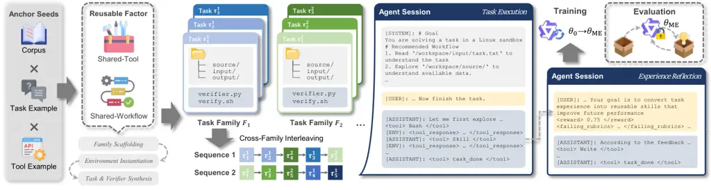
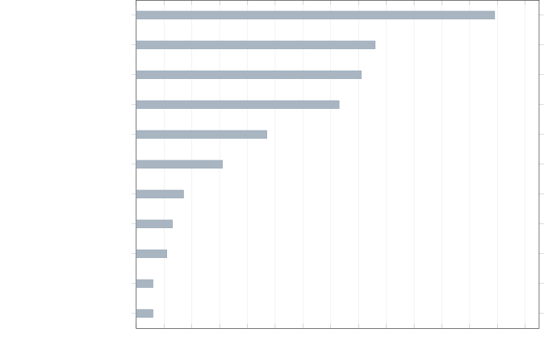
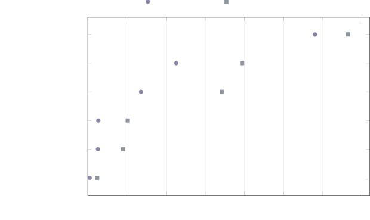

# MetaExp: Learning to Self-Improve through Experience via Verifiable Cross-Task Environment Scaling

Renhao Li Affiliation: University of Macau Affiliation: Shenzhen
Institute of Advanced Technology, Chinese Academy of Sciences
Email: <li.renhao@connect.um.edu.mo>    Xinjie Shen Affiliation: Georgia
Institute of Technology    Yang Su Affiliation: Alibaba Token Hub,
Alibaba Group    Jianhong Tu Affiliation: Alibaba Token Hub, Alibaba
Group    Derek F. Wong Affiliation: University of Macau    Dayiheng Liu
Affiliation: Alibaba Token Hub, Alibaba Group    Min Yang
Affiliation: Shenzhen Institute of Advanced Technology, Chinese Academy
of Sciences

###### Abstract

Language-model agents can accumulate interaction feedback, but reliably
turning that feedback into reusable experience remains challenging.
Existing methods either optimize external experience scaffolds or train
experience-related behavior on specific task distributions, leaving open
whether experience learning itself can become a transferable model
capability. Training such a capability calls for supervision beyond
isolated tasks, which mainly support in-episode problem solving rather
than revealing what knowledge remains useful across episodes. In this
work, we introduce MetaExp, a scalable framework that trains this
capability through verifiable task families with controlled cross-task
structure. Each family preserves a reusable factor while varying
task-specific realizations, enabling transfer without direct solution
reuse. We propose two complementary designs: Shared-Tool families keep
black-box tools fixed across tasks to elicit operational experience,
while Shared-Workflow families preserve latent procedures across
changing realizations to elicit procedural experience. We scale
environments under both designs, collect and filter sequential
interaction trajectories, and fine-tune Qwen3.5-122B-A10B on 4,956
trajectories from 1,000 task families. With parameters frozen during
downstream evolution, MetaExp improves by $`+8.5`$ points on
SpreadsheetBench, peaks at $`+2.3`$ on APEX-Agents, and improves by
$`+14.8`$ on AutomationBench. The gains persist under domain-excluded
training, supporting experience learning as a transferable capability
for continued non-parametric improvement after deployment.

>

¹¹footnotetext: Equal contribution. Work done during the internship at
Alibaba Token Hub.²²footnotetext: Corresponding author.

## 1 Introduction

Large language models (LLMs) increasingly act in interactive
environments, using tools to complete long-horizon tasks and respond to
execution feedback (Yao et al., 2023). Yet most agents remain largely
episodic: solving one task does not by itself make the agent more
effective on the next, and useful procedures discovered through
interaction are often lost once the episode ends (Zhao et al., 2024;
Wang et al., 2025b). Experience-driven self-evolution addresses this
limitation by turning past trajectories and feedback into persistent
experience that can guide future behavior (Shinn et al., 2023). However,
retaining experience is not equivalent to learning from it. An effective
agent must identify what caused an outcome, abstract what remains
useful, update its experience accordingly, and reuse it in later tasks.
This raises a fundamental question: can a model be trained once to
acquire, update, and reuse experience more effectively on previously
unseen task distributions?

Existing work approaches experience learning at either the system or
model level. System-level methods keep the backbone fixed and improve
how external experience is represented, extracted, revised, retrieved,
or validated (Ni et al., 2026; Yu et al., 2026; Wang et al., 2026a; Yang
et al., 2026b). They demonstrate that external experience can support
parameter-free adaptation, but its quality still depends on the
pretrained model’s ability to diagnose trajectories, abstract reusable
knowledge, and apply it appropriately. Model-level approaches instead
optimize experience acquisition, maintenance, or skill-conditioned
execution through parameter training (Wang et al., 2026b; Xia et al.,
2026; Fan et al., 2026a). However, their optimization signals and
downstream evaluation are typically tied to the same or closely related
task distributions, making general experience-learning ability difficult
to separate from task-specific adaptation. It therefore remains unclear
whether experience learning itself can be trained as a transferable
model capability.

This question is particularly relevant to realistic agent deployment. An
agent may encounter a new task distribution without a curated skill
library, large collections of verified target-domain trajectories, or
the opportunity for benchmark-specific retraining. It must instead
improve incrementally from the tasks and feedback it encounters, even
when later task variants differ substantially from earlier ones.
Motivated by this setting, we study _meta experience learning_: after a
single general training stage, the model parameters remain fixed, and
the agent starts each held-out task distribution with an empty
experience store. It must construct, revise, and reuse experience solely
through sequential interaction and feedback. In this work, we
instantiate external experience as structured Agent Skills (Anthropic,
2025). This setting separates learning how to acquire and use experience
from pre-acquiring or carrying target-domain experience itself.

Training this capability requires supervision beyond isolated task
solving. Independent task trajectories primarily supervise in-episode
problem solving, but provide limited evidence about which parts of an
interaction will remain useful on later tasks. We therefore organize
trajectory collection around structured task families that provide
controlled cross-episode supervision. MetaExp operationalizes this idea
by constructing verifiable families under the principle of _transfer
without direct solution reuse_: each family preserves a reusable factor
across tasks while varying task-specific realizations, so that
experience acquired from earlier members can help with later ones
without allowing previous solutions to be directly reused. We
instantiate this principle through two complementary designs.
_Shared-Tool_ families keep black-box tools fixed across tasks while
varying their concrete problems, encouraging operational experience
about recurring interfaces and tool composition. _Shared-Workflow_
families instead preserve a latent multi-step procedure across changing
domains, tools, and data, encouraging higher-level procedural experience
across different realizations. Sequential trajectories collected from
environments scaled under both designs are then used to train the model
to acquire, update, and reuse experience.

We fine-tune Qwen3.5-122B-A10B on 4,956 filtered trajectories collected
from 1,000 synthetic task families and evaluate it under cold-start
sequential evolution on three held-out agent benchmarks:
SpreadsheetBench, APEX-Agents, and AutomationBench. As test-time
experience accumulates, MetaExp improves by $`+8.5`$ points on
SpreadsheetBench, peaks at $`+2.3`$ points on APEX-Agents, and improves
by $`+14.8`$ points on AutomationBench. In contrast, the matched Qwen3.5
backbone degrades by $`2.2`$ points on SpreadsheetBench under the same
evolution protocol, showing that strong task-solving ability does not
necessarily translate into effective experience learning. The gains
remain substantial when semantically related training domains are
excluded, and MetaExp also makes better use of externally provided
skills on SkillsBench. Together, these results support experience
learning as a transferable model capability that can drive continued
improvement through non-parametric experience accumulation on unseen
task distributions.

Our contributions are threefold: (i) We formulate _meta experience
learning_ as a transferable model capability: after a single general
training stage, an agent should be able to build and reuse external
experience from scratch on unseen task distributions without further
parameter updates. (ii) We introduce MetaExp, a scalable framework that
constructs verifiable task families with controlled cross-task structure
to generate cross-episode supervision for experience learning,
instantiated through complementary Shared-Tool and Shared-Workflow
designs. (iii) We demonstrate transferable cold-start experience
learning across heterogeneous held-out agent benchmarks, with
substantial gains retained under domain-excluded training and improved
utilization of curated skills.

## 2 Related Work

#### Experience-driven agent self-evolution.

Existing approaches improve agents through persistent experience at
either the system or model level. System-level methods keep the backbone
fixed and externalize experience as verbal memories, codes, or
executable skills (Shinn et al., 2023; Zhao et al., 2024; Wang et al.,
2024; Wang et al., 2025b; Wang et al., 2025a). Recent work further
improves how such experience is extracted, revised, retrieved, and
validated (Ni et al., 2026; Qiu et al., 2026; Jiang et al., 2026a; Lin
et al., 2026; Yu et al., 2026; Li et al., 2026c; Wang et al., 2026a;
Yang et al., 2026b). These approaches enable parameter-free adaptation,
but the resulting experience remains dependent on the frozen model’s
ability to diagnose trajectories and abstract reusable knowledge, and
some rely on substantial target-distribution trials or in-distribution
validation (Zhang et al., 2026a; Liu et al., 2026). Model-level methods
instead update parameters to optimize experience acquisition,
maintenance, or skill-conditioned execution (Lu et al., 2026; Zhu et
al., 2026a; Wu et al., 2025; Wang et al., 2026b; Xia et al., 2026; Shi
et al., 2026; Yang et al., 2026a; He et al., 2026; Zhang et al., 2026b;
Yao et al., 2026; Li et al., 2026b; Vishe et al., 2026; Fan et al.,
2026a). However, these methods are often trained and evaluated on the
same or closely related task distributions, making transferable
experience-learning ability difficult to assess. More recently, Connect
the Dots (CoD) (Chen et al., 2026) explicitly investigates cross-domain
generalization of experience learning through reinforcement learning
with credit assignment across task-solving and context-updating
episodes. Its evaluation primarily focuses on controlled game-like and
simulated science and engineering environments. In comparison, MetaExp
constructs verifiable task families with controlled cross-task structure
to supervise operational and procedural experience learning from
execution and reflection trajectories, and evaluates cold-start skill
evolution across heterogeneous, work-oriented agent benchmarks.

#### Environment scaling and evaluation.

Agent training data can be scaled through verifiable task and
environment synthesis, including task proposal, capability composition,
and automated construction of executable environments (Zhou et al.,
2025; Xie et al., 2026; Zhu et al., 2026b; Hua et al., 2026; Wei et al.,
2026). Some methods organize generation around predefined skills or
skill structures (Zheng et al., 2025; Fan et al., 2026b; Cheng et al.,
2026; Tan et al., 2026). These approaches primarily scale individual
tasks or environments, whereas MetaExp scales _task families_ with
controlled cross-task structure so that experience acquired from earlier
tasks can remain useful for later ones without enabling direct solution
reuse. Complementary benchmarks evaluate either the utility of provided
skills (Li et al., 2026a; Han et al., 2026) or continual skill
generation and refinement over task streams (Zhong et al., 2026; Zhou et
al., 2026b; Zhang et al., 2026c; Lei et al., 2026; Jiang et al., 2026b;
Gao et al., 2026; Zhou et al., 2026a). Our evaluation instead focuses on
cold-start sequential evolution across heterogeneous held-out task
distributions.

## 3 Problem Setup

We study whether a language model can be trained once to better acquire,
update, and reuse external experience on previously unseen task
distributions. During test-time evolution, the model parameters remain
fixed and only the accumulated experience changes. We first define this
sequential experience-learning setting and then introduce the cold-start
protocol used for evaluation.

### 3.1 Experience Learning Setting

We consider a sequence of tasks, where each task
$`\tau_{i}=(e_{i},q_{i},v_{i})`$ consists of an interactive environment
$`e_{i}`$, a textual task request $`q_{i}`$, and an evaluator $`v_{i}`$.
Given a model with parameters $`\theta`$ and an external experience
store $`B_{i-1}`$, the agent interacts with the environment and produces
a trajectory

```math
h_{i}\sim\pi_{\theta}(\cdot\mid e_{i},q_{i},B_{i-1}). \tag{1}
```

The evaluator then returns an outcome score $`r_{i}`$ together with
task-level feedback $`f_{i}`$,

```math
(r_{i},f_{i})=v_{i}(h_{i}). \tag{2}
```

The score measures task completion, while the feedback contains richer
information about successes and failures. Based on the trajectory and
feedback, the agent may update its experience:

```math
B_{i}=U_{\theta}(B_{i-1},\tau_{i},h_{i},f_{i}), \tag{3}
```

where $`U_{\theta}`$ denotes the model’s experience-update behavior. The
resulting $`B_{i}`$ persists across tasks and can influence subsequent
execution. Experience may take different forms; in this work, we
instantiate $`B_{i}`$ as a file-based bank of structured agent skills.
Experience learning therefore involves both deciding what skills should
be updated according to previous interactions and using the resulting
skills appropriately on future tasks.

Our goal is not to learn target-domain experience during parameter
training. Instead, we ask whether a single _general training stage_ can
improve the model’s ability to acquire and reuse experience under this
sequential process on new task distributions. Training produces
parameters $`\theta_{\mathrm{ME}}`$ from a base model $`\theta_{0}`$
using only source task families. At evaluation time, neither model
receives target-benchmark parameter updates or pre-accumulated
target-domain experience. Their parameters remain fixed, and adaptation
occurs only through the evolving experience store $`B`$. We refer to
this property as _meta experience learning_: the ability to acquire
useful experience from interaction feedback and reuse it on subsequent
tasks, such that this behavior transfers beyond the task distributions
used for parameter training. Operationally, it requires the model to
construct experience from scratch, revise it as new feedback arrives,
and selectively apply it when solving later tasks.

### 3.2 Cold-Start Sequential Evolution

We introduce a cold-start sequential evolution protocol (SeqEvo) to
evaluate experience learning on held-out task distributions. For a fixed
evaluation domain, we omit the domain index for clarity. Both the
adaptation and target tasks come from a task distribution that is not
used for parameter optimization. The agent starts with an empty
experience store,

```math
B_{0}=\varnothing, \tag{4}
```

and processes $`K`$ adaptation tasks $`(\tau_{1},\ldots,\tau_{K})`$ one
at a time. Following the update process above, the experience bank
obtained after task $`\tau_{i}`$ is carried forward to $`\tau_{i+1}`$,
yielding $`B_{k}`$ after the first $`k`$ tasks. No future adaptation
task or target-set feedback is available when constructing $`B_{k}`$.
Here, $`k`$ denotes the number of test-time adaptation tasks rather than
gradient updates.

We evaluate each $`B_{k}`$ on a fixed target set $`E`$ that is disjoint
from the adaptation tasks, while keeping the experience bank unchanged
during evaluation. We define

```math
S(k;\theta)=\frac{1}{|E|}\sum_{\tau\in E}r_{\tau}^{(k,\theta)}, \tag{5}
```

where $`r_{\tau}^{(k,\theta)}`$ denotes the outcome score obtained by
model $`\theta`$ on task $`\tau`$ using the accumulated experience bank
$`B_{k}`$, and $`S(0;\theta)`$ is the performance without accumulated
experience. The effect of test-time experience accumulation after $`k`$
adaptation tasks is

```math
\Delta(k;\theta)=S(k;\theta)-S(0;\theta). \tag{6}
```

We report both $`S(0;\theta)`$ and $`\Delta(k;\theta)`$. The former
reflects zero-experience task-solving ability, while the latter measures
how performance changes as test-time experience accumulates. Together,
they separate zero-experience task performance from the change induced
by accumulated experience.



Figure 1: Overview of MetaExp. Heterogeneous seeds are expanded into
verifiable task families with complementary Shared-Tool and
Shared-Workflow structure. Family-centered task sequences are used to
collect execution and feedback-driven reflection trajectories, which
train the model to acquire, update, and reuse experience. At evaluation,
model parameters are frozen and experience is accumulated from an empty
bank on unseen task distributions.

## 4 MetaExp: Verifiable Cross-Task Environment Scaling

MetaExp trains transferable experience-learning behavior by constructing
controlled cross-task supervision. As shown in Figure 1, it builds two
complementary types of task families with reusable cross-task structure,
realizes them as verifiable executable environments, collects sequential
experience-learning trajectories, and uses the resulting data for model
training.

### 4.1 Cross-Task Family Design

The key design principle is to preserve a reusable source of commonality
across tasks while varying their concrete realizations. We represent a
task family as

```math
\mathcal{F}(z)=\{\tau_{i}=G(z,\xi_{i})\}_{i=1}^{m}, \tag{7}
```

where $`z`$ denotes the family-level reusable factor and $`\xi_{i}`$
captures task-specific variation. We follow the principle of _transfer
without direct solution reuse_: $`z`$ should make experience acquired
from earlier members potentially useful for later ones, while variation
in $`\xi_{i}`$ prevents previous solutions from being directly reused.

We propose two complementary designs. (i) Shared-Tool families keep a
black-box tool library and its documentation fixed across members while
varying task data and requests. Here, $`z`$ corresponds to stable tool
semantics and interfaces, encouraging relatively concrete operational
experience about tool behavior, argument conventions, and composition.
(ii) Shared-Workflow families instead preserve a latent multi-step
procedure while varying its concrete realization, including domain, APIs
and documentation, data, and request. The latent workflow guides
generation but is never exposed to the solver, encouraging more abstract
procedural experience that transfers across changing tools and domains.
Together, the two designs expose reusable structure at complementary
levels, from concrete operational regularities to abstract procedural
patterns.

### 4.2 Verifiable Family Scaling

We scale these families from heterogeneous seeds drawn from
pretraining-style corpora, task examples, and tool schemas, which
provide diverse semantic contexts, procedural patterns, and executable
affordances. Each family is then realized through three stages. Family
scaffolding constructs its shared factor $`z`$ once per family. For
Shared-Tool families, we generate and validate an executable tool
library together with its documentation, which are then fixed across
members. For Shared-Workflow families, we abstract a domain-independent
latent workflow from a seed task example.

Environment instantiation produces multiple family members by varying
task-specific factors $`\xi_{i}`$. Shared-Tool members reuse the same
tools with independently populated data, whereas Shared-Workflow members
instantiate the same latent procedure with new domains, APIs and
documentation, and task-specific data. We additionally vary data scale,
output structure, and difficulty to increase task diversity while
preserving the intended commonality.

Finally, task-and-verifier synthesis uses a propose–solve–confirm loop
to generate each task request together with a reference solution and
executable checks. The generator explores the instantiated tools and
data before proposing and solving the task. The complete package is
rerun in a clean sandbox and retained only if the reference solution
executes successfully and passes verification. Validation is asymmetric:
reference solutions, verifiers, and latent workflows may be used during
synthesis but are never exposed to the solver.

### 4.3 Sequential Experience Trajectory Collection

For each validated family $`\mathcal{F}=\{\tau_{1},\ldots,\tau_{m}\}`$,
we order its members by increasing difficulty and assign them
sequentially to a teacher model starting from an empty skill bank. Each
collection sequence is centered on one family but interleaves a small
fraction of tasks sampled from other families. These cross-family tasks
introduce potentially irrelevant experience into the bank, encouraging
the model to learn selective reuse instead of indiscriminately applying
accumulated skills. The teacher follows the sequential
experience-learning process defined in Section 3: it solves each task
conditioned on the current bank, receives executable feedback, and
updates the bank before proceeding to the next task.

Each task runs in a fresh sandbox with the current skill bank mounted.
The teacher interacts through a general agent harness and invokes a
task_done tool upon completion, after which the task-specific verifier
is introduced and executed. An LLM judge reviews only failed rubric
items to correct potential false negatives and produces the final score
and feedback. The feedback is then injected through a fixed reflection
prompt, allowing the teacher to create, revise, or delete skills before
the updated bank is carried forward. We retain only trajectories with
coherent execution, evaluation, and reflection, verified task
completion, and valid skill artifacts.

### 4.4 Meta-Experience Training

The retained trajectories supervise two complementary behaviors:
execution-stage actions train experience-conditioned task solving, while
reflection-stage actions train feedback-driven experience updating. Let
$`\mathcal{D}_{\mathrm{ME}}`$ denote records from both stages. We
fine-tune the base model with the standard assistant-token objective

```math
\mathcal{L}_{\mathrm{ME}}(\theta)=-\sum_{x\in\mathcal{D}_{\mathrm{ME}}}\sum_{t\in\mathcal{A}(x)}\log p_{\theta}(x_{t}\mid x_{<t}), \tag{8}
```

where $`\mathcal{A}(x)`$ denotes assistant-generated token positions;
system messages, user messages, and environment observations are masked
from the loss.

Optimizing this objective from $`\theta_{0}`$ yields
$`\theta_{\mathrm{ME}}`$. The skill banks accumulated during trajectory
collection are discarded after model training; what is retained is the
model’s learned behavior for acquiring, updating, and reusing
experience. At evaluation time, $`\theta_{\mathrm{ME}}`$ remains frozen
and each held-out task distribution starts from an empty bank under
SeqEvo, where adaptation occurs solely through newly accumulated
experience.

|                                     |           |                 |                            |                            |                            |                             |
| ----------------------------------- | --------- | --------------- | -------------------------- | -------------------------- | -------------------------- | --------------------------- |
| Model                               | Protocol  | $`k=0`$         | $`k=5`$                    | $`k=10`$                   | $`k=20`$                   | $`k=40`$                    |
| Task success rate (%, $`\uparrow`$) |           |                 |                            |                            |                            |                             |
| GPT-4.1                             | EvoSkill  | 44.2            | –                          | –                          | –                          | $`37.2\pm 2.6`$ $`(-7.0)`$  |
| GPT-5.4                             | EvoSkill  | 62.5            | –                          | –                          | –                          | $`68.1\pm 0.5`$ $`(+5.6)`$  |
| GPT-4.1                             | SkillGrad | 44.2            | –                          | –                          | –                          | $`54.2\pm 3.5`$ $`(+10.0)`$ |
| GPT-5.4                             | SkillGrad | 62.5            | –                          | –                          | –                          | $`71.1\pm 1.7`$ $`(+8.6)`$  |
| GLM-5.2                             | SeqEvo    | $`88.3\pm 1.2`$ | $`88.9\pm 0.5`$ $`(+0.6)`$ | $`89.5\pm 0.7`$ $`(+1.2)`$ | $`89.6\pm 0.4`$ $`(+1.3)`$ | $`89.4\pm 0.4`$ $`(+1.1)`$  |
| Qwen3.6-Plus                        | SeqEvo    | $`76.0\pm 0.9`$ | $`71.8\pm 2.5`$ $`(-4.2)`$ | $`72.9\pm 3.1`$ $`(-3.1)`$ | $`73.1\pm 3.1`$ $`(-2.9)`$ | $`74.3\pm 3.1`$ $`(-1.7)`$  |
| Qwen3.5-122B-A10B                   | SeqEvo    | $`68.9\pm 1.8`$ | $`67.3\pm 1.8`$ $`(-1.6)`$ | $`67.7\pm 0.5`$ $`(-1.2)`$ | $`67.0\pm 0.9`$ $`(-1.9)`$ | $`66.7\pm 1.3`$ $`(-2.2)`$  |
| MetaExp-Qwen3.5-122B-A10B           | SeqEvo    | $`65.0\pm 2.2`$ | $`69.5\pm 3.3`$ $`(+4.5)`$ | $`72.9\pm 3.7`$ $`(+7.9)`$ | $`73.1\pm 2.8`$ $`(+8.1)`$ | $`73.5\pm 3.4`$ $`(+8.5)`$  |
| Execution turns ($`\downarrow`$)    |           |                 |                            |                            |                            |                             |
| GLM-5.2                             | SeqEvo    | $`10.4\pm 0.4`$ | $`12.3\pm 0.2`$ $`(+1.9)`$ | $`12.1\pm 0.1`$ $`(+1.7)`$ | $`12.4\pm 0.5`$ $`(+2.0)`$ | $`13.1\pm 0.6`$ $`(+2.7)`$  |
| Qwen3.6-Plus                        | SeqEvo    | $`7.8\pm 0.1`$  | $`8.0\pm 0.3`$ $`(+0.2)`$  | $`8.0\pm 0.2`$ $`(+0.2)`$  | $`8.1\pm 0.2`$ $`(+0.3)`$  | $`7.7\pm 0.2`$ $`(-0.1)`$   |
| Qwen3.5-122B-A10B                   | SeqEvo    | $`7.6\pm 0.5`$  | $`7.2\pm 0.1`$ $`(-0.4)`$  | $`7.3\pm 0.0`$ $`(-0.3)`$  | $`7.4\pm 0.1`$ $`(-0.2)`$  | $`7.2\pm 0.0`$ $`(-0.4)`$   |
| MetaExp-Qwen3.5-122B-A10B           | SeqEvo    | $`8.1\pm 0.1`$  | $`8.1\pm 0.2`$ $`(0.0)`$   | $`8.2\pm 0.3`$ $`(+0.1)`$  | $`8.5\pm 0.9`$ $`(+0.4)`$  | $`8.6\pm 0.7`$ $`(+0.5)`$   |

Table 1: Performance and efficiency on SpreadsheetBench. Values are mean
$`\pm`$ population standard deviation, with $`\Delta_{k}=S(k)-S(0)`$
shown in parentheses. Green/red denotes improvement/degradation relative
to $`k=0`$. EvoSkill and SkillGrad results are taken from Wang et al.
(2026a) and follow their originally reported evolution protocols; all
other results use our cold-start SeqEvo protocol. “–” denotes an
unreported checkpoint.

## 5 Experiments

### 5.1 Experimental Setup

#### Training configuration.

Following Section 4, we construct 500 Shared-Tool and 500
Shared-Workflow families, each containing five task instances. We use
GLM-5.2 (Zeng et al., 2026) as the teacher model, deployed through a
standardized agent harness for trajectory collection, yielding 4,956
trajectories after filtering. We fine-tune Qwen3.5-122B-A10B (Qwen Team, 2026) for two epochs with a 256K context window. The loss is computed
only over assistant-generated tokens, while system messages, user
messages, and environment observations are masked out.

#### Datasets and evaluation.

We evaluate cold-start experience evolution on three challenging
benchmarks spanning distinct task distributions. We adapt their original
environments and evaluators into executable sandboxes compatible with
our agent harness. All models evaluated by us follow the SeqEvo protocol
defined in Section 3.2, using the same agent harness as in trajectory
collection. For each benchmark, adaptation and target sets are disjoint,
and we repeat each experiment three times with independently randomized
adaptation orders. Each adaptation task allows up to three reflection
retries; if all retries fail, the latest verified skill bank is carried
forward. SpreadsheetBench-v1-verified contains 400 real-world
spreadsheet manipulation tasks at the cell and sheet levels. We use 40
tasks for adaptation and 350 disjoint tasks for evaluation, with a
shared skill bank capped at 10 skills. Verification executes the
generated solution on the input workbook, recalculates formulas, and
compares annotated output ranges with the golden workbook; a task
succeeds only if all required cells match. APEX-Agents contains 480
long-horizon professional tasks across investment banking, law, and
management consulting. For each domain, we use 40 tasks for adaptation
and 120 disjoint tasks for evaluation, maintaining a separate skill bank
capped at 5 skills. An LLM judge evaluates the agent response, generated
artifacts, and environment changes against expert-authored binary
rubrics; a task succeeds only if all required criteria are satisfied.
AutomationBench contains 600 cross-application API workflow tasks across
finance, HR, marketing, operations, sales, and support. For each domain,
we use 20 tasks for adaptation and 80 disjoint tasks for evaluation,
with an independent skill bank capped at 10 skills. Verification
compares the final environment state against deterministic assertions.
We report average task success rate on all three benchmarks. Each
adaptation task is encountered only once per run, preventing repeated
optimization against the same verifier feedback. We additionally
evaluate the ability to utilize externally provided experience on
SkillsBench-v1.1, which contains 87 expert-level tasks across 11
domains, each paired with curated agent skills. All models receive the
same skills for each task, and we report average score and pass rate
over three runs.

#### Models and baselines.

We denote our trained checkpoint as MetaExp-Qwen3.5-122B-A10B and use
the original Qwen3.5-122B-A10B as the matched backbone baseline. We
additionally evaluate stronger models, including Qwen3.6-Plus and
GLM-5.2, with reasoning enabled at maximum effort. These models are
evaluated using the same harness and SeqEvo setup. On SpreadsheetBench,
we also report published EvoSkill (Alzubi et al., 2026) and SkillGrad
results from Wang et al. (2026a) as representative system-level
experience-learning approaches; these follow their originally reported
evolution protocols rather than our SeqEvo setup.

Figure 2: Performance on APEX-Agents and AutomationBench. Left:
aggregate success rate over adaptation steps, with shaded population
standard deviations over three runs. Right: domain-wise success rate and
changes $`\Delta_{k}`$ on each adaptation step for
MetaExp-Qwen3.5-122B-A10B and Qwen3.5-122B-A10B; green/red denotes
improvement/degradation.

### 5.2 Main Results

#### SpreadsheetBench.

Table 1 reports performance and efficiency on SpreadsheetBench across
different backbones and evolution protocols. Under SeqEvo, MetaExp
improves from $`65.0`$ at $`k=0`$ to $`73.5`$ at $`k=40`$ $`(+8.5)`$,
with most gains emerging within the first 10 adaptation tasks. In
contrast, Qwen3.5-122B-A10B and Qwen3.6-Plus finish below their
zero-experience baselines, while GLM-5.2 remains the strongest absolute
solver but improves only marginally, peaking at $`+1.3`$ points. The
gain is accompanied by only a modest increase in execution turns, from
$`8.1`$ at $`k=0`$ to $`8.6`$ at $`k=40`$, indicating that the
improvement is not simply associated with substantially more
interaction. Published EvoSkill and SkillGrad results further show that
system-level skill evolution can also yield substantial gains, although
they follow different evolution protocols and typically use more
verified trajectories during adaptation.

#### APEX-Agents.

Figure 2(a,b) shows a more heterogeneous pattern of experience transfer
on APEX-Agents. At the aggregate level, MetaExp improves from $`12.2`$
at $`k=0`$ to a peak of $`14.5`$ at $`k=20`$, retaining a $`+1.8`$-point
gain at $`k=40`$. This modest average masks clear domain differences: at
$`k=40`$, MetaExp gains $`+2.8`$ points in law and $`+5.0`$ in
management consulting, compared with only $`+0.8`$ and $`+0.9`$ for the
matched Qwen3.5 baseline.

Investment banking is the main exception, where MetaExp decreases by
$`2.5`$ points while Qwen3.5 improves by $`3.7`$. This reversal is
partly amplified by the near-binary exact-value evaluation and different
cold-start headroom, although some case-specific skills also
overgeneralize and interfere with otherwise correct solutions. GLM-5.2
remains the strongest absolute solver but shows little further
improvement from accumulated experience. Overall, MetaExp yields
positive aggregate evolution, with particularly clear gains in law and
management consulting.

#### AutomationBench.

Figure 2(c,d) shows a broader and more sustained evolution trend on
AutomationBench. MetaExp improves monotonically from $`14.5`$ to
$`29.3`$, yielding a $`+14.8`$-point gain, roughly twice that of its
matched Qwen3.5 baseline. By $`k=10`$, MetaExp already improves over its
zero-experience performance in all six domains, and by $`k=20`$ its gain
exceeds that of Qwen3.5 in five of them. The strongest improvement
appears in finance ($`+32.9`$), with substantial gains also observed
across HR, marketing, operations, and support. GLM-5.2 remains the
strongest absolute solver and also benefits from accumulated experience.
Overall, AutomationBench shows that MetaExp substantially increases
experience-driven improvement.

| Model                               | $`k=0`$         | $`k=5`$                    | $`k=10`$                   | $`k=20`$                   | $`k=40`$                   |
| ----------------------------------- | --------------- | -------------------------- | -------------------------- | -------------------------- | -------------------------- |
| Task success rate (%, $`\uparrow`$) |                 |                            |                            |                            |                            |
| Qwen3.5-122B-A10B                   | $`68.9\pm 1.8`$ | $`67.3\pm 1.8`$ $`(-1.6)`$ | $`67.7\pm 0.5`$ $`(-1.2)`$ | $`67.0\pm 0.9`$ $`(-1.9)`$ | $`66.7\pm 1.3`$ $`(-2.2)`$ |
| - MetaExp                           | $`65.0\pm 2.2`$ | $`69.5\pm 3.3`$ $`(+4.5)`$ | $`72.9\pm 3.7`$ $`(+7.9)`$ | $`73.1\pm 2.8`$ $`(+8.1)`$ | $`73.5\pm 3.4`$ $`(+8.5)`$ |
| - Strict-OOD MetaExp                | $`62.7\pm 1.4`$ | $`66.8\pm 5.0`$ $`(+4.1)`$ | $`66.2\pm 4.0`$ $`(+3.5)`$ | $`72.5\pm 3.0`$ $`(+9.8)`$ | $`72.0\pm 0.8`$ $`(+9.3)`$ |

Table 2: SpreadsheetBench task success under domain-excluded training.
Values are mean $`\pm`$ population standard deviation over three runs,
with $`\Delta_{k}=S(k)-S(0)`$ shown in parentheses.

| Model    | Score (%)       | Pass (%)         |
| -------- | --------------- | ---------------- |
| GLM-5.2  | 65.1            | 74.7             |
| Baseline | 33.3            | 47.1             |
| MetaExp  | 41.4 $`(+8.1)`$ | 62.1 $`(+15.0)`$ |

Table 3: Model performance on SkillsBench. Values are averaged across
three runs.

#### SkillsBench.

Unlike the preceding benchmarks, SkillsBench holds the experience itself
fixed: every model receives the same expert-curated skill, allowing us
to isolate how effectively provided experience is used during execution.
As shown in Table 3, MetaExp improves over its matched backbone from
$`33.3`$ to $`41.4`$ in average score and from $`47.1\%`$ to $`62.1\%`$
in average pass rate. These results provide complementary evidence that
MetaExp improves not only experience acquisition but also the ability to
translate available experience into successful task execution.

### 5.3 Domain-Excluded OOD Evaluation

Although the main evaluation benchmarks are excluded from training, the
scaled training corpus may still contain semantically related domains.
To impose a stricter distribution shift, we remove Software Engineering
& Programming, Finance & Business, and IT Software & Web Services from
the training data. We apply a strict-prefix filter: a trajectory is
excluded if either its current task or any preceding task in the same
family belongs to one of these domains, preventing retained trajectories
from depending on earlier in-domain experience. This leaves 3,634
trajectories, including 1,939 Shared-Tool and 1,695 Shared-Workflow
trajectories. Starting from the same Qwen3.5-122B-A10B checkpoint, we
train a Strict-OOD variant with the same configuration and evaluate its
epoch-2 checkpoint on the same SpreadsheetBench splits under SeqEvo.

Table 2 shows that the experience-learning gains persist even after
removing training domains most closely related to SpreadsheetBench.
Strict-OOD MetaExp reaches $`\Delta_{20}=+9.8`$ and
$`\Delta_{40}=+9.3`$, comparable to the gains of the full MetaExp model.
Despite its lower zero-experience performance, it exhibits substantial
positive evolution as experience accumulates, whereas the matched
untrained backbone consistently degrades under the same SeqEvo setting.
This contrast provides stronger evidence that the learned
experience-learning behavior transfers across domains and does not
depend on training examples from related task domains.

|                                     |                  |                            |                      |                            |                 |                             |
| ----------------------------------- | ---------------- | -------------------------- | -------------------- | -------------------------- | --------------- | --------------------------- |
| Benchmark                           | Shared-Tool Only |                            | Shared-Workflow Only |                            | Full MetaExp    |                             |
|                                     | Initial          | Final                      | Initial              | Final                      | Initial         | Final                       |
| Task success rate (%, $`\uparrow`$) |                  |                            |                      |                            |                 |                             |
| SpreadsheetBench                    | $`62.7\pm 1.0`$  | $`72.4\pm 7.3`$ $`(+9.7)`$ | $`63.6\pm 1.5`$      | $`69.7\pm 2.7`$ $`(+6.1)`$ | $`65.0\pm 2.2`$ | $`73.5\pm 3.4`$ $`(+8.5)`$  |
| APEX-Agents                         | $`13.2\pm 1.3`$  | $`12.7\pm 1.3`$ $`(-0.5)`$ | $`12.2\pm 0.6`$      | $`12.6\pm 0.7`$ $`(+0.4)`$ | $`12.2\pm 1.7`$ | $`14.0\pm 1.4`$ $`(+1.8)`$  |
| AutomationBench                     | $`7.2\pm 0.5`$   | $`14.8\pm 3.8`$ $`(+7.6)`$ | $`8.5\pm 0.5`$       | $`15.6\pm 3.6`$ $`(+7.1)`$ | $`14.5\pm 0.9`$ | $`29.3\pm 3.3`$ $`(+14.8)`$ |
| Execution turns ($`\downarrow`$)    |                  |                            |                      |                            |                 |                             |
| SpreadsheetBench                    | $`7.2\pm 0.3`$   | $`10.5\pm 1.7`$ $`(+3.3)`$ | $`7.8\pm 0.2`$       | $`9.0\pm 0.4`$ $`(+1.2)`$  | $`8.1\pm 0.1`$  | $`8.6\pm 0.7`$ $`(+0.5)`$   |
| APEX-Agents                         | $`29.0\pm 0.7`$  | $`26.2\pm 0.4`$ $`(-2.8)`$ | $`31.2\pm 0.5`$      | $`28.6\pm 0.2`$ $`(-2.6)`$ | $`33.3\pm 0.6`$ | $`33.1\pm 1.6`$ $`(-0.2)`$  |
| AutomationBench                     | $`43.0\pm 0.7`$  | $`44.5\pm 6.4`$ $`(+1.5)`$ | $`45.7\pm 1.2`$      | $`43.3\pm 5.2`$ $`(-2.4)`$ | $`49.4\pm 1.1`$ | $`42.4\pm 3.1`$ $`(-7.0)`$  |

Table 4: Ablation of cross-family task designs on models. Values are
mean $`\pm`$ population standard deviation over three runs, with
$`\Delta=S_{\mathrm{final}}-S_{\mathrm{initial}}`$ shown in parentheses.

### 5.4 Ablation Study

We ablate the two cross-task family designs by training separate models
on Shared-Tool or Shared-Workflow trajectories, starting from the same
base checkpoint. Table 4 shows that both designs can induce
experience-driven improvement, but with different behavioral patterns.
Shared-Tool yields the larger gain on SpreadsheetBench ($`+9.7`$ vs.
$`+6.1`$ points), consistent with learning reusable operational
experience over stable black-box tools. Shared-Workflow, in contrast,
more consistently improves execution efficiency on long-horizon tasks,
reducing execution by $`2.6`$ turns on APEX-Agents and $`2.4`$ turns on
AutomationBench, consistent with learning higher-level procedural
experience across changing tool realizations. Combining both designs
yields the broadest improvement across benchmarks. On AutomationBench in
particular, full MetaExp reaches a $`+14.8`$-point gain, substantially
exceeding either Shared-Tool ($`+7.6`$) or Shared-Workflow ($`+7.1`$)
alone, while also reducing execution by $`7.0`$ turns. These results
suggest that the two family designs provide complementary supervision
for transferable experience learning.

### 5.5 Behavioral Analysis

To better understand the source of the experience-learning gains, we
analyze how accumulated skills are used and updated on SpreadsheetBench.
MetaExp-Qwen3.5 invokes existing skills far more frequently than its
matched backbone despite maintaining a smaller bank, and its positive
performance changes are concentrated on trajectories where skills are
actually invoked. We further find that MetaExp-Qwen3.5 consolidates
feedback into fewer, longer skills with more failure- and
verification-oriented content and less instance-specific structure.
These patterns are consistent with the two behaviors targeted during
training. See full analysis in Appendix A.

## 6 Conclusion

We study whether experience learning itself can be trained as a
transferable model capability. MetaExp uses verifiable cross-task
families to train models to acquire, update, and reuse external
experience, while leaving model parameters fixed during downstream
evolution. Across heterogeneous held-out benchmarks, the trained model
consistently benefits more from accumulated experience than its matched
backbone, with the effect persisting under domain-excluded training and
extending to the use of externally provided skills. These results
suggest that experience learning can be learned and transferred beyond
the task distributions used for training.

### Acknowledgments

Min Yang is supported by National Key Research and Development Program
of China (2024YFF0908200), National Natural Science Foundation of China
(62376262), the Natural Science Foundation of Guangdong Province of
China (2024A1515030166, 2025B1515020032). This work was supported in
part by the Science and Technology Development Fund of Macau SAR (Grant
Nos. FDCT/0007/2024/AKP, EF2024-00185-FST), the UM and UMDF (Grant Nos.
MYRG-GRG2024-00165-FST-UMDF, MYRG-GRG2025-00236-FST,
MYRG-GRG2026-00018-FIC, MYRG-CRG2026-00007-FIC), and the Dr. Stanley Ho
Medical Development Foundation (Grant No. SHMDF-AI/2026/001).

This work was supported by Alibaba Research Intern Program. We would
like to thank the Qwen Team at Alibaba Token Hub (ATH), Alibaba Group,
for providing the computational resources and foundation models (Qwen)
used in this research.

## References

- Alzubi et al. (2026) S. Alzubi, N. Provenzano, J. Bingham, W. Chen,
  and T. Vu EvoSkill: automated skill discovery for multi-agent systems.
  arXiv preprint arXiv:2603.02766. Cited by: §5.1.
- Anthropic (2025) Anthropic Equipping agents for the real world with
  agent skills. Note:
  https://www.anthropic.com/engineering/equipping-agents-for-the-real-world-with-agent-skills
  Cited by: §1.
- Chen et al. (2026) Y. Chen, W. Shi, B. Hu, Z. Zhang, Z. Wang, Y.
  Xie, Y. Li, B. Ding, and J. Zhou Connect the dots: training llms for
  long-lifecycle agents with cross-domain generalization via
  reinforcement learning. arXiv preprint arXiv:2606.20002. Cited by: §2.
- Cheng et al. (2026) Z. Cheng, H. Wang, Z. Liu, X. Wang, X. Zhu, Y.
  Guo, W. Lin, J. Z. Pan, and Y. Wang Terminal-World: scaling
  terminal-agent environments via agent skills. arXiv preprint
  arXiv:2605.20876. Cited by: §2.
- Fan et al. (2026a) Z. Fan, W. Jin, F. Zhang, B. Li, Y. Dong, Y. Hu,
  and J. Li Evolving-rl: end-to-end optimization of experience-driven
  self-evolving capability within agents. arXiv preprint
  arXiv:2605.10663. Cited by: §1, §2.
- Fan et al. (2026b) Z. Fan, T. Yu, Y. Cai, J. Guan, Y. Yang, D. Hu, J.
  Zhou, X. Wu, Z. Han, F. Zhang, and L. Wang Toward scalable terminal
  task synthesis via skill graphs. arXiv preprint arXiv:2604.25727.
  Cited by: §2.
- Gao et al. (2026) X. Gao, C. Hu, H. Chen, P. Yao, Z. Wang, Y. Bai, Z.
  Wu, Y. Han, X. Cong, J. Gui, et al. EvoAgentBench: benchmarking agent
  self-evolution via ability transfer. arXiv preprint arXiv:2607.05202.
  Cited by: §2.
- Han et al. (2026) T. Han, Y. Zhang, W. Song, C. Fang, Z. Chen, Y. Sun,
  and L. Hu SWE-Skills-Bench: do agent skills actually help in
  real-world software engineering?. arXiv preprint arXiv:2603.15401.
  Cited by: §2.
- He et al. (2026) Z. He, H. Lin, B. Han, W. Zhu, H. Fang, B. Wang, X.
  Zhu, R. Li, and M. Reimherr ReSkill: reconciling skill creation with
  policy optimization in agentic rl. arXiv preprint arXiv:2606.01619.
  Cited by: §2.
- Hua et al. (2026) Z. Hua, Y. Yao, W. Xie, Y. Zhao, M. Liu, R. Qiu, Z.
  Huang, Z. Wang, Y. Ji, Y. Ye, L. Zhu, X. Lei, H. Li, Z. Ma, Z.
  Wang, Z. Zhang, and J. Liu CLI-Universe: towards verifiable task
  synthesis engine for terminal agents. arXiv preprint arXiv:2606.22883.
  Cited by: §2.
- Jiang et al. (2026a) G. Jiang, Z. Su, X. Qu, and Y. R. Fung XSkill:
  continual learning from experience and skills in multimodal agents.
  arXiv preprint arXiv:2603.12056. Cited by: §2.
- Jiang et al. (2026b) S. Jiang, L. Ma, Z. Hong, K. Wang, Z. Lu, T.
  Wang, S. Chen, J. Zhang, T. Pan, W. Li, et al. SEA-Eval: a benchmark
  for evaluating self-evolving agents beyond episodic assessment. arXiv
  preprint arXiv:2604.08988. Cited by: §2.
- Lei et al. (2026) Y. Lei, Z. Wan, J. Zhang, S. Alam, Z. Zhong, P.
  Huang, X. Wang, J. Zhang, D. Zhou, Y. Hsieh, et al. SkillEvolBench:
  benchmarking the evolution from episodic experience to procedural
  skills. arXiv preprint arXiv:2605.24117. Cited by: §2.
- Li et al. (2026a) X. Li, Y. Liu, W. Chen, B. You, Z. Di, Y. He, S.
  Zheng, K. W. Choe, J. Sun, S. Wang, C. Tao, B. Li, X. Zhao, H.
  Geng, X. Wu, J. Zhou, X. Chen, H. Xing, Y. Li, Q. Zeng, D. Wang, Y.
  Wang, R. B. Chaim, P. Jiang, H. Shen, L. Kong, X. Liu, R. Wang, X.
  Liu, J. Li, X. Lan, Y. Lin, W. Ye, J. He, S. Li, Y. Zhang, Y. Gao, Y.
  Li, Z. Ma, L. Jing, T. Wang, K. Li, Y. Xue, H. Lyu, Y. He, Y. Tian, S.
  Wu, B. Wang, Y. Gao, B. Chen, L. Liu, S. Cheng, J. Bao, S. Tong, S.
  Xu, T. Y. Zhuo, T. Ye, Q. Qi, M. Li, L. Liao, Z. Tan, C. Shi, X.
  Tang, S. Tankasala, B. Yuan, Y. Qian, J. Tu, C. Wang, Y. Sun, W.
  Wang, A. Taylor, Z. Yang, C. Guan, Z. Dong, X. Zhang, S. Dillmann, H.
  Lee, and D. Song SkillsBench: benchmarking how well agent skills work
  across diverse tasks. arXiv preprint arXiv:2602.12670. Cited by: §2.
- Li et al. (2026b) Y. Li, Y. Zhang, X. Zhang, X. Liu, and Y. Liu
  CodeSkill: learning self-evolving skills for coding agents. arXiv
  preprint arXiv:2605.25430. Cited by: §2.
- Li et al. (2026c) Y. Li, M. Cai, Z. Xiao, W. Wang, Y. Deng, and B. An
  MIND-skill: quality-guaranteed skill generation via multi-agent
  induction and deduction. arXiv preprint arXiv:2605.08670. Cited by:
  §2.
- Lin et al. (2026) H. Lin, P. Li, J. Song, F. Jiang, and T. Zhang
  Muse-AutoSkill: self-evolving agents via skill creation, memory,
  management, and evaluation. arXiv preprint arXiv:2605.27366. Cited by:
  §2.
- Liu et al. (2026) Y. Liu, Z. Su, L. Xie, Y. Zhang, Q. Zong, J. Guo, Z.
  Xie, Y. Ji, Y. Yim, H. Luo, et al. SkillRevise: improving llm-authored
  agent skills via trace-conditioned skill revision. arXiv preprint
  arXiv:2606.01139. Cited by: §2.
- Lu et al. (2026) Z. Lu, Z. Yao, J. Wu, C. Han, Q. Gu, X. Cai, W.
  Lu, J. Xiao, Y. Zhuang, and Y. Shen Skill0: in-context agentic
  reinforcement learning for skill internalization. arXiv preprint
  arXiv:2604.02268. Cited by: §2.
- Ni et al. (2026) J. Ni, Y. Liu, X. Liu, Y. Sun, M. Zhou, P. Cheng, D.
  Wang, E. Zhao, X. Jiang, and G. Jiang Trace2Skill: distill
  trajectory-local lessons into transferable agent skills. arXiv
  preprint arXiv:2603.25158. Cited by: §1, §2.
- Qiu et al. (2026) L. Qiu, Z. Gao, J. Chen, Y. Ye, W. Huang, X. Xue, W.
  Qiu, and S. Tang AutoRefine: from trajectories to reusable expertise
  for continual llm agent refinement. arXiv preprint arXiv:2601.22758.
  Cited by: §2.
- Qwen Team (2026) Qwen Team Qwen3.5: towards native multimodal agents.
  Cited by: §5.1.
- Shi et al. (2026) Y. Shi, Y. Chen, Z. Lu, Y. Miao, S. Liu, Q. Gu, X.
  Cai, X. Wang, and A. Zhang Skill1: unified evolution of
  skill-augmented agents via reinforcement learning. arXiv preprint
  arXiv:2605.06130. Cited by: §2.
- Shinn et al. (2023) N. Shinn, F. Cassano, A. Gopinath, K. Narasimhan,
  and S. Yao Reflexion: language agents with verbal reinforcement
  learning. In Advances in Neural Information Processing Systems, Cited
  by: §1, §2.
- Tan et al. (2026) Z. Tan, Y. Zhang, H. Li, Z. Cui, H. Geng, S.
  Zhang, H. Zhang, Y. Chen, X. Wang, L. Wang, Z. Yin, S. Hu, C. Zhang,
  and L. Bai SKT: skill-use training at scale via verified synthetic
  data generation. arXiv preprint arXiv:2608.02287. Cited by: §2.
- Vishe et al. (2026) Y. Vishe, R. Surana, X. Jiang, Z. Huang, X.
  Li, N. L. Kuang, T. Yu, R. A. Rossi, J. Shang, J. McAuley, et al.
  Skill-R1: agent skill evolution via reinforcement learning. arXiv
  preprint arXiv:2605.09359. Cited by: §2.
- Wang et al. (2024) G. Wang, Y. Xie, Y. Jiang, A. Mandlekar, C.
  Xiao, Y. Zhu, L. Fan, and A. Anandkumar Voyager: an open-ended
  embodied agent with large language models. Transactions on Machine
  Learning Research. External Links: ISSN 2835-8856 Cited by: §2.
- Wang et al. (2026a) H. Wang, Y. Lan, B. Cao, L. Lin, and J. Chen
  SkillGrad: optimizing agent skills like gradient descent. arXiv
  preprint arXiv:2605.27760. Cited by: §1, §2, Table 1, §5.1.
- Wang et al. (2026b) J. Wang, Q. Yan, Y. Wang, Y. Tian, S. S.
  Mishra, Z. Xu, M. Gandhi, P. Xu, and L. L. Cheong Reinforcement
  learning for self-improving agent with skill library. In Proceedings
  of the 64th Annual Meeting of the Association for Computational
  Linguistics (Volume 1: Long Papers), pp. 1529–1550. Cited by: §1, §2.
- Wang et al. (2025a) Z. Z. Wang, A. Gandhi, G. Neubig, and D. Fried
  Inducing programmatic skills for agentic tasks. In Second Conference
  on Language Modeling, Cited by: §2.
- Wang et al. (2025b) Z. Z. Wang, J. Mao, D. Fried, and G. Neubig Agent
  workflow memory. In Forty-second International Conference on Machine
  Learning, Cited by: §1, §2.
- Wei et al. (2026) Y. Wei, L. Du, X. Yu, Y. Feng, and A. Li Towards
  compositional generalization of LLMs via skill taxonomy guided data
  synthesis. arXiv preprint arXiv:2601.03676. Cited by: §2.
- Wu et al. (2025) R. Wu, X. Wang, J. Mei, P. Cai, D. Fu, C. Yang, L.
  Wen, X. Yang, Y. Shen, Y. Wang, et al. EvolveR: self-evolving llm
  agents through an experience-driven lifecycle. arXiv preprint
  arXiv:2510.16079. Cited by: §2.
- Xia et al. (2026) P. Xia, J. Chen, H. Wang, J. Liu, K. Zeng, Y.
  Wang, S. Han, Y. Zhou, X. Zhao, H. Chen, Z. Zheng, C. Xie, and H. Yao
  SkillRL: evolving agents via recursive skill-augmented reinforcement
  learning. arXiv preprint arXiv:2602.08234. Cited by: §1, §2.
- Xie et al. (2026) J. Xie, D. Xu, X. Zhao, and D. Song AgentSynth:
  scalable task generation for generalist computer-use agents. In The
  Fourteenth International Conference on Learning Representations, Cited
  by: §2.
- Yang et al. (2026a) M. Yang, J. Piao, X. Xia, X. Lan, J. Chen, Y.
  Gong, and Y. Li SkillMaster: toward autonomous skill mastery in llm
  agents. arXiv preprint arXiv:2605.08693. Cited by: §2.
- Yang et al. (2026b) Y. Yang, Z. Gong, W. Huang, Q. Yang, Z. Zhou, Z.
  Huang, Y. Li, X. Gao, Q. Dai, B. Liu, K. Qiu, Y. Yang, D. Chen, X.
  Yang, and C. Luo SkillOpt: executive strategy for self-evolving agent
  skills. arXiv preprint arXiv:2605.23904. Cited by: §1, §2.
- Yao et al. (2023) S. Yao, J. Zhao, D. Yu, N. Du, I. Shafran, K.
  Narasimhan, and Y. Cao ReAct: synergizing reasoning and acting in
  language models. In International Conference on Learning
  Representations, Cited by: §1.
- Yao et al. (2026) Z. Yao, Y. Chen, Z. Lu, Z. Xu, Y. Sun, Y. Guo, Y.
  Lu, Z. Cai, K. Zhang, Z. Han, Z. Wang, Z. Ye, Q. Gu, X. Cai, W. Liu,
  and Y. Shen SkillRise: agentic reinforcement learning for cross-task
  skill evolution. arXiv preprint arXiv:2607.26784. Cited by: §2.
- Yu et al. (2026) Z. Yu, X. Xie, W. Yao, C. Wang, L. Liang, X. Qi,
  and S. Deng SkillAdaptor: self-adapting skills for llm agents from
  trajectories. arXiv preprint arXiv:2606.01311. Cited by: §1, §2.
- Zeng et al. (2026) A. Zeng, X. Lv, Z. Hou, Z. Du, Q. Zheng, B.
  Chen, D. Yin, C. Ge, C. Huang, C. Xie, et al. GLM-5: from vibe coding
  to agentic engineering. arXiv preprint arXiv:2602.15763. Cited by:
  §5.1.
- Zhang et al. (2026a) H. Zhang, S. Fan, H. P. Zou, Y. Chen, Z. Wang, J.
  Zhou, C. Li, W. Huang, Y. Yao, K. Zheng, X. Liu, X. Li, and P. S. Yu
  CoEvoSkills: self-evolving agent skills via co-evolutionary
  verification. In Third Conference on Language Modeling, Cited by: §2.
- Zhang et al. (2026b) Q. Zhang, Z. Feng, X. Shi, X. Hu, C. Liu, P.
  Xie, X. Wang, J. Ye, B. Hooi, H. Wang, et al. SkillComposer: learning
  to evolve agent skills for specification and generalization. arXiv
  preprint arXiv:2606.06079. Cited by: §2.
- Zhang et al. (2026c) Z. Zhang, K. Shi, S. Huang, A. Nie, Y. Zeng, Y.
  Zhao, Z. Fang, Q. Su, H. Qiu, W. Yang, et al. SkillFlow: benchmarking
  lifelong skill discovery and evolution for autonomous agents. arXiv
  preprint arXiv:2604.17308. Cited by: §2.
- Zhao et al. (2024) A. Zhao, D. Huang, Q. Xu, M. Lin, Y. Liu, and G.
  Huang ExpeL: LLM agents are experiential learners. In Proceedings of
  the AAAI Conference on Artificial Intelligence, Vol. 38,
  pp. 19632–19642. Cited by: §1, §2.
- Zheng et al. (2025) B. Zheng, M. Y. Fatemi, X. Jin, Z. Z. Wang, A.
  Gandhi, Y. Song, Y. Gu, J. Srinivasa, G. Liu, G. Neubig, et al.
  SkillWeaver: web agents can self-improve by discovering and honing
  skills. arXiv preprint arXiv:2504.07079. Cited by: §2.
- Zhong et al. (2026) S. Zhong, Y. Lu, J. Ning, Y. Wan, L. Feng, Y.
  Ao, L. F. Ribeiro, M. Dreyer, S. Ammirati, and C. Xiong
  SkillLearnBench: benchmarking continual learning methods for agent
  skill generation on real-world tasks. arXiv preprint arXiv:2604.20087.
  Cited by: §2.
- Zhou et al. (2026a) L. Zhou, Z. Liu, X. Qu, C. Liu, Y. Liu, Y. Yu, J.
  Xu, X. Wu, B. Qian, X. Chen, et al. GDPevo: evaluating agent
  self-evolution on real business tasks. arXiv preprint
  arXiv:2608.03764. Cited by: §2.
- Zhou et al. (2026b) Y. Zhou, Z. Zhang, Z. Cheng, S. Zhang, Q. Lan, Z.
  Chen, Z. Yang, R. Chen, H. Wang, S. Hu, et al. SkillGenBench:
  benchmarking skill generation pipelines for llm agents. arXiv preprint
  arXiv:2605.18693. Cited by: §2.
- Zhou et al. (2025) Y. Zhou, Q. Yang, K. Lin, M. Bai, X. Zhou, Y.
  Wang, S. Levine, and L. E. Li Proposer-agent-evaluator (PAE):
  autonomous skill discovery for foundation model internet agents. In
  Forty-second International Conference on Machine Learning, Cited by:
  §2.
- Zhu et al. (2026a) J. Zhu, J. Yu, Y. Zhao, C. Han, Q. Gu, X. Cai, X.
  Li, and W. Qian Skill0.5: joint skill internalization and utilization
  for out-of-distribution generalization in agentic reinforcement
  learning. arXiv preprint arXiv:2605.28424. Cited by: §2.
- Zhu et al. (2026b) K. Zhu, Y. Nie, Y. Li, Y. Huang, J. Wu, J. Liu, X.
  Sun, Z. Yin, L. Wang, Z. Liu, E. Barsoum, W. Y. Wang, and W. Guo
  TermiGen: high-fidelity environment and robust trajectory synthesis
  for terminal agents. arXiv preprint arXiv:2602.07274. Cited by: §2.

| Model            | Condition | Skills in bank  | Any invocation (%) | Skill as first tool (%) | Calls/task         |
| ---------------- | --------- | --------------- | ------------------ | ----------------------- | ------------------ |
| Baseline-Qwen3.5 | $`k=5`$   | $`3.0\pm 0.0`$  | $`9.3\pm 2.0`$     | $`2.4\pm 1.3`$          | $`0.094\pm 0.021`$ |
|                  | $`k=10`$  | $`5.3\pm 0.5`$  | $`11.3\pm 2.5`$    | $`4.2\pm 1.5`$          | $`0.113\pm 0.025`$ |
|                  | $`k=20`$  | $`10.0\pm 0.0`$ | $`18.6\pm 4.7`$    | $`7.8\pm 0.1`$          | $`0.188\pm 0.049`$ |
|                  | $`k=40`$  | $`10.0\pm 0.0`$ | $`17.0\pm 8.2`$    | $`5.0\pm 2.6`$          | $`0.172\pm 0.084`$ |
| MetaExp-Qwen3.5  | $`k=5`$   | $`2.0\pm 0.8`$  | $`76.4\pm 16.4`$   | $`63.1\pm 23.2`$        | $`0.765\pm 0.162`$ |
|                  | $`k=10`$  | $`3.3\pm 2.6`$  | $`79.5\pm 16.9`$   | $`67.0\pm 23.0`$        | $`0.800\pm 0.164`$ |
|                  | $`k=20`$  | $`4.3\pm 4.0`$  | $`81.0\pm 12.3`$   | $`67.8\pm 15.4`$        | $`0.811\pm 0.121`$ |
|                  | $`k=40`$  | $`4.7\pm 3.9`$  | $`81.5\pm 10.0`$   | $`70.6\pm 15.0`$        | $`0.819\pm 0.094`$ |

Table 5: SpreadsheetBench experience-access behavior. Values are means
$`\pm`$ population standard deviations over three seeds.

| Model            | Conditions       | Invoked skill    | Did not invoke  |
| ---------------- | ---------------- | ---------------- | --------------- |
| Baseline-Qwen3.5 | All $`k`$ pooled | $`-4.2`$         | $`-1.2`$        |
| MetaExp-Qwen3.5  | All $`k`$ pooled | $`+9.5`$         | $`-1.9`$        |
| MetaExp-Qwen3.5  | $`k=20`$         | $`+10.8\pm 4.7`$ | $`-0.3\pm 4.8`$ |
| MetaExp-Qwen3.5  | $`k=40`$         | $`+10.2\pm 6.4`$ | $`-4.7\pm 6.7`$ |

Table 6: Paired success-rate change relative to the same task under an
empty-bank condition (%).

## Appendix A Further Analysis

The main results show that MetaExp-Qwen3.5 benefits substantially more
from accumulated experience than its matched backbone. We further
examine how this difference manifests in the two behaviors targeted
during training: using accumulated experience during task execution and
updating that experience from feedback. Our analysis focuses on
SpreadsheetBench and compares MetaExp-Qwen3.5-122B-A10B with its matched
Qwen3.5-122B-A10B backbone, referred to below as MetaExp-Qwen3.5 and
Baseline-Qwen3.5.

### A.1 Experience-Conditioned Execution

We analyze 8,399 valid SpreadsheetBench evaluation trajectories across
both models, three seeds, and $`k\in\{5,10,20,40\}`$. A skill invocation
is counted only when the model calls a generated skill available in the
current bank; built-in harness skills and invalid skill names are
excluded. Table 5 summarizes how often and how early each model accesses
its accumulated skills during execution. Across the four conditions,
Baseline-Qwen3.5 invokes a skill on 14.1% of tasks, compared with 79.6%
for MetaExp-Qwen3.5. The difference is even larger for early use: a
skill is the first tool invoked on 4.8% of tasks for the baseline and
67.1% for MetaExp-Qwen3.5. This behavior cannot be attributed to a
larger skill bank, since MetaExp-Qwen3.5 maintains fewer skills
throughout adaptation. Instead, the trained model consults its
accumulated experience much more consistently and earlier in the
execution process.

More frequent invocation does not by itself indicate that the retrieved
experience is beneficial. We therefore pair each task with the
corresponding run from the same model and seed under an empty-bank
condition. Table 6 reports the change in success rate relative to this
matched run. For MetaExp-Qwen3.5, tasks on which a skill is invoked
improve by $`+9.5`$ points on average relative to their matched
empty-bank runs. By contrast, the invoked subset of Baseline-Qwen3.5
performs $`4.2`$ points below its empty-bank counterpart. The gains of
MetaExp-Qwen3.5 are therefore closely associated with trajectories in
which accumulated experience is actually used during execution.

### A.2 Feedback-Driven Experience Updating

| Metric                         | Baseline-Qwen3.5 | MetaExp-Qwen3.5 |
| ------------------------------ | ---------------- | --------------- |
| Skills                         | 30               | 14              |
| Lexical tokens                 | 29,679           | 31,155          |
| Tokens per skill               | 989.3            | 2,225.4         |
| Failure terms / 1K tokens      | 1.42             | 5.42            |
| Verification terms / 1K tokens | 3.13             | 4.56            |
| Opaque IDs / 1K tokens         | 2.26             | 0.00            |
| Top-2 invocation share         | 32.2%            | 74.5%           |

Table 7: Structure of the final SpreadsheetBench skill banks at
$`k=40`$, pooled over three seeds.

| Case                       | Baseline-Qwen3.5                                                                                              | MetaExp-Qwen3.5                                                                                                                                                      |
| -------------------------- | ------------------------------------------------------------------------------------------------------------- | -------------------------------------------------------------------------------------------------------------------------------------------------------------------- |
| Cross-sheet lookup         | A local VLOOKUP/INDEX–MATCH recipe with several formula variants and a recommendation to write static values. | A symptom–cause–repair–verification taxonomy covering truncated ranges, wrong-sheet references, hidden whitespace, cached formula values, and cell-level validation. |
| Boundary-sensitive editing | A generic checklist: preserve values, use absolute references, handle missing keys, and verify the output.    | Conditional diagnostic rules for inflated worksheet bounds and locale-dependent formula separators, tied to observable failure signals and corrective checks.        |

Table 8: Case study on how different models encode experiences on
SpreadsheetBench.

We next examine the skill banks produced through repeated
feedback-driven updates. Because these banks reflect the model’s
decisions about what to retain, revise, or discard over adaptation,
their final structure offers a complementary view of the learned
experience-update behavior. Table 7 compares the banks after 40
adaptation tasks. Although the two models produce similar total text
volume, they organize that content quite differently. MetaExp-Qwen3.5
stores substantially fewer skills, resulting in considerably longer
skills on average. Its banks also contain more language related to
failures and verification, no detected opaque identifiers, and a larger
share of total invocations concentrated on a small number of skills.
This pattern suggests stronger consolidation around reusable diagnostic
and validation-oriented knowledge, with less fragmentation into narrowly
scoped or instance-specific records.

Because greater length or concentration can also introduce risks such as
overgeneralization, we emphasize that these statistics characterize bank
structure rather than skill quality directly. Table 8 provides
qualitative examples of how these structural differences appear in the
skill contents. Baseline-Qwen3.5 tends to record direct procedures or
local recipes for completing specific operations. By contrast,
MetaExp-Qwen3.5 more often organizes experience around applicability
conditions, possible causes, corrective actions, and subsequent
verification. These examples align with the quantitative bank-level
patterns above and suggest that meta-experience training encourages
feedback to be consolidated into more structured and broadly reusable
guidance, while reducing reliance on task-local procedures.

Taken together, the analyses indicate that meta-experience training
changes both sides of the experience-learning process. MetaExp-Qwen3.5
makes accumulated skills a more active part of subsequent task execution
and organizes interaction feedback into a more consolidated form for
future reuse.

## Appendix B Seed Diversity for Environment Scaling

The family-scaling pipeline draws on heterogeneous seeds from
pretraining-style corpora, task examples, and tool schemas. These
sources provide complementary starting points for construction: corpus
passages supply semantic contexts, task examples provide procedural
patterns for workflow abstraction, and tool schemas provide executable
affordances for tool-based interaction. We characterize their diversity
below to illustrate the breadth of the substrate available for scaling
controlled task families.

#### Corpus seeds.

Corpus passages provide the semantic context used during environment
construction. Shared-Tool uses 500 independently sampled passages, each
reused across the five members of one family, whereas Shared-Workflow
independently samples passages for all 2,500 task instances. As shown in
Figure 3, both construction modes cover all 28 domains, while
independent sampling yields a slightly more even task-level distribution
for Shared-Workflow.



Figure 3: Domain distribution of corpus seeds under Shared-Tool and
Shared-Workflow construction.

#### Task-example seeds.

The 500 task examples provide candidate procedural patterns from which
Shared-Workflow families can be abstracted. For analysis, each example
is assigned one primary intent using a reproducible researcher
annotation rather than a source-provided label. Figure 4 shows that the
seed set emphasizes agent configuration, software and system operations,
automation, and finance, while retaining a long tail of other intents.



Figure 4: Primary-intent distribution of the task-example seeds used in
MetaExp.

#### Tool-example seeds.

The 500 seed records contain 2,338 tool-use examples, each pairing an
interface schema with a corresponding usage example. These examples span
16 top-level tool names, which we deterministically group into six
capability categories for analysis. Each seed record contains between 1
and 10 tool examples, with 4.676 examples on average. Figure 5 reports
two complementary statistics. _Tool-example share_ measures the fraction
of the 2,338 examples assigned to each capability category, while
_seed-record coverage_ measures the fraction of the 500 seed records
containing at least one example from that category.



Figure 5: Capability distribution of tool examples and their coverage
across seed records.

Together, the three sources provide heterogeneous semantic contexts,
procedural patterns, and executable affordances, giving the
family-scaling pipeline diverse starting points without tying
construction to a narrow set of manually specified environments. These
statistics characterize the breadth of the scaling seeds rather than the
final training distribution.

## Appendix C Discussion

Our current training strategy uses verified teacher trajectories to
supervise experience-conditioned execution and feedback-driven
experience updating. While this provides an efficient way to bootstrap
transferable experience-learning behavior, it does not explicitly
optimize the downstream utility of each experience update. A natural
next question is therefore how future task performance can be
incorporated more directly into training.

#### Why supervised fine-tuning?

The environments, tasks, and executable verifiers constructed by MetaExp
readily support reinforcement learning. However, experience learning
introduces a delayed cross-episode objective that is more difficult to
optimize than task-level reward. An update to the skill bank may appear
reasonable on the task that produced it, yet its true utility is only
revealed when that experience is reused on subsequent tasks.
Reinforcement learning would therefore require attributing future
performance changes back to earlier execution and reflection decisions,
creating a nontrivial credit-assignment problem. It would also require
rolling out multiple downstream tasks to evaluate earlier updates,
substantially increasing the cost of optimization over long sequential
task streams.

For this reason, we use rejection sampling followed by supervised
fine-tuning as a practical first step. Executable verification allows us
to filter reliable teacher trajectories at substantially lower cost,
providing the base model with an initial capability for acquiring and
reusing experience before introducing more expensive cross-episode
optimization.

#### Filtering by downstream experience utility.

The task-family structure of MetaExp also supports an intermediate
approach between local trajectory filtering and full reinforcement
learning. Because a family can contain many related but non-identical
tasks, some members can be reserved as held-out validation tasks while
the remaining members are used for sequential experience collection.
After an update from $`B_{i-1}`$ to $`B_{i}`$, the two banks can be
evaluated on the same held-out family members, yielding

```math
\Delta_{i}^{\mathrm{exp}}=S_{\mathrm{val}}(B_{i})-S_{\mathrm{val}}(B_{i-1}). \tag{9}
```

Unlike the task verifier, which measures whether the current task was
solved correctly, $`\Delta_{i}^{\mathrm{exp}}`$ measures whether the
resulting experience improves performance on related tasks that were not
used to construct the bank. It can therefore provide a stronger
rejection criterion for selecting teacher trajectories whose experience
updates exhibit positive downstream transfer.

This strategy aligns trajectory selection more directly with the
objective of experience learning, but requires additional evaluation
rollouts for each candidate bank update and is consequently more
expensive than the filtering used in this work. We leave
downstream-utility-based filtering and reinforcement learning with
cross-episode reward signals as promising directions for further
improving meta-experience learning.

## Appendix D Prompt Templates for Experience Learning

As described in Section 4, an agent trajectory consists of task
execution followed by feedback-driven reflection. We use fixed
harness-level templates for these two stages during both
training-trajectory collection and experience-learning evaluation. The
templates shown below are shared across models; runtime-provided
context, such as the underlying agent system message, available-skill
inventory, and execution reminders, are supplied separately by the
specific agent harness.

#### Task execution.

The execution template initializes each task, specifies the sandbox
layout, and instructs the agent to consult relevant accumulated skills
when available.

\# Goal

You are solving a task in a linux sandbox.

\# Environment

- ‘/workspace/source/‘: Data, tool packages, and README.md file

- ‘/workspace/input/‘: Read-only task description and sub-task files

- ‘/workspace/output/‘: Write ALL output files here (do not write
  elsewhere)

\# Recommended Workflow

1. Read ‘/workspace/input/task.txt‘ to understand the task.

2. Explore ‘/workspace/source/‘ to understand available data.

3. If any available skill covers the task or a sub-step, invoke it
   first.

4. Write and execute bash/Python scripts to produce the required output.

5. Verify that all output files are in ‘/workspace/output/‘.

6. Call ‘task_done‘ when finished.

#### Experience reflection.

After task evaluation, feedback is injected into the same interaction
session using the following template. The agent can therefore inspect
its preceding execution trajectory together with the evaluation outcome
before deciding whether to create, revise, or retain skills in the
current bank.

You are a reflective learning agent. Your goal is to convert task
experience into reusable skills that improve future performance.

\### Evaluation Result

Your performance on the previously assigned task has been evaluated. The
reward score is:

\<reward\>

{reward}

\</reward\>

The score ranges from 0 (complete failure) to 1 (complete success).

\<failing_rubrics\>

{failing_rubrics}

\</failing_rubrics\>

\### Objective

Based on this outcome, distill your experience into a reusable skill
that will help you or another AI assistant perform better on similar
tasks in the future. You may access and save skills to the following
directory:

\<skills_dir\>

{skills_dir}

\</skills_dir\>

Each skill is a directory containing a SKILL.md file with YAML
frontmatter (name, description) and markdown instructions. Use the
skill-creator skill for guidance on creating or updating skills.

\### Workflow

1. Analyze your task trajectory in light of the reward signal.

2. Check existing skills and decide whether to create a new one, update
   an existing one, or leave them unchanged.

3. Call ‘task_done‘ when complete.

\### Rules

- Always use the skill-creator skill to create or update skills.

- DO NOT modify the ‘skill-creator‘ skill itself.

- The total number of available skills must not exceed
  \*\*{max_skill_num}\*\*. Only create a new skill when no existing skill
  adequately covers the scenario.

At runtime, reward contains the final task score, while failing_rubrics
contains either unsatisfied verifier criteria or error assertions,
depending on the verifier type. skills_dir specifies the mounted skill
bank, and max_skill_num controls its capacity.
