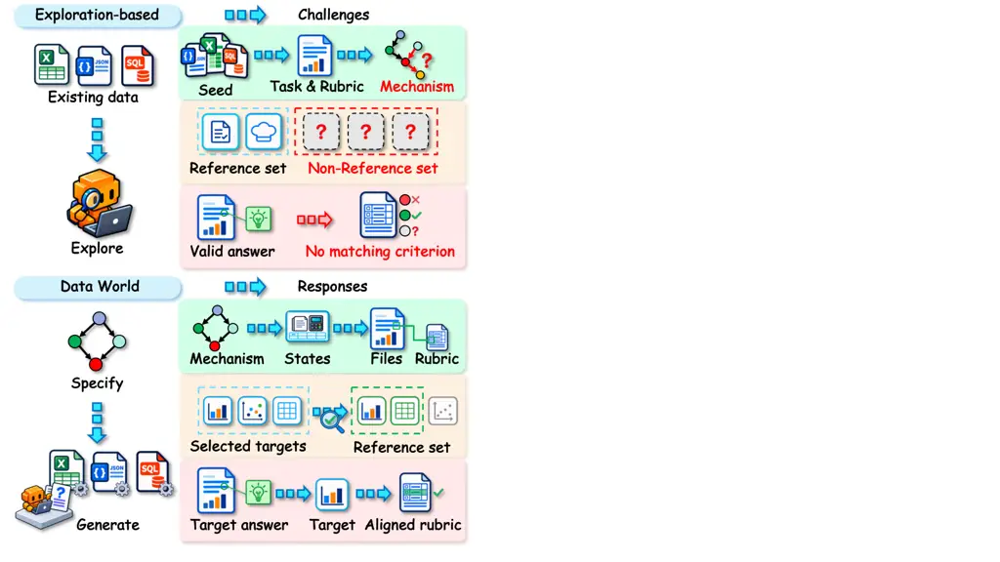
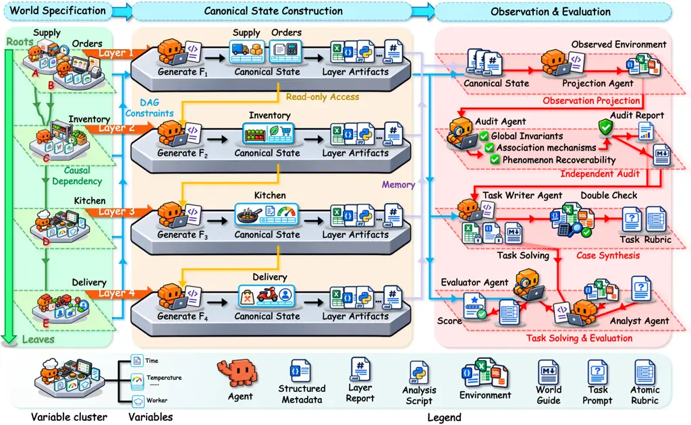
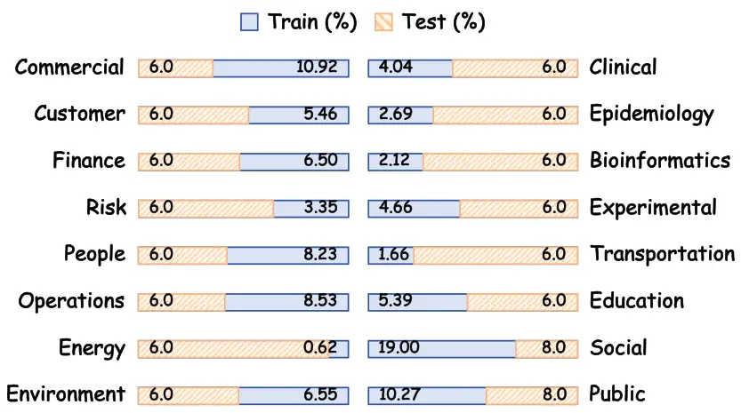

# Data World: Scaling Data Environments from Scratch

Zhanli Li Affiliation: Longcat Interaction Team, Meituan
Affiliation: Zhongnan University of Economics and Law    Zeyuan Xu
Affiliation: Hunan University    Chaoxu Pang Affiliation: Longcat
Interaction Team, Meituan    Zeyuan Liu Affiliation: Longcat Interaction
Team, Meituan    Anyang Ji^(†) Affiliation: School of Artificial
Intelligence and Affiliation: National Key Laboratory for Novel Software
Technology, Nanjing University Affiliation: Longcat Interaction Team,
Meituan    Te Sun Affiliation: Shanghai Jiao Tong University   
Kongcheng Zhang^(†) Affiliation: Longcat Interaction Team, Meituan
Affiliation: Zhejiang University    Wenbo Xu^(†) Affiliation: Longcat
Interaction Team, Meituan Affiliation: Nanjing University    Xubin
Yue^(†) Affiliation: Longcat Interaction Team, Meituan
Affiliation: Zhejiang University    Shipeng Luo Affiliation: Institute
of Automation, Chinese Academy of Sciences    Junjie Zhao
Affiliation: Shanghai Jiao Tong University   

Yingfan Hua

Affiliation: The Chinese University of Hong Kong^(∗)Correspondence:
[hongfeng03@meituan.com](mailto:hongfeng03@meituan.com),
[yehj@lamda.nju.edu.cn](mailto:yehj@lamda.nju.edu.cn)^(§)First author:
[lizhanli@stu.zuel.edu.cn](mailto:lizhanli@stu.zuel.edu.cn). ^(†)Work
done during an internship at Longcat Interaction Team, Meituan. [
 GitHub](https://github.com/Zhanli-Li/Data-World)

\|

 Hugging Face\| [  Project
Page](https://zhanli-li.github.io/Data-World/)    Jingqing Ruan
Affiliation: Longcat Interaction Team, Meituan    Zhongda Su
Affiliation: Longcat Interaction Team, Meituan    Feng Hong^(∗)
Affiliation: Longcat Interaction Team, Meituan    Zhizhao Zeng
Affiliation: Longcat Interaction Team, Meituan    Ke Zeng
Affiliation: Longcat Interaction Team, Meituan    Xunliang Cai
Affiliation: Longcat Interaction Team, Meituan    Hanjia Ye^(∗)
Affiliation: School of Artificial Intelligence and Affiliation: National
Key Laboratory for Novel Software Technology, Nanjing University

###### Abstract

Data agents use code to process heterogeneous files and derive
analytical insights. Scaling their training faces costly environment
curation, privacy and intellectual-property restrictions, and difficulty
verifying open-ended findings without known generative truth. Our core
insight is to specify the world behind the files before generating the
files themselves. We introduce Data World, a multi-agent engine that
synthesizes environments, tasks, and rubrics from explicit mechanisms.
Independent audits check target recoverability from observed files;
rubrics support evaluation and RL rewards. Human preference-based
curation for question realism selects 100 tasks across 50 held-out
worlds and 16 domains for DataWorld-Bench. The engine also yields 2,135
training tasks from 1,037 disjoint worlds. Evaluation of ten frontier
models shows that the benchmark remains challenging, particularly for
insight discovery, with a consistent computation–insight gap. RL-zero
training on the synthesized tasks produces DataWorld-35B-A3B from
Qwen3.6-35B-A3B without trajectory distillation. Under matched
evaluation, it improves over its base by $`7.06`$ points on
DataWorld-Bench, $`14.28`$ on DAComp, $`20.90`$ on DABstep-Hard, and
$`12.13`$ on JobBench, a broader occupational benchmark.

## 1 Introduction



Figure 1: Supervision for data agents: exploration-based synthesis (top)
versus Data World (bottom). Exploring existing files may leave valid
findings without matching criteria; Data World specifies mechanisms
first, aligning files and rubrics with analytical targets.

Data agents use code to inspect heterogeneous files, compute quantities,
and derive evidence-supported analytical insights (Huang et al., 2024;
Hong et al., 2025). Their _data environments_ often contain multi-source
structured data distributed across CSV and Excel tables (Dong et al.,
2026b; Hasegawa et al., 2026). A task may ask an agent to explain a
change in an outcome or trace its downstream implications, requiring
more than correct computation alone. Training and evaluating these
agents therefore require both diverse environments for multi-step
analysis and feedback that distinguishes supported conclusions from
errors. As agentic LLM post-training scales, this joint supply of
environments and supervision becomes a central constraint (Huang et al.,
2025a; Wang et al., 2026; Tu et al., 2026; Tian et al., 2026; Xu et al.,
2026).

Synthetic data has long served as an important complement to real data
when the latter is costly or restricted (Walonoski et al., 2018). Yet
for data agents, two obstacles limit this supply. First, _diversity and
accessibility_: acquiring and annotating real workflows is costly, while
privacy and intellectual-property restrictions constrain reuse (Dong
et al., 2026b; Walonoski et al., 2018). Second, _verifiability_: the
data-generating process behind real files is often unavailable, so
open-ended findings rely on curated references or approximate matching
(Gu et al., 2024; Sahu et al., 2025; Zhang et al., 2026). Exploring
these files to write tasks and rubrics ties supervision to what the
curator or mining model discovers (Ramrakhya et al., 2026; Liu et al.,
2026). For example, consider an expert or strong model given
food-delivery records collected from an online platform and asked to
write a rubric for evaluating analyses of declining sales. Inspecting
these records, it may identify expired promotions as a contributor but
overlook reduced restaurant opening hours. An agent uncovering the
latter may then receive no credit because the rubric omits that
explanation, even when the records support it. Indeed, ten experts or
strong models could offer ten different explanations for the same
decline, as data complexity and inadequately controlled confounders can
leave the underlying mechanism ambiguous. How can we scale diverse data
environments with grounded supervision while retaining open-ended
analytical depth?

Our core insight is to specify the world behind the files before
generating the files themselves. Analysis depends on statistical and
relational structure that explicit mechanisms can instantiate in code.
This enables varied environments without private source records, while
known generative states ground checks of selected analytical targets.
Synthesizing new environments and task-specific answers also reduces the
risk of pretraining contamination associated with reusing public
datasets. Figure 1 illustrates the resulting difference for a data
agent: its targeted findings have aligned rubric criteria rather than
depending on prior exploration of existing files. The key challenge is
preserving target recoverability through imperfect observations without
making the analysis trivial.

We propose Data World, a multi-agent synthesis engine that expands a
directed acyclic dependency graph (DAG) into a world contract, generates
a canonical state layer by layer, and projects it into analyst-visible
files. Independent agent sessions exchange read-only artifacts to
preserve cross-layer consistency; a separate auditor checks the
specified relationships and target-phenomenon recoverability from
imperfect observations. The generative record then grounds tasks and
rubrics, while the solving agent receives only the task and observed
files; rubrics distinguish _data computation_ from _insight discovery_,
and scoring against them supplies evaluation feedback and training
rewards. Running this engine yields DataWorld-Bench, with 100 tasks from
50 held-out worlds across 16 domains, and a world-disjoint RL training
set of 2,135 tasks from 1,037 worlds. Evaluation of ten frontier models
reveals a consistent computation–insight gap, and RL-zero training with
rubric rewards produces DataWorld-35B-A3B, which improves over its base
on held-out worlds and three external benchmarks spanning data analysis
and broader professional work. Our contributions are summarized as
follows:

- •
  We introduce a mechanism-first framework for synthesizing data
  environments, grounding task rubrics in a canonical generative state
  and auditing the recoverability of target phenomena from imperfect
  observations.
- •
  We derive DataWorld-Bench and a world-disjoint training set from this
  engine, using fine-grained rubrics to reveal a computation–insight gap
  across ten frontier models.
- •
  We demonstrate training utility via RL-zero training on the
  synthesized tasks, without distilling trajectories from stronger
  models, yielding substantial gains over the base on held-out worlds
  and three external benchmarks.

## 2 Related Work

##### Data analysis agents and benchmarks.

Existing environments draw on Kaggle competitions, scientific datasets,
government open data, and released enterprise records (Jing et al.,
2025; Gu et al., 2024; Hasegawa et al., 2026; Dong et al., 2026b). LLM
data-agent benchmarks span text-to-SQL over curated databases (Yu
et al., 2018; Li et al., 2023), code-driven analysis over files (Hu
et al., 2024; Jing et al., 2025; Huang et al., 2024; Egg et al., 2025;
Zhang et al., 2026; Liu et al., 2024; Hong et al., 2025), and
multi-table government or enterprise spreadsheet workflows (Hasegawa
et al., 2026; Dong et al., 2026b). Closest to our setting, open-ended
insight-discovery benchmarks—DiscoveryBench and BLADE for scientific
discovery (Majumder et al., 2025; Gu et al., 2024), InsightBench and
InsightEval for business analytics (Sahu et al., 2025; Zhu et al.,
2026)—score the insights agents extract, but their environments come
from available sources and their reference insights from expert
annotation or model-based exploration. Data World complements these
source-based benchmarks with mechanism-grounded criteria and audits of
target-phenomenon recoverability.

##### Task synthesis and rubric-based rewards.

A complementary line of work keeps the data real but synthesizes _tasks_
by exploring it: agents probe an environment to propose diverse,
feasible, and verifiable tasks (Ramrakhya et al., 2026), or mine
insights from available datasets to build evaluation suites (Sahu
et al., 2025). When the underlying generative process is unavailable,
scaling challenging open-ended tasks alongside dependable supervision
requires additional curation or evaluation machinery (Gu et al., 2024;
Liu et al., 2026). Rubric-derived rewards scored by LLM judges extend
reinforcement learning to open-ended tasks (Gunjal et al., 2025; Huang
et al., 2025b; Wei et al., 2026). Our rubrics are instead written
against a generative record with independent audit results: the judge
still interprets responses, but specified criteria can be cross-checked
against that record and the observed files. This limits dependence on an
annotator’s or mining model’s ability to discover the targeted insight
from existing data, without removing biases in mechanism design, rubric
selection, or judging.

##### Synthetic environments and data.

Environments are widely seen as the bottleneck of agent post-training
(Huang et al., 2025a), yet early interactive environments such as
WebArena (Zhou et al., 2024) and $`\tau`$-bench (Yao et al., 2025) are
hand-curated and hard to scale. Recent pipelines synthesize environments
for MCP-based tool-use agents in different ways. Agent World Model (Wang
et al., 2026) and ScaleEnv (Tu et al., 2026) grow simulated tools,
databases, and tasks from platform names or domain keywords, without
assuming API documentation or predefined tasks. EnvScaler (Song et al., 2026) and ASTRA (Tian et al., 2026) distill environments from existing
trajectories and task sets, while EnvFactory (Xu et al., 2026) and
Agent-World (Dong et al., 2026a) assemble environments from web-found
MCP interfaces. In contrast, Data World targets terminal-based analysis
of interdependent files, with specified generative relationships for
auditing analytical findings rather than simulated tool APIs. Synthetic
_data_ methods such as GReaT, SDV, and REaLTabFormer learn from existing
databases (Borisov et al., 2023; Patki et al., 2016; Solatorio and
Dupriez, 2023); Synthea simulates records from explicit mechanisms
(Walonoski et al., 2018), and synthetic causal benchmarks target causal
discovery (Ferdous et al., 2025). Our focus is the recoverability of
analytical targets across imperfect, interdependent files.

## 3 Method

Data World generates environments and checkable analytical targets
together by specifying the mechanisms behind the files first. Figure 2
summarizes the multi-agent pipeline, from world specification and
generation to auditing, task synthesis, and agent evaluation.



Figure 2: Data World synthesis and evaluation pipeline. A dependency DAG
and world contract guide layer-wise canonical-state generation;
observation projection produces analyst-visible files. An independent
auditor checks relationships, invariants, and target recoverability. The
generative record grounds tasks and rubrics; the data agent solves tasks
from observed files, and a separate evaluator grades its report.

### 3.1 Formalization and Overview

We use Data World to refer to our framework and formalize a synthesized
_world_ as a four-tuple
$`\mathcal{W}=(\mathcal{G},\,\mathcal{X},\,\mathcal{E},\,\mathcal{I})`$.
The _dependency skeleton_ $`\mathcal{G}=(V,E)`$ is a directed acyclic
graph in which each node $`v\in V`$ represents a cluster of variables,
and each edge $`(u,v)\in E`$ specifies a directional generative
relationship (e.g., monotonic, threshold, saturation, lagged, or
interactive), described by $`\mathrm{note}(u,v)`$. Edge directions
encode generation order and modeled influences. $`\mathcal{X}`$ is the
_canonical state_, i.e., the objective state of the world that governs
the phenomena under analysis. The _data environment_ $`\mathcal{E}`$ is
the concrete directory of tables, exports, and logs visible to the
analyst, produced by applying an observation map $`O`$ to
$`\mathcal{X}`$. $`\mathcal{I}`$ is a set of _recomputable phenomena_:
specified relationships or quantitative findings in the generated world
that can be re-derived and checked from $`\mathcal{E}`$. The pipeline
first synthesizes and audits worlds, then generates tasks from them. A
separate curation step selects a subset for benchmark evaluation:

```math
\begin{gathered}\mathcal{G}\longrightarrow\mathcal{C}\longrightarrow\mathcal{X}\longrightarrow\mathcal{E}=O(\mathcal{X})\\
\xrightarrow{\text{audit}}\mathcal{W}\xrightarrow{\text{task synthesis}}\mathcal{T}.\end{gathered} \tag{1}
```

Here $`\mathcal{C}`$ is the _world contract_, and $`\mathcal{T}`$ is the
pool of $`(\textit{task},\textit{rubric})`$ pairs generated from a world
$`\mathcal{W}`$ with its audit record. The test split requires all audit
checks to pass; the training split uses a less restrictive filter. Each
stage uses an independent agent session; canonical-state generation
assigns one session per DAG layer. Sessions share no conversational
state and communicate only through artifacts on disk. Each generation
stage records a _machine-checkable ledger_ for verification and a
_narrative self-report_ to convey its design decisions to later stages
and the auditor.

### 3.2 Environment Synthesis

##### Dependency Skeleton.

We use personas from PersonaHub¹¹ 1
[https://huggingface.co/datasets/proj-persona/PersonaHub](https://huggingface.co/datasets/proj-persona/PersonaHub)
to prompt an LLM to construct synthetic dependency DAGs reflecting the
contexts described by those personas. These DAGs serve as the skeletons
$`\mathcal{G}`$ for subsequent world generation.

##### World Contract.

Given $`\mathcal{G}`$, a contract-writing agent materializes it into a
structured _world contract_ $`\mathcal{C}`$ that imposes global
consistency constraints on the entire generation process. The contract
declares: the entities and timeline of the world; the _generative
mechanism_ attached to each directed edge (functional form,
heterogeneity, temporal behavior, confounders); a set of _global
invariants_ (identifiers, units, and shared events that must remain
consistent across layers); a set of _observation systems_ (the imperfect
business systems through which the truth will be observed); and the
final deliverables, including the datasets and the recomputable
phenomena $`\mathcal{I}`$. The contract is fixed before data generation
and constrains all subsequent stages.

##### Canonical Truth Generation.

Per-layer agents generate the canonical state in topological order along
the dependency DAG $`\mathcal{G}`$. Specifically, we compute a
topological stratification $`V=\bigsqcup_{\ell=1}^{L}V_{\ell}`$ of
$`\mathcal{G}`$ according to the longest-path depth $`d(v)`$ from source
nodes ($`d=0`$), setting $`V_{\ell}=\{\,v:d(v)=\ell-1\,\}`$ so that
every node is placed in a strictly later layer than all of its parents.
Each layer $`\ell`$ is instantiated by its own agent session:

```math
\mathcal{X}_{V_{\ell}}=F_{\ell}\big(\mathcal{X}_{\mathrm{pa}(V_{\ell})};\,\mathrm{seed}_{\ell}\big), \tag{2}
```

where the upstream state $`\mathcal{X}_{\mathrm{pa}(V_{\ell})}`$
produced by prior layer agents is strictly read-only, and $`F_{\ell}`$
is a deterministic script written and executed by the current layer
agent under a fixed random seed. The outputs are committed to disk as
immutable inputs for subsequent layers. This topology-driven generation
uses two consistency safeguards: (i) Transactionality: all nodes within
a layer are generated jointly and committed atomically; no half-finished
state may exist. (ii) Dependency checks: for every incoming edge
$`(u,v)`$, the layer agent runs empirical checks on the generated data
for the specified association pattern, functional form, time lag, and
heterogeneity declared in $`\mathrm{note}(u,v)`$, recording the results
in its ledger before propagating to downstream layers.

##### Observation Projection.

An independent session applies the observation map $`O`$ to the
canonical state $`\mathcal{X}`$ to produce the analyst-visible files
$`\mathcal{E}`$. $`O`$ is not arbitrary noise, but a composition of
_explicit observation mechanisms_: the same entity carries different
identifier spellings and key conventions across systems; defects such as
missing values, delays, duplicates, unit drift, categorical encodings,
and schema drift each correspond to a concrete observation process (who
introduced it, at which step, and why); files are cross-referenced
through unlabeled foreign keys, with no data dictionary provided.
Projection preserves the canonical state, but recovering findings from
imperfect observations requires cross-system reconciliation. The auditor
checks that each phenomenon in $`\mathcal{I}`$ remains recoverable from
$`\mathcal{E}`$ without access to that state.

##### Independent Audit.

Finally, an _independent auditor_ recomputes the completed world using
its artifacts: the skeleton, the contract, the ledgers and self-reports,
the generation scripts, the canonical state, and the observed
environment. The auditor writes its own scripts to re-check each
specified edge relationship, global invariant, and phenomenon in
$`\mathcal{I}`$, and additionally writes a world guide from the
perspective of an analyst inside the world. The auditor is forbidden
from modifying the environment or the truth, and can only issue a
pass/fail verdict; failed expectations must be faithfully reported.

### 3.3 Task Synthesis

Unlike prior work that explores fixed environments or curates existing
files to propose tasks (Ramrakhya et al., 2026; Sahu et al., 2025), Data
World grounds tasks directly in the audited generative process. Each
task is anchored to a single target node and asks the data agent either
to explain its variation using upstream factors (the _cause_ route,
following in-edges) or to trace its implications for downstream outcomes
(the _consequence_ route, following out-edges). For example, an agent
may investigate factors behind encounter volumes or trace production
losses through inventories to downstream availability. These route names
denote directions through the generative graph. To ensure uniform
coverage across the skeleton, we partition nodes into $`K`$ depth strata
$`S_{k}=\{\,v:\lfloor d(v)K/(d_{\max}+1)\rfloor=k-1\,\}`$ using the
longest-path depth $`d(v)`$, and deterministically select the
maximal-degree nodes in each stratum:

```math
\begin{split}t^{\mathrm{cause}}_{k}&=\arg\max_{v\in S_{k}}\deg^{-}(v),\\
t^{\mathrm{cons}}_{k}&=\arg\max_{v\in S_{k}}\deg^{+}(v).\end{split} \tag{3}
```

This yields up to $`2K`$ structurally diverse tasks per world.
Section A.3.2 presents environment descriptions, complete file
structures, and corresponding task prompts for public safety,
class-capacity planning, and production yield, illustrating the
cross-system analysis required along the cause and consequence routes.

For each sampled target, a question-writer agent produces a
$`(\textit{task},\ \textit{rubric})`$ pair using read-only access to the
contract, generation scripts, ledgers and self-reports, canonical state,
and world guide (WORLD.md). It checks that the targeted phenomena are
derivable from $`\mathcal{E}`$ before writing criteria grounded in this
generative provenance. Section A.1 offers an intuitive analysis of this
information advantage for rubric coverage. Each rubric separates _data
computation_ (processing and numerical estimates) from _insight
discovery_ (conclusions supported by those estimates). Both sections
contain atomic positive items for supported calculations or
interpretations and negative items for demonstrably wrong calculations
or contradicted conclusions. Valid insights outside the reference list
can occur (Zhu et al., 2026); they receive no credit but no penalty
merely for being unlisted. The evaluator has access to the audited truth
and scores reports item by item, normalizing net rubric points to
$`[0,1]`$.

### 3.4 Benchmark and Training-Set Curation

Of 1,302 candidate worlds, we retain 1,087: 1,037 training worlds
yielding 2,135 RL tasks and 50 held-out worlds yielding 100 test tasks
across all 16 domains. Test worlds are entirely excluded from training
and must pass every audit check; training worlds have a 95.98% DAG-edge
pass rate. For each test world, we nominate one cause and one
consequence task. A team of 15 annotators compares nominees with
alternatives from the same world and route for question realism, with
disagreements adjudicated. The selected tasks form DataWorld-Bench. Test
tasks cover the 16 categories approximately uniformly, whereas training
tasks are less evenly distributed (Figure 3).



Figure 3: Taxonomy shares (%) of the DataWorld-Bench test tasks and Data
World RL training tasks.

## 4 Experiments

The mechanism-first design is useful for data agents only if the
generated files support meaningful analysis and the associated rubrics
provide useful learning signals. We therefore evaluate two questions:
what computational and insight-discovery capabilities DataWorld-Bench
reveals in existing agents, and whether training on separate synthesized
worlds improves performance on held-out worlds and external benchmarks.

### 4.1 Experimental Setup

All construction stages use GLM 5.3 (Zhipu AI, 2026) in the Claude Code
harness (Anthropic, 2026) (Section 3). The ten models in Table 1 use the
same mini-swe-agent harness (SWE-bench Team, 2025) and the rubrics
defined above, with a single judging pass over archived reports using
Gemini-3.8-Flash as the rubric judge for both Tables 1 and 3. Unless
otherwise noted, scores are reported on a $`\times 100`$ scale;
DataWorld-Bench uses normalized rubric scores in $`[0,1]`$, while
external benchmarks retain their native scoring. Higher is better. Model
descriptions and harness details appear in Section A.2.

### 4.2 DataWorld-Bench Results

|                                                                                                 | Score                         |                               |                               | Interaction and length |                   |                   |
| ----------------------------------------------------------------------------------------------- | ----------------------------- | ----------------------------- | ----------------------------- | ---------------------- | ----------------- | ----------------- |
| Model                                                                                           | Data computation              | Insight discovery             | Avg                           | Rounds                 | Total tokens (k)  | Resp. tokens (k)  |
| ![[Uncaptioned image]](arxiv-2610-21656--c0c2f0f899fe.figures/figure-4.webp)GPT-6-Astra         | $`\mathbf{87.80}`$ (16.38)    | $`\underline{66.45}`$ (20.98) | $`\mathbf{74.43}`$ (15.85)    | $`28.7`$ (8.7)         | $`121.9`$k (36.4) | $`88.8`$k (18.9)  |
| ![[Uncaptioned image]](arxiv-2610-21656--c0c2f0f899fe.figures/figure-5.webp)Qwen-3.8-Max-0902   | $`82.36`$ (17.79)             | $`\mathbf{67.95}`$ (22.92)    | $`\underline{73.43}`$ (16.81) | $`82.7`$ (23.5)        | $`289.7`$k (81.9) | $`125.8`$k (33.0) |
| ![[Uncaptioned image]](arxiv-2610-21656--c0c2f0f899fe.figures/figure-4.webp)GPT-6.1-Sol         | $`\underline{85.59}`$ (17.26) | $`66.02`$ (21.02)             | $`73.30`$ (16.44)             | $`31.2`$ (10.6)        | $`135.2`$k (46.3) | $`103.4`$k (30.4) |
| ![[Uncaptioned image]](arxiv-2610-21656--c0c2f0f899fe.figures/figure-6.webp)GLM 5.3             | $`75.08`$ (21.22)             | $`63.18`$ (21.56)             | $`67.69`$ (17.67)             | $`89.9`$ (28.0)        | $`238.7`$k (96.6) | $`116.3`$k (49.4) |
| ![[Uncaptioned image]](arxiv-2610-21656--c0c2f0f899fe.figures/figure-7.webp)HY4-Preview         | $`77.27`$ (20.63)             | $`60.00`$ (21.38)             | $`66.55`$ (17.72)             | $`70.7`$ (21.3)        | $`177.9`$k (49.2) | $`86.0`$k (23.3)  |
| ![[Uncaptioned image]](arxiv-2610-21656--c0c2f0f899fe.figures/figure-8.webp)Kimi-K3             | $`72.64`$ (22.83)             | $`62.89`$ (23.43)             | $`66.39`$ (19.14)             | $`36.4`$ (14.4)        | $`97.5`$k (35.1)  | $`48.0`$k (16.8)  |
| ![[Uncaptioned image]](arxiv-2610-21656--c0c2f0f899fe.figures/figure-9.webp)DeepSeek-V4.1-Flash | $`72.30`$ (19.72)             | $`57.34`$ (20.29)             | $`62.95`$ (16.93)             | $`58.1`$ (20.2)        | $`150.7`$k (48.0) | $`74.0`$k (24.3)  |
| ![[Uncaptioned image]](arxiv-2610-21656--c0c2f0f899fe.figures/figure-5.webp)Qwen-3.8-27B        | $`66.93`$ (25.33)             | $`54.93`$ (22.46)             | $`59.64`$ (20.16)             | $`55.1`$ (18.5)        | $`170.4`$k (39.7) | $`82.1`$k (20.7)  |
| ![[Uncaptioned image]](arxiv-2610-21656--c0c2f0f899fe.figures/figure-10.webp)Gemini-3.8-Flash   | $`59.00`$ (21.70)             | $`54.13`$ (21.18)             | $`56.17`$ (17.01)             | $`62.3`$ (15.6)        | $`98.8`$k (20.9)  | $`50.8`$k (10.3)  |
| ![[Uncaptioned image]](arxiv-2610-21656--c0c2f0f899fe.figures/figure-11.webp)MiniMax-M3         | $`53.39`$ (20.44)             | $`47.39`$ (19.85)             | $`49.75`$ (16.89)             | $`93.8`$ (32.1)        | $`158.4`$k (47.2) | $`62.6`$k (19.4)  |

Table 1: DataWorld-Bench results (normalized rubric scores
$`\times 100`$, with SD in parentheses). Avg pools all rubric items and
need not equal the mean of the two section columns. Best/second-best
means are bold/underlined. Rounds count model calls; tokens are prompt
plus output of the final call (total) or outputs over the run
(response).

|                                                                                                 | Neg. rubric items (%) |     |     |
| ----------------------------------------------------------------------------------------------- | --------------------- | --- | --- |
| Model                                                                                           | 0                     | 1   | 2   |
| ![[Uncaptioned image]](arxiv-2610-21656--c0c2f0f899fe.figures/figure-4.webp)GPT-6.1-Sol         | 86                    | 11  | 2   |
| ![[Uncaptioned image]](arxiv-2610-21656--c0c2f0f899fe.figures/figure-4.webp)GPT-6-Astra         | 83                    | 14  | 2   |
| ![[Uncaptioned image]](arxiv-2610-21656--c0c2f0f899fe.figures/figure-7.webp)HY4-Preview         | 74                    | 20  | 5   |
| ![[Uncaptioned image]](arxiv-2610-21656--c0c2f0f899fe.figures/figure-8.webp)Kimi-K3             | 70                    | 20  | 9   |
| ![[Uncaptioned image]](arxiv-2610-21656--c0c2f0f899fe.figures/figure-5.webp)Qwen-3.8-Max-0902   | 68                    | 26  | 5   |
| ![[Uncaptioned image]](arxiv-2610-21656--c0c2f0f899fe.figures/figure-6.webp)GLM 5.3             | 65                    | 23  | 9   |
| ![[Uncaptioned image]](arxiv-2610-21656--c0c2f0f899fe.figures/figure-9.webp)DeepSeek-V4.1-Flash | 64                    | 30  | 6   |
| ![[Uncaptioned image]](arxiv-2610-21656--c0c2f0f899fe.figures/figure-5.webp)Qwen-3.8-27B        | 64                    | 27  | 9   |
| ![[Uncaptioned image]](arxiv-2610-21656--c0c2f0f899fe.figures/figure-11.webp)MiniMax-M3         | 59                    | 28  | 10  |
| ![[Uncaptioned image]](arxiv-2610-21656--c0c2f0f899fe.figures/figure-10.webp)Gemini-3.8-Flash   | 57                    | 34  | 8   |

Table 2: Distribution of triggered negative rubric items across
trajectories. Each column gives the percentage of trajectories
triggering exactly that many negative items; 3+ is omitted.

DataWorld-Bench remains challenging for frontier agents: the best
overall and insight-discovery scores are 74.43 and 67.95, respectively
(Table 1). GPT-6-Astra leads overall and in computation,
Qwen-3.8-Max-0902 leads in insight discovery and ranks second overall,
and GPT-6.1-Sol ranks second in computation and third overall. Every
model shows a computation–insight gap (4.87–21.35 points), indicating
that strong data processing does not automatically yield targeted
analytical conclusions. These comparisons concern rubric-defined skills,
however, and criterion coverage and scoring differences may contribute
to the gap.

Interaction cost does not uniformly track performance: GPT-6-Astra leads
overall with the fewest rounds, while Kimi-K3 uses the fewest total and
response tokens. Qwen-3.8-Max-0902 achieves the highest insight score
with the largest token usage; GPT-6.1-Sol attains a similar overall
score with fewer rounds and tokens. MiniMax-M3 takes the most rounds yet
scores lowest, so longer interaction alone is not sufficient for
stronger analysis. These cross-model comparisons do not isolate the
benefit of additional inference, as models also differ in capability and
interaction strategy.

Negative rubric items capture demonstrably wrong calculations or
contradicted conclusions (Table 2). GPT-6.1-Sol and GPT-6-Astra have the
highest shares of trajectories without such items, while
Gemini-3.8-Flash and MiniMax-M3 trigger them most often. Both GPT models
trigger negative items less often than Qwen-3.8-Max-0902 but score lower
in insight discovery, distinguishing avoidance of incorrect conclusions
from recovery of targeted findings.

After removing each model’s mean, domain analyses identify
bioinformatics, operations, and energy as relatively easier and
transportation, environment, and education as harder (Section A.3.3),
motivating evaluation across diverse domains rather than aggregate
scores alone; small per-domain task counts preclude within-domain model
rankings. No model shows a detectable cause–consequence difficulty
difference at the achieved resolution (Section A.3.4), providing no
evidence that either graph route is systematically easier.

### 4.3 Validating Training Utility

[TABLE]

Table 3: RL training utility: DataWorld-35B-A3B paired per task against
its base Qwen3.6-35B-A3B (mean with SD in parentheses). Green/red badges
indicate gains/losses relative to the base.

| Model             | MMLU-Pro | LCB-Hard | SimpleQA-V |
| ----------------- | -------- | -------- | ---------- |
| Qwen3.6-35B-A3B   | 84.73    | 71.14    | 22.20      |
| DataWorld-35B-A3B | 84.73    | 70.29    | 24.00      |

Table 4: General-capability and factuality checks for DataWorld-35B-A3B
versus Qwen3.6-35B-A3B. MMLU-Pro and LiveCodeBench (LCB)-Hard report
accuracy (%); SimpleQA-Verified (SimpleQA-V) reports F1. Higher is
better.

We assess the second question by using the engine’s separate training
set for RL and measuring gains on world-disjoint DataWorld-Bench tasks
and three external benchmarks. The held-out benchmark measures training
outcomes; its worlds and answers are not training inputs. We train
Qwen3.6-35B-A3B (Qwen Team, 2026) on the training split in Section 3.4
using Group Sequence Policy Optimization (GSPO; Zheng et al., 2025) in
an RL-zero setting. Construction models supply environments, tasks, and
rubrics but no task-solving demonstrations; optimization uses only the
training model’s own rollouts and rubric rewards, avoiding task-specific
supervised fine-tuning or stronger-model trajectory distillation as
confounds. To reduce RL reward-scoring costs, we use the Qwen3.6-35B-A3B
base model itself as the rubric judge. For a task $`x`$, let $`y_{i}`$
be one of $`G`$ sampled responses with rubric reward $`r_{i}`$. GSPO
computes a group-normalized advantage
$`\widehat{A}_{i}=(r_{i}-\bar{r})/\operatorname{std}(r_{1},\ldots,r_{G})`$
and a length-normalized, sequence-level importance ratio
$`s_{i}(\theta)=\exp\big(\tfrac{1}{|y_{i}|}\sum_{t=1}^{|y_{i}|}\log\rho_{i,t}(\theta)\big)`$,
where $`\bar{r}`$ is the group mean reward and $`\rho_{i,t}(\theta)`$ is
the ratio of $`\pi_{\theta}`$ to the sampling policy $`\pi_{\rm old}`$
at token $`t`$, conditioned on $`x`$ and $`y_{i,<t}`$. Its clipped
objective is

```math
\displaystyle\mathcal{J}(\theta) \displaystyle=\operatorname{E}_{x,\{y_{i}\}\sim\pi_{\rm old}}\left[\frac{1}{G}\sum_{i=1}^{G}\min\!\left(s_{i}(\theta)\widehat{A}_{i},\right.\right. \tag{4}
```

```math
\displaystyle\left.\left.\operatorname{clip}(s_{i}(\theta),1-\epsilon_{\rm low},1+\epsilon_{\rm high})\widehat{A}_{i}\right)\right],
```

Figure 4: Performance as RL training scales over synthesized tasks. Base
is the pre-RL model; scores are unscaled, with final gains over Base
annotated in points and, where applicable, relative percentages.

where $`\epsilon_{\rm low}`$ and $`\epsilon_{\rm high}`$ are the lower
and upper clipping thresholds; the same ratio and advantage apply to the
entire response. Training implementation details appear in Section A.4.

##### Comparisons.

Table 3 compares DataWorld-35B-A3B with its base and three models
sharing that base. All use the same mini-swe-agent evaluation protocol,
with identical tasks and benchmark-specific scoring (Section A.5). For a
fair comparison, we retrain DataMind-35B-A3B on 7,323 publicly released
Python data-analysis tasks (Qiao et al., 2026) using our backbone and
training configuration, since the original model uses a different
backbone and a context window too short for our evaluation. We also
evaluate the released BigBang-v1 (Endless Frontier, 2026) and
Occamy-1.0 (Accio Lab, 2026) checkpoints, which share our backbone and
have undergone extensive multi-stage training. These baselines use
teacher-distilled trajectories. The comparisons assess overall training
utility rather than isolate the effects of training data or recipes.

##### Results.

DataWorld-35B-A3B achieves the highest scores among the evaluated
same-base models on all four benchmarks (Table 3). It gains 7.06 points
over the base on DataWorld-Bench, supporting transfer to world-disjoint
tasks rather than reuse of training-world answers. Gains of 14.28 points
on DAComp (Lei et al., 2026) and 20.90 on DABstep-Hard (Egg et al., 2025) extend to open-ended analysis and automatically checked answers,
respectively. Notably, JobBench (Li et al., 2026) covers 35 occupations,
not just data analysis, making it the least task-aligned of the four
suites. The 12.13-point gain on its main set supports transfer beyond
data analysis to broader file-based professional reasoning. In contrast,
DataMind improves the external benchmarks but leaves held-out
DataWorld-Bench essentially unchanged, suggesting that gains on existing
benchmarks need not extend to mechanism-grounded insight tasks. The
joint increases in scores, rounds, and response tokens across all four
benchmarks suggest stronger _long-horizon reasoning and tool
interaction_. This long-context, multi-turn interaction pattern
resembles that documented in MiMo’s public RL training logs (Xiaomi MiMo
Team, 2026).

Figure 4 connects these gains to the supply bottleneck that motivates
Data World: as RL training draws successive batches from the synthesized
task set, scores on all four benchmarks rise from the pre-RL base to
their final levels. These trajectories highlight the training value of
combining synthesized tasks with mechanism-grounded rewards: the
resulting improvements extend beyond the generated environments to
external analytical and professional workflows.

##### General-capability retention and factuality.

Table 4 probes general knowledge (MMLU-Pro; Wang et al., 2024),
algorithmic coding (LiveCodeBench-Hard; Jain et al., 2025), and factual
question answering (SimpleQA-Verified; Haas et al., 2025). MMLU-Pro
accuracy is unchanged at 84.73%; LiveCodeBench-Hard accuracy decreases
from 71.14% to 70.29%, while SimpleQA-Verified F1 increases from 22.20
to 24.00. These results indicate that RL training on fully synthesized
environments preserves the base model’s general language and coding
capabilities, and that purely synthetic supervision does not noticeably
disturb its factual world knowledge.

## 5 Conclusion

Data World offers a data-centric route to scalable, verifiable
supervision for data agents by specifying generative mechanisms before
synthesizing observations and auditing analytical targets. Separating
canonical truth from analyst-visible files grounds supervision in known
mechanisms while requiring agents to recover findings from observations
alone. The engine yields DataWorld-Bench for measuring the
computation–insight gap and a world-disjoint set for RL-zero training;
gains extend to unseen worlds, external data-analysis tasks, and broader
occupational workflows, without task-solving demonstrations from
stronger models. This joint synthesis expands task supply without
requiring curators to rediscover each targeted finding from the
generated files. Together, these results support mechanism-grounded
environment synthesis as a scalable complement to real-world data,
providing both evaluation criteria and training signals.

## Limitations

First, the tight coupling among synthesis components and the cost of
regenerating worlds and tasks limit exhaustive ablations. We do not
construct multiple controlled variants of the world and task synthesis
pipeline, so our results support the utility of the framework as a whole
rather than isolate the contribution of each component. Moreover, the
central claim concerns what synthesis from scratch enables—verifiable,
scalable supervision—rather than the optimality of any particular
component, so adding, removing, or fine-tuning individual components is
unlikely to yield a materially better outcome: weakening the pipeline’s
coherence would sacrifice the auditability and coverage that motivate
the design. Synthesized environments and tasks are intended to
complement, not replace, real-world data; we do not compare which source
is more effective.

Second, fully synthetic tasks may differ from the questions human users
pose to AI agents in practice. Although human preference-based curation
selects benchmark questions for realism, it does not establish that the
resulting tasks represent the distribution of real user requests,
particularly their ambiguity, implicit context, and evolving goals.

Third, mechanism-grounded rubrics do not exhaust all valid analytical
findings, and LLM-based grading may introduce judge bias. Audited
generative truth makes the specified criteria verifiable, but does not
guarantee that alternative insights receive appropriate credit or that
scores remain consistent across different judging models.

## Ethical Considerations

Environment synthesis and scaling for agent training have recently
become active research areas, with many concurrent contributions
appearing in rapid succession. Due to page constraints and the limits of
our knowledge, we cite and discuss only the most closely related work
known to us; we regret any relevant omissions. AI agents construct
environments and rubrics, and an LLM judge scores responses under the
access restrictions described in Section 3. These artifacts and scores
do not establish suitability for real-world decisions: audits verify
specified relationships and recoverability, while human curation
assesses question realism rather than operational validity. Although
synthesis reduces reliance on private records, outputs should still be
reviewed for sensitive or proprietary content before release. Use in
consequential domains requires independent validation and human
oversight. AI tools were also used to assist with code development and
manuscript writing; the authors reviewed, edited, and validated all
generated content and take full responsibility for the correctness of
the code and the manuscript.

## References

- Accio Lab (2026) Accio Lab. 2026. [Occamy-1.0: An open agentic model
  built for long-horizon
  co-work](https://huggingface.co/Accio-Lab/occamy-1.0).
- Alibaba Qwen Team (2026a) Alibaba Qwen Team. 2026a. Qwen3.8-27B.
  [https://huggingface.co/collections/Qwen/qwen38](https://huggingface.co/collections/Qwen/qwen38).
  27B dense multimodal model, 64 layers, hidden size 5120, Gated
  DeltaNet + Gated Attention hybrid architecture, 262K native context
  (extendable to 1M via YaRN). Apache 2.0. Released 2026-08-14.
- Alibaba Qwen Team (2026b) Alibaba Qwen Team. 2026b. Qwen3.8-Max-0902.
  [https://www.alibabagroup.com/en-US/document-2021044032125272064](https://www.alibabagroup.com/en-US/document-2021044032125272064).
  2.4T-parameter MoE with 95B activated per token, 1M-token context,
  multimodal input. Upgraded coding- and agent-focused snapshot of
  Qwen3.8-Max, released 2026-09-02.
- Anthropic (2026) Anthropic. 2026. Claude Code: Agentic coding in the
  terminal.
  [https://www.anthropic.com/claude-code](https://www.anthropic.com/claude-code).
- Artificial Analysis (2026) Artificial Analysis. 2026. Artificial
  Analysis Intelligence Index.
  [https://artificialanalysis.ai/](https://artificialanalysis.ai/).
- Borisov et al. (2023) Vadim Borisov et al. 2023. Language models are
  realistic tabular data generators. In _Proceedings of ICLR_.
- DeepSeek-AI (2026) DeepSeek-AI. 2026. [Deepseek-v4.1-flash: Pushing
  the limits of KV cache compression](https://arxiv.org/abs/2609.19969).
  _arXiv preprint arXiv:2609.19969_. Report Number: 001. 552B backbone,
  Causal Encoder-Decoder (CED), 8B prefill / 16B decode activated
  params, 1M context.
  [https://arxiv.org/abs/2609.19969](https://arxiv.org/abs/2609.19969).
- Dong et al. (2026a) Guanting Dong et al. 2026a. Agent-world: Scaling
  real-world environment synthesis for evolving general agent
  intelligence. _arXiv preprint arXiv:2604.18292_.
- Dong et al. (2026b) Haoyu Dong, Pengkun Zhang, Yan Gao, Xuanyu Dong,
  Yilin Cheng, Mingzhe Lu, Adina Yakefu, and Shuxin Zheng. 2026b.
  [Finch: Benchmarking finance & accounting across spreadsheet-centric
  enterprise
  workflows](https://doi.org/10.18653/v1/2026.findings-acl.523). In
  _Findings of the Association for Computational Linguistics: ACL 2026_,
  pages 10768–10794.
- Egg et al. (2025) Alex Egg, Martin Iglesias Goyanes, Friso Kingma,
  Andreu Mora, Leandro von Werra, and Thomas Wolf. 2025. DABstep: Data
  agent benchmark for multi-step reasoning. _arXiv preprint
  arXiv:2506.23719_.
- Endless Frontier (2026) Endless Frontier. 2026. [BigBang-V1:
  Self-evolving synthesis of verifiable frontier
  tasks](https://huggingface.co/endless-frontier/BigBang-v1).
- Ferdous et al. (2025) Muhammad Hasan Ferdous, Emam Hossain, and
  Md Osman Gani. 2025. [TimeGraph: Synthetic benchmark datasets for
  robust time-series causal
  discovery](https://doi.org/10.1145/3711896.3737439). In _Proceedings
  of the 31st ACM SIGKDD Conference on Knowledge Discovery and Data
  Mining V.2_, pages 5425–5435.
- Google DeepMind (2026) Google DeepMind. 2026. Gemini 3.8 Flash.
  [https://ai.google.dev/gemini-api/docs/models](https://ai.google.dev/gemini-api/docs/models).
  Released 2026-09-02. Lightweight model in the Gemini 3.8 family. Also
  known as “3.8 Flash” on LMArena, confirmed as the same model class as
  Gemini 4 Argon. No formal technical report published.
- Gu et al. (2024) Ken Gu et al. 2024. [BLADE: Benchmarking language
  model agents for data-driven
  science](https://doi.org/10.18653/v1/2024.findings-emnlp.815). In
  _Findings of the Association for Computational Linguistics: EMNLP
  2024_.
- Gunjal et al. (2025) Anisha Gunjal et al. 2025. Rubrics as rewards:
  Reinforcement learning beyond verifiable domains. _arXiv preprint
  arXiv:2507.17746_.
- Haas et al. (2025) Lukas Haas, Gal Yona, Giovanni D’Antonio, Sasha
  Goldshtein, and Dipanjan Das. 2025. [SimpleQA Verified: A reliable
  factuality benchmark to measure parametric
  knowledge](https://arxiv.org/abs/2509.07968). _arXiv preprint
  arXiv:2509.07968_.
- Hasegawa et al. (2026) So Hasegawa, Shailaja Keyur Sampat, Lei Liu,
  and Wei-Peng Chen. 2026. [Data analysis in the wild: Benchmarking
  large language models against real-world data
  complexities](https://arxiv.org/abs/2607.06482). _arXiv preprint
  arXiv:2607.06482_.
- Hong et al. (2025) Sirui Hong et al. 2025. [Data interpreter: An LLM
  agent for data
  science](https://doi.org/10.18653/v1/2025.findings-acl.1016). In
  _Findings of the Association for Computational Linguistics: ACL 2025_,
  pages 19796–19821.
- Hu et al. (2024) Xueyu Hu, Ziyu Zhao, Shuang Wei, Ziwei Chai, Qianli
  Ma, Guoyin Wang, Xuwu Wang, Jing Su, Jingjing Xu, Ming Zhu, Yao Cheng,
  Jianbo Yuan, Jiwei Li, Kun Kuang, Yang Yang, Hongxia Yang, and Fei
  Wu. 2024. [InfiAgent-DABench: Evaluating agents on data analysis
  tasks](https://proceedings.mlr.press/v235/hu24s.html). In _Proceedings
  of the 41st International Conference on Machine Learning_, volume 235
  of _Proceedings of Machine Learning Research_, pages 19544–19572.
- Huang et al. (2024) Yiming Huang, Jianwen Luo, Yan Yu, Yitong Zhang,
  Fangyu Lei, Yifan Wei, Shizhu He, Lifu Huang, Xiao Liu, Jun Zhao, and
  Kang Liu. 2024. [DA-code: Agent data science code generation benchmark
  for large language
  models](https://doi.org/10.18653/v1/2024.emnlp-main.748). In
  _Proceedings of the 2024 Conference on Empirical Methods in Natural
  Language Processing_, pages 13487–13521.
- Huang et al. (2025a) Yuchen Huang et al. 2025a. Environment scaling
  for interactive agentic experience collection: A survey. _arXiv
  preprint arXiv:2511.09586_.
- Huang et al. (2025b) Zenan Huang et al. 2025b. Reinforcement learning
  with rubric anchors. _arXiv preprint arXiv:2508.12790_.
- Jain et al. (2025) Naman Jain, King Han, Alex Gu, Wen-Ding Li, Fanjia
  Yan, Tianjun Zhang, Sida Wang, Armando Solar-Lezama, Koushik Sen, and
  Ion Stoica. 2025. [LiveCodeBench: Holistic and contamination free
  evaluation of large language models for
  code](https://proceedings.iclr.cc/paper_files/paper/2025/file/94074dd5a072d28ff75a76dabed43767-Paper-Conference.pdf).
  In _International Conference on Learning Representations_, volume
  2025, pages 58791–58831.
- Jing et al. (2025) Liqiang Jing, Zhehui Huang, Xiaoyang Wang, Wenlin
  Yao, Wenhao Yu, Kaixin Ma, Hongming Zhang, Xinya Du, and Dong
  Yu. 2025. [DSBench: How far are data science agents from becoming data
  science
  experts?](https://proceedings.iclr.cc/paper_files/paper/2025/file/50e9ad960ae78b741a6b4fea533f2eaf-Paper-Conference.pdf)
  In _International Conference on Learning Representations_, volume
  2025, pages 32597–32649.
- Lai et al. (2026) Xunhao Lai, Weiqi Xu, Yufeng Yang, Qiaorui Chen,
  Yang Xu, Lunbin Zeng, Xiaolong Li, Haohai Sun, Haichao Zhu, Vito
  Zhang, Jinkai Hu, Jiayao Li, Rui Gao, Zekun Li, Songquan Zhu, Jingkai
  Zhou, and Pengyu Zhao. 2026. [Minimax sparse
  attention](https://arxiv.org/abs/2606.13392). _arXiv preprint
  arXiv:2606.13392_. A production-grade natively multimodal model
  powered by MSA (MiniMax-M3) has been publicly released.
  [https://huggingface.co/MiniMaxAI/MiniMax-M3](https://huggingface.co/MiniMaxAI/MiniMax-M3).
- Lei et al. (2026) Fangyu Lei, Jinxiang Meng, Yiming Huang, Junjie
  Zhao, Yitong Zhang, Jianwen Luo, Xin Zou, Ruiyi Yang, Wenbo Shi, Yan
  Gao, Shizhu He, Jun Zhao, Zuo Wang, Qian Liu, Yang Wang, Ke Wang, and
  Kang Liu. 2026. [DAComp: Benchmarking data agents across the full data
  intelligence
  lifecycle](https://proceedings.iclr.cc/paper_files/paper/2026/file/aad9770292214981177c694368fae6e2-Paper-Conference.pdf).
  In _International Conference on Learning Representations_, volume
  2026, pages 104463–104501.
- Li et al. (2023) Jinyang Li et al. 2023. Can LLM already serve as a
  database interface? a BIg bench for large-scale database grounded
  text-to-SQLs. In _Advances in Neural Information Processing Systems
  (Datasets and Benchmarks Track)_.
- Li et al. (2026) Yuetai Li, Yichen Feng, Zhangchen Xu, Zixian Ma,
  Kaiyuan Zheng, Fengqing Jiang, Xinghua Sun, Rulin Shao, Zichen Chen,
  Yue Huang, Xinyang Han, Brian Lee, Kayla Xu, Shenglai Zeng, Hang Hua,
  Xiangliang Zhang, Basel Alomair, Ranjay Krishna, Luke Zettlemoyer, and
  5 others. 2026. [JobBench: Aligning agent work with human
  will](https://arxiv.org/abs/2605.26329). _arXiv preprint
  arXiv:2605.26329_.
- Liu et al. (2024) Xiao Liu, Zirui Wu, Xueqing Wu, Pan Lu, Kai-Wei
  Chang, and Yansong Feng. 2024. [Are LLMs capable of data-based
  statistical and causal reasoning? benchmarking advanced quantitative
  reasoning with
  data](https://doi.org/10.18653/v1/2024.findings-acl.548). In _Findings
  of the Association for Computational Linguistics: ACL 2024_, pages
  9215–9235. Association for Computational Linguistics.
- Liu et al. (2026) Xiaochuan Liu, Yuanfeng Song, Xiaoming Yin, and Xing
  Chen. 2026. [DataSage: Multi-agent collaboration for insight discovery
  with external knowledge retrieval, multi-role debating, and multi-path
  reasoning](https://doi.org/10.18653/v1/2026.findings-acl.309). In
  _Findings of the Association for Computational Linguistics: ACL 2026_,
  pages 6216–6250.
- Majumder et al. (2025) Bodhisattwa Prasad Majumder, Harshit Surana,
  Dhruv Agarwal, Bhavana Dalvi Mishra, Abhijeetsingh Meena, Aryan
  Prakhar, Tirth Vora, Tushar Khot, Ashish Sabharwal, and Peter
  Clark. 2025. [DiscoveryBench: Towards data-driven discovery with large
  language
  models](https://proceedings.iclr.cc/paper_files/paper/2025/file/0d70af566e69f1dfb687791ecf955e28-Paper-Conference.pdf).
  In _International Conference on Learning Representations_, volume
  2025, pages 4556–4579.
- Merrill et al. (2026) Mike Merrill, Alexander Shaw, Nicholas Carlini,
  Boxuan Li, Harsh Raj, Ivan Bercovich, Lin Shi, Jeong Shin, Thomas
  Walshe, E. Kelly Buchanan, Junhong Shen, Guanghao Ye, Haowei Lin,
  Jason Poulos, Maoyu Wang, Marianna Nezhurina, Di Lu, Orfeas
  Menis Mastromichalakis, Zhiwei Xu, and 65 others. 2026.
  [Terminal-Bench: Benchmarking agents on hard, realistic tasks in
  command line
  interfaces](https://proceedings.iclr.cc/paper_files/paper/2026/file/444a3737adaee10d86ad2ef5f74468e6-Paper-Conference.pdf).
  In _International Conference on Learning Representations_, volume
  2026, pages 40903–40986.
- Moonshot AI (2026) Moonshot AI. 2026. Kimi K3: Technical report.
  [https://github.com/MoonshotAI/Kimi-K3](https://github.com/MoonshotAI/Kimi-K3).
  2.8T params, MoE (896 experts, top-16), KDA attention, 1M context,
  native multimodal. Model weights released 2026-07-27.
  [https://huggingface.co/moonshotai/Kimi-K3](https://huggingface.co/moonshotai/Kimi-K3).
- OpenAI (2026a) OpenAI. 2026a. Addendum to GPT-6 Astra system card:
  GPT-6.1 Sol.
  [https://deploymentsafety.openai.com/gpt-6-1-sol](https://deploymentsafety.openai.com/gpt-6-1-sol).
- OpenAI (2026b) OpenAI. 2026b. GPT-6 Astra system card.
  [https://deploymentsafety.openai.com/gpt-6-astra](https://deploymentsafety.openai.com/gpt-6-astra).
- Patki et al. (2016) Neha Patki, Roy Wedge, and Kalyan
  Veeramachaneni. 2016. [The synthetic data
  vault](https://doi.org/10.1109/DSAA.2016.49). In _2016 IEEE
  International Conference on Data Science and Advanced Analytics
  (DSAA)_, pages 399–410.
- Patwardhan et al. (2026) Tejal Patwardhan, Rachel Dias, Elizabeth
  Proehl, Grace Kim, Michele Wang, Olivia Watkins, Simon Fishman, Marwan
  Aljubeh, Phoebe Thacker, Laurance Fauconnet, Natalie Kim, Samuel
  Miserendino, Gildas Chabot, David Li, Patrick Chao, Michael Sharman,
  Alexandra Barr, Amelia Glaese, and Jerry Tworek. 2026. [GDPval:
  Evaluating AI model performance on real-world economically valuable
  tasks](https://proceedings.iclr.cc/paper_files/paper/2026/file/290c2430f91912204f30bbcc990fff1d-Paper-Conference.pdf).
  In _International Conference on Learning Representations_, volume
  2026, pages 24005–24040.
- Peng et al. (2024) Bowen Peng, Jeffrey Quesnelle, Honglu Fan, and
  Enrico Shippole. 2024. [YaRN: Efficient context window extension of
  large language
  models](https://proceedings.iclr.cc/paper_files/paper/2024/file/874a4d89f2d04b4bcf9a2c19545cf040-Paper-Conference.pdf).
  In _International Conference on Learning Representations_, volume
  2024, pages 31932–31951.
- Qiao et al. (2026) Shuofei Qiao, Yanqiu Zhao, Zhisong Qiu, Xiaobin
  Wang, Jintian Zhang, Zhao Bin, Ningyu Zhang, Yong Jiang, Pengjun Xie,
  Fei Huang, and Huajun Chen. 2026. [Scaling generalist data-analytic
  agents](https://proceedings.iclr.cc/paper_files/paper/2026/file/193cfa5ed44972ebcdac6d8516535b9c-Paper-Conference.pdf).
  In _International Conference on Learning Representations_, volume
  2026, pages 14942–14971.
- Qwen Team (2026) Qwen Team. 2026. [Qwen3.6-35B-A3B: Agentic coding
  power, now open to all](https://qwen.ai/blog?id=qwen3.6-35b-a3b).
- Ramrakhya et al. (2026) Ram Ramrakhya, Andrew Szot, Omar Attia, Bogdan
  Mazoure, Anh Nguyen, Yuhao Yang, Zhe Gan, Harsh Agrawal, and Alexander
  Toshev. 2026. [Scaling synthetic task generation for agents via
  exploration](https://proceedings.iclr.cc/paper_files/paper/2026/file/c8a4dd7d9e13583d714ce8580da7bbc7-Paper-Conference.pdf).
  In _International Conference on Learning Representations_, volume
  2026, pages 123630–123660.
- Sahu et al. (2025) Gaurav Sahu, Abhay Puri, Juan A. Rodriguez,
  Amirhossein Abaskohi, Mohammad Chegini, Alexandre Drouin, Perouz
  Taslakian, Valentina Zantedeschi, Alexandre Lacoste, David Vazquez,
  Nicolas Chapados, Christopher Pal, Sai Rajeswar, and Issam
  Laradji. 2025. [InsightBench: Evaluating business analytics agents
  through multi-step insight
  generation](https://proceedings.iclr.cc/paper_files/paper/2025/file/0dfe31d6e703e138d46a7d2fced38b7c-Paper-Conference.pdf).
  In _International Conference on Learning Representations_, volume
  2025, pages 4683–4715.
- Solatorio and Dupriez (2023) Aivin V. Solatorio and Olivier
  Dupriez. 2023. [REaLTabFormer: Generating realistic relational and
  tabular data using transformers](https://arxiv.org/abs/2302.02041).
  _arXiv preprint arXiv:2302.02041_.
- Song et al. (2026) Xiaoshuai Song et al. 2026. [EnvScaler: Scaling
  tool-interactive environments for LLM agent via programmatic
  synthesis](https://doi.org/10.18653/v1/2026.findings-acl.407). In
  _Findings of the Association for Computational Linguistics: ACL 2026_,
  pages 8326–8357.
- SWE-bench Team (2025) SWE-bench Team. 2025. mini-SWE-agent: The
  100-line AI agent that solves GitHub issues.
  [https://github.com/SWE-agent/mini-swe-agent](https://github.com/SWE-agent/mini-swe-agent).
- Tencent Hunyuan Team (2026) Tencent Hunyuan Team. 2026. Tencent
  Hunyuan Hy4 Preview.
  [https://huggingface.co/tencent/Hy4-preview](https://huggingface.co/tencent/Hy4-preview).
  770B backbone / 49B activated, MoE (256 routed + 1 shared expert,
  top-8), 1M context, Apache 2.0 license. Released 2026-08-28. Available
  via WorkBuddy, CodeBuddy and
  [https://github.com/Tencent-Hunyuan/Hy4-preview](https://github.com/Tencent-Hunyuan/Hy4-preview).
- Tian et al. (2026) Xiaoyu Tian et al. 2026. ASTRA: Automated synthesis
  of agentic trajectories and reinforcement arenas. _arXiv preprint
  arXiv:2601.21558_.
- Tu et al. (2026) Dunwei Tu, Hongyan Hao, Hansi Yang, Yihao Chen,
  Yu Yang, Yueqing Sun, Xingchen Liu, Furao Shen, Qi Gu, Hui Su, and
  Xunliang Cai. 2026. [ScaleEnv: Scaling environment synthesis from
  scratch for generalist interactive tool-use agent
  training](https://proceedings.mlr.press/v306/tu26a.html). In
  _Proceedings of the 43rd International Conference on Machine
  Learning_, volume 306 of _Proceedings of Machine Learning Research_,
  pages 122403–122432. PMLR.
- Walonoski et al. (2018) Jason Walonoski, Mark Kramer, Joseph Nichols,
  Andre Quina, Chris Moesel, Dylan Hall, Carlton Duffett, Kudakwashe
  Dube, Thomas Gallagher, and Scott McLachlan. 2018. [Synthea: An
  approach, method, and software mechanism for generating synthetic
  patients and the synthetic electronic health care
  record](https://doi.org/10.1093/jamia/ocx079). _Journal of the
  American Medical Informatics Association_, 25(3):230–238.
- Wang et al. (2024) Yubo Wang, Xueguang Ma, Ge Zhang, Yuansheng Ni,
  Abhranil Chandra, Shiguang Guo, Weiming Ren, Aaran Arulraj, Xuan He,
  Ziyan Jiang, Tianle Li, Max Ku, Kai Wang, Alex Zhuang, Rongqi Fan,
  Xiang Yue, and Wenhu Chen. 2024. [MMLU-Pro: A more robust and
  challenging multi-task language understanding
  benchmark](https://doi.org/10.52202/079017-3018). In _Advances in
  Neural Information Processing Systems_, volume 37, pages 95266–95290.
- Wang et al. (2026) Zhaoyang Wang, Canwen Xu, Boyi Liu, Yite Wang,
  Siwei Han, Zhewei Yao, Huaxiu Yao, and Yuxiong He. 2026. [Agent world
  model: Infinity synthetic environments for agentic reinforcement
  learning](https://proceedings.mlr.press/v306/wang26jh.html). In
  _Proceedings of the 43rd International Conference on Machine
  Learning_, volume 306 of _Proceedings of Machine Learning Research_,
  pages 131469–131511. PMLR.
- Wei et al. (2026) Xiyu Wei, Qingwei Zong, Xiaoguang Li, Eugene J. Yu,
  and Sujian Li. 2026. [QuRL: Rubrics as judge for open-ended question
  answering](https://openreview.net/forum?id=DrhWTuhtYq). In
  _Proceedings of ICLR_.
- Xiaomi MiMo Team (2026) Xiaomi MiMo Team. 2026. MiMo-V2.6 RL.
  [https://mimo.xiaomi.com/rl/](https://mimo.xiaomi.com/rl/). Public RL
  training logs for MiMo-V2.6-Pro and MiMo-V2.6-Flash.
- Xu et al. (2026) Minrui Xu et al. 2026. EnvFactory: Scaling tool-use
  agents via executable environments synthesis and robust RL. _arXiv
  preprint arXiv:2605.18703_.
- Yao et al. (2025) Shunyu Yao, Noah Shinn, Pedram Razavi, and Karthik
  Narasimhan. 2025. [$`\tau`$-bench: A benchmark for tool-agent-user
  interaction in real-world
  domains](https://openreview.net/forum?id=roNSXZpUDN). In
  _International Conference on Learning Representations_.
- Yu et al. (2018) Tao Yu, Rui Zhang, Kai Yang, Michihiro Yasunaga,
  Dongxu Wang, Zifan Li, James Ma, Irene Li, Qingning Yao, Shanelle
  Roman, Zilin Zhang, and Dragomir Radev. 2018. [Spider: A large-scale
  human-labeled dataset for complex and cross-domain semantic parsing
  and text-to-SQL task](https://doi.org/10.18653/v1/D18-1425). In
  _Proceedings of the 2018 Conference on Empirical Methods in Natural
  Language Processing_, pages 3911–3921.
- Zhang et al. (2026) Dan Zhang, Sining Zhoubian, Min Cai, Fengzu Li,
  Lekang Yang, Wei Wang, Tianjiao Dong, Ziniu Hu, Jie Tang, and Yisong
  Yue. 2026. [DataSciBench: An LLM agent benchmark for data
  science](https://doi.org/10.18653/v1/2026.findings-acl.181). In
  _Findings of the Association for Computational Linguistics: ACL 2026_,
  pages 3685–3728.
- Zheng et al. (2025) Chujie Zheng, Shixuan Liu, Mingze Li, Xiong-Hui
  Chen, Bowen Yu, Chang Gao, Kai Dang, Yuqiong Liu, Rui Men, An Yang,
  Jingren Zhou, and Junyang Lin. 2025. [Group sequence policy
  optimization](https://doi.org/10.48550/arXiv.2507.18071). _arXiv
  preprint arXiv:2507.18071_.
- Zhipu AI (2026) Zhipu AI. 2026. GLM-5.3.
  [https://huggingface.co/zai-org/GLM-5.3](https://huggingface.co/zai-org/GLM-5.3).
  743B base model (same backbone as GLM-5.2), post-training upgraded.
  Released 2026-08-14; weights open-sourced 2026-08-29. Complex coding,
  defensive cybersecurity, long-horizon tasks.
- Zhou et al. (2024) Shuyan Zhou et al. 2024. WebArena: A realistic web
  environment for building autonomous agents. In _Proceedings of ICLR_.
- Zhu et al. (2026) Zhenghao Zhu, Yuanfeng Song, Xing Chen, Chengzhong
  Liu, Cui Yakun, Caleb Chen Cao, Sirui Han, and Yike Guo. 2026.
  [InsightEval: An expert-curated benchmark for assessing insight
  discovery in LLM-driven data
  agents](https://doi.org/10.18653/v1/2026.findings-acl.1729). In
  _Findings of the Association for Computational Linguistics: ACL 2026_,
  pages 34632–34656.

## Appendix A Appendix

This appendix provides an intuitive theoretical analysis of rubric
coverage (Section A.1), introduces the evaluated models (Section A.2),
describes the training and test distributions and additional benchmark
analyses (Section A.3), and documents the RL training configuration
(Section A.4) and evaluation protocol (Section A.5).

### A.1 Intuitive Theoretical Analysis

For a fixed task and observed environment $`\mathcal{E}`$, let $`S`$ be
the set of valid atomic findings recoverable from $`\mathcal{E}`$, and
let $`R_{\mathrm{obs}}`$ and $`R_{\mathrm{DW}}`$ denote the findings
covered by positive rubric items constructed from observed files alone
and with access to the Data World generative record, respectively.
Findings are compared by their meaning rather than wording; negative
penalty items are excluded. The overlap $`|S\cap R|`$ measures the
number of valid findings with matching evaluation criteria.

Crucially, our question-writing agent can see the original world
specification, including the mechanisms and target phenomena established
before data generation, as well as the generated state and audit
artifacts. It need not rediscover these specified phenomena solely by
exploring files. This information provides candidate findings and
verification evidence that can reduce discovery-related omissions.

Under a matched rubric-item budget, assume an idealized writer can
reproduce the file-only strategy, ignore unhelpful additional
information, and choose the rubric with the greatest valid-finding
coverage among its available strategies. Writing
$`R_{\mathrm{obs}}^{\star}`$ and $`R_{\mathrm{DW}}^{\star}`$ for these
idealized choices, the inclusion of the file-only strategy gives

```math
|S\cap R_{\mathrm{DW}}^{\star}|\geq|S\cap R_{\mathrm{obs}}^{\star}|. \tag{5}
```

A strict improvement is possible when specification access enables
additional valid findings to be covered within the same budget.
Candidates must still be checked for recoverability from
$`\mathcal{E}`$: a fact known from the hidden state alone need not
belong to $`S`$. This inequality describes an idealized information
advantage, not a guaranteed ordering of actual LLM-generated rubrics or
exhaustive coverage of valid findings.

### A.2 Evaluated Models

We evaluate ten models on DataWorld-Bench (Table 1). The descriptions
below summarize their public technical reports, model cards, and system
cards. All ten use the mini-swe-agent harness (SWE-bench Team, 2025), a
lightweight harness that exposes bash as its sole tool and follows a
ReAct-style loop, interleaving model reasoning, shell-command execution,
and feedback from command outputs.

##### GPT-6-Astra

(OpenAI, 2026b) is OpenAI’s flagship reasoning model in the GPT-6 family
for complex, tool-using workflows. Its system card describes
reinforcement-learning-based reasoning training and improved robustness
to prompt injection and unauthorized actions in agentic settings.

##### GPT-6.1-Sol

(OpenAI, 2026a) is OpenAI’s efficiency-oriented model in the GPT-6.1
family. OpenAI reports capabilities comparable to GPT-6 Astra with
improved speed and affordability; its system-card addendum states that
it uses the same types of data and training as Astra.

##### Qwen-3.8-Max-0902

(Alibaba Qwen Team, 2026b) is Alibaba’s largest Qwen model: a
2.4T-parameter mixture-of-experts with 95B activated per token, a
1M-token context window, and multimodal input (text, image, and video).
The 0902 snapshot (released 2026-09-02) upgrades the August Qwen3.8-Max
release specifically for coding and agent performance; Alibaba reports
fifth place in Text Arena and second in Vision Arena for the base
release, and its open weights have become a popular base for coding
agents.

##### Kimi-K3

(Moonshot AI, 2026) is Moonshot AI’s open-weight flagship and the first
open 3T-class model: a 2.8T-parameter mixture-of-experts with 896
experts (top-16 routing), KDA attention, a 1M-token context window, and
native multimodality. Its technical report documents frontier-level
performance across long-horizon coding, agentic, knowledge, and
reasoning evaluations; third-party tracking places it at \#3 on the
Artificial Analysis Intelligence Index (Artificial Analysis, 2026), and
it attains an Elo of 1668 on GDPval-AA v2 (Patwardhan et al., 2026) for
agentic office work.

##### HY4-Preview

(Tencent Hunyuan Team, 2026) is Tencent Hunyuan’s most capable open
model to date: a 770B-parameter MoE with 49B activated parameters (256
routed experts plus one shared expert, top-8 routing) and a 1M-token
context window, released under Apache 2.0. Tencent reports its largest
generation-over-generation gain so far, with the biggest improvements on
long-horizon software engineering, document-heavy office work, and
scientific research. In blind evaluations of 203 real engineering tasks
rated by 163 experts, HY4-Preview averaged 2.99/4.00, edging out GLM 5.3
(2.92; 46.8% wins vs. 40.4% losses) and Kimi-K3 (2.94; 51.2% wins vs.
40.9% losses).

##### GLM 5.3

(Zhipu AI, 2026) is Zhipu AI’s (Z.ai) coding-focused flagship: a 743B
model sharing the GLM-5.2 backbone with a substantially upgraded
post-training run. Z.ai reports it as the most capable open-weights
model for coding, with a 50% improvement over GLM-5.2 on its in-house
Z.ai Code Bench, and highlights emergent defensive-cybersecurity
capabilities alongside strong performance on long-horizon autonomous
engineering tasks.

##### DeepSeek-V4.1-Flash

(DeepSeek-AI, 2026) targets extreme long-context serving efficiency: a
552B backbone built on a Causal Encoder-Decoder (CED) architecture with
8B prefill and 16B decode activated parameters and a 1M-token context.
Its technical report pushes KV cache compression across architecture,
numeric precision, and deployment jointly, reducing the global
(always-in-HBM) KV cache footprint to 890 bytes per token—about
$`4\times`$ smaller than DeepSeek-V4-Flash and $`437\times`$ smaller
than DeepSeek-V1.

##### Gemini-3.8-Flash

(Google DeepMind, 2026) is Google DeepMind’s lightweight, API-only entry
in the Gemini 3.8 family. Despite its size class, it is reported to lead
Harvey’s Legal Agent Benchmark and to score 90.8% on Terminal-Bench
2.1 (Merrill et al., 2026) (vs. 81.6% for its 3.7 Flash predecessor); a
companion Flash Cyber variant improves recall by 7.5–9.7% on an internal
penetration-testing benchmark at 2.3–5.2$`\times`$ lower cost. No formal
technical report has been published.

##### Qwen-3.8-27B

(Alibaba Qwen Team, 2026a) is Alibaba Qwen’s dense 27B natively
multimodal model (64 layers, hidden size 5120), combining a Gated
DeltaNet and Gated Attention hybrid architecture with a 262K native
context window extensible to 1M tokens via YaRN (Peng et al., 2024),
released under Apache 2.0. Third-party analyses report it competitive
with models $`10`$–$`15\times`$ its size on coding, reasoning,
multimodal, and agentic benchmarks while remaining deployable on a
single 24GB GPU.

##### MiniMax-M3

(Lai et al., 2026) is MiniMax’s production-grade natively multimodal
model built on MiniMax Sparse Attention (MSA). MSA performs on par with
GQA while reducing per-token attention compute by $`28.4\times`$ at 1M
context, delivering $`9\times`$ prefill and $`15\times`$ decode
efficiency gains; MiniMax reports frontier-level performance on
specialized coding and agentic workloads.

### A.3 Benchmark Composition and Additional Analyses

#### A.3.1 Training and Test Distributions

Figure 3 compares task shares across the 16 taxonomy categories in the
held-out DataWorld-Bench test split and the Data World RL training set.
Percentages are normalized within each split. The test set covers the
categories approximately uniformly, whereas the training set has a more
uneven distribution; the figure describes coverage, not task difficulty.

#### A.3.2 Task Case Studies

We present three English task prompts together with their complete
analyst-visible file inventories to illustrate task diversity and
cross-system analytical requirements. Each environment directory (env/)
is mounted at /app/data/ in the sandbox; directory cards preserve the
supplied file names and size labels. We omit runner-injected workflow
instructions and replace the request prefix with a display label. These
examples are task inputs, not model solutions or evidence of successful
task completion.

##### Public safety and deployment (cause route).

This environment represents a midsize U.S. city with 47 census tracts
over 2015–2025, combining police, school, youth-service, housing-court,
public-health, and juvenile-justice records. The task requires linking
encounters to deployment and budgets, reconciling geographic and
identifier crosswalks, and assessing volume and demographic patterns
while accounting for the distribution of policing.


##### Class-capacity planning (cause route).

This environment models a Los Angeles prenatal-yoga and
maternal-community platform with three locations, combining scheduling,
billing, customer, community, pricing, and market records. The task
centers on annual scheduling exports and market intelligence to compare
seasonal and cross-site capacity patterns and assess competing
explanations for them.


##### Production yield and downstream availability (consequence route).

This environment follows the Hillcats’ 2026 game-day supply operations,
linking plant utilization and quality inspections with procurement,
warehouse inventories, shipments, and ballpark availability. The task
traces whether production-related yield losses coincide with downstream
shortages or are absorbed by warehouse buffers, using operational
records and contextual memos.


#### A.3.3 Per-Domain Results

|                                                                                                 |                   |           |           |           |           |           |           |           |           |           |           |           |           |           |           |            |          |
| ----------------------------------------------------------------------------------------------- | ----------------- | --------- | --------- | --------- | --------- | --------- | --------- | --------- | --------- | --------- | --------- | --------- | --------- | --------- | --------- | ---------- | -------- |
|                                                                                                 | Taxonomy category |           |           |           |           |           |           |           |           |           |           |           |           |           |           |            |          |
| Model                                                                                           | Com               | Cus       | Fin       | Ops       | HR        | Risk      | Clin      | Epi       | Bio       | Sci       | Env       | Enrg      | Pol       | Edu       | Soc       | Tran       | Avg      |
| ![[Uncaptioned image]](arxiv-2610-21656--c0c2f0f899fe.figures/figure-4.webp)GPT-6-Astra         | 69.96             | 77.25     | 79.79     | 84.91     | 65.68     | 73.12     | 71.73     | 70.54     | 83.31     | 85.53     | 64.22     | 77.27     | 68.46     | 72.65     | 77.60     | 69.77      | 74.43    |
| ![[Uncaptioned image]](arxiv-2610-21656--c0c2f0f899fe.figures/figure-5.webp)Qwen-3.8-Max-0902   | 78.58             | 81.23     | 73.15     | 80.35     | 77.81     | 65.23     | 76.70     | 73.68     | 76.08     | 77.98     | 60.82     | 88.12     | 68.99     | 62.23     | 76.15     | 58.28      | 73.43    |
| ![[Uncaptioned image]](arxiv-2610-21656--c0c2f0f899fe.figures/figure-4.webp)GPT-6.1-Sol         | 76.20             | 77.60     | 79.59     | 76.93     | 57.45     | 69.65     | 74.14     | 69.81     | 74.41     | 92.71     | 66.50     | 80.69     | 68.25     | 67.10     | 75.00     | 67.90      | 73.30    |
| ![[Uncaptioned image]](arxiv-2610-21656--c0c2f0f899fe.figures/figure-6.webp)GLM 5.3             | 71.95             | 69.50     | 71.62     | 75.45     | 73.97     | 69.53     | 62.54     | 68.52     | 78.43     | 68.81     | 50.27     | 75.91     | 64.35     | 58.02     | 75.16     | 47.68      | 67.69    |
| ![[Uncaptioned image]](arxiv-2610-21656--c0c2f0f899fe.figures/figure-7.webp)HY4-Preview         | 67.65             | 64.90     | 76.25     | 73.26     | 65.97     | 54.39     | 63.98     | 62.10     | 70.51     | 68.05     | 65.86     | 79.36     | 62.50     | 59.23     | 75.29     | 53.88      | 66.55    |
| ![[Uncaptioned image]](arxiv-2610-21656--c0c2f0f899fe.figures/figure-8.webp)Kimi-K3             | 61.79             | 69.68     | 74.68     | 78.24     | 64.06     | 55.31     | 65.44     | 75.03     | 70.48     | 70.09     | 63.32     | 72.96     | 59.84     | 63.58     | 68.88     | 50.23      | 66.39    |
| ![[Uncaptioned image]](arxiv-2610-21656--c0c2f0f899fe.figures/figure-9.webp)DeepSeek-V4.1-Flash | 69.93             | 66.05     | 60.35     | 69.83     | 64.84     | 61.10     | 60.15     | 56.79     | 74.99     | 65.96     | 50.74     | 66.64     | 61.07     | 57.04     | 66.23     | 55.04      | 62.95    |
| ![[Uncaptioned image]](arxiv-2610-21656--c0c2f0f899fe.figures/figure-5.webp)Qwen-3.8-27B        | 53.43             | 70.51     | 62.47     | 70.76     | 67.29     | 61.11     | 51.31     | 65.13     | 69.58     | 52.27     | 49.73     | 53.58     | 60.09     | 55.13     | 60.71     | 50.55      | 59.64    |
| ![[Uncaptioned image]](arxiv-2610-21656--c0c2f0f899fe.figures/figure-10.webp)Gemini-3.8-Flash   | 58.83             | 55.95     | 52.75     | 60.86     | 55.82     | 43.48     | 62.52     | 57.09     | 72.78     | 47.79     | 58.40     | 59.46     | 52.09     | 43.64     | 70.29     | 43.65      | 56.17    |
| ![[Uncaptioned image]](arxiv-2610-21656--c0c2f0f899fe.figures/figure-11.webp)MiniMax-M3         | 54.94             | 53.08     | 44.04     | 52.14     | 44.95     | 47.40     | 59.15     | 53.65     | 56.67     | 51.48     | 35.43     | 58.37     | 47.88     | 49.44     | 49.23     | 38.90      | 49.75    |
| $`n`$ (tasks)                                                                                   | 6                 | 6         | 6         | 6         | 6         | 6         | 6         | 6         | 6         | 6         | 6         | 6         | 8         | 6         | 8         | 6          | 100      |
| Dev. from model mean                                                                            | $`+1.30`$         | $`+3.55`$ | $`+2.44`$ | $`+7.25`$ | $`-1.25`$ | $`-5.00`$ | $`-0.27`$ | $`+0.21`$ | $`+7.70`$ | $`+3.04`$ | $`-8.50`$ | $`+6.21`$ | $`-3.68`$ | $`-6.22`$ | $`+4.43`$ | $`-11.44`$ | $`0.00`$ |

Table 5: Per-domain scores, following Table 1. Avg pools all 100 test
tasks. The bottom row averages domain offsets after removing each
model’s mean. Each domain has only $`6`$–$`8`$ tasks, so individual
cells should not be used to rank models. Domain abbreviations are
defined in Section A.3.3.

##### Domain key.

Com: Commercial Growth & Acquisition; Cus: Customer, Pricing & Revenue;
Fin: Finance, FP&A & Markets; Ops: Operations, Supply Chain &
Manufacturing; HR: People; Risk: Risk, Fraud & Compliance; Clin:
Clinical & Healthcare; Epi: Epidemiology & Public Health; Bio:
Bioinformatics & Omics; Sci: Experimental & Physical Science; Env:
Environment, Climate & Geospatial; Enrg: Energy, Utilities & IoT; Pol:
Public Policy & Program Evaluation; Edu: Education & Learning Analytics;
Soc: Social Science, Survey & Behavioral; Tran: Transportation &
Mobility. These categories correspond to each source world’s
dag_category label.

##### Results.

Table 5 breaks scores down by the 16 taxonomy categories, with Avg
matching Table 1. The bottom row removes each model’s mean before
averaging across all ten models to describe relative domain difficulty.
Bioinformatics & omics ($`+7.70`$), operations, supply chain &
manufacturing ($`+7.25`$), and energy, utilities & IoT ($`+6.21`$) have
the largest positive offsets; transportation & mobility ($`-11.44`$),
environment, climate & geospatial ($`-8.50`$), and education & learning
analytics ($`-6.22`$) have the largest negative offsets. Each cell
aggregates only $`6`$–$`8`$ tasks, so these results describe broad
domain patterns rather than reliable within-domain model rankings.

#### A.3.4 Cause versus Consequence Tasks

Table 6 compares the two task routes, pairing cause and consequence
tasks within each world. The minimum detectable difference is
$`\mathrm{MDE}=2.802\,s_{\Delta}/\sqrt{n}`$, where $`n`$ counts paired
worlds. No model’s reported difference reaches its MDE; the per-model
differences range from $`-3.28`$ to $`+5.03`$ points. At this
resolution, the table provides no evidence of a systematic route
difficulty difference; it does not establish equal difficulty and is not
a model ranking.

|                                                                                                 | Score ($`\times 100`$) |             | Paired cause$`-`$consequence test |           |
| ----------------------------------------------------------------------------------------------- | ---------------------- | ----------- | --------------------------------- | --------- |
| Model                                                                                           | Cause                  | Consequence | $`\Delta`$                        | MDE       |
| ![[Uncaptioned image]](arxiv-2610-21656--c0c2f0f899fe.figures/figure-4.webp)GPT-6-Astra         | $`76.32`$              | $`72.54`$   | $`+3.78`$                         | $`9.30`$  |
| ![[Uncaptioned image]](arxiv-2610-21656--c0c2f0f899fe.figures/figure-5.webp)Qwen-3.8-Max-0902   | $`75.32`$              | $`71.53`$   | $`+3.80`$                         | $`8.79`$  |
| ![[Uncaptioned image]](arxiv-2610-21656--c0c2f0f899fe.figures/figure-4.webp)GPT-6.1-Sol         | $`73.33`$              | $`73.27`$   | $`+0.07`$                         | $`8.87`$  |
| ![[Uncaptioned image]](arxiv-2610-21656--c0c2f0f899fe.figures/figure-6.webp)GLM 5.3             | $`66.05`$              | $`69.33`$   | $`-3.28`$                         | $`9.06`$  |
| ![[Uncaptioned image]](arxiv-2610-21656--c0c2f0f899fe.figures/figure-7.webp)HY4-Preview         | $`68.02`$              | $`65.08`$   | $`+2.94`$                         | $`9.81`$  |
| ![[Uncaptioned image]](arxiv-2610-21656--c0c2f0f899fe.figures/figure-8.webp)Kimi-K3             | $`68.91`$              | $`63.88`$   | $`+5.03`$                         | $`10.35`$ |
| ![[Uncaptioned image]](arxiv-2610-21656--c0c2f0f899fe.figures/figure-9.webp)DeepSeek-V4.1-Flash | $`64.10`$              | $`61.80`$   | $`+2.30`$                         | $`10.25`$ |
| ![[Uncaptioned image]](arxiv-2610-21656--c0c2f0f899fe.figures/figure-5.webp)Qwen-3.8-27B        | $`60.40`$              | $`58.87`$   | $`+1.53`$                         | $`10.38`$ |
| ![[Uncaptioned image]](arxiv-2610-21656--c0c2f0f899fe.figures/figure-10.webp)Gemini-3.8-Flash   | $`55.96`$              | $`56.38`$   | $`-0.43`$                         | $`9.52`$  |
| ![[Uncaptioned image]](arxiv-2610-21656--c0c2f0f899fe.figures/figure-11.webp)MiniMax-M3         | $`50.56`$              | $`48.94`$   | $`+1.62`$                         | $`10.43`$ |

Table 6: Cause versus consequence scores (50 tasks each), following
Table 1. $`\Delta`$ = cause $`-`$ consequence. MDE uses same-world
pairs. No model’s $`\Delta`$ reaches its MDE.

### A.4 RL Training Implementation Details

#### A.4.1 Training Data and Software

DataWorld-35B-A3B uses 2,135 tasks from 1,037 distinct worlds, all
disjoint from the test worlds. For a fair comparison, we retrain
DataMind-35B-A3B on 7,323 publicly released Python data-analysis tasks
with the same backbone and training configuration, as the original model
uses a different backbone and a context window too short for our
evaluation.

We train DataWorld-35B-A3B from the base Qwen3.6-35B-A3B checkpoint,
without a task-specific supervised fine-tuning stage. The training stack
uses slime v0.3.1 (source revision a74ae3a0), Megatron-LM v0.16.0rc0
(1dcf0daf), and SGLang v0.5.15.post1 (0b3bb0cb) for rollout generation.
The versions were measured in the training container; rollout and the
associated inference services use the same SGLang installation. This
paragraph describes the training rollout stack, not the mini-swe-agent
evaluation harness used for Table 3.

#### A.4.2 Resources and Optimization

Table 7 summarizes the GPU allocation, parallelism, batch sizes, and
optimization settings.

| Setting                        | Value                                       |
| ------------------------------ | ------------------------------------------- |
| Training / rollout GPUs        | 48 / 64 H20-3e GPUs (6 / 8 eight-GPU nodes) |
| Training parallelism           | TP 2, CP 4, PP 1, EP 8, ETP 1               |
| Derived data parallelism       | DP $`=48/(2\times 4\times 1)=6`$            |
| Rollout engines                | 64 one-GPU SGLang engines (TP 1)            |
| Rollout batch size             | 24 prompts                                  |
| Samples per prompt             | 8                                           |
| Global batch size              | 192 sampled responses ($`24\times 8`$)      |
| Micro-batch size               | 1                                           |
| Rollout steps per update       | 1                                           |
| Maximum context / generation   | 262,144 / 16,384 tokens                     |
| Optimizer and learning rate    | Adam, constant $`10^{-6}`$                  |
| Weight decay / Adam $`\beta`$  | 0.1 / (0.9, 0.98)                           |
| GSPO clip (low / high)         | $`3.5\times 10^{-4}`$ / $`5\times 10^{-4}`$ |
| KL loss / entropy coefficients | 0 / 0                                       |
| Rollout temperature            | 1.0                                         |

Table 7: RL training resources and settings for the training and rollout
workers.

#### A.4.3 Rollout Environment

Each training rollout executes its agent interactions in a separate,
isolated sandbox. The sandbox image includes a Python environment and
common data-analysis packages for inspecting and processing the task
files; model generation is served separately by the SGLang rollout
engines described above. The training uses GSPO with group size eight
and rubric-derived rewards scored by the Qwen3.6-35B-A3B base model
itself to reduce reward-scoring costs, as described in the main
experiments. The settings above describe the training run; the paired
evaluation uses a separate, shared mini-swe-agent protocol detailed in
Section A.5.

### A.5 RL Evaluation Protocol

This section details the evaluation settings behind Table 3, with paired
comparisons focused on DataWorld-35B-A3B versus its base. We evaluate
the models on four benchmarks that probe complementary data-agent
abilities: JobBench, which tests source-grounded professional reasoning
across a broad range of occupations (Li et al., 2026); DAComp, which
measures open-ended data-science task solving graded by LLM judges;
DABstep-Hard, which tests multi-step reasoning over real-world tabular
data with strictly verifiable answers; and the held-out split of our own
DataWorld-Bench, which stresses open-ended data computation and insight
discovery inside fully executable worlds.

#### A.5.1 Shared Evaluation and Scoring

Within each benchmark, all models in Table 3 are evaluated under the
same mini-swe-agent harness (SWE-bench Team, 2025), budget chain, and
scoring procedure. DAComp uses Gemini-3.8-Flash as its rubric-based
judge; DABstep-Hard uses automatic correctness checks, while
DataWorld-Bench applies its own rubrics with the same Gemini-3.8-Flash
judge. For the judge-graded DAComp and DataWorld-Bench tasks, scores
come from a single judging pass and are scaled by $`100`$ for display;
DataWorld-Bench normalizes net rubric points to $`[0,1]`$, while DAComp
retains its native scoring. DABstep-Hard instead uses binary
correctness. Tables 3 and 1 use the same DataWorld-Bench judge, rubrics,
and single-pass scoring procedure for archived reports, so their
DataWorld-Bench scores share the same scoring scale. The tables cover
distinct sets of evaluated models; Gemini-3.8-Flash is the shared judge,
not an overlapping evaluated model. The comparisons in Table 3 are
internally consistent because each pair shares the same
benchmark-specific scoring procedure.

#### A.5.2 Paired Statistical Analysis

Tasks are paired one-to-one by identical task name across the two
systems, and $`\Delta`$ is the per-task difference DataWorld-35B-A3B
$`-`$ base. The paired analysis covers DAComp, DABstep-Hard, and
DataWorld-Bench, with $`200`$, $`378`$, and $`100`$ complete pairs,
respectively; no task is dropped from these pairings. The paired
one-sample test on the per-task differences yields the minimum
detectable difference $`\mathrm{MDE}=2.802\,s_{\Delta}/\sqrt{n}`$, the
same formula used in Section A.3.4.

#### A.5.3 Benchmark-Specific Details

##### JobBench ($`n=65`$)

(Li et al., 2026) evaluates agents on professional work tasks that
domain experts most want delegated, spanning 35 occupations from office
support to management and life science. Each task packages heterogeneous
reference files, and responses are graded by fact-anchored chains of
binary rubric criteria. We evaluate the 65-task main set, which mixes
real public records with synthesized documents and poses more reasoning
challenges than the easy set. Its scope extends beyond data analysis,
making JobBench the least task-aligned of the four benchmarks and a
probe of transfer to broader file-based professional reasoning;
aggregate gains do not establish improvement within every occupation.

##### DAComp ($`n=200`$)

(Lei et al., 2026) mirrors enterprise data-intelligence workflows with
210 tasks in two categories: _data engineering_ tasks that require
repository-level engineering on industrial schemas—designing multi-stage
SQL pipelines from scratch or evolving existing systems under changing
requirements—and _data analysis_ tasks that pose open-ended business
problems demanding strategic planning, iterative exploratory coding, and
the synthesis of actionable recommendations. Engineering tasks are
scored by execution-based multi-metric evaluation, while open-ended
tasks are graded by an experimentally validated LLM judge guided by
hierarchical rubrics. We evaluate only the open-ended data-analysis
subset ($`n=200`$), using Gemini-3.8-Flash to judge both systems against
the same rubrics, so both systems receive fine-grained, rubric-based
scores rather than binary correctness labels.

##### DABstep-Hard ($`n=378`$)

(Egg et al., 2025) is the hardest difficulty split of DABstep, a
benchmark of over 450 real-world data-analysis tasks derived from a
financial analytics platform, in which the agent must combine code-based
data processing with contextual reasoning over heterogeneous
documentation. Tasks use a factoid answer format with automatic
correctness checks, and difficulty is explicitly stratified—even the
strongest agents report accuracy below $`15\%`$ on the hard split. Each
task is therefore graded pass/fail: the reward takes only the values
$`0`$ and $`1`$, so the reported mean is a pass rate.

##### DataWorld-Bench ($`n=100`$).

The held-out test split of our own benchmark ($`50`$ worlds, one cause
and one consequence task each). Beyond producing a final answer, the
agent must navigate the full world folder, compute intermediate
variables through iterative code execution, and derive insights from the
results, and its report is graded by rubric-based LLM judges with both
positive and negative items.

##### MMLU-Pro.

MMLU-Pro (Wang et al., 2024) evaluates broad knowledge and reasoning
through multiple-choice questions across diverse academic and
professional subjects. Compared with MMLU, it emphasizes more
challenging, reasoning-oriented questions and expands the answer
choices. We use it as a general-capability retention check and report
accuracy (%) for DataWorld-35B-A3B and its base in Table 4.

##### LiveCodeBench-Hard.

LiveCodeBench (Jain et al., 2025) evaluates code generation on
programming problems drawn from coding competitions, using executable
test cases to assess solution correctness. We evaluate its hard subset
as a probe of general algorithmic coding ability beyond the
data-analysis tasks used for training. Table 4 reports accuracy (%);
this check is distinct from rubric-based scoring of open-ended
analytical reports.

##### SimpleQA-Verified.

SimpleQA Verified (Haas et al., 2025) evaluates short-form factual
question answering using a curated subset of OpenAI’s SimpleQA, with
de-duplication, topic balancing, source reconciliation, and an improved
autorater prompt. We use it as a complementary factuality check and
report F1 in Table 4. It probes factual answering outside the
synthesized data environments, rather than directly measuring
unsupported claims about those worlds; a higher score alone does not
establish a general reduction in hallucinations.
