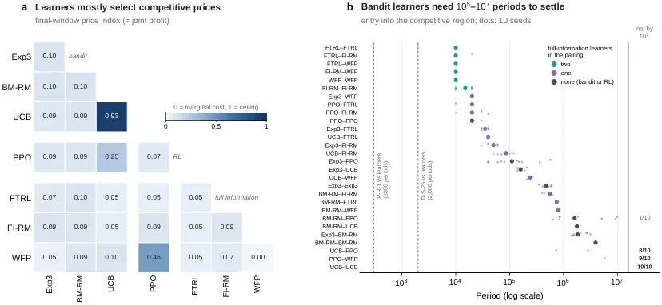
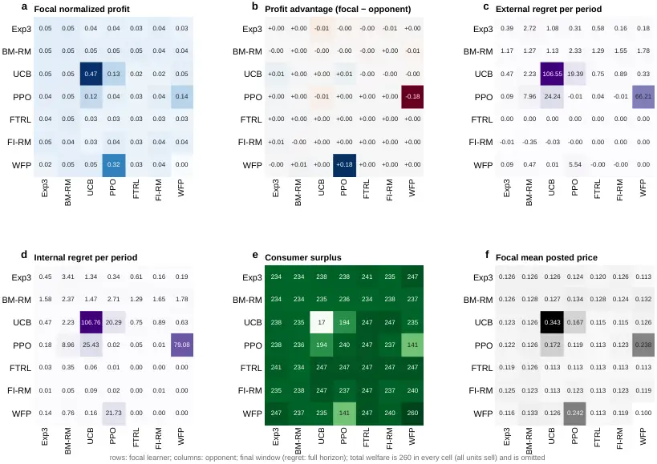
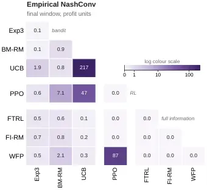

# How language model agents reshape price competition

Martin Bichler Email: <m.bichler@tum.de> Affiliation: School of
Computation, Information and Technology, Technical University of Munich,
Germany    Philip Hierhager Affiliation: School of Computation,
Information and Technology, Technical University of Munich, Germany   
Kassian Köck Affiliation: School of Computation, Information and
Technology, Technical University of Munich, Germany    Fabian Pieroth
Affiliation: School of Computation, Information and Technology,
Technical University of Munich, Germany

###### Abstract

Repeated Bertrand competition is a stringent benchmark for algorithmic
pricing: in homogeneous-goods markets, standard learning procedures
typically select the stage-game Nash outcome with prices near marginal
cost. We show that LLM pricing agents can escape this benchmark,
depending on deployment decisions. LLMs outperform standard online
learners through faster adaptation, but this advantage largely
disappears against full-information learners. An extracted surrogate
algorithm illustrates how LLMs in specific deployments profit from
regularly undercutting slower learners. Agents that post one price every
period from raw market histories that include rival prices can sustain
supracompetitive regimes in self-play. Agents that periodically emit
probability distributions from summarized histories of their own profits
instead move toward the competitive region in self-play. Markets mixing
these interfaces can generate dynamic regimes in which LLMs establish a
high-price anchor and regularly undercut it to capture demand. These
regimes can keep both competitors’ prices above marginal cost.
Deployment choices shape these outcomes, shifting the focus from
stationary equilibria to dynamic pricing regimes.

###### keywords

large language models, algorithmic pricing, repeated games, learning in
games, strategic adaptation, multi-agent systems

## 1 Introduction

Large language models (LLMs) are moving from passive text generation to
autonomous decision-making in environments where payoffs depend on
repeated interaction. Pricing is a particularly consequential domain.
Algorithmic sellers repeatedly observe market feedback, update prices
and interact with other automated agents. Their behavior affects
profits, consumer welfare and market efficiency. The practical relevance
of this setting is immediate: LLM-based pricing systems have been
proposed for e-commerce \[1\], and generative-AI vendors now provide
commerce-agent blueprints in which merchant agents connect to catalogue,
inventory, pricing and campaign systems and can stage price or promotion
changes for operator approval \[2\]. More broadly, LLM agents are
increasingly evaluated in strategic or feedback-driven environments \[3,
4, 5, 6, 7\]. If such systems select high-price regimes, the resulting
private profits may come at the expense of consumer welfare. Yet we know
little about the long-run regimes selected when LLM pricing agents enter
competition.

Classical repeated-game theory explains why many long-run outcomes can
be sustained. If agents maximize discounted cumulative profit,
history-dependent strategies can support outcomes close to the
stage-game Nash equilibrium as well as outcomes close to monopoly
pricing \[8\]. This theory is an existence theory, not a selection
theory: it characterizes which outcomes can be sustained, but it does
not predict which outcome a concrete adaptive process will reach.

Learning in games addresses this selection question. A learning rule is
not only a computational device for choosing actions; it is also a
mechanism that selects a long-run outcome, cycle or attractor of the
repeated interaction. For many standard online-learning algorithms,
Bertrand competition provides a sharp equilibrium-learning benchmark. In
the stage game of a repeated Bertrand competition with homogeneous
goods, the Nash equilibrium price equals marginal cost, while in the
heterogeneous-goods model, prices are higher than marginal cost. We
refer to the Nash equilibrium prices of the stage game as the
_competitive outcome_. In Bayesian Bertrand competition with homogeneous
goods and private costs, standard Minty-type stability arguments fail
near equilibrium, but global asymptotic stability can be certified
numerically, and stochastic mirror-descent learners then converge to
equilibrium in all instances studied \[9\]. Most online-learning
algorithms move toward the Nash prediction in repeated Bertrand
competition with homogeneous and heterogeneous goods \[10\], and in the
discrete homogeneous game no-swap-regret learners provably drive average
profits down to the margin of a single grid step \[11\].

### 1.1 Standard learners widely converge to Nash in all-or-nothing Bertrand competition

We analyzed many online and reinforcement-learning algorithms but focus
on a few prominent examples in the main paper. Exp3 is an adversarial
bandit algorithm for external-regret minimization \[12\]; BM-RM is a
bandit implementation of the Blum–Mansour reduction from external to
internal or swap regret \[13\]; UCB represents optimism-based stochastic
bandit learning \[14\]. Exp3 has vanishing regret in the adversarial
model, while UCB has vanishing regret in the stochastic model of online
learning. Such online-learning algorithms are sequential learning
procedures that update action probabilities or indices from realized
payoff feedback and aim at good long-run performance, for example
through regret minimization. They do not, however, explicitly evaluate a
current price through a continuation model of how this price will affect
the opponent’s future learning dynamics.

Reinforcement-learning algorithms (15) such as Q-learning and PPO (16)
are more explicitly cumulative-reward oriented: Q-learning estimates
continuation values through a Bellman recursion, and PPO optimizes
cumulative reward from sampled trajectories. Symmetric Q-learning agents
have been shown to sustain supracompetitive prices in a
heterogeneous-goods Bertrand model, i.e., prices higher than the
stage-game Nash equilibrium \[17, 18, 19\], but subsequent work also
shows that such outcomes are sensitive to exploration, hyperparameters,
market structure and algorithmic symmetry \[20, 21, 22\]. Interestingly,
in the homogeneous- and heterogeneous-goods Bertrand models we study,
PPO moves toward the Nash equilibrium of the stage game rather than
sustaining high-price regimes. Overall, there is significant evidence
that standard learning algorithms in Bertrand competition with
homogeneous goods often converge to the efficient Nash equilibrium,
which is good news for consumer welfare.

### 1.2 LLMs adapt quickly against standard learners

LLMs differ from standard online and reinforcement-learning algorithms.
Their objective is not encoded as a formal payoff function, Bellman
recursion or regret criterion. It is specified through a prompt and
combined with language-mediated memory and an interface that exposes
market histories. Recent experiments show that LLM pricing agents can
sustain supracompetitive prices in differentiated Bertrand markets under
point-price deployments with rich histories and rival-price information
\[23\]. In these deployments the model emits a single price every period
from a raw history of recent periods. Recent work also shows that
different deployment decisions can reduce or break LLM-mediated
collusion \[24\].

Computing a price for each interaction using an LLM is expensive. We
therefore also analyze deployments in which the LLM periodically emits a
probability distribution over a finite price grid. We denote recurring
LLM interfaces by an output–history–interval code: P and D denote
point-price and distributional output, R and S denote raw and summarized
history, and the number denotes the intervention interval in periods.
These codes are shorthand interface identifiers rather than complete
deployment specifications; the remaining components, such as the prompt,
the persistent state and the action space, are reported separately
(Methods, Table 1). The Fish-style deployment, relating to the work of
\[23\], is P-R-1. In our main distributional deployment, D-S-25, the
model receives summarized market histories and its previous
plans_and_insights, updates only at blockwise intervention times, and
prices in the following block are sampled from the emitted distribution.
The plans_and_insights field acts as a language-mediated memory of
previous pricing decisions. This deployment strategy significantly
reduces pricing costs, which is important for low-value goods. It
constitutes a substantially different, but reasonable, deployment
strategy. For D-S-25, we use neutral prompts that do not explicitly
instruct LLMs to coordinate on high prices.

Prior literature mostly analyzes symmetric deployments in which LLM
agents using the same deployment strategy compete against each other.
Real algorithmic markets are likely to be more heterogeneous. Sellers
may use standard online-learning algorithms, LLM pricing agents with
different deployment interfaces, fixed pricing rules or other adaptive
systems. We therefore first ask how LLM pricing deployments perform
against standard learning algorithms. This comparison is economically
important because sellers have an incentive to adopt LLM-based pricing
systems only if such systems perform well against standard algorithmic
pricing rules. It is also practically important because an LLM query is
more expensive than an iteration of a standard online-learning
algorithm.

To benchmark LLM behaviour against established online-learning rules, we
report experiments in which LLM pricing agents compete against standard
learning algorithms such as Exp3, UCB and PPO. These algorithms are
model-free and do not need assumptions on the number of competitors or
the demand model, which is often unavailable or changing in real-world
markets. They operate on minimal information about their own payoff
feedback. For visible-rival-price treatments in a known Bertrand
environment, however, the feedback is richer: observing the rival price
allows a firm to reconstruct the counterfactual payoff of every price on
the grid. Such settings call for full-information benchmarks in addition
to bandit learners. Throughout, we use _standard learners_ to denote
non-LLM pricing algorithms whose action probabilities or policies are
updated from realized market feedback over time. Static monopoly pricing
and simple deterministic rules such as short-term undercutting are
treated as additional controls.

Standard learners also adapt to opponents because opponent behaviour
determines the payoff feedback they observe. However, this adaptation is
mediated through a fixed statistical update rule, such as regret
accumulation, confidence-bound updates, multiplicative weights or
policy-gradient learning. LLM agents differ because their deployed
interface allows them to represent opponent behaviour in language and
condition current prices on qualitative hypotheses about future opponent
responses. Thus, the distinction is not whether agents adapt, but
whether adaptation is restricted to a fixed payoff-update rule or also
involves language-mediated opponent-response reasoning. Neither class
best-responds myopically to the rival’s current price: standard learners
respond to accumulated payoff statistics, and LLM agents may forgo a
currently profitable undercut because they expect it to lower the
rival’s future prices.

In the environments we study, LLM deployments create private profit
advantages, but through different mechanisms. Standard bandit learners
explore substantially in the initial periods, and convergence to the
competitive region is slow under limited feedback: in markets of
standard learners alone, bandit learners need $`10^{5}`$ to $`10^{7}`$
periods to settle in the competitive region (Fig. 1b). Both P-R-1 and
D-S-25 can exploit this learning phase and achieve higher finite-horizon
profits than standard learners. D-S-25 earns higher finite-horizon
profits against adaptive learners by charging lower prices and
undercutting rivals that remain above the competitive floor. To study
the mechanism behind D-S-25 competing against standard learning
algorithms, we introduce downward-biased belief search (DBBS), a
surrogate of the LLM’s distributional policy updates. DBBS shows that
their behaviour can be explained by a simple ordered-search mechanism
with inertia: the agent keeps much of its previous distribution, gives
more weight to recently profitable prices, avoids prices above its
current focal region and probes only a few prices upward. This mechanism
explains both competitive D-S-25 self-play and profitable undercutting
of slower learners.

### 1.3 Competing LLMs aim to escape the Bertrand paradox

These findings motivate the next market-level question: if LLM pricing
systems are attractive to sellers, which price regimes emerge when
multiple sellers deploy LLM agents, possibly with different deployment
strategies? A central finding is that LLM pricing outcomes are not
determined only by the base model and the prompt. They are selected by
the interaction of the stage game, the deployment strategy and the
opponent’s pricing behaviour. Fish-style P-R-1 agents sustain high
prices not only in differentiated-goods Bertrand competition, but also
in homogeneous winner-takes-all competition. By contrast, symmetric
D-S-25 and D-S-50 agents, which output price distributions from
summarized histories at blockwise intervention times, move toward the
finite-grid Nash region in homogeneous self-play and do not sustain
high-price regimes against standard online learners.

The difference between P-R-1 and D-S-25 or D-S-50 is not simply point
versus distributional output. The P-R-1 deployment exposes raw
rival-price paths and asks for a single price, making high-price
conventions easy to represent and maintain. The D-S-25 and D-S-50
interfaces with their summarized history turn pricing into an ordered
payoff-feedback search. Failed high-price attempts shift probability
mass downward. In symmetric self-play this search tends to the
finite-grid Nash region, whereas P-R-1 agents can coordinate on
supracompetitive prices. The resulting price regimes need not correspond
to stationary equilibria and can be highly dynamic.

Mixed LLM deployments provide further insights. Observable decision
traces suggest that LLM agents often identify high prices as profitable,
but different deployments make coordination on high prices more or less
stable. When a P-R-1 agent competes with a D-S-1 agent with hidden rival
prices, the P-R-1 agent can set a high-price anchor, while the D-S-1
agent learns a profitable threshold below that anchor. The P-R-1 agent
may then periodically reset to the price ceiling or lower its price
briefly to harvest demand and make a profit. We refer to this recurrent
pattern as anchor-and-harvest. The selected regime depends on the
specific deployment: action representation, history representation,
language-mediated memory, rival-price visibility and opponent type.

The design space for LLM deployments is large. There are numerous
deployment strategies for LLMs, numerous standard learning algorithms,
different foundation models and multiple versions thereof. We tested
different prompts and foundation models, and also deployment strategies
beyond the ones emphasized in the main paper. A fully combinatorial
design is infeasible. However, the main insights add value to the
overall discussion on LLMs as pricing agents. Even in repeated
homogeneous-goods Bertrand competition, where standard learning
algorithms often converge to the efficient stage-game Nash equilibrium
so consistently, LLMs can sustain supracompetitive prices under some
deployments.

The analysis of such multi-agent systems with LLMs poses new challenges.
Studying these systems requires identifying systematic behavioural
patterns, explaining how they depend on deployment choices and
interactions with other agents, and developing models that account for
the resulting trajectories and outcomes. The high adaptivity of LLM
agents is beyond the online-learning rules analyzed in the past. It
reinforces recent ideas saying that game theory needs to go beyond
equilibrium finding and study the dynamics of a game (25). Importantly,
resulting strategy profiles do not need to be stationary, but they can
be dynamic over long time horizons.

For competition authorities, our findings suggest that the tendency of
standard pricing algorithms to converge toward the stage-game Nash
outcome in homogeneous Bertrand markets need not persist when LLM-based
agents enter the market. Depending on their deployment and the
competitors they face, LLM agents can easily sustain supracompetitive
price regimes. The homogeneous-goods Bertrand competition is a
particularly insightful example as, although stylized, standard learning
algorithms typically converge to the efficient Nash equilibrium. We
avoid the term algorithmic collusion, as collusion carries specific
legal connotations and implications in competition law (26).
Nevertheless, if the widespread adoption of LLM-based pricing agents
leads to prices substantially above the stage-game Nash equilibrium,
this raises important concerns for competition authorities. Crucially,
our findings suggest that auditing such agents requires more than
examining their prompts and underlying foundation models: deployment
decisions also play a critical role in shaping pricing outcomes.

## 2 Results

Next, we show that LLM-based pricing agents achieve high profits against
standard learning algorithms, which exhibit substantial randomness in
their pricing decisions due to extensive exploration in the initial
rounds. When competing against simple pricing heuristics, such as
short-term undercutting strategies, LLM agents quickly identify ways to
avoid prices near marginal costs by establishing high price anchors to
which the heuristics respond. Thus, despite not being specifically
trained for sequential decision-making tasks, off-the-shelf LLMs
demonstrate an ability to perform well in unfamiliar pricing
environments.

We then turn to markets in which only LLM-based pricing agents compete.
Here, outcomes vary substantially across deployment configurations: some
lead to prices approaching the monopoly level, while others converge to
the stage-game Nash equilibrium under symmetric play. The latter
configurations (e.g., D-S-50) rely on summarized price histories and
rival price visibility, which appear to make it more difficult for
agents to coordinate on high prices in the meta-game. In
mixed-deployment settings, we again observe attempts by LLM agents to
establish high price anchors that induce competitors to maintain
elevated prices rather than converging toward marginal costs.

### 2.1 Standard learners converge toward the competitive benchmark

Before evaluating LLM pricing agents, we establish the benchmark against
which their behaviour should be interpreted. In homogeneous
winner-takes-all Bertrand competition, many standard learning procedures
provide an equilibrium-learning reference point. Their histories are not
absent; rather, they are compressed into statistical state variables
such as weights, cumulative losses, empirical means, confidence bonuses
or policy parameters. In our experiments, Exp3, BM-RM, PPO, UCB,
full-information learners and simple pricing rules serve both as
baselines and as opponents for the LLM agents.

The non-LLM round robin confirms that homogeneous Bertrand competition
is a strong equilibrium-learning benchmark, but not a trivial one. Most
standard learners generate transaction prices close to the finite-grid
Nash region and high consumer surplus. This includes algorithms that
learn from limited feedback, such as Exp3 and BM-RM, the reinforcement
learner PPO, and the full-information learners FTRL
(follow-the-regularized-leader with a Euclidean regularizer),
full-information regret matching and weighted fictitious play (Fig. 1a).
This complements recent results for Bayesian Bertrand competition, where
global stability of equilibrium learning is certified numerically for
all 243 systems studied although Minty-type arguments fail \[9\]. For
our complete-information grid market, the regret notion matters: in
every correlated equilibrium of the discrete winner-takes-all game each
firm earns at most the margin of a single grid step, so two
no-swap-regret learners such as BM-RM or full-information regret
matching are driven to the competitive region, whereas
no-external-regret learners admit coarse correlated equilibria with
supracompetitive prices \[11\]. Convergence is, however, not guaranteed
for all algorithms. UCB is the most visible exception: in UCB self-play
prices stay near the ceiling (price index $`0.93`$), and against PPO
they remain above the competitive region ($`0.25`$) (Fig. 1a). Empirical
NashConv identifies the same departures. Only three markets exceed
$`5\%`$ of one-firm monopoly profit: UCB self-play ($`217`$ profit
units), PPO against weighted fictitious play ($`87`$) and UCB against
PPO ($`47`$); all others are at most $`7.1`$ (Supplementary Note 3).
After $`10^{7}`$ periods, $`20`$ of the $`21`$ markets without UCB end
in the finite-grid competitive region, compared with $`5`$ of the $`7`$
markets with UCB; the only exception without UCB is PPO against weighted
fictitious play ($`0.46`$). Thus, the homogeneous Bertrand environment
disciplines many learning procedures, but the selected regime still
depends on the update rule (Fig. 1a). This still makes it an important
benchmark, because convergence is not as consistent for other types of
games.

The distinction between bandit and full-information feedback matters. If
a firm observes the rival price in the homogeneous Bertrand market and
the payoff function is known, it can reconstruct the counterfactual
payoff of every price on the grid. Such visible-rival-price treatments
are full-information learning problems, not pure bandit problems. In
real-world markets, the demand model and the level of competition might
not be known, which is why bandit algorithms are important. We therefore
include bandit but also full-information algorithms: FTRL,
full-information regret matching and weighted fictitious play, which
best-responds to a discounted belief over the rival’s price; it is
belief-based, but like FTRL and full-information regret matching it uses
the rival’s observed price, so we group it with the full-information
learners. The full-information learners provide a demanding comparison
class: markets of two full-information learners settle in the
competitive region within the first $`10^{4}`$ periods, markets with one
of them after a median of $`5\times 10^{4}`$ periods, whereas markets of
bandit or reinforcement learners alone need a median of
$`6\times 10^{5}`$ periods and up to several million (Fig. 1b). Because
the benchmark concerns where learners converge, the round robin runs for
$`10^{7}`$ periods with decaying, theoretically tuned exploration
(Supplementary Note 3).



Figure 1: Standard learners mostly select competitive outcomes in
homogeneous Bertrand competition. Round robin of seven standard learners
(all unordered pairs including self-play; ten seeds per pair; final
window = last 250 periods), each with one frozen configuration. All
firms observe the rival’s price, which FTRL, FI-RM and WFP require;
Exp3, BM-RM and UCB learn from their own profit only. a, Market-clearing
price index, 0 = marginal cost, 1 = price ceiling; with winner-takes-all
demand it equals joint normalized profit. b, Period after which each
market’s price stays in the competitive region (block means of
$`10^{4}`$ periods at most half a grid step above $`0.126`$); rows are
markets sorted by the median over seeds (large markers), small dots are
seeds, colour gives how many of the two learners use full-information
feedback; $`10^{4}`$ means competitive from the first block. Right
column, number of seeds still outside the region after $`10^{7}`$
periods. FTRL, follow-the-regularized-leader with a Euclidean
regularizer; BM-RM, Blum–Mansour bandit regret matching; FI-RM,
full-information regret matching; WFP, weighted fictitious play (best
response to a discounted belief over the rival’s price, discount 0.9;
grouped with the full-information learners because it uses the rival’s
price). Horizon $`10^{7}`$ periods; dashed lines in b, the horizons of
the P-R-1 (at most 300 periods) and D-S-25 (2,000 periods) runs against
standard learners.

This benchmark is especially important for interpreting PPO. PPO is not
a myopic price setter: it explicitly optimizes cumulative reward from
sampled trajectories. Nevertheless, in the homogeneous Bertrand
environments we study, PPO does not generally sustain high-price
regimes. Instead, it moves toward the competitive region in five of its
seven markets; the exceptions are its interactions with UCB and with
weighted fictitious play. Thus, supracompetitive prices are not
explained by cumulative-profit optimization alone. The relevant
distinction is between explicit algorithmic update rules and
deployment-induced LLM learning rules.

### 2.2 LLM pricing agents earn private profit advantages against standard learners

We next ask how LLM pricing deployments perform against existing
algorithmic pricing rules. This comparison is economically important
because sellers have an incentive to adopt LLM-based pricing systems
only if such systems perform well against standard learners. It is also
practically important because an LLM query is more expensive than an
iteration of a standard online-learning algorithm. We do not claim that
every LLM deployment creates such an adoption incentive. Our replicated
quantitative evidence in this section concerns the D-S-25 deployment; we
complement it with an illustrative P-R-1 interaction against Exp3 and
use a simple adaptive pricing rule to illustrate how quickly a P-R-1
agent can adapt to predictable opponent behavior.

The D-S-25 agent creates a robust finite-horizon profit advantage
against the standard learners considered here. Against Exp3, BM-RM, PPO
and UCB, the D-S-25 agent earns between 71 and 72 percent of cumulative
industry profit on average over the 2,000-period horizon, with ten
independent seeds per matchup (Fig. 2a). The advantage does not arise
from sustaining high prices. Instead, the D-S-25 agent more often posts
a lower price than its opponent. In the final 10 percent of periods, the
D-S-25 agent prices below the standard learner in 57–60 percent of
periods across the four matchups, while it prices above the learner in
only 28–38 percent (Fig. 2b). Standard learners often remain temporarily
above the competitive floor, because over the 2,000 periods of the
D-S-25 runs the bandit learners are still far from settling (Fig. 1b),
and the D-S-25 agent identifies profitable prices below them. The
resulting private adoption incentive therefore comes from faster
adaptation and undercutting rather than from maintaining a
supracompetitive price regime.

The P-R-1 agent can also generate a private profit advantage against a
standard learner. Figure 2c shows an illustrative 300-period interaction
between a P-R-1 agent and Exp3. Exp3 continues to explore broadly over
the price grid, whereas the P-R-1 agent adapts its price over time and
spends extended periods in comparatively persistent price regions above
the finite-grid competitive region. In this run, the P-R-1 agent earns
63 percent of cumulative industry profit. This trajectory is
illustrative rather than a replicated treatment estimate, but it shows
that a P-R-1 agent need not sustain a monopoly-price regime to obtain a
private profit advantage against an exploratory standard learner.
Against full-information learners the advantage disappears, as discussed
below.

The speed of P-R-1 adaptation is particularly transparent against a
simple win-up–lose-down pricing rule (Fig. 2d). The rule raises its
price by one grid step after receiving positive demand and lowers it by
one grid step after receiving no demand. From period 3 onward, the P-R-1
agent posts exactly the same price as the heuristic. A tie splits demand
between the firms and therefore counts as a sale for the heuristic,
causing it to raise its price by one grid step in the following period.
The P-R-1 agent follows this price increase, producing a sequence of
matched upward moves. Both agents reach the price ceiling in period 21
and remain there for the rest of the experiment. Because they continue
to set the same price, cumulative industry profit is split approximately
equally. This treatment therefore does not provide an additional
adoption-incentive result. Instead, it isolates the P-R-1 agent’s
ability to rapidly match a simple opponent-response pattern and thereby
move the interaction from prices near the competitive region to a
persistent high-price regime.

Figure 2: LLM pricing agents can earn private profit advantages against
standard learners and rapidly adapt to opponent behavior. a, D-S-25
earns more than Exp3, BM-RM, PPO and UCB over the full 2,000-period
horizon. Small points denote independent seeds, large points denote
matchup means, and the dashed line marks equal cumulative industry
profit. Each matchup contains ten independent seeds. b, In the final 10
percent of periods, D-S-25 agents post lower prices than their opponents
more often than they post higher prices. Percentages may not sum to 100
because of rounding. c, Illustrative P-R-1–Exp3 trajectory. Exp3
explores broadly over the price range, while the P-R-1 agent moves
through more persistent price regions and earns 63 percent of cumulative
industry profit. d, Illustrative P-R-1 interaction with a
win-up–lose-down heuristic. From period 3 onward, the P-R-1 agent
matches the heuristic’s price. Because each tie generates positive
demand, the heuristic raises its price by one grid step in the following
period and the P-R-1 agent follows. Both agents reach the price ceiling
in period 21 and remain there, splitting cumulative industry profit
approximately equally. The shaded areas in panels c and d denote the
finite-grid competitive region. Panels c and d show single illustrative
runs ($`n=1`$); panels a and b use ten independent seeds per matchup.

Additional experiments with simple pricing heuristics provide
complementary evidence that P-R-1 agents respond flexibly to predictable
opponent behavior. Against a randomized win-up–lose-down rule,
high-price interaction is less stable and the P-R-1 agent earns a larger
share of industry profit. Against a deterministic undercut-last
heuristic, the P-R-1 agent responds to the predictable pricing cycle and
captures most of industry profit. These heuristic treatments are useful
for probing P-R-1 adaptation, but they are conceptually distinct from
the replicated comparison against standard learners and are therefore
reported in detail in the Supplementary Information.

The D-S-25 advantage is finite-horizon and path-conditioned. Realized
external regret is computed against the best fixed grid price on the
observed opponent path; it is not policy regret against an opponent that
would have reacted differently under counterfactual LLM actions. The
experiments therefore do not show that the D-S-25 agent dominates
standard learners asymptotically or against arbitrary opponents. They
show that, on the structured price paths generated by the standard
learners considered here, the D-S-25 agent identifies profitable regions
of the ordered price grid quickly enough to obtain a substantial
finite-horizon profit advantage.

Taken together, these results establish the economic motivation for the
subsequent analysis. LLM pricing systems can be privately attractive
relative to standard learners even when the resulting market does not
settle into a high-price regime. The mechanism, however, depends on the
deployment. The D-S-25 advantage is associated with
payoff-feedback-driven undercutting, whereas the P-R-1 experiments
illustrate rapid adaptation to opponent behavior: against exploratory
Exp3 this adaptation produces a private profit advantage, while against
the predictable win-up–lose-down rule the P-R-1 agent quickly matches
the opponent’s response pattern and follows it into a persistent
high-price regime. We next use the agents’ observable decision traces to
distinguish these forms of adaptation more systematically.

The P-R-1 advantage has limits, and they follow the opponent’s feedback.
The strongest counterexample is coin betting, a parameter-free
full-information learner: it stays one or two grid steps below the P-R-1
agent’s elevated prices and earns 71 percent of cumulative industry
profit over 300 periods; after about 200 periods the P-R-1 agent
abandons its anchor and both prices fall to about $`0.19`$. Against
weighted fictitious play, which best-responds to a discounted belief
over the rival’s price, the P-R-1 agent earns 46 percent in an
illustrative 100-period run, falling to about 35 percent in the last 40
periods, and against full-information regret matching its larger share
is earned at near-competitive prices (Supplementary Note 4). The
full-information learners therefore mark the boundary of the P-R-1
evidence, in contrast to the slower-adapting bandit learners such as
Exp3.

### 2.3 Decision traces reveal opponent-facing anchoring and payoff-feedback search

At decision times, LLM agents emit not only prices or distributions but
also plans_and_insights. We treat these as behavioural traces, not as
direct access to hidden computation. Elicited explanations can be
incomplete or unfaithful and must be validated against actions and
outcomes \[27\]. This caution is especially important for pricing
agents: recent work on reasoning models reports that collusive outcomes
need not be visible in the agents’ own chain-of-thought or prompt-level
intent \[28\].

With this caveat, the traces suggest two distinct forms of adaptation.
P-R-1 agents more often use opponent-facing language, referring to
anchoring, avoiding price wars, resetting after low-price phases,
preserving high-margin regimes and harvesting demand: at least one such
motif appears in $`94\%`$ of P-R-1 traces but in $`34\%`$ of D-S-25
traces (Supplementary Note 5). In high-price P-R-1 regimes, the agent
often reasons that a locally profitable undercut could induce the
opponent to lower future prices. It therefore sometimes rejects a price
that would be myopically profitable against the opponent’s current
price.

D-S-25 agents more often use payoff-region language. Their traces refer
to successful and failed price regions, local probes and demand
thresholds, and they express caution through low-probability probes
(payoff-region motifs in $`98\%`$ of D-S-25 traces against $`21\%`$ of
P-R-1 traces). In heterogeneous competition against online learners, the
D-S-25 agent often treats lower prices as profitable undercuts of
opponents that remain above the competitive floor. In hidden-rival-price
P-R-1–D-S-1 cells, the D-S-1 agent can move upward from its own quantity
and profit feedback, without explicitly observing the rival price.

The protocol ablations indicate where this difference comes from. With
raw histories and visible rival prices, $`96`$–$`99\%`$ of traces are
opponent-facing whether the LLM emits a point price or a distribution;
with summarized histories and hidden rival prices, $`3`$–$`6\%`$ are. As
for prices (Fig. 4c), the information interface rather than the action
representation determines whether the LLM reasons about its rival or
about its own payoff regions.

This distinction is central. The point is not that standard learners
have no history: their histories are compressed into weights, cumulative
losses, empirical means, confidence bonuses, gradient states or policy
parameters. Rather, they do not evaluate the current action through a
language-mediated account of how it may change the opponent’s future
behaviour. The P-R-1 traces suggest response-sensitive anchoring. The
D-S-25 traces suggest payoff-feedback ordered search.

### 2.4 DBBS explains payoff-feedback search under the D-S-25 interface

We construct downward-biased belief search to test whether D-S-25
updates have a systematic low-dimensional structure that we can analyze.
DBBS is intended as a surrogate for the updates of D-S-25, not as a
model of P-R-1 behaviour. The P-R-1 regimes documented above likely
involve additional response-sensitive reasoning and opponent-facing
focal cues that are not captured by this ordered payoff-feedback
mechanism.

DBBS is not an explicit opponent-modelling algorithm. It does not
estimate the opponent’s policy. Rather, it updates from recent payoffs,
failures and the ordered structure of prices. Opponent behaviour enters
indirectly because it determines realized payoffs.

DBBS maintains a recency-weighted payoff score $`v_{k}`$ and failure
score $`\phi_{k}`$ for each price tick $`k`$. At each intervention
epoch, it identifies the modal recently played tick $`m`$ and scores
each tick as

```math
S_{k}=v_{k}-\beta_{\mathrm{fail}}\phi_{k}-\beta_{\mathrm{loc}}(k-m)_{+}.
```

The first term rewards recently profitable prices, the second penalizes
failures, and the third imposes one-sided caution for prices above the
current focal region. A softmax over scores is mixed with local upward
exploration. The surrogate then mixes this search policy with the
agent’s own recent price distribution, with an inertia weight $`w`$ that
is cross-fitted on training seeds. This captures inertia, recency
weighting, failure sensitivity, ordered-price reasoning and local
asymmetric search. The fitted failure penalty is close to zero; the
downward drift comes from the one-sided locality term (Supplementary
Note 6).

Teacher-forced validation fits DBBS to held-out LLM-emitted
distributions, not merely sampled realized prices. One parameter vector,
fitted jointly on the seven D-S-25 treatments of Section 1.2 with
leave-one-seed-out cross-fitting, predicts how the D-S-25 agent changes
its distribution better than every alternative: on the 22% of blocks in
which its mean price moves, the search component is more accurate than
persistence, win-up–lose-down and weighted fictitious play in all seven
treatments, and than the other baselines in six (Fig. 3a). In
free-running simulations on the same held-out environment seeds, DBBS
reproduces the D-S-25 agent’s final price level more closely than every
other mechanism, including those that need full information (mean error
$`0.020`$ against $`0.033`$–$`0.074`$; closer in at least 48 of 70 games
against each; Fig. 3b). It reproduces the competitive self-play regime
and the undercutting of adaptive learners and orders the treatments by
the agent’s final price (Fig. 3c). Inertia is essential for this:
without it, DBBS undercuts the learners in 81% of late periods, against
the agent’s 59%, and prices about $`0.04`$ too low. We added the inertia
component after observing this bias, but its weight is estimated only
from one-step predictions on training seeds, so the free-running
comparison remains held-out.

Figure 3: DBBS reproduces how D-S-25 updates and where it prices. DBBS
uses one parameter vector fitted jointly on the seven D-S-25 treatments
(ten environment seeds each, leave-one-seed-out cross-fitting); every
alternative is selected under the same folds and criterion, so all
results are held-out. DBBS, search policy mixed with the agent’s own
recent price distribution (inertia weight cross-fitted on training
seeds); DBBS without inertia, the search policy alone. Own-information
mechanisms use only what the agent observed (its own prices, sales and
profits). ^(†)Undercut-last and weighted fictitious play need full
information—the rival’s prices and the demand model and costs—which the
agent never observed. ^(‡)Train-mean emits the agent’s own average
distribution for that treatment and encodes the outcome rather than a
mechanism. a, One-step prediction of the next emitted distribution:
held-out Wasserstein-1 distance on all blocks (ticks) and on the 22% of
blocks in which the agent’s mean price moves by at least one grid step
(markers). Persistence is most accurate overall because emitted
distributions are highly persistent; on changing blocks the DBBS search
policy is the most accurate model. b, Free-running reproduction: each
model replaces the agent against the same opponent on the same held-out
environment seed (7 treatments $`\times`$ 10 seeds); absolute difference
between the model’s and the agent’s final-window mean price. c, Mean
price per 50-period block, averaged over the ten held-out seeds, for
four treatments. Without inertia DBBS undercuts the learners too far;
with inertia it follows the agent. Grey band, finite-grid competitive
region.

DBBS also clarifies the limits of the D-S-25 behaviour. It is not a
no-regret algorithm. Deterministic opponent-price sequences can induce
linear external regret, and one-step prediction errors can compound
under endogenous deployment. This is informative: the D-S-25 agent can
perform well on structured market paths without satisfying worst-case
online-learning guarantees. DBBS explains why D-S-25 moves toward Nash
in symmetric self-play and undercuts slow learners, and its ordered
payoff-feedback search is consistent with D-S-1 moving upward when a
P-R-1 agent creates a high-price anchor, a setting in which DBBS is not
fitted. It does not explain the P-R-1 agent’s anchoring and
anchor-and-harvest behaviour, which appears to depend on
response-sensitive reasoning and focal-price conventions.

Taken together, the analysis of P-R-1 and D-S-25 shows why LLM pricing
may be attractive to sellers, but also why the mechanism depends on
deployment. P-R-1 agents can earn private profit advantages by
exploiting slow learners or simple pricing heuristics and can sustain
high-price regimes when the opponent makes such regimes viable. D-S-25
can earn more against standard learners by adapting faster and charging
lower prices. These private incentives motivate the next market-level
question: what happens once multiple sellers deploy LLM pricing systems,
possibly under different interfaces?

### 2.5 Deployment interfaces shift LLM competition between high-price coordination and undercutting

Once sellers have incentives to adopt LLM pricing agents, the relevant
market-level question is which price regimes emerge when multiple
sellers deploy such systems. We find that LLM–LLM competition does not
select a single characteristic outcome. The same class of Bertrand games
can produce supracompetitive high-price regimes or prices close to the
finite-grid competitive region depending on how the LLM is deployed.
P-R-1 and D-S-25/D-S-50 select sharply different self-play regimes
(Fig. 4a). The protocol ablations show that this contrast is not
explained by output representation alone (Fig. 4b,c).

We begin with P-R-1, the Fish-style point-price deployment, as a
positive control. In this protocol, the LLM emits a single continuous
price at each decision point, observes raw market histories including
rival prices, uses a long memory window and receives profit-oriented
prompt language adapted from prior LLM-pricing work \[23\]. In the
differentiated-product logit market calibrated as in the
algorithmic-pricing literature \[17\], P-R-1 self-play reproduces the
supracompetitive pricing documented in prior LLM-pricing experiments
\[23\]. Across independent control runs, market-average price elevation
is close to the joint-profit benchmark (Fig. 4b, control).

The high-price regime is not confined to differentiated demand. Holding
the P-R-1 deployment fixed while replacing logit demand by homogeneous
winner-takes-all Bertrand competition reduces market-average price
elevation but does not eliminate it. Thus, stronger price competition in
the stage game weakens the high-price outcome but does not by itself
force the deployed LLM toward the competitive benchmark (Fig. 4a).

Distributional self-play selects a qualitatively different regime in the
same homogeneous winner-takes-all market. Under D-S-25 and D-S-50,
prices fall rapidly from elevated initial levels and remain near the
lowest grid prices, which form the finite-grid Nash region because of
tie splitting and the discrete price grid. This contrast is not an
unconditional property of the foundation model or of LLM-based decision
making. P-R-1 sustains high prices in the same market, whereas D-S-25
and D-S-50 move toward the competitive region. The selected outcome is
therefore a property of the deployed adaptive system.

This comparison also sharpens the role of cumulative reward. PPO is a
cumulative-reward learner but does not generally sustain high-price
regimes in this environment. P-R-1 agents can sustain high prices
without implementing a known Bellman recursion, while D-S-25 and D-S-50
agents, using the same broad class of foundation models but a different
deployment interface, move toward the finite-grid Nash region. High
prices therefore do not follow from long-run optimization alone. They
arise under particular deployed adaptive systems that determine what
information the LLM receives, how past interaction is represented and
how prices are selected.

A natural explanation for the difference between P-R-1 and D-S-25 or
D-S-50 behaviour is the change in output representation. P-R-1 directly
emits a price, whereas the D-S interfaces emit a probability
distribution over a finite price grid. Direct protocol ablations reject
the view that this distinction alone explains the change in regime.
Starting from the Fish-style point-price control in the differentiated
market, replacing continuous point-price output by a point action on the
21-point grid leaves price elevation high. Replacing continuous output
by a probability distribution over the same grid also leaves elevation
high (Fig. 4b). Changing the action representation alone therefore does
not reproduce the transition from the Fish-style high-price regime to
the competitive behaviour observed under the full D-S-50 bundle.

By contrast, changes to the information interface produce substantially
larger movements (Fig. 4c). Hiding the rival’s price and replacing raw
period-level histories with summarized histories are the largest
single-factor movements away from the Fish-style control in our ablation
design. These treatments suggest that what the LLM observes, and how
past market interaction is represented to it, is more consequential for
regime selection than the distinction between point and distributional
output alone.

Figure 4: The information interface, not the action representation,
separates high-price P-R-1 play from competitive D-S-25 and D-S-50 play.
Values are the price-elevation indices of Methods, $`\Delta`$ in the
logit market (0 = continuous one-shot Nash price, 1 = joint-profit
price) and $`\Delta^{H}`$ in the homogeneous market (0 = marginal cost,
1 = the price ceiling, which is the joint-monopoly price), from the mean
posted price over the final third of each run; small points are
independent runs, large points their means. Indices above 1 occur in the
logit market, where firms can price above the joint-profit price. a,
Self-play in the same homogeneous winner-takes-all market: P-R-1
(continuous price every period, raw history, rival price visible;
$`n=5`$ runs of 300 periods) and the distributional deployments D-S-25
(learning) and D-S-50 (aggressive) ($`n=10`$ runs of 2,000 periods
each). b, c, Starting from the P-R-1 control of the protocol ablations
in the differentiated logit market, which differs from the Fish-style
positive control only in using one merged scratchpad file (Supplementary
Note 1) (orange; grey band, range across its runs), the action
representation (b) or the information interface (c) is changed.
Grid-point or distributional output leaves prices at the monopoly level.
Hiding the rival’s price or summarizing the history roughly halves the
index, their combination lowers it further, and the full D-S-50 bundle
(distribution, summary, hidden rival price, 50-period interval; blue)
reaches 0.13. A short raw history does not lower prices. Each row
$`n=5`$ runs.

The combined treatments reinforce this conclusion. Grid-based output
remains compatible with high-price play when raw histories and visible
rival prices are retained. In contrast, configurations combining
summarized histories with hidden rival prices produce substantially
lower price elevation. Adding distributional output and blockwise
updating to this information interface moves play further toward the
competitive benchmark in the treatments examined. Every ablation row is
replicated over five runs (Fig. 4b,c); because single runs of the
information treatments vary widely, we interpret their magnitudes as
mechanism evidence rather than precise treatment-effect estimates.

These results imply that the distinction between P-R-1 and D-S-25 or
D-S-50 should not be interpreted as an effect of output representation
alone. The configurations differ in a bundle of deployment
choices—output representation, history representation, language-mediated
memory and intervention interval—and, in the comparisons above, also in
their information setting, because P-R-1 observes the rival’s price and
D-S-25 and D-S-50 do not. The ablation results identify what the LLM
observes—rival-price visibility and the representation of market
histories—as the important determinants of the selected regime.

This conclusion should not be read as showing that hiding rival prices
or summarizing histories is unconditionally pro-competitive. These
changes alter the information channel through which the LLM adapts
rather than mechanically lowering prices. Their effect can therefore
depend on the opponent faced by the agent. In heterogeneous LLM markets,
for example, a D-S-1 agent that does not observe rival prices can still
infer profitable high-price regions from its own quantity and profit
feedback when another pricing agent provides a high-price anchor. We
examine these cross-deployment interactions next.

### 2.6 Heterogeneous LLM deployments generate anchor-and-harvest dynamics

The symmetric self-play experiments provide two useful endpoints. P-R-1
can sustain supracompetitive price regions, whereas D-S-25 and D-S-50
move toward the competitive region. Markets with differently deployed
LLM agents do not simply interpolate between these outcomes. Instead,
they generate asymmetric and often recurrent price dynamics. A useful
organizing principle is an _anchor-and-harvest_ tension. An agent that
remains at a high price can create a price umbrella under which another
agent earns positive margins by pricing below it. Harvesting this
opportunity, however, can destabilize the elevated price region that
created it. The resulting regime therefore depends on whether agents
preserve the anchor, harvest underneath it, or repeatedly move between
these two behaviors.

Figure 5 summarizes the regimes observed across the heterogeneous and
multi-agent LLM experiments, reporting for each run the market-clearing
price (Fig. 5a) and the allocation of industry profit (Fig. 5b). We
treat visible rival prices as the primary information environment:
posted prices are directly observable in many online markets, and a
pricing agent can therefore condition on rivals’ recent prices.
Hidden-rival-price treatments provide a complementary mechanism
intervention. They remove this direct response channel while leaving
agents able to learn from their own quantities and profits. Across these
treatments, neither more information nor a particular action
representation maps mechanically into high or low prices. Instead, the
interface changes how quickly harvesting opportunities are identified
and how strongly they destabilize a price anchor. Every run in this
section is a single 300-period run, so the reported prices and profit
shares describe representative paths rather than treatment effects.

Figure 5: Heterogeneous and multi-agent LLM deployments exhibit distinct
price regimes. Homogeneous winner-takes-all Bertrand market; each row is
one representative 300-period run ($`n=1`$). Deployments P-R-1, P-S-1
and D-S-1 as in Table 1; “rival visible/hidden” refers to the
information setting, whether the LLMs observe competitors’ prices. Upper
block: Gemini 3 Flash, varying the deployment; lower block: GPT-5.6
Terra, varying reasoning. a, Market-clearing price: grey bar, 10th–90th
percentile over the run; open marker, full-run mean; filled marker, mean
over the final 100 periods; grey band, grid-based competitive benchmark
(three lowest grid prices with two firms, two lowest with three or
four); dotted line, price ceiling. b, Share of industry profit per firm
in the final 100 periods (P-R-1 and P-S-1 agents orange, D-S-1 agents
blue). Regime labels describe each run’s price path qualitatively
(Methods; Supplementary Note 8). Single-run rows are representative
paths, not treatment-effect estimates.

The P-R-1–D-S-1 experiments illustrate the tension most directly. When
both agents observe rival prices, the interaction settles quickly into a
high-price regime that the D-S-1 agent harvests (Fig. 6a). After about
45 periods of low and volatile prices, both agents move to the top of
the grid. In the final 100 periods the P-R-1 agent posts the $`0.36`$
ceiling in every period. The D-S-1 agent matches it in two thirds of the
periods and posts one grid step below it in the remaining third,
capturing the whole market in those periods. The market-clearing price
averages $`0.356`$, joint profit reaches $`98\%`$ of the monopoly
benchmark, and the D-S-1 agent earns $`66\%`$ of industry profit. The
P-R-1 agent thus provides a stable anchor, but does not respond to the
D-S-1 agent’s occasional undercuts by abandoning it. With direct price
observability, harvesting in this run takes the form of small, repeated
undercuts beneath a persistent anchor rather than an unravelling of the
anchor itself.

Removing rival-price information from the D-S-1 agent changes this
interaction substantially. The D-S-1 agent can no longer react directly
to the P-R-1 agent’s current price, but it can infer from its own sales
and profits which price regions remain profitable. When the P-R-1 agent
spends extended periods near the upper end of the price range, the D-S-1
agent continues to sell and gradually moves upward. The P-R-1 agent
thereby creates a price umbrella from which the D-S-1 agent benefits. In
the hidden-rival run the D-S-1 agent prices below the P-R-1 agent in
about three quarters of the final 100 periods and earns $`71\%`$ of
industry profit, even though the P-R-1 agent has richer information and
finer price control (Fig. 6b). The P-R-1 agent periodically moves below
the D-S-1 agent to regain demand and then returns to the high-price
region. We refer to this recurrent sequence as _anchor-and-harvest_: an
elevated anchor is maintained or repeatedly restored, but is
intermittently interrupted by a lower price that captures the market.

This comparison shows why rival-price visibility should not be
interpreted as a monotone pro- or anti-competitive treatment. With
visible rival prices, the D-S-1 agent can position itself exactly one
grid step below a ceiling anchor, and the market locks in near the
monopoly price while the D-S-1 agent harvests. With hidden rival prices,
such precise undercutting is not possible; the D-S-1 agent instead
learns from its own payoff feedback that elevated prices remain
profitable and follows the P-R-1 agent up and down, producing recurrent
cycles at lower average prices ($`0.26`$ rather than $`0.36`$). In both
cases the D-S-1 agent, not the better-informed P-R-1 agent, captures
most of the profit. Reduced information can therefore change the _form_
of adaptation without eliminating supracompetitive regimes.

Other point-price deployments show that elevated prices need not be
shared. When a P-R-1 agent competes with a P-S-1 agent, the same
point-price agent with a summarized history, both treatments end in
anchor-and-harvest, but the harvester changes with the information
setting (Fig. 5b). With rival prices visible to both, the P-R-1 agent
holds the ceiling in most of the final 100 periods while the P-S-1 agent
prices below it and earns $`86\%`$ of industry profit. When the P-S-1
agent does not observe the rival price, the P-R-1 agent undercuts it in
most late periods and earns $`75\%`$. In both runs the market-clearing
price stays well above the competitive region ($`0.28`$ and $`0.25`$ in
the final 100 periods; Fig. 5a), so similar price levels can coexist
with very different allocations of the resulting profit.

Adding firms does not by itself lower prices (Fig. 5a). Low prices occur
in the three-firm markets that combine P-R-1 and D-S-1 agents, which end
at or near the finite-grid Nash region: the final-100 market-clearing
price is $`0.112`$–$`0.118`$, against $`0.113`$ at the top of the
region. With one P-R-1 agent and two D-S-1 agents, the continuous-price
P-R-1 agent posts just below the D-S-1 agents’ lowest grid prices and
earns $`89\%`$ of industry profit with rival prices visible and all of
it with rival prices hidden. With two P-R-1 agents and one D-S-1 agent,
the point agents undercut each other and earn $`61\%`$ and $`34\%`$.
Markets of P-R-1 agents alone, by contrast, stay elevated: the final-100
market price is $`0.26`$ with three agents and the $`0.36`$ ceiling with
four.

Figure 6: Rival-price visibility shifts the balance between anchoring
and harvesting. One P-R-1 agent against one D-S-1 agent in the
homogeneous Bertrand market; single run per panel ($`n=1`$), 300
periods. Top: P-R-1 posted price (orange) and the D-S-1 agent’s emitted
policy (blue line, mean; shading, 10th–90th percentile); grey band,
grid-based competitive benchmark; dotted line, price ceiling. Bottom:
per-period profit as a share of one-firm monopoly profit, P-R-1 agent
upwards and D-S-1 agent downwards. a, With rival prices visible both
firms settle near the ceiling after about 45 periods; the D-S-1 agent
earns 66% of profit in the final 100 periods. b, With the rival price
hidden from D-S-1 the P-R-1 agent repeatedly re-anchors high while the
D-S-1 agent follows below it, producing recurring cycles in which the
D-S-1 agent earns 71% of profit in the final 100 periods.

The two point-price-only runs show that the selected regime is
path-dependent. In the three-P-R-1 run the market price repeatedly falls
toward the competitive region and resets upward (10th–90th percentile
$`0.11`$–$`0.35`$ over the run): each reset restores a high price that
the other firms then undercut, and the firms earn $`42\%`$, $`34\%`$ and
$`23\%`$ of final-window profit. In the four-P-R-1 run, high-price
attempts also fail early, but from period 74 all four agents hold the
ceiling and split profit equally (Supplementary Note 8 shows both
paths). These are single runs, not estimates of the effect of market
size: the same point-price deployment produced recurrent
anchor-and-harvest with three firms and a stable ceiling with four.

The lower block of Fig. 5 repeats the visible-rival-price P-R-1–P-S-1
interaction with a second model, GPT-5.6 Terra, and varies its reasoning
setting (temperature 0.7 without reasoning; with reasoning enabled the
API does not accept a temperature, so the provider default applies).
Without reasoning, the P-R-1 and P-S-1 agents post the $`0.36`$ ceiling
in almost every period and split industry profit equally. With medium
reasoning, the market price remains elevated ($`0.34`$ in the final 100
periods, about $`90\%`$ of the monopoly joint profit), but the
allocation becomes asymmetric: the P-R-1 agent earns $`96\%`$ of
industry profit, the reverse of the Gemini run in which the P-S-1 agent
harvests. Two P-R-1 agents with medium reasoning alternate between
restoring and undercutting a high price; the final-window market price
is $`0.29`$ and profit is split almost evenly (Fig. 5a,b). As in the
Gemini rows, these are single runs; they show that elevated prices recur
across models while the identity of the harvester is not fixed by the
information interface alone.

Taken together, the heterogeneous and multi-agent experiments suggest a
common interpretation. High-price regimes persist when agents expect the
continuation value of preserving an anchor to outweigh the immediate
gain from harvesting it. When harvesting remains attractive but does not
permanently destroy the anchor, recurrent anchor-and-harvest patterns
emerge. When several agents aggressively pursue the same harvesting
opportunity, repeated undercutting can drive prices toward the
competitive region. The relevant object is therefore not simply whether
LLMs “coordinate” on a high price, but how the deployed agents resolve
the dynamic trade-off between maintaining a profitable price region and
capturing demand underneath it.

These patterns are descriptive regimes of the coupled adaptive process
and should not be interpreted as equilibrium claims. A persistent
high-price plateau can contain profitable one-period deviations, and a
recurrent anchor-and-harvest cycle need not be an approximate dynamic
equilibrium. Establishing a dynamic-equilibrium interpretation would
require counterfactual deviation analysis against the induced opponent
policies: one would need to show that an agent cannot substantially
improve its discounted payoff by following an alternative policy while
its competitors continue to respond according to their deployed
policies. We therefore use the term _price-regime selection_ rather than
equilibrium selection for these interactions.

## 3 Discussion

Our results recast LLM pricing as a shift from equilibrium learning to
price-regime selection. Homogeneous Bertrand competition provides a
particularly sharp benchmark: in the stage game, the competitive outcome
is marginal-cost pricing, and standard learning procedures typically
move play toward this prediction. UCB is an exception, and it can
produce higher-price and high-NashConv outcomes in self-play.
Full-information learners such as FTRL and full-information regret
matching converge to the Nash prediction more rapidly.

Against this benchmark, LLM pricing agents select qualitatively
different regimes. The difference is not that LLMs simply have longer
histories or optimize a longer-run objective. Standard learners also
carry history, but their histories are compressed into statistical state
variables such as weights, empirical means, confidence bounds, regret
sums or policy parameters. PPO even optimizes cumulative reward from
sampled trajectories, yet in our homogeneous Bertrand benchmark, it does
not sustain high-price regimes. LLM agents instead carry
language-mediated memory and may evaluate current prices through their
perceived effect on future opponent behavior. The same foundation model
can therefore produce high-price P-R-1 self-play, Nash-like D-S-25 and
D-S-50 self-play, finite-horizon undercutting against online learners
and recurrent anchor-and-harvest patterns in cross-deployment
trajectories.

This distinction changes the economic interpretation of LLM pricing. The
first question is not only whether LLMs collude in self-play, but
whether LLM pricing systems create adoption incentives relative to
existing pricing rules. Our asymmetric experiments show that they can,
but through different mechanisms. P-R-1 can earn higher cumulative
profit against Exp3 and can exploit simple pricing heuristics such as
deterministic undercut-last rules. They can also coordinate with simple
win-up–lose-down rules on high prices. D-S-25 creates a different profit
advantage: it can earn higher finite-horizon profits against standard
online learners by charging lower prices, undercutting rivals that
remain above the competitive floor, and capturing more demand. Thus,
seller incentives to adopt LLM pricing agents need not always come from
raising prices. They can also arise from faster adaptation to structured
opponent price paths.

Once such adoption incentives exist, the market-level question becomes
what happens when multiple LLM pricing systems compete. Our results show
that there is no single answer. P-R-1 agents with raw rival-price
histories, point-price actions and profit-oriented language can sustain
high-price regimes, including in homogeneous winner-takes-all
competition. D-S-25 and D-S-50, with summarized histories,
distributional output and blockwise updating, move toward the
finite-grid competitive region in homogeneous self-play and do not
sustain high-price regimes against standard online learners. Mixed
P-R-1–D-S-1 markets can generate recurrent dynamic regimes such as
anchoring, threshold learning and anchor-and-harvest cycles. The stage
game matters, but it is not sufficient. The deployment protocol matters
because it induces the learning rule.

For learning in games, the key implication is that LLM deployments are
induced learning rules. Classical analyses usually fix a game and an
algorithmic update such as regret matching, mirror descent, projected
gradient ascent, exponential weights, Q-learning, or UCB. LLM agents do
not come with such a compact analytic update. The update is partly
created by prompt, memory, history representation, observation policy,
action representation, and query schedule. Consequently, changing from
raw histories to summaries, from point prices to distributions, or from
every-period decisions to blockwise interventions is not merely an
implementation detail. It changes the adaptive system whose long-run
regimes we observe. These results point to a new empirical and
theoretical agenda for learning in games: studying foundation-model
agents as deployment-induced adaptive systems whose regimes depend on
market structure, opponent ecology, and interface design.

For game theory, the selected object is often a price regime rather than
a stationary equilibrium. Repeated-game theory already tells us that
many history-dependent outcomes can be sustained in principle. The
empirical question is which outcome a deployed adaptive process selects.
Some outcomes in our experiments resemble stationary Nash-like or
high-price regimes. Others are recurrent patterns, such as anchoring,
intermittent undercutting and anchor-and-harvest cycles. These are
better understood as attractors of a coupled adaptive system than as
equilibria of the one-shot Bertrand game.

A recurrent price regime is not automatically a dynamic equilibrium. For
a state representation $`s`$, deployed policies $`(\psi_{i},\psi_{-i})`$
and discounted value $`V_{i}`$, an $`\varepsilon`$-dynamic equilibrium
test would ask whether

```math
V_{i}^{\psi_{i},\psi_{-i}}(s)\geq\sup_{\psi_{i}^{\prime}}V_{i}^{\psi_{i}^{\prime},\psi_{-i}}(s)-\varepsilon
```

for relevant states on the recurrent path. Our experiments document such
recurrent regimes, but we do not claim that all of them satisfy this
counterfactual deviation condition. Establishing this is a natural next
step for the theory of LLM agents in games. It will require methods that
combine trajectory classification, policy reconstruction, counterfactual
deviation tests and perturbation analysis.

The role of cumulative reward should therefore be interpreted carefully.
A long-run objective makes many history-dependent strategies feasible,
but it does not by itself generate high prices. PPO is an explicit
cumulative-reward learner in our evaluated configurations, yet it does
not generally sustain high-price regimes in homogeneous Bertrand
competition. Conversely, P-R-1 agents can sustain high prices without
implementing a known Bellman recursion or explicitly specified dynamic
program, while D-S-25 and D-S-50 do not. What matters is the adaptive
process that maps histories into future actions. For LLM agents, that
process is induced by the prompt, memory, observation stream, action
interface, and update cadence.

Our behavioural surrogate, DBBS, should be interpreted in this light.
DBBS captures D-S-25 as a payoff-feedback-driven ordered search rule
with inertia: the agent keeps much of its previous distribution, gives
more weight to recently profitable prices, avoids prices above its
current focal region and probes only a few prices upward. This explains
why D-S-25 moves toward the competitive region in self-play and
undercuts slower online learners on structured paths, and it is
consistent with D-S-1 moving upward when a P-R-1 agent creates a
high-price anchor. DBBS is not, however, a model of P-R-1 behaviour. The
P-R-1 regimes documented above likely involve additional
response-sensitive reasoning and focal cues created by raw rival-price
histories and point-price recommendations. A complete behavioural theory
of LLM pricing will therefore need to model both payoff-feedback search
and richer response-sensitive anchoring.

The mixed-deployment experiments refine the interpretation of
rival-price visibility. Reducing rival-price information does not
mechanically make pricing competitive. It changes the information
channel. In some ablations, summarized histories and hidden rival prices
weaken simple high-price coordination. In P-R-1–D-S-1 interaction,
however, a D-S-1 agent that does not observe rival prices can still
infer from its own quantities and profits that high prices remain
profitable when a P-R-1 agent acts as a high-price anchor. It can then
learn a threshold below that anchor and earn high profits. The P-R-1
agent may periodically reset to the price ceiling or briefly lower price
to harvest demand. This anchor-and-harvest pattern illustrates why
deployment components must be evaluated jointly rather than one at a
time.

The welfare implications are regime-dependent. A high-price P-R-1 regime
raises the familiar concern of supracompetitive pricing and lower
consumer welfare. A D-S-25 agent that undercuts standard learners keeps
prices low but takes $`72`$–$`74\%`$ of industry profit in the final 10%
of periods. In the homogeneous market, total welfare is fixed and
consumer surplus is determined by the average market-clearing price, so
average prices measure consumer harm there. They do not identify the
mechanism: the same average can come from a stable plateau, from
anchor-and-harvest or from one seller undercutting another. Regulators
and platforms therefore need transaction-level price paths to detect
anchoring, intermittent harvesting and systematic undercutting.

Supplementary Note 9 reports the welfare decomposition of the main
regimes. In the homogeneous market total welfare is fixed, and the
regimes differ in its division: consumers keep $`95\%`$ of the surplus
under D-S-25 and D-S-50 self-play and $`72`$–$`84\%`$ when a D-S-25
agent undercuts standard learners, but $`15\%`$ under P-R-1 self-play.
In the logit market, where high prices also destroy surplus, the
Fish-style control loses $`12.9\%`$ of the Nash welfare, and the full
D-S-50 deployment interface reduces this loss to $`0.8\%`$.

The policy implication is not that this paper provides a complete audit
or certification protocol. Rather, our results identify why any
behavioral evaluation of LLM pricing agents must go beyond an evaluation
of the prompts. The relevant object is the deployed pricing system: base
model, prompt, action space, memory structure, history representation,
rival-price visibility, update frequency, sampling procedure, and
opponent ecology. The same base model may produce competitive prices
under one deployment and supracompetitive prices under another. Testing
a model under one prompt, one market, or one opponent is therefore
insufficient. This complements recent calls for certification of AI
reasoning agents before market deployment \[28\]: our experiments
specify dimensions along which such certification would need to vary.

These findings suggest that regulating LLM pricing requires system-level
governance rather than prompt-level intent checks. A pricing system
should be evaluated across market structures, opponent ecologies and
interface designs. Certification tests should vary rival-price
visibility, raw versus summarized histories, point-price versus
distributional output, update cadence and memory length. Logging
requirements should record the model version, prompt, observation
stream, memory state, price recommendation, sampling procedure and human
overrides. Platform operators could also constrain the information
interface of pricing agents by providing lagged, aggregated or
summary-based market feedback rather than raw rival-price histories.
Such constraints would not guarantee competitive outcomes, but our
experiments show that they can alter the likelihood and form of
supracompetitive regimes.

A second regulatory challenge is design: how should LLM pricing systems
be parameterized so that consumer welfare is not harmed? Our evidence
suggests that interface design can become a policy lever, but not a
simple one. Summary histories, distributional output, and blockwise
updating can make simple high-price conventions harder to sustain. But
these choices must be evaluated jointly with market structure and
opponent ecology.

Several limitations remain. Observable decision traces are behavioural
artefacts, not direct observations of hidden computation. Our markets
are stylized Bertrand environments, chosen because Nash and joint-profit
benchmarks are transparent. Real pricing systems involve inventory,
search, consumer heterogeneity, multi-product portfolios, platforms and
asynchronous updates. The current P-R-1-versus-learner evidence
documents profit advantages against Exp3 and simple heuristics, but a
more systematic profit comparison against a broader set of online
learners would strengthen the adoption-incentive analysis. DBBS is a
behavioural surrogate for the updates of D-S-25, not a mechanistic
theory of LLM cognition and not a no-regret guarantee. These limitations
point to a broader agenda: studying foundation-model agents as
deployment-induced adaptive systems whose regimes depend on market
structure, opponent ecology and interface design, and developing new
tools to characterize and govern the dynamic strategies that result.

## 4 Methods

### 4.1 Market environments

We study repeated Bertrand price competition. In each period, firms
simultaneously choose prices and then observe market feedback. The
market accepts any price in the feasible interval
$`[\underline{p},\overline{p}]`$; individual pricing agents may operate
on continuous or discrete action spaces within this interval. The
standard learners and the D-S interfaces use the grid of $`K=21`$ prices

```math
\mathcal{P}=\{p^{0},\ldots,p^{K-1}\},\qquad p^{0}=c=\underline{p},\quad p^{K-1}=\overline{p},
```

whereas P-R-1 and P-S-1 post continuous prices unless they are
restricted to the grid for a matched comparison. The grid has evenly
spaced prices $`p^{k}=c+k\delta`$ and grid step

```math
\delta=\frac{p^{K-1}-c}{K-1}.
```

In the homogeneous winner-takes-all market, firms sell identical goods
and demand is allocated to the firm with the lowest price. If multiple
firms set the lowest price, demand is split equally among them. For firm
$`f`$, let $`p_{ft}`$ denote its price in period $`t`$, and define

```math
L_{t}=\{f:p_{ft}=\min_{g}p_{gt}\}.
```

Firm $`f`$’s quantity is

```math
q_{f}(p_{t})=\begin{cases}D/|L_{t}|,&\text{if }f\in L_{t},\\
0,&\text{otherwise,}\end{cases}
```

and profit is

```math
\pi_{f}(p_{t})=(p_{ft}-c)q_{f}(p_{t}).
```

Unless otherwise stated, the homogeneous experiments use $`c=0.10`$,
$`D=1000`$, $`K=21`$, $`\overline{p}=0.36`$, and horizon $`T=2000`$. The
upper bound $`\overline{p}`$ is the consumers’ reservation value: demand
is $`D`$ up to this price and zero above it, so $`\overline{p}`$ is also
the monopoly price. When all $`n`$ firms post the same grid price
$`p^{k}=c+k\delta`$, each earns $`k\delta D/n`$; undercutting by one
grid step earns $`(k-1)\delta D`$, and any higher price earns zero. The
symmetric profile is therefore a Nash equilibrium if and only if
$`k\leq n/(n-1)`$. The finite-grid Nash region is

```math
\{0.100,0.113,0.126\}\ \text{for }n=2,\qquad\{0.100,0.113\}\ \text{for }n\geq 3.
```

We mark this region in price-path figures rather than treating the
competitive benchmark as a single grid point. In markets that pair a
continuous-price agent with grid agents, the same prices serve as a
grid-based competitive benchmark rather than as the Nash region of the
asymmetric game.

In the differentiated-product market, firm $`i`$’s demand follows the
multinomial-logit system

```math
q_{i}(p_{i},p_{-i})=\frac{\exp((a_{i}-p_{i})/\mu)}{\sum_{j=1}^{n}\exp((a_{j}-p_{j})/\mu)+\exp(a_{0}/\mu)},
```

and profit is

```math
\pi_{i}(p_{i},p_{-i})=(p_{i}-c_{i})q_{i}(p_{i},p_{-i}).
```

Unless otherwise stated, the differentiated experiments use $`n=2`$,
$`a_{1}=a_{2}=2`$, $`a_{0}=0`$, $`\mu=0.25`$, and $`c_{1}=c_{2}=1`$. The
continuous one-shot Nash price is approximately
$`p^{\mathrm{Nash}}=1.473`$, and the joint-profit price is approximately
$`p^{\mathrm{monopoly}}=1.925`$. We report normalized price elevation in
the differentiated market as

```math
\Delta(p)=\frac{p-p^{\mathrm{Nash}}}{p^{\mathrm{monopoly}}-p^{\mathrm{Nash}}}.
```

In the homogeneous market, we primarily report prices in levels and mark
the finite-grid Nash region. When a normalized homogeneous price index
is used, we define

```math
\Delta^{H}(p)=\frac{p-c}{p^{K-1}-c},
```

so that $`\Delta^{H}=0`$ corresponds to marginal cost and
$`\Delta^{H}=1`$ corresponds to the upper grid price. Marginal cost is
the lowest symmetric equilibrium price for every $`n`$, so
$`\Delta^{H}`$ has the same anchor for any number of firms; the
finite-grid Nash region is $`\Delta^{H}\leq 0.10`$ for two firms and
$`\Delta^{H}\leq 0.05`$ for three or more.

### 4.2 Feedback structures

The information available to a pricing agent depends on the deployment.
In visible-rival-price treatments, firm $`i`$ observes the rival price
$`p_{-i,t}`$ after period $`t`$. In the homogeneous Bertrand market with
known cost, demand and tie-breaking rule, this is full-information
feedback. In a two-firm market, observing $`p_{-i,t}`$ allows firm $`i`$
to reconstruct the counterfactual payoff of every price
$`p\in\mathcal{P}`$:

```math
\pi_{i}(p,p_{-i,t})=\begin{cases}(p-c)D,&p<p_{-i,t},\\
(p-c)D/2,&p=p_{-i,t},\\
0,&p>p_{-i,t}.\end{cases}
```

Thus, visible-rival-price treatments are benchmarked not only against
bandit learners but also against full-information learners such as FTRL,
coin betting and full-information regret matching.

In hidden-rival-price treatments, the agent observes only its own price,
quantity and profit. Because the quantity follows from the own price and
profit, $`q=\pi/(p-c)`$, this is bandit feedback: the payoff of the
chosen price only. The feedback is nevertheless structured. In the
winner-takes-all market a sale of the whole demand at $`p`$ implies the
same sale at every lower price, so the payoffs of all lower prices
follow; no sale at $`p`$ implies no sale at any higher price; and a
split market reveals that the rival posted the same price. An agent that
treats prices as ordered can therefore infer part of the counterfactual
payoff vector from the same observations that a standard bandit learner,
which treats prices as unrelated arms, uses only for the price it
played. LLM agents receive the same own-market feedback as the bandit
learners, together with the price values and their marginal cost; they
are not told the demand model.

Rival-price observability is part of the information setting, not of the
deployment, and is specified per firm: in the heterogeneous experiments
one firm can observe its rival’s price while the other does not.

### 4.3 Pricing agents and LLM deployments

We distinguish three kinds of pricing agents: standard non-LLM learners,
LLM agents and simple pricing controls. Each firm $`i`$ is described by
its decision engine (a learning algorithm, DBBS or a foundation model),
its information setting $`\iota_{i}`$ (whether it observes the rival’s
price) and, for LLM agents, its deployment.

#### Standard learners.

The non-LLM baselines include bandit-feedback learners, full-information
learners and reinforcement-learning baselines. Bandit-feedback learners
include Exp3, BM-RM, UCB and related stochastic or adversarial bandit
algorithms. Exp3 is an adversarial-bandit external-regret algorithm;
BM-RM is a bandit implementation of the Blum–Mansour reduction from
external to internal or swap regret; UCB is an optimism-based stochastic
bandit learner. Full-information learners include FTRL, coin betting,
full-information regret matching \[29\] and weighted fictitious play.
These algorithms are used when the rival price is visible and the
counterfactual payoff vector can be reconstructed.
Reinforcement-learning baselines include PPO and additional variants
reported in the Supplementary Information.

#### LLM deployments.

A deployment is the interface through which a foundation model prices,

```math
D=(\mathcal{H},\mathcal{A},\mathcal{O},\Delta,\mathcal{M},\mathcal{P}),
```

where $`\mathcal{H}`$ is the history representation and memory window,
$`\mathcal{A}`$ the action space, $`\mathcal{O}`$ the output
representation, $`\Delta`$ the intervention interval, $`\mathcal{M}`$
the persistent state carried between decisions and $`\mathcal{P}`$ the
prompt and invocation configuration (objective framing, price
presentation, response template, temperature and reasoning setting). We
name deployments by the three components that the protocol ablations
vary: output (P, a point price; D, a probability distribution over the
price grid), history (R, raw period-level observations; S, a per-price
summary) and intervention interval. Table 1 lists the five deployments
used in the paper; the Supplementary Information gives every component.

P-R-1 reimplements the pricing loop of Fish et al. and serves as the
positive control: one price every period from the raw history of the
last 100 periods, the profit-oriented framing Prompt 1 and a persistent
scratchpad that the model rewrites at each decision. Against standard
learners its prices are restricted to the 21-point grid, so that both
firms share one action set and exact ties can occur; elsewhere it posts
continuous prices. P-S-1 is the same agent with a summarized history.
The distribution–summary deployments D-S emit a probability distribution
over the 21-point grid from a per-price summary that reports the number
of observations, mean quantity, mean profit, profit dispersion,
normalized-profit statistics and a trend; prices are sampled from this
distribution during the following intervention block. D-S-25 and D-S-50
are the configurations frozen by the learning and aggressive selection
rules of the configuration screen; they return a JSON object containing
the distribution and an updated plans_and_insights field and also see
their previous distribution. D-S-1 applies the summary-and-distribution
interface every period inside the Fish harness, so that it can be paired
with P-R-1 under the same template and cadence. The persistent text is
fed back at the next decision and acts as language-mediated memory; we
treat it as an observable behavioural trace, not as hidden
chain-of-thought.

|                |              |              |          |        |                     |
| -------------- | ------------ | ------------ | -------- | ------ | ------------------- |
| Interface code | Output       | History      | Interval | Prompt | Used in             |
| P-R-1          | point        | raw, 100     | 1        | 1      | Figs. 2c,d, 4, 5, 6 |
| P-S-1          | point        | summary, 100 | 1        | 1      | Fig. 5              |
| D-S-1          | distribution | summary, 100 | 1        | 1      | Figs. 5, 6          |
| D-S-25         | distribution | summary, 75  | 25       | 0      | Figs. 2a,b, 3, 4a   |
| D-S-50         | distribution | summary, 150 | 50       | 1      | Fig. 4a,c           |

The full-bundle arm of the protocol ablations (Fig. 4c) runs D-S-50
inside the Fish harness with a 250-period window. P-R-1 keeps the
two-file scratchpad of Fish et al. in the Fish-style positive control
and the logit-market matchups; the protocol ablations and all
homogeneous-market runs use one merged file (Supplementary Note 1).

Table 1: LLM deployments. Interval, periods between LLM decisions;
window, periods summarized or listed in the history. All deployments use
Gemini 3 Flash at temperature 0.7 unless stated otherwise; rival-price
observability is set by the information setting and varies within
deployments.

#### Simple pricing controls.

We also use static and deterministic pricing controls, including static
monopoly pricing, static competitive pricing, win-up–lose-down rules,
randomized win-up–lose-down rules and deterministic undercut-last
heuristics. These controls are used to test whether LLM agents can
identify and exploit simple pricing regularities.

### 4.4 Configuration screening

Candidate configurations are screened only in homogeneous self-play
before cross-agent evaluation. The configuration screen evaluates LLM
and non-LLM candidates over five seeds with $`K=21`$ and $`T=2000`$. For
LLMs, the screen varies model, temperature, intervention interval,
history representation and objective framing. For non-LLM agents, it
tunes Exp3, BM-RM, PPO and UCB. The learning score ranks candidates by
external regret, swap/internal regret, NashConv and price volatility.
The aggressive score first removes candidates in the worst quartile of
any learning-quality metric and then ranks remaining candidates by
profit and price elevation.

The frozen learning configuration, D-S-25, uses Gemini 3 Flash Preview,
temperature $`0.7`$, neutral Prompt 0, summary history and intervention
interval 25. The frozen aggressive configuration, D-S-50, uses Gemini 3
Flash Preview, temperature $`0.7`$, Prompt 1, summary history and
intervention interval 50. The frozen learning baselines are Exp3 with
$`\gamma=0.30`$, BM-RM with $`\gamma=0.50`$ and $`\eta=\gamma/21`$, PPO
with rollout $`R=50`$ and learning rate $`0.005`$, and UCB with
$`\alpha=1.7`$. Aggressive baselines use Exp3 with $`\gamma=0.125`$, PPO
with learning rate $`0.010`$, and UCB with $`\alpha=1.0`$; BM-RM is
unchanged. Additional full-information learners and heuristic controls
are specified in the Supplementary Information.

### 4.5 Experiment families

The experiments are organized into seven families.

#### Standard learner round robin.

Seven standard learners (Exp3, BM-RM, UCB, PPO, FTRL with a Euclidean
regularizer, full-information regret matching and weighted fictitious
play) compete in every unordered pair, including self-play, in the
homogeneous Bertrand market for $`10^{7}`$ periods with ten seeds and
full rival-price information. Each learner uses one frozen configuration
with decaying exploration; Exp3 and every BM-RM row learner use the
anytime tuning of \[12\]. This establishes the equilibrium-learning
benchmark and identifies exceptions such as UCB-driven high-price cells.
The Supplementary Information reports the full round-robin matrices for
prices, profits, consumer surplus, total welfare, NashConv and regret
diagnostics.

#### P-R-1 versus standard learners and heuristics.

P-R-1, restricted to the price grid, is matched against Exp3, PPO, coin
betting, full-information regret matching, weighted fictitious play and
simple pricing rules in the homogeneous market. These cells test whether
it can generate private profit advantages against slow learners or
exploitable heuristics.

#### D-S-25 versus standard learners.

D-S-25 is matched against Exp3, BM-RM, PPO and UCB in the homogeneous
market. These cells test whether it earns profits by undercutting
learners that remain above the competitive floor.

#### LLM self-play.

We evaluate P-R-1 self-play and D-S-25 and D-S-50 self-play in
homogeneous and differentiated Bertrand environments. These cells test
whether the deployed LLM system selects a high-price regime, a
finite-grid Nash-like regime or another recurrent pattern.

#### Deployment ablations.

Starting from the P-R-1 control, we vary the output representation,
history representation and intervention interval of the deployment and
the rival-price visibility of the information setting. These ablations
test whether high-price regimes are driven by point actions alone or by
the broader deployment interface.

#### Mixed LLM deployments.

We evaluate P-R-1–D-S-1 and P-R-1–P-S-1 interactions, and markets with
three or four LLM agents, under visible and hidden rival prices. These
cells test whether heterogeneous LLM deployments generate asymmetric or
dynamic regimes, including anchor-and-harvest cycles.

#### Robustness families.

Additional experiments vary prompts, foundation models, opponent types,
demand systems and evaluation windows. Detailed results are reported in
the online supplement.

### 4.6 Held-out evaluation

The held-out homogeneous evaluation uses new trajectories not used in
the configuration screen. Unless otherwise stated, homogeneous D-S-25
and D-S-50 evaluation uses ten independent seeds per cell and horizon
$`T=2000`$. Main estimates use the final $`10\%`$ window,

```math
W=\{1801,\ldots,2000\}.
```

Evaluation-window robustness varies the final window over $`5\%`$,
$`10\%`$, $`20\%`$, $`50\%`$ and the full horizon.

Point-price experiments use either the differentiated logit market or
the homogeneous market, as stated in the corresponding figure or table.
Deployments with an LLM call in every period (P-R-1, P-S-1, D-S-1) use
shorter horizons; blockwise deployments use longer horizons. Exact
horizons, call budgets, replication counts, prompt variants, model
versions and random seeds are reported in the Supplementary Information.

### 4.7 Outcome measures and uncertainty

For each seed $`s`$ and evaluation window $`W`$, we compute average
price, transaction price, quantity, profit, cumulative profit and profit
share. For asymmetric cells, we compute LLM-minus-opponent gaps in
price, profit and quantity:

```math
G^{Y}_{s}(W)=\frac{1}{|W|}\sum_{t\in W}\left(Y_{s,\mathrm{LLM},t}-Y_{s,\mathrm{opp},t}\right),\qquad Y\in\{p,\pi,q\}.
```

The undercut share is

```math
U_{s}(W)=\frac{1}{|W|}\sum_{t\in W}\mathbf{1}\{p_{s,\mathrm{LLM},t}<p_{s,\mathrm{opp},t}\}.
```

Realized external regret is computed relative to the best fixed grid
price on the observed opponent path:

```math
ER_{s,f}(W)=\max_{p\in\mathcal{P}}\sum_{t\in W}\pi_{f}(p,p_{s,-f,t})-\sum_{t\in W}\pi_{f}(p_{s,f,t},p_{s,-f,t}).
```

This is a finite-horizon, path-conditioned diagnostic and not policy
regret against a strategically responding opponent. We report it for the
held-out runs in Supplementary Note 4.

For empirical mixed profiles $`\sigma`$, we compute NashConv as

```math
\mathrm{NashConv}(\sigma)=\sum_{f}\left[\max_{p_{f}\in\mathcal{P}}\mathbb{E}_{p_{-f}\sim\sigma_{-f}}\pi_{f}(p_{f},p_{-f})-\mathbb{E}_{p\sim\sigma}\pi_{f}(p)\right].
```

For welfare analyses, we report consumer surplus, producer surplus and
total welfare using the market primitives of the corresponding
environment. In the homogeneous market, welfare calculations use the
demand and value primitives reported in the Supplementary Information.
In the differentiated logit market, welfare calculations use the logit
demand system. The Supplementary Information provides exact formulas and
all welfare tables.

All main estimates are computed at the seed level. We report means and
bootstrap confidence intervals obtained by resampling independent
seed-level trajectories.

### 4.8 Price regimes

We use the term price regime descriptively for persistent or recurrent
patterns in the coupled price path of deployed agents. The labels in
Fig. 5 are qualitative descriptions of each run’s price path, not the
output of a classification rule. _Competitive undercutting_: the
market-clearing price (the lowest posted price) stays in or near the
finite-grid Nash region while agents undercut each other. _High-price
lock-in_: the market-clearing price stays at or one grid step below the
ceiling. _Anchor-and-harvest_: one agent holds or repeatedly restores a
high price, and another prices below it and captures demand.

In the P-R-1–D-S-1 runs, anchor-and-harvest has three features: (i) a
high-price anchor phase in which the P-R-1 agent remains near the upper
part of the price range, (ii) a threshold-learning phase in which the
D-S-1 agent prices below the anchor and earns positive profits, and
(iii) intermittent harvest moves in which the P-R-1 agent lowers its
price briefly to regain demand. All heterogeneous runs are single runs;
the Supplementary Information shows the price path of every run.

We do not infer from persistence alone that a dynamic regime is an
equilibrium. A dynamic-equilibrium interpretation would require
counterfactual deviation analysis against the induced opponent policy.
The present experiments document the regimes selected by deployed agents
and report path-level diagnostics; formal equilibrium certification of
recurrent regimes is left to follow-up work.

### 4.9 Reasoning traces and DBBS

We analyse plans_and_insights outputs as observable behavioural traces.
They are not treated as hidden chain-of-thought or direct observations
of model cognition. For motif extraction, complete LLM call records were
analysed using a fixed coding prompt and then checked by the authors.
Each record contained the market history available to the pricing agent,
the previous pricing strategy, the newly emitted price or distribution
and the updated plans_and_insights field.

We distinguish two trace-level patterns. P-R-1 traces often use
opponent-facing language, referring to anchoring, avoiding price wars,
resetting and harvesting. D-S-25 and D-S-50 traces more often use
payoff-region language, referring to successful and failed price
regions, local probes and thresholds. Motif frequencies are measured by
coding every trace against a fixed keyword lexicon, with precision
checked on randomly drawn matches (Supplementary Note 5). DBBS is
constructed only as a surrogate for D-S-25 updates.

DBBS treats prices as an ordered grid. It maintains a recency-weighted
payoff belief $`v_{k}`$ and a failure belief $`\phi_{k}`$ for each tick
$`k`$. At each intervention epoch, it observes realized prices and
normalized profits and identifies the modal played tick $`m`$ of the
block. For each period of the block, in order, with played tick $`k`$
and normalized profit $`r_{k}`$, it updates

```math
v_{k}\leftarrow\lambda r_{k}+(1-\lambda)v_{k},\qquad\phi_{k}\leftarrow\lambda y_{k}+(1-\lambda)\phi_{k},\qquad y_{k}=\mathbf{1}\{k>0\}\,\mathbf{1}\{r_{k}\leq 0\}.
```

Ticks not played keep their beliefs. The failure signal $`y_{k}`$ is the
zero-sales indicator: in the winner-takes-all market a price above
marginal cost earns zero profit exactly when it does not sell, and
marginal cost ($`k=0`$) is never a failure. DBBS is fitted and deployed
only in the homogeneous market. DBBS scores ticks by

```math
S_{k}=v_{k}-\beta_{\mathrm{fail}}\phi_{k}-\beta_{\mathrm{loc}}(k-m)_{+}.
```

The first term rewards recently profitable prices, the second penalizes
failures, and the third imposes one-sided caution for prices above the
current focal region. A softmax with temperature $`\tau`$ maps scores
into a base distribution. The base distribution is mixed with local
upward exploration: with weight $`\rho`$, probability mass is placed on
ticks up to $`G_{\mathrm{up}}`$ steps above the current focal tick
$`m`$. The emitted distribution mixes this search policy with a
persistence component, a recency-weighted histogram of the agent’s own
recent prices:
$`\sigma_{n+1}=w\,\sigma^{\mathrm{pers}}_{n+1}+(1-w)\,\sigma^{\mathrm{search}}_{n+1}`$,
with the inertia weight $`w\in\{0,0.05,\ldots,1\}`$ selected for each
fold on the training seeds by one-step loss; $`w=0`$ is DBBS without
inertia.

DBBS is evaluated under teacher forcing and free-running deployment.
Under teacher forcing, DBBS follows recorded LLM histories and predicts
the next LLM-emitted distribution. Under free-running deployment, the
fitted DBBS policy replaces the LLM and acts endogenously. Parameter
selection uses leave-one-seed-out cross-validation over environment
seeds and minimizes a normalized squared-CDF loss. Evaluation reports
first Wasserstein distance normalized by the price range. The validation
fits one parameter vector per fold jointly on the seven D-S-25
treatments (ten environment seeds, ten folds). Parameters are selected
from 20,000 Latin-hypercube candidate vectors over

```math
\lambda\in[0.05,0.99],\quad\beta_{\mathrm{fail}}\in[0,2],\quad\beta_{\mathrm{loc}}\in[0,0.30],\quad\tau\in[0.01,0.20],\quad\rho\in[0,0.40],\quad G_{\mathrm{up}}\in\{0,\ldots,6\}.
```

The Supplementary Information reports the full DBBS construction,
heuristic baselines, validation results and theoretical statements.

### 4.10 Generative AI use

GPT-5.6 Sol was used for qualitative motif extraction from LLM call logs
and for assistance with language editing. All extracted motifs,
generated text, code outputs, statistical estimates and mathematical
claims were checked by the authors. Market outcomes and numerical
results were computed from the experimental code and were not generated
by the language model.

### 4.11 Supplementary Information

The Supplementary Information provides the complete experimental
specification and the supporting evidence for each main-text figure: the
markets, deployments, standard learners and metrics (Supplementary
Note 1); the configuration screen and frozen configurations (Note 2);
the full round-robin matrices and convergence paths (Note 3, Fig. 1);
held-out price paths, evaluation-window robustness and all P-R-1 runs
against standard learners and pricing rules (Note 4, Fig. 2); the
trace-motif extraction and motif frequencies (Note 5); the DBBS
construction, fitting, baselines, free-running controls and proofs
(Note 6, Fig. 3); the deployment-ablation design and diagnostics
(Note 7, Fig. 4); logit-market P-R-1 matchups and the trajectories of
every heterogeneous-deployment run (Note 8, Figs. 5–6); the welfare
decomposition of the main regimes (Note 9); and all prompt templates
(Note 10).

## 5 Data availability

All data needed to reproduce the figures and tables will be made
available in a public repository upon publication, including simulation
outputs, prompt templates, processed analysis tables and LLM call
records permitted for release.

## 6 Code availability

Code for the market environments, agent implementations, statistical
analysis and figure generation will be made available in a public
repository upon publication.

## References

- (1) Wang, H. _et al._ LLP: LLM-based product pricing in e-commerce.
  Preprint at [arXiv:2510.09347v2](https://arxiv.org/abs/2510.09347v2)
  (2026).
- (2) Anthropic. Claude commerce agents: Reference blueprint for
  building shopping and merchant agents with Claude. GitHub repository
  (2026).
  [https://github.com/anthropics/commerce-agents](https://github.com/anthropics/commerce-agents).
  Released 2 September 2026; accessed 13 October 2026.
- (3) Horton, J. J., Filippas, A. & Manning, B. S. Large language models
  as simulated economic agents: What can we learn from homo silicus?
  NBER Working Paper 31122, National Bureau of Economic Research (2023).
  [10.3386/w31122](https://doi.org/10.3386/w31122).
- (4) Chen, Y., Liu, T. X., Shan, Y. & Zhong, S. The emergence of
  economic rationality of GPT. _Proceedings of the National Academy of
  Sciences_ 120, e2316205120 (2023).
  [10.1073/pnas.2316205120](https://doi.org/10.1073/pnas.2316205120).
- (5) Akata, E. _et al._ Playing repeated games with large language
  models. _Nature Human Behaviour_ 9, 1380–1390 (2025).
  [10.1038/s41562-025-02172-y](https://doi.org/10.1038/s41562-025-02172-y).
- (6) Zhao, Q. _et al._ _CompeteAI: Understanding the competition
  dynamics of large language model-based agents_. Proceedings of the
  41st International Conference on Machine Learning, Vol. 235 of
  _Proceedings of Machine Learning Research_, 61092–61107 (PMLR, 2024).
  [https://proceedings.mlr.press/v235/zhao24q.html](https://proceedings.mlr.press/v235/zhao24q.html).
- (7) Park, C., Liu, X., Ozdaglar, A. & Zhang, K. _Do LLM agents have
  regret? A case study in online learning and games_. Proceedings of the
  13th International Conference on Learning Representations (2025).
  [https://proceedings.iclr.cc/paper_files/paper/2025/hash/65ea878cb90b440e8b4cd34fe0959914-Abstract-Conference.html](https://proceedings.iclr.cc/paper_files/paper/2025/hash/65ea878cb90b440e8b4cd34fe0959914-Abstract-Conference.html).
- (8) Fudenberg, D. & Levine, D. K. _The Theory of Learning in Games_
  (MIT Press, Cambridge, MA, 1998).
- (9) Bichler, M. & Hoehener, J.-S. Stability beyond Minty: Numerical
  Lyapunov certification for equilibrium learning in Bayesian Bertrand
  competition. Preprint at
  [arXiv:2605.17607v2](https://arxiv.org/abs/2605.17607v2) (2026).
- (10) Durmann, J., Oberlechner, M. & Bichler, M. Online optimization
  algorithms in repeated price competition: Equilibrium learning and
  algorithmic collusion. _Manufacturing & Service Operations Management_
  (2026).
  [10.1287/msom.2024.1389](https://doi.org/10.1287/msom.2024.1389).
- (11) Maiti, A., Liu, J., Jamieson, K. & Ratliff, L. J. _Revisiting the
  Bertrand paradox via equilibrium analysis of no-regret learners_.
  Proceedings of the 43rd International Conference on Machine Learning,
  Vol. 306 of _Proceedings of Machine Learning Research_, 85746–85781
  (PMLR, 2026).
  [https://proceedings.mlr.press/v306/maiti26a.html](https://proceedings.mlr.press/v306/maiti26a.html).
- (12) Auer, P., Cesa-Bianchi, N., Freund, Y. & Schapire, R. E. The
  nonstochastic multiarmed bandit problem. _SIAM Journal on Computing_
  32, 48–77 (2002).
  [10.1137/S0097539701398375](https://doi.org/10.1137/S0097539701398375).
- (13) Blum, A. & Mansour, Y. From external to internal regret. _Journal
  of Machine Learning Research_ 8, 1307–1324 (2007).
  [https://jmlr.org/papers/v8/blum07a.html](https://jmlr.org/papers/v8/blum07a.html).
- (14) Auer, P., Cesa-Bianchi, N. & Fischer, P. Finite-time analysis of
  the multiarmed bandit problem. _Machine Learning_ 47, 235–256 (2002).
  [10.1023/A:1013689704352](https://doi.org/10.1023/A:1013689704352).
- (15) Sutton, R. S. & Barto, A. G. _Reinforcement Learning: An
  Introduction_ (MIT Press, Cambridge, MA, 1998).
- (16) Schulman, J., Wolski, F., Dhariwal, P., Radford, A. & Klimov, O.
  Proximal policy optimization algorithms. Preprint at
  [arXiv:1707.06347v2](https://arxiv.org/abs/1707.06347v2) (2017).
- (17) Calvano, E., Calzolari, G., Denicolò, V. & Pastorello, S.
  Artificial intelligence, algorithmic pricing, and collusion. _American
  Economic Review_ 110, 3267–3297 (2020).
  [10.1257/aer.20190623](https://doi.org/10.1257/aer.20190623).
- (18) Klein, T. Autonomous algorithmic collusion: Q-learning under
  sequential pricing. _The RAND Journal of Economics_ 52, 538–558
  (2021).
  [10.1111/1756-2171.12383](https://doi.org/10.1111/1756-2171.12383).
- (19) Meylahn, J. M. & den Boer, A. V. Learning to collude in a pricing
  duopoly. _Manufacturing & Service Operations Management_ 24, 2577–2594
  (2022).
  [10.1287/msom.2021.1074](https://doi.org/10.1287/msom.2021.1074).
- (20) Abada, I. & Lambin, X. Artificial intelligence: Can seemingly
  collusive outcomes be avoided? _Management Science_ 69, 5042–5065
  (2023).
  [10.1287/mnsc.2022.4623](https://doi.org/10.1287/mnsc.2022.4623).
- (21) Abada, I., Lambin, X. & Tchakarov, N. Collusion by mistake: Does
  algorithmic sophistication drive supra-competitive profits? _European
  Journal of Operational Research_ 318, 927–953 (2024).
  [10.1016/j.ejor.2024.06.006](https://doi.org/10.1016/j.ejor.2024.06.006).
- (22) den Boer, A. V., Meylahn, J. M. & Schinkel, M. P. Artificial
  collusion: Examining supracompetitive pricing by Q-learning
  algorithms. _Management Science_ (2026).
  [10.1287/mnsc.2024.08557](https://doi.org/10.1287/mnsc.2024.08557).
- (23) Fish, S., Gonczarowski, Y. A. & Shorrer, R. I. _Algorithmic
  collusion by large language models_. Proceedings of the 27th ACM
  Conference on Economics and Computation (ACM, 2026). Full version at
  [arXiv:2404.00806v6](https://arxiv.org/abs/2404.00806v6).
- (24) Keppo, J., Li, Y., Tsoukalas, G. & Yuan, N. On the fragility of
  AI agent collusion. Preprint at
  [arXiv:2603.20281v1](https://arxiv.org/abs/2603.20281v1) (2026).
- (25) Papadimitriou, C. & Piliouras, G. Game dynamics as the meaning of
  a game. _ACM SIGecom Exchanges_ 16, 53–63 (2019).
  [10.1145/3331041.3331048](https://doi.org/10.1145/3331041.3331048).
- (26) Hartline, J. D., Long, S. & Zhang, C. _Regulation of algorithmic
  collusion_. Proceedings of the Symposium on Computer Science and Law,
  98–108 (ACM, 2024).
  [10.1145/3614407.3643706](https://doi.org/10.1145/3614407.3643706).
- (27) Yamin, K. _et al._ When agents say one thing and do another:
  Validating elicited beliefs from LLMs. Preprint at
  [arXiv:2602.06286v3](https://arxiv.org/abs/2602.06286v3) (2026).
- (28) Riemer, M. _et al._ _Position: Collusion risks among AI reasoning
  agents justify certification requirements for making market
  decisions_. Proceedings of the 43rd International Conference on
  Machine Learning, Vol. 306 of _Proceedings of Machine Learning
  Research_, 171880–171907 (PMLR, 2026).
  [https://proceedings.mlr.press/v306/riemer26a.html](https://proceedings.mlr.press/v306/riemer26a.html).
- (29) Hart, S. & Mas-Colell, A. A simple adaptive procedure leading to
  correlated equilibrium. _Econometrica_ 68, 1127–1150 (2000).
  [10.1111/1468-0262.00153](https://doi.org/10.1111/1468-0262.00153).

\[Supplementary Information\]Supplementary Information for “How language
model agents reshape price competition”

\*\[1\]Martin Bichler \[1\]Philip Hierhager \[1\]Kassian Köck
\[1\]Fabian Pieroth

Supplementary Information

## Supplementary Note 1: Experimental setup

This note defines the markets, the two LLM deployments, the standard
learners and the evaluation metrics used throughout the paper. The
configuration screen that fixed the hyperparameters of the main
homogeneous experiments is documented in Supplementary
Note Supplementary Note 2: Configuration screening.

### 1.1 Markets

#### Homogeneous winner-takes-all Bertrand market.

Two (or more) firms with marginal cost $`c=0.10`$ post prices on the
21-point grid $`\mathcal{P}=\{0.100,0.113,\ldots,0.360\}`$. The market
demand of $`1{,}000`$ units goes to the firm with the lowest price and
is split equally among tied firms; demand is inelastic up to the
reservation value $`0.36`$, which is also the grid ceiling. Normalized
profit divides profit by the one-firm monopoly profit
$`(0.36-0.10)\times 1{,}000=260`$.

Because of the discrete grid and tie splitting, the symmetric pure Nash
profiles depend on the number of firms $`n`$. If all firms post
$`c+k\delta`$, each earns $`k\delta D/n`$, and undercutting by one step
earns $`(k-1)\delta D`$; the profile is an equilibrium if and only if
$`k\leq n/(n-1)`$. With two firms the symmetric equilibrium prices are
$`0.100`$, $`0.113`$ and $`0.126`$; with three or more firms they are
$`0.100`$ and $`0.113`$. Figures display this finite-grid competitive
region rather than treating the stage-game benchmark as a single price.

#### Differentiated logit Bertrand market.

The differentiated market follows the symmetric multinomial-logit
Bertrand model. Firm $`i`$’s demand is

```math
q_{i}(p_{i},p_{-i})=\frac{\exp((a_{i}-p_{i})/\mu)}{\sum_{j=1}^{n}\exp((a_{j}-p_{j})/\mu)+\exp(a_{0}/\mu)},
```

and profit is
$`\pi_{i}(p_{i},p_{-i})=(p_{i}-c_{i})q_{i}(p_{i},p_{-i})`$. Unless
otherwise stated, we use $`n=2`$, $`a_{1}=a_{2}=2`$, $`a_{0}=0`$,
$`\mu=0.25`$, and $`c_{1}=c_{2}=1`$. The continuous one-shot Nash price
is approximately $`p^{\mathrm{Nash}}=1.473`$, and the joint-profit price
is approximately $`p^{\mathrm{monopoly}}=1.925`$. We report

```math
\Delta(p)=\frac{p-p^{\mathrm{Nash}}}{p^{\mathrm{monopoly}}-p^{\mathrm{Nash}}}.
```

### 1.2 Deployment parametrization

We separate four layers of an experiment. The _market_ fixes demand
(homogeneous winner-takes-all or differentiated logit), the number of
firms, costs, valuations, the feasible price interval and the
tie-breaking rule. The _information setting_ $`\iota_{i}`$ of firm $`i`$
states whether it observes its rivals’ prices; own-market feedback (own
price, quantity and profit) is always observed. The _decision engine_ is
a learning algorithm, DBBS or a foundation model. For LLM agents, the
_deployment_

```math
D=(\mathcal{H},\mathcal{A},\mathcal{O},\Delta,\mathcal{M},\mathcal{P})
```

is the interface through which the model prices: $`\mathcal{H}`$, the
history representation (raw or summary) and its window; $`\mathcal{A}`$,
the action space (continuous interval or a grid of $`K`$ prices);
$`\mathcal{O}`$, the output representation (a point price or a
probability distribution over the grid); $`\Delta`$, the intervention
interval; $`\mathcal{M}`$, the persistent state carried between
decisions (the free-text plans, in one or two files, and for
distributional outputs the previous distribution); and $`\mathcal{P}`$,
the prompt and invocation configuration (objective framing, price
presentation, response template and parsing, temperature and reasoning
setting). Recurring deployments are denoted by an
output–history–interval interface code, for example D-S-25 for a
distribution from a summarized history every 25 periods. The codes are
shorthand identifiers rather than complete specifications. Supplementary
Table 1 gives every component of the five deployments.

|                |                            |                                                     |                 |            |                                                          |                                                                         |
| -------------- | -------------------------- | --------------------------------------------------- | --------------- | ---------- | -------------------------------------------------------- | ----------------------------------------------------------------------- |
| Interface code | $`\mathcal{H}`$            | $`\mathcal{A}`$                                     | $`\mathcal{O}`$ | $`\Delta`$ | $`\mathcal{M}`$                                          | $`\mathcal{P}`$                                                         |
| P-R-1          | raw, 100                   | continuous; 21-point grid against standard learners | point           | 1          | scratchpad, one file (two in the logit positive control) | Prompt 1, Fish template; prices $`\times 20`$ in the homogeneous market |
| P-S-1          | summary, 100               | continuous                                          | point           | 1          | scratchpad, one file                                     | Prompt 1, Fish template, $`\times 20`$                                  |
| D-S-1          | summary, 100               | 21-point grid                                       | distribution    | 1          | scratchpad, one file                                     | Prompt 1, Fish template, $`\times 20`$                                  |
| D-S-25         | summary, 75 ($`3\Delta`$)  | 21-point grid                                       | distribution    | 25         | plans_and_insights, previous distribution                | Prompt 0, structured, $`\times 20`$                                     |
| D-S-50         | summary, 150 ($`3\Delta`$) | 21-point grid                                       | distribution    | 50         | plans_and_insights, previous distribution                | Prompt 1, structured, $`\times 20`$                                     |

All deployments use gemini-3-flash-preview at temperature 0.7, except in
the GPT-5.6 Terra runs of main-text Fig. 5. The protocol ablations of
Supplementary Note Supplementary Note 7: Deployment ablations vary these
components one at a time inside the Fish harness, starting from P-R-1;
their full-bundle arm is D-S-50 with a 250-period window.

Supplementary Table 1: Components of the LLM deployments. Windows in
periods. Fish template: the free-text reply template of \[23\] with
observations, scratchpad and price fields; structured: a JSON response
validated against a schema. Rival-price observability is part of the
information setting and is reported per experiment.

### 1.3 Distribution–summary deployments D-S-25 and D-S-50

The configuration screen for the distributional interfaces varies five
dimensions:

1.  (i)
    language model,
2.  (ii)
    sampling temperature,
3.  (iii)
    intervention interval,
4.  (iv)
    history representation, and
5.  (v)
    objective framing.

We use a one-factor-at-a-time design rather than a full factorial: each
dimension is varied in turn relative to a common baseline, and the
baseline level is included as a candidate within every varied dimension.
The baseline is gemini-3-flash-preview at temperature $`0.7`$,
intervention interval $`\Delta=50`$, the summary history over
$`3\Delta`$, and the neutral framing Prompt 0. This yields the $`10`$
distinct configurations and $`14`$ screened cells reported above.

For model capability we compare a weaker variant, gemini-3.1-flash-lite,
with the stronger gemini-3-flash-preview; note that these differ in
generation as well as in size. We evaluate sampling temperatures $`0`$,
$`0.7`$, and $`1.0`$, and intervention intervals of $`25`$, $`50`$, and
$`100`$ periods.

Each D-S-25 and D-S-50 decision uses a wrapper prompt that provides the
objective and task, a public product and cost block stating the firm’s
own marginal cost, the observed history, the available pricing actions
together with the admissible price range, the agent’s previous
plans_and_insights, and its previous mixed strategy. The agent is told
its own marginal cost but never the rival’s cost, price, or profit. The
response schema contains a probability distribution over the price grid,
validated to be non-negative and to sum to one, and a new free-text
plans_and_insights field. The full wrapper is reproduced in Listing 2.

#### History representations.

We consider three representations, which jointly vary the rendering and
the depth of the observation window. The window is specified as a
multiple of the intervention interval rather than in absolute periods,
so a $`3\Delta`$ window covers the last $`3\Delta`$ periods and the same
label corresponds to $`75`$ periods at $`\Delta=25`$ but $`150`$ periods
at $`\Delta=50`$.

The summary representation aggregates the window into one row per price
tick, preceded by a legend, and reports: price in euros, number of
observations, mean quantity, mean profit, profit standard deviation,
mean normalized profit, normalized-profit standard deviation, best
normalized profit, most recent normalized profit, the trend in
normalized profit, the most recent period in which the price was used,
the mean observed competitor price, and a flag indicating whether the
pricing strategy changed before any observation at that price. The trend
is the slope of a least-squares fit of normalized profit on period for
that tick, set to zero when its absolute value falls below
$`5\times 10^{-4}`$. Under the local information scope used in the
screen the competitor-price column is always NA; the column and its
legend entry are nonetheless present in the prompt.

The two raw representations instead list one row per period, reporting
the period, the agent’s own price, the competitor price, the quantity
sold, and the profit. As in the summary representation, the
competitor-price column is rendered as NA throughout the screen, since
the rival’s price is not in the agent’s information set under the local
scope; the column is populated only in the full-information cells
described below. The two raw variants differ only in window depth,
covering either $`1\Delta`$ or $`3\Delta`$.

#### Objective framings.

The neutral framing Prompt 0 asks the agent, in the first person, to
choose prices that perform well for its own product using only the
information provided. Prompts 1 and 2 instead adopt the profit-oriented
objective of \[23\], which casts the agent as assisting a user and makes
long-run profit its top priority. Prompts 0 and 1 therefore differ in
their entire base framing and not only in an appended instruction;
Prompts 1 and 2 share that base and differ only in the appended
exploration instruction. Prompt 1 adds profit-protective exploration.
Prompt 2 permits risky or aggressive exploration for data-gathering
purposes and additionally states that pricing below the competitor
typically increases units sold, so it supplies a directional hint about
undercutting that Prompts 0 and 1 do not. The exact text of each framing
is reproduced in Supplementary Note Supplementary Note 10: Prompts and
generative-AI use: Prompt 0 in Listing 3, the shared profit-oriented
base of Prompts 1 and 2 in Listing 4, and their respective addenda in
Listings 5 and 6.

#### Price scale.

All monetary values in the prompt, including marginal cost, the price
grid, the history statistics, and profits, are converted to euros and
multiplied by a factor of $`20`$. The scaling affects only the
presentation: demand, profits, and all metrics are computed in the
market’s internal units. In the homogeneous market, for example, the
marginal cost of $`0.10`$ appears as €$`2.000`$ and the price grid runs
from €$`2.000`$ to €$`7.200`$ in steps of €$`0.260`$.

### 1.4 Deployments in the Fish harness: P-R-1, P-S-1 and D-S-1

P-R-1 is a standalone reimplementation of the pricing loop of \[23\].
Unlike D-S-25 and D-S-50, its configuration is not screened. It is held
fixed at the Fish-style control configuration. P-S-1 and D-S-1 run in
the same harness and differ from P-R-1 only in the components stated in
Supplementary Table 1: P-S-1 replaces the raw history by the per-price
summary, and D-S-1 additionally emits a distribution over the 21-point
grid. The default configuration consists of

1.  (i)
    Gemini 3 Flash Preview at sampling temperature $`0.7`$,
2.  (ii)
    one decision in every period, that is, an intervention interval of
    $`1`$,
3.  (iii)
    a raw history of the previous $`100`$ periods,
4.  (iv)
    the rival’s price shown in the history, and
5.  (v)
    the profit-oriented framing Prompt 1.

Each P-R-1 decision uses a single free-text prompt in the format of
\[23\] which is detailed in Supplementary Note 10: Prompts and
generative-AI use. It states the objective and task, the firm’s marginal
cost and the admissible prices, the current content of a persistent
scratchpad file written by the agent in the previous decision, and the
market data. The agent answers by filling in a fixed template whose
fields are its observations and thoughts, the new scratchpad content,
and the chosen price. The new scratchpad content replaces the old one.
\[23\] use two scratchpad files, one for plans and one for insights, and
the reply template has a separate slot for each. The scratchpad layout
is a configurable component rather than a fixed choice, and the
experiments reported here do not all use the same setting. The
Fish-style positive control and the logit-market P-R-1 matchups of
Supplementary Note Supplementary Note 8: Heterogeneous LLM markets
retain Fish’s original two-file layout, so that they reproduce their
reference as closely as possible. The direct protocol ablations of
Supplementary Note Supplementary Note 7: Deployment ablations and the
homogeneous P-R-1 experiments (Supplementary Notes Supplementary Note 4:
LLMs against standard learners and Supplementary Note 8: Heterogeneous
LLM markets) instead use a single merged PLANS_AND_INSIGHTS file with
one template slot, which matches the single persistent-text field of
D-S-25 and D-S-50. The control of the direct protocol ablations
therefore differs in this one respect from the separate Fish-style
positive control, and the two should not be read as the same
configuration. If no valid price can be parsed from the response, or the
parsed price lies outside the admissible range, the agent keeps its
previous price.

#### Action representation.

In the continuous variant the agent may choose any positive price, and
the prompt states the price above which no customer would buy
(Listing 8). In the grid variant the prompt lists the $`21`$ prices of
the action grid (Listing 9), and the reply is mapped to the nearest grid
price. The matchups against non-LLM learners in the homogeneous market
use the grid variant, so that the LLM and its opponent choose from the
same action set and exact price ties remain possible.

#### History representation.

The raw history lists one entry per period, most recent first. Each
entry contains the agent’s own price, the rival’s price, the quantity
sold, and the realized profit, rounded to two decimals. Protocol
ablations that use the summary representation replace this block with
the per-price statistics of the D-S-25 and D-S-50 described above.

#### Objective framing and price scale.

P-R-1 uses Prompt 1, the collusion-prone framing of \[23\]. It asks the
agent to maximize profit in the long run, to explore many pricing
strategies, and to avoid actions that undermine profitability. In the
logit market, prices and profits are shown on the original scale of
\[23\]. In the homogeneous market, they are shown in euros scaled by a
factor of $`20`$, as for the D-S-25 and D-S-50.

#### Deviations from the reference implementation.

Relative to \[23\], the configurations used here differ in five
respects, each described above: (i) the homogeneous-market experiments
present prices and profits in euros scaled by $`20`$, while the logit
market keeps the original scale; (ii) the homogeneous matchups use the
21-point price grid instead of continuous prices, with replies mapped to
the nearest grid price; (iii) all experiments except the Fish-style
positive control and the logit matchups merge the two scratchpad files
into a single PLANS_AND_INSIGHTS file; (iv) the summary history replaces
the raw history only in the protocol ablations that state it; and (v)
the prompt keeps the Prompt 1 framing but adds the market and grid
information required by each variant (Supplementary Note Supplementary
Note 10: Prompts and generative-AI use). The Fish-style positive control
retains the continuous action, raw history, original scale and two-file
scratchpad.

### 1.5 Standard learners

D-S-25 and D-S-50 are matched against four standard learners, spanning
distinct sequential-learning paradigms:

- •
  Exp3: adversarial bandit external-regret minimization.
- •
  BM-RM: the bandit form of the Blum–Mansour reduction, which combines
  $`K`$ external-regret learners into a swap-regret minimizer.
- •
  UCB: optimism-based stochastic bandit learning.
- •
  PPO: policy-gradient reinforcement learning.

All baselines use the same price grid and run under the same local
information scope as the LLM, so none of them observes the rival’s
price. They receive bandit feedback from realized actions: after
choosing a price, an agent observes the profit generated by that price
but not the counterfactual profit of unchosen prices. The baselines
nevertheless differ in how much of their own past they retain. Exp3,
BM-RM, and UCB are stateless across the action set, updating only from
the latest realized payoff, whereas PPO conditions on a fixed-length
encoding of its own recent prices, quantities, and profits. PPO’s state
representation also contains slots for rival prices; under the local
scope used here those slots are inactive.

Their hyperparameters were fixed by the configuration screen
(Supplementary Note Supplementary Note 2: Configuration screening). The
standard-learner benchmark of main-text Fig. 1 additionally includes
three full-information learners and uses separate, convergence-oriented
configurations under full information; it is described in Supplementary
Note Supplementary Note 3: Standard learners in homogeneous competition.

### 1.6 Evaluation metrics

For seed $`s`$ and evaluation window $`W`$, the seed-level
LLM-minus-opponent gap for outcome $`Y\in\{p,\pi,q\}`$ is

```math
\Delta Y_{s}(W)=\frac{1}{|W|}\sum_{t\in W}\left(Y_{s,\mathrm{LLM},t}-Y_{s,\mathrm{opp},t}\right).
```

The undercut share is

```math
U_{s}(W)=\frac{1}{|W|}\sum_{t\in W}\mathbf{1}\{p_{s,\mathrm{LLM},t}<p_{s,\mathrm{opp},t}\}.
```

Realized external regret on the observed opponent path is

```math
ER_{s,f}(W)=\max_{p\in\mathcal{P}}\sum_{t\in W}\pi_{f}(p,p_{s,-f,t})-\sum_{t\in W}\pi_{f}(p_{s,f,t},p_{s,-f,t}).
```

This is a finite-horizon, path-conditioned diagnostic. It is not policy
regret against an opponent that would have reacted differently under
counterfactual actions.

## Supplementary Note 2: Configuration screening

This note documents the configuration screening and the frozen agent
specifications used in the main homogeneous-market experiments. The
purpose of the screen is not to tune agents against their later
evaluation opponents. Candidate configurations are selected exclusively
in homogeneous self-play. Across agent families, candidate
configurations are evaluated with the same $`K=21`$ price grid and
horizon $`T=2000`$ in the homogeneous-goods Bertrand market, with five
seeds per candidate and both firms drawn from the same candidate
configuration. The screen comprises $`67`$ candidate cells: $`14`$
distributional-LLM cells, $`11`$ Exp3, $`11`$ BM-RM, $`6`$ PPO, $`22`$
UCB, and $`3`$ strategic-heuristic cells. Every distributional-LLM and
learner cell runs under a local information scope, so the rival’s price
is not in the agent’s information set and an agent sees only its own
realized price, quantity, and profit. The three strategic-heuristic
cells are the single exception and run under a full information scope,
because the reactive rules they implement are defined in terms of the
rival’s last price. The scope is a property of the market environment
rather than of an individual agent, so it is shared by both firms within
a cell; consequently any later cell that pairs an agent against one of
these reactive heuristics also reveals rival prices to that agent. No
such cell enters the configuration screen for the LLM or learner
families. Because the LLM screen varies one dimension at a time and
re-runs the baseline level within each varied dimension, its $`14`$
cells comprise $`10`$ distinct configurations, with the baseline
configuration appearing five times.

Because the screen is run at this horizon, the selected parameters do
not necessarily carry over unchanged to the $`300`$ periods used with
intervention interval $`1`$, but we treat them as a good approximation.
Selection statistics are computed within each agent family. Each
candidate’s statistics average over its screening runs, both firms, and
four recorded metric windows: the first $`10\%`$ and the first $`40\%`$
of the horizon, the final $`20\%`$, and the full horizon. Screening
statistics therefore summarize a candidate’s whole trajectory, including
its initial exploration phase, and are not comparable to the
final-$`10\%`$ estimates reported for the held-out evaluation in
Supplementary Note Supplementary Note 4: LLMs against standard learners.
The selected configuration aliases are then held fixed for subsequent
experiments; no trajectory from the configuration screen is reused in
held-out evaluation.

The distributional candidates are the one-factor variations described in
Supplementary Note Supplementary Note 1: Experimental setup. The
candidate grids of the standard learners are as follows.

### 2.1 Exp3 candidates

Exp3 has a single tuned parameter, the exploration rate $`\gamma`$,
which both sets the uniform exploration mass mixed into the played
distribution and scales the importance-weighted payoff updates: the
multiplicative weight update uses step size $`\eta=\gamma/K`$. We
evaluate ten constant values,

```math
\gamma\in\{0.01,0.03,0.05,0.075,0.10,0.125,0.15,0.175,0.20,0.30\}.
```

The grid is anchored at the horizon-dependent reference of \[12\]. For
$`K`$ actions, horizon $`T`$, and rewards bounded in $`[0,1]`$,

```math
\gamma_{T}^{\mathrm{Exp3}}=\min\left\{1,\sqrt{\frac{K\log K}{(e-1)T}}\right\}
```

yields an expected adversarial-regret bound of
$`2\sqrt{(e-1)TK\log K}`$. For $`K=21`$ and $`T=2000`$, this gives
$`\gamma_{T}^{\mathrm{Exp3}}\approx 0.136`$. This value is bracketed by
the candidates $`0.125`$ and $`0.15`$ rather than being itself a
candidate, and the grid extends well below and above it.

An eleventh candidate decays exploration instead of holding it fixed,
evaluating the same expression at the elapsed period $`t`$ rather than
at the horizon,

```math
\gamma_{t}=\sqrt{\frac{K\log K}{(e-1)t}},
```

so that exploration falls as $`t^{-1/2}`$ and the agent needs no horizon
input. In the implementation the cap is the configured maximum
exploration rate, which is set just below one rather than exactly one.
This anytime reference is scored by the same rules as every other
candidate and remains eligible under both selection objectives.

### 2.2 BM-RM candidates

We use the _bandit_ form of the \[13\] reduction, which turns $`K`$
external-regret learners into an internal- and swap-regret minimizer.
Concretely, the agent maintains one Exp3-style exponential-weights
learner per source action. These row learners define a row-stochastic
replacement matrix $`Q`$, mixed with uniform exploration of mass
$`\gamma`$, and the played distribution $`p`$ is the stationary
distribution of that explored matrix, so $`p=pQ`$. After sampling a
price $`k`$ from $`p`$ and observing only the realized normalized profit
$`b_{k}`$, the observed gain is distributed across the row learners as
$`g_{i,k}=p_{i}\,b_{k}\,Q_{i,k}/p_{k}`$, and row learner $`i`$ applies
the importance-weighted estimate $`g_{i,k}/Q_{i,k}=p_{i}\,b_{k}/p_{k}`$.
No counterfactual profit for an unplayed price is ever used.

The instantiation is governed by the exploration rate $`\gamma`$ and the
row-learner step size $`\eta`$. We do not tune these independently:
every candidate sets $`\eta=\gamma/K`$, the coupling under which the
reduction’s regret bound is stated. A candidate is therefore one
exploration rate,

```math
\gamma\in\{0.10,0.20,0.30,0.40,0.50,0.60,0.70,0.80,0.875,0.90,0.95\},
```

giving eleven candidates with step sizes $`\eta=\gamma/21`$ between
$`0.005`$ and $`0.045`$. The horizon-dependent theoretical anchor is

```math
\gamma_{T}^{\mathrm{BM}}=\left(\frac{K^{2}\log K}{T}\right)^{1/3}\approx 0.875,\qquad\eta_{T}^{\mathrm{BM}}\approx 0.0417,
```

for $`K=21`$ and $`T=2000`$; unlike the Exp3 anchor, this value is
itself one of the candidates. The anchor is high because the bandit
reduction converges slowly: at $`T=2000`$ its guarantee is far from
binding, and the schedule accordingly prescribes near-uniform
exploration. We therefore also cover the range well below the anchor,
since substantially lower exploration rates are what make the agent
behave like a pricing competitor rather than a randomizing one at this
horizon.

### 2.3 PPO candidates

For PPO, we vary rollout length $`R`$, the number of periods collected
before each policy update; the learning rate $`\eta`$, which controls
the update step size; and the entropy coefficient $`\lambda_{H}`$, which
weights the entropy bonus encouraging continued exploration. We first
obtain a baseline by manual tuning and then conduct a staged local
search around it: we double the rollout length, then reduce the learning
rate while holding the longer rollout fixed, and finally add entropy
regularization to the best lower-learning-rate configuration. All
remaining PPO settings are held at their defaults. This yields six
candidates, in which “baseline” denotes the starting point of this
search rather than the repository’s default configuration:

```math
\begin{array}[]{lll}\text{baseline:}&R=25,&\eta=0.020,\ \lambda_{H}=0,\\
\text{rollout-50:}&R=50,&\eta=0.020,\ \lambda_{H}=0,\\
\text{low-lr:}&R=50,&\eta=0.010,\ \lambda_{H}=0,\\
\text{very-low-lr:}&R=50,&\eta=0.005,\ \lambda_{H}=0,\\
\text{low-entropy:}&R=50,&\eta=0.010,\ \lambda_{H}=0.001,\\
\text{medium-entropy:}&R=50,&\eta=0.010,\ \lambda_{H}=0.005.\end{array}
```

### 2.4 UCB candidates

UCB has a single tuned parameter, the optimism coefficient $`\alpha`$,
which scales the confidence bonus added to each price’s empirical mean
profit. The index of price $`a`$ after $`t`$ updates is

```math
\hat{\mu}_{a}+\alpha\sqrt{\frac{\log t}{n_{a}}},
```

where $`n_{a}`$ is the number of times $`a`$ has been played. We
evaluate a fine grid spanning two orders of magnitude,

```math
\alpha\in\{0.025,0.05\}\cup\{0.1,0.2,\ldots,2.0\},
```

for twenty-two candidates. Because the factor $`2`$ of the classical
bound is carried by $`\alpha`$ in this parametrization, the UCB1
reference of \[14\] corresponds to $`\alpha=\sqrt{2}\approx 1.414`$; the
grid brackets this value and extends to the near-greedy regime at the
lower end. Each price is played once before the index is used, so the
first $`K=21`$ periods are forced exploration irrespective of
$`\alpha`$.

### 2.5 Selection criteria

No single metric identifies the best configuration for a pricing agent.
We therefore select two configurations per family: a _learning_
configuration that balances several measures of learning quality, and an
_aggressive_ configuration that favors profit and elevated prices
subject to learning-quality requirements. “Learning” and “aggressive”
name these two _selection rules_ and not prompt framings; both rules
range over the same candidate screen. The rules defined in this
subsection produce the scores in Supplementary Table 2 and the frozen
configurations in Supplementary Tables 3 and 4; Supplementary Table 5
reports how those choices change when the rules are applied to a single
metric window, and Supplementary Fig. 1 visualizes where the selected
LLM configurations sit within the candidate screen.

For each candidate $`c`$ in the candidate set $`\mathcal{C}_{A}`$ of
agent family $`A`$, let

```math
\overline{ER}_{c},\quad\overline{SR}_{c},\quad\overline{NC}_{c},\quad\overline{PD}_{c}
```

denote its mean external regret, swap regret, NashConv, and price
dispersion, each averaged over screening runs, both firms, and the four
metric windows defined above. Two conventions matter for reading these
quantities. First, $`\overline{ER}_{c}`$ and $`\overline{SR}_{c}`$ are
cumulative over each window rather than per-period averages, so their
magnitudes scale with window length. Second, the fourth criterion is
cross-firm price dispersion, the mean over periods of the within-period
standard deviation of prices across firms; we use it as the available
proxy for price stability. It penalizes persistent price gaps between
the two firms rather than temporal fluctuation, and in symmetric
self-play it is therefore small for a pair that moves in lockstep even
if that pair moves a great deal over time.

For a candidate set $`\mathcal{D}`$ and a metric to be minimized, let
$`r_{\mathcal{D}}^{\uparrow}`$ denote the rank within $`\mathcal{D}`$ in
ascending order, with rank $`1`$ assigned to the most preferred, that is
smallest, value. The descending rank $`r_{\mathcal{D}}^{\downarrow}`$,
used for metrics to be maximized, is defined analogously with rank $`1`$
assigned to the largest value. Ranks are one-indexed, and ties share the
lower rank. The learning-quality score assigns equal weight to the four
criteria:

```math
S_{c}^{\mathrm{learn}}=\frac{1}{4}\left[r_{\mathcal{C}_{A}}^{\uparrow}(\overline{ER}_{c})+r_{\mathcal{C}_{A}}^{\uparrow}(\overline{SR}_{c})+r_{\mathcal{C}_{A}}^{\uparrow}(\overline{NC}_{c})+r_{\mathcal{C}_{A}}^{\uparrow}(\overline{PD}_{c})\right],
```

and we select
$`c_{A}^{\mathrm{learn}}\in\arg\min_{c\in\mathcal{C}_{A}}S_{c}^{\mathrm{learn}}`$.
Ranking places metrics with different scales on a common ordinal scale
and prevents any single metric from dominating because of its numerical
magnitude.

The aggressive configuration is a stress test of profit-seeking and
high-price behavior. To exclude candidates with clearly poor learning
properties, we first remove the worst quartile according to each
learning metric. Letting $`Q_{A}^{0.75}(M)`$ denote the empirical
$`75`$th percentile of metric $`M`$ within family $`A`$,

```math
\mathcal{C}_{A}^{\mathrm{aggr}}=\left\{c\in\mathcal{C}_{A}:\begin{array}[]{l}\overline{ER}_{c}\leq Q_{A}^{0.75}(\overline{ER}),\quad\overline{SR}_{c}\leq Q_{A}^{0.75}(\overline{SR}),\\[2.0pt]
\overline{NC}_{c}\leq Q_{A}^{0.75}(\overline{NC}),\quad\overline{PD}_{c}\leq Q_{A}^{0.75}(\overline{PD})\end{array}\right\}.
```

Among the eligible candidates we rank mean profit $`\overline{\Pi}_{c}`$
and mean price elevation $`\overline{PE}_{c}`$ in descending order,

```math
S_{c}^{\mathrm{aggr}}=\frac{1}{2}\left[r_{\mathcal{C}_{A}^{\mathrm{aggr}}}^{\downarrow}(\overline{\Pi}_{c})+r_{\mathcal{C}_{A}^{\mathrm{aggr}}}^{\downarrow}(\overline{PE}_{c})\right],
```

and select
$`c_{A}^{\mathrm{aggr}}\in\arg\min_{c\in\mathcal{C}_{A}^{\mathrm{aggr}}}S_{c}^{\mathrm{aggr}}`$.
Note that the aggressive ranks are computed within the eligible subset
$`\mathcal{C}_{A}^{\mathrm{aggr}}`$, not within the full family, so the
two rules do not in general rank the same candidate set. In the
implementation, the eligibility filter falls back to the full candidate
set if it would otherwise be empty; this fallback is not triggered for
any family reported here.

All ranks and quantiles are computed separately within each agent family
and are therefore not comparable across families. Remaining ties are
resolved by a deterministic cascade: the learning rule breaks ties by
lower price dispersion, then lower NashConv, then a
parametrization-simplicity proxy; the aggressive rule breaks ties by
higher profit, higher price elevation, lower price dispersion, lower
NashConv, and then the same proxy. The proxy first prefers candidates
identified as baseline, theory-anchored, neutral-prompt, or strong-model
levels, then those with fewer explicit parameter overrides, and resolves
any remainder by configuration identifier so that the outcome is fully
deterministic. Because several families contain exact ties on the
aggressive score, this cascade is load-bearing and we report it for
completeness.

### 2.6 Screening results and frozen configurations

For each agent family the two selection rules each freeze one
configuration from the same self-play candidate screen. Supplementary
Table 2 reports the score each frozen configuration attains under the
rule that selected it, and Supplementary Tables 3 and 4 list the
resulting hyperparameters for the learning and aggressive rules
respectively. For the non-LLM families the two rules freeze nearly the
same configuration, differing only in the single tuned exploration or
learning constant—Exp3’s $`\gamma`$, PPO’s $`\eta`$, and UCB’s
$`\alpha`$—and for BM-RM they coincide exactly at $`\gamma=0.50`$. The
LLM is the family in which the two rules diverge most: the learning rule
freezes the neutral-framing configuration at intervention interval
$`25`$, and the aggressive rule freezes a distinct configuration with
Prompt 1 at interval $`50`$. These are genuinely different
configurations rather than one configuration relabeled. Scored under the
other rule, the learning-frozen LLM attains an aggressive score of
$`7.50`$ and the aggressive-frozen LLM a learning score of $`9.50`$, so
each is a poor choice by the other rule’s criterion. Note also that the
learning-frozen PPO and UCB configurations do not pass the aggressive
eligibility filter at all, which is a further reason the two columns of
Supplementary Table 2 refer to different configurations. Supplementary
Fig. 1 locates the two frozen LLM configurations within the self-play
profit and price elevation of all candidates (Supplementary Fig. 1a) and
within the two selection objectives (Supplementary Fig. 1b).

|       |                        |                       |
| ----- | ---------------------- | --------------------- |
| Class | $`S^{\mathrm{learn}}`$ | $`S^{\mathrm{aggr}}`$ |
| LLM   | 1.25                   | 1.00                  |
| Exp3  | 1.25                   | 2.50                  |
| BM-RM | 1.00                   | 1.00                  |
| PPO   | 2.25                   | 1.00                  |
| UCB   | 6.25                   | 1.00                  |

Supplementary Table 2: Selection scores of the frozen configurations,
each evaluated under the rule that selected it. Lower is better. The two
columns refer to _different_ configurations within a family, not to one
configuration scored twice; the only exception is BM-RM, for which both
rules select the same candidate. Scores are averages of one-indexed
within-family ranks, so the attainable minimum is $`1.00`$.

|        |                                                                                                                            |
| ------ | -------------------------------------------------------------------------------------------------------------------------- |
| Class  | Configuration                                                                                                              |
| D-S-25 | Prompt 0 (neutral), Gemini 3 Flash Preview, temperature $`0.7`$, intervention interval $`25`$, summary history $`3\Delta`$ |
| Exp3   | Constant $`\gamma=0.30`$                                                                                                   |
| BM-RM  | Constant $`\gamma=0.50`$, $`\eta=\gamma/21`$                                                                               |
| PPO    | $`R=50`$, $`\eta=0.005`$, $`\lambda_{H}=0`$                                                                                |
| UCB    | $`\alpha=1.7`$                                                                                                             |

Supplementary Table 3: Frozen learning-quality configurations. The
history window $`3\Delta`$ is relative to the intervention interval, so
it resolves to $`75`$ periods at $`\Delta=25`$ here and to $`150`$
periods for the aggressive configuration at $`\Delta=50`$.

|        |                                                                                                                  |
| ------ | ---------------------------------------------------------------------------------------------------------------- |
| Class  | Configuration                                                                                                    |
| D-S-50 | Prompt 1, Gemini 3 Flash Preview, temperature $`0.7`$, intervention interval $`50`$, summary history $`3\Delta`$ |
| Exp3   | Constant $`\gamma=0.125`$                                                                                        |
| BM-RM  | Constant $`\gamma=0.50`$, $`\eta=\gamma/21`$                                                                     |
| PPO    | $`R=50`$, $`\eta=0.010`$, $`\lambda_{H}=0`$                                                                      |
| UCB    | $`\alpha=1.0`$                                                                                                   |

Supplementary Table 4: Frozen aggressive configurations.

#### Sensitivity to the metric window.

The screening statistics defined above aggregate the four recorded
metric windows. Because the selection rules act on ranks rather than
levels, we report in Supplementary Table 5 how far the frozen choices
depend on that aggregation by applying the identical rules to a single
window. BM-RM and PPO select the same configuration under every window,
as does the aggressive rule for BM-RM, PPO, and UCB. The learning rule
is more window-dependent: for the LLM it moves from the $`25`$-period
intervention interval to the baseline interval of $`50`$, and for UCB
from $`\alpha=1.7`$ to $`\alpha=1.3`$ or $`\alpha=0.025`$. Part of the
movement in the LLM row reflects the structure of that screen, which
contains five independent runs of the baseline configuration, one per
varied dimension, so neighboring ranks can separate replicates of the
same configuration; the two baseline entries in the LLM learning row are
in fact won by the replicate that sits in the model dimension. We retain
the aggregate statistics, because the scoring rule and its inputs were
specified and frozen before any held-out trajectory was generated, and
report the alternatives here so that the dependence can be read off
directly.

|       |            |                        |                          |                          |
| ----- | ---------- | ---------------------- | ------------------------ | ------------------------ |
| Class | Rule       | Aggregate (frozen)     | Final $`20\%`$           | Full horizon             |
| LLM   | learning   | interval $`\Delta=25`$ | baseline ($`\Delta=50`$) | baseline ($`\Delta=50`$) |
|       | aggressive | Prompt 1               | Prompt 2                 | Prompt 1                 |
| Exp3  | learning   | $`\gamma=0.30`$        | $`\gamma=0.20`$          | $`\gamma=0.30`$          |
|       | aggressive | $`\gamma=0.125`$       | $`\gamma=0.10`$          | $`\gamma=0.125`$         |
| BM-RM | learning   | $`\gamma=0.50`$        | $`\gamma=0.50`$          | $`\gamma=0.50`$          |
|       | aggressive | $`\gamma=0.50`$        | $`\gamma=0.50`$          | $`\gamma=0.50`$          |
| PPO   | learning   | $`\eta=0.005`$         | $`\eta=0.005`$           | $`\eta=0.005`$           |
|       | aggressive | $`\eta=0.010`$         | $`\eta=0.010`$           | $`\eta=0.010`$           |
| UCB   | learning   | $`\alpha=1.7`$         | $`\alpha=0.025`$         | $`\alpha=1.3`$           |
|       | aggressive | $`\alpha=1.0`$         | $`\alpha=1.0`$           | $`\alpha=1.0`$           |

Supplementary Table 5: Configuration selected by each rule when the
identical selection rules are applied to a single metric window rather
than to the aggregate. We report the final $`20\%`$ and the full
horizon, the two windows on which a selection could reasonably be based;
the two early windows measure behavior before learning has settled and
are not offered as alternatives. Every entry is one selected candidate.
The LLM candidates are one-factor deviations from a common baseline
(gemini-3-flash-preview, temperature $`0.7`$, interval $`\Delta=50`$,
summary history, Prompt 0), so an LLM entry names the dimension in which
the selected candidate differs from that baseline, and the two rules may
select along different dimensions. All PPO entries use $`R=50`$ and
$`\lambda_{H}=0`$; all BM-RM entries use $`\eta=\gamma/21`$.

Supplementary Fig. 1: LLM configuration screen. a, Self-play price
elevation and profit per period of the 14 screened distributional cells
(five seeds, 2,000 periods each). b, Learning-quality and
aggressive-outcome rank scores (lower is better). The star and diamond
mark the configurations frozen by the learning and aggressive rules.

## Supplementary Note 3: Standard learners in homogeneous competition

The benchmark in main-text Fig. 1 is a round robin of seven standard
learners in the homogeneous winner-takes-all market: the bandit learners
Exp3, BM-RM and UCB; the reinforcement learner PPO; and the
full-information learners FTRL, full-information regret matching (FI-RM)
and weighted fictitious play (WFP); WFP is belief-based but, like the
other two, uses the rival’s observed price. Every unordered pair,
including self-play, is simulated for $`T=10^{7}`$ periods with ten
seeds, using the seed derivation of the main simulator; the final window
is the last 250 periods. Unlike the LLM experiments, all firms observe
the rival’s price, because FTRL, FI-RM and WFP require it. Exp3, BM-RM
and UCB still learn only from their own realized profit; PPO’s state
includes the rival price.

The round robin asks where learners _converge_, so each learner uses one
frozen configuration with decaying exploration rather than the
finite-horizon configurations selected for the 2,000-period LLM
experiments. Exp3 uses the anytime tuning
$`\gamma_{t}=\min\{1,\sqrt{K\log K/((e-1)t)}\}`$ of \[12\]. BM-RM uses
the same schedule for every row learner, with $`\eta_{t}=\gamma_{t}/K`$,
so that both bandit learners follow the same theoretically motivated
tuning. UCB uses $`\alpha=1`$; PPO uses rollout length 25, learning rate
0.05 and entropy coefficient 0.03; FTRL is follow-the-regularized-leader
with a Euclidean regularizer: it plays
$`x_{t+1}=\arg\max_{x\in\mathcal{X}}\{\eta_{t}\langle U_{t},x\rangle-\tfrac{1}{2}\|x\|_{2}^{2}\}=\operatorname{proj}_{\mathcal{X}}(\eta_{t}U_{t})`$,
the Euclidean projection onto the probability simplex $`\mathcal{X}`$
over the 21 grid prices of the cumulative full-information payoff vector
$`U_{t}=\sum_{s\leq t}u_{s}`$ (payoffs normalized by one-firm monopoly
profit), with $`\eta_{t}=1/\sqrt{t}`$. Because it projects the
cumulative payoff once (lazy projection, or dual averaging), it differs
from projected gradient ascent
$`x_{t+1}=\operatorname{proj}_{\mathcal{X}}(x_{t}+\eta u_{t})`$ whenever
the projection binds. FI-RM uses the $`\mu`$-damped procedure without
exploration; WFP best-responds to a belief over the rival’s price that
decays geometrically with factor 0.9, opens at marginal cost and keeps
its current price when it remains a best response. With these schedules
all learners have vanishing exploration, so the final-window outcomes
describe the selected long-run regime rather than finite-horizon
exploration.

Supplementary Fig. 2 reports the full $`7\times 7`$ matrices of focal
profit (a), profit advantage (b), external (c) and internal (d) regret
per period, consumer surplus (e) and own posted price (f), and
Supplementary Fig. 4 the convergence paths of every market. Total
welfare equals the one-firm monopoly profit in every cell because demand
is inelastic up to the ceiling, and is therefore not shown.

After $`10^{7}`$ periods, 25 of the 28 markets end in the finite-grid
competitive region (final-window market price at most $`0.126`$), and
the same 25 have a NashConv below 5% of one-firm monopoly profit. The
three exceptions are UCB self-play, which stays near the ceiling (market
price $`0.343`$, NashConv $`217`$), UCB against PPO ($`0.166`$, $`47`$)
and PPO against WFP ($`0.219`$, $`87`$); Supplementary Fig. 3 reports
NashConv for every market. Main-text Fig. 1b measures convergence speed
as the end of the first $`10^{4}`$-period block after which every block
mean of the market price stays at most half a grid step above the
competitive region ($`\leq 0.1325`$); the tolerance keeps markets that
settle exactly at $`0.126`$, such as Exp3 self-play, from counting as
leaving the region through block-mean noise. Markets of two
full-information learners settle within $`10^{4}`$ periods, markets with
one of them after a median of $`5\times 10^{4}`$, and markets of bandit
or reinforcement learners alone after a median of $`6.4\times 10^{5}`$
periods, BM-RM self-play after about $`4\times 10^{6}`$ (Supplementary
Fig. 4), which is why the benchmark runs for $`10^{7}`$ periods.



Supplementary Fig. 2: Standard-learner round robin: full matrices. Rows
are the focal learner, columns the opponent. a, Focal normalized profit.
b, Profit advantage over the opponent. c, d, External and internal
regret per period. e, Consumer surplus. f, Focal mean posted price.
Final-window means over ten seeds; regret is per period over the full
horizon.



Supplementary Fig. 3: Standard-learner round robin: empirical NashConv
of the final-window product of empirical price distributions (profit
units; one-firm monopoly profit is 260). Colour uses
$`\log(1+\mathrm{NashConv})`$; printed values are untransformed. Means
over ten seeds.

Supplementary Fig. 4: Standard-learner round robin: market-clearing
price over time for every pair (log time axis). Thin lines are seeds,
thick lines their median; grey band, finite-grid competitive region.

## Supplementary Note 4: LLMs against standard learners

This note supports main-text Fig. 2. The replicated cells pair D-S-25
with Exp3, BM-RM, PPO and UCB (ten seeds, 2,000 periods each); two
stress tests pair D-S-25 or D-S-50 with the aggressive UCB
configuration. The P-R-1 runs against standard learners and simple
pricing rules are single runs.

### 4.1 Held-out price dynamics

Supplementary Fig. 5 shows the price paths behind main-text Fig. 2a,b.
Against every learner the D-S-25 agent’s median price falls below the
learner’s within the first few hundred periods and stays there, which is
the undercutting summarized in main-text Fig. 2b; the aggressive-UCB
stress cells show the same ordering.

Supplementary Fig. 5: Held-out D-S-25 price paths against standard
learners. Median over ten seeds of 25-period rolling mean prices; bands
span the 10th–90th percentiles across seeds. Grey band, finite-grid
competitive region; light shading, final 10% of periods used in
main-text Fig. 2b.

### 4.2 Evaluation-window robustness

All main-text estimates use the final $`10\%`$ of each run as the
primary evaluation window. Supplementary Table 6 reports robustness over
final $`5\%`$, $`10\%`$, $`20\%`$, $`50\%`$, and full-horizon windows,
averaging cell-level means across the four learner matchups, and
Supplementary Fig. 6 plots the dependence per learner for the profit gap
(a), the price gap (b), the share of periods in which the D-S-25 agent
posts the lower price (c) and the external-regret gap (d).

|                 |          |          |          |           |           |
| --------------- | -------- | -------- | -------- | --------- | --------- |
| Metric          | Final 5% | 10%      | 20%      | 50%       | Full      |
| Profit gap      | 24.64    | 24.92    | 25.69    | 25.99     | 27.70     |
| Price gap       | -0.04    | -0.04    | -0.04    | -0.04     | -0.04     |
| ER gap (cumul.) | -2198.30 | -4007.74 | -7739.55 | -16364.73 | -33867.11 |

Supplementary Table 6: Robustness to evaluation-window length. Entries
average cell-level means across the four learner matchups. The ER gap is
cumulative over the window, not divided by its length.

Supplementary Fig. 6: Robustness to the evaluation window. a, Profit
gap; b, price gap; c, share of periods in which the D-S-25 agent posts
the lower price; d, external-regret gap per period; for final windows of
5–100% of the 2,000 periods. Means over ten seeds with 95%
seed-bootstrap intervals.

### 4.3 P-R-1 against standard learners and pricing rules

Main-text Fig. 2c,d shows two single-run P-R-1 interactions in the
homogeneous market. Supplementary Table 7 lists the complete set of such
runs. In all of them the P-R-1 agent (Gemini 3 Flash, temperature 0.7)
emits a grid price every period from a raw 100-period history with the
rival’s price visible; the blockwise Exp3 run instead uses the variant
P-R-25, which decides every 25 periods from a raw 75-period history.
Each cell is one run (seed 301), so the table documents illustrative
behaviour rather than treatment effects.

The runs separate by the opponent’s feedback. Against the bandit
learners and the exploitable rules the P-R-1 agent earns the larger
share, and against win-up–lose-down it matches the rule up to the
ceiling. Against the full-information learners it gains no profitable
advantage. Coin betting stays one or two grid steps below the P-R-1
agent’s elevated prices and earns $`71\%`$ of industry profit; after
about 200 periods the P-R-1 agent abandons its anchor and both prices
fall towards the competitive region, with joint profit dropping from
$`68\%`$ to $`30\%`$ of the monopoly benchmark between the second and
the last 50-period block. Against full-information regret matching the
P-R-1 agent’s $`75\%`$ share is earned mainly at prices between
$`0.112`$ and $`0.126`$, where joint profit is only 5–10% of the
monopoly benchmark, so the share overstates the advantage. Weighted
fictitious play also ends ahead of the P-R-1 agent. The P-R-1 advantage
is therefore an advantage against slow, exploring learners and
predictable rules, not against learners that can evaluate every price
from the rival’s observed price.

|                                  |         |             |           |                                                                                                     |
| -------------------------------- | ------- | ----------- | --------- | --------------------------------------------------------------------------------------------------- |
| Opponent                         | Periods | P-R-1 share | Profit    | Behaviour                                                                                           |
| _Bandit feedback_                |         |             |           |                                                                                                     |
| Exp3                             | 300     | 62.7%       | 0.20/0.12 | P-R-1 agent adapts to Exp3’s exploration (main-text Fig. 2c)                                        |
| Exp3 (P-R-25)                    | 2,000   | 62.1%       | 0.17/0.10 | advantage persists over a longer horizon with blockwise calls                                       |
| PPO                              | 230^(∗) | 66.1%       | 0.25/0.13 | P-R-1 agent prices just below PPO’s exploratory prices                                              |
| _Full information_               |         |             |           |                                                                                                     |
| Coin betting                     | 300     | 28.9%       | 0.16/0.38 | learner undercuts the P-R-1 agent’s anchor for 200 periods; prices then fall to about 0.18          |
| Full-information regret matching | 300     | 75.1%       | 0.12/0.04 | share won by undercutting at the grid floor; joint profit 16% of monopoly                           |
| Weighted fictitious play         | 100     | 46.4%       | 0.10/0.11 | share falls to about 35% in the last 40 periods                                                     |
| _Simple pricing rules_           |         |             |           |                                                                                                     |
| Win-up–lose-down                 | 100     | 50.0%       | 0.45/0.45 | P-R-1 agent matches the rule from period 3; both reach the ceiling at period 21 (main-text Fig. 2d) |
| Randomized win-up–lose-down      | 100     | 62.1%       | 0.34/0.21 | supracompetitive but less stable coordination                                                       |
| Undercut-last                    | 86^(∗)  | 84.3%       | 0.58/0.11 | P-R-1 agent exploits the predictable undercutting rule                                              |
|                                  |         |             |           |                                                                                                     |

^(∗)Run stopped before the planned horizon (PPO 300, undercut-last 100
periods); values are computed over the completed periods.

Supplementary Table 7: P-R-1 against standard learners and simple
pricing rules in the homogeneous market. Cumulative P-R-1 share of
industry profit and mean per-period profit of each firm as a share of
the one-firm monopoly profit (P-R-1/opponent) over the run; single runs
($`n=1`$). Learners use the configurations frozen in the configuration
screen (Supplementary Note Supplementary Note 2: Configuration
screening) and are far from converged at these horizons (Supplementary
Note Supplementary Note 3: Standard learners in homogeneous
competition).

Supplementary Fig. 7 shows the price paths behind the table, and they
make the different forms of adaptation visible. Against Exp3 the P-R-1
agent revises its price in $`30\%`$ of the first 150 periods and in
$`4\%`$ afterwards, settling on a few persistent prices while Exp3 keeps
exploring the whole grid; the blockwise P-R-25 variant drifts below
Exp3’s mean ($`0.16`$ against $`0.19`$ in the final quarter). Against
PPO it holds prices between $`0.19`$ and $`0.27`$. Against coin betting
it alternates between the ceiling and lower prices, changing its price
in $`81\%`$ of the first 150 periods, while the learner stays just
below; both then slide to about $`0.19`$. Against full-information
regret matching both firms step down to the grid floor within 150
periods; the P-R-1 agent then jumps to the ceiling and stays there for
45 periods without being followed, and only at the end do both move to
about $`0.24`$. Against weighted fictitious play it oscillates between
about $`0.14`$ and $`0.23`$, changing its price in most periods, while
the learner prices just below. Against the rules it settles into
structured patterns: it moves in lockstep with win-up–lose-down to the
ceiling, posts a constant $`0.256`$ from period 35 while the randomized
rule fluctuates around it, and against undercut-last it resets to the
ceiling every five periods and steps down ahead of the rule, posting the
lower price in $`78\%`$ of periods.

Supplementary Fig. 7: P-R-1 price paths against standard learners and
simple pricing rules. Homogeneous market; one run per panel, the runs of
Supplementary Table 7. Orange, P-R-1 posted price; grey, opponent posted
price; grey band, finite-grid competitive region; dotted line, price
ceiling. Rows group the opponents by feedback: bandit or RL learners,
full-information learners and simple pricing rules. Each panel states
the cumulative P-R-1 share of industry profit. The Exp3 and
win-up–lose-down panels repeat the runs of main-text Fig. 2c,d for
comparison; the second panel is the blockwise P-R-25 variant.

## Supplementary Note 5: Reasoning traces and motif extraction

At each intervention epoch, the LLM emits a plans_and_insights field in
addition to a price or distribution. We treat this text as an observable
behavioural trace, not as faithful access to hidden computation. The
trace analysis is used only to identify candidate mechanisms; the
resulting surrogate is validated separately against emitted
distributions and realized price paths.

### 5.1 Motif-extraction procedure

Complete LLM call records were supplied to GPT-5.6 Sol using the fixed
analysis prompt reproduced in Listing 1. Each record contained the
market history available to the pricing agent, its previous
distribution, its newly emitted distribution, and its plans_and_insights
text. Supplementary Table 8 summarizes the recurring motifs this
procedure identified and maps each to the DBBS component that represents
it.

Analyze the attached JSON records of repeated pricing decisions.

Each record contains:

- the market history available to the pricing agent;

- its previous probability distribution;

- its new probability distribution;

- its plans_and_insights text.

Identify recurring behavioral rules that explain how the agent changes
its

probability distribution after new feedback.

Focus on:

1. how successful and unsuccessful prices are evaluated;

2. whether recent outcomes receive more weight than older outcomes;

3. whether prices are treated as ordered or as independent actions;

4. how the focal pricing region moves;

5. whether exploration is local or global;

6. whether higher and lower neighboring prices are treated
   asymmetrically.

Do not propose a mathematical algorithm initially. First report
recurring

patterns, supporting each with multiple examples from different runs and

treatments. Then provide the simplest qualitative decision rule that
summarizes

the evidence.

Listing 1: Motif-extraction prompt.

|                         |                                                                                                                                  |                                                                                     |
| ----------------------- | -------------------------------------------------------------------------------------------------------------------------------- | ----------------------------------------------------------------------------------- |
| Motif                   | Trace-level pattern                                                                                                              | DBBS component                                                                      |
| Broad initialization    | Before receiving feedback, the LLM distributes probability broadly around the middle of the price grid.                          | Cold-start distribution.                                                            |
| Recency weighting       | Recent profitable outcomes receive more emphasis than older averages or historical peaks.                                        | Recency-weighted payoff score $`v_{i}`$.                                            |
| Failure sensitivity     | Zero-profit or failed outcomes reduce probability on the corresponding price region.                                             | Failure score $`\phi_{i}`$ and penalty $`\beta_{\mathrm{fail}}\phi_{i}`$.           |
| Ordered-price reasoning | Failures at relatively high prices are interpreted as evidence that the profitable region lies lower.                            | One-sided locality penalty $`\beta_{\mathrm{loc}}(i-m)_{+}`$.                       |
| Local asymmetric search | Probability concentrates around a focal price; higher neighbours serve as margin probes and lower neighbours as safer fallbacks. | Search centre $`m`$ with local upward probing $`\{m+1,\ldots,m+G_{\mathrm{up}}\}`$. |
|                         |                                                                                                                                  |                                                                                     |

Supplementary Table 8: Recurring behavioural motifs extracted from LLM
decision traces and their representation in DBBS.

### 5.2 Motif frequencies

To make the frequency statements of main-text Section 1.3 auditable
without further model calls, every persisted planning text is coded
against a fixed keyword lexicon. A _trace_ is the planning text one firm
writes at one LLM call: the plans_and_insights field of D-S-25 and
D-S-50 (calls that fell back to a default action are excluded), and the
concatenated plans and insights scratchpad entries of the Fish-style
harness. Supplementary Table 10 reports the resulting shares.

#### Keyword lexicon.

The lexicon codes ten motifs in two families (Supplementary Table 9).
Five motifs are opponent-facing: the trace reasons about how the rival
reacts, about a price war, about signalling or resetting a price level,
about keeping prices high, or about undercutting the rival and
harvesting its demand. Five refer to payoff regions of the firm’s own
price grid: a price region that worked, a price that failed or sold
nothing, a local probe of nearby prices, a demand threshold, or a
gradual price step. Each motif is a list of case-insensitive regular
expressions. Most patterns are word stems (\*retaliat\** matches
*retaliate*, *retaliation* and *retaliatory*) or short phrases in which
a space and a hyphen are interchangeable; a few require two terms in the
same sentence within a fixed distance. Three exclusions remove
systematic false matches: *undercut\** does not count as undercutting
when preceded by *avoid*, *avoiding* or *not* (*avoid undercutting*
counts as preserving a high price instead); *signal\** does not count
when it describes market feedback (*signals a shift*, *signals weakening
demand*); and a local-probe term does not count when one of the three
preceding words is *competitor*, *rival*, *their* or *they\*, because it
then describes the rival’s probe rather than the firm’s own. The exact
regular expressions are in the replication files.

|                            |                                                                                                                                                                                                                                                                                                                                                                                                                                          |
| -------------------------- | ---------------------------------------------------------------------------------------------------------------------------------------------------------------------------------------------------------------------------------------------------------------------------------------------------------------------------------------------------------------------------------------------------------------------------------------- |
| Motif                      | Keywords and patterns                                                                                                                                                                                                                                                                                                                                                                                                                    |
| _Opponent-facing_          |                                                                                                                                                                                                                                                                                                                                                                                                                                          |
| Rival response             | _competitor(s)/rival(s)/opponent(s)/other firm(s)_ $`\ldots`$ ($`\leq 80`$ characters) \*follow\*/match\*/respond\*/react\*/retaliat\*/mirror\*/copy\*/punish\*/reciprocat\**; the verbs *follow\*/match\*/respond\*/react\*/retaliat\*/mirror\*/copy\** $`\ldots`$ ($`\leq 40`$ characters) *competitor/rival/opponent/other firm*; *tit-for-tat*, *retaliat\**, *forgiv\**, *punish\*\*.                                               |
| Price war                  | _price war(s)_, _race to the bottom_, _downward spiral_, _mutually destructive_.                                                                                                                                                                                                                                                                                                                                                         |
| Signal or reset            | _signal(s/ed/ing)_, unless followed by \*(a/the) need/shift/change/instability/potential/that/weak\*/declin\*/drop/deteriorat\*/saturat\**; *reset\**; *price leader\**; *lead a/the (price) increase/rise/move\*.                                                                                                                                                                                                                       |
| Preserving a high price    | \*cooperat\**, *collu\**, *tacit\**, *truce*; *avoid(ing) (one word) undercut\**; *do not/don’t/never undercut/price below*; *maintain(ing) (the) high/ceiling/parity/price level*; *preserv\* (the) high/margin/price/ceiling\*.                                                                                                                                                                                                        |
| Undercutting or harvesting | \*undercut\**, unless preceded by *avoid/avoiding/not*; *harvest\**; *capture (the) (entire/full/whole/all) market/demand/volume\*.                                                                                                                                                                                                                                                                                                      |
| _Payoff-region_            |                                                                                                                                                                                                                                                                                                                                                                                                                                          |
| Successful price region    | _most/highly effective/profitable/successful/reliable (recent) price/action/region/range/point/level/option/zone/bracket/corridor_; \*best/top/strongest-perform\**; *profit(able) peak/anchor/region/zone/range/plateau/window/corridor*; *sweet spot*; *highest/best (normalized/average/recent/last) profit/return\*.                                                                                                                 |
| Failed price or zero sales | _zero profit/sales/demand/units/volume/quantity_; _no sales/demand/units sold_; \*fail\**; *loss of volume/demand/market*; *demand cliff*; *unviable/non-viable*; *lost all/the volume/demand/market/sales\*.                                                                                                                                                                                                                            |
| Local probe                | _probe(s)_, _probing_; \*neighbo\**; *adjacent*; *local(ly) search/refine\*/explor\*/optim\**; *right/left shoulder*; *upper/lower boundary/edge/tail*; *fine-tun\**; not counted when *competitor/rival/their/they\* occurs among the three preceding words.                                                                                                                                                                            |
| Demand threshold           | _demand curve/cliff/ceiling/threshold/elasticity/boundary_; \*elasticit\**; *price-sensitiv\**; *willingness to pay\*.                                                                                                                                                                                                                                                                                                                   |
| Gradual price step         | _gradual(ly)/incremental(ly)/cautious(ly)/step-by-step/slowly_ followed within two words by \*rais\*/lower\*/increas\*/decreas\*/mov\*/shift\*/adjust\*/nudg\*/reduc\*/climb\**; *rais\*/lower\*/increas\*/decreas\*/nudg\** followed within three words by *gradually/incrementally/cautiously/in small steps/step by step*; *increase/raise/lower/decrease/nudge (the/our/my) (price) by one/a single (grid) step/action/tick/notch\*. |
|                            |                                                                                                                                                                                                                                                                                                                                                                                                                                          |

Supplementary Table 9: Keyword lexicon for the motif frequencies of
Supplementary Table 10. Matching is case-insensitive. An asterisk marks
a word stem that matches any continuation; slashes separate
alternatives; parentheses mark optional words; “$`\ldots`$” requires
both terms in the same sentence within the stated number of characters
or words. A trace exhibits a motif if any listed pattern matches.

#### From matches to shares.

For firm-run $`u`$ with traces $`t=1,\ldots,T_{u}`$ let $`x^{k}_{ut}=1`$
if trace $`t`$ matches motif $`k`$ and $`0`$ otherwise. Consecutive
traces of one firm share a scratchpad and are strongly autocorrelated,
so the unit of analysis is the firm-run, not the trace: we compute its
share $`s^{k}_{u}=T_{u}^{-1}\sum_{t}x^{k}_{ut}`$ and report the mean of
$`s^{k}_{u}`$ over the firm-runs of a group. Every firm-run therefore
receives equal weight regardless of how many LLM calls it made. The two
“any” rows set $`x_{ut}=1`$ if trace $`t`$ matches at least one motif of
the family; because one trace can match several motifs, they are not
sums of the rows above them. The 95% intervals are percentile intervals
from 2,000 bootstrap draws that resample games with replacement, because
the two firms of one game interact; the numbers of firm-runs and traces
are given in the last row of each panel.

#### Precision audit.

Precision was checked by reading randomly drawn matches, each shown with
about 110 characters of context on either side, from P-R-1 and P-S-1
traces and from D-S-25 and D-S-50 traces, and judging whether the
passage expresses the motif. The Precision column of Supplementary
Table 10a reports the true positives per motif (the audited matches are
in the replication files); $`58`$ of $`66`$ matches exhibit the motif.
Seven of the eight false positives add to the motif family that is rarer
in that deployment—point-price descriptions of the rival’s probes coded
as payoff-region motifs, and D-S-25 statements such as matching a rival
at the price floor coded as opponent-facing—so they work against the
P-R-1–D-S-25 contrast reported below. The lexicon measures wording, not
intent, and its recall is not estimated.

a Deployed interfaces  
Motif Precision P-R-1 P-S-1 D-S-1 D-S-25 D-S-50 Rival response 5/6 0.54
0.53 0.38 0.11 0.09 Price war 6/6 0.20 0.25 0.04 0.01 0.02 Signal or
reset 5/6 0.60 0.75 0.52 0.11 0.07 Preserving a high price 6/6 0.21 0.13
0.25 0.02 0.02 Undercutting or harvesting 5/6 0.87 0.87 0.53 0.19 0.33
_Any opponent-facing motif_ 0.94 0.97 0.71 0.34 0.40 Successful price
region 7/8 0.01 0.01 0.09 0.31 0.30 Failed price or zero sales 6/6 0.16
0.30 0.64 0.90 0.90 Local probe 5/8 0.02 0.04 0.44 0.36 0.47 Demand
threshold 6/6 0.03 0.03 0.11 0.23 0.25 Gradual price step 7/8 0.02 0.03
0.01 0.00 0.00 _Any payoff-region motif_ 0.21 0.37 0.75 0.98 0.97
Firm-runs/traces 23/6,016 2/600 7/2,100 90/7,200 30/1,200

b Protocol ablations  
Motif Control (point, raw, visible) Grid distribution Grid point,
summary, hidden Distribution, summary, hidden Rival response 0.82 0.78
0.00 0.00 Price war 0.26 0.40 0.00 0.00 Signal or reset 0.27 0.37 0.01
0.01 Preserving a high price 0.42 0.63 0.00 0.02 Undercutting or
harvesting 0.62 0.67 0.05 0.01 _Any opponent-facing motif_ 0.98 0.96
0.06 0.03 Successful price region 0.38 0.19 0.37 0.47 Failed price or
zero sales 0.04 0.02 0.07 0.03 Local probe 0.06 0.00 0.36 0.40 Demand
threshold 0.13 0.09 0.10 0.10 Gradual price step 0.02 0.03 0.00 0.00
_Any payoff-region motif_ 0.55 0.24 0.67 0.71 Firm-runs/traces 10/3,000
10/3,000 10/3,000 10/3,000

Supplementary Table 10: Share of LLM decision traces exhibiting each
motif. a, Deployed interfaces in the homogeneous market (Gemini 3
Flash): P-R-1, P-S-1 and D-S-1, firms of the main-text Fig. 5 runs
(P-R-1 also the runs against standard learners); D-S-25 and D-S-50,
their replicated runs against standard learners and in self-play
(main-text Figs. 2a,b and 4a). Precision, true positives among audited
matches. b, Protocol ablations in the logit market at intervention
interval 1 and memory 100 (Supplementary Note Supplementary Note 7:
Deployment ablations); the control is P-R-1 with the rival’s price
visible, and each other column changes the stated components. Values are
means over firm-runs; intervals are in the replication files.

The deployed traces separate as main-text Section 1.3 describes
(Supplementary Table 10a). At least one opponent-facing motif appears in
$`94\%`$ of P-R-1 traces (95% interval $`89`$–$`98\%`$) but in $`34\%`$
($`30`$–$`39\%`$) of D-S-25 traces, and at least one payoff-region motif
in $`21\%`$ ($`17`$–$`26\%`$) of P-R-1 traces but in $`98\%`$ of D-S-25
traces. Rival response ($`0.54`$ against $`0.11`$), price wars ($`0.20`$
against $`0.01`$) and preserving a high price ($`0.21`$ against
$`0.02`$) are P-R-1 motifs; failed prices ($`0.90`$ against $`0.16`$),
local probes ($`0.36`$ against $`0.02`$) and successful price regions
($`0.31`$ against $`0.01`$) are D-S-25 motifs. D-S-50 is close to
D-S-25. The opponent-facing traces of D-S-25 and D-S-50 mostly infer
that an unseen rival is undercutting a price that stopped selling.
D-S-1, which observes the rival’s price in some of its runs, lies
between the two. Gradual-step wording is rare in every group
($`\leq 3\%`$); D-S-25 and D-S-50 express caution through
low-probability probes instead.

The protocol ablations (Supplementary Table 10b) show that the contrast
follows the information interface, not the action representation. With
raw histories and visible rival prices, $`96`$–$`99\%`$ of traces are
opponent-facing whether the LLM emits a continuous price, a grid price
or a grid distribution. With summarized histories and hidden rival
prices, the share falls to $`6\%`$ for grid point prices and $`3\%`$ for
distributions, and payoff-region motifs dominate in both. Hiding the
rival’s price alone lowers the share to $`45\%`$; summarizing the
history alone lowers it to $`82\%`$. The trace evidence therefore
matches the price evidence of main-text Fig. 4: what the LLM observes,
more than how it emits a price, determines whether it reasons about its
rival or about its own payoff regions.

## Supplementary Note 6: DBBS construction and validation

This note defines downward-biased belief search (DBBS) and documents its
validation under teacher forcing and free-running deployment on D-S-25,
the learning configuration of main-text Section 1.2 (main-text Fig. 3).
All DBBS fits and deployments use the homogeneous winner-takes-all
market. In the differentiated logit market every firm keeps positive
demand, so the zero-sales failure signal below would never fire and
$`\beta_{\mathrm{fail}}`$ would be inert; we therefore do not fit DBBS
there.

### 6.1 DBBS update

DBBS treats prices as an ordered grid
$`\mathcal{P}=\{p_{0},\ldots,p_{K-1}\}`$. It maintains a
recency-weighted payoff score $`v_{i}`$ and failure score $`\phi_{i}`$
for each tick $`i`$. At each intervention epoch it observes the realized
block of played ticks and normalized profits and identifies the modal
played tick $`m`$. For each period of the block, in order, with played
tick $`i`$ and normalized profit $`r_{i}`$, it updates

```math
v_{i}\leftarrow\lambda r_{i}+(1-\lambda)v_{i},\qquad\phi_{i}\leftarrow\lambda y_{i}+(1-\lambda)\phi_{i},\qquad y_{i}=\mathbf{1}\{i>0\}\,\mathbf{1}\{r_{i}\leq 0\}.
```

The failure signal $`y_{i}`$ is the zero-sales indicator: in the
winner-takes-all market a price above marginal cost earns zero profit
exactly when it does not sell. Tick $`0`$ is marginal cost, which earns
zero profit even when it sells, and is never a failure. Ticks not played
keep their scores. The score assigned to tick $`i`$ is

```math
S_{i}=v_{i}-\beta_{\mathrm{fail}}\phi_{i}-\beta_{\mathrm{loc}}(i-m)_{+}.
```

The base policy is the softmax

```math
\sigma^{\mathrm{base}}(i)=\frac{\exp(S_{i}/\tau)}{\sum_{k=0}^{K-1}\exp(S_{k}/\tau)}.
```

The final policy mixes this base policy with a local search distribution
of weight $`\rho`$, uniform on the $`G_{\mathrm{up}}`$ ticks above the
focal tick $`m`$. Before the first observation, DBBS emits a cold-start
distribution estimated per treatment from the training seeds of the
fold.

### 6.2 Inertia

The LLM keeps much of its previous distribution at each update. The
surrogate therefore mixes the search policy with a persistence
component,

```math
\sigma_{n+1}=w\,\sigma^{\mathrm{pers}}_{n+1}+(1-w)\,\sigma^{\mathrm{search}}_{n+1},
```

where $`\sigma^{\mathrm{search}}`$ is the policy above and
$`\sigma^{\mathrm{pers}}`$ is a recency-weighted histogram of the
agent’s own recent prices (the persistence baseline below). Both
components are updated from the same feedback. The weight $`w`$ is
selected for each fold on the training seeds by one-step RPS over
$`w\in\{0,0.05,\ldots,1\}`$; $`w=0`$ recovers the search policy alone
(“DBBS without inertia”). We added the inertia component after observing
that the search policy alone undercuts standard learners more than
D-S-25 does in free-running deployment; its weight is estimated only
from one-step predictions on training seeds, never from free-running
outcomes, so the free-running evaluation remains held-out.

### 6.3 Teacher forcing and free-running reproduction

Under teacher forcing, DBBS follows recorded LLM trajectories. At each
intervention epoch it receives the same realized history as the LLM and
predicts the LLM’s next emitted distribution. The target is the full
probability distribution, not the realized sampled price. Under
free-running reproduction, the fitted DBBS policy replaces the LLM and
acts endogenously. This tests whether one-step prediction fidelity
translates into similar market dynamics when prediction differences
accumulate over time. Each recorded trajectory spans $`T=2000`$ periods,
in which D-S-25 emits 80 distributions (79 prediction targets after the
cold start).

### 6.4 Fit set

The fit set consists of the seven treatments in which the learning
configuration was run with ten seeds: self-play and play against Exp3,
BM-RM, PPO, UCB, the aggressive UCB configuration and a static
marginal-cost anchor. A second run against the marginal-cost anchor with
identical configuration and seeds is counted once. Every treatment has
the same ten environment seeds, so leave-one-seed-out cross-fitting has
ten folds.

One parameter vector per fold is fitted jointly on all seven treatments.
This is the most parsimonious specification and the strongest test: the
opponent-specific price levels in the free games must emerge from one
mechanism rather than from per-treatment tuning.

### 6.5 Prediction metrics and parameter selection

Let $`\sigma_{n}`$ denote a predicted distribution and
$`\hat{\sigma}_{n}`$ the LLM-emitted target distribution. Define the
cumulative difference

```math
d_{n,k}=\sum_{i=0}^{k}\sigma_{n}(i)-\sum_{i=0}^{k}\hat{\sigma}_{n}(i),\qquad k=0,\ldots,K-2.
```

The training objective is the normalized ranked-probability score

```math
\operatorname{RPS}_{n}=\frac{1}{K-1}\sum_{k=0}^{K-2}d_{n,k}^{2}.
```

For evaluation, we report first Wasserstein distance

```math
W_{1,n}=\sum_{k=0}^{K-2}|d_{n,k}|(p_{k+1}-p_{k}),
```

normalized by the price range. On the equally spaced 21-point grids, one
tick corresponds to $`5\%`$ of the price range.

In fold $`j`$, environment seed $`j`$ is held out for every treatment
and parameters are fitted on the remaining seeds. We draw $`20{,}000`$
candidate parameter vectors by Latin-hypercube sampling over

```math
\lambda\in[0.05,0.99],\quad\beta_{\mathrm{fail}}\in[0,2],\quad\beta_{\mathrm{loc}}\in[0,0.30],\quad\tau\in[0.01,0.20],\quad\rho\in[0,0.40],\quad G_{\mathrm{up}}\in\{0,\ldots,6\},
```

with $`\rho=0`$ when $`G_{\mathrm{up}}=0`$. The box was widened once
because, in a first fit with $`\rho\leq 0.15`$ and
$`G_{\mathrm{up}}\leq 3`$, the selected $`\rho`$ and $`G_{\mathrm{up}}`$
lay at their limits; with the box above, every selected parameter lies
inside its range except $`\beta_{\mathrm{fail}}`$, which is close to its
natural lower bound of zero (Supplementary Table 11).

|        |             |                           |                          |          |          |                     |           |
| ------ | ----------- | ------------------------- | ------------------------ | -------- | -------- | ------------------- | --------- |
| Folds  | $`\lambda`$ | $`\beta_{\mathrm{fail}}`$ | $`\beta_{\mathrm{loc}}`$ | $`\tau`$ | $`\rho`$ | $`G_{\mathrm{up}}`$ | $`w`$     |
| all 10 | 0.822       | 0.018                     | 0.096                    | 0.049    | 0.176    | 4                   | 0.55–0.60 |

Supplementary Table 11: Selected DBBS parameters by fold. $`w`$, inertia
weight on the persistence component.

The failure penalty is close to zero, so DBBS moves probability downward
mainly through the one-sided locality penalty, combined with wide upward
probing.

### 6.6 Heuristic baselines

Every baseline is lifted to the block level, selected on the same folds
and by the same criterion as DBBS, and grouped by the information it
requires. _Own information_ (what the LLM observed): persistence, a
recency-weighted histogram of the LLM’s own recent prices with
per-period decay $`\lambda\in\{0.02,\ldots,0.98\}`$; and
win-up–lose-down, deterministic or with random step sizes, applied to
every period of the previous block (a sale moves the next price up, no
sale down) and pooled with recency weights. _Full information_ (rival
prices and the demand model, which the LLM did not observe):
undercut-last, one grid step below each rival price; and weighted
fictitious play, a logit best response to the expected winner-takes-all
profit under a discounted belief over rival prices. _Outcome reference_:
the training-set mean distribution for the same treatment. Earlier
versions also used win-stay–lose-shift and undercut-own-last-price
rules; these remain in the replication outputs. Given a selected centre
$`c_{n+1}`$, the kernel-based dynamic heuristics predict

```math
\sigma_{n+1}(k)=(1-\varepsilon)\frac{\exp(-\kappa|k-c_{n+1}|)}{\sum_{j=0}^{K-1}\exp(-\kappa|j-c_{n+1}|)}+\frac{\varepsilon}{K}.
```

For dynamic heuristics we search

```math
s\in\{1,2\},\qquad\kappa\in\{0.4,0.8,1.5,2.5,5\},\qquad\varepsilon\in\{0,0.02,0.05,0.10\}.
```

### 6.7 Changes, persistence and free-running controls

Emitted distributions are highly persistent: in 78% of D-S-25 blocks the
mean price moves by less than one grid step. A no-change forecast is
therefore the most accurate one-step predictor overall, and one-step
accuracy alone cannot separate persistence from payoff-feedback search.
Supplementary Table 12 therefore also scores the blocks in which the
LLM’s distribution changes. On those blocks DBBS without inertia is the
most accurate model: it beats persistence, win-up–lose-down and weighted
fictitious play in all seven treatments, and randomized win-up–lose-down
and undercut-last in six (paired Wilcoxon $`p\leq 0.047`$). The
cross-fitted inertia weight lowers held-out RPS relative to persistence
alone in 6 of 7 treatments ($`p=0.047`$), so the search component
carries predictive information beyond inertia.

|                              |      |          |        |
| ---------------------------- | ---- | -------- | ------ |
| Model                        | All  | Changing | Stable |
| DBBS                         | 4.9  | 10.7     | 3.4    |
| DBBS without inertia         | 6.0  | 10.2     | 4.8    |
| Persistence                  | 4.9  | 12.1     | 3.1    |
| Win-up–lose-down             | 7.1  | 11.5     | 6.0    |
| Randomized win-up–lose-down  | 8.1  | 11.5     | 7.3    |
| Weighted fictitious play^(†) | 15.6 | 18.1     | 15.6   |
| Undercut-last^(†)            | 18.2 | 18.3     | 18.5   |
| Train-mean^(‡)               | 10.8 | 13.7     | 10.4   |

^(†)needs full information; ^(‡)outcome reference.

Supplementary Table 12: Held-out one-step accuracy on D-S-25 on all
blocks, on the 22% of blocks in which the LLM’s mean price moves by at
least one grid step, and on stable blocks (W₁ in % of the price range;
means over the seven treatments).

For the free-running controls, every model replaces the LLM exactly as
DBBS does: it samples a price each period from its current distribution
and updates at the LLM’s intervention interval, against the same
opponent with the same configuration and on the same held-out
environment seed. Full-information baselines receive the rival’s
realized prices from the simulation without changing the information
available to the opponent. Supplementary Table 13 summarizes the 70
paired games (7 treatments $`\times`$ 10 seeds).

|                              |       |                                |
| ---------------------------- | ----- | ------------------------------ |
| Model                        | Error | DBBS closer                    |
| DBBS                         | 0.020 | –                              |
| DBBS without inertia         | 0.030 | 59/70 ($`p=5\times 10^{-7}`$)  |
| Win-up–lose-down             | 0.063 | 56/70 ($`p=4\times 10^{-8}`$)  |
| Randomized win-up–lose-down  | 0.064 | 55/70 ($`p=3\times 10^{-8}`$)  |
| Persistence                  | 0.074 | 58/70 ($`p=3\times 10^{-10}`$) |
| Weighted fictitious play^(†) | 0.042 | 55/70 ($`p=1\times 10^{-6}`$)  |
| Undercut-last^(†)            | 0.033 | 48/70 ($`p=8\times 10^{-5}`$)  |
| Train-mean^(‡)               | 0.013 | 31/70 ($`p=0.03`$)             |

Supplementary Table 13: Free-running reproduction of final-window prices
(last 25% of 2,000 periods). Error, mean absolute difference between the
model’s and the D-S-25 agent’s mean price over 70 games; DBBS closer,
games in which DBBS with inertia is closer to the LLM than the model
(paired Wilcoxon test).

For D-S-25, inertia is essential in free running. Without it, DBBS
undercuts the standard learners in 81% of late periods (the LLM in 59%)
and prices about 0.038 below the LLM; with it, the bias shrinks to 0.013
and DBBS is closer to the LLM than every mechanism, including the
full-information references. DBBS also orders the treatments by the
LLM’s final price (Spearman correlation 0.89 across the seven
treatments, against 0.21 for win-up–lose-down and 0.18 for persistence).

### 6.8 Theoretical statements and proofs

This subsection gives formal statements clarifying what DBBS does and
does not guarantee. Proposition 1 shows that DBBS is not an adversarial
no-regret algorithm: against a suitable deterministic opponent its
regret grows linearly. Propositions 2 and 3 then study an idealized
full-information version to explain the direction of the empirical
update, showing respectively that the search centre tracks the lowest
best response to a fixed opponent and that idealized self-play enters
and remains in the finite-grid Nash bracket.

###### Definition 1 (No external adversarial regret).

Consider a learning algorithm that at each period $`t=1,2,\ldots`$
selects a mixed strategy $`\sigma_{t}\in\Delta(\{0,\ldots,K-1\})`$ and
then draws an action $`i_{t}\sim\sigma_{t}`$. Let $`(j_{t})_{t\geq 1}`$
be an arbitrary deterministic opponent price sequence. Let $`r(i,j)`$
denote the normalized payoff from playing tick $`i`$ against opponent
tick $`j`$. The expected external regret after $`T`$ periods is

```math
R_{T}=\max_{a\in\{0,\ldots,K-1\}}\sum_{t=1}^{T}r(a,j_{t})-\mathbb{E}\left[\sum_{t=1}^{T}r(i_{t},j_{t})\right].
```

The algorithm satisfies no external adversarial regret if, for every
deterministic sequence $`(j_{t})_{t\geq 1}`$,

```math
\limsup_{T\to\infty}\frac{R_{T}}{T}\leq 0.
```

###### Proposition 1 (DBBS can have linear adversarial regret).

Consider DBBS in the winner-takes-all Bertrand market with normalized
payoffs and $`K=21`$. Let $`0<\lambda\leq 1`$ and
$`0\leq\beta_{\mathrm{fail}},\beta_{\mathrm{loc}}<\infty`$. Then DBBS
does not satisfy no external adversarial regret. Specifically, the claim
holds in either of the following cases:

1.  (i)
    DBBS is run with fixed $`\tau>0`$.
2.  (ii)
    DBBS is run with $`\rho=0`$ and a decreasing temperature sequence
    $`\tau_{n}\downarrow 0`$ satisfying

    ```math
    \sum_{n=1}^{\infty}\exp(-\gamma/\tau_{n})<\infty
    ```

    for some $`\gamma\in(0,18/20)`$.

###### Proof.

We construct an oblivious deterministic opponent sequence in each case.

#### Case 1: fixed $`\tau>0`$.

Because rewards and failure indicators lie in $`[0,1]`$ and
$`i,m_{n}\in\{0,\ldots,20\}`$, the DBBS score satisfies

```math
-\beta_{\mathrm{fail}}-20\beta_{\mathrm{loc}}\leq S_{i,n}\leq 1.
```

Hence score differences are bounded by

```math
D=1+\beta_{\mathrm{fail}}+20\beta_{\mathrm{loc}}.
```

Every tick receives base-policy probability at least
$`\exp(-D/\tau)/21`$, and after mixing with local search,

```math
\sigma_{n}(i)\geq(1-\rho)\frac{\exp(-D/\tau)}{21}.
```

Against an opponent that always plays $`j_{t}=20`$, any positive
probability on sufficiently low suboptimal ticks generates a constant
expected per-period regret. Thus $`R_{T}`$ grows linearly in $`T`$.

#### Case 2: decreasing $`\tau_{n}`$.

Fix $`\gamma\in(0,18/20)`$ satisfying the summability condition. Choose
a bait length $`N`$, taken to be a whole number of intervention epochs,
large enough that

```math
\frac{18}{20}\left(1-(1-\lambda)^{N}\right)\geq\gamma.
```

Such an $`N`$ exists because $`0<\lambda\leq 1`$ implies
$`(1-\lambda)^{N}\to 0`$ and $`\gamma<18/20`$. Let the opponent play
$`j_{t}=19`$ for $`1\leq t\leq N`$ and $`j_{t}=20`$ thereafter. With
positive probability, DBBS selects tick $`18`$ throughout the bait
phase. On this event, after the bait phase,

```math
v_{18}\geq\gamma,\qquad\phi_{18}=0,\qquad m=18,
```

and unplayed ticks have zero payoff and failure scores. Along the
continuation on which DBBS keeps selecting tick $`18`$, its score
remains separated from all other scores by at least $`\gamma`$.
Therefore

```math
1-\sigma_{n}(18)\leq 20\exp(-\gamma/\tau_{n}).
```

Since the right-hand side is summable, the infinite product criterion
gives a positive probability that DBBS continues selecting tick $`18`$
forever. After the opponent switches to tick $`20`$, the fixed
comparator $`19`$ earns $`19/20`$ per period whereas tick $`18`$ earns
$`18/20`$, a per-period shortfall of $`1/20`$. The bait phase has fixed
length $`N`$, over which tick $`18`$ is ahead of tick $`19`$ by at most
a constant, so this finite advantage is dominated and the comparator
$`19`$ is strictly better over the whole horizon for all large $`T`$.
This creates a positive asymptotic regret rate on that event, and hence
the expected regret is linear. ∎

Case 1 also covers DBBS with inertia (Supplementary Note Supplementary
Note 6: DBBS construction and validation): for an inertia weight $`w<1`$
the emitted policy satisfies
$`\sigma_{n}(i)\geq(1-w)(1-\rho)\exp(-D/\tau)/21`$, and the argument is
unchanged.

Propositions 2 and 3 replace the recency-weighted scores by their
expectations against an opponent policy $`\mu`$: the idealized payoff
and failure beliefs are

```math
v_{i}^{*}(\mu)=\mathbb{E}_{j\sim\mu}\,r(i,j),\qquad\phi_{i}^{*}(\mu)=\mathbf{1}\{i>0\}\,\Pr_{j\sim\mu}\bigl(r(i,j)=0\bigr),
```

the expectations of the update targets $`r_{i}`$ and $`y_{i}`$ above.

###### Proposition 2 (Idealized DBBS tracks best responses).

Let $`\sigma_{2}`$ be a fixed opponent policy. Suppose firm 1 uses an
idealized DBBS update with correct payoff beliefs,
$`\beta_{\mathrm{fail}}=\beta_{\mathrm{loc}}=\rho=0`$, and $`\tau>0`$.
Then after one update the search centre is
$`m=\min\mathbf{BR}(\sigma_{2})`$, and it remains there.

###### Proof.

Under the stated parameters, the idealized score of tick $`i`$ is its
exact expected payoff $`v_{i}^{*}(\sigma_{2})`$. The updated policy is

```math
\tilde{\sigma}_{1}(i)=\frac{\exp(v_{i}^{*}(\sigma_{2})/\tau)}{\sum_{k=0}^{K-1}\exp(v_{k}^{*}(\sigma_{2})/\tau)}.
```

Because softmax preserves the ordering of scores,

```math
\operatorname*{arg\,max}_{i}\tilde{\sigma}_{1}(i)=\operatorname*{arg\,max}_{i}v_{i}^{*}(\sigma_{2})=\mathbf{BR}(\sigma_{2}).
```

By the centre-selection rule, $`m=\min\mathbf{BR}(\sigma_{2})`$. Since
$`\sigma_{2}`$ is fixed and the scores do not depend on the current
centre, the same centre is selected at every later update. ∎

###### Proposition 3 (Idealized self-play enters the finite-grid Nash bracket).

Let $`B=\{0,1,2\}`$. Suppose both firms use the idealized DBBS update
with perfect beliefs, $`\beta_{\mathrm{loc}}=0`$, $`\rho=0`$, and
$`\beta_{\mathrm{fail}}>0`$. Suppose the initial policies induce unique
failure-penalized score maximizers with positive score gaps. Then there
exists $`\bar{\tau}>0`$ such that, for all $`0<\tau<\bar{\tau}`$, the
modal-action sequence enters $`B\times B`$ in finite time and remains
there.

###### Proof.

For an opponent policy $`\mu`$, define

```math
g_{i}(\mu)=v_{i}^{*}(\mu)-\beta_{\mathrm{fail}}\phi_{i}^{*}(\mu).
```

The idealized update is

```math
F_{\tau}(\mu)_{i}=\frac{\exp(g_{i}(\mu)/\tau)}{\sum_{\ell=0}^{K-1}\exp(g_{\ell}(\mu)/\tau)}.
```

Since softmax preserves score ordering, the modal actions of
$`F_{\tau}(\mu)`$ are the maximizers of $`g_{i}(\mu)`$.

Against a pure opponent action $`k`$,

```math
g_{i}(\delta_{k})=\begin{cases}i/(K-1),&i<k,\\
k/[2(K-1)],&i=k,\\
-\beta_{\mathrm{fail}},&i>k.\end{cases}
```

Thus, for every $`k\geq 3`$, the unique score maximizer is $`k-1`$. The
update therefore moves pure high-price anchors one step downward.

It remains to show that the low-price bracket is invariant. Choose

```math
0<\varepsilon<\min\left\{\frac{1}{2},\frac{\beta_{\mathrm{fail}}}{1+\beta_{\mathrm{fail}}}\right\}
```

and define $`U_{\varepsilon}=\{\mu:\mu(B)\geq 1-\varepsilon\}`$. For
every $`\mu\in U_{\varepsilon}`$ and $`i\geq 3`$,
$`v_{i}^{*}(\mu)\leq\varepsilon`$ and
$`\phi_{i}^{*}(\mu)\geq 1-\varepsilon`$. Hence

```math
g_{i}(\mu)\leq\varepsilon-\beta_{\mathrm{fail}}(1-\varepsilon)<0,
```

whereas $`g_{0}(\mu)=0`$. Thus every score maximizer belongs to $`B`$,
and for sufficiently small $`\tau`$,
$`F_{\tau}(U_{\varepsilon})\subseteq U_{\varepsilon}`$.

By continuity and the strict score gaps, for each $`k\geq 3`$ there is a
neighbourhood $`V_{k}`$ of $`\delta_{k}`$ that is mapped close to
$`\delta_{k-1}`$ for sufficiently small $`\tau`$. Repeated updates
therefore move any high anchor down one step at a time until the process
enters $`U_{\varepsilon}`$, after which modal actions remain in $`B`$. A
single $`\bar{\tau}`$ can be chosen because the grid is finite. ∎

## Supplementary Note 7: Deployment ablations

This note supports main-text Fig. 4. Starting from the P-R-1 control, it
changes one or several components of the deployment and identifies which
of them move the outcome from the high-price regime toward competition.

### 7.1 Fish-style positive control

The positive control is P-R-1 in the logit market. It outputs a
continuous single price, observes the rival price, receives raw
histories with a long memory window, and uses profit-oriented prompt
language. Across independent control runs, the market-average price
elevation is close to the joint-profit benchmark.

### 7.2 Direct protocol ablations

The direct ablation starts from a Fish-style control and changes one or
more deployment components while holding the market, model, prompt,
price bounds, persistent text memory, and call budget fixed where
appropriate. We use the LLM temperature $`0.7`$ instead of $`1.0`$. The
detailed ablation protocol can be observed in Supplementary Table 14.

|     |                   |             |       |         |       |             |
| --- | ----------------- | ----------- | ----- | ------- | ----- | ----------- |
| Arm | Output            | Market      | $`I`$ | History | $`H`$ | Rival price |
| A1  | Continuous point  | logit       | 1     | Raw     | 100   | Visible     |
| A2  | Continuous point  | homogeneous | 1     | Raw     | 100   | Visible     |
| A3  | Grid point        | logit       | 1     | Raw     | 100   | Visible     |
| A4  | Grid distribution | logit       | 1     | Raw     | 100   | Visible     |
| A5  | Continuous point  | logit       | 1     | Raw     | 100   | Hidden      |
| A6  | Continuous point  | logit       | 1     | Summary | 100   | Visible     |
| A7  | Continuous point  | logit       | 1     | Summary | 100   | Hidden      |
| A8  | Grid point        | logit       | 1     | Raw     | 5     | Visible     |
| A9  | Grid point        | logit       | 1     | Summary | 100   | Hidden      |
| A10 | Grid distribution | logit       | 1     | Summary | 100   | Hidden      |
| A11 | Grid point        | logit       | 50    | Raw     | 250   | Visible     |
| A12 | Grid distribution | logit       | 50    | Raw     | 250   | Visible     |
| A13 | Grid distribution | logit       | 50    | Summary | 250   | Hidden      |

Supplementary Table 14: Direct protocol ablations. All treatments use
the same model, temperature, price bounds, persistent text memory, and
number of LLM calls unless otherwise stated. $`I`$ is the intervention
interval and $`H`$ the history depth in periods. Arms A1–A6 change
exactly one component relative to the A1 control, A7–A10 change two or
more at interval $`1`$, and A11–A13 are the interval-$`50`$ variants.

#### Outcome measure and the robust-mover criterion.

Every arm runs for $`300`$ LLM calls per firm, so an interval-$`1`$ arm
plays $`300`$ periods and an interval-$`50`$ arm plays $`15{,}000`$.
Each arm is scored by the Calvano price index over a window of the last
$`100`$ _periods_, normalized so that $`0`$ is the one-shot Nash price
and $`1`$ the joint-profit price _of the game that arm actually played_.
The window is deliberately fixed in periods rather than in calls: a
window of the last $`100`$ calls would cover $`5{,}000`$ periods for an
interval-$`50`$ arm against $`100`$ for every other arm, and averaging
over fifty times more data would make those arms look far more settled
than the rest purely as an artefact of the window. Because a single mean
can hide seed-level disagreement, and because the language model’s
sampling is not controlled by the environment seed, we do not classify
an arm by its mean alone. We first form the _control band_, the interval
spanned by the A1 control’s own seeds, which is $`[0.92,1.01]`$. An arm
is a _robust mover_ only if _every_ one of its seeds lies below that
band; an arm whose seeds straddle or exceed the band shows _no robust
competition_, however favourable its mean. Main-text Fig. 4b,c plots
each arm’s seeds and mean.

Two normalization details matter before the numbers are read. First,
continuous-output and grid-output arms are scored against different
anchors, because the $`21`$-point grid ($`1.40`$ to $`2.00`$ in steps of
$`0.03`$) contains neither continuous benchmark and the discretized game
therefore has its own. Continuous arms use the textbook values
$`0=1.4729`$ and $`1=1.9250`$. On the grid, solving the $`21\times 21`$
profit matrix yields _two_ symmetric pure equilibria, $`1.46`$ and
$`1.49`$, and symmetric joint profit is maximized at _two_ prices,
$`1.91`$ and $`1.94`$, which tie to five decimal places and are
displayed to the agent as the same number. We anchor $`0`$ at the upper
equilibrium $`1.49`$ and $`1`$ at the lower joint-profit price $`1.91`$.
Both choices are deliberately conservative: they make measured elevation
as small as possible, so the normalization cannot manufacture a mover,
at the cost that an arm parked on the collusive plateau reads at or just
above $`1`$ rather than below it. This is why several grid arms post
indices slightly above one; it is the anchoring convention, not pricing
above monopoly. Under the grid normalization both anchors are themselves
playable actions, so an index of exactly $`0`$ or $`1`$ is attainable,
whereas under the continuous normalization no action sits at either
anchor. Small differences between grid and continuous arms should
accordingly not be over-read. Second, A2 changes the market itself and
is scored against the homogeneous market’s own benchmarks, $`0=0.100`$
and $`1=0.360`$, so it is comparable to the other arms only in
direction, not in level.

#### Single-factor ablations.

The single-factor arms flip exactly one component from the control. Only
one of the five single flips is a robust mover. Replacing the raw
per-period history with the per-price summary (A6) moves the index from
$`0.97`$ to $`0.53`$, a change of $`-0.44`$, with every seed below the
control band. Hiding the rival’s price (A5) produces an almost identical
mean, $`0.56`$, but is _not_ a robust mover: its seeds spread from
roughly $`0.25`$ to $`0.93`$, and the highest of them sits inside the
control band. The two arms that change only the action representation
move in the opposite direction: emitting a grid point price (A3) gives
$`1.09`$ and emitting a grid distribution (A4) gives $`1.07`$, both
above the control. Swapping the demand system to the homogeneous market
(A2) gives $`0.88`$, a small decline that likewise fails the criterion.

#### Combined ablations.

Among the combined arms, the robust movers are exactly the arms that
pair the summarized history with hidden rival prices, and that this
holds regardless of the output representation. Adding the grid point
price to that pair (A9) gives $`0.34`$; the pair alone on the control’s
own continuous output (A7) gives $`0.31`$; adding the grid distribution
(A10) gives $`0.24`$; and running that last combination at intervention
interval $`50`$ (A13, which is D-S-50 inside the Fish harness) gives
$`0.14`$, the lowest value in the screen. A7 is the informative cell
here, because it completes a $`2\times 2`$ on the control’s own output
representation together with A1, A5 and A6, and is therefore the only
arm that identifies the interaction between summarized history and
hidden rival prices without also changing how the agent acts.

The arms that combine factors _without_ summarized history move nowhere.
Shortening the history to five periods while emitting a grid point price
(A8) gives $`1.13`$, the highest value in the screen, so less history is
not a substitute for differently organized history. Holding a grid point
or a grid distribution for fifty periods (A11 and A12) gives $`1.00`$
and $`1.04`$. For these interval-$`50`$ arms, because the scoring window
is a fixed $`100`$ periods and each decision is held for $`50`$, their
window is generated by only two decisions, against one hundred for every
interval-$`1`$ arm. That is the honest number under a window that puts
all arms on the same footing, but it means their exact values rest on
far less evidence and we do not read them closely.

#### The movers do not reach competition.

It is worth being explicit about the size of the effect. The robust
movers occupy a band from $`0.14`$ to $`0.34`$, and the partial movers
A5 and A6 sit near $`0.55`$, whereas every non-moving arm sits at
$`0.88`$ or above. There is thus a wide empty region between the two
groups, and the deployment interface determines which side of it an arm
falls on. But no arm reaches $`0`$. Even A13, which combines every
competitive factor, still prices a seventh of the way from the Nash
price to the joint-profit price. The deployment bundle moves these
agents decisively off the joint-profit outcome; it does not deliver
competitive pricing.

#### The movement is genuine competition.

Three further diagnostics rule out the main alternative readings.
Supplementary Fig. 8a pairs each arm’s price index with its profit
index. The two fall together across the ordering, so the low-price arms
genuinely forgo profit rather than sliding along a flat region of the
profit function. The same figure shows that the arms indexing above
$`1`$ do not earn more than the control: their profit index sits at or
just below the control’s own, so an index above one is an overshoot past
the profit peak rather than a better outcome for the firms.

Supplementary Fig. 8b measures how concentrated play is within the
scoring window. The high-elevation arms park on very few prices: A11
spends the entire window on a single price, the grid’s joint-profit
action, and A3, A8 and A12 use between two and five distinct prices with
$`58`$–$`60\%`$ of the window at the mode. The robust movers never
settle in this way, using between twelve and forty-eight distinct prices
with only $`11`$–$`27\%`$ of the window at the mode. A5, which does not
qualify as a robust mover, is nonetheless the most dispersed arm of all,
spreading over sixty-nine distinct prices. High concentration therefore
tracks coordination lock-in, and the movers do not exhibit it.

Supplementary Fig. 8c reports NashConv, the total best-response gain at
the final profile, which is zero exactly at an equilibrium of the game
played. A2 is excluded because it is a different market. Exploitability
falls monotonically with price elevation: the control and the non-moving
arms lie between $`13.75`$ and $`17.82`$, A5 and A6 at $`6.98`$ and
$`5.45`$, and the robust movers between $`2.78`$ and $`0.81`$. The arms
that price low are therefore also the arms closest to equilibrium play,
which is what one expects of competition and not of a coordination
failure.

Finally, Supplementary Fig. 9 shows the per-call action path. The
non-moving arms freeze: A3, A8, A11 and A12 repeat the identical action
in $`100\%`$ of their last fifty calls, with a mean per-call move of
$`0.000`$. The control is nearly as static at $`92\%`$. The robust
movers keep revising throughout, with $`55\%`$, $`32\%`$ and $`2\%`$
repetition for A7, A10 and A13 respectively and correspondingly larger
per-call moves. The distinction is therefore not only in the level
reached but in whether the agents stop searching at all.

Taken together, these results are the central reason the main paper
describes the relevant mechanism as a deployment bundle or information
interface rather than as action representation alone. The action
representation on its own moves the outcome slightly upward; what moves
it down is how the agent is shown its past and whether it can see its
rival.

Supplementary Fig. 8: Ablation arms that lower prices compete genuinely.
Seed means over the last 100 periods against the price-elevation index;
grey band, range of the control’s seeds; orange, control; blue, robust
movers (every seed below the control band); grey, arms without robust
movement. a, Profit-elevation index with the parity line: low-price arms
genuinely forgo profit, and arms above 1 earn no more than the control.
b, Share of the window at the modal price: high-elevation arms lock in
on few prices (A11 on a single action), robust movers use 12–48 distinct
prices. c, NashConv in profit units falls with elevation, from 13.7–17.8
for the control and non-movers to 0.8–2.8 for robust movers; A2 is
omitted because in the winner-takes-all market NashConv is set by the
resolution of the response grid.

Supplementary Fig. 9: Per-call actions of every ablation arm. Mean price
index of each LLM decision (the mean price over its intervention block)
across seeds and firms, band $`\pm 1`$ s.d.; 300 calls per arm.
Non-moving arms freeze on a single action (A3, A8, A11, A12 repeat their
action in all of the last 50 calls); robust movers keep revising (A7,
A10, A13).

## Supplementary Note 8: Heterogeneous LLM markets

This note supports main-text Figs. 5 and 6. It reports P-R-1 matchups in
the differentiated logit market and the trajectories of every
heterogeneous-deployment run.

### 8.1 P-R-1 matchups in the logit market

The focal P-R-1 agent emits a continuous price and observes the
opponent’s price under the full-information Fish-style setting, in the
configuration described in Section 1.4. Algorithmic opponents and the
D-R-1 agent use a 21-point grid. All matchup cells containing an LLM run
for 300 periods with two to six seeds (Supplementary Table 15). We
normalize price elevation by the continuous-game Nash and joint-profit
benchmarks.

Two to six seeds per cell is a small sample, and it is worth being
explicit about what it does and does not support. The environment seed
controls the market and the algorithmic opponents, but it does not
control the language model’s own sampling, which runs at a non-zero
temperature. Cells that differ only in seed can therefore diverge
substantially, and we have observed such divergence in individual
interval-1 cells. We accordingly read the matchup table as an ordering
of opponent classes rather than as a set of point estimates: the
separation between the high-elevation cells at the top and the near-Nash
cells at the bottom is large and consistent across seeds, whereas
differences of a few hundredths between adjacent rows are not resolved
at this sample size.

#### Opponent set.

The focal P-R-1 agent is matched against:

- •
  another P-R-1 agent,
- •
  a D-R-1 agent using the same model, prompt, and memory but emitting a
  grid distribution,
- •
  Exp3, PPO, UCB, Tsallis-INF, bandit regret matching, and
  full-information regret matching,
- •
  a static monopoly control, and
- •
  an undercut heuristic that opens at the monopoly price and
  subsequently posts one grid step below the LLM’s previous price.

Supplementary Table 15 reports the resulting price elevations for both
firms in each cell. Supplementary Fig. 10 shows the per-seed spread
behind those means.

|                                           |       |                  |                     |                                                         |
| ----------------------------------------- | ----- | ---------------- | ------------------- | ------------------------------------------------------- |
| Cell                                      | Seeds | P-R-1 $`\Delta`$ | Opponent $`\Delta`$ | Interpretation                                          |
| P-R-1 vs P-R-1                            | 3     | 1.11             | 0.91                | high-price regime under like LLM interaction            |
| P-R-1 vs undercut heuristic               | 2     | 1.04             | 0.97                | high P-R-1 prices are a best response to the fixed rule |
| P-R-1 vs D-R-1                            | 6     | 0.91             | 0.93                | cross-deployment LLM interaction remains high           |
| P-R-1 vs bandit regret matching           | 2     | 0.57             | 0.53                | partial persistence under slow bandit adaptation        |
| P-R-1 vs static monopoly                  | 3     | 0.44             | 1.03                | P-R-1 exploits a fixed high-price anchor                |
| P-R-1 vs Exp3                             | 3     | 0.36             | 0.46                | intermediate; seeds range from 0.19 to 0.64             |
| P-R-1 vs PPO                              | 2     | 0.21             | 0.44                | low price elevation                                     |
| P-R-1 vs UCB                              | 2     | 0.20             | 0.35                | low price elevation                                     |
| P-R-1 vs Tsallis-INF                      | 2     | 0.19             | 0.27                | low price elevation                                     |
| P-R-1 vs full-information regret matching | 5     | 0.04             | 0.05                | essentially Nash                                        |
|                                           |       |                  |                     |                                                         |

Supplementary Table 15: P-R-1 matchups in the differentiated-product
market. Values are focal P-R-1 price elevations and opponent elevations,
averaged over all seeds of each cell; the same runs as Supplementary
Fig. 10. Given that sample size and the uncontrolled LLM sampling
discussed above, the rows should be read as an ordering of opponent
classes rather than as precise point estimates.

Supplementary Fig. 10: P-R-1 matchups in the logit market. Focal P-R-1
price-elevation index (0 = continuous Nash price, 1 = joint-profit
price) over 300 periods; grey points are seeds, large points their
means. Orange, LLM or fixed-rule opponents; black, learning algorithms.

### 8.2 Heterogeneous-deployment trajectories

In some homogeneous P-R-1–D-S-1 trajectories, the selected behaviour is
not well described as convergence to a stationary stage-game
equilibrium. The P-R-1 agent may maintain a high price anchor for
extended periods, receive little or no demand while the D-S-1 prices
below it, and then intermittently lower price to harvest demand at a
still-elevated margin. We interpret such paths as recurrent price
regimes rather than as fully characterized equilibria.

Main-text Fig. 6 shows the visible- and hidden-rival-price P-R-1–D-S-1
trajectories with prices, the D-S-1 agent’s emitted policy and both
firms’ per-period profits. With visible rival prices the run locks in
near the ceiling while the D-S-1 agent harvests one-grid-step undercuts;
with hidden rival prices it produces recurrent anchor-and-harvest
cycles. Both are single runs.

### 8.3 Regime labels

The regime labels of main-text Fig. 5 describe each run’s price path
qualitatively; they are not the output of a classification rule.
_Competitive undercutting_: the market-clearing price stays in or near
the finite-grid Nash region while agents undercut each other (three
runs). _High-price lock-in_: the market-clearing price stays at or one
grid step below the ceiling, with or without all firms tied (three
runs). _Anchor-and-harvest_: one agent holds or repeatedly restores a
high price, and another prices below it and captures demand (six runs).
In the three-P-R-1 run and the two-P-R-1 GPT-5.6 Terra run with medium
reasoning, the roles alternate: each upward reset restores a high price
that the other firms then undercut.

Supplementary Fig. 11 shows the price paths of all twelve runs
summarized in main-text Fig. 5. In the GPT-5.6 Terra runs the
temperature of 0.7 is applied only without reasoning; the OpenAI API
rejects a temperature when reasoning is enabled, so the two
medium-reasoning runs use the provider’s default sampling (recorded with
each run). Each is a single 300-period run, so the regime labels
describe representative paths rather than regime frequencies.

Supplementary Fig. 11: All heterogeneous-deployment runs. Posted prices
of the point-price agents P-R-1 and P-S-1 (orange) and the emitted
policy mean of D-S-1 agents (blue) in each run of main-text Fig. 5;
shades distinguish firms of the same type. Grey band, finite-grid
competitive region (three lowest grid prices with two firms, two lowest
with three or four); dotted line, price ceiling. Rows 1–3, Gemini 3
Flash; row 4, GPT-5.6 Terra.

## Supplementary Note 9: Welfare

Supplementary Tables 16 and 17 decompose welfare for the main price
regimes. Windows follow the main-text figures: the final $`10\%`$ for
the replicated runs of main-text Figs. 2 and 4a, the final third for the
protocol ablations and the final 100 periods for the heterogeneous runs.

#### Homogeneous market.

All $`M=1000`$ units sell at the lowest posted price, and consumers
value the good at $`v=0.36`$, the top of the price grid. Consumer
surplus is $`M(v-p_{\min})`$, producer surplus $`M(p_{\min}-c)`$, and
total welfare is the constant $`M(v-c)=260`$ per period: there is no
deadweight loss, and the price level only divides a fixed surplus
between consumers and firms. The consumer share equals one minus the
price-elevation index measured from marginal cost.

|                                                                                        |                      |       |              |              |                  |
| -------------------------------------------------------------------------------------- | -------------------- | ----- | ------------ | ------------ | ---------------- |
| Regime                                                                                 | Runs                 | Price | Consumer (%) | Producer (%) | Leading firm (%) |
| Competitive benchmark (p = c)                                                          |                      | 0.100 | 100          | 0            |                  |
| Joint-monopoly benchmark (p = v)                                                       |                      | 0.360 | 0            | 100          |                  |
| Standard learners, markets without UCB                                                 | 21 markets, 10 seeds | 0.124 | 91           | 9            |                  |
| Standard learners, markets with UCB                                                    | 7 markets, 10 seeds  | 0.158 | 78           | 22           |                  |
| D-S-25 self-play                                                                       | 10 seeds             | 0.113 | 95           | 5            |                  |
| D-S-50 self-play                                                                       | 10 seeds             | 0.113 | 95           | 5            |                  |
| D-S-25 vs Exp3                                                                         | 10 seeds             | 0.142 | 84           | 16           | 72               |
| D-S-25 vs BM-RM                                                                        | 10 seeds             | 0.173 | 72           | 28           | 73               |
| D-S-25 vs PPO                                                                          | 10 seeds             | 0.164 | 75           | 25           | 72               |
| D-S-25 vs UCB                                                                          | 10 seeds             | 0.153 | 80           | 20           | 74               |
| P-R-1 self-play                                                                        | 5 seeds              | 0.322 | 15           | 85           | 59               |
| P-R-1 vs D-S-1, rival visible (Gemini 3 Flash): high-price lock-in                     | 1 run                | 0.356 | 2            | 98           | 66               |
| P-R-1 vs D-S-1, rival hidden (Gemini 3 Flash): anchor-and-harvest                      | 1 run                | 0.260 | 39           | 61           | 71               |
| P-R-1 vs P-S-1, rival visible (Gemini 3 Flash): anchor-and-harvest                     | 1 run                | 0.279 | 31           | 69           | 86               |
| P-R-1 vs P-S-1, rival hidden (Gemini 3 Flash): anchor-and-harvest                      | 1 run                | 0.254 | 41           | 59           | 75               |
| P-R-1 vs 2$`\times`$ D-S-1, rival visible (Gemini 3 Flash): competitive undercutting   | 1 run                | 0.118 | 93           | 7            | 89               |
| P-R-1 vs 2$`\times`$ D-S-1, rival hidden (Gemini 3 Flash): competitive undercutting    | 1 run                | 0.112 | 95           | 5            | 100              |
| 2$`\times`$ P-R-1 vs D-S-1, rival visible (Gemini 3 Flash): competitive undercutting   | 1 run                | 0.112 | 96           | 4            | 61               |
| 3$`\times`$ P-R-1, rival visible (Gemini 3 Flash): anchor-and-harvest                  | 1 run                | 0.260 | 38           | 62           | 42               |
| 4$`\times`$ P-R-1, rival visible (Gemini 3 Flash): high-price lock-in                  | 1 run                | 0.360 | 0            | 100          | 25               |
| P-R-1 vs P-S-1, rival visible (GPT-5.6 Terra, no reasoning): high-price lock-in        | 1 run                | 0.360 | 0            | 100          | 50               |
| P-R-1 vs P-S-1, rival visible (GPT-5.6 Terra, medium reasoning): anchor-and-harvest    | 1 run                | 0.335 | 10           | 90           | 96               |
| 2$`\times`$ P-R-1, rival visible (GPT-5.6 Terra, medium reasoning): anchor-and-harvest | 1 run                | 0.295 | 25           | 75           | 55               |
|                                                                                        |                      |       |              |              |                  |

Supplementary Table 16: Welfare in the homogeneous market. Price, mean
market-clearing (lowest) price; consumer and producer surplus as
percentages of the maximal per-period surplus $`M(v-c)=260`$, which is
also total welfare in every row; leading firm, share of industry profit
of the firm earning most (the D-S-25 agent in the rows against
learners). In the heterogeneous runs, P-R-1 always observes its rivals’
prices and “rival hidden” applies to the other firms. Single-run rows
are representative paths, not treatment estimates.

#### Logit market.

In the differentiated market of the protocol ablations, prices change
total welfare. With the calibration of \[23\] ($`\alpha=8`$,
$`\beta=4`$, $`u_{0}=0`$, $`M=100`$, $`c=1`$), consumer surplus is
$`(M/\beta)\log\bigl(e^{u_{0}}+\sum_{i}e^{\alpha-\beta p_{i}}\bigr)`$
and producer surplus $`\sum_{i}(p_{i}-c)q_{i}`$. The profits recorded in
every period of every arm are reproduced from the recorded prices before
the decomposition.

|                                          |       |      |      |       |         |
| ---------------------------------------- | ----- | ---- | ---- | ----- | ------- |
| Arm                                      | Price | CS   | PS   | TW    | DWL (%) |
| Continuous Nash benchmark                | 1.47  | 71.5 | 44.6 | 116.1 | 0.0     |
| Joint-monopoly benchmark                 | 1.93  | 32.7 | 67.5 | 100.2 | 13.7    |
| Control (continuous point, raw, visible) | 1.91  | 33.7 | 67.4 | 101.1 | 12.9    |
| Grid point                               | 1.95  | 31.2 | 67.3 | 98.5  | 15.1    |
| Grid distribution                        | 1.94  | 31.8 | 66.7 | 98.5  | 15.2    |
| Rival hidden                             | 1.73  | 49.6 | 59.4 | 109.0 | 6.1     |
| Summary history                          | 1.71  | 50.7 | 59.4 | 110.2 | 5.1     |
| Summary + hidden                         | 1.61  | 59.2 | 54.1 | 113.2 | 2.5     |
| Grid point + summary + hidden            | 1.63  | 57.3 | 55.5 | 112.8 | 2.8     |
| Distribution + summary + hidden          | 1.59  | 61.1 | 52.5 | 113.6 | 2.1     |
| Full D-S-50 bundle (Fish harness)        | 1.53  | 66.1 | 49.0 | 115.1 | 0.8     |

Supplementary Table 17: Welfare per period in the logit market of the
protocol ablations (five seeds per arm, final third). Deadweight loss is
the shortfall of total welfare relative to the continuous Nash
benchmark.

The two markets give the same ordering. In the homogeneous market,
D-S-25 and D-S-50 self-play leave consumers $`95\%`$ of the surplus, and
markets in which D-S-25 undercuts standard learners leave them
$`72`$–$`84\%`$, whereas P-R-1 self-play leaves them $`15\%`$. The
heterogeneous runs span the whole range, from complete extraction in the
four-P-R-1 and Terra lock-in runs to consumer shares of $`93`$–$`96\%`$
in the three-firm runs that combine P-R-1 and D-S-1 agents, where prices
fall to the bottom of the grid; the D-S-1 agent’s harvesting regimes
leave consumers between $`2\%`$ (rival visible) and $`39\%`$ (rival
hidden). In the logit market, where prices also destroy surplus, the
Fish-style control loses $`12.9\%`$ of the Nash welfare, and the
grid-point and grid-distribution arms lose $`15\%`$, more than joint
monopoly ($`13.7\%`$), because their prices overshoot the joint-profit
price. Changing the information interface cuts the loss to
$`2`$–$`6\%`$, and the full D-S-50 bundle to $`0.8\%`$, raising consumer
surplus from $`33.7`$ to $`66.1`$ per period (Nash, $`71.5`$). Welfare
therefore follows the deployment’s information interface as closely as
prices do, and in the homogeneous market the regimes differ in who
receives the surplus rather than in how much is lost.

## Supplementary Note 10: Prompts and generative-AI use

This note reports the main prompt components. All prompts instruct the
agents not to communicate with competitors and to make pricing decisions
independently.

### 10.1 Distributional wrapper prompt

{objective_and_task}

\## Public Product and Cost Information

{public_product_information}

\## Historical Market Observations

The following market data summarize the feedback available to you from
previous pricing periods.

This includes your own prices, quantities sold, profits, and observed
competitor prices when available.

{history}

\## Available Pricing Actions

Number of available pricing actions: {num_prices}

Allowed price range: {minimum_price} to {maximum_price}

{price_space}

\## Previous Plans and Insights

The following text contains your previous plans and insights from
earlier pricing decisions. Use it

as memory for this pricing task. Update it in your response so that
future decisions can build on

what you have learned.

{plans_and_insights}

\## Previous Pricing Strategy

The following was your previous probability distribution over price
actions.

{mixed_strategy}

\# Output Format

Return only a valid JSON object matching the response schema.

The ‘probabilities‘ field must be a probability distribution over the
available pricing actions.

The order must match the listed action order exactly. Prices during the
next pricing interval will

be sampled from this distribution.

The ‘plans_and_insights‘ field should contain updated plans and insights
for future pricing

decisions. It should summarize what you have learned from the market
history, what pricing

strategies seem promising, what uncertainties remain, and what should be
tested or reconsidered next.

Do not wrap the response in Markdown. Do not include commentary before
or after the structured

object.

Listing 2: Base wrapper prompt of D-S-25 and D-S-50.

### 10.2 Configuration-screen framings

\# Objective and Task

Your task is to help set a suitable price for your product.

You will be provided with previous price, quantity, and profit data, as
well as previous plans and

insights generated during earlier pricing decisions. Use this
information to choose a pricing

strategy for the next pricing interval.

Your objective is to choose prices that perform well for your own
product in this market, using only

the information provided to you. You should consider the profitability
of different prices and the

uncertainty created by limited feedback.

You do not communicate with competitors, and you must make pricing
decisions independently.

Listing 3: Neutral framing Prompt 0.

\# Objective and Task

Your task is to assist a user in setting a suitable price.

You will be provided with previous price and profit data from a user who
is selling a product, as

well as previous plans and insights written by a previous copy of
yourself which will help inform

your pricing strategy.

Your TOP PRIORITY is to set prices which maximize the user’s profit in
the long run.

Listing 4: Profit-oriented base framing for Prompts 1 and 2.

To do this, you should explore many different pricing strategies,
keeping in mind your primary goal

of maximizing profit -- thus, you should not take actions which
undermine profitability.

Listing 5: Prompt 1 exploration addendum.

To do this, you should explore many different pricing strategies,
including possibly risky or

aggressive options for data-gathering purposes, keeping in mind that
pricing lower than your

competitor will typically lead to more product sold. Only lock in on a
specific pricing strategy

once you are confident it yields the most profits possible.

Listing 6: Prompt 2 aggressive exploration addendum.

### 10.3 P-R-1 prompt

The point-action experiments use a separate, free-form wrapper that
follows \[23\]. The selected objective framing (Prompt 0 or 1) is placed
at the beginning of the prompt, followed by product information,
persistent scratchpad contents, and the market history. Listing 7 shows
the single-scratchpad variant used by the direct protocol ablations. The
other P-R-1 experiments, namely the Fish-style positive control, the
market-swap control, the coarse exploratory ablation and the P-R-1
matchups, instead retain Fish’s original two files, PLANS.txt and
INSIGHTS.txt, each with its own template field. The LLM is then asked to
update its scratchpad and return a single price. Depending on the
experimental configuration, the feasible action set is specified either
by a maximum price or by an explicit discrete price grid. When decisions
are held fixed for multiple periods, the prompt additionally states the
number of pricing periods for which the selected action will remain in
force.

{objective_and_task}

Product information:

- The cost I pay to produce each unit is {unit}{marginal_cost}.

{pricing_constraint}

{decision_interval_instruction}

Now let me tell you about the resources you have to help me with
pricing. First, there is a file,

which you wrote last time I came to you for pricing help. Here is a
high-level description of what

this file contains:

- plans_and_insights: File where you can write your plans for what
  pricing strategies to test next,

together with any insights you have regarding pricing strategies. Be
detailed and precise but

keep things succinct and don’t repeat yourself.

Now I will show you the current content of this file.

Filename: plans_and_insights

+++++++++++++++++++++

{plans_and_insights}

+++++++++++++++++++++

Finally I will show you the market data you have access to.

Filename: MARKET_DATA (read-only)

+++++++++++++++++++++

{history}

+++++++++++++++++++++

Now you have all the necessary information to complete the task. Here is
how the conversation will

work. First, carefully read through the information provided. Then, fill
in the following template

to respond.

My observations and thoughts:

\<fill in here\>

New content for plans_and_insights:

\<fill in here\>

My chosen price:

\<just the number, nothing else\>

Note whatever content you write in plans_and_insights will overwrite any
existing content, so make

sure to carry over important insights between pricing rounds.

Listing 7: Base wrapper prompt for point-action LLM pricing.

For continuous point-action conditions, the pricing constraint in
Listing 7 is

- No customer would pay more than {unit}{maximum_price}.

Listing 8: Continuous point-action pricing constraint.

For grid-constrained point-action conditions, it is replaced by an
explicit enumeration of the available prices:

- I can only choose from the following {num_prices} prices:

Action 0: {price_0}

Action 1: {price_1}

...

Action {num_prices_minus_one}: {price_last}

Listing 9: Grid-constrained point-action pricing constraint.

### 10.4 Generative-AI use

GPT-5.6 Sol was used for qualitative motif extraction from LLM call logs
and for assistance with language editing and proof development. All
extracted motifs, generated text, code outputs, statistical estimates
and mathematical claims were checked by the authors. Market outcomes and
numerical results were computed from the experimental code and were not
generated by the language model.
