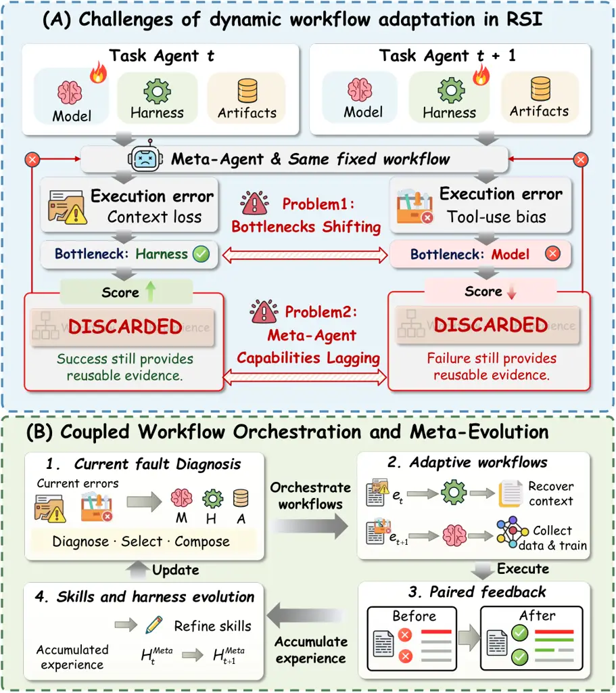
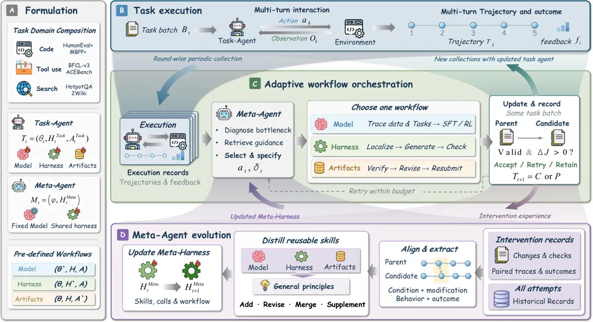

# RSIFlow: Adaptive Self-Improvement Workflows with an Evolving Meta-Agent

Huan Zhang Affiliation: Beijing Advanced Innovation Center for Future
Blockchain and Privacy Computing, School of Artificial Intelligence,
Affiliation: Equal contribution.  Corresponding to: Shiji Zhou
\<zhoushiji25@buaa.edu.cn\>    Mingju Chen Affiliation: Beijing Advanced
Innovation Center for Future Blockchain and Privacy Computing, School of
Artificial Intelligence, Affiliation: Equal contribution.  Corresponding
to: Shiji Zhou \<zhoushiji25@buaa.edu.cn\>    Can Lv
Affiliation: Beijing Advanced Innovation Center for Future Blockchain
and Privacy Computing, School of Artificial Intelligence,    Dongxu Zhou
Affiliation: Beijing Advanced Innovation Center for Future Blockchain
and Privacy Computing, School of Artificial Intelligence,    Sen Cui   
Faguo Wu Affiliation: Beijing Advanced Innovation Center for Future
Blockchain and Privacy Computing, School of Artificial Intelligence,   
Shiji Zhou Affiliation: Beijing Advanced Innovation Center for Future
Blockchain and Privacy Computing, School of Artificial Intelligence,   
Beihang University, Beijing Academy of Artificial Intelligence (BAAI),
Tsinghua University

###### Abstract

Large language model (LLM) agents have demonstrated strong capabilities
in complex tasks, including code generation, tool use, and multi-hop
question answering. Existing self-improvement methods enhance agent
performance through model optimization, harness evolution, and
executable artifact refinement, while recursive self-improvement (RSI)
further extends optimization to the improvement mechanisms themselves.
However, adapting self-improvement workflows to evolving performance
bottlenecks while improving workflow orchestration through execution
feedback remains a key challenge. We propose RSIFlow, a Recursive
Self-Improvement framework that integrates adaptive workflow
orchestration with meta-agent capability evolution. RSIFlow diagnoses
performance bottlenecks from task-agent trajectories and environmental
feedback to dynamically select component-specific improvement workflows.
The meta-agent then distills workflow outcomes into component-specific
skills and cross-component principles, evolving its own harness to
improve subsequent workflow orchestration. Experiments across six
benchmarks and two backbone models show that RSIFlow achieves the SOTA
average performance on all benchmarks. Ablation studies further
demonstrate the contributions of adaptive workflow orchestration and
meta-harness evolution. Code is available at
https://github.com/1HUAN1/RSI-Flow.



Figure 1: Motivation of RSIFlow. (A) Two coupled challenges in RSI. (B)
The execution loop of RSIFlow.

## 1 Introduction

Recent advances in large language models (LLMs) have enabled agents to
tackle complex tasks in coding, tool use, and multi-hop question
answering (Yang et al., 2024; Schick et al., 2023; Yao et al., 2023). To
continuously enhance the development of agents’ capabilities in task
domains, existing methods have adopted complementary approaches,
including evolving execution harnesses (Zhang et al., 2025), optimizing
model parameters (Luo et al., 2025), and refining executable artifacts
(Novikov et al., 2025). These routes can be organized into
self-improvement workflows that propose and evaluate changes using task
feedback. Beyond executing such workflows, recursive self-improvement
(RSI) seeks to strengthen not only task-solving capabilities but also
the mechanisms that generate subsequent improvements (Zhang et al.,
2026c; Duan et al., 2026).

Research on agent self-improvement spans three increasingly broad scopes
of optimization. Component-level approaches optimize a predefined part
of the system, such as the model or the harness (execution workflows)
(Luo et al., 2025; Zhang et al., 2026b). System-level approaches
coordinate updates across components, including joint model–harness
optimization and feedback-driven selection of update targets (Chen et
al., 2026d; Chen et al., 2026b; Hebbar et al., 2026). Meta-level
approaches make improvement procedures editable through operator
scheduling, program modification, and recursive skill evolution (Tan et
al., 2026; Zhang et al., 2026c; Wang et al., 2026). These developments
expand both what can be modified and how modifications are organized.
However, broader editability alone does not establish how effectively a
workflow addresses the agent’s current bottlenecks, or whether the
ability to organize that workflow improves with experience. This
motivates a central question: how can RSI systems adapt self-improvement
workflows to evolving bottlenecks while learning to organize these
workflows more effectively?

We formulate this challenge as dynamic workflow adaptation in RSI, where
adapting bottlenecks and evolving workflow orchestration must be
considered together. As illustrated in Fig. 1, self-improvement
workflows must adapt to bottlenecks that vary with task requirements and
the agent’s capability state. Even within a fixed domain, successful
updates can reshape these bottlenecks and alter the effectiveness of
subsequent workflow orchestration. Meanwhile, workflow orchestration is
itself a capability that can improve through experience. Feedback from
workflow execution supports the accumulation and refinement of reusable
knowledge for diagnosis, workflow selection, and execution. These
processes form a feedback loop: task-level updates reshape improvement
requirements, while workflow experience refines the orchestration
capability that guides subsequent updates.

To address this challenge, we propose RSIFlow, a framework that couples
adaptive workflow orchestration with meta-agent capability evolution. We
instantiate three self-improvement workflows targeting the Harness,
Model, and Artifacts. A meta-agent uses execution trajectories and
environmental feedback to diagnose the task agent’s bottlenecks, select
a workflow, and orchestrate candidate generation and validation. It then
distills orchestration outcomes into component-specific skills and
cross-component principles to revise its own harness, including
execution procedures and skill invocation. This experience-driven
self-revision closes a recursive feedback loop in which workflow
orchestration outcomes refine the orchestration mechanism that guides
subsequent improvements.

Our main contributions are:

- •
  We formulate dynamic workflow adaptation as a key challenge in RSI,
  highlighting the coupling between evolving performance bottlenecks and
  continual refinement of workflow orchestration.
- •
  We propose RSIFlow, which adaptively organizes self-improvement
  workflows and uses their observed outcomes to evolve the meta-agent’s
  own harness, including its execution procedures and reusable skills.
- •
  We evaluate RSIFlow across six benchmarks and two backbones,
  outperforming the strongest evaluated baseline in 11 of the 12
  benchmark–backbone settings. Ablations support the benefits of both
  adaptive workflow orchestration and meta-harness evolution.

## 2 Related Work

#### Component-Specific Self-Improvement.

Many approaches to agent self-improvement optimize a single predefined
component. STaR (Zelikman et al., 2022) improves model parameters by
repeatedly fine-tuning on self-generated rationales that yield correct
answers. AFlow (Zhang et al., 2025) searches code-represented workflows,
while Recursive Harness Self-Improvement (Lee et al., 2026) refines
prompt-level harness specifications using pairwise feedback over
revision histories. Related approaches include DSPy (Khattab et al., 2024) for language-model pipeline optimization, GEPA (Agrawal et al., 2026) for reflective prompt evolution, and ADAS (Hu et al., 2025) for
meta-agent-guided search over agent programs. In contrast,
AlphaEvolve (Novikov et al., 2025) evolves candidate programs through
execution-based evaluation, targeting task artifacts rather than the
agent’s improvement procedure. Self-Refine (Madaan et al., 2023)
iteratively revises outputs using self-feedback, while Reflexion (Shinn
et al., 2023) retains verbal reflections to guide subsequent attempts
and Voyager (Wang et al., 2024) accumulates reusable executable skills.
Co-Harness (Chen et al., 2026d) and HarnessForge (Chen et al., 2026b)
connect external structure and internal capability by alternating
harness refinement with model optimization. Their coupled updates
address model–harness compatibility, but the prescribed update order
leaves open how to adapt workflow orchestration targets to evolving
bottlenecks.



Figure 2: Overview of RSIFlow. (A) Definition of task domains and agent
workflows. (B) The Task-Agent executes tasks to collect trajectories and
feedback. (C) The Meta-Agent retrieves skills to adaptively orchestrate
workflows. (D) Workflow results are distilled into skills, principles
and Meta-Harness. The updated Meta-Harness guides subsequent
orchestration, closing the recursive self-improvement loop.

#### Adaptive and Recursive Self-Improvement.

Beyond prescribed alternation, SIA (Hebbar et al., 2026) uses trajectory
and performance feedback to choose between harness and weight updates,
while its selection policy relies on a frozen language-model prior.
HASE (Luo et al., 2026) integrates task solving and harness editing into
one action space and trains the policy with GRPO. A complementary
direction makes the improver itself editable: Hyperagents (Zhang et al.,
2026c) co-evolves task-agent and meta-agent programs and demonstrates
transferable improvement strategies, whereas MetaSkill-Evolve (Wang et
al., 2026) recursively updates task skills and their improvement
procedures on different timescales. Building on these complementary
directions, RSIFlow couples bottleneck-aware workflow orchestration with
feedback-driven Meta-Harness evolution.

## 3 Methodology

Fig. 2 provides an overview of RSIFlow. Sec. 3.1 formalizes the
Task-Agent and Meta-Agent system and the recursive self-improvement
process. Sec. 3.2 describes how the Meta-Agent adaptively orchestrates
component-specific improvement workflows. Finally, Sec. 3.3 presents how
the Meta-Agent evolves through multi-level skill formation and
Meta-Harness refinement.

### 3.1 Preliminary

#### Agent Formulation.

At evolution round $`t`$, we formulate the recursive self-improvement
system as the joint state of a Task-Agent $`T_{t}`$ and a Meta-Agent
$`M_{t}`$. The Task-Agent executes tasks, while the Meta-Agent
coordinates updates to the Task-Agent’s components and refines itself
using feedback from updates. The system state is defined as

```math
\begin{gathered}X_{t}=(T_{t},M_{t}),\quad M_{t}=(\phi,H_{t}^{\mathrm{Meta}}),\\
T_{t}=(\theta_{t},H_{t}^{\mathrm{Task}},A_{t}^{\mathrm{Task}}).\end{gathered} \tag{1}
```

Here, $`\theta_{t}`$ denotes the Task-Agent’s model parameters,
$`H_{t}^{\mathrm{Task}}`$ denotes the external harness, and
$`A_{t}^{\mathrm{Task}}`$ denotes task-level deliverables, such as
executable code and solutions, that can be refined through environmental
feedback. The Meta-Agent’s base model parameters $`\phi`$ remain fixed
throughout the process, and its evolution occurs entirely through
modifications to its harness $`H_{t}^{\mathrm{Meta}}`$.

We define a harness as the execution interface external to the model and
adopt the same three-component abstraction for both agents:

```math
\begin{gathered}H_{t}^{r}=\left(\mathrm{Action}_{t}^{r},\mathrm{Skill}_{t}^{r},\mathrm{Planning}_{t}^{r}\right),\\
r\in\{\mathrm{Task},\mathrm{Meta}\}.\end{gathered} \tag{2}
```

Action organizes execution and information actions. Skill provides
reusable experience and principles, while Planning decomposes objectives
into steps. The Task-Agent harness supports task execution, whereas the
Meta-Agent harness guides diagnosis, component selection and
improvement.

### 3.2 Adaptive workflow orchestration

#### Workflow selection and instantiation.

The Meta-Agent adaptively orchestrates three component-specific
improvement workflows:

```math
a_{t}\in\{\mathrm{Model},\mathrm{Harness},\mathrm{Artifacts}\}. \tag{3}
```

Using execution trajectories, environmental feedback, and accumulated
meta-skills, the Meta-Agent selects a component to modify while
preserving the other two. All candidates share the same parent $`T_{t}`$
and evaluation batch. The first valid candidate with a positive gain is
accepted as $`T_{t+1}`$; otherwise, $`T_{t+1}=T_{t}`$. Feedback from all
update attempts informs subsequent Meta-Agent evolution.

#### Model update.

The Meta-Agent converts task experience into parameter updates. It
constructs training data $`\mathcal{D}_{t}`$ from execution trajectories
and environmental feedback, then optimizes the following objective
starting from $`\theta_{t}`$:

```math
\min_{\theta}\;\mathcal{L}(\theta;\mathcal{D}_{t})=\mathbb{E}_{z\sim\mathcal{D}_{t}}\bigl[\ell(\theta;z)\bigr]. \tag{4}
```

Here, $`z`$ is a training sample or sample group, and $`\ell`$ is the
method-specific loss. Our default update uses SFT to learn from
successful trajectories collected during task execution. Reusing these
trajectories reduces the exploration cost of acquiring training data.
The candidate inherits the updated parameters $`\theta^{\prime}`$
alongside the parent’s Harness and Artifacts. We also evaluate an
RL-based model-update variant, with details provided in App.  B.3.

#### Harness update.

The Meta-Agent uses execution feedback to select a component set
$`\mathcal{I}_{t}\subseteq\mathcal{C}`$, where
$`\mathcal{C}=\{\mathrm{Action},\mathrm{Skill},\mathrm{Planning}\}`$. It
follows a localize–refine–generate–validate procedure to produce new
implementations $`\widehat{H}_{t}^{\mathcal{I}_{t}}`$. The candidate
Harness replaces the selected components while preserving the others:

```math
H^{\prime}=H_{t}^{\mathrm{Task}}\left[\mathcal{I}_{t}\leftarrow\widehat{H}_{t}^{\mathcal{I}_{t}}\right]. \tag{5}
```

The replacement operator rewrites the selected components and preserves
the rest. Revisions may change prompts, context organization, memory
retrieval, planning and reasoning rules, tool orchestration, or internal
verification, subject to the corresponding interface and permission
constraints. For example, jointly revising memory retrieval conditions
and planning rules constitutes a single Harness update. Model parameters
remain fixed.

#### Artifacts refinement.

For each task $`x\in B_{t}`$, let $`A_{t,x}`$ denote its current output.
The Meta-Agent derives diagnostic guidance $`\delta_{t,x}`$ from
execution trajectories $`\tau_{t,x}`$ and feedback $`f_{t,x}`$. Keeping
the Task-Agent’s model and harness fixed, candidate revisions are
generated as

```math
\hat{A}_{t,x}^{(j)}\sim p_{\theta_{t},H_{t}^{\mathrm{Task}}}\left(\cdot\mid x,A_{t,x},\tau_{t,x},f_{t,x},\delta_{t,x}\right), \tag{6}
```

where $`j\leq L`$ indexes bounded revision attempts. Let
$`\hat{A}_{t}^{(j)}`$ collect the revised outputs and
$`\hat{T}_{t}^{(j)}=(\theta_{t},H_{t}^{\mathrm{Task}},\hat{A}_{t}^{(j)})`$.
Each candidate is evaluated against the same task batch:

```math
\Delta J_{t}^{(j)}=J(\hat{T}_{t}^{(j)};B_{t})-J(T_{t};B_{t}). \tag{7}
```

Here, $`B_{t}`$ denotes a training batch. The gain-based acceptance rule
is not applied to evaluation set. The first valid candidate yielding a
positive performance gain is selected:

```math
j^{*}=\min\left\{j\leq L\;\middle|\;\mathcal{V}(\hat{A}_{t}^{(j)})=1,\;\Delta J_{t}^{(j)}>0\right\}, \tag{8}
```

where $`\mathcal{V}`$ enforces output validity and execution
constraints. The Meta-Agent provides diagnostic guidance without
directly modifying task artifacts, while $`\theta_{t}`$ and
$`H_{t}^{\mathrm{Task}}`$ remain unchanged.

#### Recursive self-improvement workflow.

At evolution round $`t`$, the Meta-Agent $`M_{t}`$ orchestrates and
evaluates candidate updates to the Task-Agent $`T_{t}`$, yielding the
next-round Task-Agent $`T_{t+1}`$ and workflow experience $`e_{t}`$. It
distills component-specific skills and general principles from this
experience, integrating them into its Meta-Harness to form $`M_{t+1}`$.
The updated knowledge guides diagnosis, workflow selection, and
candidate generation in subsequent rounds as the Task-Agent’s
bottlenecks evolve. Together, $`(T_{t+1},M_{t+1})`$ enter the next
evolution round, allowing accumulated workflow experience to
continuously refine the orchestration mechanism. Details are provided in
App. B.1.

### 3.3 Meta-agent Capability Evolution

#### Difference extraction and skill formation.

The Meta-Agent aligns parent and candidate trajectories for the same
task through shared subgoals, tool events, or error feedback. These
paired comparisons connect candidate modifications to local behavioral
changes and task-level outcomes. From these comparisons and workflow
experience $`e_{t}`$, the Meta-Agent distills two complementary forms of
reusable knowledge: component-specific skills $`\mathcal{S}_{t}`$ for
Model, Harness, and Artifacts updates, and general principles
$`\mathcal{P}_{t}`$ for cross-component diagnosis and workflow
selection. Each skill or principle is represented as

```math
k=(\Omega_{k},a_{k},\rho_{k},\Gamma_{k},\hat{r}_{k},E_{k}), \tag{9}
```

where $`\Omega_{k}`$ specifies applicability conditions, $`a_{k}`$
update scope, $`\rho_{k}`$ conditional guidance, $`\Gamma_{k}`$
preservation requirements, $`\hat{r}_{k}`$ expected behavioral response,
and $`E_{k}`$ supporting and contradicting evidence.

#### Evidence-driven skill maintenance.

The Meta-Agent integrates newly distilled skills $`\mathcal{S}_{t}`$ and
general principles $`\mathcal{P}_{t}`$ into the existing library
$`\mathcal{K}_{t}`$ through four evidence-driven operations. Add
introduces previously uncovered strategies with their applicability and
source evidence. Supplement enriches existing entries with new outcome
evidence while preserving their guidance. Revise refines applicability
conditions, guidance, or preservation requirements through linked
successor versions. Merge consolidates overlapping or superseded entries
while preserving accumulated evidence and provenance. These operations
update the library as

```math
\displaystyle\mathcal{C}_{t} \displaystyle=\mathcal{S}_{t}\cup\mathcal{P}_{t}, \tag{10}
```

```math
\displaystyle\mathcal{K}_{t+1} \displaystyle=(\mathcal{K}_{t}\setminus\mathcal{R}_{t})\cup\mathcal{C}_{t}^{+}.
```

Here, $`\mathcal{C}_{t}^{+}`$ contains records introduced or updated
through the four operations, while
$`\mathcal{R}_{t}\subseteq\mathcal{K}_{t}`$ denotes entries replaced or
consolidated in the active library. The resulting library combines
component-specific skills and cross-component principles while retaining
traceable evidence and revision histories across rounds. Further details
are provided in App.  D.2.

#### Integration into the Meta-Harness.

The Meta-Agent operationalizes $`\mathcal{K}_{t+1}`$ by updating the
Action interfaces, retrieval calls, execution instructions, and
supplementary prompts that invoke this knowledge to guide subsequent
improvement decisions:

```math
\begin{gathered}H_{t+1}^{\mathrm{Meta}}=(\mathrm{Action}_{t+1}^{\mathrm{Meta}},\mathcal{K}_{t+1},\mathrm{Planning}_{t}^{\mathrm{Meta}}),\\
M_{t+1}=(\phi,H_{t+1}^{\mathrm{Meta}}).\end{gathered} \tag{11}
```

The evolved Meta-Harness guides subsequent bottleneck diagnosis,
workflow selection, and candidate generation. Thus, experience
accumulated from Task-Agent updates recursively improves workflow
orchestration, while the Meta-Agent’s model parameters $`\phi`$ remain
fixed.

|              |            |       |          |          |          |       |         |
| ------------ | ---------- | ----- | -------- | -------- | -------- | ----- | ------- |
| Method       | Code       |       | Tool Use |          | SearchQA |       | Overall |
|              | HumanEval+ | MBPP+ | BFCL-v3  | ACEBench | HotpotQA | 2Wiki |         |
| Qwen3-4B     |            |       |          |          |          |       |         |
| AFlow        | 39.63      | 53.37 | 26.31    | 29.82    | 52.59    | 38.45 | 40.03   |
| MermaidFlow  | 48.78      | 57.87 | 28.19    | 31.58    | 56.32    | 38.79 | 43.59   |
| SFT          | 39.63      | 55.62 | 26.88    | 29.82    | 53.52    | 41.24 | 41.12   |
| GRPO         | 43.90      | 55.06 | 22.30    | 33.33    | 54.39    | 39.32 | 41.38   |
| HarnessForge | 54.27      | 62.36 | 22.39    | 25.12    | 52.38    | 30.91 | 41.24   |
| SIA          | 53.66      | 60.11 | 29.00    | 33.91    | 52.51    | 41.68 | 45.15   |
| Hyperagent   | 43.90      | 52.81 | 26.88    | 31.57    | 51.82    | 40.59 | 41.26   |
| RSIFLow      | 68.29      | 66.29 | 29.25    | 38.00    | 56.72    | 48.72 | 51.21   |
| Qwen3-8B     |            |       |          |          |          |       |         |
| AFlow        | 68.29      | 69.10 | 34.89    | 51.46    | 53.55    | 48.32 | 54.27   |
| MermaidFlow  | 69.51      | 68.54 | 30.96    | 46.20    | 56.29    | 42.70 | 52.37   |
| SFT          | 68.29      | 69.10 | 37.01    | 40.35    | 51.57    | 44.49 | 51.80   |
| GRPO         | 70.12      | 69.66 | 34.31    | 38.59    | 49.81    | 46.33 | 51.47   |
| HarnessForge | 70.12      | 67.42 | 38.15    | 59.07    | 45.83    | 37.12 | 52.95   |
| SIA          | 73.78      | 70.22 | 40.36    | 51.46    | 53.96    | 46.43 | 56.04   |
| Hyperagent   | 71.34      | 69.10 | 34.31    | 44.44    | 53.47    | 48.73 | 53.57   |
| RSIFLow      | 76.83      | 74.16 | 41.34    | 52.62    | 62.67    | 52.08 | 59.95   |

Table 1: Main results across six benchmarks with Qwen3-4B and Qwen3-8B
backbones. Best results are highlighted in bold.

## 4 Experiments

### 4.1 Experimental Setup

#### Benchmarks.

We train RSIFlow on training data from three task domains and evaluate
it on six public benchmarks spanning the same domains: (1) code
generation, HumanEval+ and MBPP+ (Liu et al., 2023). (2) tool use,
BFCL-v3 (Patil et al., 2025) and ACEBench (Chen et al., 2025). (3)
search-QA, HotpotQA (Yang et al., 2018) and 2Wiki (Ho et al., 2020).
Detailed descriptions and evaluation metrics are in App.  A.2

#### Baselines.

We compare RSIFlow with three series of baselines: (1) model-only
evolution, including SFT (Ouyang et al., 2022) and GRPO (Shao et al.,
2024); (2) harness-only evolution, including AFlow (Zhang et al., 2025)
and MermaidFlow (Zheng et al., 2025); (3) model-harness both evolution,
including HarnessForge (Chen et al., 2026b) and SIA (Hebbar et al.,
2026), Hyperagent (Zhang et al., 2026c) further evolves the harness of
the meta agent, incorporating the evolution of the meta into the cycle.
Detailed configurations of baselines are provided in App.  A.4

#### Implementation Details.

We initialize the Task-Agent of RSIFlow with Qwen3-4B and Qwen3-8B (Yang
et al., 2025) as the backbone, respectively. The Meta-Agent uses GPT-5.6
Sol as its base model. We run $`R=5`$ evolution rounds and report the
main results with a maximum of two attempts per evolution round.
Additional implementation details are provided in App.  B

### 4.2 Main Results

Tab. 1 compares RSIFlow against model-only, harness-only, and joint
model–harness baselines on six agentic benchmarks and two backbone
sizes, averaging +3.42% over the strongest per-metric baselines. RSIFlow
leads in 11 of 12 benchmark–backbone settings across code generation,
tool use, and search-QA. Its overall scores reach 51.21% with Qwen3-4B
and 59.95% with Qwen3-8B, surpassing the strongest baseline by 6.06% and
3.91%, respectively. The largest gain occurs on HumanEval+, where
RSIFlow improves pass@1 by 14.02% with Qwen3-4B. On MBPP+, pass@1
improves by an average of 3.94% across backbones. For tool use, RSIFlow
achieves the highest BFCL-v3 scores with both backbones and the best
ACEBench result with Qwen3-4B. On retrieval-intensive tasks, it improves
F1 by an average of 5.20% on 2Wiki across backbones and by 6.38% on
HotpotQA with Qwen3-8B.

Figure 3: Budget–performance Pareto analysis across all six benchmarks
with Qwen3-4B backbone.

### 4.3 Ablation Study

Table 2 evaluates adaptive workflow orchestration and Meta-Agent
evolution over five rounds. Compared with Vanilla, RSIFlow improves
Code, Tool Use, and SearchQA by 19.04%, 3.93%, and 18.20% ,
respectively, increasing the three-domain average by 13.72 %. While
fixed-component workflows exhibit domain-specific strengths, adaptive
orchestration achieves the highest scores across all three domains,
outperforming the fixed workflow by 4.13% - 8.82% on average. Overall,
RSIFlow exceeds the average of all four ablated variants by 6.18 %.
Disabling Meta-Agent evolution reduces average performance by 5.74 % ,
highlighting the importance of distilling historical feedback into
reusable skills and principles. These results demonstrate that adaptive
component orchestration enables balanced cross-domain improvements,
while experience-driven Meta-Harness evolution further strengthens
workflow effectiveness.

### 4.4 Framework Analysis

| Meta           | Task           | Code                      | Tool use                    | SearchQA                  |
| -------------- | -------------- | ------------------------- | --------------------------- | ------------------------- |
| Evo.           | Rou.           |                           |                             |                           |
| Vanilla        |                | 48.25                     | 29.70                       | 34.52                     |
| $`\times`$     | $`\checkmark`$ | 56.73 ($`\uparrow`$8.48)  | 29.70 ($`\rightarrow`$0.00) | 49.98 ($`\uparrow`$15.46) |
| $`\checkmark`$ | $`\times(H)`$  | 63.42 ($`\uparrow`$15.17) | 32.93 ($`\uparrow`$3.23)    | 44.89 ($`\uparrow`$10.37) |
| $`\checkmark`$ | $`\times(M)`$  | 50.31 ($`\uparrow`$2.06)  | 32.15 ($`\uparrow`$2.45)    | 44.73 ($`\uparrow`$10.21) |
| $`\checkmark`$ | $`\times(A)`$  | 52.34 ($`\uparrow`$4.09)  | 30.69 ($`\uparrow`$0.99)    | 52.57 ($`\uparrow`$18.05) |
| $`\checkmark`$ | $`\checkmark`$ | 67.29 ($`\uparrow`$19.04) | 33.63 ($`\uparrow`$3.93)    | 52.72 ($`\uparrow`$18.20) |

Table 2: Module ablation of RSIFlow using Qwen3- 4B under $`R=5`$
evolution rounds. With meta evolution enabled, we compare fixed
task-evolution routines targeting the harness (H), model (M), or
artifacts (A).

#### Rollout-budget and performance efficiency.

Fig. 3 compares performance under varying rollout budgets on all six
benchmarks. RSIFlow generally lies on or near the empirical Pareto
frontier and achieves the highest observed score on each benchmark. This
advantage is consistent with its adaptive component selection and
Task–Meta co-evolution: RSIFlow reuses rollout evidence to guide
targeted updates to the Task-Agent’s Model, Harness, or Artifacts,
rather than relying solely on additional exploration under a fixed
harness. The co-evolving Meta-Agent further distills workflow outcomes
into reusable skills and refines its improvement procedure, allowing
accumulated experience to guide subsequent updates. Together, these
mechanisms help concentrate the rollout budget on informed workflow
orchestration. Overall, RSIFlow offers a stronger performance–budget
trade-off than the evaluated baselines.

#### Meta-agent backbone sensitivity.

We evaluate RSIFlow with three Meta-Agent backbones over five evolution
rounds on HumanEval+. As shown in Fig. 4, all three models achieve
overall performance improvements, with gains of 11.59%, 4.88%, and
24.39% for Claude-Sonnet-5, DeepSeek-V4.1-Flash, and GPT-5.6-Sol,
respectively. GPT-5.6-Sol achieves the highest final performance of
68.29%, albeit with greater API token consumption. From Round 3 to Round
5, it improves by 12.80%, compared with 6.10% and 4.27% for the other
two backbones, suggesting that stronger Meta-Agents may better leverage
accumulated intervention feedback. These results demonstrate that
RSIFlow supports different Meta-Agent backbones, while the Meta-Agent’s
underlying capabilities influence the cumulative effectiveness of
recursive self-improvement.

#### Meta-evolution necessity analysis.

Table 3 compares different Meta versions improving the same initial
Task-Agent, with scores averaged over two benchmarks per domain. Meta0
improves SearchQA by 10.10%, reaching 44.62% through harness updates.
Although Meta4 also selects the harness, it further outperforms Meta0 by
20.56% and 9.51% on Code and SearchQA, respectively. Meta3 achieves the
highest Tool Use score of 31.83% through artifact updates. These results
indicate that the evolution of meta-agent capabilities not only enables
better adaptive workflow orchestration but also enhances the performance
of workflow orchestration across different task domains. Further
analysis is provided in App. C.4.

Figure 4: Sensitivity of RSIFlow to different Meta-Agent backbones on
HumanEval+.

| Meta    | Component | Code  | Tool Use | SearchQA |
| ------- | --------- | ----- | -------- | -------- |
| Vanilla |           | 48.25 | 29.70    | 34.52    |
| Meta0   | HARNESS   | 48.30 | 30.40    | 44.62    |
| Meta1   | HARNESS   | 46.32 | 31.16    | 45.04    |
| Meta2   | MODEL     | 67.90 | 31.51    | 43.99    |
| Meta3   | ARTIFACTS | 67.08 | 31.83    | 50.58    |
| Meta4   | HARNESS   | 68.86 | 30.84    | 54.13    |

Table 3: Domain-level performance of selected Meta candidates. Scores
are macro-averages (%) across two benchmarks per domain. Component
refers to the workflow selected for orchestration by meta agent.

Figure 5: Case study of five rounds of recursive self-improvement in
RSIFlow.

### 4.5 Case Study

Fig. 5 illustrates five rounds (R1–R5) of RSIFlow evolution, following a
Harness–Harness–Model–Model–Artifacts sequence. In R1, the Meta-Agent
addresses output-format violations with an output-contract check (H1),
reaching 32.23%. R2 builds on H1 to introduce receipt-grounded
verification (H2) for unsupported completions, raising the score to
38.04%. To address persistent semantic errors, R3 shifts to Model
optimization with 3,798 replay calls for LoRA fine-tuning, reaching
45.46% and distilling the model-specific skill M1. R4 reuses and
supplements M1 with new evidence, expanding training to 5,397 calls and
improving the score to 47.11%. In R5, execution feedback and accumulated
repair guidance support code revision and resubmission within budget,
reaching 51.21% while preserving the Model and Harness. Across these
rounds, skills and general principles progressively refine the
Meta-Agent’s bottleneck diagnosis and subsequent workflow orchestration.
This lineage demonstrates how adaptive workflow orchestration and
Meta-Harness evolution reinforce each other, yielding an overall
improvement of 18.98%.

## 5 Conclusion

We presented RSIFlow, a recursive self-improvement framework coupling
adaptive workflow orchestration with Meta-Agent evolution. Using
accumulated execution feedback, the Meta-Agent identifies Task-Agent
bottlenecks and selects Model, Harness, or Artifacts workflows. It
distills successful and unsuccessful outcomes into reusable skills and
principles to evolve its Meta-Harness. Across six benchmarks and two
backbones, RSIFlow outperforms the strongest evaluated baseline in 11 of
12 settings. Ablations validate both mechanisms, while budget analyses
show a favorable performance–budget trade-off. These results demonstrate
that continual Meta-Agent evolution enhances system effectiveness
alongside adaptive workflow orchestration.

## Limitations

RSIFlow is primarily evaluated using Qwen3-4B and Qwen3-8B as Task-Agent
backbones. This setting is particularly relevant to resource-constrained
agent deployments, where adaptive workflow orchestration enables
targeted modifications to identified bottleneck components, while
Meta-Agent evolution further improves bottleneck diagnosis and
orchestration capabilities. However, whether these benefits remain
significant with larger backbone models and at cluster scale remains
unexplored. Future work will extend the evaluation to larger-scale
settings to assess the scalability of RSIFlow.

RSIFlow couples the Task-Agent and Meta-Agent, evolving the Meta-Harness
through reusable skills and general principles to improve workflow
orchestration without updating the Meta-Agent’s model parameters.
However, this process introduces additional computational overhead,
while adopting a lower-cost Meta-Agent may compromise evolution gains.
Moreover, the stability of experience-driven Meta-Harness updates
remains to be fully investigated. Future work will explore
counterfactual analysis to identify Meta-Agent deficiencies, apply
targeted local modifications, and investigate Meta-Agent parameter
optimization to improve evolution efficiency and stability.

## References

- Agrawal et al. (2026) L. A. Agrawal, S. Tan, D. Soylu, N. Ziems, R.
  Khare, K. Opsahl-Ong, A. Singhvi, H. Shandilya, M. J. Ryan, M.
  Jiang, C. Potts, K. Sen, A. Dimakis, I. Stoica, D. Klein, M. Zaharia,
  and O. Khattab GEPA: reflective prompt evolution can outperform
  reinforcement learning. In International Conference on Learning
  Representations, C. Vondrick, B. Hariharan, C. Raffel, L. Pinto, D.
  Yang, and A. Faust (Eds.), Vol. 2026, pp. 8479–8565. External Links:
  [Link](https://proceedings.iclr.cc/paper_files/paper/2026/file/0e9e708b6f48e14fd0ac29e167413f76-Paper-Conference.pdf)
  Cited by: §2.
- Chen et al. (2025) C. Chen, X. Hao, W. Liu, X. Huang, X. Zeng, S.
  Yu, D. Li, Y. Huang, X. Liu, W. Xinzhi, and W. Liu ACEBench: a
  comprehensive evaluation of LLM tool usage. In Findings of the
  Association for Computational Linguistics: EMNLP 2025, C.
  Christodoulopoulos, T. Chakraborty, C. Rose, and V. Peng (Eds.),
  Suzhou, China, pp. 12970–12998. External Links:
  [Link](https://aclanthology.org/2025.findings-emnlp.697/),
  [Document](https://dx.doi.org/10.18653/v1/2025.findings-emnlp.697),
  ISBN 979-8-89176-335-7 Cited by: §A.2, §4.1.
- Chen et al. (2026a) M. Chen, C. Lv, J. Liu, H. Zhang, H. Chang, and S.
  Zhou Beyond timestamps: decision-aligned on-policy distillation for
  long-horizon agents. External Links: 2609.33391,
  [Link](https://arxiv.org/abs/2609.33391) Cited by: Appendix E.
- Chen et al. (2026b) M. Chen, C. Lv, G. Zhang, H. Chang, and S. Zhou
  HarnessForge: joint harness and policy evolution for adaptive agent
  systems. External Links: 2606.01779,
  [Link](https://arxiv.org/abs/2606.01779) Cited by: §A.4, Appendix E,
  §1, §2, §4.1.
- Chen et al. (2026c) M. Chen, G. Zhang, H. Chang, Y. Guo, and S. Zhou
  A-mapreduce: executing wide search via agentic mapreduce. External
  Links: 2602.01331, [Link](https://arxiv.org/abs/2602.01331) Cited by:
  Appendix E.
- Chen et al. (2026d) Z. Chen, T. Xiao, H. Zhu, Y. Yuan, L. Zhang,
  and J. Wang Co-harness: co-evolving harnesses and model weights for
  llm agents. External Links: 2607.22688,
  [Link](https://arxiv.org/abs/2607.22688) Cited by: §1, §2.
- Duan et al. (2026) Y. Duan, Y. Liu, Z. Tang, H. Chen, J. Zhou, Y.
  Liu, B. Xu, Y. Wu, S. Chen, Y. Zhou, H. Wang, X. Yu, S. Han, X.
  Zhu, L. Zhou, B. Lu, W. Zhou, J. Liu, N. Fang, J. Tian, R. Chen, Y.
  Li, K. Zuo, K. Zhang, Q. Yang, Z. Wang, J. Qiu, C. He, G. Li, B.
  Zhou, Z. Liu, Z. Wen, J. Kang, X. Zhou, and F. Wu The last ai built by
  humans: toward genuine recursive self-improvement. External Links:
  2609.11873, [Link](https://arxiv.org/abs/2609.11873) Cited by: §1.
- Hebbar et al. (2026) P. Hebbar, Y. Manawat, S. Verboomen, A.
  Ivanova, S. Palanimalai, K. Bhatia, and V. Baskaran SIA: self
  improving ai with harness & weight updates. arXiv preprint
  arXiv:2605.27276. External Links:
  [Link](https://arxiv.org/abs/2605.27276) Cited by: §A.4, §1, §2, §4.1.
- Ho et al. (2020) X. Ho, A. Duong Nguyen, S. Sugawara, and A. Aizawa
  Constructing a multi-hop QA dataset for comprehensive evaluation of
  reasoning steps. In Proceedings of the 28th International Conference
  on Computational Linguistics, D. Scott, N. Bel, and C. Zong (Eds.),
  Barcelona, Spain (Online), pp. 6609–6625. External Links:
  [Link](https://aclanthology.org/2020.coling-main.580/),
  [Document](https://dx.doi.org/10.18653/v1/2020.coling-main.580) Cited
  by: §A.1, §A.2, §4.1.
- Hu et al. (2025) S. Hu, C. Lu, and J. Clune Automated design of
  agentic systems. In International Conference on Learning
  Representations, Y. Yue, A. Garg, N. Peng, F. Sha, and R. Yu (Eds.),
  Vol. 2025, pp. 21344–21377. External Links:
  [Link](https://proceedings.iclr.cc/paper_files/paper/2025/file/36b7acf6f6010652b3f2a433774a66fe-Paper-Conference.pdf)
  Cited by: §2.
- Khattab et al. (2024) O. Khattab, A. Singhvi, P. Maheshwari, Z.
  Zhang, K. Santhanam, S. V. A, S. Haq, A. Sharma, T. Joshi, H.
  Moazam, H. Miller, M. Zaharia, and C. Potts DSPy: compiling
  declarative language model calls into state-of-the-art pipelines. In
  International Conference on Learning Representations, B. Kim, Y.
  Yue, S. Chaudhuri, K. Fragkiadaki, M. Khan, and Y. Sun (Eds.), Vol.
  2024, pp. 54928–54958. External Links:
  [Link](https://proceedings.iclr.cc/paper_files/paper/2024/file/f1cf02ce09757f57c3b93c0db83181e0-Paper-Conference.pdf)
  Cited by: §2.
- Lee et al. (2026) H. Lee, J. Xu, J. Seely, D. Lee, M. Zaharia, and Y.
  Tang Recursive harness self-improvement. External Links: 2607.15524,
  [Link](https://arxiv.org/abs/2607.15524) Cited by: §2.
- Li et al. (2023) R. Li, J. Fu, B. Zhang, T. Huang, Z. Sun, C. Lyu, G.
  Liu, Z. Jin, and G. Li TACO: topics in algorithmic code generation
  dataset. External Links: 2312.14852,
  [Link](https://arxiv.org/abs/2312.14852) Cited by: §A.1.
- Liu et al. (2023) J. Liu, C. S. Xia, Y. Wang, and L. ZHANG Is your
  code generated by chatgpt really correct? rigorous evaluation of large
  language models for code generation. In Advances in Neural Information
  Processing Systems, A. Oh, T. Naumann, A. Globerson, K. Saenko, M.
  Hardt, and S. Levine (Eds.), Vol. 36, pp. 21558–21572. External Links:
  [Document](https://dx.doi.org/10.52202/075280-0943),
  [Link](https://proceedings.neurips.cc/paper_files/paper/2023/file/43e9d647ccd3e4b7b5baab53f0368686-Paper-Conference.pdf)
  Cited by: §A.2, §4.1.
- Luo et al. (2026) H. Luo, Y. Huang, S. Luo, F. Liu, L. Li, Z. Hu, J.
  Feng, and Q. Liu Harness-aware self-evolving: co-evolving model
  weights, harness, and task solutions. External Links: 2607.03935,
  [Link](https://arxiv.org/abs/2607.03935) Cited by: §2.
- Luo et al. (2025) X. Luo, Y. Zhang, Z. He, Z. Wang, S. Zhao, D.
  Li, L. K. Qiu, and Y. Yang Agent lightning: train any ai agents with
  reinforcement learning. External Links: 2508.03680,
  [Link](https://arxiv.org/abs/2508.03680) Cited by: §1, §1.
- Lv et al. (2026a) C. Lv, H. Chang, S. Tao, M. Chen, Z. Fan, Z.
  Zhang, Y. Guo, and S. Zhou All-mem: agentic lifelong memory via
  dynamic topology evolution. External Links: 2603.19595,
  [Link](https://arxiv.org/abs/2603.19595) Cited by: Appendix E.
- Lv et al. (2026b) C. Lv, M. Chen, H. Chang, and S. Zhou Mitigating
  false credit propagation: probabilistic graphical reward aggregation
  for rubric-based reinforcement learning. External Links: 2606.03361,
  [Link](https://arxiv.org/abs/2606.03361) Cited by: Appendix E.
- Madaan et al. (2023) A. Madaan, N. Tandon, P. Gupta, S. Hallinan, L.
  Gao, S. Wiegreffe, U. Alon, N. Dziri, S. Prabhumoye, Y. Yang, S.
  Gupta, B. P. Majumder, K. Hermann, S. Welleck, A. Yazdanbakhsh, and P.
  Clark Self-refine: iterative refinement with self-feedback. In
  Advances in Neural Information Processing Systems, A. Oh, T.
  Naumann, A. Globerson, K. Saenko, M. Hardt, and S. Levine (Eds.), Vol.
  36, pp. 46534–46594. External Links:
  [Document](https://dx.doi.org/10.52202/075280-2019),
  [Link](https://proceedings.neurips.cc/paper_files/paper/2023/file/91edff07232fb1b55a505a9e9f6c0ff3-Paper-Conference.pdf)
  Cited by: §2.
- Novikov et al. (2025) A. Novikov, N. Vũ, M. Eisenberger, E. Dupont, P.
  Huang, A. Z. Wagner, S. Shirobokov, B. Kozlovskii, F. J. R. Ruiz, A.
  Mehrabian, M. P. Kumar, A. See, S. Chaudhuri, G. Holland, A.
  Davies, S. Nowozin, P. Kohli, and M. Balog AlphaEvolve: a coding agent
  for scientific and algorithmic discovery. External Links: 2506.13131,
  [Link](https://arxiv.org/abs/2506.13131) Cited by: §1, §2.
- Ouyang et al. (2022) L. Ouyang, J. Wu, X. Jiang, D. Almeida, C.
  Wainwright, P. Mishkin, C. Zhang, S. Agarwal, K. Slama, A. Ray, J.
  Schulman, J. Hilton, F. Kelton, L. Miller, M. Simens, A. Askell, P.
  Welinder, P. F. Christiano, J. Leike, and R. Lowe Training language
  models to follow instructions with human feedback. In Advances in
  Neural Information Processing Systems, S. Koyejo, S. Mohamed, A.
  Agarwal, D. Belgrave, K. Cho, and A. Oh (Eds.), Vol. 35,
  pp. 27730–27744. External Links:
  [Document](https://dx.doi.org/10.52202/068431-2011),
  [Link](https://proceedings.neurips.cc/paper_files/paper/2022/file/b1efde53be364a73914f58805a001731-Paper-Conference.pdf)
  Cited by: §4.1.
- Patil et al. (2025) S. G. Patil, H. Mao, F. Yan, C. C. Ji, V.
  Suresh, I. Stoica, and J. E. Gonzalez The berkeley function calling
  leaderboard (BFCL): from tool use to agentic evaluation of large
  language models. In Proceedings of the 42nd International Conference
  on Machine Learning, A. Singh, M. Fazel, D. Hsu, S. Lacoste-Julien, F.
  Berkenkamp, T. Maharaj, K. Wagstaff, and J. Zhu (Eds.), Proceedings of
  Machine Learning Research, Vol. 267, pp. 48371–48392. External Links:
  [Link](https://proceedings.mlr.press/v267/patil25a.html) Cited by:
  §A.2, §4.1.
- Schick et al. (2023) T. Schick, J. Dwivedi-Yu, R. Dessi, R.
  Raileanu, M. Lomeli, E. Hambro, L. Zettlemoyer, N. Cancedda, and T.
  Scialom Toolformer: language models can teach themselves to use tools.
  In Advances in Neural Information Processing Systems, A. Oh, T.
  Naumann, A. Globerson, K. Saenko, M. Hardt, and S. Levine (Eds.), Vol.
  36, pp. 68539–68551. External Links:
  [Document](https://dx.doi.org/10.52202/075280-2997),
  [Link](https://proceedings.neurips.cc/paper_files/paper/2023/file/d842425e4bf79ba039352da0f658a906-Paper-Conference.pdf)
  Cited by: §1.
- Shao et al. (2024) Z. Shao, P. Wang, Q. Zhu, R. Xu, J. Song, X. Bi, H.
  Zhang, M. Zhang, Y. K. Li, Y. Wu, and D. Guo DeepSeekMath: pushing the
  limits of mathematical reasoning in open language models. External
  Links: 2402.03300, [Link](https://arxiv.org/abs/2402.03300) Cited by:
  §A.4, §4.1.
- Shinn et al. (2023) N. Shinn, F. Cassano, A. Gopinath, K. Narasimhan,
  and S. Yao Reflexion: language agents with verbal reinforcement
  learning. In Advances in Neural Information Processing Systems, A.
  Oh, T. Naumann, A. Globerson, K. Saenko, M. Hardt, and S. Levine
  (Eds.), Vol. 36, pp. 8634–8652. External Links:
  [Document](https://dx.doi.org/10.52202/075280-0377),
  [Link](https://proceedings.neurips.cc/paper_files/paper/2023/file/1b44b878bb782e6954cd888628510e90-Paper-Conference.pdf)
  Cited by: §2.
- Song et al. (2026) X. Song, H. Chang, G. Dong, Y. Zhu, J. Wen, and Z.
  Dou EnvScaler: scaling tool-interactive environments for llm agent via
  programmatic synthesis. External Links: 2601.05808,
  [Link](https://arxiv.org/abs/2601.05808) Cited by: §A.1.
- Tan et al. (2026) Z. Tan, L. Sun, Z. Shi, Y. Liu, J. Wu, N. Brooks, J.
  Qian, X. Shang, S. Huang, Y. Ding, Y. Liao, M. Li, Q. Sun, S. Liu, X.
  Rong, X. Yu, Z. Chen, H. Geng, C. Li, A. Wang, Z. Tu, R. Tang, Y.
  Zhan, E. Jiang, Y. Wu, J. Zhang, X. Liang, F. Wu, H. Zhang, A. Marlow,
  and G. Wan MetaRSI / rsi2: a meta-recursive self-improving system for
  recursive self-improving systems themselves. External Links:
  2609.06396, [Link](https://arxiv.org/abs/2609.06396) Cited by: §1.
- Wang et al. (2024) G. Wang, Y. Xie, Y. Jiang, A. Mandlekar, C.
  Xiao, Y. Zhu, L. Fan, and A. Anandkumar Voyager: an open-ended
  embodied agent with large language models. Transactions on Machine
  Learning Research. Note: External Links: ISSN 2835-8856,
  [Link](https://openreview.net/forum?id=ehfRiF0R3a) Cited by: §2.
- Wang et al. (2026) Z. Wang, M. Yan, J. Bi, S. Yan, V. Tresp, and Y. Ma
  MetaSkill-evolve: recursive self-improvement of llm agents via
  two-timescale meta-skill evolution. External Links: 2607.05297,
  [Link](https://arxiv.org/abs/2607.05297) Cited by: §1, §2.
- Yang et al. (2025) A. Yang, A. Li, B. Yang, B. Zhang, B. Hui, B.
  Zheng, B. Yu, C. Gao, C. Huang, C. Lv, C. Zheng, D. Liu, F. Zhou, F.
  Huang, F. Hu, H. Ge, H. Wei, H. Lin, J. Tang, J. Yang, J. Tu, J.
  Zhang, J. Yang, J. Yang, J. Zhou, J. Zhou, J. Lin, K. Dang, K. Bao, K.
  Yang, L. Yu, L. Deng, M. Li, M. Xue, M. Li, P. Zhang, P. Wang, Q.
  Zhu, R. Men, R. Gao, S. Liu, S. Luo, T. Li, T. Tang, W. Yin, X.
  Ren, X. Wang, X. Zhang, X. Ren, Y. Fan, Y. Su, Y. Zhang, Y. Zhang, Y.
  Wan, Y. Liu, Z. Wang, Z. Cui, Z. Zhang, Z. Zhou, and Z. Qiu Qwen3
  technical report. External Links: 2505.09388,
  [Link](https://arxiv.org/abs/2505.09388) Cited by: §A.4, §4.1.
- Yang et al. (2024) J. Yang, C. Jimenez, A. Wettig, K. Lieret, S.
  Yao, K. Narasimhan, and O. Press SWE-agent: agent-computer interfaces
  enable automated software engineering. In Advances in Neural
  Information Processing Systems, A. Globerson, L. Mackey, D.
  Belgrave, A. Fan, U. Paquet, J. Tomczak, and C. Zhang (Eds.), Vol. 37,
  pp. 50528–50652. External Links:
  [Document](https://dx.doi.org/10.52202/079017-1601),
  [Link](https://proceedings.neurips.cc/paper_files/paper/2024/file/5a7c947568c1b1328ccc5230172e1e7c-Paper-Conference.pdf)
  Cited by: §1.
- Yang et al. (2018) Z. Yang, P. Qi, S. Zhang, Y. Bengio, W. Cohen, R.
  Salakhutdinov, and C. D. Manning HotpotQA: a dataset for diverse,
  explainable multi-hop question answering. In Proceedings of the 2018
  Conference on Empirical Methods in Natural Language Processing, E.
  Riloff, D. Chiang, J. Hockenmaier, and J. Tsujii (Eds.), Brussels,
  Belgium, pp. 2369–2380. External Links:
  [Link](https://aclanthology.org/D18-1259/),
  [Document](https://dx.doi.org/10.18653/v1/D18-1259) Cited by: §A.1,
  §A.2, §4.1.
- Yao et al. (2023) S. Yao, J. Zhao, D. Yu, N. Du, I. Shafran, K. R.
  Narasimhan, and Y. Cao ReAct: synergizing reasoning and acting in
  language models. In The Eleventh International Conference on Learning
  Representations, External Links:
  [Link](https://openreview.net/forum?id=WE_vluYUL-X) Cited by: §1.
- Zelikman et al. (2022) E. Zelikman, Y. Wu, J. Mu, and N. Goodman STaR:
  bootstrapping reasoning with reasoning. In Advances in Neural
  Information Processing Systems, S. Koyejo, S. Mohamed, A. Agarwal, D.
  Belgrave, K. Cho, and A. Oh (Eds.), Vol. 35, pp. 15476–15488. External
  Links: [Document](https://dx.doi.org/10.52202/068431-1126),
  [Link](https://proceedings.neurips.cc/paper_files/paper/2022/file/639a9a172c044fbb64175b5fad42e9a5-Paper-Conference.pdf)
  Cited by: §2.
- Zhang et al. (2026a) H. Zhang, M. Chen, D. Zhou, C. Lv, H. Chang, S.
  Cui, F. Wu, and S. Zhou TRCA: transition-wise rubric credit assignment
  for long-horizon llm agents. External Links: 2608.16156,
  [Link](https://arxiv.org/abs/2608.16156) Cited by: Appendix E.
- Zhang et al. (2026b) J. Zhang, S. Hu, C. Lu, R. T. Lange, and J. Clune
  Darwin gödel machine: open-ended evolution of self-improving agents.
  In The Fourteenth International Conference on Learning
  Representations, External Links:
  [Link](https://openreview.net/forum?id=pUpzQZTvGY) Cited by: §1.
- Zhang et al. (2026c) J. Zhang, B. Zhao, W. Yang, J. Foerster, J.
  Clune, M. Jiang, S. Devlin, and T. Shavrina Hyperagents. External
  Links: 2603.19461, [Link](https://arxiv.org/abs/2603.19461) Cited by:
  §A.4, §1, §1, §2, §4.1.
- Zhang et al. (2025) J. Zhang, J. Xiang, Z. Yu, F. Teng, X. Chen, J.
  Chen, M. Zhuge, X. Cheng, S. Hong, J. Wang, B. Zheng, B. Liu, Y. Luo,
  and C. Wu AFlow: automating agentic workflow generation. In
  International Conference on Learning Representations, Y. Yue, A.
  Garg, N. Peng, F. Sha, and R. Yu (Eds.), Vol. 2025, pp. 34040–34077.
  External Links:
  [Link](https://proceedings.iclr.cc/paper_files/paper/2025/file/5492ecbce4439401798dcd2c90be94cd-Paper-Conference.pdf)
  Cited by: §A.4, §1, §2, §4.1.
- Zheng et al. (2025) C. Zheng, J. Chen, Y. Lyu, W. Z. T. Ng, H.
  Zhang, Y. Ong, I. Tsang, and H. Yin MermaidFlow: redefining agentic
  workflow generation via safety-constrained evolutionary programming.
  External Links: 2505.22967, [Link](https://arxiv.org/abs/2505.22967)
  Cited by: §A.4, §4.1.

## Appendix A Experimental Setup

We evaluate self-improvement across code generation, tool use, and
multi-hop question answering. This section describes the six benchmarks,
the update mechanisms of the baselines, and the experimental
configurations. Appendix B gives the algorithms for the three
intervention routes.

### A.1 Training and Reporting Data

Our evolution pool contains 3,000 distinct training tasks, partitioned
into five task-disjoint batches of 600 tasks each. Each round uses 200
code-generation tasks, 200 tool-use tasks, and 200 multi-hop questions.
The fixed reporting set contains 744 tasks. Table 4 gives the
dataset-level allocation.

#### Code generation.

TACO  Li et al. (2023) contains algorithmic programming problems that
require implementing a program from a natural-language specification and
satisfying its input/output contract. We use 1,000 training problems
from the TACO portion of the DeepCoder-Preview-Dataset . The selected
tasks include standard-input/output and function-based interfaces, with
correctness assessed by executing the submitted program against
task-specific tests. They provide execution trajectories and feedback
for improving program construction, interface handling, and algorithmic
reasoning. The allocation contributes 200 tasks per evolution round;
HumanEval+ and MBPP+ are reserved for reporting evaluation.

#### Tool use.

EnvScaler  Song et al. (2026) provides executable, stateful environments
in which agents solve tasks through sequences of tool calls. Each task
specifies a user goal and an initial environment state; the agent must
choose tools, construct arguments, and adapt its actions to returned
observations. Task-specific validation checks assess whether the
resulting state satisfies the goal. We allocate 1,000 scenarios to
training, comprising 824 from the source dataset’s train split and 176
from its heldout split. Both source partitions are assigned to the
training role in our study; tool-use reporting uses BFCL-v3 and
ACEBench. Each evolution round contains 200 EnvScaler scenarios.
Different training tasks may share an environment, so the round-disjoint
allocation refers to task instances rather than environment families.

#### Multi-hop question answering.

HotpotQA (Yang et al., 2018) contains questions that require combining
evidence across Wikipedia passages, including bridge and comparison
questions. 2WikiMultiHopQA (Ho et al., 2020) requires following
multi-hop relations across entities and combining the retrieved facts
into an answer. We select 500 questions from the official training split
of each dataset. The Task-Agent retrieves evidence through the search
interface and produces an answer, providing trajectories for improving
evidence retrieval and multi-step reasoning. Each round uses 100
HotpotQA and 100 2WikiMultiHopQA training questions. Reporting uses a
separate fixed set of 100 questions from each dataset’s official
development split.

#### Allocation and data roles.

Code, tool use, and multi-hop QA each account for one third of the
training pool, giving a domain ratio of $`1{:}1{:}1`$. Within QA,
HotpotQA and 2WikiMultiHopQA have equal weight. The five training
batches are fixed with split seed 42 and contain distinct task IDs.
These counts describe the task allocation; candidate retries and reuse
of eligible training trajectories do not create additional distinct
tasks. Training and reporting use the separate source partitions
described above, with overlap checks and feedback isolation specified in
Appendix A.3.

|          |                         |                |                    |                 |
| -------- | ----------------------- | -------------- | ------------------ | --------------- |
| Domain   | Dataset                 | Training total | Training per round | Reporting total |
| Code     | TACO (DeepCoder subset) | 1,000          | 200                | —               |
|          | HumanEval+              | —              | —                  | 164             |
|          | MBPP+                   | —              | —                  | 178             |
|          | Code subtotal           | 1,000          | 200                | 342             |
| Tool use | EnvScaler               | 1,000          | 200                | —               |
|          | BFCL-v3                 | —              | —                  | 152             |
|          | ACEBench                | —              | —                  | 50              |
|          | Tool-use subtotal       | 1,000          | 200                | 202             |
| SearchQA | HotpotQA                | 500            | 100                | 100             |
|          | 2WikiMultiHopQA         | 500            | 100                | 100             |
|          | SearchQA subtotal       | 1,000          | 200                | 200             |
| Total    |                         | 3,000          | 600                | 744             |

Counts refer to task instances rather than generated trajectories.

Table 4: Distribution of training and reporting tasks. Training counts
denote distinct tasks; the per-round column describes each of the five
evolution batches. A dash indicates that a dataset is not used in that
role.

### A.2 Benchmark Descriptions

The reporting set contains 744 tasks: 342 code-generation tasks, 202
tool-use tasks, and 200 multi-hop questions. Each method is evaluated on
the same task IDs with the same benchmark-specific scorer. Table 5
summarizes the task counts and reported metrics.

#### Code generation.

HumanEval+ asks the agent to implement a Python function from its
signature and natural-language specification. Its 164 tasks test
functional correctness, including edge cases exposed by the augmented
EvalPlus tests (Liu et al., 2023). MBPP+ asks for short Python programs
from natural-language descriptions and illustrative tests, covering
basic algorithms, data structures, and program construction. We use a
frozen 178-task subset of MBPP+ v0.2.0. For both benchmarks, a task
succeeds when the final submitted program passes the base and augmented
test suites. We report system pass@1: one final submission per task
after the allowed agent execution. HumanEval+ uses v0.1.10, and both
benchmarks use EvalPlus revision 26d6d00 with the recorded parser and
process-isolation adapters.

#### Tool use.

BFCL-v3 evaluates function selection and argument construction in
single-call, multiple-call, parallel-call, relevance, and multi-turn
settings (Patil et al., 2025). These settings cover complementary
aspects of tool use: selecting an appropriate function, supplying the
required arguments, coordinating multiple calls, and determining whether
an available tool is relevant to the request. The multi-turn tasks also
test whether the agent maintains context across stateful tool
interactions, connecting individual call decisions to the evolving
interaction history. Our BFCL-v3 subset contains 152 tasks across 17
categories. We apply the native category-specific correctness checks and
report category-macro accuracy, defined as the unweighted mean of the 17
category accuracies. Each category receives equal weight regardless of
its task count.

ACEBench evaluates API use under Normal, Special, and Agent settings,
including ordinary function calls, incomplete or ambiguous instructions,
and multi-step interactions (Chen et al., 2025). Together, these
settings examine how agents translate user requests into API actions
under different instruction and interaction conditions. We use 50
English tasks, which produce 57 native scoring records. We report the
native weighted score and separately retain complete-task success; these
quantities use different denominators. The distinction matters because
one task can contribute more than one native scoring record.
Record-level scoring describes the evaluator’s individual scoring units,
whereas complete-task success summarizes outcomes at the original task
level. We therefore specify both task and scoring-record counts when
describing this evaluation.

#### Multi-hop question answering.

HotpotQA requires combining evidence from multiple Wikipedia passages to
answer bridge or comparison questions (Yang et al., 2018). We use 100
development questions with the v1 fullwiki protocol. 2WikiMultiHopQA
requires composing facts about multiple entities along multi-hop
reasoning chains (Ho et al., 2020); we use 100 development questions and
the original v1 evaluator. These tasks test whether agents can connect
dispersed evidence and resolve questions requiring relational reasoning.
For both benchmarks, the agent retrieves evidence through the search
interface and submits an answer. The main metric is normalized
answer-token F1, with exact match (EM) retained separately. The
evaluator revisions are 3635853 for HotpotQA and 13800e5 for
2WikiMultiHopQA. Domain-level scores are arithmetic means of the two
benchmark-level percentage scores in each domain. In particular, Tool
Use averages BFCL-v3 category-macro accuracy and the ACEBench native
weighted score. Overall is the arithmetic mean of the six
benchmark-level percentage scores.

| Benchmark       | Tasks | Metric                  |
| --------------- | ----- | ----------------------- |
| HumanEval+      | 164   | System pass@1           |
| MBPP+           | 178   | System pass@1           |
| BFCL-v3         | 152   | Category-macro accuracy |
| ACEBench        | 50    | Native weighted score   |
| HotpotQA        | 100   | Answer F1               |
| 2WikiMultiHopQA | 100   | Answer F1               |
| Total           | 744   | —                       |

Table 5: Benchmarks and reporting metrics. ACEBench has 50 tasks and 57
native scoring records. QA exact match is retained separately.

### A.3 Training–Evaluation Separation

We separate five rounds of training-stage evolution from evaluation on
the fixed 744-task reporting set. For each evaluated evolution horizon
$`n`$, we first complete $`n`$ evolution rounds on training batches and
then evaluate the resulting frozen system. When the Artifacts route is
selected, the Task-Agent revises task-specific outputs using execution
feedback, and the resulting outcomes provide evidence for Meta-Skill
evolution. Revised training artifacts remain local to their original
tasks and are not transferred to unseen tasks. During reporting, the
selected Artifacts refinement procedure can be applied to each
evaluation task through one additional feedback-guided revision. The
fixed-Artifacts ablation follows the same five-round training protocol,
with reporting-time refinement performed only after training.

The gain-based acceptance rule in the evolution algorithm applies only
to training-time batches. During reporting, the model, Task-Harness,
Meta-Harness, and skill library are frozen. When Artifacts refinement is
invoked, the Meta-Agent uses the current task’s execution trace and
permitted environment feedback to provide diagnostic guidance. The
Task-Agent then revises its own output through the existing interface
within the registered per-task budget. The final submission or execution
outcome is scored using the benchmark-specific evaluator. Reporting
scores, reference answers, and hidden-test outcomes are excluded from
diagnostic guidance and output selection. During reporting, the skill
library and Meta-Harness remain fixed across tasks. Permitted
environment feedback includes execution-interface signals such as
context-length limit errors and output-length or format violations; it
does not provide access to the reporting evaluator for optimization or
output selection. Reference answers and hidden-test correctness signals
are likewise excluded from generation and output selection. All compared
methods receive the same environment feedback, tool permissions, and
per-task execution budgets.

We additionally checked the frozen training and reporting manifests for
overlap in task identifiers, recorded normalized prompt hashes, and
recorded task-group identifiers, finding no matches between the two
sets. This check establishes separation under these matching criteria;
it does not assess semantic paraphrases or contamination in the backbone
models’ pretraining data. Equal per-task execution budgets likewise do
not imply equal total evolution cost. Reporting-set scores and hidden
correctness signals are never used for workflow selection, candidate
acceptance, Meta-Skill maintenance, Meta-Harness revision, or model
selection.

| Method       | Task backbone | Model training | Harness updates | Editable Task components | Adaptive selection | Meta evolution |
| ------------ | ------------- | -------------- | --------------- | ------------------------ | ------------------ | -------------- |
| SFT          | Qwen3-4B / 8B | Yes            | No              | M                        | No                 | No             |
| GRPO         | Qwen3-4B / 8B | Yes            | No              | M                        | No                 | No             |
| AFlow        | Qwen3-4B / 8B | No             | Yes             | H                        | No                 | No             |
| MermaidFlow  | Qwen3-4B / 8B | No             | Yes             | H                        | No                 | No             |
| HarnessForge | Qwen3-4B / 8B | Yes            | Yes             | M, H                     | No                 | No             |
| SIA          | Qwen3-4B / 8B | Yes            | Yes             | M, H                     | Yes                | No             |
| HyperAgents  | Qwen3-4B / 8B | No             | Yes             | Task code                | No                 | Yes            |
| RSIFlow      | Qwen3-4B / 8B | Yes            | Yes             | M, H, A                  | Yes                | Yes            |

Table 6: Baseline update configurations. M, H, and A denote Model,
Harness, and Artifacts. Adaptive selection refers to choosing among
Task-component intervention routes.

### A.4 Baseline Configurations

We compare seven baselines using Qwen3-4B and Qwen3-8B (Yang et al.,
2025). Within each backbone scale, the comparison protocol uses a common
initial checkpoint and Task-Harness, task IDs, and evaluators. Table 6
summarizes editable Task components, weight training, Harness updates,
adaptive component selection, and Meta-Agent evolution. These dimensions
distinguish how each baseline allocates adaptation across model
parameters, task components, and orchestration.

#### Model updates.

SFT trains on successful Task-Agent trajectories while keeping the
Harness fixed. GRPO samples groups of trajectories, scores their task
outcomes, and updates the model using group-relative rewards (Shao et
al., 2024). Both methods improve the Task model without a
component-selection mechanism.

#### Harness and joint updates.

AFlow searches executable agent workflows through iterative proposal and
evaluation (Zhang et al., 2025). MermaidFlow represents workflows as
graphs and searches their structure (Zheng et al., 2025). These are the
Harness-only configurations used in the main comparison. HarnessForge
combines feedback-guided Harness modification with model training in a
prescribed co-adaptation procedure (Chen et al., 2026b). SIA uses
execution feedback to choose between Harness and model updates (Hebbar
et al., 2026).

#### Meta-Agent evolution.

HyperAgents makes both the Task-Agent and Meta-Agent programs editable,
allowing the improvement procedure itself to evolve (Zhang et al.,
2026c). Its code-editing mechanism differs from parameter training.
RSIFlow selects among Model, Harness, and Artifacts interventions and
updates its Meta-Harness through accumulated intervention skills. The
comparison therefore separates access to multiple Task-update routes
from the ability to revise the Meta-Agent that chooses and implements
them.

### A.5 Hyperparameter Settings

The main configuration uses Qwen3-4B or Qwen3-8B as the Task model and
GPT-5.6 Sol as the Meta model. Each of the five evolution rounds permits
at most two candidate attempts. Candidates share the same parent,
training batch, and evaluator; the first valid candidate with positive
paired gain is accepted. Meta model parameters remain fixed throughout
evolution.

| Parameter                | Setting                      |
| ------------------------ | ---------------------------- |
| Task backbone            | Qwen3-4B / Qwen3-8B          |
| Meta backbone            | GPT-5.6 Sol                  |
| Evolution rounds         | 5                            |
| Attempts per round       | At most 2                    |
| Default Model update     | SFT                          |
| Candidate initialization | Frozen round parent          |
| Acceptance               | Valid and paired gain $`>0`$ |

Table 7: Main evolution settings. The separate 4B SFT/GRPO comparison
appears in Appendix C.1.

Table 8 lists the supplied 4B SFT/GRPO training settings. The separate
comparison uses B1 for training and B2 for evaluation, as defined in
Appendix C.1; its evaluation temperature does not specify decoding for
all main experiments. These settings provide context for interpreting
the reported SFT and GRPO results, with B1 and B2 serving distinct roles
in the training and evaluation stages of this specific experimental
comparison.

 

Algorithm 1. RSIFlow Task–Meta evolution

 

Input: Task $`T_{0}`$, Meta $`M_{0}`$, skills $`\mathcal{K}_{0}`$,
batches $`\{\mathcal{B}_{t}\}`$, rounds $`R`$, attempts $`L`$, and
budget.

Output: Task $`T_{R}`$, Meta $`M_{R}`$, and skills $`\mathcal{K}_{R}`$.

for $`t=0,\ldots,R-1`$ do

Freeze parent $`P=T_{t}`$ and the evaluation protocol; execute $`P`$ on
$`\mathcal{B}_{t}`$ to obtain $`(\tau^{-},f^{-},J^{-})`$.

Initialize $`T_{t+1}\leftarrow P`$ and experience
$`e_{t}\leftarrow\varnothing`$.

for $`j=1,\ldots,L`$ do

if budget exhausted then break.

Diagnose $`(\tau^{-},f^{-},e_{t})`$, retrieve skills, and select
$`a\in\{\mathsf{M},\mathsf{H},\mathsf{A}\}`$.

Record the proposed change, expected response, and preservation
constraints; construct candidate $`C`$ from $`P`$.

if implementation checks fail: append failure to $`e_{t}`$ and continue.

Evaluate $`C`$ on $`\mathcal{B}_{t}`$; for Artifacts, score the
Task-Agent’s revised submissions. Record paired evidence in $`e_{t}`$.

if $`C`$ is valid and $`J(C;\mathcal{B}_{t})>J^{-}`$: set
$`T_{t+1}\leftarrow C`$ and break.

end for

Distill component-specific skills and general principles from $`e_{t}`$,
including failed attempts.

Maintain $`\mathcal{K}_{t+1}`$ and update the Meta-Harness to obtain
$`M_{t+1}`$.

end for;  return $`(T_{R},M_{R},\mathcal{K}_{R})`$.

 

|                                  |                     |                     |
| -------------------------------- | ------------------- | ------------------- |
| Parameter                        | 4B SFT              | 4B GRPO             |
| Learning rate                    | $`2\times 10^{-6}`$ | $`2\times 10^{-6}`$ |
| LoRA rank / alpha                | 8 / 16              | 8 / 16              |
| LoRA dropout                     | 0.05                | 0                   |
| Precision / ranks                | BF16 / 8            | BF16 / 8            |
| Maximum length                   | 16,384              | 32,768              |
| Global batch                     | 8 calls             | 8 trajectories      |
| Epochs / passes                  | 1                   | 1 per batch         |
| Schedule                         | Linear              | Constant            |
| Warmup ratio                     | 0.03                | —                   |
| Group size                       | —                   | 2                   |
| Sampling temperature             | —                   | 1.0                 |
| Sampling top-$`p`$               | —                   | 1.0                 |
| Clip $`\epsilon`$ / KL $`\beta`$ | —                   | 0.2 / 0             |
| Evaluation temperature^(†)       | 0                   | 0                   |

Table 8: Recorded 4B training settings. ^(†)Evaluation temperature
refers to the B1-training/B2-evaluation comparison in Table 11. SFT
lengths and batches are measured per eligible call; GRPO batches contain
complete rollouts.

## Appendix B RSIFlow Implementation

### B.1 Task–Meta Evolution Loop

Algorithm A.5 gives the full loop; the main configuration uses $`R=5`$
and $`L=2`$.

The loop has two coupled outputs: an accepted Task state and an updated
improvement mechanism. Every candidate starts from the same round
parent, so rejected edits do not accumulate. Failed implementation
attempts and non-improving evaluations still enter the experience
record. On a new task batch, task-bound outputs are generated anew;
reusable knowledge is carried by the Meta-Harness and accepted changes
to the Task model or Harness. Algorithm A.5 describes training-stage
evolution and candidate acceptance. Reporting-time artifact refinement
is executed separately using the frozen system, as detailed in App.
 B.5, and does not contribute to subsequent Meta-Agent updates.

### B.2 Workflow Orchestration

The Meta workflow connects six operations: evidence collection,
diagnosis, skill retrieval, component intervention, paired evaluation,
and skill integration. Diagnosis returns a bottleneck hypothesis with
trajectory references; retrieval returns applicable procedures and
counterexamples; intervention returns a candidate and its change record;
evaluation returns paired outcomes; integration returns the next active
skill set and the Action changes needed to use it.

A decision record binds the selected component to its expected
behavioral effect and preservation constraints before construction. The
Model branch receives eligible trajectories and a training
configuration; the Harness branch receives a localized modification
brief and interface contract; the Artifacts branch receives the Task’s
own output and permitted feedback. Evaluation determines Task
acceptance, while the entire record informs Meta evolution. An accepted
Task change and a revised Meta procedure are thus separate decisions
within the same loop.

### B.3 Model Updates: SFT and GRPO

The Model route updates the current model parameters while keeping the
Task-Harness fixed and performing no direct Artifacts revision.
Preserving Artifacts in this branch refers to the intervention scope;
the candidate model generates its own outputs during evaluation. SFT
reuses successful Task-Agent calls after provenance checks,
deduplication, and length filtering. Its target is the final assistant
response of each eligible call; environment observations provide context
rather than supervised targets:

```math
\mathcal{L}_{\mathrm{SFT}}=-\frac{1}{|\mathcal{D}|}\sum_{(x,y)\in\mathcal{D}}\log p_{\theta}(y\mid x). \tag{12}
```

The optimizer starts from the round parent. Successful calls from
earlier training rounds can be reused when they satisfy the same
eligibility rules, allowing prior successes to remain available for
subsequent optimization steps.

GRPO collects groups of complete trajectories from a frozen behavior
policy and assigns native task-success rewards $`r_{i}\in\{0,1\}`$. For
a group of size $`G`$, the normalized advantage and token probability
ratio are

```math
\displaystyle\widehat{A}_{i} \displaystyle=\frac{r_{i}-\bar{r}}{\sigma_{r}+10^{-4}}, \tag{13}
```

```math
\displaystyle\rho_{i,j}(\theta) \displaystyle=\frac{p_{\theta}(y_{i,j}\mid h_{i,j})}{p_{\mathrm{old}}(y_{i,j}\mid h_{i,j})}.
```

Here, $`h_{i,j}`$ includes the task and interaction history available at
that token. With $`L_{i}`$ denoting the number of response tokens across
all calls in trajectory $`i`$, the recorded 4B implementation minimizes

```math
\displaystyle\mathcal{L}_{\mathrm{GRPO}}={} \displaystyle-\frac{1}{G}\sum_{i=1}^{G}\frac{1}{L_{i}}\sum_{j=1}^{L_{i}}\min\bigl\{\rho_{i,j}\widehat{A}_{i}, \tag{14}
```

```math
\displaystyle\operatorname{clip}(\rho_{i,j},1-\epsilon,1+\epsilon)\widehat{A}_{i}\bigr\}.
```

This configuration sets the KL coefficient to zero and excludes
observation tokens from the loss. Zero-variance reward groups remain in
rollout accounting but contribute no policy-gradient update.
Chosen-token log probabilities come from the frozen sampling policy.

 

Algorithm 2. Model update

 

Input: Parent $`(\theta,H,A)`$, eligible training data, objective, and
budget.

1\. Freeze the parent and register the training configuration.

2\. For SFT, select successful calls, deduplicate, and construct
assistant-token targets.

3\. For GRPO, sample trajectory groups and compute rewards, advantages,
and token masks.

4\. Optimize the selected loss starting from $`\theta`$.

5\. Verify the checkpoint, serving binding, and unchanged $`H,A`$.

Return: $`(\theta^{\prime},H,A)`$ for paired evaluation, or failure if
verification fails.

 

### B.4 Harness Updates

Harness intervention changes how the agent executes tasks. Meta
localizes a recurring execution defect, refines a modification brief,
generates a complete implementation, and validates it. The functional
components are Action, Skill, and Planning; concrete modules may
implement context organization, action handling, memory retrieval, or
verification. Localization identifies the mechanism to change, rather
than merely listing files. Executable checks establish that a candidate
can run. Acceptance additionally requires a positive paired task gain.
An output-contract check can ensure that a coding task receives source
code, whereas a receipt-grounded completion check can ensure that a tool
operation has actually succeeded. These are changes to reusable
execution behavior.

 

Algorithm 3. Harness update

 

Input: Parent $`(\theta,H,A)`$, execution evidence, skills, and repair
allowance.

1\. Localize the execution defect and successful behavior to preserve.

2\. Select components $`\mathcal{I}`$ and specify the change, expected
response, and constraints.

3\. Generate $`\widehat{H}^{\mathcal{I}}`$ and set
$`H^{\prime}=H[\mathcal{I}\leftarrow\widehat{H}^{\mathcal{I}}]`$.

4\. Check syntax, imports, construction, interfaces, and targeted
behavior. Repair and recheck within allowance.

5\. Verify unchanged $`\theta,A`$ and unselected Harness components.

Return: $`(\theta,H^{\prime},A)`$ for paired evaluation, or failure if
checks fail.

 

### B.5 Artifacts Updates

An output-artifact intervention changes the Task’s deliverable while
keeping its model and Harness fixed. Meta identifies the defect and
supplies diagnostic guidance; the Task-Agent revises its own output
through the existing interface. For a coding task, the inputs are the
specification, submitted program, permitted execution feedback, and
remaining budget. The output is a revised program, not a replacement
answer authored by Meta.

#### Training and Evaluation Protocol.

Artifact refinement serves different roles during training and
evaluation. During training, the Meta-Agent guides the Task-Agent to
revise task-specific outputs using execution feedback, and the resulting
changes provide evidence for subsequent Meta-Skill maintenance. These
revised outputs remain local to their original tasks and are not
transferred to unseen tasks. During evaluation, when the Artifacts route
is selected, the Task-Agent generates an initial output and receives one
additional opportunity to revise it using permitted environment feedback
and the Meta-Agent’s previously accumulated guidance. The Model,
Task-Harness, Meta-Harness, and Meta-Skill library remain fixed
throughout this process. The benchmark evaluator scores only the final
submission, and its scores or hidden-test results are never exposed to
the revision procedure. Consequently, the resulting performance gain
reflects feedback-guided correction of evaluation outputs rather than
the generalization of repaired training artifacts.

 

Algorithm 4. Task-output refinement

 

Input: Task $`x`$, initial output $`o^{(0)}`$, execution trace $`\tau`$,
permitted feedback $`f`$, fixed Task $`(\theta,H)`$, Meta-Agent $`M`$,
skill library $`K`$, mode $`m\in\{\mathrm{train},\mathrm{report}\}`$,
and revision allowance $`L_{m}`$.

1\. Bind $`(o^{(0)},\tau,f)`$ to task $`x`$ and initialize
$`o^{*}\leftarrow o^{(0)}`$.

2\. Meta retrieves applicable skills from $`K`$, localizes the defect,
and produces diagnostic guidance $`\delta`$.

3\. The Task-Agent generates candidate revisions $`o^{(j)}`$ using
$`(x,o^{(0)},\tau,f,\delta)`$ while keeping $`\theta,H`$ unchanged. Set
$`L_{\mathrm{report}}=1`$.

4\. Check output validity, permitted local tests, and execution
constraints. Retain a valid revision as $`o^{*}`$; otherwise preserve
the original output.

5\. During training, return the revised output and evidence for paired
training-batch evaluation and subsequent Meta-Skill maintenance.

6\. During reporting, submit the final output for benchmark scoring
while keeping $`\theta,H,M,K`$ frozen and excluding evaluator results
from further updates.

Return: Final output $`o^{*}`$ and task-local revision evidence.

 

For example, a permitted test may expose an omitted empty-input branch.
The Task-Agent inspects the failing path, adds the required branch, and
resubmits. This illustrates the interface rather than an additional
measured benchmark case. Hidden evaluator answers are never revision
inputs. Stateful tool tasks require execution or replay against the
registered environment state: editing a final textual claim cannot
establish that an operation succeeded.

| Round | Route | Average (%) | Task intervention                                                                                                              | Skill update and reuse                                             |
| ----- | ----- | ----------- | ------------------------------------------------------------------------------------------------------------------------------ | ------------------------------------------------------------------ |
| R1    | H     | 32.23       | Add output-contract verification.                                                                                              | H1: distinguish interface errors from semantic failures.           |
| R2    | H     | 38.04       | Add receipt-grounded checks for unsupported completions.                                                                       | H2: reuse H1’s contract-checking criterion for execution evidence. |
| R3    | M     | 45.46       | Apply LoRA replay with 3,798 eligible calls.                                                                                   | M1: consolidate recurring behavior through successful-call replay. |
| R4    | M     | 47.11       | Extend replay to 5,397 eligible calls.                                                                                         | Reuse M1 and supplement it with new evidence.                      |
| R5    | A     | 51.21       | Meta-guided revision and resubmission of the Task-Agent’s own output using execution feedback; Model and Harness remain fixed. | A1: output repair using prior guidance and current feedback.       |

Table 9: Five-round HHMMA case: Task interventions, accumulated skills,
and reported average scores. Skill entries summarize the reported
procedures; A1 denotes feedback-guided output revision at R5.

#### Persistence and cross-task reuse.

The Artifacts component in the main-text Task state denotes task-bound
deliverables. Writing it as $`A_{t,x}`$ makes the task index explicit: a
revised output is retained for continued work on task $`x`$, while a new
task $`x^{\prime}`$ produces its own $`A_{t,x^{\prime}}`$. Cross-task
reuse occurs through the Meta-Skill library $`\mathcal{K}_{t}`$, which
retains repair conditions, procedures, outcomes, and limitations. Meta
retrieves this guidance to select and guide revision on a later task;
the Task-Agent generates and revises that task’s own output. The R5 case
is summarized in Appendix C.3.

A Task-Harness skill implements reusable task-execution behavior,
whereas a Meta-Skill guides diagnosis and intervention. Updating the
former is a Harness intervention; distilling the latter is a subsequent
Meta-level update. Persistent resource files or memory are therefore
distinct from the task-bound output revised by the Artifacts route.
Table 10 summarizes these boundaries.

| Component | Editable object                                 | Retained across rounds                                                               | Use on a new task                                               | Preserved scope                               |
| --------- | ----------------------------------------------- | ------------------------------------------------------------------------------------ | --------------------------------------------------------------- | --------------------------------------------- |
| Model     | Task-model parameters or adapters.              | Accepted checkpoint or adapter.                                                      | Generate fresh outputs with the updated model.                  | Harness unchanged; no direct output revision. |
| Harness   | Action, Skill, or Planning modules.             | Accepted execution logic and configuration.                                          | Execute the new task using the revised Harness.                 | Model unchanged; no direct output revision.   |
| Artifacts | Current code, structured submission, or answer. | Revised output for the same task; reusable experience enters Meta-Skills separately. | Generate a fresh output and reuse applicable revision guidance. | Model parameters and Harness unchanged.       |

Table 10: Task-component intervention scope and persistence. Meta-Skill
maintenance follows the intervention and is recorded separately. Task
contracts, evaluators, and registered execution limits are preserved
across all routes.

#### Examples across task domains.

Code: a permitted test reveals an omitted boundary case; Task-Agent
edits the program, retests, and resubmits the source. Tool Use: an API
reports a missing argument; the Task-Agent corrects and resubmits its
structured call through the existing interface, with success established
by the resulting environment receipt. SearchQA: retrieved evidence
reveals an entity mismatch; the Task-Agent revises its answer using that
evidence while keeping the retrieval Harness fixed. These examples
illustrate the intervention scope, rather than additional measured
cases.

## Appendix C Additional Results and Case Studies

We report the Model-update comparison, additional rollout-budget
results, and two complementary views of Task–Meta evolution.

### C.1 SFT and GRPO Comparison

#### Training configuration.

Table 8 gives the recorded 4B configurations. The two replay updates
described in the main HHMMA case use 3,798 and 5,397 eligible calls. The
separate SFT/GRPO comparison uses 2,780 eligible SFT calls from 1,200
source tasks, versus 6,000 GRPO trajectories from 3,000 tasks. GRPO
carries the adapter and optimizer across five 600-task batches. The
supplied optimization trace contains 100 optimizer updates; the
trajectory count describes collection, while the trace describes
recorded optimization steps.

Figure 6: Model-update comparison. (a) GRPO loss with a five-step mean
and min–max band. (b) Benchmark scores, rollout tokens, and success on
744 tasks. Labels show GRPO–SFT gains (%).

Figure 7: Rollout-budget–performance trade-offs on ACEBench, HotpotQA,
and BFCL-v3, complementing the main-text budget analysis. Stars denote
RSIFlow; dashed lines trace the empirical Pareto boundary. K denotes
1,000 rollouts.

|                                 |          |           |
| ------------------------------- | -------- | --------- |
| Metric                          | SFT-1200 | GRPO-3000 |
| HumanEval+ pass@1               | 68.29    | 70.12     |
| MBPP+ pass@1                    | 64.04    | 64.04     |
| BFCL-v3 category-macro accuracy | 26.31    | 27.61     |
| ACEBench weighted score         | 31.57    | 33.33     |
| HotpotQA answer F1              | 50.06    | 52.91     |
| 2Wiki answer F1                 | 37.79    | 40.45     |
| Complete-task successes         | 356/744  | 368/744   |
| Complete-task success rate      | 47.85    | 49.46     |

Table 11: Measured 4B B1-training/B2-evaluation results. Scores are
percentages; complete-task success uses QA EM and complete ACE task
success.

#### Comparison protocol.

Both methods start from the original Qwen3-4B checkpoint, train with the
same B1 Harness, and report with the same B2 Harness. B1 denotes the
complete-source/shape-check Harness, and B2 its receipt-check successor.
These labels identify training and evaluation configurations in this
separate SFT/GRPO comparison; its SFT-1200 and GRPO-3000 results are not
the SFT and GRPO baseline rows in the main results table. SFT selects
2,780 calls from 300 successful tasks among 1,200 source tasks; GRPO
samples two trajectories for each of 3,000 tasks. Both complete all 744
reporting tasks. GRPO reaches 368 complete-task successes versus 356 for
SFT, a difference of 12 tasks or 1.61%. This complete-task success rate
uses binary outcomes across 744 tasks and differs from the
benchmark-score average reported as Overall in the main results. This
comparison varies the training objective and data budget jointly.

#### Training dynamics and rollout cost.

Figure 6 complements the final results with training dynamics and
data-collection cost. Panel (a) summarizes 100 optimizer steps across
five rollout batches; the five-step statistics are computed within each
batch and describe local loss fluctuations. Panel (b) shows higher GRPO
scores on five benchmarks and an unchanged MBPP+ score. Complete-task
success increases from 47.85% to 49.46%, while recorded rollout usage
increases from 257.1M to at least 1,162.2M tokens. These totals count
input and output tokens used to collect training trajectories, including
the historical collection cost attributed to SFT; evaluation, Meta
calls, and optimizer computation are excluded. SFT reuses trajectories
from 1,200 source tasks without new sampling, whereas GRPO collects two
trajectories per task from 3,000 tasks. Complete-task success increases
by 1.61%, accompanied by substantially greater trajectory collection
costs. The two configurations therefore illustrate different
performance–collection cost trade-offs within the Model intervention
route.

### C.2 Rollout-Budget Analysis

Figure 7 provides an additional view of the rollout-budget trade-offs on
ACEBench, HotpotQA, and BFCL-v3. The horizontal axis measures rollout
count, and the vertical axis reports each benchmark’s score. The
empirical Pareto boundary identifies configurations for which no
evaluated alternative achieves an equal or higher score with an equal or
smaller rollout budget and a strict improvement in at least one
dimension. RSIFlow attains the highest observed score on all three
benchmarks, with several configurations lying on the empirical Pareto
boundary. The budget response differs across tasks: BFCL-v3 scores level
off at larger budgets, ACEBench improves further toward the largest
RSIFlow budget, and HotpotQA exhibits intermediate fluctuations before
reaching its highest score. Together with the main-text results, these
observations show that the benefit of additional rollouts is
benchmark-dependent and motivate allocating improvement effort according
to the current task response.

### C.3 Five Rounds of Adaptive Intervention

The main-text case follows Harness–Harness–Model–Model–Artifacts
(HHMMA). Table 9 links each reported average to the intervention and the
knowledge available for the next round. Figure 8 presents the same
sequence. Meta₀ acts in R1 and Meta₄ in R5; each intervention’s feedback
updates the Meta version used next.

#### R1–R2: repair execution contracts through Harness updates.

R1 addresses output-format violations by introducing the output-contract
check H1, achieving an average score of 32.23%. R2 reuses H1 and prior
experience to address unsupported completions through receipt-grounded
verification H2, increasing the score to 38.04%. The two rounds apply a
shared contract-checking criterion to different execution defects:
submitting the required deliverable and verifying that a claimed
operation succeeded.

#### R3–R4: consolidate recurring behavior in the model.

As semantic errors persist, R3 shifts to Model optimization. R3
introduces M1 through 3,798 replay calls; R4 reuses that procedure with
5,397 calls. The second application supplements M1 rather than creating
a duplicate skill. The reported scores are 45.46 and 47.11.

#### R5: repair the current output within budget.

Finally, R5 shifts to Artifacts refinement. The Task-Agent uses
execution feedback and prior repair guidance to edit, test, and resubmit
its current code within budget, keeping the Model and Harness fixed.
This targets a local output defect without an additional model-training
or Harness-reconstruction step. The final reported average is 51.21%,
18.98% above R1. This measures the span from the first reported
intervention to the fifth. Reusable repair guidance enters Meta-Skills;
the revised code remains specific to the current task. During the fifth
training round, the Artifacts route refines training-task outputs and
uses the resulting revision evidence to develop the artifact-specific
Meta-Skill A1. During reporting, the frozen system applies this
refinement guidance to newly generated evaluation-task outputs, allowing
at most one additional revision based on permitted task-local feedback
before final scoring. Thus, the improvement from R4 to R5 reflects the
effectiveness of feedback-guided inference-time correction supported by
accumulated Meta-Agent experience, rather than the direct transfer of
revised training artifacts.

Figure 8: HHMMA evolution across five rounds. H, A, and M denote the
selected intervention; points show the reported average scores.

### C.4 Selected Meta Versions on a Common Task Initialization

The main text also reports a different comparison: Meta versions modify
a common initial Task-Agent rather than successively inheriting the Task
states of the HHMMA case. Table 12 reproduces the reported domain
scores. Its intervention labels are H–H–M–A–H because they belong to
this separate comparison, not to the five-round HHMMA trajectory.

| Meta         | Route | Code  | Tool  | QA    |
| ------------ | ----- | ----- | ----- | ----- |
| Initial Task | —     | 48.25 | 29.70 | 34.52 |
| Meta0        | H     | 48.30 | 30.40 | 44.62 |
| Meta1        | H     | 46.32 | 31.16 | 45.04 |
| Meta2        | M     | 67.90 | 31.51 | 43.99 |
| Meta3        | A     | 67.08 | 31.83 | 50.58 |
| Meta4        | H     | 68.86 | 30.84 | 54.13 |

Table 12: Selected Meta versions acting on a common initial Task-Agent.
Each score is a macro-average over the two benchmarks in that domain.
Scores are independent of the sequential HHMMA lineage.

Meta0 and Meta4 both select Harness changes, yet their reported Code
scores differ by 20.56% and their QA scores by 9.51%. Selecting the same
component therefore does not determine the quality of the proposed
modification. Meta3 has the highest reported Tool Use score in this
table, showing that the ordering of Meta versions is domain-dependent.
Across the selected versions, Code and QA show larger score variation
than Tool Use, indicating that the observed performance differences
between Meta versions are more pronounced in some domains than others.
The sequential case tracks evolving Task states; the
common-initialization comparison evaluates different Meta versions on
the same Task parent.

### C.5 Meta-Agent Backbone Sensitivity

Figure 9 complements the main-text sensitivity analysis with a
cumulative-token view. From Round 1 to Round 5, HumanEval+ pass rates
increase from 42.07% to 53.66% for Claude-Sonnet-5, from 44.51% to
49.39% for DeepSeek-V4.1-Flash, and from 43.90% to 68.29% for
GPT-5.6-Sol, corresponding to gains of 11.59%, 4.88%, and 24.39%. Their
final cumulative Meta-Agent token counts are 177.7M, 211.2M, and 252.6M,
respectively. GPT-5.6-Sol reaches 60.37% after four rounds using 91.8M
tokens; its fifth round consumes an additional 160.8M tokens for a
further 7.93% improvement. Claude-Sonnet-5 achieves a higher final pass
rate than DeepSeek-V4.1-Flash with fewer cumulative tokens, while
DeepSeek-V4.1-Flash exhibits a small third-round decline. These
trajectories illustrate how the observed performance–token trade-off
varies across Meta-Agent backbones and evolution rounds.

Figure 9: Meta-Agent backbone sensitivity on HumanEval+ over five
evolution rounds. Bars show pass rates using the bottom axes, while
lines show cumulative Meta-Agent token consumption using the top axes.
Cumulative counts sum token usage through the corresponding round; M
denotes one million tokens.

## Appendix D Meta-Harness Evolution

Interventions produce both Task candidates and experience for improving
the Meta-Agent. This section describes skill representation,
maintenance, and integration, detailing how intervention experience is
organized and incorporated into the ongoing improvement of the
Meta-Agent. Prompt excerpts are collected in Appendix F.3.

### D.1 Failure Diagnosis and Intervention

A visible error does not uniquely determine an intervention. We
represent the diagnosed state as

```math
z_{t}=(c_{t},\epsilon_{t},\ell_{t},s_{t},\Gamma_{t}), \tag{15}
```

where $`c_{t}`$ is the task contract, $`\epsilon_{t}`$ the observed
error, $`\ell_{t}`$ its localized execution stage, $`s_{t}`$ the current
Task state, and $`\Gamma_{t}`$ the behaviors to preserve. Invalid code,
for example, can arise from a missing submission check, a semantic
weakness, or a locally repairable program defect.

The library contains general principles $`\mathcal{P}_{t}`$ and
component-specific procedures $`\mathcal{S}_{t}^{a}`$:

```math
\mathcal{K}_{t}=\mathcal{P}_{t}\cup\bigcup_{a\in\{\mathsf{M},\mathsf{H},\mathsf{A}\}}\mathcal{S}_{t}^{a}. \tag{16}
```

A skill is represented by

```math
k=(\Omega_{k},a_{k},\rho_{k},\Gamma_{k},\widehat{r}_{k},E_{k}), \tag{17}
```

with applicability predicate $`\Omega_{k}`$, intervention scope
$`a_{k}`$, procedure $`\rho_{k}`$, preservation requirements
$`\Gamma_{k}`$, expected response $`\widehat{r}_{k}`$, and supporting or
contradicting evidence $`E_{k}`$. Eligible guidance is

```math
\mathcal{K}_{t}(z)=\{k\in\mathcal{K}_{t}:\Omega_{k}(z)=1\}. \tag{18}
```

Retrieval proposes matches; Meta checks their applicability against the
current traces using the stored conditions and exclusions.

With $`K=\mathcal{K}_{t}(z)`$, the decision factorizes into route
selection and modification construction:

```math
\displaystyle\pi_{t}(a,\delta\mid z,K)={} \displaystyle\pi_{t}(a\mid z,K) \tag{19}
```

```math
\displaystyle\cdot\pi_{t}(\delta\mid a,z,K).
```

General principles guide diagnosis and comparisons across intervention
routes, while component-specific procedures guide feasible edits within
a route. This factorization describes their roles in a conditional
decision process; prompting and retrieval implement the process without
a separately fitted routing classifier.

#### An explicit retrieval implementation.

The case study skill retriever provides a concrete implementation of
retrieval. It scores lexical matches between query tokens $`Q(z)`$ and
searchable skill tokens $`B(k)`$, emphasizing error tokens $`F(z)`$:

```math
\displaystyle r(k,z)={} \displaystyle|Q(z)\cap B(k)| \tag{20}
```

```math
\displaystyle+3|Q(z)\cap B(k)\cap F(z)|.
```

Each matched error token contributes four units to the score, whereas
other matched query tokens contribute one unit each. This weighting
favors records sharing error terms with the query while preserving
general lexical overlap as a complementary signal for skill retrieval.
Domain aliases are normalized, record IDs break ties, and the returned
context is bounded to 24,000 characters with at most one record per
bucket. Full records remain accessible by ID. This score retrieves
evidence; it does not estimate an intervention’s numerical payoff.

### D.2 Paired Evidence, Skill Maintenance, and Abstraction

For an intervention evaluated on the same task set, a local evidence
unit is

```math
u_{i}=(z_{i},a,\delta,\tau_{i}^{-},\tau_{i}^{+},y_{i}^{-},y_{i}^{+}). \tag{21}
```

Trajectory fragments align at shared subgoals, tool events, or error
signatures, so alignment does not require equal trace lengths. Outcomes
retain full-task success indicators $`y_{i}^{\pm}`$. Define

```math
n_{uv}=\sum_{i}\mathbb{I}[y_{i}^{-}=u,\ y_{i}^{+}=v]. \tag{22}
```

For the special case of unweighted binary success on $`N`$ tasks, the
paired gain is

```math
\Delta J=\frac{n_{01}-n_{10}}{N}. \tag{23}
```

This decomposition describes binary success. More generally, candidate
gain is

```math
\Delta J=J(T^{\prime};\mathcal{B}_{t})-J(T_{t};\mathcal{B}_{t}). \tag{24}
```

F1 and native weighted scores retain their corresponding scoring rules;
domain-macro scores are computed within each domain before averaging.
Retained successes identify behavior to preserve, while retained
failures identify unresolved mechanisms. Local fragments explain the
response but do not replace full-batch scoring.

| Operation  | Evidence-driven change                                                       |
| ---------- | ---------------------------------------------------------------------------- |
| Add        | Create an entry for an uncovered strategy, with conditions and source cases. |
| Supplement | Attach support or counterexamples to an existing strategy.                   |
| Revise     | Update a condition, step, or invariant in a linked successor version.        |
| Merge      | Consolidate duplicate or superseded entries in the active view.              |

Table 13: Maintenance operations for component skills and general
principles. Original cases remain traceable after active content
changes.

A general principle abstracts a shared decision criterion from
component-specific cases. For example, completion requiring
task-appropriate evidence connects a source-code contract check with a
tool-receipt check, while their implementations remain separate. The
abstraction records source cases and applicability conditions; reuse
contributes another response record rather than automatically expanding
its scope.

### D.3 Component-Specific Skills and a General Principle

The cards in Appendix F.3 present three component-specific procedures
and one general selection principle. The Harness and Model cards
summarize stored procedures and their observed feedback. The Artifacts
card formulates feedback-guided revision of the Task-Agent’s own output
under a limited budget. The final card synthesizes how failure scope and
intervention cost guide component selection.

Applicability conditions determine when a procedure can be reused. On a
new task, Meta retrieves relevant revision guidance and uses it to guide
the Task-Agent in revising that task’s own output from its feedback. The
Artifacts procedure and general principle express methodological
guidance rather than additional measured intervention outcomes.

#### Harness skills: repair a reusable execution rule.

The submission-contract skill applies when the required deliverable is
source code but the agent returns prose or execution output. Its
reusable content is the condition under which a complete-source check
should be invoked and the execution behavior that enforces it. Reuse
therefore changes how subsequent tasks are handled by the Harness. A
valid submission can still contain an algorithmic error, so satisfying
the output contract resolves an interface failure without establishing
semantic correctness. This distinction explains why later feedback can
motivate a different intervention route.

#### Model skills: construct an eligible learning signal.

The replay skill describes how verified successful Task-Agent calls
become training examples. Checkpoint provenance, task identity, native
success, and target validity determine whether a call provides suitable
evidence for the update. Reusing this skill means applying the same
data-selection and training procedure to the current parent and
available trajectories. R4 supplements M1 because it provides another
observed response to that procedure. The added evidence informs when
replay is useful; it does not imply that increasing replay volume always
improves every task domain.

#### Artifacts skills: revise the current deliverable.

The output-revision skill targets a defect that permitted feedback
localizes within the Task-Agent’s current submission. Its steps operate
through the existing interface: inspect the feedback, edit the relevant
output, test the revision, and resubmit within budget. The reusable
element is this conditional repair procedure, including the
circumstances in which further retries are unlikely to help. A later
task supplies its own program or answer and its own feedback. Thus, the
skill can guide a new revision without transferring the earlier answer
or changing the Task-Harness.

#### General principles: connect diagnosis to intervention scope.

A general principle connects these procedures through a shared decision
criterion. The same failed coding task may require a submission check,
learning from successful trajectories, or a local program edit. The
relevant distinction is where the failure occurs and which available
intervention can address it under the remaining budget. A bounded output
repair is appropriate when the feedback identifies an actionable defect;
a recurring execution problem motivates a Harness change, while a
persistent capability gap with eligible training data motivates a Model
update. The principle guides this comparison while component-specific
skills supply the concrete procedure.

### D.4 Integrating Skills into the Meta-Harness

Let $`\mathcal{S}_{t}`$ and $`\mathcal{P}_{t}`$ denote the
component-specific skills and general principles distilled from
$`e_{t}`$. Maintained skills replace the previous active Skill content.
Meta then revises the Action interfaces, retrieval calls, stage-specific
instructions, and supplementary prompts that consume those skills:

```math
\displaystyle\mathcal{K}_{t+1} \displaystyle=\operatorname{Maintain}(\mathcal{K}_{t},\mathcal{S}_{t},\mathcal{P}_{t}), \tag{25}
```

```math
\displaystyle H_{t+1}^{\mathrm{Meta}} \displaystyle=\operatorname{Update}(H_{t}^{\mathrm{Meta}},\mathcal{K}_{t+1}),
```

```math
\displaystyle M_{t+1} \displaystyle=(\phi,H_{t+1}^{\mathrm{Meta}}).
```

For example, a receipt-verification skill informs which evidence
diagnosis requests, which checks the Harness branch generates, and which
counterexamples evaluation inspects. Updating a record and updating its
invocation flow are recorded separately. The result is a changed
Meta-Harness, not just a larger collection of text.

#### Reuse and generalization.

HHMMA illustrates knowledge development: H1 supplies a contract-checking
criterion for H2 at R2; M1 accumulates training response evidence at R4;
and R5 formulates a bounded output-repair procedure for local code
defects. R2-to-R3 shifts from execution checks to Model updates when
semantic errors persist. The case illustrates reuse within an evolving
system; it does not isolate the causal contribution of an individual
skill.

#### From a retrieved record to an executable intervention.

Retrieval provides Meta with a procedure; integration guides its use in
the next attempt. Applicability informs diagnosis, procedures inform
modification briefs, and preservation requirements constrain
construction and validation. For example, a receipt-grounded skill links
an unsupported completion claim to the evidence needed for assessment.
The Harness change implements this check; paired evaluation determines
whether it improves task outcomes. This chain connects the stored lesson
to an intervention whose effects can be examined.

#### Using feedback to refine subsequent decisions.

Intervention responses inform library maintenance. Improvements support
procedures under observed conditions; regressions reveal preservation
failures. Failed candidates can inform diagnosis even when the parent
Task state is retained. Supplementation adds evidence; revision updates
inappropriate guidance. Task acceptance and Meta learning thus respond
differently, while lessons remain linked to their source cases.

## Appendix E Extended Related Work

#### Agent System Design and Adaptation.

Recent work on LLM agents explores approaches to adapting execution
structures, maintaining persistent memory, and coordinating information
acquisition. HarnessForge (Chen et al., 2026b) jointly evolves execution
harnesses and reasoning policies through failure-guided harness
modification and harness-conditioned policy alignment. For persistent
memory, All-Mem (Lv et al., 2026a) separates online retrieval from
offline topology consolidation, preserving evidence while supporting
retrieval under bounded computational budgets. Typed links enable
budgeted expansion from anchors to archived evidence. For
breadth-oriented information gathering, moreover, A-MapReduce (Chen et
al., 2026c) decomposes wide-search objectives into parallel retrieval
tasks and aggregates results, using experiential memory to refine task
allocation and recomposition. These approaches improve how agents
organize execution and retain or acquire information, with emphases on
system compatibility, memory maintenance, and scalability.

#### Structured Supervision and Credit Assignment.

A complementary line of research studies the structure and granularity
of supervision for agent learning and language model post-training.
GEAR (Lv et al., 2026b) models prerequisite and activation dependencies
among rubric criteria with a probabilistic graphical framework,
suppressing unsupported criterion contributions when constructing scalar
rewards. The resulting reward captures criterion dependencies at the
response level. For long-horizon agent distillation, AlignOPSD (Chen et
al., 2026a) aligns privileged supervision with functionally
corresponding decisions and distributes outcome-based credit across
variable-duration decision spans and their constituent turns.
TRCA (Zhang et al., 2026a) derives step-level supervision from
action-induced state transitions using Evidence, Execution, and
Invalidity rubrics. Its foundational reward evaluates local transition
quality, while its breakthrough reward recognizes newly satisfied task
conditions, providing fine-grained learning signals without requiring
successful reference trajectories or learned process evaluators, even
when terminal success feedback is sparse.

## Appendix F Skill Records and Prompt Protocols

### F.1 Overview

#### Harness

(Fig. F.3) enforces complete-source submission, preserving unrelated
behavior.

#### Model

(Fig. F.3) trains on successful calls, checking provenance, success, and
target validity.

#### Artifacts

(Fig. F.3) guides code editing, testing, and resubmission based on
execution feedback. Outputs remain task-bound; guidance is reusable.

#### General principle

(Fig. F.3) matches interventions to failure and budget, guiding
component-specific procedures across different task scenarios.

### F.2 Prompt Templates

#### Selection

(Prompt F.3) selects components using feedback and retrieved skill
records, recording expected effects and constraints.

#### Localization

(Prompt F.3) distinguishes Harness weaknesses from task-specific
symptoms.

#### Directions

(Prompt F.3) defines a brief with interface and preservation
constraints.

#### Generation

(Prompt F.3) constructs a Harness candidate, linking modules to its
mechanism.

#### Model update

(Prompt F.3) specifies SFT data, training settings, and checkpoint
verification.

#### Output revision

(Prompt F.3) guides revision of Task-Agent outputs using permitted
feedback within budget, keeping Model and Harness fixed.

#### Distillation

(Prompt F.3) distills outcomes into guidance for future component
selection, recording applicability, actions, and limitations.

#### Maintenance

(Prompt F.3) retrieves, adds, supplements, revises, and merges records,
retaining evidence and cases for subsequent skill reuse.

### F.3 Protocol Cards


