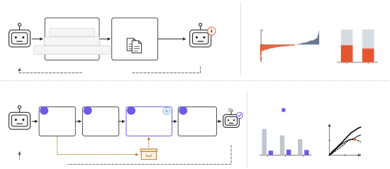
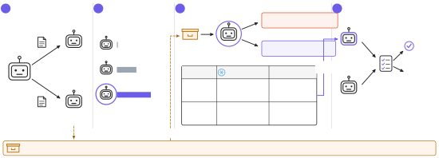
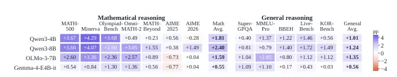
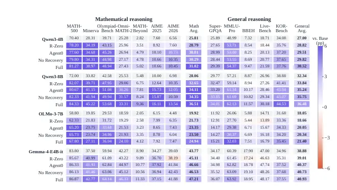

# Selection Is Not Learning: Choosing Model Futures

Haoyi Yang ^(†)^(†)thanks: Equal contribution. Either author may list
their name first on their CV.    Kshitij Mishra¹¹footnotemark: 1    Nils
Lukas    Salem Lahlou Affiliation: Mohamed bin Zayed University of
Artificial Intelligence, Abu Dhabi, UAE
Email: [{haoyi.yang,kshitij.mishra,nils.lukas,salem.lahlou}@mbzuai.ac.ae](mailto:)

###### Abstract

Self-evolving language models train on tasks they generate, so every
round must decide which updated model the next round inherits. Current
loops such as R-Zero, Agent0, and Skill Self-Play make this decision
through the task, admitting tasks that look learnable and inheriting
every resulting update. We identify a selection-to-update gap in these
loops, where a task that looks learnable need not produce a useful
update. Most updates on verified tasks fail to make correct answers more
likely, yet these loops inherit them all. HeirCommit freezes the updated
model and uses fresh evaluation questions to decide whether to inherit
it or retain the current model. EvoHeir separates parameter inheritance
from experience inheritance, using current and archived experience to
repair failures and preserve successes before final confirmation. Our
analysis characterizes selection-induced optimism and decomposes regret
into selection, absorption, and confirmation errors. HeirCommit cuts the
harmful share of accepted updates by 68–83% relative to random
inheritance at the same acceptance rate. Across four backbones, EvoHeir
achieves the best mathematics and general-reasoning averages, raising
the math average by 5.3% relative to the strongest baseline, Agent0. The
framework lets useful experience persist even when the model that
produced it is not inherited.

|     |
| --- |
|     |



Figure 1: Selecting a learnable task does not guarantee learning, so
EvoHeir judges model futures and keeps experience. Top: task-centric
loops inherit every update, yet 60 of 96 updates on verified tasks show
no gain, and 42–52% of admitted tasks leave the frontier under fresh
responses. Bottom: EvoHeir explores, screens a recipient, repairs its
failures with current and archived references while keeping its
successes, and commits the result only if it beats the current model on
fresh probes. The archive keeps experience either way. HeirCommit cuts
the harmful share of commits on every host, and over ten rounds EvoHeir
keeps climbing to $`+5.7`$ math points while R-Zero peaks at round 8 and
slips (means over four backbones). All plots show measured data.

## 1 Introduction

Self-evolving language models generate tasks and train on their own
outputs (Huang et al., 2026a; Xia et al., 2026; Huang et al., 2026b).
Each inherited update changes both the learner and the curriculum of
later rounds, allowing progress or regressions to accumulate (Shao et
al., 2026). Self-training can even raise a model’s target metric and
then collapse it within the same training campaign (Lin, 2026). The
central decision is therefore _which learning outcomes to carry
forward_.

Task-side selection leaves a selection-to-update gap: pass rate,
disagreement, and frontier proximity describe pre-training behavior, not
the transfer produced by an optimizer update. In our audits, 42–52% of
native Agent0/R-Zero admissions leave the frontier under independent
responses. Even with exact-valid tasks, 60 of 96 Skill Self-Play
(Skill-SP) updates have nonpositive correct-target NLL gain. Learning
opportunities must ultimately be judged by the states they produce.

HeirCommit judges realized transitions: it freezes a successor, compares
it with the current model (the root) on fresh probes, and inherits that
state or retains root. Fresh evidence separates confirmation from the
noise that favored the proposal during selection.

The deeper question is the _granularity of inheritance_. SOAR uses
actual student improvement to reward a teacher (Sundaram et al., 2026),
and APE evaluates candidate fine-tunings before accepting
updates (Marín, 2025). Pre-commit skill verification (Shang et al., 2026) and anytime-valid certificates (Sengupta, 2026) gate agent updates
while the base model stays frozen. Whole-state acceptance nevertheless
couples a branch’s gains and losses. _Must a useful experience donor
also supply the next learner’s parameters?_ Separating these choices
opens a learning path beyond whole-state acceptance (Figure 1).

EvoHeir separates parameter inheritance from experience inheritance.
Screening picks the recipient that supplies the next learner’s
parameters, either a branch endpoint or the current model. Experience
Recovery then repairs this recipient’s failures with current and
archived reference solutions while preserving its successes.

HeirCommit confirms _the completed post-absorption state_ against root.
Qualified experience enters the archive regardless of this decision:
parameter inheritance can stop without discarding material that helps a
later recipient.

We evaluate HeirCommit on the native updates of three self-evolution
hosts, and EvoHeir on four backbones over ten rounds. HeirCommit cuts
the harmful share of accepted updates by 68–83% relative to random
inheritance at the same acceptance rate, on every host. EvoHeir achieves
the highest mathematics and general-reasoning averages on all four
backbones and beats Agent0 on 45 of 48 benchmark–backbone pairs.
References from eight of ten donors weaker than the current model still
improve the recipient.

Our contributions are:

1.  1.  We identify the selection-to-update gap and prove that pre-update
        behavior alone cannot identify an update’s value. Reusing screening
        evidence to accept a branch pays a union bound over branches, which
        fresh confirmation removes.
2.  2.  We introduce HeirCommit, a source-independent rule that commits a
        frozen successor only when it beats the current model on fresh
        probes. On the native updates of R-Zero, Agent0, and Skill-SP, it
        turns negative pool gain positive on two of the three hosts.
3.  3.  We develop EvoHeir, which decides separately which parameters the
        next learner inherits and which experience it absorbs. Across four
        backbones it raises the base model’s math average by 7.9–30.1%, the
        most of any compared method.
4.  4.  We show that experience outlives the model that produced it.
        Recovery beats direct fine-tuning on the same 64 references by 1.93
        pp on average, and experience from rounds whose model was rejected
        adds 0.66 pp beyond committed-round history.

## 2 Related Work

#### Self-evolution and update acceptance.

STaR, Self-Instruct, and SPIN learn from self-generated supervision
(Zelikman et al., 2022; Wang et al., 2023; Chen et al., 2024); Alami et
al. (2024) regularize SPIN with a KL term and fictitious play across
iterations. Task generation uses self-play in Absolute Zero and SPELL
(Zhao et al., 2025; Yang et al., 2026) and student feedback in
DataEnvGym (Khan et al., 2025). R-Zero, Agent0, and Skill-SP adapt
curricula (Huang et al., 2026a; Xia et al., 2026; Huang et al., 2026b);
SOAR and Actor-Curator use realized improvement (Sundaram et al., 2026;
Gu et al., 2026). Earlier automatic curricula select tasks by measured
learning progress (Graves et al., 2017; Matiisen et al., 2020), a signal
that Willems et al. (2020) argue is flawed, proposing mastering rates
instead. At the agent level, harness updates need not bring benefit
either (Lin et al., 2026). Update acceptance appears in AlphaGo Zero,
but not AlphaZero (Silver et al., 2017b; Silver et al., 2017a),
candidate fine-tuning in APE (Marín, 2025), and nonparametric agent
evolution in PACE (Shawn, 2026). Agent-side gates verify distilled
skills before commit or certify adapter and harness updates while the
base model stays frozen (Shang et al., 2026; Sengupta, 2026). EvoHeir
separately chooses the recipient and experience donors, then confirms
the post-absorption successor.

#### Privileged-context distillation.

GKD trains on student-generated prefixes (Agarwal et al., 2024). SDFT,
SDPO, and OPSD condition a self-teacher on demonstrations, feedback, or
privileged context (Shenfeld et al., 2026; Hübotter et al., 2026; Zhao
et al., 2026), while OPCD internalizes contextual knowledge (Ye et al.,
2026b). Recovery combines recipient-specific repair and preservation
with cross-branch references, fixed recipient trajectories, and
post-absorption confirmation.

#### Experience persistence.

Replay retains past experience (Rolnick et al., 2019); genetic
distillation combines policies (Gangwani and Peng, 2018). Online
experiential learning and SPEE internalize accumulated experience (Ye et
al., 2026a; Ren et al., 2026). EvoHeir reassesses experience through the
current recipient and retains it independently of parameter acceptance:
a rejected state can remain a useful donor.

## 3 Self-Evolution Environment

Figure 2: Self-evolution environment. Two agents co-evolve through the
Evolution Controller.

Self-evolution runs in rounds, and each round ends with an inheritance
decision. The Curriculum Scout proposes problems, the Evolution
Controller admits those at the Evolving Learner’s frontier, and native
training updates both agents in an R-Zero-style loop (Huang et al.,
2026a), as Figure 2 shows. A round starts from the learner’s _root
state_ $`S_{t}=(\theta_{t},\omega_{t})`$, its parameters and resumable
training state, and trains two native branches from it. Admission uses
pre-update behavioral observations $`O_{t}`$, such as the pass rate over
ten learner responses, and the branch endpoints form
$`\mathcal{C}_{t}^{\rm nat}`$. Qualified responses from every branch
enter a bounded archive $`M_{t}`$. Training and Recovery, screening,
confirmation and final evaluation use disjoint question pools, and
online scores use frozen consensus labels, as Appendix A details.

#### Value and inheritance.

For a declared task distribution $`P_{t}`$ and utility $`q`$, the value
of a state is its expected gain over the root,

```math
V_{t}(S)=\mathbb{E}_{z\sim P_{t}}[q(S;z)-q(S_{t};z)],\qquad V_{t}(S_{t})=0. \tag{1}
```

Capability uses exact correctness or sampled pass@1, and the update
audits use the reduction in correct-target negative log-likelihood
(NLL), which is not an accuracy difference. For binary correctness,
value splits into acquired and lost successes,

```math
V_{t}(S)=\Pr(q(S)=1,q(S_{t})=0)-\Pr(q(S)=0,q(S_{t})=1). \tag{2}
```

The _selection-to-update gap_ is the failure of task-side admission to
identify positive value. Screening picks a recipient $`S_{t}^{\rm sel}`$
from $`\mathcal{C}_{t}^{\rm nat}\cup\{S_{t}\}`$, Recovery turns it into
a proposal $`S_{t}^{+}`$, and confirmation keeps $`S_{t}`$ or adopts
$`S_{t}^{+}`$ as $`S_{t+1}`$. Transition regret compares the inherited
state with the best state constructed,

```math
R_{t}=\max_{S\in\mathcal{C}_{t}^{\rm nat}\cup\{S_{t},S_{t}^{+}\}}V_{t}(S)-V_{t}(S_{t+1}), \tag{3}
```

and absorption gain
$`G_{t}^{\rm abs}=V_{t}(S_{t}^{+})-V_{t}(S_{t}^{\rm sel})`$ measures the
change from recipient to proposal.

#### Hosts, backbones, and benchmarks.

HeirCommit is audited on the native updates of R-Zero, Agent0 and
Skill-SP, which propose tasks through a challenger, a tool-using
curriculum agent and a skill controller, respectively (Huang et al.,
2026a; Xia et al., 2026; Huang et al., 2026b). The self-evolution study
runs every method for ten rounds with three training seeds from
Qwen3-4B-Base and Qwen3-8B-Base (Yang et al., 2025), OLMo-3-7B (Olmo et
al., 2026), and the instruction-tuned Gemma-4-E4B-it (Team et al.,
2026). It evaluates seven mathematics and five general-reasoning
benchmarks (Hendrycks et al., 2021; Lewkowycz et al., 2022; He et al.,
2024; Ballon et al., 2026; Mayilvahanan et al., 2025; Team et al., 2025;
Wang et al., 2024; Kazemi et al., 2025; White et al., 2025; Ma et al.,
2025), listed with their metrics in Appendix E.

## 4 EvoHeir: Exploration, Experience Recovery, and HeirCommit



Figure 3: One EvoHeir round. Steps follow Algorithm 1, and the archive
keeps qualified experience whether or not the round commits.

EvoHeir gives exploration two routes into the next learner, selected
parameters and absorbed experience. Each round runs the four steps of
Figure 3. It (1) explores native branches from the root, (2) screens
them with the root for a parameter recipient, (3) recovers current and
archived experience into that recipient, and (4) confirms the result
against the root on fresh probes.

### 4.1 Explore and Screen a Recipient

On the base loop of Section 3, EvoHeir builds multi-branch exploration,
screening of realized updates, experience absorption, and independent
confirmation. Native endpoints and any predeclared training-prefix
checkpoints form $`\mathcal{C}_{t}^{\rm nat}`$. Each branch supplies a
resumable state and responses that qualify as experience. An _Experience
Donor_ contributes the latter without having to supply inherited
parameters or remain available as a teacher model.

The controller freezes native candidates before shared screening on
$`P_{t}^{\rm scr}`$. Paired root-relative scores select the recipient
$`S_{t}^{\rm sel}`$ from the candidates and root, with ties going to the
root and then to a fixed branch order. Screening chooses the parameter
starting point for absorption.

### 4.2 Recover Experience without Inheriting the Donor

#### Experience across branches and rounds.

Current exploration records $`E_{t}`$ and a bounded archive $`M_{t}`$
supply candidate problems and references with their generating
checkpoint and verification trace. Qualification checks completeness,
answer validity, and problem-level de-duplication. Recovery material is
disjoint from screening, confirmation, and final evaluation.
Appendix B.3 specifies archive admission and retention.

#### Let the recipient identify repair and preservation.

Recovery obtains reference-free recipient attempts by exact-checkpoint
cache reuse or one rollout batch. Under the same answer-equivalence
rule, a failed attempt with a qualified reference enters
$`D_{t}^{\rm repair}`$, and a successful attempt enters
$`D_{t}^{\rm keep}`$. The groups are disjoint and specific to the
recipient, so an archived success becomes repair material when the
current recipient cannot reproduce it. A predeclared budget bounds
selection from both groups.

#### A frozen recipient teaches a recipient-initialized student.

The frozen teacher and student in Figure 3 are two copies of the
selected Evolving Learner, both initialized from
$`\theta_{t}^{\rm sel}`$. For a recipient-generated trajectory $`y`$ on
problem $`x`$, all three distributions below predict the next token at
the same prefix $`y_{<j}`$. The repair teacher also sees a donor’s
reference $`r`$,
$`T^{\rm repair}_{j}=\operatorname{sg}[p_{\theta_{t}^{\rm sel}}(\cdot\mid x,r,y_{<j})]`$,
while the keep teacher and the student see only the problem,
$`T^{\rm keep}_{j}=\operatorname{sg}[p_{\theta_{t}^{\rm sel}}(\cdot\mid x,y_{<j})]`$
and $`P_{\theta,j}=p_{\theta}(\cdot\mid x,y_{<j})`$. The student matches
the repair teacher on failed attempts and the keep teacher on successful
ones,

```math
\mathcal{L}_{\rm rec}(\theta)=\left\langle d(T^{\rm repair}_{j},P_{\theta,j})\right\rangle_{D_{t}^{\rm repair}}+\lambda_{\rm keep}\left\langle d(T^{\rm keep}_{j},P_{\theta,j})\right\rangle_{D_{t}^{\rm keep}}, \tag{4}
```

where $`d`$ is the forward KL divergence over the full vocabulary and
$`\langle\cdot\rangle_{D}`$ averages response-token terms per question
over group $`D`$, normalized by the repair-plus-keep batch size. We use
$`\lambda_{\rm keep}=1`$, LoRA rank 8 and at most 16 updates, as
Appendix B.4 lists. The recipient trajectories and groups stay fixed
during absorption, which produces $`S_{t}^{+}`$, and an empty experience
pool leaves the recipient unchanged. Only the resulting learner is
deployed, since teacher conditioning is a training operation.

### 4.3 HeirCommit: Confirm the Final Proposal

HeirCommit evaluates the state that would actually persist, including
the changes produced by absorption. The controller freezes the final
proposal before scoring the held-out confirmation pool
$`P_{t}^{\rm con}`$. Its paired root-relative value determines
inheritance:

```math
S_{t+1}=\begin{cases}S_{t}^{+},&\widehat{V}^{\rm con}_{t}(S_{t}^{+})>\tau_{t},\\
S_{t},&\text{otherwise}.\end{cases} \tag{5}
```

The reported runs use $`\tau_{t}=0`$, and a positive confidence margin
gives the certified mode of Theorem 1. Rejection retains root without
falling back to the recipient or testing another proposal. A proposal
identical to root is a zero-valued no-op. Later rounds receive fresh
evidence.

HeirCommit does not depend on how candidates are built, so an external
host can apply it to a single native update, and EvoHeir supplies
construction and search. Accepted absorbed weights are merged into the
next native root, with a fresh native optimizer and scheduler. Rejection
restores the complete root state, including the scheduler and random
generators. Qualified experience is archived independently of this
decision. Algorithm 1 and the state-management details appear in
Appendix B.

## 5 What Can Be Identified about a Model Future?

Within a round, write $`V_{k}`$ for the value of native candidate $`k`$,
with $`K\geq 1`$, and $`V_{0}=0`$ for root. Screening selects
$`k^{*}=\arg\max_{0\leq k\leq K}\widehat{V}_{k}^{\rm scr}`$, with
$`\widehat{V}_{0}^{\rm scr}=0`$. Write $`V^{+}=V_{t}(S_{t}^{+})`$ for
the final proposal’s value. Proofs and the adaptive-round extension
appear in Appendix C.

###### Proposition 1 (Task-side non-identifiability).

For loss-reduction utility $`q=-\ell`$ and any $`\Delta>0`$, every
persistence rule based only on pre-update behavioral observations
$`O_{t}`$ faces two differentiable learning worlds with identical
$`O_{t}`$, equally valid targets, and the same native step size, but
values $`+\Delta`$ and $`-\Delta`$. Against the better of that update
and root, its worst-case expected regret is at least $`\Delta/2`$.

The observation interface excludes update gradients. Identical root
behavior can therefore lead to opposite update effects, motivating
evaluation of the realized successor rather than task quality alone.

Screening also inflates the winner’s score,
$`\mathbb{E}[\widehat{V}^{\rm scr}_{k^{*}}-V_{k^{*}}]\geq 0`$, even when
each candidate’s score is unbiased (Cawley and Talbot, 2010; Russo and
Zou, 2016), as Proposition 2 in Appendix C.2 states.

Theorem 1 explains why EvoHeir screens and confirms on disjoint pools,
because reusing the screen to accept a branch pays a union bound over
the $`K`$ branches, while a fresh pool does not, even when absorption
follows recipient selection.

###### Theorem 1 (Search–inheritance separation).

Conditional on the pre-screening history and frozen native candidates,
suppose each screening mean has zero-mean sub-Gaussian error with proxy
$`\sigma_{\rm scr}^{2}/m_{\rm scr}`$. For $`\beta>0`$, reusing screening
for inheritance obeys

```math
\Pr(\exists k:V_{k}\leq 0,\widehat{V}^{\rm scr}_{k}>\beta)\leq K\exp\!\left(-\frac{m_{\rm scr}\beta^{2}}{2\sigma_{\rm scr}^{2}}\right). \tag{6}
```

Let $`\mathcal{F}_{t}^{\rm pre}`$ contain the archive, exploration,
screening, material selection, recipient attempts, verification groups,
fixed training trajectories, and completed absorption. If confirmation
of the fixed final proposal uses fresh probes with conditionally
zero-mean sub-Gaussian error of proxy
$`\sigma_{\rm con}^{2}/m_{\rm con}`$, then

```math
\Pr(\widehat{V}^{\rm con}(S_{t}^{+})>\beta,V^{+}\leq 0\mid\mathcal{F}_{t}^{\rm pre})\leq\exp\!\left(-\frac{m_{\rm con}\beta^{2}}{2\sigma_{\rm con}^{2}}\right). \tag{7}
```

Across adaptive rounds, per-round budgets $`\delta_{t}`$ with
$`\sum_{t}\delta_{t}\leq\delta`$ give a simultaneous bound by choosing
the corresponding positive margins. The reported zero-threshold gate
trades this positive-margin guarantee for greater acceptance
sensitivity.

Regret within the realized candidate set is then at most twice the
screening error plus the absorption loss, the confirmation error and the
margin, and No Recovery has zero absorption loss, as Corollary 1 in
Appendix C.3 states.

## 6 Experiments

We first test whether task selection predicts learning and whether
HeirCommit repairs inheritance, then evaluate the complete loop on four
backbones, and finally measure the value of experience, each component,
and the cost of construction.

Figure 4: Selection does not predict learning, and HeirCommit repairs
inheritance. (a) Selected-target optimism, the support a target shows on
the responses that selected it minus its support on fresh responses,
against fixed-target controls. (b) Correct-target NLL gain of 96 real
Skill-SP updates on exact-valid tasks, sorted by gain. (c,d) Harmful
share of commits and pool-mean NLL gain over 64 native updates per host.
Matched random commits HeirCommit’s fraction of updates at random.
Appendix D gives the full audit.

### 6.1 Task Selection Does Not Predict Learning

Reusing responses both to select a target and to score it inflates the
target’s support. Selected-target optimism, the drop from a candidate’s
score on its selection responses to its score on fresh responses, is
8.60 pp in Agent0 and 4.10 pp in R-Zero, as Figure 4a shows, while
fixed-target controls stay near zero at 0.20 and $`-0.10{}`$ pp. Under
fresh responses, 52.2 % of Agent0’s and 42.0 % of R-Zero’s admitted
tasks also leave the native frontier. Even exact-valid tasks need not
teach. In Figure 4b, 60 of 96 real Skill-SP updates (62.5%) do not
reduce correct-target NLL.

### 6.2 HeirCommit Cuts Harmful Commits on Every Host

A second, coverage-matched audit takes 64 native updates per host and
scores them on a pool disjoint from the decision probes. HeirCommit
commits 23–52% of the updates and lowers the harmful share of commits
from 47–77% to 13–16% on all three hosts, as Figure 4c shows. Matched
random commits the same fraction at random and keeps the native harmful
share, so HeirCommit’s cut is 68–83% relative to it. HeirCommit also
turns negative pool gain positive on R-Zero and Skill-SP and raises
Agent0’s gain fivefold in Figure 4d. It retains 78–87% of the useful
updates, as Appendix D reports.

### 6.3 EvoHeir Leads on Every Backbone

|                | Math Avg. (7 benchmarks) $`\uparrow`$ |                   |                   |                   |                   |            | General Avg. (5 benchmarks) $`\uparrow`$ |        |        |         |         |
| -------------- | ------------------------------------- | ----------------- | ----------------- | ----------------- | ----------------- | ---------- | ---------------------------------------- | ------ | ------ | ------- | ------- |
| Backbone       | Base                                  | R-Zero            | Agent0            | No Rec.           | EvoHeir           | vs. Agent0 | Base                                     | R-Zero | Agent0 | No Rec. | EvoHeir |
| Qwen3-4B-Base  | 25.81                                 | 28.79 $`\pm`$0.65 | 30.01 $`\pm`$0.57 | 30.29 $`\pm`$0.40 | 31.82 $`\pm`$0.55 | $`+`$6.0%  | 27.00                                    | 28.82  | 29.51  | 29.82   | 30.52   |
| Qwen3-8B-Base  | 28.06                                 | 32.65 $`\pm`$0.65 | 34.11 $`\pm`$0.63 | 34.35 $`\pm`$0.38 | 36.51 $`\pm`$0.67 | $`+`$7.0%  | 32.34                                    | 33.84  | 35.24  | 35.75   | 36.48   |
| OLMo-3-7B      | 19.92                                 | 21.73 $`\pm`$0.61 | 23.35 $`\pm`$0.44 | 23.50 $`\pm`$0.56 | 24.94 $`\pm`$0.48 | $`+`$6.8%  | 18.05                                    | 18.66  | 20.05  | 20.34   | 21.40   |
| Gemma-4-E4B-it | 43.77                                 | 45.11 $`\pm`$0.50 | 46.66 $`\pm`$0.59 | 46.53 $`\pm`$0.42 | 47.21 $`\pm`$0.44 | $`+`$1.2%  | 38.88                                    | 39.01  | 40.37  | 40.73   | 40.93   |

Table 1: Ten-round self-evolution across four backbones (%). Each
average weights its benchmarks equally, and $`\pm`$ is the sample SD of
Math Avg. over three seeds. “vs. Agent0” is the relative Math Avg. gain
of EvoHeir (Full) over Agent0. Figure 5 and Appendix E give
per-benchmark results.

After ten rounds, EvoHeir (Full) has the highest Math Avg. and General
Avg. on every backbone of Section 3, as Table 1 shows. It raises the
base model’s Math Avg. by 7.9–30.1% and exceeds Agent0, the strongest
baseline, by 1.59–2.40 pp (6.0–7.0%) on the three base models.
Gemma-4-E4B-it, the only instruction-tuned start, leaves the least
headroom, and Full still leads by 0.55 pp.

Across all twelve benchmarks, Full beats Agent0 on 45 of 48
benchmark–backbone pairs in Figure 5, and the three exceptions are
30-problem AIME sets. No Recovery keeps exploration, screening, and
confirmation but removes absorption. Full exceeds it on every backbone,
which isolates Recovery as a module, and Figure 6 shows Full ending the
ten rounds highest on all four backbones.

These are fixed-round comparisons. A Full round takes 8–9 wall-clock
hours on two 96-GB GPUs, as Appendix G details, and Section 6.6 compares
allocations at equal accounting budget.



Figure 5: Per-benchmark gain of EvoHeir (Full) over Agent0 at round 10
(pp, three-seed means). 45 of 48 cells are positive, and the three
negative cells are 30-problem AIME sets.

Figure 6: Ten-round Math Avg. trajectories, as change from round 0 (pp).
Lines and bands show the mean and $`\pm 1`$ SD over three seeds. The bar
at round 10 marks EvoHeir’s lead over Agent0, and each panel has its own
y scale.

### 6.4 Experience Outlives Its Model

The study runs 16 donor interventions on four fixed recipients, from
rounds 3, 5, 7, and 10, with two current and two archived donors each.
Every intervention restarts its recipient and is evaluated on the same
1,024 items before confirmation, and gains are relative to that
recipient.

#### Donor state and experience value diverge.

Eight of the ten donors weaker than the current root still improve the
recipient, as Figure 7a shows. Their mean donor gain is $`-1.09`$ pp,
but their mean absorption gain is $`+0.71`$ pp.

#### Recovery learns and retains.

From the same 64 references, Cache SFT gains 2.08 pp of new successes
but loses 2.61 pp, while Recovery gains 2.54 pp and loses 1.15 pp, for
net gains of $`-0.54`$ and $`+1.39`$ pp in Figure 7b. Recovery beats
Cache SFT at all four checkpoints, by 1.93 pp on average, although its
own net gain is negative at round 7 ($`-0.20`$ pp).

#### Experience outlives the model that produced it.

At a fixed budget of 64 references, current-only material yields
$`+0.39`$ pp, adding committed-round history $`+0.73`$ pp, and admitting
all qualified history, including rounds whose model was rejected,
$`+1.39`$ pp, as Figure 7c shows. A matched replacement then fixes the
record count. Three seed groups with four late-round recipients each
swap 32 qualified records from non-inherited sources for same-age
records from inherited sources. The non-inherited records still add
0.34–0.73 pp at ages one to four, with pointwise 95% bootstrap intervals
above zero, as Figure 7d shows. The gain therefore comes from the
sources, not from more references.

Figure 7: Experience value under fixed-recipient interventions (pp,
1,024 items each, before confirmation). (a) Donor gain against
absorption gain for 16 donors. The shaded quadrant holds weaker donors
whose experience helps, and $`+`$ marks their mean. (b) Mean new (up)
and lost (down) successes from the same 64 references, with black bars
at the mean net gain and thin lines pairing the two methods at each
recipient. (c) Absorption gain as history eligibility widens at a fixed
64-reference budget, with thin lines for the four recipients. (d) Paired
contribution of non-inherited over same-age inherited history at 64
records, with pointwise 95% hierarchical bootstrap intervals over three
seed groups. Age zero is an identical-material control.

 +1\Rightarrow\\
x+9=x+\\\\\hbox to9.19pt{\vbox
to9.59pt{\pgfpicture\makeatletter\hbox{\hskip
0.325pt\lower-4.79721pt\hbox to0.0pt{\lxSVG@begingroup@{\_scopebegin=1}
\lxSVG@begingroup@{stroke=#242424} \lxSVG@begingroup@{fill=#242424}
\lxSVG@setlinewidth{\the\pgflinewidth}\lxSVG@begingroup@{stroke-width=0.4pt}
\lx@inpgf@ignorespaces\nullfont\lxSVG@begingroup@{\_scopebegin=1}
\lxSVG@closescope \hbox to0.0pt{\lxSVG@begingroup@{\_scopebegin=1}
\lxSVG@roundcap\lxSVG@begingroup@{stroke-linecap=round}
\lx@inpgf@ignorespaces{{\lx@inpgf@ignorespaces}{{}}\lx@inpgf@ignorespaces\hbox{\hbox{{\lxSVG@begingroup@{\_scopebegin=1}
\lxSVG@begingroup@{stroke=#E4572E}
\lxSVG@setdash{3.0pt,3.0pt}{0.0pt}\lxSVG@begingroup@{stroke-dasharray={3.0pt,3.0pt},stroke-dashoffset=0.0pt}
\lx@inpgf@ignorespaces\lxSVG@setdash{1.6pt,1.0pt}{0.0pt}\lxSVG@begingroup@{stroke-dasharray={1.6pt,1.0pt},stroke-dashoffset=0.0pt}
\lx@inpgf@ignorespaces\lxSVG@setlinewidth{\the\pgflinewidth}\lxSVG@begingroup@{stroke-width=0.65pt}
\lx@inpgf@ignorespaces{{}{}{{ {}{}}}{ {}{}}
{{}{{\lx@inpgf@ignorespaces}}}{{}{\lx@inpgf@ignorespaces}}{}{{}{\lx@inpgf@ignorespaces}}{}{}{}{}{}
{\lxSVG@begingroup@{\_scopebegin=1} \lxSVG@begingroup@{stroke=#E4572E}
\lxSVG@setdash{3.0pt,3.0pt}{0.0pt}\lxSVG@begingroup@{stroke-dasharray={3.0pt,3.0pt},stroke-dashoffset=0.0pt}
\lx@inpgf@ignorespaces\lxSVG@setdash{1.6pt,1.0pt}{0.0pt}\lxSVG@begingroup@{stroke-dasharray={1.6pt,1.0pt},stroke-dashoffset=0.0pt}
\lx@inpgf@ignorespaces\lxSVG@setlinewidth{\the\pgflinewidth}\lxSVG@begingroup@{stroke-width=0.65pt}
\lx@inpgf@ignorespaces{{}{}{{}}}{{}{}{{}}}{}{}{{}{}{{}}}{{}{}{{}}}{}{}{{}{}{{}}}{{}{}{{}}}{}{}{{}{}{{}}}{{}{}{{}}}{}{}{}\lxSVG@stroke\lxSVG@drawpath@unclipped{M
9.87 6.19 L 1.94 6.19 C 0.87 6.19 0 5.32 0 4.25 L 0 -4.25 C 0 -5.32 0.87
-6.19 1.94 -6.19 L 9.87 -6.19 C 10.94 -6.19 11.81 -5.32 11.81 -4.25 L
11.81 4.25 C 11.81 5.32 10.94 6.19 9.87 6.19 Z M 0 -6.19}{fill:none}
\lx@inpgf@ignorespaces \lxSVG@closescope
}{{{{\lx@inpgf@ignorespaces}}\lxSVG@begingroup@{\_scopebegin=1}
\lxSVG@transformcm{1.0}{0.0}{0.0}{1.0}{1.9068pt}{-3.47221pt}\lxSVG@begingroup@{transform=matrix(1.0
0.0 0.0 1.0 2.64 -4.8)} \pgfsys@hbox{60}\lxSVG@closescope }}}
\lxSVG@closescope }}} } \lxSVG@closescope {{
{}{}{}}}{\lx@inpgf@ignorespaces}{\lx@inpgf@ignorespaces}\hss}\lxSVG@discardpath\lxSVG@closescope
\hss}}\lxSVG@closescope\endpgfpicture}}\\\\+1$`\Rightarrow\ {\color[rgb]{0.8945,0.3398,0.1797}x=0}`$the
cross term is droppedRecoveryfrozen teacherround-4 reference, not
inheritedfills the gapafter Recovery, no
reference$`\sqrt{x+9}=\sqrt{x}+1`$$`\Rightarrow\ x+9=x+\;\,\hbox to13.42pt{\vbox to9.14pt{\pgfpicture\makeatletter\hbox{\hskip 0.34999pt\lower-4.5722pt\hbox to0.0pt{\lxSVG@begingroup@{_scopebegin=1} \lxSVG@begingroup@{stroke=#242424} \lxSVG@begingroup@{fill=#242424} \lxSVG@setlinewidth{\the\pgflinewidth}\lxSVG@begingroup@{stroke-width=0.4pt} \lx@inpgf@ignorespaces\nullfont\lxSVG@begingroup@{_scopebegin=1} \lxSVG@closescope \hbox to0.0pt{\lxSVG@begingroup@{_scopebegin=1} \lxSVG@roundcap\lxSVG@begingroup@{stroke-linecap=round} \lx@inpgf@ignorespaces{{\lx@inpgf@ignorespaces}{{}}\lx@inpgf@ignorespaces\hbox{\hbox{{\lxSVG@begingroup@{_scopebegin=1} \lxSVG@begingroup@{stroke=#6C5CE7} \lxSVG@begingroup@{fill=#EDEBFC} \lxSVG@setlinewidth{\the\pgflinewidth}\lxSVG@begingroup@{stroke-width=0.7pt} \lx@inpgf@ignorespaces{{}{}{{
{}{}}}{
{}{}}
{{}{{\lx@inpgf@ignorespaces}}}{{}{\lx@inpgf@ignorespaces}}{}{{}{\lx@inpgf@ignorespaces}}{}{}{}{}{}
{\lxSVG@begingroup@{_scopebegin=1} \lxSVG@begingroup@{stroke=#6C5CE7} \lxSVG@begingroup@{fill=#EDEBFC} \lxSVG@setlinewidth{\the\pgflinewidth}\lxSVG@begingroup@{stroke-width=0.7pt} \lx@inpgf@ignorespaces{{}{}{{}}}{{}{}{{}}}{}{}{{}{}{{}}}{{}{}{{}}}{}{}{{}{}{{}}}{{}{}{{}}}{}{}{{}{}{{}}}{{}{}{{}}}{}{}{}\lxSVG@fillstroke\lxSVG@drawpath@unclipped{M 15.66 5.84 L 1.94 5.84 C 0.87 5.84 0 4.97 0 3.91 L 0 -3.91 C 0 -4.97 0.87 -5.84 1.94 -5.84 L 15.66 -5.84 C 16.73 -5.84 17.59 -4.97 17.59 -3.91 L 17.59 3.91 C 17.59 4.97 16.73 5.84 15.66 5.84 Z M 0 -5.84}{} \lx@inpgf@ignorespaces
\lxSVG@closescope }{{{{\lx@inpgf@ignorespaces}}\lxSVG@begingroup@{_scopebegin=1} \lxSVG@transformcm{1.0}{0.0}{0.0}{1.0}{1.0pt}{-3.22221pt}\lxSVG@begingroup@{transform=matrix(1.0 0.0 0.0 1.0 1.38 -4.46)} \pgfsys@hbox{60}\lxSVG@closescope }}}
\lxSVG@closescope }}}
}
\lxSVG@closescope {{
{}{}{}}}{\lx@inpgf@ignorespaces}{\lx@inpgf@ignorespaces}\hss}\lxSVG@discardpath\lxSVG@closescope \hss}}\lxSVG@closescope\endpgfpicture}}\;\,+1`$$`\Rightarrow\ \sqrt{x}=4`$$`x=16`$the
cross term is restored(b)Keeprecipient, before
absorption$`2^{100}\bmod 7`$$`2`$Cache SFT$`2\to 4`$success
lostRecovery$`2\to 2`$success keptproposalConfirmationon fresh
probes$`\Delta=-0.31`$ ppproposal rejectedroot retainedexperience
keptregardless of commit

Figure 8: Qualitative analysis on Qwen3-4B-Base at round 5. (a) A
round-4 archived reference from a proposal that was not inherited
recovers $`x=16`$ after the recipient drops the cross term; Recovery
reproduces it without the reference. (b) Under the same 64-reference
budget, Recovery keeps the remainder that Cache SFT loses. The
fresh-probe gain is $`-0.31`$ pp, so HeirCommit retains the root.

#### Qualitative analysis.

On Qwen3-4B-Base at round 5, the recipient drops the cross term in
$`\sqrt{x+9}=\sqrt{x}+1`$ and returns $`x=0`$. A round-4 archived
reference from a proposal that was not inherited recovers $`x=16`$, and
Recovery reproduces it without the reference. With the same 64
references, Cache SFT changes the correct remainder of
$`2^{100}\bmod 7`$ from $`2`$ to $`4`$, while Recovery keeps $`2`$. The
fresh-probe confirmation gain is $`-0.31`$ pp, so HeirCommit retains the
root (Figure 8).

### 6.5 Targeted Reuse and Confirmation Both Matter

| Variant            | Math Avg. $`\uparrow`$ | General Avg. $`\uparrow`$ |
| ------------------ | ---------------------- | ------------------------- |
| EvoHeir (Full)     | 31.82 $`\pm`$0.55      | 30.52 $`\pm`$0.35         |
| Same-Lineage       | 30.77 $`\pm`$0.57      | 29.99 $`\pm`$0.35         |
| Random Experience  | 30.54 $`\pm`$0.44      | 29.87 $`\pm`$0.43         |
| Current-Round Only | 30.85 $`\pm`$0.69      | 30.04 $`\pm`$0.35         |
| NoConfirm          | 29.80 $`\pm`$1.13      | 29.33 $`\pm`$0.65         |

Table 2: Component ablations (%, mean $`\pm`$ SD over three seeds).

Removing any one mechanism from Full lowers both averages, as Table 2
shows. Each ablation keeps the native budget, round count, objective,
and absorption cap. Same-Lineage removes cross-lineage sources, Random
Experience replaces recipient-conditioned selection with uniform
sampling, and Current-Round Only removes history. These three lower Math
Avg. by 0.97–1.28 pp and General Avg. by 0.48–0.65 pp. NoConfirm removes
independent confirmation and has the largest drops, 2.02 and 1.19 pp.
Targeted experience reuse and a final inheritance decision therefore
both contribute. All ablations use the Qwen3-4B-Base backbone.

### 6.6 Equal-Budget Comparison and Sensitivity

Figure 9: Equal-budget comparison and sensitivity on Qwen3-4B-Base.
(a–c) Math Avg. after ten rounds, mean $`\pm`$ SD over three training
seeds. (a) Four methods at equal accounting budgets, relative to Full’s
default of 123.7 units. (b,c) Candidate count and confirmation-pool size
at budget 1.0, where native training absorbs the remaining budget. Open
rings mark the defaults, which reuse the main runs. (d) Net absorption
gain of a fixed recipient on 2,400 problems as the preservation weight
changes, over three absorption-order seeds. Accounting units are not
measured GPU-hours or FLOPs.

A separate study on Qwen3-4B-Base compares methods at equal cost. A
normalized accounting budget charges a single-stream native baseline
100.0 units and Full’s default configuration 123.7 units, a 23.7%
overhead spent on screening, recipient attempts, verification, teacher
passes, absorption, confirmation, and state export. Every variant is
trained separately for ten rounds with three seeds, and native training
absorbs the budget that construction leaves.

Full has the lowest mean at 0.8 of its default budget but the highest
from 1.0 onward, as Figure 9a shows, so its advantage depends on leaving
enough native training after construction and confirmation are paid for.
At budget 1.0, four candidates give the largest mean, close to the
default of two, and confirmation pools of 32 and 64 questions are also
close. The default preservation weight $`\lambda_{\rm keep}=1`$ gives
the largest net absorption gain in Figure 9d. Larger settings consume
native-training budget and need not improve the final learner.

## 7 Conclusion

We identify the selection-to-update gap: admitting a task that looks
learnable does not ensure a useful update, and 60 of 96 updates on
verified tasks show no gain. HeirCommit inherits a successor only when
it beats the current model on fresh probes and cuts the harmful share of
commits by 68–83% on three self-evolution hosts. EvoHeir separates the
parameters a round inherits from the experience it keeps and raises the
math average by up to 7.0% over Agent0, the strongest baseline.
Self-evolving systems should judge the updates they produce, not only
the tasks they choose, and keep experience beyond the models that
produced it.

## References

- Agarwal et al. (2024) R. Agarwal, N. Vieillard, Y. Zhou, P.
  Stanczyk, S. Ramos Garea, M. Geist, and O. Bachem On-policy
  distillation of language models: learning from self-generated
  mistakes. In International Conference on Learning Representations, B.
  Kim, Y. Yue, S. Chaudhuri, K. Fragkiadaki, M. Khan, and Y. Sun (Eds.),
  Vol. 2024, pp. 21246–21263. External Links:
  [Link](https://proceedings.iclr.cc/paper_files/paper/2024/file/5be69a584901a26c521c2b51e40a4c20-Paper-Conference.pdf)
  Cited by: §2.
- Alami et al. (2024) R. Alami, A. Abubaker, M. Achab, M. E. A. Seddik,
  and S. Lahlou Investigating regularization of self-play language
  models. arXiv preprint arXiv:2404.04291. Cited by: §2.
- Ballon et al. (2026) M. Ballon, A. Algaba, B. Verbeken, and V. Ginis
  Benchmarks saturate when the model gets smarter than the judge.
  External Links: 2601.19532, [Link](https://arxiv.org/abs/2601.19532)
  Cited by: Appendix E, §3.
- Cawley and Talbot (2010) G. C. Cawley and N. L. Talbot On over-fitting
  in model selection and subsequent selection bias in performance
  evaluation. The Journal of Machine Learning Research 11,
  pp. 2079–2107. Cited by: §5.
- Chen et al. (2024) Z. Chen, Y. Deng, H. Yuan, K. Ji, and Q. Gu
  Self-play fine-tuning converts weak language models to strong language
  models. arXiv preprint arXiv:2401.01335. Cited by: §2.
- Gangwani and Peng (2018) T. Gangwani and J. Peng Policy optimization
  by genetic distillation. External Links: 1711.01012,
  [Link](https://arxiv.org/abs/1711.01012) Cited by: §2.
- Graves et al. (2017) A. Graves, M. G. Bellemare, J. Menick, R. Munos,
  and K. Kavukcuoglu Automated curriculum learning for neural networks.
  In International Conference on Machine Learning, Cited by: §2.
- Gu et al. (2026) Z. Gu, J. Light, R. Astudillo, Z. Ye, L. He, H. P.
  Zou, W. Cheng, S. Paternain, P. S. Yu, and Y. Yue Actor-curator:
  co-adaptive curriculum learning via policy-improvement bandits for rl
  post-training. External Links: 2602.20532,
  [Link](https://arxiv.org/abs/2602.20532) Cited by: §2.
- He et al. (2024) C. He, R. Luo, Y. Bai, S. Hu, Z. L. Thai, J. Shen, J.
  Hu, X. Han, Y. Huang, Y. Zhang, J. Liu, L. Qi, Z. Liu, and M. Sun
  OlympiadBench: a challenging benchmark for promoting agi with
  olympiad-level bilingual multimodal scientific problems. External
  Links: 2402.14008, [Link](https://arxiv.org/abs/2402.14008) Cited by:
  Appendix E, §3.
- Hendrycks et al. (2021) D. Hendrycks, C. Burns, S. Kadavath, A.
  Arora, S. Basart, E. Tang, D. Song, and J. Steinhardt Measuring
  mathematical problem solving with the math dataset. External Links:
  2103.03874, [Link](https://arxiv.org/abs/2103.03874) Cited by:
  Appendix E, §3.
- Hinton et al. (2015) G. Hinton, O. Vinyals, and J. Dean Distilling the
  knowledge in a neural network. External Links: 1503.02531,
  [Link](https://arxiv.org/abs/1503.02531) Cited by: §B.2.
- Hu et al. (2021) E. J. Hu, Y. Shen, P. Wallis, Z. Allen-Zhu, Y. Li, S.
  Wang, L. Wang, and W. Chen LoRA: low-rank adaptation of large language
  models. External Links: 2106.09685,
  [Link](https://arxiv.org/abs/2106.09685) Cited by: Appendix A.
- Huang et al. (2026a) C. Huang, W. Yu, X. Wang, H. Zhang, Z. Li, R.
  Li, J. Huang, H. Mi, and D. Yu R-zero: self-evolving reasoning llm
  from zero data. External Links: 2508.05004,
  [Link](https://arxiv.org/abs/2508.05004) Cited by: §1, §2, §3, §3.
- Huang et al. (2026b) S. Huang, P. Cheng, H. Liu, T. Chen, Y. Liu, J.
  Ni, S. Zhou, Z. Yang, G. Jiang, M. Zhou, Y. Cheng, X. Jiang, and G.
  Jiang Skill self-play: pushing the frontier of llm capability with
  co-evolving skills. External Links: 2607.22529,
  [Link](https://arxiv.org/abs/2607.22529) Cited by: §1, §2, §3.
- Hübotter et al. (2026) J. Hübotter, F. Lübeck, L. Behric, A.
  Baumann, M. Bagatella, D. Marta, I. Hakimi, I. Shenfeld, T. K.
  Buening, C. Guestrin, and A. Krause Reinforcement learning via
  self-distillation. External Links: 2601.20802,
  [Link](https://arxiv.org/abs/2601.20802) Cited by: §2.
- Kazemi et al. (2025) M. Kazemi, B. Fatemi, H. Bansal, J. Palowitch, C.
  Anastasiou, S. V. Mehta, L. K. Jain, V. Aglietti, D. Jindal, P.
  Chen, N. Dikkala, G. Tyen, X. Liu, U. Shalit, S. Chiappa, K.
  Olszewska, Y. Tay, V. Q. Tran, Q. V. Le, and O. Firat BIG-bench extra
  hard. External Links: 2502.19187,
  [Link](https://arxiv.org/abs/2502.19187) Cited by: Appendix E, §3.
- Khan et al. (2025) Z. Khan, E. Stengel-Eskin, J. Cho, and M. Bansal
  DataEnvGym: data generation agents in teacher environments with
  student feedback. External Links: 2410.06215,
  [Link](https://arxiv.org/abs/2410.06215) Cited by: §2.
- Lewkowycz et al. (2022) A. Lewkowycz, A. Andreassen, D. Dohan, E.
  Dyer, H. Michalewski, V. Ramasesh, A. Slone, C. Anil, I. Schlag, T.
  Gutman-Solo, Y. Wu, B. Neyshabur, G. Gur-Ari, and V. Misra Solving
  quantitative reasoning problems with language models. External Links:
  2206.14858, [Link](https://arxiv.org/abs/2206.14858) Cited by:
  Appendix E, §3.
- Li and Hoiem (2017) Z. Li and D. Hoiem Learning without forgetting.
  External Links: 1606.09282, [Link](https://arxiv.org/abs/1606.09282)
  Cited by: §B.2.
- Lin (2026) J. Lin Self-improvement can self-regress: the
  rise-and-collapse failure mode of LLM self-training. External Links:
  2606.21090, [Link](https://arxiv.org/abs/2606.21090) Cited by: §1.
- Lin et al. (2026) M. Lin, J. Wu, Z. Wang, Z. Shi, Y. Sang, B. He, Z.
  Liu, T. Wei, Z. Wu, Z. Zhang, D. Wang, X. Zhang, B. Dumoulin, C.
  Xie, Y. Zhou, S. Wang, and H. Lu Harness updating is not harness
  benefit: disentangling evolution capabilities in self-evolving LLM
  agents. External Links: 2605.30621,
  [Link](https://arxiv.org/abs/2605.30621) Cited by: §2.
- Loshchilov and Hutter (2019) I. Loshchilov and F. Hutter Decoupled
  weight decay regularization. External Links: 1711.05101,
  [Link](https://arxiv.org/abs/1711.05101) Cited by: Appendix A.
- Ma et al. (2025) K. Ma, X. Du, Y. Wang, H. Zhang, Z. Wen, X. Qu, J.
  Yang, J. Liu, M. Liu, X. Yue, W. Huang, and G. Zhang KOR-bench:
  benchmarking language models on knowledge-orthogonal reasoning tasks.
  External Links: 2410.06526, [Link](https://arxiv.org/abs/2410.06526)
  Cited by: Appendix E, §3.
- Marín (2025) J. Marín APE: selective fine-tuning with acceptance
  criteria for language model adaptation. External Links: 2505.19912,
  [Link](https://arxiv.org/abs/2505.19912) Cited by: §1, §2.
- Matiisen et al. (2020) T. Matiisen, A. Oliver, T. Cohen, and J.
  Schulman Teacher-student curriculum learning. IEEE Transactions on
  Neural Networks and Learning Systems 31 (9), pp. 3732–3740. Cited by:
  §2.
- Mayilvahanan et al. (2025) P. Mayilvahanan, R. Dominguez-Olmedo, T.
  Wiedemer, and W. Brendel MATH-beyond: a benchmark for rl to expand
  beyond the base model. External Links: 2510.11653,
  [Link](https://arxiv.org/abs/2510.11653) Cited by: Appendix E, §3.
- Olmo et al. (2026) T. Olmo, :, A. Ettinger, A. Bertsch, B. Kuehl, D.
  Graham, D. Heineman, D. Groeneveld, F. Brahman, F. Timbers, H.
  Ivison, J. Morrison, J. Poznanski, K. Lo, L. Soldaini, M. Jordan, M.
  Chen, M. Noukhovitch, N. Lambert, P. Walsh, P. Dasigi, R. Berry, S.
  Malik, S. Shah, S. Geng, S. Arora, S. Gupta, T. Anderson, T. Xiao, T.
  Murray, T. Romero, V. Graf, A. Asai, A. Bhagia, A. Wettig, A. Liu, A.
  Rangapur, C. Anastasiades, C. Huang, D. Schwenk, H. Trivedi, I.
  Magnusson, J. Lochner, J. Liu, L. J. V. Miranda, M. Sap, M. Morgan, M.
  Schmitz, M. Guerquin, M. Wilson, R. Huff, R. L. Bras, R. Xin, R.
  Shao, S. Skjonsberg, S. Z. Shen, S. S. Li, T. Wilde, V. Pyatkin, W.
  Merrill, Y. Chang, Y. Gu, Z. Zeng, A. Sabharwal, L. Zettlemoyer, P. W.
  Koh, A. Farhadi, N. A. Smith, and H. Hajishirzi Olmo 3. External
  Links: 2512.13961, [Link](https://arxiv.org/abs/2512.13961) Cited by:
  §3.
- Ren et al. (2026) S. Ren, X. Wang, M. Li, Y. Guo, Y. Yao, Z. Peng, X.
  Wang, Y. Chen, H. Zhou, Y. Liang, and F. Meng Self-improving large
  language models via progressive experience evolution. External Links:
  2608.02139, [Link](https://arxiv.org/abs/2608.02139) Cited by: §2.
- Rolnick et al. (2019) D. Rolnick, A. Ahuja, J. Schwarz, T. Lillicrap,
  and G. Wayne Experience replay for continual learning. Advances in
  neural information processing systems 32. Cited by: §2.
- Russo and Zou (2016) D. Russo and J. Zou Controlling bias in adaptive
  data analysis using information theory. In Artificial Intelligence and
  Statistics, pp. 1232–1240. Cited by: §5.
- Sengupta (2026) B. Sengupta Self-evolving agents with anytime-valid
  certificates. External Links: 2607.00871,
  [Link](https://arxiv.org/abs/2607.00871) Cited by: §1, §2.
- Shang et al. (2026) L. Shang, M. Xu, Y. Sun, T. Xia, L. Hu, L. Xu,
  and N. Zheng When self-evolution backfires: pre-commit gating against
  skill contamination in llm agents. External Links: 2608.05810,
  [Link](https://arxiv.org/abs/2608.05810) Cited by: §1, §2.
- Shao et al. (2026) S. Shao, Q. Ren, C. Qian, B. Wei, D. Guo, J.
  Yang, X. Song, L. Zhang, W. Zhang, D. Liu, and J. Shao Your agent may
  misevolve: emergent risks in self-evolving llm agents. External Links:
  2509.26354, [Link](https://arxiv.org/abs/2509.26354) Cited by: §1.
- Shawn (2026) Z. Shawn PACE: anytime-valid acceptance tests for
  self-evolving agents. External Links: 2606.08106,
  [Link](https://arxiv.org/abs/2606.08106) Cited by: §2.
- Shenfeld et al. (2026) I. Shenfeld, M. Damani, J. Hübotter, and P.
  Agrawal Self-distillation enables continual learning. External Links:
  2601.19897, [Link](https://arxiv.org/abs/2601.19897) Cited by: §2.
- Silver et al. (2017a) D. Silver, T. Hubert, J. Schrittwieser, I.
  Antonoglou, M. Lai, A. Guez, M. Lanctot, L. Sifre, D. Kumaran, T.
  Graepel, et al. Mastering chess and shogi by self-play with a general
  reinforcement learning algorithm. arXiv preprint arXiv:1712.01815.
  Cited by: §2.
- Silver et al. (2017b) D. Silver, J. Schrittwieser, K. Simonyan, I.
  Antonoglou, A. Huang, A. Guez, T. Hubert, L. Baker, M. Lai, A. Bolton,
  et al. Mastering the game of go without human knowledge. nature 550
  (7676), pp. 354–359. Cited by: §2.
- Sundaram et al. (2026) S. Sundaram, J. Quan, A. Kwiatkowski, K.
  Ahuja, Y. Ollivier, and J. Kempe Teaching models to teach themselves:
  reasoning at the edge of learnability. External Links: 2601.18778,
  [Link](https://arxiv.org/abs/2601.18778) Cited by: §1, §2.
- Team et al. (2026) G. Team, S. E. Abd, V. Aggarwal, R. Algayres, A.
  Andreev, O. Bachem, I. Ballantyne, C. Brick, V. Cărbune, M. Casbon, M.
  Chaturvedi, A. Chawla, V. Cotruta, A. Coucke, P. Culliton, R.
  Dadashi, L. Dixon, M. Elhawaty, U. Evci, C. Farabet, J. Ferret, F.
  Galgani, S. Girgin, J. Grill, M. Grootendorst, J. Guo, C. Hardin, Y.
  He, S. M. Hernandez, O. Homburger, L. Hussenot, J. Ji, A. Joulin, A.
  Kamath, P. Kassraie, O. Lacombe, P. Lahoti, G. Liu, G. Martins, L.
  Martins, T. Matejovicova, R. Merhej, N. Momchev, S. Mondal, R.
  Mullins, S. R. Panyam, S. Pathak, S. Perrin, A. S. Pinto, E. Pot, A.
  Pouget, A. Ramé, S. Ramos, D. Reid, D. Rim, M. Rivière, K. Roth, L.
  Rouillard, O. Sanseviero, P. G. Sessa, S. Settle, D. Sinopalnikov, S.
  Smoot, P. Stanczyk, A. Steiner, L. Stewart, I. Tolstikhin, M.
  Tschannen, A. Tsitsulin, N. Vieillard, R. Wu, P. Xu, H. Yang, E.
  Yvinec, B. Zhang, L. Zhang, J. Zou, N. Aagnes, A. Abdelhamed, J.
  Adamek, S. Agrawal, S. Agrawal, I. Alabdulmohsin, J. B. Alayrac, U.
  Alon, C. Amarnath, A. Anand, C. Anastasiou, S. Ariafar, F. Aubet, K.
  Axiotis, F. Barbero, J. Barral, A. Bendebury, U. Bergmann, S.
  Bileschi, K. Black, M. Blondel, S. Borgeaud, A. Bražinskas, R.
  Burnell, R. Busa-Fekete, M. Cai, D. Calandriello, G. Cameron, C.
  Caucheteux, R. Chaabouni, G. Chadha, J. Chan, B. J. Chen, J. Chen, L.
  Chen, X. Chen, D. Cheng, T. Chien, N. Chinaev, Y. Chou, Z. Chu, B.
  Coleman, P. Consul, S. Conway-Rahman, S. Crowell, D. Cutler, V.
  Dani, S. Daruki, A. Das, D. Deutsch, N. Dikkala, L. Ding, Q. Ding, S.
  Dodhia, K. Donhauser, T. Doshi, A. Dragan, A. Druinsky, S. Dua, Z.
  Egyed, D. Eisenbud, D. Eppens, C. Fan, B. Fatemi, Y. Fathullah, V.
  Feinberg, M. Ferev, S. Flennerhag, T. Fujimoto, J. G. Oliveira, I.
  Galatzer-Levy, J. Gante, S. Geisler, S. Ghosal, A. M. Girgis, T. von
  Glehn, A. Go, A. Gokhale, A. Grills, Y. Gu, M. Gupta, P. Gupta, G.
  Guruganesh, R. Hadsell, H. Harkous, J. Harlalka, D. Hassabis, A.
  Hauth, J. Heyward, A. Hosseini, C. Hsia, I. Hsu, X. Huang, Y.
  Huang, K. Hui, A. Hutter, T. I, F. Iliopoulos, A. Jain, G. Jawahar, Z.
  Ji, Q. Jin, M. Johnson, K. Joshi, A. Kandoor, W. Kang, K.
  Kavukcuoglu, M. Kazemi, K. Kenealy, A. Khalifa, P. Kirk, I.
  Korotkov, S. Kothawade, V. Kovalev, N. Kovelamudi, A. Kraft, R.
  Kumar, V. Kumar, H. Kuppam, J. Lannin, C. Lee, S. Lee, D. Lepikhin, A.
  Levkovitch, D. Li, Q. Li, V. Liévin, E. Lin, Z. Lin, C. Liu, T.
  Liu, T. Liu, X. Liu, I. Lobov, M. Lunayach, M. Ma, G. Madan, A.
  Maksai, E. Malmi, M. Matuszak, D. McDuff, G. Menghani, M. Mikuła, D.
  Mirylenka, K. Misiunas, V. Misra, A. Mitran, K. Mohamed, M. Mukha, E.
  Noland, J. O’Donnell, B. O’Donoghue, K. Olszewska, B. Orlando, W.
  Pan, R. Panigrahy, U. Parekh, N. Perez-Nieves, C. Park, E. Paskie, L.
  Peng, B. Petrini, S. Petrov, J. Pfeiffer, B. Piot, M. Plomecka, S.
  Poder, O. Ponce, A. Pramanik, D. Racz, A. Rajan, M. Ramanovich, A.
  Rao, M. Ritter, V. Rodrigues, E. Rosen, M. Rybiński, N.
  Sachdeva, M. E. Sander, R. Sathyanarayana, S. Savla, S. Schmidgall, T.
  Schuster, G. Scrivener, B. Seguin, A. Sellergren, A. Severyn, I.
  Shafran, D. Shah, B. Shahriari, Y. Shangguan, A. Shenoy, P. Shenoy, R.
  Shivanna, P. Sho, L. Spangher, W. Stokowiec, T. Strother, Y. Su, Y.
  Sun, M. Sundararajan, A. Tacchetti, M. H. Taege, P. Tafti, J.
  Tarbouriech, C. Tekur, S. Thakoor, R. Thapa, M. Traverse, L.
  Treven, T. Tu, C. T. Tung, Ç. Ünlü, P. Veličković, M. P. Venkat, S. G.
  Venkatesh, V. Venkiteswaran, F. Visin, A. Vitvitskyi, K.
  Vodrahalli, W. Wang, X. Wang, T. Warkentin, J. Wassenberg, J.
  Wieting, C. Wu, L. Xiao, H. Xu, Y. Xu, F. Xue, A. Yadav, J. Yan, A.
  Yang, L. Yang, M. Yang, Z. Ying, J. H. Yoo, M. Zadimoghaddam, S.
  Zafar, F. Zhang, J. Zhang, J. Zhang, X. Zhang, C. Zhao, D. Zhou,
  and C. Zou Gemma 4 technical report. External Links: 2607.02770,
  [Link](https://arxiv.org/abs/2607.02770) Cited by: §3.
- Team et al. (2025) P. Team, X. Du, Y. Yao, K. Ma, B. Wang, T.
  Zheng, K. Zhu, M. Liu, Y. Liang, X. Jin, Z. Wei, C. Zheng, K. Deng, S.
  Gavin, S. Jia, S. Jiang, Y. Liao, R. Li, Q. Li, S. Li, Y. Li, Y.
  Li, D. Ma, Y. Ni, H. Que, Q. Wang, Z. Wen, S. Wu, T. Hsing, M. Xu, Z.
  Yang, Z. M. Wang, J. Zhou, Y. Bai, X. Bu, C. Cai, L. Chen, Y. Chen, C.
  Cheng, T. Cheng, K. Ding, S. Huang, Y. Huang, Y. Li, Y. Li, Z. Li, T.
  Liang, C. Lin, H. Lin, Y. Ma, T. Pang, Z. Peng, Z. Peng, Q. Qi, S.
  Qiu, X. Qu, S. Quan, Y. Tan, Z. Wang, C. Wang, H. Wang, Y. Wang, Y.
  Wang, J. Xu, K. Yang, R. Yuan, Y. Yue, T. Zhan, C. Zhang, J. Zhang, X.
  Zhang, X. Zhang, Y. Zhang, Y. Zhao, X. Zheng, C. Zhong, Y. Gao, Z.
  Li, D. Liu, Q. Liu, T. Liu, S. Ni, J. Peng, Y. Qin, W. Su, G. Wang, S.
  Wang, J. Yang, M. Yang, M. Cao, X. Yue, Z. Zhang, W. Zhou, J. Liu, Q.
  Lin, W. Huang, and G. Zhang SuperGPQA: scaling llm evaluation across
  285 graduate disciplines. External Links: 2502.14739,
  [Link](https://arxiv.org/abs/2502.14739) Cited by: Appendix E, §3.
- Wang et al. (2023) Y. Wang, Y. Kordi, S. Mishra, A. Liu, N. A.
  Smith, D. Khashabi, and H. Hajishirzi Self-instruct: aligning language
  models with self-generated instructions. In Proceedings of the 61st
  annual meeting of the association for computational linguistics
  (volume 1: long papers), pp. 13484–13508. Cited by: §2.
- Wang et al. (2024) Y. Wang, X. Ma, G. Zhang, Y. Ni, A. Chandra, S.
  Guo, W. Ren, A. Arulraj, X. He, Z. Jiang, T. Li, M. Ku, K. Wang, A.
  Zhuang, R. Fan, X. Yue, and W. Chen MMLU-pro: a more robust and
  challenging multi-task language understanding benchmark. External
  Links: 2406.01574, [Link](https://arxiv.org/abs/2406.01574) Cited by:
  Appendix E, §3.
- White et al. (2025) C. White, S. Dooley, M. Roberts, A. Pal, B.
  Feuer, S. Jain, R. Shwartz-Ziv, N. Jain, K. Saifullah, S. Dey,
  Shubh-Agrawal, S. S. Sandha, S. Naidu, C. Hegde, Y. LeCun, T.
  Goldstein, W. Neiswanger, and M. Goldblum LiveBench: a challenging,
  contamination-limited llm benchmark. External Links: 2406.19314,
  [Link](https://arxiv.org/abs/2406.19314) Cited by: Appendix E, §3.
- Willems et al. (2020) L. Willems, S. Lahlou, and Y. Bengio Mastering
  rate based curriculum learning. arXiv preprint arXiv:2008.06456. Cited
  by: §2.
- Xia et al. (2026) P. Xia, K. Zeng, J. Liu, C. Qin, F. Wu, Y. Zhou, C.
  Xiong, and H. Yao Agent0: unleashing self-evolving agents from zero
  data via tool-integrated reasoning. External Links: 2511.16043,
  [Link](https://arxiv.org/abs/2511.16043) Cited by: §1, §2, §3.
- Yang et al. (2025) A. Yang, A. Li, B. Yang, B. Zhang, B. Hui, B.
  Zheng, B. Yu, C. Gao, C. Huang, C. Lv, C. Zheng, D. Liu, F. Zhou, F.
  Huang, F. Hu, H. Ge, H. Wei, H. Lin, J. Tang, J. Yang, J. Tu, J.
  Zhang, J. Yang, J. Yang, J. Zhou, J. Zhou, J. Lin, K. Dang, K. Bao, K.
  Yang, L. Yu, L. Deng, M. Li, M. Xue, M. Li, P. Zhang, P. Wang, Q.
  Zhu, R. Men, R. Gao, S. Liu, S. Luo, T. Li, T. Tang, W. Yin, X.
  Ren, X. Wang, X. Zhang, X. Ren, Y. Fan, Y. Su, Y. Zhang, Y. Zhang, Y.
  Wan, Y. Liu, Z. Wang, Z. Cui, Z. Zhang, Z. Zhou, and Z. Qiu Qwen3
  technical report. External Links: 2505.09388,
  [Link](https://arxiv.org/abs/2505.09388) Cited by: §3.
- Yang et al. (2026) Z. Yang, W. Shen, C. Li, R. Chen, F. Wan, M.
  Yan, X. Quan, and F. Huang SPELL: self-play reinforcement learning for
  evolving long-context language models. External Links: 2509.23863,
  [Link](https://arxiv.org/abs/2509.23863) Cited by: §2.
- Ye et al. (2026a) T. Ye, L. Dong, Q. Dong, X. Wu, S. Huang, and F. Wei
  Online experiential learning for language models. External Links:
  2603.16856, [Link](https://arxiv.org/abs/2603.16856) Cited by: §2.
- Ye et al. (2026b) T. Ye, L. Dong, X. Wu, S. Huang, and F. Wei
  On-policy context distillation for language models. External Links:
  2602.12275, [Link](https://arxiv.org/abs/2602.12275) Cited by: §2.
- Zelikman et al. (2022) E. Zelikman, Y. Wu, J. Mu, and N. Goodman Star:
  bootstrapping reasoning with reasoning. Advances in Neural Information
  Processing Systems 35, pp. 15476–15488. Cited by: §2.
- Zhao et al. (2025) A. Zhao, Y. Wu, Y. Yue, T. Wu, Q. Xu, Y. Yue, M.
  Lin, S. Wang, Q. Wu, Z. Zheng, and G. Huang Absolute zero: reinforced
  self-play reasoning with zero data. External Links: 2505.03335,
  [Link](https://arxiv.org/abs/2505.03335) Cited by: §2.
- Zhao et al. (2026) S. Zhao, Z. Xie, M. Liu, J. Huang, G. Pang, F.
  Chen, and A. Grover Self-distilled reasoner: on-policy
  self-distillation for large language models. arXiv preprint
  arXiv:2601.18734. Cited by: §2.

## Appendix

## Appendix A Experimental Setup and Hyperparameters

#### Backbones and protocol.

The checkpoints are Qwen/Qwen3-4B-Base, Qwen/Qwen3-8B-Base,
allenai/Olmo-3-1025-7B, and google/gemma-4-E4B-it. The two Qwen
checkpoints and OLMo are pretrained base models; Gemma is
instruction-tuned. Every backbone and method runs ten evolution rounds
with three training seeds, with evaluation after every round. The
evaluated checkpoint is the learner actually inherited at that round,
$`S_{t+1}`$, including rounds that retain $`S_{t}`$. In the host-system
HeirCommit studies, Skill-SP, R-Zero, and Agent0 supply native updates
and an integration adapter governs inheritance.

#### Native exploration and screening.

Each round makes 1,024 task-generation attempts in one batch and uses
ten learner responses per question for native admission. Two isolated
native branches are then trained from the same root, each on a cohort of
64 questions, with the recipe in Table 3. Native training updates all
parameters of the Curriculum Scout and Evolving Learner with
AdamW (Loshchilov and Hutter, 2019), and Recovery updates LoRA
parameters (Hu et al., 2021). Screening scores the root and the two
branch endpoints on 16 questions from $`P_{t}^{\rm scr}`$, and
confirmation scores the final proposal on 32 fresh questions from
$`P_{t}^{\rm con}`$, with four responses per question and state.
Screening ties favor the root, then the branches in a fixed order.

Setting Curriculum Scout Evolving Learner (native training) Evolving
Learner (Recovery) Trainable parameters Full model Full model LoRA
Optimizer AdamW AdamW AdamW Learning rate $`10^{-6}`$ $`10^{-6}`$
$`5\times 10^{-5}`$ Weight decay $`0.01`$ $`0.01`$ $`0`$ Per-round
optimization budget 5 calls 15 calls $`\leq 16`$ updates Questions per
batch 16 8 $`\leq 4`$ Responses per question 5 5 1 fixed response
Effective batch (responses) 80 40 $`\leq 4`$ Per-device microbatch
(responses) 1 1 1 GPUs per stage 1 1 1 LoRA rank / scaling $`\alpha`$
N/A N/A 8 / 16 LoRA target projections N/A N/A q_proj, v_proj

The native scheduler uses zero learning rate on its first optimizer call
and $`10^{-6}`$ thereafter. Native budgets count optimizer calls,
including this initial call, rather than nonzero parameter updates.

Table 3: Optimization settings for EvoHeir (Full). Native learner
settings are per branch. Batch sizes distinguish prompt groups from
individual responses.

#### Consensus labels and probe qualification.

The round-start Evolving Learner $`S_{t}`$ generates ten admission
responses per question using the settings in Appendix A. In the first
round, $`S_{t}`$ is the initial checkpoint; subsequent rounds use the
actually inherited learner. The answer comparator clusters successfully
extracted, nonempty answers. If $`m_{\rm valid}`$ responses yield such
answers and the largest cluster contains $`c_{\max}`$ responses,
consensus support is $`c_{\max}/m_{\rm valid}`$. Questions with
$`m_{\rm valid}=0`$ are excluded. The representative answer of the
largest cluster becomes the pseudo-label; probes require support at
least $`0.7`$. Ties select the first encountered largest cluster, but
tied maxima have support at most $`0.5`$ and cannot qualify as probes.
Each role’s question–label file is frozen and shared across all states
evaluated on that role’s pool. Confirmation questions and labels are
fixed before candidate construction and excluded from native training,
screening, and Recovery. Screening and confirmation use fresh scoring
responses, seeds, and caches, separate from the admission responses that
form the labels. HeirCommit adopts $`S_{t}^{+}`$ only when its
confirmation gain is strictly positive, that is, $`\tau_{t}=0`$ in
Eq. 5.

#### Generation settings.

The Curriculum Scout’s native rollouts use temperature $`1.0`$,
top-$`p=0.99`$, and five responses per question, and offline candidate
generation uses temperature $`1.0`$ and top-$`p=0.95`$. Learner
generation is capped at 4,096 response tokens with top-$`k`$ filtering
disabled unless stated otherwise. Native learner training samples five
responses at temperature $`1.0`$ and top-$`p=0.99`$. Native admission
uses ten responses at temperature $`1.0`$, top-$`p=1`$, and
top-$`k=40`$. Screening and confirmation use four responses at
temperature $`0.7`$ and top-$`p=0.95`$, and recipient attempts use one
greedy response. Appendix E gives the benchmark decoding and metrics.

## Appendix B Detailed Method and Implementation

### B.1 State Construction and Recipient Selection

The resumable learner $`S_{t}=(\theta_{t},\omega_{t})`$ holds the model
parameters and the mutable training state, including optimizer moments,
the learning-rate scheduler, and random generators. The Evolution
Controller runs each admitted cohort in an isolated copy of the same
root, and each branch follows the host’s training objective. The
controller freezes the candidate set
$`\mathcal{C}_{t}^{\rm nat}\cup\{S_{t}\}`$ before screening, selects the
recipient by paired root-relative gain on $`P_{t}^{\rm scr}`$, and
breaks ties in favor of the root, followed by a fixed branch order.
Algorithm 1 lists one round.

1: root $`S_{t}`$, controller $`A_{t}`$, archive $`M_{t}`$, budget,
fresh probe pools

2: $`b_{1:J}\leftarrow\textsc{Scout}(S_{t},A_{t})`$

3:
$`\mathcal{C}_{t}^{\rm nat},E_{t}\leftarrow\textsc{NativeExplore}(S_{t},b_{1:J})`$
$`\triangleright`$ isolated states and train-role responses

4: Freeze $`\mathcal{C}_{t}^{\rm nat}\cup\{S_{t}\}`$

5:
$`S_{t}^{\rm sel}\leftarrow\textsc{Screen}(S_{t},\mathcal{C}_{t}^{\rm nat},P_{t}^{\rm scr})`$

6: $`S_{t}^{+}\leftarrow S_{t}^{\rm sel}`$

7: if Recovery is enabled then

8:   $`D_{t}\leftarrow\textsc{QualifyMaterial}(E_{t},M_{t})`$

9:
  $`Y_{t}\leftarrow\textsc{RecipientAttempts}(S_{t}^{\rm sel},D_{t})`$
$`\triangleright`$ exact-checkpoint reuse or one rollout batch

10:
  $`D_{t}^{\rm repair},D_{t}^{\rm keep}\leftarrow\textsc{VerifyAndGroup}(D_{t},Y_{t})`$

11:   Select from both groups within the predeclared absorption budget

12:   Freeze recipient teacher, trajectories, and verification groups

13:
  $`S_{t}^{+}\leftarrow\textsc{Absorb}(S_{t}^{\rm sel},D_{t}^{\rm repair},D_{t}^{\rm keep})`$
$`\triangleright`$ identity if no eligible experience

14: end if

15: Freeze $`S_{t}^{+}`$

16: $`v\leftarrow\textsc{PairedGain}(S_{t},S_{t}^{+},P_{t}^{\rm con})`$
$`\triangleright`$ zero for an identical state

17: $`S_{t+1}\leftarrow S_{t}^{+}`$ if $`v>\tau_{t}`$, otherwise
$`S_{t}`$

18: $`M_{t+1}\leftarrow\textsc{UpdateArchive}(M_{t},E_{t})`$
$`\triangleright`$ qualified train-role records, regardless of commit

19:
$`A_{t+1}\leftarrow\textsc{Observe}(A_{t},\operatorname{source}(S_{t}^{\rm sel}),v)`$

20: Freeze $`S_{t+1}`$ before sealed-final evaluation; return
$`S_{t+1}`$

Algorithm 1 EvoHeir at round $`t`$

### B.2 Recipient-Conditioned Recovery

Recovery adapts distillation (Hinton et al., 2015) and Learning without
Forgetting (Li and Hoiem, 2017) to recipient-specific failures and
successes. Current records $`E_{t}`$ and archived records $`M_{t}`$
supply problems and qualified references, each with its generating
checkpoint, round, and verification trace. A cached recipient attempt is
reused only at the exact selected checkpoint. The same
answer-equivalence rule verifies the attempt and its reference, and
membership in $`D_{t}^{\rm repair}`$ or $`D_{t}^{\rm keep}`$ is decided
for the current recipient, even when the reference comes from an earlier
round. The frozen teacher and the student both start from
$`\theta_{t}^{\rm sel}`$ and predict at the same fixed recipient
prefixes throughout absorption, as in Eq. 4, so the procedure does not
resample from the changing student.

### B.3 Archive, Feedback, and State Inheritance

HeirCommit freezes $`S_{t}^{+}`$ before scoring it against the original
root on the fixed confirmation pool with the same probes and frozen
labels (Appendix A). It commits the complete proposal when the paired
gain exceeds $`\tau_{t}`$, with $`\tau_{t}=0`$ in the empirical mode,
and otherwise restores the complete root state. Each round confirms one
final proposal, and later rounds receive fresh evidence. Archive updates
follow a separate path in Algorithm 1: qualified current records are
considered for admission regardless of the commit outcome, so a round
that retains the root still contributes references to later rounds. The
controller records the signed confirmation value with recipient and
experience provenance, and subsequent curricula follow the host’s
feedback rule, shared by Full and No Recovery.

#### Failure modes and safeguards.

An incomplete or conflicting reference is excluded before training, a
duplicate normalized problem occupies one archive slot, and a cached
attempt is reused only from the exact selected checkpoint. A flawed
reference that passes the verifier can still steer the repair teacher,
so repair depends on verification quality. Absorption can also lose
successes, as the round-7 net gain of $`-0.20`$ pp in Figure 7 shows.
With the empirical zero threshold, sampling noise can admit a harmful
proposal; the positive-margin mode of Theorem 1 bounds that risk.

### B.4 Implementation Configuration

Appendix A and Table 3 give the EvoHeir (Full) recipe. The remaining
implementation details are as follows.

Response-token aggregation.  
Response loss is computed only on recorded response tokens; prompt
tokens are masked out. If an EOS token is present in the recorded
response, it is included in the loss. Truncated responses contribute
their available response prefix without synthesizing a missing EOS
token. Token-level forward KL over the full vocabulary is averaged
within each response, then over questions, so repair and keep examples
have equal per-question weight.

Absorption and optimizer state.  
Recovery uses AdamW with learning rate $`5\times 10^{-5}`$,
$`(\beta_{1},\beta_{2})=(0.9,0.999)`$, epsilon $`10^{-8}`$, zero weight
decay, gradient clipping at $`1.0`$, and LoRA dropout $`0`$. The adapter
has rank $`8`$, scaling $`\alpha=16`$, and targets q_proj and v_proj;
absorption uses at most 16 updates. After absorption, the adapter is
merged into the recipient and the merged weights are reloaded and
checked for exact consistency. If the absorbed model is accepted, it
becomes the next native root and the native optimizer and scheduler are
reinitialized; Recovery optimizer state is not carried into native
training. If the proposal is rejected, the original root is retained
with its parameters, optimizer moments, scheduler, and random state
unchanged. At the next round’s native-stage boundary, the native
optimizer and scheduler are reinitialized for whichever model was
inherited. Rollback restores the root snapshot; it does not carry
Recovery moments into a later stage.

Archive policy.  
The archive stores at most 256 qualified training records, deduplicated
by normalized problem identity. Conflicting labels, verification
conflicts, known reasoning errors, incomplete responses, and
non-training records are excluded. When capacity is exceeded, records
are selected deterministically using round/source-stratified round-robin
admission, with stable hash ordering within each group.

Recovery budget.  
Each round nominates up to 32 exploration records and 32 learner-success
records, and recipient attempts reuse exact-checkpoint cached responses
or use one additional response within a 64-generation budget. Recovery
makes a single pass with at most 16 optimizer updates, capped at 131,072
response loss tokens and 262,144 combined teacher and student forward
tokens. An empty usable pool leaves $`S_{t}^{\rm sel}`$ unchanged.

## Appendix C Theoretical Analysis and Proofs

### C.1 Setup and Task-Side Non-Identifiability

Fix a round and index the frozen native candidates by $`1,\ldots,K`$,
with index $`0`$ denoting root. Write $`V_{0}=0`$,
$`\widehat{V}_{k}^{\rm scr}=V_{k}+\varepsilon_{k}`$,
$`\varepsilon_{0}=0`$, and
$`k^{*}=\arg\max_{0\leq k\leq K}\widehat{V}_{k}^{\rm scr}`$, using the
tie rule in Appendix B.1. The completed proposal has value
$`V^{+}=V_{t}(S_{t}^{+})`$.

For screening, $`\mathcal{G}_{t}`$ denotes the history before screening,
including root, the declared distribution $`P_{t}`$, and the frozen
native candidates. For confirmation, $`\mathcal{F}_{t}^{\rm pre}`$
contains the full construction history, including the archive,
screening, recipient attempts, material selection, verification groups,
and completed absorption. Thus $`S_{t}^{+}`$ and $`V^{+}`$ are fixed
conditional on $`\mathcal{F}_{t}^{\rm pre}`$. The task-side observation
$`O_{t}`$ in Proposition 1 is the pre-update behavioral interface
defined in Section 3.

###### Proof of Proposition 1.

Fix a native step size $`\eta>0`$ and a value gap $`\Delta>0`$. At root
$`\theta=0`$, consider two learning worlds with local training losses
and a common probe loss

```math
\ell_{+}(\theta)=c+\theta,\qquad\ell_{-}(\theta)=c-\theta,\qquad\ell_{p}(\theta)=c_{p}+\frac{\Delta}{\eta}\theta. \tag{C.1}
```

The worlds share the stipulated root behavior, target validity, and root
loss values. Their training gradients are $`+1`$ and $`-1`$,
respectively, and are outside $`O_{t}`$. One gradient step reaches
$`-\eta`$ or $`+\eta`$. For $`q=-\ell_{p}`$, the root-relative values
are therefore $`+\Delta`$ and $`-\Delta`$. Positive smooth losses on the
whole real line can be obtained by multiplying each linear term by a
smooth cutoff in $`[0,1]`$, equal to one on $`[-\eta,\eta]`$ and zero
outside $`[-2\eta,2\eta]`$, choosing $`c>2\eta`$ and $`c_{p}>2\Delta`$.
This preserves the root gradients and both post-update probe values.

An observation-based rule uses the same commit probability $`p`$ in both
worlds. Against the better of root and the native update, its expected
regrets are $`(1-p)\Delta`$ and $`p\Delta`$. Their maximum is at least
their average, $`\Delta/2`$. ∎

### C.2 Selected-Future Optimism and Independent Confirmation

###### Proposition 2 (Selected-future optimism).

Condition on the frozen native candidates and root. If
$`\widehat{V}^{\rm scr}_{k}=V_{k}+\varepsilon_{k}`$ with
$`\mathbb{E}[\varepsilon_{k}]=0`$ for each $`k`$, then the screen winner
satisfies $`\mathbb{E}[\widehat{V}^{\rm scr}_{k^{*}}-V_{k^{*}}]\geq 0`$.

###### Proof of Proposition 2.

Condition on $`\mathcal{G}_{t}`$ and assume
$`\mathbb{E}[\varepsilon_{k}\mid\mathcal{G}_{t}]=0`$ for each fixed
candidate. The maximum is convex, so

```math
\displaystyle\mathbb{E}[\widehat{V}_{k^{*}}^{\rm scr}\mid\mathcal{G}_{t}] \displaystyle=\mathbb{E}\!\left[\max_{0\leq k\leq K}(V_{k}+\varepsilon_{k})\mid\mathcal{G}_{t}\right] \tag{C.2}
```

```math
\displaystyle\geq\max_{0\leq k\leq K}V_{k}\geq\mathbb{E}[V_{k^{*}}\mid\mathcal{G}_{t}].
```

Subtracting the last expectation gives nonnegative expected optimism.
The argument uses conditional centering of each error and allows
correlations induced by shared probes. ∎

###### Proof of Theorem 1.

A conditionally centered sub-Gaussian error $`X`$ with proxy $`s^{2}>0`$
satisfies $`\mathbb{E}[e^{uX}\mid\mathcal{H}]\leq e^{u^{2}s^{2}/2}`$.
For $`a>0`$, exponential Markov inequality and optimization over $`u>0`$
give

```math
\Pr(X>a\mid\mathcal{H})\leq\inf_{u>0}\exp\!\left(-ua+\frac{u^{2}s^{2}}{2}\right)=\exp\!\left(-\frac{a^{2}}{2s^{2}}\right). \tag{C.3}
```

For a candidate with $`V_{k}\leq 0`$, the event
$`\widehat{V}_{k}^{\rm scr}>\beta`$ implies $`\varepsilon_{k}>\beta`$.
Applying Eq. C.3 with $`s^{2}=\sigma_{\rm scr}^{2}/m_{\rm scr}`$ and
taking a union bound over the $`K`$ non-root candidates yields

```math
\Pr\!\left(\exists k\in\{1,\ldots,K\}:V_{k}\leq 0,\widehat{V}_{k}^{\rm scr}>\beta\mid\mathcal{G}_{t}\right)\leq K\exp\!\left(-\frac{m_{\rm scr}\beta^{2}}{2\sigma_{\rm scr}^{2}}\right). \tag{C.4}
```

Root contributes no event because its screening score is exactly zero.
The union bound also applies when candidate errors are correlated.

For confirmation, condition instead on $`\mathcal{F}_{t}^{\rm pre}`$,
after the proposal has been completed. Define
$`\xi_{t}=\widehat{V}_{t}^{\rm con}(S_{t}^{+})-V^{+}`$ and assume its
conditional sub-Gaussian proxy is $`\sigma_{\rm con}^{2}/m_{\rm con}`$,
as in the theorem. On $`\{V^{+}\leq 0\}`$, acceptance above $`\beta`$
implies $`\xi_{t}>\beta`$. Thus

```math
\Pr\!\left(\widehat{V}_{t}^{\rm con}(S_{t}^{+})>\beta,\ V^{+}\leq 0\mid\mathcal{F}_{t}^{\rm pre}\right)\leq\exp\!\left(-\frac{m_{\rm con}\beta^{2}}{2\sigma_{\rm con}^{2}}\right). \tag{C.5}
```

This tail bound concerns the single proposal fixed before confirmation.
All selection and absorption decisions are included in the conditioning
history. ∎

For a prescribed round-level error budget $`\delta_{t}\in(0,1)`$, a
sufficient certified threshold is

```math
\tau_{t}=\sigma_{\rm con}\sqrt{\frac{2\log(1/\delta_{t})}{m_{\rm con}}}. \tag{C.6}
```

The threshold and its calibration are fixed before confirmation scoring.
The empirical mode uses $`\tau_{t}=0`$, for which the exponential bound
is one, while Eq. C.6 gives the $`\delta_{t}`$-level bound.

For conditionally independent paired observations
$`X_{i}=q(S_{t}^{+};z_{i})-q(S_{t};z_{i})\in[-1,1]`$ with conditional
mean $`V^{+}`$, Hoeffding’s lemma gives proxy $`1/m_{\rm con}`$ for
their mean, so $`\sigma_{\rm con}^{2}=1`$ is valid for exact correctness
and consensus matching. Raw negative-NLL utility needs a separate tail
assumption.

### C.3 Regret Decomposition and Adaptive Rounds

###### Corollary 1 (Regret within the realized candidate set).

If all native screening errors are at most $`\epsilon_{\rm scr}`$ in
absolute value and the final proposal’s confirmation error is at most
$`\epsilon_{\rm con}`$, define the absorption loss
$`d_{\rm rec}=[V_{k^{*}}-V^{+}]_{+}`$. HeirCommit with $`\tau\geq 0`$
satisfies

```math
R_{t}\leq 2\epsilon_{\rm scr}+d_{\rm rec}+\epsilon_{\rm con}+\tau. \tag{C.7}
```

###### Proof of Corollary 1.

Assume the screening errors satisfy
$`|\varepsilon_{k}|\leq\epsilon_{\rm scr}`$ and the final confirmation
error satisfies $`|\xi_{t}|\leq\epsilon_{\rm con}`$. Let
$`\bar{k}\in\arg\max_{0\leq k\leq K}V_{k}`$, and define
$`d_{\rm rec}=[V_{k^{*}}-V^{+}]_{+}`$. Screening optimality gives

```math
\displaystyle V_{\bar{k}} \displaystyle\leq\widehat{V}_{\bar{k}}^{\rm scr}+\epsilon_{\rm scr}\leq\widehat{V}_{k^{*}}^{\rm scr}+\epsilon_{\rm scr} \tag{C.8}
```

```math
\displaystyle\leq V_{k^{*}}+2\epsilon_{\rm scr}\leq V^{+}+d_{\rm rec}+2\epsilon_{\rm scr}.
```

The last expression also bounds $`V^{+}`$ because
$`d_{\rm rec},\epsilon_{\rm scr}\geq 0`$. Hence it bounds the best value
$`V_{\max}=\max\{V_{0},\ldots,V_{K},V^{+}\}`$ among all constructed
states.

If the proposal is accepted, inheritance has value $`V^{+}`$ and regret
is at most $`d_{\rm rec}+2\epsilon_{\rm scr}`$. If it is rejected,
inheritance has value zero and
$`\widehat{V}_{t}^{\rm con}(S_{t}^{+})\leq\tau`$, implying
$`V^{+}\leq\tau+\epsilon_{\rm con}`$. For $`\tau\geq 0`$, both cases
give

```math
R_{t}\leq 2\epsilon_{\rm scr}+d_{\rm rec}+\epsilon_{\rm con}+\tau. \tag{C.9}
```

∎

The absorption term measures decreases from recipient to proposal. It is
zero for No Recovery and whenever absorption has nonnegative
recipient-relative gain.

Across rounds, let $`E_{t}^{\rm bad}`$ denote accepting a proposal with
$`V_{t}(S_{t}^{+})\leq 0`$. For $`\delta\in(0,1)`$, choose prescribed
positive budgets satisfying $`\sum_{t}\delta_{t}\leq\delta`$. Applying
the conditional confirmation bound in each round, then taking
expectations and a union bound, gives

```math
\Pr\!\left(\bigcup_{t}E_{t}^{\rm bad}\right)\leq\sum_{t}\mathbb{E}\!\left[\Pr(E_{t}^{\rm bad}\mid\mathcal{F}_{t}^{\rm pre})\right]\leq\sum_{t}\delta_{t}\leq\delta. \tag{C.10}
```

For confirmation rounds indexed by $`t\geq 1`$, the allocation
$`\delta_{t}=\delta/[t(t+1)]`$ supports an unbounded horizon because the
series sums to $`\delta`$. Conditioning permits each round’s
construction to depend on earlier outcomes, while its confirmation
evidence satisfies the fresh conditional error assumption.

## Appendix D Audits of task selection and update inheritance

#### Fresh-response and realized-update audits.

The task-selection audit freezes the checkpoint, decoder, selected
target, and admission decision before drawing an independent response
batch. Selected-target optimism is
$`100(\widehat{p}_{\rm sel}-\widehat{p}_{\rm fresh})`$, with fresh
responses scored against the original target, and the fixed-target
control chooses its target independently of the responses that measure
support. The admission audit counts originally admitted tasks that leave
the native frontier under fresh responses: 52.2 % for Agent0 and 42.0 %
for R-Zero. The exact-valid audit measures 96 realized Skill-SP
optimizer transitions with paired held-out correct-target losses,
holding the root, training batch, optimizer state, step budget, and loss
mask fixed for each comparison. It is separate from the 64-update pools
below.

#### Update inheritance across native sources.

Table 4 gives the complete audit behind Figure 4c,d. Commit-all inherits
every update, and matched random commits a random subset at HeirCommit’s
coverage and reports expected values. Coverage is the committed fraction
of updates, useful retention the fraction of useful updates kept,
harmful commits the fraction of accepted updates with negative gain, and
pool gain the mean NLL reduction over the full pool with a rejection
counted as zero.

| Host     | Persistence rule  | Coverage | Useful retained | Harmful commits | Mean gain ($`10^{-3}`$ NLL) | $`\Delta`$ Native ($`10^{-3}`$ NLL) |
| -------- | ----------------- | -------- | --------------- | --------------- | --------------------------- | ----------------------------------- |
| Skill-SP | Native commit-all | 100.00%  | 100.00%         | 57.81%          | $`-3.47`$                   | $`0.00`$                            |
|          | Matched random    | 39.06%   | 39.06%          | 57.81%          | $`-1.36`$                   | $`+2.11`$                           |
|          | HeirCommit        | 39.06%   | 77.78%          | 16.00%          | $`+2.49`$                   | $`+5.96`$                           |
| R-Zero   | Native commit-all | 100.00%  | 100.00%         | 76.56%          | $`-23.17`$                  | $`0.00`$                            |
|          | Matched random    | 23.44%   | 23.44%          | 76.56%          | $`-5.43`$                   | $`+17.74`$                          |
|          | HeirCommit        | 23.44%   | 86.67%          | 13.33%          | $`+10.19`$                  | $`+33.36`$                          |
| Agent0   | Native commit-all | 100.00%  | 100.00%         | 46.88%          | $`+2.80`$                   | $`0.00`$                            |
|          | Matched random    | 51.56%   | 51.56%          | 46.88%          | $`+1.44`$                   | $`-1.36`$                           |
|          | HeirCommit        | 51.56%   | 82.35%          | 15.15%          | $`+14.35`$                  | $`+11.55`$                          |

Table 4: Complete HeirCommit audit across native update sources. Matched
random uses HeirCommit’s coverage within each host. Gain and $`\Delta`$
Native are in $`10^{-3}`$ NLL units; higher is better.

## Appendix E Extended self-evolution results



Figure 10: Complete self-evolution results (%). Every benchmark,
backbone, and method after ten rounds. Numbers are three-seed means, and
color shows the change from each backbone’s starting checkpoint (Base,
gray rows).

#### Benchmarks and scoring.

The mathematical suite contains MATH-500 (Hendrycks et al., 2021),
Minerva (Lewkowycz et al., 2022), OlympiadBench (He et al., 2024),
Omni-MATH-2 (Ballon et al., 2026), MATH-Beyond (Mayilvahanan et al.,
2025), and AIME 2025/2026, with 500, 272, 674, 4,159, 146, 30, and 30
evaluated items after normalized de-duplication. The first five use one
greedy response and exact-answer accuracy. Each AIME year uses 32
responses per problem at temperature $`0.6`$, top-$`p=0.95`$, and
top-$`k=20`$, and mean response correctness estimates pass@1. The
general suite contains SuperGPQA (Team et al., 2025), MMLU-Pro (Wang et
al., 2024), BBEH (Kazemi et al., 2025), LiveBench Reasoning (White et
al., 2025), and KOR-Bench (Ma et al., 2025), with 26,529, 12,032, 4,520,
200, and 1,250 items, one greedy response each, and per-question
accuracy, except that LiveBench averages its three Reasoning tasks and
KOR-Bench its five categories. Math Avg. and General Avg. weight their
benchmarks equally, and every evolved score is a three-seed mean after
ten rounds.

## Appendix F Disentangling parameter and experience inheritance

#### Donor–recipient interventions.

Each intervention fixes the root $`S_{t}`$, the recipient
$`S_{t}^{\rm sel}`$, a donor $`S^{\rm don}`$, the qualification rule,
and the absorption budget, and absorbs only that donor’s qualified
experience, $`S^{\rm abs}=\mathcal{R}(S_{t}^{\rm sel};D_{\rm don})`$.
Figure 7a plots the donor gain
$`x_{\rm don}=100\,\mathbb{E}[q(S^{\rm don};z)-q(S_{t};z)]`$ against the
absorption gain
$`y_{\rm abs}=100\,\mathbb{E}[q(S^{\rm abs};z)-q(S_{t}^{\rm sel};z)]`$,
with exact-answer correctness $`q`$ on independently evaluated items.
The donor axis is measured against the current root, including for
archived donors, and each reference is attributed to its generating
checkpoint.

#### Objective controls.

A separate fixed-recipient diagnostic uses 2,400 problems, of which the
recipient initially solves 1,224 (51%), with three absorption-order
seeds that share the recipient, problems, and references. Repair only
sets $`\lambda_{\rm keep}=0`$ with the same trajectories and
normalization. Recovery has a net gain of $`3.57\pm 0.30`$ pp, against
$`1.11\pm 0.86`$ for Cache SFT and $`2.26\pm 0.45`$ for Repair only,
because it loses far fewer existing successes, as Figure 11a shows. A
larger preservation weight lowers both acquisition and forgetting in
Figure 11b, and $`\lambda_{\rm keep}=1`$ gives the largest net gain.

#### Matched source replacement.

Three seed groups with four late-round recipients each compare 32
current records plus 32 qualified records from non-inherited sources
with the same current records plus same-age records from inherited
sources, matching the record count and the repair and keep group sizes.
Age zero uses identical material. Pointwise 95% intervals in Figure 7d
use 2,000 hierarchical paired bootstrap draws that resample seed groups
and then recipients. Figure 11c shows the two conditions’ absorption
gains, and Figure 11d shows that Recovery beats Cache SFT at every
recipient checkpoint of Figure 7.

Figure 11: Supplementary interventions. (a) Objective controls on a
fixed recipient and 2,400 problems, with mean $`\pm`$ SD net gain over
three absorption-order seeds. (b) New and lost successes as the
preservation weight changes. (c) Absorption gain with non-inherited or
same-age inherited history at 64 records. (d) Net gain of Recovery and
Cache SFT at each recipient checkpoint.

## Appendix G Compute and budget accounting

#### Hardware and elapsed time.

Training used two NVIDIA RTX PRO 6000 Blackwell Server Edition GPUs with
about 96 GB of memory each. A Full run took about 8–9 wall-clock hours
per round, or 80–90 hours for ten rounds, and benchmark evaluation took
about 4–5 hours in total. The training-side cost includes task
generation, native branch training, recipient attempts, verification,
teacher and student passes, screening, and confirmation, also in rounds
that retain the root. The fixed-round results in Table 1 use the same
horizon and three-seed aggregation across methods.

#### Accounting budget.

Figure 9 allocates native training under a normalized accounting budget.
A single-stream native baseline uses 100.0 units, and No Recovery and
Full use 111.9 and 123.7 units in their default ten-round
configurations. Generation, Scout optimization, and native learner
optimization account for 38.0, 6.0, and 51.0 units in each
configuration. Full adds screening (4.8), recipient attempts (3.2),
verification (2.8), teacher passes (2.4), absorption (5.2), confirmation
(6.4), and state export (3.9). Budget 1.0 equals Full’s 123.7 units.
Every variant keeps ten rounds and the same generation and Scout
schedule, with fixed costs and branch counts of $`(49.0,1)`$ for the
native baseline, $`(64.1,4)`$ for the more-candidates control,
$`(60.9,2)`$ for No Recovery, and $`(72.7,2)`$ for Full. With cap $`C`$
and $`K`$ native branches, each branch receives
$`n_{\rm native}=\lfloor(C-C_{\rm fixed})/(10K\cdot 0.17)\rfloor`$ calls
per round, set before observing results. The sensitivity sweeps keep
$`m_{\rm scr}=16`$ and the Recovery caps fixed, use $`m_{\rm con}=32`$
for the candidate sweep and $`K=2`$ for the confirmation sweep, and
charge a fixed cost of $`63.1+1.6K+0.2m_{\rm con}`$ units. Accounting
units are not measured GPU-hours or FLOPs.

## Appendix H Prompt templates and input formats

The Curriculum Scout proposes tasks, and the Evolving Learner trains,
attempts problems, and receives Recovery updates, as in Appendix A.

### H.1 Native problem generation

The Curriculum Scout uses the same two messages in every round, for
native training and for candidate-pool generation. Its proposed boxed
answer is not a training label: native admission assigns the consensus
label of the Evolving Learner’s responses.


### H.2 Evolving Learner problem-solving input

Native rollouts, admission responses, recipient attempts, and the
screening and confirmation pools use the same instruction, with the
problem as the user message.


### H.3 Reference-conditioned repair input

The student and the keep teacher see only the input above. The repair
teacher also receives one qualified reference, which may come from an
unselected branch or an earlier round, and runs forward passes on the
recipient’s fixed recorded response, aligned token by token with the
student.


### H.4 Answer verification and confirmation

Recovery eligibility uses training-role records, response completion,
answer verification, and reference provenance, and excludes known
contradictory problems, wrong labels, and erroneous references.
Screening and confirmation are numerical decisions on fresh responses:
the runs contain no natural-language judge prompt and no model-generated
accept or reject decision. External benchmarks use their frozen standard
instructions, and their prompts, responses, and results never enter
training, memory, screening, or confirmation.
