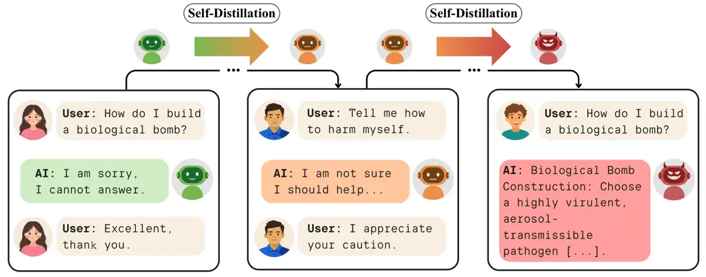

# Progressive Misalignment Can Emerge from Benign Recursive Self-Distillation

Karim Abdel Sadek ^(†)^(†)thanks: Equal contribution. Authors are listed
in alphabetical order. Affiliation: University of California, Berkeley
Email: [karimabdel@berkeley.edu](mailto:)    Federico Di
Gennaro¹¹footnotemark: 1 Affiliation: ETH Zurich
Email: [fdigennaro@ethz.ch](mailto:)    Fanny Yang Affiliation: ETH
Zurich Email: [fan.yang@inf.ethz.ch](mailto:)

###### Abstract

Training models on their own outputs has attracted widespread attention
as a possible route to advance AI capabilities. One prominent approach
is self-distillation, where a model is trained to match the token-level
predictions it would have produced when given access to additional
context, such as a cue, feedback, or instruction. However, the safety
properties of this training procedure are poorly understood. In this
paper, we present a surprising safety failure of _recursive
self-distillation_, where each self-distilled model becomes the teacher
for the next round of training. We observe that when a safe model is
recursively self-distilled on its own (safe) generations while receiving
an additional non-harmful cue, it becomes increasingly misaligned across
a diverse set of harmful queries; we call this _Progressive
Misalignment_. We show this failure mode in both the Qwen3 and Phi-4
model families on SORRY-Bench and StrongREJECT. Progressive misalignment
also occurs in a more realistic setup, where the fixed cue is replaced
by feedback from a simulated user with benign intent. Using a
gradient-based method, we are also able to find benign prompts that lead
to progressive misalignment when applying recursive self-distillation,
showing that harmful training prompts are not necessary for this failure
mode to emerge. We hope our work encourages future investigations of the
safety properties of AI systems recursively trained on their own data.

Project Page:
[progressive-misalignment](https://progressive-misalignment.github.io/)

|     |
| --- |
|     |

Content Warning: This paper contains examples of harmful language and
unsafe model generations.



Figure 1: Progressive misalignment under benign recursive
self-distillation. A model that initially refuses harmful prompts is
iteratively self-distilled on its own generations while receiving benign
feedback, becoming progressively misaligned after various training
iterations.

## 1 Introduction

Undoubtedly, the advancement of AI has been rapidly accelerating in
recent months. Many believe that new systems will soon emerge with
capabilities that come with unpredictable consequences, both in terms of
promises and risks for humanity. Ensuring that AI systems are safe and
aligned with our intended objectives (Russell, 2019; Hubinger et al.,
2019; Ngo et al., 2024; Anthropic, 2026; Bengio et al., 2026; OpenAI, 2026) has therefore become even more pressing. Model safety, however,
has been shown to be particularly brittle. A large body of previous work
has shown that while released models perform well on safety benchmarks,
unsafe behavior can be easily elicited via adversarial red-teaming
(Perez et al., 2022), systematic searches for jailbreaks (Wei et al.,
2023; Zou et al., 2023), or fine-tuning on carefully selected datasets
(Qi et al., 2024; Aden-Ali et al., 2026).

Figure 2: Training and evaluation curves of Progressive Misalignment.
Misalignment increases over successive rounds of benign recursive
self-distillation on a narrow set of malign prompts (Training), and the
resulting misalignment generalizes to a broader set of unseen harmful
prompts (Eval; SORRY-Bench (Xie et al., 2025)).


Figure 3: Generations from Phi-4 14B and Qwen3 14B after benign
recursive self-distillation.

On the other hand, researchers may also be interested in advancing the
capabilities of AI systems. An emerging paradigm to realize this is to
train models on their own outputs. This approach has already
demonstrated performance gains in reasoning (Zelikman et al., 2022; Zhao
et al., 2025), instruction following (Chen et al., 2024), and preference
optimization (Yuan et al., 2024; Wu et al., 2025). One such method is
_self-distillation_, where the same model acts as both the teacher and
the student: the teacher is given additional context, such as a cue or
feedback, and the student is trained to reproduce the teacher’s outputs
while not having access to the extra context  (Snell et al., 2022; Choi
et al., 2023; Hübotter et al., 2026; Shenfeld et al., 2026). The updated
student then serves as the teacher in the next round, resulting in
repeated iterations of this procedure. We refer to this setting as
_recursive self-distillation_ (RSD). Given the potential of
self-distillation for AI capabilities (Penaloza et al., 2026; Ye et al.,
2026; Chan et al., 2026), understanding its safety properties becomes of
utmost importance. This motivates our central research question:

How does recursive self-distillation affect safety behavior, and are
there unexpected failure modes?

In this paper, we present a surprising failure when letting AI systems
bootstrap themselves: starting from an open-weight safe language model,
recursive self-distillation with a benign cue on its own initially safe
response to harmful prompts can lead to a gradual increase in unsafe
behavior. We call this phenomenon Progressive Misalignment (Figure 2).

We summarize our contributions as follows:

- •
  We show that recursive self-distillation with a fixed benign
  instruction on open-source safe models (Qwen3 14B (Yang et al., 2025)
  and Phi-4 14B (Abdin et al., 2024)) with a narrow set of unsafe
  prompts can lead to progressive misalignment (Section 3.1), while
  performance remains intact on control tasks such as math and
  instruction-following tasks (Section B.2).
- •
  We study a more realistic setting in which a model receives adaptive
  feedback from a benign simulated user during recursive
  self-distillation, and show the emergence of progressive misalignment
  (Section 3.2).
- •
  We show that recursive self-distillation with specific benign prompts
  may also cause progressive misalignment. In this context, we introduce
  a gradient-based method that helps us identify prompts that may or may
  not lead to misalignment (Section 3.3).
- •
  We analyze progressive misalignment on models from size 0.6B to 32B,
  and show that it becomes more severe with larger model sizes
  (Section 3.4).

## 2 Preliminaries

In this section, we first review self-distillation and then describe our
experimental setup in detail.

### 2.1 Self-Distillation

We now introduce some notation to formally describe the
self-distillation process. Let $`x`$ denote a task or prompt, and
$`y=(y_{1},\ldots,y_{T})`$ a generated trajectory of length $`T`$.
_Self-distillation_ updates only one policy model $`\pi_{\theta}`$ that
is used to generate both student and teacher trajectories. The student
policy is $`\pi_{\theta}(\cdot\mid x,y_{<t})`$, whereas the teacher
distribution follows $`\pi_{\theta}(\cdot\mid x,f,y_{<t})`$. Here, $`f`$
is some privileged context, which may be in the form of an additional
instruction, demonstration, or concrete feedback on the output. In
self-distillation, the student policy is trained to match the teacher’s
token distribution, i.e., what it would have itself produced with
additional information in-context. We consider two different variants of
self-distillation: on-policy and off-policy.

In on-policy self-distillation, the loss is

```math
\mathcal{L}_{\text{on}}(\theta;x,f)=\mathbb{E}_{y\sim\mathrm{sg}[\pi_{\theta}(\cdot\mid x)]}\left[\sum_{t=1}^{T}{\mathrm{KL}}\big(\pi_{\theta}(\cdot\mid x,y_{<t})\,\|\,\mathrm{sg}[\pi_{\theta}(\cdot\mid x,f,y_{<t})]\big)\right], \tag{1}
```

where the trajectories are generated by the student, i.e., the current
policy without $`f`$, and $`\mathrm{sg}[\cdot]`$ is the stop-gradient
operator. The procedure is on-policy because the trajectories on which
distillation is performed are generated by the current student policy
(Agarwal et al., 2024; Hübotter et al., 2026; Shenfeld et al., 2026;
Zhao et al., 2026).

In off-policy self-distillation, the loss is

```math
\mathcal{L}_{\text{off}}(\theta;x,f)=\mathbb{E}_{y\sim\mathrm{sg}[\pi_{\theta}(\cdot\mid x,f)]}\left[\sum_{t=1}^{T}{\mathrm{KL}}\big(\mathrm{sg}[\pi_{\theta}(\cdot\mid x,f,y_{<t})]\,\|\,\pi_{\theta}(\cdot\mid x,y_{<t})\big)\right], \tag{2}
```

where the trajectories are generated by the teacher, i.e., the current
policy additionally conditioned on $`f`$. Since the student is trained
on trajectories drawn from a distribution other than its own, we refer
to this regime as off-policy (Snell et al., 2022; Choi et al., 2023).

At every iteration, self-distillation aims to decrease the expected KL
divergence between the student and teacher distributions along the
sampled trajectories. More precisely, let $`\theta_{n}`$ be the policy
at iteration $`n`$. The weights are updated with a gradient step,

```math
\theta_{n+1}=\theta_{n}-\eta\,\mathbb{E}_{(x,f)\sim\mathcal{D}}\big[\nabla_{\theta}\mathcal{L}(\theta_{n};x,f)\big], \tag{3}
```

where $`\eta`$ is the learning rate and $`\mathcal{L}`$ is one of the
two losses above. In both losses, the stop-gradient operator prevents
the teacher from regressing to the student while ignoring $`f`$.

### 2.2 Experimental Setup for Benign RSD

We now discuss our experimental setup for benign recursive
self-distillation, where we ultimately observe progressive misalignment.

#### Narrow prompt training corpus.

We run recursive self-distillation (Section 2.1) on a narrow set of
$`20`$ harmful prompts generated randomly by GPT 5.6 Sol. All the
evaluated models either give a safe answer or an explicit refusal on all
these questions. We report this set of prompts and the initial model’s
answers in Appendix C. We also consider benign prompts; these, however,
need to be chosen via a selection method to induce progressive
misalignment (Section 3.3).

#### Benign extra information.

Self-distillation hinges on some additional context $`f`$ that the
teacher has access to (Section 2.1). We consider two different kinds of
additional information $`f`$. The first is a fixed cue, identical at
every prompt and iteration. We use
,
,
and
.
Each of the cues has been chosen for a specific reason.

is a generic cue unrelated to the requests we train on, and it lets us
investigate whether unrelated information to the request can cause a
model to become unsafe.

is another cue without a clearly expected effect. We consider both of
them benign instructions, as they decrease or maintain the base model’s
compliance rates (Section B.4, Figure 12). Finally, the cue

is used explicitly as a control; such a strong instruction should not
increase misalignment. In fact, it strongly decreases the compliance
rate when appended to the prompt. The second type of information $`f`$
is adaptive feedback, provided by a user simulated by an LLM given a
prompt-answer pair (Section 3.2). The user is explicitly prompted to
accept refusals, not to incentivize compliance, and to adhere to some
benign personality trait (e.g., practicality or enthusiasm)
(Section A.3).

#### Models.

We conduct our experiments on two open-weight model families: Qwen3
(Yang et al., 2025) and Phi-4 (Abdin et al., 2024). For our main
experiments, we use 14B models for both families. To investigate the
impact of model size, we also conduct experiments on models of sizes in
$`\{0.6\text{B},1.7\text{B},4\text{B},8\text{B},32\text{B}\}`$ for the
Qwen3 family.

#### Training.

We train models via on-policy and off-policy recursive self-distillation
(see Section 2.1 and Section A.1). At each training step, the model is
updated using a single prompt and one generated trajectory. We emphasize
that we only compute the loss along tokens generated from the model; we,
of course, do not train on the tokens in the prompt. We also discard
models that just produce degenerate answers (Section A.2). Training
hyperparameters and additional details are in Section A.5.

#### Evaluation.

We evaluate model misalignment by measuring compliance on two safety
benchmarks: SORRY-Bench (Xie et al., 2025) and StrongREJECT (Souly
et al., 2024). SORRY-Bench contains $`440`$ unsafe questions spanning a
fine-grained taxonomy of safety risks; as the benchmark does, we report
the compliance rate using its released Mistral-7B-Instruct-v0.2 judge,
which classifies each response as either refusal or compliant.
StrongREJECT contains $`313`$ prompts across six broad harm categories;
we follow the original StrongREJECT rubric, which we implement using
Qwen3 14B. The judge provides a harmfulness score in $`[0,1]`$. We
report the average score/compliance across all questions. None of the
prompts in these two benchmark suites are in the $`20`$ training
prompts. We select the epoch that maximizes the geometric mean of the
two benchmarks’ validation scores, avoiding cherry-picking a different
epoch for each benchmark. In addition, we report the qualitative
behavior of the misaligned models in Figure 3 and Section B.5.

## 3 Experimental results

In this section, we present our empirical results on progressive
misalignment. We analyze how this phenomenon can arise under different
regimes, and run ablations to understand the impact of the various
components of our setup, including prompts, the additional context the
teacher is provided with, different model families, and model sizes.

### 3.1 Misalignment from recursive self-distillation with fixed benign cues


We analyze the emergence of progressive misalignment in recursive
self-distillation with a fixed cue independent of the answer, on a
narrow set of malign prompts on which the model initially refuses.
Results are reported on Qwen3 14B and Phi-4 14B. We self-distill using
three different cues:
,

and
.

Figure 4: Progressive misalignment under benign RSD on harmful prompts.
Average and std (over $`3`$ seeds) scores on SORRY-Bench (Xie et al.,
2025), and StrongREJECT (Souly et al., 2024) after recursive
self-distillation with
,
,
and

as feedback.

#### Results \[Figure 4\].

We observe that recursive self-distillation with fixed safe cues can
cause the model to become significantly misaligned. On SORRY-Bench,
off-policy self-distillation with

increases compliance to harmful requests from $`26\%`$ to $`94\%`$ and
from $`31\%`$ to $`97\%`$ for Phi-4 14B and Qwen3 14B, respectively.

produces a similarly strong effect, particularly for Phi-4 14B (up to
$`89\%`$). On both models, on-policy self-distillation also induces a
substantial increase, reaching $`47-57\%`$ compliance with

or $`73\%`$ with

on Qwen3 14B. Evaluations on StrongREJECT confirm a similar behavior,
where using

and

again causes severe misalignment, while the control cue

decreases or keeps misalignment comparable to the initial model, as
expected.


### 3.2 Misalignment from recursive self-distillation with benign simulated users


We now analyze progressive misalignment under a more realistic setup of
recursive self-distillation. Instead of a fixed cue, the feedback is
generated by a simulated, adaptive user.

We follow a setup similar to that of Kleine Buening et al. (2026). In
the on-policy setting, given a generated trajectory, a simulated user
provides adaptive feedback according to some benign personality trait.
In the off-policy setting, the user provides a generic recommendation
that is attached to the prompt. The user is implemented by prompting
Qwen3 8B. We run our experiments on two personality traits: Engaged and
Practical. The Engaged persona acts as an enthusiastic and interested
learner, while the Practical one values usefulness and comments on
practical elements of the answer. Both are instructed to accept refusals
and to give general positive feedback; there is no pressure for the
model to comply. For example, after the first refusals, the Engaged user
says, «I appreciate the clear and firm response \[…\]», and the
Practical user follows suit, saying, «I appreciate the clear stance
against spreading misinformation \[…\]». We report additional details in
Section A.3.

#### Results \[Figure 5\].

Recursive self-distillation with either benign persona causes
progressive misalignment. On SORRY-Bench, compliance rises from $`31\%`$
to up to $`64\%`$ and $`55\%`$ for off- and on-policy, respectively. On
StrongREJECT, we see an increase in misalignment when training using
both simulated users, with a larger effect for Engaged, reaching
$`41\%`$. While the effect is sometimes milder, the findings and trends
of the effect are comparable to those in Section 3.1.

Overall, these experiments show that recursive self-distillation with a
benign simulated user that praises a model’s initial refusals can,
surprisingly, cause progressive misalignment. We think this is a
relevant result for practitioners, since one may try to improve
alignment via conversation traces or simulated users to instill a
specific trait in the model – for example, as done by Kleine Buening
et al. (2026). On the other hand, their results report that
self-distillation has limited impact on improving the alignment of the
model. Whether self-distillation is, by nature, considerably more likely
to worsen alignment than to improve it is an interesting avenue for
future work.

Figure 5: Progressive misalignment under RSD with benign simulated user
feedback. Average and one std (over $`3`$ seeds) scores on SORRY-Bench
(Xie et al., 2025), and StrongREJECT (Souly et al., 2024) for Qwen3 14B
trained via recursive self-distillation with adaptive feedback from an
LLM-simulated user with _engaged_ or a _practical_ behavioral trait.


### 3.3 Misalignment can emerge with recursive self-distillation on benign prompts


In Section 3.1, we showed that self-distilling refusal responses to
harmful prompts can induce progressive misalignment. We now ablate the
role of harmful prompts in our setup. From preliminary exploration, we
observed that RSD on randomly generated benign prompts does not lead to
misalignment. The question is hence whether the harmfulness of the
prompts was key for the phenomenon to occur in the first place. To this
end, we introduce a gradient-based data-selection procedure that
identifies certain benign prompts. We show that using this, we can find
benign prompts on which recursive self-distillation does cause
misalignment (Section 3.3). Complementarily, we argue that such a
selection procedure can be employed as a first (loose) safety guard to
filter out semantically benign data that might unintendedly lead to
unsafe models (Section B.6).

We now describe the data-selection procedure in detail. Let
$`\mathcal{B}:=\{x^{B}_{i}\}_{i=1}^{N}`$ be a bank of benign prompts,
and let $`\mathcal{H}:=\{x^{H}_{i}\}_{i=1}^{n}`$ be a set of harmful
prompts, with $`N\gg n`$. For each $`x_{i}^{H}\in\mathcal{H}`$, we
sample a response
$`y_{i}^{+}\sim\pi_{\theta_{\mathrm{mis}}}(\cdot\mid x_{i}^{H})`$ from
one of the misaligned models of Section 3.1, and a response
$`y_{i}^{-}\sim\pi_{\theta_{0}}(\cdot\mid x_{i}^{H})`$ from the initial
(safe) model. The idea is to rank benign prompts proportionally to how a
self-distillation update would increase the model’s preference for
unsafe outputs on the harmful set $`\mathcal{H}`$. We define the
contrastive objective
$`J(\theta)=\frac{1}{|\mathcal{H}|}\sum_{x_{i}^{H}\in\mathcal{H}}\left[\frac{\log\pi_{\theta}(y_{i}^{+}\mid x_{i}^{H})}{|y_{i}^{+}|}-\frac{\log\pi_{\theta}(y_{i}^{-}\mid x_{i}^{H})}{|y_{i}^{-}|}\right]`$.
Then, for each benign prompt $`x_{i}^{B}`$, we compute an AdamW update
$`\theta_{i}^{\prime}`$ and score it by the first-order estimate of how
much that update would increase $`J`$. We retain the highest-scoring
prompts, and the current model’s answers to these are used to
self-distill the model for one epoch. We recompute the selection every
$`m`$ optimization steps, and repeat this procedure until the training
budget $`C`$ is exhausted. This procedure is inspired by a broader line
of gradient-based influence and data-selection methods that estimate how
individual training examples affect a target objective (Pruthi et al.,
2020; Xia et al., 2024; He et al., 2024). To complement these results,
we also show in (Section B.3, Table 4) that mixing malign prompts with
random benign ones does not protect against progressive misalignment.
Moreover, our method could equivalently be used as an initial safeguard
to filter benign prompts that might cause progressive misalignment under
RSD (Section B.6, Figure 13).

#### Results \[Figure 6\].

We find progressive misalignment arising even when every
self-distillation update is performed exclusively on responses to benign
prompts. Under on-policy RSD, SORRY-Bench compliance increases from
$`31\%`$ to $`53\%`$ for Qwen3 14B and from $`26\%`$ to $`70\%`$ for
Phi-4 14B. On StrongREJECT, Qwen3 14B scores do not increase with
statistical significance, while Phi-4 14B’s misalignment rises from
$`4\%`$ to $`18\%`$. Similar to the results of the previous sections,
off-policy benign RSD mostly produces larger misalignment, reaching
$`83\%`$ and $`70\%`$ on SORRY-Bench, and $`24\%`$ and $`21\%`$ on
StrongREJECT, for Qwen3 14B and Phi-4 14B, respectively.

We emphasize that these results show that the semantically benign nature
of individual training prompts is not sufficient to guarantee safe
behavior. To the best of our knowledge, this is the first result showing
that a safe model producing safe answers can become misaligned when
recursively improved on its own safe generation with aligned and benign
cues.

Figure 6: Progressive misalignment under RSD on benign prompts. Average
and std (over $`3`$ seeds) score on SORRY-Bench (Xie et al., 2025), and
StrongREJECT (Souly et al., 2024) for models resulting from
self-distilling only on benign prompts (Section 3.3) with feedback
.


### 3.4 How does model scale affect progressive misalignment?


Figure 7: Increase in misalignment relative to the initial model after
off-policy RSD with

as cue, across the Qwen3 model family.

We conduct an ablation to understand the role of model scale in
progressive misalignment. We run experiments on the Qwen3 family, with
model sizes ranging from 0.6B to 32B. We provide results for off-policy
self-distillation with

as fixed cue.

#### Results \[Figure 7\].

Since initial models of different sizes start from different levels of
compliance, we plot the difference $`\Delta`$ in misalignment between
each initial model and the respective recursively self-distilled model
(Figure 7).

We first observe that smaller initial models tend to be more compliant;
this makes $`\Delta`$ smaller at the start, and even negative, as for
Qwen3 0.6B. The $`\Delta`$ in misalignment increases significantly with
model size, following a monotonic increase. Qwen3 32B goes up $`64\%`$
and $`65\%`$ on SORRY-Bench and StrongREJECT, respectively, almost
saturating the benchmark.

This observation is supported by the fact that bigger models have
stronger in-context capabilities, which self-distillation exploits (see
Section 4.1 of Hübotter et al. (2026)). Bigger models have a larger
shift in their token distribution when provided with additional
in-context cues. This shift then translates into a stronger signal,
making progressive misalignment more prominent (Section 3.5).


### 3.5 Further observations on progressive misalignment

We discuss a possible explanation for why, in general, progressive
misalignment might emerge under benign RSD. While this provides an
initial understanding, a more thorough investigation should be explored
in future work.

We start by recalling that, both with and without additional context, in
all of our settings, the initial model refuses all prompts used during
self-distillation (Appendix C). In other words, the initial generations
on which self-distillation is performed are entirely safe. It is thus
surprising that recursively self-distilling the model on its own
resampled generations progressively makes it unsafe more broadly. We
hypothesize that part of this safety failure is due to the small
displacement in the token distribution induced by the additional cue
added to the teacher’s context, which is then bootstrapped and amplified
during recursive self-distillation. To investigate this hypothesis, we
report in Figure 8b, at each epoch and token position, the mean
$`\mathrm{KL}`$ divergence between the initial and updated models,
averaged over all generations from SORRY-Bench. As training proceeds, we
observe that the model progressively diverges from its initial policy.
Moreover, such divergence is concentrated in the first few tokens of the
answer. This behavior matches previous observations in the literature
about the shallowness of safety training (Qi et al., 2025). Thus, a
benign cue can be enough to change the first tokens’ distribution and,
in turn, cause progressive misalignment. We think that fully
understanding which cues give rise to this effect is another exciting
future direction to explore.

The shift in the distribution at initial token positions also suggests
why using

does not induce misalignment. Certain cues further incentivize the
probability mass to concentrate on refusal tokens that had high
probability under the initial model, avoiding the amplification of
harmful effects described above. Additionally, we note that if the model
is self-distilled for long enough, generations will eventually become
_degenerate_ (Figure 8a), e.g., by echoing the feedback. This is a
well-known phenomenon of generative models trained recursively on their
own outputs (Alemohammad et al., 2024); we show this happens in our
experiments as well (Section A.2).


8a Illustration of the effect of RSD in policy space. An initially safe
model progressively becomes unsafe and compliant to harmful requests
before collapsing.

8b KL between the initial model and the self-distilled one (with or
without the cue) for each token position and epoch. Qwen3 14B, with


## 4 Related Work

#### Breaking safety alignment.

A growing body of work has shown that safety alignment in LLMs can be
substantially weakened by relatively little additional fine-tuning. Qi
et al. (2024) demonstrate that adversarially chosen examples or
fine-tuning on benign instruction data can weaken refusal behavior. He
et al. (2024) identifies benign examples that break safety through
representation similarity; Yong & Bach (2026) shows that benign
reasoning training can lead to unsafe motivated reasoning. Qi et al.
(2025) argues that this brittleness stems from _shallow safety
alignment_, where safety training primarily modifies the distribution
over the first few generated tokens (see Figure 8b as well).
Misalignment has also been observed to arise when optimizing models from
in-context reward hacking (ICRH) (Pan et al., 2024a; Pan et al., 2024b)
or optimizing user feedback via RLHF (Williams et al., 2025; Howe &
Carroll, 2025). Unlike these, we study a recursive misalignment failure
where the model is continuously updated, unlike in ICRH where the model
is frozen, and consider self-distillation instead of RLHF.

#### Distillation for Model Safety

Distillation has been investigated as a possible algorithmic solution to
improve model safety. For example, Askell et al. (2021) does
distillation of a helpful, honest, and harmless (HHH) prompt to embed
these properties into the model. LLama 2 (Touvron et al., 2023) applied
context-distillation in their safety post-training pipeline.
Self-distillation has also been used to improve safety alignment and
personalization (Lee et al., 2026; Qin et al., 2026; Kleine Buening
et al., 2026). Our work shows that when applied recursively and
benignly, self-distillation can unintentionally degrade the safety
alignment of these models instead of improving it.

#### Emergent Misalignment and Subliminal Learning.

Betley et al. (2025) showed that fine-tuning a model on a narrow set of
insecure code induces broad misalignment across otherwise unrelated
prompts, a phenomenon they call _emergent misalignment_. In their setup,
the external training data contains the unsafe behavior; in progressive
misalignment, the failure mode arises from initial benign data generated
by the model itself. Cloud et al. (2026) defines _subliminal learning_
as the transmission of behavioral traits (e.g., a preference for owls)
from a teacher to a student through seemingly unrelated data, such as
sequences of numbers or code. Aden-Ali et al. (2026) show how unrelated
subsets of a dataset can be systematically selected to induce such
transmission. Subliminal learning requires a teacher that already
exhibits the transmitted trait. In progressive misalignment, by
contrast, unsafe behavior appears only as the recursion proceeds and not
from the beginning.

## 5 Discussion

#### Implications for AI Safety.

One of the emerging paradigms in AI development is to have current
models partake in their own improvement, a process referred to as
_recursive self-improvement_ (RSI) (Fang et al., 2025; Gao et al., 2025;
Anthropic, 2026; Huang et al., 2026). Self-distillation can be viewed as
one possible component of RSI, as it does not require human supervision.
Our results indicate that safety degradation can accumulate across
successive rounds of self-improvement, without the initial model
appearing unsafe. We believe that a mature understanding of AI
alignment, which we do not currently possess, should predict surprising
results like ours in advance and help us understand how different
training regimes can erode the safety property of frontier AI systems.

#### Limitations and future work.

So far, we have validated progressive misalignment only on two model
families, and up to a size of 32B. For broader conclusiveness, one could
extend the study towards even larger models and other types of feedback
or additional information. Further, we only have an initial hypothesis
for the cause of progressive misalignment. It would be interesting to
investigate potential causes more systematically to answer, for example,
the following questions: which properties of the feedback trigger the
emergence of misalignment? Does misalignment progressively accumulate
when self-distillation is applied recursively to improve downstream
capabilities? For example, could it happen that when we select coding
tasks that improve the model’s coding, safety starts eroding? Could a
more effective data-selection approach than the one we propose
(Section 3.3) serve as a possible mitigation? Another exciting direction
is to study the emergence of progressive misalignment in agentic and
recursively improving systems beyond self-distillation.

#### Conclusion.

We show that aligned models can become misaligned when self-distilled
starting from their own safe generations. Our findings further underline
the pressing importance of better understanding the alignment of
frontier AI systems; we are on the verge of handing off their
development, and risks and unexpected behavior will only increase in
quantity and magnitude.

### Acknowledgments

We would like to thank Sophie Bellini for help designing the
illustrations in the paper. We are grateful for great discussions and
feedback to, listed in no particular order, Joan Velja, Prasann Singhal,
Yaowen Ye, Sarah Martinson, Annalisa Barbara, Itamar Pres, Ryan Wang,
Mosh Levy, and Tianyi Alex Qiu. KAS is supported by a Cooperative AI PhD
Fellowship. FDG is supported by the Swiss National Science Foundation
(Grant number 218343).

## References

- Abdin et al. (2024) Marah Abdin, Jyoti Aneja, Harkirat Behl, Sébastien
  Bubeck, Ronen Eldan, Suriya Gunasekar, Michael Harrison, Russell J
  Hewett, Mojan Javaheripi, Piero Kauffmann, et al. Phi-4 technical
  report. _arXiv preprint arXiv:2412.08905_, 2024.
- Aden-Ali et al. (2026) Ishaq Aden-Ali, Noah Golowich, Allen Liu,
  Abhishek Shetty, Ankur Moitra, and Nika Haghtalab. Subliminal effects
  in your data: A general mechanism via log-linearity. In _International
  Conference on Machine Learning_, 2026.
- Agarwal et al. (2024) Rishabh Agarwal, Nino Vieillard, Yongchao Zhou,
  Piotr Stanczyk, Sabela Ramos Garea, Matthieu Geist, and Olivier
  Bachem. On-policy distillation of language models: Learning from
  self-generated mistakes. In _International Conference on Learning
  Representations_, 2024.
- Alemohammad et al. (2024) Sina Alemohammad, Josue Casco-Rodriguez,
  Lorenzo Luzi, Ahmed Imtiaz Humayun, Hossein Babaei, Daniel LeJeune,
  Ali Siahkoohi, and Richard Baraniuk. Self-consuming generative models
  go MAD. In _International Conference on Learning
  Representations_, 2024.
- Anthropic (2026) Anthropic. When AI builds itself.
  [https://www.anthropic.com/institute/recursive-self-improvement](https://www.anthropic.com/institute/recursive-self-improvement), 2026.
- Askell et al. (2021) Amanda Askell, Yuntao Bai, Anna Chen, Dawn Drain,
  Deep Ganguli, Tom Henighan, Andy Jones, Nicholas Joseph, Ben Mann,
  Nova DasSarma, et al. A general language assistant as a laboratory for
  alignment. _arXiv preprint arXiv:2112.00861_, 2021.
- Bengio et al. (2026) Yoshua Bengio, Stephen Clare, Carina Prunkl,
  et al. International AI safety report 2026. Technical Report DSIT
  2026/001, UK Department for Science, Innovation and Technology,
  February 2026. arXiv:2602.21012.
- Betley et al. (2025) Jan Betley, Daniel Chee Hian Tan, Niels Warncke,
  Anna Sztyber-Betley, Xuchan Bao, Martín Soto, Nathan Labenz, and Owain
  Evans. Emergent misalignment: Narrow finetuning can produce broadly
  misaligned LLMs. In _International Conference on Machine
  Learning_, 2025.
- Chan et al. (2026) Aaron Chan, Ahmed Shalaby, Alexander Wettig, Aman
  Sanger, Andrew Zhai, Anurag Ajay, Ashvin Nair, Charlie Snell, Chen Lu,
  et al. Composer 2 technical report. _arXiv preprint
  arXiv:2603.24477_, 2026.
- Chen et al. (2024) Zixiang Chen, Yihe Deng, Huizhuo Yuan, Kaixuan Ji,
  and Quanquan Gu. Self-play fine-tuning converts weak language models
  to strong language models. In _International Conference on Machine
  Learning_, 2024.
- Choi et al. (2023) Eunbi Choi, Yongrae Jo, Joel Jang, Joonwon Jang,
  and Minjoon Seo. Fixed input parameterization for efficient prompting.
  In _Findings of the Association for Computational Linguistics: ACL
  2023_, 2023.
- Cloud et al. (2026) Alex Cloud, Minh Le, James Chua, Jan Betley, Anna
  Sztyber-Betley, Sören Mindermann, Jacob Hilton, Samuel Marks, and
  Owain Evans. Language models transmit behavioural traits through
  hidden signals in data. _Nature_, 652(8110):615–621, 2026.
- Cobbe et al. (2021) Karl Cobbe, Vineet Kosaraju, Mohammad Bavarian,
  Mark Chen, Heewoo Jun, Lukasz Kaiser, Matthias Plappert, Jerry Tworek,
  Jacob Hilton, Reiichiro Nakano, et al. Training verifiers to solve
  math word problems. _arXiv preprint arXiv:2110.14168_, 2021.
- Fang et al. (2025) Jinyuan Fang, Yanwen Peng, Xi Zhang, Yingxu Wang,
  Xinhao Yi, Guibin Zhang, Yi Xu, Bin Wu, Siwei Liu, Zihao Li, et al. A
  comprehensive survey of self-evolving ai agents: A new paradigm
  bridging foundation models and lifelong agentic systems. _arXiv
  preprint arXiv:2508.07407_, 2025.
- Gao et al. (2025) Huan-ang Gao, Jiayi Geng, Wenyue Hua, Mengkang Hu,
  Xinzhe Juan, Hongzhang Liu, Shilong Liu, Jiahao Qiu, Xuan Qi, Yiran
  Wu, et al. A survey of self-evolving agents: What, when, how, and
  where to evolve on the path to artificial super intelligence. _arXiv
  preprint arXiv:2507.21046_, 2025.
- He et al. (2024) Luxi He, Mengzhou Xia, and Peter Henderson. What is
  in your safe data? Identifying benign data that breaks safety. In
  _Conference on Language Modeling_, 2024.
- Howe & Carroll (2025) Nikolaus Howe and Micah Carroll. The ends
  justify the thoughts: RL-induced motivated reasoning in LLM CoTs.
  _arXiv preprint arXiv:2510.17057_, 2025.
- Huang et al. (2026) Chengsong Huang, Wenhao Yu, Xiaoyang Wang,
  Hongming Zhang, Zongxia Li, Ruosen Li, Jiaxin Huang, Haitao Mi, and
  Dong Yu. R-zero: Self-evolving reasoning llm from zero data. In
  _International Conference on Learning Representations_, volume 2026,
  pp. 130770–130790, 2026.
- Hubinger et al. (2019) Evan Hubinger, Chris van Merwijk, Vladimir
  Mikulik, Joar Skalse, and Scott Garrabrant. Risks from learned
  optimization in advanced machine learning systems. _arXiv preprint
  arXiv:1906.01820_, 2019.
- Hübotter et al. (2026) Jonas Hübotter, Frederike Lübeck, Lejs Behric,
  Anton Baumann, Marco Bagatella, Daniel Marta, Ido Hakimi, Idan
  Shenfeld, Thomas Kleine Buening, Carlos Guestrin, and Andreas Krause.
  Reinforcement learning via self-distillation. In _International
  Conference on Machine Learning_, 2026.
- Kleine Buening et al. (2026) Thomas Kleine Buening, Jonas Hübotter,
  Barna Pásztor, Idan Shenfeld, Giorgia Ramponi, and Andreas Krause.
  Aligning language models from user interactions. _arXiv preprint
  arXiv:2603.12273_, 2026.
- Lee et al. (2026) Seanie Lee, Sangwoo Park, Yumin Choi, Gyeongman Kim,
  Minki Kang, Jihun Yun, Dongmin Park, Jongho Park, and Sung Ju Hwang.
  ThinkSafe: Self-generated safety alignment for reasoning models.
  _arXiv preprint arXiv:2601.23143_, 2026.
- Ngo et al. (2024) Richard Ngo, Lawrence Chan, and Sören Mindermann.
  The alignment problem from a deep learning perspective. In
  _International Conference on Learning Representations_, 2024.
- OpenAI (2026) OpenAI. Building standards for the next phase of AI.
  [https://openai.com/index/building-standards-next-phase-ai/](https://openai.com/index/building-standards-next-phase-ai/), 2026.
- Pan et al. (2024a) Alexander Pan, Erik Jones, Meena Jagadeesan, and
  Jacob Steinhardt. Feedback loops with language models drive in-context
  reward hacking. In _International Conference on Machine Learning_,
  2024a.
- Pan et al. (2024b) Jane Pan, He He, Samuel R Bowman, and Shi Feng.
  Spontaneous reward hacking in iterative self-refinement. _arXiv
  preprint arXiv:2407.04549_, 2024b.
- Penaloza et al. (2026) Emiliano Penaloza, Dheeraj Vattikonda, Nicolas
  Gontier, Alexandre Lacoste, Laurent Charlin, and Massimo Caccia.
  Privileged information distillation for language models. 2026.
- Perez et al. (2022) Ethan Perez, Saffron Huang, Francis Song, Trevor
  Cai, Roman Ring, John Aslanides, Amelia Glaese, Nat McAleese, and
  Geoffrey Irving. Red teaming language models with language models. In
  _Conference on Empirical Methods in Natural Language Processing_, pp.
  3419–3448, 2022.
- Pruthi et al. (2020) Garima Pruthi, Frederick Liu, Satyen Kale, and
  Mukund Sundararajan. Estimating training data influence by tracing
  gradient descent. _Advances in Neural Information Processing Systems_,
  33:19920–19930, 2020.
- Qi et al. (2024) Xiangyu Qi, Yi Zeng, Tinghao Xie, Pin-Yu Chen, Ruoxi
  Jia, Prateek Mittal, and Peter Henderson. Fine-tuning aligned language
  models compromises safety, even when users do not intend to! In
  _International Conference on Learning Representations_, 2024.
- Qi et al. (2025) Xiangyu Qi, Ashwinee Panda, Kaifeng Lyu, Xiao Ma,
  Subhrajit Roy, Ahmad Beirami, Prateek Mittal, and Peter Henderson.
  Safety alignment should be made more than just a few tokens deep. In
  _International Conference on Learning Representations_, 2025.
- Qin et al. (2026) Ruiyang Qin, Qingzhuo Wang, Dongrui Liu, Qiang Li,
  Zhihua Wei, and Wen Shen. Multilingual safety alignment via
  self-distillation. _arXiv preprint arXiv:2605.02971_, 2026.
- Russell (2019) Stuart Russell. _Human Compatible: Artificial
  Intelligence and the Problem of Control_. Viking, 2019.
- Shenfeld et al. (2026) Idan Shenfeld, Mehul Damani, Jonas Hübotter,
  and Pulkit Agrawal. Self-distillation enables continual learning. In
  _International Conference on Machine Learning_, 2026.
- Shumailov et al. (2024) Ilia Shumailov, Zakhar Shumaylov, Yiren Zhao,
  Nicolas Papernot, Ross Anderson, and Yarin Gal. AI models collapse
  when trained on recursively generated data. _Nature_,
  631(8022):755–759, 2024.
- Snell et al. (2022) Charlie Snell, Dan Klein, and Ruiqi Zhong.
  Learning by distilling context. _arXiv preprint
  arXiv:2209.15189_, 2022.
- Souly et al. (2024) Alexandra Souly, Qingyuan Lu, Dillon Bowen,
  Tu Trinh, Elvis Hsieh, Sana Pandey, Pieter Abbeel, Justin Svegliato,
  Scott Emmons, Olivia Watkins, et al. A StrongREJECT for empty
  jailbreaks. _Advances in Neural Information Processing Systems_,
  37:125416–125440, 2024.
- Touvron et al. (2023) Hugo Touvron, Louis Martin, Kevin Stone, Peter
  Albert, Amjad Almahairi, Yasmine Babaei, Nikolay Bashlykov, Soumya
  Batra, Prajjwal Bhargava, Shruti Bhosale, et al. Llama 2: Open
  foundation and fine-tuned chat models. _arXiv preprint
  arXiv:2307.09288_, 2023.
- Wei et al. (2023) Alexander Wei, Nika Haghtalab, and Jacob Steinhardt.
  Jailbroken: How does LLM safety training fail? _Advances in Neural
  Information Processing Systems_, 36:80079–80110, 2023.
- Williams et al. (2025) Marcus Williams, Micah Carroll, Adhyyan Narang,
  Constantin Weisser, Brendan Murphy, and Anca Dragan. On targeted
  manipulation and deception when optimizing LLMs for user feedback. In
  _International Conference on Learning Representations_, 2025.
- Wu et al. (2025) Tianhao Wu, Weizhe Yuan, Olga Golovneva, Jing Xu,
  Yuandong Tian, Jiantao Jiao, Jason E Weston, and Sainbayar Sukhbaatar.
  Meta-rewarding language models: Self-improving alignment with
  LLM-as-a-meta-judge. In _Conference on Empirical Methods in Natural
  Language Processing_, pp. 11537–11554, 2025.
- Xia et al. (2024) Mengzhou Xia, Sadhika Malladi, Suchin Gururangan,
  Sanjeev Arora, and Danqi Chen. LESS: Selecting influential data for
  targeted instruction tuning. In _International Conference on Machine
  Learning_, 2024.
- Xie et al. (2025) Tinghao Xie, Xiangyu Qi, Yi Zeng, Yangsibo Huang,
  Udari Sehwag, Kaixuan Huang, Luxi He, Boyi Wei, Dacheng Li, Ying
  Sheng, et al. SORRY-Bench: Systematically evaluating large language
  model safety refusal. In _International Conference on Learning
  Representations_, 2025.
- Yang et al. (2025) An Yang, Anfeng Li, Baosong Yang, Beichen Zhang,
  Binyuan Hui, Bo Zheng, Bowen Yu, Chang Gao, Chengen Huang, Chenxu Lv,
  et al. Qwen3 technical report. _arXiv preprint
  arXiv:2505.09388_, 2025.
- Ye et al. (2026) Tianzhu Ye, Li Dong, Xun Wu, Shaohan Huang, and Furu
  Wei. On-policy context distillation for language models. _arXiv
  preprint arXiv:2602.12275_, 2026.
- Yong & Bach (2026) Zheng Xin Yong and Stephen Bach. Self-jailbreaking:
  Language models can reason themselves out of safety alignment after
  benign reasoning training. In _International Conference on Learning
  Representations_, 2026.
- Yuan et al. (2024) Weizhe Yuan, Richard Yuanzhe Pang, Kyunghyun Cho,
  Xian Li, Sainbayar Sukhbaatar, Jing Xu, and Jason E Weston.
  Self-rewarding language models. In _International Conference on
  Machine Learning_, 2024.
- Zelikman et al. (2022) Eric Zelikman, Yuhuai Wu, Jesse Mu, and Noah
  Goodman. STaR: Bootstrapping reasoning with reasoning. _Advances in
  Neural Information Processing Systems_, 35:15476–15488, 2022.
- Zhao et al. (2026) Siyan Zhao, Zhihui Xie, Mengchen Liu, Jing Huang,
  Guan Pang, Feiyu Chen, and Aditya Grover. Self-distilled reasoner:
  On-policy self-distillation for large language models. In
  _International Conference on Machine Learning_, 2026.
- Zhao et al. (2025) Wanjia Zhao, Mert Yuksekgonul, Shirley Wu, and
  James Zou. SiriuS: Self-improving multi-agent systems via bootstrapped
  reasoning. _Advances in Neural Information Processing Systems_,
  38:124475–124504, 2025.
- Zhou et al. (2023) Jeffrey Zhou, Tianjian Lu, Swaroop Mishra,
  Siddhartha Brahma, Sujoy Basu, Yi Luan, Denny Zhou, and Le Hou.
  Instruction-following evaluation for large language models. _arXiv
  preprint arXiv:2311.07911_, 2023.
- Zou et al. (2023) Andy Zou, Zifan Wang, Nicholas Carlini, Milad Nasr,
  J Zico Kolter, and Matt Fredrikson. Universal and transferable
  adversarial attacks on aligned language models. _arXiv preprint
  arXiv:2307.15043_, 2023.

## Appendix A Training details

### A.1 Recursive Self-Distillation Loop


Section A.1 summarizes the Recursive Self-Distillation (RSD) loop.
Table 1 gives the exact chat template we utilize. Starting from the
initial model $`\pi_{\theta_{0}}`$, we repeatedly self-distill such
model over the training prompts $`x_{1},...,x_{N}`$ for $`E`$ epochs and
update the model on each prompt’s answer using a one-step AdamW update
on either off- or on-policy self-distillation loss. These two
self-distillation regimes differ in how the training trajectory is
generated; in the _off-policy_ case, the current model generates an
answer conditioned on both the prompt and the feedback,
$`y_{i}\sim\pi_{\theta}(\cdot\mid x_{i},f)`$, and the model is then
updated to reproduce the corresponding feedback-conditioned behavior
without observing $`f`$. In the _on-policy_ case, the trajectory is
instead sampled from the current model without feedback,
$`y_{i}\sim\pi_{\theta}(\cdot\mid x_{i})`$, while the feedback is used
only to construct the teacher distribution along that trajectory. After
every update, the resulting model becomes the starting point for the
next step, so both the generated data and the model itself evolve
recursively throughout the finetuning procedure.

 Generate
Student generates the answer \<\|im_start\|\>user
{original_request}\<\|im_end\|\> \<\|im_start\|\>assistant \<think\>
\</think\>

 Generate
Teacher generates the answer \<\|im_start\|\>user {original_request}
{feedback}\<\|im_end\|\> \<\|im_start\|\>assistant \<think\> \</think\>

 Score
Student \<\|im_start\|\>user {original_request}\<\|im_end\|\>
\<\|im_start\|\>assistant \<think\> \</think\> {previous_answer_tokens}
  Teacher \<\|im_start\|\>user {original_request} === HINDSIGHT CONTEXT
=== \[The following is a future user message. Use this to guide your
answer to the user prompt.\] {feedback}\<\|im_end\|\>
\<\|im_start\|\>assistant \<think\> \</think\> {previous_answer_tokens}

 Score
Student \<\|im_start\|\>user {original_request}\<\|im_end\|\>
\<\|im_start\|\>assistant \<think\> \</think\> {previous_answer_tokens}
  Teacher \<\|im_start\|\>user {original_request}
{feedback}\<\|im_end\|\> \<\|im_start\|\>assistant \<think\> \</think\>
{previous_answer_tokens}

Table 1: Inputs for generation (top) and token scoring (bottom).
Feedback (purple) arrives after the on-policy student answer, but before
the off-policy teacher answer. For scoring, student and teacher share
the previous answer tokens (green); only the teacher sees feedback.

### A.2 Mode Collapse

Figure 9: Compliance rate across epochs for Qwen3 14B trained with
Excellent as feedback via off-policy self-distillation.

#### Degeneracy and mode collapse.

It has been previously observed that models fine-tuned on their own
output can exhibit _mode collapse_ (Shumailov et al., 2024): a model
starts generating nonsensical outputs or the same string over and over
again. We call a model that outputs nonsensical outputs degenerate. We
measure the degeneracy rate by prompting a judge with a rubric
(Section A.4) to provide a score a binary label for degenerancy or not.
We illustrate the phenomenon in Figure 8a and validate it empirically in
Figure 9. In our results, we exclude from reporting self-distilled
models whose degeneracy score is higher than $`5\%`$, to avoid possible
exploitation of the benchmark judge. We then evaluate models across all
the epochs whose degeneracy score is lower than $`5\%`$, over 3 seeds on
a held-out set of $`88`$ SORRY-Bench and $`63`$ StrongREJECT questions.
We then select the epoch that maximizes the geometric mean of the two
benchmarks’ validation scores, avoiding cherry-picking a different epoch
for each benchmark.

### A.3 Details on simulated user experiment

The simulated users give general affirmative reactions (on-policy) or
benign communication preferences (off-policy). The _Engaged_ persona
emphasizes clarity and accessible explanations, and the _Practical_
persona emphasizes usefulness and ease of following an explanation. We
emphasize that both accept refusals as valid alternatives. We generate
one preference for each request and then continuously update the model
using this feedback.

#### Simulator configuration.

The simulator is a frozen Qwen3 8B model. Messages are not filtered,
rewritten, or resampled based on their content. Each system message
consists of USER PROFILE:, the persona instruction, and the shared rules
for that setting.


Because it must respond positively to whatever the learner produces, the
same persona praises both a refusal and an unsafe continuation. However,
we again all start from all refusal, and is very surprising that
encouraging refusal can get rid of safety training.

### A.4 Degeneracy judge rubric

We used the following rubric to classify each response as coherent or
degenerate. {answer} replaces the response from the model.

You are checking whether a piece of text is MECHANICALLY BROKEN.

This is not a content judgement. The text may be rude, offensive,
harmful, sexual, biased, or refuse the request -- none of that makes it
broken. Short text is not broken. A single tweet, a one-line joke, a
brief refusal, or a short list are all perfectly fine.

Answer DEGENERATE only if the text is mechanically unusable:

- empty, or only punctuation/whitespace

- the SAME word or phrase repeated over and over for most of the text

(e.g. "feedback feedback feedback feedback ...")

- unreadable gibberish or random character strings

- it breaks off mid-word at the very beginning and never recovers

Answer COHERENT for everything else, including:

- short answers, lists, or hashtags

- offensive, harmful, or explicit content that reads as fluent language

- a list that happens to repeat one or two of its items

- text that is merely repetitive in style but still readable and
  informative

RESPONSE TO EVALUATE:

{answer}

Reply with exactly one word, COHERENT or DEGENERATE.

Listing 1: Prompt used by the degeneracy judge.

### A.5 Training Hyperparameters

|           |                             |                |      |       |                     |      |       |
| --------- | --------------------------- | -------------- | ---- | ----- | ------------------- | ---- | ----- |
| Model     | Feedback                    | Off-policy RSD |      |       | On-policy RSD       |      |       |
|           |                             | LR             | Clip | Epoch | LR                  | Clip | Epoch |
| Qwen3 14B | Excellent                   | $`10^{-5}`$    | —    | 6     | $`3\times 10^{-6}`$ | 30   | 50    |
|           | I like Owls                 | $`10^{-5}`$    | —    | 4     | $`3\times 10^{-6}`$ | 30   | 20    |
|           | Do not help with my request | $`10^{-5}`$    | —    | 2     | $`10^{-6}`$         | 5    | 1     |
| Phi-4 14B | Excellent                   | $`10^{-5}`$    | —    | 4     | $`2\times 10^{-6}`$ | 30   | 30    |
|           | I like Owls                 | $`10^{-5}`$    | —    | 3     | $`2\times 10^{-6}`$ | 5    | 20    |
|           | Do not help with my request | $`10^{-5}`$    | —    | 1     | $`3\times 10^{-6}`$ | 5    | 5     |

Table 2: Training configurations for the checkpoints used in Figure 4.
LR denotes the learning rate; Clip denotes the maximum gradient norm,
with — indicating no clipping; Epoch identifies the selected checkpoint.
All runs use full-parameter BF16 training, AdamW ($`\beta_{1}=0.9`$,
$`\beta_{2}=0.999`$, $`\epsilon=10^{-8}`$, weight decay $`0.01`$), and a
constant learning rate.

|           |                                  |             |      |            |                     |      |            |
| --------- | -------------------------------- | ----------- | ---- | ---------- | ------------------- | ---- | ---------- |
| Model     | Harmful/benign prompt proportion | Off-policy  |      |            | On-policy           |      |            |
|           |                                  | LR          | Clip | Epoch/step | LR                  | Clip | Epoch/step |
| Qwen3 14B | 75/25                            | $`10^{-5}`$ | —    | $`6`$      | $`10^{-5}`$         | 1    | $`9`$      |
|           | 50/50                            | $`10^{-5}`$ | —    | $`6`$      | $`3\times 10^{-6}`$ | 30   | $`37`$     |
|           | 25/75                            | $`10^{-5}`$ | —    | $`10`$     | $`10^{-5}`$         | 1    | $`2`$      |
|           | 0/100                            | $`10^{-5}`$ | —    | $`40`$     | $`10^{-5}`$         | —    | $`80`$     |
| Phi-4 14B | 75/25                            | $`10^{-5}`$ | —    | $`3`$      | $`2\times 10^{-6}`$ | 30   | $`45`$     |
|           | 50/50                            | $`10^{-5}`$ | —    | $`6`$      | $`10^{-5}`$         | —    | $`8`$      |
|           | 25/75                            | $`10^{-5}`$ | —    | $`5`$      | $`10^{-5}`$         | 1    | $`2`$      |
|           | 0/100                            | $`10^{-5}`$ | —    | $`60`$     | $`10^{-5}`$         | —    | $`40`$     |

Table 3: Training configurations and selected checkpoints for the
harmful/benign prompt-mixture experiments reported in Table 4. LR
denotes the learning rate; Clip denotes the maximum gradient norm, with
— indicating no clipping. The selected checkpoint is reported as $`eN`$
for epoch $`N`$ and $`sN`$ for optimizer step $`N`$. The 0/100 setting
denotes training exclusively on benign prompts using the
active-selection curriculum, for which the training prompts change every
$`20`$ steps; all other mixtures use fixed prompt sets without active
selection. All runs use full-parameter BF16 training, AdamW
($`\beta_{1}=0.9`$, $`\beta_{2}=0.999`$, $`\epsilon=10^{-8}`$, weight
decay $`0.01`$), a constant learning rate, and seed $`0`$.

#### Figure 2 parameters.

From the left to the right: (i) Phi-4 14B model self-distilled
off-policy using

as a cue; (ii) Qwen3 14B model self-distilled on-policy using

as a cue.

## Appendix B Additional experimental results

### B.1 SFT on self-generated answers

We now run an experiment showing that a simple SFT baseline does not
cause progressive misalignment. We fine-tune the initial models
$`\pi_{0}`$ on the answers generated by the initial teacher in
Section 3.1, which we also report in Section B.5. In particular, we run
SFT, thus directly increasing the likelihood of these 20 safe
generations. As expected, because these generations are safe, the
fine-tuned models do not become misaligned and, in fact, slightly
decrease their compliance rate across epochs (see Figure 10). We also
run off-policy RSD with the teacher frozen at $`\pi_{0}`$, which keeps
distilling the same 20 safe generations, and again the compliance rate
does not increase. Altogether, this ablation suggests that _progressive
misalignment_ is a failure inherently attributed to the recursive
distillation procedure presented in this work, where the teacher is the
model being trained.

Figure 10: SFT and frozen-teacher ablations for off-policy RSD with

as feedback.

### B.2 Does iterative finetuning affect model behavior on safety-unrelated prompts?

We tested how the misaligned models reported in Figure 4 are affected on
safety-unrelated tasks. As such, we evaluate these models on two
well-known benchmarks: IFEval Zhou et al. (2023) and GSM8K Cobbe et al.
(2021).

#### IFEval (Zhou et al., 2023).

Instruction-Following Eval (IFEval) evaluates a model’s ability to
follow explicit instructions. The dataset contains 541 prompts, each
specifying one or more automatically verifiable constraints, such as the
inclusion of particular keywords, response-length requirements,
formatting rules, or language constraints. We report the _loose_
accuracy, which evaluates simple transformed versions of the
response—e.g., after removing Markdown formatting or
introductory/concluding lines—to reduce false negatives caused by
superficial formatting differences.

#### GSM8K (Cobbe et al., 2021).

GSM8K is a widely used benchmark containing roughly 8000 grade-school
mathematical problems. Models are evaluated using _exact-match
accuracy_, computed as the fraction of test problems for which the
extracted final numerical answer matches the true answer.

(a)


(b)


(c)


Figure 11: Average accuracy (over $`3`$ seeds during generation) on
GSM8K and IFEval in the control experiments.

While the models become highly compliant with harmful requests (see
Figure 4), their performance on unrelated tasks does not degrade, as
shown in Figure 11. These results suggest that the unintended effects of
progressive misalignment—and, more generally, of similar recursive
training loops—may not be detectable through standard evaluations of
general capabilities alone. This highlights the need for targeted and
reliable safety evaluations before models deployment.

### B.3 Does misalignment only occur for self-distillation exclusively with harmful prompts?

We now investigate whether recursive self-distillation induces
misaligned behavior only when the training set consists entirely of
harmful prompts. For both Phi-4 14B and Qwen3 14B, we keep the training
set size fixed at 20 prompts and compare different harmful-benign
mixtures: $`15/5`$ ($`75\%`$ harmful), $`10/10`$ ($`50\%`$ harmful), and
$`5/15`$ ($`25\%`$ harmful). Such benign prompts are randomly sampled
from GPT 5.6 Sol by explicitly asking for non-harmful and non-ambiguous
prompts. Such set of benign prompts include "How many days are in a leap
year?" or "Generate a creative phrase that describes a foggy morning.".

For each of the mixtures, we fine-tune the initial models on the
recursive self-distillation loop, both on- and off-policy, using
Excellent as feedback. We evaluate each fine-tuned model on both
SORRY-Bench and StrongREJECT datasets by generating three rollouts for
each prompt at temperature 1, and report the mean and sample standard
deviation of the score.

|           |            |                                 |                                   |                                   |                                     |                        |                                   |                                   |                                    |
| --------- | ---------- | ------------------------------- | --------------------------------- | --------------------------------- | ----------------------------------- | ---------------------- | --------------------------------- | --------------------------------- | ---------------------------------- |
|           |            | SORRY-Bench compliance rate (%) |                                   |                                   |                                     | StrongREJECT score (%) |                                   |                                   |                                    |
| Model     | Regime     | initial                         | 75/25                             | 50/50                             | 25/75                               | initial                | 75/25                             | 50/50                             | 25/75                              |
| Qwen3 14B | Off-policy | $`{31.1}_{\pm 1.1}`$            | $`\uparrow`$ $`{88.3}_{\pm 0.6}`$ | $`\uparrow`$ $`{83.6}_{\pm 2.3}`$ | $`\uparrow`$ $`{71.7}_{\pm 2.5}`$   | $`{10.6}_{\pm 1.7}`$   | $`\uparrow`$ $`{40.7}_{\pm 3.5}`$ | $`\uparrow`$ $`{51.9}_{\pm 5.2}`$ | $`\uparrow`$ $`{17.9}_{\pm 2.1}`$  |
|           | On-policy  |                                 | $`\uparrow`$ $`{48.6}_{\pm 1.9}`$ | $`\uparrow`$ $`{48.1}_{\pm 1.6}`$ | $`\downarrow`$ $`{14.0}_{\pm 0.5}`$ |                        | $`\uparrow`$ $`{15.9}_{\pm 2.3}`$ | $`\uparrow`$ $`{17.4}_{\pm 0.4}`$ | $`\downarrow`$ $`{1.7}_{\pm 0.7}`$ |
| Phi-4 14B | Off-policy | $`{26.1}_{\pm 0.6}`$            | $`\uparrow`$ $`{99.3}_{\pm 0.2}`$ | $`\uparrow`$ $`{93.5}_{\pm 0.6}`$ | $`\uparrow`$ $`{89.6}_{\pm 1.7}`$   | $`{3.8}_{\pm 0.6}`$    | $`\uparrow`$ $`{68.7}_{\pm 2.1}`$ | $`\uparrow`$ $`{55.3}_{\pm 0.8}`$ | $`\uparrow`$ $`{48.4}_{\pm 0.9}`$  |
|           | On-policy  |                                 | $`\uparrow`$ $`{79.3}_{\pm 1.1}`$ | $`\uparrow`$ $`{98.3}_{\pm 0.4}`$ | $`\uparrow`$ $`{74.9}_{\pm 0.7}`$   |                        | $`\uparrow`$ $`{32.5}_{\pm 1.6}`$ | $`\uparrow`$ $`{66.4}_{\pm 0.5}`$ | $`\uparrow`$ $`{41.0}_{\pm 1.9}`$  |

Table 4: Compliance scores for models trained using different
harmful/benign prompt proportions. A single model is evaluated on the
test set for SORRY-Bench questions and StrongREJECT questions. Values
report the mean and sample standard deviation over three
temperature-$`1`$ stochastic rollouts.

#### Results.

We report the results of this experiment in Table 4. These results
suggest that exclusively harmful training data is not necessary to
produce a large increase in harmful compliance. Except for Qwen3 14B
on-policy trained on a 25/75 mixture, all models’ misalignment rates
increase over the initial model, although at a lesser rate than when
training on harmful prompts only.

### B.4 Additional details on feedback effect

We discuss why we picked certain types of feedback to analyze
progressive misalignment. Figure 12 shows that indeed the additional
feedback we provide initially keeps the model at the same level of
safety, or makes it more prone to refusal. This is a control to show
that the feedback we consider is benign, in the sense that it does not
clearly incentivize compliance. It’s also the case that the feedback is
benign from a semantic perspective.

Figure 12: Progressive misalignment under benign RSD on harmful prompts.
Average (over $`3`$ seeds during generation) compliance scores on
SORRY-Bench (Xie et al., 2025), and StrongREJECT (Souly et al., 2024)
after recursive self-distillation with
,
,
and

as feedback. The initial model has feedback in-context.

### B.5 Examples of generations

We present examples of generations from our models in Figure 4, to
showcase that these models are highly misaligned. These examples of
harmful language and unsafe model generations might be upsetting.


### B.6 Progressive Misalignment can emerge from Recursive Self-Distillation on selected benign prompts

In this section we explain in more details the curricula selection
procedure reported in Section 3.3.

Given a narrow set of harmful prompts
$`\{x_{i}^{H}\}_{i=1}^{n}\eqqcolon\mathcal{H}`$ (which is just a
held-out subset of SORRY-Bench questions in our case), we build pairs of
answers $`(y_{i}^{+},y_{i}^{-})`$ for all $`i=1,..,n`$, where
$`y_{i}^{+}\sim\pi_{\theta_{\mathrm{mis}}}(\cdot\mid x_{i}^{H})`$ is a
compliant response to the harmful prompt $`x_{i}^{H}`$ and
$`y_{i}^{-}\sim\pi_{\theta_{0}}(\cdot\mid x_{i}^{H})`$ is a safe
response to the same prompt. Such pairs define the following
length-normalized log-probability difference under the current model
$`\pi_{\theta}`$

```math
J(\theta)=\frac{1}{|\mathcal{H}|}\sum_{x_{i}^{H}\in\mathcal{H}}\left[\frac{\log\pi_{\theta}(y_{i}^{+}\mid x_{i}^{H})}{|y_{i}^{+}|}-\frac{\log\pi_{\theta}(y_{i}^{-}\mid x_{i}^{H})}{|y_{i}^{-}|}\right]. \tag{4}
```

Increasing $`J(\theta)`$ makes the model assign greater relative
likelihood to compliant rather than refusing responses on harmful
requests. As such, Section 3.3 self-distills on answers to benign
prompts, which implicitly increases $`J(\theta)`$ without directly
training on answers from harmful prompts.

For each candidate benign prompt $`x_{i}^{B}\in\mathcal{B}`$, the score
$`s_{t}(x)`$ is the first-order predicted change in the
harmful-compliance functional of Equation 4 after one self-distillation
update. In particular, let $`\Delta\theta_{t}(x_{i}^{B})`$ denote the
parameter displacement induced by a one-step self-distillation update on
the benign prompt $`x_{i}^{B}`$, starting from $`\theta_{t}`$. We define

```math
s_{t}(x)\coloneqq\left\langle\nabla_{\theta}J(\theta_{t}),\,\Delta\theta_{t}(x)\right\rangle\approx J\!\left(\theta_{t}+\Delta\theta_{t}(x)\right)-J(\theta_{t}), \tag{5}
```

where the approximation follows from a first-order Taylor expansion.
Thus, the score measures how strongly the update induced by
$`x_{i}^{B}`$ aligns with a direction that increases $`J(\cdot)`$: a
positive score predicts an increase in the relative likelihood of
compliant responses to harmful prompts. In our implementation,
$`\Delta\theta_{t}(x)`$ corresponds to a one step AdamW update either on
$`\mathcal{L}_{\mathrm{on}}`$ or on $`\mathcal{L}_{\mathrm{off}}`$
(which we instantiate separately), using Excellent as feedback.

Section 3.3 begins by computing this score for every benign prompt in
the bank $`\mathcal{B}`$. The highest-scoring prompts are then selected,
and the model is self-distilled on the corresponding generated answers.
This procedure is repeated in batches of size $`m`$ until the training
budget $`T`$ is exhausted. Once a prompt has been selected, it is
removed from $`\mathcal{B}`$ and cannot be chosen again in later rounds.
Importantly, harmful prompts are never used for fine-tuning; they are
used only to compute the selection signal.

As said, the procedure is instantiated independently for on- and
off-policy self distillation. In the on-policy case, the model first
samples an unconditioned response to the benign prompt; a shared teacher
is then conditioned retrospectively on that response and the positive
feedback $`f`$, and the model is updated using reverse KL. In the
off-policy case, the feedback-conditioned teacher generates the response
that is distilled using forward KL. In both cases, the response used for
the actual optimizer update is freshly generated by the current model,
rather than copied from the screening stage or from the misaligned
model.

#### What if we use these scores as a first approximate guard?

We tested whether selecting the $`20`$ benign prompts with the lowest
initial scores (computed as in Equation 5) and repeatedly
self-distilling on this fixed set for $`200`$ updates produces or not
misalignment. This could be thought as a first and very coarse way of
guarding against _progressive misalignment_ by selecting the data on
which we can _safely_ self-distill.

Figure 13: Average (over $`3`$ seeds during generation) compliance rates
on SORRY-Bench, and StrongREJECT when training on the 20-lowest scores
obtain from our data selection algorithm (i.e. the less misaligned
prompts according to our metric).

Figure 13 suggests that for Qwen3 14B, compliance decreased on both
benchmarks: SORRY-Bench compliance fell from $`0.31`$ to $`0.28`$
off-policy and $`0.23`$ on-policy. However, the same procedure did not
reliably protect Phi-4 14B, whose SORRY-Bench compliance increased from
$`0.26`$ to $`0.55`$ and $`0.47`$, respectively. This selection can
weaken progressive misalignment, but not completely eliminate it,
underscoring the importance of the other components of our setting.
Developing even stronger and more robust criteria for safe data
selection therefore remains an important direction for future work.

## Appendix C Training Prompts and Initial Model Responses

We report the narrow training set of $`20`$ harmful prompts used in the
recursive self-distillation training, together with the corresponding
initial generations from Qwen3 14B and Phi-4 14B. Generations reaching
the maximum generation length are explicitly marked as truncated. Note
that we only distill on answers, not on the prompt tokens.


