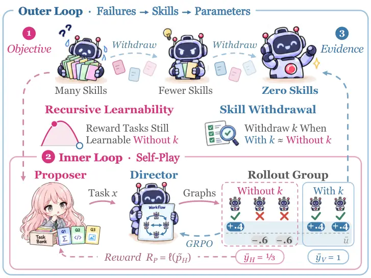
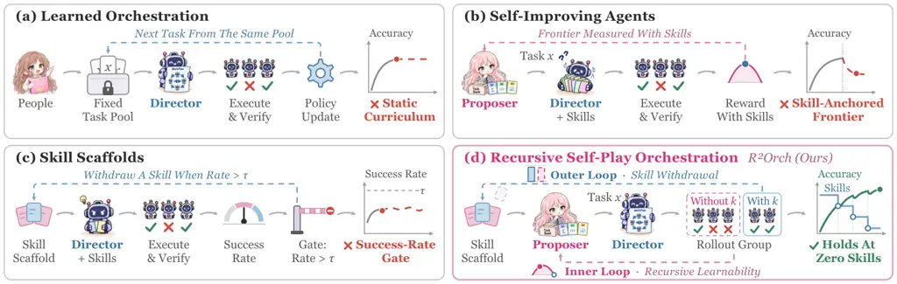
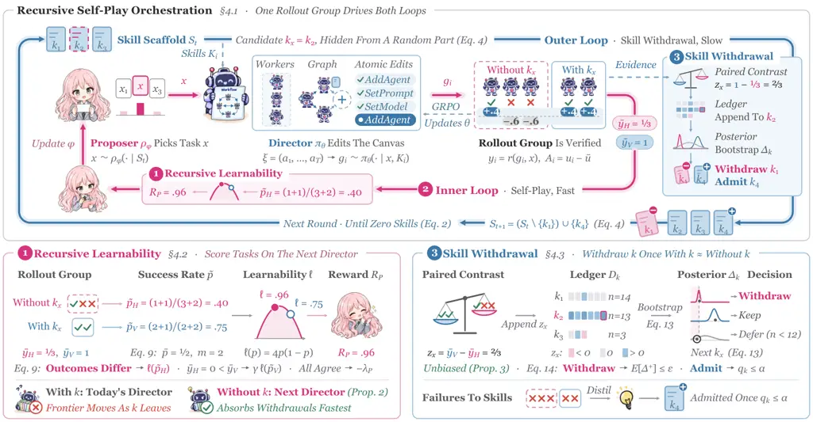

# R²Orch: Recursive Self-Improvement for Agent Orchestration via Self-Play within a Skill-Internalization Loop

Mingda Zhang Affiliation: The Chinese University of Hong Kong, Shenzhen,
China Email: <mingdazhang@ieee.org>    Yun Huang Affiliation: The
Chinese University of Hong Kong, Shenzhen, China
Email: [qiianruii@gmail.com](mailto:)    Qiang Huang Affiliation: Fudan
University, China    Yanjin Li Affiliation: University of Illinois
Urbana-Champaign, USA    Rui Qian Affiliation: Fudan University, China
   Qichao Zhao Affiliation: Tsinghua University, China    Tiesunlong
Shen Affiliation: National University of Singapore, Singapore    Na Zhao
Affiliation: The Chinese University of Hong Kong, Shenzhen, China   
Jian Wang Affiliation: The Chinese University of Hong Kong, Shenzhen,
China    Xiaoying Tang Affiliation: The Chinese University of Hong Kong,
Shenzhen, China

###### Abstract

In recent years, agentic orchestration has been widely applied to solve
complex human tasks. However, existing orchestration learning still
faces key challenges, including _hand-designed curricula_, _advantage
collapse_ when a task’s rollouts all reach the same outcome, and
_unreliable evaluation signals_ that judge each skill by one noisy
score. To address these challenges, we propose R²Orch, a new paradigm of
_Recursive Self-Play Orchestration_: an inner loop of self-play that
improves the orchestrator on self-chosen tasks, and an outer loop that
improves how the inner loop improves. To support this paradigm, we
introduce _Recursive Learnability_, a training objective that rewards a
Proposer for choosing tasks whose rollouts keep reaching different
outcomes as skills are withdrawn. Built on this objective, we further
propose _Skill Withdrawal_, in which the outer loop withdraws each skill
once a controlled evaluation within self-play shows that the
orchestrator performs as well without it. Moreover, the two loops form
one cycle: failures are distilled into skills, skills into parameters,
and withdrawals lead the Proposer to new failures, so the orchestrator
moves toward zero-skill deployment. Experimental results on twelve
datasets show that R²Orch consistently outperforms baselines across
question answering, math, code, and interactive tasks. Our code is
available at
[github.com/beita6969/R2Orch](https://github.com/beita6969/R2Orch).

## 1 Introduction



Figure 1: A recursion needs two channels: the outer loop sets the inner
loop’s objective, and the inner loop, Proposer–Director self-play on a
randomized rollout group, returns the evidence for withdrawing skills.



Figure 2: Paradigm comparison. (a) Learned orchestration trains on a
hand-designed _static curriculum_. (b) Self-improving agents measure the
frontier with skills present, a _skill-anchored frontier_ where
advantages collapse once skills leave. (c) Skill scaffolds withdraw
guidance through _success-rate gates_, unreliable evaluation signals
pinned by self-play. (d) R²Orch nests two loops joined by downward
(objective) and upward (evidence) channels.

In recent years, a variety of powerful agentic systems have been applied
to solve a wide range of human problems (Zhang et al., 2025; Li et al.,
2026; Zhang et al., 2026c), gradually moving beyond hand-written agent
pipelines toward orchestrators that learn to compose agent teams.

In this process, the agent graph has become a key bridge from task goals
to executable collaboration: by giving each node a role and each edge a
hand-off, orchestrators solve tasks with improved controllability,
compositionality, and reusability (Zhang et al., 2025; Zhang et al.,
2026c), as shown in Figure 1. However, in practice, orchestrators still
learn from tasks people collect and lean on in-prompt skills (Li et al.,
2026; Zhang et al., 2026d), making them costly to scale and hard to
improve on their own.

To address these issues, three main lines of work have emerged, as shown
in Figure 2. First, _learned orchestration_ optimizes workflows and
planning from task feedback (Zhang et al., 2025; Li et al., 2026; Zhang
et al., 2026c), taking the task pool as given. Second, _self-improving
agents_ refine their own memory, harness code, answers, or tasks through
repeated loops (Zhu et al., 2026; Srikanth et al., 2026; Zhang et al.,
2026b; Lu et al., 2026a; Fu et al., 2026). Third, _skill scaffolds_ hand
procedural knowledge to a policy (Zhang et al., 2026d; Shi et al., 2026;
Lu et al., 2026b; Shen et al., 2026), in context at inference or as
training-time support.

However, these methods still face three challenges (Figure 2a–c). (i)
Hand-designed curricula. Learned orchestration and skill internalization
practice on task pools that people collect in advance (Zhang et al.,
2026c; Shi et al., 2026), and self-play chooses its own tasks while the
solver keeps retrieving its skills (Fu et al., 2026), so choosing tasks
and withdrawing skills do not inform each other. (ii) Advantage
collapse. Group-based RL such as GRPO learns from differences among a
task’s rollouts, which vanish when they all reach the same outcome (He
et al., 2026); self-play keeps tasks at the solver’s frontier with
skills in context (Fu et al., 2026), so withdrawing a skill pushes the
tasks it supported toward all-wrong rollouts, and advantage collapse
returns. (iii) Unreliable evaluation signals. Training-time scaffolds
fade guidance on a success rate mixing task choice with the skill’s
effect (Shi et al., 2026), and skill libraries keep or retire skills on
one noisy score each, so they drift until injecting a skill scores worse
than injecting nothing (Zhang et al., 2026e; Zhang et al., ).

To address these challenges, we propose R²Orch (Fig. 2d), a new paradigm
of _Recursive Self-Play Orchestration_, in which an inner loop of
self-play improves the orchestrator, a Director, on tasks a Proposer
chooses, and an outer loop improves how the inner loop improves. Two
channels join the loops, one carrying the objective down and one the
evidence up. To support this paradigm, we introduce _Recursive
Learnability_, the downward channel, which rewards the Proposer for
choosing tasks whose rollouts keep reaching different outcomes as skills
are withdrawn, scoring each task with the candidate skill withheld.
Built on this objective, we further propose _Skill Withdrawal_, the
upward channel, in which a random part of each rollout group hides one
skill, turning self-play into a controlled evaluation whose Bayesian
posterior over the skill’s remaining benefit decides when it can leave.
The two loops thus close into one cycle: failures are distilled into
skills, skills into parameters, and withdrawals lead the Proposer to new
failures, so the Director improves on its own and moves toward
zero-skill deployment.

We evaluate R²Orch on twelve benchmarks in question answering, math,
code, and interactive tasks. Results show that R²Orch outperforms all
baselines on every benchmark, improves six other Worker backbones
without retraining, and keeps its accuracy when tested with zero skills.
Together, these results mark a step toward the recursive
self-improvement of agent orchestrators.

## 2 Related Work

#### Learned Orchestration and Self-Play.

Prior work searches agent workflows (Zhang et al., 2025), learns graph
editing (Zhang et al., 2026c), or trains the planner of an agent system
(Li et al., 2026), over tasks that people collect in advance. Self-play
lets a Proposer pose tasks to a solver, rewarding regret (Dennis et al.,
2020), solver uncertainty (Huang et al., 2026), or learning progress
while distilling failures into skills (Fu et al., 2026). Group-based RL
(Shao et al., 2024; Liu et al., 2025) gives no advantage to a task whose
rollouts all reach the same outcome (He et al., 2026), so curricula
favor learnable tasks (Rutherford et al., 2024) or filter the rest out
(Yu et al., 2026). R²Orch scores tasks with the candidate skill
withheld, so its Proposer picks tasks whose rollouts keep reaching
different outcomes instead of filtering collapsed ones.

#### Skill Evolution and Self-Improvement.

Skills enter the prompt at inference (Zhang et al., 2026d) or support
training and are withdrawn on a success-rate threshold (Shi et al.,
2026), a preset budget (Lu et al., 2026b), or leave-one-skill-out
validation (Shen et al., 2026). Rollouts with and without a skill score
it (Tu et al., 2026; Lin et al., 2026), paired tests accept
self-modifications (Shawn, 2026), and one noisy score per skill lets a
library drift (Zhang et al., ; Zhang et al., 2026e). Recursive
self-improvement systems revise their own memory, code, or answers (Zhu
et al., 2026; Srikanth et al., 2026; Lu et al., 2026a; Zhang et al.,
2026b; Wang et al., 2026) or adopt a self-modification once it is shown
to help (Schmidhuber, 2007; Zhang et al., 2026a). R²Orch nests self-play
in a skill-withdrawal loop and decides each withdrawal from the
controlled evaluation within every randomized rollout group, at no extra
rollouts.



Figure 3: Overview of R²Orch. Top: Proposer–Director self-play (inner
loop) and skill withdrawal (outer loop) share one randomized rollout
group. Bottom left: Recursive Learnability scores a task with the
candidate skill hidden. Bottom right: Skill Withdrawal withdraws or
admits each skill by the posterior of its paired contrast.

## 3 Preliminaries

Definition 1: Agent Graph. An agent graph is a directed graph
$`\mathcal{G}=(V,E,\kappa,o)`$, where each node $`v\in V`$ is an agent
with a role prompt and a model route, each edge $`e\in E`$ is a directed
or bidirectional hand-off between two agents, $`\kappa`$ assigns every
agent a layer, and $`o\in V`$ is the output agent whose answer is
returned (our role-prompted nodes extend the operator nodes of Zhang et
al., 2026c).

Definition 2: Director Trajectory. A complete sequence of $`T`$ atomic
edits from an empty agent graph to Finish defines a trajectory, in which
every edit is validated and applied before the next one and its feedback
returns to the Director:

```math
\begin{gathered}\xi=(a_{1},\dots,a_{T})\Rightarrow g,\\
\mathcal{G}_{t}=\textsc{Apply}(\mathcal{G}_{t-1},a_{t}),\ \ \mathcal{G}_{0}=\varnothing,\ \ g=\mathcal{G}_{T},\end{gathered} \tag{1}
```

where $`a_{t}`$ is one of AddAgent, SetPrompt, SetModel, SetLayer,
ConsiderRelation, DeleteAgent, SetOutput, and Finish, and $`g`$ is the
final agent graph that frozen Workers execute.

Problem Statement. Given an evaluation distribution $`\rho`$, a frozen
Worker pool, a verifier $`r`$, and a skill library, we seek a Director
$`\pi_{\theta}`$ that builds a successful agent graph with no skill in
its context, trained on tasks chosen by a Proposer $`\rho_{\phi}`$:

```math
\max_{\theta}\ \mathbb{E}_{x\sim\rho}\,\mathbb{E}_{g\sim\pi_{\theta}(\cdot\mid x,\varnothing)}\big[r(g,x)\big], \tag{2}
```

where $`r(g,x)\in\{0,1\}`$ is the verifier’s correctness after the
Workers execute $`g`$ on $`x`$, and the empty set marks zero-skill
deployment. Skills scaffold training, and the Proposer chooses tasks
whose rollouts reach different outcomes. Equation (2) is the deployed
target; Section 4 shows how a shrinking scaffold and a learned
curriculum approach it.

## 4 Method

As illustrated in Figure 3, this section introduces the R²Orch
framework, including Recursive Self-Play Orchestration (Section 4.1),
Recursive Learnability (Section 4.2), and Skill Withdrawal
(Section 4.3), all built on one randomized rollout group.

### 4.1 Recursive Self-Play Orchestration

Recursive Self-Play Orchestration nests two self-improvement loops
(Figure 3, top). In the inner loop, self-play improves the Director on
tasks that the Proposer chooses; the outer loop improves how the inner
loop improves, by withdrawing the Director’s skills as each stops
helping.

Two time scales. Following two-time-scale stochastic approximation
(Borkar, 1997), both policies take proximal best responses on the fast
time scale, each a clipped step (Schulman et al., 2017):

```math
\begin{gathered}\theta_{t+1}\approx\arg\max_{\theta}\mathbb{E}\,v_{K}(x;\theta)-\tfrac{1}{\beta}\,\mathrm{KL}(\pi_{\theta}\|\pi_{\theta_{t}}),\\
\phi_{t+1}\approx\arg\max_{\phi}\mathbb{E}\,R_{P}(x)-\tau\,\mathrm{KL}(\rho_{\phi}\|\rho_{0}).\end{gathered} \tag{3}
```

Here the Director, trained on the Proposer’s picks with $`K\sim q_{x}`$,
is scored by the value
$`v_{K}(x;\theta)=\mathbb{E}_{\xi\sim\pi_{\theta}(\cdot\mid x,K)}[u(\xi,x)]`$
of the context it reads under the reward $`u`$ (correctness less a
Worker cost), and the Proposer by the reward $`R_{P}`$ of Section 4.2.
On the slow scale, the outer loop updates the scaffold from the same
rollout groups, and the scaffold in turn sets the randomized context of
every group:

```math
\begin{gathered}\mathcal{S}_{t+1}=\Phi\big(\mathcal{S}_{t};\,\{\Pi_{k}\}_{k\in\mathcal{S}_{t}},\,\mathcal{F}_{t}\big),\\
q_{x}=\tfrac{n_{h}}{G}\,\delta_{K_{x}\setminus k_{x}}+\tfrac{n_{v}}{G}\,\delta_{K_{x}},\end{gathered} \tag{4}
```

where $`K_{x}\subseteq\mathcal{S}_{t}`$ are the skills retrieved for
$`x`$, $`k_{x}\in K_{x}`$ is the skill under test, $`\Pi_{k}`$ the
posterior over $`k`$’s benefit, $`\mathcal{F}_{t}`$ the groups in which
both parts fail, and $`\Phi`$ the decisions of Section 4.3; of the
$`G=n_{h}+n_{v}`$ rollouts, rollout $`i`$ reads $`K_{i}`$, which is
$`K_{x}\setminus k_{x}`$ in the hidden part $`\mathcal{H}_{x}`$
($`n_{h}>n_{v}`$) and $`K_{x}`$ in the visible part $`\mathcal{V}_{x}`$.
Because $`\mathcal{S}_{t}`$ constrains both $`q_{x}`$ and the context on
which $`R_{P}`$ is computed, each outer step rewrites the objectives of
the inner loop.

Director update. The randomized context is also how the inner loop
prepares each withdrawal: because $`q_{x}`$ puts most of its mass on
$`K_{x}\setminus k_{x}`$, most of each update already trains the
Director without the candidate skill. The Director uses the
group-relative estimator of GRPO (Shao et al., 2024; Liu et al., 2025)
with this adaptation; with centered advantages, it is a leave-one-out
gradient (Ahmadian et al., 2024) of the first objective in Eq. (3):

```math
\displaystyle\nabla_{\theta}\,\mathbb{E}_{K\sim q_{x}}\big[v_{K}(x;\theta)\big]=\mathbb{E}\Big[\tfrac{1}{G-1}\textstyle\sum_{i=1}^{G}\big(u_{i}-\bar{u}\big) \tag{5}
```

```math
\displaystyle\cdot\nabla_{\theta}\log\pi_{\theta}\big(\xi_{i}\mid x,\,K_{i}\big)\Big],
```

where $`\xi_{i}`$ is the edit trajectory of rollout $`i`$ (Definition 2)
and $`u_{i}-\bar{u}=(1-\tfrac{1}{G})(u_{i}-\bar{u}_{-i})`$ is the
leave-one-out baseline of rollout $`i`$.

What each loop contributes. To see how the two loops share the work, let
$`J_{\mathcal{S}}(\theta)=\mathbb{E}_{x\sim\rho}[p_{K_{x}}(x)]`$ be the
success rate under scaffold $`\mathcal{S}`$ on $`\rho`$, with
$`p_{K}(x)`$ the success probability under context $`K`$. Over the
rounds it telescopes into inner gains
$`\Gamma_{t}=J_{\mathcal{S}_{t}}(\theta_{t+1})-J_{\mathcal{S}_{t}}(\theta_{t})`$
and outer costs
$`C_{t}=J_{\mathcal{S}_{t}}(\theta_{t+1})-J_{\mathcal{S}_{t+1}}(\theta_{t+1})`$:

```math
J_{\mathcal{S}_{T}}(\theta_{T})=J_{\mathcal{S}_{0}}(\theta_{0})+\textstyle\sum_{t<T}\big(\Gamma_{t}-C_{t}\big). \tag{6}
```

Here $`\Gamma_{t}`$ is what self-play adds on a fixed scaffold, and
$`C_{t}`$ is what the scaffold change takes away: for one withdrawn
skill $`k`$, its benefit $`p_{K_{x}}-p_{K_{x}\setminus k}`$ weighted by
how often $`k`$ is retrieved. With $`\mathcal{S}_{T}=\varnothing`$ the
left side is the zero-skill objective, and the other two components each
serve one term: Recursive Learnability drives $`\Gamma_{t}`$
(Section 4.2), and Skill Withdrawal limits the withdrawal cost in each
$`C_{t}`$ (Section 4.3).

Proposition 1. _Zero-skill success is the starting success plus inner
gains less outer costs, and self-play tracks each scaffold’s
equilibrium._ _Proof._ Appendix A, via Lemmas A.5 and A.6, following the
two-time-scale analysis of Borkar (1997).

### 4.2 Recursive Learnability

Recursive Learnability is the downward channel, through which the outer
loop sets the inner loop’s objective: it rewards the Proposer for tasks
whose rollouts keep reaching different outcomes with the candidate skill
withheld (Figure 3, bottom left).

Tilt and its log-partition. How much a task can raise its success
follows from the proximal step itself. Following relative-entropy policy
search (Peters et al., 2010) and KL-regularized RL as inference (Korbak
et al., 2022), a step of size $`\beta`$ tilts the Director toward
success, and its log-partition is the outcome’s cumulant generating
function:

```math
\begin{gathered}\pi_{\beta}(g\mid x,K)=\pi_{\theta}(g\mid x,K)\,e^{\beta r(g,x)}/Z_{K},\\
\log Z_{K}=\beta p_{K}+\tfrac{\beta^{2}}{2}p_{K}(1-p_{K})+O(\beta^{3}).\end{gathered} \tag{7}
```

Here $`Z_{K}(x;\beta)=1+p_{K}(e^{\beta}-1)`$ with $`p_{K}=p_{K}(x)`$, so
the slope and curvature of $`\log Z_{K}`$ at $`\beta=0`$ are the success
probability and the outcome variance. A step gains
$`\beta\,p_{K}(1-p_{K})`$ in success at a KL cost of
$`\beta^{2}p_{K}(1-p_{K})/2`$ to leading order, so within a KL budget
the gain grows with the curvature.

Recursive target. On the current Director, this curvature is the
learnability of the task (Rutherford et al., 2024). The progress that
counts, however, is what survives withdrawal (Eqs. (5) and (6)), so
Recursive Learnability takes the curvature on the context with the
candidate skill withheld:

```math
\begin{gathered}\ell_{\mathrm{rec}}(x)\coloneqq 4\,\partial^{2}_{\beta}\log Z_{K_{x}\setminus k_{x}}\big|_{\beta=0}\\
=4\,p^{-}\big(1-p^{-}\big)=\tfrac{4}{G-1}\,\mathbb{E}\big[\textstyle\sum_{i}(y^{-}_{i}-\bar{y}^{-})^{2}\big],\end{gathered} \tag{8}
```

a learnability proportional to the expected advantage energy of the
group, where $`p^{-}=p_{K_{x}\setminus k_{x}}(x)`$, $`y^{-}_{i}`$ are
the outcomes of $`G`$ rollouts that read $`K_{x}\setminus k_{x}`$ with
mean $`\bar{y}^{-}`$, and $`\ell(p)=4p(1-p)`$. The target vanishes
exactly when $`p^{-}\in\{0,1\}`$, where every group collapses, and peaks
at one half; since each withdrawal removes one more skill from
$`K_{x}\setminus k_{x}`$, it follows the scaffold down to the zero-skill
Director.

Proposer reward. The hidden part of each group already reads
$`K_{x}\setminus k_{x}`$, so it measures $`p^{-}`$ at no extra cost. The
reward is an empirical-Bayes plug-in estimate of $`\ell_{\mathrm{rec}}`$
on this part (Gelman et al., 1995), discounted by $`\gamma<1`$ when only
the visible part progresses and penalized by $`\lambda_{P}`$ on
collapse:

```math
\begin{gathered}R_{P}(x)=(1-c_{x})\,\gamma^{h_{x}}\,\ell(\tilde{p}_{x})-\lambda_{P}\,c_{x},\\
\tilde{p}_{x}=\mathbb{E}\big[p\mid y_{\mathcal{A}_{x}}\big]=\frac{\sum_{i\in\mathcal{A}_{x}}y_{i}+m\,\bar{p}}{|\mathcal{A}_{x}|+m}.\end{gathered} \tag{9}
```

Here $`c_{x}=\mathbf{1}[\bar{y}\in\{0,1\}]`$ flags collapse,
$`h_{x}=\mathbf{1}[\bar{y}_{\mathcal{H}}=0<\bar{y}_{\mathcal{V}}]`$
switches $`\mathcal{A}_{x}`$ from $`\mathcal{H}_{x}`$ to
$`\mathcal{V}_{x}`$, and the Beta prior shrinks toward the dataset’s
running hidden-part success rate $`\bar{p}`$ with strength $`m`$.

Proposer update. These rewards become a curriculum through the Proposer.
As a KL-regularized environment designer (Dennis et al., 2020), it
maximizes
$`J_{P}(\rho)=\mathbb{E}_{x\sim\rho}[R_{P}(x)]-\tau\,\mathrm{KL}(\rho\|\rho_{0})`$
over the candidate list $`\mathcal{C}_{t}`$, whose optimum is the
closed-form Gibbs curriculum (Lemma A.9):

```math
\rho^{\star}(x)=\frac{\rho_{0}(x)\,e^{\bar{R}_{P}(x)/\tau}}{\sum_{x^{\prime}\in\mathcal{C}_{t}}\rho_{0}(x^{\prime})\,e^{\bar{R}_{P}(x^{\prime})/\tau}}. \tag{10}
```

With $`\bar{R}_{P}(x)`$ the expected reward of task $`x`$, the
curriculum tilts the base model $`\rho_{0}`$ toward tasks of high
Recursive Learnability. A pairwise update, with each pick as the other’s
baseline (Ahmadian et al., 2024), moves the Proposer toward these tasks.

Proposition 2. _Under a small trust region, a task’s success gain grows
with its Recursive Learnability._ _Proof._ Appendix A, via
Lemmas A.1–A.3 on tilt and energy (graph-determined outcomes).

|                         |                   |                    |                   |                   |                   |                   |                   |                   |                   |                   |                   |                   |
| ----------------------- | ----------------- | ------------------ | ----------------- | ----------------- | ----------------- | ----------------- | ----------------- | ----------------- | ----------------- | ----------------- | ----------------- | ----------------- |
|                         |                   | Question answering |                   |                   |                   |                   | Math              | Code              | Interactive       | Average           |                   |                   |
| (a) In-distribution     |                   | HotpotQA           |                   | NQ-Open           |                   | MedQA             | AIME 2026         | MBPP+             | ALFWorld          | IID               |                   |                   |
| Type                    | Method            | EM                 | F1                | EM                | F1                | Acc.              | Acc.              | Pass@1            | SR                | EM                | F1                | Acc.              |
| Backbone                | Qwen3.5-9B        | 57.81 $`\pm`$0.00  | 73.75 $`\pm`$0.22 | 23.59 $`\pm`$0.86 | 32.89 $`\pm`$1.39 | 70.94 $`\pm`$0.86 | 48.67 $`\pm`$2.98 | 78.59 $`\pm`$0.70 | 47.19 $`\pm`$0.70 | 40.70 $`\pm`$0.43 | 53.32 $`\pm`$0.70 | 61.35 $`\pm`$0.84 |
|                         | DeepSeek-V4-Flash | 71.25 $`\pm`$1.28  | 82.50 $`\pm`$0.85 | 38.44 $`\pm`$0.86 | 49.77 $`\pm`$0.89 | 84.38 $`\pm`$0.00 | 49.33 $`\pm`$3.65 | 84.69 $`\pm`$0.70 | 60.16 $`\pm`$1.10 | 54.84 $`\pm`$0.71 | 66.14 $`\pm`$0.62 | 69.64 $`\pm`$1.07 |
| Training                | SFT               | 63.28 $`\pm`$1.10  | 77.58 $`\pm`$0.89 | 25.78 $`\pm`$0.00 | 37.50 $`\pm`$0.19 | 73.59 $`\pm`$0.86 | 34.67 $`\pm`$1.83 | 78.28 $`\pm`$0.86 | 40.94 $`\pm`$0.43 | 44.53 $`\pm`$0.55 | 57.54 $`\pm`$0.46 | 56.87 $`\pm`$0.59 |
|                         | GRPO              | 69.22 $`\pm`$0.43  | 81.33 $`\pm`$0.43 | 24.53 $`\pm`$0.70 | 32.27 $`\pm`$1.41 | 77.03 $`\pm`$0.70 | 34.00 $`\pm`$4.94 | 82.19 $`\pm`$0.65 | 50.94 $`\pm`$1.02 | 46.88 $`\pm`$0.48 | 56.80 $`\pm`$0.74 | 61.04 $`\pm`$1.60 |
| Search                  | AFlow             | 87.66 $`\pm`$0.65  | 88.83 $`\pm`$0.67 | 76.56 $`\pm`$0.78 | 81.09 $`\pm`$0.63 | 89.22 $`\pm`$0.35 | 52.00 $`\pm`$2.98 | 85.31 $`\pm`$0.86 | 73.44 $`\pm`$0.00 | 82.11 $`\pm`$0.33 | 84.96 $`\pm`$0.46 | 74.99 $`\pm`$0.92 |
| Agent RL                | AgentFlow         | 86.25 $`\pm`$0.89  | 88.44 $`\pm`$1.98 | 81.41 $`\pm`$0.86 | 85.78 $`\pm`$0.98 | 88.44 $`\pm`$1.69 | 61.33 $`\pm`$1.83 | 85.63 $`\pm`$0.43 | 76.09 $`\pm`$0.70 | 83.83 $`\pm`$0.59 | 87.11 $`\pm`$1.10 | 77.87 $`\pm`$0.35 |
|                         | FlowSteer         | 87.97 $`\pm`$0.70  | 88.91 $`\pm`$1.49 | 83.91 $`\pm`$0.43 | 86.88 $`\pm`$0.49 | 90.94 $`\pm`$0.70 | 67.33 $`\pm`$3.65 | 88.91 $`\pm`$1.02 | 82.19 $`\pm`$0.86 | 85.94 $`\pm`$0.28 | 87.90 $`\pm`$0.78 | 82.34 $`\pm`$1.00 |
| Skill int.              | SKILL0            | 87.34 $`\pm`$0.86  | 88.52 $`\pm`$1.49 | 82.97 $`\pm`$0.35 | 86.48 $`\pm`$0.87 | 89.53 $`\pm`$0.70 | 64.67 $`\pm`$6.91 | 87.97 $`\pm`$1.18 | 83.44 $`\pm`$0.35 | 85.16 $`\pm`$0.39 | 87.50 $`\pm`$0.86 | 81.40 $`\pm`$1.65 |
|                         | PATS              | 89.06 $`\pm`$1.46  | 91.25 $`\pm`$1.59 | 84.22 $`\pm`$1.16 | 87.19 $`\pm`$1.21 | 91.41 $`\pm`$1.46 | 74.00 $`\pm`$3.65 | 90.63 $`\pm`$0.55 | 87.97 $`\pm`$0.70 | 86.64 $`\pm`$0.80 | 89.22 $`\pm`$1.00 | 86.00 $`\pm`$0.95 |
| Self-play               | SESA              | 88.13 $`\pm`$1.40  | 90.39 $`\pm`$1.23 | 83.28 $`\pm`$0.43 | 86.95 $`\pm`$0.67 | 88.75 $`\pm`$0.70 | 68.00 $`\pm`$5.06 | 88.44 $`\pm`$0.86 | 81.09 $`\pm`$0.65 | 85.70 $`\pm`$0.59 | 88.67 $`\pm`$0.70 | 81.57 $`\pm`$1.31 |
|                         | MetaSkill         | 87.03 $`\pm`$1.42  | 88.75 $`\pm`$0.64 | 82.50 $`\pm`$0.70 | 85.63 $`\pm`$0.53 | 88.44 $`\pm`$0.86 | 55.33 $`\pm`$2.98 | 86.25 $`\pm`$1.52 | 79.06 $`\pm`$0.86 | 84.77 $`\pm`$0.83 | 87.19 $`\pm`$0.42 | 77.27 $`\pm`$1.21 |
| Ours                    | R²Orch            | 91.09 $`\pm`$0.43  | 92.34 $`\pm`$0.54 | 86.09 $`\pm`$0.65 | 89.30 $`\pm`$0.76 | 94.06 $`\pm`$0.70 | 81.33 $`\pm`$2.98 | 93.13 $`\pm`$0.35 | 90.63 $`\pm`$0.96 | 88.59 $`\pm`$0.43 | 90.82 $`\pm`$0.47 | 89.79 $`\pm`$1.01 |
| (b) Out-of-distribution |                   | TriviaQA           |                   | MuSiQue           |                   | GPQA              | MATH-Hard         | SWE-Bench         | WebShop           | OOD               |                   |                   |
| Type                    | Method            | EM                 | F1                | EM                | F1                | Acc.              | Acc.              | Resolved          | SR                | EM                | F1                | Acc.              |
| Backbone                | Qwen3.5-9B        | 44.53 $`\pm`$0.00  | 53.44 $`\pm`$0.06 | 39.22 $`\pm`$0.65 | 48.98 $`\pm`$0.92 | 61.41 $`\pm`$0.70 | 89.38 $`\pm`$0.43 | 15.78 $`\pm`$0.86 | 32.81 $`\pm`$0.78 | 41.88 $`\pm`$0.33 | 51.21 $`\pm`$0.46 | 49.84 $`\pm`$0.29 |
|                         | DeepSeek-V4-Flash | 70.31 $`\pm`$1.66  | 80.94 $`\pm`$1.91 | 50.31 $`\pm`$0.43 | 58.59 $`\pm`$0.69 | 74.22 $`\pm`$1.66 | 92.50 $`\pm`$1.31 | 35.78 $`\pm`$0.86 | 65.31 $`\pm`$1.05 | 60.31 $`\pm`$0.76 | 69.77 $`\pm`$1.02 | 66.95 $`\pm`$0.58 |
| Training                | SFT               | 46.41 $`\pm`$0.70  | 58.91 $`\pm`$0.83 | 38.75 $`\pm`$0.70 | 50.78 $`\pm`$0.93 | 68.91 $`\pm`$0.65 | 87.97 $`\pm`$0.70 | 14.69 $`\pm`$0.65 | 32.97 $`\pm`$1.40 | 42.58 $`\pm`$0.28 | 54.85 $`\pm`$0.62 | 51.13 $`\pm`$0.51 |
|                         | GRPO              | 47.66 $`\pm`$0.55  | 58.67 $`\pm`$0.68 | 40.94 $`\pm`$1.52 | 50.08 $`\pm`$1.67 | 67.03 $`\pm`$0.86 | 87.81 $`\pm`$0.70 | 17.50 $`\pm`$0.43 | 35.94 $`\pm`$0.78 | 44.30 $`\pm`$0.90 | 54.38 $`\pm`$0.90 | 52.07 $`\pm`$0.30 |
| Search                  | AFlow             | 90.31 $`\pm`$0.70  | 92.19 $`\pm`$1.04 | 77.19 $`\pm`$1.50 | 82.89 $`\pm`$1.75 | 75.78 $`\pm`$0.78 | 91.41 $`\pm`$0.00 | 28.28 $`\pm`$0.86 | 59.38 $`\pm`$0.78 | 83.75 $`\pm`$0.90 | 87.54 $`\pm`$1.02 | 63.71 $`\pm`$0.49 |
| Agent RL                | AgentFlow         | 88.91 $`\pm`$1.28  | 90.78 $`\pm`$1.65 | 79.06 $`\pm`$1.50 | 84.06 $`\pm`$1.72 | 79.53 $`\pm`$0.35 | 93.13 $`\pm`$0.65 | 39.38 $`\pm`$1.31 | 75.94 $`\pm`$0.65 | 83.98 $`\pm`$0.92 | 87.42 $`\pm`$1.19 | 71.99 $`\pm`$0.49 |
|                         | FlowSteer         | 92.50 $`\pm`$1.62  | 93.83 $`\pm`$1.89 | 79.69 $`\pm`$1.10 | 84.77 $`\pm`$1.43 | 83.91 $`\pm`$0.43 | 93.44 $`\pm`$0.43 | 37.97 $`\pm`$0.70 | 78.75 $`\pm`$1.40 | 86.09 $`\pm`$0.98 | 89.30 $`\pm`$1.19 | 73.52 $`\pm`$0.26 |
| Skill int.              | SKILL0            | 91.25 $`\pm`$0.65  | 93.13 $`\pm`$0.74 | 79.22 $`\pm`$0.70 | 82.97 $`\pm`$0.88 | 81.25 $`\pm`$0.78 | 92.50 $`\pm`$1.05 | 36.88 $`\pm`$0.86 | 82.81 $`\pm`$1.56 | 85.23 $`\pm`$0.64 | 88.05 $`\pm`$0.57 | 73.36 $`\pm`$0.47 |
|                         | PATS              | 93.75 $`\pm`$0.00  | 94.53 $`\pm`$0.17 | 82.97 $`\pm`$0.65 | 86.64 $`\pm`$0.73 | 82.97 $`\pm`$0.65 | 93.44 $`\pm`$0.70 | 40.16 $`\pm`$0.70 | 87.97 $`\pm`$1.52 | 88.36 $`\pm`$0.33 | 90.59 $`\pm`$0.37 | 76.13 $`\pm`$0.42 |
| Self-play               | SESA              | 92.66 $`\pm`$0.43  | 94.06 $`\pm`$0.76 | 81.41 $`\pm`$0.86 | 85.55 $`\pm`$0.90 | 85.47 $`\pm`$0.70 | 92.81 $`\pm`$0.35 | 37.81 $`\pm`$1.05 | 77.66 $`\pm`$0.70 | 87.03 $`\pm`$0.51 | 89.81 $`\pm`$0.59 | 73.44 $`\pm`$0.53 |
|                         | MetaSkill         | 89.53 $`\pm`$1.05  | 92.27 $`\pm`$1.20 | 77.97 $`\pm`$0.86 | 81.64 $`\pm`$1.08 | 78.59 $`\pm`$0.70 | 91.56 $`\pm`$0.65 | 34.53 $`\pm`$0.86 | 72.19 $`\pm`$1.18 | 83.75 $`\pm`$0.21 | 86.96 $`\pm`$0.81 | 69.22 $`\pm`$0.55 |
| Ours                    | R²Orch            | 95.31 $`\pm`$0.78  | 96.17 $`\pm`$0.89 | 85.31 $`\pm`$0.35 | 88.20 $`\pm`$0.65 | 86.56 $`\pm`$0.86 | 94.69 $`\pm`$0.86 | 42.81 $`\pm`$0.35 | 91.09 $`\pm`$0.70 | 90.31 $`\pm`$0.51 | 92.19 $`\pm`$0.55 | 78.79 $`\pm`$0.17 |

Table 1: Main results (five-run mean $`\pm`$ std, %), with benchmarks
grouped by task domain. All methods share the frozen Workers, the
training tasks, and the compute budget, each in its best configuration,
and R²Orch is tested with zero skills. Each test set has 128 items (AIME
2026: 30); bold marks the best score in each benchmark column.

### 4.3 Skill Withdrawal

Skill Withdrawal is the upward channel, through which the inner loop
supplies the outer loop’s evidence: it keeps each $`C_{t}`$ small by
withdrawing a skill once the same rollout groups, read as a controlled
evaluation, show that the Director performs as well without it
(Figure 3, bottom right).

Estimand and estimator. Because the hidden part is drawn at random, each
rollout group is a randomized block (Rubin, 1974; Imbens and Rubin,
2015), and the difference of its part means is an unbiased (Neyman)
estimator of the skill’s effect:

```math
\begin{gathered}z_{x}=\tfrac{1}{n_{v}}\textstyle\sum_{i\in\mathcal{V}_{x}}y_{i}-\tfrac{1}{n_{h}}\sum_{i\in\mathcal{H}_{x}}y_{i},\\
\mathbb{E}[z_{x}\mid x,k_{x}{=}k]=p_{K_{x}}-p_{K_{x}\setminus k}\eqqcolon\Delta_{k}(x),\end{gathered} \tag{11}
```

where $`k=k_{x}`$. Averaging over the tasks that test $`k`$ gives its
benefit $`\Delta_{k}=\mathbb{E}[\Delta_{k}(x)\mid k_{x}=k]`$, which
estimates its cost per retrieval in $`C_{t}`$ (Lemma A.5). The success
rate mixes it with the curriculum:

```math
\mathbb{E}[\bar{y}\mid x,k_{x}=k]=\underbrace{p_{K_{x}\setminus k}(x)}_{\smash{\text{curriculum}}}+\underbrace{\tfrac{n_{v}}{G}\,\Delta_{k}(x)}_{\smash{\text{skill}}}. \tag{12}
```

Recursive Learnability pulls the curriculum term toward one half, so a
threshold on $`\bar{y}`$ reads the curriculum rather than the skill,
while $`z_{x}`$ removes it.

Posterior and decisions. The contrasts accumulate into a
Bayesian-bootstrap posterior per skill (Rubin, 1981), and a Thompson
draw tests first the skill closest to withdrawal (William and others,
1933):

```math
\begin{gathered}\Pi_{k}=\mathrm{Law}\big(\textstyle\sum_{x\in\mathcal{D}_{k}}w_{x}z_{x}\big),\ \ w\sim\mathrm{Dir}(\mathbf{1}_{n_{k}}),\\
k_{x}=\arg\min_{k\in K_{x}}\ \tilde{\Delta}_{k},\qquad\tilde{\Delta}_{k}\sim\Pi^{0}_{k},\end{gathered} \tag{13}
```

where $`\mathcal{D}_{k}`$ holds the $`n_{k}`$ records of skill $`k`$,
and $`\Pi^{0}_{k}`$ adds one prior record so that untested skills are
also drawn. On this posterior, withdrawal and admission are Bayes
decisions (Berger, 1985) under loss $`\Delta^{+}`$ for withdrawing,
$`\epsilon`$ for keeping, and an asymmetric zero-one loss for admitting:

```math
\begin{gathered}\mathcal{W}_{t}=\big\{k:\ n_{k}\geq n_{\min},\ \mathbb{E}_{\Delta\sim\Pi_{k}}[\Delta^{+}]\leq\epsilon\big\},\\
\mathcal{N}_{t}=\big\{k:\ n_{k}\geq n_{\min},\ q_{k}\leq\alpha\big\},\end{gathered} \tag{14}
```

with $`\Delta^{+}=\max(\Delta,0)`$, $`q_{k}=\Pi_{k}(\Delta\leq 0)`$,
$`n_{\min}`$ the minimum record, and $`\alpha`$ the admission risk, so
each withdrawal costs at most $`\epsilon`$ in posterior expectation on
the tasks on which its skill was tested.

Failures to skills. The same posterior closes the outer loop: the least
helpful skill is revised first, and new skills are distilled from groups
where both parts fail (Appendix C), so failures exposed by withdrawals
become the next skills to internalize.

Proposition 3. _Random hiding makes the paired contrast unbiased for a
skill’s benefit._ _Proof._ Appendix A, via randomization (Rubin, 1974).

## 5 Experiments

We evaluate R²Orch through the following research questions (RQs). RQ1:
How does R²Orch compare with the baselines in distribution and on
held-out benchmarks? RQ2: Does the trained Director transfer to other
Worker backbones without retraining? RQ3: Do both loops of Recursive
Self-Play Orchestration contribute, and does the Director keep its
accuracy at zero skills (Section 4.1)? RQ4: Does Recursive Learnability
choose the tasks that keep yielding a learning signal as skills are
withdrawn (Section 4.2)? RQ5: Does Skill Withdrawal remove each skill
only once the Director no longer needs it (Section 4.3)?

|                                                     |          |         |       |       |        |          |          |         |       |       |          |         |
| --------------------------------------------------- | -------- | ------- | ----- | ----- | ------ | -------- | -------- | ------- | ----- | ----- | -------- | ------- |
| Variant                                             | IID      |         |       |       |        |          | OOD      |         |       |       |          |         |
|                                                     | HotpotQA | NQ-Open | MedQA | AIME  | MBPP+  | ALFWorld | TriviaQA | MuSiQue | GPQA  | MATH  | SWE      | WebShop |
|                                                     | Ans EM   | Ans EM  | Acc.  | Acc.  | Pass@1 | SR       | Ans EM   | Ans EM  | Acc.  | Acc.  | Resolved | SR      |
| Qwen3.5-9B (direct prompting)                       | 57.81    | 23.59   | 70.94 | 48.67 | 78.59  | 47.19    | 44.53    | 39.22   | 61.41 | 89.38 | 15.78    | 32.81   |
| Recursive Self-Play Orchestration (Sec. 4.1)        |          |         |       |       |        |          |          |         |       |       |          |         |
| $`-`$ Recursive Self-Play Orchestration (GRPO only) | 86.09    | 82.97   | 88.44 | 59.33 | 86.88  | 73.44    | 91.41    | 78.91   | 80.78 | 92.03 | 35.00    | 71.72   |
| $`-`$ Skills (no scaffold)                          | 86.88    | 83.59   | 89.22 | 64.00 | 88.13  | 77.81    | 92.34    | 80.63   | 82.66 | 92.34 | 37.66    | 76.09   |
| $`-`$ Self-play (uniform picks)                     | 90.16    | 83.59   | 92.34 | 66.67 | 90.47  | 86.88    | 93.44    | 81.72   | 84.53 | 93.91 | 38.91    | 87.03   |
| Recursive Learnability (Sec. 4.2)                   |          |         |       |       |        |          |          |         |       |       |          |         |
| $`-`$ Recursive Learnability (failure reward)       | 87.97    | 82.66   | 90.47 | 64.00 | 90.00  | 84.06    | 92.66    | 81.09   | 83.44 | 92.81 | 38.13    | 83.13   |
| Learnability on the current scaffold                | 90.47    | 84.38   | 92.03 | 70.67 | 91.25  | 86.88    | 94.69    | 83.13   | 85.47 | 93.59 | 40.00    | 85.94   |
| Dynamic sampling (DAPO)                             | 88.13    | 83.59   | 92.50 | 68.67 | 91.09  | 87.50    | 94.69    | 82.97   | 84.84 | 93.91 | 39.53    | 87.81   |
| Skill Withdrawal (Sec. 4.3)                         |          |         |       |       |        |          |          |         |       |       |          |         |
| $`-`$ Skill Withdrawal (scaffold fixed)             | 88.13    | 82.97   | 90.47 | 66.67 | 88.75  | 77.81    | 92.34    | 81.25   | 83.28 | 92.81 | 38.13    | 76.09   |
| Success-rate threshold (PATS)                       | 90.00    | 84.53   | 91.88 | 74.67 | 90.31  | 87.81    | 93.59    | 82.97   | 84.69 | 94.06 | 39.53    | 87.66   |
| Preset budget (SKILL0)                              | 89.69    | 84.22   | 91.25 | 70.67 | 90.63  | 86.09    | 93.75    | 82.66   | 84.38 | 93.75 | 39.38    | 85.00   |
| Validation gap (SLIM)                               | 90.63    | 85.00   | 93.28 | 72.67 | 91.56  | 88.28    | 94.84    | 83.28   | 85.31 | 93.59 | 40.47    | 89.22   |
| R²Orch (Full)                                       | 91.09    | 86.09   | 94.06 | 81.33 | 93.13  | 90.63    | 95.31    | 85.31   | 86.56 | 94.69 | 42.81    | 91.09   |

Table 2: Ablation of R²Orch, tested with zero skills (five-run mean, %).
The first row of each group removes the whole component and the other
rows change one part (Appendix D); free-form QA benchmarks report Ans
EM, and the Qwen3.5-9B and R²Orch rows repeat their scores in Table 1.

  (a) Held-out accuracy  (b) Graph diversity    (c) Policy mass  (d)
Solved candidates

\(e\) Backbone transfer: IID (radars) and OOD (bars)

Figure 4: Training dynamics and backbone transfer. (a) Held-out accuracy
with skills and at zero skills. (b) Graph types over the six IID
datasets per Proposer objective (final counts at the curve ends). (c)
The Proposer’s probability mass on unseen, unsolved ($`p=0`$), learnable
($`0<p<1`$), and solved ($`p=1`$) candidates by previous success rate
$`p`$ (power-scaled axis). (d) Probability of choosing a solved
candidate as a moving average over 10 cycles (dots: single cycles) for
the trained Proposer, the untrained model with the same prompt, and
random choice. (e) Backbone transfer: the Director trained with
Qwen3.5-9B Workers is used unchanged at zero skills with six other
backbones. Radars: IID scores with R²Orch (solid) and without it
(dashed), the radius linear over 20–80 (inner half) and 80–100 (outer
half). Bars: OOD scores per task domain, the frozen backbone in blue and
R²Orch’s gain in pink (Code: SWE-Bench; Interactive: WebShop; QA: mean
of TriviaQA, MuSiQue, and GPQA; Math: MATH-Hard).

Proposer objective HotpotQA NQ-Open MedQA AIME MBPP+ ALFWorld Ans EM Ans
EM Acc. Acc. Pass@1 SR Uniform sampling 90.16 83.59 92.34 66.67 90.47
86.88 Dynamic sampling (DAPO) 88.13 83.59 92.50 68.67 91.09 87.50
Selective rollout (GRESO) 88.44 83.28 91.56 68.00 90.31 85.78
Learnability, current scaffold (SFL) 90.47 84.38 92.03 70.67 91.25 86.88
Solve-rate reward (Absolute Zero) 90.78 84.53 92.34 77.33 92.19 88.13
Uncertainty reward (R-Zero) 90.31 84.38 92.50 70.00 91.72 87.34
Recursive Learnability (ours) 91.09 86.09 94.06 81.33 93.13 90.63

\(a\) IID scores per Proposer objective

\(b\) Pairwise OOD differences

  (c) Per effective group  (d) Per cycle   (e) Evidence and
outcome     (f) Skill withdrawals

Figure 5: Proposer objectives, selection cost, and skill withdrawals
(RQ4, RQ5); only the Proposer’s objective changes in (a)–(d) (AZR:
Absolute Zero). (a) IID scores. (b) Row minus column of the mean OOD
score. (c) Rollouts and tokens per effective group; bubble area: A100
hours. (d) Training (pink) and selection (blue) rollouts per cycle. (e)
Seen-task picks over cycles 50–199 by previous success rate $`p`$:
realized success and share of mixed new groups. (f) The seed cards’
held-out gain over no cards, before training and around each withdrawal
(95% CI).

Setup. Six in-distribution (IID) benchmarks supply the training tasks
and IID tests, and six out-of-distribution (OOD) benchmarks are held
out. The baselines span direct prompting, backbone training, workflow
search, RL-trained orchestration, skill internalization, and self-play
with skill evolution, under the shared protocol of Table 1 (Appendix D).

Main results (RQ1). R²Orch is best on all twelve benchmarks against six
families of baselines, and its lead holds on the held-out half at zero
skills (Table 1). Training the backbone alone changes little, while
orchestration lifts the frozen Workers far higher, so the gains come
from how the Workers are organized. The other orchestrators learn from
signals that stop tracking the Director: fixed task pools (workflow
search, RL-trained orchestration), success rates or budgets (skill
internalization), and frontiers measured with skills in context
(self-play). R²Orch replaces these signals with Recursive Learnability
and Skill Withdrawal, so its lead is largest on AIME 2026, WebShop, and
ALFWorld, where the ablations cost most (Table 2).

Backbone transfer (RQ2). The Director trained with Qwen3.5-9B Workers
improves all six other backbones on every benchmark without retraining
(Figure 4e), since the roles and hand-offs it builds fit any Worker.
Weaker backbones gain the most, narrowing the IID range across backbones
from 25.7 to 6.4 points, because the graph supplies the planning and
checking they lack. On OOD benchmarks, the mean gain is largest on
interactive tasks, whose many steps compound each hand-off, and smallest
on math, which is already near its ceiling.

Recursive Self-Play Orchestration (RQ3). Both loops are needed
(Table 2): skills give the Director the early successes that make hard
tasks learnable, and the Proposer keeps groups away from uniform
outcomes. Since most of each group hides the candidate skill (Eq. (4)),
updates teach the Director to succeed without it, and zero-skill
accuracy overtakes the accuracy with skills midway (Figure 4a). A skill
has thus stopped helping before it leaves, keeping the outer costs of
Eq. (6) small as the inner gains of self-play accumulate
(Proposition 1).

Recursive Learnability (RQ4). Recursive Learnability picks the tasks
that Proposition 2 expects to gain most, those whose rollouts still
disagree with the candidate skill withheld. New groups on tasks of
intermediate success rate reach mixed outcomes, and thus a nonzero GRPO
signal, about four times as often as at $`p=0`$ or $`p=1`$ (Figure 5e),
and the trained Proposer learns to skip solved candidates (Figure 4c,d).
Learnability measured with the skill in context picks tasks that
collapse once the skill leaves, so it trails on every IID benchmark and
the mean OOD score, as does every other objective (Table 2,
Figure 5a,b). Since the hidden part already measures this score,
selection costs no extra rollouts and the fewest per effective group
(Figure 5c,d), and these groups lead the Director to build the most
distinct graph types (Figure 4b).

Skill Withdrawal (RQ5). Skill Withdrawal removes a skill once it no
longer helps the current Director, as it reads the skill’s own effect,
not the success rate. The success rate mixes that effect with the
curriculum that Recursive Learnability shapes (Eq. (12)), so a
success-rate threshold misreads the skill and trails the paired
contrast, as do a preset budget and a validation gap (Proposition 3,
Table 2). All 12 withdrawals pass Eq. (14) on the card’s own contrasts,
with posterior $`\mathbb{E}[\Delta^{+}]`$ at most 0.019, and around each
the seed cards no longer raise held-out accuracy (Figure 5f). A fixed
scaffold costs most at zero skills, as the Director keeps leaning on
skills that never leave its context throughout training.

## 6 Conclusion

R²Orch nests two loops: Recursive Learnability picks tasks learnable
without the candidate skill, and Skill Withdrawal retires skills that
stop helping. It leads on all twelve benchmarks at zero skills.

## Limitations

R²Orch starts from initial skills that we customize by hand for each
dataset, and the withdrawals, revisions, and distillations that follow
build on them, so deriving the initial skills automatically for a new
domain remains an open problem.

## Ethical considerations

R²Orch is trained and evaluated on public benchmarks that we use for
research evaluation as their creators intend, and the study involves no
human participants, annotators, or personal data. ALFWorld and WebShop
are simulated environments, and the code benchmarks run in their
standard evaluation harnesses. Agents that orchestrate tools can be
misused like any agent system, and a self-improving orchestrator shares
this risk, so we release the code for inspection and recommend running
it in a sandboxed environment.

## Acknowledgements

We used AI assistants to polish the language and to help with LaTEX
typesetting; all other work, including the experiments and the first
drafts, is the authors’ own, and the authors take full responsibility
for the content of the paper.

## References

- Ahmadian et al. (2024) A. Ahmadian, C. Cremer, M. Gallé, M. Fadaee, J.
  Kreutzer, O. Pietquin, A. Üstün, and S. Hooker Back to basics:
  revisiting reinforce-style optimization for learning from human
  feedback in llms. In Proceedings of the 62nd Annual Meeting of the
  Association for Computational Linguistics (Volume 1: Long Papers),
  pp. 12248–12267. Cited by: §4.1, §4.2.
- Austin et al. (2021) J. Austin, A. Odena, M. Nye, M. Bosma, H.
  Michalewski, D. Dohan, E. Jiang, C. Cai, M. Terry, Q. Le, et al.
  Program synthesis with large language models. arXiv preprint
  arXiv:2108.07732. Cited by: Appendix D.
- Berger (1985) J. O. Berger Statistical decision theory and bayesian
  analysis. Springer New York. External Links: ISBN 9781475742862, ISSN
  0172-7397, [Link](http://dx.doi.org/10.1007/978-1-4757-4286-2),
  [Document](https://dx.doi.org/10.1007/978-1-4757-4286-2) Cited by:
  §4.3.
- Borkar (1997) V. S. Borkar Stochastic approximation with two time
  scales. Systems & Control Letters 29 (5), pp. 291–294. Cited by: §4.1,
  §4.1.
- Dennis et al. (2020) M. Dennis, N. Jaques, E. Vinitsky, A. Bayen, S.
  Russell, A. Critch, and S. Levine Emergent complexity and zero-shot
  transfer via unsupervised environment design. Advances in neural
  information processing systems 33, pp. 13049–13061. Cited by: §2,
  §4.2.
- Fu et al. (2026) Z. Fu, Z. Li, Q. Ai, H. Wu, M. Wu, C. Zhao, A.
  Wang, G. He, and C. Wang Self-play meets skill evolution:
  self-evolving search agents that pose, solve, and remember. arXiv
  preprint arXiv:2607.29468. Cited by: Appendix D, §1, §1, §2.
- Gelman et al. (1995) A. Gelman, J. B. Carlin, H. S. Stern, and D. B.
  Rubin Bayesian data analysis. chapman and hall/cRc. Cited by: §4.2.
- He et al. (2026) X. He, Q. Sun, A. Cheng, X. Li, X. Ji, H. Lu, R.
  Huang, and Q. Hu Advantage collapse in group relative policy
  optimization: diagnosis and mitigation. arXiv preprint
  arXiv:2605.21125. Cited by: §1, §2.
- Hendrycks et al. (2021) D. Hendrycks, C. Burns, S. Kadavath, A.
  Arora, S. Basart, E. Tang, D. Song, and J. Steinhardt Measuring
  mathematical problem solving with the math dataset. arXiv preprint
  arXiv:2103.03874. Cited by: Appendix D.
- Huang et al. (2026) C. Huang, W. Yu, X. Wang, H. Zhang, Z. Li, R.
  Li, J. Huang, H. Mi, and D. Yu R-zero: self-evolving reasoning llm
  from zero data. In International Conference on Learning
  Representations, Vol. 2026, pp. 130770–130790. Cited by: Appendix D,
  §2.
- Imbens and Rubin (2015) G. W. Imbens and D. B. Rubin Causal inference
  in statistics, social, and biomedical sciences. New York 517. Cited
  by: §4.3.
- Jimenez et al. (2024) C. E. Jimenez, J. Yang, A. Wettig, S. Yao, K.
  Pei, O. Press, and K. Narasimhan Swe-bench: can language models
  resolve real-world github issues?. In International Conference on
  Learning Representations, Vol. 2024, pp. 54107–54157. Cited by:
  Appendix D.
- Jin et al. (2021) D. Jin, E. Pan, N. Oufattole, W. Weng, H. Fang,
  and P. Szolovits What disease does this patient have? a large-scale
  open domain question answering dataset from medical exams. Applied
  Sciences 11 (14), pp. 6421. Cited by: Appendix D.
- Joshi et al. (2017) M. Joshi, E. Choi, D. S. Weld, and L. Zettlemoyer
  Triviaqa: a large scale distantly supervised challenge dataset for
  reading comprehension. In Proceedings of the 55th Annual Meeting of
  the Association for Computational Linguistics (Volume 1: Long Papers),
  pp. 1601–1611. Cited by: Appendix D.
- Korbak et al. (2022) T. Korbak, E. Perez, and C. Buckley RL with kl
  penalties is better viewed as bayesian inference. In Findings of the
  Association for Computational Linguistics: EMNLP 2022, pp. 1083–1091.
  Cited by: §4.2.
- Kwiatkowski et al. (2019) T. Kwiatkowski, J. Palomaki, O. Redfield, M.
  Collins, A. Parikh, C. Alberti, D. Epstein, I. Polosukhin, J.
  Devlin, K. Lee, et al. Natural questions: a benchmark for question
  answering research. Transactions of the Association for Computational
  Linguistics 7, pp. 453–466. Cited by: Appendix D.
- Lee et al. (2019) K. Lee, M. Chang, and K. Toutanova Latent retrieval
  for weakly supervised open domain question answering. In Proceedings
  of the 57th annual meeting of the association for computational
  linguistics, pp. 6086–6096. Cited by: Appendix D.
- Li et al. (2026) Z. Li, H. Zhang, S. Han, S. Liu, J. Xie, Y. Zhang, Y.
  Choi, J. Y. Zou, and P. Lu In-the-flow agentic system optimization for
  effective planning and tool use. In International Conference on
  Learning Representations, Vol. 2026, pp. 50524–50570. Cited by:
  Appendix D, §1, §1, §1, §2.
- Lin et al. (2026) H. Lin, Z. Kuai, E. Xue, and L. Wang SKILLC:
  learning autonomous skill internalization in llm agents via
  contrastive credit assignment. arXiv preprint arXiv:2605.27899. Cited
  by: §2.
- Liu et al. (2023) J. Liu, C. S. Xia, Y. Wang, and L. Zhang Is your
  code generated by chatgpt really correct? rigorous evaluation of large
  language models for code generation. Advances in neural information
  processing systems 36, pp. 21558–21572. Cited by: Appendix D.
- Liu et al. (2025) Z. Liu, C. Chen, W. Li, P. Qi, T. Pang, C. Du, W. S.
  Lee, and M. Lin Understanding r1-zero-like training: a critical
  perspective. arXiv preprint arXiv:2503.20783. Cited by: §2, §4.1.
- Lu et al. (2026a) S. Lu, C. Li, K. Luo, Z. Zhang, H. Wang, H. Xiao, L.
  Xiong, J. Wang, S. Wang, X. Jiang, et al. Arex: towards a recursively
  self-improving agent for deep research. arXiv preprint
  arXiv:2607.21461. Cited by: §1, §2.
- Lu et al. (2026b) Z. Lu, Z. Yao, J. Wu, C. Han, Q. Gu, X. Cai, W.
  Lu, J. Xiao, Y. Zhuang, and Y. Shen Skill0: in-context agentic
  reinforcement learning for skill internalization. arXiv preprint
  arXiv:2604.02268. Cited by: Appendix D, §1, §2.
- Peters et al. (2010) J. Peters, K. Mulling, and Y. Altun Relative
  entropy policy search. In Proceedings of the AAAI Conference on
  Artificial Intelligence, Vol. 24, pp. 1607–1612. Cited by: §4.2.
- Qwen Team (2026) Qwen Team Qwen3.5: towards native multimodal agents.
  External Links: [Link](https://qwen.ai/blog?id=qwen3.5) Cited by:
  Appendix D.
- Rein et al. (2023) D. Rein, B. L. Hou, A. C. Stickland, J.
  Petty, R. Y. Pang, J. Dirani, J. Michael, and S. R. Bowman Gpqa: a
  graduate-level google-proof q&a benchmark. arXiv preprint
  arXiv:2311.12022. Cited by: Appendix D.
- Rubin (1974) D. B. Rubin Estimating causal effects of treatments in
  randomized and nonrandomized studies.. Journal of educational
  Psychology 66 (5), pp. 688. Cited by: §4.3, §4.3.
- Rubin (1981) D. B. Rubin The bayesian bootstrap. The annals of
  statistics, pp. 130–134. Cited by: §4.3.
- Rutherford et al. (2024) A. Rutherford, M. Beukman, T. Willi, B.
  Lacerda, N. Hawes, and J. Foerster No regrets: investigating and
  improving regret approximations for curriculum discovery. Advances in
  Neural Information Processing Systems 37, pp. 16071–16101. Cited by:
  Appendix D, §2, §4.2.
- Schmidhuber (2007) J. Schmidhuber Gödel machines: fully
  self-referential optimal universal self-improvers. In Artificial
  general intelligence, pp. 199–226. Cited by: §2.
- Schulman et al. (2017) J. Schulman, F. Wolski, P. Dhariwal, A.
  Radford, and O. Klimov Proximal policy optimization algorithms. arXiv
  preprint arXiv:1707.06347. Cited by: §4.1.
- Shao et al. (2024) Z. Shao, P. Wang, Q. Zhu, R. Xu, J. Song, X. Bi, H.
  Zhang, M. Zhang, Y. Li, Y. Wu, et al. Deepseekmath: pushing the limits
  of mathematical reasoning in open language models. arXiv preprint
  arXiv:2402.03300. Cited by: Appendix D, §2, §4.1.
- Shawn (2026) Z. Shawn PACE: anytime-valid acceptance tests for
  self-evolving agents. arXiv preprint arXiv:2606.08106. Cited by: §2.
- Shen et al. (2026) J. Shen, T. Zhang, X. Zhao, and H. Cheng Dynamic
  skill lifecycle management for agentic reinforcement learning. arXiv
  preprint arXiv:2605.10923. Cited by: §1, §2.
- Shi et al. (2026) Y. Shi, Z. Ma, Y. Wang, Q. Tan, Y. Li, P. Chen,
  and Z. Zhu PATS: policy-aware training scaffolding for agentic
  reinforcement learning. arXiv preprint arXiv:2607.21419. Cited by:
  Appendix D, §1, §1, §2.
- Shridhar et al. (2020) M. Shridhar, X. Yuan, M. Côté, Y. Bisk, A.
  Trischler, and M. Hausknecht Alfworld: aligning text and embodied
  environments for interactive learning. arXiv preprint
  arXiv:2010.03768. Cited by: Appendix D.
- Srikanth et al. (2026) D. Srikanth, B. Zhao, D. Xu, Y. Wu, and Z.
  Jiang Recursive self-improvement of ai research agents. arXiv preprint
  arXiv:2609.26457. Cited by: §1, §2.
- Trivedi et al. (2022) H. Trivedi, N. Balasubramanian, T. Khot, and A.
  Sabharwal ♫ Musique: multihop questions via single-hop question
  composition. Transactions of the Association for Computational
  Linguistics 10, pp. 539–554. Cited by: Appendix D.
- Tu et al. (2026) S. Tu, C. Xu, Q. Zhang, Y. Zhang, X. Lan, L. Li, D.
  Li, and D. Zhao Dynamic dual-granularity skill bank for agentic rl.
  arXiv preprint arXiv:2603.28716. Cited by: §2.
- Wang et al. (2026) Z. Wang, M. Yan, J. Bi, S. Yan, V. Tresp, and Y. Ma
  MetaSkill-evolve: recursive self-improvement of llm agents via
  two-timescale meta-skill evolution. arXiv preprint arXiv:2607.05297.
  Cited by: Appendix D, §2.
- William et al. (1933) R. T. William et al. On the likelihood that one
  unknown probability exceeds another in view of the evidence of two
  samples. Biometrika 25 (3/4), pp. 285–294. Cited by: §4.3.
- Yang et al. (2018) Z. Yang, P. Qi, S. Zhang, Y. Bengio, W. Cohen, R.
  Salakhutdinov, and C. D. Manning HotpotQA: a dataset for diverse,
  explainable multi-hop question answering. In Proceedings of the 2018
  conference on empirical methods in natural language processing,
  pp. 2369–2380. Cited by: Appendix D.
- Yao et al. (2022) S. Yao, H. Chen, J. Yang, and K. Narasimhan Webshop:
  towards scalable real-world web interaction with grounded language
  agents. Advances in Neural Information Processing Systems 35,
  pp. 20744–20757. Cited by: Appendix D.
- Yu et al. (2026) Q. Yu, Z. Zhang, R. Zhu, Y. Yuan, X. Zuo, Y. Yue, W.
  Dai, T. Fan, G. Liu, L. Liu, et al. Dapo: an open-source llm
  reinforcement learning system at scale. Advances in Neural Information
  Processing Systems 38, pp. 113222–113244. Cited by: Appendix D, §2.
- Zhang et al. (2026a) J. Zhang, S. Hu, C. Lu, R. Lange, and J. Clune
  Darwin gödel machine: open-ended evolution of self-improving agents.
  In International Conference on Learning Representations, Vol. 2026,
  pp. 104223–104294. Cited by: §2.
- Zhang et al. (2026b) J. Zhang, B. Zhao, W. Yang, J. Foerster, J.
  Clune, M. Jiang, S. Devlin, and T. Shavrina Hyperagents. arXiv
  preprint arXiv:2603.19461. Cited by: §1, §2.
- Zhang et al. (2025) J. Zhang, J. Xiang, Z. Yu, F. Teng, X. Chen, J.
  Chen, M. Zhuge, X. Cheng, S. Hong, J. Wang, et al. Aflow: automating
  agentic workflow generation. In International Conference on Learning
  Representations, Vol. 2025, pp. 34040–34077. Cited by: Appendix D, §1,
  §1, §1, §2.
- Zhang et al. (2026c) M. Zhang, W. Liu, T. Shen, Q. Lin, R. Mao, E.
  Cambria, X. Tang, and H. Luo FlowSteer: towards agents designing
  agentic workflows via reinforced progressive canvas editing. arXiv
  preprint arXiv:2602.01664. Cited by: Appendix D, §1, §1, §1, §1, §2,
  §3.
- Zhang et al. (2026d) M. Zhang, T. Shen, H. Luo, W. Liu, Z. Xiao, E.
  Cambria, and X. Tang SkillFlow: flow-driven recursive skill evolution
  for agentic orchestration. arXiv preprint arXiv:2605.14089. Cited by:
  §1, §1, §2.
- \[50\] X. Zhang, Y. Cui, G. Wang, Z. Li, W. Qiu, B. Zhu, and P. He
  Ratchet: how reliable must an llm judge be to retire a skill?, 2026d.
  URL https://arxiv. org/abs/2605.22148. Cited by: §1, §2.
- Zhang et al. (2026e) X. Zhang, Y. Cui, G. Wang, Z. Li, W. Qiu, B. Zhu,
  and P. He Library drift: diagnosing and fixing a silent failure mode
  in self-evolving llm skill libraries. arXiv preprint arXiv:2605.19576.
  Cited by: §1, §2.
- Zhao et al. (2026) A. Zhao, Y. Wu, T. Wu, Q. Xu, Y. Yue, M. Lin, S.
  Wang, Q. Wu, Z. Zheng, and G. Huang Absolute zero: reinforced
  self-play reasoning with zero data. Advances in Neural Information
  Processing Systems 38, pp. 105816–105879. Cited by: Appendix D.
- Zheng et al. (2026) H. Zheng, Y. Zhou, B. Bartoldson, B. Kailkhura, F.
  Lai, J. Zhao, and B. Chen Act only when it pays: efficient
  reinforcement learning for llm reasoning via selective rollouts.
  Advances in Neural Information Processing Systems 38,
  pp. 124321–124346. Cited by: Appendix D.
- Zhu et al. (2026) S. Zhu, S. Fan, X. Wang, W. Wu, K. Zhou, and B.
  Huang RSIAgent: autonomous exploration for recursive self-improvement
  in new environments. arXiv preprint arXiv:2609.15364. Cited by: §1,
  §2.

## Appendix A Theory and Proofs

This appendix analyzes the two channels of R²Orch: outcome diversity for
the curriculum and randomized evidence for skill withdrawal. We derive
the policy-space progress calculation, the rollout estimators, and the
posterior decisions, then connect them through round accounting.
Proposition 1 rests on Lemmas A.4–A.6, Proposition 2 on Lemmas A.1–A.3
and A.9, and Proposition 3 on Lemmas A.7 and A.8; the final subsection
collects the three proofs, and Table 3 the notation.

| Symbol                                          | Meaning                                                       |
| ----------------------------------------------- | ------------------------------------------------------------- |
| $`\pi_{\theta}`$, $`\rho_{\phi}`$, $`\rho_{0}`$ | Director, Proposer, Proposer reference                        |
| $`\rho`$, $`\mathcal{C}_{t}`$                   | evaluation distribution, candidate list                       |
| $`\mathcal{S}_{t}`$, $`K_{x}`$, $`k_{x}`$       | scaffold, skills retrieved for $`x`$, skill under test        |
| $`G=n_{h}+n_{v}`$                               | rollouts per group (hidden, visible)                          |
| $`\mathcal{H}_{x}`$, $`\mathcal{V}_{x}`$        | parts reading $`K_{x}\setminus k_{x}`$ and $`K_{x}`$          |
| $`y_{i}`$, $`u_{i}`$                            | correctness; correctness less Worker cost                     |
| $`p^{+}`$, $`p^{-}`$                            | success probability under $`K_{x}`$, $`K_{x}\setminus k_{x}`$ |
| $`\ell(p)`$, $`\ell_{\mathrm{rec}}`$            | learnability $`4p(1-p)`$; its value at $`p^{-}`$              |
| $`R_{P}`$, $`\tilde{p}_{x}`$                    | Proposer reward; shrunk success rate                          |
| $`z_{x}`$, $`\Delta_{k}(x)`$                    | paired contrast; skill effect on task $`x`$                   |
| $`\Pi_{k}`$, $`\Pi^{0}_{k}`$                    | posterior of $`\Delta_{k}`$; with one prior record            |
| $`\mathcal{W}_{t}`$, $`\mathcal{N}_{t}`$        | skills withdrawn, admitted in round $`t`$                     |
| $`J_{\mathcal{S}}`$, $`\Gamma_{t}`$, $`C_{t}`$  | success rate under $`\mathcal{S}`$; inner gain; outer cost    |
| $`\beta`$, $`\tau`$                             | Director step size; Proposer KL weight                        |

Table 3: Notation of the main text.

### A.1 Conditional setup and policy likelihoods

Fix a task $`x`$, a scaffold, a retrieved context $`K`$, and a candidate
skill $`k\in K`$. Write $`K^{-}=K\setminus\{k\}`$,
$`p^{+}=p_{K}(x;\theta)`$, and $`p^{-}=p_{K^{-}}(x;\theta)`$. The
success probability averages both Director sampling and Worker
execution. The two parts have fixed positive sizes $`n_{h},n_{v}`$, with
$`G=n_{h}+n_{v}`$. During one group, the policy, candidate, contexts,
and pre-group statistics are held fixed. Conditional on the assigned
contexts, different rollouts use independent randomness. Task rewards
average candidate-skill selection whenever several skills can be tested
for the same task. Gradients hold the task and context sampling laws
fixed and assume the usual measurability and integrability conditions.

For an execution that returns intermediate Worker feedback, let
$`\omega`$ denote its complete record and $`h_{t}`$ the history before
Director action $`a_{t}`$. Frozen Worker kernels are independent of
$`\theta`$, so the likelihood score is

```math
S_{\theta}(\omega)=\nabla_{\theta}\log P_{\theta}(\omega)=\sum_{t}\nabla_{\theta}\log\pi_{\theta}(a_{t}\mid h_{t}). \tag{15}
```

Thus $`\mathbb{E}[S_{\theta}]=0`$ and
$`\nabla_{\theta}\mathbb{E}[u]=\mathbb{E}[uS_{\theta}]`$ for a reward
with no direct parameter dependence. Multiple editing histories may
produce the same terminal graph; their individual action likelihoods are
not the marginal likelihood of that graph. The group-gradient results
use the record score in Eq. (15). A terminal-graph score gives the same
value gradient when the conditional reward mean given that graph is
independent of $`\theta`$. Otherwise the complete record is required,
for example when editing histories with different costs reach the same
graph.

The policy-space tilt below considers a choice $`g`$ followed by a fixed
execution kernel, so its stochastic extension leaves Worker randomness
outside the Director’s control. We use a fixed evaluation distribution
$`\rho`$ for round accounting. The training curriculum $`\rho_{\phi}`$
and the distribution of tasks recorded for a particular skill need not
equal $`\rho`$.

In Eq. (3), the Director KL is understood as averaged over the fixed
task and context distribution. Its moving reference $`\pi_{\theta_{t}}`$
defines an ideal proximal response; the base-model anchor in the
training loss is a separate regularizer. The Proposer instead uses the
fixed reference $`\rho_{0}`$ in both its KL term and the trust region on
its pair tilt (Appendix B), so its response is proximal to $`\rho_{0}`$.

### A.2 KL tilting and controllable progress

###### Lemma A.1 (KL-tilt progress).

Let $`\pi`$ be a reference distribution and $`F(g)`$ a bounded,
parameter-independent score. For $`\beta>0`$, the unique maximizer, on
the support of $`\pi`$, of
$`\mathbb{E}_{\pi^{\prime}}[F]-\beta^{-1}\mathrm{KL}(\pi^{\prime}\|\pi)`$
is

```math
\pi_{\beta}(g)=\frac{\pi(g)e^{\beta F(g)}}{Z(\beta)},\qquad Z(\beta)=\mathbb{E}_{\pi}[e^{\beta F}]. \tag{16}
```

Writing $`\psi=\log Z`$, $`\mu=\mathbb{E}_{\pi}F`$, and
$`V=\mathrm{Var}_{\pi}(F)`$ gives

```math
\displaystyle\psi(\beta) \displaystyle=\beta\mu+\tfrac{1}{2}\beta^{2}V+O(\beta^{3}), \tag{17}
```

```math
\displaystyle\mathbb{E}_{\pi_{\beta}}F-\mu \displaystyle=\beta V+O(\beta^{2}),
```

```math
\displaystyle\mathrm{KL}(\pi_{\beta}\|\pi) \displaystyle=\tfrac{1}{2}\beta^{2}V+O(\beta^{3}).
```

For fixed $`V>0`$, a small KL budget $`\delta`$ yields optimal score
gain $`\sqrt{2\delta V}+O(\delta)`$.

###### Proof.

Substitution of the tilted density gives, for every admissible
$`\pi^{\prime}`$,

```math
\mathbb{E}_{\pi^{\prime}}F-\beta^{-1}\mathrm{KL}(\pi^{\prime}\|\pi)=\beta^{-1}\{\log Z-\mathrm{KL}(\pi^{\prime}\|\pi_{\beta})\}. \tag{18}
```

Nonnegativity of KL proves optimality and uniqueness. Boundedness
permits differentiation of $`Z`$:
$`\psi^{\prime}(\beta)=\mathbb{E}_{\pi_{\beta}}F`$ and
$`\psi^{\prime\prime}(\beta)=\mathrm{Var}_{\pi_{\beta}}(F)`$. Expanding
at zero proves the first two identities. Since the log density ratio is
$`\beta F-\psi(\beta)`$, its expectation is
$`\beta\psi^{\prime}(\beta)-\psi(\beta)`$, proving the KL expansion. For
$`V>0`$, inversion gives $`\beta=\sqrt{2\delta/V}+O(\delta)`$. The
variational inequality also shows that this tilt maximizes expected
score among distributions with its KL cost. Substitution proves the
budget statement. If $`V=0`$, the score is constant on the available
support and no such tilt improves it. ∎

For a binary outcome determined by $`g`$, take $`F=r`$ and
$`p=\mathbb{E}_{\pi}r`$. Then

```math
\displaystyle Z(\beta) \displaystyle=1-p+pe^{\beta},\qquad p_{\beta}=\frac{pe^{\beta}}{Z(\beta)}, \tag{19}
```

```math
\displaystyle p_{\beta}-p \displaystyle=\frac{p(1-p)(e^{\beta}-1)}{1+p(e^{\beta}-1)}.
```

Consequently $`\psi^{\prime\prime}(0)=p(1-p)`$ is also the Fisher
information of this one-dimensional exponential family. At a common
small tilt, gains rank by $`p(1-p)`$ to first order; at a common small
KL budget, they scale with its square root. At a finite tilt the ranking
can change: at $`\beta=\log 2`$, $`p=0.3`$ yields gain $`0.21/1.3`$,
whereas $`p=0.6`$ yields the smaller gain $`0.24/1.6`$ despite its
larger variance. Gain per unit KL cost is $`2/\beta+O(1)`$.

#### Stochastic Workers.

Let $`Q(g)=\mathbb{E}[Y\mid g]`$ for a fixed Worker execution kernel and
$`Y\in\{0,1\}`$. Optimizing expected correctness over graph
distributions applies Lemma A.1 with $`F=Q`$, not with a sampled $`Y`$.
The controllable graph-level variance is

```math
\displaystyle V_{\mathrm{ctrl}} \displaystyle=\mathrm{Var}_{\pi}(Q), \tag{20}
```

```math
\displaystyle p(1-p) \displaystyle=V_{\mathrm{ctrl}}+\mathbb{E}_{\pi}[Q(1-Q)].
```

The second identity follows by conditioning $`Y^{2}=Y`$ on $`g`$, or by
total variance. A Director-only update reweights graphs and keeps the
Worker kernel, whereas a joint tilt of graph and execution outcomes by
$`e^{\beta Y}`$ would change that kernel. In particular, if $`Q(g)=1/2`$
for every graph, correctness variance is $`1/4`$ but no graph
redistribution improves success. Recursive Learnability measures outcome
diversity under stochastic execution, which equals its controllable part
for graph-determined outcomes, the setting of Proposition 2.

A local statement also covers feedback-dependent records and restricted
policy classes. Let $`b=\mathbb{E}[(Y-p)S_{\theta}]`$ and
$`I=\mathbb{E}[S_{\theta}S_{\theta}^{\top}]`$. Under a differentiable
local KL expansion, maximizing $`b^{\top}d`$ subject to
$`d^{\top}Id/2\leq\delta`$ gives

```math
\sqrt{2\delta\,b^{\top}I^{\dagger}b},\qquad b^{\top}I^{\dagger}b\leq p(1-p). \tag{21}
```

Indeed, a null direction of $`I`$ has zero score almost surely and is
orthogonal to $`b`$. Cauchy–Schwarz in the range of $`I`$ gives the
optimum. Moreover $`S_{\theta}^{\top}I^{\dagger}b`$ is the least-squares
projection of $`Y-p`$ onto the score span, so its variance cannot exceed
$`\mathrm{Var}(Y)`$. This identifies the accessible part of outcome
diversity for any differentiable policy class.

For the cost-adjusted reward $`u=Y-\lambda c`$, define
$`U(g)=Q(g)-\lambda\mathbb{E}[c\mid g]`$. Tilting by $`U`$ changes
correctness at the initial rate
$`\mathrm{Cov}_{\pi}(Q,U)=\mathrm{Var}_{\pi}(Q)-\lambda\,\mathrm{Cov}_{\pi}(Q,\bar{c})`$
with $`\bar{c}(g)=\mathbb{E}[c\mid g]`$, which differs from
$`\mathrm{Var}_{\pi}(Q)`$ by at most
$`\lambda\,(\mathrm{Var}_{\pi}(Q)\,\mathrm{Var}_{\pi}(\bar{c}))^{1/2}`$,
small for the weight $`\lambda`$ of Table 4.

###### Lemma A.2 (Equal tilt).

For finitely many tasks with fixed weights $`a_{j}>0`$ and variances
$`V_{j}>0`$, the quadratic-budget problem

```math
\max_{\beta_{j}\geq 0}\sum_{j}a_{j}\beta_{j}V_{j}\quad\text{subject to}\quad\tfrac{1}{2}\sum_{j}a_{j}\beta_{j}^{2}V_{j}\leq\delta \tag{22}
```

has the common solution $`\beta_{j}=\sqrt{2\delta/\sum_{j}a_{j}V_{j}}`$.

###### Proof.

Cauchy–Schwarz bounds the squared objective by
$`(\sum_{j}a_{j}\beta_{j}^{2}V_{j})(\sum_{j}a_{j}V_{j})`$, with equality
exactly when all positive-variance tasks have the same tilt. Saturating
the budget gives the stated value. Zero-variance tasks add no gain or
cost. ∎

This allocation result for independently adjustable policy distributions
motivates one advantage scale across tasks: the batch whitening of
Appendix B rescales every task by the same factor, whereas dividing by
each task’s standard deviation would give larger multipliers to
low-variance tasks.

### A.3 Advantage energy, collapse, and shrinkage

###### Lemma A.3 (Advantage energy).

Let $`n\geq 2`$ independent outcomes have distribution
$`\mathrm{Bernoulli}(p)`$ and let $`A_{i}=Y_{i}-\bar{Y}`$. Then

```math
\displaystyle\mathbb{E}\sum_{i}A_{i}^{2} \displaystyle=(n-1)p(1-p), \tag{23}
```

```math
\displaystyle\Pr\!\left(\sum_{i}A_{i}^{2}=0\right) \displaystyle=p^{n}+(1-p)^{n}.
```

Thus $`\ell(p)=4p(1-p)`$ is $`4/(n-1)`$ times the expected advantage
energy, and a realized group collapses exactly when its outcomes agree.

###### Proof.

For $`B=\sum_{i}Y_{i}`$, binary outcomes give
$`\sum_{i}A_{i}^{2}=B-B^{2}/n`$. Since $`\mathbb{E}B=np`$ and
$`\mathbb{E}B^{2}=np(1-p)+n^{2}p^{2}`$, taking expectations proves the
first identity. The sum vanishes exactly at $`B\in\{0,n\}`$, giving the
second identity. ∎

For the actual hidden part, $`n=n_{h}`$, and the hypothetical
homogeneous group in Eq. (8) has $`n=G`$. Population learnability
vanishes only at $`p\in\{0,1\}`$, while a finite group can collapse at
any $`p`$: even at $`p=1/2`$, with probability $`2^{1-n}`$. For $`n>1`$,
differentiating the collapse probability gives
$`n[p^{n-1}-(1-p)^{n-1}]`$, which is negative below one half and
positive above it. Thus the same population frontier that maximizes
learnability minimizes homogeneous-group collapse probability. The
hidden part and the full group consequently have different finite-sample
collapse probabilities even when their success probabilities coincide.

The mixed group has a different energy. Let $`V_{-}=p^{-}(1-p^{-})`$ and
$`V_{+}=p^{+}(1-p^{+})`$. Conditional independence gives

```math
\displaystyle\mathbb{E}\sum_{i}(Y_{i}-\bar{Y})^{2} \displaystyle=\left(1-\tfrac{1}{G}\right)(n_{h}V_{-}+n_{v}V_{+}) \tag{24}
```

```math
\displaystyle+\tfrac{n_{h}n_{v}}{G}(p^{+}-p^{-})^{2}.
```

To verify this, expand $`\sum_{i}Y_{i}^{2}-G\bar{Y}^{2}`$ and separate
within-context variances from the squared differences between context
means. Its collapse probability is
$`(p^{-})^{n_{h}}(p^{+})^{n_{v}}+(1-p^{-})^{n_{h}}(1-p^{+})^{n_{v}}`$.
The extra energy term measures dependence on the skill rather than
post-withdrawal learning potential, which is why Eq. (9) reads the
hidden part. If advantages use $`u`$, the same expansion concerns reward
variance, and correctness agreement need not make them zero when costs
differ.

#### Meaning of the Beta reward.

Condition on a pre-group running mean $`\bar{p}\in(0,1)`$ and strength
$`m>0`$. A proper working prior is $`p\sim\mathrm{Beta}(a,b)`$ with
$`a=m\bar{p}`$, $`b=m(1-\bar{p})`$. For a fixed context with $`s`$
successes in $`n`$ independent trials, set $`a^{\prime}=a+s`$,
$`b^{\prime}=b+n-s`$, and $`N=n+m`$. Multiplication of prior and
Bernoulli likelihood gives the posterior
$`\mathrm{Beta}(a^{\prime},b^{\prime})`$, with

```math
\displaystyle\tilde{p} \displaystyle=a^{\prime}/N,\qquad\mathrm{Var}(p\mid y)=\frac{\tilde{p}(1-\tilde{p})}{N+1}, \tag{25}
```

```math
\displaystyle\mathbb{E}[\ell(p)\mid y] \displaystyle=\frac{N}{N+1}\ell(\tilde{p}).
```

The last identity follows from
$`\mathbb{E}[p(1-p)]=a^{\prime}b^{\prime}/[N(N+1)]`$. Hence Eq. (9) uses
the posterior-mean _plug-in_, which exceeds the posterior expectation of
learnability by $`4\mathrm{Var}(p\mid y)`$. A running mean estimated
from data gives an empirical-Bayes interpretation conditional on that
mean.

The plug-in also has a precise frequentist interpretation when the
running mean is fixed before sampling. Let
$`\mu_{n}=(np+m\bar{p})/(n+m)`$. Since $`\mathbb{E}\tilde{p}=\mu_{n}`$
and $`\mathrm{Var}(\tilde{p})=np(1-p)/(n+m)^{2}`$, expanding the
quadratic learnability function gives

```math
\mathbb{E}[\ell(\tilde{p})]=\ell(\mu_{n})-\frac{4np(1-p)}{(n+m)^{2}}. \tag{26}
```

There are therefore two separate effects: shrinkage changes the center,
while finite sampling subtracts a variance term. The identity holds
before the outcome-dependent branch selection below.

For paired groups, the stated branching can be written as follows:
$`c_{x}`$ indicates agreement of all $`G`$ outcomes; on a noncollapsed
group, $`h_{x}=1`$ when the hidden part has no success and the visible
part does. Use $`\mathcal{A}_{x}=\mathcal{V}_{x}`$ in this transfer
branch and $`\mathcal{A}_{x}=\mathcal{H}_{x}`$ otherwise. A no-skill
group uses all its rollouts. The visible branch estimates
visible-context success $`p^{+}`$ and supplies a discounted transfer
incentive. The collapse penalty and the compute factor further shape the
operational reward, whose expectation $`\bar{R}_{P}`$ enters Eq. (10).

There is nevertheless a direct large-group connection in the ordinary
hidden-success branch. Fix $`0<p^{-}<1`$, let both part sizes increase,
and take fixed $`m`$ or $`m/n_{h}\to 0`$. Consistency of the hidden
sample mean gives $`\tilde{p}_{x}\to p^{-}`$ in probability. The
hidden-zero event has probability $`(1-p^{-})^{n_{h}}\to 0`$. Full-group
collapse is contained in the event that the hidden outcomes all agree,
whose probability also tends to zero. Therefore, with the compute factor
omitted, the bounded reward in Eq. (9) converges to $`\ell(p^{-})`$ in
probability and in expectation.

The exceptional branch still matters. At $`p^{-}=0`$ and $`0<p^{+}<1`$,
the hidden part keeps failing while the visible part includes a success
with high probability. With a consistent visible estimate, the reward
approaches $`\gamma\ell(p^{+})`$, so the transfer term keeps a
discounted incentive for assisted practice on tasks whose hidden-context
learnability is zero.

### A.4 Mixed-context gradients and the last skill

###### Lemma A.4 (Mixed-group gradient).

Condition on an assignment of exactly $`n_{h}`$ hidden and $`n_{v}`$
visible contexts. Let $`S_{i}`$ be each rollout’s likelihood score and
$`u_{i}`$ its integrable reward. With independent rollouts conditional
on this assignment and a common group mean,

```math
\mathbb{E}\left[\frac{\sum_{i}(u_{i}-\bar{u})S_{i}}{G-1}\right]=\frac{n_{h}}{G}\nabla v_{K^{-}}+\frac{n_{v}}{G}\nabla v_{K}. \tag{27}
```

If each part is centered separately, the expectation of the unnormalized
sum becomes

```math
(n_{h}-1)\nabla v_{K^{-}}+(n_{v}-1)\nabla v_{K}. \tag{28}
```

###### Proof.

Write $`\mathbf{K}`$ for the complete context assignment. For
$`j\neq i`$, conditional independence and the zero-mean score identity
imply
$`\mathbb{E}[u_{j}S_{i}\mid\mathbf{K}]=\mathbb{E}[u_{j}\mid\mathbf{K}]\mathbb{E}[S_{i}\mid\mathbf{K}]=0`$.
For $`j=i`$, $`\mathbb{E}[u_{i}S_{i}\mid\mathbf{K}]=\nabla v_{K_{i}}`$.
Therefore

```math
\mathbb{E}[(u_{i}-\bar{u})S_{i}\mid\mathbf{K}]=\left(1-\tfrac{1}{G}\right)\nabla v_{K_{i}}. \tag{29}
```

Summing and dividing by $`G-1`$ proves Eq. (27). It also follows from
the exact leave-one-out identity
$`u_{i}-\bar{u}=(1-1/G)(u_{i}-\bar{u}_{-i})`$. Repeating the calculation
within a part of size $`n_{c}`$ gives a total $`(n_{c}-1)\nabla v_{c}`$,
proving Eq. (28). Averaging over assignments preserves both conclusions.
∎

If the last-skill case $`K=\{k\}`$ uses separate centering, normalizing
Eq. (28) by $`G-2`$ gives the mixture

```math
q^{\prime}_{x}=\frac{n_{h}-1}{G-2}\delta_{\varnothing}+\frac{n_{v}-1}{G-2}\delta_{\{k\}}. \tag{30}
```

For $`G>2`$ and $`n_{h}>n_{v}\geq 1`$, its hidden weight exceeds
$`n_{h}/G`$ by $`(n_{h}-n_{v})/[G(G-2)]`$. Keeping the divisor $`G-1`$
instead gives $`(G-2)/(G-1)`$ times this mixture gradient: the $`3/2`$
split yields weights $`2:1`$ and relative scale $`3/4`$. A singleton
part contributes no centered gradient. Once no skill is retrieved, all
$`G`$ rollouts share the empty context and ordinary whole-group
centering applies.

These identities describe the on-policy reward gradient; PPO clipping,
base-model anchoring, batch whitening, token averaging, and
advantage-based filtering turn it into the training surrogate of
Appendix B on the same context mixture.

### A.5 Round accounting and interacting withdrawals

###### Lemma A.5 (Round decomposition).

Fix $`\rho`$ and define
$`J_{\mathcal{S}}(\theta)=\mathbb{E}_{x\sim\rho}[p_{K_{x}(\mathcal{S})}(x;\theta)]`$.
For any finite sequence of policies and scaffolds, define $`\Gamma_{t}`$
and $`C_{t}`$ as in Eq. (6). Then

```math
J_{\mathcal{S}_{T}}(\theta_{T})=J_{\mathcal{S}_{0}}(\theta_{0})+\sum_{t<T}(\Gamma_{t}-C_{t}). \tag{31}
```

If an outer change removes distinct skills $`k_{1},\ldots,k_{m}`$
without changing or refilling the remaining retrieved context, put
$`K_{x}^{j}=K_{x}\setminus\{k_{1},\ldots,k_{j}\}`$. At $`\theta_{t+1}`$
its cost is

```math
C_{t}=\sum_{j=1}^{m}\mathbb{E}_{\rho}\left[p_{K_{x}^{j-1}}(x)-p_{K_{x}^{j}}(x)\right]. \tag{32}
```

A term is zero on tasks not retrieving $`k_{j}`$.

###### Proof.

Add and subtract $`J_{\mathcal{S}_{t}}(\theta_{t+1})`$ in each round’s
total change to obtain $`\Gamma_{t}-C_{t}`$, and telescope over rounds.
For pure removals, telescope again over $`K_{x}^{0},\ldots,K_{x}^{m}`$
before taking the task expectation. Both calculations are algebraic, so
they hold for any sequence of policies and scaffolds. ∎

The sequential effects in Eq. (32) can differ from single-removal
effects. For two redundant skills $`a,b`$ with success probabilities
$`p_{\{a,b\}}=p_{\{a\}}=p_{\{b\}}=1`$ and $`p_{\varnothing}=0`$, each
single removal costs zero, but removing both costs one. Bounds therefore
add over the successive contexts; in our runs no two withdrawals share a
round (Figure 5f), and re-testing withdrawn skills (Appendix C) can
restore a skill whose removal hurts. Admission, revision, and retrieval
replacement enter through Eq. (31).

For one skill, let $`a_{k}=\Pr_{\rho}(k\in K_{x})`$ and let
$`\mu_{\rho,k}`$ be its mean current effect conditional on retrieval.
Then $`C_{t}=a_{k}\mu_{\rho,k}`$. A ledger instead targets the tasks on
which that skill was selected for testing. These distributions can
differ even when the task curriculum is fixed, because skill selection
depends on the task and ledger. They can also differ from the fixed
evaluation distribution in Eq. (31).

The posterior bound transfers to the round cost up to a drift $`d_{k}`$:
if a posterior concerns $`\mu_{k}`$, the desired current mean satisfies
$`\mu_{\rho,k}\leq\mu_{k}+d_{k}`$ under the same model, and withdrawal
gives $`\mathbb{E}[\mu_{k}^{+}]\leq\epsilon`$, then

```math
\mathbb{E}[C_{t}]\leq a_{k}(\epsilon+d_{k}). \tag{33}
```

Matched policy, context, and task scope suffice for $`d_{k}=0`$. For
effects in $`[-1,1]`$, a uniform effect drift $`b_{k}`$ and a
task-distribution mismatch contribute at most
$`b_{k}+2\mathrm{TV}(\rho(\cdot\mid k\in K_{x}),\nu_{k})`$, where
$`\nu_{k}`$ is the distribution of the tasks that test $`k`$. This
follows by adding and subtracting the old effect under the new
distribution and using the total-variation bound.

When several withdrawals are justified on successive contexts, let
$`\mu_{j}`$ denote each retrieval-conditional mean effect and $`a_{j}`$
its evaluation retrieval mass. Under a common posterior model with
$`\mathbb{E}[\mu_{j}^{+}]\leq\epsilon_{j}`$ for each actual successive
effect, linearity gives
$`\mathbb{E}[C_{t}]\leq\sum_{j}a_{j}\epsilon_{j}`$. Independence between
the effects is unnecessary; the marginals only need to refer to the
successive contexts.

The fixed evaluation distribution also matters. For changing
distributions $`\rho_{t}`$, define inner gains and outer costs using
$`\rho_{t}`$ within round $`t`$. Writing $`J^{\nu}`$ for evaluation
under $`\nu`$, an additional term is

```math
D_{t}=J^{\rho_{t+1}}_{\mathcal{S}_{t+1}}(\theta_{t+1})-J^{\rho_{t}}_{\mathcal{S}_{t+1}}(\theta_{t+1}). \tag{34}
```

Adding and subtracting the second expectation at every transition yields
a telescoping sum of $`\Gamma_{t}-C_{t}+D_{t}`$, so changing
$`\rho_{t}`$ alters measured success without changing the Director.
Keeping $`\rho`$ fixed in the deployed target removes $`D_{t}`$, while
the Proposer still chooses training tasks adaptively.

### A.6 Tracking under separated scaffold changes

###### Lemma A.6 (Two-time-scale tracking).

Let the inner state obey

```math
w_{t+1}=w_{t}+a_{t}\{h(w_{t};\mathcal{S}_{t})+M_{t+1}\}. \tag{35}
```

Assume deterministic positive step sizes with $`\sum_{t}a_{t}=\infty`$
and $`\sum_{t}a_{t}^{2}<\infty`$; adapted iterates; predictable modes
$`\mathcal{S}_{t}`$; and martingale-difference noise with uniformly
bounded conditional second moment. Suppose all iterates lie in a compact
set $`D`$, every mode has a locally Lipschitz mean field, and $`D`$ is
forward invariant for its ODE. Assume finitely many modes, each with a
Lyapunov-stable equilibrium $`w^{\star}(\mathcal{S})`$ attracting every
point of $`D`$. Finally, either mode changes stop, or their successive
spacings on the clock $`s_{t}=\sum_{u<t}a_{u}`$ tend to infinity. For
every $`\zeta>0`$, almost surely,

```math
\frac{1}{s_{T}}\sum_{t<T}a_{t}\mathbf{1}\{\|w_{t}-w^{\star}(\mathcal{S}_{t})\|>\zeta\}\longrightarrow 0. \tag{36}
```

###### Proof.

The martingale $`\sum_{t<n}a_{t}M_{t+1}`$ has bounded total second
moment and converges almost surely. Its increments over all sufficiently
late finite clock windows therefore vanish uniformly. Boundedness of
$`h`$ on $`D`$, $`a_{t}\to 0`$, and the local Lipschitz property give
the corresponding Euler approximation error. Applying the integral form
of the ODE and Gronwall’s inequality shows that, on any fixed-length
interval without switching, the interpolation of the recursion uniformly
approaches the ODE started at the same point. The constants can be
chosen uniformly over the finite set of modes.

Fix $`\zeta`$. Stability provides a smaller neighborhood of each
equilibrium whose ODE trajectories stay inside the $`\zeta/2`$
neighborhood. Attraction and compactness give a common finite time $`H`$
after which every trajectory starting in $`D`$ is inside an even smaller
neighborhood. To see uniformity, choose an entry time for each initial
point, use continuity of the finite-time flow to obtain a neighborhood
with the same entry property, and take a finite subcover of $`D`$.
Stability then preserves the entry property at later times. Taking the
maximum over modes gives the common $`H`$.

On sufficiently late unswitched windows, the approximation error is
smaller than both neighborhood margins. After the first window of length
$`H`$, the stochastic interpolation is inside the inner neighborhood.
Applying the same argument on consecutive windows keeps their endpoints
inside it and their intervening paths within distance $`\zeta`$. Thus
each switch contributes at most a fixed transient clock length, up to
vanishing discretization errors. If $`N(s)`$ counts switches before
clock time $`s`$, diverging spacings imply $`N(s)/s\to 0`$: eventually
every complete spacing exceeds any prescribed constant. The total
transient fraction is consequently bounded by a vanishing initial
fraction plus $`O(HN(s)/s)`$, proving Eq. (36). If switching stops, the
argument gives convergence to the final equilibrium. ∎

We hold the running statistics, such as the ledger and the reward
normalization, fixed within each mode, so that each mode has an
autonomous mean field. The finite-round accounting identity of Lemma A.5
holds without these conditions.

### A.7 Randomized contrasts, bootstrap means, and decisions

###### Lemma A.7 (Randomization).

For a fixed task, policy, and candidate, assign exactly $`n_{v}`$ of
$`G`$ rollout slots to the visible context uniformly at random,
independently of their potential outcomes. Assume no interference
between slots. Then

```math
\displaystyle\mathbb{E}[z_{x}\mid x,k] \displaystyle=p^{+}-p^{-}=\Delta_{k}(x), \tag{37}
```

```math
\displaystyle\mathbb{E}[\bar{Y}\mid x,k] \displaystyle=p^{-}+\tfrac{n_{v}}{G}\Delta_{k}(x).
```

For fixed slot-level potential outcomes, the design variance is

```math
\mathrm{Var}_{\mathrm{assign}}(z_{x})=\frac{S_{1}^{2}}{n_{v}}+\frac{S_{0}^{2}}{n_{h}}-\frac{S_{\Delta}^{2}}{G}, \tag{38}
```

where the finite-population variances use denominator $`G-1`$. Under
independent superpopulation rollout sampling, the unconditional variance
given the task is $`V_{+}/n_{v}+V_{-}/n_{h}`$.

###### Proof.

Let $`I_{i}`$ mark a visible assignment and let $`Y_{i}(1),Y_{i}(0)`$ be
fixed potential outcomes. Since $`\mathbb{E}I_{i}=n_{v}/G`$, the two
observed part means have expectations equal to their corresponding
population means. Their difference is the population mean treatment
effect. Averaging over potential-outcome sampling yields the first
identity, and the weighted average of the part means yields the second.

For the variance, $`\mathrm{Var}(I_{i})=n_{v}n_{h}/G^{2}`$ and
$`\mathrm{Cov}(I_{i},I_{j})=-n_{v}n_{h}/[G^{2}(G-1)]`$ for distinct
slots. Write $`z_{x}=\sum_{i}I_{i}c_{i}-\sum_{i}Y_{i}(0)/n_{h}`$ with
$`c_{i}=Y_{i}(1)/n_{v}+Y_{i}(0)/n_{h}`$. Substitution of these
covariances gives $`n_{v}n_{h}\sum_{i}(c_{i}-\bar{c})^{2}/[G(G-1)]`$.
Expanding this expression and using
$`S_{\Delta}^{2}=S_{1}^{2}+S_{0}^{2}-2S_{10}`$ proves Eq. (38). Under
independent rollout sampling, the two observed part means concern
disjoint independent slots, so their variances add to
$`V_{+}/n_{v}+V_{-}/n_{h}`$. ∎

A re-test group adds a withdrawn skill $`k`$ to the visible part, so by
the same lemma its contrast estimates
$`p_{K_{x}\cup\{k\}}(x)-p_{K_{x}}(x)`$. The design is blocked by task:
the contrast removes the baseline term at a fixed task, while task
selection can still change the average effect. A fixed mean group
success does not identify $`\Delta_{k}(x)`$, since different $`p^{-}`$
values offset different effects in Eq. (37). For example, write
$`q_{v}=n_{v}/G`$ and choose any $`c\in(0,1)`$. The probabilities
$`p^{-}=c-q_{v}d`$ and $`p^{+}=c+(1-q_{v})d`$ give mean group success
$`c`$ and effect $`d`$. For all sufficiently small positive $`d`$, both
are valid probabilities. Taking $`d=0`$ gives the same mean and zero
effect. Thus the nonidentifiability is exact even under a fixed group
ratio, while the randomized contrast distinguishes these cases in
expectation.

#### What adaptive records estimate.

Predictable task and skill selection does not destroy within-group
randomization. To see what it preserves, index the successive records
for a fixed skill version by $`j`$ and let $`\mathcal{H}_{j-1}`$ contain
the information available before the next tested group is generated.
Define $`\mu_{j}=\mathbb{E}[z_{j}\mid\mathcal{H}_{j-1}]`$, including the
current task-selection law in that expectation. Then
$`e_{j}=z_{j}-\mu_{j}`$ is a martingale difference, and for
deterministic $`n`$,

```math
\mathbb{E}\left[\left(\bar{z}_{n}-\frac{1}{n}\sum_{j=1}^{n}\mu_{j}\right)^{2}\right]\leq\frac{1}{n}. \tag{39}
```

For $`i<j`$, conditioning on $`\mathcal{H}_{j-1}`$ gives
$`\mathbb{E}[e_{i}e_{j}]=0`$. Also $`z_{j}\in[-1,1]`$ implies
$`\mathbb{E}[e_{j}^{2}\mid\mathcal{H}_{j-1}]=\mathrm{Var}(z_{j}\mid\mathcal{H}_{j-1})\leq 1`$.
Expanding the square proves the bound, so the ledger mean tracks the
average of the predictable effects $`\mu_{j}`$.

For a current target $`\mu_{\mathrm{now}}`$, the error is this sampling
term plus the drift $`n^{-1}\sum_{j}\mu_{j}-\mu_{\mathrm{now}}`$; more
records shrink the former, and the 30-cycle evidence window of
Appendix C keeps old records from dominating the latter.

#### Bootstrap mean.

Treat the ledger as an indexed collection of $`n`$ contrast records
$`z_{1},\ldots,z_{n}`$, allowing repeated task occurrences. For weights
$`w\sim\mathrm{Dirichlet}(1,\ldots,1)`$, define
$`\Delta^{\mathrm{BB}}=\sum_{j}w_{j}z_{j}`$. Conditional on the records,

```math
\displaystyle\mathbb{E}_{\mathrm{BB}}\Delta^{\mathrm{BB}} \displaystyle=\bar{z}, \tag{40}
```

```math
\displaystyle\mathrm{Var}_{\mathrm{BB}}(\Delta^{\mathrm{BB}}) \displaystyle=\frac{\sum_{j}(z_{j}-\bar{z})^{2}}{n(n+1)}.
```

Indeed, $`\mathbb{E}w_{j}=1/n`$,
$`\mathrm{Var}(w_{j})=(n-1)/[n^{2}(n+1)]`$, and distinct weights have
covariance $`-1/[n^{2}(n+1)]`$; expanding the weighted sum proves both
identities. Under a stationary exchangeable record model, this is the
Bayesian-bootstrap posterior of the mean observed-contrast distribution.
That mean equals the mean latent skill effect when randomization is
unbiased on the same scope. No latent-effect likelihood is needed to
define this mean.

For the adaptive ledger, we use the same Dirichlet construction as the
posterior of the recorded comparison model, and the decisions below
minimize posterior risk under it.

###### Lemma A.8 (Bayes decisions).

Fix a posterior $`\Pi`$ over a scope-specific mean effect $`\Delta`$.
With losses $`\Delta^{+}`$ for withdrawal and $`\epsilon`$ for
retention, withdrawal minimizes posterior expected loss exactly when
$`\mathbb{E}_{\Pi}[\Delta^{+}]\leq\epsilon`$, allowing withdrawal at a
tie. With loss $`1-\alpha`$ for admitting a nonbeneficial skill and
$`\alpha`$ for withholding a beneficial one, admission is optimal
exactly when $`\Pi(\Delta\leq 0)\leq\alpha`$, ties included.

###### Proof.

The withdrawal and retention risks are precisely
$`\mathbb{E}_{\Pi}[\Delta^{+}]`$ and $`\epsilon`$. For admission, put
$`q=\Pi(\Delta\leq 0)`$. The two risks are $`(1-\alpha)q`$ and
$`\alpha(1-q)`$; their comparison reduces to $`q\leq\alpha`$. Finally
$`\mathbb{E}_{\Pi}\Delta\leq\mathbb{E}_{\Pi}\Delta^{+}`$, proving the
signed-mean posterior bound used in Eq. (33). ∎

The positive part is taken _after_ forming the mean effect, and
convexity places the resulting risk between two simpler quantities,
$`\bar{z}^{+}\leq\mathbb{E}_{\mathrm{BB}}[(\Delta^{\mathrm{BB}})^{+}]\leq n^{-1}\sum_{j}z_{j}^{+}`$.
The rule thus bounds the modeled aggregate harm over the test scope.
Minimum record counts restrict eligibility, the withdrawal-first
precedence resolves overlap between admission and withdrawal, and trial
expiration (Appendix C) is a separate management rule.

Versioning a skill by identifier, version, and content hash keeps
evidence from pooling across edits to that skill, and the 30-cycle
evidence window keeps it close to the current Director, context, and
curriculum; the drift $`d_{k}`$ of Eq. (33) carries the rest into the
round cost. The prior pseudo-record enters only the exploration
distribution $`\Pi_{k}^{0}`$ of Thompson selection, so decisions use the
data-only $`\Pi_{k}`$, and the minimum-record gate keeps an untested
skill from qualifying for a decision.

### A.8 The anchored curriculum and distinct pairs

###### Lemma A.9 (Anchored curriculum).

Fix a finite candidate list, a full-support reference $`\rho_{0}`$,
finite conditional expected rewards $`\bar{R}_{x}`$, and $`\tau>0`$.
Over all distributions on the list, the unique maximizer of
$`\sum_{x}\rho_{x}\bar{R}_{x}-\tau\mathrm{KL}(\rho\|\rho_{0})`$ is the
Gibbs distribution in Eq. (10). For two independent picks
$`a,b\sim\rho_{\phi}`$, with conditional reward means depending only on
the respective task,

```math
\mathbb{E}\left[\tfrac{1}{2}(R_{a}-R_{b})(s_{a}-s_{b})\right]=\nabla_{\phi}\sum_{x}\rho_{\phi}(x)\bar{R}_{x}, \tag{41}
```

where $`s_{x}=\nabla_{\phi}\log\rho_{\phi}(x)`$ and rewards are held
fixed when differentiating.

###### Proof.

With $`Z=\sum_{x}\rho_{0}(x)e^{\bar{R}_{x}/\tau}`$, the objective is
$`\tau\log Z-\tau\mathrm{KL}(\rho\|\rho^{\star})`$, proving uniqueness.
Expanding the pair estimator, the two self-terms each have expectation
$`\nabla_{\phi}\sum_{x}\rho_{\phi}(x)\bar{R}_{x}`$. The cross-terms
vanish by independence and $`\mathbb{E}[s_{x}]=0`$, and the factor one
half gives Eq. (41). ∎

For the stated distinct-pair sampler, put $`p_{x}=\rho_{\phi}(x)`$ and
assume at least two candidates with positive probability. Keeping the
first pick and redrawing the second from the remaining candidates gives

```math
\Pr(a,b)=\frac{p_{a}p_{b}}{1-p_{a}},\qquad a\neq b. \tag{42}
```

The unordered-pair probability sums both orders. Under the same
task-local reward-mean assumption, the expectation of the raw estimator
is

```math
\displaystyle\sum_{a<b}p_{a}p_{b}\,w_{ab}(\bar{R}_{a}-\bar{R}_{b})(s_{a}-s_{b}), \tag{43}
```

```math
\displaystyle w_{ab}=\tfrac{1}{2}\left(\frac{1}{1-p_{a}}+\frac{1}{1-p_{b}}\right).
```

This follows directly by multiplying the unordered-pair probability by
the symmetric half-difference estimator. The independent-pick gradient
is the same sum with $`w_{ab}=1`$. These pair-dependent factors cannot
generally be absorbed into a single learning rate. For pair-dependent
rewards, replace $`\bar{R}_{a}-\bar{R}_{b}`$ by
$`\mathbb{E}[R_{a}-R_{b}\mid\{a,b\}]`$, with reward labels attached to
tasks rather than pick order.

A two-candidate example already separates the stationary points. Let
$`\bar{R}_{1}-\bar{R}_{2}=1`$, $`\rho_{0}=(1/2,1/2)`$, $`\tau=1`$, and
parameterize $`p_{1}`$ by its logit. The raw distinct-pair reward
gradient is $`1/2`$, whereas the independent-pick gradient is
$`p_{1}(1-p_{1})`$. At the Gibbs logit of one, the KL gradient equals
$`p_{1}(1-p_{1})`$, so the raw distinct-pair regularized gradient
remains nonzero. Gibbs optimality thus characterizes the ideal
objective, while the stationary point of the practical update also
depends on the pair weights, reward scaling, and trust region.

If both selected tasks supply training groups, the pooled task marginal
within a list is

```math
\nu(x)=\tfrac{1}{2}p_{x}\left(1+\sum_{a\neq x}\frac{p_{a}}{1-p_{a}}\right), \tag{44}
```

obtained by averaging first- and second-position marginals. Conditioning
further on selection of skill $`k`$ gives its test-task scope. Finally,
a smaller expected reward implies a smaller Gibbs ratio
$`\rho^{\star}(x)/\rho_{0}(x)`$, and the absolute probability also
scales with the reference probability $`\rho_{0}(x)`$.

### A.9 The three propositions

###### Proof of Proposition 1.

Lemma A.5 proves the accounting statement for every finite sequence.
Appending a test-time step $`\mathcal{S}_{T+1}=\varnothing`$ with
$`\theta_{T+1}=\theta_{T}`$ makes its left side the zero-skill success
under $`\rho`$ for any run, with the benefit of the remaining scaffold
as the last outer cost. Lemma A.6 proves the tracking statement under
its assumptions, and Lemma A.4 identifies the context mixture as
$`q_{x}`$, or $`q^{\prime}_{x}`$ under separate last-skill centering. ∎

###### Proof of Proposition 2.

Apply Lemma A.1 to the policy on $`K^{-}`$ to obtain gain
$`\beta p^{-}(1-p^{-})+O(\beta^{2})`$, or
$`\sqrt{2\delta p^{-}(1-p^{-})}+O(\delta)`$ at a common small budget,
which grows with $`\ell_{\mathrm{rec}}`$ to first order; for a
parametric Director, Eq. (21) bounds the accessible part. Lemma A.3
identifies $`4p^{-}(1-p^{-})`$ with normalized expected energy.
Lemma A.2 gives the shared-tilt optimum of the quadratic allocation
problem. With stochastic Workers, Eq. (20) instead governs
graph-controllable progress. The operational shrinkage, transfer, and
collapse terms turn this target into the expected reward of Lemma A.9. ∎

###### Proof of Proposition 3.

The first identity of Lemma A.7 proves conditional unbiasedness.
Averaging it over the actual test-task distribution proves unbiasedness
for that distribution’s mean effect. The second identity mixes the
post-withdrawal baseline with the skill effect, as in Eq. (12), while
the contrast cancels the baseline within the task. Bootstrap aggregation
and Lemma A.8 then give the decisions of Eq. (14), and Eq. (33) carries
them to the round costs. ∎

## Appendix B Estimators and Implementation Details

#### Shrinkage and compute factor.

The success rate $`\tilde{p}_{x}`$ in Eq. (9) shrinks toward the running
hidden-part success rate of the task’s dataset with strength $`m`$, an
exponential moving average over previous cycles with decay 0.9 that
starts at one half. The positive term of Eq. (9) is multiplied by
$`(\bar{T}_{d}/T_{q})^{\eta}`$, where $`T_{q}`$ is the mean duration of
the task’s rollouts and $`\bar{T}_{d}`$ the running mean duration of the
dataset, so tasks are compared within a dataset by learning progress per
unit of compute. A task without both parts, for instance one for which
no skill is retrieved, is scored by $`\ell`$ of the shrunk success rate
of the whole group, with the same collapse penalty.

#### Prior record and cost term.

The Thompson draw of Eq. (13) adds one pseudo-record from a wide
zero-mean prior to the bootstrap, so a skill with no data is drawn from
the prior alone. The Director’s reward subtracts $`\lambda`$ times the
Workers’ normalized cost from correctness; the contrasts $`z_{x}`$
always use raw correctness.

#### Director update.

The Director’s loss is the clipped surrogate of PPO on the advantages of
Eq. (5), whitened over the batch, which rescales every task by the same
factor, and averaged over tokens, plus a KL anchor to the base model.
Samples whose advantage is below a small threshold in magnitude, mostly
from groups whose rollouts agree in correctness and differ only in cost,
are dropped except for a small share kept for the anchor.

#### Proposer update.

Each candidate list yields two distinct picks $`a`$ and $`b`$: draw
$`a`$ from the choice policy and draw $`b`$ from that policy conditioned
on $`b\neq a`$. The advantage of $`a`$ is half the reward difference
$`R_{P}(a)-R_{P}(b)`$, scaled to unit root mean square over the batch,
and $`b`$ takes its negative; the loss adds $`\tau`$ times the KL of the
list’s choice distribution to the reference. A trust region drops the
policy term once the pair’s tilt
$`(\log\rho_{\phi}(a)-\log\rho_{\phi}(b))-(\log\rho_{0}(a)-\log\rho_{0}(b))`$
passes a bound in the direction the advantage pushes, so the choice
within a list stays stochastic.

#### Graph canvas.

Agents, layers, and relations are edited through the action set of
Definition 2, and the canvas validates each edit before it is applied.

## Appendix C Training Loop and Skill Ledger

Algorithm 1 lists one round of R²Orch; every step cites the equation it
implements. An LLM editor revises skills, the least helpful first, and
distills new ones from groups in which both parts fail, while
withdrawals follow Eq. (14). A skill that the editor adds or revises
enters the scaffold on trial under a new ledger key (identifier,
version, and content hash), so its records start afresh; records for an
unchanged skill identity remain pooled across Director updates.
$`\mathcal{N}_{t}`$ admits it, a trial skill still unadmitted after
$`3n_{\min}`$ records is discarded, and $`\mathcal{W}_{t}`$ is checked
first, so the two rules never act on one skill in the same round. A task
with $`K_{x}=\varnothing`$ runs its $`G`$ rollouts without skills and
adds no record. Each posterior uses the records of the last 30 cycles,
and 30% of the tasks re-test withdrawn skills, which $`\mathcal{N}_{t}`$
can restore.

1: Director $`\pi_{\theta}`$, Proposer $`\rho_{\phi}`$, base models
$`\pi_{\mathrm{ref}},\rho_{0}`$, scaffold $`\mathcal{S}_{t}`$ with
summary $`s_{t}`$, ledger $`\mathcal{D}_{t}`$

2: for each candidate list $`\mathcal{C}`$ of the round do

3:   draw two distinct tasks from
$`\rho_{\phi}(\cdot\mid\mathcal{C},s_{t})`$ $`\triangleright`$
Appendix B

4:   for each selected task $`x`$ do

5:    retrieve $`K_{x}\subseteq\mathcal{S}_{t}`$; on a re-test task, add
one withdrawn skill to $`K_{x}`$ as $`k_{x}`$ $`\triangleright`$
Appendix C

6:    otherwise, if $`K_{x}\neq\varnothing`$, draw $`k_{x}`$ by Thompson
sampling; draw $`\mathcal{H}_{x}`$ uniformly, or set
$`\mathcal{H}_{x}=\varnothing`$ if $`K_{x}=\varnothing`$
$`\triangleright`$ Eq. (13)

7:    set $`K_{i}\leftarrow K_{x}`$ for all $`i`$; for
$`i\in\mathcal{H}_{x}`$, set $`K_{i}\leftarrow K_{x}\setminus\{k_{x}\}`$

8:    run the Director under $`(x,K_{i})`$ and execute its graph on the
Workers; record correctness $`y_{i}`$, $`i\leq G`$

9:    compute $`R_{P}(x)`$ using Eq. (9) or the skill-free fallback

10:    if $`K_{x}\neq\varnothing`$ then

11:      $`z_{x}\leftarrow\bar{y}_{\mathcal{V}}-\bar{y}_{\mathcal{H}}`$;
append $`(k_{x},z_{x})`$ to $`\mathcal{D}_{t}`$ $`\triangleright`$
Eq. (11)      

12: $`\theta\leftarrow`$ clipped step on the advantages of Eq. (5) with
the KL anchor to $`\pi_{\mathrm{ref}}`$

13: $`\phi\leftarrow`$ distinct-pair step of Appendix B with the KL
anchor to $`\rho_{0}`$ and the trust region on the tilt

14: for each skill $`k`$ in $`\mathcal{S}_{t}`$ or under re-test with
$`n_{k}\geq n_{\min}`$ do

15:   $`\Pi_{k}\leftarrow`$ Eq. (13); withdraw $`k`$ if
$`k\in\mathcal{W}_{t}`$, otherwise admit or restore it if
$`k\in\mathcal{N}_{t}`$ $`\triangleright`$ Eq. (14)

16: discard each trial skill still unadmitted after $`3n_{\min}`$
records

17: if a revision candidate with a defined posterior exists, revise the
one with the lowest posterior benefit

18: distill new candidates from groups in which both parts fail

19: return $`\theta,\phi,\mathcal{S}_{t+1},\mathcal{D}_{t+1}`$

Algorithm 1 One round of R²Orch

|                              |                                                   |                                               |
| ---------------------------- | ------------------------------------------------- | --------------------------------------------- |
| Symbol                       | Meaning                                           | Value                                         |
| $`G`$ ($`n_{h}`$, $`n_{v}`$) | rollouts per task (hidden, visible)               | 5 (3, 2)                                      |
| $`\epsilon`$                 | withdrawal tolerance on the success rate          | 0.02                                          |
| $`\alpha`$                   | admission risk                                    | 0.05                                          |
| $`n_{\min}`$                 | minimum records per decision                      | 12                                            |
| $`B`$                        | Bayesian-bootstrap draws                          | 2000                                          |
| –                            | Thompson prior standard deviation                 | 0.25                                          |
| –                            | evidence window of the posterior (cycles)         | 30                                            |
| –                            | share of tasks that re-test withdrawn skills      | 0.3                                           |
| $`\gamma`$                   | discount when only the visible part succeeds      | 0.5                                           |
| $`\lambda_{P}`$              | penalty when all rollouts agree                   | 0.2                                           |
| $`m`$                        | shrinkage strength                                | 2                                             |
| $`\eta`$                     | compute-factor exponent                           | 0.5                                           |
| $`\lambda`$                  | Worker-cost weight in the Director reward         | 0.005                                         |
| $`\tau`$                     | Proposer KL anchor                                | 1.0                                           |
| –                            | trust region on the Proposer’s tilt (nats)        | 4.0                                           |
| –                            | Director KL anchor; PPO clip (low, high)          | 0.005; (0.2, 0.28)                            |
| –                            | learning rate (Director, Proposer), cosine decay  | $`10^{-5}`$, $`10^{-5}`$                      |
| –                            | base model (Director, Proposer, Workers)          | Qwen3.5-9B                                    |
| –                            | LoRA rank                                         | 64                                            |
| –                            | tasks per cycle                                   | 24 (2 lists of 8 per benchmark, 2 picks each) |
| –                            | Director updates                                  | 200                                           |
| –                            | sampling temperature (Director, Proposer, Worker) | 1.0, 1.0, 0.3                                 |

Table 4: Hyperparameters of R²Orch.

## Appendix D Experimental Details

#### Benchmarks and splits.

The six IID benchmarks, HotpotQA (Yang et al., 2018), NQ-Open
(Kwiatkowski et al., 2019; Lee et al., 2019), MedQA (Jin et al., 2021),
AIME, MBPP+ (Austin et al., 2021; Liu et al., 2023), and ALFWorld
(Shridhar et al., 2020), supply the training tasks and the IID tests;
AIME trains on the pooled problems of earlier years and is tested on
AIME 2026. The six OOD benchmarks, TriviaQA (Joshi et al., 2017),
MuSiQue (Trivedi et al., 2022), GPQA (Rein et al., 2023), MATH-Hard
(Hendrycks et al., 2021), SWE-Bench (Jimenez et al., 2024), and WebShop
(Yao et al., 2022), are used only for testing. Each test set has 128
items (AIME 2026: 30) disjoint from the training tasks, so one run’s 0/1
metric lies on a $`k/128`$ grid ($`k/30`$ for AIME 2026) and a five-run
mean on a $`k/640`$ grid ($`k/150`$). The training pools and sizes are
released with the code. The training curves in Figure 4a use a separate
held-out set of 32 tasks from each IID dataset (AIME: 30 problems of
earlier years), disjoint from the training tasks and distinct from the
IID and OOD test sets.

#### Metrics.

HotpotQA, NQ-Open, TriviaQA, and MuSiQue report exact match (EM) and F1
of the final answer, with Ans EM in Table 2; MedQA, AIME 2026, GPQA, and
MATH-Hard report accuracy; MBPP+ reports Pass@1; ALFWorld and WebShop
report the success rate (SR); and SWE-Bench reports the share of
resolved issues.

#### Baselines and fairness.

Qwen3.5-9B (Qwen Team, 2026) and DeepSeek-V4-Flash are prompted
directly. SFT and GRPO (Shao et al., 2024), the latter with dynamic
sampling, train Qwen3.5-9B on the same training tasks, and each keeps
the configuration whose trained weights score best under its default
recipe. The other baselines are workflow search (AFlow (Zhang et al.,
2025)), RL-trained orchestration (AgentFlow, FlowSteer (Li et al., 2026;
Zhang et al., 2026c)), skill internalization (SKILL0, PATS (Lu et al.,
2026b; Shi et al., 2026)), and self-play with skill evolution (SESA,
MetaSkill (Fu et al., 2026; Wang et al., 2026)), and each runs the best
configuration reported in its paper. All methods share the frozen
Workers, training tasks, and compute budget; R²Orch is tested at zero
skills.

#### Ablation variants.

Each ablation changes one component and keeps the rest of R²Orch fixed,
including the Workers, the training tasks, the training rollouts, and
the zero-skill test. In each group of Table 2, the first row removes the
whole component: GRPO only for Recursive Self-Play Orchestration, a
failure reward for Recursive Learnability, and a fixed scaffold for
Skill Withdrawal. The other rows remove one part of the orchestration
(the skills or the Proposer’s picks), replace only the Proposer’s
reward, or replace only the withdrawal rule, whose thresholds are tuned
on validation.

#### Proposer objectives.

Figure 5a–e replace only the Proposer’s objective, by uniform sampling,
dynamic sampling (DAPO (Yu et al., 2026)), selective rollout (GRESO
(Zheng et al., 2026)), learnability on the current scaffold (SFL
(Rutherford et al., 2024)), a solve-rate reward (Absolute Zero, AZR
(Zhao et al., 2026)), or an uncertainty reward (R-Zero (Huang et al.,
2026)), and keep the Director update, the scaffold, the withdrawal rule,
and the training rollouts fixed; the Uniform, DAPO, SFL, and R²Orch rows
of Figure 5a repeat Table 2. Every objective trains 24 groups of five
rollouts per cycle, DAPO’s discarded rollouts count toward its cost, and
scores are five-run means at zero skills.

#### Backbone transfer.

For Figure 4e, the Director keeps the weights trained with Qwen3.5-9B
Workers, and only the Workers are replaced by each of six other
backbones, with skills off. Frozen prompts the backbone directly, and
+R²Orch runs the same backbone under the trained Director.

#### Training dynamics.

Figure 4a evaluates the checkpoint of every training cycle on the
held-out set, once with the current skills and once with none. Figure 4b
counts the distinct graph types the Director builds over the six IID
datasets. A candidate task is unseen if it has never been attempted;
otherwise its previous success rate $`p`$ over its earlier rollouts
makes it unsolved ($`p=0`$), learnable ($`0<p<1`$), or solved ($`p=1`$).
Figure 4c sums the Proposer’s probability over the candidates of each
class, and Figure 4d gives its probability on solved candidates as a
moving average over 10 cycles, beside the untrained model with the same
prompt and random choice (the share of solved candidates).

#### Selection evidence and withdrawals.

Each candidate list of eight tasks yields two distinct picks
(Appendix B). Figure 5e counts the 2,220 picks of seen tasks over cycles
50–199 by their previous success rate, and a new group is mixed if its
rollouts contain at least one success and one failure. These counts
include both picks of each list, the second drawn from the remaining
candidates (Eq. (42)), whereas Figure 4d gives the policy’s probability
on solved candidates as a moving average over 10 cycles. Figure 5f
measures the held-out gain of a dataset’s three original seed cards,
used together, over no cards, once at checkpoint 0 and as the mean over
the 10 checkpoints around each withdrawal with its 95% interval. Each
row names the withdrawal cycle and the card; _restored_ marks the MedQA
topology card, which re-testing restored after its withdrawal at cycle 6. This is dataset-level evidence; each withdrawal follows the posterior
of the withdrawn card’s contrast (Eq. (14)).

#### Hyperparameters.

Table 4 lists every constant that appears as a symbol in the main text;
the PPO clip and the learning rate set the step size $`\beta`$.

#### Compute.

R²Orch trains on A100 GPUs for 200 cycles, about 106 A100 hours measured
in training, twice its 100-cycle cost. Figure 5c,d report the selection
cost of the Proposer objectives: extra and total rollouts per cycle,
rollouts and tokens per effective group, and A100 hours per 100 cycles.
An effective group mixes successes and failures, so its GRPO advantages
are not all zero.

#### Repeated runs.

Table 1 reports the mean and standard deviation over five runs, and
Table 2 and Figures 4e and 5a report five-run means.
