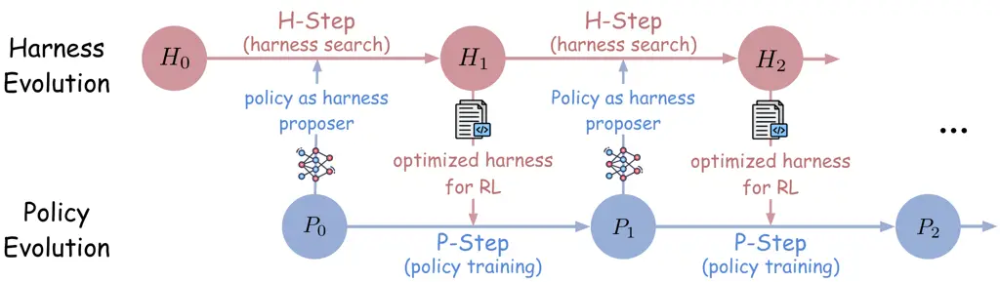
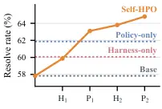
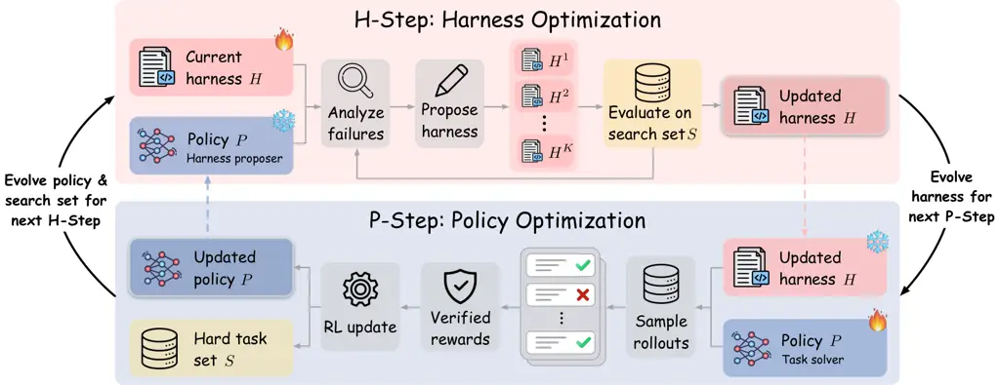
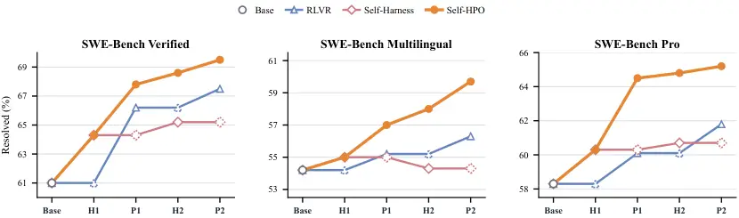
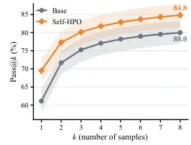
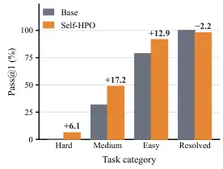
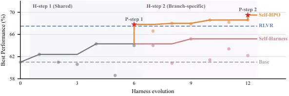

# Self-Evolving Coding Agents via Harness-Policy Optimization

Zhepei Wei ^(†)^(†)thanks: Work done during internship at Microsoft
Research. Affiliation: Microsoft Research Affiliation: University of
Virginia    Wenlin Yao Affiliation: Microsoft Research    Baolin Peng
Affiliation: Microsoft Research    Danqing Wang Affiliation: Carnegie
Mellon University
[https://github.com/MSR-Orchard/Self-HPO](https://github.com/MSR-Orchard/Self-HPO)![[Uncaptioned
image]](arxiv-2610-22791v1--9b28864a122b.figures/figure-1.webp)[https://huggingface.co/self-hpo](https://huggingface.co/self-hpo)
   Qianhui Wu Affiliation: Microsoft Research    Hao Cheng
Affiliation: Microsoft Research    Yu Meng Affiliation: University of
Virginia    Jianfeng Gao Affiliation: Microsoft Research

###### Abstract

Large language model (LLM) agents have shown promising potential in
coding tasks, and their performance is jointly determined by the policy
model and the harness that mediates their interaction with the
environment. Indeed, harness and policy are mutually reinforcing and
evolving only one component is suboptimal—a harness tuned for one
checkpoint may not target the failure modes of an updated policy, while
policy learning remains limited to the trajectories elicited by a fixed
harness. In light of this, we propose Self-HPO, a recursive
self-improving framework for coding agents that alternates harness and
policy optimization, using the evolving policy as its own harness
proposer. Specifically, in each round, the current policy first analyzes
its own failures and proposes new harness candidates (H-step). The
policy is then updated through reinforcement learning (RL) under the
selected harness (P-step), and hard tasks identified during training
form the next harness search set, keeping harness optimization targeted
to the policy’s evolving failure modes. Across three coding benchmarks,
Self-HPO consistently outperforms harness-only and policy-only
baselines, improving Qwen3.5-35B-A3B’s average resolve rate from 57.8%
to 64.8%, with gains generalizing to out-of-distribution settings.
Further analysis shows that both optimized components retain gains even
when paired with their base counterparts, while their joint gain exceeds
the sum of their individual gains. Self-HPO also improves reliability
(pass@1) and expands the capability frontier (pass@$`k`$) over the base
agent. Additionally, we show that with a stronger external model (e.g.,
Opus 4.8) as the harness proposer, the same framework yields a further
performance boost.

|     |
| --- |
|     |


## 1 Introduction

Large language model (LLM) agents have made rapid progress on complex,
multi-step tasks such as software engineering (Jimenez et al., 2024;
Yang et al., 2024), web navigation (Zhou et al., 2024; He et al., 2024;
Wei et al., 2025c), and computer use (Xie et al., 2024; Agashe et al.,
2025). Such an agent consists of two components: the policy model and
its harness, which is the external scaffold that decides what the model
observes, how its actions are executed, what feedback it receives, and
when an episode terminates (Yao et al., 2023; Shinn et al., 2023; Yang
et al., 2024; He et al., 2024; Lee et al., 2026; Zhang et al., 2026a).
Typically, the policy model defines the agent’s capability boundary,
while the harness determines how these capabilities are elicited, hence
the same model may succeed or fail on one problem depending on its
harness (Le et al., 2026; Zhang et al., 2026a).

There have been two main lines of research on improving such agents.
Harness optimization holds the policy fixed and searches over prompts,
workflows, or agent code (Hu et al., 2024; Lee et al., 2026; Zhang et
al., 2026a), whereas policy optimization holds the harness fixed and
updates the model from successful trajectories or verifiable
rewards (Shao et al., 2024; Guo et al., 2025; Wei et al., 2025a).
However, harness-only optimization cannot improve the underlying model,
while policy-only training can learn only from the trajectories that its
fixed harness elicits. Although recent works begin to optimize both
components (Kim et al., 2026; Chen et al., 2026a), they rely on an
external harness proposer and face the challenge of a moving
optimization target as the policy and its failure modes evolve, leaving
self-driven evolution for coding agents underexplored.

In this work, we introduce Self-HPO, a framework for recursive
self-improvement driven by the agent’s own policy. As illustrated in
Figure 1, Self-HPO alternates harness optimization (H-step) with policy
optimization under the optimized harness (P-step). Harness optimization
exposes and compensates for the weaknesses of the current policy, while
policy optimization internalizes the elicited behaviors into the model
and shifts the failures that the next harness should target.
Specifically, in the H-step, the current policy analyzes its failed
trajectories and proposes harness revisions targeting its own failure
modes, and selects the updated harness based on search-set performance
(§2.2). In the P-step, the policy is updated using reinforcement
learning under the optimized harness (§2.3). In the next H-step, the
updated policy serves as the harness proposer, with hard tasks
identified from the preceding P-step as the search set to keep harness
search aligned with the policy’s evolving failure modes.





Figure 1: Self-HPO recursively improves the harness and policy using the
agent itself. Left: In each H-step, the current policy proposes an
improved harness, and each P-step then updates the policy through
reinforcement learning with the optimized harness. Right: Average
resolve rate over SWE-Bench Verified, SWE-Bench Multilingual, and
SWE-Bench Pro along the H- and P-steps. Policy-only and Harness-only
denote the RLVR (Peng et al., 2026) and Self-Harness (Zhang et al.,
2026a) baselines.

We instantiate Self-HPO with Qwen3.5-35B-A3B (Qwen Team, 2026) as the
base policy, and mini-SWE-agent (Yang et al., 2024) as the seed harness.
Across three coding benchmarks, Self-HPO consistently outperforms
policy-only and harness-only optimization, with the average resolve rate
improving at every optimization step, as demonstrated in Figure 1. On
SWE-Bench Verified (Chowdhury et al., 2024), it improves the base
resolve rate from 61.0% to 69.5%, with transferable gains on the
out-of-distribution SWE-Bench Multilingual (Yang et al., 2025) and
SWE-Bench Pro (Deng et al., 2025). Ablations further show that evolving
the harness search set with hard tasks identified during policy learning
yields better performance than reusing a fixed set. We also extend
Self-HPO to the external-model setup where Opus 4.8 is used as an
external harness proposer, which further raises the resolve rate on
SWE-Bench Verified to 71.6%. The main contributions of this work are as
follows:

- •
  We propose Self-HPO, a recursive self-improving framework for coding
  agents that alternates harness and policy optimization, where the
  agent uses its own policy as the harness proposer and adapts harness
  search to the policy’s evolving failure modes.
- •
  We demonstrate that Self-HPO consistently outperforms policy-only and
  harness-only baselines across three coding benchmarks, improving the
  average resolve rate from 57.8% to 64.8%, with gains generalizing to
  out-of-distribution settings.
- •
  Our study shows that both optimized components of Self-HPO retain
  gains even when paired with their base counterparts, while their joint
  gain exceeds the sum of their individual gains. We also find that
  Self-HPO not only improves reliability (pass@1) but also expands the
  capability frontier (pass@$`k`$) of the agent.

## 2 Self-HPO: Self-Evolving via Harness-Policy Optimization



Figure 2: Overview of Self-HPO. Top (H-step): The frozen policy analyzes
the agent’s failures on the search set and proposes new harness
candidates. Bottom (P-step): With the updated harness, the policy
evolves through reinforcement learning. The updated policy becomes the
next harness proposer, while tasks never resolved during this P-step
form the next search set.

### 2.1 Problem Setup

Given a software-engineering task $`x`$, a coding agent combines a
policy $`P`$, parameterized by an LLM, with a harness $`H`$, which
controls context, tools, feedback, and termination. The resulting
trajectory $`\tau\sim\pi_{H,P}(\cdot\mid x)`$ is scored by an executable
verifier $`y(x,\tau)\in\{0,1\}`$. We measure a harness–policy pair by
its expected resolve rate on the training data $`\mathcal{D}`$:

```math
J(H,P)=\mathbb{E}_{x\sim\mathcal{D}}\,\mathbb{E}_{\tau\sim\pi_{H,P}(\cdot\mid x)}\big[y(x,\tau)\big]. \tag{1}
```

We study the problem of self-improving a coding agent’s own harness and
policy. The harness changes which behaviors the current policy can
reliably express, while a policy update changes the failures that the
next harness should target. As shown in Figure 2, each H-step holds the
policy fixed while using it to analyze failures and propose harness
revisions, and each P-step then freezes this harness and updates the
policy through reinforcement learning. The updated policy becomes the
next harness proposer, with hard tasks identified from the training
process forming the next search set.

We call this alternating framework Harness-Policy Optimization (HPO) and
implement it in two setups. In the self-improving setup (Self-HPO), the
evolving policy proposes its own harness candidates, so no separate
proposer model is needed. For reference, we also instantiate the same
HPO loop with Opus 4.8 as a fixed external proposer.

1: Seed harness $`H_{0}`$, base policy $`P_{0}`$, training data
$`\mathcal{D}`$, harness search budget $`K`$

2: $`t\leftarrow 0`$, randomly initialize harness search set
$`\mathcal{S}_{t}\subset\mathcal{D}`$

3: while not converged do $`\triangleright`$ Stopping criterion (§2)

4: /\* H-step: search harness with the current policy as proposer \*/

5:   Score $`v_{0}`$, trajectories
$`\mathcal{T}_{0}\leftarrow\operatorname{Eval}(H_{t},P_{t},\mathcal{S}_{t})`$,
experience $`\mathcal{E}\leftarrow\{(H_{t},\mathcal{T}_{0})\}`$,
$`v_{\mathrm{best}}\leftarrow v_{0}`$, $`H_{t+1}\leftarrow H_{t}`$

6:   for $`k=1,\ldots,K`$ do

7:
   $`H_{t}^{k}\leftarrow\operatorname{ProposeHarness}(H_{t+1},P_{t},\mathcal{E})`$
$`\triangleright`$ Self-proposer (§2.2)

8:
   $`v_{k},\mathcal{T}_{k}\leftarrow\operatorname{Eval}(H_{t}^{k},P_{t},\mathcal{S}_{t})`$,
$`\mathcal{E}\leftarrow\mathcal{E}\cup\{(H_{t}^{k},\mathcal{T}_{k})\}`$

9:    if $`v_{k}>v_{\mathrm{best}}`$ then

10:      $`H_{t+1}\leftarrow H_{t}^{k}`$,
$`v_{\mathrm{best}}\leftarrow v_{k}`$      

11: /\* P-step: train the policy under the updated harness \*/

12:
  $`P_{t+1},\mathcal{T}_{\mathrm{RL}}\leftarrow\operatorname{RL}(H_{t+1},P_{t},\mathcal{D})`$

13:
  $`\mathcal{S}_{t+1}\leftarrow\operatorname{SelectHardTasks}(\mathcal{T}_{\mathrm{RL}})`$
$`\triangleright`$ Evolving search set (§2.3)

14:   $`t\leftarrow t+1`$

15: return $`H_{t}`$, $`P_{t}`$

Algorithm 1 Self Harness-Policy Optimization (Self-HPO)

A formal description of Self-HPO is presented in Algorithm 1. Starting
from a base policy $`P_{0}`$, a seed harness $`H_{0}`$, and a random
search set $`\mathcal{S}_{0}\subset\mathcal{D}`$, the method alternates
two updates. At round $`t`$ (starting from $`t=0`$), the H-step keeps
$`P_{t}`$ fixed and uses it to propose $`K`$ harness candidates
$`\{H_{t}^{k}\}_{k=1}^{K}`$, retaining the best-scoring harness on
$`\mathcal{S}_{t}`$ as $`H_{t+1}`$. The P-step then freezes $`H_{t+1}`$
and updates $`P_{t}`$ to $`P_{t+1}`$ on $`\mathcal{D}`$ using
reinforcement learning. The resulting training rollouts identify the
next hard-task set $`\mathcal{S}_{t+1}`$ and the loop stops when the
hard-task set stabilizes between rounds.

### 2.2 H-step: Failure-Conditioned Harness Search

#### Self-proposer for harness optimization.

The H-step uses the frozen $`P_{t}`$ as both task solver and harness
proposer. The current pair $`(H_{t},P_{t})`$ first generates
trajectories on $`\mathcal{S}_{t}`$, and the proposer inspects the
current failures and produces targeted revisions to the prompt or
executable runtime logic (see prompt in Appendix D). Each of the $`K`$
search iterations revises the current best harness, starting from
$`H_{t}`$, using the accumulated experience of all evaluated harnesses
and their trajectories. All candidates are evaluated on the same search
set $`\mathcal{S}_{t}`$.

#### Evolving search set.

The search set remains fixed within an H-step but evolves between
rounds. For initialization, we sample $`\mathcal{S}_{0}`$ uniformly from
$`\mathcal{D}`$. Subsequent search sets consist of hard tasks identified
from the training trajectories generated during the preceding P-step,
where a task is considered hard if it is never resolved in any of its
rollouts in that P-step. The next H-step regenerates trajectories on
those hard tasks with the updated harness–policy pair, producing fresh
failure evidence for proposal. Harness search therefore follows the
failures exposed by the preceding policy update instead of repeatedly
optimizing against the initial tasks.

### 2.3 P-step: Policy Optimization under the Optimized Harness

The P-step improves the policy through reinforcement learning under the
optimized harness $`H_{t+1}`$. Starting from $`P_{t}`$, we collect
on-policy trajectories over $`\mathcal{D}`$ as the policy is updated. An
executable verifier assigns binary outcome rewards, and our default
optimizer combines Group Relative Policy Optimization (GRPO) (Shao et
al., 2024) with Balanced Adaptive Rollout (BAR) from Orchard (Peng et
al., 2026). BAR adaptively draws additional trajectories to construct
reward-balanced groups, reducing uninformative zero-variance groups
under sparse outcome rewards, and GRPO then updates the policy using the
resulting group-relative advantages. The tasks that were never resolved
during this P-step are identified as the hard-task set
$`\mathcal{S}_{t+1}`$, which will be passed together with the updated
policy $`P_{t+1}`$ to the next H-step.

## 3 Experiments

### 3.1 Experimental Setup

#### Harness, model, and data.

All experiments use Qwen3.5-35B-A3B (Qwen Team, 2026) as the base policy
and mini-SWE-agent (Yao et al., 2023; Yang et al., 2024) as the seed
harness. Following Orchard (Peng et al., 2026), we construct a training
set of 2,484 tasks from SWE-rebench (Badertdinov et al., 2025),
SWE-rebench V2 (Badertdinov et al., 2026), and Scale-SWE (Zhao et al.,
2026), which is used for both harness search and policy optimization. We
perform two rounds of alternating harness and policy optimization based
on the stopping criterion, with $`K=6`$ harness candidates per H-step
and 50 RL updates per P-step. Appendix A describes the implementation
details.

#### Benchmarks and evaluation metrics.

SWE-Bench Verified (SWE-Verified) contains 500 human-validated GitHub
issues and is our primary benchmark (Jimenez et al., 2024; Chowdhury et
al., 2024). We further evaluate out-of-distribution performance on
SWE-Bench Multilingual (SWE-Multi; 300 tasks) (Yang et al., 2025) and
the public V2 set of SWE-Bench Pro (SWE-Pro; 642 tasks) (Deng et al.,
2025), covering other programming languages and more diverse
repository-level tasks. We report resolve rate, the percentage of tasks
whose generated patches pass the benchmark verifier. Main results are
averaged over three evaluation runs (avg@3) with standard deviations.

#### Baselines.

We compare our method with policy-only and harness-only baselines under
two setups, with the base agent as a reference. In the _self-improving
setup_, RLVR (Peng et al., 2026) updates the policy under the seed
harness, whereas Self-Harness (Zhang et al., 2026a) optimizes the
harness using the base policy as proposer without updating its weights.
Self-HPO alternates both updates and uses the current policy to propose
harness changes. In the _external-model setup_, supervised fine-tuning
(SFT) learns from resolved Opus 4.8 trajectories on the same training
tasks, while Meta-Harness (Lee et al., 2026) uses Opus 4.8 to optimize
the harness with the target policy fixed. HPO combines external harness
proposals with RL policy updates.

|                                            |             |            |                                                         |                                                         |                                                         |                                                         |
| ------------------------------------------ | ----------- | ---------- | ------------------------------------------------------- | ------------------------------------------------------- | ------------------------------------------------------- | ------------------------------------------------------- |
| Method                                     | Harness Opt | Policy Opt | SWE-Verified                                            | SWE-Multi                                               | SWE-Pro                                                 | Avg.                                                    |
| Base                                       | ✘           | ✘          | $`61.0{\scriptstyle\,\pm\,0.2}`$                        | $`54.2{\scriptstyle\,\pm\,0.3}`$                        | $`58.3{\scriptstyle\,\pm\,1.2}`$                        | $`57.8{\scriptstyle\,\pm\,0.4}`$                        |
| Setting 1: External-model setup (Opus 4.8) |             |            |                                                         |                                                         |                                                         |                                                         |
| SFT                                        | ✘           | ✓          | $`65.0{\scriptstyle\,\pm\,1.1}`$                        | $`49.6{\scriptstyle\,\pm\,0.8}`$                        | $`49.1{\scriptstyle\,\pm\,0.6}`$                        | $`54.6{\scriptstyle\,\pm\,0.5}`$                        |
| Meta-Harness (Lee et al., 2026)            | ✓           | ✘          | $`69.1{\scriptstyle\,\pm\,1.9}`$                        | $`56.5{\scriptstyle\,\pm\,0.9}`$                        | $`64.8{\scriptstyle\,\pm\,1.4}`$                        | $`63.5{\scriptstyle\,\pm\,0.8}`$                        |
| HPO (ours)                                 | ✓           | ✓          | $`\mathbf{71.6}{\scriptstyle\,\bm{\pm}\,\mathbf{0.9}}`$ | $`\mathbf{61.4}{\scriptstyle\,\bm{\pm}\,\mathbf{0.7}}`$ | $`\mathbf{66.0}{\scriptstyle\,\bm{\pm}\,\mathbf{0.5}}`$ | $`\mathbf{66.3}{\scriptstyle\,\bm{\pm}\,\mathbf{0.4}}`$ |
| Setting 2: Self-improving setup            |             |            |                                                         |                                                         |                                                         |                                                         |
| RLVR (Peng et al., 2026)                   | ✘           | ✓          | $`67.5{\scriptstyle\,\pm\,0.8}`$                        | $`56.3{\scriptstyle\,\pm\,1.0}`$                        | $`61.8{\scriptstyle\,\pm\,1.3}`$                        | $`61.9{\scriptstyle\,\pm\,0.6}`$                        |
| Self-Harness (Zhang et al., 2026a)         | ✓           | ✘          | $`65.2{\scriptstyle\,\pm\,1.5}`$                        | $`54.3{\scriptstyle\,\pm\,0.7}`$                        | $`60.7{\scriptstyle\,\pm\,0.9}`$                        | $`60.1{\scriptstyle\,\pm\,0.6}`$                        |
| Self-HPO (ours)                            | ✓           | ✓          | $`\mathbf{69.5}{\scriptstyle\,\bm{\pm}\,\mathbf{0.9}}`$ | $`\mathbf{59.7}{\scriptstyle\,\bm{\pm}\,\mathbf{0.8}}`$ | $`\mathbf{65.2}{\scriptstyle\,\bm{\pm}\,\mathbf{1.4}}`$ | $`\mathbf{64.8}{\scriptstyle\,\bm{\pm}\,\mathbf{0.6}}`$ |

Table 1: Main results on in-distribution (SWE-Bench Verified) and
out-of-distribution evaluations (SWE-Bench Multilingual and SWE-Bench
Pro). The optimization columns indicate whether each method updates the
harness or policy. We report the mean resolve rates with standard
deviations over three runs. Bold marks the best result within each
setup.

### 3.2 Main Results

#### Self-HPO consistently outperforms policy-only and harness-only optimization.

As shown in Table 1, jointly optimizing the harness and policy achieves
the best performance on all three benchmarks within each setup. Without
an external proposer, Self-HPO reaches $`69.5\%`$ on SWE-Verified,
outperforming RLVR and Self-Harness by $`2.0`$ and $`4.3`$ points,
respectively. Its average score improves from $`57.8\%`$ for Base to
$`64.8\%`$, exceeding the stronger single-component baseline, RLVR, by
$`2.9`$ points. The same pattern holds with external supervision: HPO
surpasses Meta-Harness by $`2.5`$ points on SWE-Verified and $`2.8`$
points on average. These consistent gains support optimizing the harness
and policy together. Appendix B further compares these results with
frontier models on SWE-Verified.

#### The gains generalize to out-of-distribution benchmarks.

Although harness search and policy optimization use only tasks from
Python projects, the gains transfer to SWE-Multi, which covers nine
non-Python languages, and SWE-Pro, which spans a broader range of
languages and engineering tasks. Self-HPO achieves $`59.7\%`$ and
$`65.2\%`$, respectively, improving over Base by $`5.5`$ and $`6.9`$
points and over RLVR by $`3.4`$ points on both benchmarks. The benefit
is particularly clear on SWE-Multi, where Self-Harness improves over
Base by only $`0.1`$ point, compared with $`5.5`$ points for Self-HPO.
The same trend holds in the external-model setup, where HPO reaches
$`61.4\%`$ and $`66.0\%`$, outperforming both single-component
baselines. These results show that the benefits of joint harness–policy
optimization extend beyond the Python training domain.

#### Learning from Opus 4.8 through harness optimization is more effective than SFT distillation.

SFT and Meta-Harness represent two different approaches for transferring
knowledge from Opus 4.8: SFT distills generated trajectories into the
model weights, whereas Meta-Harness uses external proposals to optimize
the harness while keeping the model fixed. Meta-Harness outperforms SFT
by $`4.1`$ points on SWE-Verified and $`8.9`$ points on average. The gap
is largest out of domain: SFT falls below Base on both SWE-Multi and
SWE-Pro, while Meta-Harness improves on both. HPO further improves on
Meta-Harness, indicating that policy optimization remains beneficial
when coupled with an optimized harness.



Figure 3: Optimization trajectories across harness and policy updates.
Resolve rates (%) on SWE-Bench Verified, SWE-Bench Multilingual, and
SWE-Bench Pro are shown on the common
Base–$`H_{1}`$–$`P_{1}`$–$`H_{2}`$–$`P_{2}`$ schedule. Self-HPO
alternates H- and P-steps, whereas Self-Harness and RLVR update only the
harness and policy, respectively. Markers with dashed outlines indicate
steps at which the corresponding method performs no update.

#### Alternating harness and policy optimization drives continued agent improvement.

Figure 3 traces the optimization trajectories of Self-HPO and the two
one-sided baselines. Self-HPO and Self-Harness begin with the same first
H-step, but their trajectories diverge once Self-HPO updates its policy.
Across all three benchmarks, the second H-step improves the updated
Self-HPO policy, and the following P-step provides a further gain. In
contrast, another harness-only update does not consistently improve
performance: Self-Harness drops from $`55.0\%`$ to $`54.3\%`$ on
SWE-Multi. The final Self-HPO pair surpasses both single-component
baselines on every benchmark, supporting repeated adaptation of the
harness to the evolving policy. Figure 6 in the appendix provides a
candidate-level view of harness search on SWE-Verified.

### 3.3 Ablations

We examine the policy-update strategy, search-set construction, and
harness proposer on SWE-Verified. Table 2 uses HPO as the reference for
ablating the shared H-step–P-step framework, and replacing its external
proposer with the current policy gives Self-HPO.

| Configuration                 | Resolve rate (%) |
| ----------------------------- | ---------------- |
| HPO                           | 71.6             |
| w/ SFT in P-step              | 67.2 ($`-`$4.4)  |
| w/ RFT in P-step              | 70.5 ($`-`$1.1)  |
| w/ Fixed search set in H-step | 70.1 ($`-`$1.5)  |
| w/ Self-proposer in H-step    | 69.5 ($`-`$2.1)  |

Table 2: Ablation study. Resolve rates reported on SWE-Bench Verified.

#### RL yields stronger policy updates than SFT/RFT.

We replace RL in the P-step with either SFT on trajectories distilled
from Opus 4.8 or rejection-sampling fine-tuning (RFT) on the target
policy’s own successful trajectories. SFT reduces the final resolve rate
from $`71.6\%`$ to $`67.2\%`$, while RFT reaches $`70.5\%`$, trailing RL
by $`1.1`$ points. Even when fine-tuning uses the policy’s own
successful trajectories, it still falls short of RL, supporting RL as
the default P-step.

#### Evolving the search set helps harness optimization keep pace with the policy.

Reusing the initial search set lowers performance from $`71.6\%`$ to
$`70.1\%`$. The evolving set instead directs the next H-step toward hard
tasks from the preceding P-step rollouts. The gain supports refreshing
the search target as the agent improves: failures relevant to an earlier
policy need not remain the most useful targets for its successor.

#### Self-proposal retains strong performance without an external proposer.

Replacing Opus 4.8 with the current target policy yields $`69.5\%`$, a
$`2.1`$-point decrease from HPO. Although external proposals provide an
advantage, Self-HPO still exceeds both self-improving single-component
baselines in Table 1. Therefore, an external model is helpful but not
required for our method.

### 3.4 Analysis



(a) Pass@$`k`$



(b) Pass@1 by task difficulty

(c) Zero-success groups during RL

Figure 4: Pass@$`k`$ performance on SWE-Bench Verified and RL training
signal. (a) pass@$`k`$ curve of Base and Self-HPO; (b) pass@1 by task
difficulty, categorized by Base success rate $`p`$: Hard ($`p=0`$),
Medium ($`0<p\leq 0.5`$), Easy ($`0.5<p<1`$), and Resolved ($`p=1`$).
(c) Fraction of zero-success rollout groups for RLVR and Self-HPO’s
final P-step.

|           | $`P_{0}`$                        | $`P_{1}`$                        | $`P_{2}`$                                               |
| --------- | -------------------------------- | -------------------------------- | ------------------------------------------------------- |
| $`H_{0}`$ | $`61.0{\scriptstyle\,\pm\,0.2}`$ | $`61.7{\scriptstyle\,\pm\,1.3}`$ | $`64.4{\scriptstyle\,\pm\,1.1}`$                        |
| $`H_{1}`$ | $`64.3{\scriptstyle\,\pm\,1.1}`$ | $`67.8{\scriptstyle\,\pm\,1.6}`$ | $`68.1{\scriptstyle\,\pm\,1.0}`$                        |
| $`H_{2}`$ | $`64.5{\scriptstyle\,\pm\,1.5}`$ | $`68.6{\scriptstyle\,\pm\,0.5}`$ | $`\mathbf{69.5}{\scriptstyle\,\bm{\pm}\,\mathbf{0.9}}`$ |

Table 3: Cross-evaluating Self-HPO policies and harnesses on SWE-Bench
Verified. Rows vary the harness and columns vary the policy.

#### Both optimized components retain benefits even when paired with their base counterparts.

Table 3 cross-evaluates policies and harnesses. Applying $`H_{2}`$ to
the base policy improves resolve rate from $`61.0\%`$ to $`64.5\%`$,
while deploying $`P_{2}`$ under the seed harness reaches $`64.4\%`$.
Combining $`H_{2}`$ and $`P_{2}`$ reaches $`69.5\%`$, an $`8.5`$-point
gain over Base that exceeds the sum of their individual gains
($`3.5+3.4=6.9`$ points) by $`1.6`$ points. These results show that each
component retains part of the improvement on its own, while combining
them gives the largest gain.

#### Self-HPO improves reliability (pass@1) and expands the capability frontier (pass@$`k`$).

To examine whether the gains persist beyond pass@1, Figures 4(a)
and 4(b) compare Base and the final Self-HPO pair using eight attempts
per task on SWE-Verified. As shown in Figure 4(a), Self-HPO remains
above Base for every $`k`$ from 1 to 8, and pass@8 increases from
$`80.0\%`$ to $`84.8\%`$, a gain of $`4.8`$ points. Figure 4(b) shows
pass@1 gains of $`17.2`$ and $`12.9`$ points on Medium and Easy tasks,
where Base sometimes succeeds but remains inconsistent, and a
$`6.1`$-point gain on Hard tasks. At the same time, Self-HPO’s pass@1
decreases by $`2.2`$ points on the Resolved group, showing that
improvement is not uniform across tasks. Together, the gains on Medium
and Easy tasks demonstrate improved reliability, while the gains on Hard
tasks and the higher pass@8 show the expanded capability frontier.

#### Self-HPO reduces zero-success rollout groups during training.

During the final Self-HPO P-step (Figure 4(c)), the fraction of
zero-success groups, in which no rollout succeeds, declines to $`6.5\%`$
over the final ten updates, whereas it remains mostly between $`11\%`$
and $`17\%`$ over the last 50 updates of RLVR. Under binary outcome
rewards, such groups give GRPO no within-group reward contrast, so
reducing them alleviates reward sparsity during policy optimization.

`\iow_now:Ne``˝``\iow_now:Ne``˝class ProgressTrackingAgent(DefaultAgent): # seed agent``\iow_now:Ne``˝ # default loop: query the model, then run its command``\iow_now:Ne``˝ def step(self):``\iow_now:Ne``˝ return self.execute_actions(self.query())``\iow_now:Ne``˝``\iow_now:Ne``˝ # stop the episode once the step budget is used up``\iow_now:Ne``˝ def query(self):``\iow_now:Ne``˝ if 0 < self.config.step_limit <= self.n_calls:``\iow_now:Ne``˝ raise LimitsExceeded({…, "submission": ""})``\iow_now:Ne``˝ |\bad{(1) budget runs out $\rightarrow$ empty result}|``\iow_now:Ne``˝ …``\iow_now:Ne``˝``\iow_now:Ne``˝class OrchardEnvironment: # sandbox``\iow_now:Ne``˝ # after each command: did the model submit?``\iow_now:Ne``˝ def _check_finished(self, output):``\iow_now:Ne``˝ if lines[0] == "COMPLETE_TASK_AND_SUBMIT_FINAL_OUTPUT":``\iow_now:Ne``˝ submission = "".join(lines[1:])``\iow_now:Ne``˝ raise Submitted({…, "submission": submission})``\iow_now:Ne``˝ |\bad{accepted as-is, even if the patch is:}|``\iow_now:Ne``˝ |\bad{(2) empty (new file not staged)}|``\iow_now:Ne``˝ |\bad{(3) built on a guessed API / contract}|``\iow_now:Ne``˝ |\bad{(4) malformed and does not apply}|``\iow_now:Ne``˝``\iow_now:Ne``˝class AgentHarness(ProgressTrackingAgent): # inherits seed``\iow_now:Ne``˝ # same loop; overrides only |\cfn{cStep}{step}|(), adds checks``\iow_now:Ne``˝ def step(self):``\iow_now:Ne``˝ # budget valve (fires once): checked before every step``\iow_now:Ne``˝ if near_step_limit or near_time_limit:``\iow_now:Ne``˝ self.add_messages(rescue_text)``\iow_now:Ne``˝ |\good{(1) warn early; prompt a best-effort submission}|``\iow_now:Ne``˝ try:``\iow_now:Ne``˝ return super().step() # = |\cfn{cExec}{execute\string_actions}|(|\cfn{cQuery}{query}|())``\iow_now:Ne``˝ except Submitted as e: # raised by |\cfn{cCheck}{\string_check\string_finished}|``\iow_now:Ne``˝ # empty-patch guard (fires once)``\iow_now:Ne``˝ if (is_empty(sub) and not self._empty_guarded``\iow_now:Ne``˝ and has_runway()):``\iow_now:Ne``˝ self.add_messages(empty_guard_text)``\iow_now:Ne``˝ return []``\iow_now:Ne``˝ |\good{(2) reject empty patch; ask to git add -N new files}|``\iow_now:Ne``˝ # contract grounding: first submit past the empty guard``\iow_now:Ne``˝ if not self._grounded and has_runway():``\iow_now:Ne``˝ self.add_messages(ground_text)``\iow_now:Ne``˝ return []``\iow_now:Ne``˝ |\good{(3) hold once; ask model to check APIs against repo tests}|``\iow_now:Ne``˝ # final submit: patch fallback``\iow_now:Ne``˝ self._apply_fallback(e)``\iow_now:Ne``˝ raise``\iow_now:Ne``˝ |\good{(4) apply check fails $\rightarrow$ submit the sandbox’s git diff}| `` `

Figure 5: Seed versus optimized harness (HPO, second H-step). Left: the
default agent loop, with the four failure modes it lets through (✗).
Right: the optimized harness subclasses the seed agent and overrides
only step(), and each added check (✓) addresses the matching failure
mode. Shared functions and classes use the same color on both sides. See
Figure 8 for a detailed diff.

### 3.5 Case Studies

#### Harness evolution adds targeted controls around the existing agent loop.

Figure 5 contrasts the seed harness with the harness obtained after
HPO’s second H-step. The optimized harness retains the underlying
model-query and command-execution loop, but intervenes before budget
exhaustion and at submission. First, it warns the model as the step or
time limit approaches and prompts a best-effort submission before the
episode ends with an empty result. Second, a one-time empty-patch guard
asks the model to include newly created files via git add -N. Third, it
delays the first submission that passes the empty-patch guard to prompt
a check of API names and signatures against the repository and tests.
Finally, a fallback uses the sandbox’s Git diff when the submitted patch
fails the apply check. These changes target distinct ways in which
useful repository edits can fail to become a valid submission. They
combine explicit runtime checks, such as detecting an empty patch, with
behavioral guidance, such as requesting an interface check. Harness
optimization can therefore change execution and termination logic, in
addition to prompts. Appendix D gives a detailed diff against the seed
harness together with the injected messages, and Appendix E walks
through a task on which an evolved harness changes the outcome for the
same policy.

## 4 Related Work

#### Harness optimization for LLM agents.

Harnesses govern an agent’s interaction with tools and environments (Yao
et al., 2023; Yang et al., 2024). Optimization spans prompts and
programs (Pryzant et al., 2023; Khattab et al., 2023; Fernando et al.,
2024; Yuksekgonul et al., 2025; Agrawal et al., 2026), contexts (Zhang
et al., 2026f; Ye et al., 2026a; Sun et al., 2026), and workflows (Hu et
al., 2024; Zhang et al., 2025; Wang et al., 2025a; Gao et al., 2025).
Agents reuse feedback through refinement and reflection (Madaan et al.,
2023; Shinn et al., 2023), skills (Wang et al., 2023), and memory (Zhao
et al., 2024; Wang et al., 2025c). Program evolution also improves
solutions and agents (Novikov et al., 2025; Lange et al., 2026; Zelikman
et al., 2024; Zhang et al., 2026b; Zhang et al., 2026c). Recent systems
revise harnesses from execution evidence (Lee et al., 2026; Lin et al.,
2026a; Zhang et al., 2026a; Park et al., 2026; Wei et al., 2026b; Xu et
al., 2026a), shared experience (Weng et al., 2026), demonstrations (Che
et al., 2026; Jiang et al., 2026), or self-preferences (Pan et al.,
2026). Other work studies continual adaptation (Liu et al., 2026; Xu et
al., 2026b), task selection (Miyai et al., 2026), generalization through
search controls and modular edits (Zhang et al., 2026d; Xia et al.,
2026b; Wu et al., 2026), and fixed-budget evaluation (Ursekar et al.,
2026). These methods adapt the agent around a fixed task-solving policy,
whereas Self-HPO also updates the policy that the harness serves.

#### Policy learning and self-improvement.

Iterative training uses filtered reasoning (Zelikman et al., 2022; Singh
et al., 2024; Yuan et al., 2023), refreshed preferences (Chen et al.,
2024; Yuan et al., 2024; Pang et al., 2024), self-play curricula (Zhao
et al., 2025; Huang et al., 2026c; Huang et al., 2026a), negative
teachers (Pei et al., 2026), or evolving environments (Huang et al.,
2026b). Software engineering agents learn from executable
environments (Pan et al., 2025; Jain et al., 2025; Yang et al., 2025),
software-evolution supervision (Wei et al., 2025a), and self-play code
repair (Wei et al., 2025b; Choi et al., 2026). Policy improvement also
draws on verifiable-reward RL (Shao et al., 2024; Guo et al., 2025; Peng
et al., 2026), harness-guided distillation (Ye et al., 2026b), and
test-time learning during solution search (Wang et al., 2025b;
Yuksekgonul et al., 2026). These methods train the policy under a fixed
harness, whereas in Self-HPO the harness co-evolves with the policy
being trained.

#### Joint harness–policy evolution.

Joint adaptation spans prompts and weights (Soylu et al., 2024; Tiwari
et al., 2026; Zhang et al., 2026e; Lu et al., 2026), executable
harnesses and policies (Hebbar et al., 2026; Karten et al., 2026; Chen
et al., 2026c; Kim et al., 2026; Luo et al., 2026; Chen et al., 2026b;
Chen et al., 2026a), and policies with evolving skills or external
state (Xia et al., 2026a; Fu et al., 2026; He et al., 2026; Ning et al.,
2026), including safety-oriented co-evolution (Mao et al., 2026).
MetaRSI composes data generation, harness editing, and model training
within a self-improvement loop (Tan et al., 2026). Concurrent work
traces interventions (Fan and Huang, 2026), studies transfer and
multi-harness training (Le et al., 2026; Wei et al., 2026a), and
separates the ability to edit a harness from the ability to benefit from
one (Lin et al., 2026b). Self-HPO differs from these methods along two
axes. First, the policy trained in the P-step becomes the harness
proposer of the next H-step, whereas WHALE (Kim et al., 2026) keeps a
frozen external proposer and Evo² (Xu et al., 2026a) trains a separate
proposer for a frozen solver. HASE (Luo et al., 2026) also trains a
self-proposing policy, but places harness edits in the RL action space
instead of alternating harness search with RL. Second, Self-HPO selects
the next harness search set from tasks that remain unsolved during RL,
whereas WHALE, Evo², and HASE search on a fixed task set. Appendix C
gives a more detailed comparison with concurrent work.

## 5 Conclusion

We introduced Self-HPO, a recursive self-improving framework for coding
agents that alternates harness and policy optimization. The evolving
policy proposes its own harness revisions, learns through RL under the
selected harness, and supplies hard tasks for the next round of harness
search. Across three coding benchmarks, Self-HPO consistently
outperforms policy-only and harness-only baselines, improving the
average resolve rate from $`57.8\%`$ to $`64.8\%`$. Analyses further
show that harness and policy improvements are complementary and that
Self-HPO improves reliability (pass@1) and expands the capability
frontier (pass@$`k`$) over the base agent.

## References

- Agashe et al. (2025) S. Agashe, K. Wong, V. Tu, J. Yang, A. Li,
  and X. E. Wang Agent S2: a compositional generalist-specialist
  framework for computer use agents. arXiv preprint arXiv:2504.00906.
  Cited by: §1.
- Agrawal et al. (2026) L. A. Agrawal, S. Tan, D. Soylu, N. Ziems, R.
  Khare, K. Opsahl-Ong, A. Singhvi, H. Shandilya, M. J. Ryan, M.
  Jiang, C. Potts, K. Sen, A. G. Dimakis, I. Stoica, D. Klein, M.
  Zaharia, and O. Khattab GEPA: reflective prompt evolution can
  outperform reinforcement learning. In International Conference on
  Learning Representations, Cited by: §4.
- Badertdinov et al. (2025) I. Badertdinov, A. Golubev, M.
  Nekrashevich, A. Shevtsov, S. Karasik, A. Andriushchenko, M.
  Trofimova, D. Litvintseva, and B. Yangel SWE-rebench: an automated
  pipeline for task collection and decontaminated evaluation of software
  engineering agents. arXiv preprint arXiv:2505.20411. Cited by: §3.1.
- Badertdinov et al. (2026) I. Badertdinov, M. Nekrashevich, A.
  Shevtsov, and A. Golubev SWE-rebench V2: language-agnostic SWE task
  collection at scale. arXiv preprint arXiv:2602.23866. Cited by: §3.1.
- Che et al. (2026) L. Che, Y. Yang, P. Lin, X. Cao, C. Wang, X. Wang,
  and J. Su DemoEvolve: demonstration-guided harness evolution under
  sparse feedback. arXiv preprint arXiv:2605.24539. Cited by: §4.
- Chen et al. (2021) M. Chen et al. Evaluating large language models
  trained on code. arXiv preprint arXiv:2107.03374. Cited by: Appendix
  B.
- Chen et al. (2026a) M. Chen, C. Lv, G. Zhang, H. Chang, and S. Zhou
  HarnessForge: joint harness and policy evolution for adaptive agent
  systems. arXiv preprint arXiv:2606.01779. Cited by: §1, §4.
- Chen et al. (2026b) T. Chen, S. Lu, K. Zhao, W. Meng, H. Teng, T.
  Li, C. Li, X. Liu, J. Liang, Z. Zhang, Y. Xie, H. Qu, K. Shao, and J.
  Luan HarnessX: a composable, adaptive, and evolvable agent harness
  foundry. arXiv preprint arXiv:2606.14249. Cited by: §4.
- Chen et al. (2026c) Z. Chen, T. Xiao, H. Zhu, Y. Yuan, L. Zhang,
  and J. Wang Co-Harness: co-evolving harnesses and model weights for
  LLM agents. arXiv preprint arXiv:2607.22688. Cited by: §4.
- Chen et al. (2024) Z. Chen, Y. Deng, H. Yuan, K. Ji, and Q. Gu
  Self-play fine-tuning converts weak language models to strong language
  models. In Forty-first International Conference on Machine Learning,
  Cited by: §4.
- Choi et al. (2026) C. Choi, Z. Kaya, S. Wu, T. Ma, T. Hashimoto,
  and L. Schmidt Anchored self-play for code repair. arXiv preprint
  arXiv:2607.03523. Cited by: §4.
- Chowdhury et al. (2024) N. Chowdhury, J. Aung, C. J. Shern, O.
  Jaffe, D. Sherburn, G. Starace, E. Mays, R. Dias, M. Aljubeh, M.
  Glaese, C. E. Jimenez, J. Yang, L. Ho, T. Patwardhan, K. Liu, and A.
  Madry Introducing SWE-bench Verified. External Links:
  [Link](https://openai.com/index/introducing-swe-bench-verified/) Cited
  by: §1, §3.1.
- Deng et al. (2025) X. Deng, J. Da, E. Pan, Y. Y. He, C. Ide, K.
  Garg, N. Lauffer, A. Park, N. Pasari, C. Rane, K. Sampath, M.
  Krishnan, S. Kundurthy, S. Hendryx, Z. Wang, V. Bharadwaj, J. Holm, R.
  Aluri, C. B. C. Zhang, N. Jacobson, B. Liu, and B. Kenstler SWE-Bench
  Pro: can AI agents solve long-horizon software engineering tasks?.
  arXiv preprint arXiv:2509.16941. Cited by: §1, §3.1.
- Fan and Huang (2026) T. Fan and C. Huang HELIX: model-harness
  co-evolution for recursive self-improvement. arXiv preprint
  arXiv:2608.13951. Cited by: §4.
- Fernando et al. (2024) C. Fernando, D. S. Banarse, H. Michalewski, S.
  Osindero, and T. Rocktäschel Promptbreeder: self-referential
  self-improvement via prompt evolution. In Forty-first International
  Conference on Machine Learning, Cited by: §4.
- Fu et al. (2026) Z. Fu, Z. Li, Q. Ai, H. Wu, M. Wu, C. Zhao, A.
  Wang, G. He, and C. Wang Self-play meets skill evolution:
  self-evolving search agents that pose, solve, and remember. arXiv
  preprint arXiv:2607.29468. Cited by: §4.
- Gao et al. (2025) H. Gao, Y. Liu, Y. He, L. Dou, C. Du, Z. Deng, B.
  Hooi, M. Lin, and T. Pang FlowReasoner: reinforcing query-level
  meta-agents. arXiv preprint arXiv:2504.15257. Cited by: §4.
- Guo et al. (2025) D. Guo, D. Yang, H. Zhang, J. Song, P. Wang, Q.
  Zhu, R. Xu, R. Zhang, S. Ma, X. Bi, et al. DeepSeek-R1 incentivizes
  reasoning in LLMs through reinforcement learning. Nature 645 (8081),
  pp. 633–638. Cited by: §1, §4.
- He et al. (2024) H. He, W. Yao, K. Ma, W. Yu, Y. Dai, H. Zhang, Z.
  Lan, and D. Yu WebVoyager: building an end-to-end web agent with large
  multimodal models. In Proceedings of the 62nd Annual Meeting of the
  Association for Computational Linguistics (Volume 1: Long Papers),
  pp. 6864–6890. Cited by: §1.
- He et al. (2026) Z. He, H. Lin, B. Han, W. Zhu, H. Fang, B. Wang, X.
  Zhu, R. Li, and M. Reimherr ReSkill: reconciling skill creation with
  policy optimization in agentic RL. arXiv preprint arXiv:2606.01619.
  Cited by: §4.
- Hebbar et al. (2026) P. Hebbar, Y. Manawat, S. Verboomen, A.
  Ivanova, S. Palanimalai, K. Bhatia, and V. Baskaran SIA: self
  improving AI with harness & weight updates. arXiv preprint
  arXiv:2605.27276. Cited by: §4.
- Hu et al. (2024) S. Hu, C. Lu, and J. Clune Automated design of
  agentic systems. arXiv preprint arXiv:2408.08435. Cited by: §1, §4.
- Huang et al. (2026a) C. Huang, H. Liu, T. Zheng, R. Dai, L. Huang, J.
  Li, Z. Li, Z. Wei, Y. Meng, and J. Huang G-Zero: self-play for
  open-ended generation from zero data. arXiv preprint arXiv:2605.09959.
  Cited by: §4.
- Huang et al. (2026b) C. Huang, Z. Wang, R. Han, J. Yan, Y. Chen, Z.
  CuiZhu, K. Jiang, P. Xia, H. Yu, Y. Zhuang, Y. Ming, J. Pan, B. D.
  Mishra, J. Huang, B. Gokturk, T. Pfister, and C. Lee EnvHarness:
  awakening static worlds for agent learning. arXiv preprint
  arXiv:2608.19880. Cited by: §4.
- Huang et al. (2026c) C. Huang, W. Yu, X. Wang, H. Zhang, Z. Li, R.
  Li, J. Huang, H. Mi, and D. Yu R-Zero: self-evolving reasoning LLM
  from zero data. In The Fourteenth International Conference on Learning
  Representations, Cited by: §4.
- Jain et al. (2025) N. Jain, J. Singh, M. Shetty, L. Zheng, K. Sen,
  and I. Stoica R2E-Gym: procedural environments and hybrid verifiers
  for scaling open-weights SWE agents. arXiv preprint arXiv:2504.07164.
  Cited by: §4.
- Jiang et al. (2026) W. Jiang, M. Chu, Y. Tian, Q. Zhang, H. Yang, R.
  Yang, Y. Liu, T. Lv, and F. Li HarnessEvolve: learning from reference
  trajectories for reliable agent self-evolution. arXiv preprint
  arXiv:2609.00829. Cited by: §4.
- Jimenez et al. (2024) C. E. Jimenez, J. Yang, A. Wettig, S. Yao, K.
  Pei, O. Press, and K. R. Narasimhan SWE-bench: can language models
  resolve real-world Github issues?. In The Twelfth International
  Conference on Learning Representations, Cited by: §1, §3.1.
- Karten et al. (2026) S. Karten, J. Zhang, T. Upaa, R. Feng, W. Li, C.
  Shi, C. Jin, and K. Vodrahalli Continual Harness: online adaptation
  for self-improving foundation agents. arXiv preprint arXiv:2605.09998.
  Cited by: §4.
- Khattab et al. (2023) O. Khattab, A. Singhvi, P. Maheshwari, Z.
  Zhang, K. Santhanam, S. Vardhamanan, S. Haq, A. Sharma, T. T.
  Joshi, H. Moazam, H. Miller, M. Zaharia, and C. Potts DSPy: compiling
  declarative language model calls into self-improving pipelines. arXiv
  preprint arXiv:2310.03714. Cited by: §4.
- Kim et al. (2026) H. Kim, Y. Lee, G. Lee, C. Finn, and K. Lee WHALE: a
  simple recipe for joint harness-weight optimization. arXiv preprint
  arXiv:2609.00196. Cited by: Appendix C, §1, §4.
- Lange et al. (2026) R. T. Lange, Y. Imajuku, and E. Cetin
  ShinkaEvolve: towards open-ended and sample-efficient program
  evolution. In The Fourteenth International Conference on Learning
  Representations, Cited by: §4.
- Le et al. (2026) C. Le, J. Cheng, Q. He, R. Li, Y. Li, and X. Chen
  Multi-harness reinforcement learning for coding agents: training gains
  and harness dependence. arXiv preprint arXiv:2609.04518. Cited by: §1,
  §4.
- Lee et al. (2026) Y. Lee, R. Nair, Q. Zhang, K. Lee, O. Khattab,
  and C. Finn Meta-Harness: end-to-end optimization of model harnesses.
  arXiv preprint arXiv:2603.28052. Cited by: Appendix C, §1, §1, §3.1,
  Table 1, §4.
- Lin et al. (2026a) J. Lin, S. Liu, C. Pan, L. Lin, S. Dou, Z. Xi, X.
  Huang, H. Yan, Z. Han, T. Gui, and Y. Jiang Agentic harness
  engineering: observability-driven automatic evolution of coding-agent
  harnesses. arXiv preprint arXiv:2604.25850. Cited by: §4.
- Lin et al. (2026b) M. Lin, J. Wu, Z. Wang, Z. Shi, Y. Sang, B. He, Z.
  Liu, T. Wei, Z. Wu, Z. Zhang, D. Wang, X. Zhang, B. Dumoulin, C.
  Xie, Y. Zhou, S. Wang, and H. Lu Harness updating is not harness
  benefit: disentangling evolution capabilities in self-evolving LLM
  agents. arXiv preprint arXiv:2605.30621. Cited by: §4.
- Liu et al. (2026) Z. Liu, Z. Shi, Y. Sang, B. He, M. Lin, T. Wei, D.
  Wang, B. Dumoulin, W. Jin, and H. Lu Adaptive Auto-Harness: sustained
  self-improvement for agentic system deployment on open-ended task
  streams. arXiv preprint arXiv:2606.01770. Cited by: §4.
- Lu et al. (2026) X. Lu, K. Zhang, J. Yang, B. Cao, Y. Lu, H. Lin, M.
  He, X. Han, and L. Sun P$`{}^{2}`$O: joint policy and prompt
  optimization. arXiv preprint arXiv:2603.21877. Cited by: §4.
- Luo et al. (2026) H. Luo, Y. Huang, S. Luo, F. Liu, L. Li, Z. Hu, J.
  Feng, and Q. Liu Harness-aware self-evolving: co-evolving model
  weights, harness, and task solutions. arXiv preprint arXiv:2607.03935.
  Cited by: Appendix C, §4.
- Madaan et al. (2023) A. Madaan, N. Tandon, P. Gupta, S. Hallinan, L.
  Gao, S. Wiegreffe, U. Alon, N. Dziri, S. Prabhumoye, Y. Yang, S.
  Gupta, B. P. Majumder, K. Hermann, S. Welleck, A. Yazdanbakhsh, and P.
  Clark Self-Refine: iterative refinement with self-feedback. arXiv
  preprint arXiv:2303.17651. Cited by: §4.
- Mao et al. (2026) Q. Mao, W. Qu, D. Guo, L. Yuan, Q. Liu, Y. Li, G.
  Chen, Y. Fu, X. Lin, X. Hu, and D. Liu SafeEvolve: harness-policy
  co-evolution from agent experience for safety alignment. arXiv
  preprint arXiv:2609.02786. Cited by: §4.
- Miyai et al. (2026) A. Miyai, K. Aizawa, and T. Yamasaki
  Task-CoEvolve: efficient harness optimization via adaptive validation
  task selection. arXiv preprint arXiv:2608.20169. Cited by: Appendix C,
  §4.
- Ning et al. (2026) X. Ning, D. Fu, T. Wei, Y. Bei, X. Yang, W. Xu, Y.
  Song, B. Li, Z. Li, H. Zeng, et al. EvoHarness-RL: learning runtime
  harness coordination for self-evolving agents. arXiv preprint
  arXiv:2608.05446. Cited by: §4.
- Novikov et al. (2025) A. Novikov, N. Vũ, M. Eisenberger, E. Dupont, P.
  Huang, A. Z. Wagner, S. Shirobokov, B. Kozlovskii, F. J. R. Ruiz, A.
  Mehrabian, M. P. Kumar, A. See, S. Chaudhuri, G. Holland, A.
  Davies, S. Nowozin, P. Kohli, and M. Balog AlphaEvolve: a coding agent
  for scientific and algorithmic discovery. arXiv preprint
  arXiv:2506.13131. Cited by: §4.
- Pan et al. (2025) J. Pan, X. Wang, G. Neubig, N. Jaitly, H. Ji, A.
  Suhr, and Y. Zhang Training software engineering agents and verifiers
  with SWE-Gym. In Forty-second International Conference on Machine
  Learning, Cited by: §4.
- Pan et al. (2026) W. Pan, S. Liu, C. Lin, J. Zeng, X. Tang, X.
  Zhou, Y. Lu, and X. Jia Evolving agents in the dark: retrospective
  harness optimization via self-preference. arXiv preprint
  arXiv:2606.05922. Note: Accepted to Findings of EMNLP 2026 Cited by:
  §4.
- Pang et al. (2024) R. Y. Pang, W. Yuan, K. Cho, H. He, S. Sukhbaatar,
  and J. Weston Iterative reasoning preference optimization. In Advances
  in Neural Information Processing Systems, Vol. 37. Cited by: §4.
- Park et al. (2026) S. Park, W. Kim, R. Tan, J. Zhang, W. Han, P.
  Gao, C. Park, Y. Yao, R. Fu, E. Nallipogu, Q. Lin, S. Rajmohan, and D.
  Zhang AutoSaddler: automatic harness optimization with durable updates
  from agent execution traces. arXiv preprint arXiv:2608.23041. Cited
  by: §4.
- Pei et al. (2026) R. Pei, Z. Wei, S. Xu, X. Zhu, W. Chen, and Y. Meng
  Negative self-distillation: learning to reason by avoiding flaws.
  arXiv preprint arXiv:2609.11699. Cited by: §4.
- Peng et al. (2026) B. Peng, W. Yao, Q. Wu, H. Cheng, X. Yu, R.
  Yang, T. Ge, A. Sordoni, X. Yuan, Y. Shen, P. He, T. Zhang, Z. Yu,
  and J. Gao Orchard: an open-source agentic modeling framework. arXiv
  preprint arXiv:2605.15040. Cited by: Appendix A, Figure 1, §2.3, §3.1,
  §3.1, Table 1, §4.
- Pryzant et al. (2023) R. Pryzant, D. Iter, J. Li, Y. Lee, C. Zhu,
  and M. Zeng Automatic prompt optimization with “gradient descent” and
  beam search. In Proceedings of the 2023 Conference on Empirical
  Methods in Natural Language Processing, pp. 7957–7968. Cited by: §4.
- Qwen Team (2026) Qwen Team Qwen3.5-35B-A3B model card. External Links:
  [Link](https://huggingface.co/Qwen/Qwen3.5-35B-A3B) Cited by: Appendix
  A, §1, §3.1.
- Shao et al. (2024) Z. Shao, P. Wang, Q. Zhu, et al. DeepSeekMath:
  pushing the limits of mathematical reasoning in open language models.
  arXiv preprint arXiv:2402.03300. Cited by: Appendix A, §1, §2.3, §4.
- Shinn et al. (2023) N. Shinn, F. Cassano, E. Berman, A. Gopinath, K.
  Narasimhan, and S. Yao Reflexion: language agents with verbal
  reinforcement learning. arXiv preprint arXiv:2303.11366. Cited by: §1,
  §4.
- Singh et al. (2024) A. Singh, J. D. Co-Reyes, R. Agarwal, et al.
  Beyond human data: scaling self-training for problem-solving with
  language models. Transactions on Machine Learning Research. Cited by:
  §4.
- Soylu et al. (2024) D. Soylu, C. Potts, and O. Khattab Fine-tuning and
  prompt optimization: two great steps that work better together. In
  Proceedings of the 2024 Conference on Empirical Methods in Natural
  Language Processing, Cited by: §4.
- Sun et al. (2026) Q. Sun, S. Nielsen, R. Yokota, and Y. Tang
  Evolutionary context search for automated skill acquisition. arXiv
  preprint arXiv:2602.16113. Cited by: §4.
- SWE-bench Team (2026) SWE-bench Team SWE-bench leaderboards. Note:
  Accessed: October 14, 2026 External Links:
  [Link](https://www.swebench.com/) Cited by: Appendix B, Table 4.
- Tan et al. (2026) Z. Tan, L. Sun, Z. Shi, Y. Liu, J. Wu, N. Brooks, J.
  Qian, X. Shang, S. Huang, Y. Ding, et al. MetaRSI / RSI2: a
  meta-recursive self-improving system for recursive self-improving
  systems themselves. arXiv preprint arXiv:2609.06396. Cited by: §4.
- Tiwari et al. (2026) R. Tiwari, K. Sareen, L. A. Agrawal, J. E.
  Gonzalez, M. Zaharia, K. Keutzer, I. S. Dhillon, R. Agarwal, and D.
  Khatri Learning, fast and slow: towards LLMs that adapt continually.
  arXiv preprint arXiv:2605.12484. Cited by: §4.
- Ursekar et al. (2026) V. Ursekar, A. Shanker, Y. Maurya, S.
  Yasser, V. S. Kalmath, V. Chatrath, and Y. Xue HarnessOpt-Bench:
  evaluating LLMs at harness optimization. arXiv preprint
  arXiv:2608.06301. Cited by: §4.
- Wang et al. (2023) G. Wang, Y. Xie, Y. Jiang, A. Mandlekar, C.
  Xiao, Y. Zhu, L. Fan, and A. Anandkumar Voyager: an open-ended
  embodied agent with large language models. arXiv preprint
  arXiv:2305.16291. Cited by: §4.
- Wang et al. (2025a) Y. Wang, L. Yang, G. Li, M. Wang, and B. Aragam
  ScoreFlow: mastering LLM agent workflows via score-based preference
  optimization. arXiv preprint arXiv:2502.04306. Cited by: §4.
- Wang et al. (2025b) Y. Wang, S. Su, Z. Zeng, E. Xu, L. Ren, X.
  Yang, Z. Huang, X. He, L. Ma, B. Peng, H. Cheng, P. He, W. Chen, S.
  Wang, S. S. Du, and Y. Shen ThetaEvolve: test-time learning on open
  problems. arXiv preprint arXiv:2511.23473. Cited by: §4.
- Wang et al. (2025c) Z. Z. Wang, J. Mao, D. Fried, and G. Neubig Agent
  workflow memory. In Forty-second International Conference on Machine
  Learning, Cited by: §4.
- Wei et al. (2026a) H. Wei, X. Tu, Y. Wang, Z. Liu, R. Xue, J. Ren, X.
  Zhang, D. Zhao, and X. Fan HarnessBandit: joint
  learnability-transferability scheduling for multi-harness agentic
  reinforcement learning. arXiv preprint arXiv:2609.13739. Cited by: §4.
- Wei et al. (2026b) T. Wei, Z. Shi, M. Lin, B. He, Z. Liu, Y. Sang, Y.
  Bei, X. Ning, J. Zou, T. Li, et al. Evo-Harness: context-to-harness
  skill compilation for self-evolving agents. arXiv preprint
  arXiv:2608.15071. Cited by: §4.
- Wei et al. (2025a) Y. Wei, O. Duchenne, J. Copet, Q. Carbonneaux, L.
  Zhang, D. Fried, G. Synnaeve, R. Singh, and S. Wang SWE-RL: advancing
  LLM reasoning via reinforcement learning on open software evolution.
  In The Thirty-ninth Annual Conference on Neural Information Processing
  Systems, Cited by: §1, §4.
- Wei et al. (2025b) Y. Wei, Z. Sun, E. McMilin, J. Gehring, D.
  Zhang, G. Synnaeve, D. Fried, L. Zhang, and S. Wang Toward training
  superintelligent software agents through self-play SWE-RL. arXiv
  preprint arXiv:2512.18552. Cited by: §4.
- Wei et al. (2025c) Z. Wei, W. Yao, Y. Liu, W. Zhang, Q. Lu, L. Qiu, C.
  Yu, P. Xu, C. Zhang, B. Yin, H. Yun, and L. Li WebAgent-R1: training
  web agents via end-to-end multi-turn reinforcement learning. In
  Proceedings of the 2025 Conference on Empirical Methods in Natural
  Language Processing, pp. 7909–7928. Cited by: §1.
- Weng et al. (2026) Z. Weng, A. Antoniades, D. Nathani, Z. Zhang, X.
  Pu, and X. E. Wang Group-evolving agents: open-ended self-improvement
  via experience sharing. arXiv preprint arXiv:2602.04837. Cited by: §4.
- Wu et al. (2026) S. Wu, J. Ren, Y. Li, H. Li, C. Yang, X. Ma, Y.
  Zhang, W. Gu, J. Yang, R. Batista-Navarro, C. Zhang, X. Liu, M.
  Zhou, B. Dai, and C. Lin ModularRSI: modular and generalizable
  recursive harness self-improvement. arXiv preprint arXiv:2609.14857.
  Cited by: §4.
- Xia et al. (2026a) P. Xia, J. Chen, H. Wang, J. Liu, K. Zeng, Y.
  Wang, S. Han, Y. Zhou, X. Zhao, H. Chen, Z. Zheng, C. Xie, and H. Yao
  SkillRL: evolving agents via recursive skill-augmented reinforcement
  learning. arXiv preprint arXiv:2602.08234. Cited by: §4.
- Xia et al. (2026b) P. Xia, R. Han, Z. Wang, Y. Chen, Y. Zhuang, Y.
  Lee, C. Huang, H. Yu, Z. CuiZhu, Y. Ming, H. Yao, B. Gokturk, T.
  Pfister, and C. Lee RRSI: regularized recursive self-improvement of
  agent harnesses. arXiv preprint arXiv:2609.24972. Cited by: §4.
- Xie et al. (2024) T. Xie, D. Zhang, J. Chen, X. Li, S. Zhao, R.
  Cao, T. J. Hua, Z. Cheng, D. Shin, F. Lei, Y. Liu, Y. Xu, S. Zhou, S.
  Savarese, C. Xiong, V. Zhong, and T. Yu OSWorld: benchmarking
  multimodal agents for open-ended tasks in real computer environments.
  In Advances in Neural Information Processing Systems, Cited by: §1.
- Xu et al. (2026a) C. Xu, S. Zhang, W. Zhou, J. Lambert, B. Chen, B.
  Li, A. Hard, and R. Mathews Evo$`{}^{2}`$: evolving the evolver
  through weight-harness co-evolution. arXiv preprint arXiv:2610.13025.
  Cited by: Appendix C, §4, §4.
- Xu et al. (2026b) R. Xu, Y. Chen, Z. CuiZhu, B. D. Mishra, Y. Ming, H.
  Yu, R. Han, C. Lee, and T. Pfister Harness$`{}^{2}`$: recursive agent
  harnessing for an open world. arXiv preprint arXiv:2610.14224. Cited
  by: §4.
- Yang et al. (2024) J. Yang, C. E. Jimenez, A. Wettig, K. Lieret, S.
  Yao, K. R. Narasimhan, and O. Press SWE-agent: agent-computer
  interfaces enable automated software engineering. In Advances in
  Neural Information Processing Systems, Cited by: Appendix A, Appendix
  D, §1, §1, §3.1, §4.
- Yang et al. (2025) J. Yang, K. Lieret, C. E. Jimenez, A. Wettig, K.
  Khandpur, Y. Zhang, B. Hui, O. Press, L. Schmidt, and D. Yang
  SWE-smith: scaling data for software engineering agents. In The
  Thirty-ninth Annual Conference on Neural Information Processing
  Systems Datasets and Benchmarks Track, Cited by: §1, §3.1, §4.
- Yao et al. (2023) S. Yao, J. Zhao, D. Yu, N. Du, I. Shafran, K.
  Narasimhan, and Y. Cao ReAct: synergizing reasoning and acting in
  language models. In International Conference on Learning
  Representations, Cited by: Appendix D, §1, §3.1, §4.
- Ye et al. (2026a) H. Ye, X. He, V. Arak, H. Dong, and G. Song Meta
  context engineering via agentic skill evolution. arXiv preprint
  arXiv:2601.21557. Cited by: §4.
- Ye et al. (2026b) H. Ye, Y. Lu, H. Dong, Z. Su, and G. Song
  Harness-Zero: harness distillation via agent-as-harness. arXiv
  preprint arXiv:2609.24974. Cited by: §4.
- Yuan et al. (2024) W. Yuan, R. Y. Pang, K. Cho, X. Li, S.
  Sukhbaatar, J. Xu, and J. Weston Self-rewarding language models. In
  International Conference on Machine Learning, Cited by: §4.
- Yuan et al. (2023) Z. Yuan, H. Yuan, C. Li, G. Dong, K. Lu, C. Tan, C.
  Zhou, and J. Zhou Scaling relationship on learning mathematical
  reasoning with large language models. arXiv preprint arXiv:2308.01825.
  Cited by: §4.
- Yuksekgonul et al. (2025) M. Yuksekgonul, F. Bianchi, J. Boen, S.
  Liu, P. Lu, Z. Huang, C. Guestrin, and J. Zou Optimizing generative AI
  by backpropagating language model feedback. Nature 639, pp. 609–616.
  Cited by: §4.
- Yuksekgonul et al. (2026) M. Yuksekgonul, D. Koceja, X. Li, F.
  Bianchi, J. McCaleb, X. Wang, J. Kautz, Y. Choi, J. Zou, C. Guestrin,
  and Y. Sun Learning to discover at test time. arXiv preprint
  arXiv:2601.16175. Cited by: §4.
- Zelikman et al. (2024) E. Zelikman, E. Lorch, L. Mackey, and A. T.
  Kalai Self-taught optimizer (STOP): recursively self-improving code
  generation. In Conference on Language Modeling, Cited by: §4.
- Zelikman et al. (2022) E. Zelikman, Y. Wu, J. Mu, and N. D. Goodman
  STaR: bootstrapping reasoning with reasoning. arXiv preprint
  arXiv:2203.14465. Cited by: §4.
- Zhang et al. (2026a) H. Zhang, S. Zhang, K. Li, C. Zhang, Y. Chen, Y.
  Zhang, L. Bai, and S. Hu Self-Harness: harnesses that improve
  themselves. arXiv preprint arXiv:2606.09498. Cited by: Appendix C,
  Figure 1, §1, §1, §3.1, Table 1, §4.
- Zhang et al. (2026b) J. Zhang, S. Hu, C. Lu, R. T. Lange, and J. Clune
  Darwin Gödel Machine: open-ended evolution of self-improving agents.
  In The Fourteenth International Conference on Learning
  Representations, Cited by: §4.
- Zhang et al. (2026c) J. Zhang, B. Zhao, W. Yang, J. Foerster, J.
  Clune, M. Jiang, S. Devlin, and T. Shavrina Hyperagents. arXiv
  preprint arXiv:2603.19461. Cited by: §4.
- Zhang et al. (2025) J. Zhang, J. Xiang, Z. Yu, F. Teng, X. Chen, J.
  Chen, M. Zhuge, X. Cheng, S. Hong, J. Wang, B. Zheng, B. Liu, Y. Luo,
  and C. Wu AFlow: automating agentic workflow generation. In The
  Thirteenth International Conference on Learning Representations, Cited
  by: §4.
- Zhang et al. (2026d) L. Zhang, R. Zhou, D. Song, Z. Chen, Y. Tian, J.
  Yang, H. Ma, C. Li, G. Feng, X. Li, Y. Jin, and Y. Xu HarnessCompass:
  guiding automatic harness evolution toward generalizable and effective
  agent harnesses. arXiv preprint arXiv:2608.01918. Cited by: §4.
- Zhang et al. (2026e) L. Zhang, R. Chen, and B. C. Stadie Evolutionary
  system prompt learning for reinforcement learning in LLMs. arXiv
  preprint arXiv:2602.14697. Cited by: §4.
- Zhang et al. (2026f) Q. Zhang, C. Hu, S. Upasani, B. Ma, F. Hong, V.
  Kamanuru, J. Rainton, C. Wu, M. Ji, H. Li, U. Thakker, J. Zou, and K.
  Olukotun Agentic context engineering: evolving contexts for
  self-improving language models. In International Conference on
  Learning Representations, Cited by: §4.
- Zhao et al. (2024) A. Zhao, D. Huang, Q. Xu, M. Lin, Y. Liu, and G.
  Huang ExpeL: LLM agents are experiential learners. In Proceedings of
  the AAAI Conference on Artificial Intelligence, Vol. 38,
  pp. 19632–19642. Cited by: §4.
- Zhao et al. (2025) A. Zhao, Y. Wu, Y. Yue, T. Wu, Q. Xu, Y. Yue, M.
  Lin, S. Wang, Q. Wu, Z. Zheng, and G. Huang Absolute zero: reinforced
  self-play reasoning with zero data. arXiv preprint arXiv:2505.03335.
  Cited by: §4.
- Zhao et al. (2026) J. Zhao, G. Chen, F. Meng, M. Li, J. Chen, H.
  Xu, Y. Sun, W. X. Zhao, R. Song, Y. Zhang, P. Wang, C. Chen, J. Wen,
  and K. Jia Immersion in the GitHub universe: scaling coding agents to
  mastery. arXiv preprint arXiv:2602.09892. Cited by: §3.1.
- Zheng et al. (2024) L. Zheng, L. Yin, Z. Xie, C. Sun, J. Huang, C. H.
  Yu, S. Cao, C. Kozyrakis, I. Stoica, J. E. Gonzalez, C. Barrett,
  and Y. Sheng SGLang: efficient execution of structured language model
  programs. In Advances in Neural Information Processing Systems, Cited
  by: Appendix A.
- Zhou et al. (2024) S. Zhou, F. F. Xu, H. Zhu, X. Zhou, R. Lo, A.
  Sridhar, X. Cheng, T. Ou, Y. Bisk, D. Fried, U. Alon, and G. Neubig
  WebArena: a realistic web environment for building autonomous agents.
  In The Twelfth International Conference on Learning Representations,
  Cited by: §1.

## Appendix A Implementation Details

#### Agent implementation.

We use Qwen3.5-35B-A3B (Qwen Team, 2026) as the backbone and
SGLang (Zheng et al., 2024) for model serving. RL and SFT use the slime
framework on one node with eight B200 GPUs. The seed harness follows the
mini-SWE-agent interface (Yang et al., 2024), through which the model
executes bash commands in a task-specific repository environment.

#### Optimization data.

The initial search set $`\mathcal{S}_{0}`$ consists of 300 tasks
randomly sampled from the training data $`\mathcal{D}`$. For subsequent
H-steps, the search set consists of hard tasks from $`\mathcal{D}`$,
identified using the verified trajectories collected during the
preceding P-step: a task is hard if it is never resolved in any of its
rollouts in that P-step. These task IDs are reused to generate fresh
failure evidence with the updated policy at the next H-step.

#### Harness optimization.

Self-HPO uses the current policy checkpoint as both task solver and
harness proposer. The proposer examines the experience of evaluated
harnesses and their trajectories, including failed trajectories, and
revises the current best harness. HPO instead uses Opus 4.8 to propose
revisions, while retaining the same alternating H-step–P-step structure.
In both configurations, each H-step evaluates $`K=6`$ candidates, each
run once per search task, and the selected harness is held fixed during
the next policy update. The Self-Harness and Meta-Harness baselines use
the same search budget.

#### Policy optimization.

Each P-step initializes from the policy produced by the preceding round
and collects on-policy trajectories under the updated harness. The
executable verifier supplies outcome rewards, and the policy is
optimized with GRPO and Balanced Adaptive Rollout (BAR) (Shao et al.,
2024; Peng et al., 2026). Let $`\mathcal{A}(\tau_{i})`$ denote the
assistant-generated token positions in trajectory $`\tau_{i}`$,
$`\widehat{A}_{i}`$ its group-relative advantage, and
$`\rho_{i,u}(\theta)`$ the ratio of updated-policy to rollout-policy
token probabilities. The clipped objective is

```math
\mathcal{L}_{P}(\theta)=-\mathbb{E}_{i}\left[\frac{1}{|\mathcal{A}(\tau_{i})|}\sum_{u\in\mathcal{A}(\tau_{i})}\min\left(\rho_{i,u}(\theta)\widehat{A}_{i},\operatorname{clip}(\rho_{i,u}(\theta),1-\varepsilon_{\mathrm{low}},1+\varepsilon_{\mathrm{high}})\widehat{A}_{i}\right)\right], \tag{2}
```

where $`\varepsilon_{\mathrm{low}}=0.2`$ and
$`\varepsilon_{\mathrm{high}}=0.28`$ are the clipping thresholds. BAR
generates eight rollouts per task and selects four to form a
reward-balanced group with a success fraction between 0.25 and 0.75.
Sampling continues until 32 groups pass filtering, yielding 128 training
trajectories per batch. Each batch is optimized for one epoch with a
global batch size of 128, corresponding to one optimizer update. We use
Adam with a constant learning rate of $`10^{-6}`$, weight decay 0.01, an
entropy coefficient of $`10^{-4}`$, and no KL penalty. Rollouts use
temperature 0.95 and top-$`p`$ 0.95. RLVR uses the same configuration
under the seed harness, with 50 updates per P-step.

## Appendix B Additional Evaluation Details

#### Evaluation configurations.

All evaluations use a step limit of 250 and temperature and top-$`p`$ of
0.95. Task attempts that fail because of sandbox or API errors are
rerun, and resolve rates are computed over all tasks in each benchmark.

#### SFT configuration.

The SFT baseline in Table 1 fine-tunes the base policy on Opus 4.8
trajectories collected on the RL training tasks, keeping only resolved
trajectories. It trains for two epochs with batch size 64 and a constant
learning rate of $`5\times 10^{-6}`$ after a 10% warmup. In Table 2, SFT
instead replaces RL in the P-step of HPO.

#### Search-frontier curves.



Figure 6: Best-so-far performance during harness evolution on SWE-Bench
Verified. Circles show individual candidate scores. Candidates 1–6 are
shared, while 7–12 belong to the separate Self-Harness and Self-HPO
branches. Vertical increases and stars mark Self-HPO’s two P-steps.
Dashed horizontal lines show Base and final RLVR performance.

Figure 6 provides a candidate-level view of harness search,
complementing the selected H-step and P-step endpoints in Figure 3.
After the shared first H-step reaches $`64.3\%`$, continued harness-only
search improves the best score to $`65.2\%`$. Self-HPO instead updates
the policy to $`67.8\%`$ before resuming search. Its second H-step then
reaches $`68.6\%`$, followed by $`69.5\%`$ after the second policy
update. The separation between the two branches shows the benefit of
policy updates alongside continued harness search.

#### Pass@$`k`$ calculation.

Figure 4 compares Base and the final Self-HPO pair with eight attempts
per task. Following Chen and others (2021), for a task with $`c`$
successes among $`n=8`$ attempts, we compute

```math
\operatorname{pass@}k=1-\frac{\binom{n-c}{k}}{\binom{n}{k}},\qquad k=1,\ldots,8,
```

and average over tasks. Pass@1 averages the success frequency, whereas
pass@8 records whether any of the eight attempts succeeds. The shaded
regions show 95% bootstrap confidence intervals.

#### Comparison with frontier models.

Table 4 compares our method with frontier models on the SWE-Bench
Verified leaderboard (SWE-bench Team, 2026).

|                       |                            |              |               |              |
| --------------------- | -------------------------- | ------------ | ------------- | ------------ |
| Model                 | Harness                    | Total Params | Active Params | Resolve Rate |
| Frontier models       |                            |              |               |              |
| Gemini 3 Flash        | mini-SWE-agent             | –            | –             | 75.8         |
| MiniMax-M2.5          | mini-SWE-agent             | –            | –             | 75.8         |
| Claude Opus 4.6       | mini-SWE-agent             | –            | –             | 75.6         |
| GLM-5                 | mini-SWE-agent             | 744B         | 40B           | 72.8         |
| GPT-5.2               | mini-SWE-agent             | –            | –             | 72.8         |
| Kimi K2.5             | mini-SWE-agent             | 1T           | 32B           | 70.8         |
| DeepSeek-V3.2         | mini-SWE-agent             | –            | –             | 70.0         |
| Gemini 3 Pro          | mini-SWE-agent             | –            | –             | 69.6         |
| Claude Haiku 4.5      | mini-SWE-agent             | –            | –             | 66.6         |
| Kimi K2 Thinking      | mini-SWE-agent             | 1T           | 32B           | 63.4         |
| MiniMax-M2            | mini-SWE-agent             | 230B         | 10B           | 61.0         |
| Devstral Small 2      | mini-SWE-agent             | 24B          | 24B           | 56.4         |
| GPT-5 mini            | mini-SWE-agent             | –            | –             | 56.2         |
| Qwen3-Coder-480B-A35B | mini-SWE-agent             | 480B         | 35B           | 55.4         |
| GLM-4.6               | mini-SWE-agent             | –            | –             | 55.4         |
| Devstral 2            | mini-SWE-agent             | 123B         | 123B          | 53.8         |
| Qwen3.5-35B-A3B       |                            |              |               |              |
| Base                  | mini-SWE-agent             | 35B          | 3B            | 61.0         |
| SFT                   | mini-SWE-agent             | 35B          | 3B            | 65.0         |
| Self-Harness          | mini-SWE-agent (optimized) | 35B          | 3B            | 65.2         |
| RLVR                  | mini-SWE-agent             | 35B          | 3B            | 67.5         |
| Self-HPO (ours)       | mini-SWE-agent (optimized) | 35B          | 3B            | 69.5         |

Table 4: Comparison with frontier models on SWE-Bench Verified. Resolve
rates (%) of frontier models on the SWE-Bench Verified
leaderboard (SWE-bench Team, 2026) and of Qwen3.5-35B-A3B with methods
from Table 1. Bold marks Self-HPO. Parameter counts are those stated in
the developers’ model cards (“–” if not stated).

## Appendix C Conceptual Comparison with Related Methods

Table 5 compares Self-HPO with Meta-Harness (Lee et al., 2026),
Self-Harness (Zhang et al., 2026a), Task-CoEvolve (Miyai et al., 2026),
Evo² (Xu et al., 2026a), WHALE (Kim et al., 2026), and HASE (Luo et al., 2026) in terms of coverage of the coding domain, how the policy learns,
who proposes harness changes, and how harness-search tasks are selected.

| Method        | Coding | Policy update | Harness proposer           | Harness search set             |
| ------------- | ------ | ------------- | -------------------------- | ------------------------------ |
| Meta-Harness  | ✓      | Frozen        | Frozen external model      | Fixed                          |
| Self-Harness  | ✓      | Frozen        | Frozen self-proposer       | Fixed                          |
| Task-CoEvolve | ✓      | Frozen        | Frozen external model      | Evolving (high-variance tasks) |
| Evo²          | ✓      | Frozen        | Evolving separate proposer | Fixed                          |
| WHALE         | ✘      | SFT           | Frozen external model      | Fixed                          |
| HASE          | ✘      | RL            | Evolving self-proposer     | Fixed                          |
| Self-HPO      | ✓      | RL            | Evolving self-proposer     | Evolving (hard tasks from RL)  |

Table 5: Conceptual comparison of Self-HPO and related methods. Coding
indicates whether the method is evaluated on coding tasks. Policy update
indicates whether the task-solving policy is frozen or updated through
training such as supervised fine-tuning (SFT) or reinforcement learning
(RL). Harness proposer is the model that modifies the harness, which can
be either frozen or updated across rounds. Harness search set denotes
the task set used to collect diagnostic trajectories for harness
optimization. In Self-HPO, the evolving policy itself proposes harness
revisions, and hard tasks identified during training form the next
harness search set, keeping harness optimization targeted to the
policy’s evolving failure modes.

#### The trained solver becomes the next harness proposer.

Self-Harness revises its harness with a fixed policy, WHALE uses a
frozen external proposer alongside policy learning, and Evo² trains a
separate proposer while the task-solving policy stays frozen. Self-HPO
instead reuses the updated task-solving policy as the proposer in the
next round: the H-step holds policy weights fixed, and the P-step
performs RL under the selected harness. HASE also trains a
self-proposing policy, but places task solving and harness editing in a
joint RL action space, with persistent edits reviewed at phase
boundaries.

#### Policy training also determines the next harness-search tasks.

The P-step supplies two inputs to the next H-step: the updated proposer
$`P_{t+1}`$ and a search set $`\mathcal{S}_{t+1}`$ drawn from hard tasks
encountered during RL. Thus, policy learning changes both _who proposes_
and _which tasks guide the search_. Task-CoEvolve also adapts task
selection, but uses outcome variance across candidate harnesses within
search rather than difficulty exposed during policy training. Self-HPO
updates task IDs between H-steps and keeps them fixed within each
H-step.

## Appendix D Harness Details and Prompt Templates

#### Seed harness.

The seed harness $`H_{0}`$ is the mini-SWE-agent ReAct loop (Yao et al.,
2023; Yang et al., 2024): the agent issues bash tool calls in a
task-specific sandbox and ends the episode by printing the patch after a
fixed submission command. Its task prompt contains the issue description
followed by fixed instructions, including the exact command used to
submit the patch.

#### Harness search space.

A candidate harness is a Python class that subclasses the seed agent,
together with its prompt templates. It may override the agent’s step,
for example to inspect the agent’s state, return feedback before
accepting a submission, replace the submitted patch, or intervene at any
step. All repository access goes through the sandbox. The policy and
sampling configuration (temperature and top-$`p`$ of 0.95) are fixed
across candidates.

#### Harness proposer.

Figure 7 shows the system prompt of the harness proposer. The proposer
runs as a coding agent with shell access to the parent harness, its
trajectories on the search set, reference fixes for search-set tasks,
the outputs of earlier candidates, and notes that the proposer appends
after each search round.


Figure 7: Harness proposer system prompt (condensed). Values in braces
change between search iterations and rounds. The parent is the current
best harness, and in the first round the search set is the random
$`\mathcal{S}_{0}`$ and the parent starts from the seed harness.
Implementation-specific instructions, such as file paths, the sandbox
interface, and validation scripts, are omitted.

#### Optimized harness.

Figure 5 shows a condensed view of the harness selected in HPO’s second
H-step. Figure 8 shows the same harness as a diff against the seed
harness. The optimized harness keeps the seed prompts unchanged and
inherits the seed agent loop. Its only change is an override of step()
that adds four checks. Three of these checks add a message to the
conversation, listed in full in Figure 9.

`\iow_now:Ne``˝``\iow_now:Ne``˝— seed harness H0: ProgressTrackingAgent.step() (inherited agent loop)``\iow_now:Ne``˝+++ optimized harness: AgentHarness(ProgressTrackingAgent).step()``\iow_now:Ne``˝@@ class AgentHarness(ProgressTrackingAgent) @@``\iow_now:Ne``˝ def step(self):``\iow_now:Ne``˝+ # (1) budget valve: once, shortly before the step or time limit, if nothing was submitted``\iow_now:Ne``˝+ if not self._rescued and not self._submitted_once and (near_step_limit() or near_time_limit()):``\iow_now:Ne``˝+ self._rescued = True``\iow_now:Ne``˝+ self.add_messages(user(RESCUE_TEXT)) # the step then continues as usual``\iow_now:Ne``˝- return self.execute_actions(self.query())``\iow_now:Ne``˝+ try:``\iow_now:Ne``˝+ return self.execute_actions(self.query()) # unchanged seed step``\iow_now:Ne``˝+ except Submitted as e: # the policy issued the submit command``\iow_now:Ne``˝+ self._submitted_once = True``\iow_now:Ne``˝+ sub = e.submission``\iow_now:Ne``˝+ # (2) empty-patch guard: hold an empty submission once``\iow_now:Ne``˝+ if is_empty(sub) and not self._empty_guarded and has_runway():``\iow_now:Ne``˝+ self._empty_guarded = True``\iow_now:Ne``˝+ self.add_messages(user(EMPTY_GUARD_TEXT))``\iow_now:Ne``˝+ return [] # not submitted; the policy continues``\iow_now:Ne``˝+ # (3) contract grounding: hold the first submission that passes the empty guard once``\iow_now:Ne``˝+ if not self._grounded and has_runway():``\iow_now:Ne``˝+ self._grounded = True``\iow_now:Ne``˝+ self.add_messages(user(GROUND_TEXT))``\iow_now:Ne``˝+ return []``\iow_now:Ne``˝+ # (4) patch fallback on the final submission``\iow_now:Ne``˝+ if not is_empty(sub) and not applies_cleanly(sub): # ‘git apply –check‘ on the base commit``\iow_now:Ne``˝+ auth = sandbox("git add -N <untracked files> && git diff")``\iow_now:Ne``˝+ if auth: e.submission = auth # submit the sandbox’s own diff instead``\iow_now:Ne``˝+ raise # accept the submission``\iow_now:Ne``˝`` `

Figure 8: Harness changes from HPO’s second H-step. Shown as a diff
against the seed agent’s step() (+ added, $`-`$ removed). Helper calls
are condensed into short names. The message texts are listed in
Figure 9.


Figure 9: Messages added by the optimized harness. The messages that the
harness in Figure 8 adds to the conversation, shown in full. Each is
added at most once per task and is followed by another policy turn. The
numbers match the checks in Figures 5 and 8.

## Appendix E Case Study: Where the Harness Intervenes

To illustrate how an evolved harness changes the outcome for a fixed
policy, we compare two runs of the final Self-HPO policy $`P_{2}`$ on
the SWE-Bench Verified task sphinx-doc\_\_sphinx-9658: one under the
seed harness $`H_{0}`$ and one under the evolved harness $`H_{2}`$. Here
$`H_{2}`$ is the harness from Self-HPO’s second H-step, which differs
from the HPO harness in Appendix D. We show the final steps of each run,
labeling the task, the agent’s reasoning, its actions, the resulting
observations, and any message injected by the harness. “$`[\dots]`$”
marks omitted content. Purple notes summarize the key steps, so the
example can be followed by reading them alone.

The two runs reach the same point: the policy has edited the source, the
existing tests pass, and it prepares to finish with a summary of its
changes. Under $`H_{0}`$ (Figure 10), this summary becomes the final
submission, so no code change is evaluated. Under $`H_{2}`$ (Figure 11),
the harness holds the first submission, reports that the submitted patch
contains no files, and returns control to the policy, which writes the
diff, checks the fix, and submits a valid patch. The PR-intent reminder
in this example is a false positive, since its keywords come from
unrelated parts of the issue text.

Case 1 (Failure Case): Policy $`P_{2}`$ with the seed harness $`H_{0}`$


\[131 earlier steps omitted\]


$`\blacktriangleright`$ (1) The agent’s edits are in place and the
existing tests pass.


$`\blacktriangleright`$ (2) To finish, the agent prints a prose summary
of its changes instead of the patch file.


$`\blacktriangleright`$ (3) The seed harness accepts this output as the
submission. No code change reaches the grader, so the task is
unresolved.

Figure 10: Failure case: policy $`P_{2}`$ with the seed harness
$`H_{0}`$. The run ends with a prose summary as the submission, so
sphinx-doc\_\_sphinx-9658 is unresolved.

Case 2 (Success Case): Policy $`P_{2}`$ with the evolved harness
$`H_{2}`$


\[114 earlier steps omitted\]


$`\blacktriangleright`$ (1) Same situation as under $`H_{0}`$: the edits
are in place and the tests pass.


$`\blacktriangleright`$ (2) The agent again tries to finish without
submitting a patch.


$`\blacktriangleright`$ (3) $`H_{2}`$ holds this submission once and
reports that the submitted patch contains no files.


$`\blacktriangleright`$ (4) Prompted by the feedback, the agent writes
its working-tree changes into a patch.


$`\blacktriangleright`$ (5) It checks the fix on the example from the
issue.


$`\blacktriangleright`$ (6) The final submission is a valid patch, which
resolves the task.

Figure 11: Success case: policy $`P_{2}`$ with the evolved harness
$`H_{2}`$. The harness holds the first submission, and the policy then
submits a valid patch that resolves sphinx-doc\_\_sphinx-9658.
