# CorrFlow: Self-Correcting Flow Matching

Hangwei Zhang Affiliation: PVG, Nanyang Technological University   
Nathan Rouillé Affiliation: PVG, Nanyang Technological University
Affiliation: Télécom Paris, Institut Polytechnique de Paris    Chuanxia
Zheng Affiliation: PVG, Nanyang Technological University

###### Abstract

Flow-matching models generate samples through iterative velocity
predictions, but typically do not revisit these predictions using the
intermediate representations that produced them. We introduce CorrFlow,
a self-correcting flow-matching framework that reuses this information
through a lightweight refiner. Under rectified-flow interpolation, the
error of the one-step clean prediction equals the realized velocity
residual scaled by the noise level. Motivated by this identity, the
refiner learns to predict residual corrections from the base model’s
clean prediction, conditioning, noise level and hidden states from the
same forward pass. The correction is added to the base velocity before
each sampling update, so subsequent predictions are made from the
corrected state. This requires no additional base-model evaluations and
only one lightweight refiner evaluation per step. Our theory gives
conditions under which feature reuse outperforms raw-input affine
predictors, refiner training outperforms continued base-model training
at matched compute, and deployed correction lowers velocity error under
its own sampler law. Experiments on class-conditional image generation,
text-to-video generation and image-to-video generation show consistent
improvements over the corresponding base models, including gains in
visual quality and physical consistency. Project Page:
[https://fogradio.github.io/corrflow-project](https://fogradio.github.io/corrflow-project).

|     |
| --- |
|     |

## 1 Introduction

Flow-matching models (Lipman et al., 2023; Liu et al., 2023) generate
samples by learning a velocity field that transports noise toward the
data distribution. Their simple regression objective has shown strong
results in image (Esser et al., 2024), video (Wan et al., 2025),
3D (Xiang et al., 2025) and robotic action (Black et al., 2024). Yet
generated content still exhibits structural errors, semantic mismatches
and physical inconsistencies (Zheng et al., 2025; Sun et al., 2025;
Motamed et al., 2026; Zhang et al., 2025a). Recent approaches improve
generation quality through large-scale training (Esser et al., 2024),
representation alignment (Yu et al., 2025), self-supervised feature
learning (Chefer et al., 2026) and reward-based optimization (Yuan et
al., 2026). They focus on improving the model’s ability by learning only
from the final answer, which is limited. This limitation can be
attributed, in part, to the fact that the model must _predict a single
velocity to determine the next sample state, without any opportunity to
review and revise its own predictions._

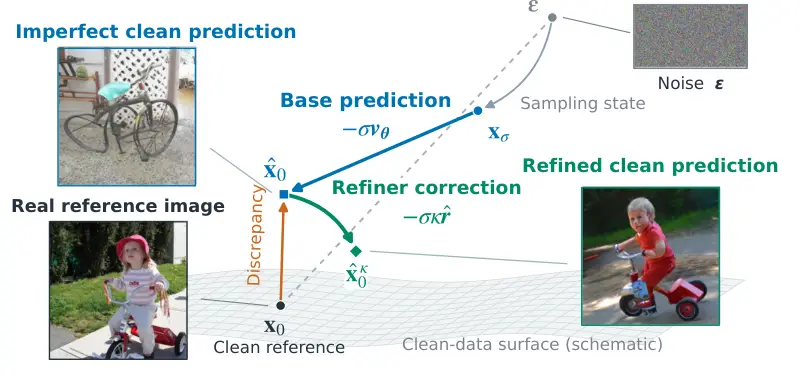

Figure 1: CorrFlow learns from its own imperfect predictions. The base
model’s clean prediction (blue) deviates from the clean reference
(orange arrow). The resulting correction shifts the prediction closer to
the clean reference by $`-\sigma\kappa\hat{\bm{r}}`$ (green arrow),
where $`\sigma`$ is the noise level and $`\kappa`$ controls the
correction strength. The initial noise is obtained by adding Gaussian
noise to the clean reference.

We therefore exploit the property that learning should be
“_refine-in-loop_”, in the sense that if a student makes a mistake,
e.g., in an examination, they should revisit the answer they wrote, the
question they were asked, and the reasoning they followed. By examining
these pieces of context together, the student can trace a mistake and
determine how to revise it, rather than struggling with a final
answer (Madaan et al., 2023; Zou et al., 2025). Inspired by the success
of _self-refinement_ in large language models (LLMs) (Madaan et al.,
2023; Shinn et al., 2023), we apply this principle to flow matching. A
flow-based generator already computes analogous information at each
sampling step: an estimate of the clean sample$`\rightarrow`$answer, the
generation conditions$`\rightarrow`$question and intermediate hidden
states$`\rightarrow`$internal state. The challenge is to define a
correction target that can be supervised during training and predicted
from these quantities without access to a clean reference during
generation.

In this paper, we introduce _CorrFlow_ , a self-correcting flow-matching
framework that attaches a lightweight _refiner_ to the base generator.
Our _core insight_ is that the model’s one-step clean prediction
provides a concrete object for the review, with a direct mathematical
connection to the correction we seek (Chen et al., 2022). Under
rectified-flow interpolation, the error between this prediction and the
clean sample is exactly _realized velocity residual_ (eq. 4) scaled by
the noise level. This identity connects a mistake in the predicted
sample to a correction in the velocity field. We first theoretically
prove the relationship between the realized velocity residual and the
clean prediction (section 3.1). In practice, the refiner is a
transformer that predicts the velocity residual from three sources of
information: _i) the current answer_, given by the one-step clean
prediction, _ii) the circumstances_, given by the generation condition
and noise level, and _iii) the internal state_, given by hidden states
from the base model (Epstein et al., 2023). During joint training, clean
samples and their sampled noise provide residual targets for the
refiner, while the base model and refiner optimize separate objectives.
During generation, the predicted residual adjusts the velocity used by
the sampler before each state update. All refiner inputs reuse the same
base-model forward pass, and each correction requires one additional
refiner evaluation.

We empirically apply CorrFlow to a wide range of applications, including
image generation, text-to-video generation and image-to-video
generation. Figure 1 illustrates how this review shifts the model’s
clean prediction through a correction of its velocity on image
generation. We find that training a refiner improves the base model’s
performance on aesthetic quality and physics consistency of generated
content. The strong performance across multiple tasks and datasets shows
that velocity residual correction is generic. Our contributions are
summarized as follows:

- •
  We introduce CorrFlow, a self-correcting flow-matching framework that
  learns velocity residuals from the base model’s current prediction,
  and applies the resulting corrections within the sampling loop.
- •
  We theoretically establish conditions under which reusing base-model
  representations outperforms raw-input affine predictors, refiner
  training achieves greater residual-risk reduction than continued
  base-model training at matched compute, and deployed correction lowers
  velocity error under its own sampler-induced state law.
- •
  We evaluate CorrFlow on image and video generation benchmarks,
  demonstrating improvements in visual quality and physics consistency.

## 2 Related Works

Improving Flow-Matching Generative Models. Many approaches have been
proposed to improve flow-matching generative models. For representation
learning, REPA (Yu et al., 2025) aligns hidden states with pretrained
visual features, while iREPA (Singh et al., 2025) emphasizes their
spatial structure. VA-VAE (Yao et al., 2025) aligns VAE latents with
visual features, REPA-E (Leng et al., 2025) jointly tunes the VAE and
diffusion transformer through alignment and RAE (Zheng et al., 2026a)
generates directly in pretrained representation spaces. Other methods
reuse features available within the generative model: SRA and
LayerSync (Jiang et al., 2026; Haghighi et al., 2026) use deeper
features to guide shallower representations, and SRA² (Wang et al.,
2026a) draws on existing VAE features. Reward-based methods Flow-GRPO
and DanceGRPO (Liu et al., 2025; Xue et al., 2025c) use stochastic
sampling for online reinforcement learning, while AWM (Xue et al.,
2025b) and DiffusionNFT (Zheng et al., 2026c) incorporate rewards into
flow-matching objectives through advantage weighting and paired
generations, respectively. CorrFlow takes a complementary approach: it
trains a _lightweight added-on refiner_ to predict _velocity residuals_
from the base model’s current prediction and hidden states. These
residuals directly correct the velocity within the sampling loop,
without requiring external representation teachers or reward models for
refiner training.

Physics-Aware Video Generation. Several recent works have explored
physics-aware video generation with flow-matching models. WISA (Wang et
al., 2025), PhysVid (Pathak et al., 2026) and PhyParam (Li et al., 2026)
inject hierarchical, temporally local, or instance-level physical
conditions. PhysGen (Liu et al., 2024) and PSIVG (Foo et al., 2026) use
simulated dynamics as guidance. Representation-based methods transfer or
jointly learn motion, geometry, semantics and latent dynamics, including
VideoREPA (Zhang et al., 2025c), PhysAlign (Xiong et al., 2026),
VideoJAM (Chefer et al., 2025), PHANTOM (Shen et al., 2026),
DreamWorld (Tan et al., 2026) and MMPhysVideo (Lin et al., 2026). Other
approaches use language or feedback, with PhyT2V (Xue et al., 2025a) and
DiffPhy (Zhang et al., 2025b) introducing inferred physical rules,
PhysMaster (Ji et al., 2025) and PhyGDPO (Cai et al., 2025) applying
pairwise or groupwise preference learning and WMReward (Yuan et al., 2026) steering denoising trajectories with a latent-world-model reward
at inference. In contrast, CorrFlow learns to correct the base model’s
own velocity residuals from its predictions and hidden states, without
explicit physical parameters or external physics evaluators.

## 3 CorrFlow

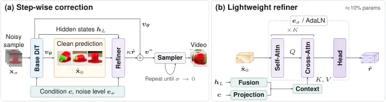

Figure 2: CorrFlow overview for video generation. (a) At noise level
$`\sigma`$, the refiner predicts a residual $`\hat{\bm{r}}`$ from the
base DiT’s clean prediction
$`\hat{\mathbf{x}}_{0}=\mathbf{x}_{\sigma}-\sigma\bm{v}_{\bm{\theta}}`$,
selected hidden states $`\bm{h}_{L}`$, conditioning tokens $`\bm{c}`$
and noise-level embedding $`\bm{e}_{\sigma}`$. Sampling corrects the
base velocity as
$`\bm{v}^{\kappa}=\bm{v}_{\bm{\theta}}+\kappa\hat{\bm{r}}`$ with
strength $`\kappa`$. (b) The refiner alternates self-attention over
clean-prediction tokens with cross-attention to projected conditioning
and fused hidden-state tokens. Noise conditioning modulates its blocks
and sample-space output head, while 3D rotary embeddings encode video
token coordinates. Frames show outputs and cubes denote sample tensors.

CorrFlow augments a base flow-matching model $`\bm{f}_{\mathrm{base}}`$
with a lightweight _refiner_ that corrects its velocity
$`\bm{v}_{\bm{\theta}}`$ at each sampling step. We use bold upright
symbols for samples, bold italic symbols for other vectors and tensors
and ordinary symbols for scalars. The refiner takes the one-step clean
prediction
$`\hat{\mathbf{x}}_{0}=\mathbf{x}_{\sigma}-\sigma\bm{v}_{\bm{\theta}}`$,
hidden states $`\{\bm{h}_{\ell}\}_{\ell\in L}`$, conditioning $`\bm{c}`$
and noise-level embedding $`\bm{e}_{\sigma}`$ to predict a velocity
residual:

```math
\hat{\bm{r}}=\bm{f}_{\mathrm{refiner}}(\hat{\mathbf{x}}_{0},\{\bm{h}_{\ell}\}_{\ell\in L},\bm{c},\bm{e}_{\sigma}),\qquad\bm{v}^{\kappa}=\bm{v}_{\bm{\theta}}+\kappa\hat{\bm{r}}, \tag{1}
```

where $`\kappa`$ controls the correction strength.

### 3.1 Preliminaries: flow matching and the residual it leaves behind

Let $`\mathbf{x}_{0}\in\mathbb{R}^{D}`$ be the continuous representation
of a clean data sample, with encoded conditioning $`\bm{c}`$, such as
class or text embeddings. The representation uses the sample’s native
coordinates or a learned feature space, and $`D`$ denotes its dimension.
Let $`\bm{\varepsilon}\sim\mathcal{N}(0,I_{D})`$ be independent noise in
the same space. For a noise level $`\sigma\in[0,1]`$ the rectified-flow
interpolant and its derivative are

```math
\mathbf{x}_{\sigma}=(1-\sigma)\,\mathbf{x}_{0}+\sigma\,\bm{\varepsilon},\qquad\frac{\mathrm{d}\mathbf{x}_{\sigma}}{\mathrm{d}\sigma}=\bm{\varepsilon}-\mathbf{x}_{0}. \tag{2}
```

The target flow velocity is $`\bm{v}=\bm{\varepsilon}-\mathbf{x}_{0}`$,
and the Bayes velocity field is
$`\bm{v}^{\star}(\mathbf{x},\sigma,\bm{c})=\mathbb{E}[\,\bm{\varepsilon}-\mathbf{x}_{0}\mid\mathbf{x}_{\sigma}=\mathbf{x},\bm{c}\,]`$.
The base diffusion model $`\bm{f}_{\text{base}}`$ is trained by

```math
\mathcal{L}_{\mathrm{base}}(\bm{\theta})=\mathbb{E}_{\mathbf{x}_{0},\bm{c},\bm{\varepsilon},\sigma}\,w(\sigma)\,\big\lVert\bm{v}_{\bm{\theta}}(\mathbf{x}_{\sigma},\sigma,\bm{c})-\bm{v}\big\rVert^{2}, \tag{3}
```

with $`w(\sigma)`$ the noise-level weight of the base recipe, where
$`\bm{v}_{\bm{\theta}}`$ is the output of $`\bm{f}_{\text{base}}`$,
parameterized by $`\bm{\theta}`$. Generation integrates the learned
velocity field
$`\mathrm{d}\mathbf{x}/\mathrm{d}\sigma=\bm{v}_{\bm{\theta}}(\mathbf{x},\sigma,\bm{c})`$
from $`\sigma=1`$ to $`\sigma=0`$ with explicit Euler steps on a shifted
grid. The base model approximates the Bayes velocity field, while each
sampled data–noise pair provides a realized target velocity. We call the
difference between this target and the base prediction the realized
velocity residual,

```math
\bm{r}\;=\;\bm{v}-\bm{v}_{\bm{\theta}}(\mathbf{x}_{\sigma},\sigma,\bm{c})\;=\;(\bm{\varepsilon}-\mathbf{x}_{0})-\bm{v}_{\bm{\theta}}(\mathbf{x}_{\sigma},\sigma,\bm{c}). \tag{4}
```

This is the mistake we want the refiner $`\bm{f}_{\text{refiner}}`$ to
predict. The base model’s one-step clean prediction is available at
generation time. Its discrepancy from the clean target is proportional
to the realized velocity residual, as the following identity shows.

##### Clean-prediction identity.

Taking a single Euler step from $`\mathbf{x}_{\sigma}`$ all the way to
$`\sigma=0`$ gives the base model’s one-step clean prediction, its best
current guess at the finished sample,

```math
\hat{\mathbf{x}}_{0}(\mathbf{x}_{\sigma},\sigma,\bm{c})\;=\;\mathbf{x}_{\sigma}-\sigma\,\bm{v}_{\bm{\theta}}(\mathbf{x}_{\sigma},\sigma,\bm{c}). \tag{5}
```

Substituting Equation 2 into Equation 5 and using Equation 4,

```math
\hat{\mathbf{x}}_{0}-\mathbf{x}_{0}=\sigma\big((\bm{\varepsilon}-\mathbf{x}_{0})-\bm{v}_{\bm{\theta}}\big)=\sigma\,\bm{r},\qquad\text{equivalently}\qquad\bm{r}=\frac{\hat{\mathbf{x}}_{0}-\mathbf{x}_{0}}{\sigma},\quad\sigma>0. \tag{6}
```

This identity holds for any predictor $`\bm{v}_{\bm{\theta}}`$ and shows
that the clean-prediction error is the velocity residual $`\bm{r}`$
scaled by the noise level $`\sigma`$. It therefore motivates using
$`\hat{\mathbf{x}}_{0}`$ as the refiner’s primary input, expressing the
prediction in the clean data space. Although $`\hat{\mathbf{x}}_{0}`$ is
available at every sampling step, its error depends on the unknown clean
target. The refiner thus learns to estimate the residual from this
prediction $`\hat{\mathbf{x}}_{0}`$ and the accompanying features
$`\bm{h}_{L}`$.

### 3.2 Refiner Inputs

Focusing on the current answer in isolation is insufficient, because the
same prediction may be correct under one condition and a mistake under
another, or an artifact that must be repaired at high noise may be a
legitimate detail at low noise. Therefore, the refiner is given three
views of the moment the mistake was made:

The current answer.  
The one-step clean prediction $`\hat{\mathbf{x}}_{0}`$ of Equation 5,
tokenized according to the sample structure to form the refiner’s trunk
tokens. This is the base model’s current estimate of the clean sample.

The circumstances.  
The conditioning tokens $`\bm{c}`$ that encode the task requirements,
and the noise level $`\sigma`$, which identifies the current position
along the denoising trajectory.

The internal state.  
The base model’s hidden states $`\{\bm{h}_{\ell}\}_{\ell\in L}`$, where
$`L`$ indexes transformer blocks selected uniformly across the model’s
depth. These readouts capture different stages of the computation that
produced $`\bm{v}_{\bm{\theta}}`$, and they record how the prediction
was assembled rather than only what it was.

Formally, let $`W=(\mathbf{x}_{\sigma},\sigma,\bm{c})`$ denote the base
model’s query state, and let
$`\mathcal{Z}(W)=(\hat{\mathbf{x}}_{0},\{\bm{h}_{\ell}\}_{\ell\in L},\sigma,\bm{c})`$
be the refiner’s information. The refiner is a network
$`\bm{f}_{\text{refiner}}`$ with parameter vector $`\bm{\phi}`$, written
as $`\bm{g}_{\bm{\phi}}`$, and is trained to predict the residual,
$`\hat{\bm{r}}\;=\;\bm{g}_{\bm{\phi}}(\mathcal{Z}(W))\;\approx\;\bm{r}.`$
Every component of $`\mathcal{Z}`$ is from the base model’s conditioning
and its existing forward pass. Constructing them for the refiner
requires _no additional base-model evaluation_ and _no access to the
clean target at generation time_.

### 3.3 Refiner architecture

_CorrFlow_ is designed to be a _lightweight add-on transformer_ to a
base flow-matching model, which estimates the realized velocity residual
$`\bm{r}`$. It has its own parameters, totaling approximately $`10\%`$
of the base model’s parameter count. It carries the aforementioned
information as inputs.

Token embeddings. Given the clean prediction $`\hat{\mathbf{x}}_{0}`$
(eq. 5), the refiner $`\bm{f}_{\text{refiner}}`$ first tokenizes it
according to the sample structure into $`N`$ tokens and projects them to
the refiner width $`d`$, obtaining the answer tokens
$`\bm{t}_{\text{ans}}\in\mathbb{R}^{N\times d}`$. Our image and video
implementations use patches for this tokenization. To keep the refiner
and base model on a common clock, the refiner also consumes the base
model’s own noise-level embedding $`\bm{e}_{\sigma}`$ at the current
noise level $`\sigma`$.

We also construct the context tokens
$`\bm{t}_{\text{ctx}}\in\mathbb{R}^{(N_{c}+N)\times d}`$ from the
conditioning $`\bm{c}`$ and the hidden states
$`\{\bm{h}_{\ell}\}_{\ell\in L}`$, where $`N_{c}`$ is the number of
conditioning tokens. In particular, a linear projection maps $`\bm{c}`$
to the conditioning tokens
$`\bm{t}_{\text{c}}\in\mathbb{R}^{N_{c}\times d}`$. At each token
position, we concatenate the hidden states from the selected layers
along the feature dimension and project them to the refiner width $`d`$
using a multilayer perceptron with a GELU activation,

```math
\bm{t}_{\mathrm{fuse}}=\mathrm{MLP}\Bigl(\mathrm{concat}_{\ell\in L}\,\bm{h}_{\ell}\Bigr)\in\mathbb{R}^{N\times d}. \tag{7}
```

This fusion across layers at fixed token positions is a deliberate
choice. It keeps the hidden-state tokens at $`N`$ tokens instead of
$`|L|\cdot N`$, so attention cost does not grow with the number of
readouts, and it lets the refiner learn which depth to trust at each
location rather than committing to a fixed average across depths. To
combine the two context tokens for the refiner’s cross-attention, we
concatenate them along the token axis and apply layer normalization,

```math
\bm{t}_{\text{ctx}}=\mathrm{LayerNorm}\Bigl(\bigl[\,\bm{t}_{\text{c}}+\bm{s}_{\mathrm{cond}}\;,\;\bm{t}_{\text{fuse}}+\bm{s}_{\mathrm{state}}\,\bigr]\Bigr)\in\mathbb{R}^{(N_{c}+N)\times d}, \tag{8}
```

where $`\bm{s}_{\mathrm{cond}}`$ and $`\bm{s}_{\mathrm{state}}`$ are
learned segment embeddings that mark the two sources.

Alternating-Attention blocks. We build our _lightweight add-on
transformer_ with a stack of $`B`$ Alternating Attention Blocks (AABs),
making the refiner focus on the current answer while consulting the
context in an alternate manner. Specifically, even-indexed blocks apply
_self-attention_ to the answer tokens $`\bm{t}_{\text{ans}}`$, using
rotary position embeddings defined on the token coordinates of the
sample representation. Our image and video implementations use
two-dimensional spatial coordinates and three-dimensional spatiotemporal
coordinates, respectively. Odd-indexed blocks apply _cross-attention_ to
the context tokens $`\bm{t}_{\text{ctx}}`$, which lets each token
incorporate the task requirements and the base model’s intermediate
representations. Each attention layer is followed by a feed-forward
network. Following the base model’s adaptive-normalization design, each
block uses shift, scale and gate parameters derived from the noise-level
embedding $`\bm{e}_{\sigma}`$. Finally, a modulated linear head projects
the updated answer tokens to residual tokens, which are reassembled into
the sample’s original shape.

### 3.4 Training and Inference

##### Objective.

We train the base model $`\bm{f}_{\text{base}}`$ and the refiner
$`\bm{f}_{\text{refiner}}`$ on the same minibatch using separate
objectives and a single backward pass. In particular, we define the
refiner’s loss by a combination of a magnitude term and a direction
term,

```math
\mathcal{L}_{\mathrm{ref}}(\bm{\phi})=\mathbb{E}\Big[\;\big\lVert\hat{\bm{r}}-\mathrm{sg}[\bm{r}]\big\rVert^{2}\;+\;\lambda\big(1-\cos\big(\hat{\bm{r}},\,\mathrm{sg}[\bm{r}]\big)\big)\Big], \tag{9}
```

where $`\mathrm{sg}[\cdot]`$ denotes the stop-gradient operator,
$`\hat{\bm{r}}=\bm{f}_{\text{refiner}}(\mathrm{sg}[\mathcal{Z}(W)])`$ is
the refiner output, with $`\bm{r}`$ the realized velocity residual
defined in Equation 4 and $`\lambda`$ controls the weight of the
direction term. We calculate the cosine similarity by flattening the
overall residual field into a single vector per sample. The two terms
play complementary roles. The squared-error term fits the residual
vector, coupling its magnitude and direction. When residual directions
vary across samples with similar refiner inputs, averaging these targets
can produce a correction with a smaller magnitude. The cosine term
explicitly rewards alignment with the target direction and complements
this vector regression while the correction magnitude is learned. The
total training objective is

```math
\mathcal{L}=\mathcal{L}_{\mathrm{base}}(\bm{\theta})+\lambda_{\mathrm{ref}}\,\mathcal{L}_{\mathrm{ref}}(\bm{\phi}), \tag{10}
```

where $`\bm{\theta}`$ and $`\bm{\phi}`$ are the base and refiner
parameters, respectively. Here $`\lambda_{\mathrm{ref}}`$ controls the
relative weight of the refiner objective.

##### Inference.

The refiner is applied inside the ordinary sampling loop rather than as
a post-process on a finished sample. At each denoising step the sampler
evaluates the base model on the current sample, captures
$`\bm{e}_{\sigma}`$ and $`\{\bm{h}_{\ell}\}_{\ell\in L}`$ from that same
evaluation, assembles $`\hat{\mathbf{x}}_{0}`$ from Equation 5 and runs
the refiner once on $`\mathcal{Z}(W)`$. The predicted residual is added
to the base velocity with a gain $`\kappa`$,

```math
\bm{v}^{\kappa}=\bm{v}_{\bm{\theta}}(\mathbf{x}_{\sigma},\sigma,\bm{c})+\kappa\,\bm{f}_{\text{refiner}}(\mathcal{Z}(W)), \tag{11}
```

and the corrected velocity is what the scheduler integrates. Because
$`\hat{\mathbf{x}}_{0}`$ and $`\{\bm{h}_{\ell}\}_{\ell\in L}`$ are
obtained from the state the sampler has actually reached, each
correction influences subsequent refiner inputs. This adds one refiner
forward pass per step without additional base-model evaluations.

## 4 Theoretical Analysis

We analyze three complementary questions: whether frozen base-model
features can improve residual prediction beyond raw-input predictors,
whether refiner training can outperform continued base-model training at
matched budget and whether a trained correction improves velocity error
under the state law it induces at deployment.

Shared residual target. Let $`\mathcal{X}`$ be a finite-dimensional
Hilbert sample space, let $`P`$ be the law of the query state
$`W=(\mathbf{x}_{\sigma},\sigma,\bm{c})`$ and let $`\widetilde{P}`$ be
the joint law of $`(W,\bm{r})`$ at the fixed base checkpoint used below.
Assume $`\bm{r}\in L^{2}(\widetilde{P};\mathcal{X})`$ and write
$`\bar{\bm{r}}(W)=\mathbb{E}_{\widetilde{P}}[\bm{r}\mid W]`$. For any
$`\bm{f}\in L^{2}(P;\mathcal{X})`$, define

```math
\mathcal{R}_{P}(\bm{f}):=\mathbb{E}_{\widetilde{P}}\|\bm{r}-\bm{f}(W)\|^{2},\qquad\mathcal{R}_{\mathrm{irr}}:=\mathbb{E}_{\widetilde{P}}\|\bm{r}-\bar{\bm{r}}(W)\|^{2}.
```

###### Proposition 1 (Same-target risk decomposition).

Every such predictor satisfies

```math
\mathcal{R}_{P}(\bm{f})=\mathcal{R}_{\mathrm{irr}}+\mathbb{E}_{P}\|\bm{f}(W)-\bar{\bm{r}}(W)\|^{2}. \tag{12}
```

The cross term vanishes because
$`\mathbb{E}_{\widetilde{P}}[\bm{r}-\bar{\bm{r}}(W)\mid W]=0`$. See
equations 40 and 41.

Frozen-feature separation. In the scalar Gaussian witness of Appendix A,
let $`c_{1},c_{2}`$ be independent uniform signs, put $`p=c_{1}c_{2}`$
and take $`x_{0}=\delta p+\xi`$, where $`\delta>0`$ and
$`\xi\sim\mathcal{N}(0,1)`$. The frozen representation exposes the
interaction through $`h_{L}=p`$. With
$`\tau_{\sigma}=\sigma/[(1-\sigma)^{2}+\sigma^{2}]`$, the one-parameter
refiner is $`g_{b}=-b\tau_{\sigma}p`$, whereas $`\mathcal{A}`$ contains
raw-affine functions of $`(x_{\sigma},c_{1},c_{2})`$ with arbitrary
$`\sigma`$-dependent coefficients.

###### Theorem 2 (Frozen-feature advantage).

For an explicit $`\Delta_{\mathrm{aff}}>0`$ defined in Appendix A,

```math
\mathcal{R}_{P}(g_{\delta})=\mathcal{R}_{\mathrm{irr}},\qquad\inf_{a\in\mathcal{A}}\mathcal{R}_{P}(a)=\mathcal{R}_{\mathrm{irr}}+\Delta_{\mathrm{aff}}.
```

If $`\widehat{b}`$ is $`\epsilon_{\mathrm{opt}}`$-suboptimal for
$`\mathcal{J}_{\lambda}(b)=\mathcal{R}_{P}(g_{b})+\lambda\mathbb{E}_{\widetilde{P}}L_{\cos}(g_{b},r)`$,
with $`\lambda=0.1`$, then

```math
2\lambda+\epsilon_{\mathrm{opt}}<\Delta_{\mathrm{aff}}\quad\Longrightarrow\quad\mathcal{R}_{P}(g_{\widehat{b}})<\inf_{a\in\mathcal{A}}\mathcal{R}_{P}(a). \tag{13}
```

Matched-resource separation. Returning to the finite-dimensional space
$`\mathcal{X}`$, we compare two runs from the same checkpoint
$`\bm{v}_{0}`$: the refiner correction
$`F_{\mathrm{r}}(\bm{\alpha})=\bm{g}_{\bm{\phi}_{0}+\bm{\alpha}}(\mathcal{Z}(W))`$
and continued base training
$`F_{\mathrm{b}}(\bm{\alpha})=\bm{v}_{\bm{\theta}_{0}+\bm{\alpha}}(W)-\bm{v}_{0}(W)`$,
with $`F_{j}(0)=0`$. Under a common ledger $`\mathcal{C}`$, arm $`j`$
takes $`T_{j}=\lfloor C_{\mathrm{train}}/c_{j}\rfloor`$ gradient steps
and returns $`\bm{f}_{j,\eta}`$. Write
$`\Delta_{j}=\sup_{\eta\in\mathcal{E}_{j}}[\mathcal{R}_{P}(0)-\mathcal{R}_{P}(\bm{f}_{j,\eta})]`$,
$`\Phi_{j}=DF_{j}(0)`$, $`H_{j}=\Phi_{j}^{*}\Phi_{j}`$ and
$`\bm{b}_{j}=\Phi_{j}^{*}\bar{\bm{r}}`$.

###### Theorem 3 (Finite-ledger refiner separation).

Under the local Jacobian, angular-gradient, radius and
spectral-stability conditions of Appendix B.1, both armwise optima are
attained and the actual reduction $`\Delta_{j}`$ differs from its
tangent approximation $`\Delta_{j}^{\mathrm{lin}}`$ by at most an
explicit finite error $`e_{j}`$:

```math
|\Delta_{j}-\Delta_{j}^{\mathrm{lin}}|\leq e_{j},\qquad\Delta_{j}^{\mathrm{lin}}=\sup_{\eta\in\mathcal{E}_{j}}\bm{b}_{j}^{*}H_{j}^{\dagger}[I-(I-\eta H_{j})^{2T_{j}}]\bm{b}_{j}.
```

Consequently,

```math
\Delta_{\mathrm{r}}^{\mathrm{lin}}-e_{\mathrm{r}}>\Delta_{\mathrm{b}}^{\mathrm{lin}}+e_{\mathrm{b}}\Longrightarrow\min_{\eta\in\mathcal{E}_{\mathrm{r}}}\mathcal{R}_{P}(\bm{f}_{\mathrm{r},\eta})<\min_{\eta\in\mathcal{E}_{\mathrm{b}}}\mathcal{R}_{P}(\bm{f}_{\mathrm{b},\eta}). \tag{14}
```

Own-law deployment. Write $`\bm{g}_{\bm{\phi}}`$ for the deployed
correction $`W\mapsto\bm{g}_{\bm{\phi}}(\mathcal{Z}(W))`$. Let
$`\mathbf{X}^{\kappa}`$ be the exact trajectory from the prescribed
source under the field $`\bm{v}_{0}+\kappa\bm{g}_{\bm{\phi}}`$. For
$`\Sigma`$ drawn independently of the source and condition from a law
$`q`$ on $`[0,1]`$, set
$`Q_{\kappa}=\operatorname{Law}(\mathbf{X}^{\kappa}(\Sigma),\Sigma,\bm{C})`$
and define
$`\mathcal{V}_{Q}(\kappa)=\mathbb{E}_{Q}\|\bar{\bm{r}}-\kappa\bm{g}_{\bm{\phi}}\|^{2}`$.
Here $`\bar{\bm{r}}`$ denotes the deployment version fixed in
Appendix C.1.

###### Theorem 4 (Own-law velocity improvement).

Under the deployment assumptions of Appendix C, let $`M`$ be the
first-order alignment margin after trajectory-shift cost and $`N`$ the
second-order correction and alignment-shift cost, as defined in
Appendix C.3. Then, for every $`\kappa\in[0,\bar{\kappa}]`$,

```math
\mathcal{V}_{Q_{\kappa}}(\kappa)-\mathcal{V}_{Q_{0}}(0)\leq-\kappa M+\kappa^{2}N.
```

If $`M>0`$ (hence $`N>0`$), then

```math
0<\kappa\leq\bar{\kappa},\quad\kappa<\frac{M}{N}\quad\Longrightarrow\quad\mathcal{V}_{Q_{\kappa}}(\kappa)<\mathcal{V}_{Q_{0}}(0). \tag{15}
```

## 5 Experiments

We evaluate CorrFlow on a wide range of tasks, including
class-conditional image generation, text-to-video generation and
image-to-video generation. The image experiments test whether learned
velocity corrections improve an established flow-matching model, while
the video experiments examine visual quality, temporal consistency and
physical plausibility. Red, orange and yellow highlight the best,
second-best and third-best scores in each column, respectively.

### 5.1 Image Generation

Settings. We study class-conditional generation on ImageNet at
$`256\times 256`$ resolution with 1,000 classes. Our base model is built
upon RAEv2 with a frozen DINOv3-L-based representation autoencoder and a
pretrained diffusion transformer. Starting from its 80-epoch checkpoint,
we jointly fine-tune the base transformer and train a randomly
initialized refiner for another 80 epochs on the ImageNet training
split, denoted by $`80+80`$ in Table 1. The refiner has 10 transformer
blocks with width 768 and 12 attention heads, and reads hidden states
from base transformer blocks 3, 11, 19 and 27, using one-based indexing.
We retain the base model’s training objective and train the refiner to
predict the realized velocity residual with squared error and a
cosine-direction term weighted by $`0.1`$. Both networks use GMuon
optimizer with a global batch size of 1,024. The evaluation settings are
identical to those in Singh et al. (2026).

|                                |        |          |                 |                                                                      |                             |                             |
| ------------------------------ | ------ | -------- | --------------- | -------------------------------------------------------------------- | --------------------------- | --------------------------- |
| Method                         | Epochs | Guidance | IS $`\uparrow`$ | Representation Fréchet Distance ($`\mathrm{FD}_{r}`$) $`\downarrow`$ |                             |                             |
|                                |        |          |                 | ConvNeXt (Liu et al., 2022)                                          | DINOv2 (Oquab et al., 2023) | CLIP (Radford et al., 2021) |
| RAEv2 (Singh et al., 2026)     | 160    | No       | 233.9           | 1.28                                                                 | 2.22                        | 7.18                        |
| SelfFlow (Chefer et al., 2026) | 160    | No       | 146.4           | 4.81                                                                 | 7.08                        | 12.13                       |
| Ours                           | 80+80  | No       | 234.0           | 1.24                                                                 | 2.21                        | 7.14                        |
| SiT-XL/2 (Ma et al., 2024)     | 800    | Yes      | 256.7           | 2.02                                                                 | 7.89                        | 17.69                       |
| RAE-XL (Zheng et al., 2026a)   | 800    | Yes      | 261.0           | 1.79                                                                 | 2.11                        | 7.87                        |
| RAEv2 (Singh et al., 2026)     | 160    | Yes      | 265.0           | 0.74                                                                 | 1.08                        | 4.85                        |
| SelfFlow (Chefer et al., 2026) | 160    | Yes      | 146.8           | 4.72                                                                 | 6.98                        | 12.16                       |
| Ours                           | 80+80  | Yes      | 266.6           | 0.73                                                                 | 1.03                        | 4.84                        |

Table 1: Comparison on ImageNet-256 (Deng et al., 2009) generation.
Representation Fréchet Distance ($`\mathrm{FD}_{r}`$) is reported in
three feature spaces.

Results. Table 1 compares CorrFlow with RAEv2 at a matched budget of 160
total epochs, because our $`80+80`$ schedule spends 80 epochs on the
base checkpoint and 80 epochs on joint training. Under this budget,
CorrFlow improves over RAEv2 on IS and on all three $`\mathrm{FD}_{r}`$
metrics, both with and without guidance, so the gain comes from the
learned residual corrections rather than from a longer training
schedule. With guidance, CorrFlow leads on every metric in the table,
surpassing SiT-XL/2 and RAE-XL trained for 800 epochs. It also
outperforms the evaluated SelfFlow variant in both guidance settings.
Additional results are provided in Section E.1.

### 5.2 Text-to-Video Generation

Settings. We use Wan2.1-T2V-1.3B (Wan et al., 2025) as the base model
and jointly adapt its transformer with the refiner on video–text pairs
from WISA-80K (Wang et al., 2025) and OpenVidHD (Nan et al., 2025). The
refiner has 10 transformer blocks with width 1,024 and 16 attention
heads, and reads hidden states from base blocks 4, 12, 20 and 30, using
one-based indexing. The final training stage uses 66,572 clips for five
epochs with AdamW and a global batch size of 16, retaining the base
flow-matching objective and a residual objective with cosine-direction
weight $`0.1`$. We generate 81-frame videos at $`480\times 832`$
resolution with 50 Euler steps and evaluate visual quality and temporal
consistency with VBench (Huang et al., 2024), and physical plausibility
and prompt adherence with VideoPhy2 (Bansal et al., 2026) and
FinePhyEval (Pothiraj et al., 2026). Section D.2 provides the training
and evaluation details.

|                                    |           |      |       |      |      |       |             |        |         |         |
| ---------------------------------- | --------- | ---- | ----- | ---- | ---- | ----- | ----------- | ------ | ------- | ------- |
| Method                             | VideoPhy2 |      |       |      |      |       | FinePhyEval |        |         |         |
|                                    | ALL       |      |       | HARD |      |       | Object      | Action | Physics | Overall |
|                                    | PC        | SA   | Joint | PC   | SA   | Joint |             |        |         |         |
| Wan 2.1-14B (Wan et al., 2025)     | 60.5      | 29.0 | 24.7  | 45.6 | 8.3  | 3.9   | 0.86        | 0.53   | 0.46    | 0.59    |
| PhysRAG-5B (Cheng et al., 2026)    | 65.6      | 24.7 | 21.0  | 59.4 | 7.2  | 4.4   | 0.88        | 0.49   | 0.37    | 0.55    |
| VideoREPA-5B (Zhang et al., 2025c) | 73.6      | 25.8 | 23.6  | 62.8 | 6.7  | 5.0   | 0.82        | 0.37   | 0.30    | 0.47    |
| Wan 2.1-1.3B (Wan et al., 2025)    | 57.8      | 30.0 | 24.8  | 36.7 | 11.7 | 5.6   | 0.84        | 0.49   | 0.36    | 0.54    |
| DreamWorld-1.3B (Tan et al., 2026) | 53.7      | 27.0 | 20.9  | 35.0 | 7.8  | 3.9   | 0.90        | 0.53   | 0.38    | 0.58    |
| VPT-1.3B (Zheng et al., 2026b)     | 55.1      | 22.5 | 22.2  | 39.4 | 8.3  | 5.6   | 0.82        | 0.44   | 0.34    | 0.50    |
| CorrFlow (Ours)-1.3B               | 65.7      | 31.3 | 27.0  | 51.9 | 11.0 | 6.9   | 0.90        | 0.55   | 0.44    | 0.60    |

Table 2: Physics-consistent text-to-video generation on
VideoPhy2 (Bansal et al., 2026) and FinePhyEval (Pothiraj et al., 2026).
Higher is better for all metrics.

| Method                              | SC    | TF    | MS    | AQ    | IQ    | OC    | SR    | TS    | QS    | Total |
| ----------------------------------- | ----- | ----- | ----- | ----- | ----- | ----- | ----- | ----- | ----- | ----- |
| VideoREPA-5B (Zhang et al., 2025c)  | 95.47 | 98.23 | 98.54 | 57.19 | 59.80 | 67.56 | 51.85 | 22.71 | 79.96 | 76.67 |
| PhysRAG-5B (Cheng et al., 2026)     | 96.31 | 98.71 | 96.93 | 56.80 | 65.56 | 80.50 | 77.33 | 23.18 | 83.07 | 80.08 |
| Wan 2.1-1.3B (Wan et al., 2025)     | 91.83 | 99.17 | 96.51 | 57.24 | 59.14 | 76.09 | 62.37 | 22.23 | 79.81 | 76.93 |
| VideoJAM-1.3B (Chefer et al., 2025) | 91.51 | 99.13 | 96.05 | 58.41 | 62.68 | 79.22 | 66.17 | 24.03 | 81.18 | 78.76 |
| DreamWorld-1.3B (Tan et al., 2026)  | 93.62 | 98.81 | 98.07 | 59.59 | 66.76 | 81.32 | 70.47 | 23.82 | 83.49 | 80.97 |
| VPT-1.3B (Zheng et al., 2026b)      | 92.65 | 98.64 | 97.85 | 58.09 | 63.68 | 73.43 | 73.35 | 22.52 | 82.26 | 78.79 |
| CorrFlow (Ours)-1.3B                | 96.68 | 99.81 | 98.85 | 61.65 | 68.66 | 82.81 | 77.88 | 24.05 | 84.69 | 81.86 |

Table 3: VBench (Huang et al., 2024) comparison on selected metrics
(0–100, higher is better).

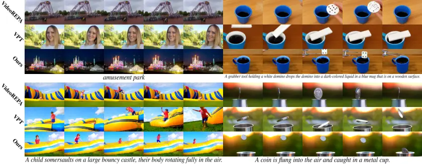

Figure 3: Qualitative comparison on text-to-video generation. Each
scenario compares VideoREPA-5B, VPT-1.3B and CorrFlow (Ours) under the
same text prompt, with frames sampled at $`0\%`$, $`25\%`$, $`50\%`$,
$`75\%`$ and $`100\%`$ of each generated video. The prompts are drawn
from VBench (amusement park), FinePhyEval (a domino dropped into a mug)
and VideoPhy2 (a somersault on a bouncy castle, a coin caught in a metal
cup).

Results. Table 2 reports the VideoPhy2 and FinePhyEval results for
physics-consistent text-to-video generation. CorrFlow achieves the
highest VideoPhy2 Joint scores on both ALL and HARD, increasing them
from $`24.8`$ to $`27.0`$ and from $`5.6`$ to $`6.9`$, respectively,
over Wan2.1-T2V-1.3B. It also achieves the highest FinePhyEval Overall
score of $`0.60`$, with improvements in object, action and physics
scores over the same base model. On VBench (table 3), CorrFlow leads the
compared methods on Quality Score and Overall Score, reaching $`84.69`$
and $`81.86`$. Figure 3 shows the same advantage in the generated
frames, where CorrFlow carries each prompted interaction to its physical
outcome, dropping the domino into the mug and landing the coin in the
metal cup, while the baselines lose the object or drift away from the
prompted action. These results show that the adapted model improves both
general video quality and the joint satisfaction of semantic and
physical requirements. Section E.2 analyzes the full metric breakdown.

### 5.3 Image-to-Video Generation

Settings. We use Wan2.2-TI2V-5B (Wan et al., 2025) as the base model,
with the same training data, objectives, optimization and five-epoch
schedule as in Section 5.2. We enable first-frame image conditioning for
$`40\%`$ of training examples and use text-only conditioning for the
remainder. The refiner has 13 transformer blocks with width 2,048 and 32
attention heads, reading hidden states from the same base blocks as in
text-to-video generation. We evaluate on the 198 image–text pairs of
Physics-IQ Verified (Rädsch et al., 2026; Motamed et al., 2026),
generating 81-frame videos at $`704\times 1248`$ resolution with the
same sampling configuration as in text-to-video generation. Section D.3
details the image conditioning, training and evaluation.

| Method                          | Spatial | Spatio-temporal | Weighted Spatial | MSE Score | Verified Score |
| ------------------------------- | ------- | --------------- | ---------------- | --------- | -------------- |
| P-Video-19B (Pruna AI, 2026)    | 38.60   | 16.40           | 22.90            | 23.30     | 25.30          |
| Wan2.2-5B (Wan et al., 2025)    | 35.89   | 26.44           | 22.96            | 25.54     | 27.71          |
| WMReward-5B (Yuan et al., 2026) | 36.47   | 22.38           | 19.79            | 27.26     | 26.48          |
| VLIPP-5B (Yang et al., 2025)    | 40.51   | 19.09           | 23.66            | 26.48     | 27.43          |
| PhysRAG-5B (Cheng et al., 2026) | 36.46   | 22.07           | 20.22            | 23.41     | 25.54          |
| CorrFlow (Ours)-5B              | 43.43   | 26.37           | 24.74            | 29.24     | 30.95          |

Table 4: Physics-IQ Verified (Rädsch et al., 2026) results on the
image-to-video track. All evaluations are without LLM usage. All scores
are percentages, and higher is better for every metric.

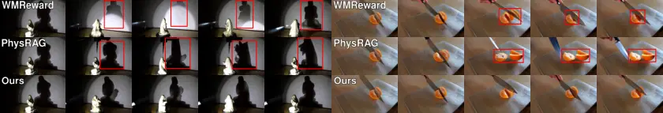

Figure 4: Qualitative comparison on the Physics-IQ Verified
image-to-video track. Each scenario compares WMReward-5B, PhysRAG-5B and
CorrFlow (Ours), which share the Wan2.2-TI2V-5B base model and receive
the same settings. Temporal order is from left to right. The left
scenario shows a statuette’s shadow under a moving light, and the right
scenario shows a knife slicing a mandarin.

Results. Table 4 reports the Physics-IQ Verified results. CorrFlow
achieves the highest Verified Score of $`30.95`$, and leads on Spatial,
Weighted Spatial and MSE Score. These results indicate closer agreement
with the ground-truth videos in motion coverage and frame appearance.
Figure 4 illustrates shadow and object consistency, with the statuette’s
shadow tracking the moving light and the blade separating the mandarin
into halves. Section E.3 provides the metric breakdown and qualitative
analysis.

### 5.4 Ablation Study

We conduct a number of ablations to nanalyze the contribution of each
component. All variants are built on WAN-2.1-T2V-1.3B (Wan et al., 2025)
and follow the same training protocol. Specifically, each model is
trained for five epochs on the same 1,000 samples from WISA-80K (Wang et
al., 2025). We evaluate on a disjoint set of 50 WISA-80K samples
selected to provide approximately uniform coverage over the physical
categories. We report visual quality and consistency metrics from
VBench, together with its aggregate Quality Score. Results are reported
in Table 5.

| Method               | AQ   | BC   | IQ   | OC   | SC   | QS   |
| -------------------- | ---- | ---- | ---- | ---- | ---- | ---- |
| w/o time-step        | 51.5 | 92.4 | 63.7 | 58.5 | 91.2 | 79.7 |
| w/o self-attention   | 48.9 | 92.1 | 60.4 | 58.1 | 90.0 | 78.5 |
| w/o cross-attention  | 48.5 | 91.4 | 60.7 | 58.2 | 90.2 | 78.5 |
| w/o hidden-state MLP | 49.3 | 92.4 | 63.6 | 58.2 | 90.9 | 79.3 |
| w/o refiner          | 51.3 | 92.5 | 62.0 | 59.1 | 91.3 | 78.6 |
| $`\bm{v}`$ input     | 50.4 | 92.4 | 63.7 | 60.2 | 91.7 | 79.8 |
| w/o condition        | 51.5 | 92.7 | 61.2 | 58.1 | 91.0 | 79.8 |
| Ours                 | 52.6 | 93.6 | 64.3 | 61.8 | 92.6 | 80.3 |

Table 5: Component ablations (%, higher is better). Colors rank the
four-decimal scores in Table 10, which also expands the metric names.

The full model achieves the highest Quality Score and leads on all
visual quality and consistency metrics. Removing cross-attention causes
the largest score drop, closely followed by self-attention, highlighting
the value of context and spatiotemporal interactions in the base model’s
prediction. Removing either the refiner or hidden-state MLP reduces
Quality Score and Overall Consistency, supporting refinement and fusion
of hidden states across depths. The remaining ablations produce smaller
but consistent score decreases. Removing noise-level conditioning or
replacing the clean prediction $`\hat{\mathbf{x}}_{0}`$ with the
velocity prediction $`\bm{v}_{\bm{\theta}}`$ lowers aggregate
performance, supporting the value of noise-level information and
explicit clean-sample estimates. Removing text conditioning lowers
Quality Score and notably weakens Overall Consistency, suggesting its
role in semantic alignment.

## 6 Conclusion

We introduced CorrFlow, a self-correcting flow-matching framework that
learns velocity residuals from the base model’s clean prediction,
conditioning and hidden states. A lightweight refiner corrects the
velocity within the sampling loop. Our theory identifies conditions
under which feature reuse improves residual prediction, refiner training
outperforms continued base-model training at matched compute, and the
deployed correction lowers own-law velocity error. We demonstrate that
CorrFlow achieves state-of-the-art performance across multiple
benchmarks including image generation, text-to-video generation, and
image-to-video generation. We hope CorrFlow will be a useful tool for
the community to advance research in flow-matching-based generative
modeling.

## References

- Bansal et al. (2026) H. Bansal, C. Peng, Y. Bitton, R. Goldenberg, A.
  Grover, and K. Chang Videophy-2: a challenging action-centric physical
  commonsense evaluation in video generation. In International
  Conference on Learning Representations, Vol. 2026, pp. 118456–118470.
  Cited by: §D.2, §5.2, Table 2.
- Black et al. (2024) K. Black, N. Brown, D. Driess, A. Esmail, M.
  Equi, C. Finn, N. Fusai, L. Groom, K. Hausman, B. Ichter, et al.
  $`\pi_{0}`$: A vision-language-action flow model for general robot
  control. CoRR abs/2410.24164. External Links:
  [Link](https://doi.org/10.48550/arXiv.2410.24164) Cited by: §1.
- Cai et al. (2025) Y. Cai, K. Li, M. Jia, J. Wang, J. Sun, F. Liang, W.
  Chen, F. Juefei-Xu, C. Wang, A. Thabet, et al. PhyGDPO: physics-aware
  groupwise direct preference optimization for physically consistent
  text-to-video generation. arXiv preprint arXiv:2512.24551. Cited by:
  §2.
- Chefer et al. (2026) H. Chefer, P. Esser, D. Lorenz, D. Podell, V.
  Raja, V. Tong, A. Torralba, and R. Rombach Self-supervised flow
  matching for scalable multi-modal synthesis. arXiv preprint
  arXiv:2603.06507. Cited by: §D.1, Table 7, Table 7, Table 7, Table 7,
  §1, Table 1, Table 1.
- Chefer et al. (2025) H. Chefer, U. Singer, A. Zohar, Y. Kirstain, A.
  Polyak, Y. Taigman, L. Wolf, and S. Sheynin Videojam: joint
  appearance-motion representations for enhanced motion generation in
  video models. arXiv preprint arXiv:2502.02492. Cited by: §D.2, Table
  8, Table 9, §2, Table 3.
- Chen et al. (2022) T. Chen, R. Zhang, and G. Hinton Analog bits:
  generating discrete data using diffusion models with
  self-conditioning. arXiv preprint arXiv:2208.04202. Cited by: §1.
- Cheng et al. (2026) K. Cheng, Z. Liu, M. Gao, C. Song, and H. Tang
  PhysRAG: enhancing physics-awareness in video generation via
  retrieval-augmented generation. arXiv preprint arXiv:2606.26916. Cited
  by: §D.2, Table 8, Table 9, Table 2, Table 3, Table 4.
- Deng et al. (2009) J. Deng, W. Dong, R. Socher, L. Li, K. Li, and L.
  Fei-Fei Imagenet: a large-scale hierarchical image database. In 2009
  IEEE conference on computer vision and pattern recognition,
  pp. 248–255. Cited by: Table 7, Table 1.
- Epstein et al. (2023) D. Epstein, A. Jabri, B. Poole, A. Efros, and A.
  Holynski Diffusion self-guidance for controllable image generation.
  Advances in Neural Information Processing Systems 36, pp. 16222–16239.
  Cited by: §1.
- Esser et al. (2024) P. Esser, S. Kulal, A. Blattmann, R. Entezari, J.
  Müller, H. Saini, Y. Levi, D. Lorenz, A. Sauer, F. Boesel, et al.
  Scaling rectified flow transformers for high-resolution image
  synthesis. In Proceedings of the International Conference on Machine
  Learning, Cited by: §1.
- Foo et al. (2026) L. G. Foo, M. H. Huang, A. Lattas, S. Moschoglou, T.
  Beeler, and C. Theobalt Physical simulator in-the-loop video
  generation. In Proceedings of the IEEE/CVF Conference on Computer
  Vision and Pattern Recognition, pp. 4301–4311. Cited by: §2.
- Haghighi et al. (2026) Y. Haghighi, B. Van Delft, M. Hassan, and A.
  Alahi Layersync: self-aligning intermediate layers. In International
  Conference on Learning Representations, Vol. 2026, pp. 29918–29950.
  Cited by: §2.
- Heusel et al. (2017) M. Heusel, H. Ramsauer, T. Unterthiner, B.
  Nessler, and S. Hochreiter Gans trained by a two time-scale update
  rule converge to a local nash equilibrium. Advances in neural
  information processing systems 30. Cited by: §D.1.
- Huang et al. (2024) Z. Huang, Y. He, J. Yu, F. Zhang, C. Si, Y.
  Jiang, Y. Zhang, T. Wu, Q. Jin, N. Chanpaisit, et al. Vbench:
  comprehensive benchmark suite for video generative models. In 2024
  IEEE/CVF Conference on Computer Vision and Pattern Recognition (CVPR),
  pp. 21807–21818. Cited by: §D.2, §5.2, Table 3.
- Jayasumana et al. (2024) S. Jayasumana, S. Ramalingam, A. Veit, D.
  Glasner, A. Chakrabarti, and S. Kumar Rethinking fid: towards a better
  evaluation metric for image generation. In 2024 IEEE/CVF Conference on
  Computer Vision and Pattern Recognition (CVPR), pp. 9307–9315. Cited
  by: §E.1.2.
- Ji et al. (2025) S. Ji, X. Chen, X. Tao, P. Wan, and H. Zhao
  Physmaster: mastering physical representation for video generation via
  reinforcement learning. arXiv preprint arXiv:2510.13809. Cited by: §2.
- Jiang et al. (2026) D. Jiang, M. Wang, L. Li, L. Zhang, H. Wang, W.
  Wei, G. Dai, Y. Zhang, and J. Wang Representation alignment for
  diffusion transformers without external components. In The Fourteenth
  International Conference on Learning Representations, Cited by: §2.
- Leng et al. (2025) X. Leng, J. Singh, Y. Hou, Z. Xing, S. Xie, and L.
  Zheng Repa-e: unlocking vae for end-to-end tuning with latent
  diffusion transformers. In 2025 IEEE/CVF International Conference on
  Computer Vision (ICCV), pp. 18262–18272. Cited by: Table 6, Table 7,
  §2.
- Li et al. (2026) Y. Li, H. Wen, B. Song, J. Zhu, A. Hao, C. Chen, J.
  Chen, J. Wu, X. Chu, and M. Wang Learning explicit physical parameter
  control and benchmarking for video generation. arXiv preprint
  arXiv:2607.18924. Cited by: §2.
- Lin et al. (2026) S. Lin, X. Zhang, W. Cheng, W. Hu, G. Yu, and J. Gao
  MMPhysVideo: physically plausible video generation through joint
  rgb-perception modeling. arXiv preprint arXiv:2604.02817. Cited by:
  §2.
- Lipman et al. (2023) Y. Lipman, R. T. Q. Chen, H. Ben-Hamu, M. Nickel,
  and M. Le Flow matching for generative modeling. In ICLR, Cited by:
  §1.
- Liu et al. (2025) J. Liu, G. Liu, J. Liang, Y. Li, J. Liu, X. Wang, P.
  Wan, D. Zhang, and W. Ouyang Flow-grpo: training flow matching models
  via online rl. Advances in neural information processing systems 38,
  pp. 40783–40818. Cited by: §2.
- Liu et al. (2024) S. Liu, Z. Ren, S. Gupta, and S. Wang Physgen:
  rigid-body physics-grounded image-to-video generation. In European
  Conference on Computer Vision, pp. 360–378. Cited by: §2.
- Liu et al. (2023) X. Liu, C. Gong, and Q. Liu Flow straight and fast:
  learning to generate and transfer data with rectified flow. In ICLR,
  Cited by: §1.
- Liu et al. (2022) Z. Liu, H. Mao, C. Wu, C. Feichtenhofer, T. Darrell,
  and S. Xie A convnet for the 2020s. In 2022 IEEE/CVF conference on
  computer vision and pattern recognition (CVPR), pp. 11966–11976. Cited
  by: Table 7, Table 1.
- Ma et al. (2024) N. Ma, M. Goldstein, M. S. Albergo, N. M. Boffi, E.
  Vanden-Eijnden, and S. Xie Sit: exploring flow and diffusion-based
  generative models with scalable interpolant transformers. In European
  Conference on Computer Vision, pp. 23–40. Cited by: Table 6, Table 7,
  Table 1.
- Madaan et al. (2023) A. Madaan, N. Tandon, P. Gupta, S. Hallinan, L.
  Gao, S. Wiegreffe, U. Alon, N. Dziri, S. Prabhumoye, Y. Yang, et al.
  Self-refine: iterative refinement with self-feedback. NeurIPS 36,
  pp. 46534–46594. Cited by: §1.
- Motamed et al. (2026) S. Motamed, L. Culp, K. Swersky, P. Jaini,
  and R. Geirhos Do generative video models understand physical
  principles?. In 2026 IEEE/CVF Winter Conference on Applications of
  Computer Vision (WACV), pp. 948–958. Cited by: §1, §5.3.
- Nan et al. (2025) K. Nan, R. Xie, P. Zhou, T. Fan, Z. Yang, Z.
  Chen, X. Li, J. Yang, and Y. Tai Openvid-1m: a large-scale
  high-quality dataset for text-to-video generation. In International
  conference on learning representations, Vol. 2025, pp. 1045–1064.
  Cited by: §D.2, §5.2.
- Oquab et al. (2023) M. Oquab, T. Darcet, T. Moutakanni, H. Vo, M.
  Szafraniec, V. Khalidov, P. Fernandez, D. Haziza, F. Massa, A.
  El-Nouby, et al. Dinov2: learning robust visual features without
  supervision. arXiv preprint arXiv:2304.07193. Cited by: §D.1, Table 7,
  Table 1.
- Pathak et al. (2026) S. Pathak, E. Arani, M. Pechenizkiy, and B.
  Zonooz PhysVid: physics aware local conditioning for generative video
  models. arXiv preprint arXiv:2603.26285. Cited by: §2.
- Pothiraj et al. (2026) A. Pothiraj, J. Cho, Y. Zhang, E.
  Stengel-Eskin, and M. Bansal Physics question scene graph:
  fine-grained evaluation of physical plausibility in text-to-video
  generation. arXiv preprint arXiv:2606.25306. Cited by: §D.2, §5.2,
  Table 2.
- Pruna AI (2026) Pruna AI Introducing p-video: fast and cheap video
  generation. Note: Pruna AI Blog External Links:
  [Link](https://www.pruna.ai/blog/p-video-fast-cheap-draft) Cited by:
  Table 4.
- Radford et al. (2021) A. Radford, J. W. Kim, C. Hallacy, A. Ramesh, G.
  Goh, S. Agarwal, G. Sastry, A. Askell, P. Mishkin, J. Clark, et al.
  Learning transferable visual models from natural language supervision.
  In Proceedings of the International Conference on Machine Learning,
  pp. 8748–8763. Cited by: §D.1, Table 7, Table 1.
- Rädsch et al. (2026) T. Rädsch, Y. M. Asano, H. Kuehne, S. Bauer, P.
  Jaini, R. Geirhos, and C. T. Lüth Physics-iq verified. arXiv preprint
  arXiv:2606.18943. Cited by: §5.3, Table 4.
- Salimans et al. (2016) T. Salimans, I. Goodfellow, W. Zaremba, V.
  Cheung, A. Radford, and X. Chen Improved techniques for training gans.
  Advances in neural information processing systems 29. Cited by: §D.1.
- Shen et al. (2026) Y. Shen, J. Xiong, T. Yu, and I. Lourentzou
  Phantom: physics-infused video generation via joint modeling of visual
  and latent physical dynamics. arXiv preprint arXiv:2604.08503. Cited
  by: §2.
- Shinn et al. (2023) N. Shinn, F. Cassano, A. Gopinath, K. Narasimhan,
  and S. Yao Reflexion: language agents with verbal reinforcement
  learning. Advances in neural information processing systems 36,
  pp. 8634–8652. Cited by: §1.
- Singh et al. (2025) J. Singh, X. Leng, Z. Wu, L. Zheng, R. Zhang, E.
  Shechtman, and S. Xie What matters for representation alignment:
  global information or spatial structure?. In The Fourteenth
  International Conference on Learning Representations, Cited by: §2.
- Singh et al. (2026) J. Singh, B. Zheng, Z. Wu, R. Zhang, E. Shechtman,
  and S. Xie Improved baselines with representation autoencoders. arXiv
  preprint arXiv:2605.18324. Cited by: §D.1, §D.1, §E.1.2, Table 7,
  Table 7, Table 7, Table 7, Table 7, Table 7, §5.1, Table 1, Table 1.
- Sun et al. (2025) K. Sun, K. Huang, X. Liu, Y. Wu, Z. Xu, Z. Li,
  and X. Liu T2v-compbench: a comprehensive benchmark for compositional
  text-to-video generation. In 2025 IEEE/CVF Conference on Computer
  Vision and Pattern Recognition (CVPR), pp. 8406–8416. Cited by: §1.
- Tan et al. (2026) B. Tan, X. Zhang, N. Liao, Y. Zhang, S. Zhang, X.
  Yang, Q. Fan, and Y. Zhang DreamWorld: unified world modeling in video
  generation. arXiv preprint arXiv:2603.00466. Cited by: §D.2, Table 8,
  Table 9, §2, Table 2, Table 3.
- Wan et al. (2025) T. Wan, A. Wang, B. Ai, B. Wen, C. Mao, C. Xie, D.
  Chen, F. Yu, H. Zhao, J. Yang, et al. Wan: open and advanced
  large-scale video generative models. arXiv preprint arXiv:2503.20314.
  Cited by: §D.2, §D.3, Table 8, Table 9, §1, §5.2, §5.3, §5.4, Table 2,
  Table 2, Table 3, Table 4.
- Wang et al. (2025) J. Wang, A. Ma, K. Cao, J. Zheng, J. Feng, Z.
  Zhang, W. Pang, and X. Liang Wisa: world simulator assistant for
  physics-aware text-to-video generation. Advances in Neural Information
  Processing Systems 38, pp. 5388–5416. Cited by: §2, §5.2, §5.4.
- Wang et al. (2026a) M. Wang, D. Jiang, L. Li, Y. Lin, G. Shen, X.
  Kong, Y. Liu, G. Dai, and J. Wang SRA 2: variational autoencoder
  self-representation alignment for efficient diffusion training. arXiv
  preprint arXiv:2601.17830. Cited by: §2.
- Wang et al. (2026b) S. Wang, Z. Tian, W. Huang, and L. Wang Ddt:
  decoupled diffusion transformer. In Proceedings of the IEEE/CVF
  conference on computer vision and pattern recognition,
  pp. 40633–40642. Cited by: Table 6, Table 7.
- Woo et al. (2023) S. Woo, S. Debnath, R. Hu, X. Chen, Z. Liu, I. S.
  Kweon, and S. Xie Convnext v2: co-designing and scaling convnets with
  masked autoencoders. In 2023 IEEE/CVF Conference on Computer Vision
  and Pattern Recognition (CVPR), pp. 16133–16142. Cited by: §D.1.
- Wu et al. (2026) G. Wu, S. Zhang, R. Shi, S. Gao, Z. Chen, L. Wang, Z.
  Chen, H. Gao, Y. Tang, M. Cheng, et al. Representation entanglement
  for generation: training diffusion transformers is much easier than
  you think. Advances in Neural Information Processing Systems 38,
  pp. 7714–7743. Cited by: Table 6, Table 7.
- Xiang et al. (2025) J. Xiang, Z. Lv, S. Xu, Y. Deng, R. Wang, B.
  Zhang, D. Chen, X. Tong, and J. Yang Structured 3d latents for
  scalable and versatile 3d generation. In CVPR, Cited by: §1.
- Xiong et al. (2026) Z. Xiong, Y. Song, L. He, W. Xiong, Y. Yuan, F.
  Qiao, and N. Jacobs PhysAlign: physics-coherent image-to-video
  generation through feature and 3d representation alignment. arXiv
  preprint arXiv:2603.13770. Cited by: §2.
- Xue et al. (2025a) Q. Xue, X. Yin, B. Yang, and W. Gao Phyt2v:
  llm-guided iterative self-refinement for physics-grounded
  text-to-video generation. In 2025 IEEE/CVF Conference on Computer
  Vision and Pattern Recognition (CVPR), pp. 18826–18836. Cited by: §2.
- Xue et al. (2025b) S. Xue, C. Ge, S. Zhang, Y. Li, and Z. Ma Advantage
  weighted matching: aligning rl with pretraining in diffusion models.
  arXiv preprint arXiv:2509.25050. Cited by: §2.
- Xue et al. (2025c) Z. Xue, J. Wu, Y. Gao, F. Kong, L. Zhu, M. Chen, Z.
  Liu, W. Liu, Q. Guo, W. Huang, et al. Dancegrpo: unleashing grpo on
  visual generation. arXiv preprint arXiv:2505.07818. Cited by: §2.
- Yang et al. (2026) J. Yang, Z. Geng, X. Ju, Y. Tian, and Y. Wang
  Representation fréchet loss for visual generation. arXiv preprint
  arXiv:2604.28190. Cited by: §D.1, §D.1.
- Yang et al. (2025) X. Yang, B. Li, Y. Zhang, Z. Yin, L. Bai, L. Ma, Z.
  Wang, J. Cai, T. Wong, H. Lu, et al. Vlipp: towards physically
  plausible video generation with vision and language informed physical
  prior. In 2025 IEEE/CVF International Conference on Computer Vision
  (ICCV), pp. 12360–12370. Cited by: Table 4.
- Yao et al. (2025) J. Yao, B. Yang, and X. Wang Reconstruction vs.
  generation: taming optimization dilemma in latent diffusion models. In
  2025 IEEE/CVF Conference on Computer Vision and Pattern Recognition
  (CVPR), pp. 15703–15712. Cited by: Table 6, Table 7, §2.
- Yu et al. (2025) S. Yu, S. Kwak, H. Jang, J. Jeong, J. Huang, J. Shin,
  and S. Xie Representation alignment for generation: training diffusion
  transformers is easier than you think. In ICLR, External Links:
  [Link](https://openreview.net/forum?id=DJSZGGZYVi) Cited by: Table 6,
  Table 7, §1, §2.
- Yuan et al. (2026) J. Yuan, X. Zhang, F. Friedrich, N.
  Beltran-Velez, M. Hall, R. Askari-Hemmat, X. Han, N. Ballas, M.
  Drozdzal, and A. Romero-Soriano Inference-time physics alignment of
  video generative models with latent world models. arXiv preprint
  arXiv:2601.10553. Cited by: §D.3, §1, §2, Table 4.
- Zhang et al. (2025a) H. Zhang, A. Fortes, T. Wei, and X. Pan Boosting
  monocular metric depth estimation via bokeh rendering. arXiv preprint
  arXiv:2512.12425. Cited by: §1.
- Zhang et al. (2025b) K. Zhang, C. Xiao, J. Xu, Y. Mei, and V. M. Patel
  Think before you diffuse: infusing physical rules into video
  diffusion. arXiv preprint arXiv:2505.21653. Cited by: §2.
- Zhang et al. (2025c) X. Zhang, J. Liao, S. Zhang, F. Meng, X. Wan, J.
  Yan, and Y. Cheng Videorepa: learning physics for video generation
  through relational alignment with foundation models. Advances in
  Neural Information Processing Systems 38, pp. 122647–122676. Cited by:
  §D.2, Table 8, Table 9, §2, Table 2, Table 3.
- Zheng et al. (2026a) B. Zheng, N. Ma, S. Tong, and S. Xie Diffusion
  transformers with representation autoencoders. In International
  Conference on Learning Representations, Vol. 2026, pp. 35791–35820.
  Cited by: Table 6, Table 7, §2, Table 1.
- Zheng et al. (2025) D. Zheng, Z. Huang, H. Liu, K. Zou, Y. He, F.
  Zhang, L. Gu, Y. Zhang, J. He, W. Zheng, et al. Vbench-2.0: advancing
  video generation benchmark suite for intrinsic faithfulness. arXiv
  preprint arXiv:2503.21755. Cited by: §1.
- Zheng et al. (2026b) G. Zheng, H. Chen, H. Li, J. Zhang, Z. Yang, X.
  Jia, X. Yang, S. Zhang, and Y. Zhang Enhancing video physical
  consistency via role-aware joint training and modality-decoupled
  denoising. arXiv preprint arXiv:2607.04653. Cited by: §D.2, Table 8,
  Table 9, Table 2, Table 3.
- Zheng et al. (2026c) K. Zheng, H. Chen, H. Ye, H. Wang, Q. Zhang, K.
  Jiang, H. Su, S. Ermon, J. Zhu, and M. Liu Diffusionnft: online
  diffusion reinforcement with forward process. In International
  Conference on Learning Representations, Vol. 2026, pp. 134129–134150.
  Cited by: §2.
- Zou et al. (2025) J. Zou, Y. Ban, Z. Li, Y. Qi, R. Qiu, L. Yang,
  and J. He Transformer copilot: learning from the mistake log in llm
  fine-tuning. Advances in Neural Information Processing Systems 38,
  pp. 159927–159967. Cited by: §1.

## Appendix Contents

## Appendix A Frozen-Feature Analysis

This appendix establishes an exact population-risk separation for a
linear readout of a frozen nonlinear feature relative to predictors that
are affine in the raw inputs.

### A.1 Setting and assumptions

We work in one active coordinate of the sample space. Samples,
velocities, residuals and hidden readouts in this construction are
scalar and use ordinary symbols. The conditioning vector is bold. Let
$`\bm{c}=(c_{1},c_{2})`$, write $`p:=\psi(\bm{c}):=c_{1}c_{2}`$ and fix
$`\delta>0`$. For $`\sigma\in[0,1]`$, define

```math
s_{\sigma}^{2}:=(1-\sigma)^{2}+\sigma^{2},\qquad\ell_{\sigma}:=\frac{2\sigma-1}{s_{\sigma}^{2}},\qquad\tau_{\sigma}:=\frac{\sigma}{s_{\sigma}^{2}}.
```

###### Assumption 1 (Conditional-Gaussian XOR witness).

The variables $`c_{1},c_{2}`$ are independent and uniform on
$`\{-1,1\}`$. The variables $`\xi,\varepsilon\sim\mathcal{N}(0,1)`$ are
independent of each other and of $`(\bm{c},\sigma)`$, and

```math
x_{0}:=\delta p+\xi,\qquad x_{\sigma}:=(1-\sigma)x_{0}+\sigma\varepsilon,\qquad u:=\varepsilon-x_{0}.
```

###### Assumption 2 (Independent Noise Level).

The variable $`\sigma\sim q`$ is independent of
$`(\bm{c},\xi,\varepsilon)`$, where $`q`$ is a Borel probability measure
with topological support exactly $`[0,1]`$.

Let $`(\Omega,\mathscr{F},\mathbb{P})`$ be the underlying probability
space carrying these variables. Write $`W:=(x_{\sigma},\sigma,\bm{c})`$
and let $`P_{W}:=\mathbb{P}\circ W^{-1}`$ be its law. The frozen base
velocity, its one-step clean prediction from Equation 5 and the realized
residual label are

```math
v_{\bm{\theta}}(W):=\ell_{\sigma}x_{\sigma},\qquad\widehat{x}_{0}(W):=x_{\sigma}-\sigma v_{\bm{\theta}}(W),\qquad r:=u-v_{\bm{\theta}}(W).
```

###### Assumption 3 (Frozen base and product feature).

The base is frozen with velocity
$`v_{\bm{\theta}}(W)=\ell_{\sigma}x_{\sigma}`$. Its captured
representation is the deterministic map
$`\Phi(W):=(\widehat{x}_{0}(W),h_{L}(W),\sigma,\bm{c})`$ with hidden
coordinate $`h_{L}(W)=c_{1}c_{2}`$. The base velocity readout omits this
coordinate, while the scalar AdaLN-modulated class $`\mathcal{G}`$ may
read it.

Define

```math
u^{\star}(W):=\mathbb{E}[u\mid W],\qquad\bar{r}(W):=\mathbb{E}[r\mid W]=u^{\star}(W)-v_{\bm{\theta}}(W).
```

All expectations below are with respect to $`\mathbb{P}`$. For every
square-integrable $`W`$-measurable predictor $`f`$,

```math
\mathcal{R}(f):=\mathbb{E}[(f(W)-r)^{2}],\qquad\mathcal{R}_{\mathrm{irr}}:=\mathbb{E}[(r-\bar{r}(W))^{2}].
```

In the notation of Section 4, $`P=P_{W}`$ and
$`\widetilde{P}=\mathbb{P}\circ(W,r)^{-1}`$. In this scalar
specialization, the frozen checkpoint $`\bm{v}_{0}`$ corresponds to
$`v_{\bm{\theta}}`$ and $`\mathcal{R}_{P}=\mathcal{R}`$.  
The one-parameter hidden-feature class, viewed as induced predictors on
$`W`$, is

```math
\mathcal{G}:=\{g_{b}:b\in\mathbb{R}\},\qquad g_{b}(W):=-b\tau_{\sigma}h_{L}(W).
```

Each $`g_{b}`$ uses only $`\Phi(W)`$. As an oracle enlargement of the
intended raw linear readouts, let

```math
\mathcal{A}:=\left\{a_{0}(\sigma)+a_{x}(\sigma)x_{\sigma}+a_{1}(\sigma)c_{1}+a_{2}(\sigma)c_{2}:\begin{array}[]{l}a_{0},a_{x},a_{1},a_{2}\text{ are Borel measurable},\\[-2.84526pt]
\text{and the induced predictor lies in }L^{2}(P_{W})\end{array}\right\}.
```

The intended one-scalar raw-input comparator families at the same
trainable-readout budget are subclasses of $`\mathcal{A}`$. For
nested-class comparisons we use the convention
$`\inf\varnothing=+\infty`$.

For scalars $`a,b`$, define the zero-stabilized cosine loss by

```math
\operatorname{cos}_{0}(a,b):=\begin{cases}ab/(|a||b|),&ab\neq 0,\\
0,&ab=0,\end{cases}\qquad L_{\cos}(a,b):=1-\operatorname{cos}_{0}(a,b).
```

For $`\lambda=0.1`$, set

```math
\mathcal{J}_{\lambda}(b):=\mathbb{E}\!\left[(g_{b}(W)-r)^{2}+\lambda L_{\cos}(g_{b}(W),r)\right].
```

###### Assumption 4 (Cosine-regularized population fit).

For a stated tolerance $`\epsilon_{\mathrm{opt}}\geq 0`$, the trained
coefficient $`\widehat{b}\in\mathbb{R}`$ satisfies

```math
\mathcal{J}_{\lambda}(\widehat{b})\leq\inf_{b\in\mathbb{R}}\mathcal{J}_{\lambda}(b)+\epsilon_{\mathrm{opt}}.
```

Define the structural constants

```math
S:=\mathbb{E}_{\sigma\sim q}[\tau_{\sigma}^{2}],\qquad\Delta_{\mathrm{aff}}:=\delta^{2}\mathbb{E}_{\sigma\sim q}\!\left[\tau_{\sigma}^{2}\frac{s_{\sigma}^{2}}{s_{\sigma}^{2}+(1-\sigma)^{2}\delta^{2}}\right].
```

### A.2 Main result

###### Theorem 5 (Detailed frozen-feature advantage).

Under Assumptions 1– 4, the following statements hold.

1.  1.  For every $`\sigma<1`$,

    ```math
    x_{\sigma}=\frac{s_{\sigma}^{2}}{1-\sigma}\widehat{x}_{0},
    ```

    whereas $`\widehat{x}_{0}=0`$ at $`\sigma=1`$. On the full interval,

    ```math
    \widehat{x}_{0}-x_{0}=\sigma r.
    ```

    Thus $`r=(\widehat{x}_{0}-x_{0})/\sigma`$ for $`\sigma>0`$, with the
    direct continuous endpoint values $`r=\varepsilon`$ at $`\sigma=0`$
    and $`r=-x_{0}`$ at $`\sigma=1`$. Moreover,

    ```math
    u^{\star}(W)=\ell_{\sigma}x_{\sigma}-\tau_{\sigma}\delta p,\qquad\bar{r}(W)=-\tau_{\sigma}\delta p.
    ```

2.  2.  The irreducible risk and structural constants satisfy

    ```math
    \mathcal{R}_{\mathrm{irr}}=\mathbb{E}_{\sigma\sim q}[s_{\sigma}^{-2}]\in[1,2],\qquad 0<S<\infty,\qquad 0<\Delta_{\mathrm{aff}}<\infty.
    ```

    For every $`b\in\mathbb{R}`$,

    ```math
    \mathcal{R}(g_{b})=\mathcal{R}_{\mathrm{irr}}+S(b-\delta)^{2},\qquad\inf_{a\in\mathcal{A}}\mathcal{R}(a)=\mathcal{R}_{\mathrm{irr}}+\Delta_{\mathrm{aff}}.
    ```

    In particular, $`g_{\delta}=\bar{r}`$ and
    $`\mathcal{R}(g_{\delta})=\mathcal{R}_{\mathrm{irr}}`$.

3.  3.  The fitted coefficient satisfies

    ```math
    S(\widehat{b}-\delta)^{2}\leq 2\lambda+\epsilon_{\mathrm{opt}}.
    ```

    If the static scalar condition

    ```math
    2\lambda+\epsilon_{\mathrm{opt}}<\Delta_{\mathrm{aff}}
    ```

    holds, then

    ```math
    \mathcal{R}(g_{\widehat{b}})<\inf_{a\in\mathcal{A}}\mathcal{R}(a).
    ```

    For every intended equal-budget raw comparator class
    $`\mathcal{B}\subseteq\mathcal{A}`$, the same condition also gives

    ```math
    \mathcal{R}(g_{\widehat{b}})<\inf_{f\in\mathcal{B}}\mathcal{R}(f).
    ```

4.  4.  For every finite $`d\geq 1`$, the embedding
        $`\iota_{d}(z)=(z,0,\ldots,0)`$ preserves the feature-risk curve,
        the raw-affine infimum, the cosine-regularized objective and the
        strict trained-risk margin.

These identities give the hidden-feature refiner’s population
$`L^{2}(\mathbb{P})`$ risk and its margin relative to the specified
raw-affine classes. The parameters $`\delta,q,\lambda`$ and
$`\epsilon_{\mathrm{opt}}`$ determine the feature curvature $`S`$, the
raw-affine gap $`\Delta_{\mathrm{aff}}`$ and the additive excess-risk
bound.

The product feature represents the conditional Bayes residual exactly.
The noise law $`q`$ weights the risk across noise levels, with full
support ensuring positive feature curvature $`S`$ and raw-affine gap
$`\Delta_{\mathrm{aff}}`$. The cosine weight $`\lambda`$ and
optimization tolerance $`\epsilon_{\mathrm{opt}}`$ bound the fitted
predictor’s excess risk. The strict scalar condition places this bound
below the raw-affine gap, certifying the trained refiner’s advantage.

Theorem 5 is the detailed version of the main-text Theorem 2.

### A.3 Proof

###### Proof.

We prove the scalar conclusions in four steps. The finite-dimensional
preservation statement is verified in the embedding paragraph below.

##### Step 1: Residual interface and conditional Bayes residual.

Since

```math
s_{\sigma}^{2}=2\left(\sigma-\frac{1}{2}\right)^{2}+\frac{1}{2}\geq\frac{1}{2},
```

all denominators below are nonzero. Moreover,

```math
1-\sigma\ell_{\sigma}=\frac{s_{\sigma}^{2}-\sigma(2\sigma-1)}{s_{\sigma}^{2}}=\frac{1-\sigma}{s_{\sigma}^{2}},
```

which proves the displayed clean-prediction formula and its inverse for
$`\sigma<1`$:

```math
\widehat{x}_{0}=\frac{1-\sigma}{s_{\sigma}^{2}}x_{\sigma},\qquad x_{\sigma}=\frac{s_{\sigma}^{2}}{1-\sigma}\widehat{x}_{0}.
```

Direct substitution gives $`\widehat{x}_{0}=x_{0}`$ at $`\sigma=0`$ and
$`\widehat{x}_{0}=0`$ at $`\sigma=1`$. The interpolation identity also
gives, without division,

```math
\widehat{x}_{0}-x_{0}=x_{\sigma}-\sigma v_{\bm{\theta}}-x_{0}=\sigma(\varepsilon-x_{0}-v_{\bm{\theta}})=\sigma r.
```

Consequently, $`r=(\widehat{x}_{0}-x_{0})/\sigma`$ for every
$`\sigma>0`$. The direct residual definition gives $`r=\varepsilon`$ at
zero and $`r=-x_{0}`$ at one, which agree with the continuous endpoint
extension.

To compute the conditional mean, center the observation as

```math
Y_{\sigma}:=x_{\sigma}-(1-\sigma)\delta p=(1-\sigma)\xi+\sigma\varepsilon
```

and introduce its orthogonal complement

```math
N_{\sigma}:=(1-\sigma)\varepsilon-\sigma\xi.
```

Since $`p`$ is measurable with respect to $`\bm{c}`$ and

```math
Y_{\sigma}=x_{\sigma}-(1-\sigma)\delta p,\qquad x_{\sigma}=Y_{\sigma}+(1-\sigma)\delta p,
```

the tuples $`W=(x_{\sigma},\sigma,\bm{c})`$ and
$`(Y_{\sigma},\sigma,\bm{c})`$ generate the same sigma-field.
Conditional on $`(\sigma,\bm{c})`$, the vector
$`(Y_{\sigma}/s_{\sigma},N_{\sigma}/s_{\sigma})`$ is standard Gaussian
with independent coordinates, because it is obtained from
$`(\xi,\varepsilon)`$ by the orthogonal transformation

```math
\begin{pmatrix}Y_{\sigma}/s_{\sigma}\\
N_{\sigma}/s_{\sigma}\end{pmatrix}=\frac{1}{s_{\sigma}}\begin{pmatrix}1-\sigma&\sigma\\
-\sigma&1-\sigma\end{pmatrix}\begin{pmatrix}\xi\\
\varepsilon\end{pmatrix}.
```

Because $`(\xi,\varepsilon)`$ is independent of $`(\sigma,\bm{c})`$, the
fixed-$`t`$ Gaussian regression above defines a conditional kernel for
every value of $`(\sigma,\bm{c})`$. The displayed coefficient functions
are Borel and integrable because $`s_{\sigma}^{2}\geq 1/2`$. Since $`W`$
and $`(Y_{\sigma},\sigma,\bm{c})`$ generate the same sigma-field, these
kernels give the Borel conditional versions

```math
\mathbb{E}[\xi\mid W]=\frac{1-\sigma}{s_{\sigma}^{2}}Y_{\sigma},\qquad\mathbb{E}[\varepsilon\mid W]=\frac{\sigma}{s_{\sigma}^{2}}Y_{\sigma}.
```

Using $`u=\varepsilon-\xi-\delta p`$ and
$`1+(1-\sigma)\ell_{\sigma}=\tau_{\sigma}`$ gives

```math
u^{\star}(W)=\ell_{\sigma}x_{\sigma}-\tau_{\sigma}\delta p,\qquad\bar{r}(W)=u^{\star}(W)-v_{\bm{\theta}}(W)=-\tau_{\sigma}\delta p.
```

Moreover, conditional on $`(\sigma,\bm{c})`$, the normalized coordinate
$`N_{\sigma}/s_{\sigma}`$ is independent of $`Y_{\sigma}/s_{\sigma}`$.
Conditioning additionally on $`W`$, equivalently on
$`(Y_{\sigma},\sigma,\bm{c})`$, therefore leaves its Gaussian law
unchanged. The same calculation yields

```math
r-\bar{r}(W)=\frac{N_{\sigma}}{s_{\sigma}^{2}},\qquad(r-\bar{r}(W))\mid W\sim\mathcal{N}\!\left(0,s_{\sigma}^{-2}\right).
```

Therefore

```math
\mathcal{R}_{\mathrm{irr}}=\mathbb{E}_{\sigma\sim q}[s_{\sigma}^{-2}]. \tag{16}
```

Since $`s_{\sigma}^{2}\in[1/2,1]`$, this quantity belongs to $`[1,2]`$.

##### Step 2: Same-target decomposition and feature oracle.

The following decomposition holds on any probability space with
$`r\in L^{2}(\mathbb{P})`$ and $`f(W)\in L^{2}(\mathbb{P})`$. Set
$`\bar{r}(W):=\mathbb{E}[r\mid W]`$ and $`\eta:=r-\bar{r}(W)`$.
Conditional Jensen’s inequality gives

```math
\mathbb{E}[\bar{r}(W)^{2}]\leq\mathbb{E}[r^{2}].
```

Thus $`\eta`$ and $`f(W)-\bar{r}(W)`$ belong to $`L^{2}`$, and their
product is integrable by Cauchy–Schwarz. The defining orthogonality
property of conditional expectation gives

```math
\mathbb{E}[(f(W)-\bar{r}(W))\eta]=\mathbb{E}[(f(W)-\bar{r}(W))\mathbb{E}[\eta\mid W]]=0.
```

Expanding the square therefore yields

```math
\mathcal{R}(f)=\mathcal{R}_{\mathrm{irr}}+\mathbb{E}[(f(W)-\bar{r}(W))^{2}].
```

This also proves the scalar case of equation 12. For a
finite-dimensional $`\mathcal{X}`$, choose an orthonormal basis and
apply the same identity to each coordinate of $`\bm{r}`$ and
$`\bm{f}(W)`$. Conditional expectation acts coordinatewise, and summing
the coordinate identities gives the squared-norm identity in
equation 12. Returning to the present Gaussian witness, since
$`p^{2}=1`$ and $`g_{b}-\bar{r}=(\delta-b)\tau_{\sigma}p`$, we obtain

```math
\mathcal{R}(g_{b})=\mathcal{R}_{\mathrm{irr}}+S(b-\delta)^{2}.
```

In particular, $`g_{\delta}=\bar{r}`$ pointwise for the chosen Borel
version. The bound $`0\leq\tau_{\sigma}\leq 2`$ gives $`S\leq 4`$. Since
$`\tau_{\sigma}^{2}`$ is continuous and strictly positive on $`(0,1]`$,
the full support of $`q`$ gives $`S>0`$. More explicitly, for
$`K=[1/2,3/4]`$, one has $`q(K)>0`$, $`\tau_{\sigma}^{2}\geq 1/4`$ on
$`K`$ and hence

```math
S\geq\frac{1}{4}q(K)>0.
```

##### Step 3: Exact raw-affine projection.

For each $`t\in[0,1]`$, let $`\mathbb{E}_{t}`$ denote expectation over
$`(\bm{c},\xi,\varepsilon)`$ with the noise level fixed at $`\sigma=t`$.
By independence of $`\sigma`$, every nonnegative or integrable Borel
function $`H`$ satisfies

```math
\mathbb{E}[H]=\int_{[0,1]}\mathbb{E}_{t}[H]\,q(dt).
```

Fix $`t\in[0,1]`$, put $`m_{t}:=1-t`$ and define

```math
V_{t}:=s_{t}^{2}+m_{t}^{2}\delta^{2},\qquad d_{t}:=\delta^{2}\tau_{t}^{2}\frac{s_{t}^{2}}{V_{t}}.
```

Under the fixed-noise law, the Gram matrix of $`(1,c_{1},c_{2},x_{t})`$
is diagonal with diagonal $`(1,1,1,V_{t})`$, because

```math
\mathbb{E}_{t}[x_{t}]=0,\quad\mathbb{E}_{t}[x_{t}^{2}]=V_{t},\quad\mathbb{E}_{t}[x_{t}c_{1}]=\mathbb{E}_{t}[x_{t}c_{2}]=\mathbb{E}_{t}[c_{1}c_{2}]=0.
```

The target-design moments are

```math
\mathbb{E}_{t}[\bar{r}]=\mathbb{E}_{t}[\bar{r}c_{1}]=\mathbb{E}_{t}[\bar{r}c_{2}]=0,\qquad\mathbb{E}_{t}[\bar{r}x_{t}]=-m_{t}\tau_{t}\delta^{2},\qquad\mathbb{E}_{t}[\bar{r}^{2}]=\tau_{t}^{2}\delta^{2}.
```

Consequently, for
$`A_{\alpha}:=\alpha_{0}+\alpha_{x}x_{t}+\alpha_{1}c_{1}+\alpha_{2}c_{2}`$,
completion of the square gives

```math
\mathbb{E}_{t}[(A_{\alpha}-\bar{r})^{2}]=\alpha_{0}^{2}+\alpha_{1}^{2}+\alpha_{2}^{2}+V_{t}\left(\alpha_{x}+\frac{m_{t}\tau_{t}\delta^{2}}{V_{t}}\right)^{2}+d_{t}.
```

This identity also holds at $`t=0,1`$, where $`d_{0}=0`$ and
$`d_{1}=\delta^{2}`$. The pointwise minimizer is therefore

```math
a_{0}^{\star}=a_{1}^{\star}=a_{2}^{\star}=0,\qquad a_{x}^{\star}(t)=-\frac{m_{t}\tau_{t}\delta^{2}}{V_{t}}.
```

Equivalently, let

```math
a_{t}^{\star}:=-\frac{m_{t}\tau_{t}\delta^{2}}{V_{t}}x_{t},\qquad e_{t}^{\star}:=\bar{r}-a_{t}^{\star}.
```

The displayed moment identities give

```math
\mathbb{E}_{t}[e_{t}^{\star}]=\mathbb{E}_{t}[e_{t}^{\star}c_{1}]=\mathbb{E}_{t}[e_{t}^{\star}c_{2}]=\mathbb{E}_{t}[e_{t}^{\star}x_{t}]=0.
```

Thus $`a_{t}^{\star}`$ is the conditional $`L^{2}`$ projection of
$`\bar{r}`$ onto the raw-affine design, and

```math
\mathbb{E}_{t}[(e_{t}^{\star})^{2}]=d_{t}.
```

Because $`V_{t}\geq s_{t}^{2}\geq 1/2`$, these coefficients are
continuous and bounded on $`[0,1]`$. Moreover,

```math
\sup_{t\in[0,1]}\mathbb{E}_{t}[x_{t}^{2}]=\sup_{t\in[0,1]}V_{t}\leq 1+\delta^{2}.
```

Thus the induced predictor
$`a^{\star}(W)=a_{x}^{\star}(\sigma)x_{\sigma}`$ is square-integrable
and belongs to $`\mathcal{A}`$. For every $`a\in\mathcal{A}`$ with
coefficient functions $`a_{0},a_{x},a_{1},a_{2}`$, the same diagonal
Gram calculation applied to $`a(W)^{2}`$ gives

```math
\int_{[0,1]}\left(a_{0}(t)^{2}+a_{1}(t)^{2}+a_{2}(t)^{2}+V_{t}a_{x}(t)^{2}\right)q(dt)=\mathbb{E}[a(W)^{2}]<\infty.
```

Hence the conditional square-completion identity may be integrated with
respect to $`q(dt)`$, giving

```math
\displaystyle\mathbb{E}[(a(W)-\bar{r}(W))^{2}]=\int_{[0,1]}\Bigg[ \displaystyle a_{0}(t)^{2}+a_{1}(t)^{2}+a_{2}(t)^{2}
```

```math
\displaystyle+V_{t}\left(a_{x}(t)+\frac{(1-t)\tau_{t}\delta^{2}}{V_{t}}\right)^{2}+d_{t}\Bigg]q(dt).
```

Consequently,

```math
\mathbb{E}[(a(W)-\bar{r}(W))^{2}]\geq\int_{[0,1]}d_{t}\,q(dt).
```

The coefficient choice $`a^{\star}`$ makes every squared term vanish for
all $`t\in[0,1]`$, including both endpoints, so equality is attained.
Therefore,

```math
\inf_{a\in\mathcal{A}}\mathbb{E}[(a(W)-\bar{r}(W))^{2}]=\mathbb{E}_{t\sim q}[d_{t}]=\Delta_{\mathrm{aff}}.
```

Applying the same-target decomposition gives

```math
\inf_{a\in\mathcal{A}}\mathcal{R}(a)=\mathcal{R}_{\mathrm{irr}}+\Delta_{\mathrm{aff}}.
```

The bounds $`0\leq d_{t}\leq\delta^{2}\tau_{t}^{2}\leq 4\delta^{2}`$
prove finiteness. Moreover, $`d_{t}`$ is continuous and strictly
positive for every $`t>0`$. Full support of $`q`$ therefore gives
$`\Delta_{\mathrm{aff}}>0`$. Explicitly, on $`K=[1/2,3/4]`$,

```math
d_{t}\geq\frac{\delta^{2}}{2(4+\delta^{2})},\qquad\Delta_{\mathrm{aff}}\geq\frac{\delta^{2}}{2(4+\delta^{2})}q(K)>0.
```

Equivalently, define the squared conditional correlation

```math
\rho_{t}^{2}:=\operatorname{Corr}_{t}(p,x_{t})^{2}=\frac{m_{t}^{2}\delta^{2}}{V_{t}}.
```

The conditional gap satisfies

```math
d_{t}=\operatorname{Var}_{t}(\bar{r})(1-\rho_{t}^{2}),
```

so it is exactly the product-feature energy unexplained by the
raw-affine projection. The raw-affine projection explains the fraction
$`\rho_{t}^{2}`$ of the conditional Bayes-residual energy, while the
hidden product feature represents the target exactly.

##### Step 4: Transfer the fitted objective to strict risk separation.

The zero-stabilized cosine loss is measurable and lies in $`[0,2]`$.
Therefore, for every $`b`$,

```math
\mathcal{R}(g_{b})\leq\mathcal{J}_{\lambda}(b)\leq\mathcal{R}(g_{b})+2\lambda.
```

Using Assumption 4 and comparing with the oracle coefficient
$`b=\delta`$ gives

```math
\displaystyle\mathcal{R}(g_{\widehat{b}}) \displaystyle\leq\mathcal{J}_{\lambda}(\widehat{b})
```

```math
\displaystyle\leq\inf_{b}\mathcal{J}_{\lambda}(b)+\epsilon_{\mathrm{opt}}
```

```math
\displaystyle\leq\mathcal{J}_{\lambda}(\delta)+\epsilon_{\mathrm{opt}}
```

```math
\displaystyle\leq\mathcal{R}_{\mathrm{irr}}+2\lambda+\epsilon_{\mathrm{opt}}.
```

Combining this bound with the exact feature-risk curve yields

```math
S(\widehat{b}-\delta)^{2}\leq 2\lambda+\epsilon_{\mathrm{opt}},\qquad|\widehat{b}-\delta|\leq\sqrt{\frac{2\lambda+\epsilon_{\mathrm{opt}}}{S}}. \tag{17}
```

For every $`b`$ the exact class margin is

```math
\inf_{a\in\mathcal{A}}\mathcal{R}(a)-\mathcal{R}(g_{b})=\Delta_{\mathrm{aff}}-S(b-\delta)^{2}. \tag{18}
```

Since $`S>0`$ and $`\Delta_{\mathrm{aff}}>0`$, this identity gives the
exact coefficient interval for strict advantage:

```math
\mathcal{R}(g_{b})<\inf_{a\in\mathcal{A}}\mathcal{R}(a)\quad\Longleftrightarrow\quad|b-\delta|<\sqrt{\frac{\Delta_{\mathrm{aff}}}{S}}. \tag{19}
```

The condition $`2\lambda+\epsilon_{\mathrm{opt}}<\Delta_{\mathrm{aff}}`$
places the fitted coefficient in this interval by equation 17.
Evaluating at $`\widehat{b}`$ proves

```math
\inf_{a\in\mathcal{A}}\mathcal{R}(a)-\mathcal{R}(g_{\widehat{b}})\geq\Delta_{\mathrm{aff}}-(2\lambda+\epsilon_{\mathrm{opt}}). \tag{20}
```

Under the stated scalar condition this margin is strictly positive. If
$`\mathcal{B}\subseteq\mathcal{A}`$, then
$`\inf_{a\in\mathcal{A}}\mathcal{R}(a)\leq\inf_{f\in\mathcal{B}}\mathcal{R}(f)`$,
which proves the final claim. The fourth conclusion follows from the
finite-dimensional embedding argument below. ∎

### A.4 Useful specializations

##### Uniform noise law.

If $`q`$ is uniform on $`[0,1]`$, use

```math
z:=2\sigma-1,\qquad s_{\sigma}^{2}=\frac{1+z^{2}}{2},\qquad d\sigma=\frac{1}{2}dz.
```

Then

```math
\mathcal{R}_{\mathrm{irr}}=\int_{-1}^{1}\frac{1}{1+z^{2}}\,dz=\frac{\pi}{2},
```

while the odd part of $`(z+1)^{2}`$ integrates to zero and

```math
S=\int_{-1}^{1}\frac{(z+1)^{2}}{2(1+z^{2})^{2}}\,dz=\frac{1}{2}\int_{-1}^{1}\frac{1}{1+z^{2}}\,dz=\frac{\pi}{4}.
```

Thus

```math
\mathcal{R}_{\mathrm{irr}}=\frac{\pi}{2},\qquad S=\frac{\pi}{4},\qquad\mathcal{R}(g_{b})=\frac{\pi}{2}+\frac{\pi}{4}(b-\delta)^{2}. \tag{21}
```

Consequently,

```math
|\widehat{b}-\delta|\leq\frac{2}{\sqrt{\pi}}\sqrt{2\lambda+\epsilon_{\mathrm{opt}}}.
```

##### Finite-dimensional embedding.

The witness uses one active sample coordinate so that every source of
the risk gap is visible. Fix a finite $`d\geq 1`$ and define

```math
\iota_{d}:\mathbb{R}\to\mathbb{R}^{d},\qquad\iota_{d}(z):=(z,0,\ldots,0),
```

```math
\bm{r}^{(d)}:=\iota_{d}(r),\qquad\bar{\bm{r}}^{(d)}:=\iota_{d}(\bar{r}).
```

For a scalar predictor $`f`$, write $`\bm{f}^{(d)}:=\iota_{d}\circ f`$
and set

```math
\mathcal{R}_{d}(\bm{f}^{(d)}):=\mathbb{E}\!\left[\|\bm{f}^{(d)}(W)-\bm{r}^{(d)}\|_{2}^{2}\right].
```

The embedded classes are

```math
\mathcal{G}_{d}:=\{\bm{g}_{b}^{(d)}:b\in\mathbb{R}\},\qquad\mathcal{A}_{d}:=\{\bm{a}^{(d)}:a\in\mathcal{A}\}.
```

Since $`\iota_{d}`$ preserves inner products, norms and pointwise
distances,

```math
\mathbb{E}[\bm{r}^{(d)}\mid W]=\bar{\bm{r}}^{(d)},\qquad\mathcal{R}_{d}(\bm{g}_{b}^{(d)})=\mathcal{R}(g_{b}),\qquad\mathcal{R}_{d}(\bm{a}^{(d)})=\mathcal{R}(a).
```

The map $`a\mapsto\bm{a}^{(d)}`$ is a bijection from $`\mathcal{A}`$ to
$`\mathcal{A}_{d}`$. Therefore

```math
\inf_{\bm{a}^{(d)}\in\mathcal{A}_{d}}\mathcal{R}_{d}(\bm{a}^{(d)})=\mathcal{R}_{\mathrm{irr}}+\Delta_{\mathrm{aff}},\qquad\bm{g}_{\delta}^{(d)}=\bar{\bm{r}}^{(d)}.
```

For $`\bm{y},\bm{z}\in\mathbb{R}^{d}`$, define

```math
\operatorname{cos}_{0,d}(\bm{y},\bm{z}):=\begin{cases}\langle\bm{y},\bm{z}\rangle/(\|\bm{y}\|_{2}\|\bm{z}\|_{2}),&\|\bm{y}\|_{2}\|\bm{z}\|_{2}>0,\\
0,&\|\bm{y}\|_{2}\|\bm{z}\|_{2}=0,\end{cases}
```

and $`L_{\cos,d}:=1-\operatorname{cos}_{0,d}`$. Define

```math
\mathcal{J}_{\lambda,d}(b):=\mathbb{E}\!\left[\|\bm{g}_{b}^{(d)}(W)-\bm{r}^{(d)}\|_{2}^{2}+\lambda L_{\cos,d}(\bm{g}_{b}^{(d)}(W),\bm{r}^{(d)})\right].
```

The same isometry gives
$`\mathcal{J}_{\lambda,d}(b)=\mathcal{J}_{\lambda}(b)`$ for every $`b`$.
Consequently, if
$`2\lambda+\epsilon_{\mathrm{opt}}<\Delta_{\mathrm{aff}}`$, then

```math
\mathcal{R}_{d}(\bm{g}_{\widehat{b}}^{(d)})<\inf_{\bm{a}^{(d)}\in\mathcal{A}_{d}}\mathcal{R}_{d}(\bm{a}^{(d)}),
```

with margin at least
$`\Delta_{\mathrm{aff}}-(2\lambda+\epsilon_{\mathrm{opt}})`$,
independently of $`d`$. This is an isometric embedding of the scalar
witness, not a claim about a general multidimensional data model.

## Appendix B Matched-Resource Comparison: Proof

This section proves that a refiner’s tangent risk-reduction advantage
transfers to its trained output when the advantage exceeds the two
perturbation bounds, as stated in Theorem 3. Unsubscripted norms of
random correction maps are those of $`L^{2}(P;\mathcal{X})`$. Norms
inside an expectation are sample-space norms, while parameter and
operator norms have their usual finite-dimensional meanings. Linear
operators retain ordinary uppercase symbols, while parameter vectors and
vector-valued fields are bold.

### B.1 Full setting and local certificate

Let $`\mathcal{X}`$ be a finite-dimensional real Hilbert space. Write
$`W=(\mathbf{X}_{\Sigma},\Sigma,\bm{C})`$ for the current noisy sample,
noise level and conditioning vector, and let $`P`$ be its law. Let
$`\bm{U}`$ denote the realized interpolation velocity. At a fixed base
checkpoint $`\bm{v}_{0}`$, define

```math
\bm{r}=\bm{U}-\bm{v}_{0}(W),\qquad\widetilde{P}=\operatorname{Law}(W,\bm{r}),\qquad\bar{\bm{r}}(W)=\mathbb{E}_{\widetilde{P}}[\bm{r}\mid W],\qquad s=\|\bm{r}\|_{L^{2}(\widetilde{P};\mathcal{X})}<\infty. \tag{22}
```

For $`\bm{f}\in L^{2}(P;\mathcal{X})`$, set

```math
\mathcal{R}_{P}(\bm{f})=\mathbb{E}_{\widetilde{P}}\|\bm{r}-\bm{f}(W)\|^{2}. \tag{23}
```

The refiner and continued-base correction families are

```math
F_{\mathrm{r}}(\bm{\alpha})(W)=\bm{g}_{\bm{\phi}_{0}+\bm{\alpha}}(\mathcal{Z}(W)),\qquad F_{\mathrm{b}}(\bm{\alpha})(W)=\bm{v}_{\bm{\theta}_{0}+\bm{\alpha}}(W)-\bm{v}_{0}(W), \tag{24}
```

where $`F_{j}(0)=0`$ and $`\mathcal{Z}(W)`$ is computed only from the
current state and frozen base computation, as in Section 3.2.

A componentwise ledger
$`\mathcal{C}=(C_{\mathrm{train}},C_{\mathrm{state}},C_{\mathrm{deploy}})`$
is fixed before either run. If one update of arm
$`j\in\{\mathrm{r},\mathrm{b}\}`$ costs $`c_{j}>0`$, its charged horizon
is

```math
T_{j}=\left\lfloor\frac{C_{\mathrm{train}}}{c_{j}}\right\rfloor. \tag{25}
```

Both runs must fit the declared optimizer-state and inference budgets.
Their population objectives are

```math
L_{\mathrm{b}}(\bm{\alpha})=\tfrac{1}{2}\mathcal{R}_{P}(F_{\mathrm{b}}(\bm{\alpha})),\qquad L_{\mathrm{r}}(\bm{\alpha})=\tfrac{1}{2}\mathcal{R}_{P}(F_{\mathrm{r}}(\bm{\alpha}))+\lambda_{\angle}\mathcal{A}(\bm{\alpha}),\quad\lambda_{\angle}=0.1, \tag{26}
```

where $`\mathcal{A}`$ is the population angular penalty induced by the
implemented thresholded cosine loss. For a candidate step $`\eta>0`$,
define

```math
\bm{\alpha}_{j,0}^{\eta}=0,\qquad\bm{\alpha}_{j,t+1}^{\eta}=\bm{\alpha}_{j,t}^{\eta}-\eta\nabla L_{j}(\bm{\alpha}_{j,t}^{\eta}),\qquad\bm{f}_{j,\eta}=F_{j}(\bm{\alpha}_{j,T_{j}}^{\eta}). \tag{27}
```

At the checkpoint, let

```math
\Phi_{j}=J_{j}(0),\qquad H_{j}=\Phi_{j}^{*}\Phi_{j},\qquad\bm{b}_{j}=\Phi_{j}^{*}\bar{\bm{r}}, \tag{28}
```

where $`J_{j}(\bm{\alpha})=DF_{j}(\bm{\alpha})`$. The zero-initialized
tangent recursion is

```math
\bm{\beta}_{j,t+1}^{\eta}=(I-\eta H_{j})\bm{\beta}_{j,t}^{\eta}+\eta\bm{b}_{j},\qquad\bm{\beta}_{j,0}^{\eta}=0. \tag{29}
```

###### Assumption 5 (Finite-budget local certificate).

For each arm there are finite $`R_{j},K_{j},\Lambda_{j}\geq 0`$ such
that $`F_{j}`$ is continuously differentiable on
$`\|\bm{\alpha}\|\leq R_{j}`$ and

```math
\|J_{j}(\bm{\alpha})\|_{\mathrm{op}}\leq K_{j},\qquad\|J_{j}(\bm{\alpha})-J_{j}(\bm{\alpha}^{\prime})\|_{\mathrm{op}}\leq\Lambda_{j}\|\bm{\alpha}-\bm{\alpha}^{\prime}\|. \tag{30}
```

On the refiner ball, $`\mathcal{A}`$ is continuously differentiable and
$`\|\nabla\mathcal{A}(\bm{\alpha})\|\leq G_{\angle}<\infty`$. Define

```math
\displaystyle q_{\mathrm{b}} \displaystyle=0, \displaystyle q_{\mathrm{r}} \displaystyle=\lambda_{\angle}G_{\angle},
```

```math
\displaystyle\Gamma_{j} \displaystyle=K_{j}(s+K_{j}R_{j})+q_{j}, \displaystyle\omega_{j} \displaystyle=\Lambda_{j}R_{j}(s+K_{j}R_{j})+\tfrac{1}{2}K_{j}\Lambda_{j}R_{j}^{2}+q_{j}. \tag{31}
```

Each $`\mathcal{E}_{j}(\mathcal{C})`$ is a nonempty compact subset of a
common compact range $`\mathcal{E}_{0}(\mathcal{C})\subset(0,\infty)`$
fixed before the runs. For a fixed $`\zeta_{\mathrm{stab}}\in(0,2)`$,
every $`\eta\in\mathcal{E}_{j}(\mathcal{C})`$ satisfies

```math
\eta\|H_{j}\|_{\mathrm{op}}\leq 2-\zeta_{\mathrm{stab}},\qquad\eta T_{j}\Gamma_{j}\leq R_{j}. \tag{32}
```

The Jacobian bound $`K_{j}`$ controls output sensitivity, and
$`\Lambda_{j}`$ controls the linearization remainder. The
angular-gradient bound contributes $`q_{j}`$ to the refiner’s update and
perturbation bounds. The two step-size conditions keep the tangent
recursion stable and both parameter sequences inside the radius
$`R_{j}`$ through the charged horizon $`T_{j}`$. Compact candidate sets
ensure that each optimized risk reduction is attained.

Define the actual and tangent risk reductions by

```math
\displaystyle\Delta_{j}(\mathcal{C},\eta) \displaystyle=\mathcal{R}_{P}(0)-\mathcal{R}_{P}(\bm{f}_{j,\eta}), \displaystyle\Delta_{j}(\mathcal{C}) \displaystyle=\sup_{\eta\in\mathcal{E}_{j}(\mathcal{C})}\Delta_{j}(\mathcal{C},\eta),
```

```math
\displaystyle\Delta_{j}^{\mathrm{lin}}(\mathcal{C},\eta) \displaystyle=\bm{b}_{j}^{*}H_{j}^{\dagger}[I-(I-\eta H_{j})^{2T_{j}}]\bm{b}_{j}, \displaystyle\Delta_{j}^{\mathrm{lin}}(\mathcal{C}) \displaystyle=\sup_{\eta\in\mathcal{E}_{j}(\mathcal{C})}\Delta_{j}^{\mathrm{lin}}(\mathcal{C},\eta). \tag{33}
```

Finally, put

```math
\varepsilon_{j}(\mathcal{C},\eta)=\tfrac{1}{2}\Lambda_{j}R_{j}^{2}+K_{j}\eta T_{j}\omega_{j},\qquad e_{j}(\mathcal{C})=\sup_{\eta\in\mathcal{E}_{j}(\mathcal{C})}2(s+K_{j}R_{j})\varepsilon_{j}(\mathcal{C},\eta). \tag{34}
```

### B.2 Finite-budget perturbation and separation

###### Proposition 6 (Finite-budget tangent certificate).

Under Assumption 5, for every $`j\in\{\mathrm{r},\mathrm{b}\}`$ and
$`\eta\in\mathcal{E}_{j}(\mathcal{C})`$,

```math
\|\bm{\alpha}_{j,t}^{\eta}\|,\|\bm{\beta}_{j,t}^{\eta}\|\leq t\eta\Gamma_{j}\leq R_{j}\quad(0\leq t\leq T_{j}), \tag{35}
```

and

```math
\|F_{j}(\bm{\alpha}_{j,T_{j}}^{\eta})-\Phi_{j}\bm{\beta}_{j,T_{j}}^{\eta}\|\leq\varepsilon_{j}(\mathcal{C},\eta). \tag{36}
```

The tangent reduction is exactly

```math
\mathcal{R}_{P}(0)-\mathcal{R}_{P}(\Phi_{j}\bm{\beta}_{j,T_{j}}^{\eta})=\bm{b}_{j}^{*}H_{j}^{\dagger}[I-(I-\eta H_{j})^{2T_{j}}]\bm{b}_{j}. \tag{37}
```

Consequently,

```math
|\Delta_{j}(\mathcal{C},\eta)-\Delta_{j}^{\mathrm{lin}}(\mathcal{C},\eta)|\leq 2(s+K_{j}R_{j})\varepsilon_{j}(\mathcal{C},\eta), \tag{38}
```

and

```math
|\Delta_{j}(\mathcal{C})-\Delta_{j}^{\mathrm{lin}}(\mathcal{C})|\leq e_{j}(\mathcal{C}). \tag{39}
```

The actual and tangent optimized reductions are attained on their
respective candidate sets.

###### Proof.

We derive the tangent reduction and control the perturbation caused by
the actual updates through the full charged horizon.

##### Step 1: Establish the common risk geometry.

We first record the common risk geometry. With
$`\bm{\eta}_{r}=\bm{r}-\bar{\bm{r}}(W)`$, conditional expectation gives
$`\mathbb{E}[\bm{\eta}_{r}\mid W]=0`$. Hence every state-measurable
$`\bm{h}\in L^{2}(P;\mathcal{X})`$ satisfies

```math
\mathbb{E}\langle\bm{h}(W),\bm{\eta}_{r}\rangle=\mathbb{E}\langle\bm{h}(W),\mathbb{E}[\bm{\eta}_{r}\mid W]\rangle=0. \tag{40}
```

Expanding the square yields

```math
\mathcal{R}_{P}(\bm{h})=\mathbb{E}\|\bm{r}-\bar{\bm{r}}\|^{2}+\|\bar{\bm{r}}-\bm{h}\|^{2},\qquad\mathcal{R}_{P}(0)-\mathcal{R}_{P}(\bm{h})=2\langle\bar{\bm{r}},\bm{h}\rangle-\|\bm{h}\|^{2}. \tag{41}
```

Jensen’s inequality also gives $`\|\bar{\bm{r}}\|\leq s`$.

##### Step 2: Keep the actual and tangent iterates in the certified ball.

For an in-ball parameter, the line-segment formula and $`F_{j}(0)=0`$
give

```math
F_{j}(\bm{\alpha})=\int_{0}^{1}J_{j}(u\bm{\alpha})[\bm{\alpha}],du,\qquad\|F_{j}(\bm{\alpha})\|\leq K_{j}\|\bm{\alpha}\|. \tag{42}
```

Let

```math
\bm{\vartheta}_{j}(\bm{\alpha})=\begin{cases}\lambda_{\angle}\nabla\mathcal{A}(\bm{\alpha}),&j=\mathrm{r},\\
0,&j=\mathrm{b}.\end{cases} \tag{43}
```

Differentiating equation 41 through $`F_{j}`$ gives

```math
\nabla L_{j}(\bm{\alpha})=J_{j}(\bm{\alpha})^{*}(F_{j}(\bm{\alpha})-\bar{\bm{r}})+\bm{\vartheta}_{j}(\bm{\alpha}). \tag{44}
```

Thus $`\|\nabla L_{j}(\bm{\alpha})\|\leq\Gamma_{j}`$ whenever
$`\|\bm{\alpha}\|\leq R_{j}`$. Since
$`\|\Phi_{j}\|_{\mathrm{op}}\leq K_{j}`$, the tangent gradient satisfies

```math
\|H_{j}\bm{\beta}-\bm{b}_{j}\|=\|\Phi_{j}^{*}(\Phi_{j}\bm{\beta}-\bar{\bm{r}})\|\leq K_{j}(K_{j}R_{j}+s)\leq\Gamma_{j} \tag{45}
```

whenever $`\|\bm{\beta}\|\leq R_{j}`$. Starting from zero, simultaneous
induction in the two recursions now gives

```math
\|\bm{\alpha}_{j,t+1}^{\eta}\|,\|\bm{\beta}_{j,t+1}^{\eta}\|\leq(t+1)\eta\Gamma_{j}. \tag{46}
```

The pre-run radius condition makes the right side at most $`R_{j}`$
through $`T_{j}`$, completing the induction and proving equation 35.

##### Step 3: Solve the tangent recursion and compute its risk reduction.

We next solve the tangent recursion. The operator
$`H_{j}=\Phi_{j}^{*}\Phi_{j}`$ is positive semidefinite. Moreover,
$`\bm{b}_{j}\perp\ker H_{j}`$ because $`\ker H_{j}=\ker\Phi_{j}`$. If
$`H_{j}\bm{u}_{k}=\lambda_{k}\bm{u}_{k}`$, the stability certificate
gives

```math
|1-\eta\lambda_{k}|\leq 1,\qquad\|(I-\eta H_{j})^{t}\|_{\mathrm{op}}\leq 1. \tag{47}
```

The null eigenspaces have zero loading. A finite geometric sum on every
positive eigenspace therefore yields

```math
\bm{\beta}_{j,t}^{\eta}=H_{j}^{\dagger}[I-(I-\eta H_{j})^{t}]\bm{b}_{j}. \tag{48}
```

Substitution into equation 41 gives

```math
\sum_{k:\lambda_{k}>0}\frac{|\langle\bm{u}_{k},\bm{b}_{j}\rangle|^{2}}{\lambda_{k}}[1-(1-\eta\lambda_{k})^{2T_{j}}], \tag{49}
```

which is exactly equation 37.

##### Step 4: Bound the parameter and output perturbations.

It remains to transfer the tangent formula to the actual run. The
Jacobian Lipschitz condition and the integral formula give

```math
\|F_{j}(\bm{\alpha})-\Phi_{j}\bm{\alpha}\|\leq\frac{1}{2}\Lambda_{j}\|\bm{\alpha}\|^{2}. \tag{50}
```

At the same parameter define
$`\bm{\xi}_{j}(\bm{\alpha})=\nabla L_{j}(\bm{\alpha})-(H_{j}\bm{\alpha}-\bm{b}_{j})`$.
Direct subtraction of the two gradients gives

```math
\displaystyle\bm{\xi}_{j}(\bm{\alpha})={} \displaystyle[J_{j}(\bm{\alpha})-\Phi_{j}]^{*}(F_{j}(\bm{\alpha})-\bar{\bm{r}})
```

```math
\displaystyle+\Phi_{j}^{*}(F_{j}(\bm{\alpha})-\Phi_{j}\bm{\alpha})+\bm{\vartheta}_{j}(\bm{\alpha}). \tag{51}
```

For $`\|\bm{\alpha}\|\leq R_{j}`$, the three displayed terms are bounded
by $`\Lambda_{j}R_{j}(s+K_{j}R_{j})`$,
$`\frac{1}{2}K_{j}\Lambda_{j}R_{j}^{2}`$ and $`q_{j}`$. Hence

```math
\|\bm{\xi}_{j}(\bm{\alpha})\|\leq\omega_{j}. \tag{52}
```

Writing
$`\bm{d}_{j,t}=\bm{\alpha}_{j,t}^{\eta}-\bm{\beta}_{j,t}^{\eta}`$ and
subtracting the two recursions gives

```math
\bm{d}_{j,t+1}=(I-\eta H_{j})\bm{d}_{j,t}-\eta\bm{\xi}_{j}(\bm{\alpha}_{j,t}^{\eta}),\qquad\bm{d}_{j,0}=0. \tag{53}
```

Equations 35, 47 and 52 imply

```math
\|\bm{d}_{j,t}\|\leq\eta\sum_{\ell=0}^{t-1}\|\bm{\xi}_{j}(\bm{\alpha}_{j,\ell}^{\eta})\|\leq\eta t\omega_{j}. \tag{54}
```

Adding and subtracting $`\Phi_{j}\bm{\alpha}_{j,T_{j}}^{\eta}`$, then
using equation 50, proves equation 36.

##### Step 5: Transfer the output bound to risk reductions.

Let $`\bm{f}=\bm{f}_{j,\eta}`$ and
$`\widetilde{\bm{f}}=\Phi_{j}\bm{\beta}_{j,T_{j}}^{\eta}`$. Both have
norm at most $`K_{j}R_{j}`$. The polarization identity and equation 41
give

```math
\displaystyle|\mathcal{R}_{P}(\bm{f})-\mathcal{R}_{P}(\widetilde{\bm{f}})| \displaystyle\leq\|\bm{f}-\widetilde{\bm{f}}\|(2\|\bar{\bm{r}}\|+\|\bm{f}\|+\|\widetilde{\bm{f}}\|)
```

```math
\displaystyle\leq 2(s+K_{j}R_{j})\varepsilon_{j}(\mathcal{C},\eta), \tag{55}
```

which proves equation 38. Applying
$`|\sup u-\sup\bm{v}|\leq\sup|u-\bm{v}|`$ on the same armwise candidate
set proves equation 39.

##### Step 6: Establish attainment on the candidate sets.

Finally, the actual gradient is continuous on the certified ball. Finite
induction in equation 27 makes the terminal actual output continuous in
$`\eta`$. The tangent terminal output is a finite matrix polynomial in
$`\eta`$. Both reductions are therefore continuous on the nonempty
compact set $`\mathcal{E}_{j}(\mathcal{C})`$, so their optima are
attained. ∎

###### Proof of Theorem 3.

We transfer the certified tangent margin to the actual runs, then
construct an instance satisfying all the stated conditions.

##### Step 1: Transfer the tangent advantage to trained risk.

Proposition 6 proves the finite-horizon iterate and output bounds, the
exact tangent formula and the optimized error certificate. Its two-sided
bounds and the strict margin give the positive chain

```math
\Delta_{\mathrm{r}}\geq\Delta_{\mathrm{r}}^{\mathrm{lin}}-e_{\mathrm{r}}>\Delta_{\mathrm{b}}^{\mathrm{lin}}+e_{\mathrm{b}}\geq\Delta_{\mathrm{b}}. \tag{56}
```

Both reductions use the common baseline $`\mathcal{R}_{P}(0)`$.
Subtracting equation 56 from that baseline and using attainment proves
equation 14.

##### Step 2: Construct and bound the angular objective.

We finish by constructing the stated nonempty instance. Let
$`(\zeta_{1},\zeta_{2})\sim\mathcal{N}(0,I_{2})`$ and let
$`\bm{e}\in\mathcal{X}`$ be a unit vector. For
$`\bm{\alpha}=(\alpha_{1},\alpha_{2})`$, put

```math
s_{\bm{\alpha}}=\alpha_{1}\zeta_{1}+\alpha_{2}\zeta_{2}. \tag{57}
```

With prediction $`s_{\bm{\alpha}}\bm{e}`$, target
$`\beta\zeta_{2}\bm{e}`$ and the implemented strict threshold $`\tau`$,
the population angular objective is exactly

```math
\mathcal{A}_{\beta}(\bm{\alpha})=1-\mathbb{E}\!\left[\operatorname{sgn}(s_{\bm{\alpha}}\zeta_{2})\mathbf{1}\{|s_{\bm{\alpha}}|>\tau,|\zeta_{2}|>\tau/\beta\}\right]. \tag{58}
```

We verify the gradient envelope consumed below. Let
$`\varphi(t)=(2\pi)^{-1/2}e^{-t^{2}/2}`$ and
$`\overline{\Phi}(t)=\int_{t}^{\infty}\varphi(s)\,\mathrm{d}s`$ denote
the standard Gaussian density and upper-tail function. Write
$`\bm{\alpha}=\rho(\cos\vartheta,\sin\vartheta)`$ and $`t=\tau/\rho`$.
Conditioning the signed integrand on the standard normal
$`Z_{\vartheta}=\cos\vartheta\,\zeta_{1}+\sin\vartheta\,\zeta_{2}`$,
define $`m_{\vartheta}(z)`$ as its conditional expectation given
$`Z_{\vartheta}=z`$. Since $`|m_{\vartheta}|\leq 1`$, differentiation of

```math
\int_{|z|>t}m_{\vartheta}(z)\varphi(z)\,dz \tag{59}
```

at the moving cutoff gives

```math
|\partial_{\rho}\mathcal{A}_{\beta}|\leq\frac{2\tau}{\rho^{2}}\varphi(\tau/\rho)\leq\frac{4}{e\sqrt{2\pi}\,\tau}. \tag{60}
```

For the angular derivative, use polar Gaussian coordinates

```math
(\zeta_{1},\zeta_{2})=R(\cos\phi,\sin\phi). \tag{61}
```

At each $`R>\tau/\rho`$, put $`\gamma_{R}=\arccos(\tau/(\rho R))`$ and
let $`q_{R}(\phi)`$ be the signed target mask, which is bounded by one
and satisfies $`q_{R}(\phi+\pi)=-q_{R}(\phi)`$. The conditional angular
average is

```math
\frac{1}{\pi}\int_{\vartheta-\gamma_{R}}^{\vartheta+\gamma_{R}}q_{R}(\phi)\,d\phi. \tag{62}
```

Translating this interval changes the integral at rate at most
$`2/\pi`$. Integration against the polar Gaussian density therefore
gives

```math
\frac{1}{\rho}|\partial_{\vartheta}\mathcal{A}_{\beta}|\leq\frac{2}{\pi\rho}e^{-\tau^{2}/(2\rho^{2})}\leq\frac{2}{\pi\sqrt{e}\,\tau}. \tag{63}
```

For fixed $`(\rho,\vartheta)`$ with $`\rho<\beta`$, cutoff intersections
occur at at most four radii and have zero polar measure. The uniform
translation bound above therefore permits dominated differentiation in
$`R`$. We also have

```math
|\mathcal{A}_{\beta}(\bm{\alpha})-1|\leq 2\overline{\Phi}(\tau/\rho)=o(\rho)\quad\text{as }\rho\downarrow 0, \tag{64}
```

and both displayed derivative bounds converge uniformly to zero. Away
from the two cutoff collisions $`\bm{\alpha}=\pm\beta(0,1)`$, the same
cutoff integrals vary continuously. Thus on every ball
$`\|\bm{\alpha}\|\leq R<\beta`$, the objective is continuously
differentiable, $`\nabla\mathcal{A}_{\beta}(0)=0`$ and

```math
\|\nabla\mathcal{A}_{\beta}(\bm{\alpha})\|\leq\left(\frac{4}{e\sqrt{2\pi}}+\frac{2}{\pi\sqrt{e}}\right)\tau^{-1}<\tau^{-1}. \tag{65}
```

##### Step 3: Realize the correction heads on a sampler state.

We now realize these coordinates through a state of the
linear-interpolant flow. Draw $`\bm{\xi}\sim\mathcal{N}(0,I_{d})`$ for
$`d\geq 2`$, take $`\mathbf{X}_{0}=0`$ and deterministic $`\bm{C}`$, let
$`\Sigma`$ be uniform on $`[0,1]`$ and set

```math
\mathbf{X}_{\sigma}=\sigma\bm{\xi},\qquad\bm{U}=\bm{\xi}. \tag{66}
```

Let $`\zeta_{1},\zeta_{2}`$ be two orthonormal coordinates of
$`\bm{\xi}`$. For $`\sigma>0`$, define

```math
\bm{v}_{0}(\mathbf{X}_{\sigma},\sigma,\bm{C})=\bm{\xi}-\beta\zeta_{2}\bm{e}. \tag{67}
```

The time law assigns zero mass to $`\sigma=0`$, where the checkpoint can
be defined arbitrarily. The current state recovers
$`\bm{\xi}=\mathbf{X}_{\sigma}/\sigma`$, so the stored feature
$`(\zeta_{1},\zeta_{2})`$ is a deterministic function of the current
base input. Moreover,

```math
\bm{r}=\bar{\bm{r}}=\beta\zeta_{2}\bm{e},\qquad s=\beta. \tag{68}
```

Use the actual two-coordinate heads

```math
\displaystyle F_{\mathrm{r}}(\bm{\alpha}) \displaystyle=(\alpha_{1}\zeta_{1}+\alpha_{2}\zeta_{2})\bm{e},
```

```math
\displaystyle F_{\mathrm{b}}(\bm{\alpha}) \displaystyle=(\alpha_{1}\zeta_{1}+\sqrt{\kappa}\,\alpha_{2}\zeta_{2})\bm{e},\qquad 0<\kappa<1. \tag{69}
```

Their Jacobians are constant, so $`K_{j}=1`$ and $`\Lambda_{j}=0`$.
Independence and unit variances give

```math
H_{\mathrm{r}}=I_{2},\quad\bm{b}_{\mathrm{r}}=(0,\beta)^{\top},\qquad H_{\mathrm{b}}=\operatorname{diag}(1,\kappa),\quad\bm{b}_{\mathrm{b}}=(0,\sqrt{\kappa}\,\beta)^{\top}. \tag{70}
```

##### Step 4: Choose admissible parameters and equal resource charges.

Set $`\tau=10^{-8}`$, $`G_{\angle}=\tau^{-1}`$,
$`Q_{\angle}=\lambda_{\angle}G_{\angle}`$, choose
$`\beta\geq 4Q_{\angle}`$ and then choose

```math
\kappa=\frac{1}{4},\qquad\eta=\frac{1}{4},\qquad\zeta_{\mathrm{stab}}=1,\qquad R_{\mathrm{b}}=\frac{\beta}{3},\qquad R_{\mathrm{r}}=\frac{\beta+Q_{\angle}}{3}. \tag{71}
```

Equation 65 applies on the refiner ball because
$`R_{\mathrm{r}}\leq 5\beta/12<\beta`$. Choose symmetric two-parameter
linear-head schedules with common measured update and state charges
$`c_{*}`$ and $`m_{*}`$. Let $`d_{*}`$ be the added refiner inference
charge and declare $`\mathcal{C}=(c_{*},m_{*},d_{*})`$. Both arms fit
this ledger and have horizon one. Fixing the common candidate set to
$`\{1/4\}`$ before either run gives

```math
\eta\|H_{j}\|_{\mathrm{op}}=\frac{1}{4}\leq 1,\qquad\eta\Gamma_{\mathrm{b}}=R_{\mathrm{b}},\qquad\eta\Gamma_{\mathrm{r}}=R_{\mathrm{r}}. \tag{72}
```

Thus every local and resource condition is satisfied.

##### Step 5: Verify the strict risk-reduction margin.

Finally, equation 37 on the loaded eigendirection gives

```math
\Delta_{\mathrm{r}}^{\mathrm{lin}}=\beta^{2}[1-(1-1/4)^{2}]=\frac{7}{16}\beta^{2},\qquad\Delta_{\mathrm{b}}^{\mathrm{lin}}=\beta^{2}[1-(1-1/16)^{2}]=\frac{31}{256}\beta^{2}. \tag{73}
```

Since $`\Lambda_{j}=0`$, we have $`\omega_{\mathrm{b}}=0`$,
$`\omega_{\mathrm{r}}=Q_{\angle}`$, $`\varepsilon_{\mathrm{b}}=0`$ and
$`\varepsilon_{\mathrm{r}}=Q_{\angle}/4`$. Therefore

```math
e_{\mathrm{b}}=0,\qquad e_{\mathrm{r}}=2(\beta+R_{\mathrm{r}})\frac{Q_{\angle}}{4}=\frac{Q_{\angle}(4\beta+Q_{\angle})}{6}. \tag{74}
```

The tangent gap is $`81\beta^{2}/256`$, while

```math
\frac{e_{\mathrm{r}}}{\beta^{2}}=\frac{1}{6}\frac{Q_{\angle}}{\beta}\left(4+\frac{Q_{\angle}}{\beta}\right)\leq\frac{17}{96}<\frac{81}{256}. \tag{75}
```

This proves the strict margin and completes the theorem. ∎

## Appendix C Deployment Analysis: Gain, Sampler Law and Endpoint

This section establishes how the correction gain controls deployed
velocity error and endpoint distance. We first derive an exact gain
quadratic at a fixed state law. We then couple the base and corrected
trajectories to certify velocity improvement under each sampler’s own
law. Finally, we analyze how velocity corrections accumulate along the
trajectory and derive an exact endpoint gain identity for
affine–Gaussian flows.

### C.1 Deployment setting

Fix the trained pair and let $`\mathcal{D}_{\mathrm{dep}}`$ denote the
full deployment domain. Write $`\bm{g}_{\bm{\phi}}`$ for the composite
deployed correction $`W\mapsto\bm{g}_{\bm{\phi}}(\mathcal{Z}(W))`$. Fix
a measurable reference velocity field

```math
\bm{u}^{\star}:\mathcal{D}_{\mathrm{dep}}\to\mathcal{X}
```

such that

```math
\bm{u}^{\star}(W)=\mathbb{E}[\bm{U}\mid W]\qquad P\text{-almost surely}.
```

Set

```math
\bar{\bm{r}}=\bm{u}^{\star}-\bm{v}_{0}.
```

For a state law $`Q`$ and a gain $`\kappa\geq 0`$, define the deployed
velocity error relative to this reference field, together with its
alignment and energy coefficients,

```math
\mathcal{V}_{Q}(\kappa)=\mathbb{E}_{Q}\|\bar{\bm{r}}-\kappa\bm{g}_{\bm{\phi}}\|^{2},\qquad A_{Q}=\mathbb{E}_{Q}\langle\bar{\bm{r}},\bm{g}_{\bm{\phi}}\rangle,\qquad B_{Q}=\mathbb{E}_{Q}\|\bm{g}_{\bm{\phi}}\|^{2}. \tag{76}
```

On the training law these connect to the risk used above. Taking
$`\bm{h}=\kappa\bm{g}_{\bm{\phi}}`$ in equation 41 gives

```math
\mathcal{R}_{P}(\kappa\bm{g}_{\bm{\phi}})=\mathbb{E}_{\widetilde{P}}\|\bm{r}-\bar{\bm{r}}\|^{2}+\mathcal{V}_{P}(\kappa), \tag{77}
```

so $`\mathcal{V}_{P}`$ is the entire part of the training risk that the
gain moves.

The deployed sampler determines its state law through its trajectory.
Running Equation 11 from the prescribed Gaussian source with the
composite field $`\bm{v}_{0}+\kappa\bm{g}_{\bm{\phi}}`$, let
$`\mathbf{X}^{\kappa}(\sigma)`$ denote the exact trajectory in the
sampler orientation $`\sigma:1\to 0`$ and put

```math
Q_{\kappa}=\operatorname{Law}\bigl(\mathbf{X}^{\kappa}(\Sigma),\Sigma,\bm{C}\bigr),\qquad\Sigma\sim q. \tag{78}
```

Here $`q`$ is a probability law on $`[0,1]`$, and $`\Sigma`$ is
independent of the source and condition. The law $`Q_{0}`$ is visited by
the uncorrected sampler. We compare these two deployment laws directly
in Appendix C.3.

###### Assumption 6 (Training-law moments).

The realized residual satisfies
$`\bm{r}\in L^{2}(\widetilde{P};\mathcal{X})`$, and the deployed
correction satisfies $`\bm{g}_{\bm{\phi}}\in L^{2}(P;\mathcal{X})`$. The
specified field $`\bar{\bm{r}}`$ agrees with
$`\mathbb{E}_{\widetilde{P}}[\bm{r}\mid W]`$ $`P`$-almost surely.
Conditional Jensen’s inequality therefore gives
$`\bar{\bm{r}}\in L^{2}(P;\mathcal{X})`$.

###### Assumption 7 (Deployment ODE well-posedness).

For a fixed gain radius $`\bar{\kappa}>0`$, the family of deployed
velocity fields

```math
\left\{\bm{v}_{0}+\kappa\bm{g}_{\bm{\phi}}:\kappa\in[0,\bar{\kappa}]\right\}
```

is measurable in $`\sigma`$ and globally Lipschitz in the state, with a
common integrable Lipschitz envelope. Their values at one reference
state admit a common integrable envelope over the same gain range.
Consequently, their exact ODEs admit unique global solutions on
$`[0,1]`$, and the laws $`Q_{\kappa}`$ of equation 78 are well-defined
for every $`\kappa\in[0,\bar{\kappa}]`$.

### C.2 Exact gain quadratic and improvement interval

At a fixed state law, the deployed velocity error is an exact quadratic
in the gain. Residual–correction alignment $`A_{Q}`$ determines the
initial slope, and correction energy $`B_{Q}`$ determines the curvature.
Together, they specify the improvement interval and its optimal gain.

###### Proposition 7 (Exact gain quadratic).

Let $`Q`$ be a probability law with
$`\mathbb{E}_{Q}\|\bar{\bm{r}}\|^{2}<\infty`$ and
$`\mathbb{E}_{Q}\|\bm{g}_{\bm{\phi}}\|^{2}<\infty`$. Then, for every
$`\kappa\in[0,\infty)`$,

```math
\mathcal{V}_{Q}(\kappa)-\mathcal{V}_{Q}(0)=-2\kappa A_{Q}+\kappa^{2}B_{Q}. \tag{79}
```

###### Proof.

We verify finiteness of every term before expanding the squared velocity
error.

##### Step 1: Establish integrability on the deployment law.

First, $`A_{Q}`$ is a finite real number, $`B_{Q}\in[0,\infty)`$,
$`\mathcal{V}_{Q}(\kappa)<\infty`$ for every finite $`\kappa\geq 0`$ and

```math
|A_{Q}|\leq\mathcal{V}_{Q}(0)^{1/2}B_{Q}^{1/2}. \tag{80}
```

By definition
$`\mathcal{V}_{Q}(0)=\mathbb{E}_{Q}\|\bar{\bm{r}}\|^{2}<\infty`$ and
$`B_{Q}=\mathbb{E}_{Q}\|\bm{g}_{\bm{\phi}}\|^{2}\in[0,\infty)`$.
Cauchy–Schwarz in $`L^{2}(Q;\mathcal{X})`$ gives

```math
\mathbb{E}_{Q}|\langle\bar{\bm{r}},\bm{g}_{\bm{\phi}}\rangle|\leq\bigl(\mathbb{E}_{Q}\|\bar{\bm{r}}\|^{2}\bigr)^{1/2}\bigl(\mathbb{E}_{Q}\|\bm{g}_{\bm{\phi}}\|^{2}\bigr)^{1/2}<\infty,
```

which makes $`A_{Q}`$ finite and proves equation 80. For a finite gain
the pointwise bound
$`\|\bar{\bm{r}}-\kappa\bm{g}_{\bm{\phi}}\|^{2}\leq 2\|\bar{\bm{r}}\|^{2}+2\kappa^{2}\|\bm{g}_{\bm{\phi}}\|^{2}`$
has an integrable right side, so $`\mathcal{V}_{Q}(\kappa)<\infty`$.

##### Step 2: Expand the gain quadratic at the fixed law.

Pointwise in the state,
$`\|\bar{\bm{r}}-\kappa\bm{g}_{\bm{\phi}}\|^{2}=\|\bar{\bm{r}}\|^{2}-2\kappa\langle\bar{\bm{r}},\bm{g}_{\bm{\phi}}\rangle+\kappa^{2}\|\bm{g}_{\bm{\phi}}\|^{2}`$.
Step 1 makes all three terms integrable and the left side finite, so
taking $`Q`$-expectations and subtracting $`\mathcal{V}_{Q}(0)`$ gives
equation 79. Under $`Q`$, alignment sets the linear coefficient and
correction energy sets the quadratic coefficient. ∎

###### Proposition 8 (Sharp gain boundaries).

Under Proposition 7, exactly one of the following holds.

1.  (i)
    If $`B_{Q}=0`$, then $`\bm{g}_{\bm{\phi}}=0`$ $`Q`$-almost surely,
    $`A_{Q}=0`$ and $`\mathcal{V}_{Q}(\kappa)=\mathcal{V}_{Q}(0)`$ for
    every $`\kappa\geq 0`$.
2.  (ii)
    If $`B_{Q}>0`$ and $`A_{Q}\leq 0`$, then
    $`\mathcal{V}_{Q}(\kappa)>\mathcal{V}_{Q}(0)`$ for every
    $`\kappa>0`$.
3.  (iii)
    If $`B_{Q}>0`$ and $`A_{Q}>0`$, then

    ```math
    \mathcal{V}_{Q}(\kappa)<\mathcal{V}_{Q}(0)\quad\Longleftrightarrow\quad 0<\kappa<\frac{2A_{Q}}{B_{Q}}, \tag{81}
    ```

    with equality exactly at the two endpoints $`\kappa=0`$ and
    $`\kappa=2A_{Q}/B_{Q}`$, and
    $`\mathcal{V}_{Q}(\kappa)>\mathcal{V}_{Q}(0)`$ for every larger
    gain.

###### Proof.

If $`B_{Q}=0`$, the nonnegative variable $`\|\bm{g}_{\bm{\phi}}\|^{2}`$
has zero expectation and vanishes $`Q`$-almost surely. Then $`A_{Q}=0`$
and $`\bar{\bm{r}}-\kappa\bm{g}_{\bm{\phi}}=\bar{\bm{r}}`$ $`Q`$-almost
surely for every $`\kappa`$, which is case (i).

Suppose $`B_{Q}>0`$. Factoring equation 79 gives

```math
\mathcal{V}_{Q}(\kappa)-\mathcal{V}_{Q}(0)=\kappa\bigl(\kappa B_{Q}-2A_{Q}\bigr). \tag{82}
```

If $`A_{Q}\leq 0`$ and $`\kappa>0`$, then $`\kappa B_{Q}>0`$ and
$`-2A_{Q}\geq 0`$, so both factors are positive, which is case (ii). If
$`A_{Q}>0`$ and $`\kappa>0`$, the sign of equation 82 is the sign of
$`\kappa B_{Q}-2A_{Q}`$, which is negative, zero, or positive according
as $`\kappa`$ is below, equal to, or above $`2A_{Q}/B_{Q}`$. The
separate factor $`\kappa`$ supplies equality at $`\kappa=0`$. This is
case (iii). ∎

###### Corollary 9 (Unique optimal gain).

If $`A_{Q}>0`$ and $`B_{Q}>0`$, the unique minimizer of
$`\kappa\mapsto\mathcal{V}_{Q}(\kappa)`$ on $`[0,\infty)`$ is

```math
\kappa^{\star}=\frac{A_{Q}}{B_{Q}},\qquad\mathcal{V}_{Q}(\kappa^{\star})=\mathcal{V}_{Q}(0)-\frac{A_{Q}^{2}}{B_{Q}}\ \geq 0. \tag{83}
```

###### Proof.

Completing the square in equation 79 gives

```math
\mathcal{V}_{Q}(\kappa)=\mathcal{V}_{Q}(0)-\frac{A_{Q}^{2}}{B_{Q}}+B_{Q}\Bigl(\kappa-\frac{A_{Q}}{B_{Q}}\Bigr)^{2}.
```

The last term is nonnegative and vanishes at exactly one scalar, which
is positive because $`A_{Q}>0`$ and therefore lies in the allowed
domain. Substitution gives the displayed value, and equation 80 gives
$`A_{Q}^{2}/B_{Q}\leq\mathcal{V}_{Q}(0)`$, which is the stated
nonnegativity. ∎

### C.3 Own-law velocity improvement

The next theorem establishes a gain interval over which the corrected
sampler achieves lower velocity error than the base sampler, with each
field evaluated under its own state law. Coupling the trajectories
through the same initial noise and condition lets us control their
displacement using spatial regularity. Combining this displacement bound
with the fixed-law gain identity gives the comparison between
$`Q_{\kappa}`$ and $`Q_{0}`$.

##### Coupled trajectories.

Let $`\mathbf{X}_{1}`$ be the prescribed Gaussian source and $`\bm{C}`$
the shared condition. For each $`\kappa\in[0,\bar{\kappa}]`$, use the
exact descending ODEs

```math
\displaystyle\frac{d\mathbf{X}^{0}(\sigma)}{d\sigma} \displaystyle=\bm{v}_{0}(\mathbf{X}^{0}(\sigma),\sigma,\bm{C}), \displaystyle\mathbf{X}^{0}(1) \displaystyle=\mathbf{X}_{1}, \tag{84}
```

```math
\displaystyle\frac{d\mathbf{X}^{\kappa}(\sigma)}{d\sigma} \displaystyle=\bm{v}_{0}(\mathbf{X}^{\kappa}(\sigma),\sigma,\bm{C})+\kappa\bm{g}_{\bm{\phi}}(\mathbf{X}^{\kappa}(\sigma),\sigma,\bm{C}), \displaystyle\mathbf{X}^{\kappa}(1) \displaystyle=\mathbf{X}_{1}. \tag{85}
```

Sample the same independent $`\Sigma\sim q`$ for both trajectories.
Their respective marginals are $`Q_{0}`$ and $`Q_{\kappa}`$ as defined
in equation 78. Write $`A_{0}:=A_{Q_{0}}`$ for the alignment along the
baseline trajectory.

###### Assumption 8 (Uniform bounds and spatial regularity).

The bounds below control the magnitude and spatial variation of the
residual $`\bar{\bm{r}}`$. The reference velocity $`\bm{u}^{\star}`$
determines this field through
$`\bar{\bm{r}}=\bm{u}^{\star}-\bm{v}_{0}`$. There is a deterministic
common domain that, on an event of probability one, contains the coupled
trajectories simultaneously for every $`\sigma\in[0,1]`$ and
$`\kappa\in[0,\bar{\kappa}]`$. On this domain, finite nonnegative
constants $`R_{r},G,L_{r},L_{g},L_{0}`$ satisfy

```math
\|\bar{\bm{r}}(\mathbf{x},\sigma,\bm{c})\|\leq R_{r},\qquad\|\bm{g}_{\bm{\phi}}(\mathbf{x},\sigma,\bm{c})\|\leq G, \tag{86}
```

and, for any two states $`\mathbf{x},\mathbf{y}`$ in the domain at the
same $`(\sigma,\bm{c})`$,

```math
\displaystyle\|\bar{\bm{r}}(\mathbf{x},\sigma,\bm{c})-\bar{\bm{r}}(\mathbf{y},\sigma,\bm{c})\| \displaystyle\leq L_{r}\|\mathbf{x}-\mathbf{y}\|, \tag{87}
```

```math
\displaystyle\|\bm{g}_{\bm{\phi}}(\mathbf{x},\sigma,\bm{c})-\bm{g}_{\bm{\phi}}(\mathbf{y},\sigma,\bm{c})\| \displaystyle\leq L_{g}\|\mathbf{x}-\mathbf{y}\|, \tag{88}
```

```math
\displaystyle\|\bm{v}_{0}(\mathbf{x},\sigma,\bm{c})-\bm{v}_{0}(\mathbf{y},\sigma,\bm{c})\| \displaystyle\leq L_{0}\|\mathbf{x}-\mathbf{y}\|. \tag{89}
```

The constants are uniform in the noise level, condition, source
realization and gain throughout the stated range.

Assumption 7 supplies existence and uniqueness. Assumption 8 quantifies
how the correction moves the trajectory and how this displacement
affects residual error and alignment across the common deployment
domain.

The following theorem gives the full quantitative certificate summarized
in the main-text Theorem 4.

###### Theorem 10 (Detailed own-law velocity certificate).

Under Assumptions 7 and 8, define

```math
H_{0}(\sigma):=\begin{cases}\dfrac{e^{L_{0}(1-\sigma)}-1}{L_{0}},&L_{0}>0,\\[6.0pt]
1-\sigma,&L_{0}=0,\end{cases}\qquad K_{Q}:=G\,\mathbb{E}_{\Sigma\sim q}[H_{0}(\Sigma)]. \tag{90}
```

Set

```math
L_{V}:=2R_{r}L_{r},\qquad L_{A}:=L_{r}G+R_{r}L_{g},\qquad M:=2A_{0}-L_{V}K_{Q},\qquad N:=G^{2}+2L_{A}K_{Q}. \tag{91}
```

Then for every $`\kappa\in[0,\bar{\kappa}]`$,

```math
\boxed{\mathcal{V}_{Q_{\kappa}}(\kappa)-\mathcal{V}_{Q_{0}}(0)\leq-\kappa M+\kappa^{2}N.} \tag{92}
```

If $`M>0`$, then $`N>0`$, and every gain satisfying

```math
0<\kappa\leq\bar{\kappa},\qquad\kappa<\frac{M}{N} \tag{93}
```

gives the strict comparison

```math
\boxed{\mathcal{V}_{Q_{\kappa}}(\kappa)<\mathcal{V}_{Q_{0}}(0).} \tag{94}
```

Each velocity field is therefore evaluated under the state law generated
by its own sampler.

###### Proof.

Fix $`\kappa\in[0,\bar{\kappa}]`$ and use the common-source coupling
throughout.

##### Step 1: Bound the trajectory displacement.

The integral form of equation 85, with the common source cancelled,
gives

```math
\displaystyle\|\mathbf{X}^{\kappa}(\sigma)-\mathbf{X}^{0}(\sigma)\| \displaystyle\leq\int_{\sigma}^{1}\|\bm{v}_{0}(\mathbf{X}^{\kappa}(s),s,\bm{C})-\bm{v}_{0}(\mathbf{X}^{0}(s),s,\bm{C})\|\,ds
```

```math
\displaystyle\quad+\kappa\int_{\sigma}^{1}\|\bm{g}_{\bm{\phi}}(\mathbf{X}^{\kappa}(s),s,\bm{C})\|\,ds
```

```math
\displaystyle\leq L_{0}\int_{\sigma}^{1}\|\mathbf{X}^{\kappa}(s)-\mathbf{X}^{0}(s)\|\,ds+\kappa G(1-\sigma). \tag{95}
```

To handle the descending orientation, put $`t=1-\sigma`$ and
$`\varphi(t)=\|\mathbf{X}^{\kappa}(1-t)-\mathbf{X}^{0}(1-t)\|`$. Then

```math
\varphi(t)\leq L_{0}\int_{0}^{t}\varphi(s)\,ds+\kappa Gt.
```

For $`L_{0}>0`$, Grönwall’s inequality yields

```math
\displaystyle\varphi(t) \displaystyle\leq\kappa G\left(t+L_{0}\int_{0}^{t}se^{L_{0}(t-s)}\,ds\right)
```

```math
\displaystyle=\kappa G\frac{e^{L_{0}t}-1}{L_{0}}.
```

For $`L_{0}=0`$, the preceding integral inequality directly gives
$`\varphi(t)\leq\kappa Gt`$. Thus

```math
\|\mathbf{X}^{\kappa}(\sigma)-\mathbf{X}^{0}(\sigma)\|\leq\kappa GH_{0}(\sigma),\qquad\mathbb{E}\|\mathbf{X}^{\kappa}(\Sigma)-\mathbf{X}^{0}(\Sigma)\|\leq\kappa K_{Q}. \tag{96}
```

The expectation uses the shared source, condition and sampled noise
level.

##### Step 2: Control the change in baseline error.

Suppressing the fixed arguments $`(\sigma,\bm{c})`$, the residual bounds
give

```math
\displaystyle\bigl|\|\bar{\bm{r}}(\mathbf{x})\|^{2}-\|\bar{\bm{r}}(\mathbf{y})\|^{2}\bigr| \displaystyle\leq\bigl(\|\bar{\bm{r}}(\mathbf{x})\|+\|\bar{\bm{r}}(\mathbf{y})\|\bigr)\|\bar{\bm{r}}(\mathbf{x})-\bar{\bm{r}}(\mathbf{y})\|
```

```math
\displaystyle\leq 2R_{r}L_{r}\|\mathbf{x}-\mathbf{y}\|=L_{V}\|\mathbf{x}-\mathbf{y}\|.
```

Applying this inequality to the coupled states in equation 96 gives

```math
\displaystyle\mathcal{V}_{Q_{\kappa}}(0)-\mathcal{V}_{Q_{0}}(0) \displaystyle=\mathbb{E}\left[\|\bar{\bm{r}}(\mathbf{X}^{\kappa}(\Sigma),\Sigma,\bm{C})\|^{2}-\|\bar{\bm{r}}(\mathbf{X}^{0}(\Sigma),\Sigma,\bm{C})\|^{2}\right]
```

```math
\displaystyle\leq L_{V}\mathbb{E}\|\mathbf{X}^{\kappa}(\Sigma)-\mathbf{X}^{0}(\Sigma)\|\leq\kappa L_{V}K_{Q}. \tag{97}
```

##### Step 3: Control the change in alignment.

At the same fixed $`(\sigma,\bm{c})`$,

```math
\displaystyle\bigl|\langle\bar{\bm{r}}(\mathbf{x}),\bm{g}_{\bm{\phi}}(\mathbf{x})\rangle-\langle\bar{\bm{r}}(\mathbf{y}),\bm{g}_{\bm{\phi}}(\mathbf{y})\rangle\bigr|
```

```math
\displaystyle\quad\leq\bigl|\langle\bar{\bm{r}}(\mathbf{x})-\bar{\bm{r}}(\mathbf{y}),\bm{g}_{\bm{\phi}}(\mathbf{x})\rangle\bigr|+\bigl|\langle\bar{\bm{r}}(\mathbf{y}),\bm{g}_{\bm{\phi}}(\mathbf{x})-\bm{g}_{\bm{\phi}}(\mathbf{y})\rangle\bigr|
```

```math
\displaystyle\quad\leq(L_{r}G+R_{r}L_{g})\|\mathbf{x}-\mathbf{y}\|=L_{A}\|\mathbf{x}-\mathbf{y}\|.
```

Taking expectations under the coupling therefore yields

```math
A_{Q_{\kappa}}\geq A_{0}-L_{A}\mathbb{E}\|\mathbf{X}^{\kappa}(\Sigma)-\mathbf{X}^{0}(\Sigma)\|\geq A_{0}-\kappa L_{A}K_{Q}. \tag{98}
```

##### Step 4: Combine the fixed-law gain and the trajectory shift.

The uniform bounds give $`B_{Q_{\kappa}}\leq G^{2}`$ and
$`\mathcal{V}_{Q_{\kappa}}(0)\leq R_{r}^{2}`$ for every allowed gain,
including zero. Step 1 of the proof of Proposition 7 makes all the risks
and coefficients finite. We may therefore apply Proposition 7 at the
single law $`Q=Q_{\kappa}`$ and then add the change in baseline error:

```math
\displaystyle\mathcal{V}_{Q_{\kappa}}(\kappa)-\mathcal{V}_{Q_{0}}(0)
```

```math
\displaystyle\quad=\bigl[\mathcal{V}_{Q_{\kappa}}(\kappa)-\mathcal{V}_{Q_{\kappa}}(0)\bigr]+\bigl[\mathcal{V}_{Q_{\kappa}}(0)-\mathcal{V}_{Q_{0}}(0)\bigr]
```

```math
\displaystyle\quad\leq-2\kappa A_{Q_{\kappa}}+\kappa^{2}B_{Q_{\kappa}}+\kappa L_{V}K_{Q}
```

```math
\displaystyle\quad\leq-2\kappa(A_{0}-\kappa L_{A}K_{Q})+\kappa^{2}G^{2}+\kappa L_{V}K_{Q}
```

```math
\displaystyle\quad=-\kappa(2A_{0}-L_{V}K_{Q})+\kappa^{2}(G^{2}+2L_{A}K_{Q})=-\kappa M+\kappa^{2}N. \tag{99}
```

This proves equation 92. If $`M>0`$, then $`A_{0}>0`$. Were $`G=0`$, the
correction would vanish along the baseline trajectory and force
$`A_{0}=0`$. Hence $`G>0`$ and $`N\geq G^{2}>0`$. For the gains in
equation 93, $`-\kappa M+\kappa^{2}N=\kappa(-M+\kappa N)<0`$, proving
equation 94. ∎

##### Meaning of the certificate.

The constant $`K_{Q}`$ converts the correction gain into a bound on
expected trajectory displacement. The constants $`L_{V}`$ and $`L_{A}`$
translate this displacement into bounds on the change in squared
baseline residual and residual–correction alignment, respectively. The
first-order margin $`M=2A_{0}-L_{V}K_{Q}`$ balances the alignment
benefit along the baseline trajectory against the bound on
baseline-error change caused by trajectory displacement. The condition
$`M>0`$ ensures that the alignment benefit exceeds this displacement
cost. The second-order coefficient $`N=G^{2}+2L_{A}K_{Q}`$ accounts for
correction magnitude and the bound on alignment change along the shifted
trajectory. Choosing $`\kappa<M/N`$ makes the certified first-order
benefit dominate these second-order costs. The resulting bound accounts
for both the correction and its induced trajectory shift, establishing
lower velocity error under the corrected sampler’s own state law.
Appendix C.4 next analyzes how velocity corrections accumulate into
endpoint displacement.

### C.4 From velocity error to endpoint distance

The own-law velocity certificate of Theorem 10 does not by itself imply
endpoint improvement. Endpoint displacement depends on how velocity
errors accumulate over the trajectory. The following proposition
identifies the role of temporal cancellation, which motivates the
endpoint gain analysis below.

###### Proposition 11 (Temporal cancellation and endpoint displacement).

There is a one-dimensional instance with state-independent ideal, base
and corrected fields, satisfying Assumption 7 on one sampler interval,
in which the corrected field has strictly smaller integrated squared
velocity error and a strictly smaller one-sided path-length bound than
the base field, while its terminal $`W_{2}`$ distance from the ideal law
is strictly larger.

###### Proof.

Reparameterize the sampler interval by $`t=1-\sigma\in[0,1]`$, so that
$`t=0`$ is the prescribed source and $`t=1`$ is the generated endpoint.
This substitution preserves squared velocity error. Let $`\mu`$ be any
square-integrable law on $`\mathbb{R}`$, draw $`Z\sim\mu`$ and use the
same $`Z`$ as the source of all three flows. Take the ideal drift to be
zero, take

```math
b(t)=\begin{cases}+1,&0\leq t<\tfrac{1}{2},\\
-1,&\tfrac{1}{2}\leq t\leq 1,\end{cases} \tag{100}
```

as the base drift, fix any gain
$`\kappa_{\mathrm{ce}}\in(0,\bar{\kappa}]`$ and define the correction by
$`g(t)=(\tfrac{1}{2}-b(t))/\kappa_{\mathrm{ce}}`$, so that the corrected
drift is the constant $`\tfrac{1}{2}`$. All three drifts are measurable,
bounded and state independent, hence Lipschitz in the state with
constant zero, so they meet Assumption 7.

Direct integration of $`\dot{X}^{\star}=0`$, $`\dot{X}^{0}=b`$ and
$`\dot{X}^{\mathrm{ce}}=\tfrac{1}{2}`$ from the common source gives

```math
X_{t}^{\star}=Z,\qquad X_{t}^{0}=\begin{cases}Z+t,&0\leq t\leq\tfrac{1}{2},\\
Z+1-t,&\tfrac{1}{2}\leq t\leq 1,\end{cases}\qquad X_{t}^{\mathrm{ce}}=Z+\frac{t}{2}, \tag{101}
```

so that $`X_{1}^{\star}=X_{1}^{0}=Z`$ and
$`X_{1}^{\mathrm{ce}}=Z+\tfrac{1}{2}`$. The base drift integrates to
zero because its two half-interval contributions cancel.

Because both velocity errors are state independent, evaluating them
under any common state law gives

```math
\int_{0}^{1}\mathbb{E}|0-b(t)|^{2}\,dt=1,\qquad\int_{0}^{1}\mathbb{E}\Bigl|0-\tfrac{1}{2}\Bigr|^{2}dt=\frac{1}{4}, \tag{102}
```

and the one-sided path-length bounds from the common-source coupling are
$`\int_{0}^{1}|b|\,dt=1`$ and
$`\int_{0}^{1}\tfrac{1}{2}\,dt=\tfrac{1}{2}`$. For the endpoints,
equation 101 gives $`\pi_{1}^{\star}=\pi_{1}^{0}=\mu`$ while
$`\pi_{1}^{\mathrm{ce}}`$ is $`\mu`$ translated by $`\tfrac{1}{2}`$. The
translation coupling gives
$`W_{2}(\pi_{1}^{\mathrm{ce}},\pi_{1}^{\star})\leq\tfrac{1}{2}`$, and
for any finite-cost coupling $`(Y,Y^{\prime})`$ of the two laws Jensen’s
inequality gives
$`\mathbb{E}|Y-Y^{\prime}|^{2}\geq|\mathbb{E}Y-\mathbb{E}Y^{\prime}|^{2}=\tfrac{1}{4}`$.
Hence

```math
W_{2}(\pi_{1}^{0},\pi_{1}^{\star})=0,\qquad W_{2}(\pi_{1}^{\mathrm{ce}},\pi_{1}^{\star})=\frac{1}{2}. \tag{103}
```

These values prove the stated strict inequalities. The signed drift
integral determines endpoint displacement in this construction, while
squared velocity error measures the drift’s energy over time. ∎

For affine–Gaussian flows with a common linear part, the correction
shifts the endpoint mean by an explicit displacement. We use this
structure to derive an exact endpoint gain identity. The common linear
part propagates the correction through the fundamental solution, and a
state-independent correction preserves covariance by translating each
conditional law. The square-integrability conditions make the averaged
endpoint quadratic finite.

###### Assumption 9 (Exact affine–Gaussian endpoint specialization).

Conditionally on $`\bm{C}=\bm{c}`$, the ideal and base sampler ODEs are
affine Gaussian with a common linear part $`M(\sigma)\mathbf{x}`$, a
common conditional endpoint covariance and an additive drift difference.
For $`P_{\bm{C}}`$-almost every $`\bm{c}`$, the common linear
coefficient and the ideal additive drift are integrable in $`\sigma`$ on
$`[0,1]`$, so the ideal ODE has a unique global solution from the
prescribed Gaussian source. The deployed correction
$`\bm{g}_{\bm{\phi}}(\sigma,\bm{c})`$ is state independent. Let
$`\Psi(\sigma,s)`$ be the common fundamental solution of
$`\dot{\mathbf{x}}=M(\sigma)\mathbf{x}`$, let
$`\bm{m}_{0}^{\star}(\bm{c})`$ and $`\bm{m}_{0}^{0}(\bm{c})`$ be the
ideal and base conditional endpoint means and put
$`\bm{E}_{0}(\bm{c})=\bm{m}_{0}^{\star}(\bm{c})-\bm{m}_{0}^{0}(\bm{c})`$
and

```math
\bm{G}(\bm{c})=\int_{1}^{0}\Psi(0,s)\,\bm{g}_{\bm{\phi}}(s,\bm{c})\,\mathrm{d}s, \tag{104}
```

in the sampler orientation. Both $`\bm{E}_{0}`$ and $`\bm{G}`$ belong to
$`L^{2}(P_{\bm{C}};\mathcal{X})`$.

###### Proposition 12 (Endpoint displacement and covariance preservation).

Under Assumptions 7 and 9, for $`P_{\bm{C}}`$-almost every $`\bm{c}`$
and every finite gain $`\kappa`$ in the exact-flow domain, the
conditional endpoint law $`\pi_{0}^{\kappa}(\cdot\mid\bm{c})`$ of the
corrected sampler satisfies

```math
\bm{m}_{0}^{\kappa}(\bm{c})=\bm{m}_{0}^{0}(\bm{c})+\kappa\bm{G}(\bm{c}),\qquad\operatorname{Cov}\bigl(\mathbf{X}_{0}^{\star}(\bm{c})\bigr)=\operatorname{Cov}\bigl(\mathbf{X}_{0}^{0}(\bm{c})\bigr)=\operatorname{Cov}\bigl(\mathbf{X}_{0}^{\kappa}(\bm{c})\bigr)=\Xi_{0}(\bm{c}). \tag{105}
```

###### Proof.

Fix a condition $`\bm{c}`$ and suppress it. Since the correction is
state independent, the base and corrected conditional fields are
$`\mathbf{x}\mapsto M(\sigma)\mathbf{x}+\bm{b}_{0}(\sigma)`$ and
$`\mathbf{x}\mapsto M(\sigma)\mathbf{x}+\bm{b}_{0}(\sigma)+\kappa\bm{g}_{\bm{\phi}}(\sigma,\bm{c})`$,
respectively. Let $`\mathbf{X}_{1}`$ be the prescribed common Gaussian
source. Variation of constants applied directly in the descending
orientation gives

```math
\mathbf{X}_{0}^{0}=\Psi(0,1)\mathbf{X}_{1}+\int_{1}^{0}\Psi(0,s)\bm{b}_{0}(s)\,\mathrm{d}s,
```

```math
\mathbf{X}_{0}^{\kappa}=\Psi(0,1)\mathbf{X}_{1}+\int_{1}^{0}\Psi(0,s)\bigl[\bm{b}_{0}(s)+\kappa\bm{g}_{\bm{\phi}}(s,\bm{c})\bigr]\mathrm{d}s=\mathbf{X}_{0}^{0}+\kappa\bm{G}(\bm{c}).
```

Taking conditional expectations gives the first display of equation 105.
The same identity is a pathwise translation under the common-source
coupling, and $`\kappa\bm{G}(\bm{c})`$ is deterministic once $`\bm{c}`$
is fixed, so
$`\mathbf{X}_{0}^{\kappa}-\bm{m}_{0}^{\kappa}(\bm{c})=\mathbf{X}_{0}^{0}-\bm{m}_{0}^{0}(\bm{c})`$
and the corrected and base conditional covariances agree. The ideal and
base endpoint covariances agree by Assumption 9, which gives the common
$`\Xi_{0}(\bm{c})`$.

The terminal-value problem fixes the integration direction from one to
zero. For example, if $`M\equiv 0`$ and
$`\bm{g}_{\bm{\phi}}(s,\bm{c})\equiv\bm{g}`$, then equation 104 gives
$`\bm{G}(\bm{c})=-\bm{g}`$, and the corrected descending flow ends at
$`\mathbf{X}_{0}^{0}-\kappa\bm{g}`$. ∎

###### Proposition 13 (Exact endpoint gain quadratic).

Under Assumption 9 and Proposition 12, put

```math
A_{\mathrm{end}}=\mathbb{E}_{\bm{C}}\langle\bm{E}_{0},\bm{G}\rangle,\qquad B_{\mathrm{end}}=\mathbb{E}_{\bm{C}}\|\bm{G}\|^{2}\ \geq 0. \tag{106}
```

Then for every finite gain $`\kappa`$ in the exact-flow domain,

```math
\mathbb{E}_{\bm{C}}W_{2}^{2}\bigl(\pi_{0}^{\kappa},\pi_{0}^{\star}\bigr)-\mathbb{E}_{\bm{C}}W_{2}^{2}\bigl(\pi_{0}^{0},\pi_{0}^{\star}\bigr)=-2\kappa A_{\mathrm{end}}+\kappa^{2}B_{\mathrm{end}}. \tag{107}
```

###### Proof.

We first compute the transport distance for a common covariance, then
apply the mean displacement and average over conditions.

##### Step 1: Compute the Wasserstein distance for a common covariance.

For any $`\bm{m},\bm{n}\in\mathcal{X}`$ and any positive-semidefinite
covariance operator $`\Xi`$ on $`\mathcal{X}`$,

```math
W_{2}^{2}\bigl(\mathcal{N}(\bm{m},\Xi),\mathcal{N}(\bm{n},\Xi)\bigr)=\|\bm{m}-\bm{n}\|^{2}. \tag{108}
```

The identity includes singular $`\Xi`$ and the Dirac case $`\Xi=0`$.

Let $`\bm{Z}\sim\mathcal{N}(0,\Xi)`$, which is well defined for singular
$`\Xi`$, and set $`\mathbf{X}=\bm{m}+\bm{Z}`$ and
$`\mathbf{Y}=\bm{n}+\bm{Z}`$. This is a coupling of the two laws with
$`\mathbb{E}\|\mathbf{X}-\mathbf{Y}\|^{2}=\|\bm{m}-\bm{n}\|^{2}`$, which
gives the upper bound. For the matching lower bound, let
$`(\widetilde{\mathbf{X}},\widetilde{\mathbf{Y}})`$ be any coupling. If
its quadratic cost is infinite the bound is immediate, and otherwise
Jensen’s inequality for $`\bm{z}\mapsto\|\bm{z}\|^{2}`$ gives
$`\mathbb{E}\|\widetilde{\mathbf{X}}-\widetilde{\mathbf{Y}}\|^{2}\geq\|\mathbb{E}(\widetilde{\mathbf{X}}-\widetilde{\mathbf{Y}})\|^{2}=\|\bm{m}-\bm{n}\|^{2}`$.
Taking the infimum over couplings gives equation 108 for every
positive-semidefinite $`\Xi`$.

##### Step 2: Apply the conditional endpoint mean displacement.

Proposition 12 gives
$`\bm{m}_{0}^{\star}(\bm{c})-\bm{m}_{0}^{\kappa}(\bm{c})=\bm{E}_{0}(\bm{c})-\kappa\bm{G}(\bm{c})`$
and a covariance $`\Xi_{0}(\bm{c})`$ shared by all three conditional
endpoint laws. Step 1 therefore gives, for $`P_{\bm{C}}`$-almost every
$`\bm{c}`$,

```math
W_{2}^{2}\bigl(\pi_{0}^{\kappa}(\cdot\mid\bm{c}),\pi_{0}^{\star}(\cdot\mid\bm{c})\bigr)=\|\bm{E}_{0}(\bm{c})-\kappa\bm{G}(\bm{c})\|^{2},\qquad W_{2}^{2}\bigl(\pi_{0}^{0}(\cdot\mid\bm{c}),\pi_{0}^{\star}(\cdot\mid\bm{c})\bigr)=\|\bm{E}_{0}(\bm{c})\|^{2}. \tag{109}
```

These identities express the conditional endpoint distances as squared
norms of mean displacements.

##### Step 3: Average the exact quadratic over conditions.

We now average over conditions. Assumption 9 makes $`\bm{E}_{0}`$ and
$`\bm{G}`$ strongly measurable and square integrable, so both maps in
equation 109 are measurable, and
$`\|\bm{E}_{0}-\kappa\bm{G}\|^{2}\leq 2\|\bm{E}_{0}\|^{2}+2\kappa^{2}\|\bm{G}\|^{2}`$
makes both integrable. Cauchy–Schwarz gives
$`\mathbb{E}_{\bm{C}}|\langle\bm{E}_{0},\bm{G}\rangle|\leq(\mathbb{E}_{\bm{C}}\|\bm{E}_{0}\|^{2})^{1/2}(\mathbb{E}_{\bm{C}}\|\bm{G}\|^{2})^{1/2}<\infty`$.
Every term is therefore a finite real number, and the pointwise identity
$`\|\bm{E}_{0}-\kappa\bm{G}\|^{2}-\|\bm{E}_{0}\|^{2}=-2\kappa\langle\bm{E}_{0},\bm{G}\rangle+\kappa^{2}\|\bm{G}\|^{2}`$
may be integrated. Substituting equation 109 gives equation 107. ∎

###### Corollary 14 (Endpoint gain window).

Under Proposition 13, the corrected sampler has strictly smaller
averaged squared endpoint distance than the base sampler exactly when
$`B_{\mathrm{end}}>0`$, $`A_{\mathrm{end}}>0`$ and

```math
0<\kappa<\frac{2A_{\mathrm{end}}}{B_{\mathrm{end}}}, \tag{110}
```

with equality at both endpoints of that interval and strict degradation
beyond it. The unique optimal gain is
$`A_{\mathrm{end}}/B_{\mathrm{end}}`$. If $`B_{\mathrm{end}}=0`$, then
$`\bm{G}=0`$ almost surely and every gain ties. If $`\bm{E}_{0}=0`$
almost surely, then $`A_{\mathrm{end}}=0`$ and every positive gain with
$`B_{\mathrm{end}}>0`$ strictly increases the endpoint distance.

###### Proof.

Equation 107 has the same shape as equation 79 with $`A_{\mathrm{end}}`$
and $`B_{\mathrm{end}}`$ in place of $`A_{Q}`$ and $`B_{Q}`$, so
Proposition 8 and Corollary 9 apply verbatim to the scalar function
$`\kappa\mapsto\mathbb{E}_{\bm{C}}W_{2}^{2}(\pi_{0}^{\kappa},\pi_{0}^{\star})`$.
For the last statement, if $`\bm{E}_{0}=0`$ almost surely then
$`\langle\bm{E}_{0},\bm{G}\rangle=0`$ almost surely, so
$`A_{\mathrm{end}}=0`$ and case (ii) of Proposition 8 applies. Step 1 of
the proof of Proposition 13 covers every positive-semidefinite
conditional covariance $`\Xi_{0}`$, including singular cases. ∎

## Appendix D Implementation Details

We expand the settings in Sections 5.1–5.3, covering model
configurations, optimization, inference and evaluation.

### D.1 Image Generation

##### Model configuration.

We build on the released ImageNet-256 RAEv2 checkpoint (Singh et al., 2026) trained for 80 epochs. The representation autoencoder uses the
DINOv3-L encoder with seven-layer feature aggregation and a pretrained
ViT-XL decoder. We keep the encoder, decoder and latent normalization
statistics fixed throughout adaptation. Each image is represented by a
$`16\times 16`$ grid of 1,024-dimensional latent vectors. The base
transformer processes these vectors with latent patch size 1, using 28
blocks of width 1,440 with 20 attention heads, followed by a two-block
diffusion head of width 2,048 with 16 attention heads. Its internal
guidance branch reads the features after block 8. The refiner uses 10
blocks of width 768, 12 attention heads and an MLP expansion ratio of 4.
It takes the predicted clean latent, noise-level and class embeddings
and hidden states from base blocks 3, 11, 19 and 27, with block indices
counted from one. We initialize the refiner from scratch and
zero-initialize its output projection, so its initial velocity
correction is zero.

##### Training.

The base retains its flow-matching objective, including supervision of
the internal guidance branch. Training noise levels follow the base
configuration: we draw a logit-normal variable with underlying Gaussian
mean 0 and standard deviation 1, then apply the same factor-8 shift used
for sampling below. The refiner minimizes the mean squared error to the
realized velocity residual, together with a cosine-direction term of
weight $`0.1`$. Its overall loss weight is 1. We detach the residual
target and all base-model inputs to the refiner, so the refiner loss
updates only the refiner and the base is updated by its own objective.
Both networks use GMuon with momentum $`0.95`$, Nesterov updates, zero
weight decay and gradient-norm clipping at 1. The base and refiner
learning rates warm up from zero over $`0.2`$ epochs to
$`2\times 10^{-5}`$ and $`4\times 10^{-4}`$, respectively, then decay
linearly to $`2\times 10^{-6}`$ and $`4\times 10^{-5}`$ at the end of
the 80-epoch adaptation. We train with a global batch size of 1,024 on
eight NVIDIA H200 GPUs, using bfloat16 mixed precision, 64 images per
GPU per microbatch and two gradient-accumulation steps. The full
80-epoch adaptation comprises 100,080 optimizer steps and takes
approximately 42 hours on a single node, including periodic evaluation
and checkpointing. Class-conditioning dropout is $`0.1`$, and
exponential moving average (EMA) weights are maintained separately for
both networks with decay $`0.9995`$.

##### Sampling and deployment.

At test time, we use the EMA weights and generate 50,000 images, with 50
images for each of the 1,000 classes. We start from standard Gaussian
latent noise and take 100 Euler steps on the base model’s shifted noise
schedule. Specifically, a uniform grid $`s_{i}=1-i/100`$, for
$`i=0,\ldots,100`$, is mapped to noise levels
$`\sigma_{i}=8s_{i}/(1+7s_{i})`$. The shift factor 8 follows the
released configuration, $`\sqrt{(1024\cdot 16\cdot 16)/4096}`$. The
model predicts clean latents, which the sampler converts to velocities
using a denominator $`\max(\sigma,0.05)`$ for numerical stability. We
evaluate both without guidance and with RAEv2’s internal guidance at
scale $`1.78`$ over $`\sigma\in[0.1,1]`$. In both settings, the refiner
correction uses gain $`\kappa=1`$ within $`\sigma\in[0.15,0.92]`$ and is
zero outside this interval. When guidance is enabled, we add the refiner
correction to the velocity after the guidance operation. We decode the
final latent with the frozen decoder and compute all metrics from the
resulting 8-bit RGB images.

##### Baselines.

The published-baseline rows in Table 7 cover SiT-XL/2, DDT-XL,
SiT-XL/2-REPA, LightningDiT, REG, REPA-E and RAE-XL. We use their
reported evaluations from FD-loss (Yang et al., 2026), whose
representation-distance results are also reproduced by RAEv2 (Singh et
al., 2026). That evaluation generates 50,000 images from official
checkpoints with the corresponding official sampling code, balancing the
sample count across classes and using method-specific inference
settings. Table 6 summarizes the sampling budgets and guidance
mechanisms. The six VAE-based methods use 250 sampling steps with
classifier-free guidance (CFG), while RAE-XL uses 50 Euler steps and
AutoGuidance from a separately trained weaker model. These published
results therefore retain their original sampling budgets and guidance
configurations.

| Method                          | Image representation | Steps | Guidance     |
| ------------------------------- | -------------------- | ----- | ------------ |
| SiT-XL/2 (Ma et al., 2024)      | SD-VAE               | 250   | CFG          |
| DDT-XL (Wang et al., 2026b)     | SD-VAE               | 250   | CFG          |
| SiT-XL/2-REPA (Yu et al., 2025) | SD-VAE               | 250   | CFG          |
| LightningDiT (Yao et al., 2025) | VA-VAE               | 250   | CFG          |
| REG (Wu et al., 2026)           | SD-VAE               | 250   | CFG          |
| REPA-E (Leng et al., 2025)      | Jointly tuned VAE    | 250   | CFG          |
| RAE-XL (Zheng et al., 2026a)    | DINOv2-B RAE         | 50    | AutoGuidance |

Table 6: Evaluation configurations for all seven published
image-generation baselines in Table 7. Steps count sampler updates. CFG
combines conditional and unconditional predictions, while AutoGuidance
combines a main model with a weaker model.

The RAEv2 models with different training epochs use the same frozen
autoencoder, EMA weights, 100-step sampler, class-balanced sample count
and guidance configuration as CorrFlow. This comparison isolates the
effect of deploying the refiner at a fixed base checkpoint. For
SelfFlow (Chefer et al., 2026), we evaluate a local adaptation of its
self-supervised flow-matching objective to the same frozen DINOv3-L
representation autoencoder. This baseline uses a 30-block transformer of
width 1,280 with 20 attention heads, a dual-noise mixing ratio of
$`0.25`$ and representation alignment of weight $`0.8`$ between student
block 9 and EMA-target block 21. We use EMA weights, the same 100-step
shifted Euler grid and 50,000 class-balanced images. The unguided runs
disable guidance, and the guided runs use CFG at scale $`1.5`$ over
$`\sigma\in[0,0.7]`$. The SelfFlow rows report this local RAEv2-latent
adaptation rather than the original paper’s ImageNet configuration.

##### Inception-based metrics.

We report Inception Score (IS, higher is better) (Salimans et al., 2016)
and Fréchet Inception Distance (FID, lower is better) (Heusel et al.,
2017). IS measures the confidence and marginal diversity of Inception-v3
class predictions on generated images. For a generated image
$`\mathbf{x}`$, let $`p(y\mid\mathbf{x})`$ be the classifier
distribution over class labels $`y`$, and let $`p(y)`$ be its marginal
over generated samples. Then
$`\mathrm{IS}=\exp\!\bigl(\mathbb{E}_{\mathbf{x}}\mathrm{KL}(p(y\mid\mathbf{x})\|p(y))\bigr)`$,
where $`\mathrm{KL}`$ denotes Kullback–Leibler divergence. Our evaluator
shuffles the generated samples before splitting them into ten equal
groups and averages the resulting scores. FID compares the mean and
covariance of generated and real images in the 2,048-dimensional
Inception-v3 feature space. For our local evaluations, both metrics use
the Inception-v3-compatible extractor in the RAEv2 evaluation package,
with its released ImageNet-256 reference statistics for FID.

##### Representation-based metrics.

We also report Representation Fréchet Distance ($`\mathrm{FD}_{r}`$,
lower is better) in ConvNeXt, DINOv2 and CLIP feature spaces. These
metrics compare generated distributions through complementary
supervised, self-supervised and image–text representations. Following
the normalized-distance convention of FD-loss (Yang et al., 2026), each
table entry is a ratio rather than a raw Fréchet distance. For a frozen
feature extractor $`\bm{\phi}`$, let $`(\bm{\mu}_{G},\Sigma_{G})`$ and
$`(\bm{\mu}_{R},\Sigma_{R})`$ denote the feature mean vector and
covariance operator of generated images $`G`$ and the real training
reference $`R`$. We compute

```math
\mathrm{FD}_{\bm{\phi}}(G,R)=\lVert\bm{\mu}_{G}-\bm{\mu}_{R}\rVert_{2}^{2}+\operatorname{Tr}\!\left(\Sigma_{G}+\Sigma_{R}-2\bigl(\Sigma_{R}^{1/2}\Sigma_{G}\Sigma_{R}^{1/2}\bigr)^{1/2}\right), \tag{111}
```

and normalize it by the distance from real ImageNet validation images
$`V`$ to the same training reference,

```math
\mathrm{FD}_{r,\bm{\phi}}(G)=\frac{\mathrm{FD}_{\bm{\phi}}(G,R)}{\mathrm{FD}_{\bm{\phi}}(V,R)}. \tag{112}
```

The ConvNeXt column uses spatially averaged ConvNeXt V2-Base
features (Woo et al., 2023) at input resolution $`224\times 224`$. The
DINOv2 and CLIP columns use the class-token features of DINOv2
ViT-L/14 (Oquab et al., 2023) and OpenAI CLIP ViT-L/14 (Radford et al.,
2021), respectively, both evaluated at $`256\times 256`$ resolution. All
three feature vectors have dimension 1,024. We retain the released
extractor-specific normalization and reference statistics, using bicubic
resizing with antialiasing when resizing is needed. The normalization
constants in equation 112 are $`56.87`$, $`14.19`$ and $`5.60`$ for
ConvNeXt, DINOv2 and CLIP, respectively. A value of 1 corresponds to the
real validation-set reference in that feature space. We report the three
distances individually to expose differences between representations.

### D.2 Text-to-Video Generation

##### Model configuration.

We build on Wan2.1-T2V-1.3B (Wan et al., 2025), keeping its pretrained
video variational autoencoder (VAE) and UMT5-XXL text encoder fixed
while updating the full base transformer and the refiner. The base
transformer has 30 blocks of width 1,536 with 12 attention heads. The
VAE maps an 81-frame video at $`480\times 832`$ resolution to a latent
tensor with 16 channels, 21 temporal positions and spatial size
$`60\times 104`$. Both networks use latent patches of size
$`1\times 2\times 2`$, giving 32,760 tokens in the same spatiotemporal
order. The refiner has 10 blocks of width 1,024, 16 attention heads and
an MLP expansion ratio of 4. Its blocks alternate between self-attention
with three-dimensional rotary position embeddings and cross-attention to
text and base-model features. The base model’s noise-level embedding
modulates each refiner block through adaptive layer normalization.

We read hidden states after base blocks 4, 12, 20 and 30, corresponding
to zero-based code indices 3, 11, 19 and 29. At each token position, we
concatenate the four 1,536-dimensional states and fuse them with a
$`6144\rightarrow 1024\rightarrow 1024`$ MLP with a GELU activation. We
project the 4,096-dimensional text embeddings to the same width, add
learned segment embeddings to distinguish text from hidden-state
features and concatenate the two token sequences before layer
normalization. The refiner processes the one-step clean prediction and
maps its output back to a velocity residual of the original latent
shape. It contains 146.58 million parameters, approximately $`10.3\%`$
of the 1.419-billion-parameter base transformer. The combined
transformer and refiner contain 1.566 billion parameters, excluding the
frozen VAE and text encoder.

##### Data and preprocessing.

The final training mixture contains 46,572 WISA-80K clips and 20,000
curated OpenVidHD clips, for 66,572 video–text pairs. The WISA subset
retains clips with visual-quality scores of at least 4.0 and motion
scores of at least 0.1. For WISA, we concatenate the video caption with
its physical-law annotation, following the dataset’s level-B
conditioning. For OpenVidHD (Nan et al., 2025), we use the supplied
caption. We shuffle the concatenated datasets without additional source
reweighting. Each training example contains 81 frames sampled uniformly
across the complete clip, preserving the temporal extent of the depicted
event. Short clips reuse sampled frame indices to obtain the same
length. We resize frames while preserving their aspect ratio and
center-crop them to $`480\times 832`$ before VAE encoding.

##### Training.

We jointly train the base model and refiner for five epochs on the
processed 66,572-clip dataset using AdamW, with learning rates of
$`5\times 10^{-6}`$ and $`10^{-4}`$, respectively, momentum coefficients
$`(0.9,0.999)`$ and weight decay $`0.01`$. The learning rates start at
one-third of these values for five scheduler steps and then remain at
the nominal rates. Training uses four NVIDIA H200 GPUs with a global
batch size of 16, bfloat16 mixed precision and gradient checkpointing,
taking approximately 201 hours including checkpointing. The base uses
the scheduler-weighted flow-matching loss, while the refiner minimizes
residual mean squared error plus a cosine-direction loss weighted by
$`0.1`$, with unit overall refiner-loss weight. All three benchmarks use
the resulting paired weights.

##### Sampling and deployment.

We generate 81-frame videos at $`480\times 832`$ resolution and save
them at 16 frames per second. Sampling starts from standard Gaussian
latent noise and uses 50 Euler updates with noise shift 5 and
classifier-free guidance (CFG) scale 5. For $`s_{i}=1-i/50`$, with
$`i=0,\ldots,50`$, the noise grid is $`\sigma_{i}=5s_{i}/(1+4s_{i})`$.
We use the fixed Wan negative prompt and apply the refiner to the
positive text branch with gain $`\kappa=0.2`$ when
$`\sigma\in[0.15,0.92]`$. Let $`\bm{v}_{+}`$ and $`\bm{v}_{-}`$ denote
the base velocities conditioned on the benchmark prompt and negative
prompt, respectively, and let $`\hat{\bm{r}}_{+}`$ denote the
positive-branch residual prediction. At active steps, the guided
velocity is

```math
\bm{v}_{\mathrm{sample}}=\bm{v}_{-}+5\bigl(\bm{v}_{+}+0.2\hat{\bm{r}}_{+}-\bm{v}_{-}\bigr)=\bm{v}_{-}+5(\bm{v}_{+}-\bm{v}_{-})+\hat{\bm{r}}_{+}. \tag{113}
```

Thus the branch-level gain yields a unit-strength residual contribution
to the guided velocity. We recompute the clean prediction and hidden
states from the current latent at every active step. The base runs in
bfloat16 and the refiner in float32, and the frozen VAE decodes the
final latent to RGB frames.

##### VBench.

We use the released VBench prompt suite and evaluators (Huang et al., 2024) to measure 16 dimensions of video quality and text alignment.
Seven dimensions measure visual quality and temporal behavior, and nine
measure semantic consistency. Tables 8 and 9 display dimension scores on
a 0–100 scale. Quality Score and Semantic Score use the benchmark’s
dimension-specific normalization and weights, and Overall Score combines
them with weights $`0.8`$ and $`0.2`$, respectively. Temporal Flickering
measures resistance to frame-to-frame flicker, so a larger score
indicates better temporal stability. Dynamic Degree measures the
presence of motion through optical flow and complements Motion
Smoothness, which evaluates temporal regularity.

##### VideoPhy2.

We evaluate the 590-prompt test set, including its 180-prompt HARD
subset, with the released VideoPhy2 automatic evaluator (Bansal et al.,
2026). Generation uses the benchmark’s expanded captions, while scoring
uses the original action captions. The evaluator assigns ratings from 1
to 5 for physical commonsense (PC) and semantic adherence (SA). The PC
and SA columns report the percentage of ratings at least 4, and Joint
reports the percentage satisfying both thresholds. Joint therefore
measures whether the requested event is depicted with plausible physics,
combining two requirements that the separate scores assess individually.

##### FinePhyEval.

We evaluate all 65 FinePhyEval prompts using their released question
graphs (Pothiraj et al., 2026). These graphs decompose each event into
object existence, action execution and physical behavior. Our local
evaluation uses GPT-5.5 to answer the fixed questions from sampled video
frames in the two-step PQSG question-answering procedure. A failed
prerequisite propagates failure to dependent questions, so a physics
judgment also requires the relevant objects and actions to be present.
Object, Action and Physics are the fractions of satisfied questions in
each category after this propagation, with all questions retained in
their respective denominators. Overall is the corresponding fraction
across all questions, weighting categories by their question counts. All
four scores lie between 0 and 1.

##### Comparison methods.

We compare with the released Wan2.1 models and methods that adapt video
generators for motion or physical consistency, including
VideoJAM (Chefer et al., 2025), DreamWorld (Tan et al., 2026),
VPT (Zheng et al., 2026b), VideoREPA (Zhang et al., 2025c) and
PhysRAG (Cheng et al., 2026), as available for each benchmark. The
model-size suffixes identify the base-generator family, while the
refiner parameter count is reported above. The tables combine published
benchmark results with local evaluations of released implementations,
retaining method-specific generation settings.

### D.3 Image-to-Video Generation

##### Model configuration.

We build on Wan2.2-TI2V-5B (Wan et al., 2025), whose base transformer
has 30 blocks of width 3,072 with 24 attention heads. As in
Appendix D.2, we freeze the video VAE and text encoder and update the
full base transformer together with the refiner. The Wan2.2 VAE encodes
an 81-frame training video at $`704\times 1248`$ resolution into 48
latent channels with 21 temporal positions and spatial size
$`30\times 52`$. The refiner uses 13 blocks of width 2,048 with 32
attention heads. Its latent patch size, MLP expansion ratio, alternating
attention blocks, hidden-state selection and conditioning design are the
same as in text-to-video generation. To match the larger base features,
its fusion MLP maps the concatenated hidden states through
$`12288\rightarrow 2048\rightarrow 2048`$, and its noise-level
projection accepts 3,072-dimensional embeddings. The refiner predicts a
48-channel velocity residual and is initialized from scratch with a
zero-initialized output projection.

##### Training.

The training mixture, caption construction, frame sampling and spatial
preprocessing are the same as in Appendix D.2. We also use the same
five-epoch schedule, global batch size, AdamW configuration, learning
rates, loss weights, mixed precision and gradient checkpointing. For
each training example, we enable image conditioning with probability
$`0.4`$ by encoding the first sampled frame with the frozen VAE. For
these examples, we replace the first temporal latent with this clean
image latent and assign its tokens noise level zero in the base
transformer. Both the base flow-matching loss and the refiner residual
loss are computed over the remaining temporal latents. The other
examples use text conditioning alone. We detach the residual target and
base-model inputs to the refiner, so each network is updated by its own
objective. Training begins on 16 NVIDIA H200 GPUs with one clip per GPU
and resumes after 4,200 optimizer steps on four H200 GPUs with four
gradient-accumulation steps, preserving the global batch size of 16. We
evaluate the paired base and refiner weights at the end of the fifth
epoch.

##### Sampling and image conditioning.

We generate at $`704\times 1248`$ resolution, using the same video
length, frame rate, Euler sampler, noise grid, CFG scale, negative
prompt, refiner gain and active noise interval as in Appendix D.2. The
positive-branch correction follows equation 113, and the base and
refiner use the same inference precisions as in text-to-video
generation. For each benchmark example, we supply the released image at
the start of the continuation and its corresponding text prompt,
including the benchmark’s fixed-camera instructions and action
description. We resize the image to the generation resolution, encode it
with the frozen VAE and keep its latent fixed at the first temporal
position. We restore this condition in the refiner’s clean prediction
and after every sampling update.

##### Physics-IQ Verified.

The image-to-video evaluation covers 66 physical scenarios from three
camera viewpoints, yielding 198 image–text pairs. We retain the first 80
frames of each generated video for the benchmark’s five-second
evaluation at 16 frames per second. The released evaluator compares
generated continuations with recorded reference videos at
$`540\times 960`$ resolution, using motion masks and RGB frames without
an LLM judge. Spatial measures the intersection-over-union of regions
that exhibit motion anywhere in the clip. Spatio-temporal measures
motion-mask overlap at corresponding frames, while Weighted Spatial
compares how frequently each pixel belongs to a moving region. MSE
measures the mean squared difference between generated and reference RGB
frames.

For each scenario and viewpoint, the evaluator normalizes these
measurements by the corresponding comparison between two real recordings
of the same event. The three overlap metrics are divided by this
real-to-real reference, while MSE uses the inverse ratio so that higher
is better. Each normalized component is clipped to $`[0,1]`$, and
Verified Score averages the four components and then the
scenario–viewpoint pairs. Table 4 reports all scores on a 0–100 scale.
All rows in Table 4 use the benchmark’s setting without LLM support.

Yuan et al. (2026) describe two inference-time uses of the WMReward
signal: gradient guidance, which steers each denoising trajectory with
the reward gradient, and Best-of-N selection, which draws multiple
guided samples and keeps the one with the highest reward. We enable only
reward guidance and generate a single sample per condition, without
Best-of-N selection. Because Yuan et al. (2026) attribute most of their
Physics-IQ improvement to the selection step, the WMReward row is
expected to score below their guidance-plus-selection results. This
choice keeps the comparison at a matched sampling budget. The other
baselines are run using their default configurations as released.

## Appendix E More Results

### E.1 More Results on ImageNet Generation

#### E.1.1 Quantitative Results

Table 7 extends the comparison in Table 1 with additional methods,
training budgets, base-only evaluations and FID scores.

|                                 |        |          |                 |                    |                                                                      |        |         |
| ------------------------------- | ------ | -------- | --------------- | ------------------ | -------------------------------------------------------------------- | ------ | ------- |
| Method                          | Epochs | Guidance | IS $`\uparrow`$ | FID $`\downarrow`$ | Representation Fréchet Distance ($`\mathrm{FD}_{r}`$) $`\downarrow`$ |        |         |
|                                 |        |          |                 |                    | ConvNeXt                                                             | DINOv2 | CLIP    |
| Published baselines             |        |          |                 |                    |                                                                      |        |         |
| SiT-XL/2 (Ma et al., 2024)      | 800    | Yes      | 256.7           | 2.12               | 2.02                                                                 | 7.89   | 17.69   |
| DDT-XL (Wang et al., 2026b)     | 800    | Yes      | 309.3           | 1.26               | 1.02                                                                 | 4.26   | 13.86   |
| SiT-XL/2-REPA (Yu et al., 2025) | 800    | Yes      | 306.1           | 1.42               | 1.22                                                                 | 4.27   | 12.65   |
| LightningDiT (Yao et al., 2025) | 800    | Yes      | 294.3           | 1.42               | 1.09                                                                 | 3.76   | 10.21   |
| REG (Wu et al., 2026)           | 800    | Yes      | 302.9           | 1.54               | 1.14                                                                 | 3.45   | 10.86   |
| REPA-E (Leng et al., 2025)      | 800    | Yes      | 298.3           | 1.17               | 1.28                                                                 | 2.44   | 6.28    |
| RAE-XL (Zheng et al., 2026a)    | 800    | Yes      | 261.0           | 1.16               | 1.79                                                                 | 2.11   | 7.87    |
| Evaluations without guidance    |        |          |                 |                    |                                                                      |        |         |
| RAEv2 (Singh et al., 2026)      | 80     | No       | 225.21          | 1.6038             | 1.4127                                                               | 2.3965 | 7.3809  |
| RAEv2 (Singh et al., 2026)      | 120    | No       | 230.53          | 1.5317             | 1.3050                                                               | 2.2879 | 7.2028  |
| SelfFlow (Chefer et al., 2026)  | 120    | No       | 144.58          | 4.8232             | 4.8635                                                               | 7.1880 | 12.2924 |
| Ours                            | 80+40  | No       | 231.96          | 1.5582             | 1.2818                                                               | 2.2635 | 7.2213  |
| RAEv2 (Singh et al., 2026)      | 160    | No       | 233.94          | 1.5070             | 1.2753                                                               | 2.2226 | 7.1804  |
| SelfFlow (Chefer et al., 2026)  | 160    | No       | 146.37          | 4.7480             | 4.8110                                                               | 7.0750 | 12.1329 |
| Ours                            | 80+80  | No       | 234.02          | 1.5367             | 1.2396                                                               | 2.2051 | 7.1445  |
| Evaluations with guidance       |        |          |                 |                    |                                                                      |        |         |
| RAEv2 (Singh et al., 2026)      | 80     | Yes      | 260.44          | 1.0567             | 0.7745                                                               | 1.1020 | 5.2134  |
| RAEv2 (Singh et al., 2026)      | 120    | Yes      | 265.54          | 1.0235             | 0.7451                                                               | 1.0732 | 4.8667  |
| SelfFlow (Chefer et al., 2026)  | 120    | Yes      | 145.03          | 4.7948             | 4.8228                                                               | 7.0984 | 12.2674 |
| Ours                            | 80+40  | Yes      | 264.95          | 1.0446             | 0.7475                                                               | 1.0869 | 4.8648  |
| RAEv2 (Singh et al., 2026)      | 160    | Yes      | 264.97          | 1.0337             | 0.7363                                                               | 1.0797 | 4.8549  |
| SelfFlow (Chefer et al., 2026)  | 160    | Yes      | 146.79          | 4.6462             | 4.7155                                                               | 6.9849 | 12.1602 |
| Ours                            | 80+80  | Yes      | 266.60          | 1.0593             | 0.7258                                                               | 1.0339 | 4.8415  |

Table 7: Comparison on ImageNet-256 (Deng et al., 2009) generation. For
published baselines, the FID column reports guided FID (gFID) as in the
original papers. Models are evaluated with and without guidance as
indicated. For our method, $`80+40`$ and $`80+80`$ indicate that we
start from the 80-epoch RAEv2 checkpoint and train our refiner for an
additional 40 and 80 epochs, respectively. “Ours (base only)” evaluates
the corresponding base model without the refiner at inference and
reports the total base-model training epochs. Representation Fréchet
Distance ($`\mathrm{FD}_{r}`$) is reported in the feature spaces of
ConvNeXt (Liu et al., 2022), DINOv2 (Oquab et al., 2023) and
CLIP (Radford et al., 2021).

#### E.1.2 Qualitative Results

Figures 5 and 6 compare selected samples from Self-Flow, RAEv2 and
CorrFlow on class-conditional ImageNet generation at $`256\times 256`$
resolution across eight categories. In these examples, CorrFlow produces
clearer object structures and more recognizable category-specific
details, including the lattice of shoji screens, the heads and handles
of hatchets and the gills of axolotls.

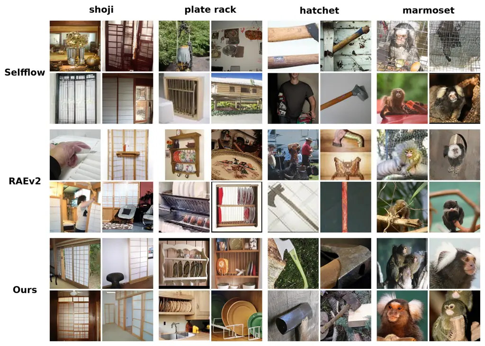

Figure 5: Qualitative results on ImageNet at $`256\times 256`$
resolution. Columns show shoji, plate rack, hatchet and marmoset. Row
groups show Self-Flow (Selfflow), RAEv2 and CorrFlow (Ours). Each
method–category block contains four samples in a $`2\times 2`$ grid,
giving 48 images in total. All three base DiTs are trained for 160
epochs. The CorrFlow refiner is trained for 80 epochs.

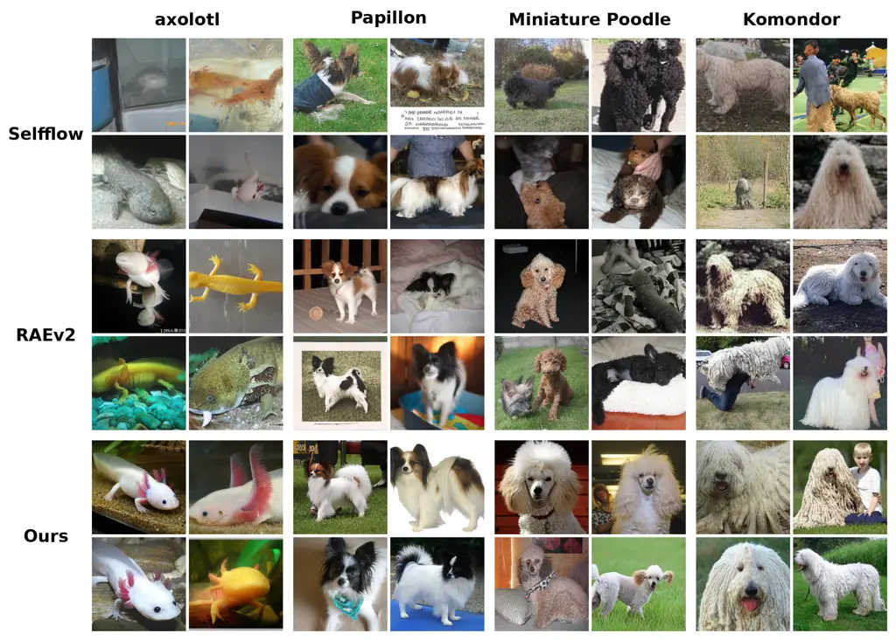

Figure 6: Qualitative results on ImageNet at $`256\times 256`$
resolution. Columns show axolotl, Papillon, Miniature Poodle and
Komondor. Row groups show Self-Flow (Selfflow), RAEv2 and CorrFlow
(Ours). Each method–category block contains four samples in a
$`2\times 2`$ grid, giving 48 images in total. All three base DiTs are
trained for 160 epochs. The CorrFlow refiner is trained for 80 epochs.

At the same 160-epoch base-model training budget, CorrFlow improves all
three $`\mathrm{FD}_{r}`$ metrics over RAEv2 both with and without
guidance, consistent with the clearer shoji lattices, hatchet geometry
and axolotl gills in Figures 5 and 6. With guidance, IS increases from
$`264.97`$ to $`266.60`$ and DINOv2 $`\mathrm{FD}_{r}`$ decreases from
$`1.0797`$ to $`1.0339`$, although FID worsens from $`1.0337`$ to
$`1.0593`$ (Table 7). The base model exhibits a similar discrepancy:
continuing RAEv2 fine-tuning from 120 to 160 total epochs raises guided
FID from $`1.0235`$ to $`1.0337`$, while ConvNeXt and CLIP
$`\mathrm{FD}_{r}`$ continue to decrease. These discrepancies suggest
practical saturation of FID as a perceptual ranking signal in this
regime near 1, where small score differences are an unreliable
standalone indicator of generation quality. FID compares only the means
and covariances of Inception-v3 features, so improvements in object
structure and fine detail need not yield a lower score. Jayasumana et
al. (2024) document disagreements between FID and human judgments and
show that FID can fail to track progressive visual improvements, while
Singh et al. (2026) observe that incremental gFID gains provide little
practical signal for strong RAEv2 models. The consistent improvements
across complementary representation spaces, together with the visual
examples, support the benefit of learned residual corrections beyond
what FID alone captures.

### E.2 More Results on Text-to-Video Generation

#### E.2.1 Quantitative Results

Tables 8 and 9 report the full VBench results for the methods in
Table 3, covering all 16 evaluation dimensions and the quality, semantic
and overall scores.

| Method                              | Subject Consistency | Background Consistency | Temporal Flickering | Motion Smoothness | Dynamic Degree | Aesthetic Quality | Imaging Quality | Object Class | Multiple Objects | Human Action |
| ----------------------------------- | ------------------- | ---------------------- | ------------------- | ----------------- | -------------- | ----------------- | --------------- | ------------ | ---------------- | ------------ |
| VideoREPA-5B (Zhang et al., 2025c)  | 95.47               | 95.10                  | 98.23               | 98.54             | 47.22          | 57.19             | 59.80           | 67.56        | 40.32            | 83.00        |
| PhysRAG-5B (Cheng et al., 2026)     | 96.31               | 95.66                  | 98.71               | 96.93             | 81.94          | 56.80             | 65.56           | 80.50        | 75.00            | 63.00        |
| Wan 2.1-1.3B (Wan et al., 2025)     | 91.83               | 94.71                  | 99.17               | 96.51             | 65.00          | 57.24             | 59.14           | 76.09        | 53.66            | 74.60        |
| VideoJAM-1.3B (Chefer et al., 2025) | 91.51               | 96.01                  | 99.13               | 96.05             | 73.88          | 58.41             | 62.68           | 79.22        | 59.66            | 79.20        |
| DreamWorld-1.3B (Tan et al., 2026)  | 93.62               | 94.95                  | 98.81               | 98.07             | 79.16          | 59.59             | 66.76           | 81.32        | 65.03            | 81.20        |
| VPT-1.3B (Zheng et al., 2026b)      | 92.65               | 97.27                  | 98.64               | 97.85             | 70.83          | 58.09             | 63.68           | 73.43        | 51.92            | 74.80        |
| CorrFlow (Ours)-1.3B                | 96.68               | 96.95                  | 99.81               | 98.85             | 63.54          | 61.65             | 68.66           | 82.81        | 67.72            | 78.00        |

Table 8: VBench results (Part 1/2): consistency, motion and object-level
metrics. All scores are reported on a 0–100 scale.

| Method                              | Color | Spatial Relationship | Scene | Appearance Style | Temporal Style | Overall Consistency | Quality Score | Semantic Score | Overall Score |
| ----------------------------------- | ----- | -------------------- | ----- | ---------------- | -------------- | ------------------- | ------------- | -------------- | ------------- |
| VideoREPA-5B (Zhang et al., 2025c)  | 86.12 | 51.85                | 32.27 | 21.37            | 22.71          | 24.20               | 79.96         | 63.53          | 76.67         |
| PhysRAG-5B (Cheng et al., 2026)     | 93.95 | 77.33                | 15.55 | 22.00            | 23.18          | 23.18               | 83.07         | 68.12          | 80.08         |
| Wan 2.1-1.3B (Wan et al., 2025)     | 89.93 | 62.37                | 20.03 | 22.91            | 22.23          | 24.25               | 79.81         | 65.43          | 76.93         |
| VideoJAM-1.3B (Chefer et al., 2025) | 88.92 | 66.17                | 28.34 | 22.67            | 24.03          | 25.01               | 81.18         | 69.08          | 78.76         |
| DreamWorld-1.3B (Tan et al., 2026)  | 92.61 | 70.47                | 29.71 | 22.14            | 23.82          | 24.87               | 83.49         | 70.89          | 80.97         |
| VPT-1.3B (Zheng et al., 2026b)      | 86.99 | 73.35                | 20.13 | 20.87            | 22.52          | 23.42               | 82.26         | 64.91          | 78.79         |
| CorrFlow (Ours)-1.3B                | 91.71 | 77.88                | 25.15 | 20.98            | 24.05          | 24.31               | 84.69         | 70.55          | 81.86         |

Table 9: VBench results (Part 2/2): appearance, style and overall
scores. All scores are reported on a 0–100 scale.

##### Visual quality and temporal consistency.

CorrFlow achieves the highest VBench Quality Score ($`84.69`$) and
Overall Score ($`81.86`$) among the compared methods. Relative to
Wan2.1-T2V-1.3B, these gains are $`4.88`$ and $`4.93`$ points,
respectively. The improvements span both individual-frame quality and
consistency over time. Imaging Quality increases from $`59.14`$ to
$`68.66`$, Aesthetic Quality from $`57.24`$ to $`61.65`$ and Subject
Consistency from $`91.83`$ to $`96.68`$. Temporal Flickering and Motion
Smoothness also improve, reaching $`99.81`$ and $`98.85`$. Together,
these metrics indicate that the adapted model improves the appearance of
generated frames while maintaining more coherent subjects and smoother
temporal evolution. Compared with DreamWorld, the strongest alternative
by Overall Score in this table, CorrFlow improves Quality Score by
$`1.20`$ points and Overall Score by $`0.89`$ points.

##### Semantic alignment and composition.

CorrFlow improves prompt alignment across object identity, composition
and action. Relative to Wan2.1-T2V-1.3B, Object Class rises from
$`76.09`$ to $`82.81`$, Multiple Objects from $`53.66`$ to $`67.72`$ and
Spatial Relationship from $`62.37`$ to $`77.88`$. These improvements
support more accurate rendering of the requested entities and their
arrangement, and Semantic Score increases from $`65.43`$ to $`70.55`$.
Human Action increases from $`74.60`$ to $`78.00`$, and Temporal Style
from $`22.23`$ to $`24.05`$. The gains therefore extend from the
identity and spatial arrangement of objects to the actions and temporal
style specified by the prompt.

##### Physical plausibility with semantic adherence.

On VideoPhy2 (Table 2), CorrFlow improves the ALL-set PC score from
$`57.8`$ to $`65.7`$ and SA from $`30.0`$ to $`31.3`$ relative to
Wan2.1-T2V-1.3B. Joint increases by $`2.2`$ percentage points to
$`27.0`$, the highest score in the comparison. This Joint score also
exceeds those of Wan2.1-14B ($`24.7`$) and VideoREPA ($`23.6`$). On
HARD, CorrFlow raises PC from $`36.7`$ to $`51.9`$ and Joint from
$`5.6`$ to $`6.9`$, corresponding to gains of $`15.2`$ and $`1.3`$
percentage points. The improvements on both test splits show that more
generated videos depict the requested event while satisfying physical
commonsense.

##### Object, action and physics requirements.

FinePhyEval provides a complementary decomposition of these gains.
Relative to Wan2.1-T2V-1.3B, CorrFlow improves Object from $`0.84`$ to
$`0.90`$, Action from $`0.49`$ to $`0.55`$, Physics from $`0.36`$ to
$`0.44`$ and Overall from $`0.54`$ to $`0.60`$. It ties DreamWorld on
Object and obtains the highest Action and Overall scores among the
compared methods. Its Overall score of $`0.60`$ also exceeds the
$`0.59`$ achieved by Wan2.1-14B. The question-graph metric rewards
physical behavior together with the objects and actions on which it
depends. The gains across all three categories therefore support more
complete realization of the requested physical events, complementing the
visual and temporal improvements measured by VBench.

#### E.2.2 Qualitative Results

Figures 7, 8 and 9 provide additional qualitative comparisons of
VideoREPA, VPT, PhysRAG and CorrFlow (Ours). The five examples cover
domino interactions, multiple-object composition, canoe paddling, jetski
racing and parasailing. For each case, rows follow this method order
from top to bottom, and columns show five frames sampled at evenly
spaced relative positions across each video, progressing from left to
right. The text below each case gives the corresponding prompt
description.

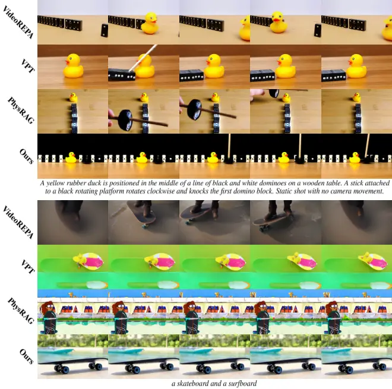

Figure 7: Qualitative results on text-to-video generation. The upper
case shows a rubber duck among dominoes, and the lower case shows a
skateboard and a surfboard. Within each case, rows show VideoREPA, VPT,
PhysRAG and Ours from top to bottom. Each row contains five frames
sampled at evenly spaced relative positions across the video, ordered
from left to right.

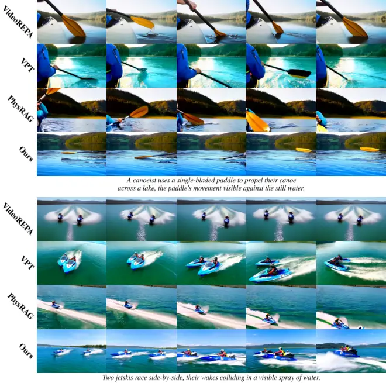

Figure 8: Qualitative results on text-to-video generation. The upper
case shows a canoeist paddling across a lake, and the lower case shows
two jetskis racing side by side. Within each case, rows show VideoREPA,
VPT, PhysRAG and Ours from top to bottom. Each row contains five frames
sampled at evenly spaced relative positions across the video, ordered
from left to right.

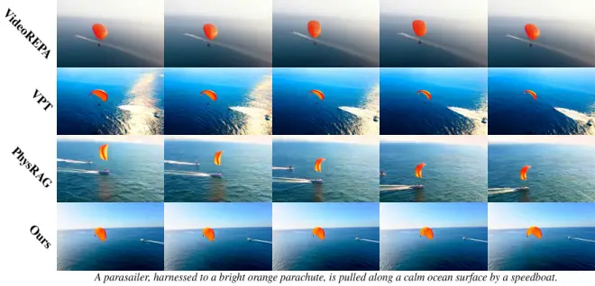

Figure 9: Qualitative results on text-to-video generation. The prompt
describes a parasailer with an orange parachute being pulled across the
ocean by a speedboat. Rows show VideoREPA, VPT, PhysRAG and Ours from
top to bottom. Each row contains five frames sampled at evenly spaced
relative positions across the video, ordered from left to right.

### E.3 More Results on Image-to-Video Generation

#### E.3.1 Quantitative Results

##### Aggregate physical consistency.

CorrFlow achieves the highest Verified Score in Table 4, reaching
$`30.95`$ compared with $`27.71`$ for Wan2.2-5B. The gain is $`3.24`$
points over the base model and $`4.47`$, $`3.52`$ and $`5.41`$ points
over WMReward, VLIPP and PhysRAG, respectively. This score combines
motion-region agreement, temporal overlap and frame reconstruction after
normalization by variation between real recordings.

##### Motion coverage and frame appearance.

Relative to Wan2.2-5B, CorrFlow increases Spatial from $`35.89`$ to
$`43.43`$ and Weighted Spatial from $`22.96`$ to $`24.74`$. These gains
indicate closer agreement with the reference in both the regions
traversed by moving objects and the fraction of time each region
exhibits motion. MSE Score increases from $`25.54`$ to $`29.24`$,
indicating improved agreement in RGB frame appearance under the
benchmark’s normalization. CorrFlow leads the compared methods on all
three metrics, supporting the aggregate improvement across complementary
aspects of the generated continuation.

#### E.3.2 Qualitative Results

Figure 4 compares CorrFlow with WMReward and PhysRAG under the same
image and text conditions. In the moving-light example, CorrFlow retains
a recognizable statuette silhouette across the displayed frames as its
shadow changes position. The mandarin example shows the knife and fruit
remaining identifiable through the slicing motion. These examples
illustrate object and shadow consistency alongside the motion and
appearance metrics above.

Figures 10 and 11 extend this comparison to three additional scenarios,
with ground-truth videos (GT) alongside WAN, VLIPP, WMReward, PhysRAG
and CorrFlow. The paper-in-water example shows how each method depicts
the paper after release and preserves the surrounding scene, while the
mirror examples show the relationship between object motion and its
reflection. Each row presents five video frames in temporal order.

Figure 12 adds a bouncing tennis ball and a blue ball rolling from a
table onto glass, with the same six rows per case. These examples show
how each model continues object motion from the initial frame. Red boxes
mark the visible balls and adjacent reflections in the four baseline
methods, while GT and CorrFlow remain unmarked.

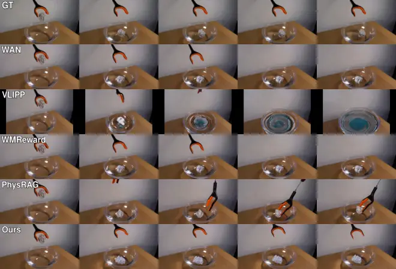

Figure 10: Additional image-to-video comparison on Physics-IQ Verified:
paper falling into water. A grabber releases crumpled paper into a bowl
of water. Rows show GT, WAN, VLIPP, WMReward, PhysRAG and CorrFlow
(Ours). Each row contains five video frames in temporal order.

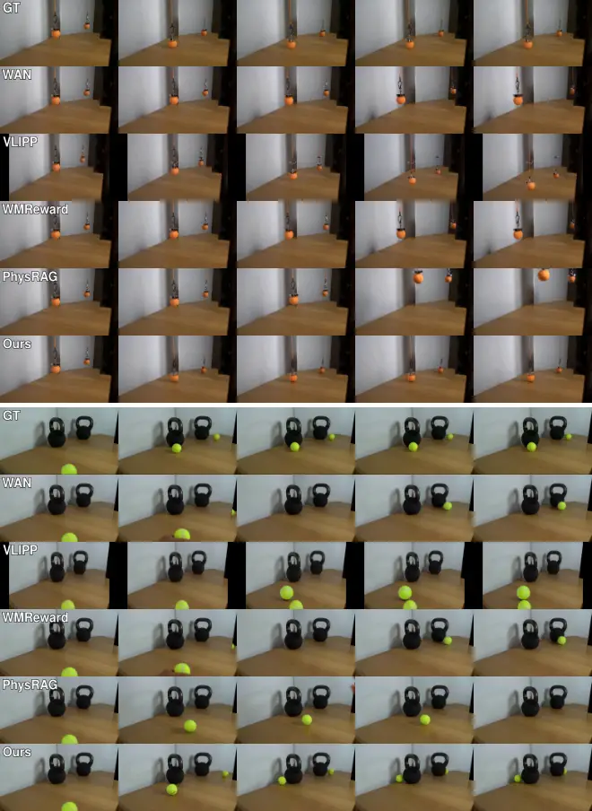

Figure 11: Additional image-to-video comparisons on Physics-IQ Verified:
motion and reflections. The upper case shows a suspended tennis ball
being lowered in front of a mirror, and the lower case shows a tennis
ball rolling toward a kettlebell beside a mirror. Within each case, rows
show GT, WAN, VLIPP, WMReward, PhysRAG and CorrFlow (Ours). Each row
contains five video frames in temporal order.

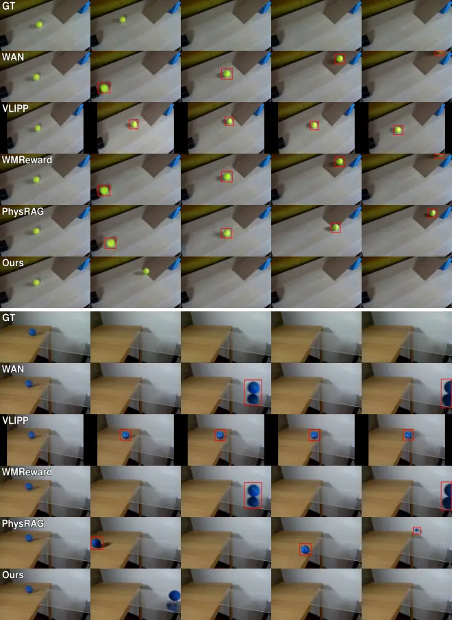

Figure 12: Additional image-to-video comparisons on Physics-IQ Verified:
ball motion. The upper case shows a bouncing tennis ball near a ramp,
and the lower case shows a blue ball rolling from a table onto glass.
Within each case, rows show GT, WAN, VLIPP, WMReward, PhysRAG and
CorrFlow (Ours). Each row contains five video frames in temporal order.
Red boxes highlight visible balls and adjacent reflections in the four
baselines after the initial frame.

### E.4 Full-Precision Ablation Results

Table 10 reports all ablations from Section 5.4 on the original 0–1
scale with four decimal places. Table 5 displays the same scores as
percentages with three significant digits, while retaining the ranking
colors determined at four-decimal precision. Rounding can make distinct
scores appear tied. For example, the Imaging Quality scores of
$`0.6369`$ and $`0.6368`$ both display as $`63.7\%`$, and the Quality
Scores of $`0.7980`$ and $`0.7979`$ both display as $`79.8\%`$.

| Method               | Aesthetic Quality (AQ) | Background Consistency (BC) | Imaging Quality (IQ) | Overall Consistency (OC) | Subject Consistency (SC) | Quality Score (QS) |
| -------------------- | ---------------------- | --------------------------- | -------------------- | ------------------------ | ------------------------ | ------------------ |
| w/o time-step        | 0.5147                 | 0.9236                      | 0.6369               | 0.5850                   | 0.9120                   | 0.7970             |
| w/o self-attention   | 0.4892                 | 0.9213                      | 0.6043               | 0.5812                   | 0.9000                   | 0.7854             |
| w/o cross-attention  | 0.4848                 | 0.9144                      | 0.6066               | 0.5821                   | 0.9022                   | 0.7846             |
| w/o hidden-state MLP | 0.4928                 | 0.9238                      | 0.6359               | 0.5817                   | 0.9086                   | 0.7928             |
| w/o refiner          | 0.5129                 | 0.9249                      | 0.6204               | 0.5914                   | 0.9126                   | 0.7863             |
| $`\bm{v}`$ input     | 0.5038                 | 0.9238                      | 0.6368               | 0.6021                   | 0.9174                   | 0.7980             |
| w/o condition        | 0.5154                 | 0.9274                      | 0.6123               | 0.5812                   | 0.9102                   | 0.7979             |
| Ours                 | 0.5260                 | 0.9359                      | 0.6425               | 0.6179                   | 0.9260                   | 0.8026             |

Table 10: Component ablations at four-decimal precision (0–1, higher is
better). Column abbreviations match Table 5. Colors indicate the top
three scores in each column.

## Appendix F Reproducibility Statement

To support reproducibility, Section 3 specifies the refiner
architecture, residual training objective and inference procedure of
CorrFlow. Appendix D documents the pretrained models, training data,
preprocessing, optimization hyperparameters, hardware and sampling
settings for image, text-to-video and image-to-video generation,
together with the benchmark protocols and metric definitions.
Section 5.4 describes the ablation setup, and Appendix E.4 provides the
corresponding scores at full precision. The assumptions and complete
proofs underlying the theoretical results in Section 4 are provided in
Appendices A, B and C.
