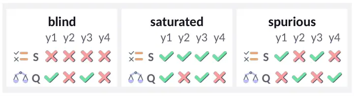
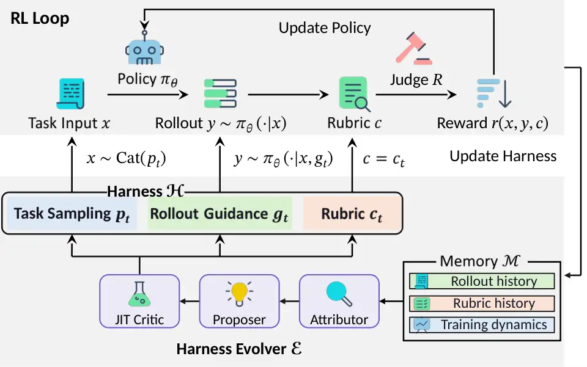
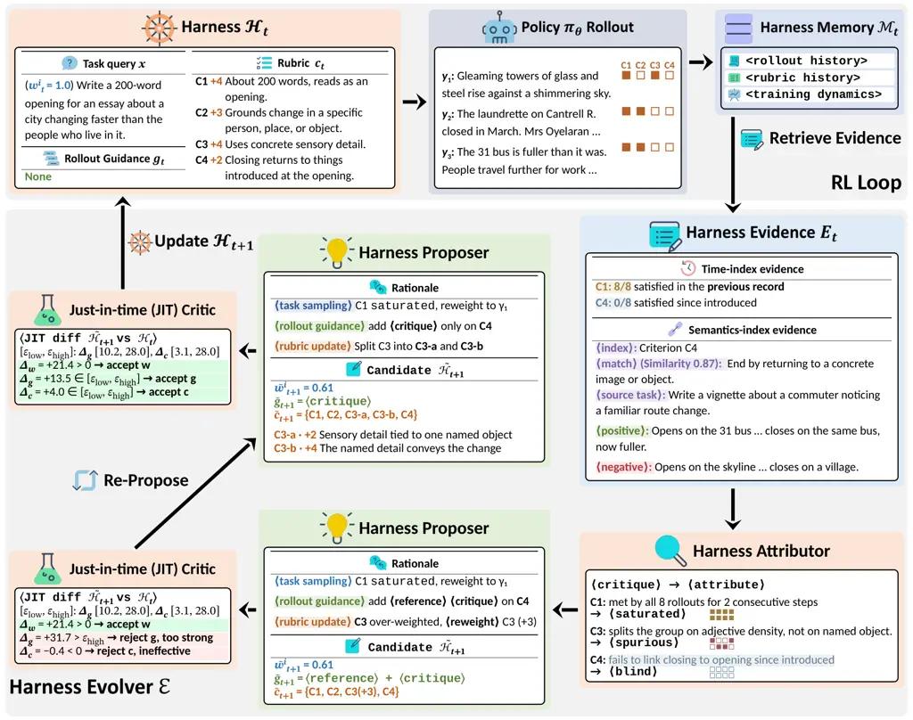

\tl_set:Ne\columntcbox

columntcbox \tl_set:Ne\inlinetcboxinlinetcbox \tl_set:Ne\pspanpspan

# ![[Uncaptioned image]](arxiv-2610-26426--07e907f3ffea.figures/figure-1.webp) HarnessRL: Co-Evolving Policies with a Just-in-Time Training Harness for Open-Ended RLThanks: Corresponding authors.

Xiaoqiang Wang ^(†)^(†)thanks: Work done during an internship at Alibaba
Token Hub, Alibaba Group.    Ting-En Lin    Yuchuan Wu    Pinyi Zhang   
Caixin Kang    Ling Li Affiliation: Bingxue Qiu, Jieping Ye, Yongbin Li,
Bang Liu^(†)^(†)footnotemark: Affiliation: Alibaba Token Hub, Alibaba
Group Affiliation: Université de Montréal  Mila - Quebec AI Institute

###### Abstract

Rubric-based reinforcement learning (RL) trains policies for open-ended
generation with natural-language criteria as rewards, but these rewards
can become ineffective as training progresses. We identify two failure
modes. Under _non-discriminative rewards_, scores collapse to uniformly
low or high values due to insufficient exploration or a mismatch between
task difficulty and policy capability. Under _spurious rewards_, higher
scores do not correspond to better responses. Both reflect a training
configuration whose task sampling, exploration, and evaluation stay
fixed as the policy evolves. We introduce HarnessRL, a _training-time
harness_ that co-evolves with the policy through three interfaces for
task sampling, rollout guidance, and rubric criteria. HarnessRL
maintains a training-time memory from which a harness evolver retrieves
within-task history and cross-task evidence. Using this evidence, the
evolver attributes each reward failure to the interface whose update can
address it. It then runs a proposer and just-in-time critic loop in
which the critic accepts a candidate update only after measuring its
effect on the current frozen policy, returning rejected candidates for
revision. We also curate Rubric-Mix-10k, a five-domain training and
evaluation suite for open-ended RL across medical, science, writing,
role-play, and instruction-following tasks. On Rubric-Mix-10k, HarnessRL
outperforms the strongest baselines by 2.8 to 3.1 points across both 4B
and 9B model scales and nearly halves the training steps to its best
checkpoint.¹¹ 1 Code and data are available at
[https://github.com/Tongyi-ConvAI/Qwen-Character/tree/main/HarnessRL](https://github.com/Tongyi-ConvAI/Qwen-Character/tree/main/HarnessRL).

>

## 1 Introduction

Reinforcement learning with verifiable rewards (RLVR) (Lightman et al.,
2024; Lambert et al., 2025; Guo et al., 2025) has become a standard
recipe for LLM post-training (Ouyang et al., 2022; Bai et al., 2022;
Grattafiori et al., 2024; Yang et al., 2025; DeepSeek-AI, 2026),
improving mathematical reasoning (Shao et al., 2024; OpenAI et al.,
2024; Wang et al., 2026d), code generation (Pan et al., 2025; Jain
et al., 2025; Deng et al., 2026), and agentic tasks (Wang & Liu, 2025;
Jin et al., 2025; Liu et al., 2025b; Yang et al., 2026; Falck et al.,
2026). However, open-ended role-playing (Wang et al., 2024a; Wang
et al., 2025b; Kang et al., 2026), long-form writing (Wu et al., 2025;
Bai et al., 2025), and social reasoning (Zhou et al., 2024; Kang et al.,
2025; Gong et al., 2026b) lack rule-based verifiers because no answer is
uniquely correct and quality is multidimensional (Wang et al., 2024b;
Shan & Shao, 2026) and often subjective. Rubrics as rewards (Gunjal
et al., 2026; Huang et al., 2025; Viswanathan et al., 2025; Liu et al., 2026) supply a reward for these tasks by decomposing quality into
LLM-judged natural-language criteria (Li et al., 2026b; Chen et al.,
2026b).





Figure 1: Rubric-reward failures under GRPO on Rubric-Mix-10k at
Qwen3.5-4B, and harness-controlled RL training in HarnessRL: failure
classes for one criterion (top left), class proportions and GRPO’s
training reward against oracle quality on held-out tasks (bottom left),
and harness $`(p_{t},g_{t},c_{t})`$-controlled RL training (right).
$`S`$ denotes the judge’s binary criterion scores and $`Q`$ the oracle
ranking of the rollouts.

However, rubric rewards can become unreliable as training progresses.
Policies may exploit superficial cues, including opening praise and a
closing claim that every requirement is satisfied (Huang et al., 2025;
Wang et al., 2026e), raising rubric scores while quality stalls. Fixed
rubrics may not distinguish useful behaviors, while on-policy rollouts
may miss rewarded ones. Recent methods evolve rubrics (Guan et al.,
2026; Wu et al., 2026a; Wang et al., 2026a) or use privileged rollout
guidance (Zhou et al., 2025; Xia et al., 2026; Agrawal et al., 2026) for
exploration. Each adapts the rubric or the rollout guidance without
diagnosing the reward failure, yet adapting either one alone can shift
the failure to another part of training. Guidance that helps the policy
meet a fixed rubric can saturate its criteria, and a saturated group
carries no advantage (Yu et al., 2026b). Conversely, a rubric tightened
without guidance can place criteria beyond the policy’s reach, where
they give no learning signal (Sundaram et al., 2026).

Rubric-reward failures fall into two modes. Non-discriminative rewards
collapse to uniformly low or high scores, i.e. blind or saturated,
leaving little relative learning signal within a rollout group.
Discriminative but spurious rewards, i.e. spurious, continue to separate
responses, but their induced preferences do not align with response
quality. We measure quality by the oracle ranking of the oracle judge, a
stronger LLM judge that compares responses pairwise within each group
under one quality guideline per domain (Section 3). These failures
account for $`61.6\%`$ of response pairs in a rubric-based GRPO (Shao
et al., 2024) run (Figure 1). Of all pairs, $`27.6\%`$ provide no usable
contrast, while $`34.0\%`$ provide contrast that does not reliably track
quality, including $`19.8\%`$ that the reward ranks in the wrong
direction. Directly optimizing the observed rubric reward can thus
provide an ineffective or even misleading learning signal.

The three failure classes call for updates to different parts of
training, rollout guidance for a blind criterion, task sampling for a
saturated task, and the rubric for a spurious criterion. We therefore
introduce HarnessRL, which treats task sampling, rollout guidance, and
rubric criteria as three interfaces of a training-time harness
$`\mathcal{H}`$ that co-evolves with the policy. HarnessRL reallocates
sampling toward tasks with useful learning signal, injects rollout
guidance when exploration is insufficient and withdraws it as training
progresses, and evolves rubric criteria to correct coarse, saturated, or
spurious rewards.

$`\mathcal{H}`$ uses a training-time memory $`\mathcal{M}`$ that records
rollouts, the sampling, rollout and rubric updates, and their outcomes.
The harness evolver $`\mathcal{E}`$ retrieves within-task history from
this memory to detect recurring failures and track the effects of
earlier updates, and cross-task evidence to transfer examples between
tasks. Using this evidence, it attributes each reward failure to the
interface whose update can address it, then runs a proposer and
just-in-time (JIT) critic loop. The critic accepts a candidate update
only after measuring its effect on the current frozen policy, and
accepts a rollout or rubric update only when that effect lies within the
corresponding calibrated acceptance band. Rejected updates return with
their measurements to the proposer, which proposes noop when no update
is supported.

We also curate Rubric-Mix-10k for training and held-out in-domain and
out-of-distribution (OOD) evaluation across medical, science, writing,
role-play, and instruction-following tasks. On Rubric-Mix-10k,
HarnessRL-trained Qwen3.5-4B (Qwen Team, 2026) scores 64.5 in domain and
49.8 OOD, exceeding the strongest baseline by 3.0 and 2.8 points. With
Qwen3.5-9B, the margins are 2.9 points in domain and 3.1 points OOD. At
the end of training, reward-oracle agreement is 48.9% under HarnessRL
against 38.4% under GRPO. HarnessRL also reaches its best OOD checkpoint
before every adaptive-training baseline.



Figure 2: HarnessRL runs an RL loop conditioned on a training-time
harness $`\mathcal{H}{}_{t}=(p_{t},g_{t},c_{t})`$, which controls task
sampling, rollout guidance and the rubric, respectively. The harness
co-evolves with the policy: it retrieves evidence from the training-time
memory $`\mathcal{M}_{t}`$, attributes failures, and is iteratively
refined by a proposer and JIT critic loop.

## 2 HarnessRL

HarnessRL augments a standard RL loop with an adaptive _training-time
harness_ $`\mathcal{H}_{t}=(p_{t},g_{t},c_{t})`$ that controls three
interfaces (Figure 2). The sampling interface $`p_{t}`$ distributes
probability over a fixed task bank $`\mathcal{D}`$ toward tasks with
useful learning signal. The rollout interface $`g_{t}`$ injects
privileged guidance when the policy cannot reach rewarded responses and
withdraws it as the policy improves. The rubric interface $`c_{t}`$
specifies the criteria under which a fixed judge scores each response.

As the policy learns, HarnessRL adapts $`\mathcal{H}{}`$ in two steps.
_Failure attribution_ assigns each reward failure a class and routes it
to the interface whose update can address it. _Measured intervention_
accepts a candidate update only after measuring its effect on the
current frozen policy. The harness memory $`\mathcal{M}`$ supplies
evidence for both steps. In the harness evolver $`\mathcal{E}`$, the
attributor assigns labels, the proposer constructs candidate updates,
and the JIT critic measures and accepts or rejects them. The accepted
updates form $`\mathcal{H}{}_{t+1}`$.

### 2.1 Harness-Controlled RL Training

At step $`t`$, the harness
$`\mathcal{H}_{t}=({\color[rgb]{0,0,1}\boldsymbol{p_{t}}},{\color[rgb]{0,0,1}\boldsymbol{g_{t}}},{\color[rgb]{0,0,1}\boldsymbol{c_{t}}})`$
conditions the inner RL loop through task sampling, rollout guidance,
and rubric criteria. Let $`\mathcal{D}=\{x_{i}\}_{i=1}^{N}`$ be the
training task bank and $`\pi_{\theta_{t}}`$ the current policy. Each
step draws $`512`$ tasks from
$`{\color[rgb]{0,0,1}\boldsymbol{p_{t}}}`$. Because the harness evolver
analyzes each draw independently, we trace index $`i`$ and write
$`x_{t}=x_{i}`$. The policy samples $`Y_{t}=\{y_{t}^{(j)}\}_{j=1}^{J}`$,
and the fixed judge $`R`$ scores each rollout against the current
rubric’s $`K_{t}`$ criteria $`q_{t,m}`$,

```math
x_{t}\sim\operatorname{Cat}({\color[rgb]{0,0,1}\boldsymbol{p_{t}}}),\qquad y_{t}^{(j)}\sim\pi_{\theta_{t}}(\cdot\mid x_{t},{\color[rgb]{0,0,1}\boldsymbol{g_{t}}}),\qquad s_{t,m}^{(j)}=R\bigl(x_{t},y_{t}^{(j)},q_{t,m}\bigr),\quad j=1,\ldots,J. \tag{1}
```

Sampling interface. Tasks the policy has saturated provide little
learning signal, so the sampling interface reallocates probability
toward tasks that remain useful (Chen et al., 2026d; Zeng et al., 2026).
We parameterize $`{\color[rgb]{0,0,1}\boldsymbol{p_{t}}}`$ by
non-negative task weights,
$`p_{t}^{i}=w_{t}^{i}/\sum_{\ell=1}^{N}w_{t}^{\ell}`$, so
$`\operatorname{Cat}({\color[rgb]{0,0,1}\boldsymbol{p_{t}}})`$ selects
$`x_{i}`$ with probability $`p_{t}^{i}`$. The harness evolver sets
$`w_{t}^{i}`$ from that task’s training dynamics. Because reallocation
alone would change the objective, each draw carries
$`u_{t}=1/(Np_{t}^{i})`$, the importance-sampling correction of
prioritized experience replay (Schaul et al., 2016). This preserves each
task’s expected contribution under the original uniform distribution, so
reweighting changes only its sampling frequency.

Rollout interface. Positive reward is rare while the policy cannot reach
rewarded responses. Building on scaffolded RL exploration (Yu et al.,
2026b; Zhou et al., 2025), the rollout interface steers exploration with
privileged guidance. For each task,
$`{\color[rgb]{0,0,1}\boldsymbol{g_{t}}}\subseteq\{f_{1},f_{2},f_{3}\}=\{\text{{\color[rgb]{0.2344,0.4766,0.2344}<criterion>}},\text{{\color[rgb]{0.2344,0.4766,0.2344}<reference>}},\text{{\color[rgb]{0.2344,0.4766,0.2344}<critique>}}\}`$
contains the guidance fields mounted after $`x_{t}`$ in index order. The
\<criterion\> field states a constraint paraphrased from the target
criterion or, when available, taken from earlier behavior that satisfied
it. The \<reference\> field holds positive and negative responses from
the task history or a donor task with a matching criterion. The
\<critique\> field records the previous group’s shortfall. The seed
harness $`\mathcal{H}{}_{0}`$ mounts no fields. The evolver selects each
task’s fields and withdraws them as the policy internalizes the
demonstrated behavior. A schedule removes remaining fields by training’s
end, so $`{\color[rgb]{0,0,1}\boldsymbol{g_{t}}}=\emptyset`$ at
evaluation.

Rubric interface. A fixed rubric can reward superficial cues unrelated
to response quality, producing spurious criteria. The rubric interface
$`{\color[rgb]{0,0,1}\boldsymbol{c_{t}}}=\{(q_{t,m},\lambda_{t,m})\}_{m=1}^{K_{t}}`$
is a weighted set of natural-language criteria, where $`q_{t,m}`$ is the
$`m`$-th criterion and $`\lambda_{t,m}\neq 0`$ its signed weight. The
judge $`R`$ evaluates each criterion independently, producing binary
scores $`s_{t,m}^{(j)}`$ in the $`K_{t}\times J`$ matrix $`S_{t}`$ read
by the harness attributor. The weights give reward
$`r_{t}^{(j)}=\sum_{m}\lambda_{t,m}\,s_{t,m}^{(j)}\,/\sum_{m}\max(\lambda_{t,m},0)`$.
Negative weights penalize undesirable behavior, while normalization by
total positive weight preserves a common scale across rubric sizes. For
an attributor-labeled spurious criterion, the harness evolver uses the
rubric operations in Section 2.3 to rewrite $`q_{t,m}`$, reweight
$`\lambda_{t,m}`$, or create, delete, split, and merge criteria.

RL objective. We extend GRPO (Shao et al., 2024) to draw tasks from
$`{\color[rgb]{0,0,1}\boldsymbol{p_{t}}}`$, generate rollouts under
$`{\color[rgb]{0,0,1}\boldsymbol{g_{t}}}`$, compute rewards under
$`{\color[rgb]{0,0,1}\boldsymbol{c_{t}}}`$, and weight each task loss by
$`u_{t}`$,

```math
\displaystyle\mathcal{J}(\theta_{t}) \displaystyle=\mathbb{E}_{x_{t}\sim\operatorname{Cat}({\color[rgb]{0,0,1}\boldsymbol{p_{t}}}),\;Y_{t}\sim\pi_{\theta_{\mathrm{old}}}(\cdot\mid x_{t},{\color[rgb]{0,0,1}\boldsymbol{g_{t}}})}\Bigl[u_{t}\,\mathcal{L}\bigl(\theta_{t};x_{t},Y_{t},{\color[rgb]{0,0,1}\boldsymbol{c_{t}}}\bigr)\Bigr]-\beta\,\mathbb{D}_{\mathrm{KL}}\bigl(\pi_{\theta_{t}}\,\|\,\pi_{\mathrm{ref}}\bigr), \tag{2}
```

```math
\displaystyle\mathcal{L}\bigl(\theta_{t};x_{t},Y_{t},{\color[rgb]{0,0,1}\boldsymbol{c_{t}}}\bigr) \displaystyle=\frac{1}{J}\sum_{j=1}^{J}\frac{1}{|y_{t}^{(j)}|}\sum_{k=1}^{|y_{t}^{(j)}|}\min\bigl(\rho_{j,k}\hat{A}_{t}^{(j)},\,\mathrm{clip}(\rho_{j,k},1{-}\epsilon,1{+}\epsilon)\hat{A}_{t}^{(j)}\bigr),
```

where $`\theta_{t}`$ denotes the current policy parameters, $`k`$
indexes the $`|y_{t}^{(j)}|`$ tokens of rollout $`j`$, and
$`\hat{A}_{t}^{(j)}=(r_{t}^{(j)}-\mu(r_{t}))/(\sigma(r_{t})+\epsilon_{A})`$
is the group-relative advantage. Here, $`\mu(r_{t})`$ and
$`\sigma(r_{t})`$ are the group’s reward mean and standard deviation,
and $`\epsilon_{A}`$ is a small constant. The token-level importance
ratio is
$`\rho_{j,k}=\pi_{\theta_{t}}(y_{t,k}^{(j)}\mid x_{t},{\color[rgb]{0,0,1}\boldsymbol{g_{t}}},y_{t,<k}^{(j)})\,/\,\pi_{\theta_{\mathrm{old}}}(\,\cdot\,)`$
against $`\pi_{\theta_{\mathrm{old}}}`$, the policy that sampled the
rollout. Finally, $`\epsilon`$ is the clip range, $`\beta`$ the KL
coefficient, and $`\mathbb{D}_{\mathrm{KL}}`$ the KL divergence from the
reference policy $`\pi_{\mathrm{ref}}`$.

### 2.2 Harness Memory

One step’s score matrix shows the current pattern, but not whether a
failure persists across steps or how earlier updates affected it.
Harness memory $`\mathcal{M}_{t}=\{m_{\tau}\}_{\tau\leq t}`$ therefore
keeps one record per task draw over the full run, organized as
$`m_{t}=\text{{\color[rgb]{0.1094,0.418,0.3672}<rollout history>}}\;\allowbreak\text{{\color[rgb]{0.1094,0.418,0.3672}<rubric history>}}\;\allowbreak\text{{\color[rgb]{0.1094,0.418,0.3672}<training dynamics>}}`$.
The \<rollout history\> field holds the task $`x_{t}`$ with its rollout
group $`Y_{t}`$ and score matrix $`S_{t}\in\{0,1\}^{K_{t}\times J}`$,
\<rubric history\> the harness $`\mathcal{H}{}_{t}`$ with its proposed
actions, and \<training dynamics\> the task’s reward trajectory and
update history. Because accumulated history soon exceeds the evolver’s
context, the evolver retrieves evidence
$`E_{t}=(E_{t}^{\mathrm{time}},E_{t}^{\mathrm{sem}})`$ through two
indexes keyed by the task and criterion text,

```math
E_{t}^{\mathrm{time}}=\{m_{\tau}\in\mathcal{M}_{t-1}:x_{\tau}=x_{t}\},\qquad E_{t}^{\mathrm{sem}}=\operatorname{top-}\!k\,\bigl\{(q^{\prime},x^{\prime}):\cos\bigl(\phi(q_{t,m}),\phi(q^{\prime})\bigr)\geq\eta\bigr\}. \tag{3}
```

The time index returns earlier task records, letting the attributor
distinguish a persistent blind or saturated failure from single-step
noise and the proposer avoid repeating an already reversed update. The
semantics index returns related cross-task criteria with positive and
negative responses, supplying the \<reference\> field when the task
history has no such pair.

### 2.3 Harness Evolver

The harness evolver $`\mathcal{E}`$ converts one step’s evidence into
the next harness $`\mathcal{H}{}_{t+1}`$. Its three roles, the
attributor, proposer, and JIT critic, separate attribution, proposal,
and acceptance so no model call both proposes and accepts an update,

```math
\begin{gathered}d_{t}=\textsc{attribute}\bigl(x_{t},Y_{t},S_{t},\mathcal{H}{}_{t},E_{t}\bigr)\in\mathcal{V}^{K_{t}},\qquad a^{(r)}=\textsc{propose}\bigl(d_{t},E_{t},\mathcal{H}{}_{t},F^{(r-1)}\bigr)\in\mathcal{A},\\
\bigl(\Delta^{(r)},F^{(r)}\bigr)=\textsc{critique}\bigl(\mathcal{H}{}_{t},\,a^{(r)}(\mathcal{H}{}_{t}),\,\pi_{\theta_{t}},\,x_{t},Y_{t}\bigr),\end{gathered} \tag{4}
```

where $`a(\mathcal{H}{})`$ is the harness after action $`a`$ and
$`F^{(r)}`$ records each update rejected at round $`r`$ with the
measurement that rejected it, starting from $`F^{(0)}=\emptyset`$. The
proposer and critic iterate until every candidate update is accepted or
the round budget $`B=3`$ is exhausted. An unresolved interface keeps its
current setting, and every label, action, and measurement is written to
$`m_{t}`$.

Harness attributor. Scores establish whether a criterion separates the
current group, but explaining its failure requires the task history in
$`E_{t}^{\mathrm{time}}`$ and related criteria in
$`E_{t}^{\mathrm{sem}}`$. Using both, the attributor asks three
questions to assign each criterion a label in
$`\mathcal{V}=\{\text{blind},\text{saturated},\text{spurious},\text{agree}\}`$
and route each failure label to one interface. (i) Reach asks whether
the policy can produce the target property. A criterion unmet in the
current group and earlier task records is labeled blind and routed to
the rollout interface, whereas one unmet now but met earlier is treated
as noise and labeled agree. (ii) Training stage asks whether the policy
has mastered the task. A criterion met by every rollout across recent
steps is labeled saturated. When such criteria lower the task’s
discriminative mass, the proportion of criteria separating the group,
the task is diagnosed as saturated and routed to the sampling interface.
The attributor also flags a criterion met by every rollout through
generic content, such as a disclaimer or polite closing, so the proposer
can tighten it with a secondary rubric operation. (iii) Reward hacking
asks whether meeting a separating criterion reflects quality. The
attributor compares rollouts that meet and fail the criterion with
positive responses of related criteria retrieved by the semantics index.
If only satisfying rollouts share superficial compliance, length gaming,
partial coverage, or stance gaming through sycophancy or over-refusal,
the criterion is labeled spurious and routed to the rubric interface,
and otherwise labeled agree. The attributor supports each label with
quoted rollouts and raises its confidence as the label persists. A
separate rubric-wording check identifies the exact phrase permitting a
surface form or generic pass, which the attributor gives the proposer as
the basis for a criterion rewrite.

Harness proposer. The label selects the interface, while the proposer
selects its update. The action $`a=(a_{p},a_{g},a_{c})`$ contains one
candidate update or noop per interface, and the critic evaluates each
update’s typed operations together. Besides a label’s primary update,
the proposer may add secondary rubric operations on a saturated or blind
criterion to the rubric candidate or propose as a rollout update a drop
of a field whose target has left blind. The sampling operation
$`{\color[rgb]{0.1836,0.332,0.5938}\texttt{reweight}}(i,\gamma_{\ell})`$
lowers task weight one level from $`w^{i}_{0}=1`$ through
$`\gamma_{1}\geq\gamma_{2}\geq\gamma_{3}`$. The memory cold start
(Section 3) sets $`\gamma_{1}`$, $`\gamma_{2}`$, and $`\gamma_{3}`$ to
task-tertile median discriminative masses. The guidance operations
$`{\color[rgb]{0.2344,0.4766,0.2344}\texttt{add}}(f)`$ and
$`{\color[rgb]{0.2344,0.4766,0.2344}\texttt{drop}}(f)`$ mount or remove
a field
$`f\in\{\text{{\color[rgb]{0.2344,0.4766,0.2344}<criterion>}},\text{{\color[rgb]{0.2344,0.4766,0.2344}<reference>}},\text{{\color[rgb]{0.2344,0.4766,0.2344}<critique>}}\}`$
under a per-task cap that falls by one each training quarter. The rubric
operations create, rewrite, delete, reweight, merge, and split act on
individual criteria (Wu et al., 2026a). Anchor criteria are seed
criteria whose text the memory cold start fixes, so the proposer may
only reweight them. Each rubric operation rescales positive weights to
total $`\Lambda`$ while holding anchors at a fixed share to prevent
influence drift.

JIT critic. Earlier evidence may support an update that is ineffective
or excessive for the current policy, so the critic measures each primary
candidate update just in time on that policy with parameters frozen
before accepting it. Because a reward increase cannot validate a rubric
update (Chen et al., 2026c), a rubric update for a spurious criterion
must instead lower the recorded group’s score. Holding the other two
interfaces fixed, the critic regrades the recorded group for a rubric
update, re-samples a group from the policy with parameters
$`\theta_{t}`$ frozen under candidate guidance for a rollout update, and
makes no policy query for a sampling update. With
$`\bar{r}(Y,c)=\frac{1}{J}\sum_{j=1}^{J}r(x_{t},y^{(j)},c)`$ denoting
the group-average reward and $`\bar{r}_{t}=\bar{r}(Y_{t},c_{t})`$ its
current value, the measurements are

```math
\Delta_{c}=\bar{r}_{t}-\bar{r}(Y_{t},\widetilde{c}_{t+1}),\quad\Delta_{g}=\bar{r}(\widetilde{Y}_{t},c_{t})-\bar{r}_{t},\quad\Delta_{w}=\bigl(w_{t}^{i}-\widetilde{w}_{t+1}^{i}\bigr)\,\bar{r}_{t}, \tag{5}
```

where
$`\widetilde{Y}_{t}\sim\pi_{\theta_{t}}(\cdot\mid x_{t},\widetilde{g}_{t+1})`$
is the re-sampled group, $`\Delta_{w}`$ is the task-weight reduction
reallocated by sampling to other tasks, scaled by current group-average
reward, and $`u_{t}`$ keeps the task’s expected contribution to the
objective unchanged. The critic accepts a candidate update when (i) a
sampling update for a saturated task has $`\Delta_{w}>0`$, a rollout
update for a blind criterion has $`\Delta_{g}>0`$, and a rubric update
for a spurious criterion has $`\Delta_{c}>0`$, (ii) the $`\Delta_{g}`$
or $`\Delta_{c}`$ in (i) lies within the corresponding acceptance band
$`[\varepsilon_{\mathrm{low}},\varepsilon_{\mathrm{high}}]`$, a
per-interface hyperparameter set by the memory cold start, (iii) a
rubric update for a spurious criterion leaves every criterion whose text
it creates or rewrites varying within the group, because a constant
criterion contributes nothing to the policy update (Guan et al., 2026;
Wang et al., 2026b), and (iv) a sampling update, which has no acceptance
band, has a saturated diagnosis in the task’s previous time-index
record. A joint rubric candidate containing secondary operations at a
step with a spurious label must pass conditions (ii) and (iii).
Otherwise, it is accepted with the step’s primary update, and its
$`\Delta_{c}`$ is recorded in $`m_{t}`$. The critic measures a drop as a
rollout update on a group re-sampled without the field and accepts it
when $`\Delta_{g}\geq-\varepsilon^{g}_{\mathrm{low}}`$. The accepted
updates yield $`\mathcal{H}{}_{t+1}`$, and rejected ones return with
their measurements to the proposer for revision or replacement with
noop.

## 3 Experiments

[TABLE]

Table 1: Domain composition of Rubric-Mix-10k. Each domain has $`250`$
held-out tasks. Token counts are means under the Qwen tokenizer. The
Tasks (%) column under Reference response reports the percentage of
training tasks with a released reference response.

Dataset. To evaluate HarnessRL’s effectiveness and efficiency, we
propose Rubric-Mix-10k, curated from five public rubric-annotated
sources across five open-ended domains (Table 1). Medical tasks come
from HealthBench (Arora et al., 2025) and the medical slices of
RaR (Gunjal et al., 2026) and RubricHub (Li et al., 2026b), science
tasks from ResearchQA (Yifei et al., 2026) and the science slices of RaR
and RubricHub, writing tasks from LongWriter-Zero (Wu et al., 2026b),
and role-play and instruction-following tasks from the chat and
instruction slices of RubricHub. For each source, we drop ineligible
tasks and overlong prompts before drawing a fixed quota. This curation
yields $`8{,}600`$ training tasks with seed rubrics of weighted
criteria, $`250`$ held-out tasks per domain disjoint from training, and
one OOD benchmark per domain. The training tasks contain $`110{,}606`$
criteria, averaging $`12.9`$ criteria per task with a median of $`10`$.
Prompts average $`118`$ Qwen tokens with a median of $`54`$, while
criteria average $`35.2`$ Qwen tokens. Negative-weight criteria
constitute $`10.7\%`$ of all criteria and appear in $`48.6\%`$ of tasks.
Released reference responses accompany $`3{,}008`$ training tasks
($`35.0\%`$). These responses comprise physician-written ideal
completions for HealthBench, reference answers for RaR, and the
highest-scoring of six samples for RubricHub. They average $`420`$
tokens, with domain means from $`322`$ in medical to $`1{,}205`$ in
role-play. ResearchQA and LongWriter-Zero provide none. Writing prompts
specify a target length range. We use the released references only to
describe the corpus, never in training or the reward.

Evaluation. The frozen training judge scores in-domain held-out tasks
under their seed rubrics, unchanged by harness updates. The official OOD
protocols use multiple-choice accuracy for MedQA (Jin et al., 2021) and
GPQA-Diamond (Rein et al., 2024), ROUGE-L for RoleBench (Wang et al.,
2024a), programmatic constraint checks for IFBench (Pyatkin et al.,
2025), and WritingBench’s own rubric (Wu et al., 2025). Scores are
comparable only within a benchmark. Because only WritingBench uses the
training judge, the other four benchmarks test whether gains persist
beyond the harness-updated reward. We decode greedily without guidance
and evaluate OOD every $`25`$ steps and in domain every $`100`$. Every
results table reports the seed mean at the best checkpoint of the
seed-mean curve for each method and evaluation set. Each Avg. column is
the unweighted mean of the five domain columns.

|            |                    |            |            |            |            |            |                     |            |            |            |            |            |
| ---------- | ------------------ | ---------- | ---------- | ---------- | ---------- | ---------- | ------------------- | ---------- | ---------- | ---------- | ---------- | ---------- |
|            | In-domain held-out |            |            |            |            |            | Out of distribution |            |            |            |            |            |
| Method     | Med.               | Sci.       | Writ.      | Role       | IF         | Avg.       | Med.                | Sci.       | Writ.      | Role       | IF         | Avg.       |
| Qwen3.5-4B |                    |            |            |            |            |            |                     |            |            |            |            |            |
| GRPO       | 52.4               | 57.2       | 60.7       | 50.8       | 68.1       | 57.8       | 40.5                | 29.3       | 66.5       | 50.7       | 32.7       | 43.9       |
| RuscaRL    | 56.3               | 61.4       | 63.1       | 53.6       | 69.5       | 60.8       | 41.3                | 29.8       | 67.1       | 51.1       | 32.2       | 44.3       |
| SkillRL    | 55.6               | 60.9       | 62.4       | 53.1       | 69.8       | 60.4       | 41.0                | 30.1       | 67.6       | 51.4       | 32.9       | 44.6       |
| EvoRubric  | 55.0               | 60.5       | 64.8       | 54.2       | 69.1       | 60.7       | 43.4                | 31.2       | 69.1       | 53.1       | 34.3       | 46.2       |
| AMARIS     | 54.7               | 60.2       | 65.3       | 55.2       | 69.2       | 60.9       | 43.9                | 31.6       | 69.8       | 53.5       | 33.9       | 46.5       |
| AMARIS++   | 56.1               | 61.7       | 65.5       | 55.0       | 69.4       | 61.5       | 44.1                | 32.3       | 70.6       | 54.0       | 34.1       | 47.0       |
| HarnessRL  | 59.3(+3.0)         | 64.6(+2.9) | 69.2(+3.7) | 58.9(+3.7) | 70.7(+0.9) | 64.5(+3.0) | 46.5(+2.4)          | 35.4(+3.1) | 73.0(+2.4) | 56.6(+2.6) | 37.5(+3.2) | 49.8(+2.8) |
| Qwen3.5-9B |                    |            |            |            |            |            |                     |            |            |            |            |            |
| GRPO       | 58.9               | 63.4       | 65.8       | 56.2       | 73.5       | 63.6       | 52.6                | 35.5       | 71.8       | 58.4       | 38.9       | 51.4       |
| RuscaRL    | 61.9               | 66.8       | 67.4       | 58.4       | 74.6       | 65.8       | 53.3                | 35.9       | 72.1       | 58.7       | 38.6       | 51.7       |
| SkillRL    | 61.2               | 66.1       | 67.0       | 58.0       | 74.9       | 65.4       | 53.0                | 36.2       | 72.5       | 58.9       | 39.2       | 52.0       |
| EvoRubric  | 60.8               | 65.9       | 69.3       | 59.4       | 74.2       | 65.9       | 55.1                | 37.4       | 74.0       | 60.3       | 40.6       | 53.5       |
| AMARIS     | 60.5               | 65.6       | 69.8       | 59.9       | 74.3       | 66.0       | 55.6                | 37.8       | 74.6       | 60.8       | 40.2       | 53.8       |
| AMARIS++   | 61.7               | 67.0       | 70.4       | 59.6       | 74.4       | 66.6       | 56.0                | 38.4       | 75.2       | 61.2       | 40.1       | 54.2       |
| HarnessRL  | 64.6(+2.7)         | 69.9(+2.9) | 73.8(+3.4) | 63.5(+3.6) | 75.9(+1.0) | 69.5(+2.9) | 58.9(+2.9)          | 41.6(+3.2) | 78.3(+3.1) | 63.9(+2.7) | 43.6(+3.0) | 57.3(+3.1) |

Table 2: Quantitative results of HarnessRL on the five-domain
Rubric-Mix-10k with Qwen3.5-4B and Qwen3.5-9B. Bold, underline, and
green mark the best result, the second-best result, and HarnessRL’s
margin over the best baseline, respectively.

Baselines. We compare static-rubric GRPO (Shao et al., 2024),
guidance-side RuscaRL (Zhou et al., 2025) and SkillRL (Xia et al., 2026)
for scaffolded rollouts over a frozen rubric, and rubric-side
EvoRubric (Guan et al., 2026) and AMARIS (Wu et al., 2026a) for rubric
rewriting without guidance. AMARIS++, the baseline closest to HarnessRL,
extends AMARIS to all three interfaces but lacks cross-task memory and a
JIT critic. All arms share the policy, judge, seed rubrics, decoding,
and $`500`$-step budget and differ only in whether and how they adapt
the harness interfaces.

Training configuration. We train Qwen3.5-4B and Qwen3.5-9B (Qwen Team, 2026) with GRPO for $`500`$ steps, drawing $`512`$ tasks per step and
sampling $`J=8`$ rollouts per task at temperature $`1.0`$ and top-$`p`$
$`0.9`$. We use AdamW at learning rate $`1\times 10^{-6}`$, and the
objective uses KL coefficient $`\beta=0.001`$, clip range
$`\epsilon=0.2`$, and advantage constant $`\epsilon_{A}=10^{-6}`$. Every
arm trains with three seeds. Before training, one memory cold start runs
the Qwen3.5-4B seed policy over the entire training set pooled across
the five domains, and the Qwen3.5-9B runs reuse its values. Setting
$`\Lambda=100`$ makes $`\Lambda\bar{r}`$ the group’s mean score in
reward points, the unit of every $`\Delta`$ and acceptance band. The
cold start sets the sampling levels $`\gamma_{1}=0.61`$,
$`\gamma_{2}=0.38`$, and $`\gamma_{3}=0.17`$, and the rollout and rubric
acceptance bands on group-average reward changes to $`[10.2,28.0]`$ and
$`[3.1,28.0]`$ points. The rollout and rubric lower bounds are the
$`95`$th percentiles of null variation across independent groups of one
task and repeated gradings of one group, respectively. Both upper bounds
are the median within-group reward range.

Implementation. Frozen gemma-4-31B-it (Gemma Team, 2026) serves as the
judge at temperature $`0.6`$ and as the backbone of all three evolver
roles. ChromaDB stores the time index, keyed by task, and the semantics
index, which embeds criterion text with bge-base-en-v1.5 as $`\phi`$ and
returns the top-$`k=4`$ criteria whose cosine similarity is at least the
floor $`\eta=0.82`$. The critic rejects a candidate update when its call
returns no measurement. Costs are in cluster hours, the wall-clock hours
of one $`16`$-node cluster with eight NVIDIA H100 80GB GPUs per node.

Oracle judge. For analysis only, Claude Sonnet 5 is the oracle judge. It
is stronger than the training judge, reads no rubric, and compares
response pairs under one quality guideline per domain, judging clinical
correctness and safety in medicine, scientific correctness and reasoning
in science, fit to purpose and genre in writing, persona consistency in
role-play, and constraint satisfaction in instruction following. For
each group of $`J=8`$ rollouts, the oracle scores all $`28`$ pairs in
both orders and averages each pair’s scores (win $`1`$, tie $`0.5`$).
Rollout win counts define the within-group oracle ranking, with equal
counts tied, against which we compare each pair’s reward order. A
tied-reward pair is blind when the shared reward is below $`50`$ points
and saturated otherwise, and a reward-separated pair is agree when its
reward order matches the oracle order and spurious otherwise. Oracle
quality is $`100`$ times a response’s normalized win rate against eight
fixed gemma-4-31B-it comparison responses per task. On $`240`$ sampled
groups, two annotators agree at Kendall’s $`\tau=0.84`$, and the oracle
ranking agrees with each annotator at $`0.80`$ and $`0.79`$ and with
their consensus at $`0.82`$. No harness role sees oracle output.

|                               |                    |      |       |      |      |      |                     |      |       |      |      |      |
| ----------------------------- | ------------------ | ---- | ----- | ---- | ---- | ---- | ------------------- | ---- | ----- | ---- | ---- | ---- |
|                               | In-domain held-out |      |       |      |      |      | Out of distribution |      |       |      |      |      |
| Method                        | Med.               | Sci. | Writ. | Role | IF   | Avg. | Med.                | Sci. | Writ. | Role | IF   | Avg. |
| HarnessRL                     | 59.3               | 64.6 | 69.2  | 58.9 | 70.7 | 64.5 | 46.5                | 35.4 | 73.0  | 56.6 | 37.5 | 49.8 |
| Component ablation            |                    |      |       |      |      |      |                     |      |       |      |      |      |
| w/o critic                    | 54.9               | 60.0 | 62.1  | 52.0 | 68.3 | 59.5 | 42.9                | 31.6 | 68.5  | 52.7 | 33.8 | 45.9 |
| w/o critic & memory           | 53.6               | 58.6 | 60.8  | 50.7 | 67.0 | 58.1 | 41.3                | 29.2 | 66.9  | 51.0 | 32.2 | 44.1 |
| Interface ablation            |                    |      |       |      |      |      |                     |      |       |      |      |      |
| HarnessRL\_(g)                | 56.1               | 61.1 | 63.2  | 53.1 | 69.5 | 60.6 | 43.4                | 31.7 | 69.0  | 53.0 | 34.3 | 46.3 |
| HarnessRL\_(c)                | 56.7               | 61.7 | 63.8  | 53.7 | 70.1 | 61.2 | 44.3                | 32.6 | 69.9  | 54.0 | 35.2 | 47.2 |
| $`p_{t}\leftarrow`$ SEC       | 58.6               | 63.9 | 68.5  | 58.1 | 70.3 | 63.9 | 45.9                | 34.8 | 72.3  | 56.0 | 36.9 | 49.2 |
| $`g_{t}\leftarrow`$ RuscaRL   | 58.4               | 63.7 | 67.9  | 57.6 | 70.2 | 63.6 | 44.9                | 33.6 | 71.2  | 54.9 | 36.1 | 48.1 |
| $`c_{t}\leftarrow`$ EvoRubric | 58.0               | 63.2 | 68.0  | 57.5 | 69.9 | 63.3 | 45.1                | 33.9 | 71.6  | 55.2 | 36.3 | 48.4 |

Table 3: Ablations of HarnessRL on its components and control interfaces
at Qwen3.5-4B. Bold and underline mark the best and second-best results,
respectively.

### 3.1 Main Results

HarnessRL leads every benchmark at both policy scales. At Qwen3.5-4B,
HarnessRL reaches $`64.5`$ in domain and $`49.8`$ OOD (Table 2),
$`+6.7`$ and $`+5.9`$ pp above GRPO and $`+3.0`$ and $`+2.8`$ pp above
AMARIS++, the strongest baseline. At Qwen3.5-9B, it reaches $`69.5`$ and
$`57.3`$, $`+2.9`$ and $`+3.1`$ pp above AMARIS++, which it exceeds on
every seed at both scales. Paired bootstrap $`95\%`$ intervals for the
AMARIS++ margins ($`10{,}000`$ item-and-seed resamples) are
$`[2.4,3.6]`$ in domain and $`[2.0,3.5]`$ OOD at Qwen3.5-4B, and
$`[2.2,3.6]`$ in domain and $`[2.3,3.9]`$ OOD at Qwen3.5-9B. Paired
permutation tests give $`p<0.001`$ against AMARIS++ and GRPO. Seed
standard deviations are below one point for all arms and smallest for
HarnessRL ($`0.3`$ and $`0.4`$ at Qwen3.5-4B, $`0.2`$ and $`0.3`$ at
Qwen3.5-9B). We attribute this stability to the critic rejecting rollout
and rubric updates whose measured effects leave the acceptance bands.

HarnessRL’s in-domain margin over the best baseline is widest on writing
and role-play and narrowest on instruction following. At Qwen3.5-4B, it
reaches $`+3.7`$ pp on writing and role-play but falls to $`+0.9`$ pp on
instruction following. We attribute the wide margin to many defensible
responses saturating a frozen rubric and leaving further gains to rubric
updates measured on the recorded group, and the narrow one to
near-verifiable criteria on which GRPO already reaches $`68.1`$.

Guidance-side and rubric-side adaptation differ in OOD transfer. At
Qwen3.5-4B, guidance-side RuscaRL and SkillRL gain $`3.0`$ and
$`2.6`$ pp over GRPO in domain ($`60.8`$ and $`60.4`$ against $`57.8`$)
but barely transfer OOD ($`44.3`$ and $`44.6`$ against $`43.9`$).
Rubric-side EvoRubric and AMARIS match this in-domain gain ($`60.7`$ and
$`60.9`$) and transfer further OOD ($`46.2`$ and $`46.5`$). We attribute
limited guidance-side OOD transfer to scaffolds fitting the policy to
the frozen training rubric, and stronger rubric-side transfer to a
rewritten criterion changing what the reward measures. Three-interface
AMARIS++ is the strongest baseline at both scales. Harness memory and
the critic lift HarnessRL from $`44.1`$ to $`49.8`$ OOD (Table 3).

### 3.2 In-Depth Analysis

Figure 3: Proportion of pairs by failure class at Qwen3.5-4B during
training.

RQ1: What does each interface and component contribute? Table 3 reports
best-checkpoint seed means in domain and OOD at Qwen3.5-4B. The
component ablation removes the critic (_w/o critic_) and then memory
retrieval (_w/o critic & memory_). Interface ablations include
single-interface harnesses adapting only the rollout or rubric interface
(HarnessRL*(g), HarnessRL*(c)) and switching arms using a published rule
for one interface. Each switching arm retains harness memory and the
harness evolver for two interfaces, while the third uses SEC’s
difficulty bandit ($`p_{t}\leftarrow`$ SEC (Chen et al., 2026d)),
RuscaRL’s scheduled checklist scaffold ($`g_{t}\leftarrow`$
RuscaRL (Zhou et al., 2025)), or EvoRubric’s criterion pruning and
regeneration ($`c_{t}\leftarrow`$ EvoRubric (Guan et al., 2026)), with
no attributor, proposer, or critic.

Single-interface harnesses trail HarnessRL, whose gain over GRPO comes
mostly from the critic with memory. HarnessRL*(g) and HarnessRL*(c)
reach $`60.6`$ and $`61.2`$ in domain and $`46.3`$ and $`47.2`$ OOD,
against $`64.5`$ and $`49.8`$ for HarnessRL. Removing the critic leaves
$`59.5`$ in domain and $`45.9`$ OOD, below AMARIS++ ($`47.0`$). Removing
memory too leaves $`58.1`$ in domain and $`44.1`$ OOD, within $`0.2`$ pp
of GRPO. We attribute this to memory reducing the reversal rate (RQ2)
and the critic measuring effects before acceptance.

A published rule on one interface keeps most of the gain over GRPO but
never all of it. The sampling, rubric, and rollout switching arms reach
$`63.9`$, $`63.3`$, and $`63.6`$ in domain and $`49.2`$, $`48.4`$, and
$`48.1`$ OOD, above both single-interface harnesses and AMARIS++
($`47.0`$ OOD, $`61.5`$ in domain). Relative to HarnessRL, the rollout
switching arm’s OOD shortfall is largest at $`1.7`$ pp and is $`0.9`$ pp
in domain, while the rubric and sampling switching arms trail by $`1.4`$
and $`0.6`$ pp OOD. We attribute the sampling shortfall to reallocation
leaving every rollout’s reward unchanged, the rubric shortfall to rubric
updates the critic never measures, and the rollout shortfall to
scheduled scaffolds teaching the policy the training rubric, as
RuscaRL’s in-domain gain barely transfers OOD in Table 2.

RQ2: Why must the three interfaces adapt jointly, and what stabilizes
the accepted updates? At Qwen3.5-4B, we compare the arms at step
$`500`$. Figure 3 plots blind, saturated, and spurious proportions for
GRPO, RuscaRL, AMARIS, and HarnessRL, and we report the agree proportion
as reward-oracle agreement. Two arms used only here apply _w/o critic &
memory_ to HarnessRL*(g) and HarnessRL*(c). Spearman correlations relate
the step-$`500`$ proportions, negated except for agree, to
best-checkpoint scores across twelve arms, those in Table 2 and Table 3
except SkillRL and the switching arms, plus these two. From memory
records, we report the mounted guidance fields per task, the proportion
of tasks at each sampling level, the donors for \<reference\> fields
mounted by accepted rollout updates, and the critic’s acceptance rate
with and without retrieved evidence above the floor $`\eta`$. We report
the reversal rate in Figure 4, defined as the proportion of accepted
rubric updates in each $`100`$-step window that undo an earlier
same-criterion update within the task’s previous two draws. Three
annotators, blind to step and rationale, judged $`200`$ attributor
labels ($`50`$ per class) and $`200`$ accepted rubric updates sampled
uniformly from HarnessRL, with mean pairwise Cohen’s $`\kappa`$ of
$`0.71`$ and $`0.68`$. We aggregate judgments by majority vote.

Figure 4: Training dynamics of HarnessRL: proportion of tasks by
guidance fields, accepted rubric updates per 100 steps, and reversed
rubric updates, the last also for its ablations and AMARIS++.

Guidance-side and rubric-side arms trade one failure class for another,
whereas three-interface arms with memory lower all three, HarnessRL the
most. GRPO ends at $`12.0`$/$`15.6`$/$`34.0`$ for blind, saturated, and
spurious. RuscaRL lowers blind to $`10.0`$ but raises saturated to
$`17.1`$, while HarnessRL*(g) raises saturated to $`16.1`$, or $`16.5`$
without critic and memory. AMARIS lowers saturated and spurious to
$`13.0`$ and $`29.7`$ but raises blind to $`13.3`$, while HarnessRL*(c)
raises blind to $`13.2`$, or $`13.7`$ without critic and memory.
HarnessRL without the critic reaches $`11.1`$/$`15.2`$/$`31.6`$, and
removing memory too raises saturated to $`16.1`$. AMARIS++, whose memory
is a per-task revision log, reaches $`11.4`$/$`14.6`$/$`30.8`$, and
HarnessRL reaches $`10.5`$/$`13.4`$/$`27.2`$, with reward-oracle
agreement at $`48.9`$ against GRPO’s $`38.4`$. We attribute the
saturated rise to guidance saturating a fixed rubric (Yu et al., 2026b),
and the blind rise to rubric tightening without guidance placing
criteria beyond the policy’s reach (Sundaram et al., 2026).

The agree, spurious, and saturated proportions rank the arms, but the
blind proportion does not. In domain/OOD, correlations are $`0.91/0.92`$
for agree, $`0.78/0.82`$ for spurious, $`0.59/0.74`$ for saturated, and
$`0.15/{-}0.01`$ for blind. We attribute the weak blind correlation to
this trade, as rubric-side arms have the highest blind proportions yet
score higher OOD than GRPO and the guidance-side baselines (Table 2).

Guidance is withdrawn ahead of schedule, rubric updates concentrate
early, and sampling down-weights half the tasks. Mounted guidance fields
average $`1.6`$ per task at their step-$`75`$ peak, whereas without the
critic the count stays near the cap until each reduction. By step
$`350`$, before the last reduction at step $`375`$, $`86\%`$ of tasks
carry no guidance fields. Accepted rubric updates fall from $`1{,}240`$
in the first window to $`140`$ in the last, with create concentrated
early. By step $`500`$, $`52\%`$ of tasks are below full weight, $`8\%`$
at the lowest level. We attribute the early withdrawal to the critic
accepting a drop once its target leaves blind, and the decline of create
to the time index showing the proposer existing criteria to revise.

The critic with memory keeps reversed rubric updates rare. The reversal
rate ends at $`1.6\%`$ for HarnessRL and $`18.2\%`$ for AMARIS++,
compared with $`22.3\%`$ without critic and memory. Without the critic,
the reversal rate stays below that level but rises from $`6.8\%`$ in the
first window to $`14.1\%`$ in the last. We attribute this rise to the
missing critic, because memory shows the proposer earlier reversals but
only the critic rejects a repeated update. Harness memory also supplies
cross-task donors for $`58\%`$ of the \<reference\> fields mounted by
accepted rollout updates. The critic accepts $`71\%`$ of candidate
updates grounded in retrieved evidence, compared with $`44\%`$ when
retrieval returns nothing above the floor.

Annotators confirm attributor labels and accepted rubric updates.
Majority vote upheld the blind, saturated, spurious, and agree labels in
$`97.0\%`$, $`98.0\%`$, $`86.0\%`$, and $`90.0\%`$ of cases,
respectively, and judged $`82.5\%`$ of accepted rubric updates to
address the diagnosed failure.

RQ3: Does the harness recover its training overhead? For every arm of
Table 2, we measure Qwen3.5-4B training cost in cluster hours per 100
steps and identify its best OOD step at both scales. We decompose cost
into RL rollout, RL judge, attributor and proposer, critic, and memory,
and separately report the one-off memory cold start of $`0.75`$ cluster
hours (Figure 5, left). We pair each arm’s best OOD score with the
cluster hours required to reach it, including the memory cold start
(Figure 5, right). OOD scores peak before step $`500`$ for every arm,
whereas in-domain scores rise through step $`500`$ for GRPO and every
rubric-evolving method. The tables therefore select the best checkpoint
for each evaluation set. To account for selection on the evaluation
sets, we also report each arm’s step-$`500`$ checkpoint. For matched
compute, we report each arm’s best OOD score among checkpoints evaluated
every $`25`$ steps within the cluster hours, including the memory cold
start, that HarnessRL needs to reach its best OOD checkpoint.

Figure 5: Training efficiency of HarnessRL measured by cluster hours per
100 steps, decomposed into RL loop and harness evolver overhead (left),
and cluster hours to the best OOD checkpoint (right).

At $`1.6\times`$ GRPO’s per-step cost, HarnessRL reaches its best OOD
checkpoint in fewer cluster hours than any baseline. GRPO costs $`4.3`$
cluster hours per 100 steps versus $`6.7`$ for HarnessRL. The $`2.4`$
difference comprises $`1.2`$ for the critic, $`0.7`$ for attributor and
proposer calls, $`0.4`$ for memory, and $`0.1`$ for longer guided
rollouts ($`3.3`$ versus $`3.2`$). HarnessRL peaks at step $`250`$ after
$`17.5`$ cluster hours. AMARIS, next in cluster hours, peaks at step
$`325`$ after $`17.9`$, AMARIS++ at step $`300`$ after $`18.3`$, and
GRPO at step $`475`$ after $`20.4`$ (Figure 5, right). EvoRubric,
SkillRL, and RuscaRL peak at steps $`350`$, $`400`$, and $`425`$,
respectively. At Qwen3.5-9B, the peak-step order is unchanged, with
HarnessRL at step $`250`$, AMARIS++ at $`325`$, and GRPO at $`475`$. We
attribute the earlier peak to the harness correcting the reward signal
as it degrades and to the critic. GRPO makes no such correction, and the
rubric-evolving baselines lack the critic. By mid-training, the critic
has accepted the withdrawal of most guidance, and accepted rubric
updates have declined from $`1{,}240`$ to $`510`$ per 100 steps.

HarnessRL remains strongest without best-checkpoint selection and leads
AMARIS++ under matched compute. At step $`500`$, in-domain/OOD scores
are GRPO $`57.8/43.8`$, RuscaRL $`60.5/44.2`$, SkillRL $`60.1/44.5`$,
EvoRubric $`60.7/45.7`$, AMARIS $`60.9/46.0`$, AMARIS++ $`61.5/46.4`$,
and HarnessRL $`64.5/49.4`$. Without best-checkpoint selection,
HarnessRL exceeds AMARIS++ by $`+3.0`$ pp on both evaluation sets.
Within $`17.5`$ cluster hours, GRPO reaches $`43.8`$ OOD at step
$`400`$, AMARIS++ reaches $`46.9`$ at step $`225`$, and HarnessRL
reaches $`49.8`$ at step $`250`$. The per-step overhead therefore does
not reduce the OOD lead over AMARIS++, which is $`+2.9`$ pp under
matched compute versus $`+2.8`$ pp at best checkpoints.

Figure 6: Case analysis of a randomly sampled training task _“Which
properties of cellulose filter paper suit it to analytical and clinical
use?”_: task sampling and mounted guidance (top), rollout groups scored
with the dynamically evolving rubric and oracle quality (middle), and
steps at which the harness acted, with labels, rollout excerpts, rubric
operations, and criteria met or missed (bottom). Dashed lines mark them.

RQ4: How does the harness act on one task over training? Figure 6 traces
a randomly sampled training task on cellulose filter paper, recording
group reward under the current rubric and oracle quality whenever the
harness acts. Because its seed criteria are not anchor criteria, the
proposer may apply delete or merge to them.

Each accepted primary update addresses the failure labeled at its step,
and group reward diverges from oracle quality. At step $`30`$, a rubric
update for a spurious label replaces a seed criterion with
hydroxyl-count and coupling-chemistry criteria. At $`55`$, no rollout
names the coupling reaction, so a rollout update for the resulting blind
label mounts \<criterion\> and \<reference\> fields. A rollout update
drops them at $`130`$ once their target criterion is met. At $`130`$, a
sampling update for a saturated label lowers the task weight to
$`\gamma_{1}`$, while secondary rubric operations merge the wicking and
adsorption criteria and delete the reaction-name criterion. At $`260`$,
a rollout update for a blind label mounts a \<critique\> field, while a
rubric update for a spurious label deletes the sensitivity criterion and
restores both coupling-chemistry criteria. At $`280`$, a rubric update
for a spurious label on the reaction-name criterion lowers both
coupling-chemistry criteria to $`+1`$ and creates a filter-grade
criterion at $`+2`$. At $`440`$, the attributor labels the
hydroxyl-count criterion saturated and all others agree. A sampling
update lowers the task weight to $`\gamma_{2}`$, and a secondary rubric
operation creates an intrinsic-versus-engineered criterion. From $`130`$
to $`260`$, group reward falls from $`100.0`$ to $`32.8`$ while oracle
quality rises from $`58.1`$ to $`61.0`$. We attribute the fall to the
changed rubric. Because the rubric and policy both affect group reward
across steps, the critic compares the current and candidate rubrics on
one recorded group at fixed $`\theta`$.

## 4 Related work

Evolving rubric-based RL. Rubric-based RL rewards open-ended generation
with natural-language criteria (Gunjal et al., 2026; Huang et al., 2025;
Viswanathan et al., 2025; Liu et al., 2026; Li et al., 2026b; Chen
et al., 2026b), and reward hacking against fixed rubrics (Mahmoud
et al., 2026; Wang et al., 2026e) motivates criteria and task
distributions that evolve with the policy. One line rewrites the rubric
from the policy’s responses (Guan et al., 2026; Wu et al., 2026a; Wang
et al., 2026a; Wang et al., 2026b; Chen et al., 2026c). EvoRubric (Guan
et al., 2026) prunes and regenerates criteria for open-ended generation,
and AMARIS (Wu et al., 2026a) revises the rubric through a
memory-augmented loop. Another line co-evolves a rubric generator with
the judge or the policy, adapts the rubric to each comparison, or orders
rubrics as a curriculum (Xu et al., 2026; Li et al., 2026a; Jia et al.,
2026; Krishnan et al., 2026). Rubric-ARM (Xu et al., 2026) alternates RL
between a rubric generator and the judge that scores under its rubrics,
and OpenRS (Jia et al., 2026) builds a rubric for each response pair. A
third line adapts the task distribution using priority, difficulty, or
expected learning gain (Schaul et al., 2016; Gao et al., 2026; Sundaram
et al., 2026; Yu et al., 2026c; Zeng et al., 2026), and SEC (Chen
et al., 2026d) evolves the curriculum with the policy. HarnessRL instead
adapts task sampling, rollout guidance, and rubric criteria in one
training-time harness. It routes each attributed failure class to the
interface whose update addresses it.

Scaffolded and privileged rollouts. Scaffolded rollouts change the
composition of the sampled group so that it contains rewarded
responses (Yu et al., 2026b; Cui et al., 2025; Zhou et al., 2025; Qu
et al., 2026), whereas rubric evolution changes the criteria that define
the reward. One line shapes the rollout group without changing the
input (Yu et al., 2026b; Cui et al., 2025). DAPO (Yu et al., 2026b)
resamples groups whose rewards carry no advantage, and entropy
control (Cui et al., 2025) keeps policy entropy from collapsing. Another
line places privileged context in the policy’s input (Zhou et al., 2025;
Xia et al., 2026; Agrawal et al., 2026; Nath et al., 2025; Hou et al.,
2026; Qu et al., 2026; Yu et al., 2026a). RuscaRL (Zhou et al., 2025)
scaffolds exploration with the rubric and fades the scaffold on a
schedule, and SkillRL (Xia et al., 2026) augments rollouts with
recursively accumulated skills. More recently, self-distillation ties
guided exploration to the unguided policy (Zhao et al., 2026; Dilkes
et al., 2026). OPSD (Zhao et al., 2026) applies on-policy
self-distillation to guided reasoning, and ICE (Dilkes et al., 2026)
distills instruction-conditioned exploration into the unconditioned
policy. HarnessRL mounts a guidance field only after the critic measures
a reward increase on a re-sampled group. It withdraws the field earlier
than its own schedule requires, once the target criterion leaves blind
and reward stays within tolerance without it.

Training-time harness. Agent harnesses usually denote the inference-time
infrastructure that connects a model to its environment, such as
interfaces, scaffolds, and memory (Wang et al., 2025a; Wang et al.,
2026c; Gong et al., 2026a), and harness research (Zhou et al., 2026; Liu
et al., 2025a) treats them as one configuration to design and learn.
Beyond inference, recent work brings the harness into training. One line
designs inference-time harnesses for frozen models (Yang et al., 2024;
Suzgun & Kalai, 2024; Wang & Liu, 2025). SWE-agent (Yang et al., 2024)
gives the model an agent-computer interface for software engineering,
and Meta-Prompting (Suzgun & Kalai, 2024) scaffolds the model with
task-agnostic prompts. Another line evolves harnesses from agent
trajectories (Ning et al., 2026; Luo et al., 2026b; Shi et al., 2026;
Wang & Liu, 2026). EvoHarness-RL (Ning et al., 2026) learns a
self-evolving runtime harness for long-horizon agents, and
HarnessBank (Luo et al., 2026b) searches a gene bank of harness variants
under gated verification. More recently, harnesses adapt during policy
training (Jiang et al., 2026; Luo et al., 2026a; Chen et al., 2026a; Yu
et al., 2026d). EvoTrainer (Chen et al., 2026a) co-evolves the policy
with a training harness that diagnoses and intervenes on recorded runs,
and harness-and-model co-evolution (Yu et al., 2026d) corrects on-policy
rollouts as the harness changes. HarnessRL is such a training-time
harness, and its harness memory supplies the run’s rollout and update
history as evidence. It differs in that the JIT critic measures each
primary candidate update on the current frozen policy before accepting
it into $`\mathcal{H}{}_{t+1}`$.

## 5 Conclusion

We introduce HarnessRL, a training-time harness that co-evolves with the
policy through task sampling, rollout guidance, and rubric criteria. The
harness memory provides within-task history and cross-task evidence,
which the harness evolver uses to attribute each reward failure to the
interface whose update can address it. The JIT critic then accepts a
candidate update only after measuring its effect on the current frozen
policy. We also curate Rubric-Mix-10k, a training and evaluation suite
of training tasks with seed rubrics across the medical, science,
writing, role-play, and instruction-following domains, together with
held-out tasks and an OOD benchmark for each domain. Extensive results
show that HarnessRL outperforms the strongest baseline on both in-domain
and OOD evaluations at both model scales. Its training dynamics show
lower failure-class proportions and higher reward-oracle agreement than
GRPO, with reversed rubric updates remaining rare, and its efficiency
allows it to reach its best OOD checkpoint in fewer cluster hours than
any baseline and in about half the steps GRPO needs.

## Acknowledgement

This work was supported by Alibaba Research Intern Program.

## References

- Agrawal et al. (2026) Priyank Agrawal, Ankur Samanta, Shervin
  Ghasemlou, Boris Vidolov, Jalaj Bhandari, Kavosh Asadi, Daniel Jiang,
  and Aditya Modi. Off-context GRPO: Learning to reason on hard problems
  using privileged information. _arXiv preprint arXiv:2607.19313_, 2026.
- Arora et al. (2025) Rahul K. Arora, Jason Wei, Rebecca Soskin Hicks,
  Preston Bowman, Joaquin Quiñonero-Candela, Foivos Tsimpourlas, Michael
  Sharman, Meghan Shah, Andrea Vallone, Alex Beutel, Johannes Heidecke,
  and Karan Singhal. HealthBench: Evaluating large language models
  towards improved human health. _arXiv preprint
  arXiv:2505.08775_, 2025.
- Bai et al. (2022) Yuntao Bai, Andy Jones, Kamal Ndousse, Amanda
  Askell, Anna Chen, Nova DasSarma, Dawn Drain, Stanislav Fort, Deep
  Ganguli, Tom Henighan, Nicholas Joseph, Saurav Kadavath, Jackson
  Kernion, Tom Conerly, Sheer El-Showk, Nelson Elhage, Zac
  Hatfield-Dodds, Danny Hernandez, Tristan Hume, Scott Johnston, Shauna
  Kravec, Liane Lovitt, Neel Nanda, Catherine Olsson, Dario Amodei, Tom
  Brown, Jack Clark, Sam McCandlish, Chris Olah, Ben Mann, and Jared
  Kaplan. Training a helpful and harmless assistant with reinforcement
  learning from human feedback. _arXiv preprint arXiv:2204.05862_, 2022.
- Bai et al. (2025) Yushi Bai, Jiajie Zhang, Xin Lv, Linzhi Zheng, Siqi
  Zhu, Lei Hou, Yuxiao Dong, Jie Tang, and Juanzi Li. LongWriter:
  Unleashing 10,000+ word generation from long context LLMs. In
  _International Conference on Learning Representations (ICLR)_, 2025.
- Chen et al. (2026a) Guhong Chen, Yingcheng Shi, Yongbin Li, Binhua Li,
  Xander Xu, Hu Wei, Shiwen Ni, Min Yang, and Jieping Ye. EvoTrainer:
  Co-evolving LLM policies and training harnesses for autonomous agentic
  reinforcement learning. _arXiv preprint arXiv:2606.03108_, 2026a.
- Chen et al. (2026b) Hao Chen, Ziyu Han, Yukun Yan, Qingfu Zhu, Maosong
  Sun, and Wanxiang Che. From holistic evaluation to structured
  criteria: Rubrics across the evolving LLM landscape. _arXiv preprint
  arXiv:2606.08625_, 2026b.
- Chen et al. (2026c) Jiangwang Chen, Zixin Song, Junlin Liu, Shuaiyu
  Zhou, Haiyan Wu, Haihan Shi, Chenxi Zhou, Hanqing Li, Xiao Yang,
  Da Zhu, Guanjun Jiang, Hai Wan, and Xibin Zhao. DecoEvo:
  Score-decoupled co-evolution of solver and rubric-generator skills in
  text space. _arXiv preprint arXiv:2607.25675_, 2026c.
- Chen et al. (2026d) Xiaoyin Chen, Jiarui Lu, Minsu Kim, Dinghuai
  Zhang, Jian Tang, Alexandre Piché, Nicolas Gontier, Yoshua Bengio, and
  Ehsan Kamalloo. Self-evolving curriculum for LLM reasoning. In
  _Conference on Language Modeling (COLM)_, 2026d. arXiv:2505.14970.
- Cui et al. (2025) Ganqu Cui, Yuchen Zhang, Jiacheng Chen, Lifan Yuan,
  Zhi Wang, Yuxin Zuo, Haozhan Li, Yuchen Fan, Huayu Chen, Weize Chen,
  Zhiyuan Liu, Hao Peng, Lei Bai, Wanli Ouyang, Yu Cheng, Bowen Zhou,
  and Ning Ding. The entropy mechanism of reinforcement learning for
  reasoning language models. _arXiv preprint arXiv:2505.22617_, 2025.
- DeepSeek-AI (2026) DeepSeek-AI. DeepSeek-V4: Towards highly efficient
  million-token context intelligence. _arXiv preprint
  arXiv:2606.19348_, 2026.
- Deng et al. (2026) Xiang Deng, Jeff Da, Edwin Pan, Yannis Yiming He,
  Charles Ide, Kanak Garg, Niklas Lauffer, Andrew Park, Chetan Rane,
  Karmini Sampath, Maya Krishnan, Srivatsa Kundurthy, Sean Hendryx,
  Zifan Wang, Chen Bo Calvin Zhang, Noah Jacobson, Bing Liu, and Brad
  Kenstler. SWE-Bench Pro: Can AI agents solve long-horizon software
  engineering tasks? In _Proceedings of the 43rd International
  Conference on Machine Learning_, 2026.
- Dilkes et al. (2026) Jim Dilkes, Vahid Yazdanpanah, and Sebastian
  Stein. Instruction-conditioned exploration for reinforcement learning
  with self-distillation to an unconditioned policy. _arXiv preprint
  arXiv:2608.02087_, 2026.
- Falck et al. (2026) Damon Falck, Samer Sabri, Anja Surina, Thom
  Foster, Anya Sims, Sam Devlin, Dylan Rogers, Tantum Collins, Kaloyan
  Aleksiev, Louis Kirsch, et al. Training AI scientists to replicate
  research. _arXiv preprint arXiv:2608.13331_, 2026.
- Gao et al. (2026) Zhaolin Gao, Joongwon Kim, Wen Sun, Thorsten
  Joachims, Sid Wang, Richard Yuanzhe Pang, and Liang Tan. Prompt
  curriculum learning for efficient LLM post-training. In _International
  Conference on Learning Representations (ICLR)_, 2026.
- Gemma Team (2026) Gemma Team. Gemma 4 technical report. _arXiv
  preprint arXiv:2607.02770_, 2026.
- Gong et al. (2026a) Sitong Gong, Caixin Kang, Tianyu Yan, Guo Chen,
  Bo Zheng, Kaipeng Zhang, Yunzhi Zhuge, Xiang Ruan, Huchuan Lu, and
  Yifei Huang. GROVE: Growing and reasoning over temporally stratified
  memory from streaming video experience. _arXiv preprint
  arXiv:2608.02392_, 2026a.
- Gong et al. (2026b) Sitong Gong, Tianyu Yan, Caixin Kang, Bo Zheng,
  Xiang Ruan, Huchuan Lu, Kaipeng Zhang, Yoichi Sato, and Yifei Huang.
  Vinci2: Providing proactive assistance in continuous egocentric
  videos. In _European Conference on Computer Vision_, 2026b. URL
  [https://arxiv.org/abs/2607.11523](https://arxiv.org/abs/2607.11523).
- Grattafiori et al. (2024) Aaron Grattafiori, Abhimanyu Dubey, Abhinav
  Jauhri, Abhinav Pandey, Abhishek Kadian, Ahmad Al-Dahle, Aiesha
  Letman, Akhil Mathur, Alan Schelten, Alex Vaughan, et al. The Llama 3
  herd of models. _arXiv preprint arXiv:2407.21783_, 2024.
- Guan et al. (2026) Xin Guan, Xiaomeng Hu, Shen Huang, Zhenyi Wang,
  Bo Zhang, Zijian Li, Pengjun Xie, Bo Liu, and Jiuxin Cao. EvoRubric:
  Self-evolving rubric-driven RL for open-ended generation. _arXiv
  preprint arXiv:2605.29847_, 2026.
- Gunjal et al. (2026) Anisha Gunjal, Anthony Wang, Elaine Lau, Vaskar
  Nath, Yunzhong He, Bing Liu, and Sean Hendryx. Rubrics as rewards:
  Reinforcement learning beyond verifiable domains. In _International
  Conference on Learning Representations (ICLR)_, 2026.
- Guo et al. (2025) Daya Guo, Dejian Yang, Haowei Zhang, Junxiao Song,
  Peiyi Wang, Qihao Zhu, Runxin Xu, Ruoyu Zhang, Shirong Ma, Xiao Bi,
  Xiaokang Zhang, Xingkai Yu, Yu Wu, Z. F. Wu, Zhibin Gou, Zhihong Shao,
  Zhuoshu Li, Ziyi Gao, Aixin Liu, Bing Xue, Bingxuan Wang, Bochao Wu,
  Bei Feng, Chengda Lu, Chenggang Zhao, Chengqi Deng, Chong Ruan, Damai
  Dai, Deli Chen, Dongjie Ji, Erhang Li, Fangyun Lin, Fucong Dai, Fuli
  Luo, Guangbo Hao, Guanting Chen, Guowei Li, H. Zhang, Hanwei Xu,
  Honghui Ding, Huazuo Gao, Hui Qu, Hui Li, Jianzhong Guo, Jiashi Li,
  Jingchang Chen, Jingyang Yuan, Jinhao Tu, Junjie Qiu, Junlong Li,
  J. L. Cai, Jiaqi Ni, Jian Liang, Jin Chen, Kai Dong, Kai Hu, Kaichao
  You, Kaige Gao, Kang Guan, Kexin Huang, Kuai Yu, Lean Wang, Lecong
  Zhang, Liang Zhao, Litong Wang, Liyue Zhang, Lei Xu, Leyi Xia,
  Mingchuan Zhang, Minghua Zhang, Minghui Tang, Mingxu Zhou, Meng Li,
  Miaojun Wang, Mingming Li, Ning Tian, Panpan Huang, Peng Zhang,
  Qiancheng Wang, Qinyu Chen, Qiushi Du, Ruiqi Ge, Ruisong Zhang, Ruizhe
  Pan, Runji Wang, R. J. Chen, R. L. Jin, Ruyi Chen, Shanghao Lu,
  Shangyan Zhou, Shanhuang Chen, Shengfeng Ye, Shiyu Wang, Shuiping Yu,
  Shunfeng Zhou, Shuting Pan, S. S. Li, Shuang Zhou, Shaoqing Wu, Tao
  Yun, Tian Pei, Tianyu Sun, T. Wang, Wangding Zeng, Wen Liu, Wenfeng
  Liang, Wenjun Gao, Wenqin Yu, Wentao Zhang, W. L. Xiao, Wei An,
  Xiaodong Liu, Xiaohan Wang, Xiaokang Chen, Xiaotao Nie, Xin Cheng, Xin
  Liu, Xin Xie, Xingchao Liu, Xinyu Yang, Xinyuan Li, Xuecheng Su,
  Xuheng Lin, X. Q. Li, Xiangyue Jin, Xiaojin Shen, Xiaosha Chen,
  Xiaowen Sun, Xiaoxiang Wang, Xinnan Song, Xinyi Zhou, Xianzu Wang,
  Xinxia Shan, Y. K. Li, Y. Q. Wang, Y. X. Wei, Yang Zhang, Yanhong Xu,
  Yao Li, Yao Zhao, Yaofeng Sun, Yaohui Wang, Yi Yu, Yichao Zhang, Yifan
  Shi, Yiliang Xiong, Ying He, Yishi Piao, Yisong Wang, Yixuan Tan,
  Yiyang Ma, Yiyuan Liu, Yongqiang Guo, Yuan Ou, Yuduan Wang, Yue Gong,
  Yuheng Zou, Yujia He, Yunfan Xiong, Yuxiang Luo, Yuxiang You, Yuxuan
  Liu, Yuyang Zhou, Y. X. Zhu, Yanping Huang, Yaohui Li, Yi Zheng,
  Yuchen Zhu, Yunxian Ma, Ying Tang, Yukun Zha, Yuting Yan, Z. Z. Ren,
  Zehui Ren, Zhangli Sha, Zhe Fu, Zhean Xu, Zhenda Xie, Zhengyan Zhang,
  Zhewen Hao, Zhicheng Ma, Zhigang Yan, Zhiyu Wu, Zihui Gu, Zijia Zhu,
  Zijun Liu, Zilin Li, Ziwei Xie, Ziyang Song, Zizheng Pan, Zhen Huang,
  Zhipeng Xu, Zhongyu Zhang, and Zhen Zhang. DeepSeek-R1 incentivizes
  reasoning in LLMs through reinforcement learning. _Nature_,
  645(8081):633–638, 2025. doi: 10.1038/s41586-025-09422-z.
- Hou et al. (2026) Jinkun Hou, Zhuo Liu, Huimin Ren, Hongsheng Xin, Pan
  Zhou, and Kun Zhan. RISE-RL: Rubric-informed selective exploration for
  open-ended reinforcement learning. _arXiv preprint
  arXiv:2608.09123_, 2026.
- Huang et al. (2025) Zenan Huang, Yihong Zhuang, Guoshan Lu, Zeyu Qin,
  Haokai Xu, Tianyu Zhao, Ru Peng, Jiaqi Hu, Zhanming Shen, Xiaomeng Hu,
  Xijun Gu, Peiyi Tu, Jiaxin Liu, Wenyu Chen, Yuzhuo Fu, Zhiting Fan,
  Yanmei Gu, Yuanyuan Wang, Zhengkai Yang, Jianguo Li, and Junbo Zhao.
  Reinforcement learning with rubric anchors. _arXiv preprint
  arXiv:2508.12790_, 2025.
- Jain et al. (2025) Naman Jain, King Han, Alex Gu, Wen-Ding Li, Fanjia
  Yan, Tianjun Zhang, Sida Wang, Armando Solar-Lezama, Koushik Sen, and
  Ion Stoica. LiveCodeBench: Holistic and contamination free evaluation
  of large language models for code. In _The Thirteenth International
  Conference on Learning Representations_, 2025.
- Jia et al. (2026) Ruipeng Jia, Yunyi Yang, Wen Wang, Yuxin Wu, Yongbo
  Gai, Siyuan Tao, Mengyu Zhou, Jianhe Lin, Xiaoxi Jiang, and Guanjun
  Jiang. Open rubric system: Scaling reinforcement learning with
  pairwise adaptive rubric. _arXiv preprint arXiv:2602.14069_, 2026.
- Jiang et al. (2026) Pengcheng Jiang, Zhiyi Shi, Kelly Hong, Xueqiang
  Xu, Jiashuo Sun, Jimeng Sun, Hammad Bashir, and Jiawei Han. Harness-1:
  Reinforcement learning for search agents with state-externalizing
  harnesses. _arXiv preprint arXiv:2606.02373_, 2026.
- Jin et al. (2025) Bowen Jin, Hansi Zeng, Zhenrui Yue, Jinsung Yoon,
  Sercan Arik, Dong Wang, Hamed Zamani, and Jiawei Han. Search-R1:
  Training LLMs to reason and leverage search engines with reinforcement
  learning. _arXiv preprint arXiv:2503.09516_, 2025.
- Jin et al. (2021) Di Jin, Eileen Pan, Nassim Oufattole, Wei-Hung Weng,
  Hanyi Fang, and Peter Szolovits. What disease does this patient have?
  a large-scale open domain question answering dataset from medical
  exams. _Applied Sciences_, 11(14):6421, 2021.
- Kang et al. (2025) Caixin Kang, Yifei Huang, Liangyang Ouyang,
  Mingfang Zhang, Ruicong Liu, and Yoichi Sato. Can MLLMs read the room?
  a multimodal benchmark for assessing deception in multi-party social
  interactions. _arXiv preprint arXiv:2511.16221_, 2025. URL
  [https://arxiv.org/abs/2511.16221](https://arxiv.org/abs/2511.16221).
- Kang et al. (2026) Caixin Kang, Tianyu Yan, Sitong Gong, Mingfang
  Zhang, Liangyang Ouyang, Ruicong Liu, Bo Zheng, Huchuan Lu, Kaipeng
  Zhang, Yoichi Sato, and Yifei Huang. Perception or prejudice: Can
  MLLMs go beyond first impressions of personality? _arXiv preprint
  arXiv:2605.22109_, 2026. URL
  [https://arxiv.org/abs/2605.22109](https://arxiv.org/abs/2605.22109).
- Krishnan et al. (2026) Tejas Krishnan, Sumeet Ramesh Motwani, Charles
  London, Suhaas M. Bhat, Huitian Jiao, Philip Torr, Riashat Islam,
  Christopher Summerfield, Christian Schroeder de Witt, Qilong Gu, and
  Shital Shah. Rubric curriculum RL: Exploiting the
  generation-verification gap in non-verifiable domains. In
  _International Conference on Machine Learning (ICML)_, 2026.
- Lambert et al. (2025) Nathan Lambert, Jacob Morrison, Valentina
  Pyatkin, Shengyi Huang, Hamish Ivison, Faeze Brahman, Lester James V.
  Miranda, Alisa Liu, Nouha Dziri, Shane Lyu, Yuling Gu, Saumya Malik,
  Victoria Graf, Jena D. Hwang, Jiangjiang Yang, Ronan Le Bras, Oyvind
  Tafjord, Chris Wilhelm, Luca Soldaini, Noah A. Smith, Yizhong Wang,
  Pradeep Dasigi, and Hannaneh Hajishirzi. Tülu 3: Pushing frontiers in
  open language model post-training. In _Conference on Language Modeling
  (COLM)_, 2025.
- Li et al. (2026a) Shuyue Stella Li, Rui Xin, Teng Xiao, Yike Wang,
  Rulin Shao, Zoey Hao, Melanie Sclar, Sewoong Oh, Faeze Brahman,
  Pang Wei Koh, and Yulia Tsvetkov. EvoLM: Self-evolving language models
  through co-evolved discriminative rubrics. _arXiv preprint
  arXiv:2605.03871_, 2026a.
- Li et al. (2026b) Sunzhu Li, Jiale Zhao, Huimin Ren, Zhenlin Wei, Yang
  Zhou, Jingwen Yang, Shunyu Liu, Kaike Zhang, and Chen Wei. RubricHub:
  A comprehensive and highly discriminative rubric dataset via automated
  coarse-to-fine generation. In _Proceedings of the 64th Annual Meeting
  of the Association for Computational Linguistics (Volume 1: Long
  Papers)_, pp. 31320–31344, 2026b.
- Lightman et al. (2024) Hunter Lightman, Vineet Kosaraju, Yura Burda,
  Harri Edwards, Bowen Baker, Teddy Lee, Jan Leike, John Schulman, Ilya
  Sutskever, and Karl Cobbe. Let’s verify step by step. In
  _International Conference on Learning Representations (ICLR)_, 2024.
- Liu et al. (2025a) Bang Liu, Xinfeng Li, Jiayi Zhang, Jinlin Wang,
  Tanjin He, Sirui Hong, Hongzhang Liu, Shaokun Zhang, Kaitao Song,
  Kunlun Zhu, et al. Advances and challenges in foundation agents: From
  brain-inspired intelligence to evolutionary, collaborative, and safe
  systems. _arXiv preprint arXiv:2504.01990_, 2025a.
- Liu et al. (2026) Tianci Liu, Ran Xu, Tony Yu, Ilgee Hong, Carl Yang,
  Tuo Zhao, and Haoyu Wang. OpenRubrics: Towards scalable synthetic
  rubric generation for reward modeling and LLM alignment. In
  _Proceedings of the 64th Annual Meeting of the Association for
  Computational Linguistics (Volume 1: Long Papers)_, pp.
  17417–17437, 2026. doi: 10.18653/v1/2026.acl-long.791.
- Liu et al. (2025b) Zexi Liu, Jingyi Chai, Xinyu Zhu, Shuo Tang, Rui
  Ye, Bo Zhang, Lei Bai, and Siheng Chen. ML-Agent: Reinforcing LLM
  agents for autonomous machine learning engineering. _arXiv preprint
  arXiv:2505.23723_, 2025b.
- Luo et al. (2026a) Haochen Luo, Yi Huang, Sichun Luo, Fengyuan Liu,
  Lei Li, Zefa Hu, Junlan Feng, and Qi Liu. Harness-aware self-evolving:
  Co-evolving model weights, harness, and task solutions. _arXiv
  preprint arXiv:2607.03935_, 2026a.
- Luo et al. (2026b) Xiaotian Luo, Dizhan Xue, Fengxingyu Wang, Chuanrui
  Hu, and Yafeng Deng. Harnessbank: Semantic gene-bank search with gated
  verification for agent-harness self-evolution. _arXiv preprint
  arXiv:2607.13683_, 2026b.
- Mahmoud et al. (2026) Anas Mahmoud, MohammadHossein Rezaei, Zihao
  Wang, Anisha Gunjal, Bing Liu, and Yunzhong He. Reward hacking in
  rubric-based reinforcement learning. _arXiv preprint
  arXiv:2605.12474_, 2026.
- Nath et al. (2025) Vaskar Nath, Elaine Lau, Anisha Gunjal, Manasi
  Sharma, Nikhil Baharte, and Sean Hendryx. Adaptive guidance
  accelerates reinforcement learning of reasoning models. _arXiv
  preprint arXiv:2506.13923_, 2025.
- Ning et al. (2026) Xuying Ning, Dongqi Fu, Tianxin Wei, Hanqing Zeng,
  Yuanchen Bei, Bingxuan Li, Zihao Li, Qifan Wang, Xiang Shen, Yifan Wu,
  Jiayi Liu, Hong Li, Yinglong Xia, Xiangjun Fan, Hanghang Tong, and
  Jingrui He. EvoHarness-RL: Learning self-evolving runtime harness for
  long-horizon LLM agents. _arXiv preprint arXiv:2608.05446_, 2026.
- OpenAI et al. (2024) OpenAI, Aaron Jaech, Adam Kalai, Adam Lerer, Adam
  Richardson, Ahmed El-Kishky, Aiden Low, Alec Helyar, Aleksander Madry,
  Alex Beutel, Alex Carney, et al. OpenAI o1 system card. _arXiv
  preprint arXiv:2412.16720_, 2024.
- Ouyang et al. (2022) Long Ouyang, Jeffrey Wu, Xu Jiang, Diogo Almeida,
  Carroll Wainwright, Pamela Mishkin, Chong Zhang, Sandhini Agarwal,
  Katarina Slama, Alex Ray, John Schulman, Jacob Hilton, Fraser Kelton,
  Luke Miller, Maddie Simens, Amanda Askell, Peter Welinder, Paul F.
  Christiano, Jan Leike, and Ryan Lowe. Training language models to
  follow instructions with human feedback. In _Advances in Neural
  Information Processing Systems_, volume 35, pp. 27730–27744, 2022.
- Pan et al. (2025) Jiayi Pan, Xingyao Wang, Graham Neubig, Navdeep
  Jaitly, Heng Ji, Alane Suhr, and Yizhe Zhang. Training software
  engineering agents and verifiers with SWE-Gym. In _International
  Conference on Machine Learning (ICML)_, pp. 47717–47737, 2025.
- Pyatkin et al. (2025) Valentina Pyatkin, Saumya Malik, Victoria Graf,
  Hamish Ivison, Shengyi Huang, Pradeep Dasigi, Nathan Lambert, and
  Hannaneh Hajishirzi. Generalizing verifiable instruction following. In
  _Advances in Neural Information Processing Systems (NeurIPS), Datasets
  and Benchmarks Track_, 2025. arXiv:2507.02833.
- Qu et al. (2026) Yuxiao Qu, Amrith Setlur, Virginia Smith, Ruslan
  Salakhutdinov, and Aviral Kumar. POPE: Learning to reason on hard
  problems via privileged on-policy exploration. _arXiv preprint
  arXiv:2601.18779_, 2026.
- Qwen Team (2026) Qwen Team. Qwen3.5: Towards native multimodal agents,
  February 2026. URL
  [https://qwen.ai/blog?id=qwen3.5](https://qwen.ai/blog?id=qwen3.5).
- Rein et al. (2024) David Rein, Betty Li Hou, Asa Cooper Stickland,
  Jackson Petty, Richard Yuanzhe Pang, Julien Dirani, Julian Michael,
  and Samuel R. Bowman. GPQA: A graduate-level Google-proof Q&A
  benchmark. In _First Conference on Language Modeling_, 2024.
- Schaul et al. (2016) Tom Schaul, John Quan, Ioannis Antonoglou, and
  David Silver. Prioritized experience replay. In _International
  Conference on Learning Representations (ICLR)_, 2016.
  arXiv:1511.05952.
- Shan & Shao (2026) Zifei Shan and Fangning Shao. A survey on
  rubric-guided reinforcement learning for language models. _arXiv
  preprint arXiv:2608.27505_, 2026.
- Shao et al. (2024) Zhihong Shao, Peiyi Wang, Qihao Zhu, Runxin Xu,
  Junxiao Song, Xiao Bi, Haowei Zhang, Mingchuan Zhang, Y. K. Li, Y. Wu,
  and Daya Guo. DeepSeekMath: Pushing the limits of mathematical
  reasoning in open language models. _arXiv preprint
  arXiv:2402.03300_, 2024.
- Shi et al. (2026) Haochen Shi, Xingdi Yuan, and Bang Liu. Evolving
  programmatic skill networks. _arXiv preprint arXiv:2601.03509_, 2026.
- Sundaram et al. (2026) Shobhita Sundaram, John Quan, Ariel
  Kwiatkowski, Kartik Ahuja, Yann Ollivier, and Julia Kempe. Teaching
  models to teach themselves: Reasoning at the edge of learnability. In
  _International Conference on Machine Learning (ICML)_, 2026.
- Suzgun & Kalai (2024) Mirac Suzgun and Adam Tauman Kalai.
  Meta-prompting: Enhancing language models with task-agnostic
  scaffolding. _arXiv preprint arXiv:2401.12954_, 2024.
- Viswanathan et al. (2025) Vijay Viswanathan, Yanchao Sun, Shuang Ma,
  Xiang Kong, Meng Cao, Graham Neubig, and Tongshuang Wu. Checklists are
  better than reward models for aligning language models. In _Advances
  in Neural Information Processing Systems (NeurIPS)_, volume 38, 2025.
- Wang et al. (2026a) Beining Wang, Weihang Su, Hongtao Tian, Hao Kong,
  Tao Yang, Ting Yao, Qingyi Pan, Yueyue Wu, Qingyao Ai, Min Zhang, and
  Yiqun Liu. Co-evolving LLM evaluators and policies via DynamicRubric.
  _arXiv preprint arXiv:2607.20083_, 2026a.
- Wang et al. (2026b) Jianze Wang, Kunwang Zheng, Ying Liu, Yu Cao,
  Qilong Zhang, Jinlong Chen, Hua Yang, and Qianglong Chen. SERPO:
  Self-evolving rubric policy optimization for open-ended test-time
  reinforcement learning. _arXiv preprint arXiv:2607.26873_, 2026b.
- Wang et al. (2024a) Noah Wang, Z.y. Peng, Haoran Que, Jiaheng Liu,
  Wangchunshu Zhou, Yuhan Wu, Hongcheng Guo, Ruitong Gan, Zehao Ni, Jian
  Yang, Man Zhang, Zhaoxiang Zhang, Wanli Ouyang, Ke Xu, Wenhao Huang,
  Jie Fu, and Junran Peng. RoleLLM: Benchmarking, eliciting, and
  enhancing role-playing abilities of large language models. In Lun-Wei
  Ku, Andre Martins, and Vivek Srikumar (eds.), _Findings of the
  Association for Computational Linguistics: ACL 2024_, pp. 14743–14777,
  Bangkok, Thailand, August 2024a. Association for Computational
  Linguistics. doi: 10.18653/v1/2024.findings-acl.878. URL
  [https://aclanthology.org/2024.findings-acl.878/](https://aclanthology.org/2024.findings-acl.878/).
- Wang & Liu (2025) Xiaoqiang Wang and Bang Liu. Oscar: Operating system
  control via state-aware reasoning and re-planning. In _International
  Conference on Learning Representations_, volume 2025, pp.
  71417–71439, 2025.
- Wang & Liu (2026) Xiaoqiang Wang and Bang Liu. MemCodex:
  Self-programming hierarchical memory for language agents. _arXiv
  preprint arXiv:2609.39765_, 2026.
- Wang et al. (2024b) Xiaoqiang Wang, Lingfei Wu, Tengfei Ma, and Bang
  Liu. FAC²E: Better understanding large language model capabilities by
  dissociating language and cognition. In Yaser Al-Onaizan, Mohit
  Bansal, and Yun-Nung Chen (eds.), _Proceedings of the 2024 Conference
  on Empirical Methods in Natural Language Processing_, pp. 13228–13243,
  Miami, Florida, USA, November 2024b. Association for Computational
  Linguistics. doi: 10.18653/v1/2024.emnlp-main.734. URL
  [https://aclanthology.org/2024.emnlp-main.734/](https://aclanthology.org/2024.emnlp-main.734/).
- Wang et al. (2025a) Xiaoqiang Wang, Suyuchen Wang, Yun Zhu, and Bang
  Liu. R³Mem: Bridging memory retention and retrieval via reversible
  compression. In Wanxiang Che, Joyce Nabende, Ekaterina Shutova, and
  Mohammad Taher Pilehvar (eds.), _Findings of the Association for
  Computational Linguistics: ACL 2025_, pp. 4541–4557, Vienna, Austria,
  July 2025a. Association for Computational Linguistics. ISBN
  979-8-89176-256-5. doi: 10.18653/v1/2025.findings-acl.235. URL
  [https://aclanthology.org/2025.findings-acl.235/](https://aclanthology.org/2025.findings-acl.235/).
- Wang et al. (2026c) Xiaoqiang Wang, Suyuchen Wang, and Bang Liu.
  LatentHarness: Learning latent actions for memory and reasoning via
  counterfactual policy distillation. _arXiv preprint arXiv:2609.39740_,
  2026c.
- Wang et al. (2026d) Xiaoqiang Wang, Suyuchen Wang, Yun Zhu, and Bang
  Liu. System-1.5 reasoning: Traversal in language and latent spaces
  with dynamic shortcuts. _Advances in Neural Information Processing
  Systems_, 38:65328–65351, 2026d.
- Wang et al. (2025b) Xintao Wang, Heng Wang, Yifei Zhang, Xinfeng Yuan,
  Rui Xu, Jen-Tse Huang, Siyu Yuan, Haoran Guo, Jiangjie Chen, Shuchang
  Zhou, Wei Wang, and Yanghua Xiao. CoSER: Coordinating LLM-based
  persona simulation of established roles. In _International Conference
  on Machine Learning (ICML)_, pp. 64822–64858, 2025b.
- Wang et al. (2026e) Xuekang Wang, Zhuoyuan Hao, Shuo Hou, Hao Peng,
  Juanzi Li, and Xiaozhi Wang. Reproducing, analyzing, and detecting
  reward hacking in rubric-based reinforcement learning. _arXiv preprint
  arXiv:2606.04923_, 2026e.
- Wu et al. (2026a) Peilin Wu, Xinlu Zhang, Kun Wan, Wentian Zhao, Gang
  Wu, Xinya Du, and Zhiyu Chen. AMARIS: A memory-augmented rubric
  improvement system for rubric-based reinforcement learning. _arXiv
  preprint arXiv:2605.18592_, 2026a.
- Wu et al. (2026b) Yuhao Wu, Yushi Bai, Zhiqiang Hu, Roy Ka-Wei Lee,
  and Juanzi Li. LongWriter-Zero: Mastering ultra-long text generation
  via reinforcement learning. In _International Conference on Learning
  Representations (ICLR)_, 2026b. arXiv:2506.18841.
- Wu et al. (2025) Yuning Wu, Jiahao Mei, Ming Yan, Chenliang Li,
  Shaopeng Lai, Yuran Ren, Zijia Wang, Ji Zhang, Mengyue Wu, Qin Jin,
  and Fei Huang. WritingBench: A comprehensive benchmark for generative
  writing. In _Advances in Neural Information Processing Systems
  (NeurIPS), Datasets and Benchmarks Track_, 2025.
- Xia et al. (2026) Peng Xia, Jianwen Chen, Hanyang Wang, Jiaqi Liu,
  Kaide Zeng, Yu Wang, Siwei Han, Yiyang Zhou, Xujiang Zhao, Haifeng
  Chen, Zeyu Zheng, Cihang Xie, and Huaxiu Yao. SkillRL: Evolving agents
  via recursive skill-augmented reinforcement learning. _arXiv preprint
  arXiv:2602.08234_, 2026.
- Xu et al. (2026) Ran Xu, Tianci Liu, Zihan Dong, Tony Yu, Ilgee Hong,
  Carl Yang, Linjun Zhang, Tuo Zhao, and Haoyu Wang. Alternating
  reinforcement learning for rubric-based reward modeling in
  non-verifiable LLM post-training. In _International Conference on
  Machine Learning (ICML)_, 2026.
- Yang et al. (2025) An Yang, Anfeng Li, Baosong Yang, Beichen Zhang,
  Binyuan Hui, Bo Zheng, Bowen Yu, Chang Gao, Chengen Huang, Chenxu Lv,
  Chujie Zheng, Dayiheng Liu, Fan Zhou, Fei Huang, Feng Hu, Hao Ge,
  Haoran Wei, Huan Lin, Jialong Tang, Jian Yang, Jianhong Tu, Jianwei
  Zhang, Jianxin Yang, Jiaxi Yang, Jing Zhou, Jingren Zhou, Junyang Lin,
  Kai Dang, Keqin Bao, Kexin Yang, Le Yu, Lianghao Deng, Mei Li,
  Mingfeng Xue, Mingze Li, Pei Zhang, Peng Wang, Qin Zhu, Rui Men, Ruize
  Gao, Shixuan Liu, Shuang Luo, Tianhao Li, Tianyi Tang, Wenbiao Yin,
  Xingzhang Ren, Xinyu Wang, Xinyu Zhang, Xuancheng Ren, Yang Fan, Yang
  Su, Yichang Zhang, Yinger Zhang, Yu Wan, Yuqiong Liu, Zekun Wang, Zeyu
  Cui, Zhenru Zhang, Zhipeng Zhou, and Zihan Qiu. Qwen3 technical
  report. _arXiv preprint arXiv:2505.09388_, 2025.
- Yang et al. (2024) John Yang, Carlos E. Jimenez, Alexander Wettig,
  Kilian Lieret, Shunyu Yao, Karthik Narasimhan, and Ofir Press.
  SWE-agent: Agent-computer interfaces enable automated software
  engineering. In _Advances in Neural Information Processing Systems
  (NeurIPS)_, volume 37, pp. 50528–50652, 2024.
- Yang et al. (2026) Junlin Yang, Che Jiang, Yu Fu, Tianwei Luo, Can
  Ren, Weizhi Wang, Kaikai Zhao, Hongyi Liu, Yuxin Zuo, Yuru Wang,
  et al. Frontis-MA1: Training an AI4AI model towards recursive
  self-improvement in machine learning engineering. _arXiv preprint
  arXiv:2607.28568_, 2026.
- Yifei et al. (2026) Li S. Yifei, Allen Chang, Chaitanya Malaviya, and
  Mark Yatskar. ResearchQA: Evaluating scholarly question answering at
  scale across 75 fields with survey-mined questions and rubrics.
  _Transactions of the Association for Computational Linguistics_,
  14:1365–1389, 2026. doi: 10.1162/tacl.a.732.
- Yu et al. (2026a) Linhao Yu, Tianmeng Yang, Siyu Ding, Renren Jin,
  Naibin Gu, Xiangzhao Hao, Shuaiyi Nie, Deyi Xiong, Weichong Yin,
  Yu Sun, and Hua Wu. KnowRL: Boosting LLM reasoning via reinforcement
  learning with minimal-sufficient knowledge guidance. _arXiv preprint
  arXiv:2604.12627_, 2026a.
- Yu et al. (2026b) Qiying Yu, Zheng Zhang, Ruofei Zhu, Yufeng Yuan,
  Xiaochen Zuo, Yu Yue, Weinan Dai, Tiantian Fan, Gaohong Liu, Lingjun
  Liu, et al. DAPO: An open-source LLM reinforcement learning system at
  scale. _Advances in Neural Information Processing Systems_,
  38:113222–113244, 2026b.
- Yu et al. (2026c) Yuanqiang Yu, Yanzhao Zheng, Zhentao Zhang, Tianze
  Xu, Chao Ma, Jihuai Zhu, Jiashun Liu, Xinle Deng, Baohua Dong,
  Hangcheng Zhu, and Ruohui Huang. PAC: Progress-augmented advantage
  curriculum for multi-task reinforcement learning of LLMs. In
  _Proceedings of the 2026 Conference on Empirical Methods in Natural
  Language Processing (EMNLP)_, 2026c.
- Yu et al. (2026d) Zhou Yu, Bin Bi, Shiva Kumar Pentyala, Shubham
  Mehrotra, Sougata Chaudhuri, Shilpa Bhagavath, Zeyuan Chen, Ran Xu,
  Phil Mui, James Zhu, and Sitaram Asur. Co-evolving harnesses and
  models: On-policy correction helps weaker models catch up where
  imitation fails. _arXiv preprint arXiv:2609.09134_, 2026d.
- Zeng et al. (2026) Yongcheng Zeng, Zexu Sun, Bokai Ji, Erxue Min,
  Hengyi Cai, Shuaiqiang Wang, Dawei Yin, Haifeng Zhang, Xu Chen, and
  Jun Wang. CurES: From gradient analysis to efficient curriculum
  learning for reasoning LLMs. In _International Conference on Learning
  Representations (ICLR)_, 2026. arXiv:2510.01037.
- Zhao et al. (2026) Siyan Zhao, Zhihui Xie, Mengchen Liu, Jing Huang,
  Guan Pang, Feiyu Chen, and Aditya Grover. Self-distilled reasoner:
  On-policy self-distillation for large language models. In
  _International Conference on Machine Learning (ICML)_, 2026.
- Zhou et al. (2026) Chenyu Zhou, Huacan Chai, Wenteng Chen, Zihan Guo,
  Rong Shan, Yuanyi Song, Tianyi Xu, Yingxuan Yang, Aofan Yu, Weiming
  Zhang, Congming Zheng, Jiachen Zhu, Zeyu Zheng, Zhuosheng Zhang,
  Xingyu Lou, Changwang Zhang, Zhihui Fu, Jun Wang, Weiwen Liu, Jianghao
  Lin, and Weinan Zhang. Externalization in LLM agents: A unified review
  of memory, skills, protocols and harness engineering. _arXiv preprint
  arXiv:2604.08224_, 2026.
- Zhou et al. (2024) Xuhui Zhou, Hao Zhu, Leena Mathur, Ruohong Zhang,
  Haofei Yu, Zhengyang Qi, Louis-Philippe Morency, Yonatan Bisk, Daniel
  Fried, Graham Neubig, and Maarten Sap. SOTOPIA: Interactive evaluation
  for social intelligence in language agents. In _International
  Conference on Learning Representations (ICLR)_, 2024.
- Zhou et al. (2025) Yang Zhou, Sunzhu Li, Shunyu Liu, Wenkai Fang,
  Kongcheng Zhang, Jiale Zhao, Jingwen Yang, Yihe Zhou, Jianwei Lv,
  Tongya Zheng, Hengtong Lu, Wei Chen, Yan Xie, and Mingli Song.
  Breaking the exploration bottleneck: Rubric-scaffolded reinforcement
  learning for general LLM reasoning. _arXiv preprint
  arXiv:2508.16949_, 2025.
