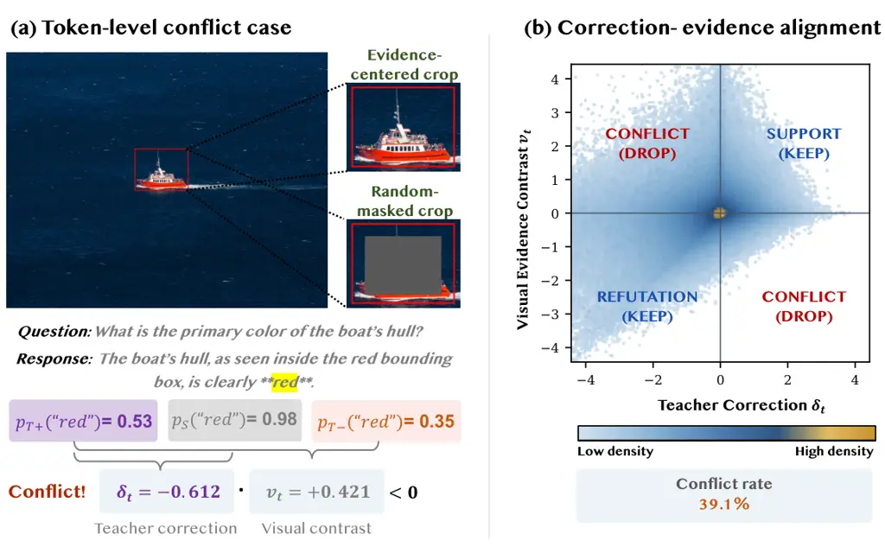
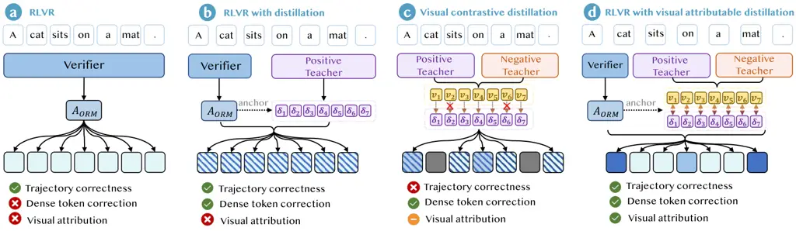
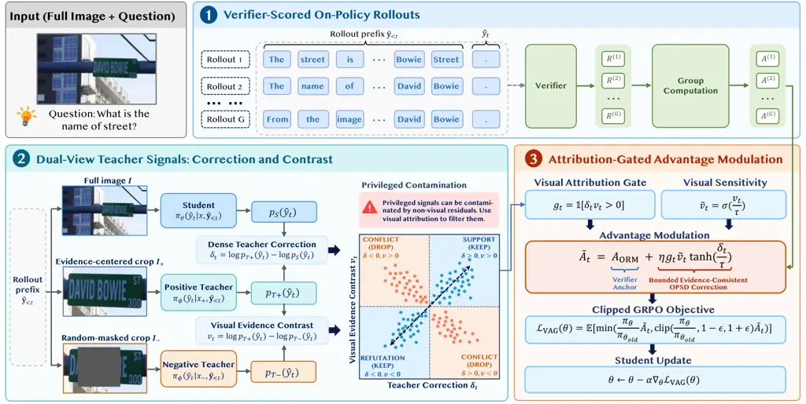
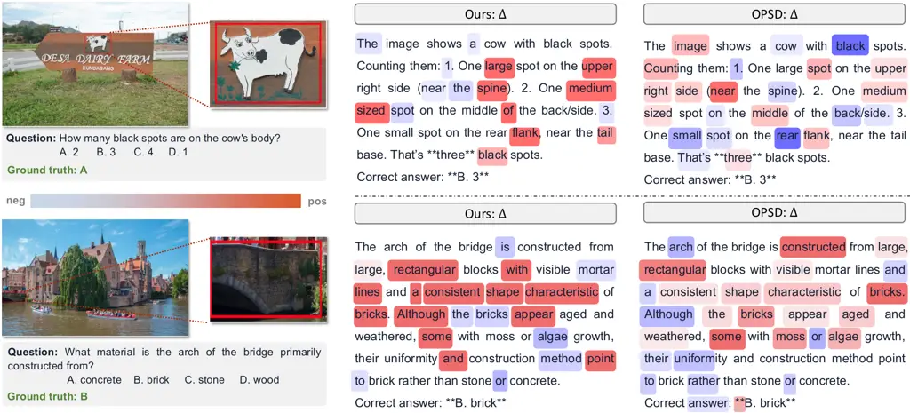
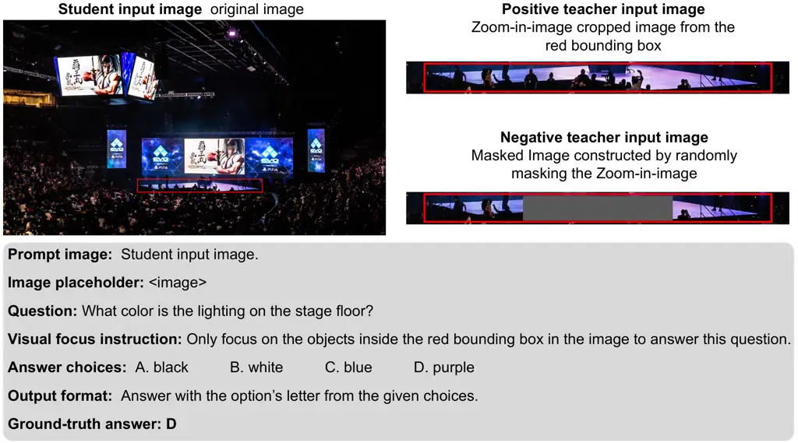
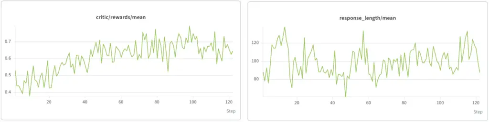
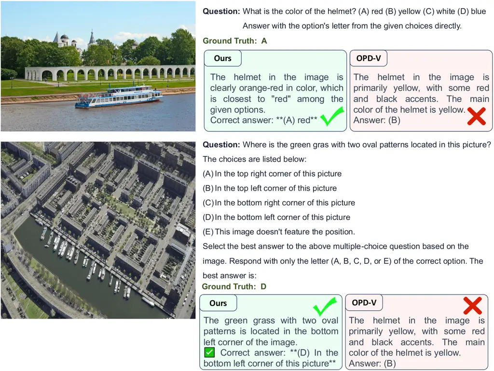
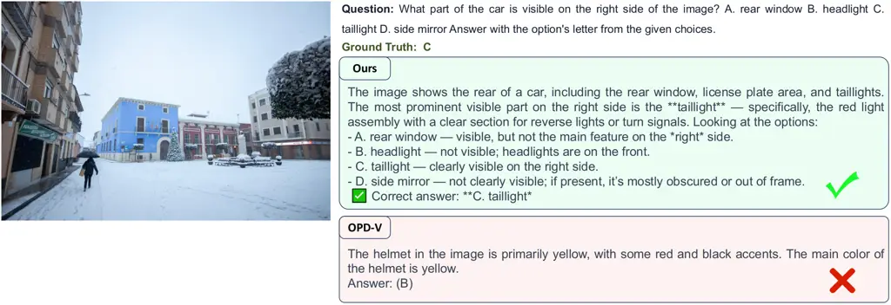
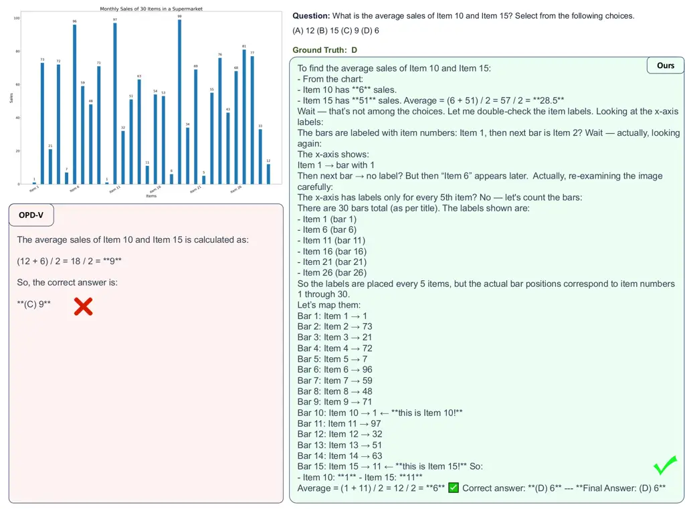

# Reinforcement Learning with Visually Attributable On-Policy Self-Distillation

Shiao Xie ^(†)^(†)thanks: Shiao Xie and Siyu Chen contributed equally to
this work.    Siyu Chen¹¹footnotemark: 1 ^(†)^(†)thanks: Siyu Chen and
Yujin Wang are the corresponding authors.    Jianwei Lv    Xiandong Li
   Yujin Wang²²footnotemark: 2 Baidu Inc., China

###### Abstract

Multimodal reinforcement learning with verifiable rewards (RLVR)
provides reliable task-level supervision, yet offers limited guidance
for localizing errors in visual reasoning. On-policy self-distillation
(OPSD) complements this supervision with dense token-level corrections
from a privileged teacher equipped with an evidence-centered visual
view. However, the resulting corrections may conflate visual evidence
with non-visual shifts induced by linguistic priors, response style, or
the privileged view itself. We formalize this phenomenon as
_privileged-correction contamination_: a token-level correction is
contaminated when its update direction cannot be consistently attributed
to the privileged visual evidence. Directly distilling contaminated
corrections may therefore reinforce erroneous token-level updates. To
address this issue, we propose reinforcement learning with visually
attributable on-policy self-distillation, an evidence-consistent
paradigm that augments task-level RLVR supervision with privileged
token-level corrections grounded in visual evidence. We instantiate this
paradigm with Visual-Attribution Gating (VAG), which uses the
verifier-derived advantage as the optimization anchor and validates each
privileged correction against the contrast between evidence-present and
evidence-degraded teacher views. By admitting only corrections
directionally supported by this visual contrast, VAG preserves visually
grounded guidance while suppressing inconsistent residuals. Experiments
across six visual reasoning benchmarks show that VAG consistently
outperforms GRPO and OPSD methods, establishing new state-of-the-art
average performance.

|     |
| --- |
|     |

[  Qwen3.5-4B](https://huggingface.co/siyu-ch/VAG-Qwen3.5-4B)  [
 Qwen3.5-9B](https://huggingface.co/siyu-ch/VAG-Qwen3.5-9B)

## 1 Introduction

Reinforcement learning with verifiable rewards (RLVR) has become an
effective paradigm for improving multimodal reasoning by optimizing
policies against automatically checkable outcomes (Guo et al., 2025;
Yang et al., 2025). In GRPO (Shao et al., 2024), a verifier scores each
rollout and group-relative normalization turns these rewards into an
outcome advantage $`A_{\mathrm{ORM}}`$ shared by every token. Such
supervision is reliable at the trajectory level, but coarse at the token
level: the same advantage is assigned to every token, regardless of
which visual decision determines the answer. Consequently, RLVR can
distinguish successful trajectories from unsuccessful ones without
localizing the visual reasoning errors within them.

On-policy distillation (OPD) (Agarwal et al., 2024; Gu et al., 2023;
Song and Zheng, 2026) addresses this limitation by evaluating
student-sampled trajectories with a teacher and supplying dense
token-level guidance. On-policy self-distillation (OPSD) (Zhao et al.,
2026; Hübotter et al., 2026; Yang et al., 2026) further avoids
dependence on an external teacher by using the policy itself under
privileged information as the teacher, which for multimodal reasoning
can be a zoomed-in view that exposes task-relevant evidence (Yuan et
al., 2026). The resulting teacher–student log-probability gap
$`\delta_{t}`$ provides a dense, token-level correction, yet it is not
guaranteed to be attributable to the privileged visual evidence alone:
it may also be contaminated by non-visual shifts induced by linguistic
priors, response style, or the privileged view itself.

We formalize this contamination as _privileged-correction
contamination_: the teacher–student correction mixes evidence-grounded
guidance with residual effects that are not attributable to the visual
evidence. Applying such a correction directly may reinforce a token even
when the visual evidence argues against it, or suppress a token that the
evidence supports.



Figure 1: Illustrative contamination diagnostic. (a) A token-level
conflict case and (b) the correction-evidence alignment used to motivate
attribution.

To make this contamination concrete, Fig. 1 illustrates a single
token-level diagnostic. For each generated token, we compare the teacher
correction $`\delta_{t}`$ with the visual contrast $`v_{t}`$ between
evidence-centered and random-masked teacher views, a probe of visual
dependence introduced by OPD-V (Aniri et al., 2026). Fig. 1 (a) shows a
conflicting case, in which the teacher suppresses a token
($`\delta_{t}=-0.612`$) that the visual contrast supports
($`v_{t}=+0.421`$). Such a correction should be discarded rather than
applied, since the student already assigns the token a higher
probability than the teacher does ($`0.98`$ vs. $`0.53`$): the teacher
is lower here because the privileged view shifts its probabilities
downward, not because the visual evidence refutes the token. Fig. 1 (b)
summarizes the comparison over tokens by the signs of the two signals:
agreeing signs indicate a correction consistent with the evidence,
whereas opposite signs expose the two conflict cases, in which the
teacher suppresses a visually supported token or promotes a visually
refuted one. Measured with Qwen3.5-4B on our training data (§4.1), these
conflicts affect $`39.1\%`$ of the generated tokens. Exposing these
conflicts, however, does not remove them. What the diagnostic calls for
is visual attribution in a strict sense: an explicit mechanism that
checks whether the _direction_ of each correction agrees with the visual
evidence.

Motivated by this diagnosis, we design Visual-Attribution Gating (VAG).
Rather than distilling every privileged correction, VAG validates the
direction of each one against the visual contrast: the correction
$`\delta_{t}`$ is admitted only when it agrees in sign with $`v_{t}`$,
that is $`v_{t}\delta_{t}>0`$, which keeps both supporting and refuting
corrections and removes only the conflicting residuals exposed by the
diagnostic. Furthermore, VAG operates on top of RLVR rather than in
place of it: the verifier-derived advantage remains the optimization
anchor, and self-distillation contributes only the corrections that pass
the gate. Taken together, we propose reinforcement learning with
visually attributable on-policy self-distillation, a new
evidence-consistent learning paradigm.

Fig. 2 compares our paradigm with representative on-policy learning
paradigms for multimodal credit assignment along three properties:
_trajectory correctness_, _dense token correction_, and _visual
attribution_. RLVR (Fig. 2 (a)) supplies only the outcome advantage
$`A_{\mathrm{ORM}}`$, which anchors optimization to trajectory
correctness but assigns the same scalar to every token. RLVR with
distillation (Fig. 2 (b)) keeps this anchor and modulates each token by
$`\delta_{t}`$ without verifying where that correction comes from, so
the privileged signal it distills may be contaminated (Lin et al., 2026;
Yang et al., 2026). Visual contrastive distillation (Fig. 2 (c)) instead
uses visual contrast $`v_{t}`$ to select only visually sensitive
tokens (Aniri et al., 2026). Yet this selection does not verify whether
an update follows the visual evidence, so the corrections applied to the
selected tokens remain contaminated, while the verifier-grounded anchor
is lost as well.

VAG (Fig. 2 (d)) is the only paradigm that attains all three properties
at once: it keeps $`A_{\mathrm{ORM}}`$ as the anchor, preserves the
dense correction $`\delta_{t}`$, and admits that correction only when
$`v_{t}`$ supports its direction. This coverage comes at almost no cost.
VAG needs no learned contamination estimator and no auxiliary
distillation objective, and relative to a dual-view OPSD baseline that
already evaluates both teacher views, it adds only an elementwise sign
test and no additional teacher forward pass. Across six visual reasoning
benchmarks, VAG consistently improves over matched GRPO and OPSD
baselines and surpasses much larger open-source models (e.g.,
Qwen3.5-397B), leading closed-source models (e.g., GPT-5.4), and agentic
“Thinking-with-Images” methods on tasks that require dense local
evidence. On holdout tasks beyond the training distribution, it retains
general visual understanding and reasoning ability, indicating that the
gains do not come at the cost of forgetting, while controlled ablations
isolate the contribution of the sign-agreement gate.



Figure 2: Comparison of on-policy learning paradigms. (a) RLVR, (b) RLVR
with distillation, (c) Visual contrastive distillation, and (d) RLVR
with visual attributable distillation.

Our contributions are summarized as follows:

- •
  We identify _privileged-correction contamination_, showing that dense
  teacher–student corrections are not necessarily aligned in direction
  with the visual evidence.
- •
  We propose an evidence-consistent paradigm unifying RLVR and OPSD, in
  which the verifier-derived advantage anchors optimization, and design
  VAG to mitigate privileged-correction contamination by admitting a
  teacher correction only under sign agreement with a controlled visual
  contrast.
- •
  Across six visual reasoning benchmarks, VAG consistently improves over
  matched GRPO and OPSD baselines and surpasses much larger open-source
  and leading closed-source models, while holdout evaluation shows no
  loss of general capability. Ablations further validate the proposed
  attribution mechanism.

## 2 Related Work

### 2.1 On-Policy and Privileged Distillation

OPD supervises student-visited prefixes with a teacher, thereby reducing
exposure bias while supplying dense token-level guidance (Gu et al.,
2023; Agarwal et al., 2024; Song and Zheng, 2026). OPSD replaces the
external teacher with the model itself conditioned on privileged
context, such as verified solutions, reasoning traces, or environmental
feedback  (Zhao et al., 2026; Hübotter et al., 2026; He et al., 2026;
Jin et al., 2026). Because the student cannot access this context at
inference time, the resulting teacher–student gap may conflate
task-relevant knowledge with leakage or stylistic artifacts (Yang et
al., 2026; Pan et al., 2026; Shen et al., 2026). In multimodal
reasoning, privileged views instead expose localized evidence that
global image processing tends to lose, and methods from region-to-image
distillation to Vision-OPD transfer such evidence to a full-image
model (Wei et al., 2026; Yuan et al., 2026). Subsequent work refines the
selectivity of this supervision through view-based reweighting (Liu et
al., 2026), trajectory gating (Sun et al., 2026), gradient
decomposition (Yoon et al., 2026), modality balance (Aniri et al.,
2026), and target reconstruction (Zhang et al., 2026), whereas VAG uses
a signed visual contrast to determine whether a candidate teacher
correction is admitted into policy optimization at all.

### 2.2 Integrating RLVR with On-Policy Distillation

RLVR anchors optimization to checkable outcomes, and GRPO realizes this
without a learned critic by estimating group-relative advantages that
are nevertheless shared by all tokens in a response (Shao et al., 2024).
OPD supplies the missing token-level resolution, yet its preference need
not agree with trajectory correctness, so the two signals are
complementary but not automatically compatible. Existing integrations
reconcile them by weighting the two objectives, restricting the teacher
gap to modulating verifier-directed magnitudes, gating implicit OPD
rewards by trajectory correctness, or contrasting privileged contexts
 (Hübotter et al., 2026; Yang et al., 2026; Lin et al., 2026; Pan et
al., 2026), while variants route samples or tokens between the two
objectives, account for student uncertainty, or reverse teacher signals
to encourage exploration  (Li et al., 2026; Wang et al., 2026; Ke et
al., 2026; Kim et al., 2026). VAG resolves this compatibility at the
token level instead: a signed correction enters the verifier-anchored
advantage only when its direction agrees with the visual evidence
contrast, which preserves both visually supported promotion and visually
justified suppression while falling back to outcome supervision whenever
attribution fails.

## 3 Method



Figure 3: Overview of the VAG framework. Stage 1: A verifier derives
$`A_{\mathrm{ORM}}`$ from on-policy rollouts. Stage 2: Dual-view teacher
evaluation yields the distillation margin $`\delta_{t}`$ and visual
contrast $`v_{t}`$; VAG retains same-sign corrections and discards
conflicting ones. Stage 3: The retained correction modulates
$`A_{\mathrm{ORM}}`$ for the clipped GRPO update.

### 3.1 Overview

Given an image–question pair, VAG proceeds through the three-stage
training loop illustrated in Fig. 3. In Stage 1 (Sec. 3.2), VAG derives
a reliable trajectory-level advantage from on-policy rollouts sampled by
the frozen student policy and scored by a task verifier. In Stage 2
(Sec. 3.3), the positive and negative teacher branches of the same
Exponential Moving Average (EMA) model replay each student-generated
prefix under an evidence-centered view and its random-masked
counterpart, respectively. These evaluations yield a teacher–student
correction $`\delta_{t}`$ and a visual contrast $`v_{t}`$, whose sign
agreement retains evidence-consistent token-level supervision while
filtering potentially contaminated corrections. In Stage 3 (Sec. 3.4),
VAG weights each retained correction by its visual sensitivity and uses
it to modulate, rather than replace, the verifier advantage. The
resulting token-level advantage is then optimized using the clipped GRPO
objective.

### 3.2 Verifier-Scored On-Policy Rollouts

Let $`q`$ denote a question and $`I`$ its corresponding full image, with
the multimodal input denoted by $`x=(q,I)`$. At each training iteration,
$`\pi_{\theta}`$ denotes the student policy used for rollout collection.
As shown in Stage 1 of Fig. 3, the student samples a group of $`G`$
response trajectories as:

```math
\hat{\mathbf{y}}^{(i)}=\bigl(\hat{y}^{(i)}_{1},\ldots,\hat{y}^{(i)}_{T_{i}}\bigr)\sim\pi_{\theta}(\cdot\mid x),\qquad i=1,\ldots,G, \tag{1}
```

where $`\hat{\mathbf{y}}^{(i)}`$ is the $`i`$-th sampled response,
$`\hat{y}^{(i)}_{t}`$ is its token at position $`t`$, and $`T_{i}`$ is
its length. A task verifier assigns each rollout an outcome reward
$`R^{(i)}\in\left\{0,1\right\}`$, from which we compute the
group-normalized advantage as:

```math
A_{\mathrm{ORM}}^{(i)}=\frac{R^{(i)}-\mu_{G}}{\sigma_{G}}, \tag{2}
```

where $`\mu_{G}`$ and $`\sigma_{G}`$ denote the mean and standard
deviation of the rewards within the rollout group, respectively. The
scalar $`A_{\mathrm{ORM}}^{(i)}`$ is shared by all tokens in rollout
$`i`$. Although it provides a reliable trajectory-level learning signal,
it does not identify which tokens contribute to the outcome.

### 3.3 Dual-View Teacher Signals: Correction and Contrast

Stage 1 provides a reliable outcome-level anchor but leaves token-level
credit undetermined. OPSD closes this gap by letting a privileged
teacher re-score the student’s own rollout token by token (Zhao et al.,
2026), and we adopt this mechanism as our dense signal, instantiating
the teacher with an evidence-centered view. Unlike prior OPSD, which
distills every correction directly, we first ask whether a correction is
directionally supported by the visual evidence, following the diagnostic
in Sec. 1. As shown in Stage 2 of Fig. 3, both teachers are
view-conditioned branches of a single EMA teacher $`\pi_{\phi}`$
replaying the student’s trajectory: conditioning $`\pi_{\phi}`$ on the
evidence-preserving view yields the _positive teacher_, and conditioning
it on the evidence-degraded view yields the _negative teacher_. Because
the two branches share the student-generated prefix and differ only in
the visual condition, all token-level quantities below are comparable.
This yields two steps: form the privileged correction from the positive
teacher, then probe its visual support with the negative teacher.

#### Dense Teacher Correction.

The first step instantiates the positive branch. The evidence-preserving
view $`I_{+}`$ is a crop centered on the target detail relevant to the
question, which gives the positive teacher input $`x_{+}=(q,I_{+})`$.
For each student-generated trajectory $`\hat{\mathbf{y}}^{(i)}`$, the
positive teacher re-evaluates every generated token
$`\hat{y}^{(i)}_{t}`$ conditioned on the same student-generated prefix
$`\hat{\mathbf{y}}^{(i)}_{<t}=(\hat{y}^{(i)}_{1},\ldots,\hat{y}^{(i)}_{t-1})`$.
We write the corresponding sampled-token probabilities as:

```math
\displaystyle{p_{S}^{(i)}}(\hat{y}_{t}) \displaystyle\triangleq\pi_{\theta}\!\left(\hat{y}^{(i)}_{t}\mid x,\hat{\mathbf{y}}^{(i)}_{<t}\right), \tag{3}
```

```math
\displaystyle{p_{T+}^{(i)}}(\hat{y}_{t}) \displaystyle\triangleq\pi_{\phi}\!\left(\hat{y}^{(i)}_{t}\mid x_{+},\hat{\mathbf{y}}^{(i)}_{<t}\right), \tag{4}
```

for the student and the positive teacher, respectively. The dense
teacher correction is their log-ratio on the sampled token:

```math
\delta_{t}^{(i)}=\operatorname{sg}\!\left[\log{p_{T+}^{(i)}}(\hat{y}_{t})-\log{p_{S}^{(i)}}(\hat{y}_{t})\right], \tag{5}
```

where $`\operatorname{sg}[\cdot]`$ denotes the stop-gradient operator. A
positive $`\delta_{t}^{(i)}`$ indicates that the positive teacher
assigns the sampled token a higher probability than the student, and a
negative value the opposite, so $`\delta_{t}^{(i)}`$ is precisely the
dense signal that on-policy self-distillation would follow.

Taken on its own, however, $`\delta_{t}^{(i)}`$ is exactly the quantity
examined in Fig. 1: a non-zero teacher–student gap cannot be assumed to
follow the direction of the privileged evidence. We therefore treat
$`\delta_{t}^{(i)}`$ as a candidate correction and, instead of assuming
its visual support, make that support testable.

#### Visual Evidence Contrast.

Following OPD-V (Aniri et al., 2026), we pair $`I_{+}`$ with an
evidence-degraded counterpart $`I_{-}`$, obtained by occluding a
randomly placed rectangular region of the zoom-in image with black
pixels, so that the visual evidence available to the teacher is weakened
while the image resolution, the visual token grid, and the surrounding
spatial context remain unchanged. Feeding $`x_{-}=(q,I_{-})`$ to the
same teacher on the same prefix gives:

```math
{p_{T-}^{(i)}}(\hat{y}_{t})\triangleq\pi_{\phi}\!\left(\hat{y}^{(i)}_{t}\mid x_{-},\hat{\mathbf{y}}^{(i)}_{<t}\right), \tag{6}
```

and because the two teacher evaluations share parameters, prefix, and
realized token, and differ only in the target evidence, their log-ratio
isolates the teacher’s response to that intervention:

```math
v_{t}^{(i)}=\operatorname{sg}\!\left[\log{p_{T+}^{(i)}}(\hat{y}_{t})-\log{p_{T-}^{(i)}}(\hat{y}_{t})\right]. \tag{7}
```

A positive $`v_{t}^{(i)}`$ indicates that the target evidence supports
the sampled token, whereas a negative value indicates refutation, and
$`\lvert v_{t}^{(i)}\rvert`$ measures how strongly the token depends on
that evidence.

#### Diagnosing Privileged Contamination.

Pairing the two signals by sign partitions the generated tokens into the
four quadrants shown in Stage 2 of Fig. 3. The two same-sign quadrants
are directionally consistent: when $`\delta_{t}>0`$ and $`v_{t}>0`$, the
teacher promotes a token whose probability the visual evidence also
raises (_support_); when $`\delta_{t}<0`$ and $`v_{t}<0`$, the teacher
suppresses a token whose probability the evidence lowers (_refutation_).
In both cases the candidate correction moves the student in the same
direction as the visual intervention, so it can be treated as
evidence-grounded credit. Notably, keeping the refutation quadrant is
what allows suppressive corrections to survive rather than be discarded
together with the conflicting ones.

The two opposite-sign quadrants are directionally conflicting. A
correction with $`\delta_{t}>0`$ but $`v_{t}<0`$ would reinforce a token
whose probability the visual evidence lowers, whereas $`\delta_{t}<0`$
with $`v_{t}>0`$ would suppress a token whose probability it raises.
Since neither direction can be explained by the visual intervention, we
regard these quadrants as observable instances of privileged-correction
contamination and exclude them from the dense supervision. The four
quadrants thus define a binary admissibility rule on candidate
corrections, and what remains is to realize this rule as a token-level
learning signal without discarding the verifier anchor of Stage 1.

### 3.4 Attribution-Gated Advantage Modulation

Stage 3 realizes the admissibility rule as a token-level advantage: the
gate decides _whether_ a candidate correction enters the update, the
contrast magnitude decides _how strongly_ it enters, and the outcome
advantage of Stage 1 remains the anchor that determines the direction of
the update. The visual attribution gate shown in Fig. 3 is formulated
as:

```math
g_{t}^{(i)}=\mathbbm{1}\!\left[\delta_{t}^{(i)}v_{t}^{(i)}>0\right], \tag{8}
```

where $`\mathbbm{1}[\cdot]`$ is the indicator function. This gate
retains the support and refutation quadrants and rejects both conflict
quadrants, together with the boundary cases that carry no directional
information. We therefore convert the contrast into a bounded
visual-sensitivity weight:

```math
\widetilde{v}_{t}^{(i)}=\sigma\!\left(\frac{v_{t}^{(i)}}{\tau}\right)\in(0,1), \tag{9}
```

where $`\sigma`$ is the logistic sigmoid and $`\tau>0`$ controls the
sharpness of the transition, so that strongly evidence-dependent tokens
receive more credit than marginally dependent ones instead of being
weighted equally. The teacher correction is bounded in the same spirit,
and the two are combined with the verifier anchor to form the modulated
advantage:

```math
\widetilde{A}_{t}^{(i)}=A_{\mathrm{ORM}}^{(i)}+\eta\,g_{t}^{(i)}\widetilde{v}_{t}^{(i)}\tanh\!\left(\frac{\delta_{t}^{(i)}}{\tau}\right), \tag{10}
```

where $`\eta>0`$ controls the strength of the correction. The first term
provides a trajectory-level verifier anchor, while the second
redistributes credit at the token level only when the teacher correction
is visually attributable. If $`g_{t}^{(i)}=0`$, the correction vanishes
and $`\widetilde{A}_{t}^{(i)}=A_{\mathrm{ORM}}^{(i)}`$, so filtering a
correction falls back to outcome supervision rather than removing the
token from training.

The final stage of Fig. 3 optimizes the student policy using the
modulated advantage. We first define the token-level importance ratio
between the current policy $`\pi_{\theta}`$ and the rollout policy
$`\pi_{\theta_{old}}`$ as:

```math
\rho_{t}^{(i)}(\theta)=\frac{\pi_{\theta}(\hat{y}_{t}^{(i)}\mid x,\hat{\mathbf{y}}_{<t}^{(i)})}{\pi_{\theta_{old}}(\hat{y}_{t}^{(i)}\mid x,\hat{\mathbf{y}}_{<t}^{(i)})}. \tag{11}
```

The training objective is the clipped GRPO surrogate averaged over
rollouts and token positions:

```math
\mathcal{L}_{\mathrm{VAG}}(\theta)=-\frac{1}{G}\sum_{i=1}^{G}\frac{1}{T_{i}}\sum_{t=1}^{T_{i}}\min\!\Big(\rho_{t}^{(i)}(\theta)\,\widetilde{A}_{t}^{(i)},\;\operatorname{clip}\big(\rho_{t}^{(i)}(\theta),\,1-\varepsilon,\,1+\varepsilon\big)\,\widetilde{A}_{t}^{(i)}\Big), \tag{12}
```

where $`0<\varepsilon<1`$ is the clipping radius. All teacher-derived
signals, including $`\delta_{t}`$, $`v_{t}`$, and $`g_{t}`$, are
detached, so gradients flow to the student only through
$`\rho_{t}^{(i)}(\theta)`$. Consequently, VAG introduces neither
additional trainable parameters nor an auxiliary objective; it operates
entirely by reshaping the advantage that GRPO already optimizes.

|                                             |        |       |       |             |             |           |           |       |
| ------------------------------------------- | ------ | ----- | ----- | ----------- | ----------- | --------- | --------- | ----- |
| Model                                       | Param. | V\*   | Zoom  | HR-Bench 4K | HR-Bench 8K | MME-RW EN | MME-RW CN | Avg.  |
| Closed-Source Models (Single Forward Pass)  |        |       |       |             |             |           |           |       |
| GPT-5.2 (OpenAI, 2025a)                     | –      | 79.06 | 50.89 | 81.12       | 78.38       | 72.60     | 68.80     | 71.81 |
| GPT-5.4 (OpenAI, 2026)                      | –      | 76.96 | 52.66 | 84.00       | 77.88       | 74.20     | 70.93     | 72.77 |
| Gemini 3.1 Pro (Google DeepMind, 2026a)     | –      | 87.96 | 61.18 | 89.63       | 86.88       | 76.53     | 73.31     | 79.25 |
| Gemini 3.5 Flash (Google DeepMind, 2026b)   | –      | 89.01 | 61.42 | 89.12       | 86.62       | 75.31     | 73.97     | 79.24 |
| Open-Source Baselines (Single Forward Pass) |        |       |       |             |             |           |           |       |
| DeepEyes (Zheng et al., 2025)               | 7B     | 85.86 | 46.51 | 75.13       | 72.63       | 64.10     | 64.09     | 68.05 |
| Thyme (Zhang et al., 2025a)                 | 7B     | 82.20 | 45.09 | 77.00       | 72.00       | 64.80     | 64.59     | 67.61 |
| DeepEyesV2 (Hong et al., 2025)              | 7B     | 81.68 | 44.97 | 77.88       | 73.75       | 64.90     | 65.07     | 68.04 |
| SenseNova-MARS (Chng et al., 2025)          | 8B     | 92.15 | 47.81 | 83.13       | 78.38       | 67.90     | 68.90     | 73.05 |
| MiMo-VL-RL (LLM-Core-Team Xiaomi, 2025)     | 7B     | 83.25 | 45.68 | 73.50       | 69.38       | 62.73     | 55.89     | 65.07 |
| ZwZ (Wei et al., 2026)                      | 8B     | 87.96 | 56.69 | 83.63       | 81.75       | 66.57     | 68.09     | 74.12 |
| MiniCPM-V-4.5 (Yu et al., 2025)             | 9B     | 70.68 | 42.60 | 69.63       | 61.50       | 62.65     | 61.64     | 61.45 |
| GLM-4.6V (Zhipu AI, 2026)                   | 106B   | 86.91 | 50.06 | 82.13       | 78.88       | 65.57     | 65.62     | 71.53 |
| Qwen3-VL-Instruct (Bai et al., 2025)        | 235B   | 91.10 | 56.09 | 86.13       | 80.38       | 71.74     | 69.04     | 75.75 |
| Qwen3.5-397B-A17B (Qwen Team, 2026)         | 397B   | 87.96 | 57.16 | 89.38       | 85.50       | 74.82     | 69.82     | 77.44 |
| Kimi-K2.6 (Moonshot AI, 2026)               | 1T     | 88.48 | 53.14 | 81.88       | 78.00       | 69.22     | 66.13     | 72.81 |
| Qwen3.5-4B Matched Post-Training Methods    |        |       |       |             |             |           |           |       |
| Qwen3.5 (Qwen Team, 2026)                   | 4B     | 80.63 | 49.82 | 73.50       | 67.50       | 55.78     | 58.56     | 64.30 |
| SFT                                         | 4B     | 83.25 | 42.60 | 76.50       | 72.12       | 64.10     | 62.50     | 66.85 |
| GRPO (Shao et al., 2024)                    | 4B     | 85.34 | 48.20 | 78.25       | 74.50       | 66.50     | 65.10     | 69.65 |
| OPSD (Zhao et al., 2026)                    | 4B     | 84.29 | 57.51 | 77.25       | 72.88       | 61.20     | 62.40     | 69.26 |
| Vision-OPD (Yuan et al., 2026)              | 4B     | 89.01 | 65.33 | 82.25       | 81.25       | 74.50     | 70.26     | 77.10 |
| VA-OPD (Liu et al., 2026)                   | 4B     | 86.91 | 51.20 | 80.12       | 77.50       | 68.50     | 67.10     | 71.88 |
| OPD-V (Aniri et al., 2026)                  | 4B     | 94.76 | 65.92 | 85.75       | 83.25       | 76.31     | 74.06     | 80.01 |
| VAG (Ours)                                  | 4B     | 94.24 | 69.35 | 87.62       | 84.62       | 76.56     | 75.60     | 81.33 |

Table 1: Comparison with single-forward-pass MLLMs and post-training
methods across multimodal reasoning benchmarks. All entries report
accuracy (%).

## 4 Experiment

### 4.1 Experimental Setup

Implementation Details. We instantiate our method using Qwen3.5-4B (Qwen
Team, 2026). The model is trained on a curated synthetic dataset
comprising approximately 6.2K visual-reasoning examples derived from
Vision-OPD (Yuan et al., 2026). During training, the privileged teacher
is maintained as an EMA of the student parameters. For all experiments,
the student samples $`G=8`$ on-policy responses for each input. We use a
training batch size of 48 and set the maximum response length to 1,024
tokens. All models undergo full-parameter training for one epoch and a
30-step warmup. All experiments are conducted using 8 NVIDIA H800 GPUs.
Following the evaluation protocol of OPD-V (Aniri et al., 2026), we
first perform deterministic answer matching, followed by a judge model
that determines whether unresolved responses are correct by comparing
them against the verified answer. For further details, see Appendices A
and C.

### 4.2 Baselines and Benchmarks

Evaluation Benchmarks. We evaluate VAG on six visual question answering
benchmarks that span fine-grained visual perception to broader
multimodal problem solving. (1) V\* Bench (Wu and Xie, 2023) tests the
localization and recognition of small targets in high-resolution,
visually crowded scenes. (2) ZoomBench (Wei et al., 2026) examines
whether models can recover subtle regional evidence from a full image.
(3) HR-Bench 4K and (4) HR-Bench 8K (Wang et al., 2025) evaluate
fine-grained perception at native 4K and 8K resolutions, respectively.
These settings are particularly challenging because conventional image
resizing may discard the small-scale details required to answer the
questions correctly. (5) MME-RealWorld EN and (6) MME-RealWorld
CN (Zhang et al., 2025b) provide the broadest setting, spanning diverse
high-resolution tasks and real-world scenarios. To assess whether
specializing in fine-grained perception sacrifices general multimodal
ability, we further evaluate on four holdout benchmarks: (1) MMVP (Tong
et al., 2024b), (2) CV-Bench (Tong et al., 2024a), (3) MMStar (Chen et
al., 2024), and (4) POPE (Li et al., 2023).

|            |       |          |        |       |       |
| ---------- | ----- | -------- | ------ | ----- | ----- |
| Method     | MMVP  | CV-Bench | MMStar | POPE  | Avg   |
| Qwen3.5-4B | 76.67 | 87.13    | 78.53  | 88.28 | 82.65 |
| SFT        | 78.33 | 85.70    | 68.40  | 87.48 | 79.98 |
| GRPO       | 79.33 | 87.24    | 70.60  | 86.37 | 80.89 |
| DAPO       | 79.33 | 86.95    | 72.27  | 86.62 | 81.29 |
| OPSD       | 78.68 | 87.27    | 75.07  | 88.83 | 82.46 |
| Vision-OPD | 79.67 | 87.27    | 79.60  | 89.14 | 83.92 |
| OPD-V      | 80.00 | 86.07    | 77.40  | 88.38 | 82.96 |
| VAG (Ours) | 84.67 | 87.91    | 79.93  | 88.72 | 85.31 |

Table 2: Comparisons on holdout tasks.

|          |       |       |       |          |       |        |       |       |
| -------- | ----- | ----- | ----- | -------- | ----- | ------ | ----- | ----- |
|          | Value | V^(∗) | Zoom  | HR-Bench |       | MME-RW |       | Avg   |
|          |       |       |       | 4K       | 8K    | EN     | CN    |       |
| $`\tau`$ | 0.1   | 94.24 | 69.35 | 87.62    | 84.62 | 76.56  | 75.60 | 81.33 |
|          | 0.2   | 91.62 | 65.68 | 84.12    | 82.75 | 76.91  | 77.52 | 79.77 |
|          | 0.5   | 87.43 | 56.69 | 80.25    | 78.62 | 73.23  | 69.82 | 74.34 |
| $`\eta`$ | 0.1   | 94.24 | 69.35 | 87.62    | 84.62 | 76.56  | 75.60 | 81.33 |
|          | 0.2   | 86.91 | 58.82 | 79.50    | 77.88 | 70.25  | 69.98 | 73.89 |
|          | 0.5   | 84.82 | 59.88 | 80.12    | 75.12 | 69.23  | 69.17 | 73.06 |

Table 3: Ablation on hyperparameters $`\tau`$ and $`\eta`$.

Baselines. Following Vision-OPD (Yuan et al., 2026), we compare VAG
against closed-source models (Google DeepMind, 2026a; Google DeepMind,
2026b; OpenAI, 2025a; OpenAI, 2026), agentic and large-scale open-source
MLLMs (Zheng et al., 2025; Zhang et al., 2025a; Hong et al., 2025; Chng
et al., 2025; Bai et al., 2025; Qwen Team, 2026; Zhipu AI, 2026;
Moonshot AI, 2026), and post-training baselines based on Qwen3.5-4B. The
matched group includes the corresponding base models, SFT, GRPO, OPSD,
Vision-OPD, VA-OPD (Liu et al., 2026), and OPD-V. All methods in this
group are evaluated at the same model scale using the same training data
and evaluation protocol.

### 4.3 Main Results

Comparison with SOTA MLLMs. As shown in Table 1, VAG raises the
Qwen3.5-4B average from $`64.30\%`$ to $`81.33\%`$ and exceeds OPD-V,
the strongest matched baseline, by $`1.32\%`$.

Figure 4: Performance comparison on Qwen3.5-9B.

It attains the best result on ZoomBench, HR-Bench, MME-RealWorld, and
the overall average, ranking second only on V\* Bench. The margin over
OPD-V is largest on ZoomBench ($`69.35\%`$ vs. $`65.92\%`$,
$`+3.43\%`$), a fine-grained benchmark that requires recovering subtle
regional evidence from high-resolution images, which highlights the
particular effectiveness of VAG for fine-grained perception and
localization. VAG also exceeds substantially larger open-source and
agentic models in average accuracy. Fig. 4 further reports the initial
results on Qwen3.5-9B, where VAG (Ours) reaches $`77.85\%`$ average
accuracy and improves over the base model on all benchmarks. With
response-length control, its average accuracy (Ours^(∗)) further
increases to $`80.23\%`$. We also evaluate VAG under the same evaluation
protocol as Vision-OPD to ensure a fair comparison. Further results and
detailed evaluation settings are provided in Appendix B.

Comparison with Post-Training Strategies. Within the matched group, VAG
outperforms GRPO and OPSD by $`11.68\%`$ and $`12.07\%`$ on average,
respectively. Notably, OPSD does not surpass GRPO ($`69.26\%`$ vs.
$`69.65\%`$) despite providing denser supervision, indicating that
unfiltered privileged corrections can offset their own benefit. Visual
OPSD variants narrow this gap, yet VAG still improves over Vision-OPD by
$`4.23\%`$, which demonstrates the benefit of verifying the visual
attribution of token-level supervision rather than only strengthening or
reweighting it.

Generalization to Holdout Tasks. Table 2 reports results on the four
holdout benchmarks. VAG attains the best average accuracy ($`85.31\%`$),
improving over the vanilla model by $`2.66\%`$ and over the strongest
baseline by $`1.39\%`$. In contrast, SFT and GRPO fall below the vanilla
average. VAG therefore avoids the specialization–forgetting tradeoff
observed in alternative training strategies, indicating that
attribution-gated supervision improves fine-grained perception without
eroding general multimodal capability.

### 4.4 Ablations and Analysis

Impact of $`\eta`$ and $`\tau`$. Table 3 ablates the gate temperature
$`\tau`$ and the modulation weight $`\eta`$. When varying $`\tau`$ we
fix $`\eta=0.1`$; when varying $`\eta`$ we fix $`\tau=0.1`$. Accuracy
peaks at $`\tau=0.1`$: larger temperatures flatten the gate, so visually
supported and visually contradicted corrections are no longer separated.
For $`\eta`$, $`0.1`$ is large enough to modulate the outcome advantage
yet small enough to avoid over-flipping its sign, whereas $`\eta=0.5`$
degrades every benchmark. We therefore adopt $`(\tau,\eta)=(0.1,0.1)`$,
shown in bold, for all remaining experiments.

Modulation of Advantage. Table 4 isolates the contribution of each
component of the modulated advantage under an identical training
protocol. Holding all other settings fixed, we build it up from the
outcome anchor $`A_{\mathrm{ORM}}`$ (Eq. 2): we successively introduce
the raw distillation margin $`\delta_{t}`$ (Eq. 5), the soft
visual-sensitivity $`\widetilde{v}_{t}`$ (Eq. 9), and the
sign-consistent attribution gate $`g_{t}`$ (Eq. 8) with bounded margin
scaling, recovering the full form in Eq. 10. As reported in Table 4, the
dense margin lifts the average from $`69.65\%`$ to $`77.12\%`$,
visual-sensitivity weighting further to $`78.80\%`$, and the full
modulation to $`81.33\%`$ ($`+11.68\%`$ over the outcome-only anchor),
attaining the best score on every benchmark. Sensitivity weighting and
sign-consistent attribution are thus complementary, jointly selecting
reliable token-level corrections.



Figure 5: Prediction and token-importance comparison. VAG produces the
correct evidence-grounded prediction and concentrates credit on
decision-relevant visual tokens.

|                                          |       |       |          |       |        |       |       |
| ---------------------------------------- | ----- | ----- | -------- | ----- | ------ | ----- | ----- |
| Correction term                          | V^(∗) | Zoom  | HR-Bench |       | MME-RW |       | Avg   |
|                                          |       |       | 4K       | 8K    | EN     | CN    |       |
| $`A_{\mathrm{ORM}}`$                     | 85.34 | 48.20 | 78.25    | 74.50 | 66.50  | 65.10 | 69.65 |
| $`+\,\eta\,\delta_{t}`$                  | 90.05 | 65.33 | 79.50    | 79.50 | 75.37  | 72.99 | 77.12 |
| $`+\,\eta\,\widetilde{v}_{t}\delta_{t}`$ | 92.67 | 66.04 | 84.00    | 80.88 | 74.63  | 74.55 | 78.80 |
| Ours                                     | 94.24 | 69.35 | 87.62    | 84.62 | 76.56  | 75.60 | 81.33 |

Table 4: Advantage-modulation ablation.

|               |       |       |          |       |        |       |       |
| ------------- | ----- | ----- | -------- | ----- | ------ | ----- | ----- |
| Negative view | V^(∗) | Zoom  | HR-Bench |       | MME-RW |       | Avg   |
|               |       |       | 4K       | 8K    | EN     | CN    |       |
| No image      | 93.72 | 63.20 | 87.88    | 87.00 | 76.82  | 73.75 | 80.40 |
| Black image   | 94.76 | 64.73 | 82.50    | 81.88 | 75.26  | 71.98 | 78.52 |
| Blurred image | 86.39 | 59.88 | 79.62    | 76.25 | 69.85  | 69.34 | 73.56 |
| Random mask   | 94.24 | 69.35 | 87.62    | 84.62 | 76.56  | 75.60 | 81.33 |

Table 5: Negative-view ablation.

Negative Teacher View. Table 5 compares four evidence-degraded views
under an identical training protocol. Random masking attains the best
average accuracy ($`81.33\%`$), ahead of the no-image ($`80.40\%`$),
black-image ($`78.52\%`$), and blurred-image ($`73.56\%`$) variants,
indicating that $`v_{t}`$ is most informative when the intervention
removes local evidence while preserving spatial context. Its advantage
concentrates on ZoomBench and MME-RealWorld CN, which depend most on
resolving a small region, whereas the no-image variant remains
competitive when the decisive evidence occupies a larger portion of the
input.

Interpretation of VAG. Fig. 5 contrasts the token-level credit that VAG
and vanilla OPSD assign to the _same_ student rollout. For each token we
visualize the correction term $`\Delta_{t}`$ that modulates the update,
defined as
$`\Delta_{t}=\eta\,g_{t}^{(i)}\widetilde{v}_{t}^{(i)}\,\tanh(\delta_{t}^{(i)}/\tau)`$
for VAG and as $`\Delta_{t}=\delta_{t}^{(i)}`$ for OPSD, with the color
scale running from negative (blue) to positive (red). In the counting
example (top), whose rollout is _incorrect_, OPSD spreads non-zero
credit over much of the response, including function words and a
strongly negative weight on “black”. VAG instead concentrates credit on
the tokens that _enumerate and localize_ the spots (“upper”, “spine”,
“flank”), while suppressing the erroneous count token “3”. In the
material example (bottom), whose rollout is _correct_, VAG weights the
chain of _visual premises_ supporting the answer (“mortar lines”,
“consistent shape”), whereas OPSD assigns comparable weight to weakly
grounded tokens such as “aged” and “rather”. The attribution gate thus
removes sign-inconsistent teacher residuals and yields a _sparser,
evidence-aligned_ credit map, irrespective of whether the rollout is
right or wrong.

## 5 Conclusion

We introduce reinforcement learning with visually attributable on-policy
self-distillation to mitigate privileged-correction contamination. Our
Visual-Attribution Gating anchors optimization to verifier-derived
trajectory advantages and accepts token-level corrections only when
consistent with the contrast between evidence-present and
evidence-degraded teacher views, preserving supportive and refuting
visual evidence while suppressing inconsistent residuals. Across six
public benchmarks, VAG consistently outperforms state-of-the-art
methods, demonstrating that visual grounding verification unifies
outcome verification, token-level self-distillation, and visual
attribution for multimodal policy optimization.

### AI use statement

In this work, we used generative AI tools only for language polishing of
author-written text (e.g., grammar, wording, and readability) and for
retrieval and discovery (e.g., finding related work). We did not use
generative AI tools for research ideation, method design, code
generation, experiments, data analysis, or the production of any
results, figures, or other artifacts, all of which were carried out and
verified by the authors. We have reviewed all AI-assisted edits to
ensure that they preserve the intended technical meaning, and we take
full responsibility for the final content of this work.

## References

- Agarwal et al. (2024) R. Agarwal, N. Vieillard, Y. Zhou, P.
  Stanczyk, S. Ramos Garea, M. Geist, and O. Bachem On-policy
  distillation of language models: learning from self-generated
  mistakes. In The Twelfth International Conference on Learning
  Representations, External Links: 2306.13649,
  [Link](https://arxiv.org/abs/2306.13649) Cited by: §1, §2.1.
- Aniri et al. (2026) Aniri, J. Bi, P. Liao, Z. Jin, V. Tresp, F.
  Shen, Y. Ma, and T. Chua OPD-v: visual on-policy self-distillation
  with modality balance. External Links: 2608.05131,
  [Link](https://arxiv.org/abs/2608.05131) Cited by: Appendix A, Table
  6, Table 6, Appendix B, Appendix F, §1, §1, §2.1, §3.3, Table 1, §4.1.
- Bai et al. (2025) S. Bai, Y. Cai, R. Chen, K. Chen, X. Chen, Z.
  Cheng, L. Deng, W. Ding, C. Gao, C. Ge, W. Ge, Z. Guo, et al. Qwen3-VL
  technical report. arXiv preprint arXiv:2511.21631. External Links:
  2511.21631, [Link](https://arxiv.org/abs/2511.21631) Cited by: Table
  1, §4.2.
- Chen et al. (2024) L. Chen, J. Li, X. Dong, P. Zhang, Y. Zang, Z.
  Chen, H. Duan, J. Wang, Y. Qiao, D. Lin, et al. Are we on the right
  way for evaluating large vision-language models?. arXiv preprint
  arXiv:2403.20330. External Links: 2403.20330 Cited by: §4.2.
- Chng et al. (2025) Y. X. Chng, T. Hu, W. Tong, X. Li, J. Chen, H.
  Yu, J. Lu, H. Guo, H. Deng, C. Xie, et al. Sensenova-mars: empowering
  multimodal agentic reasoning and search via reinforcement learning.
  arXiv preprint arXiv:2512.24330. Cited by: Table 1, §4.2.
- Google DeepMind (2026a) Google DeepMind Gemini 3.1 pro. Note: Official
  model release External Links:
  [Link](https://deepmind.google/technologies/gemini/) Cited by: Table
  1, §4.2.
- Google DeepMind (2026b) Google DeepMind Gemini 3.5 flash. Note: Model
  card[https://deepmind.google/models/model-cards/gemini-3-5-flash](https://deepmind.google/models/model-cards/gemini-3-5-flash),
  accessed 2026-09-26 Cited by: Table 1, §4.2.
- Gu et al. (2023) Y. Gu, L. Dong, F. Wei, and M. Huang Minillm:
  on-policy distillation of large language models. arXiv preprint
  arXiv:2306.08543. Cited by: §1, §2.1.
- Guo et al. (2025) D. Guo, D. Yang, H. Zhang, J. Song, P. Wang, Q.
  Zhu, R. Xu, R. Zhang, S. Ma, X. Bi, et al. Deepseek-r1: incentivizing
  reasoning capability in llms via reinforcement learning. arXiv
  preprint arXiv:2501.12948. Cited by: §1.
- He et al. (2026) Y. He, S. Kaur, A. Bhaskar, Y. Yang, J. Liu, N.
  Ri, L. Fowl, A. Panigrahi, D. Chen, and S. Arora Self-distillation
  zero: self-revision turns binary rewards into dense supervision. arXiv
  preprint arXiv:2604.12002. Cited by: §2.1.
- Hong et al. (2025) J. Hong, C. Zhao, C. Zhu, W. Lu, G. Xu, and X. Yu
  DeepEyesV2: toward agentic multimodal model. arXiv preprint
  arXiv:2511.05271. External Links: 2511.05271,
  [Link](https://arxiv.org/abs/2511.05271) Cited by: Table 1, §4.2.
- Hübotter et al. (2026) J. Hübotter, F. Lübeck, L. Behric, A.
  Baumann, M. Bagatella, D. Marta, I. Hakimi, I. Shenfeld, T. Kleine
  Buening, C. Guestrin, and A. Krause Reinforcement learning via
  self-distillation. arXiv preprint arXiv:2601.20802. External Links:
  2601.20802, [Link](https://arxiv.org/abs/2601.20802) Cited by: §1,
  §2.1, §2.2.
- Jin et al. (2026) Y. Jin, Y. Wang, L. Fu, Y. Xiao, Y. Luo, H.
  Liu, B. A. Prakash, J. Hester, J. Wang, and S. Kumar UniSD: towards a
  unified self-distillation framework for large language models. arXiv
  preprint arXiv:2605.06597. Cited by: §2.1.
- Ke et al. (2026) J. Ke, Z. Wen, W. Li, C. He, and L. Zhang Respecting
  self-uncertainty in on-policy self-distillation for efficient llm
  reasoning. arXiv preprint arXiv:2605.13255. Cited by: §2.2.
- Kim et al. (2026) J. Kim, J. Jeon, D. Li, and Y. Yang Rebellious
  student: reversing teacher signals for reasoning exploration with
  self-distilled rlvr. arXiv preprint arXiv:2605.10781. Cited by: §2.2.
- Li et al. (2026) G. Li, T. Yang, J. Fang, M. Song, M. Zheng, H.
  Guo, D. Zhang, J. Wang, and T. Chua Unifying group-relative and
  self-distillation policy optimization via sample routing. arXiv
  preprint arXiv:2604.02288. Cited by: §2.2.
- Li et al. (2023) Y. Li, Y. Du, K. Zhou, J. Wang, X. Zhao, and J. Wen
  Evaluating object hallucination in large vision-language models. In
  Proceedings of the 2023 Conference on Empirical Methods in Natural
  Language Processing, Singapore, pp. 292–305. External Links:
  [Document](https://dx.doi.org/10.18653/v1/2023.emnlp-main.20),
  2305.10355 Cited by: §4.2.
- Lin et al. (2026) W. Lin, J. Zhao, X. Jiang, S. Rao, Y. Li, S.
  Wang, B. He, and G. Huang On-policy distillation with verifiable
  reward. arXiv preprint arXiv:2608.24696. External Links: 2608.24696,
  [Link](https://arxiv.org/abs/2608.24696) Cited by: §1, §2.2.
- Liu et al. (2026) R. Liu, X. Lv, G. Li, X. Zhu, Z. Wang, Z. Zhang, J.
  Chen, Z. Li, B. Li, J. Gao, and S. Wu Visual-advantage on-policy
  distillation for vision-language models. arXiv preprint
  arXiv:2605.21924. External Links: 2605.21924,
  [Link](https://arxiv.org/abs/2605.21924) Cited by: §2.1, Table 1,
  §4.2.
- LLM-Core-Team Xiaomi (2025) LLM-Core-Team Xiaomi MiMo-VL technical
  report. arXiv preprint arXiv:2506.03569. External Links: 2506.03569,
  [Link](https://arxiv.org/abs/2506.03569) Cited by: Table 1.
- Moonshot AI (2026) Moonshot AI Kimi-K2.6. Note: Official model release
  External Links: [Link](https://www.moonshot.cn/) Cited by: Table 1,
  §4.2.
- OpenAI (2025a) OpenAI GPT-5.2. Note: Official model release External
  Links: [Link](https://openai.com/) Cited by: Table 1, §4.2.
- OpenAI (2025b) OpenAI gpt-oss-120b & gpt-oss-20b model card. External
  Links: 2508.10925, [Link](https://arxiv.org/abs/2508.10925) Cited by:
  Appendix B.
- OpenAI (2026) OpenAI GPT-5.4. Note: Official model release External
  Links: [Link](https://openai.com/) Cited by: Table 1, §4.2.
- Pan et al. (2026) L. Pan, S. Tao, Y. Zhai, L. Zhang, Z. Liu, B.
  Ding, A. Liu, and L. Wen RLCSD: reinforcement learning with
  contrastive on-policy self-distillation. arXiv preprint
  arXiv:2606.11709. External Links: 2606.11709,
  [Link](https://arxiv.org/abs/2606.11709) Cited by: §2.1, §2.2.
- Qwen Team (2026) Qwen Team Qwen3.5: towards native multimodal agents.
  Note: Technical report and official model release External Links:
  [Link](https://qwen.ai/blog?id=qwen3.5) Cited by: Appendix A, Table 1,
  Table 1, §4.1, §4.2.
- Shao et al. (2024) Z. Shao, P. Wang, Q. Zhu, R. Xu, J. Song, X. Bi, H.
  Zhang, M. Zhang, Y. K. Li, Y. Wu, and D. Guo DeepSeekMath: pushing the
  limits of mathematical reasoning in open language models. arXiv
  preprint arXiv:2402.03300. External Links: 2402.03300,
  [Link](https://arxiv.org/abs/2402.03300) Cited by: §1, §2.2, Table 1.
- Shen et al. (2026) G. Shen, X. Cheng, C. Zhao, L. Huang, J. Li, D.
  Zhao, and X. Yu Anti-self-distillation for reasoning rl via pointwise
  mutual information. arXiv preprint arXiv:2605.11609. Cited by: §2.1.
- Song and Zheng (2026) M. Song and M. Zheng A survey of on-policy
  distillation for large language models. arXiv preprint
  arXiv:2604.00626. Cited by: §1, §2.1.
- Sun et al. (2026) H. Sun, Z. Yi, L. Deng, Y. Zhou, P. Jia, J. Zhao, L.
  Yuan, J. Lv, and T. Wang V-Zero: answer-label-free on-policy
  distillation with contrastive evidence gating for fine-grained visual
  reasoning. arXiv preprint arXiv:2606.25319. External Links:
  2606.25319, [Link](https://arxiv.org/abs/2606.25319) Cited by: §2.1.
- Tong et al. (2024a) S. Tong, E. Brown, P. Wu, S. Woo, M.
  Middepogu, S. C. Akula, J. Yang, S. Yang, A. Iyer, X. Pan, Z. Wang, R.
  Fergus, Y. LeCun, and S. Xie Cambrian-1: a fully open, vision-centric
  exploration of multimodal llms. Advances in Neural Information
  Processing Systems (NeurIPS). Cited by: §4.2.
- Tong et al. (2024b) S. Tong, Z. Liu, Y. Zhai, Y. Ma, Y. LeCun, and S.
  Xie Eyes wide shut? exploring the visual shortcomings of multimodal
  LLMs. arXiv preprint arXiv:2401.06209. External Links: 2401.06209
  Cited by: §4.2.
- Wang et al. (2026) J. Wang, X. Ouyang, Z. Chen, Y. Hu, Z. Pan, X. Li,
  and L. Guo Trace: distilling where it matters via token-routed self
  on-policy alignment. arXiv preprint arXiv:2605.10194. Cited by: §2.2.
- Wang et al. (2025) W. Wang, L. Ding, M. Zeng, X. Zhou, L. Shen, Y.
  Luo, W. Yu, and D. Tao Divide, conquer and combine: a training-free
  framework for high-resolution image perception in multimodal large
  language models. In Proceedings of the AAAI Conference on Artificial
  Intelligence, Vol. 39, pp. 7907–7915. Cited by: §4.2.
- Wei et al. (2026) L. Wei, L. He, J. Lan, L. Dong, Y. Cai, S. Li, H.
  Zhu, W. Wang, L. Kong, Y. Wang, Z. Zhang, and W. Huang Zooming without
  zooming: region-to-image distillation for fine-grained multimodal
  perception. arXiv preprint arXiv:2602.11858. Cited by: §2.1, Table 1,
  §4.2.
- Wu and Xie (2023) P. Wu and S. Xie V\*: guided visual search as a core
  mechanism in multimodal LLMs. arXiv preprint arXiv:2312.14135.
  External Links: 2312.14135 Cited by: §4.2.
- Yang et al. (2025) A. Yang, A. Li, B. Yang, B. Zhang, B. Hui, B.
  Zheng, B. Yu, C. Gao, C. Huang, C. Lv, et al. Qwen3 technical report.
  arXiv preprint arXiv:2505.09388. Cited by: §1.
- Yang et al. (2026) C. Yang, C. Qin, Q. Si, M. Chen, N. Gu, D. Yao, Z.
  Lin, W. Wang, J. Wang, and N. Duan Self-distilled RLVR. arXiv preprint
  arXiv:2604.03128. External Links: 2604.03128,
  [Link](https://arxiv.org/abs/2604.03128) Cited by: §1, §1, §2.1, §2.2.
- Yoon et al. (2026) H. S. Yoon, E. Yoon, J. Jang, S. Eom, J. W.
  Hong, M. Hasegawa-Johnson, Q. Dai, C. Luo, and C. D. Yoo Decomposed
  on-policy distillation for vision-language reasoning: steering
  gradients for visual grounding. External Links: 2606.00564,
  [Link](https://arxiv.org/abs/2606.00564) Cited by: §2.1.
- Yu et al. (2025) T. Yu, Z. Wang, C. Wang, F. Huang, W. Ma, Z. He, T.
  Cai, W. Chen, Y. Huang, Y. Zhao, et al. MiniCPM-V 4.5: cooking
  efficient MLLMs via architecture, data, and training recipe. arXiv
  preprint arXiv:2509.18154. External Links: 2509.18154,
  [Link](https://arxiv.org/abs/2509.18154) Cited by: Table 1.
- Yuan et al. (2026) Q. Yuan, J. Lou, X. Yu, H. Lin, L. Sun, X. Han,
  and Y. Lu Vision-OPD: learning to see fine details for multimodal LLMs
  via on-policy self-distillation. arXiv preprint arXiv:2605.18740.
  External Links: 2605.18740, [Link](https://arxiv.org/abs/2605.18740)
  Cited by: Table 6, Table 6, Appendix B, §1, §2.1, Table 1, §4.1, §4.2.
- Zhang et al. (2026) K. Zhang, Y. Li, S. Shao, Q. Li, Z. Lu, Z. Yao, J.
  Lin, W. Jiao, Y. Lu, W. Liu, et al. VAD: attributing visual evidence
  for target reconstruction in multimodal on-policy distillation. arXiv
  preprint arXiv:2607.28590. Cited by: §2.1.
- Zhang et al. (2025a) Y. Zhang, X. Lu, S. Yin, C. Fu, W. Chen, X.
  Hu, B. Wen, K. Jiang, C. Liu, T. Zhang, and G. Zhou Thyme: think
  beyond images. arXiv preprint arXiv:2508.11630. External Links:
  2508.11630, [Link](https://arxiv.org/abs/2508.11630) Cited by: Table
  1, §4.2.
- Zhang et al. (2025b) Y. Zhang, H. Zhang, H. Tian, C. Fu, S. Zhang, J.
  Wu, F. Li, K. Wang, Q. Wen, Z. Zhang, et al. MME-realworld: could your
  multimodal LLM challenge high-resolution real-world scenarios that are
  difficult for humans?. In International Conference on Learning
  Representations, External Links: 2408.13257 Cited by: §4.2.
- Zhao et al. (2026) S. Zhao, Z. Xie, M. Liu, J. Huang, G. Pang, F.
  Chen, and A. Grover Self-distilled reasoner: on-policy
  self-distillation for large language models. arXiv preprint
  arXiv:2601.18734. External Links: 2601.18734,
  [Link](https://arxiv.org/abs/2601.18734) Cited by: §1, §2.1, §3.3,
  Table 1.
- Zheng et al. (2025) Z. Zheng, M. Yang, J. Hong, C. Zhao, G. Xu, L.
  Yang, C. Shen, and X. Yu DeepEyes: incentivizing “thinking with
  images” via reinforcement learning. arXiv preprint arXiv:2505.14362.
  External Links: 2505.14362, [Link](https://arxiv.org/abs/2505.14362)
  Cited by: Table 1, §4.2.
- Zhipu AI (2026) Zhipu AI GLM-4.6V. Note: Official model release
  External Links: [Link](https://www.zhipuai.cn/) Cited by: Table 1,
  §4.2.

## Appendix A Evaluation Protocol for Benchmarks

To ensure that every method is compared under identical conditions, we
adopt a single evaluation protocol and apply it uniformly to VAG and to
all reproduced baselines. Table 7 lists the number of evaluation samples
and the scoring rule used for each benchmark.

Following OPD-V (Aniri et al., 2026), scoring proceeds in two stages. We
first apply deterministic answer matching, which resolves the majority
of responses without any model in the loop. For the multiple-choice
benchmarks, a response counts as correct if it matches either the answer
text or the option letter, after normalizing surface variations such as
capitalization, surrounding punctuation, and common answer prefixes.
Only the responses that remain unresolved are passed to the second
stage, where a Qwen3.5-series (Qwen Team, 2026) model acts as a binary
Yes/No judge and decides whether the response is consistent with the
verified answer.

Both stages are necessary for the benchmarks we evaluate. Responses on
fine-grained perception tasks frequently state the correct answer inside
a longer justification, which deterministic matching alone would count
as wrong; delegating every response to the judge instead would introduce
scoring variance unrelated to the method under evaluation. Calling the
judge only on the unresolved responses therefore keeps most decisions
exact while still absorbing benign paraphrasing. Since the same
protocol, judge model, and prompts apply to every entry in Table 1, the
reported differences reflect the trained policies rather than the
evaluation.

## Appendix B Evaluation of the Released Checkpoint

The evaluation in our main table (Table 1) strictly follows the legacy
evaluation protocol of OPD-V Aniri et al. (2026), in which the trained
model itself serves as the judge. For a fair comparison, we further
re-evaluate several released models under the evaluation protocol of
Vision-OPD (Yuan et al., 2026), using GPT-OSS-120B (OpenAI, 2025b) as
the judge model, and report the results in Table 6 below. As shown, our
model achieves the best accuracy at both the 4B and 9B scales under this
setting.

|                                |      |       |       |             |             |           |           |       |
| ------------------------------ | ---- | ----- | ----- | ----------- | ----------- | --------- | --------- | ----- |
| Method                         | Size | V\*   | Zoom  | HR-Bench 4K | HR-Bench 8K | MME-RW EN | MME-RW CN | Avg.  |
| Vision-OPD (Yuan et al., 2026) | 4B   | 89.53 | 59.53 | 82.25       | 81.00       | 74.97     | 70.71     | 76.33 |
| OPD-V (Aniri et al., 2026)     | 4B   | 90.10 | 61.30 | 84.88       | 80.88       | 75.45     | 71.49     | 77.35 |
| VAG (Ours)                     | 4B   | 91.10 | 61.89 | 85.75       | 82.50       | 75.96     | 73.35     | 78.43 |
| Vision-OPD (Yuan et al., 2026) | 9B   | 90.10 | 64.97 | 87.12       | 84.88       | 73.51     | 70.44     | 78.50 |
| OPD-V (Aniri et al., 2026)     | 9B   | 93.72 | 63.79 | 84.38       | 82.55       | 71.82     | 71.05     | 77.89 |
| VAG (Ours)                     | 9B   | 92.15 | 60.12 | 89.00       | 87.88       | 77.68     | 74.53     | 80.23 |

Table 6: Evaluation results under the Vision-OPD evaluation protocol.

## Appendix C Training Prompt Example

Fig. 6 presents one complete training instance: the original image
observed by the student, the two teacher images derived from it, and the
textual prompt used in each pass.

The three image conditions differ only in the visual evidence they
expose. The student receives the original, unmodified image and must
therefore locate the relevant detail on its own. Both teacher images are
constructed from this same image. The positive teacher receives the
evidence-centered crop defined by the annotated bounding box, so the
decisive detail occupies a far larger fraction of the visual field. The
negative teacher receives the same crop after random masking, which
weakens the local evidence while preserving the surrounding spatial
context.

The textual prompt is assembled from a fixed set of fields: an image
placeholder, the question, a visual focus instruction that directs the
model to the annotated region, the answer choices, and an output-format
instruction that requests only the option letter. The ground-truth
answer is consumed by the verifier and is never shown to the model.
Constraining the output format yields two additional benefits. First, it
reduces the fraction of responses that require the Yes/No judge at
evaluation time. Second, it leaves little room for stylistic variation
between the teacher and student branches, so the gap $`\delta_{t}`$ is
less likely to reflect differences in wording instead of differences in
visual evidence.

Because the question, answer choices, output-format instruction, and the
student-generated prefix are identical across the three passes, the only
controlled difference between the two teacher branches is the
availability of the target evidence. This is what allows the visual
contrast $`v_{t}`$ in Eq. 7 to be interpreted as a statement about
visual evidence rather than about prompt or sampling differences. Both
teacher views are used only during training; at inference time the
deployed policy observes the original image alone and requires no
privileged input.

|                  |         |                                                                                                                                       |
| ---------------- | ------- | ------------------------------------------------------------------------------------------------------------------------------------- |
| Benchmark        | Samples | Scoring Rule                                                                                                                          |
| V\* Bench        | 191     | Rule-based answer matching is applied first; unresolved responses are compared with the verified answer by a Yes/No judge.            |
| ZoomBench        | 845     | Generic answer matching handles normalized responses first; unresolved cases use the verified-answer Yes/No judge.                    |
| HR-Bench 4K      | 800     | Multiple-choice matching checks direct answer matches and option-letter matches before the Yes/No judge handles unresolved responses. |
| HR-Bench 8K      | 800     | Multiple-choice matching follows the HR-Bench 4K rule.                                                                                |
| MME-RealWorld EN | 23609   | Multiple-choice matching and the Yes/No judge are applied to the English subset.                                                      |
| MME-RealWorld CN | 5917    | The Chinese subset uses the MME-RealWorld multiple-choice scoring rule.                                                               |

Table 7: Number of evaluation samples and scoring rule for each
benchmark. All methods in Table 1 are evaluated with this identical
protocol.



Figure 6: Training prompt and paired visual inputs. The textual prompt,
comprising the image placeholder, question, visual focus instruction,
answer choices, and output format, is shared across all three passes.
The student is conditioned on the original image, the positive teacher
on the evidence-centered crop given by the red bounding box, and the
negative teacher on a randomly masked version of that crop. The
ground-truth answer is used only by the verifier.

## Appendix D VAG Algorithm

Algorithm 1 states the full VAG training loop and makes explicit the
order in which the outcome signal and the token-level signal are
combined.

Each iteration begins with rollout collection. For each input
$`x=(q,I)`$, the student samples $`G`$ on-policy responses
$`\hat{\mathbf{y}}^{(i)}`$. The verifier assigns each response a reward
$`R^{(i)}`$, which is normalized within the group to obtain
$`A_{\mathrm{ORM}}^{(i)}`$ as in Eq. 2. This advantage is shared by all
tokens of the response. The two teacher branches then replay each
sampled response using the same student-generated prefix
$`\hat{\mathbf{y}}^{(i)}_{<t}`$. The sampled-token probabilities
$`p_{S}^{(i)}(\hat{y}_{t})`$, $`p_{T+}^{(i)}(\hat{y}_{t})`$, and
$`p_{T-}^{(i)}(\hat{y}_{t})`$ are defined in Eqs. 3, 4, and 6,
respectively.

From these probabilities, the algorithm computes the dense teacher
correction $`\delta_{t}^{(i)}`$ and visual evidence contrast
$`v_{t}^{(i)}`$ using the stop-gradient log-ratios in Eqs. 5 and 7. The
attribution gate $`g_{t}^{(i)}`$ retains corrections only when
$`\delta_{t}^{(i)}v_{t}^{(i)}>0`$ (Eq. 8). The gate checks whether the
correction and visual contrast have the same sign, rather than comparing
their magnitudes. Thus, only corrections whose direction agrees with the
visual evidence are retained. Admitted corrections are bounded by
$`\tanh(\delta_{t}^{(i)}/\tau)`$ and weighted by
$`\eta\,\widetilde{v}_{t}^{(i)}`$, then added to
$`A_{\mathrm{ORM}}^{(i)}`$ to obtain $`\widetilde{A}_{t}^{(i)}`$ as in
Eq. 10.

Two properties of the loop are worth noting. First, all teacher-derived
quantities are detached, so gradients reach the student only through
$`\rho_{t}^{(i)}(\theta)`$ in $`\mathcal{L}_{\mathrm{VAG}}(\theta)`$;
the teacher acts as a signal source rather than as a differentiable
path. Second, when $`g_{t}^{(i)}=0`$, the modulated advantage satisfies
$`\widetilde{A}_{t}^{(i)}=A_{\mathrm{ORM}}^{(i)}`$. Thus, rejecting a
correction preserves the token’s verifier-derived supervision. After
each student update, the teacher parameters are updated by EMA to track
the student policy without separate teacher training.

1: Training set $`\mathcal{D}`$, student policy $`\pi_{\theta}`$, EMA
teacher $`\pi_{\phi}`$, verifier $`\mathcal{V}`$, group size $`G`$, EMA
rate $`\alpha`$, sharpness $`\tau`$, correction scale $`\eta`$

2: Updated policy parameters $`\theta`$

3: Initialize teacher parameters $`\phi\leftarrow\theta`$

4: for each training step do

5:   Sample a mini-batch $`\mathcal{B}\subset\mathcal{D}`$

6:   for each $`(x,a^{\star})\in\mathcal{B}`$ with $`x=(q,I)`$ do
$`\triangleright`$ $`a^{\star}`$ is the ground-truth answer for $`x`$

7:    Obtain the evidence-preserving view $`I_{+}`$ from the training
annotation and set $`x_{+}=(q,I_{+})`$

8:    $`I_{-}\leftarrow\mathrm{Mask}(I_{+})`$ and $`x_{-}=(q,I_{-})`$
$`\triangleright`$ evidence-degraded negative view

9:    for $`i=1,\dots,G`$ do

10:      Sample rollout
$`\hat{\mathbf{y}}^{(i)}=(\hat{y}^{(i)}_{1},\dots,\hat{y}^{(i)}_{T_{i}})\sim\pi_{\theta}(\cdot\mid x)`$

11:
     $`R^{(i)}\leftarrow\mathcal{V}(\hat{\mathbf{y}}^{(i)},a^{\star})`$
$`\triangleright`$ verifiable outcome reward

12:    end for

13:
   $`A^{(i)}_{\mathrm{ORM}}\leftarrow\dfrac{R^{(i)}-\mu_{G}}{\sigma_{G}}`$
for all $`i`$ $`\triangleright`$ group-relative outcome advantage,
shared by all tokens

14:    for $`i=1,\dots,G`$ do

15:      for $`t=1,\dots,T_{i}`$ do

16:
      $`p_{S}^{(i)}(\hat{y}_{t})\leftarrow\pi_{\theta}(\hat{y}^{(i)}_{t}\mid x,\hat{\mathbf{y}}^{(i)}_{<t})`$

17:
      $`p_{T+}^{(i)}(\hat{y}_{t})\leftarrow\pi_{\phi}(\hat{y}^{(i)}_{t}\mid x_{+},\hat{\mathbf{y}}^{(i)}_{<t})`$
$`\triangleright`$ positive teacher

18:
      $`p_{T-}^{(i)}(\hat{y}_{t})\leftarrow\pi_{\phi}(\hat{y}^{(i)}_{t}\mid x_{-},\hat{\mathbf{y}}^{(i)}_{<t})`$
$`\triangleright`$ negative teacher

19:
      $`\delta_{t}^{(i)}\leftarrow\operatorname{sg}\!\left[\log p_{T+}^{(i)}(\hat{y}_{t})-\log p_{S}^{(i)}(\hat{y}_{t})\right]`$
$`\triangleright`$ dense teacher correction, Eq. 5

20:
      $`v_{t}^{(i)}\leftarrow\operatorname{sg}\!\left[\log p_{T+}^{(i)}(\hat{y}_{t})-\log p_{T-}^{(i)}(\hat{y}_{t})\right]`$
$`\triangleright`$ visual evidence contrast, Eq. 7

21:
      $`g_{t}^{(i)}\leftarrow\mathbbm{1}\!\left[\,\delta_{t}^{(i)}\,v_{t}^{(i)}>0\,\right]`$
$`\triangleright`$ visual attribution gate, Eq. 8

22:
      $`\widetilde{v}_{t}^{(i)}\leftarrow\sigma\!\left(v_{t}^{(i)}/\tau\right)`$
$`\triangleright`$ bounded visual-sensitivity weight, Eq. 9

23:
      $`\widetilde{A}_{t}^{(i)}\leftarrow A^{(i)}_{\mathrm{ORM}}+\eta\,g_{t}^{(i)}\,\widetilde{v}_{t}^{(i)}\tanh\!\left(\delta_{t}^{(i)}/\tau\right)`$
$`\triangleright`$ verifier-anchored, visually attributed advantage,
Eq. 10

24:      end for

25:    end for

26:   end for

27:   Update $`\theta`$ by minimizing $`\mathcal{L}_{\mathrm{VAG}}`$
(Eq. 12) with advantages $`\{\widetilde{A}_{t}^{(i)}\}`$ over
$`\mathcal{B}`$

28:   $`\phi\leftarrow(1-\alpha)\,\phi+\alpha\,\theta`$

29: end for

Algorithm 1 VAG: Visual-Attribution Gated RLVR

## Appendix E Training Dynamics

Fig. 7 reports two statistics throughout training: the mean verifier
reward within each rollout group (left) and the mean response length
(right). The reward curve shows a clear upward trend, increasing from
approximately $`0.4`$–$`0.5`$ over the first twenty steps to
$`0.65`$–$`0.75`$ in the second half of training, before gradually
stabilizing. This trend suggests that our training strategy consistently
improves the policy while maintaining stable optimization in the later
stages of training.

The response-length curve exhibits a different pattern. It oscillates
within a relatively stable range throughout training and ends at a level
comparable to its initial value, with no sustained growth. This is
important because response-length inflation is a common confound in
reinforcement learning with verifiable rewards: a policy may increase
its pass rate by producing longer responses that enumerate more
candidate answers. In such cases, an increasing reward curve may reflect
a change in response strategy rather than genuine improvement in visual
perception.



Figure 7: Training dynamics of VAG. Left: the mean verifier reward
increases over training. Right: the mean response length fluctuates
within a broadly constant band and shows no sustained growth. Both
panels report raw per-step training statistics without smoothing.



Figure 8: Fine-grained attribute recognition and spatial localization.
Top: VAG reads the small helmet region as orange-red and selects the
closest option, red, matching the ground truth, whereas OPD-V reports
yellow. Bottom: VAG correctly localizes the green region with two oval
patterns in the bottom-left corner. OPD-V answers incorrectly in both
cases.



Figure 9: Object-part recognition. VAG rules out the parts that are not
visible in the frame and identifies the part on the right side of the
car as the taillight (option C), matching the ground truth, whereas
OPD-V selects an incorrect option.



Figure 10: Chart-based visual arithmetic. The x-axis is labeled only
every fifth item. VAG detects that its initial reading yields a value
absent from the answer choices, re-derives the bar-to-item mapping,
reads Item 10 and Item 15 as $`1`$ and $`11`$, and returns their average
$`6`$ (option D). OPD-V uses unsupported bar values and returns $`9`$
(option C).

Taken together, these two curves support the interpretation of our
quantitative results. Gating corrections by visual attribution sharpens
token-level credit assignment without destabilizing the policy’s
generation behavior, consistent with retaining $`A_{\mathrm{ORM}}`$ as
the optimization anchor rather than replacing it with dense teacher
supervision.

## Appendix F Additional Qualitative Comparisons

Figs. 8, 9, and 10 present qualitative comparisons between VAG and
OPD-V (Aniri et al., 2026) on the test set. Fig. 8 covers fine-grained
attribute recognition and spatial localization. In the attribute case,
the question asks for the color of a helmet that occupies a small
portion of the frame. VAG describes the region as orange-red and maps it
to the closest available option, red, matching the ground truth, whereas
OPD-V reports the helmet as predominantly yellow. The two answers differ
in what the model reads off the region rather than in how it reasons
afterwards, which is precisely the failure mode that dense but
unattributed corrections are least able to repair. In the localization
case, the question asks where a green region with two oval patterns
appears, and VAG places it in the bottom-left corner in agreement with
the annotation.

Fig. 9 shows an object-part recognition case in which the model must
name the car part visible on the right side of the image. VAG enumerates
the options against the visible content, rules out the headlight and the
side mirror as absent from the frame, and selects the taillight, which
matches the ground truth. Fig. 10 is the most demanding case, because
the visual reading must survive several arithmetic steps. The question
asks for the average of two bars in a thirty-bar chart whose x-axis is
labeled only every fifth item. VAG initially misaligns the labels with
the bars and obtains a value that is absent from the answer choices; it
then re-examines the axis, re-derives the bar-to-item mapping, reads the
two bars as $`1`$ and $`11`$, and computes their average as $`6`$, which
is correct. OPD-V instead commits to unsupported bar values and reports
$`9`$. The example shows that the benefit of attribution is not confined
to perception: an incorrectly read value propagates into every
subsequent step, so reading the chart correctly is a precondition for
the arithmetic to be meaningful at all.

Across these cases the pattern is consistent with the aggregate results
in Table 1. The largest gains appear where the answer hinges on a
localized detail that must be read correctly before any further
reasoning can help.
