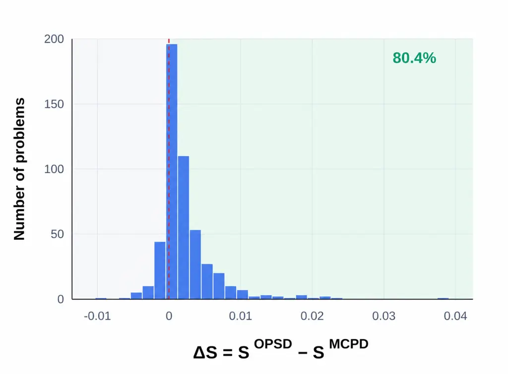
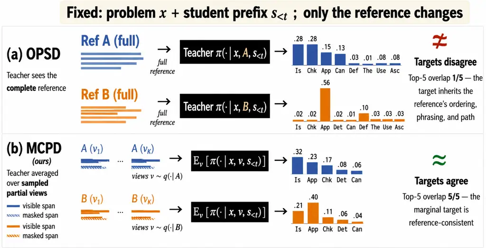

# One Teacher, Many Views: Reducing Reference Sensitivity in On-Policy Self-Distillation

Khouloud Saadi\corresponding    Di Wang

###### Abstract

On-policy self-distillation (OPSD) improves reasoning by training a
model on its own trajectories with dense token-level supervision from a
privileged copy conditioned on a reference solution. Existing methods
typically use a single teacher distribution conditioned on the complete
reference. We identify a limitation of this formulation: a reference is
only one realization of the reasoning process. Although it provides
evidence about the answer, it also encodes an ordering, phrasing, and
solution path. Full-reference conditioning can therefore produce correct
targets that depend excessively on information unavailable to the
student at inference. We show that replacing one valid reference with
another, while holding the problem and student state fixed, can
substantially alter the teacher distribution, a phenomenon we call
reference-induced target instability. To address this instability, we
introduce Monte Carlo Privileged Distillation (MCPD), which models
privileged context as a distribution over partial reference views and
distills the marginal teacher distribution. MCPD evaluates the teacher
under multiple views and averages the resulting next-token
distributions. We show that this probability-space average is the exact
target induced by minimizing the expected teacher-to-student KL
divergence over privileged views. Across mathematical and scientific
reasoning benchmarks, we show that MCPD produces more
reference-consistent supervision and consistently improves over
full-reference OPSD.

Department of Computer Science

King Abdullah University of Science and Technology

KAUST, Thuwal, Saudi Arabia

## Introduction





Figure 1: Reference-induced target instability. Left: Distribution of
the per-problem sensitivity reduction
$`\Delta S=S^{\mathrm{OPSD}}-S^{\mathrm{MCPD}}`$ (defined in Method)
over $`500`$ problems sampled from DeepMath-103K (He et al. 2026) using
Qwen3-8B. For each problem, we use two valid reference solutions,
generate one unprivileged student rollout, and evaluate both methods at
matched prefix positions along the same trajectory. MCPD averages
$`K=4`$ partial views of each reference; positive values indicate lower
reference sensitivity than OPSD. Right: Qualitative example with the
problem and student prefix fixed, showing that full-reference OPSD
produces more reference-dependent next-token targets, whereas MCPD
yields more consistent marginal targets.

Training strong reasoning models requires more than knowing whether the
final answer is correct; the model also needs feedback on the
intermediate reasoning states it actually visits during
generation (Agarwal et al. 2024; Song and Zheng 2026). Supervised
fine-tuning (Yu et al. 2024; Zelikman et al. 2022) provides dense
token-level guidance from reference solutions, but trains the model on
fixed expert trajectories rather than on its own reasoning paths (Guha
et al. 2026). Reinforcement learning (Guo et al. 2025; Yu et al. 2025)
instead trains on model-generated trajectories, but typically relies on
rewards assigned to complete solutions, providing limited guidance about
individual reasoning steps. On-policy distillation (Saadi and Wang 2026;
Agarwal et al. 2024; Gu et al. 2024) aims to combine these advantages by
supplying dense teacher feedback along trajectories generated by the
student itself.

On-Policy Self-Distillation (OPSD) (Zhao et al. 2026; Nguyen et al.
2026; Song and Zheng 2026) realizes this idea without requiring a
separate, stronger model. The student reasons from the problem and its
own generated prefix, whereas a stop-gradient teacher additionally
observes a verified reference solution. At each student state, the
teacher provides a full next-token distribution that is distilled into
the student. This construction combines on-policy state coverage, dense
supervision, and privileged reasoning information within a single model.
However, we uncover a surprising instability in OPSD: the teacher target
can change substantially even when the problem and student-generated
prefix are held fixed and both privileged references are fully correct.
This occurs because the teacher distribution depends not only on the
problem and student state, but also on the particular reference solution
supplied as privileged context (Zhao et al. 2026). A reference is only
one valid realization of the reasoning process, and alternative correct
solutions may differ in their decomposition, intermediate quantities,
notation, ordering, or reasoning path. Crucially, we find that slightly
changing one valid reference can induce significantly different
next-token distributions for exactly the same student state.
Consequently, two equivalent references may prescribe conflicting
learning updates, revealing that OPSD supervision can be highly
sensitive to incidental properties of the chosen solution. We term this
phenomenon _reference-induced target instability_.

Figure 1 illustrates both an example of this phenomenon and its
prevalence. In Figure 1 (Right), the problem and student prefix are
fixed and only the valid reference supplied to the teacher slightly
changes. Full-reference OPSD produces sharply different next-token
targets, with only one shared token among the two top-$`5`$ sets. In
contrast, our approach (MCPD) constructs a marginal target from sampled
partial views of each reference, producing complete top-$`5`$ overlap in
the illustrated state. Figure 1 (Left) shows that this is not an
isolated example: MCPD reduces reference sensitivity on $`80.4\%`$ of
the 500 evaluated problems. For this comparison, we use the same pair of
valid references for OPSD and MCPD and hold the student trajectory and
evaluated states fixed. OPSD compares the targets induced by the two
complete references, whereas MCPD separately constructs a marginal
target from partial views of each reference.

This matched protocol ensures that differences between OPSD and MCPD are
not confounded by the problem, student trajectory, evaluated positions,
or choice of reference pair.

Importantly, MCPD’s lower reference sensitivity is not explained by
target flattening. On $`270`$ problems from the same matched evaluation
set, MCPD produces lower full-vocabulary entropy than OPSD on $`75.6\%`$
of problems, while their mean entropy remains comparable ($`0.33`$ vs.
$`0.34`$). Analysis details are provided in Appendix.

Reference-induced instability arises because a reference serves two
roles simultaneously. It provides task-relevant evidence about how the
problem can be solved, but it also exposes the teacher to one particular
presentation of that solution. Conditioning on the complete reference
does not distinguish between these two sources of information. The
resulting target may therefore encode both useful guidance and
reference-specific properties of a particular derivation. Our goal is
not to remove privileged information or force all valid reasoning paths
to induce identical predictions. Rather, we seek a target that preserves
the guidance supplied by the reference while reducing dependence on any
single complete presentation of that guidance. This motivates the
following:

_Privileged supervision should reflect predictions that remain stable
across partial views of the reference._

We introduce Monte Carlo Privileged Distillation (MCPD) based on this
principle. Instead of treating the complete reference as a single
deterministic privileged context, we define a distribution over its
partial views. Each view reveals a different subset of the same solution
and induces a corresponding teacher distribution. We distill the
expectation of these distributions rather than the prediction produced
by one complete view. For a fixed student state $`s_{t}`$, reference
$`r`$, and random partial-view operator $`M`$, we define the marginal
privileged target as:

```math
q_{t}^{\star}(\cdot\mid r)=\mathbb{E}_{M}\left[q\left(\cdot\mid s_{t},M(r)\right)\right]. \tag{1}
```

This target has a direct optimization interpretation. Under the standard
teacher-to-student KL objective, matching $`q_{t}^{\star}`$ is exactly
equivalent, up to a student-independent constant, to minimizing the
expected distillation loss over randomly sampled privileged views.
Probability-space averaging is therefore not an auxiliary smoothing
heuristic; it is the exact target induced by expected-view distillation.
Predictions that vary when different parts of the reference are hidden
contribute differently across sampled views, whereas predictions
supported across views persist in the marginal target. In practice, we
approximate the expectation using a small Monte Carlo sample of
independently generated partial views. The central comparison is
therefore:

```math
\underbrace{q(\cdot\mid s_{t},r)}_{\text{one complete privileged view}}\quad\text{versus}\quad\underbrace{\mathbb{E}_{M}\left[q(\cdot\mid s_{t},M(r))\right]}_{\text{marginalized privileged target}}. \tag{2}
```

MCPD should not be interpreted as distillation from a single incomplete
reference. A single partial view remains an arbitrary realization and
may itself induce an unstable target. As shown in Figure 1, MCPD
addresses this issue by treating privileged context as a distribution
over partial views and distilling the resulting marginal target. Our
main contributions are as follows:

- •
  We identify _reference-induced target instability_ as a measurable
  limitation of privileged on-policy self-distillation.
- •
  We introduce MCPD, which replaces a single complete-reference target
  with a teacher distribution marginalized over partial privileged
  views, and derive this target directly from expected-view
  distillation.
- •
  Experiments and ablations on mathematical and scientific reasoning
  benchmarks show that MCPD produces more reference-consistent
  supervision and consistently improves over competitive baselines.

## Related Work

Knowledge Distillation. Knowledge distillation transfers capabilities
from a teacher model to a student through predictive distributions,
generated outputs, or intermediate representations (Schmidhuber 1992;
Hinton et al. 2015; Wang et al. 2025a). In language-model reasoning,
distillation has enabled smaller models to acquire stronger
reasoning (Karan and Du 2026; Guha et al. 2026; Ko et al. 2025; Xu et
al. 2026), instruction-following (Gu et al. 2024; Ko et al. 2024; Li et
al. 2023; Wang et al. 2025b), and problem-solving abilities (Hübotter et
al. 2026). Rather than supervising only final answers, recent methods
also transfer intermediate reasoning trajectories, allowing the student
to learn how a solution is derived (Wang et al. 2023; Li et al. 2024; Li
et al. 2023). However, most reasoning-distillation methods remain
off-policy: supervision is constructed from fixed reference solutions or
teacher-generated trajectories that are independent of the student’s own
reasoning process (Agarwal et al. 2024; Gu et al. 2024; Kim and Rush
2016). The student is therefore trained on expert reasoning prefixes
rather than the imperfect states it may encounter during its own
generation, creating a mismatch between training-time supervision and
inference-time trajectories (Song and Zheng 2026).

On-Policy Distillation. On-policy distillation addresses this mismatch
by providing teacher supervision along trajectories sampled from the
student policy (Agarwal et al. 2024; Gu et al. 2024; Ko et al. 2024; Jin
et al. 2026). The student first generates a reasoning rollout, after
which the teacher provides dense token-level feedback at the same
intermediate states. This combines the state coverage of on-policy
learning with the fine-grained supervision of knowledge distillation,
allowing the model to learn directly from the reasoning states it is
likely to visit at inference time.

Privileged On-Policy Self-Distillation. Recent work extends on-policy
distillation to self-distillation, where the same underlying model acts
as both student and teacher under different conditioning contexts (Wu et
al. 2026a; Wu et al. 2026b; Shenfeld et al. 2026; Zhao et al. 2026; Song
and Zheng 2026). Privileged self-distillation further equips the teacher
with information unavailable to the student, such as a verified
reference solution (Shenfeld et al. 2026; Zhao et al. 2026; Nguyen et
al. 2026; Ding 2026). In OPSD, the teacher observes the complete
reference and provides a next-token distribution along the
student-generated trajectory (Zhao et al. 2026). Although this produces
informative dense supervision, it implicitly treats the distribution
induced by a single complete reference as a reliable target. We instead
study how this target changes when the privileged reference changes. We
identify _reference-induced target instability_, whereby different valid
references can induce substantially different teacher distributions for
the same student state. MCPD addresses this issue by sampling partial
views of the privileged reference and distilling the marginal teacher
distribution obtained by averaging their predictions. Recent work has
also explored modifying the privileged context used in OPSD (Tan and
Hong 2026; Pan et al. 2026) but using a single privileged view. The work
most closely related to ours, using multi-views, is AVSD (Nguyen et al.
2026), which combines three fixed, heterogeneous privileged views: the
complete reference solution, a partial solution, and the final answer.
AVSD extracts a consensus component across these views while selectively
retaining view-specific residual information. However, this design does
not directly eliminate dependence on the particular reference
realization. Because the complete-reference prediction remains one of
the supervision sources, and reference-specific residuals may be
preserved, the resulting target can still inherit information tied to
the wording, ordering, or reasoning path of the given solution.
Empirically, MCPD achieves higher average accuracy than AVSD across all
backbones (Table 1).

## Method

### On-Policy Privileged Self-Distillation

Let $`\mathcal{D}=\{(x_{i},r_{i})\}_{i=1}^{N}`$ be a reasoning dataset,
where $`x_{i}`$ is a problem and $`r_{i}`$ is a verified reference
solution. Given a problem $`x`$, the student policy $`\pi_{\theta}`$
generates an on-policy reasoning trajectory,
$`y=(y_{1},\ldots,y_{T})\sim\pi_{\theta}(\cdot\mid x).`$ At token
position $`t`$, the student state is $`s_{t}=(x,y_{<t}),`$ with
next-token distribution
$`p_{\theta,t}(\cdot)=\pi_{\theta}(\cdot\mid s_{t}).`$

A privileged teacher evaluates the same student state while additionally
observing the reference solution. We denote the fixed, stop-gradient
teacher parameters by $`\bar{\theta}`$. The complete-reference teacher
distribution is:

```math
q_{t}^{\mathrm{full}}(\cdot\mid r)=\pi_{\bar{\theta}}\left(\cdot\mid x,r,y_{<t}\right). \tag{3}
```

Standard privileged on-policy self-distillation (Zhao et al. 2026)
minimizes:

```math
\mathcal{L}_{\mathrm{full}}=\mathbb{E}_{\begin{subarray}{c}(x,r)\sim\mathcal{D}\\
y\sim\pi_{\theta}(\cdot\mid x)\end{subarray}}\left[\frac{1}{T}\sum_{t=1}^{T}\mathrm{KL}\left(q^{\mathrm{full}}_{t}(\cdot\mid r)\,\|\,p_{\theta,t}\right)\right]. \tag{4}
```

This objective provides dense supervision along the student’s own
trajectory. However, the target at every state is determined by one
complete reference solution.

### Reference-Induced Target Instability

As illustrated in Figure 1, changing the valid reference alone can alter
the privileged teacher target. Consider a problem $`x`$, a fixed
student-generated trajectory $`y=(y_{1},\ldots,y_{T})`$, and two valid
reference solutions $`r^{a}`$ and $`r^{b}`$. Let
$`\mathcal{I}\subseteq\{1,\ldots,T\}`$ denote the matched rollout
positions at which reference sensitivity is evaluated. For both
references, we keep the problem, student trajectory, teacher parameters,
and evaluated positions fixed. The full-reference OPSD teacher
distributions at position $`t\in\mathcal{I}`$ are:

```math
q_{t}^{a,\mathrm{full}}=\pi_{\bar{\theta}}\left(\cdot\mid x,r^{a},y_{<t}\right),\qquad q_{t}^{b,\mathrm{full}}=\pi_{\bar{\theta}}\left(\cdot\mid x,r^{b},y_{<t}\right). \tag{5}
```

Because only the privileged reference differs, any discrepancy between
these distributions directly measures dependence on the choice of
reference. We quantify this discrepancy using the Jensen–Shannon (JS)
divergence, which provides a symmetric and bounded comparison between
probability distributions (Lin 1991; Nielsen 2019). Specifically, we
define the token-level reference sensitivity of OPSD as:

```math
S_{t}^{\mathrm{OPSD}}=\mathrm{JS}\left(q_{t}^{a,\mathrm{full}},q_{t}^{b,\mathrm{full}}\right), \tag{6}
```

where $`q_{t}^{a,\mathrm{full}}`$ and $`q_{t}^{b,\mathrm{full}}`$ denote
the teacher next-token distributions induced by two valid full
references $`r^{a}`$ and $`r^{b}`$, respectively, for the same problem
and student state. The JS divergence is defined as:

```math
\mathrm{JS}(p,q)=\frac{1}{2}D_{\mathrm{KL}}\left(p\,\|\,m\right)+\frac{1}{2}D_{\mathrm{KL}}\left(q\,\|\,m\right),\qquad m=\frac{p+q}{2}. \tag{7}
```

A value of zero indicates that the teacher target is invariant to the
choice of reference, whereas a larger value indicates greater
reference-induced variation in the supervision provided at the same
student state.

The corresponding trajectory-level sensitivity is:

```math
S^{\mathrm{OPSD}}=\frac{1}{|\mathcal{I}|}\sum_{t\in\mathcal{I}}S_{t}^{\mathrm{OPSD}}. \tag{8}
```

For MCPD, we independently sample $`K`$ partial views for each
reference:

```math
M_{j,1},\ldots,M_{j,K}\overset{\mathrm{i.i.d.}}{\sim}\mu_{\rho}(\cdot\mid r^{j}),\qquad j\in\{a,b\}. \tag{9}
```

Each view induces the teacher distribution:

```math
q_{t}^{j,(k)}=\pi_{\bar{\theta}}\left(\cdot\mid x,M_{j,k}(r^{j}),y_{<t}\right). \tag{10}
```

We construct a separate Monte Carlo marginal target for each reference:

```math
\widehat{q}_{K,t}^{\,j}=\frac{1}{K}\sum_{k=1}^{K}q_{t}^{j,(k)},\qquad j\in\{a,b\}. \tag{11}
```

The token-level and trajectory-level reference sensitivities of MCPD are
then:

```math
S_{t}^{\mathrm{MCPD}}=\operatorname{JS}\left(\widehat{q}_{K,t}^{\,a},\widehat{q}_{K,t}^{\,b}\right),\qquad S^{\mathrm{MCPD}}=\frac{1}{|\mathcal{I}|}\sum_{t\in\mathcal{I}}S_{t}^{\mathrm{MCPD}}. \tag{12}
```

Finally, for each problem, we measure the reduction in reference
sensitivity as $`\Delta S=S^{\mathrm{OPSD}}-S^{\mathrm{MCPD}}.`$ A
positive value of $`\Delta S`$ indicates that MCPD produces less
reference-dependent teacher targets than full-reference OPSD for the
same problem and student trajectory. Therefore, $`S^{\mathrm{OPSD}}`$
isolates variation induced by the choice of privileged reference. A
larger value indicates that two valid references prescribe more
different token-level supervision for the same student reasoning states.
We refer to this dependence as _reference-induced target instability_.
This metric does not assume that all valid reasoning paths should induce
identical predictions. Rather, it measures the extent to which the
supervision at fixed student states depends on the particular valid
reference supplied to the teacher. Implementation details are provided
in Appendix.

### Privileged Context as a Distribution

Rather than treating the complete reference as a single deterministic
privileged context, we define a distribution over its partial views. Let
$`M\sim\mu_{\rho}(\cdot\mid r)`$ denote a random view operator, where
$`\rho`$ controls the fraction of the reference that is hidden. A
sampled view $`M(r)`$ reveals only part of the reference while
preserving the ordering of the visible content.

For a fixed student state $`s_{t}`$, each view induces a teacher
predictive distribution:

```math
q_{t}^{M}(\cdot\mid r)=\pi_{\bar{\theta}}\left(\cdot\mid x,M(r),y_{<t}\right). \tag{13}
```

All views use the same underlying teacher and the same student state;
only the privileged conditioning context changes. Thus, MCPD uses one
teacher under multiple views. We define the marginal predictive target
as:

```math
q^{\star}_{t}(\cdot\mid r)=\mathbb{E}_{M\sim\mu_{\rho}(\cdot\mid r)}\left[q^{M}_{t}(\cdot\mid r)\right]. \tag{14}
```

The expectation is taken directly in probability space. Because every
$`q^{M}_{t}`$ is a categorical distribution, $`q^{\star}_{t}`$ is also a
valid categorical distribution. This construction marginalizes over
partial observations of the available reference.

### Expected-View Distillation

We show that the probability-space average in Eq. (14) is the exact
target induced by distillation over random partial views, rather than a
heuristic aggregation rule. For compactness, we suppress the explicit
conditioning on $`r`$ and write $`\mathbb{E}_{M}`$ for
$`\mathbb{E}_{M\sim\mu_{\rho}(\cdot\mid r)}`$. For a fixed student state
$`s_{t}`$ and reference $`r`$, consider:

```math
\mathcal{J}_{t}(p)=\mathbb{E}_{M}\left[\mathrm{KL}\left(q_{t}^{M}\,\|\,p\right)\right], \tag{15}
```

where $`p`$ is any categorical student distribution.

Proposition 1. Let $`q_{t}^{\star}`$ be defined as in Eq. (14). Then,

```math
\mathcal{J}_{t}(p)=\mathbb{E}_{M}\left[\mathrm{KL}\left(q_{t}^{M}\,\|\,q_{t}^{\star}\right)\right]+\mathrm{KL}\left(q_{t}^{\star}\,\|\,p\right). \tag{16}
```

Consequently,

```math
\operatorname{arg\,min}_{p}\,\mathcal{J}_{t}(p)=q_{t}^{\star}. \tag{17}
```

Proof. Expanding the expected KL divergence gives

```math
\displaystyle\mathcal{J}_{t}(p) \displaystyle=\mathbb{E}_{M}\left[\sum_{v\in\mathcal{V}}q_{t}^{M}(v)\log\frac{q_{t}^{M}(v)}{p(v)}\right]
```

```math
\displaystyle=\mathbb{E}_{M}\left[\sum_{v\in\mathcal{V}}q_{t}^{M}(v)\log\frac{q_{t}^{M}(v)}{q_{t}^{\star}(v)}\right]
```

```math
\displaystyle\quad+\sum_{v\in\mathcal{V}}q_{t}^{\star}(v)\log\frac{q_{t}^{\star}(v)}{p(v)}. \tag{18}
```

This yields Eq. (16). The first term is independent of $`p`$, while the
second is minimized when $`p=q_{t}^{\star}`$. $`\square`$

Thus, matching the view-marginalized target is equivalent, up to a
student-independent term, to minimizing the expected forward-KL loss
over random partial views. The first term in Eq. (16) captures
disagreement among the view-conditioned teacher predictions, whereas the
second measures the student’s divergence from their view-marginalized
target.

### Monte Carlo Approximation

Computing $`q^{\star}_{t}`$ exactly would require evaluating all
possible partial views. We approximate it using $`K`$ independently
sampled views:
$`M_{1},\ldots,M_{K}\overset{\mathrm{i.i.d.}}{\sim}\mu_{\rho}(\cdot\mid r).`$
The Monte Carlo target is:
$`\widehat{q}_{K,t}(\cdot\mid r)=\frac{1}{K}\sum_{k=1}^{K}q^{M_{k}}_{t}(\cdot\mid r).`$
For a fixed state and reference, this estimator is unbiased:

```math
\mathbb{E}\left[\widehat{q}_{K,t}(\cdot\mid r)\right]=q^{\star}_{t}(\cdot\mid r). \tag{19}
```

Its covariance satisfies:

```math
\mathrm{Cov}\left[\widehat{q}_{K,t}(\cdot\mid r)\right]=\frac{1}{K}\mathrm{Cov}\left[q^{M}_{t}(\cdot\mid r)\right]. \tag{20}
```

Thus, the variability caused by sampling a finite set of views decreases
proportionally to $`1/K`$. This guarantee concerns Monte Carlo
estimation for a fixed reference. It does not imply that:

```math
q^{\star}_{t}(\cdot\mid r^{a})=q^{\star}_{t}(\cdot\mid r^{b}) \tag{21}
```

for two distinct valid references. Reduced cross-reference sensitivity
is therefore an empirical property of MCPD, rather than a direct
theoretical consequence of the $`1/K`$ variance reduction.

### Monte Carlo Privileged Distillation

MCPD trains the student against the Monte Carlo marginal target:

```math
\mathcal{L}_{\mathrm{MCPD}}=\mathbb{E}_{\begin{subarray}{c}(x,r)\sim\mathcal{D}\\
y\sim\pi_{\theta}(\cdot\mid x)\\
M_{1:K}\sim\mu_{\rho}(\cdot\mid r)\end{subarray}}\left[\frac{1}{T}\sum_{t=1}^{T}\mathrm{KL}\left(\operatorname{sg}\left[\widehat{q}_{K,t}(\cdot\mid r)\right]\,\|\,p_{\theta,t}\right)\right]. \tag{22}
```

For each training example, the procedure consists of four steps. First,
the student generates one on-policy trajectory from the problem alone.
Second, we sample $`K`$ independent partial views of the same reference.
Third, the teacher evaluates the same student states under every
privileged view. Finally, the resulting next-token distributions are
averaged at each position, and the student is updated toward the
marginal target. All teacher evaluations share the same problem and
student-generated prefix. Consequently, variation among the teacher
distributions arises only from changes in privileged context, rather
than from different student trajectories.

In our implementation, each partial view is generated as

```math
M_{k}(r)=\operatorname{Mask}(r;\rho,\xi_{k}), \tag{23}
```

where $`\xi_{k}`$ denotes an independently sampled masking pattern. Each
view hides a fraction $`\rho`$ of the reference while preserving the
order of the visible content. The complete reference, partial views, and
masking patterns are used only by the stop-gradient teacher and are
never observed by the student. The complete algorithm is provided in
Appendix. MCPD requires one student rollout and $`K`$ teacher
evaluations per training example. Since all views share the same student
states, the teacher evaluations can be batched across views. Increasing
$`K`$ therefore trades additional teacher-side computation for a
lower-variance approximation of the marginal predictive target. In
practice, with $`K=4`$, MCPD requires only modest additional wall-clock
time: on deepseek-ai/DeepSeek-R1-Distill-Qwen-7B, it trains in 1h 36m,
only 10 minutes longer than OPSD and slightly faster than AVSD under the
same 100-step training budget. Under its 500-step, 8-rollout
configuration, GRPO requires 12h 30m. Full computational-cost results
are provided in Appendix Table 2.

## Experiments

### Mathematical Reasoning

|                             |        |        |        |      |
| --------------------------- | ------ | ------ | ------ | ---- |
| Method                      | AIME24 | AIME25 | HMMT25 | AVG  |
| Qwen3-14B                   |        |        |        |      |
|    Base (Instruct)          | 80.8   | 68.9   | 50.0   | 66.6 |
|    + SFT                    | 79.7   | 73.9   | 49.7   | 67.7 |
|    + GRPO                   | 81.9   | 73.6   | 53.0   | 69.5 |
|    + OPSD                   | 81.1   | 73.9   | 52.2   | 69.1 |
|    + AVSD                   | 80.6   | 73.6   | 50.6   | 68.3 |
|    + MCPD (ours)            | 82.2   | 75.0   | 51.7   | 69.6 |
| Qwen3-8B                    |        |        |        |      |
|    Base (Instruct)          | 75.8   | 65.6   | 43.9   | 61.8 |
|    + SFT                    | 72.3   | 64.2   | 42.9   | 59.8 |
|    + GRPO                   | 76.4   | 68.9   | 46.7   | 64.0 |
|    + OPSD                   | 77.8   | 70.8   | 45.8   | 64.8 |
|    + AVSD                   | 77.5   | 69.4   | 45.3   | 64.1 |
|    + MCPD (ours)            | 78.9   | 72.8   | 46.7   | 66.1 |
| Qwen3-4B                    |        |        |        |      |
|    Base (Instruct)          | 74.9   | 66.4   | 42.2   | 61.2 |
|    + SFT                    | 70.2   | 62.3   | 43.4   | 58.6 |
|    + GRPO                   | 75.6   | 68.1   | 44.4   | 62.7 |
|    + OPSD                   | 76.4   | 68.3   | 46.1   | 63.6 |
|    + AVSD                   | 74.4   | 65.0   | 47.2   | 62.2 |
|    + MCPD (ours)            | 75.6   | 70.6   | 48.1   | 64.8 |
| DeepSeek-R1-Distill-Qwen-7B |        |        |        |      |
|    + SFT                    | 54.2   | 38.6   | 23.9   | 38.9 |
|    + OPSD                   | 54.4   | 41.7   | 24.1   | 40.1 |
|    + AVSD                   | 54.2   | 40.3   | 25.0   | 39.8 |
|    + MCPD (ours)            | 55.0   | 43.1   | 25.6   | 41.2 |

Table 1: Avg@12 accuracy on math benchmarks across four backbones. Best
results are in bold. AVG refers to average.

#### Models and data.

We follow the mathematical-reasoning setup of OPSD (Zhao et al. 2026).
We experiment with three instruction-tuned Qwen3 backbones (Yang et al.
2025): Qwen3-4B, Qwen3-8B, and Qwen3-14B, as well as
DeepSeek-R1-Distill-Qwen-7B (Guo et al. 2025). All post-training methods
use the exact 17K-example mathematical-reasoning subset of OpenThoughts
used by OPSD (Zhao et al. 2026; Guha et al. 2026), containing problems
paired with expert reference solutions. We report our main results on
three competition-level benchmarks: AIME 2024 and AIME 2025 (MAA 2025),
and HMMT 2025 (Balunovic et al. 2025). AMO-Bench (Liu et al. 2026) is
additionally used in the masking-ratio and number-of-views ablations.
Full implementation details are provided in Appendix.

#### Baselines.

We compare MCPD with the original instruction-tuned models and four
post-training baselines: SFT (Wei et al. 2022; Longpre et al. 2023),
GRPO (Shao et al. 2024), OPSD (Zhao et al. 2026), and AVSD (Nguyen et
al. 2026), which conditions the teacher on three privileged views, the
complete solution, a partial solution, and the final answer, and
combines their predictions using its proposed gating mechanism; we use a
partial-solution ratio of $`0.5`$ as in Nguyen et al. (2026). Our
method, MCPD, constructs $`K=4`$ partial views of the reference solution
for each training example. For each view, we randomly mask a fixed
fraction of the token positions within the reference-solution span. The
masking pattern is sampled independently for each view and resampled in
every training batch. We mask $`30\%`$ of the reference tokens for the
Qwen3 models and $`40\%`$ for DeepSeek-R1-Distill-Qwen-7B. The same
frozen teacher evaluates the student states under all views, and the
resulting next-token distributions are averaged in probability space to
form the Monte Carlo marginal target. The evaluation setup is detailed
in Appendix.

#### Results.

Table 1 shows that our MCPD achieves the highest average accuracy among
all competing methods for each of the four backbones. The gains are
particularly strong on AIME25: compared with OPSD, MCPD improves
accuracy by $`2.0`$ percentage points on Qwen3-8B and by $`2.3`$ points
on Qwen3-4B. Compared with AVSD, the improvement reaches $`5.6`$ points
on AIME25 with Qwen3-4B. MCPD also surpasses GRPO in average accuracy
across all Qwen3 models. Overall, these results demonstrate that MCPD
improves downstream reasoning performance.

### Science Reasoning

#### Models and data.

We evaluate our method on the SciKnowEval L3 multiple-choice scientific
reasoning benchmark (Feng et al. 2024), covering biology, chemistry,
physics, and materials science. We use the same per-domain SciKnowEval
splits as in Hübotter et al. (2026), comprising $`3{,}868`$ training
examples and $`429`$ held-out test examples. The training set contains
$`450`$ biology, $`1{,}890`$ chemistry, $`687`$ physics, and $`841`$
materials-science examples. All experiments use Qwen3-8B as the backbone
and follow the matched OPSD training configuration of Zhao et al.
(2026), with a maximum student completion length of $`2048`$ tokens. For
MCPD, we use $`K=4`$ independently sampled partial reference views with
a masking ratio of $`\rho=10\%`$. The evaluation setup is detailed in
the Appendix.

#### Results.

Table 2 shows that MCPD achieves the highest overall accuracy on
SciKnowEval, outperforming both OPSD and AVSD on average. Compared with
OPSD, MCPD improves the average score from $`49.7`$ to $`50.9`$, a gain
of $`1.2`$ percentage points, with particularly strong improvements of
$`2.4`$ points in Biology and $`1.8`$ points in Physics. Relative to
AVSD, MCPD achieves a $`3.0`$-point gain in Physics.

| Method    | Chem | Physics | Biology | Materials | AVG  |
| --------- | ---- | ------- | ------- | --------- | ---- |
| Qwen3-8B  | 41.2 | 59.2    | 30.8    | 58.9      | 47.5 |
|    + OPSD | 44.1 | 60.4    | 35.6    | 58.6      | 49.7 |
|    + AVSD | 44.3 | 59.2    | 37.2    | 60.6      | 50.3 |
|    + MCPD | 44.3 | 62.2    | 38.0    | 59.0      | 50.9 |

Table 2: Avg@16 across scientific reasoning tasks using Qwen3-8B. Best
results are in bold. AVG refers to average.

#### Out-of-Domain Science Reasoning

We further examine whether the reasoning capabilities acquired through
mathematical training transfer to an unseen domain. Specifically, we
evaluate the Qwen3-8B models trained on mathematical reasoning with
OPSD, AVSD, and MCPD on the held-out SciKnowEval L3 test sets, following
the evaluation protocol in the experiment above. As shown in Table 3,
MCPD achieves the highest average score. It obtains the strongest
performance in Chemistry, Physics, and Materials, while matching AVSD in
Biology. Consequently, MCPD improves in-domain mathematical-reasoning
performance and transfers effectively to out-of-domain scientific
reasoning.

| Method | Chem | Physics | Biology | Materials | AVG  |
| ------ | ---- | ------- | ------- | --------- | ---- |
| OPSD   | 41.2 | 59.7    | 31.1    | 58.7      | 47.7 |
| AVSD   | 41.7 | 59.2    | 32.9    | 59.4      | 48.3 |
| MCPD   | 42.4 | 60.5    | 32.9    | 60.3      | 49.0 |

Table 3: Avg@16 comparison of math-trained Qwen3-8B models with OPSD,
AVSD, and our MCPD, on SciKnowEval scientific-reasoning domains. AVG
refers to average.

### Ablation Studies

#### Different masking ratios.

Figure 2 examines the sensitivity of MCPD to the masking ratio across
two model families. The number of views is fixed to $`K=4`$. On
Qwen3-14B, all evaluated masking configurations improve the average
score over OPSD, increasing it from $`55.9`$ to $`56.8`$–$`57.0`$. We
observe similar robustness on DeepSeek-R1-Distill-Qwen-7B (Figure 3).
All evaluated masking ratios achieve higher average accuracy than both
OPSD and AVSD. Across all masking ratios, MCPD obtains average scores
between $`40.9`$ and $`41.5`$, compared with $`40.1`$ for OPSD and
$`39.8`$ for AVSD.

Figure 2: Effect of reference-solution masking on Qwen3-14B. Left:
Performance changes relative to OPSD across individual benchmarks.
Right: Average performance for OPSD and each masking configuration
across AIME24, AIME25, HMMT25, and AMO-Bench. Mix denotes mixed masking
ratios of $`0\%`$, $`5\%`$, $`10\%`$, and $`30\%`$.

Figure 3: MCPD with different masking ratios on
DeepSeek-R1-Distill-Qwen-7B, with the number of views fixed at $`K=4`$.
Full results are provided in the Appendix.

#### Different numbers of views.

We study the effect of the number of sampled privileged views, $`K`$, on
Qwen3-14B (Figure 4) and DeepSeek-R1-Distill-Qwen-7B (Figure 5). Across
the evaluated values of $`K`$, MCPD exceeds OPSD and remains stronger
than AVSD, demonstrating robustness to the number of sampled views. The
DeepSeek ablation further highlights the importance of aggregating
multiple views: using a single randomly masked view achieves an average
performance of $`40.3`$, whereas averaging $`K=4`$ views increases it to
$`41.2`$. This gap shows that one partial view can produce an unreliable
target that depends on a particular masking realization. Monte Carlo
averaging instead integrates predictions across several partial views,
yielding a more reliable distillation target.

Figure 4: Effect of the number of views. Left: Performance changes
relative to OPSD on three benchmarks. Right: Average performance across
AIME24, AIME25, HMMT25, and AMO-Bench. The masking ratio is fixed at
$`\rho=30\%`$.

Figure 5: MCPD with different numbers of views on
DeepSeek-R1-Distill-Qwen-7B with the masking ratio fixed at
$`\rho=40\%`$. Full results table in Appendix.

#### Sampled-token distillation.

We evaluate whether MCPD remains effective when distillation is
restricted to the sampled student token rather than the full vocabulary.
Table 4 shows that MCPD achieves the strongest overall performance,
improving over OPSD by $`4.6`$ percentage points on AIME25 and $`9.4`$
points on HMMT25. Compared with AVSD, MCPD matches its AIME25 accuracy
while improving HMMT25 by $`3.4`$ points. These results indicate that
MCPD remains effective under sampled-token supervision.

| Method                             | AIME25 | HMMT25 |
| ---------------------------------- | ------ | ------ |
| OPSD w/ Sampled-token distillation | 82.1   | 57.3   |
| AVSD w/ Sampled-token distillation | 86.7   | 63.3   |
| MCPD w/ Sampled-token distillation | 86.7   | 66.7   |

Table 4: Sampled-token distillation results on Qwen3-4B with a maximum
student completion length of 2,048 tokens. We report $`\mathrm{Pass@8}`$
accuracy on AIME25 and HMMT25 as in Zhao et al. (2026).

## Conclusion

In this work, we identified reference-induced target instability as an
important limitation of privileged OPSD: even when the problem and
student state are fixed, replacing one valid reference solution with
another can induce substantially different teacher targets. To address
this issue, we introduced Monte Carlo Privileged Distillation (MCPD),
which treats privileged context as a distribution over partial reference
views and distills the resulting marginal teacher distribution. We
showed that averaging the view-conditioned predictions in probability
space is the exact target induced by minimizing the expected
teacher-to-student forward-KL objective over privileged views.
Empirically, MCPD produces more reference-consistent supervision and
achieves the strongest average performance across four
mathematical-reasoning backbones, while also improving scientific
reasoning and out-of-domain transfer from mathematics to science.
Ablations further show that the method is robust across masking ratios,
benefits from multiple partial views, and remains effective under
sampled-token distillation. Therefore, privileged supervision should not
be tied to a single complete realization of a solution. Marginalizing
over partial views provides a simple and effective way to preserve
useful reference information while reducing sensitivity to
reference-specific artifacts and reasoning paths. Future work includes
extending our approach MCPD beyond mathematical and scientific
reasoning, e.g., multi-modal reasoning settings.

## References

- Agarwal et al. (2024) R. Agarwal, N. Vieillard, Y. Zhou, P.
  Stanczyk, S. R. Garea, M. Geist, and O. Bachem On-policy distillation
  of language models: learning from self-generated mistakes. In The
  twelfth international conference on learning representations, Cited
  by: Introduction, Related Work, Related Work.
- Balunovic et al. (2025) M. Balunovic, J. Dekoninck, I. Petrov, N.
  Jovanović, and M. Vechev MathArena: evaluating LLMs on uncontaminated
  math competitions. Advances in Neural Information Processing Systems 38. Cited by: Models and data..
- Ding (2026) K. Ding Hdpo: hybrid distillation policy optimization via
  privileged self-distillation. arXiv preprint arXiv:2603.23871. Cited
  by: Related Work.
- Feng et al. (2024) K. Feng, X. Shen, W. Wang, X. Zhuang, Y. Tang, Q.
  Zhang, and K. Ding Sciknoweval: evaluating multi-level scientific
  knowledge of large language models. arXiv preprint arXiv:2406.09098.
  Cited by: Appendix D, Models and data..
- Gu et al. (2024) Y. Gu, L. Dong, F. Wei, and M. Huang MiniLLM:
  knowledge distillation of large language models. In International
  Conference on Learning Representations, Cited by: Introduction,
  Related Work, Related Work.
- Guha et al. (2026) E. Guha, R. Marten, S. Keh, N. Raoof, G.
  Smyrnis, H. Bansal, M. Nezhurina, J. Mercat, T. Vu, Z. Sprague, et al.
  Openthoughts: data recipes for reasoning models. ICLR. Cited by:
  Introduction, Related Work, Models and data..
- Guo et al. (2025) D. Guo, D. Yang, H. Zhang, J. Song, P. Wang, Q.
  Zhu, R. Xu, R. Zhang, S. Ma, X. Bi, et al. Deepseek-r1: incentivizing
  reasoning capability in llms via reinforcement learning. arXiv
  preprint arXiv:2501.12948. Cited by: Introduction, Models and data..
- He et al. (2026) Z. He, T. Liang, J. Xu, Q. Liu, X. Chen, Y. Wang, L.
  Song, D. Yu, Z. Liang, W. Wang, Z. Zhang, R. Wang, Z. Tu, H. Mi,
  and D. Yu DeepMath-103K: a large-scale, challenging, decontaminated,
  and verifiable mathematical dataset for advancing reasoning. In The
  Fourteenth International Conference on Learning Representations,
  External Links: [Link](https://openreview.net/forum?id=kHB5Te5IWm)
  Cited by: Appendix B, Figure 1.
- Hinton et al. (2015) G. Hinton, O. Vinyals, and J. Dean Distilling the
  knowledge in a neural network. arXiv preprint arXiv:1503.02531. Cited
  by: Related Work.
- Hu et al. (2022) E. J. Hu, Y. Shen, P. Wallis, Z. Allen-Zhu, Y. Li, S.
  Wang, L. Wang, and W. Chen LoRA: low-rank adaptation of large language
  models. In International Conference on Learning Representations, Cited
  by: Appendix D.
- Hübotter et al. (2026) J. Hübotter, F. Lübeck, L. Behric, A.
  Baumann, M. Bagatella, D. Marta, I. Hakimi, I. Shenfeld, T. K.
  Buening, C. Guestrin, et al. Reinforcement learning via
  self-distillation. ICML. Cited by: Appendix D, Appendix D, Related
  Work, Models and data..
- Jin et al. (2026) W. Jin, T. Min, Y. Yang, D. Wei, Y. Zhou, S. R.
  Kadhe, N. Baracaldo, and K. Lee Entropy-aware on-policy distillation
  of language models. In Forty-third International Conference on Machine
  Learning, Cited by: Related Work.
- Karan and Du (2026) A. Karan and Y. Du Reasoning with sampling: your
  base model is smarter than you think. In International Conference on
  Learning Representations, Cited by: Related Work.
- Kim and Rush (2016) Y. Kim and A. M. Rush Sequence-level knowledge
  distillation. In Proceedings of the 2016 Conference on Empirical
  Methods in Natural Language Processing, J. Su, K. Duh, and X. Carreras
  (Eds.), Austin, Texas, pp. 1317–1327. External Links:
  [Link](https://aclanthology.org/D16-1139/),
  [Document](https://dx.doi.org/10.18653/v1/D16-1139) Cited by: Related
  Work.
- Ko et al. (2025) J. Ko, T. Chen, S. Kim, T. Ding, L. Liang, I.
  Zharkov, and S. Yun DistiLLM-2: a contrastive approach boosts the
  distillation of llms. In International Conference on Machine Learning,
  pp. 31044–31062. Cited by: Related Work.
- Ko et al. (2024) J. Ko, S. Kim, T. Chen, et al. DistiLLM: towards
  streamlined distillation for large language models. In The Forty-first
  International Conference on Machine Learning, Cited by: Related Work,
  Related Work.
- Li et al. (2023) L. H. Li, J. Hessel, Y. Yu, X. Ren, K. Chang, and Y.
  Choi Symbolic chain-of-thought distillation: small models can also
  “think” step-by-step. In Proceedings of the 61st Annual Meeting of the
  Association for Computational Linguistics (Volume 1: Long Papers), A.
  Rogers, J. Boyd-Graber, and N. Okazaki (Eds.), Toronto, Canada,
  pp. 2665–2679. External Links:
  [Link](https://aclanthology.org/2023.acl-long.150/),
  [Document](https://dx.doi.org/10.18653/v1/2023.acl-long.150) Cited by:
  Related Work.
- Li et al. (2024) X. Li, S. He, J. Wu, Z. Yang, Y. Xu, Y. j. Jun, H.
  Liu, K. Liu, and J. Zhao MoDE-CoTD: chain-of-thought distillation for
  complex reasoning tasks with mixture of decoupled LoRA-experts. In
  Proceedings of the 2024 Joint International Conference on
  Computational Linguistics, Language Resources and Evaluation
  (LREC-COLING 2024), N. Calzolari, M. Kan, V. Hoste, A. Lenci, S.
  Sakti, and N. Xue (Eds.), Torino, Italia, pp. 11475–11485. External
  Links: [Link](https://aclanthology.org/2024.lrec-main.1003/) Cited by:
  Related Work.
- Lin (1991) J. Lin Divergence measures based on the shannon entropy.
  IEEE Transactions on Information theory 37 (1), pp. 145–151. Cited by:
  Appendix B, Reference-Induced Target Instability.
- Liu et al. (2026) J. Liu, S. An, S. Zhou, D. Ma, Y. Lin, X. Lv, X.
  Wang, X. Li, Z. Wang, X. Cao, et al. Amo-bench: large language models
  still struggle in high school math competitions. In Findings of the
  Association for Computational Linguistics: ACL 2026, pp. 2120–2137.
  Cited by: Models and data..
- Longpre et al. (2023) S. Longpre, L. Hou, T. Vu, A. Webson, H. W.
  Chung, Y. Tay, D. Zhou, Q. V. Le, B. Zoph, J. Wei, et al. The flan
  collection: designing data and methods for effective instruction
  tuning. In International conference on machine learning,
  pp. 22631–22648. Cited by: Baselines..
- MAA (2025) MAA American invitational mathematics examination (aime).
  Note: Mathematical Association of AmericaAIME exam materials Cited by:
  Models and data..
- Nguyen et al. (2026) D. Nguyen, H. Xiao, A. Prasad, Z. Khan, A.
  Das, A. Zhang, S. Sahu, H. Lee, E. Stengel-Eskin, and M. Bansal AVSD:
  adaptive-view self-distillation by balancing consensus and
  teacher-specific privileged signals. arXiv preprint arXiv:2605.20643.
  Cited by: Appendix D, Introduction, Related Work, Baselines..
- Nielsen (2019) F. Nielsen On a generalization of the jensen-shannon
  divergence. arXiv preprint arXiv:1912.00610. Cited by:
  Reference-Induced Target Instability.
- Pan et al. (2026) L. Pan, S. Tao, Y. Zhai, L. Zhang, Z. Liu, B.
  Ding, A. Liu, and L. Wen RLCSD: reinforcement learning with
  contrastive on-policy self-distillation. arXiv preprint
  arXiv:2606.11709. Cited by: Related Work.
- Saadi and Wang (2026) K. Saadi and D. Wang Validity-calibrated
  reasoning distillation. arXiv preprint arXiv:2605.04078. Cited by:
  Introduction.
- Schmidhuber (1992) J. Schmidhuber Learning complex, extended sequences
  using the principle of history compression. Neural computation 4 (2),
  pp. 234–242. Cited by: Related Work.
- Shao et al. (2024) Z. Shao, P. Wang, Q. Zhu, R. Xu, J. Song, X. Bi, H.
  Zhang, M. Zhang, Y. Li, Y. Wu, et al. Deepseekmath: pushing the limits
  of mathematical reasoning in open language models. arXiv preprint
  arXiv:2402.03300. Cited by: Baselines..
- Shenfeld et al. (2026) I. Shenfeld, M. Damani, J. Hübotter, and P.
  Agrawal Self-distillation enables continual learning. ICML. Cited by:
  Related Work.
- Song and Zheng (2026) M. Song and M. Zheng A survey of on-policy
  distillation for large language models. arXiv preprint
  arXiv:2604.00626. Cited by: Introduction, Introduction, Related Work,
  Related Work.
- Tan and Hong (2026) Z. Tan and Y. Hong PAINT: partial-solution
  adaptive interpolated training for self-distilled reasoners. arXiv
  preprint arXiv:2604.26573. Cited by: Related Work.
- Wang et al. (2025a) G. Wang, Z. Yang, Z. Wang, S. Wang, Q. Xu, and Q.
  Huang ABKD: pursuing a proper allocation of the probability mass in
  knowledge distillation via $`\alpha`$–$`\beta`$-divergence. In
  Forty-second International Conference on Machine Learning, Cited by:
  Related Work.
- Wang et al. (2025b) L. Wang, L. Wu, S. Song, Y. Wang, C. Gao, and K.
  Wang Distilling structured rationale from large language models to
  small language models for abstractive summarization. In Proceedings of
  the AAAI Conference on Artificial Intelligence, Vol. 39,
  pp. 25389–25397. Cited by: Related Work.
- Wang et al. (2023) X. Wang, J. Wei, D. Schuurmans, Q. V. Le, E. H.
  Chi, S. Narang, A. Chowdhery, and D. Zhou Self-consistency improves
  chain of thought reasoning in language models. In The Eleventh
  International Conference on Learning Representations, Cited by:
  Related Work.
- Wei et al. (2022) J. Wei, M. Bosma, V. Zhao, K. Guu, A. W. Yu, B.
  Lester, N. Du, A. M. Dai, and Q. V. Le Finetuned language models are
  zero-shot learners. In International Conference on Learning
  Representations, Cited by: Baselines..
- Wu et al. (2026a) R. Wu, X. Wang, J. Mei, P. Cai, D. Fu, C. Yang, L.
  Wen, X. Yang, Y. Shen, Y. Wang, et al. From interactions to
  principles: experience-driven self-distillation for evolving llm
  agents. In Forty-third International Conference on Machine Learning,
  Cited by: Related Work.
- Wu et al. (2026b) T. Wu, Y. Liu, J. Bai, Z. Jia, S. Zhang, Z. Lin, Y.
  Wang, S. Zhu, and Z. Zheng Native parallel reasoner: reasoning in
  parallelism via self-distilled reinforcement learning. ICML. Cited by:
  Related Work.
- Xu et al. (2026) S. Xu, L. Pang, Y. Zhu, J. Gu, Z. Wei, J. Deng, F.
  Pan, H. Shen, and X. Cheng Rlkd: distilling llms’ reasoning via
  reinforcement learning. In Proceedings of the AAAI Conference on
  Artificial Intelligence, Vol. 40, pp. 34151–34159. Cited by: Related
  Work.
- Yang et al. (2025) A. Yang, A. Li, B. Yang, B. Zhang, B. Hui, B.
  Zheng, B. Yu, C. Gao, C. Huang, C. Lv, et al. Qwen3 technical report.
  arXiv preprint arXiv:2505.09388. Cited by: Appendix B, Models and
  data..
- Yu et al. (2024) L. Yu, W. Jiang, H. Shi, J. YU, Z. Liu, Y. Zhang, J.
  Kwok, Z. Li, A. Weller, and W. Liu MetaMath: bootstrap your own
  mathematical questions for large language models. In The Twelfth
  International Conference on Learning Representations, Cited by:
  Introduction.
- Yu et al. (2025) Q. Yu, Z. Zhang, R. Zhu, Y. Yuan, X. Zuo, Y. Yue, W.
  Dai, T. Fan, G. Liu, L. Liu, et al. DAPO: an open-source LLM
  reinforcement learning system at scale. Advances in Neural Information
  Processing Systems 38, pp. 113222–113244. Cited by: Introduction.
- Zelikman et al. (2022) E. Zelikman, Y. Wu, J. Mu, and N. Goodman Star:
  bootstrapping reasoning with reasoning. Advances in Neural Information
  Processing Systems 35, pp. 15476–15488. Cited by: Introduction.
- Zhao et al. (2026) S. Zhao, Z. Xie, M. Liu, J. Huang, G. Pang, F.
  Chen, and A. Grover Self-distilled reasoner: on-policy
  self-distillation for large language models. ICML 2026. Cited by:
  Appendix D, Appendix D, Appendix D, Appendix D, Introduction, Related
  Work, On-Policy Privileged Self-Distillation, Models and data.,
  Baselines., Models and data., Table 4.

## Appendix A Target Entropy Analysis

We examine whether MCPD’s lower reference sensitivity can be explained
by producing more diffuse teacher targets. We use 270 problems, together
with the same reference pairs, student trajectories, and matched token
positions used in the reference-sensitivity analysis.

For method $`m\in\{\mathrm{OPSD},\mathrm{MCPD}\}`$, reference
$`j\in\{a,b\}`$, and matched position $`t\in\mathcal{I}_{i}`$, let
$`q_{i,t}^{m,j}`$ denote the corresponding full-vocabulary target
distribution. For OPSD, this is the teacher distribution conditioned on
the complete reference. For MCPD, it is the probability-space average of
the $`K=4`$ view-conditioned teacher distributions. We compute the
Shannon entropy of each target as:

```math
H\!\left(q_{i,t}^{m,j}\right)=-\sum_{v\in\mathcal{V}}q_{i,t}^{m,j}(v)\log q_{i,t}^{m,j}(v), \tag{24}
```

where $`\mathcal{V}`$ is the model vocabulary. We use the natural
logarithm, so entropy is measured in nats.

For each problem $`i`$, we average the entropy across both references
and all matched student states:

```math
H_{i}^{m}=\frac{1}{2|\mathcal{I}_{i}|}\sum_{j\in\{a,b\}}\sum_{t\in\mathcal{I}_{i}}H\!\left(q_{i,t}^{m,j}\right). \tag{25}
```

We report the mean problem-level entropy and the paired rate, defined as
the percentage of problems for which
$`H_{i}^{\mathrm{MCPD}}<H_{i}^{\mathrm{OPSD}}`$. As shown in Table 5,
MCPD has comparable, and slightly lower, mean entropy than OPSD and
produces lower entropy on $`75.6\%`$ of the evaluated problems. Thus,
MCPD’s reduction in reference sensitivity is not explained by flattening
the target distribution.

| Method | Mean entropy | Paired rate |
| ------ | ------------ | ----------- |
| OPSD   | 0.34         | –           |
| MCPD   | 0.33         | 75.6%       |

Table 5: Full-vocabulary target entropy at the matched student states
used for reference-sensitivity evaluation. The paired rate is the
percentage of problems on which MCPD produces lower problem-level
entropy than OPSD.

## Appendix B Reference-Sensitivity Implementation Details

We evaluate reference sensitivity on 500 problems sampled from the
training split of DeepMath-103K (He et al. 2026) using seed 42 and
Qwen3-8B (Yang et al. 2025). The same underlying checkpoint is used to
generate the unprivileged student rollout and as the frozen privileged
teacher. DeepMath-103K provides three verified reference solutions in
the fields r1*solution_1, r1_solution_2, and r1_solution_3. For each
selected problem $`x*{i}`$, we use the first two verified solutions,
denoted $`r*{i}^{a}`$ and $`r*{i}^{b}`$.

For each problem, we first generate one unprivileged student rollout
$`y_{i}`$ from the problem alone using the Qwen chat template with
enable*thinking=False. Rollouts are sampled with temperature $`0.6`$,
top-$`p=0.95`$, and a maximum of 1,024 new tokens. The resulting rollout
is then held fixed and reused for both references and for both OPSD and
MCPD. We evaluate teacher distributions at 20 normalized prefix
positions uniformly spaced between 10% and 90% of the rollout length.
These positions form the matched evaluation set $`\mathcal{I}*{i}`$.

For all target evaluations, the frozen teacher uses the Qwen chat
template with enable*thinking=True. This configuration is used for both
OPSD and MCPD. The teacher does not generate a separate trajectory; it
only returns next-token distributions at matched prefixes of the fixed
student rollout. For OPSD, the teacher conditions on the complete
reference solution. For reference $`j\in\{a,b\}`$ and position
$`t\in\mathcal{I}*{i}`$, the full-reference teacher distribution is:

```math
q_{i,t}^{j,\mathrm{full}}=\pi_{\bar{\theta}}\left(\cdot\mid x_{i},r_{i}^{j},y_{i,<t}\right), \tag{26}
```

where $`\bar{\theta}`$ denotes the frozen initial checkpoint.

For MCPD, we independently sample $`K=4`$ partial views of each
reference by masking 30% of its reference-token positions. The masking
pattern is sampled independently for each view, and the ordering of the
unmasked tokens is preserved. Let $`M_{s,k}`$ denote the $`k`$-th
masking operator in mask bank $`s`$. The resulting Monte Carlo marginal
target is:

```math
\widehat{q}_{i,t,s}^{j}=\frac{1}{K}\sum_{k=1}^{K}\pi_{\bar{\theta}}\left(\cdot\mid x_{i},M_{s,k}(r_{i}^{j}),y_{i,<t}\right),\qquad K=4. \tag{27}
```

To reduce Monte Carlo noise in the sensitivity estimate, we repeat the
masking procedure using five reproducible mask banks generated with
seeds:

```math
\mathcal{S}=\{42,43,44,45,46\}.
```

For each mask bank, we first average the four view-conditioned teacher
distributions in probability space and then compute the reference
sensitivity between the two resulting marginal targets.

#### Reference-sensitivity metric.

We measure the discrepancy between the teacher distributions induced by
two valid references using the Jensen–Shannon (JS) divergence (Lin
1991). For two categorical distributions $`p`$ and $`q`$, let
$`m=\frac{1}{2}(p+q)`$. The JS divergence is defined as:

```math
\operatorname{JS}(p,q)=\frac{1}{2}D_{\mathrm{KL}}(p\|m)+\frac{1}{2}D_{\mathrm{KL}}(q\|m). \tag{28}
```

We use JS divergence because it is symmetric and bounded, and therefore
does not privilege either reference as the comparison direction. It also
remains finite when the two distributions assign probability mass to
different vocabulary tokens.

Using the natural logarithm, its range is:

```math
0\leq\operatorname{JS}(p,q)\leq\log 2. \tag{29}
```

A value of zero indicates identical teacher distributions, whereas
larger values indicate greater dependence on the selected reference. The
maximum value $`\log 2\approx 0.693`$ is attained when the two
distributions have disjoint support. For each problem, the reference
sensitivity of OPSD is:

```math
S_{i}^{\mathrm{OPSD}}=\frac{1}{|\mathcal{I}_{i}|}\sum_{t\in\mathcal{I}_{i}}\operatorname{JS}\left(q_{i,t}^{a,\mathrm{full}},q_{i,t}^{b,\mathrm{full}}\right). \tag{30}
```

The corresponding reference sensitivity of MCPD is:

```math
S_{i}^{\mathrm{MCPD}}=\frac{1}{|\mathcal{I}_{i}||\mathcal{S}|}\sum_{t\in\mathcal{I}_{i}}\sum_{s\in\mathcal{S}}\operatorname{JS}\left(\widehat{q}_{i,t,s}^{a},\widehat{q}_{i,t,s}^{b}\right). \tag{31}
```

The per-problem sensitivity reduction plotted in Figure 1 of the main
paper is:

```math
\Delta S_{i}=S_{i}^{\mathrm{OPSD}}-S_{i}^{\mathrm{MCPD}}. \tag{32}
```

A positive value indicates that MCPD produces a less reference-dependent
target than full-reference OPSD for the same problem, student
trajectory, reference pair, and matched student states. MCPD has lower
reference sensitivity than OPSD on 80.4% of the 500 evaluated problems.

## Appendix C Computational Cost

We compare the training cost of all methods using
deepseek-ai/DeepSeek-R1-Distill-Qwen-7B. All timing experiments are
conducted on the same hardware configuration of four NVIDIA A100 80GB
GPUs. OPSD, MCPD, and AVSD are each trained for 100 optimization steps,
whereas GRPO is trained for 500 optimization steps with eight sampled
rollouts per prompt, following the configurations used in our
experiments. MCPD uses $`K=4`$ partial reference views per training
example. Table 6 reports the wall-clock time of one complete training
run for each method.

| Method      | Training time |
| ----------- | ------------- |
| OPSD        | 1h 26m        |
| MCPD (ours) | 1h 36m        |
| AVSD        | 1h 40m        |
| GRPO        | 12h 30m       |

Table 6: Wall-clock training time on DeepSeek-R1-Distill-Qwen-7B using
four NVIDIA A100 80GB GPUs. Times correspond to the method-specific
training configurations used in our experiments.

MCPD requires 10 additional minutes relative to OPSD, corresponding to
approximately 11.6% additional wall-clock time, while remaining
comparable in cost to AVSD. Under its 500-step and eight-rollout
configuration, GRPO requires approximately $`7.8\times`$ the wall-clock
training time of MCPD.

## Appendix D Experiments

### Mathematical Reasoning

#### Training configuration.

We follow the mathematical-reasoning setup of OPSD (Zhao et al. 2026),
in which the same underlying language model acts as an on-policy student
and a frozen privileged teacher under different conditioning contexts.
The student conditions only on the problem and generates an on-policy
reasoning trajectory. The teacher evaluates the same student states
while additionally conditioning on privileged reference information and
provides dense token-level supervision. Following Zhao et al. (2026),
all post-training methods use LoRA (Hu et al. 2022) with rank 64 and
scaling factor 128. The adapters are applied to the q_proj, k_proj,
v_proj, o_proj, gate_proj, up_proj, and down_proj modules. Unless
otherwise specified, we optimize the LoRA parameters using AdamW with a
learning rate of $`5\times 10^{-6}`$, an effective batch size of 32, and
a maximum gradient norm of 0.1. OPSD, AVSD, SFT, and MCPD are each
trained for 100 optimization steps, with checkpoints saved every 25
steps.

Student rollouts are sampled with temperature $`1.1`$, top-$`p=0.95`$,
top-$`k=20`$, and a maximum completion length of 1,024 tokens. The
maximum context length is 20,000 tokens. Student prompts are constructed
with thinking disabled, whereas privileged teacher prompts are
constructed with thinking enabled whenever the tokenizer supports the
enable_thinking argument.

#### Teacher and optimization objective.

The teacher is fixed to the initial model checkpoint throughout
training. Only the student’s LoRA parameters are updated; the teacher
parameters receive no gradients and do not incorporate the updated
student adapters. OPSD, AVSD, and MCPD minimize the full-vocabulary
forward KL divergence,

```math
D_{\mathrm{KL}}\!\left(p_{T}\,\|\,p_{S}\right), \tag{33}
```

between the privileged teacher and student next-token distributions at
each valid position of the student-generated rollout.

#### MCPD configuration.

MCPD uses $`K=4`$ independently sampled partial reference views per
training example. For the Qwen3 models, each view masks 30% of the
reference-solution token positions. For DeepSeek-R1-Distill-Qwen-7B,
each view masks 40% of the reference-token positions. Selected tokens
are replaced with the tokenizer’s \[MASK\] token, while all unmasked
tokens retain their original order. Masking patterns are independently
sampled for the four views and resampled in every training batch. The
frozen teacher evaluates the same student states under all four views,
and the resulting next-token distributions are averaged in probability
space before computing the distillation loss.

#### Baselines.

For AVSD, we use the complete-solution, partial-solution, and
final-answer privileged views and set the partial-solution ratio to 0.5,
following Nguyen et al. (2026). The SFT baseline uses the same LoRA
configuration, optimizer, effective batch size, and numerical precision
as the distillation methods. For GRPO, we sample eight responses per
prompt with temperature $`1.2`$, use binary answer-verification rewards,
set the KL coefficient to zero, use a maximum prompt length of 2,048
tokens, and train for 500 optimization steps.

### Evaluation Setup

#### Evaluation metrics.

For a benchmark containing $`N`$ problems, let $`c_{i,k}\in\{0,1\}`$
indicate whether the $`k`$-th independently sampled response to problem
$`i`$ is correct. We define

```math
\operatorname{Avg@K}=\frac{1}{N}\sum_{i=1}^{N}\frac{1}{K}\sum_{k=1}^{K}c_{i,k}. \tag{34}
```

Thus, Avg@12 and Avg@16 report the mean correctness across 12 and 16
independently sampled responses per problem, respectively. Unlike a
success-at-least-once metric, Avg@K (Zhao et al. 2026; Hübotter et al. 2026) estimates the expected accuracy of a single response under
stochastic decoding.

#### Mathematical-reasoning evaluation.

We follow the evaluation setup of Zhao et al. (2026). For each problem,
we independently sample 12 responses in thinking mode using temperature
$`1.0`$, top-$`p=0.95`$, min-$`p=0`$, and a maximum generation length of
38,912 tokens. We report Avg@12.

#### Scientific-reasoning evaluation.

We evaluate the held-out SciKnowEval L3 (Feng et al. 2024)
multiple-choice test splits for biology, chemistry, physics, and
materials science, using the evaluation hyperparameters of Hübotter et
al. (2026). For each problem, we independently sample 16 responses using
temperature $`0.6`$, top-$`p=0.95`$, no top-$`k`$ filtering, and a
maximum completion length of 8,192 tokens. We report Avg@16. A response
is counted as correct when its extracted final option matches the
ground-truth answer. Evaluation is conducted separately for biology,
chemistry, physics, and materials science, following the evaluation
protocol of Zhao et al. (2026), e.g., checkpoint selection, etc.

### Full Numerical Results for Main-Paper Figures

This section reports the complete numerical results corresponding to the
ablation figures presented in the main paper. These tables provide the
exact benchmark-level values used to construct Figures 3 and 5. All
experiments use DeepSeek-R1-Distill-Qwen-7B, and the reported average is
computed across AIME24, AIME25, and HMMT25.

### Masking-Ratio Results

Table 7 reports the complete numerical values used to construct Figure 3
of the main paper. The number of partial reference views is fixed to
$`K=4`$. All evaluated masking ratios outperform the full-reference OPSD
baseline in average accuracy.

| Method        | AIME24 | AIME25 | HMMT25 | Avg. |
| ------------- | ------ | ------ | ------ | ---- |
| $`\rho=15\%`$ | 57.8   | 40.0   | 25.6   | 41.1 |
| $`\rho=40\%`$ | 55.0   | 43.1   | 25.6   | 41.2 |
| $`\rho=50\%`$ | 55.6   | 41.9   | 25.3   | 40.9 |
| $`\rho=60\%`$ | 54.2   | 41.7   | 28.6   | 41.5 |
| $`\rho=65\%`$ | 55.8   | 41.1   | 26.1   | 41.0 |
| $`\rho=70\%`$ | 55.8   | 41.9   | 25.0   | 40.9 |

Table 7: Complete numerical results underlying Figure 3 of the main
paper. We vary the masking ratio $`\rho`$ on DeepSeek-R1-Distill-Qwen-7B
while fixing the number of views to $`K=4`$. The average is computed
across AIME24, AIME25, and HMMT25.

### Number-of-Views Results

Table 8 reports the complete numerical values used to construct Figure 5
of the main paper. The masking ratio is fixed to $`\rho=40\%`$. The
complete results confirm the improvement obtained by aggregating
multiple partial views relative to using a single masked view.

| Method  | AIME24 | AIME25 | HMMT25 | Avg. |
| ------- | ------ | ------ | ------ | ---- |
| $`K=1`$ | 54.2   | 40.3   | 26.4   | 40.3 |
| $`K=4`$ | 55.0   | 43.1   | 25.6   | 41.2 |
| $`K=7`$ | 55.0   | 42.5   | 26.1   | 41.2 |
| $`K=9`$ | 59.2   | 40.0   | 25.0   | 41.4 |

Table 8: Complete numerical results underlying Figure 5 of the main
paper. We vary the number of partial reference views $`K`$ on
DeepSeek-R1-Distill-Qwen-7B while fixing the masking ratio to
$`\rho=40\%`$. The average is computed across AIME24, AIME25, and
HMMT25.

1: Training dataset $`\mathcal{D}`$; student policy $`\pi_{\theta}`$;
frozen teacher $`\pi_{\bar{\theta}}`$; number of views $`K`$; masking
ratio $`\rho`$

2: Updated student parameters $`\theta`$

3: for each training minibatch $`\mathcal{B}\subset\mathcal{D}`$ do

4:   $`\mathcal{L}_{\mathcal{B}}\leftarrow 0`$

5:   $`N_{\mathcal{B}}\leftarrow 0`$

6:   for each $`(x,r)\in\mathcal{B}`$ do

7:    Sample one on-policy trajectory
$`y=(y_{1},\ldots,y_{T})\sim\pi_{\theta}(\cdot\mid x)`$

8:    for

9:       doSample an independent masking pattern $`\xi_{k}`$

10:      Construct
$`r^{(k)}\leftarrow\operatorname{Mask}(r;\rho,\xi_{k})`$

11:      Evaluate the frozen teacher along the same trajectory:

12:        
$`q_{t}^{(k)}\leftarrow\pi_{\bar{\theta}}\left(\cdot\mid x,r^{(k)},y_{<t}\right)`$
for $`t=1,\ldots,T`$

13:    end for

14:    for each valid, non-padding rollout position $`t`$ do

15:      Form the Monte Carlo marginal target
$`\widehat{q}_{K,t}\leftarrow\frac{1}{K}\sum_{k=1}^{K}q_{t}^{(k)}`$

16:      Compute the student distribution
$`p_{\theta,t}\leftarrow\pi_{\theta}(\cdot\mid x,y_{<t})`$

17:      Accumulate the distillation loss

18:        
$`\mathcal{L}_{\mathcal{B}}\leftarrow\mathcal{L}_{\mathcal{B}}+D_{\mathrm{KL}}\left(\operatorname{sg}[\widehat{q}_{K,t}]\,\|\,p_{\theta,t}\right)`$

19:      $`N_{\mathcal{B}}\leftarrow N_{\mathcal{B}}+1`$

20:    end for

21:   end for

22:   Normalize the loss:
$`\mathcal{L}_{\mathcal{B}}\leftarrow\mathcal{L}_{\mathcal{B}}/N_{\mathcal{B}}`$

23:   Update only $`\theta`$ using
$`\nabla_{\theta}\mathcal{L}_{\mathcal{B}}`$

24: end forreturn $`\theta`$

Algorithm 1 Monte Carlo Privileged Distillation

## Appendix E MCPD Training Algorithm

Algorithm 1 summarizes the MCPD training procedure. For each example,
the student generates one on-policy trajectory from the problem alone.
The frozen teacher evaluates the same student states under $`K`$
independently sampled partial views of the reference. The teacher
distributions are averaged in probability space, and only the student
parameters are updated. Here, $`\operatorname{sg}[\cdot]`$ denotes the
stop-gradient operator. The same student trajectory is shared across all
privileged views, so variation among teacher targets arises only from
the partial reference context.
