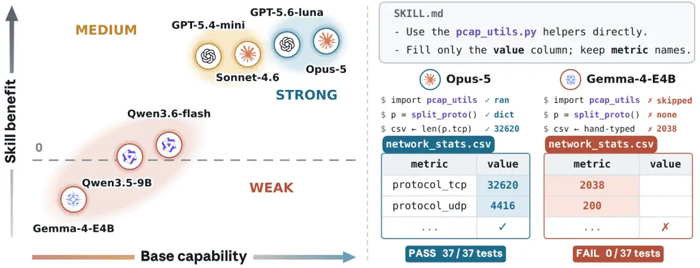
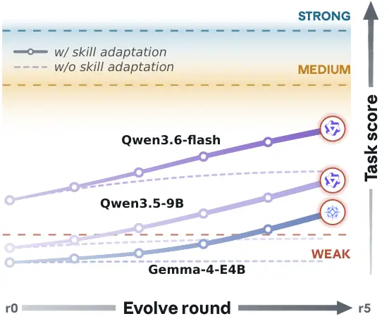
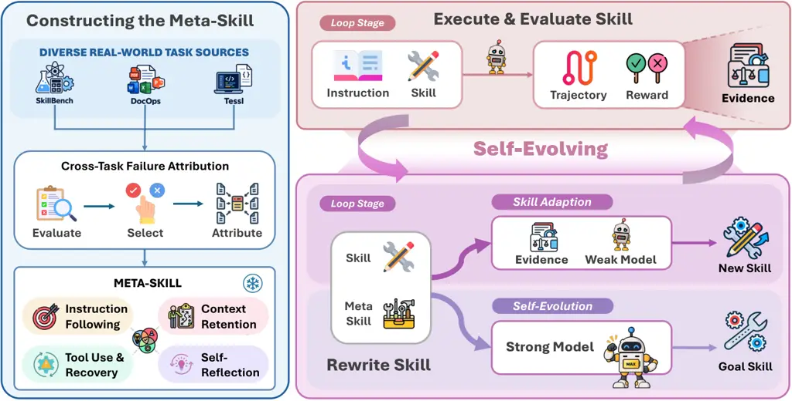

\tl_set:Ne\tcboxmath

tcboxmath \tl_set:Ne\tcbhighmathtcbhighmath

# Evolving to Match Capabilities: Improving Harness Self-Evolution via Skill Adaptation

Zhihao Yang^(1,7,\*)    Haojin Wang^(2,\*)    Juncheng Wu^(3,\*)    Kuan
Zhang⁴    Yukun Chen¹    Run Luo⁵  
Yaojie Lu⁶    Yuyin Zhou³    Lu Wang^(4,†)    Xianpei Han^(6,†)
Affiliation: ¹University of Chinese Academy of Sciences ²Independent
Researcher ³University of California, Santa Cruz  
⁴Tsinghua University ⁵National University of Singapore ⁶Chinese
Information Processing Laboratory, Institute of Software, Chinese
Academy of Sciences ⁷School of Advanced Interdisciplinary Sciences,
University of Chinese Academy of Sciences  
^(\*)Equal contribution ^(†)Corresponding authors  
yangzhihao25@mails.ucas.ac.cn  
Project
Page: [zhihaoyang30.github.io/skill-adaptation](https://zhihaoyang30.github.io/skill-adaptation/)

###### Abstract

Harness self-evolution offers a practical route for LLM agents to
improve from execution experience without updating model parameters. Its
effectiveness depends on whether models can successfully act on the
guidance provided by their harnesses. However, we find that harness
benefits are not uniform across model capabilities: skills that improve
stronger models can provide little benefit or even degrade performance
for weaker ones. Across seven models and three benchmarks, we identify
103 task–skill pairs where skills improve GPT-5.6-luna by 31.1 points
but degrade Gemma-4-E4B by 8.8 points. In 86% of failed weak-model runs,
the violated requirement is already stated in the skill. This motivates
skill adaptation: reformulating existing skills to match the executor’s
capabilities and make their guidance easier to execute. To achieve this,
we diagnose failures in tool execution, context management, instruction
following, and verification, and distill these diagnoses into a fixed
meta-skill that guides adaptation during harness self-evolution. Guided
by the meta-skill, a capable external rewriter, Kimi-K3, adapts skills
without execution evidence, improving the three weak executors by
5.1–14.1 points over the original skills. We then incorporate this
adaptation into a five-round self-evolution loop, where each model
revises its own skill from execution trajectories and verifier feedback.
Across seven executors, from Gemma-4-E4B to Kimi-K2.5, the meta-skill
consistently improves final scores by 2.0–5.1 points over the same loop
without the meta-skill. Our findings provide practical design guidance
for developing more effective harness self-evolution methods.

## 1 Introduction

Recent advancements in modern Large Language Model (LLM) agents have
shifted from a static prompt-response generation to dynamic agentic
workflows (Yao et al., 2022; Wang et al., 2023; Team et al., 2026). With
the emergence of agentic workflows, LLM agents increasingly rely on
external harnesses to aid in the execution of tasks (Yang et al., 2024;
Merrill et al., 2026; Li et al., 2026). Harness self-evolution automates
the construction and refinement of these harnesses using execution
trajectories and feedback while keeping model parameters fixed (Weng,
2026; Lin et al., 2026; Lou et al., 2026). This enables agents to
develop harnesses suited to different downstream tasks, reducing the
need for manual harness design and maintenance.



Figure 1: Skill benefit tracks base capability. (a) On $`103`$
skill-sensitive pairs, injected skills boost strong- and mid-tier models
by $`+27`$ pt on average, yet leave the weak tier nearly unchanged at
$`+1`$ pt. (b) The gap is not missing guidance: given the same skill,
the strong model follows its instructions and passes, while the weak
model ignores them and fails.

A common approach to harness self-evolution is to distill reusable
skills from execution trajectories (Wang et al., 2024; Ouyang et al.,
2026). Prior work has largely focused on efficiently extracting
experiences and faithfully translating them into procedural
guidance (Zheng et al., 2025; Ni et al., 2026). However, encoding the
right experience in a skill does not guarantee that a model can use it
effectively. We find that some skills substantially benefit stronger
models while providing little benefit or even degrading performance for
weaker ones. To characterize this disparity, we evaluate seven models
with and without skills across three independently constructed
benchmarks: SkillsBench (Li et al., 2026), DocOps (Jiang et al., 2026a),
and Tessl (Shaposhnikov et al., 2026). We group models into capability
tiers based on their performance without skills and identify $`103`$
tasks, where skills improve frontier models by 29.2 points on average
but weak models by only 1.2 points (Fig. 1). This limited benefit is not
simply due to missing information in the skills. Among failed weak-model
runs on these pairs, 86% violate requirements already stated in the
injected skill, indicating that relevant guidance is often available but
not effectively followed (Fig. 1). These findings suggest that harness
evolution should consider not only whether an update captures useful
experience, but also whether its formulation matches the executor’s
capabilities closely enough for that experience to be reliably
translated into performance gains in downstream tasks.

To understand why weak models still fail despite receiving skill
guidance, we analyze their failed execution trajectories on these tasks
and identify four recurring failure modes. First, agents struggle with
tool execution: they invoke unavailable tools or stop without recovering
from tool errors. Second, failures in context management cause agents to
lose track of the current task, driving their work toward the skill’s
reference material or away from the required delivery path. Third,
agents fall short in instruction following, leaving requirements already
stated in the skill unmet. Finally, inadequate verification leaves
incorrect results unchecked in the final output.

Informed by this failure analysis, we propose skill adaptation:
reformulating skills to match the executor’s capabilities and facilitate
harness self-evolution. Specifically, we design a meta-skill, a fixed,
task-independent rewriting protocol that guides targeted skill revisions
to eliminate the diagnosed failure patterns, enabling robust skill
utilization for agentic tasks.

We first evaluate whether the meta-skill can guide effective skill
adaptation, enabling weak models to benefit from skills they previously
struggled to use. In this setting, a capable rewriter receives the task,
original skill, and executor’s tool list, but no execution trajectories
or verifier feedback. Guided by the meta-skill, Kimi-K3 (Team et al., 2026) produces revised skills that improve the three weak executors by
5.1–14.1 points over the original skills. With the same rewriter, the
meta-skill adds 5.1–6.0 points over a generic rewriting instruction,
accounting for more than half of the average gain.



Figure 2: Skill adaptation in self-evolution. Over five rounds, weak
executors improve steadily with skill adaptation but barely move without
it. Horizontal lines: tier averages.

We then integrate skill adaptation into a harness self-evolution
loop (Zhang et al., 2026c). Each model alternates between executing the
task and revising its own skill using the resulting trajectory and
verifier feedback. After five rounds, all seven executors, from
Gemma-4-E4B (Team, 2026) to Kimi-K2.5 (Team et al., 2026), score 2.0–5.1
points higher with the meta-skill than under the same loop without
it (Fig. 2). On average, both settings improve tasks associated with
tool-execution and instruction-following failures, while
verification-related gains are larger in self-evolution, where revisions
draw on concrete failure evidence. Some failures persist even after the
relevant instructions are correctly specified, revealing limits to what
skill rewriting alone can achieve. These findings suggest that harness
evolution should both capture useful guidance and adapt it to the
executor’s capabilities. By explicitly supporting this adaptation with
the meta-skill, our method makes harness evolution more effective.

## 2 Framework

We first formalise the setting studied in this work. Let
$`\mathcal{T}=\{T_{1},\ldots,T_{n}\}`$ be a set of skill-augmented
tasks, where each task $`T_{i}`$ is paired with a human-crafted skill
$`S_{i}`$. For a model $`m`$, we write $`s_{m}(T_{i},S_{i})\in[0,1]`$
for its score when solving $`T_{i}`$ with the skill, and
$`s_{m}(T_{i},\emptyset)`$ for its score without it. We define skill
gain as $`\Delta_{m}(T_{i})=s_{m}(T_{i},S_{i})-s_{m}(T_{i},\emptyset)`$,
and our goal is to understand how $`\Delta_{m}`$ varies across models of
different capabilities on the same task-skill pair.

### 2.1 Skill-Task Curation

We collect tasks together with their accompanying human-crafted skills
from three benchmarks with disjoint construction protocols with details
in App. A. SkillsBench (Li et al., 2026) consists of 87 skill-augmented
tasks across 8 domains for STEM and engineering tasks. DocOps (Jiang
et al., 2026a) consists of 4 types of different document operation
tasks. Tessl (Shaposhnikov et al., 2026) consists of 334 skill-augmented
tasks with 184 different skills. We select 7 different models from
different model families. Based on their performance without any skills
on the tasks we included, we categorize them into 3 groups. For models
with weak capabilities, we select Gemma-4-E4B (Team, 2026),
Qwen3.5-9B (Qwen Team, 2026a) and Qwen3.6-flash (Qwen Team, 2026b). For
models with moderate capabilities, we select GPT-5.4-mini (OpenAI,
2026a) and Claude-Sonnet-4.6 (Anthropic, 2026b). For models with
frontier capabilities, we select GPT-5.6-luna (OpenAI, 2026b) and
Claude-Opus-5 (Anthropic, 2026a). Due to environment issues, we run the
tasks that execute reliably on our infrastructure: $`87`$ tasks in
SkillsBench, $`186`$ in DocOps and $`334`$ in Tessl, $`607`$ in total.

### 2.2 Task Execution

We run each task-skill pair under two conditions. In the w/o skill
condition, the agent receives only the task description and the task
environment, yielding $`s_{m}(T_{i},\emptyset)`$. In the w/ skill
condition, we provide the human-crafted skills for the agent, yielding
$`s_{m}(T_{i},S_{i})`$ while keeping all other inputs and the verifier
identical. We do not evaluate skill retrieval or progressive disclosure.
Each benchmark is scored by its native judge, normalized to $`[0,1]`$.
SkillsBench ships a deterministic per-task verifier to evaluate the
success rate of each task. DocOps opens the produced document and checks
its realised state as verification for success rate. Tessl uses an LLM
judge to grade each task against a task-completion rubric. Because the
three construction and scoring protocols are disjoint, we run every test
within a benchmark and report whether the conclusion replicates across
all three.

### 2.3 Pair Selection

Our unit of observation is a task-skill pair $`(T_{i},S_{i})`$: the same
skill appearing in two tasks counts twice, and a task injected with
several skills is treated as one pair carrying the whole bundle, since
the benchmarks do not permit estimating the contribution of an
individual skill. For a tier
$`G\in\{\mathrm{F},\mathrm{M},\mathrm{W}\}`$ (frontier, moderate, weak),
the tier gain $`\Delta_{G}(T_{i})`$ is the mean of $`\Delta_{m}(T_{i})`$
over the models $`m\in G`$. We say that tier $`G`$ benefits from
$`S_{i}`$ if

```math
\Delta_{G}(T_{i})\geq\tau\quad\text{and}\quad\Delta_{G}(T_{i})-\Delta_{\mathrm{W}}(T_{i})\geq\tau,\qquad\tau=0.10, \tag{1}
```

i.e. the skill clearly helps tier $`G`$, and helps it clearly more than
the weak tier. A pair is skill-sensitive if the frontier tier benefits,
or if the frontier tier is already saturated without the skill (mean
score $`\geq 0.95`$) and the moderate tier benefits. We discard pairs on
which the weak tier already scores $`\geq 0.80`$ with the skill, since
they leave little room for adaptation.

Averaged over all $`607`$ tasks, the skill yields a small gain for every
model, with no clear pattern across tiers (Fig. 3). The selection rule
retains $`103`$ skill-sensitive pairs: $`32`$ from SkillsBench, $`32`$
from DocOps and $`39`$ from Tessl. On these pairs the picture changes:
the skill lifts frontier and moderate models by up to 31.1 points, yet
leaves weak models nearly unchanged and even hurts the weakest one
(Fig. 3). We use these $`103`$ pairs as the testbed for the rest of the
paper.

Figure 3: Performance and task composition of the benchmark suite. Bars
show the score of each model w/o and w/ skill, shaded by capability
tier. (a) All $`607`$ common-denominator tasks, averaged with equal
weight over the three benchmarks. (b) The $`103`$ skill-sensitive pairs,
averaged over pairs. (c) Domain categories of the $`103`$
skill-sensitive pairs.

## 3 Diagnosing Weak Executors

To understand why weak models struggle to benefit from skills, we
analyze their failures on the selected tasks (§​ 3.1). We then use this
analysis to develop a meta-skill that guides skill adaptation to the
executor’s capabilities (§​ 3.2). Fig. 4 summarizes the approach.

### 3.1 Identifying Failure Modes

For each of the $`103`$ skill-sensitive pairs, we read the trajectories
of the three weak models together with the injected skill under the
condition of execution with skills. For each model trajectory, we
identify the first observable failure and assign its label to the
task-skill pair. A task may carry more than one label when its weak
models break at different points. Labels are based only on evidence from
the execution trajectory or verifier output.

Tool execution covers runs that produce no deliverable. The agent stops
after one or two tool calls, treats a file format such as xlsx as a
tool, or ends with an unresolved tool error. Context management covers
cases where the agent treats the skill’s examples or reference files as
the current task. It may also save the output to the wrong path.
Instruction following covers cases where the agent makes multiple tool
calls and produces an output, but still misses requirements already
stated in the skill. It usually completes only some of these
requirements. Verification covers cases where the output includes all
required parts, but the answer differs from the verifier’s result. The
execution trajectory contains no effective check for this error.

We assign $`131`$ labels across these $`103`$ tasks. Tool execution is
the most common label, while Verification is the least common. We find
that $`86\%`$ of weak-model runs that still fail with the skill violate
a requirement already stated in the injected SKILL.md. This suggests
that the gap between models lies in whether weak executors can act on
the guidance already in the skill. Harness evolution should therefore
both capture useful experience and match its formulation to the
executor’s capabilities, so that the experience can translate into
performance gains.

### 3.2 From Failure Modes to Meta-Skill

This failure analysis motivates skill adaptation: reformulating skills
to match the executor’s capabilities, thereby enabling more effective
harness self-evolution. To guide this reformulation, we design a
meta-skill, a fixed, task-independent rewriting protocol. It converts
the four failure modes into concrete rewriting instructions, targeting
the parts of a skill that weak executors struggle to follow. We develop
the meta-skill with Claude-Opus-5 as a writing assistant.

The meta-skill provides guidance for addressing the four failure modes.
For Tool execution, the skill should distinguish callable tools from
documents and include environment checks and ways to handle likely
errors. For Context management, the skill should start with the user’s
task, the allowed scope of changes and the delivery path. It should
clearly separate the current task from examples and background material,
and directly include any supporting content the task needs. For
Instruction following, each relevant requirement should specify an
_action_, a _target_ and a _completion condition_. For Verification, the
skill should end with an independent check: reread the result, try to
recompute it using another method, compare it with an explicit threshold
and repeat until the check passes. When an execution trajectory is
available, the rewriter should address its first observed failure before
revising later steps. The same meta-skill supports skill adaptation
without execution evidence and self-evolution using execution
trajectories and verifier feedback. We evaluate these two uses in §​ 4
and give the full meta-skill and rewriting protocol in Apps. C and B.



Figure 4: Overview of our approach. Left: the meta-skill is constructed
by attributing weak-model failures across tasks from three benchmarks to
four failure modes. Right: the meta-skill guides a self-evolving loop of
skill execution and rewriting, either in one shot by a strong model or
iteratively by a weak model from its own execution evidence.

## 4 Experiments

In §​ 3.2, we turned the failure analysis into a meta-skill that guides
skill adaptation. We now evaluate its effectiveness on our testbed of
$`103`$ skill-sensitive pairs in the two settings shown on the right of
Fig. 4. First, we ask whether the meta-skill can guide effective skill
adaptation, enabling weak models to benefit from skills they previously
struggled to use. Then, inspired by recent work on agent
self-improvement (Li et al., 2026; Wang et al., 2026a), we evaluate the
effect of integrating skill adaptation into a harness self-evolution
loop. Across both settings, we also analyse which failure modes the
meta-skill repairs (§​ 4.3).

### 4.1 Skill adaptation with meta-skill

#### Setup.

In this experiment, we evaluate whether the meta-skill can help a
rewriter model to adapt a skill to weak models without checking previous
execution trajectories. We use four advanced models with strong
capabilities as rewriters: GPT-5.6-sol, GPT-5.6-luna, GLM-5.3 and
Kimi-K3. We include three weak open-source models as executors:
Qwen3.6-flash, Gemma-4-E4B and Qwen3.5-9B. We run this experiment on the
entire testbed of $`103`$ pairs.

#### Approach.

In this experiment, the rewriter receives only the task and the skill to
be revised, without any execution trajectory or feedback. It returns
either a revised skill or the original one if it decides to not revise
the skill. To keep the comparison fair, we discard revisions that leak
the answer or fail to load and fall back to the original skill (App. B).
Each rewriter revises every skill once, and each executor runs each
revision once. Tab. 1 reports the mean score under each rewriting setup.

|                                                                                             |                |             |             |       |
| ------------------------------------------------------------------------------------------- | -------------- | ----------- | ----------- | ----- |
| Rewriter                                                                                    | Qwen 3.6-flash | Gemma 4-E4B | Qwen 3.5-9B | Avg.  |
| Original                                                                                    | 0.529          | 0.029       | 0.323       | 0.294 |
| Rewritten with the meta-skill                                                               |                |             |             |       |
| Weak (self)                                                                                 | 0.476          | 0.056       | 0.280       | 0.271 |
| ![[Uncaptioned image]](arxiv-2610-33024v1--6719be4c5f76.figures/figure-4.webp) GPT-5.6-sol  | 0.563          | 0.139       | 0.303       | 0.335 |
| ![[Uncaptioned image]](arxiv-2610-33024v1--6719be4c5f76.figures/figure-4.webp) GPT-5.6-luna | 0.602          | 0.119       | 0.307       | 0.343 |
| ![[Uncaptioned image]](arxiv-2610-33024v1--6719be4c5f76.figures/figure-5.webp) GLM-5.3      | 0.626          | 0.138       | 0.374       | 0.379 |
| ![[Uncaptioned image]](arxiv-2610-33024v1--6719be4c5f76.figures/figure-6.webp) Kimi-K3      | 0.616          | 0.170       | 0.374       | 0.387 |

Table 1: Skill adaptation with the meta-skill (mean scores over $`103`$
pairs). _Original_: unrevised skills; _Weak (self)_: each executor
rewrites its own skill.

#### Results.

With a capable rewriter, the meta-skill turns skills that weak models
could not use into skills they can: all four strong rewriters raise the
average, and Kimi-K3 and GLM-5.3 improve all three executors, lifting
the average by about $`+0.09`$. The weak executors rewriting their own
skills, by contrast, end up below the original (Tab. 1). The weakest
executor gains the most: under Kimi-K3, Gemma-4-E4B rises from $`0.029`$
to $`0.170`$. This suggests that weak models can benefit more from
human-crafted skills through skill adaptation by a capable rewriter.


Figure 5: Skill adaptation by Kimi-K3 with the meta-skill or a
one-sentence instruction; each weak executor runs the revised skill once
on all $`103`$ pairs.

#### Skill rewriting without meta-skill.

Since the best rewriters above are strong models, the gains may owe as
much to the rewriter as to the meta-skill. To separate the two, we
replace the meta-skill with a one-sentence instruction that asks the
rewriter to revise the skill so that it works for all models, and keep
everything else unchanged (App. C). We use Kimi-K3, the strongest
rewriter in Tab. 1, under the same setup as above (Fig. 5). We find that
a capable rewriter does help on its own: with the one-sentence
instruction alone, Kimi-K3 improves two of the three executors. The gain
is uneven, however, and Qwen3.5-9B ends slightly below the original
skill. With the meta-skill, the same rewriter improves all three
executors over the one-sentence instruction, and the added gain is
consistent across them. This suggests that guidance on weak executors’
failure modes helps a capable rewriter produce more effective skill
revisions.


### 4.2 Self-evolution with meta-skill

So far, we have discussed whether the meta-skill can guide effective
skill adaptation without access to failure trajectories. We now
integrate skill adaptation into a more realistic harness self-evolution
loop (Chen et al., 2026): each model alternates between executing the
task and revising its own skill using the resulting trajectory and
verifier feedback.

#### Setup.

We now let each weak model improve its own skill, so the rewriter and
the executor are the same model. Unlike one-shot rewriting, the rewriter
now sees the evidence of failure: in round $`t`$, it receives the task,
the skill from round $`t-1`$, the executor’s tool list, and the
trajectory and verifier output of round $`t-1`$. It returns a revised
skill, which the executor then runs on the task, and we apply the same
validity checks as in one-shot rewriting. We repeat this loop for five
rounds, with each round revising the skill produced by the previous one.
To illustrate the effectiveness of meta-skill in the practice of
self-evolution, we compare with a baseline that does not include
meta-skill in the system prompt context. We use the same three weak
executors as above and run every round once on all 103 pairs. Since this
setting spans several rounds, we measure gains against a baseline run in
the same time window, in which each executor reruns the original skill
without revision. To test whether the effect extends beyond the weakest
models, we also run four additional executors: Qwen3.5-27B, Gemma-4-26B,
Qwen3.5-plus and Kimi-K2.5.

Figure 6: Self-evolution with and without the meta-skill. Each executor
rewrites its own skill from the previous round’s trajectory and verifier
output over five rounds, and runs every round once on all $`103`$ pairs.
Curves show the gain over the baseline that reruns the original skill;
annotations mark the gap between the two arms at round 5. Results for
the remaining four executors are in Fig. 8.

#### Results.

Fig. 6 reports the gain of each round over this baseline for
Qwen3.6-flash, Gemma-4-E4B and Kimi-K2.5. Fig. 8 shows the remaining
four executors, and Tab. 4 in App. D reports every round for all seven
executors. With the meta-skill, every executor ends round 5 above the
arm without it (Figs. 6 and 8). We observe steady performance
improvement across different executors, suggesting the effectiveness of
meta-skill during the self-evolution of agents. Without the meta-skill,
self-revision helps little and is unstable: Qwen3.5-9B peaks at round 3
and then falls back almost to the baseline, and Gemma-4-E4B, the weakest
executor, stays below its baseline in every round. The meta-skill does
not make the curves monotonic, since Qwen3.5-9B still drops after round
3 and Gemma-4-E4B dips at round 2, but both end higher, and Gemma-4-E4B
stays above its baseline from round 3 on. The four larger executors move
in the same direction, with round-5 gaps of $`+0.046`$ on Qwen3.5-27B,
$`+0.020`$ on Gemma-4-26B, $`+0.025`$ on Qwen3.5-plus, and $`+0.035`$ on
Kimi-K2.5 (absolute scores in Tab. 4). This is the opposite of what we
saw in one-shot rewriting, where rewriting with the meta-skill hurt two
of the three weak executors. The difference is the failure evidence:
once the rewriter can see how the skill failed, even a weak model can
make use of the meta-skill. Because each round is run once, we do not
read much into the exact size of these $`0.02`$–$`0.05`$ gaps; what we
rely on is that their sign is the same for all seven executors.


[TABLE]

Table 2: Score gains from the meta-skill over rewriting without it,
averaged over pairs with each failure label. _Skill adaptation_ uses
Kimi-K3 rewrites; _Self-evolution_ uses round-5 skills. $`n`$ counts
pairs, and labels can overlap. Shading indicates the size of the gain.

### 4.3 Analysis

To compare what skill adaptation improves in the two settings, we group
the $`103`$ pairs by their failure labels from §​ 3.1 and compare scores
with and without the meta-skill within each group (Tab. 2).

#### Skill adaptation addresses problems visible in the text.

We can tell from the skill text whether it names callable tools, gives
each requirement a completion condition, and states the task and
delivery path at the start. In Fig. 7, the rewrite specifies the
delivery target and required EPSG:4087 projection, requires ISO 8601
timestamps, and adds an independent result check. These changes make
explicit the steps the executor would otherwise need to infer from
reference material. In one-shot skill adaptation, the meta-skill
improves performance on Execution, Instruction, and Context, with mean
score gains of $`+0.056`$, $`+0.055`$, and $`+0.103`$, respectively
(Tab. 2).

#### Self-evolution addresses problems revealed during execution.

For Verification, the skill text can specify a check, but execution
trajectories reveal whether the executor actually performs it.
Self-evolution uses this evidence to guide subsequent skill revisions.
In Fig. 7, the executor without the meta-skill keeps reporting the same
incorrect distance across all five rounds, despite instructions to rerun
the script on errors. With the meta-skill, the revised skill requires
rereading answer.json and recomputing the distance, and Qwen3.6-flash
passes four of five rounds. The mean score gain from the meta-skill on
Verification is $`0.101`$ larger in self-evolution than in one-shot
skill adaptation (Tab. 2). The meta-skill also improves scores on
Execution and Instruction in self-evolution, where trajectories expose
tool errors and missed requirements that can guide further revisions.

#### What the meta-skill cannot repair is the executor.

The failures that remain are the executor’s own. Behind the negative
cells of Tab. 2, the revised skill states the right procedure and the
executor does not carry it out: it edits a script without rerunning it,
repeats a failed call, stops before writing the artefact, or, when a
task has several constraints, keeps the one the skill highlights and
drops the rest. Fig. 7 is typical: with the meta-skill the skill covers
all four dimensions after one round and Qwen3.6-flash passes four of
five; in the failing round it fixes the script but never reruns it. A
skill can tell a weak executor what to do; getting it done depends on
the model. App. E gives more cases.


Reward: r0 ✗  $`|`$  r1–r5 ✗ ✗ ✗ ✗ ✗ Wrong in every round: the skill
stays a list of reference notes with no delivery target and no result
check, so the same wrong distance survives every rewrite.


Reward: r0 ✗  $`|`$  r1–r5 ✓ ✓ ✗ ✓ ✓ Right from round 1: scope,
projection, format and read-back provide guidance for all four failure
modes. The one miss is a script edited but not rerun, which no skill
text can catch.

Figure 7: Skills after the first round of self-evolution by
Qwen3.6-flash on one task, with and without the meta-skill. Rows are
aligned by the failure mode addressed by the displayed guidance. Marks
give the task reward from round 0, the original skill, to round 5; the
framed mark is the round shown.

## 5 Related Work

#### Agent Skills.

Agent skills are composable packages of instructions, code, and
resources that agents load on demand, extending model capabilities
without changing its parameters (Anthropic, 2025; Xu & Yan, 2026; Jiang
et al., 2026b; Weng, 2026). They have become a standard layer of the
agent harness alongside tools and memory (Yang et al., 2024; Weng,
2026), and are populated in two ways: distilled from the trajectories of
capable models into reusable programs or workflows (Wang et al., 2023;
Wang et al., 2024; Zhang et al., 2026b), or written by human experts and
distributed through public registries (Gao et al., 2026a; Liu et al.,
2026b). A growing set of benchmarks asks whether injected skills
actually help, covering STEM and software-engineering tasks (Li et al.,
2026; Han et al., 2026), verifiable document operations (Jiang et al.,
2026a), skill evaluation at scale (Shaposhnikov et al., 2026), and
realistic retrieval settings (Liu et al., 2026b). The ecosystem is
expanding fast, with tens of thousands of skills on public
registries (Ling et al., 2026) and active work on retrieval (Zheng
et al., 2026), compression (Gao et al., 2026b), and security (Liu
et al., 2026a). Throughout, a skill is written once and shipped
unchanged across models. Early evidence suggests this is fragile (Yu
et al., 2026), but how a fixed skill’s benefit varies with model
capability remains unexamined.

#### Harness Evolution.

Harness evolution lets an agent improve itself by rewriting its own
harness from execution feedback (Zhang et al., 2026c; Lee et al., 2026b;
Zhang et al., 2026d). Early systems search over agent code or
prompts (Hu et al., 2025; Zhang et al., 2026c; Zhang et al., 2026e), and
recent work makes the loop recursive, evolving the improvement procedure
itself (Zhang et al., 2026d; Lee et al., 2026a; Wang et al., 2026b). Two
designs are closest to ours. Meta-Harness (Lee et al., 2026a) uses a
stronger external optimiser to tune the harness of a weaker model,
mirroring our skill adaptation setting; Self-Harness (Zhang et al.,
2026a) lets a model mine its own failure traces and propose bounded
edits, mirroring our self-evolution setting. At the skill level,
revisions are driven by failure traces (Liu et al., 2026c; Alzubi
et al., 2026), verifier co-evolution (Zhang et al., 2026b), or held-out
gating (Yang et al., 2026). Yet we differ from these works in two ways.
First, we focus on the problem of strong-to-weak model mismatch, where a
skill is well-suited for a strong model but executed poorly by a weak
model. Second, we examine whether weak models can improve their own
skills, resonating with recent work on recursive harness
improvement (Chen et al., 2026).

## 6 Conclusion

We showed that the benefit of a harness is not a property of the harness
alone: the same skill that lifts frontier models leaves weak models
unchanged or worse, even though the requirements they violate are
already written in it. We traced the loss to four failure modes in how a
skill is written, and distilled them into a meta-skill, a fixed protocol
that lets a capable rewriter adapt skills without execution evidence and
lets weak models improve their own skills over rounds of self-evolution.
For harness self-evolution, this suggests two practical guidelines: the
benefit of a harness should be evaluated per capability tier rather than
with a single representative model, and the evolution loop should be
given diagnostic guidance on how a weak executor fails, since evidence
alone leads weak rewriters to drift while the meta-skill lets them hold
their gains.

#### Limitations.

We evaluate skills already supplied in the executor’s context, leaving
retrieval and progressive disclosure outside our scope. Multiple skills
are evaluated as a bundle, and self-evolution uses a fixed budget of
five rounds without updating the underlying model parameters.

#### Discussion.

Our results suggest that harness self-evolution benefits from explicit
guidance on turning execution feedback into revisions the executor can
use. The meta-skill provides this guidance for skill adaptation by
connecting recurring failure modes to concrete rewriting instructions,
helping weak executors improve their own skills from execution evidence.
A useful next step is to track whether each revision resolves the
failure that motivated it, alongside changes in task performance. This
could guide later updates toward persistent problems and help retain
revisions that remain useful across repeated attempts. Similar guidance
could also be explored for tool interfaces and agent workflows,
extending the role of failure analysis in harness self-evolution.

## AI use statement

We used generative AI tools to assist with coding and with drafting,
revising, and polishing the manuscript. The authors reviewed AI-assisted
code and text, verified the scientific claims and citations, and remain
responsible for the research design, failure analysis, and
interpretation of results. No human-subject data were collected. We take
full responsibility for the manuscript, reported results, and
accompanying artifacts, including AI-assisted content.

## Reproducibility Statement

We describe the benchmark suite and task selection in Section 2 and
Appendix A. The rewriting protocol, validity checks, and scoring
conventions are detailed in Appendix B, and the full meta-skill and
baseline prompts are provided in Appendix C. After the review process
concludes, we will open-source the code for evaluation, skill
adaptation, and self-evolution, together with the task lists and
experiment configurations, to support reproduction of our results and
further research on harness self-evolution.

## References

- Alzubi et al. (2026) Salaheddin Alzubi, Noah Provenzano, Jaydon
  Bingham, Weiyuan Chen, and Tu Vu. Evoskill: Automated skill discovery
  for multi-agent systems. _arXiv preprint arXiv:2603.02766_, 2026.
- Anthropic (2025) Anthropic. Equipping agents for the real world with
  Agent Skills.
  [https://www.anthropic.com/engineering/equipping-agents-for-the-real-world-with-agent-skills](https://www.anthropic.com/engineering/equipping-agents-for-the-real-world-with-agent-skills),
  October 2025. Accessed: 2026-08-21.
- Anthropic (2026a) Anthropic. Introducing Claude Opus 5.
  [https://www.anthropic.com/news/claude-opus-5](https://www.anthropic.com/news/claude-opus-5),
  July 2026a. Accessed: 2026-08-28.
- Anthropic (2026b) Anthropic. Introducing Claude Sonnet 4.6.
  [https://www.anthropic.com/news/claude-sonnet-4-6](https://www.anthropic.com/news/claude-sonnet-4-6),
  February 2026b. Accessed: 2026-08-28.
- Chen et al. (2026) Mingguang Chen, Licheng Wang, and Bo Qu. Recursive
  self-improvement in ai: From bounded self-refinement to autonomous
  research loops. _arXiv preprint arXiv:2607.07663_, 2026.
- Gao et al. (2026a) Haoyu Gao, Jai Lal Lulla, Hong Yi Lin, Sebastian
  Baltes, Christoph Treude, and Mansooreh Zahedi. From registry to
  repository: How ai agent skills are written, adapted, and maintained.
  _arXiv preprint arXiv:2607.00911_, 2026a.
- Gao et al. (2026b) Yudong Gao, Zongjie Li, Yuanyuan Yuan, Zimo Ji,
  Pingchuan Ma, and Shuai Wang. Skillreducer: Optimizing llm agent
  skills for token efficiency. _arXiv preprint arXiv:2603.29919_, 2026b.
- Han et al. (2026) Tingxu Han, Yi Zhang, Wei Song, Chunrong Fang,
  Zhenyu Chen, Youcheng Sun, and Lijie Hu. Swe-skills-bench: Do agent
  skills actually help in real-world software engineering? _arXiv
  preprint arXiv:2603.15401_, 2026.
- Hu et al. (2025) Shengran Hu, Cong Lu, and Jeff Clune. Automated
  design of agentic systems. In _International Conference on Learning
  Representations_, volume 2025, pp. 21344–21377, 2025.
- Jiang et al. (2026a) Jiazhen Jiang, Boxi Cao, Lingyong Yan, Yaojie Lu,
  Hongyu Lin, Shuaiqiang Wang, Dawei Yin, Xianpei Han, and Le Sun.
  Docops: A verifiable benchmark for autonomous agents in complex
  document operations. _arXiv preprint arXiv:2607.19865_, 2026a.
- Jiang et al. (2026b) Yanna Jiang, Delong Li, Haiyu Deng, Baihe Ma,
  Xu Wang, Qin Wang, and Guangsheng Yu. Sok: Agentic skills–beyond tool
  use in llm agents. _arXiv preprint arXiv:2602.20867_, 2026b.
- Lee et al. (2026a) Hyunin Lee, Jinglue Xu, Jeffrey Seely, Donghyun
  Lee, Matei Zaharia, and Yujin Tang. Recursive harness
  self-improvement. _arXiv preprint arXiv:2607.15524_, 2026a.
- Lee et al. (2026b) Yoonho Lee, Roshen Nair, Qizheng Zhang, Kangwook
  Lee, Omar Khattab, and Chelsea Finn. Meta-harness: End-to-end
  optimization of model harnesses. _arXiv preprint arXiv:2603.28052_,
  2026b.
- Li et al. (2026) Xiangyi Li, Yimin Liu, Wenbo Chen, Bingran You,
  Zonglin Di, Yifeng He, Shenghan Zheng, Kyoung Whan Choe, Jiankai Sun,
  Shuyi Wang, et al. Skillsbench: Benchmarking how well agent skills
  work across diverse tasks. _arXiv preprint arXiv:2602.12670_, 2026.
- Lin et al. (2026) Minhua Lin, Juncheng Wu, Zijun Wang, Zhan Shi, Yisi
  Sang, Bing He, Zewen Liu, Tianxin Wei, Zongyu Wu, Zhiwei Zhang, et al.
  Harness updating is not harness benefit: Disentangling evolution
  capabilities in self-evolving llm agents. _arXiv preprint
  arXiv:2605.30621_, 2026.
- Ling et al. (2026) George Ling, Shanshan Zhong, and Richard Huang.
  Agent skills: A data-driven analysis of claude skills for extending
  large language model functionality. _arXiv preprint
  arXiv:2602.08004_, 2026.
- Liu et al. (2026a) Hongyi Liu, Haoyan Yang, Tao Jiang, Bo Tang, Feiyu
  Xiong, Yuyu Luo, and Zhiyu Li. Skillsvote: Lifecycle governance of
  agent skills from collection, recommendation to evolution. _arXiv
  preprint arXiv:2605.18401_, 2026a.
- Liu et al. (2026b) Yi Liu, Weizhe Wang, Ruitao Feng, Yao Zhang,
  Guangquan Xu, Gelei Deng, Yuekang Li, and Leo Zhang. Agent skills in
  the wild: An empirical study of security vulnerabilities at scale.
  _arXiv preprint arXiv:2601.10338_, 2026b.
- Liu et al. (2026c) Yuxuan Liu, Zhaochen Su, Lingyun Xie, Yuhao Zhang,
  Qing Zong, Jiahe Guo, Zhongwei Xie, Yiyan Ji, Yauwai Yim, Hongyu Luo,
  et al. Skillrevise: Improving llm-authored agent skills via
  trace-conditioned skill revision. _arXiv preprint arXiv:2606.01139_,
  2026c.
- Lou et al. (2026) Xinghua Lou, Miguel Lázaro-Gredilla, Antoine Dedieu,
  Carter Wendelken, Wolfgang Lehrach, and Kevin P Murphy. Autoharness:
  improving llm agents by automatically synthesizing a code harness.
  _arXiv preprint arXiv:2603.03329_, 2026.
- Merrill et al. (2026) Mike Merrill, Alexander Shaw, Nicholas Carlini,
  Boxuan Li, Harsh Raj, Ivan Bercovich, Lin Shi, Jeong Shin, Thomas
  Walshe, E Kelly Buchanan, et al. Terminal-bench: Benchmarking agents
  on hard, realistic tasks in command line interfaces. In _International
  Conference on Learning Representations_, volume 2026, pp.
  40903–40986, 2026.
- Ni et al. (2026) Jingwei Ni, Yihao Liu, Xinpeng Liu, Yutao Sun, Mengyu
  Zhou, Pengyu Cheng, Dexin Wang, Erchao Zhao, Xiaoxi Jiang, and Guanjun
  Jiang. Trace2skill: Distill trajectory-local lessons into transferable
  agent skills. _arXiv preprint arXiv:2603.25158_, 2026.
- OpenAI (2026a) OpenAI. Introducing GPT-5.4 mini and nano.
  [https://openai.com/index/introducing-gpt-5-4-mini-and-nano/](https://openai.com/index/introducing-gpt-5-4-mini-and-nano/),
  March 2026a. Accessed: 2026-08-28.
- OpenAI (2026b) OpenAI. Improving gpt-5.6 sol in chatgpt—and expanding
  access to gpt-5.6 luna for free users.
  [https://openai.com/index/improving-gpt-5-6-sol-in-chatgpt/](https://openai.com/index/improving-gpt-5-6-sol-in-chatgpt/),
  August 2026b. Accessed: 2026-08-28.
- Ouyang et al. (2026) Siru Ouyang, Jun Yan, I Hsu, Yanfei Chen,
  Ke Jiang, Zifeng Wang, Rujun Han, Long Le, Samira Daruki, Xiangru
  Tang, et al. Reasoningbank: Scaling agent self-evolving with reasoning
  memory. In _International Conference on Learning Representations_,
  volume 2026, pp. 94327–94354, 2026.
- Qwen Team (2026a) Qwen Team. Qwen3.5: Towards native multimodal
  agents, February 2026a. URL
  [https://qwen.ai/blog?id=qwen3.5](https://qwen.ai/blog?id=qwen3.5).
- Qwen Team (2026b) Qwen Team. Qwen3.6-Plus: Towards real world agents,
  April 2026b. URL
  [https://qwen.ai/blog?id=qwen3.6](https://qwen.ai/blog?id=qwen3.6).
- Shaposhnikov et al. (2026) Maksim Shaposhnikov, Nicolas Fortuin, Simon
  Stipcich, Maria I Gorinova, Amy Heineike, and Rob Willoughby. A
  framework for evaluating agentic skills at scale. _arXiv preprint
  arXiv:2606.17819_, 2026.
- Team (2026) Gemma Team. Gemma 4 technical report, 2026. URL
  [https://arxiv.org/abs/2607.02770](https://arxiv.org/abs/2607.02770).
- Team et al. (2026) Kimi Team, Tongtong Bai, Yifan Bai, Yiping Bao,
  SH Cai, Yuan Cao, Ziwei Chai, Y Charles, HS Che, Cheng Chen, et al.
  Kimi k2. 5: Visual agentic intelligence. _arXiv preprint
  arXiv:2602.02276_, 2026.
- Wang et al. (2023) Guanzhi Wang, Yuqi Xie, Yunfan Jiang, Ajay
  Mandlekar, Chaowei Xiao, Yuke Zhu, Linxi Fan, and Anima Anandkumar.
  Voyager: An open-ended embodied agent with large language models.
  _arXiv preprint arXiv:2305.16291_, 2023.
- Wang et al. (2026a) Yike Wang, Huaisheng Zhu, Zhengyu Hu, Yige Yuan,
  Zhengyu Chen, Shakti Senthil, Hannaneh Hajishirzi, Yulia Tsvetkov,
  Pradeep Dasigi, and Teng Xiao. Rethinking the evaluation of harness
  evolution for agents. In _COLM 2026 The 2nd Workshop on Lifelong
  Agents: Learning, Aligning, and Evolving_, 2026a.
- Wang et al. (2026b) Zefeng Wang, Minxi Yan, Jinhe Bi, Sikuan Yan,
  Volker Tresp, and Yunpu Ma. Metaskill-evolve: Recursive
  self-improvement of llm agents via two-timescale meta-skill evolution.
  _arXiv preprint arXiv:2607.05297_, 2026b.
- Wang et al. (2024) Zora Zhiruo Wang, Jiayuan Mao, Daniel Fried, and
  Graham Neubig. Agent workflow memory. _arXiv preprint
  arXiv:2409.07429_, 2024.
- Weng (2026) Lilian Weng. Harness engineering for self-improvement.
  _lilianweng.github.io_, July 2026. URL
  [https://lilianweng.github.io/posts/2026-07-04-harness/](https://lilianweng.github.io/posts/2026-07-04-harness/).
- Xu & Yan (2026) Renjun Xu and Yang Yan. Agent skills for large
  language models: Architecture, acquisition, security, and the path
  forward. _arXiv preprint arXiv:2602.12430_, 2026.
- Yang et al. (2024) John Yang, Carlos Jimenez, Alexander Wettig, Kilian
  Lieret, Shunyu Yao, Karthik Narasimhan, and Ofir Press. Swe-agent:
  Agent-computer interfaces enable automated software engineering.
  _Advances in Neural Information Processing Systems_,
  37:50528–50652, 2024.
- Yang et al. (2026) Yifan Yang, Ziyang Gong, Weiquan Huang, Qihao Yang,
  Ziwei Zhou, Zisu Huang, Yan Li, Xuemei Gao, Qi Dai, Bei Liu, et al.
  Skillopt: Executive strategy for self-evolving agent skills. _arXiv
  preprint arXiv:2605.23904_, 2026.
- Yao et al. (2022) Shunyu Yao, Jeffrey Zhao, Dian Yu, Nan Du, Izhak
  Shafran, Karthik Narasimhan, and Yuan Cao. React: Synergizing
  reasoning and acting in language models. _arXiv preprint
  arXiv:2210.03629_, 2022.
- Yu et al. (2026) Jianxiang Yu, Jiapeng Zhu, Bochen Lin, Qier Cui,
  Zichen Ding, and Xiang Li. Skill is not one-size-fits-all: Model-aware
  skill alignment for llm agents. _arXiv preprint
  arXiv:2605.30723_, 2026.
- Zhang et al. (2026a) Hangfan Zhang, Shao Zhang, Kangcong Li, Chen
  Zhang, Yang Chen, Yiqun Zhang, Lei Bai, and Shuyue Hu. Self-harness:
  Harnesses that improve themselves. _arXiv preprint arXiv:2606.09498_,
  2026a.
- Zhang et al. (2026b) Hanrong Zhang, Shicheng Fan, Henry Peng Zou,
  Yankai Chen, Zhenting Wang, Jiayu Zhou, Chengze Li, Wei-Chieh Huang,
  Yifei Yao, Kening Zheng, et al. Coevoskills: Self-evolving agent
  skills via co-evolutionary verification. _arXiv preprint
  arXiv:2604.01687_, 2026b.
- Zhang et al. (2026c) Jenny Zhang, Shengran Hu, Cong Lu, Robert Lange,
  and Jeff Clune. Darwin gödel machine: open-ended evolution of
  self-improving agents. In _International Conference on Learning
  Representations_, volume 2026, pp. 104223–104294, 2026c.
- Zhang et al. (2026d) Jenny Zhang, Bingchen Zhao, Wannan Yang, Jakob
  Foerster, Jeff Clune, Minqi Jiang, Sam Devlin, and Tatiana Shavrina.
  Hyperagents. _arXiv preprint arXiv:2603.19461_, 2026d.
- Zhang et al. (2026e) Qizheng Zhang, Changran Hu, Shubhangi Upasani,
  Boyuan Ma, Fenglu Hong, Vamsidhar Kamanuru, Jay Rainton, Chen Wu,
  Mengmeng Ji, Hanchen Li, et al. Agentic context engineering: Evolving
  contexts for self-improving language models. In _International
  Conference on Learning Representations_, volume 2026, pp. 86069–86100,
  2026e.
- Zheng et al. (2025) Boyuan Zheng, Michael Y Fatemi, Xiaolong Jin,
  Zora Zhiruo Wang, Apurva Gandhi, Yueqi Song, Yu Gu, Jayanth Srinivasa,
  Gaowen Liu, Graham Neubig, et al. Skillweaver: Web agents can
  self-improve by discovering and honing skills. _arXiv preprint
  arXiv:2504.07079_, 2025.
- Zheng et al. (2026) YanZhao Zheng, ZhenTao Zhang, Chao Ma, YuanQiang
  Yu, JiHuai Zhu, Yong Wu, Tianze Xu, Baohua Dong, Hangcheng Zhu, Ruohui
  Huang, et al. Skillrouter: Skill routing for llm agents at scale.
  _arXiv preprint arXiv:2603.22455_, 2026.

## Appendix A Benchmarks and Task Suite

Tab. 3 summarises the three benchmarks from which the $`607`$ tasks and
$`103`$ skill-sensitive pairs are drawn. We chose them to cover
different skill authors, agent harnesses and judges, so that every
conclusion in the paper can be tested on three independently built
suites and is reported only when it replicates on all of them, not on a
single construction protocol.

| Benchmark   | Domain                          | Tasks | Pairs | Executor harness | Judge                 |
| ----------- | ------------------------------- | ----- | ----- | ---------------- | --------------------- |
| SkillsBench | STEM and engineering, 8 domains | 87    | 32    | OpenHands        | deterministic tests   |
| DocOps      | Excel, Word, PowerPoint, PDF    | 186   | 32    | Claude Code      | document-state checks |
| Tessl       | developer tooling and APIs      | 334   | 39    | Claude Code      | LLM judge with rubric |

Table 3: The three benchmarks. _Tasks_ counts the tasks that run
reliably in our environment; _Pairs_ counts the skill-sensitive pairs
selected in §​ 2.3.

#### SkillsBench (Li et al., 2026).

Each task is a self-contained engineering or scientific problem, e.g.
computing the earthquake farthest from a plate boundary, tuning an MPC
controller, solving a PDDL planning instance or dispatching a power
grid, and ships with one or more human-written skills (a SKILL.md with
optional helper scripts) that a domain expert would consult for the
task. The executor runs inside the OpenHands harness and its output is
scored by a per-task deterministic verifier whose assertions never read
the skill body. The $`32`$ selected pairs span the full range of
domains, from control and planning to bioinformatics and finance.

#### DocOps (Jiang et al., 2026a).

Tasks edit or produce office documents of four types and are organised
in tiers of increasing scope: atomic edits of one document, composite
operations on one document type, cross-document operations,
single-document workflows, and a set of harder publication and repair
tasks. Every task injects the skill of its document type (xlsx, docx,
pptx or pdf), a long reference document with helper scripts such as a
LibreOffice recalculation script. The executor runs inside Claude Code;
the checker opens the produced document and verifies its realised state,
e.g. cell formulas, deleted text spans or theme colours. Of the $`32`$
selected pairs, $`10`$ are atomic, $`10`$ composite, $`5`$
cross-document, $`1`$ workflow and $`6`$ publication or repair tasks.

#### Tessl (Shaposhnikov et al., 2026).

Tasks pair a realistic developer request, e.g. setting up a payment
project, configuring tracing or reviewing a cookbook, with a skill
published by the tool’s vendor or open-source maintainers, including
Stripe, Vercel, ClickHouse, Sentry, Shopify and Firecrawl. The executor
runs inside Claude Code, and because these tasks have no single correct
artefact, an LLM judge grades the result against a task-specific rubric;
we use its normalised score directly. All $`39`$ selected pairs are
single-skill tasks, each shipping exactly one vendor skill.

## Appendix B Rewriting Protocol

Both experiments in §​ 4 share one protocol, which constrains only the
interface of the rewriter and the validity of its output, never the
content of the rewrite. Alg. 1 states it: a single rewrite step, Adapt,
is called once without execution evidence in skill adaptation, and five
times in self-evolution, each time with the score, trajectory and
verifier output of the previous round.

1: task $`T`$ with instruction $`I`$ and verifier $`V`$; original skill
$`S_{0}`$; executor $`M`$ with tool interface $`\mathcal{U}_{M}`$;
rewriter $`A`$ with system prompt $`P`$; validity gate $`G`$

2:

3: procedure Adapt($`S,E`$) // one rewrite of skill $`S`$ given evidence
$`E`$

4:   $`o\leftarrow A\big(P;\;I,\ \mathcal{U}_{M},\ S,\ E\big)`$ // a
revised skill or NO_CHANGE

5:   if $`o`$ is not parseable then retry once with the parse error
appended

6:   end if

7:   if $`o=\texttt{NO\_CHANGE}`$ or $`G(o,S)`$ rejects $`o`$ then //
gate: answer leakage, loadability

8:    return $`S`$

9:   end if

10:   return $`o`$

11: end procedure


Algorithm 1 Skill adaptation. Adapt is the shared rewrite step; the two
settings differ only in the rewriter $`A`$, the evidence $`E`$ and the
number of rounds.

#### Inputs to the rewriter.

The two arms of every experiment receive an identical user prompt and
differ only in the system prompt (App. C). The user prompt contains, in
order: (i) the task instruction, declared authoritative for the task,
the allowed scope of changes and the delivery path; (ii) the executor
interface, i.e. the complete tool list and parameter schema of OpenHands
for SkillsBench, or the tool names exposed by Claude Code for DocOps and
Tessl, with the note that skill names, file names and section headings
are not callable tools; (iii) the current skill, every SKILL.md
verbatim, together with the list of auxiliary files in the skill folder;
(iv) in the self-evolution setting only, the result of the last attempt
(passed, failed or partial with its score), a step-by-step digest of the
executor’s trajectory, and the verifier output; (v) a one-paragraph job
statement. In the self-evolution setting the job statement reads “You
know what the weak model did, which checks failed, and what the test
output said. Rewrite the skill so that the same weak model does better
on the next attempt. Do not encode expected values or test-specific
answers.”; in the skill adaptation setting, where no execution has taken
place, the first sentence is replaced by “Your evidence is the task
instruction, the skill as it stands, and the executor’s tool interface.”

#### Output contract.

The rewriter returns the complete new contents of every file it changes,
one block per file, delimited by \<\<\<FILE path=...\>\>\> and
\<\<\<END\>\>\>; files it does not return are kept unchanged. It may
restructure freely: reorder, merge, split or delete what the executor
cannot act on. Alternatively it returns a single \<\<\<NO_CHANGE\>\>\>
block with a one-line reason and a list of the missing evidence, in
which case the executor reruns the unchanged skill. There is no patch
format, no required document template and no diagnosis schema; whether
to change the skill at all, how much, and in what form is left entirely
to the rewriter.

#### Validity checks.

The harness applies two checks to each returned file. _Loadability_: the
file must be non-empty, its path must name an existing skill file, its
YAML frontmatter must survive with the name field unchanged (the harness
registers skills by name), and it must not exceed a
$`64{,}000`$-character budget, since the skill is injected whole into
the executor’s context. _Answer leakage_: we collect every specific
token (identifiers of at least eight characters containing a digit or
underscore, and decimals with at least two places) that occurs in the
hidden tests or reference solution but neither in the public task
material, including the original skill, nor in the evidence shown to the
rewriter. A revision that introduces one such expected value, or two
such identifiers, is rejected; a token the rewriter could have read in
the verifier output is counted but not blocked, since that route is the
design of the evidence arm. A response that cannot be parsed is sent
back once with the parse error; a loadability or leakage rejection is
terminal. When a revision is rejected the executor runs the unchanged
skill and the cell is still scored, so invalid rewrites lower the mean
of their arm rather than disappearing from it; a NO_CHANGE response is
scored in the same way.

#### Scoring conventions.

Every model–task–condition cell is run once. Skill adaptation reports
the executor’s mean score on the $`103`$ pairs under each rewriter.
Self-evolution forms a linear chain of five rounds with no selection of
the best round and no rollback, and reports each round against a
baseline in which the same executor reruns the original skill in the
same time window, so that drift of the serving endpoints over the
experiment does not enter the gain.

## Appendix C The Meta-Skill and the Baseline Prompts

The meta-skill is a fixed, task-independent document placed in the
rewriter’s system prompt; its full text is given below. It is followed
by the two system prompts it is compared against: the no-meta baseline
of the self-evolution experiment, which keeps the role description and
the two hard rules but gives no rewriting guidance, and the one-sentence
instruction used in Fig. 5.


## Appendix D Full Self-Evolution Results

Tab. 4 lists the mean score of every executor in every round of the
self-evolution experiment (§​ 4.2), with and without the meta-skill, and
Fig. 8 plots the four executors not shown in Fig. 6. The protocol is
identical for all seven executors: each rewrites its own skill from the
previous round’s trajectory and verifier output over five rounds, every
round is run once on the $`103`$ pairs, and the baseline reruns the
original skill in the same time window. On all seven executors the arm
with the meta-skill ends above the arm without it at round 5, by
$`+0.020`$ to $`+0.051`$, although neither arm improves monotonically
and the two arms cross on several executors in the early rounds.

|                                                                                              |             |       |                |           |           |           |           |               |           |           |           |           |                |
| -------------------------------------------------------------------------------------------- | ----------- | ----- | -------------- | --------- | --------- | --------- | --------- | ------------- | --------- | --------- | --------- | --------- | -------------- |
| Executor                                                                                     | Benchmark   | Base  | w/o meta-skill |           |           |           |           | w/ meta-skill |           |           |           |           | $`\Delta_{5}`$ |
|                                                                                              |             |       | $`r_{1}`$      | $`r_{2}`$ | $`r_{3}`$ | $`r_{4}`$ | $`r_{5}`$ | $`r_{1}`$     | $`r_{2}`$ | $`r_{3}`$ | $`r_{4}`$ | $`r_{5}`$ |                |
| _Weak executors used to build the meta-skill (§​ 3.1)_                                       |             |       |                |           |           |           |           |               |           |           |           |           |                |
| ![[Uncaptioned image]](arxiv-2610-33024v1--6719be4c5f76.figures/figure-7.webp) Qwen3.6-flash | All         | 0.523 | 0.545          | 0.549     | 0.611     | 0.599     | 0.614     | 0.567         | 0.613     | 0.616     | 0.621     | 0.644     | +0.030         |
|                                                                                              | SkillsBench | 0.350 | 0.309          | 0.239     | 0.412     | 0.293     | 0.356     | 0.337         | 0.397     | 0.343     | 0.313     | 0.417     | +0.061         |
|                                                                                              | DocOps      | 0.375 | 0.438          | 0.438     | 0.469     | 0.625     | 0.531     | 0.375         | 0.469     | 0.531     | 0.531     | 0.500     | -0.031         |
|                                                                                              | Tessl       | 0.786 | 0.903          | 0.895     | 0.959     | 0.946     | 0.893     | 0.912         | 0.908     | 0.909     | 0.948     | 0.947     | +0.054         |
| ![[Uncaptioned image]](arxiv-2610-33024v1--6719be4c5f76.figures/figure-8.webp) Gemma-4-E4B   | All         | 0.104 | 0.097          | 0.060     | 0.089     | 0.071     | 0.096     | 0.109         | 0.092     | 0.116     | 0.161     | 0.147     | +0.051         |
|                                                                                              | SkillsBench | 0.074 | 0.020          | 0.046     | 0.038     | 0.042     | 0.031     | 0.033         | 0.067     | 0.008     | 0.078     | 0.043     | +0.012         |
|                                                                                              | DocOps      | 0.000 | 0.062          | 0.000     | 0.000     | 0.000     | 0.000     | 0.000         | 0.000     | 0.031     | 0.000     | 0.031     | +0.031         |
|                                                                                              | Tessl       | 0.215 | 0.259          | 0.207     | 0.205     | 0.153     | 0.227     | 0.262         | 0.189     | 0.275     | 0.362     | 0.326     | +0.099         |
| ![[Uncaptioned image]](arxiv-2610-33024v1--6719be4c5f76.figures/figure-7.webp) Qwen3.5-9B    | All         | 0.314 | 0.301          | 0.343     | 0.364     | 0.320     | 0.317     | 0.315         | 0.372     | 0.401     | 0.361     | 0.366     | +0.049         |
|                                                                                              | SkillsBench | 0.112 | 0.250          | 0.146     | 0.203     | 0.112     | 0.138     | 0.201         | 0.095     | 0.149     | 0.157     | 0.158     | +0.020         |
|                                                                                              | DocOps      | 0.156 | 0.156          | 0.250     | 0.250     | 0.281     | 0.125     | 0.125         | 0.250     | 0.281     | 0.219     | 0.281     | +0.156         |
|                                                                                              | Tessl       | 0.610 | 0.522          | 0.627     | 0.591     | 0.684     | 0.622     | 0.563         | 0.546     | 0.706     | 0.646     | 0.605     | -0.017         |
| _Additional executors_                                                                       |             |       |                |           |           |           |           |               |           |           |           |           |                |
| ![[Uncaptioned image]](arxiv-2610-33024v1--6719be4c5f76.figures/figure-7.webp) Qwen3.5-27B   | All         | 0.578 | 0.605          | 0.621     | 0.656     | 0.679     | 0.693     | 0.601         | 0.653     | 0.696     | 0.724     | 0.739     | +0.046         |
|                                                                                              | SkillsBench | 0.416 | 0.422          | 0.395     | 0.617     | 0.512     | 0.460     | 0.397         | 0.404     | 0.421     | 0.557     | 0.503     | +0.043         |
|                                                                                              | DocOps      | 0.438 | 0.531          | 0.469     | 0.562     | 0.531     | 0.625     | 0.438         | 0.562     | 0.469     | 0.594     | 0.688     | +0.063         |
|                                                                                              | Tessl       | 0.827 | 0.911          | 0.932     | 0.939     | 0.939     | 0.939     | 0.869         | 0.933     | 0.939     | 0.968     | 0.975     | +0.036         |
| ![[Uncaptioned image]](arxiv-2610-33024v1--6719be4c5f76.figures/figure-8.webp) Gemma-4-26B   | All         | 0.075 | 0.056          | 0.094     | 0.097     | 0.098     | 0.100     | 0.085         | 0.151     | 0.100     | 0.108     | 0.120     | +0.020         |
|                                                                                              | SkillsBench | 0.062 | 0.044          | 0.031     | 0.038     | 0.034     | 0.045     | 0.018         | 0.021     | 0.039     | 0.039     | 0.108     | +0.063         |
|                                                                                              | DocOps      | 0.000 | 0.000          | 0.000     | 0.031     | 0.031     | 0.031     | 0.031         | 0.000     | 0.000     | 0.000     | 0.000     | -0.031         |
|                                                                                              | Tessl       | 0.147 | 0.229          | 0.205     | 0.199     | 0.204     | 0.203     | 0.183         | 0.185     | 0.233     | 0.252     | 0.228     | +0.025         |
| ![[Uncaptioned image]](arxiv-2610-33024v1--6719be4c5f76.figures/figure-7.webp) Qwen3.5-plus  | All         | 0.582 | 0.628          | 0.655     | 0.682     | 0.742     | 0.723     | 0.655         | 0.731     | 0.785     | 0.750     | 0.748     | +0.025         |
|                                                                                              | SkillsBench | 0.502 | 0.507          | 0.357     | 0.487     | 0.537     | 0.446     | 0.559         | 0.521     | 0.407     | 0.575     | 0.667     | +0.221         |
|                                                                                              | DocOps      | 0.375 | 0.469          | 0.594     | 0.656     | 0.781     | 0.719     | 0.406         | 0.688     | 0.562     | 0.656     | 0.531     | -0.188         |
|                                                                                              | Tessl       | 0.817 | 0.899          | 0.948     | 0.935     | 0.952     | 0.955     | 0.850         | 0.938     | 0.956     | 0.969     | 0.992     | +0.037         |
| ![[Uncaptioned image]](arxiv-2610-33024v1--6719be4c5f76.figures/figure-6.webp) Kimi-K2.5     | All         | 0.612 | 0.683          | 0.663     | 0.682     | 0.702     | 0.765     | 0.690         | 0.694     | 0.764     | 0.760     | 0.800     | +0.035         |
|                                                                                              | SkillsBench | 0.474 | 0.568          | 0.519     | 0.498     | 0.621     | 0.604     | 0.460         | 0.499     | 0.671     | 0.476     | 0.644     | +0.040         |
|                                                                                              | DocOps      | 0.438 | 0.469          | 0.469     | 0.562     | 0.688     | 0.656     | 0.469         | 0.531     | 0.625     | 0.531     | 0.750     | +0.094         |
|                                                                                              | Tessl       | 0.856 | 0.912          | 0.925     | 0.913     | 0.970     | 0.970     | 0.905         | 0.967     | 0.945     | 0.956     | 0.953     | -0.017         |

Table 4: Mean score in each round of self-evolution, without (w/o) and
with (w/) the meta-skill, overall and on each benchmark. _Base_ reruns
the original skill in the same time window; $`\Delta_{5}`$ is the gap
between the two arms at round 5, positive when the meta-skill arm is
higher.

Figure 8: Self-evolution with and without the meta-skill on the four
executors not shown in Fig. 6. Curves show the gain of each round over
the baseline that reruns the original skill; annotations mark the gap
between the two arms at round 5.

## Appendix E Additional Case Studies

We complement Fig. 7 with four further pairs on which the two arms
differ clearly: two from self-evolution, a DocOps spreadsheet task by
Qwen3.5-9B (Fig. 9) and a Tessl developer task by Gemma-4-E4B (Fig. 10),
and two from one-shot rewriting by Kimi-K3, a SkillsBench planning task
run by Gemma-4-E4B (Fig. 11) and a SkillsBench bioinformatics task run
by Qwen3.6-flash (Fig. 12). Each figure follows the layout of Fig. 7:
the left box shows the skill produced without the meta-skill, the right
box the skill produced with it, passages aligned by the failure mode
they address, and the reward line gives the task reward per round. All
quotes are taken from the skills and trajectories on disk; as every cell
is a single rollout, the cases illustrate the mechanisms behind Tab. 2
rather than prove them; the aggregate evidence is the table itself.

#### Spreadsheet totals (DocOps, self-evolution).

Fig. 9. The task asks for the Maintenance and Operations totals,
computed by formulas from a cost-code mapping, in the summary area of a
Cost Tracker sheet, saved to a submission path. The original xlsx skill
is an $`11.5`$k-character library reference that never mentions the
task; Qwen3.5-9B fails in every round without the meta-skill, and in
rounds 1–3 with it, always by writing correct or nearly correct formulas
into the wrong cells, e.g. overwriting the label in H3 or placing the
total in J3. Without the meta-skill the rewriter chases symptoms: it
adds Python syntax tips, misdiagnoses the recalculation script as the
culprit and forbids running it, and in round 3 hard-codes the wrong
geometry (“place formulas below the labels”), on which later rounds
build; in round 4 the executor stops without writing any file. With the
meta-skill, round 3 fixes the computation and round 4 adds the two
passages that make the difference: formula cells are distinguished from
header cells, and the workbook is read back and compared against totals
recomputed from the source rows. The passing skill is task-specific (it
names I3 and I4), consistent with our reading of self-evolution as
per-task adaptation.


Reward: r0 ✗  $`|`$  r1–r5 ✗ ✗ ✗ ✗  ✗ Wrong in every round: the skill
grows by $`66\%`$ yet the totals never land in I3 and I4; round 4 ends
with no file written at all.


Reward: r0 ✗  $`|`$  r1–r5 ✗ ✗ ✗  ✓ ✓ Passes from round 4: the executor
prints the summary block with column letters, writes I3 and I4, and
compares the read-back totals with sums recomputed from the source rows.

Figure 9: Self-evolution by Qwen3.5-9B on a DocOps spreadsheet task.
Marks give the task reward from round 0 to round 5; the framed mark is
the round shown.

#### Project setup files (Tessl, self-evolution).

Fig. 10. The user starts a React/Node project on a Mac and asks for two
files, a setup.sh that installs the Stripe Projects CLI and a
STRIPE_SETUP.md for team members. The original skill is five lines
written for an agent that will run the CLI interactively; it never says
that the deliverable is two written files. Gemma-4-E4B’s characteristic
failure is a tool execution failure: it mistypes the skill name,
receives Unknown skill, relaunches the skill under a valid name, which
only re-injects the same text, and ends its turn announcing that the
files will follow, without ever calling Write. Without the meta-skill
the rewriter transcribes the judge’s rubric into a checklist of
properties the files must have, then returns NO_CHANGE or a
byte-identical rewrite after each failure; the checklist says nothing
about what is callable or where the work ends, and the executor fails in
three of five rounds. With the meta-skill the rewriter applies guidance
for context management in round 1 and tool execution in round 2, adding
a task scope, a delivery path and the install commands one per line; it
then returns NO_CHANGE for rounds 3–5, and the executor passes every
round, including two rounds in which it hits the same Unknown skill
error but now falls through to Write instead of stopping.


Reward: r0 ✗  $`|`$  r1–r5 ✓ ✗ ✓ ✗  ✗ Passes only when the first skill
launch succeeds; whenever the name is mistyped, the executor relaunches
the skill and stops without writing.


Reward: r0 ✗  $`|`$  r1–r5 ✓  ✓ ✓ ✓ ✓ Passes every round; rounds 3–5
return NO_CHANGE. When the skill launch fails, the scope and delivery
lines carry the executor to Write.

Figure 10: Self-evolution by Gemma-4-E4B on a Tessl project-setup task.
The skill with the meta-skill is unchanged after round 2, the rewriter
returning NO_CHANGE in rounds 3–5.

#### PDDL planning (SkillsBench, one-shot rewriting).

Fig. 11. For each entry of problem.json, the executor must generate a
valid sequential plan for a PDDL domain and problem and write it, one
action per line, to the entry’s plan_output path. The original
$`3.1`$k-character skill is an API reference for four pseudo-functions
(load_problem, generate_plan, save_plan, validate) that exist neither as
tools nor as an installed module; Gemma-4-E4B treats them as callables,
derives a plan by hand and ends with “the plan is ready for manual
saving”, writing nothing. Both Kimi-K3 rewrites replace the document and
both state the deliverable and that the functions are not tools, so the
difference lies in the operational detail. The one-sentence rewrite
opens with a six-line block of chained optional pip installs; the
executor fuses it into one command with a stray quote, the persistent
terminal hangs, and the fifteen remaining calls, including a heredoc
that was meant to write the script, all return “process still running”.
The meta-skill rewrite gates the preflight on a single probe (“do not
proceed until it prints up ok”), names file_editor as the tool that
writes the script, gives every entry an action, target and completion
condition, and ends with a disk check that must print one OK per entry;
the executor meets an import error, follows the fallback, removes the
offending import and loops until the disk check prints OK for both
entries.


Reward: original ✗  $`|`$  rewritten ✗ The right content, wrong
operational form: one ungated command locks the only channel the skill
told the executor to use, and nothing pulls it back to the artefact.


Reward: original ✗  $`|`$  rewritten ✓ The executor hits an import
error, follows the fallback, edits the script twice and stops only when
the disk check prints OK for both entries.

Figure 11: One-shot rewriting by Kimi-K3 of a SkillsBench PDDL planning
skill, run by Gemma-4-E4B. Both rewrites state the task; only the
meta-skill rewrite gives the executor a gated preflight, a named writing
tool and a completion condition for every entry.

#### Protein expression workbook (SkillsBench, one-shot rewriting).

Fig. 12. The executor must fill the Task sheet of a workbook with live
formulas: a two-way lookup of ten proteins by ten samples, per-group
means and standard deviations, and log fold changes; the verifier reads
cached values only, so formulas that are never recalculated score zero.
This is a case where the original $`10.6`$k-character xlsx skill already
works for Qwen3.6-flash, and the question is whether a rewrite preserves
that. Both rewrites shorten the skill, by $`23\%`$ and $`30\%`$, and
both keep the recalculation step, but the original gives the command as
python recalc.py and neither the original nor the one-sentence rewrite
says what to do if python is absent. With the one-sentence rewrite, the
executor writes all $`160`$ formulas, runs the literal command, receives
python: command not found, and ends its turn; the verifier finds no
cached values and fails three of six tests. The meta-skill rewrite adds
one preflight line, “use python3 if python is missing”, and a mandatory
final step that re-opens the saved file and cross-checks it against the
raw data with pandas. The same error occurs, the executor retries with
python3, and the cross-check then catches a lookup range that was offset
by two columns, which the recalculation script had passed with zero
errors; two fix–recalculate–verify iterations later all six tests pass,
including the three that the one-sentence rewrite failed.


Reward: original ✓  $`|`$  rewritten ✗ A working skill is broken: the
rewrite inherits the latent python hazard and makes the exact failing
command more prominent; the executor stops at the error with $`160`$
unrecalculated formulas.


Reward: original ✓  $`|`$  rewritten ✓ The same python error occurs; the
executor retries with python3, and the cross-check catches an offset
lookup range that recalculation had passed, closing after two fix–verify
loops.

Figure 12: One-shot rewriting by Kimi-K3 of a SkillsBench spreadsheet
skill, run by Qwen3.6-flash. The one-sentence rewrite breaks a skill
that worked; the meta-skill rewrite keeps it working and adds a check
that catches a wrong value the recalculation script had passed.
