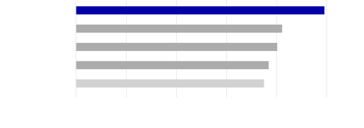

# Organon : From Evolutionary Search to Recursive Self-Improving Agents for Scientific Discovery

Cheikh Ahmed Affiliation: Huawei Technologies Canada    Zhiyu Zhang
Affiliation: Huawei Technologies    Kun Mao Affiliation: Huawei
Technologies    Yong Zhang Affiliation: Huawei Technologies Canada   
Zirui Zhou Affiliation: Huawei Technologies Canada

###### Abstract

Scientific discovery does not follow a single fixed methodology:
research methods vary across domains and evolve through experimentation
as investigations unfold. Although LLM-guided evolutionary search has
advanced automated discovery, existing frameworks typically rely on
fixed search procedures or restrict adaptation to predefined components,
limiting their ability to address diverse research problems and adapt to
challenges that emerge at runtime. We introduce Organon, a recursively
self-improving agent for scientific discovery. During execution, a
single persistent agent analyzes its accumulated experience and
autonomously revises its own search strategies, population management,
diagnostic tools, memory, and worker coordination. These revisions take
effect at runtime, allowing the agent to continuously adapt its approach
as research progresses. Importantly, the agent can also diagnose and
correct flaws in its own adaptation procedures, enabling recursive
improvement of the mechanisms that guide its future self-improvement. We
evaluate Organon across 21 computational discovery tasks spanning
algorithm design, GPU kernel optimization, mathematical construction,
and systems optimization. On ALE-Bench Lite, Organon achieves the best
performance among competing search frameworks on all 10 tasks, improving
mean held-out performance by 20.5% over EvoX. On KernelBench, it
achieves the best results on three of four workloads, with speedups of
up to $`1.67\times`$ over the strongest competing method. Analysis of
the search trajectories further reveals how the agent develops
task-specific search strategies, builds new diagnostic capabilities, and
corrects or reverses its own earlier revisions. We implement Organon
using DeepSeek Harness and Cordis’s spatiotemporal composability. Code
is available at
[https://github.com/cheikh025/Organon](https://github.com/cheikh025/Organon).

Figure 1: Organon on ALE-Bench. (a) On AHC026, markers show the agent
revising its own search; the gold dashed line traces the final best
program, which would have placed first. (b) Mean private performance
over the 10 ALE-Bench tasks.

## 1 Introduction

Scientific progress depends on how competing hypotheses are generated,
tested, and refined, and on how the methodology of inquiry itself
evolves in light of empirical evidence. Large language models (LLMs)
increasingly automate key stages of this process through autonomous
reasoning, tool use, and experimentation (Lu et al., 2024; Gottweis et
al., 2026), while coding agents sustain long-horizon computational
investigations (Karpathy, 2026; Lütke, 2026; Jaber and Jaber, 2026).
Throughout an investigation, these systems accumulate rich empirical
histories spanning candidate solutions, execution profiles, and failed
trials. Yet while existing agents steadily expand their knowledge of the
target problem, the operational mechanisms governing how they conduct
research remain largely static. A central challenge is enabling
autonomous systems to translate accumulated experience into durable
improvements in their own investigative process.

Evolutionary program search makes this challenge concrete by combining
LLM-generated variation with computational evaluation to refine a
population of executable candidates. FunSearch and AlphaEvolve
established this paradigm for mathematical and algorithmic discovery
(Romera-Paredes et al., 2023; Novikov et al., 2025), with subsequent
work advancing heuristic design, systems optimization, and reusable
evolution frameworks (Liu et al., 2024; Ye et al., 2024; Cheng et al.,
2025; Lange et al., 2026; Assumpção et al., 2026). In these systems,
explicit mechanisms for parent selection, variation, memory
organization, and resource allocation determine how accumulated evidence
guides future experimentation. However, their effectiveness shifts as
search progresses: a strategy that yields rapid early gains often
concentrates subsequent effort within a narrow family of solutions,
stalling long-horizon progress.

Recent evolutionary frameworks address this non-stationarity by adapting
designated components of the search pipeline. ShinkaEvolve, PACEvolve,
and AdaEvolve dynamically adjust population sampling, context
management, exploration schedules, and resource allocation (Lange et
al., 2026; Yan et al., 2026; Cemri et al., 2026). EvoX evolves
strategies for parent selection, variation, and inspiration-context
construction (Liu et al., 2026b), while Dream-RSI refines exploration
policies through replay over recorded discovery trees while keeping its
discovery agent fixed (Zheng et al., 2026). Because these approaches
confine adaptation to a predetermined subset of components and fixed
update procedures, their adaptive scope is bounded at design time. When
progress stalls due to bottlenecks outside those designated levers, or
within the revision procedures themselves, the system cannot diagnose
the underlying cause or restructure its operation.

Autonomous research agents offer complementary flexibility by
interpreting evidence and directing experiments through step-by-step
decisions, yet unconstrained in-context micro-decisions introduce an
equally fundamental limitation. Over long horizons, an agent making
ad-hoc local choices becomes absorbed in immediate task details and
exhibits cognitive biases toward familiar or currently leading
candidates. In single-incumbent workflows such as Autoresearch, this
bias confines exploration to local, incremental refinement (Karpathy,
2026; Virk et al., 2026). Multi-agent frameworks such as CORAL broaden
search through shared notes, reusable skills, and periodic heartbeat
interventions, yet shared experience can also amplify leader-following
and premature consensus, Configurable reflection and stagnation triggers
provide opportunities for redirection without necessarily correcting the
mechanisms sustaining unproductive search (Qu et al., 2026). Even when
SwarmResearch enforces centralized orchestration, controlled worker
context, and isolated search branches, its orchestrator remains blind to
its own decision biases, defaulting to near-greedy branch allocation and
struggling to plan strategic experiments despite targeted prompting
interventions (Virk et al., 2026). Together, these failure modes show
why decision-level autonomy is insufficient: without diagnostic
instruments to surface search pathologies and explicit, revisable
mechanisms to govern selection, reflection, and coordination,
step-by-step agent decisions might drift toward narrow, greedy behavior.

These limitations raise a fundamental question: can an autonomous
agent’s experience drive the continual self-improvement of how it
discovers? We argue that it can, in the sense Francis Bacon described
four centuries ago:

“…the art of discovery may advance as discoveries advance.”  
Francis Bacon, _Novum Organum_ (1620)

We introduce Organon, a recursively self-improving evolutionary agent
whose method of discovery advances with its discoveries. Its accumulated
experience informs revisions to both the mechanisms governing search and
the procedures governing its subsequent self-improvement. Rather than
relying on ad-hoc micro-decisions or adapting a fixed subset of
parameters, a single unified agent governs and modifies its entire
operational stack, including the evolutionary loop, parent selection,
candidate variation, population management, memory, tools, resource
allocation, and worker coordination. Drawing on its accumulated
population and search history, the agent decides when revision is
warranted, which operational rules or capabilities to develop or modify,
and how to evaluate their effects. Because each adopted revision becomes
part of the active agent, self-improvement extends directly to the
diagnostic tools, reusable skills, and decision procedures through which
Organon identifies its own limitations and evaluates subsequent changes.
Revising a diagnostic tool, for example, can expose an unrecognized
bottleneck or selection bias, prompting the agent to rewrite its
governing mechanisms and redirect future capability development.

Realizing this form of self-improvement requires changing capabilities
and governing rules during ongoing search without disrupting active
investigations or severing the link between historical evidence and
subsequent evaluation. We implement Organon using DeepSeek Harness and
Cordis’s spatiotemporal composability (DeepSeek-AI, 2026; Shi et al.,
2026). Reactive coeffects coordinate cross-component dependencies, while
revertible effects isolate and manage each component’s registered
contributions. Together, they enable capabilities to be added, replaced,
and withdrawn during live execution while preserving the accumulated
population and search history, maintaining continuity between the
experience that motivates a revision and the search used to assess its
effects.

Our contributions are threefold:

1.  1.  Recursive self-improvement for discovery: an agent that revises its
        own search, diagnostics, and revision procedures from accumulated
        experience.
2.  2.  State-preserving revision: through spatiotemporal composability (Shi
        et al., 2026), capabilities are added, replaced, or withdrawn during
        search without losing the population or its history.
3.  3.  Evaluation and analysis: strong results across 21 tasks, with an
        analysis of how the agent’s capabilities evolved.

## 2 Preliminaries

We consider scientific discovery tasks in which candidate solutions are
represented or generated by programs and assessed through computational
evaluation. Let $`\mathcal{X}`$ denote the space of admissible programs,
and let $`f:\mathcal{X}\rightarrow\mathbb{R}`$ be the official task
evaluator, with larger scores indicating better performance. Starting
from a baseline program $`x_{0}\in\mathcal{X}`$, the search seeks to
maximize the best task score attained within a budget of $`B`$
candidate-generation attempts. If $`x_{1},\ldots,x_{n}`$ are the
candidates evaluated during the run, where $`n\leq B`$, the returned
solution satisfies

```math
\hat{x}\in\arg\max_{x\in\{x_{0},x_{1},\ldots,x_{n}\}}f(x). \tag{1}
```

The official evaluator and candidate-generation budget remain fixed
throughout the investigation.

Evolutionary search organizes candidate generation around a population
of previously evaluated programs. Parent selection determines which
candidates are developed, variation produces new candidates from the
selected parents, and population management determines which evaluated
candidates are retained for subsequent search. Together, these
procedures govern how effort is distributed across competing approaches
and how experimental feedback influences the development of new
solutions.

The search accumulates a history of evaluated candidates, scores,
evaluation feedback, and parent–offspring relationships. The active
population provides candidates for further development, while the
history records the outcomes of earlier search decisions. This evidence
supports the assessment of candidate quality and the examination of
search behavior, including which approaches are repeatedly pursued,
which variations yield progress, and how retention shapes subsequent
exploration. Accumulated experience therefore provides a basis for
investigating how the procedures governing search can develop over the
course of discovery.

## 3 Method

Figure 2: Overview of Organon. (a) A single agent $`\mathcal{A}_{r}`$
conducts research through an editable composition $`\mathcal{C}_{r}`$,
including its evolutionary search loop $`L_{r}`$, and revises itself
between bounded search calls of $`k\leq B_{\text{remaining}}`$ attempts;
each adopted revision yields $`\mathcal{A}_{r+1}`$ with composition
$`\mathcal{C}_{r+1}`$, while the population and history $`\mathcal{H}`$
persist. (b) Illustrative revisions across the agent composition.

### 3.1 The Evolutionary Agent and Its Research Capabilities

#### 3.1.1 Agent Composition and Persistent State

Organon conducts each investigation as a single continuing agent whose
capabilities evolve with task experience while the problem definition
$`(x_{0},f,B)`$ remains fixed (Figure 2a). After $`r\geq 0`$ adopted
capability revisions, let $`\mathcal{A}_{r}`$ denote the agent and
$`\mathcal{C}_{r}`$ its active editable composition. The composition
$`\mathcal{C}_{r}`$ encompasses all components governing the agent’s
operation and their connections:

```math
\mathcal{C}_{r}=\bigl(L_{r},\,\mathcal{T}_{r},\,\mathcal{M}_{r},\,\mathcal{W}_{r},\,\Phi_{r}\bigr), \tag{2}
```

where $`L_{r}`$ is the evolutionary search capability,
$`\mathcal{T}_{r}`$ denotes the available tools and skills (including
internal diagnostics), $`\mathcal{M}_{r}`$ is the memory and context
management, $`\mathcal{W}_{r}`$ specifies worker subagent coordination,
and $`\Phi_{r}`$ is the agent’s execution loop and instructions.

Alongside its editable composition $`\mathcal{C}_{r}`$, the agent
maintains a persistent population and history $`\mathcal{H}`$ that
accumulates across the entire run:

```math
\mathcal{H}=\bigl(\mathcal{P},\,\mathcal{R}_{\text{cand}},\,\mathcal{F}_{\text{work}},\,\mathcal{R}_{\text{rev}}\bigr), \tag{3}
```

comprising the active population $`\mathcal{P}\subseteq\mathcal{X}`$,
full candidate records $`\mathcal{R}_{\text{cand}}`$ (evaluated programs
$`x_{i}`$, official scores $`f(x_{i})`$, evaluation feedback,
parent–offspring lineages, and survival status), worker findings
$`\mathcal{F}_{\text{work}}`$, and the revision history
$`\mathcal{R}_{\text{rev}}`$. While $`\mathcal{C}_{r}`$ defines how the
agent currently researches and improves itself, $`\mathcal{H}`$
preserves the empirical evidence accumulated across all preceding search
calls and agent revisions.

#### 3.1.2 Evolutionary Search as an Agent Capability

Within $`\mathcal{C}_{r}`$, the evolutionary search capability is
organized by a control loop $`L_{r}`$ coordinating four adaptable
procedures:

```math
L_{r}=\bigl(\operatorname{Sel}_{r},\,\operatorname{Var}_{r},\,\operatorname{Eval}_{r},\,\operatorname{Surv}_{r}\bigr), \tag{4}
```

corresponding to parent selection, candidate variation, internal
evaluation protocol, and population survival. Search is initialized by
evaluating the baseline program $`x_{0}`$ with $`f`$ and recording
$`(x_{0},f(x_{0}))`$ in $`\mathcal{H}_{0}`$ without consuming the
attempt budget $`B`$. In the initial composition $`\mathcal{C}_{0}`$,
$`\operatorname{Sel}_{0}`$ samples parents from the active population
$`\mathcal{P}`$ using fitness-derived weights.

Each candidate attempt $`x_{i}`$ is a delegated development task carried
out by a worker subagent under $`\mathcal{W}_{r}`$ in an isolated
workspace initialized from the selected parent(s). Organon supplies the
worker’s prompt, role, tools, skills, and relevant context from
$`\mathcal{H}`$. The variation procedure $`\operatorname{Var}_{r}`$
organizes candidate development under this specification, allowing the
agent to revise how workers are prepared, guided, and supported as the
investigation progresses.

Once a worker produces a candidate $`x_{i}`$, the evaluation protocol
$`\operatorname{Eval}_{r}`$ invokes the fixed task evaluator
$`f(x_{i})`$ to obtain the official fitness score and execution
feedback, alongside any auxiliary tests or diagnostics in
$`\mathcal{T}_{r}`$; development or evaluation failures are likewise
recorded as attempt outcomes. The survival policy
$`\operatorname{Surv}_{r}`$ then updates the active population
$`\mathcal{P}`$ (initially retaining the highest-scoring candidates
within population capacity) and appends the new record to
$`\mathcal{H}`$:

```math
\displaystyle x_{\text{par}} \displaystyle\sim\operatorname{Sel}_{r}(\mathcal{H}),\qquad \displaystyle x_{i}\sim\operatorname{Var}_{r}(x_{\text{par}},\mathcal{H};\,\mathcal{W}_{r},\mathcal{T}_{r}), \tag{5}
```

```math
\displaystyle y_{i} \displaystyle=\operatorname{Eval}_{r}(x_{i};\,f,\mathcal{T}_{r}),\qquad \displaystyle\mathcal{H}\leftarrow\operatorname{Surv}_{r}\bigl(\mathcal{H},\,(x_{i},x_{\text{par}},y_{i})\bigr).
```

All four procedures in $`L_{r}`$ belong to the editable composition
$`\mathcal{C}_{r}`$, whereas $`f`$ remains the fixed, authoritative
scoring function. We realize this composition on DeepSeek
Harness (DeepSeek-AI, 2026), using the spatiotemporal composability
framework of Shi et al. (2026) detailed in Section 3.3.

### 3.2 Recursive Self-Improvement During Search

Organon couples two levels of evolution within a single task run:
_candidate evolution_, which updates the persistent search state
$`\mathcal{H}`$ under the current composition $`\mathcal{C}_{r}`$, and
_capability evolution_, which revises the composition
$`\mathcal{C}_{r}\to\mathcal{C}_{r+1}`$ using the evidence accumulated
in $`\mathcal{H}`$.

#### 3.2.1 Research Horizons

At each decision point, given a remaining attempt budget
$`B_{\text{remaining}}\in(0,B]`$, the agent $`\mathcal{A}_{r}`$ selects
a _research horizon_ $`k\in\{1,\dots,B_{\text{remaining}}\}`$ specifying
how many candidate-generation attempts to allocate before reassessing
the investigation. During the horizon, $`\mathcal{C}_{r}`$ is held fixed
while the search loop $`L_{r}`$ executes up to $`k`$ candidate attempts
according to Equation (5):

```math
\mathcal{H}^{\prime}=L_{r}\bigl(\mathcal{H};\,\mathcal{C}_{r},\,f,\,k\bigr),\qquad B_{\text{remaining}}^{\prime}=B_{\text{remaining}}-k. \tag{6}
```

Each allocated candidate attempt consumes one unit of $`B`$, including
attempts that fail during development or evaluation.

When the bounded search call returns, $`\mathcal{A}_{r}`$ inspects the
updated evidence in $`\mathcal{H}^{\prime}`$, including score
progression, lineage concentration, evaluation feedback, and worker
findings, and chooses whether to continue searching with the current
composition $`\mathcal{C}_{r}`$, revise its capabilities to form
$`\mathcal{C}_{r+1}`$, or conclude the investigation:

```math
\mathcal{C}_{r+1}=\begin{cases}\mathcal{C}_{r},&\text{if }\mathcal{A}_{r}\text{ continues under the current composition},\\[3.0pt]
\operatorname{Revise}\bigl(\mathcal{C}_{r},\,\mathcal{H}^{\prime}\bigr),&\text{if }\mathcal{A}_{r}\text{ adopts a capability revision}.\end{cases} \tag{7}
```

Several research horizons may therefore proceed under the same
composition before a revision is adopted. Search ends when
$`B_{\text{remaining}}=0`$ or when the agent judges the investigation
complete, returning the highest-scoring officially evaluated candidate
$`\hat{x}\in\arg\max_{x\in\mathcal{H}}f(x)`$ (including $`x_{0}`$) and a
final report.

#### 3.2.2 From Evidence to Capability

When $`\mathcal{A}_{r}`$ elects to revise itself, it uses its reasoning
loop $`\Phi_{r}`$, tools $`\mathcal{T}_{r}`$, and accumulated history
$`\mathcal{H}^{\prime}`$ to diagnose limitations in its current
operation and construct a capability change (Figure 2b). A revision can
introduce, modify, or withdraw a component, or alter how components
interact across any part of $`\mathcal{C}_{r}`$: search scheduling and
population structure ($`L_{r}`$), parent selection
($`\operatorname{Sel}_{r}`$), variation operators
($`\operatorname{Var}_{r}`$), internal evaluation and verification
($`\operatorname{Eval}_{r}`$), reusable tools and skills
($`\mathcal{T}_{r}`$), memory and worker coordination
($`\mathcal{M}_{r},\mathcal{W}_{r}`$), or the agent execution loop
($`\Phi_{r}`$).

For illustration, consider a search that repeatedly expands one
high-scoring lineage while its descendants yield diminishing returns. By
inspecting $`\mathcal{H}^{\prime}`$, the agent may first add a
diagnostic tool to $`\mathcal{T}_{r}`$ that summarizes effort allocation
and score gains across branches of the candidate ancestry graph. It can
then revise the parent-selection policy $`\operatorname{Sel}_{r}`$ to
weight lineages using these diagnostic summaries, redirecting subsequent
attempts toward under-explored, promising branches.

Similarly, recurring compilation or runtime failures recorded in
$`\mathcal{H}^{\prime}`$ can motivate changes to candidate development.
The agent may revise worker instructions in $`\mathcal{W}_{r}`$, add a
static checking or repair skill to $`\mathcal{T}_{r}`$, or record known
failure modes and remedies in memory $`\mathcal{M}_{r}`$ for future
worker preparation. Because diagnostics and assessment procedures are
themselves part of $`\mathcal{C}_{r}`$, refining how
$`\mathcal{H}^{\prime}`$ is analyzed directly improves the agent’s
capacity to propose and evaluate subsequent self-improvements.

#### 3.2.3 Self-Improvement Through Composition

A capability revision transforms $`\mathcal{C}_{r}`$ into
$`\mathcal{C}_{r+1}`$ through integration into the live runtime context.
Let $`\Gamma_{r}`$ denote the runtime context realizing
$`\mathcal{C}_{r}`$. A component $`p`$ participates in $`\Gamma_{r}`$
when its declared dependencies (coeffects) are satisfied. Activating
$`p`$ applies an effect $`e_{p}`$ that yields a revised context
$`\Gamma_{r+1}`$ together with a tracked reversion $`u_{p}`$:

```math
e_{p}(\Gamma_{r})=(\Gamma_{r+1},\,u_{p}),\qquad u_{p}(\Gamma_{r+1})\simeq\Gamma_{r}. \tag{8}
```

Here $`\simeq`$ denotes equivalence of the active context after
withdrawing $`p`$’s registered contributions with all other components
held fixed (Shi et al., 2026). Reactive coeffects automatically
coordinate component activation as dependencies change, while revertible
effects allow any adopted revision to be cleanly replaced or withdrawn
if subsequent horizons show that it is ineffective.

Returning to the lineage example, let $`\Gamma_{r}`$ include the lineage
diagnostic and let component $`p`$ register a revised parent-selection
policy $`\pi_{p}`$. Activating $`p`$ updates the selector bound to the
search loop while preserving reversibility:

```math
\operatorname{Sel}(\Gamma_{r+1})=\pi_{p},\qquad\operatorname{Sel}\bigl(u_{p}(\Gamma_{r+1})\bigr)=\operatorname{Sel}(\Gamma_{r}). \tag{9}
```

Revisions take effect between research horizons. Once $`\Gamma_{r+1}`$
(realizing $`\mathcal{C}_{r+1}`$) is active, the agent resumes as
$`\mathcal{A}_{r+1}`$, launches the next bounded search horizon
$`L_{r+1}(\mathcal{H}^{\prime};\,\mathcal{C}_{r+1},f,k^{\prime})`$, and
evaluates from the resulting outcomes whether to retain, refine, or
withdraw $`p`$. Crucially, while $`\mathcal{C}_{r}\to\mathcal{C}_{r+1}`$
evolves across revisions, the persistent history
$`\mathcal{H}^{\prime}`$, remaining budget
$`B_{\text{remaining}}^{\prime}`$, and official evaluator $`f`$ remain
invariant across composition changes.

### 3.3 Implementation Details

We implement Organon on DeepSeek Harness (DeepSeek-AI, 2026), whose
dynamically composed runtime supplies model access, instructions, tools,
session state, and the agent’s execution loop through replaceable
components. Within this runtime, we add an evolutionary search service
exposing five replaceable provider interfaces: the evolutionary loop,
parent selection, candidate variation, evaluation, and population
survival. These interfaces are part of the agent’s active composition
alongside its skills, memory, worker subagents, and other capabilities.
The initial providers realize the search described in Section 3.1. Each
call to the service uses the active provider for every operation,
including the evolutionary loop, so a provider change governs subsequent
candidate search.

The agent revises these providers by defining a dynamic component with
declared service dependencies and activating it in its session. A
component registers its contribution through a tracked effect; the most
recently registered provider for a given operation becomes active.
Deactivating the component withdraws its registration and restores the
preceding available provider. The agent can also activate a revised
version of a component. These changes occur between bounded calls to the
evolutionary loop, after the agent has examined the results of the
preceding call and decided how to proceed.

The search state persists across these calls. Candidate records retain
parent identifiers, fitness scores, and survival status, while
evaluation artifacts provide feedback for subsequent decisions. The
task’s evaluator supplies the official fitness $`f`$, and a new
candidate consumes one unit of the fixed budget $`B`$ when it is
allocated; the initial program $`x_{0}`$ consumes none. The agent
chooses how many candidates to attempt in each call, can inspect the
remaining budget and active providers, and may use additional
diagnostics to guide further search or self-improvement.

## 4 Experiments

We evaluate the quality of programs discovered by Organon across
algorithm design, kernel engineering, mathematical construction, and
system optimization. The experiments examine performance under a common
candidate-generation allowance and characterize how the resulting
advantages vary across task families.

### 4.1 Experimental Setup

##### Tasks and comparison methods.

We consider 21 tasks across four categories. Algorithm design comprises
the ten ALE-Bench Lite tasks (Imajuku et al., 2025). Kernel engineering
comprises four KernelBench workloads: VGG16, LayerNorm, ConvDiv, and
ConvMax (Ouyang et al., 2025). Mathematical construction includes
packing 26 circles in a unit square, minimizing third-order
autocorrelation, and the Heilbronn triangle problem with 11 points in an
equilateral triangle. System optimization includes Model Placement
(PRISM), Expert Parallelism Load Balancer (EPLB), Column Reordering for
Prefix Caching (LLM-SQL), and Multi-Cloud Data Transfer Optimization
(Cloudcast) (Cheng et al., 2025). Each task provides a starting program
and a task-specific evaluator.

We compare Organon with OpenEvolve (Sharma, 2025), ShinkaEvolve (Lange
et al., 2026), and EvoX (Liu et al., 2026b). These methods are run
through SkyDiscover (Liu et al., 2026c), using its EvoX implementation
and external backends for OpenEvolve and ShinkaEvolve. All four methods
use DeepSeek-V4.1-Flash with high reasoning effort and a maximum of
$`B=100`$ candidate-generation attempts per task.¹¹ 1 On AHC016, AHC046,
and third-order autocorrelation, the agent routed 38 of 300 candidates
to DeepSeek-V4-Pro, which ranks below DeepSeek-V4.1-Flash on independent
evaluations (Artificial Analysis, 2026). For a fair comparison, worker
subagents operate in a sandbox without shell or web access: each can
only edit the source of its own candidate and cannot compile, execute,
or test it. This matches the comparison methods, whose language model
likewise proposes code without running it, and prevents a worker from
substituting local trial-and-error for evaluated candidate attempts.
Execution-based checks therefore arise only when the agent introduces
them as part of its own search capabilities (Appendix A.4). The starting
program is evaluated separately and does not consume this budget.
Evaluation of the starting program is excluded from this allowance. The
comparison therefore aligns the language-model backbone and maximum
candidate count.

##### Evaluation and references.

On ALE-Bench, search and program selection use 50 public test cases. We
report the mean private performance over three evaluations of each
selected program and average these values across the ten tasks for the
aggregate result. Kernel results are speedups relative to PyTorch eager,
with correctness checks and runtime measurements conducted through
Modal. Mathematical results are best-found objective values. System
results are means over three evaluations of each selected program.

We report ALE-Agent, which supplies the ALE-Bench starting programs, as
an initialization reference. Mathematical references are computed from
AlphaEvolve’s released constructions (Google DeepMind, 2025). System
references are the human-best values reported in EvoX (Liu et al.,
2026b). These references provide context for attained solution quality;
the four re-run search methods form the comparison under the common
candidate allowance.

### 4.2 ALE-Bench Results

ALE-Bench evaluates whether programs selected using public cases retain
their advantage on private cases. Figure 3 reports mean private
performance, and Table 1 shows the task-level results.



Figure 3: Mean private performance across the ten ALE-Bench Lite tasks.
Higher is better. ALE-Agent is an initialization reference.

| ID                            | Task                     | ALE-Agent | OpenEvolve | ShinkaEvolve | EvoX   | Organon |
| ----------------------------- | ------------------------ | --------- | ---------- | ------------ | ------ | ------- |
| AHC008                        | Territory                | 1186.0    | 1257.0     | 1247.0       | 1265.0 | 1323.0  |
| AHC011                        | Sliding Tree Puzzle      | 1652.0    | 1675.0     | 1665.0       | 1652.0 | 1856.3  |
| AHC015                        | Halloween Candy          | 2405.0    | 2411.0     | 2481.7       | 2638.7 | 3043.0  |
| AHC016                        | Graphorean               | 1450.7    | 1496.0     | 1547.0       | 2120.3 | 2943.0  |
| AHC024                        | Topological Map          | 1977.0    | 2027.0     | 2254.3       | 2231.7 | 2262.7  |
| AHC025                        | Balancing by Balance     | 1370.7    | 1372.0     | 1901.0       | 1421.0 | 2017.3  |
| AHC026                        | Stack of Boxes           | 1981.3    | 1977.7     | 2083.0       | 1983.0 | 3451.0  |
| AHC027                        | Recurring Cleaning Route | 1731.3    | 1869.0     | 1862.0       | 2015.0 | 2188.0  |
| AHC039                        | Purse Seine Fishing      | 2847.3    | 2947.3     | 2880.0       | 2974.0 | 3140.0  |
| AHC046                        | Skating with Blocks      | 2153.0    | 2194.0     | 2155.7       | 2262.0 | 2562.0  |
| Mean performance $`\uparrow`$ |                          | 1875.4    | 1922.6     | 2007.7       | 2056.3 | 2478.6  |

Table 1: Private performance on ALE-Bench Lite. Task values are means
over three evaluations of the selected program; the final row averages
across tasks. Higher is better. Bold marks the largest reported value
among the four compared search methods. ALE-Agent is an initialization
reference.

Organon achieves the highest mean private performance of 2478.6,
exceeding EvoX, the strongest comparison method on average, by 20.5% and
the ALE-Agent reference by 32.2%. It obtains the highest reported score
on all ten tasks, with gains varying in magnitude across problems. Since
search and program selection use public cases, these results establish
that the discovered improvements extend to held-out cases within the
evaluated tasks.

### 4.3 KernelBench Results

KernelBench tests whether discovered programs yield faster
implementations under computational correctness checks. Table 2 reports
speedups relative to PyTorch eager on four selected workloads.
Correctness checks and timing are conducted through Modal using the
KernelBench evaluation procedure.²² 2
[https://github.com/ScalingIntelligence/KernelBench/blob/main/EVAL.md](https://github.com/ScalingIntelligence/KernelBench/blob/main/EVAL.md)

| Task      | OpenEvolve      | ShinkaEvolve    | EvoX                    | Organon                  |
| --------- | --------------- | --------------- | ----------------------- | ------------------------ |
| VGG16     | $`2.10\times`$  | $`1.96\times`$  | $`1.89\times`$          | $`\mathbf{3.34\times}`$  |
| LayerNorm | $`16.13\times`$ | $`17.44\times`$ | $`16.56\times`$         | $`\mathbf{18.70\times}`$ |
| ConvDiv   | $`1.90\times`$  | $`3.34\times`$  | $`3.26\times`$          | $`\mathbf{5.58\times}`$  |
| ConvMax   | $`2.16\times`$  | $`2.13\times`$  | $`\mathbf{2.75\times}`$ | $`2.29\times`$           |

Table 2: KernelBench speedups relative to PyTorch eager. Higher is
better. Bold marks the largest reported speedup on each workload.

Organon achieves the highest speedup on three of the four workloads,
with execution-time reductions of up to 40.1% relative to the strongest
comparator on the same workload. The remaining workload favors EvoX,
indicating that the comparative advantage depends on the optimization
problem. Overall, the results demonstrate strong kernel optimization
performance under the common candidate allowance, extending the method’s
applicability to runtime-sensitive program discovery.

### 4.4 Mathematical Construction Results

The mathematical tasks evaluate the objective values of the
constructions produced by search. Table 3 reports the attained values
alongside references computed from released AlphaEvolve constructions.

| Task                                       | AlphaEvolve ref. | OpenEvolve   | ShinkaEvolve | EvoX         | Organon      |
| ------------------------------------------ | ---------------- | ------------ | ------------ | ------------ | ------------ |
| Circle packing, $`n=26`$ $`\uparrow`$      | 2.635863         | 2.630188     | 2.635983     | 2.635987     | 2.635314     |
| Third-order autocorrelation $`\downarrow`$ | 1.4556428        | 1.4566544    | 1.4575646    | 1.4570839    | 1.4562828    |
| Heilbronn triangle $`\uparrow`$            | 0.0365298899     | 0.0365295964 | 0.0365298899 | 0.0365298899 | 0.0365035354 |

Table 3: Mathematical construction results: sum of radii for circle
packing, $`C_{3}`$ for autocorrelation, and minimum triangle area
normalized by the containing triangle’s area for Heilbronn. Arrows
indicate the direction of improvement; bold marks the best reported
value among the four compared search methods, including ties.
AlphaEvolve references are computed from released constructions (Google
DeepMind, 2025).

Organon obtains the best third-order autocorrelation result among the
compared methods and comes closest to the AlphaEvolve construction
reference. On the geometric tasks, it produces constructions close to
the reference values, but EvoX and ShinkaEvolve attain stronger results.
The mathematical results therefore distinguish successful optimization
on autocorrelation from a remaining gap on circle packing and Heilbronn.

The geometric shortfall may reflect difficulty progressing beyond strong
configurations within the available budget. Once search reaches such a
configuration, further refinement can yield diminishing gains, while
alternative configurations may be difficult to discover. EvoX likewise
reports stagnation associated with strong local optima in its
mathematical experiments (Liu et al., 2026b). This offers a plausible
interpretation of the geometric results, while the autocorrelation win
shows that the limitation does not extend uniformly across the
mathematical tasks.

### 4.5 System Optimization Results

System optimization assesses the resulting programs against
application-specific objectives. PRISM, EPLB, and LLM-SQL are
maximization tasks; Cloudcast minimizes transfer cost. Table 4 separates
comparison among the search methods from comparison with the cited
human-best references.

| Task                     | Human best | OpenEvolve | ShinkaEvolve | EvoX     | Organon  |
| ------------------------ | ---------- | ---------- | ------------ | -------- | -------- |
| PRISM $`\uparrow`$       | 21.89      | 26.2560    | 26.2560      | 26.2560  | 26.2560  |
| EPLB $`\uparrow`$        | 0.1265     | 0.1461     | 0.1456       | 0.1471   | 0.1473   |
| LLM-SQL $`\uparrow`$     | 0.6920     | 0.7284     | 0.7282       | 0.7194   | 0.7367   |
| Cloudcast $`\downarrow`$ | 626.24     | 618.0945   | 619.9607     | 618.0876 | 618.0596 |

Table 4: System-optimization objectives, averaged over three evaluations
of each selected program. Arrows indicate the direction of improvement;
bold marks the best reported mean among the four compared search
methods, including ties. Human-best references are from Table 3 of
EvoX (Liu et al., 2026b).

Every compared method improves on the cited human-best references across
all four tasks. On PRISM, all methods attain 26.2560, approximately
19.9% above the reference. This shared outcome demonstrates the value of
automated search relative to that reference while offering limited
discrimination among the evaluated methods.

The largest comparative margin for Organon occurs on LLM-SQL. Its
objective of 0.7367 exceeds OpenEvolve’s 0.7284 by 0.0083, or 1.14%.
EPLB and Cloudcast show much closer results: the respective improvements
over EvoX are 0.0002 and 0.0280, corresponding to approximately 0.136%
and 0.0045%. These are the best reported means, with their small margins
making variability an important part of interpreting the ranking. The
system results thus identify LLM-SQL as the clearest comparative gain,
alongside a shared PRISM outcome and closely spaced EPLB and Cloudcast
results.

## 5 Anatomy of Agent Self-Improvement

Organon’s search trajectories reveal how accumulated experience reshaped
the agent’s research process, from the policies directing search to the
capabilities used to diagnose limitations and assess revisions. The
agent revised its composition on all 21 tasks, first after a median of
four candidate attempts (range 1–8), with 2–22 activated revisions per
run (median 11), each motivated by measured evidence (Table 10). On
seven tasks, no candidate generated under the initial composition
$`\mathcal{C}_{0}`$ improved on $`x_{0}`$; on 14 of 21, at least 70% of
the total improvement followed the first revision (Table 5). Figure 4
shows that these changes were broad and task-specific: no two runs
modified the same subset of capabilities (Table 6). Three connected
perspectives organize the analysis: revising the search policy,
developing the means of investigation, and assessing the agent’s own
changes.

Figure 4: Recorded capability changes across 21 runs. Colored cells
indicate changes exercised during search; gray cells indicate none
recorded. Colors group the three perspectives below; $`n`$ counts runs.
Variation, memory, and self-correction occur in every run.

##### I. Revising the search policy.

Organon developed a task-specific search policy through the co-evolution
of variation, selection, and survival. Evidence that unconstrained
rewrites disrupted effective mechanisms prompted a shift from generic
mutation to portfolios separating bounded refinement from structural
redesign, with specialized operators targeting runtime margins, isolated
design choices, and inactive mechanisms (Table 8). Recombination
expanded inheritance across five granularities on 14 tasks, including
individual contributions, measured gains, and design rationales. The
allocation and scale of variation followed measured yield: AHC024 raised
crossover from one-third to two-thirds of attempts after observing mean
parent-relative gains of $`+4.3`$ versus $`+0.5`$ for other operators,
while AHC008 favored 20–140-line edits, which improved their parents in
24 of 61 attempts, compared with 1 of 11 for larger revisions. Selection
evolved in parallel, combining rank-, tournament-, and elite-based
sampling with load-aware weighting (AHC025), recency penalties (AHC027),
and stagnation-triggered broadening (AHC008, ConvDiv) to balance
exploitation against redundant concentration. Crucially, variation’s
growing specialization changed which candidates were valuable to select
and preserve. In AHC026, substantial redesign gains originated
exclusively from parents below approximately $`27`$ KB, motivating
size-aware selection; discovering that top-$`k`$ survival had eliminated
these candidates then prompted preservation of the strongest compact
program. More broadly, survival extended beyond fitness-based retention
to safeguard behavioral niches (LLM-SQL), distinct ancestries
(Heilbronn), repairable failures (VGG16), and successful archived
candidates.

##### II. Developing the means of investigation.

The agent also expanded the diagnostic instruments, execution workflows,
and memory governing subsequent research. On 19 tasks, custom
measurement tools determined what to revise next: harness analysis in
LayerNorm traced seven of eight initial failures to an indented Triton
import rule (unlocking a $`15.98\times`$ kernel); per-case profiles in
AHC011 showed the baseline never completed a tree; repeated-mean ranking
(5 tasks) mitigated $`\pm 5\%`$ evaluation noise in ConvDiv (raising
speedup from $`3.29\times`$ to $`5.93\times`$); and feasibility and
bandwidth probes in PRISM and LayerNorm established objective
saturation, redirecting search toward simplicity and cache reuse.
Workflow revisions (16 tasks) paired concurrent or streaming generation
with serialized evaluation, inserted pre-evaluation compilation and
regression repair (6 tasks), tuned concurrency from throughput
measurements (AHC026 reverted from eight to five workers after measuring
$`0.205`$ vs. $`0.269`$ candidates/min), and lengthened assessment
horizons as compositions stabilized (19 of 21 tasks). Meanwhile, memory
(21 tasks; Appendix A.9) evolved from passive digests into active
control driving topic-based exploration (AHC008) and gain-merge
assignments (AHC046). In circle packing, diagnosing that time-dependent
constructors failed to reproduce the frontier from code alone led the
agent to store and verify the best 26-circle arrangement as numerical
data, ending a 17-attempt plateau ($`2.6287\to 2.6353`$).

##### III. Assessing and revising its own changes.

The same empirical scrutiny extended to the agent’s revised
capabilities. Assessment addressed both whether a change operated as
intended and whether its continued use was supported by subsequent
outcomes. Component histories exposed discrepancies that task scores
alone could not reveal: in AHC025, an inverted survival rule retained
the five weakest candidates, and correcting it revived a culled
candidate from which the final winner descended (Table 10). This
scrutiny also reached the instruments guiding further revision.
Correcting AHC011’s completion check exposed a twelve-tree regression
and changed subsequent worker guidance, revising the evidence on which
later interventions depended. Withdrawal complemented correction on 12
tasks. AHC016 abandoned alternative-model routing after ten candidates
yielded no gain at more than twice the generation time; Cloudcast
restored a prior component version while retaining the population and
diagnostics accumulated under its replacement. State-preserving reversal
allowed the agent to reject an operational hypothesis without discarding
the experience acquired under it.

## 6 Related Work

##### LLM-guided evolutionary search.

LLM-guided evolution combines code generation with empirical evaluation
and reuse of earlier candidates. ELM and FunSearch established this
approach through language-model variation and populations of evaluated
programs (Lehman et al., 2022; Romera-Paredes et al., 2023).
AlphaEvolve (Novikov et al., 2025) extends it to larger programs and
richer feedback, including co-evolved prompt instructions and context.
Later methods improve candidate sampling and model selection (Lange et
al., 2026), or represent search history through semantic program
changes (Jiang et al., 2026). Search adaptation also includes
progress-based trajectory management (Yan et al., 2026) and control of
exploration and resource allocation (Cemri et al., 2026). EvoX (Liu et
al., 2026b) directly evolves strategies for parent selection,
variation-operator choice, and inspiration context, using stagnation and
population history to guide revisions. CORAL and SwarmResearch introduce
autonomous multi-agent exploration and coordinated search  (Qu et al.,
2026; Virk et al., 2026). Dream-RSI (Zheng et al., 2026) evaluates
exploration policies through replay of recorded discovery trees before
redeploying them with a fixed discovery agent. Both use discovery
experience to improve subsequent search decisions.

##### Self-evolving agents.

Self-evolving agents revise the mechanisms governing task execution.
Harness optimization ranges from prompt-level workflow revision (Lee et
al., 2026a) to changes in executable harnesses, context management,
tools, and memory (Lee et al., 2026b; Lin et al., 2026; Liu et al.,
2026a). Complementary work addresses the search over agent variants:
SIFT (Fu et al., 2026) uses inexpensive pairwise judgments alongside
benchmark feedback in asynchronous tree search, while RRSI (Xia et al., 2026) regularizes proposals and selection to discourage
benchmark-specific edits, unstable gains, and unjustified resource
growth. Recursive approaches make agent code part of the improvement
process. STOP (Zelikman et al., 2024) applies an improver to its own
source, and the Darwin Gödel Machine (Zhang et al., 2026a) evolves an
archive of self-modifying coding agents. Hyperagents (Zhang et al.,
2026b) make both task execution and the mechanism generating future
modifications editable. AIDE² (Srikanth et al., 2026) uses an outer
research agent to rewrite an inner optimization agent, selecting
revisions through downstream research performance under fixed task
budgets.

## 7 Conclusion

We introduced Organon, a recursively self-improving evolutionary agent
that develops its research capabilities during discovery. A single
persistent agent revises its search policies, its diagnostic
instruments, and the procedures that govern its further revision, while
retaining its population and accumulated experience. Across 21 tasks,
Organon achieves strong results in algorithm design, kernel engineering,
and system optimization and remains competitive in mathematical
construction, and its trajectories show accumulated evidence becoming
task-specific strategies, tools, and memory. Future work should isolate
the contribution of individual revisions through repeated runs and
controlled ablations, and carry capabilities developed on one task into
the next, so that self-improvement compounds across problems as well as
within them.

## References

- Artificial Analysis (2026) Artificial Analysis Model Comparison:
  DeepSeek V4 Pro and DeepSeek V4.1 Flash. Note:
  [https://artificialanalysis.ai/models/releases/comparisons?compare=deepseek-v4-pro,deepseek-v4-1-flash](https://artificialanalysis.ai/models/releases/comparisons?compare=deepseek-v4-pro,deepseek-v4-1-flash)Accessed
  2026-10-13 External Links:
  [Link](https://artificialanalysis.ai/models/releases/comparisons?compare=deepseek-v4-pro,deepseek-v4-1-flash)
  Cited by: footnote 1.
- Assumpção et al. (2026) H. Assumpção, D. Ferreira, L. Campos, and F.
  Murai CodeEvolve: an open source evolutionary coding agent for
  algorithmic discovery and optimization. External Links: 2510.14150,
  [Link](https://arxiv.org/abs/2510.14150) Cited by: §1.
- Cemri et al. (2026) M. Cemri, S. Agrawal, A. Gupta, S. Liu, A.
  Cheng, Q. Mang, A. Naren, L. E. Erdogan, K. Sen, M. Zaharia, A.
  Dimakis, and I. Stoica AdaEvolve: adaptive llm driven zeroth-order
  optimization. External Links: 2602.20133,
  [Link](https://arxiv.org/abs/2602.20133) Cited by: §1, §6.
- Cheng et al. (2025) A. Cheng, S. Liu, M. Pan, Z. Li, B. Wang, A.
  Krentsel, T. Xia, M. Cemri, J. Park, S. Yang, J. Chen, L. Agrawal, A.
  Desai, J. Xing, K. Sen, M. Zaharia, and I. Stoica Barbarians at the
  gate: how ai is upending systems research. External Links: 2510.06189,
  [Link](https://arxiv.org/abs/2510.06189) Cited by: §1, §4.1.
- DeepSeek-AI (2026) DeepSeek-AI DeepSeek Harness. Note:
  [https://github.com/deepseek-ai/deepseek-harness](https://github.com/deepseek-ai/deepseek-harness)
  External Links:
  [Link](https://github.com/deepseek-ai/deepseek-harness) Cited by: §1,
  §3.1.2, §3.3.
- Fu et al. (2026) X. Fu, A. Kulanthaivelu, and Y. Yamada Self
  improvement via fast tree-search. External Links: 2609.19526,
  [Link](https://arxiv.org/abs/2609.19526) Cited by: §6.
- Google DeepMind (2025) Google DeepMind Results of AlphaEvolve:
  Mathematical Results. Note:
  [https://github.com/google-deepmind/alphaevolve_results/blob/main/mathematical_results.ipynb](https://github.com/google-deepmind/alphaevolve_results/blob/main/mathematical_results.ipynb)
  External Links:
  [Link](https://github.com/google-deepmind/alphaevolve_results/blob/main/mathematical_results.ipynb)
  Cited by: §4.1, Table 3.
- Gottweis et al. (2026) J. Gottweis, W. Weng, A. Daryin, T. Tu, P.
  Sirkovic, A. Myaskovsky, G. Glowaty, F. Weissenberger, A. Orlandi, D.
  Popovici, A. Palepu, K. Rong, R. Tanno, K. Saab, F. Zhang, J. Blum, A.
  Carroll, K. Kulkarni, N. Tomašev, D. Zverinski, I. Rendulic, E.
  Vedadi, F. Hasler, L. Rimanic, M. Boia, I. Budiselic, B. Feinstein, M.
  Bellaiche, T. Sheffer, J. Freyberg, J. Ratcliff, O. Bertolli, K.
  Chou, A. Hassidim, B. Gokturk, A. Vahdat, Y. Guan, V. Dhillon, E. D.
  Vaishnav, B. Lee, T. R. D. Costa, J. R. Penadés, G. Peltz, Y.
  Matias, J. Manyika, D. Hassabis, Y. Xu, P. Kohli, A. Pawlosky, A.
  Karthikesalingam, and V. Natarajan Accelerating scientific discovery
  with co-scientist. Nature 655 (8122), pp. 487–496. External Links:
  ISSN 1476-4687, [Link](http://dx.doi.org/10.1038/s41586-026-10644-y),
  [Document](https://dx.doi.org/10.1038/s41586-026-10644-y) Cited by:
  §1.
- Imajuku et al. (2025) Y. Imajuku, K. Horie, Y. Iwata, K. Aoki, N.
  Takahashi, and T. Akiba ALE-bench: a benchmark for long-horizon
  objective-driven algorithm engineering. External Links: 2506.09050,
  [Link](https://arxiv.org/abs/2506.09050) Cited by: §4.1.
- Jaber and Jaber (2026) J. Jaber and O. Jaber AutoKernel: autonomous
  gpu kernel optimization via iterative agent-driven search. External
  Links: 2603.21331, [Link](https://arxiv.org/abs/2603.21331) Cited by:
  §1.
- Jiang et al. (2026) J. Jiang, T. Ding, and Z. Zhu DeltaEvolve:
  accelerating scientific discovery through momentum-driven evolution.
  In Forty-third International Conference on Machine Learning, External
  Links: [Link](https://openreview.net/forum?id=ownPRHrXMx) Cited by:
  §6.
- Karpathy (2026) A. Karpathy Autoresearch: AI agents running research
  on single-gpu nanochat training automatically. Note:
  [https://github.com/karpathy/autoresearch](https://github.com/karpathy/autoresearch)GitHub
  repository External Links:
  [Link](https://github.com/karpathy/autoresearch) Cited by: §1, §1.
- Lange et al. (2026) R. T. Lange, Y. Imajuku, and E. Cetin
  ShinkaEvolve: towards open-ended and sample-efficient program
  evolution. In The Fourteenth International Conference on Learning
  Representations, External Links:
  [Link](https://openreview.net/forum?id=lKEdGCoDNC) Cited by: §1, §1,
  §4.1, §6.
- Lee et al. (2026a) H. Lee, J. Xu, J. Seely, D. Lee, M. Zaharia, and Y.
  Tang Recursive harness self-improvement. External Links: 2607.15524,
  [Link](https://arxiv.org/abs/2607.15524) Cited by: §6.
- Lee et al. (2026b) Y. Lee, R. Nair, Q. Zhang, K. Lee, O. Khattab,
  and C. Finn Meta-harness: end-to-end optimization of model harnesses.
  External Links: 2603.28052, [Link](https://arxiv.org/abs/2603.28052)
  Cited by: §6.
- Lehman et al. (2022) J. Lehman, J. Gordon, S. Jain, K. Ndousse, C.
  Yeh, and K. O. Stanley Evolution through large models. External Links:
  2206.08896, [Link](https://arxiv.org/abs/2206.08896) Cited by: §6.
- Lin et al. (2026) J. Lin, S. Liu, C. Pan, L. Lin, S. Dou, Z. Xi, X.
  Huang, H. Yan, Z. Han, T. Gui, and Y. Jiang Agentic harness
  engineering: observability-driven automatic evolution of coding-agent
  harnesses. External Links: 2604.25850,
  [Link](https://arxiv.org/abs/2604.25850) Cited by: §6.
- Liu et al. (2024) F. Liu, T. Xialiang, M. Yuan, X. Lin, F. Luo, Z.
  Wang, Z. Lu, and Q. Zhang Evolution of heuristics: towards efficient
  automatic algorithm design using large language model. In Proceedings
  of the 41st International Conference on Machine Learning, R.
  Salakhutdinov, Z. Kolter, K. Heller, A. Weller, N. Oliver, J.
  Scarlett, and F. Berkenkamp (Eds.), Proceedings of Machine Learning
  Research, Vol. 235, pp. 32201–32223. External Links:
  [Link](https://proceedings.mlr.press/v235/liu24bs.html) Cited by: §1.
- Liu et al. (2026a) H. Liu, T. Ye, S. Gao, Q. Cao, Y. Li, M. Zhuge, D.
  Wang, R. Zhang, P. Luo, J. Bian, L. Zhu, L. Zhu, E. Xie, and S. Han
  SoL-pi: recursively scaling auto-research loops for efficient agent
  harness. External Links: 2609.20519,
  [Link](https://arxiv.org/abs/2609.20519) Cited by: §6.
- Liu et al. (2026b) S. Liu, S. Agarwal, M. Maheswaran, M. Cemri, Q.
  Mang, Z. Li, A. Naren, E. Boneh, A. Cheng, A. Du, M. Pan, K.
  Keutzer, A. Cheung, K. Sen, A. Dimakis, M. Zaharia, and I. Stoica
  EvoX: meta-evolution for automated discovery. In Third Conference on
  Language Modeling, External Links:
  [Link](https://openreview.net/forum?id=puRQNPwKs1) Cited by: §1, §4.1,
  §4.1, §4.4, Table 4, §6.
- Liu et al. (2026c) S. Liu, M. Cemri, S. Agarwal, A. Krentsel, A.
  Naren, Q. Mang, Z. Li, A. Gupta, M. Maheswaran, A. Cheng, M. Pan, E.
  Boneh, K. Ramchandran, K. Sen, M. Zaharia, A. G. Dimakis, and I.
  Stoica SkyDiscover: a flexible, adaptive framework for ai-driven
  scientific and algorithmic discovery. In Proceedings of the ACM
  Conference on AI and Agentic Systems, CAIS ’26, New York, NY, USA,
  pp. 1223–1227. External Links: ISBN 9798400724152,
  [Link](https://doi.org/10.1145/3786335.3813221),
  [Document](https://dx.doi.org/10.1145/3786335.3813221) Cited by: §4.1.
- Lu et al. (2024) C. Lu, C. Lu, R. T. Lange, J. Foerster, J. Clune,
  and D. Ha The ai scientist: towards fully automated open-ended
  scientific discovery. External Links: 2408.06292,
  [Link](https://arxiv.org/abs/2408.06292) Cited by: §1.
- Lütke (2026) T. Lütke Performance: 53% faster parse+render, 61% fewer
  allocations. Note: GitHub Pull RequestShopify Liquid, Pull Request
  \#2056 External Links:
  [Link](https://github.com/Shopify/liquid/pull/2056) Cited by: §1.
- Novikov et al. (2025) A. Novikov, N. Vũ, M. Eisenberger, E. Dupont, P.
  Huang, A. Z. Wagner, S. Shirobokov, B. Kozlovskii, F. J. R. Ruiz, A.
  Mehrabian, M. P. Kumar, A. See, S. Chaudhuri, G. Holland, A.
  Davies, S. Nowozin, P. Kohli, and M. Balog AlphaEvolve: a coding agent
  for scientific and algorithmic discovery. External Links: 2506.13131,
  [Link](https://arxiv.org/abs/2506.13131) Cited by: §1, §6.
- Ouyang et al. (2025) A. Ouyang, S. Guo, S. Arora, A. L. Zhang, W.
  Hu, C. Re, and A. Mirhoseini KernelBench: can LLMs write efficient GPU
  kernels?. In Proceedings of the 42nd International Conference on
  Machine Learning, A. Singh, M. Fazel, D. Hsu, S. Lacoste-Julien, F.
  Berkenkamp, T. Maharaj, K. Wagstaff, and J. Zhu (Eds.), Proceedings of
  Machine Learning Research, Vol. 267, pp. 47356–47415. External Links:
  [Link](https://proceedings.mlr.press/v267/ouyang25a.html) Cited by:
  §4.1.
- Qu et al. (2026) A. Qu, H. Zheng, Z. Zhou, Y. Yan, Y. Tang, S. Y.
  Ong, F. Hong, K. Zhou, C. Jiang, M. Kong, J. Zhu, S. Li, C.
  Wu, B. K. H. Low, J. Zhao, and P. P. Liang CORAL: towards autonomous
  multi-agent evolution for open-ended discovery. In Third Conference on
  Language Modeling, External Links:
  [Link](https://openreview.net/forum?id=QcAiEdP4aF) Cited by: §1, §6.
- Romera-Paredes et al. (2023) B. Romera-Paredes, M. Barekatain, A.
  Novikov, M. Balog, M. P. Kumar, E. Dupont, F. J. R. Ruiz, J. S.
  Ellenberg, P. Wang, O. Fawzi, P. Kohli, and A. Fawzi Mathematical
  discoveries from program search with large language models. Nature 625
  (7995), pp. 468–475. External Links: ISSN 1476-4687,
  [Link](http://dx.doi.org/10.1038/s41586-023-06924-6),
  [Document](https://dx.doi.org/10.1038/s41586-023-06924-6) Cited by:
  §1, §6.
- Sharma (2025) OpenEvolve: an open-source evolutionary coding agent
  External Links:
  [Link](https://github.com/algorithmicsuperintelligence/openevolve)
  Cited by: §4.1.
- Shi et al. (2026) Y. Shi, W. Zhang, and T. Cui A programming paradigm
  for spatiotemporal composability. External Links: 2608.25512,
  [Link](https://arxiv.org/abs/2608.25512) Cited by: item 2, §1, §3.1.2,
  §3.2.3.
- Srikanth et al. (2026) D. Srikanth, B. Zhao, D. Xu, Y. Wu, and Z.
  Jiang Recursive self-improvement of ai research agents. External
  Links: 2609.26457, [Link](https://arxiv.org/abs/2609.26457) Cited by:
  §6.
- Virk et al. (2026) Y. Virk, Z. Edds, C. S. Xia, and L. Zhang
  SwarmResearch: orchestrating coding agents for open-ended discovery.
  External Links: 2607.02807, [Link](https://arxiv.org/abs/2607.02807)
  Cited by: §1, §6.
- Xia et al. (2026) P. Xia, R. Han, Z. Wang, Y. Chen, Y. Zhuang, Y.
  Lee, C. Huang, H. Yu, Z. CuiZhu, Y. Ming, H. Yao, B. Gokturk, T.
  Pfister, and C. Lee RRSI: regularized recursive self-improvement of
  agent harnesses. External Links: 2609.24972,
  [Link](https://arxiv.org/abs/2609.24972) Cited by: §6.
- Yan et al. (2026) M. Yan, B. Peng, B. Coleman, Z. Chen, Z. Xie, S.
  Chen, Z. He, N. Sachdeva, I. Ye, W. Wang, C. Wang, E. H. Chi, F.
  Pereira, W. Kang, D. Z. Cheng, and B. Wang PACEvolve: enabling
  progress-aware consistent evolution. External Links: 2601.10657,
  [Link](https://arxiv.org/abs/2601.10657) Cited by: §1, §6.
- Ye et al. (2024) H. Ye, J. Wang, Z. Cao, F. Berto, C. Hua, H. Kim, J.
  Park, and G. Song ReEvo: large language models as hyper-heuristics
  with reflective evolution. In Advances in Neural Information
  Processing Systems, A. Globerson, L. Mackey, D. Belgrave, A. Fan, U.
  Paquet, J. Tomczak, and C. Zhang (Eds.), Vol. 37, pp. 43571–43608.
  External Links: [Document](https://dx.doi.org/10.52202/079017-1381),
  [Link](https://proceedings.neurips.cc/paper_files/paper/2024/file/4ced59d480e07d290b6f29fc8798f195-Paper-Conference.pdf)
  Cited by: §1.
- Zelikman et al. (2024) E. Zelikman, E. Lorch, L. Mackey, and A. T.
  Kalai Self-taught optimizer (STOP): recursively self-improving code
  generation. In First Conference on Language Modeling, External Links:
  [Link](https://openreview.net/forum?id=46Zgqo4QIU) Cited by: §6.
- Zhang et al. (2026a) J. Zhang, S. Hu, C. Lu, R. T. Lange, and J. Clune
  Darwin g"odel machine: open-ended evolution of self-improving agents.
  In The Fourteenth International Conference on Learning
  Representations, External Links:
  [Link](https://openreview.net/forum?id=pUpzQZTvGY) Cited by: §6.
- Zhang et al. (2026b) J. Zhang, B. Zhao, W. Yang, J. Foerster, J.
  Clune, M. Jiang, S. Devlin, and T. Shavrina Hyperagents. External
  Links: 2603.19461, [Link](https://arxiv.org/abs/2603.19461) Cited by:
  §6.
- Zheng et al. (2026) T. Zheng, X. Wu, Z. Zhang, Z. He, C. Zhang, B.
  Coleman, R. Wei, D. Bai, H. Liu, R. Liu, X. Wang, Y. Zhuan, W.
  Kang, R. Xiang, H. Huang, X. Cheng, and Y. Guo Dream-rsi: recursive
  self-improvement through evolving worlds. External Links: 2609.14858,
  [Link](https://arxiv.org/abs/2609.14858) Cited by: §1, §6.

## Appendix A Detailed Anatomy of Agent Self-Improvement

This appendix provides the evidence for Section 5. Section A.1 describes
the records and how revisions are identified. Section A.2 relates the
timing of self-modification to search progress, and Section A.3 gives a
per-run inventory. Sections A.4–A.10 examine each capability category,
Section A.11 documents self-correction and withdrawal, and Section A.12
presents representative trajectories.

### A.1 Records and Analysis Protocol

For each of the 21 tasks we analyze one complete run of Organon. The
records comprise the agent’s complete session, every component it
defined together with the diagnosis it recorded when defining it, the
results of every activation and withdrawal, every search call with the
number of candidate attempts it consumed, the population record of each
candidate (score, parent, survival status, and any role or donor
annotation), evaluation artifacts, the tools and memory files the agent
wrote, and the worker sessions, which establish facts such as the
language model that actually generated a candidate. We distinguish five
stages of a revision: (i) a diagnosis or proposal; (ii) a defined
component; (iii) activation, after which the component belongs to the
agent’s composition; (iv) actual use by subsequent search; and
(v) observed consequences. Only activated and used revisions are counted
as changes to the agent. Several definitions never reached stage (iii)
or (iv). In AHC027, for example, the agent noticed before activation
that a new exploration branch was unreachable and replaced the
definition; in AHC015 one version was superseded before any candidate
was generated under it. Several revised loops also constructed worker
instructions themselves rather than invoking the registered variation
component, so the effective variation policy in those runs is read from
the loop.

Scores are the values recorded during search: mean scores over the
public cases for ALE-Bench, speedups measured during search for
KernelBench, whose final results in Section 4.3 were evaluated through
Modal, and the task objective for mathematical and systems tasks. They
can differ from the private or independently re-measured results in
Section 4. For each run we report $`k_{0}`$, the number of candidate
attempts made under the initial composition before the first activated
revision, and the share of the in-run improvement obtained afterwards,

```math
\rho=\frac{f_{T}-f_{k_{0}}}{f_{T}-f_{0}}, \tag{10}
```

where $`f_{0}`$ is the starting program’s score, $`f_{k_{0}}`$ the best
score among the first $`k_{0}`$ candidates, and $`f_{T}`$ the final best
score, all expressed in the direction in which the objective improves.
Each run is a single trajectory in which revisions accumulate and
interact, so temporal association between a revision and later progress
does not identify its causal contribution. The analysis therefore
characterizes how the agent developed its capabilities; it does not
estimate the effect of individual revisions.

### A.2 Timing of Self-Modification and Search Progress

Table 5 reports, for every run, when self-modification began, how many
revisions were activated, and how the best recorded score evolved. The
agent first revised its composition after a median of four attempts and
never later than the eighth. Revisions continued throughout the runs,
with a median of 11 activations.

|                       |                              |                    |      |                    |                        |                    |                       |
| --------------------- | ---------------------------- | ------------------ | ---- | ------------------ | ---------------------- | ------------------ | --------------------- |
| Task                  | Recorded objective           | $`\mathbf{k_{0}}`$ | Rev. | $`\mathbf{f_{0}}`$ | $`\mathbf{f_{k_{0}}}`$ | $`\mathbf{f_{T}}`$ | $`\boldsymbol{\rho}`$ |
| AHC008                | Public score $`\uparrow`$    | 5                  | 15   | 3,669,081          | 3,669,081              | 8,884,463          | 1.00                  |
| AHC011                | Public score $`\uparrow`$    | 1                  | 13   | 421,902            | 428,478                | 627,876            | 0.97                  |
| AHC015                | Public score $`\uparrow`$    | 3                  | 11   | 211,306            | 612,836                | 769,583            | 0.28                  |
| AHC016                | Public score $`\uparrow`$    | 3                  | 22   | 13,901,954         | 14,466,047             | 43,699,866         | 0.98                  |
| AHC024                | Public score $`\uparrow`$    | 2                  | 10   | 1,896.78           | 1,902.72               | 2,031.20           | 0.96                  |
| AHC025                | Public cost $`\downarrow`$   | 3                  | 12   | 3,806,444          | 3,806,444              | 636,087            | 1.00                  |
| AHC026                | Public score $`\uparrow`$    | 7                  | 15   | 9,258.80           | 9,303.34               | 9,488.82           | 0.81                  |
| AHC027                | Public cost $`\downarrow`$   | 4                  | 13   | 9,049,832          | 9,049,832              | 7,697,731          | 1.00                  |
| AHC039                | Public score $`\uparrow`$    | 5                  | 8    | 3,730.02           | 3,730.02               | 3,798.04           | 1.00                  |
| AHC046                | Public score $`\uparrow`$    | 3                  | 16   | 1,447.48           | 1,448.10               | 1,457.63           | 0.94                  |
| VGG16                 | Speedup $`\uparrow`$         | 4                  | 11   | $`0.97\times`$     | $`1.58\times`$         | $`3.29\times`$     | 0.74                  |
| LayerNorm             | Speedup $`\uparrow`$         | 8                  | 11   | $`0.99\times`$     | $`0.99\times`$         | $`19.35\times`$    | 1.00                  |
| ConvDiv               | Speedup $`\uparrow`$         | 3                  | 9    | $`0.95\times`$     | $`0.95\times`$         | $`5.93\times`$     | 1.00                  |
| ConvMax               | Speedup $`\uparrow`$         | 4                  | 9    | $`1.01\times`$     | $`1.31\times`$         | $`3.20\times`$     | 0.86                  |
| Circle packing        | Sum of radii $`\uparrow`$    | 8                  | 9    | 0.9598             | 2.6153                 | 2.6353             | 0.01                  |
| Heilbronn triangle    | Minimum area $`\uparrow`$    | 8                  | 12   | 0                  | 0.033559               | 0.036504           | 0.08                  |
| Third-order autocorr. | $`C_{3}`$ $`\downarrow`$     | 4                  | 10   | 2.5168             | 1.5977                 | 1.4563             | 0.13                  |
| PRISM                 | Score $`\uparrow`$           | 6                  | 2    | 21.892             | 26.256                 | 26.256             | 0.00                  |
| EPLB                  | Score $`\uparrow`$           | 2                  | 6    | 0.12671            | 0.12671                | 0.14740            | 1.00                  |
| LLM-SQL               | Score $`\uparrow`$           | 3                  | 11   | 0.67601            | 0.71107                | 0.73687            | 0.42                  |
| Cloudcast             | Transfer cost $`\downarrow`$ | 4                  | 7    | 1,035.14           | 627.13                 | 618.06             | 0.02                  |

Table 5: Timing of self-modification and in-run progress. $`k_{0}`$:
attempts under the initial composition; Rev.: activated revisions;
$`f_{0}`$, $`f_{k_{0}}`$, $`f_{T}`$: starting, best-before-revision, and
final best recorded scores; $`\rho`$: share of the in-run improvement
obtained after the first revision. Arrows give the improvement
direction. KernelBench speedups are those measured during search; the
final results in Table 2 were evaluated through Modal. PRISM recorded 16
candidates before its run ended; one circle-packing attempt was lost
before evaluation.

Three regimes are visible. In seven runs (AHC008, AHC025, AHC027,
AHC039, EPLB, LayerNorm, ConvDiv), no candidate produced by the initial
composition improved on the starting program, so all progress followed
self-modification. In these runs the initial failures were systematic
rather than incidental: undirected changes that regressed (AHC008,
AHC025, AHC027, AHC039), workers unaware of the output contract (EPLB),
and kernels misrouted by the evaluation harness (LayerNorm, ConvDiv). In
a second group, which includes most ALE-Bench and kernel runs, a few
early attempts improved modestly and most of the gain followed the first
revisions. In a third group (circle packing, Heilbronn, third-order
autocorrelation, PRISM, Cloudcast, AHC015, LLM-SQL), the starting
program was weak relative to designs reachable in a few attempts, and
the first candidates closed most of the gap; for example, circle packing
improved from a radius sum of $`0.96`$ to $`2.60`$ within three
attempts. In this regime the later search was a long refinement near a
strong configuration, and the agent’s revisions concentrated on breaking
plateaus. Several plateaus ended after specific revisions: Heilbronn
held its record for 35 attempts until the agent began granting each
extension a compute window derived from its parent’s own budget;
third-order autocorrelation held its record for 41 attempts until the
agent supplied workers with the source of the strongest other
candidates; AHC027 escaped a 20-attempt plateau through a recombination
attempt after it spread selection away from a saturated leader; and
circle packing advanced by less than 0.0001 over 17 attempts until the
agent began supplying its best arrangement to workers as verified data.
In Cloudcast, the record reached at attempt 24 was not exceeded; the
agent’s diagnostics showed that the dominant egress terms had converged
across independent designs, and the remaining attempts were spent on
bottleneck-targeted refinement and verification.

### A.3 Cross-Task Inventory

Table 6 records, for each run, which capability categories were changed
by an activated revision that governed subsequent search. Every run
revised candidate variation and maintained persistent memory, so these
columns are omitted. Revisions that changed only population capacity are
not counted as population management.

|                       |             |             |             |             |             |             |             |             |             |
| --------------------- | ----------- | ----------- | ----------- | ----------- | ----------- | ----------- | ----------- | ----------- | ----------- |
| Task                  | Loop        | Sel.        | Pop.        | Rec.        | Val.        | Rep.        | Diag.       | Model       | Wd.         |
| AHC008                |             | $`\bullet`$ |             | $`\bullet`$ |             |             | $`\bullet`$ |             |             |
| AHC011                | $`\bullet`$ | $`\bullet`$ | $`\bullet`$ |             | $`\bullet`$ | $`\bullet`$ | $`\bullet`$ |             |             |
| AHC015                | $`\bullet`$ | $`\bullet`$ | $`\bullet`$ | $`\bullet`$ |             |             | $`\bullet`$ |             | $`\bullet`$ |
| AHC016                | $`\bullet`$ | $`\bullet`$ | $`\bullet`$ | $`\bullet`$ | $`\bullet`$ | $`\bullet`$ | $`\bullet`$ | $`\bullet`$ | $`\bullet`$ |
| AHC024                | $`\bullet`$ | $`\bullet`$ |             | $`\bullet`$ |             |             |             |             |             |
| AHC025                | $`\bullet`$ | $`\bullet`$ | $`\bullet`$ | $`\bullet`$ |             | $`\bullet`$ | $`\bullet`$ |             | $`\bullet`$ |
| AHC026                | $`\bullet`$ | $`\bullet`$ | $`\bullet`$ | $`\bullet`$ | $`\bullet`$ |             | $`\bullet`$ |             | $`\bullet`$ |
| AHC027                | $`\bullet`$ | $`\bullet`$ |             | $`\bullet`$ | $`\bullet`$ |             | $`\bullet`$ |             | $`\bullet`$ |
| AHC039                | $`\bullet`$ | $`\bullet`$ |             |             | $`\bullet`$ |             | $`\bullet`$ |             |             |
| AHC046                | $`\bullet`$ | $`\bullet`$ |             | $`\bullet`$ |             | $`\bullet`$ | $`\bullet`$ | $`\bullet`$ | $`\bullet`$ |
| VGG16                 | $`\bullet`$ | $`\bullet`$ | $`\bullet`$ |             |             |             | $`\bullet`$ |             | $`\bullet`$ |
| LayerNorm             |             | $`\bullet`$ |             |             |             |             | $`\bullet`$ |             | $`\bullet`$ |
| ConvDiv               | $`\bullet`$ | $`\bullet`$ | $`\bullet`$ | $`\bullet`$ |             | $`\bullet`$ | $`\bullet`$ |             |             |
| ConvMax               | $`\bullet`$ | $`\bullet`$ |             | $`\bullet`$ |             |             | $`\bullet`$ |             |             |
| Circle packing        |             |             |             | $`\bullet`$ | $`\bullet`$ |             | $`\bullet`$ |             | $`\bullet`$ |
| Heilbronn triangle    |             | $`\bullet`$ | $`\bullet`$ | $`\bullet`$ |             |             | $`\bullet`$ |             | $`\bullet`$ |
| Third-order autocorr. | $`\bullet`$ | $`\bullet`$ |             | $`\bullet`$ |             |             | $`\bullet`$ | $`\bullet`$ | $`\bullet`$ |
| PRISM                 |             | $`\bullet`$ | $`\bullet`$ |             |             |             | $`\bullet`$ |             |             |
| EPLB                  | $`\bullet`$ |             |             |             |             |             | $`\bullet`$ |             |             |
| LLM-SQL               | $`\bullet`$ | $`\bullet`$ | $`\bullet`$ | $`\bullet`$ |             |             |             |             |             |
| Cloudcast             | $`\bullet`$ | $`\bullet`$ |             |             |             |             | $`\bullet`$ |             | $`\bullet`$ |
| Runs                  | 16          | 19          | 10          | 14          | 6           | 5           | 19          | 3           | 12          |

Table 6: Capability categories revised in each run ($`\bullet`$). Loop:
restructured evolutionary loop or concurrency; Sel.: parent selection;
Pop.: survival or archive policy; Rec.: recombination between
candidates; Val.: validation or repair before a candidate is recorded;
Rep.: repeated measurement used in ranking; Diag.: agent-built
diagnostic or measurement tools; Model: worker language model; Wd.:
explicit withdrawal or reversal of an earlier revision.

The agent did not apply a fixed repertoire uniformly, and no two runs
revised the same set of categories: AHC016 revised every category,
whereas EPLB left selection and survival unchanged and concentrated on
worker directions and loop concurrency, and LayerNorm left the loop
unchanged while revising selection three times and worker guidance eight
times. The categories that remained unchanged were those for which the
agent’s diagnoses did not identify a limitation.

### A.4 Candidate Variation

##### Calibrating the scale of variation.

The initial workers frequently replaced most of their parent. The first
AHC025 children changed 313–1172 lines and all regressed; the first
AHC024 children grew a 480-line program to 801 and 1163 lines, one of
them scoring 1.0; none of the five initial AHC008 children improved on
the starting score of 3.67 million, and four scored at most 0.89
million, two after near-total rewrites. The agent’s first response was
usually to request focused edits. It then calibrated this constraint
from evidence rather than leaving it fixed. In AHC008, bounded edits
kept all six children of the next interval within 0.55–1.35$`\times`$ of
their parent’s score, two of them setting a new best; the agent then
permitted one larger change confined to a single subsystem after a
7-line edit had gained 35%. Near the end of the run it measured
improvement rates by edit size: edits of at most 20 lines improved their
parent in 11 of 18 attempts (mean score ratio 1.013), edits of 20–140
lines in 24 of 61 (1.06), and edits of more than 140 lines in 1 of 11
(0.68). Having also observed that an earlier mandate for structural
change at the frontier had produced an 88-line change that lost 8% and a
72-line change that lost 54%, it bounded the size of frontier changes
accordingly. In LayerNorm, the opposite trend occurred: once candidates
that rewrote their internal plan selection scored $`17.09\times`$ and
$`17.63\times`$ while single changes matched the leader, the agent
required exactly one change per candidate.

##### Task-specific operators.

Beyond the generic distinction between refinement and redesign, the
agent introduced operators tied to the structure of each task’s
evidence. In AHC011, per-case profiles showed that the starting program
never completed a tree, so the objective could not enter its upper
branch; directions then targeted the number of completed trees and later
the number of moves. In AHC015, leading programs ran at 1.6 s of a 2.0 s
limit, and _robustify_ attempts were assigned to the best candidate
whose worst case exceeded 1.1 s; one such child kept nearly the same
score while reducing its worst case from 1.6 s to 0.96 s. In AHC046,
_economy_ removed actions that a finished plan need not print, _extend_
asked for decisions the current plan could not express, and _cheapen_
sought value-preserving reductions in repeated work, after the agent
observed that more alternatives could be evaluated per leg within the
fixed time. EPLB introduced _ablate_, which changes exactly one
constant, branch, clamp, tie-break, or estimator. Heilbronn introduced
an _extend_ contract that reproduces the parent’s computation at its
original scale and random-draw order, checkpoints the result, and only
then adds work, and an _audit_ mode after a worker discovered that a
swallowed exception had prevented one search move from ever running.
VGG16 introduced an _audit_ role for the same reason, and the agent
later gave it half of all attempts after eight audit candidates all
scored at or above the frontier of their batch. AHC039 replaced
undirected variation with assigned _angles_ on distinct aspects of the
program (proposal moves, starting shape, time budget, objective
exactness, and acceptance), later chosen by a softmax over measured
parent-to-child changes, and finally required each change to be one that
cannot lower the score after observing that every win had changed
behavior only where it was demonstrably wrong.

##### Recombination.

Table 7 summarizes the recombination mechanisms. They differ in what is
transferred, which determines how much the worker must reconstruct.
Transferring a complete donor program gives the most information but
invites overwriting; the AHC024 instructions therefore evolved from a
general merge request to a part-by-part comparison that retains the
parent’s version when alternatives cannot be judged. Transferring only
what a donor added relative to its own parent (AHC027) isolates a
mechanism; both of the first two such attempts transplanted the same
exactly scored 2-opt move into a different branch and improved, and a
later one ended a plateau by transplanting an exhaustive deletion scan.
Transferring change lists (ConvDiv) relied on the agent’s observation
that candidates internally time their variants and keep the fastest, so
a candidate that tries the union of two change lists should not be
slower than either. Transferring structured lists of measured gains
(AHC046) followed a worker’s report that the shared notes misattributed
which gains were present in the leading lineage. Transferring design
reports (AHC025, AHC026, Heilbronn) carries a rationale without code; in
AHC026 the agent replaced report-based synthesis with full-source
transfer after two neutral outcomes. Donor choice was repeatedly revised
to avoid recombining near-identical programs: AHC015 noted that merging
near-identical descendants gained nothing, AHC024 moved from the single
best donor to rank-sampled donors, AHC008 listed the strongest measured
changes from branches outside the parent’s ancestry so that compatible
improvements could be grafted, and ConvMax paired parents with donors
from a different implementation family after repairing its own family
detector.

| Transferred content                           | Runs                                                                                    | Donor choice                                                                                                                                      | Recorded observation                                                                                                                                                                                                            |
| --------------------------------------------- | --------------------------------------------------------------------------------------- | ------------------------------------------------------------------------------------------------------------------------------------------------- | ------------------------------------------------------------------------------------------------------------------------------------------------------------------------------------------------------------------------------- |
| Complete donor source                         | AHC015, AHC016, AHC024, AHC026, circle packing, third-order autocorr., LLM-SQL, ConvMax | Best non-ancestor; best solution in the run; rank-sampled top donors; per-dataset champions; strongest candidate of another implementation family | AHC024 crossover children gained $`+4.3`$ and $`+3.1`$ points on average over two intervals; the AHC015 final lineage contains four hybridization steps; LLM-SQL’s first recombinant became the ancestor of the entire frontier |
| Donor contribution relative to its own parent | AHC027                                                                                  | Best live candidate that is neither the parent nor an ancestor                                                                                    | Both of the first two attempts improved ($`+1.28\%`$, $`+0.48\%`$); a later attempt ended a 20-attempt plateau ($`+1.31\%`$)                                                                                                    |
| Change lists                                  | ConvDiv                                                                                 | Three strongest other candidates                                                                                                                  | Merging non-conflicting increments while keeping the parent as base                                                                                                                                                             |
| Structured list of measured gains             | AHC008, AHC046                                                                          | Measured gains from branches outside the parent’s ancestry (AHC008) or absent from the leading lineage (AHC046)                                   | Merge items assigned in rotation; leading lineage recovered gains made on side branches                                                                                                                                         |
| Design reports                                | AHC025, AHC026, Heilbronn                                                               | Strong candidate outside the parent’s ancestry; three best non-parent candidates                                                                  | AHC026 report-based synthesis was replaced by full-source transfer after two neutral outcomes                                                                                                                                   |

Table 7: Recombination mechanisms introduced by the agent.

##### Validation and repair before recording.

Workers could not execute code, so the agent supplied the checks they
lacked. AHC011, AHC026, and AHC039 compiled candidates before official
evaluation and spent one or two bounded repair attempts on failures; in
AHC039 the agent traced two zero scores to a compiler that accepted
constructs the judge’s compiler rejected, and thereafter compiled with
the judge’s own compiler and flags. AHC026, AHC027, and AHC039
additionally ran candidates on a small set of cases and requested a
repair when a candidate was illegal, crashed, or fell more than 5%
(AHC027) or 3% (AHC039) below its parent. In AHC039 this became a
_completion_ round in which the worker must locate the defect in its own
change rather than start again; one candidate recovered from 3003 to
3600 on the check cases. AHC011 added a behavioral regression check
triggered by a catastrophic first score, later raised to any score below
92% of the parent estimate, and saved the pre-repair program so that a
harmful repair could be rolled back; one repair that would have reduced
a candidate’s mean to zero was reverted. AHC016 repaired compilation,
execution, and protocol failures in place before recording. AHC027 and
AHC024 addressed candidates that were byte-identical to their parent,
AHC027 by treating an unchanged file as a repair trigger. Circle packing
checked each candidate against the evaluation contract and initially
sent violations to a repair worker; after four of seven candidates spent
that repair on cosmetic differences, it replaced the worker with
deterministic restoration of the fixed region, and later changed the
restoration to relocate, rather than delete, code that workers had
placed outside the editable region.

##### Allocation from measured yield.

The agent repeatedly computed per-operator outcomes and reallocated
attempts. In AHC015 its own table recorded parent-relative improvement
for 23 of 34 exploitation, 10 of 20 exploration, 23 of 32 hybridization,
and 0 of 5 robustification attempts; hybridization rose from none to
five of twelve planned attempts, restarts were removed after converging
below the frontier, and exploration was briefly increased to four of
twelve after a stall. VGG16 measured mean scores of 3.17 for audit, 3.16
for refinement, and 2.80 for redesign from compact ancestors, and
removed the last role for the final attempts. LLM-SQL increased
exploration and speed-oriented recombination after finding that balance
and exploration children most often exceeded their parents. Third-order
autocorrelation removed three exploration directions whose candidates
reached $`C_{3}`$ values between 1.57 and 2.62 while exploitation stayed
between 1.457 and 1.466. In EPLB, direction weights were
$`0.30+(w+1)/(n+2)`$, where $`w`$ of $`n`$ children improved on their
parent; the agent then diagnosed that this favored directions that beat
weak parents early and changed the weight to
$`0.25+(w+1)/(n+2)+1.2\cdot\mathbb{1}[\text{best child}\geq f^{\star}-0.0004]`$,
where $`f^{\star}`$ is the run’s best score. LayerNorm alternated
adaptively between refinement and structural exploration, switching to
exploration after three consecutive attempts failed to improve on the
best.

### A.5 Parent Selection

##### Sharpening selection pressure.

Fitness-proportional sampling was replaced in most runs because recorded
scores differed little relative to their magnitude. The replacements
included tournaments of three or four, usually with a uniform share of
10–20% (AHC027, AHC046, Heilbronn), rank weights $`1/(r+1)`$ (AHC024,
PRISM), $`1/r^{2}`$ (AHC027), and $`\max(0.05,0.45^{r})`$ (third-order
autocorrelation), merit-proportional sampling within the top half of the
population (AHC015), and arms that return the current best a fixed
fraction of the time (AHC026, AHC039). In AHC027 the agent recalculated
the consequence of a larger population: a tournament of three selected
the best candidate only about 27% of the time, and rank weighting
restored this to about 58%. AHC011 replaced roulette selection with an
explicit rank plan in which each group of exploitation attempts drew
twice from each of the top two candidates and once from the third and
fourth. Other schemes drew from an elite subset a fixed fraction of the
time: AHC025 chose uniformly among the best three candidates with
probability 0.75, AHC039 returned the best living candidate with
probability 0.5 and later 0.6, and AHC016 alternated between the top two
candidates and the whole active population before drawing from the top
two on three of every four selections. Cloudcast retained
fitness-proportional sampling but drew a uniformly random parent on
every third selection.

##### Spreading selection when concentration fails.

Concentration repeatedly produced redundant attempts, and the agent
introduced mechanisms to spread them. In AHC025, a rolling set of six
workers all started before any child was recorded, so a rule favoring
the best unexpanded parent sent five of seven attempts to the same
parent, none of which improved it. The agent moved selection into the
loop so it could count children still in progress and weighted parents
by $`m/(1+0.7\,(n_{\text{recorded}}+n_{\text{in flight}}))`$ over the
top four, with 15% of selections from the remaining population. In
AHC027, rank weighting sent six of eight attempts to a saturated leader,
all of which regressed, and the agent multiplied a candidate’s weight by
0.3 for each of the last four selections that chose it. LayerNorm
introduced a 1–1.75$`\times`$ weight for candidates structurally distant
from the best, then replaced it with a 2.5$`\times`$ weight on the
leader after observing that the novelty bonus spent attempts on sibling
families while the leader was the only lineage still improving. AHC008
revised selection four times: it first demoted parents whose recent
attempts had not improved them, then combined merit-based exploitation
(75%) with exploration of subtrees whose topics had not yet been tried
(25%), added a mode that selects outside the top three after observing
that spreading parents within the frontier did not spread ideas, and
finally made that mode conditional on the leader stalling once the next
breakthrough came from the leader’s own child. ConvDiv made broadening
conditional in a similar way: it concentrated each batch on lines within
60% of the best line and reopened the whole population once the best
score had not changed for ten selections. Several loops also prevented
redundant assignments directly: AHC024 hid parents that were already
being expanded from the selector, ConvDiv added an anti-repeat rule so
that a batch spreads across parents, LLM-SQL and EPLB redrew duplicate
parents, and AHC011 avoided assigning an entire group of attempts to a
single parent when another useful candidate was available.

##### Coupling parents with operations.

Parent choice also became tied to the operation the parent would
receive. The agent chose parents for specific operations: compact
programs for redesign and the current best for small refinements
(AHC026); zero-scoring candidates for repair (VGG16, and AHC026, whose
repair arm fell from 15% to 8% of selections and was then removed after
its only product scored 1113); the best candidate whose worst case
exceeded 1.1 s for _robustify_ (AHC015); and, in LLM-SQL, two attempts
per wave on the leading candidate and the culled historical champion of
the dataset on which the current best lagged most, used as the parent of
an archive-rebreeding attempt with the current best as donor.
Conversely, the agent assigned operations from a parent’s standing or
history. AHC015 assigned _rethink_ to a parent with at least three
children of which none had improved and exploration to heavily expanded
parents; AHC024 and AHC046 assigned repair to failed parents; Cloudcast
assigned refinement to the leader and redesign to parents more than 35%
costlier; AHC016 ordered the selected parents so that its leading
directions went to the strongest ones; and ConvMax assigned
exploitation, cross-family recombination, redesign, and exploration by
parent rank, so that every batch contained each mode. Selection thus
came to depend not only on how good a candidate was, but on what the
next attempt was meant to do with it.

##### Selection on attributes beyond fitness.

The agent selected on quantities that its diagnostics associated with
future progress. AHC026 reserved 30–55% of selections for compact
programs. ConvDiv scored a lineage by the best of its own score and its
best child’s score; after measuring that this kept a $`1.13\times`$
parent ahead of a $`2.85\times`$ candidate and produced the batch’s two
worst results, the agent reduced productivity to 5% of the weight.
AHC011, AHC016, AHC025, and ConvDiv ranked candidates by means over
repeated official evaluations. ConvDiv also selected on its own
diagnosis when it contradicted the official score: candidates recorded
at zero only because of the harness’s import rule kept a decaying
priority based on the agent’s own measurement of their speed. LLM-SQL
assigned parents by walking its behavioral niches, one leading member
per niche, before falling back to its selector. VGG16 and LayerNorm kept
failed candidates selectable: VGG16 spent about 18% of selections on
children of failed candidates paired with a repair role, and LayerNorm
assigned zero-scoring candidates a small floor because, as its diagnosis
recorded, those candidates held the real designs. PRISM ordered
candidates with identical scores by simplicity, and VGG16 at one stage
reserved selections for compact ancestors, a policy it narrowed and then
removed after thirteen such redesigns failed to reach their batch
frontier. Several runs also selected the starting program again as a
restart parent (AHC015, AHC016, ConvMax); two of these restart policies
were later removed.

### A.6 Population Management

Ten runs replaced top-$`k`$ survival. Their criteria reveal what the
agent judged worth preserving in each task:

- •
  Behavior. LLM-SQL grouped candidates by their vector of per-dataset
  hit rates and an execution-time band, retained the best candidate of
  each niche, and filled remaining places by fitness. Because
  near-duplicates were still counted as distinct, it coarsened the
  signature from three to two decimal places and widened the runtime
  band from two to five seconds.
- •
  Search direction. AHC015 retained, in addition to the top $`k`$, the
  best candidate produced by each non-exploitation direction, provided
  it reached 55% of the best score.
- •
  Ancestry. Heilbronn retained the strongest candidate and then
  candidates whose three-generation ancestries differed.
- •
  Program size. AHC026 retained the top $`k-1`$ candidates plus the
  strongest program below 27.5 KB, reviving it if necessary.
- •
  Repairable failures. VGG16 retained the two most recent failed
  candidates so that repair roles had a parent to start from.
- •
  Measured estimates. AHC011, AHC016, and AHC025 ranked survivors by
  repeated-measurement estimates. AHC011 also retained candidates within
  1.5% of the cutoff after a candidate trailing by 0.1% had been
  discarded, and AHC016 kept the best recorded candidate whenever it was
  still alive.
- •
  Simplicity. PRISM ranked survivors with equal scores by the number of
  non-comment source lines.
- •
  Priority and archive. ConvDiv ranked survivors by a blended priority
  and kept every candidate within 90% of the champion selectable through
  an elitist archive.

Several runs treated the full history, rather than the living
population, as the relevant pool. AHC025’s corrected survival rule
revived culled candidates whose repeated measurements placed them in the
top set, and the final best descends from one of them. LLM-SQL observed
that the only candidate holding the best hit rate on one dataset had
been culled long before, although its single use as a parent had
produced the ancestor of the entire frontier, and added an attempt each
round that rebreeds the historical champion of the dataset on which the
current best lags most.

### A.7 Evolutionary-Loop Restructuring

The agent revised its evolutionary loop at two levels: the cadence at
which it interrupted search to reassess itself, and the organization of
search within each interval.

##### Cadence of self-assessment.

Search proceeded in calls whose size the agent chose, and the agent
revised itself between calls. Across the 21 tasks, it made a median of
13 search calls (range 2–18). Its first call was small, with a median of
four attempts, and calls lengthened as search progressed: on 19 of 21
tasks, calls in the last third of the run were larger on average than
those in the first third. VGG16 moved from calls of 4–9 attempts to
calls of 18, EPLB from 2–4 to 15–16, and AHC024 from 2 to 14. Of the 244
calls after the first, 196 (80%) followed at least one revision. The
agent therefore reassessed itself frequently while diagnosing its
initial composition and allowed longer intervals once a composition had
proven productive, while still revising itself before most intervals.

##### Concurrency.

On 16 tasks the agent restructured how attempts were scheduled within a
call. The recorded diagnoses consistently identified worker generation
as the bottleneck: a worker took about 3 minutes in EPLB, 6 in ConvDiv
and ConvMax, 9 in LLM-SQL, and 10–13 in AHC024 and AHC039, against
evaluations of seconds to about a minute. The resulting loops took
several forms:

- •
  Synchronized batches of three to twelve concurrent workers followed by
  evaluation (AHC011, AHC016, AHC046, third-order autocorrelation,
  LLM-SQL, Cloudcast, ConvDiv, ConvMax), with widths revised during the
  run, for example from six to eight to twelve and back to eight in
  AHC016.
- •
  Pipelines that keep workers active while earlier candidates are
  evaluated (AHC039, EPLB, VGG16), and streaming refill, in which a new
  worker starts as soon as any worker finishes (AHC015, AHC024, AHC025,
  VGG16). VGG16 progressed from batches to a deeper pipeline to
  streaming refill, each time after measuring idle evaluation time
  between batches.
- •
  Validated loops that check and, if necessary, repair each candidate
  before evaluation (AHC026).

The agent measured the effect of these changes: VGG16 recorded a
2.4-fold increase in throughput after its first pipelined loop, and
AHC024 completed eight attempts in about 8.3 minutes, when a single
worker had taken 10–13 minutes. Official evaluations were serialized in
most runs so that timing-sensitive scores were not measured under
contention; AHC026 placed its own development checks in the same
serialized queue for the same reason. AHC016, third-order
autocorrelation, and LLM-SQL evaluated in parallel.

##### Stages within the loop.

The agent also changed what happened between the generation of a
candidate and its entry into the population. In AHC011, concurrent
drafts passed through a compilation check with a bounded repair, then a
behavioral check triggered by a weak first score, with the pre-repair
program saved and restored if repair made it worse, before three and
later five official samples were taken; between batches, the loop
resampled leading candidates whose estimates rested on few samples.
AHC026 compiled each candidate and ran a local rule and time check
inside the serialized evaluation queue, followed by one repair attempt.
AHC039 compiled with the judge’s own compiler, replayed each candidate
on ten public cases to check legality, and allowed up to two completion
rounds before evaluation. AHC016 repaired compilation, runtime, and
protocol failures in place and re-evaluated before recording, and AHC046
replaced single evaluation with three and later four repeated
evaluations whose mean became the recorded score. Several loops also
absorbed operations that the initial composition kept separate, choosing
parents or constructing worker instructions within the loop itself
(AHC011, AHC015, AHC025, AHC046, third-order autocorrelation). The loop
thus became the place where checks, measurements, and repairs were
composed into a single procedure for producing a recorded candidate.

##### Coordination and freshness of information.

Concurrency introduced coordination problems that the agent diagnosed
and repaired. Workers started from the population as it was recorded
when they began, so concurrent attempts could not see one another: in
AHC027, four of eight simultaneous attempts made the same change, and
the agent bounded concurrency to three and constructed each worker’s
instructions only when it started, so that later workers received
earlier results; in AHC046, all parents of a batch were chosen before
any of its children was recorded. Selection that ignored work in
progress concentrated attempts: AHC025 began counting children still
being generated, and AHC024 hid parents that were already being
expanded. Assignment rules also had to remain correct under concurrency:
EPLB derived each worker’s direction from the candidate’s own index
rather than from a counter shared by concurrent workers, and AHC046
corrected a rotation index that had skipped directions within a batch.
Concurrency was accordingly treated as a quantity to be measured rather
than maximized. AHC026 returned from eight to five workers after
measuring fewer candidates per minute with eight, whereas AHC039
increased its workers from four to six, arguing that worker time rather
than evaluation limited the attempts that the remaining budget could
buy.

##### Robustness of the loop.

As the loop grew more complex, the agent hardened it against its own
failures. After a setup error in a new recombination component consumed
an allocated attempt without producing a candidate (AHC016), and after
an initialization-order error terminated a whole search call (circle
packing), it made such failures non-fatal so that an allocated attempt
would still be evaluated. AHC015 and LLM-SQL retried an evaluation once
after an exception, and AHC024 stopped launching workers after three
consecutive evaluation exceptions.

##### Schedules conditioned on the remaining attempts.

Late in several runs, the agent conditioned its schedule on the attempts
that remained. AHC027 disabled deep redesign once 14 or fewer attempts
remained, on the grounds that a long shot needs follow-up attempts to
pay off; VGG16 restricted its final nine attempts to audit and
refinement; AHC026 and AHC015 narrowed their final portfolios to the
operators with the most reliable recent yield.

### A.8 Worker Specialization and Model Allocation

Table 8 groups the worker roles recorded across runs by function. Roles
were defined by the main agent and differed in their instructions, their
parent assignment, and in some runs their donor material or language
model.

| Function                | Recorded roles                                                                                                      | Purpose                                                                              | Runs                                                                                      |
| ----------------------- | ------------------------------------------------------------------------------------------------------------------- | ------------------------------------------------------------------------------------ | ----------------------------------------------------------------------------------------- |
| Local refinement        | refine, exploit, refine-core, refine-weak, refine-tune, deepen, marginal, surgical, informed refiner                | Improve one identified weakness while preserving working behavior                    | Nearly all                                                                                |
| Structural exploration  | explore, explore-design, restructure, rethink, deep rethink, diverge, fresh, rebuild, break the plateau             | Replace a central mechanism, accepting an initial loss                               | Nearly all                                                                                |
| Restart                 | restart, divergence restart, baseline restart                                                                       | Start a different design family from the original program with accumulated knowledge | AHC015, AHC016, ConvMax                                                                   |
| Recombination           | crossover, combine, hybridize, synthesize-design, bridge, merge, consolidate, combine-speed, archive-combine        | Integrate mechanisms from another candidate                                          | 14 runs                                                                                   |
| Repair and verification | repair, completion, repair-with-donor, audit, verify configuration                                                  | Correct defects, find inert mechanisms, or test optimality claims                    | AHC011, AHC016, AHC039, VGG16, Heilbronn, LLM-SQL, Cloudcast                              |
| Objective-targeted      | completion and move count, economy, cheapen, extend, robustify, balance, instance gap, bottleneck, ablate, simplify | Act on a component of the objective identified by diagnostics                        | AHC011, AHC015, AHC046, Heilbronn, LLM-SQL, Cloudcast, EPLB, PRISM, third-order autocorr. |

Table 8: Worker roles introduced by the agent, grouped by function.
Names are those recorded in the runs.

##### Personas and family awareness.

AHC015 distinguished a research persona for exploration attempts, which
expects a structurally different design and tolerates an initial loss,
from the engineering persona used for other attempts. ConvMax tagged
candidates by implementation family, reported per-family best scores and
failure counts to workers, and assigned modes by parent rank so that
each batch contained refinement, cross-family recombination, redesign,
and exploration.

##### Model allocation.

Worker records confirm three runs in which the agent changed the
generating model. AHC016 assigned DeepSeek-V4-Pro, which its model
catalog described as suited to difficult reasoning, to selected roles
for ten candidates; the agent then measured that these candidates fell
in the same score band as those of the default model while a batch took
45 rather than 20 minutes, and returned all workers to the default
model. Third-order autocorrelation routed bottleneck and
plateau-breaking roles to DeepSeek-V4-Pro for 25 of its 100 workers and
kept this routing to the end; its final best was produced by such a
worker from a parent generated by the default model. AHC046 routed
extension and merging roles to DeepSeek-V4-Pro for three candidates, one
of which set the final record and one of which failed to compile, and
returned to the default model for its last four attempts.

### A.9 Memory

On every task the agent maintained memory that later workers received,
but it built several distinct kinds of memory and revised each of them
during search. Table 9 distinguishes them by content and use. Their
development shows memory changing from a passive store of past attempts
into a signal that governed selection, assignment, and recombination.

| Kind                   | Content                                                                                          | Use                                                        | Tasks                                                                                            |
| ---------------------- | ------------------------------------------------------------------------------------------------ | ---------------------------------------------------------- | ------------------------------------------------------------------------------------------------ |
| Curated lessons        | Findings distilled and repeatedly rewritten by the agent                                         | Supplied to every worker                                   | AHC011, AHC016, AHC024, AHC025, AHC026, AHC039, AHC046, VGG16, ConvDiv, ConvMax, EPLB, Cloudcast |
| Attempt reports        | Each worker’s account of its change, stored per candidate                                        | Retrieved for later workers, often with the measured score | Most tasks                                                                                       |
| Lineage history        | The parent’s report, the change that created it, and the edits already tried from it             | Supplied to the parent’s children                          | AHC008, AHC024, AHC025, AHC027, AHC039, third-order autocorr., ConvMax                           |
| Outcome digests        | Recent attempts with their change relative to their parent                                       | Shows which kinds of change have paid                      | AHC015, AHC027, PRISM, EPLB, LLM-SQL, circle packing, ConvMax                                    |
| Elite knowledge        | Reasoning or source of the strongest candidates outside the parent’s line                        | Transfers mechanisms across lineages                       | AHC015, Heilbronn, third-order autocorr., LayerNorm, circle packing                              |
| Structured knowledge   | Topic labels, measured gains, implementation families, component-wise bests, per-dataset leaders | Read by selection, assignment, and recombination           | AHC008, AHC046, ConvMax, Cloudcast, LLM-SQL                                                      |
| Measurement memory     | Repeated scores and per-case diagnostic profiles                                                 | Ranking candidates; parent-specific briefs                 | AHC011, AHC016, AHC025, AHC039, ConvDiv, Cloudcast                                               |
| Solution memory        | The best solution itself, verified independently of the program that produced it                 | Floor preserved by later attempts                          | Circle packing                                                                                   |
| Search-behavior memory | Histories of allocation, assigned directions, timing, and operator yield                         | Diagnosing the agent’s own components                      | AHC008, AHC015, AHC024, AHC026, EPLB, VGG16                                                      |

Table 9: Kinds of memory developed by the agent.

##### Deciding what to store.

The agent repeatedly revised what a memory entry should contain. LLM-SQL
switched from storing the last 2,000 characters of each worker response
to the first 6,000 after observing that a truncated ending carried less
information than a concise opening summary. AHC015 extracted the section
following each report’s final marker, doubled the stored length, and
paired every report with its measured score, so that later workers could
separate realized gains from plausible but unsuccessful ideas. Heilbronn
standardized the headings of worker reports so that its briefings could
extract what the parent did, what was changed, and why the change was
expected to help. The agent also wrote memory itself rather than only
collecting it: before its first revision took effect, AHC015 recorded
notes on the three initial candidates from its own reading of their code
and outcomes, and curated lessons were rewritten rather than appended.
In AHC011, eight successive versions tracked the number of completed
trees, the move cost of competing completion strategies, and the regions
in which failures concentrated.

##### Retrieval and its repair.

Storing information did not guarantee that it reached workers, and the
agent detected several retrieval failures from their effects. AHC027’s
digest took the first line of each report, which was always the same
verification preamble, so its memory carried no content until the agent
switched to the line describing the change. Third-order autocorrelation
passed a candidate identifier in place of the parent’s report. In
AHC008, workers’ topic labels were written in a form that the extraction
missed, which left novelty-based selection operating on empty data until
the agent noticed the absence of topics in its own selection log. In
each case, the correction changed the information that later workers or
components actually received.

##### Widening the scope of memory.

The scope over which memory was consulted grew with the evidence of
duplicated work. AHC008 first supplied each worker with the edits
already tried on its parent; after five of ten attempts repeated one
idea within a single lineage, it extended this list to the parent’s
whole ancestry, and after four cousins pursued the same idea under
different parents, it added run-wide repetition detection. Third-order
autocorrelation replaced a static lessons block with a lineage context
of parent, grandparent, siblings, and children, and later added the
source and rationale of the strongest candidates in other lines.
LayerNorm embedded the leading candidate’s full report in every worker’s
instructions so that, in the words of its diagnosis, the deepest
reasoning in the run would propagate rather than be rediscovered. AHC046
replaced a single list of gains believed to be present in the leading
lineage with a structured list after a worker found that a listed gain
was absent from its parent, which allowed gains made on side branches to
be merged into the leading line.

##### Memory as a control signal.

Memory increasingly governed decisions rather than only informing
workers. In AHC008, topic labels determined which subtrees the
exploration mode treated as untried; in AHC046, each merge worker was
assigned a specific entry from the list of measured gains; in ConvMax,
implementation-family tags determined the donor of each cross-family
recombination, once the agent had corrected a detector that placed every
candidate in the same family; in EPLB, the stored outcomes of each
direction set the weights of the direction bandit; and in AHC011,
AHC016, and AHC025, stored repeated measurements determined parent
selection and survival. The clearest case is circle packing. After
diagnosing that the search stored only programs, whose time-dependent
constructors did not reliably reproduce their results, the agent stored
the best arrangement itself, verified its feasibility, and supplied its
26 centres and radii to every subsequent worker as a floor to preserve,
re-basing it whenever a better arrangement was captured. Memory thereby
changed from a description of past attempts into a starting point for
future ones, and the 17-attempt plateau ended in the next interval.

##### Memory of the agent’s own behavior.

The agent also retained records of how its own components behaved, and
several revisions originated there. Counting the directions actually
assigned in AHC024 revealed that 28 of 32 attempts had received repair.
AHC015 tracked outcomes by direction and removed restarts after all five
restart attempts converged about 5% below the frontier. VGG16 added a
timestamped log of each phase of its loop and used it to identify idle
evaluation time while whole batches of workers were still running, which
motivated streaming refill. AHC026 added worker timing logs after its
throughput measurement so that later concurrency decisions could be
measured rather than estimated. This form of memory underlies the
self-corrections documented in Section A.11.

### A.10 Measurement and Diagnostic Capabilities

##### Instruments built by the agent.

The agent built tools that it then used to decide what to revise. They
included per-case profilers (AHC011, AHC015, AHC016, AHC039, AHC046);
development scorers validated against official scores, exactly in
AHC008, within about 0.36% in AHC027, and within about 20 points of
9,259 in AHC026; independent legality checkers (AHC039); a loss
decomposition against an offline reference partition (AHC025); bounds
and feasibility probes (PRISM, EPLB, Cloudcast); generators of held-out
instances to check generalization (PRISM with five additional seeds,
Cloudcast with 21 additional configurations); a verifier that extracted
the best arrangement, checked its feasibility, and showed that its radii
were already maximal for its centres (circle packing); per-configuration
cost and bottleneck analyzers (Cloudcast); measured memory bandwidth
(LayerNorm); and per-kernel time breakdowns of the leading candidate
(ConvMax). The ConvMax breakdown attributed about 71% of kernel time to
the library convolution, 16% to a layout conversion, and 12% to the
fused epilogue, with about 0.43 ms per call outside kernels, and each
worker was then asked to choose its single change from that breakdown.

##### Discovering the evaluation context.

The agent analyzed how candidates were actually evaluated. In LayerNorm,
ConvDiv, and VGG16, it found that the KernelBench harness detects Triton
kernels with a rule that matches only an unindented import at the start
of a line; guarded or indented imports silently route a candidate
through an execution path in which its kernels fail. Seven of the first
eight LayerNorm candidates failed for this reason alone, and one of them
scored $`12.44\times`$ once the import was moved. In ConvDiv all three
initial candidates were recorded at zero for the same reason, although
the agent’s own evaluation through the correct path found them correct,
at $`1.08\times`$, $`1.50\times`$, and $`0.98\times`$. The agent
recorded these facts in worker instructions. In AHC011 it found that the
objective has a separate branch for complete trees that the starting
program never reached. In EPLB it established that simulation time
dominated the measured execution time, so balancedness gains outweighed
algorithmic speedups.

##### Noise and repeated measurement.

Where repeated evaluations of unchanged programs varied, the agent
quantified the variation and adapted its decisions. ConvDiv re-evaluated
a candidate recorded at $`3.29\times`$ and obtained 3.02, 3.02, 3.22,
and 3.15, concluded that a single run is a poor ranking signal within a
$`\pm 5\%`$ spread, and ranked by repeated means. AHC025 observed that a
candidate recorded at a cost of 1.16 million measured between 1.64 and
1.71 million on re-evaluation and introduced repeated sampling; AHC016
and AHC046 adopted three or four evaluations per candidate. Circle
packing found that re-running its best program, whose constructor
depended on elapsed time, returned 2.627558 and 2.628678 against a
recorded 2.628570; instead of relying on the program to reproduce its
result, it stored the arrangement itself as verified data for later
attempts. Several runs ended by explicitly separating statistically
indistinguishable leaders: in AHC011, interleaved re-measurement showed
that differences among the leading candidates were smaller than their
standard errors, and in AHC016 the best recorded candidate and the best
estimated candidate differed.

##### Diagnosis of saturation.

When diagnostics indicated that an objective was near its attainable
value, the agent redirected search rather than continuing to refine.
PRISM found that four independently constructed programs produced
identical per-instance values on the 50 evaluation instances and on 250
instances from five other seeds, and a feasibility search reproduced the
achieved value to within $`2\times 10^{-9}`$ relative on the instances
it checked; it concluded that the visible objective was saturated and
redirected workers toward programs that match the score with fewer
components and robust behavior on unseen input shapes, ranking
equal-scoring candidates by simplicity. LayerNorm measured that its
leading design already ran within about 4% of the memory bandwidth it
had measured as attainable and instructed workers that further tuning of
that design could not help; it later identified, from the leading
worker’s report, serving the second read of the input from cache,
against a 512 MiB traffic floor, as the remaining lever. EPLB found that
its top ten candidates shared identical balancedness and differed only
in timing.

| Run       | Revision             | Recorded diagnosis                                                                                                                                                                                                                                        |
| --------- | -------------------- | --------------------------------------------------------------------------------------------------------------------------------------------------------------------------------------------------------------------------------------------------------- |
| AHC027    | Redirect redesign    | “Every attempt that changed how the route is CONSTRUCTED …made the score worse (6 clear regressions, one -0.13% wash), with a single exception (c000040, +0.93%). Meanwhile almost every attempt that changed how the search IMPROVES the route …helped.” |
| AHC026    | Size-aware selection | “every large redesign gain in this run started from a parent of at most ~27 KB of source …while all ten redesigns that started from a program of 28 KB or more produced no gain and several heavy losses.”                                                |
| AHC024    | Direction allocation | “28 of 32 attempts received ‘repair’ and only one ‘explore’ …so the intended mix never ran.”                                                                                                                                                              |
| AHC025    | Survival             | “each cull kept the five WEAKEST alive candidates and dropped the strongest.”                                                                                                                                                                             |
| AHC027    | Bounded concurrency  | “four of its eight attempts …independently made the SAME change …and all four lost.”                                                                                                                                                                      |
| AHC039    | Variation direction  | “Every win in this run …came from a change that cannot make the score worse.”                                                                                                                                                                             |
| AHC016    | Model allocation     | “the pro attempts landed in exactly the same band (36.2-36.9M estimated) but the batch took 45 minutes against 20 for an all-default batch …The stronger model buys no quality here.”                                                                     |
| LLM-SQL   | Archive rebreeding   | “the only candidate holding the run’s best beer value (c000000, 0.707) was culled long ago …yet its single appearance as a parent produced c000010, the ancestor of the whole current frontier.”                                                          |
| LayerNorm | Structural novelty   | “three separate candidates scored exactly 18.95x, meaning their independent auto-tuners all selected the same already-proven plan. The run is no longer exploring designs, only which plan each candidate measures.”                                      |
| ConvDiv   | Ranking              | “re-running the unchanged official evaluator on the same candidate file gives 3.02/3.02/3.22/3.15 for the candidate recorded at 3.29 …a single official run is a poor ranking signal.”                                                                    |
| Heilbronn | Budget reader        | “the parent-budget reader parsed the report text and read 50s for c000012 (whose real budget is 205s).”                                                                                                                                                   |
| ConvMax   | Family detection     | “Family detection counted any library conv call, including one hidden in a never-taken fallback, so every candidate looked like the same family and the cross-family crossover never fired.”                                                              |

Table 10: Representative diagnoses recorded by the agent when defining a
revision (verbatim excerpts).

### A.11 Self-Correction, Withdrawal, and Recursive Revision

Every run contains at least one correction by the agent of its own
instruments or revisions. Table 11 lists representative cases. Three
features stand out.

First, the agent detected defects by comparing what its components
actually did with what they were meant to do, using the records those
components produced. The AHC024 direction history, the AHC026 parentage
of the launchpad, the AHC027 memory digest, the AHC025 survival flags,
and the AHC008 selection log each exposed a discrepancy that no score
alone would reveal.

Second, the instruments used to decide further revisions were themselves
revised, and the corrected instruments shaped later revisions. In
AHC011, the regression check never fired because it counted legal
outputs as completed trees; once corrected, it detected a child that had
lost twelve completed trees relative to its parent, and its directions
were updated with the corrected profile. In Heilbronn, the agent’s
estimate of each parent’s compute budget determined the windows granted
to extensions; correcting it twice preceded two consecutive records. In
Cloudcast, an extended bottleneck analyzer identified the link that
bounds transfer time, which became the next revision’s direction. In
AHC016, the estimator that informed selection had counted cached
measurements as new samples until the agent required fresh measurements.

Third, withdrawal was a frequent outcome. Twelve runs explicitly
removed, deactivated, or reverted an earlier revision. These included
the circle-packing repair worker, replaced by deterministic restoration,
the alternative worker model in AHC016 and AHC046, restart policies in
AHC015 and AHC016, exploration directions in third-order
autocorrelation, VGG16’s compact-ancestor redesign, LayerNorm’s novelty
bonus, AHC026’s repair arm and additional workers, and Cloudcast’s
verification-only portfolio. In Cloudcast, the agent reactivated an
earlier version of its own component, so the population and diagnostics
accumulated under the withdrawn version were carried into search under
the restored one.

| Run            | Defect or limitation                                                                                              | How it was detected                                             | Revision                                                           |
| -------------- | ----------------------------------------------------------------------------------------------------------------- | --------------------------------------------------------------- | ------------------------------------------------------------------ |
| AHC008         | Workers’ topic labels were written in a form the parser missed, so novelty-based selection operated on empty data | Its own selection log showed no topics for any candidate        | Tolerant label extraction; label requested first                   |
| AHC008         | Mandate for structural change at the frontier produced large losing changes                                       | Improvement rates measured by edit size                         | Size of frontier changes bounded                                   |
| AHC011         | Regression check counted legal but incomplete outputs as completed trees                                          | Check never fired                                               | Completion defined by the objective’s branch                       |
| AHC011         | Repair could damage a working program                                                                             | A repair reduced a candidate’s mean to zero                     | Pre-repair program saved and restored                              |
| AHC016         | Initialization error in a new recombination component consumed an attempt without a record                        | Missing population record                                       | Error corrected; setup failures no longer discard attempts         |
| AHC024         | Repair override triggered for nearly every parent                                                                 | Counting realized directions (28 of 32)                         | Threshold relative to the best; new divergence direction           |
| AHC024         | All crossovers used the same donor                                                                                | Donor audit                                                     | Rank-sampled donors among the top three                            |
| AHC025         | Survival kept the five weakest candidates                                                                         | Strong candidates culled while a weak one survived              | Correct ordering, repeated confirmation, and revival               |
| AHC026         | Compact-parent arm never fired with a single compact candidate                                                    | Launchpad produced no children                                  | Condition corrected; six children followed                         |
| AHC027         | Memory stored boilerplate first lines                                                                             | Reading its own digest                                          | Memory records the described change                                |
| AHC039         | Local compiler accepted code the judge rejected                                                                   | Two official compilation errors                                 | Checks use the judge’s compiler and flags                          |
| Heilbronn      | Parent budget read as 50 s instead of 205 s, later as an unrelated 999 s constant                                 | Comparison with the parent’s source                             | Reader based on the parent’s source with bounds                    |
| LLM-SQL        | Repair aimed at the dataset with the lowest absolute rate, already near its ceiling                               | Per-dataset gaps                                                | Repair targets the largest recoverable gap                         |
| ConvDiv        | Productivity weighting favored an unproductive $`1.13\times`$ parent over a $`2.85\times`$ candidate              | Two worst results of a batch                                    | Productivity reduced to 5% of the weight                           |
| ConvMax        | Wrong tolerance in worker instructions; family detector misclassified all candidates                              | Failure diagnostics; cross-family pairing never occurred        | Tolerance corrected; detector based on the candidate’s own kernels |
| Circle packing | Contract enforcement deleted worker code outside the editable region, leaving a candidate without its entry point | A zero score; 14 of 44 candidates had triggered the enforcement | Code relocated into the editable region instead of deleted         |
| Circle packing | Initialization-order error in a new version terminated a search call and lost an allocated attempt                | The interrupted call                                            | Constants reordered; enforcement made non-fatal                    |

Table 11: Representative defects in the agent’s own capabilities and
their correction.

### A.12 Representative Trajectories

##### AHC008: memory scope and the measured economics of edit size.

None of the five candidates produced by the initial composition improved
on the starting score of 3.67 million; four scored at most 0.89 million,
two after near-total rewrites. The agent required bounded edits that
preserve the parent’s working structure, and the next six children all
stayed within 0.55–1.35$`\times`$ of their parent while two set new
records. When two lineages independently made the same edit, it gave
each worker the parent’s report and the list of edits already tried on
that parent. After 19 candidates, observing that selection placed about
90% of its weight on the single best candidate while several parents had
absorbed three or more fruitless attempts, it began demoting such
parents. When eight near-identical candidates around 5.2 million then
absorbed six of eight attempts, while the one attempt outside them
produced the largest gain of the run, it split selection into a
merit-based exploitation mode and a mode that explores subtrees with
untried topics. It then built a development scorer that reproduced each
candidate’s official score exactly in about eight seconds, and used it
to give workers their parent’s mean score, its weakest cases, and the
mechanism of the leading line. Its own selection log revealed that the
exploration mode had been operating without topics because the labels
were written in a form its parser missed, and it corrected the
extraction. As duplicated ideas reappeared at wider scopes, first two
generations up and then among cousins, it extended the memory from the
parent to the whole ancestry and finally to the run, and it listed
measured improvements from rival branches as candidates for grafting. An
analysis by idea family showed that the three largest families were
saturating while a mechanism tried once had gained 9%, so the leading
candidate received a mandate for structural change; when that mandate
produced large losing edits, the agent measured improvement rates by
edit size and bounded the frontier change. The record advanced from 3.67
to 4.96, 5.33, 6.66, 7.03, 7.11, 7.54, 8.13, 8.16, and finally 8.88
million, $`2.42\times`$ the starting score, with 38 of 100 candidates
improving on their parent. The last 23 attempts produced no new record,
an outcome the agent itself attributed to the structural mandate.

##### Circle packing: remembering the solution as data.

The first eight attempts raised the radius sum from 0.96 to 2.615. The
agent then observed that workers imposed a 20-second budget on
themselves although the evaluator allowed about 360 seconds, and it gave
them an explicit compute budget and timeout rule. When four candidates
exceeded the time limit and one broke the fixed scaffolding, it stated
the exact evaluation contract, added a digest of recent outcomes, and
checked each candidate against the contract with one repair attempt.
After four of seven candidates spent that repair on cosmetic
differences, it replaced the repair worker with deterministic
restoration of the fixed region and began giving every worker the best
solution produced anywhere in the run together with recent findings. Its
next version terminated a search call through an initialization-order
error and lost one allocated attempt, and the agent made the enforcement
non-fatal. As eight attempts clustered within 0.0003 of each other, it
introduced exploitation, exploration, and recombination directions,
withholding the best solution from exploration attempts so that they
would not anchor on it. The decisive diagnosis followed: the leading
arrangement was tight, with radii already maximal for its centres, the
constructor depended on elapsed time, so re-running the best program
gave 2.627558 and 2.628678 against a recorded 2.628570, and the search
stored only programs, so every attempt re-derived the frontier. The
agent extracted the best arrangement, verified it, and supplied the 26
centres and radii to workers as a guaranteed floor. After 17 attempts
with almost no progress, the next interval recorded 2.635024, although
the agent noted that its own re-run of that program scored lower.
Observing that the breakthrough attempt had changed which circles touch,
while twelve attempts that only adjusted positions returned the floor
unchanged, it made structural change the leading direction and re-based
the floor whenever a better arrangement was captured. It then found that
its own contract enforcement, which 14 of 44 candidates had triggered,
deleted code that workers had placed outside the editable region,
leaving one candidate without its entry point, and changed the
enforcement to relocate such code. With the captured floor rising from
2.6287 to 2.6352, records followed at 2.635093, 2.635175, 2.635252, and
finally 2.635314.

##### AHC026: inventing a population rule from outcome data.

The first seven attempts under the initial composition consisted of
large rewrites, and one produced invalid output. The agent introduced
tournament selection with a small arm for repairing failed candidates,
role-specific workers separating refinement from redesign, and a
compilation check that initially compiled the delimiters of the
evolvable region and flagged every candidate until the agent corrected
it. It then built a local simulator validated against official scores
and used it in a validated loop that checks each candidate before
evaluation; a candidate repaired by this check lies on the winning
lineage. After measuring that eight workers produced fewer candidates
per minute than five, it reverted. Having observed that two strong but
unrelated designs could not exchange ideas, it added synthesis from the
other line’s design report and later from its full source. After about
fifty attempts it related each redesign’s outcome to its parent’s source
size, found that all large gains came from parents of at most about
27 KB, and reorganized selection and role assignment around compact
programs. Three further defects followed and were corrected in turn:
survival had culled every compact candidate, the first launchpad was
simply the smallest rather than the strongest compact program, and an
off-by-one condition prevented the compact arm from firing. The final
record ($`9{,}488.82`$ against a starting score of $`9{,}258.80`$) came
from refinement on the main line, which also corresponded to the highest
private performance among the compared methods on this task.

##### AHC027: memory, concurrency, and recombination.

All four initial candidates were worse than the starting program, and
three re-evaluations of the starting program established that the
regressions exceeded evaluation noise. The agent introduced a memory
digest of recent attempts with their parent-relative changes, a
development check on eight public cases with one repair attempt for
candidates more than 5% worse than their parent, and tournament
selection. It then found that its memory had stored only boilerplate,
repaired it, and used the corrected memory to classify all attempts by
the part of the solution they changed. This revealed that changes to
route construction almost always regressed while changes to route
improvement almost always helped, and it redirected both refinement and
redesign accordingly; the next interval produced an exactly scored 2-opt
move. It introduced recombination of a donor’s contribution, which
transplanted that move into a different branch. When four of eight
concurrent workers made the same change, it bounded concurrency and
constructed instructions only when a worker started. When rank weighting
concentrated six of eight attempts on a saturated leader, it added a
recency penalty, and the next interval escaped the plateau through
recombination. Its final revision changed the portfolio once 14 or fewer
attempts remained. The lineage of the final best passes through three
candidates that were worse than their parents when produced and two
recombination steps, and the run reduced recorded cost by 14.9%.

##### LLM-SQL: behavioral niches and opportunity-based roles.

The scalar objective combined five per-dataset hit rates with an
execution-time term, and the agent’s first revision exposed each
parent’s per-dataset profile, its weakest dataset, and the best rate
observed on each dataset. Recombination drew donors that held the best
rate on the parent’s largest-gap dataset, and its first recombinant
became the ancestor of the entire frontier. When several candidates
repeated the same behavioral profile, the agent introduced niche-based
survival over hit-rate vectors and execution-time bands, coarsened the
niches after near-duplicates persisted, and walked the niches when
assigning parents. It then compared the remaining accuracy and speed
opportunities to choose roles, corrected repair to target the largest
recoverable gap rather than the lowest absolute rate, and finally added
archive rebreeding after recognizing that the starting program, culled
long before, still held the best rate on one dataset. The recorded score
rose from 0.676 to 0.737. One heuristic in this sequence, the comparison
of speed opportunity, contained a sign error that the agent did not
detect, so its elite attempts favored repair and exploration over
speed-oriented recombination; explicit speed-recombination attempts
remained in the portfolio.

##### Heilbronn: compute allocation, inheritance, and a self-corrected estimator.

The agent observed that candidates used between 3 and 15 seconds of a
360-second allowance and introduced explicit computation windows.
Escalating these windows produced no record and brought evaluations
close to the time limit, so it reduced them and introduced briefings
that carry the successful mechanisms of the three best non-parent
candidates. While the record held for 35 attempts, it introduced an
inheritance contract under which extensions first reproduce the parent’s
computation exactly and then add work, and subsequently derived each
extension’s window from the parent’s own budget; the record improved in
the first interval under the latter. A worker’s report that a swallowed
exception had disabled a search move prompted an audit mode. The agent
then found that its budget reader had read 50 seconds for a parent whose
actual budget was 205 seconds, corrected it, later corrected it again
when it read an unrelated constant, and each correction preceded a new
record. The final directions targeted inert operators and search
neighborhoods whose step sizes were coarser than necessary. The recorded
minimum triangle area reached 0.0365035.

##### LayerNorm and ConvDiv: from harness contracts to measured limits.

In both kernel runs the initial composition produced no valid
improvement. The agent traced the failures to the harness’s
import-detection rule, gave workers the exact evaluation contract and
each parent’s failure excerpt, and kept zero-scoring candidates
selectable because they held the real designs. LayerNorm then produced a
$`15.98\times`$ kernel in the next interval. When candidates plateaued,
the agent measured the attainable memory bandwidth, showed that the
leading design was already close to it, and propagated the leading
worker’s report to all workers. When three candidates scored exactly
$`18.95\times`$, it diagnosed that their internal tuners selected the
same plan and required each candidate to contribute a structure absent
from the parent. It later found that internal tuners never timed late
plans before their deadline and asked workers to measure their chosen
structure first, and finally restricted workers to single changes after
rewrites of the tuner regressed. ConvDiv progressed from $`1.13\times`$
to $`3.29\times`$ through harness-aware instructions, detection of
candidates that silently executed their eager fallback, lineage-aware
selection that it corrected after measuring its harm, and recombination
of change lists. After measuring a $`\pm 5\%`$ spread between identical
evaluations, it ranked candidates by repeated means; the remaining 42
attempts raised the recorded speedup to $`5.93\times`$.

##### PRISM and Cloudcast: reasoning about attainable improvement.

In both runs early attempts reached a strong configuration, and the
agent’s subsequent revisions addressed what further search could
achieve. In PRISM, after a first revision introduced rank-based
selection and workers informed by the exact pressure formula, four of
six children tied the best score exactly. The agent built a per-instance
analyzer with a placement-independent lower bound, a generator of
instances from five additional seeds, and a feasibility probe; it
questioned the probe’s first result, which declared every instance
improvable at a margin comparable to its numerical tolerance, and
refined it by bisection before concluding that the objective was
saturated. It then redirected selection, survival, and worker objectives
toward simpler programs that preserve the score and behave safely on
unseen inputs. In Cloudcast, cost fell from 1035.1 to 618.1 within the
first 24 attempts. The agent then built per-configuration cost analysis,
21 held-out configurations, bounds, and a bottleneck analyzer, targeted
the instance-cost term and the specific link bounding transfer time,
tried a portfolio devoted entirely to verifying each configuration’s
optimality, and reverted to its previous composition when twelve
verification attempts all tied the best.

### A.13 Scope of Interpretation

The analysis covers one run per task, and revisions within a run were
not applied in isolation. Improvements that followed a revision are
therefore temporal associations; several were preceded by multiple
simultaneous changes, and many recorded scores are subject to the
measurement variation that the agent itself quantified. Some revisions
contained errors the agent did not detect, such as the LLM-SQL sign
error and arithmetic inconsistencies in some Cloudcast worker
instructions, and some were never activated or never used. These
limitations do not affect the central observations: the agent repeatedly
revised its own search capabilities from measured evidence, monitored
the behavior of the revised agent, and corrected or withdrew its
revisions, including the diagnostic procedures through which it judged
them.
