\tl_set:Ne\promptfile

promptfile 1\]PRLab, Nanjing University 2\]S-Lab, Nanyang Technological
University 3\]Liblib.ai \contribution\[\*\]Equal Contribution
\contribution\[†\]Corresponding Author \checkdata\[Project
Page\][https://vibegame.tettet.org](https://vibegame.tettet.org)
\checkdata\[Code\][https://github.com/tettethu/VibeGame](https://github.com/tettethu/VibeGame)
\correspondence[chenyang.si@nju.edu.cn](mailto:chenyang.si@nju.edu.cn)
\teaser![[Uncaptioned
image]](arxiv-2610-33106--9dd70a716b1e.figures/figure-1.webp)

Figure 1: Games created and edited by VibeGame from prompts, covering
text-only creation, multimodal-input creation, IP transfer, genre
transfer, and rule restructuring across diverse 2D game genres.

# VibeGame: Prompt-to-Game Development with AI-Native Engine and Self-Evolving Adversarial Agent Team

Wenbo Hu    Ken Li    Jiazhe Wei    Yukang Cao    Weiyi Hong    Jiayi
Dai    Chenjun Bai    Jiajun Liang    Yucheng Liao    Ruichuan An   
Zeyu Lou    Haofan Wang    Yueming Lyu    Jingkang Yang    Ziwei Liu   
Chenyang Si Affiliation: \[ Affiliation: \[ Affiliation: \[

October 22, 2026

###### Abstract

Large language model agents have enabled software development through
natural-language interaction, but extending this paradigm to end-to-end
game development remains challenging. Building a playable game requires
coordinating code, scenes, assets, animations, physics, and
configurations, while allowing developers to validate their integrated
behavior through interactive testing. We introduce VibeGame, a framework
for creating complete 2D game projects from natural-language prompts and
optional reference images. Its AI-native game engine represents project
state as schema-validated structured text and provides frame-synchronous
runtime control, enabling agents to inspect game states, execute
actions, and verify behavior at their own pace. Built upon this
interface, we design an Adversarial Agent Team of eight specialized
agents to separate implementation from review, so that problems are
found and fixed through multi-round loops. For each conducted and
accepted project, we further introduce a training-free self-evolution
mechanism to distill it into reusable skeletons, modules, and
collaboration contracts for future development. We evaluate
prompt-assets-to-game (PA2G), where agents are given an asset library,
and prompt-to-game (P2G), where agents generate their own art. On a
GameCraft-Bench subset, VibeGame in P2G consistently outperforms a range
of agent harnesses in either P2G or PA2G with the same underlying model,
including GPT-6.1-Sol.

## 1 Introduction

Games are among the most demanding types of software to develop: they
must sustain interactive worlds in real time, maintain a coherent visual
identity, and enforce consistent, balanced rules. Meeting these
requirements has traditionally required months of collaboration among
designers, programmers, and artists using game engines such as Unity
\[1\], Unreal Engine \[2\], and Godot \[3\]. The required time and
resources put game development out of reach for many creators.

Artificial intelligence (AI) has begun to lower this barrier from two
directions, yet neither fully supports practical game creation. World
models such as Genie \[4\] generate interactive experiences directly
from video but produce no editable source code, while large language
models (LLMs) integrated into commercial engines, as in DreamGarden
\[5\] for Unreal, face project state scattered across graphical
interfaces and binary assets that agents cannot consistently inspect or
modify. Neither produces a complete game project that can be built,
played, inspected, versioned, and iteratively revised.

Meanwhile, LLM-based coding agents \[6, 7\] have made “vibe coding”
increasingly accessible, allowing non-programmers to describe software
in natural language and refine it through iterative feedback. Games are
the natural next step, and we formulate this challenge as Prompt-to-Game
(P2G) Development: given only a natural language description and
optional reference images, the system must produce a complete playable
game project, discovering and fixing its problems along the way.

Recent systems and benchmarks have made progress toward this goal.
AutoUE \[8\] and OpenGame \[9\] build games end to end with agents, and
GameDevBench \[10\] and GameCraft-Bench \[11\] evaluate such abilities,
the latter also with a provided asset library, a setting we call
Prompt-Assets-to-Game (PA2G). However, most of these efforts reserve
runtime checks for final evaluation or limit them to verifying that a
game builds and runs.

Yet many game issues emerge only during play, making interactive testing
and refinement essential to playability. Additionally, fixing one
project artifact can introduce inconsistencies across interdependent
code, scenes, assets, animations, physics, and configurations.

Addressing these challenges reliably and carrying validated solutions
forward to future projects requires three tightly coupled capabilities.
First, an agent-operable project state must expose the structure and
dependencies among scripts, scenes, assets, animations, physics, and
configurations, because direct file access alone cannot prevent a
seemingly local edit from violating hidden relationships elsewhere.
Second, interaction-grounded verification is needed because a
structurally valid project can still fail at runtime when player input,
physics, animation, and game logic interact; since execution unfolds
faster than an agent can reason about it, verification requires
controllable execution that can be paused, advanced, and examined.
Third, the system must preserve validated development experience: so
that reusable project structures, features, and coordination procedures
can guide subsequent work, while unverified or project-specific content
must remain isolated.

To address these requirements together, we introduce VibeGame, a unified
framework that connects project construction, runtime verification, and
experience reuse within a development loop, as illustrated in Figure 3.
(1) An AI-native game engine exposes scenes, nodes, assets, scripts, and
configurations as structured text with explicit references and schema
validation, and its frame-synchronous runtime control lets agents
inspect game states, inject actions, and observe their consequences. (2)
Built upon this interface, an Adversarial Agent Team (AAT) separates
implementation roles from auditor, player, and reviewer roles, which
challenge the game from structural, behavioral, and project-level
perspectives; the team iterates review and revision until the project
satisfies the intended design and functionality. (3) Once the project is
accepted, a training-free self-evolution mechanism distills its reusable
experience into project skeletons, verified modules, and collaboration
contracts (Section 3.3), which subsequent projects adapt and revalidate
rather than reuse blindly.

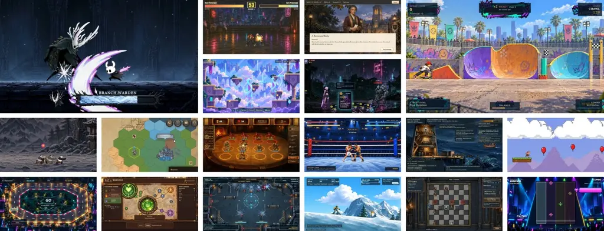

Figure 2: Games created by VibeGame from prompts across diverse 2D game
genres.

Figures 1 and 2 present some examples produced by VibeGame. And with the
same underlying model, VibeGame in P2G outperforms a range of agent
harnesses in either P2G or PA2G. Ablation studies further show that
removing either the AI-native engine or the adversarial review roles
substantially lowers the overall score, and that the experience
distilled through self-evolution with a stronger model can be
transferred to improve a weaker one.

In summary, our contributions are three-fold:

- •
  We introduce VibeGame, a framework for prompt-to-game development that
  transforms natural-language prompts into complete, playable game
  projects, enabling rapid game creation and subsequent iterative
  refinement.
- •
  At the core of our method is an AI-native game engine that enables
  coding agents to directly inspect and modify project state and control
  runtime execution without relying on graphical editors. Building on
  this engine, we introduce an Adversarial Agent Team that separates
  implementation from review, together with a training-free
  self-evolution mechanism that distills validated development
  experience into reusable knowledge for future projects.
- •
  We comprehensively evaluate VibeGame against other mainstream agent
  harnesses in both P2G and PA2G settings, demonstrating superior
  performance over all of them.

## 2 Related Work

Agentic software development and vibe coding frameworks. Coding agents
such as Claude Code \[6\], Codex \[7\], Cursor \[12\], OpenHands \[13\],
and SWE-agent \[14\], often with ReAct \[15\]-style reasoning and
evaluated on benchmarks such as SWE-bench \[16\], have moved LLM-based
programming to repository-level development. Vibe coding frameworks such
as Trellis \[17\] externalize specs, tasks, and memory as persistent
repository artifacts, and ChatDev \[18\] and MetaGPT \[19\] introduce
role specialization into software development. VibeGame extends these
directions to game projects, where code, art assets, scene
configurations, and runtime behavior must be maintained jointly and
verified by running the game.

Engine-integrated game generation. Prior work connects LLMs and
generative models to game engines and 3D tools: Sketch2Scene \[20\]
builds 3D game scenes from sketches; UnrealLLM \[21\] and DreamGarden
\[5\] generate content and environments in Unreal Engine (UE); 3Dify
\[22\] uses the Model Context Protocol (MCP) \[23\] or computer use to
call Blender \[24\], Unity, and UE toolchains, enhanced by
retrieval-augmented generation (RAG) \[25\]; and Hassan \[26\] generate
Unity templates from design documents. AutoUE \[8\] chains five agents
to generate 3D games in UE and uses play-testing for the final
evaluation. These systems mostly work around the graphical user
interface (GUI) workflows of commercial engines, whereas web frameworks
like Phaser \[27\] express projects fully in text. OpenGame \[9\] builds
on Phaser with templates and a debug protocol, generates its own assets
from the prompt alone, i.e., the P2G setting, and repairs build and test
failures until the game builds and runs. VibeGame further adds an
agent-oriented project representation, runtime control, and visual
verification, and lets independent roles verify the running game inside
the development loop.

## 3 The VibeGame Framework

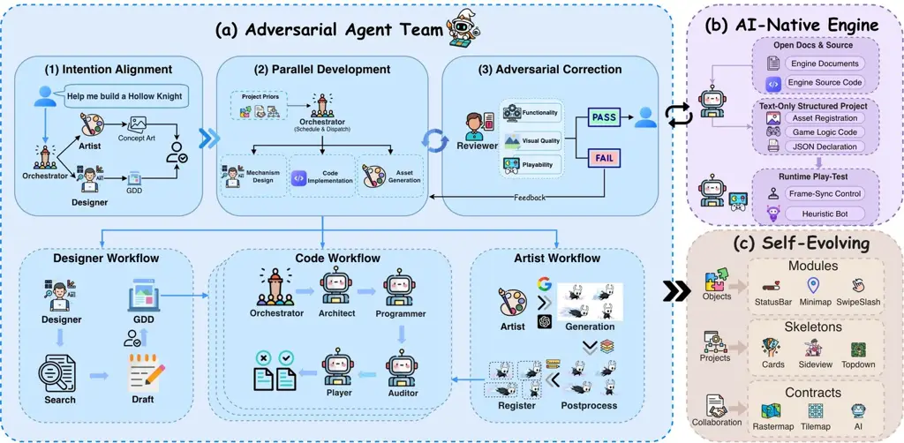

Figure 3: System overview of VibeGame. (a) The Adversarial Agent Team
turns a user request into an accepted game through intention alignment,
parallel development, and adversarial correction. (b) The AI-native game
engine exposes a structured project representation and frame-synchronous
runtime control for implementation and play-testing. (c) Training-free
self-evolution extracts skeletons, modules, and collaboration contracts
from accepted projects and returns them to future development as project
priors.

VibeGame takes a natural-language request and optional reference images
as inputs and produces a complete 2D game project that can be run,
inspected, and modified through later requests.

Figure 3 presents the project lifecycle. The AI-native engine provides
the shared project representation and runtime interface on which all
agents operate (Section 3.1). On top of it, the Adversarial Agent Team,
eight specialized agents coordinated by an _orchestrator_, turns the
request into an accepted game through intention alignment, parallel
development, and adversarial correction (Section 3.2). After acceptance,
the training-free self-evolution mechanism distills the project into
skeletons, modules, and collaboration contracts that initialize future
runs (Section 3.3).

### 3.1 AI-Native Game Engine

A game engine provides the foundation on which a game project is
constructed and executed, but traditional engines are designed for
human-operated workflows. We define a game engine as AI-native when it
has three properties that remove the resulting barriers for coding
agents. (1) GUI-Independent: the entire project is represented as
plain-text files that agents can inspect and edit directly, rather than
engine-specific identifiers or binary files that require graphical
editors. (2) Runtime-Accessible: agents can pause, step through,
observe, and intervene in the running game through code rather than
GUI-based debugging tools, turning an asynchronous real-time system into
a synchronously verifiable process. (3) Source-Available: agents can
inspect the engine’s uncompiled source code rather than relying on
documentation that may lag behind version changes or omit implementation
details.

GUI-Independent. We build our engine on Phaser because it expresses
projects fully in text (Section 2). However, Phaser imposes little
structure on how a project is organized, which makes agent-generated
projects prone to fragmentation. We therefore represent each game as a
collection of scenes whose configurations are stored in type-checked
JavaScript Object Notation (JSON) files. Each scene is a hierarchy of
nodes, the basic building blocks of the project; a node groups its
visual appearance, collision geometry, behavior scripts, and
configuration into one unit, declared explicitly in JSON fields rather
than hidden inside constructors. Nodes shared across scenes are stored
as standalone definition files and instantiated at runtime. This
scene-node-asset hierarchy gives every artifact a clear location and
makes cross-file dependencies explicit, so schema validation can detect
invalid references, such as missing assets, before execution rather than
as runtime failures.

Runtime-Accessible. A structurally valid project may still fail when
player input, physics, animation, and game logic interact during
execution. We therefore expose the running game through a
frame-synchronous programmatic interface: agents can pause and resume
execution, advance a specified number of frames, inspect or modify
runtime properties such as node positions and velocities, inject
semantic actions such as “press jump”, and capture screenshots. With
these controls, agents verify runtime behavior at their own pace through
frame-by-frame inspection, scripted test sequences, or heuristic bots
that react during real-time play.

Source-Available. Even with structured project files and runtime
control, agents may still encounter engine behavior that the
documentation does not fully explain, particularly after an interface
change or in uncommon functionality. We therefore copy the engine’s
complete, uncompiled source code into the project directory at
initialization, so agents can look up the exact application programming
interfaces (APIs), assumptions, and implementation details needed for
the current task.

|                  |              |       |       |       |       |       |         |
| ---------------- | ------------ | ----- | ----- | ----- | ----- | ----- | ------- |
| Harness          | Model        | Input | M     | D     | V     | A     | Overall |
| OpenGame \[9\]   | GPT-5.6-Luna | P2G   | 36.78 | 25.57 | 23.30 | 44.57 | 33.58   |
| Qwen Code \[28\] | GPT-5.6-Luna | PA2G  | 46.38 | 32.18 | 27.88 | 37.15 | 35.45   |
| Kimi Code \[29\] | GPT-5.6-Luna | P2G   | 45.26 | 32.13 | 31.00 | 38.34 | 36.14   |
| Kimi Code        | GPT-5.6-Luna | PA2G  | 47.54 | 31.86 | 29.67 | 38.46 | 36.22   |
| Codex \[7\]      | GPT-5.6-Luna | PA2G  | 50.72 | 33.32 | 28.33 | 36.87 | 36.47   |
| Codex            | GPT-5.6-Luna | P2G   | 45.22 | 34.47 | 31.54 | 37.65 | 36.77   |
| DSH \[30\]       | GPT-5.6-Luna | PA2G  | 52.96 | 36.13 | 32.40 | 35.62 | 37.95   |
| Qwen Code        | GPT-5.6-Luna | P2G   | 48.68 | 34.44 | 35.51 | 38.72 | 38.29   |
| VibeGame         | GPT-5.6-Luna | P2G   | 58.31 | 43.15 | 39.07 | 57.82 | 49.99   |
| Codex            | GPT-6.1-Sol  | PA2G  | 80.21 | 58.42 | 57.51 | 66.52 | 64.44   |
| OpenGame         | GPT-6.1-Sol  | P2G   | 81.58 | 58.26 | 57.78 | 67.17 | 64.86   |
| Qwen Code        | GPT-6.1-Sol  | PA2G  | 82.42 | 58.06 | 57.50 | 67.97 | 65.15   |
| Qwen Code        | GPT-6.1-Sol  | P2G   | 83.75 | 58.89 | 60.20 | 69.90 | 66.71   |
| Codex            | GPT-6.1-Sol  | P2G   | 87.18 | 63.05 | 62.48 | 69.25 | 68.80   |
| VibeGame         | GPT-6.1-Sol  | P2G   | 86.26 | 67.81 | 62.29 | 76.97 | 72.99   |

Table 1: Results on the GameCraft-Bench subset. DSH denotes DeepSeek
Harness. M, D, V, and A denote Core Mechanics, Content Depth, Functional
Visuals, and Art & Presentation, respectively; Overall is the weighted
score defined in Appendix 6. Bold numbers in green cells and underlined
numbers in amber cells denote the best and second-best scores per column
within each model, respectively.

### 3.2 Adversarial Agent Team

The engine provides the interfaces required to construct and test a
game, but it does not determine what should be built, how development
should be organized, or when the result is satisfactory. Assigning these
responsibilities to a single agent would also require the same role to
both produce and evaluate its own work, making behavioral failures and
visual defects during gameplay easier to overlook. VibeGame therefore
introduces an Adversarial Agent Team (AAT) comprising eight specialized
roles: orchestrator, designer, artist, architect, programmer, auditor,
player, and reviewer. We define each agent’s responsibilities through
role-specific prompts and execution hooks, and use persistent project
artifacts to preserve decisions and communicate them across the team.

As shown in Figure 3(a), the team organizes development into three
stages: Intention Alignment, Parallel Development, and Adversarial
Correction. Throughout this process, the orchestrator maintains the
development state and coordinates the specialized roles.

#### 3.2.1 Intention Alignment

Before development begins, the designer draws on game-design principles
and genre conventions to expand requests such as “make a Hollow
Knight-style boss fight” into a complete Game Design Document (GDD) that
defines gameplay mechanics, progression rules, and numerical systems. In
parallel, the artist uses image-generation models to create concept art
that establishes a consistent visual direction for subsequent assets.
After user confirmation, the GDD and concept art form the shared ground
truth for all downstream development and evaluation. During development,
any task that introduces or changes a design decision returns to the
designer, who drafts it, confirms it with the user, and merges it into
the GDD.

#### 3.2.2 Parallel Development

Code Workflow. Code is implemented by a pipeline of four agents:
architect, programmer, auditor, and player. The orchestrator first
decomposes the game into parallel components, retrieves relevant
skeletons, modules, and contracts from the self-evolution repository
(Section 3.3) as project priors, and prepares a Product Requirements
Document (PRD) that defines the scope and acceptance criteria of each
component. The architect then plans the implementation strategy and its
verification procedure, and after the orchestrator approves the plan,
the programmer implements it. The auditor checks the result statically
with the engine’s consistency-checking tools and against the design
specification. Finally, the player runs the game through the engine’s
runtime interface under frame-synchronous control and uses a vision
model to assess whether the rendered result matches the intended
appearance. A sub-task is complete only after it passes both static
auditing and runtime play-testing.

Artist Workflow. The artist agent converts visual requirements from the
orchestrator into engine-ready assets. It invokes image-generation
models, including GPT-Image-2 \[31\] and Nano Banana Pro \[32\], to
create the initial artwork, then applies post-processing operations such
as background removal and size normalization. It then registers the
processed assets with the engine, recording their paths, dimensions, and
usage.

#### 3.2.3 Adversarial Correction

After all sub-tasks are completed, an independent reviewer acts as the
final quality gate and evaluates the complete project on _functionality_
(whether the game behaves as specified), _visual quality_ (asset
completeness, stylistic consistency, and screen clarity), and
_playability_ (e.g., control responsiveness and the clarity of combat
feedback). If the project fails any criterion, the reviewer rejects it
with specific reasons, and the orchestrator converts them into new
repair tasks; this build-review cycle continues until the project
satisfies all acceptance criteria. The process runs automatically by
default, and the orchestrator incorporates any user feedback into
subsequent development.

### 3.3 Training-free Self-Evolution

The AI-native game engine and AAT produce accepted game projects that
reflect both agent-side implementation and user feedback. VibeGame
distills reusable experience from these validated projects with a
training-free self-evolution mechanism and uses it to initialize future
development runs, preserving implicit development knowledge that
general-purpose agents lose across independent runs. We organize the
experience into three complementary forms: skeletons, modules, and
contracts.

Skeletons. A skeleton is a runnable project template associated with a
particular game type. It removes project-specific art assets but
preserves the code architecture, tuning values, visual proportions,
scene flow, and runtime structure of the original project. Each skeleton
also includes error notes and an art pack. The error notes summarize
recurring failures and their verified fixes, while the art pack records
reusable visual-production recipes, including asset-generation prompts
and post-processing conventions for the corresponding game type.

Modules. A module is a self-contained behavior script that can be
attached to any node (Section 3.1) and implements functionality reusable
across game types. In addition to the underlying behavior, a module may
include self-checking logic that converts previously observed runtime
failures into static validation rules executed before the game starts.

Contracts. A contract is a document that adapts the general AAT workflow
to a recurring feature or development pattern. It specifies the
role-specific inputs, outputs, dependencies, and verification criteria
required to implement that feature, enabling agents to coordinate
through a validated procedure rather than relying only on the generic
build-and-review loop. For example, a map contract defines how the
designer specifies map requirements, how the programmer represents the
map in project files, how the artist supplies the required assets, and
how the auditor and player verify the completed result.

## 4 Experiments

Figure 4: Results by game type and pairwise win rates. (a) Gain of
VibeGame over the strongest baseline of each model, Codex (P2G) for
GPT-6.1-Sol and Qwen Code (P2G) for GPT-5.6-Luna, on each game type. (b)
Win rate of VibeGame against each GPT-6.1-Sol baseline in the user study
(top) and under the GPT-6.1-Sol judge (bottom); each bar stacks the win
rates in the four rubric categories (M, D, V, A), and the number at its
end is the overall win rate.

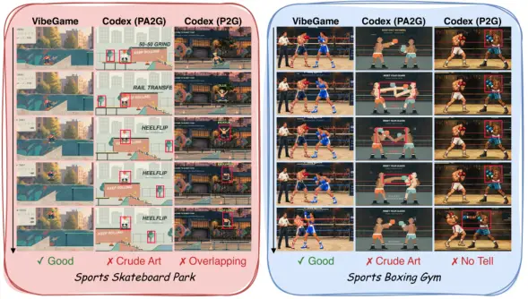

Figure 5: Qualitative comparison between VibeGame, Codex (PA2G), and
Codex (P2G), all using GPT-6.1-Sol. Left: Sports Skateboard Park. Right:
Sports Boxing Gym. Red boxes mark the defects.

### 4.1 Experiment Setup

##### Benchmark.

We randomly sample two tasks from each of the 15 game types in
GameCraft-Bench \[11\], 30 tasks in total, as our test set (Appendix 7),
and adapt them to Phaser \[27\], changing only the engine, the input
setting, and a short hint on demo recording, leaving the game
descriptions and evaluation rubrics untouched. We then evaluate a wide
range of open-source agent harnesses on the test set under the PA2G and
P2G settings, giving every harness, including VibeGame, a 24-hour budget
per task with its model at the xhigh reasoning effort; in P2G, harnesses
without native image generation are given the same image generation
model as VibeGame. Because GPT-5.5 \[33\], the judge used by
GameCraft-Bench, makes various judgment errors, we use GPT-6.1-Sol
\[34\] as the judge instead. Appendix 8 gives the full experimental
details.

##### Ablation Settings.

We randomly sample 10 tasks from the test set as the ablation set and
compare VibeGame with three variants: (1) w/o Engine, which removes the
AI-native game engine and requires the agents to build on Phaser
instead; (2) w/o AAT, which removes the adversarial review stage of the
agent team, i.e., the auditor, player, and reviewer; and (3) w/
Experience, which adds the experience evolved by VibeGame with
GPT-6.1-Sol on 5 tasks outside the ablation set to VibeGame with
GPT-5.6-Luna.

### 4.2 Results Analysis

| Variant       | M     | D     | V     | A     | Overall |
| ------------- | ----- | ----- | ----- | ----- | ------- |
| VibeGame      | 60.73 | 48.58 | 43.10 | 59.26 | 53.45   |
| w/o Engine    | 52.16 | 32.95 | 32.98 | 53.22 | 43.12   |
| w/o AAT       | 57.79 | 41.94 | 34.43 | 58.09 | 48.82   |
| w/ Experience | 68.76 | 47.47 | 40.42 | 66.39 | 56.37   |

Table 2: Ablation on the ablation set (GPT-5.6-Luna). Columns and marks
as in Table 1.

##### Main Results.

As shown in Table 1, under the same underlying model, general coding
agents perform similarly to one another in the PA2G setting, with gaps
of at most 2.50 points, and GPT-5.6-Luna \[35\] does not turn image
generation into a visual advantage in the P2G setting. OpenGame,
although designed for game development, does not outperform general
coding agents, suggesting that it may not generalize to tasks beyond its
built-in templates or adapt well to the demo-recording requirements of
GameCraft-Bench. In contrast, with GPT-5.6-Luna, VibeGame leads in all
four categories and improves the overall score over the strongest
baseline by 11.70 points, showing that our harness substantially
strengthens weaker models. With the frontier model GPT-6.1-Sol, VibeGame
trails Codex (P2G) by less than one point in Core Mechanics and
Functional Visuals but leads it by 4.76 and 7.72 points in Content Depth
and Art & Presentation, outperforming it by 4.19 points overall. This
suggests that frontier models can already implement core mechanics and
reasonable visuals on their own, but still fall short in building games
with deep content and polished presentation, which is where VibeGame
adds its value. Across game types (Figure 4(a)), VibeGame outperforms
the strongest baseline of each model on 13 of the 15 types.

##### User Study.

We further conduct a blind user study with 30 participants of diverse
backgrounds, including students from fields such as mathematics and
bioinformatics, information technology practitioners, and game
enthusiasts. We pair VibeGame with each of the five GPT-6.1-Sol
baselines on all 30 tasks, giving 150 pairs, and collect two judgments
per pair, 300 in total. In each judgment, a participant reads the game
description and the full evaluation rubric of the task, plays the two
anonymized games, and picks the better game in each of the four rubric
categories and overall. As shown in Figure 4(b), human preferences
broadly agree with the GPT-6.1-Sol judge, whose pairwise results come
from comparing the two games’ scores on each task: under both, VibeGame
wins against every baseline in every rubric category, with an average
overall human win rate of 72.7%.

##### Ablation Study.

Table 2 reports the effect of the three coupled components. Removing the
AI-native engine or the adversarial review roles of AAT lowers the
overall score by 10.33 and 4.63 points, respectively, indicating that
both the structured project representation with runtime control and the
adversarial review substantially help prompt-to-game development. Adding
the engine alone to Codex with GPT-6.1-Sol also raises its overall score
by 2.69 points (Appendix 12). Adding the experience evolved by
GPT-6.1-Sol to GPT-5.6-Luna raises the overall score by 2.92 points,
suggesting that the evolved experience transfers from a stronger model
to a weaker one.

##### Qualitative Analysis.

We select the qualitative cases from GameCraft-Bench (Figure 5). The
left case is Sports Skateboard Park, where the agent needs to implement
a trick system in which the player chains flip, grind, and grab tricks
into combos. VibeGame presents aerial tricks such as board flips in a
consistent and appealing visual style, while Codex (PA2G) draws the
character and environment with programmatic shapes (i.e., simple shapes
drawn in code), which gives the game a crude art style. Codex (P2G)
generates a coherent background, but its user interface (UI) overlaps
the character, which is also assembled from programmatic shapes. The
right case is Sports Boxing Gym, where the task requires the opponent to
telegraph each attack with a visible tell so that the player can read it
and respond. VibeGame fulfills this requirement with complete attack
animations and mechanics that include wind-up tells. Codex (PA2G) also
draws its boxers with programmatic shapes and represents each punch by
stretching a rectangular arm, which looks abstract rather than like a
punching animation. Codex (P2G) also produces polished visuals but does
not show the opponent’s wind-up.

## 5 Conclusion

We present VibeGame, a framework for end-to-end prompt-to-game
development that integrates an AI-native game engine, an adversarial
agent team, and training-free self-evolution. Under the same underlying
model, VibeGame, without any provided assets, outperforms all evaluated
agent harnesses; even with the frontier model GPT-6.1-Sol, it improves
over the strongest baseline, Codex (P2G), by 4.19 points.

## Limitations

While VibeGame delivers strong results across diverse game genres, we
recognize that several directions remain open for future work. First, we
focus on 2D games and have not yet validated the framework in more
complex 3D scenes or used it to develop complete commercial games that
sustain long-term play. Second, our AI-native design principles are
implemented on a web-based 2D engine; bringing them to established
engines such as Godot \[3\], so that agents can also operate existing
game projects, is a promising extension.

## References

- \[1\] Unity Technologies. Unity game engine.
  [https://unity.com](https://unity.com), 2005. Accessed: 2026-06-11.
- \[2\] Epic Games. Unreal Engine.
  [https://www.unrealengine.com](https://www.unrealengine.com), 1998.
  Accessed: 2026-06-11.
- \[3\] Godot Engine contributors. Godot Engine.
  [https://godotengine.org](https://godotengine.org), 2014. Accessed:
  2026-06-11.
- \[4\] Jake Bruce, Michael D Dennis, Ashley Edwards, Jack
  Parker-Holder, Yuge Shi, Edward Hughes, Matthew Lai, Aditi Mavalankar,
  Richie Steigerwald, Chris Apps, Yusuf Aytar, Sarah Maria Elisabeth
  Bechtle, Feryal Behbahani, Stephanie C.Y. Chan, Nicolas Heess, Lucy
  Gonzalez, Simon Osindero, Sherjil Ozair, Scott Reed, Jingwei Zhang,
  Konrad Zolna, Jeff Clune, Nando De Freitas, Satinder Singh, and Tim
  Rocktäschel. Genie: Generative interactive environments. In
  _Proceedings of the 41st International Conference on Machine
  Learning_, volume 235 of _Proceedings of Machine Learning Research_,
  pages 4603–4623, 2024. URL
  [https://proceedings.mlr.press/v235/bruce24a.html](https://proceedings.mlr.press/v235/bruce24a.html).
- \[5\] Sam Earle, Samyak Parajuli, and Andrzej Banburski-Fahey.
  DreamGarden: A designer assistant for growing games from a single
  prompt. In _Proceedings of the 2025 CHI Conference on Human Factors in
  Computing Systems_, pages 1–19, 2025.
  [10.1145/3706598.3714233](https://doi.org/10.1145/3706598.3714233).
- \[6\] Anthropic. Claude Code: An agentic coding tool.
  [https://github.com/anthropics/claude-code](https://github.com/anthropics/claude-code), 2025.
  Accessed: 2026-06-11.
- \[7\] OpenAI. Codex: A lightweight coding agent.
  [https://github.com/openai/codex](https://github.com/openai/codex), 2025.
  Accessed: 2026-06-11.
- \[8\] Lei Yin, Wentao Cheng, Zhida Qin, Tianyu Huang, Yidong Li, and
  Gangyi Ding. AutoUE: Automated generation of 3D games in Unreal Engine
  via multi-agent systems. In _Findings of the Association for
  Computational Linguistics: ACL 2026_, pages 2341–2364, San Diego,
  California, United States, 2026. Association for Computational
  Linguistics.
  [10.18653/v1/2026.findings-acl.111](https://doi.org/10.18653/v1/2026.findings-acl.111).
- \[9\] Yilei Jiang, Jinyuan Hu, Qianyin Xiao, Yaozhi Zheng, Ruize Ma,
  Kaituo Feng, Jiaming Han, Tianshuo Peng, Kaixuan Fan, Manyuan Zhang,
  and Xiangyu Yue. OpenGame: Open agentic coding for games. _arXiv
  preprint arXiv:2604.18394_, 2026.
  [10.48550/arXiv.2604.18394](https://doi.org/10.48550/arXiv.2604.18394).
- \[10\] Wayne Chi, Yixiong Fang, Arnav Yayavaram, Siddharth Yayavaram,
  Seth Karten, Qiuhong Anna Wei, Runkun Chen, Alexander Wang, Valerie
  Chen, Ameet Talwalkar, and Chris Donahue. GameDevBench: Evaluating
  agentic capabilities through game development. _arXiv preprint
  arXiv:2602.11103_, 2026.
  [10.48550/arXiv.2602.11103](https://doi.org/10.48550/arXiv.2602.11103).
- \[11\] Tongxu Luo, Rongsheng Wang, Jiaxi Bi, Chenming Xu, Zhengyang
  Tang, Jianlong Chen, Juhao Liang, Ke Ji, Shuqi Guo, Yuhao Du, Fan Bu,
  Wenyu Du, Xiaotong Zhang, Kyle Li, Shaobo Wang, Linfeng Zhang, Yuxuan
  Liu, Xin Lai, Chenxin Li, Yiduo Guo, Zhexin Zhang, Xinyuan Wang,
  Tianyi Bai, Ziniu Li, and Benyou Wang. GameCraft-Bench: Can agents
  build playable games end-to-end in a real game engine? _arXiv preprint
  arXiv:2606.17861_, 2026.
  [10.48550/arXiv.2606.17861](https://doi.org/10.48550/arXiv.2606.17861).
- \[12\] Anysphere. Cursor: The AI code editor.
  [https://www.cursor.com](https://www.cursor.com), 2024. Accessed:
  2026-06-11.
- \[13\] Xingyao Wang, Boxuan Li, Yufan Song, Frank F. Xu, Xiangru Tang,
  Mingchen Zhuge, Jiayi Pan, Yueqi Song, Bowen Li, Jaskirat Singh,
  Hoang H. Tran, Fuqiang Li, Ren Ma, Mingzhang Zheng, Bill Qian, Daniel
  Shao, Niklas Muennighoff, Yizhe Zhang, Binyuan Hui, Junyang Lin,
  Robert Brennan, Hao Peng, Heng Ji, and Graham Neubig. OpenHands: An
  open platform for AI software developers as generalist agents. In _The
  Thirteenth International Conference on Learning
  Representations_, 2025. URL
  [https://openreview.net/forum?id=OJd3ayDDoF](https://openreview.net/forum?id=OJd3ayDDoF).
- \[14\] John Yang, Carlos E. Jimenez, Alexander Wettig, Kilian Lieret,
  Shunyu Yao, Karthik Narasimhan, and Ofir Press. SWE-agent:
  Agent-computer interfaces enable automated software engineering. In
  _Advances in Neural Information Processing Systems_, volume 37, pages
  50528–50652, 2024.
  [10.52202/079017-1601](https://doi.org/10.52202/079017-1601).
- \[15\] Shunyu Yao, Jeffrey Zhao, Dian Yu, Nan Du, Izhak Shafran,
  Karthik R Narasimhan, and Yuan Cao. ReAct: Synergizing reasoning and
  acting in language models. In _The Eleventh International Conference
  on Learning Representations_, 2023. URL
  [https://openreview.net/forum?id=WE_vluYUL-X](https://openreview.net/forum?id=WE_vluYUL-X).
- \[16\] Carlos E. Jimenez, John Yang, Alexander Wettig, Shunyu Yao,
  Kexin Pei, Ofir Press, and Karthik Narasimhan. SWE-bench: Can language
  models resolve real-world GitHub issues? In _The Twelfth International
  Conference on Learning Representations_, 2024. URL
  [https://openreview.net/forum?id=VTF8yNQM66](https://openreview.net/forum?id=VTF8yNQM66).
- \[17\] Mindfold AI. Trellis: An out-of-the-box engineering framework
  for AI coding.
  [https://github.com/mindfold-ai/Trellis](https://github.com/mindfold-ai/Trellis), 2025.
  Accessed: 2026-06-11.
- \[18\] Chen Qian, Wei Liu, Hongzhang Liu, Nuo Chen, Yufan Dang, Jiahao
  Li, Cheng Yang, Weize Chen, Yusheng Su, Xin Cong, Juyuan Xu, Dahai Li,
  Zhiyuan Liu, and Maosong Sun. ChatDev: Communicative agents for
  software development. In _Proceedings of the 62nd Annual Meeting of
  the Association for Computational Linguistics (Volume 1: Long
  Papers)_, pages 15174–15186, Bangkok, Thailand, 2024. Association for
  Computational Linguistics.
  [10.18653/v1/2024.acl-long.810](https://doi.org/10.18653/v1/2024.acl-long.810).
- \[19\] Sirui Hong, Mingchen Zhuge, Jonathan Chen, Xiawu Zheng, Yuheng
  Cheng, Jinlin Wang, Ceyao Zhang, Zili Wang, Steven Ka Shing Yau,
  Zijuan Lin, Liyang Zhou, Chenyu Ran, Lingfeng Xiao, Chenglin Wu, and
  Jürgen Schmidhuber. MetaGPT: Meta programming for a multi-agent
  collaborative framework. In _The Twelfth International Conference on
  Learning Representations_, 2024. URL
  [https://openreview.net/forum?id=VtmBAGCN7o](https://openreview.net/forum?id=VtmBAGCN7o).
- \[20\] Yongzhi Xu, Yonhon Ng, Yifu Wang, Inkyu Sa, Yunfei Duan,
  Zhenhong Sun, Yang Li, Pan Ji, and Hongdong Li. Sketch2Scene:
  Automatic generation of interactive 3D game scenes from user’s casual
  sketches. _arXiv preprint arXiv:2408.04567_, 2024.
  [10.48550/arXiv.2408.04567](https://doi.org/10.48550/arXiv.2408.04567).
- \[21\] Song Tang, Kaiyong Zhao, Lei Wang, Yuliang Li, Xuebo Liu, Junyi
  Zou, Qiang Wang, and Xiaowen Chu. UnrealLLM: Towards highly
  controllable and interactable 3D scene generation by LLM-powered
  procedural content generation. In _Findings of the Association for
  Computational Linguistics: ACL 2025_, pages 19417–19435, Vienna,
  Austria, 2025. Association for Computational Linguistics.
  [10.18653/v1/2025.findings-acl.994](https://doi.org/10.18653/v1/2025.findings-acl.994).
- \[22\] Shun-ichiro Hayashi, Daichi Mukunoki, Tetsuya Hoshino, Satoshi
  Ohshima, and Takahiro Katagiri. 3Dify: a framework for procedural
  3D-CG generation assisted by LLMs using MCP and RAG. _arXiv preprint
  arXiv:2510.04536_, 2025.
  [10.48550/arXiv.2510.04536](https://doi.org/10.48550/arXiv.2510.04536).
- \[23\] Anthropic. Introducing the Model Context Protocol.
  [https://www.anthropic.com/news/model-context-protocol](https://www.anthropic.com/news/model-context-protocol), 2024.
  Accessed: 2026-10-09.
- \[24\] Blender Foundation. Blender: The free and open source 3D
  creation software.
  [https://www.blender.org](https://www.blender.org), 1994. Accessed:
  2026-10-09.
- \[25\] Patrick Lewis, Ethan Perez, Aleksandra Piktus, Fabio Petroni,
  Vladimir Karpukhin, Naman Goyal, Heinrich Küttler, Mike Lewis, Wen-tau
  Yih, Tim Rocktäschel, Sebastian Riedel, and Douwe Kiela.
  Retrieval-augmented generation for knowledge-intensive NLP tasks. In
  _Advances in Neural Information Processing Systems_, volume 33, pages
  9459–9474, 2020. URL
  [https://proceedings.neurips.cc/paper/2020/hash/6b493230205f780e1bc26945df7481e5-Abstract.html](https://proceedings.neurips.cc/paper/2020/hash/6b493230205f780e1bc26945df7481e5-Abstract.html).
- \[26\] Amna Hassan. Automated Unity game template generation from GDDs
  via NLP and multi-modal LLMs. _arXiv preprint arXiv:2509.08847_, 2025.
  [10.48550/arXiv.2509.08847](https://doi.org/10.48550/arXiv.2509.08847).
- \[27\] Richard Davey and Photon Storm. Phaser: A fun, free and fast 2D
  game framework for making HTML5 games.
  [https://phaser.io](https://phaser.io), 2013. Accessed: 2026-06-11.
- \[28\] Qwen Team. Qwen Code: An open-source AI coding agent that lives
  in your terminal.
  [https://github.com/QwenLM/qwen-code](https://github.com/QwenLM/qwen-code), 2025.
  Accessed: 2026-10-09.
- \[29\] Moonshot AI. Kimi Code CLI: The starting point for next-gen
  agents.
  [https://github.com/MoonshotAI/kimi-code](https://github.com/MoonshotAI/kimi-code), 2026.
  Accessed: 2026-10-09.
- \[30\] DeepSeek-AI. DeepSeek Harness: Everything is a plugin.
  [https://github.com/deepseek-ai/deepseek-harness](https://github.com/deepseek-ai/deepseek-harness), 2026.
  Accessed: 2026-10-09.
- \[31\] OpenAI. GPT-Image-2 model.
  [https://developers.openai.com/api/docs/models/gpt-image-2](https://developers.openai.com/api/docs/models/gpt-image-2),
  2026a. Accessed: 2026-10-09.
- \[32\] Google DeepMind. Introducing Nano Banana Pro.
  [https://blog.google/innovation-and-ai/products/nano-banana-pro/](https://blog.google/innovation-and-ai/products/nano-banana-pro/), 2025.
  Accessed: 2026-10-09.
- \[33\] OpenAI. Introducing GPT-5.5.
  [https://openai.com/index/introducing-gpt-5-5/](https://openai.com/index/introducing-gpt-5-5/),
  2026b. Accessed: 2026-06-11.
- \[34\] OpenAI. Introducing GPT-6.1 Sol.
  [https://openai.com/index/introducing-gpt-6-1-sol/](https://openai.com/index/introducing-gpt-6-1-sol/),
  2026c. Accessed: 2026-10-09.
- \[35\] OpenAI. GPT-5.6: Frontier intelligence that scales with your
  ambition.
  [https://openai.com/index/gpt-5-6/](https://openai.com/index/gpt-5-6/),
  2026d. Accessed: 2026-10-12.

\beginappendix

## 6 Evaluation Details

We port the evaluation protocol of GameCraft-Bench from Godot to Phaser:
each harness submits its game together with replayable input traces; an
automated pipeline checks that the game builds, then replays and records
every trace, and the judge model scores each recording against the
rubric; each requirement’s score is then aggregated over the demos as
specified by the rubric. We average the scores of three judge passes to
reduce judge variance.

GameCraft-Bench scores each game with a task-specific rubric whose
requirements fall into four categories: Core Mechanics ($`M`$), Content
Depth ($`D`$), Functional Visuals ($`V`$), and Art & Presentation
($`A`$). Each category score is the mean of its requirement scores, and
the overall score is

```math
\mathrm{Overall}=\mathrm{BUILD}\times(w_{M}M+w_{D}D+w_{V}V+w_{A}A),
```

where $`\mathrm{BUILD}`$ is 0 if the game cannot be built or played and
1 otherwise. The weights $`(w_{M},w_{D},w_{V},w_{A})`$ are specified by
each task’s rubric in GameCraft-Bench.

|           |              |       |       |       |       |       |         |
| --------- | ------------ | ----- | ----- | ----- | ----- | ----- | ------- |
| Harness   | Model        | Input | M     | D     | V     | A     | Overall |
| OpenGame  | GPT-5.6-Luna | P2G   | 46.04 | 33.90 | 33.17 | 47.22 | 40.29   |
| Codex     | GPT-5.6-Luna | P2G   | 58.51 | 45.23 | 48.69 | 47.24 | 48.46   |
| Kimi Code | GPT-5.6-Luna | P2G   | 61.04 | 43.42 | 52.14 | 47.67 | 48.89   |
| Qwen Code | GPT-5.6-Luna | PA2G  | 66.67 | 46.47 | 51.61 | 49.93 | 51.51   |
| Kimi Code | GPT-5.6-Luna | PA2G  | 65.79 | 44.68 | 50.50 | 52.73 | 51.57   |
| Qwen Code | GPT-5.6-Luna | P2G   | 64.56 | 47.71 | 53.30 | 50.17 | 51.97   |
| Codex     | GPT-5.6-Luna | PA2G  | 68.51 | 48.49 | 50.51 | 51.27 | 52.81   |
| DSH       | GPT-5.6-Luna | PA2G  | 70.05 | 48.80 | 55.47 | 49.29 | 53.19   |
| VibeGame  | GPT-5.6-Luna | P2G   | 64.98 | 51.89 | 47.76 | 58.72 | 55.65   |
| OpenGame  | GPT-6.1-Sol  | P2G   | 86.57 | 67.68 | 72.44 | 74.36 | 73.60   |
| Qwen Code | GPT-6.1-Sol  | P2G   | 86.51 | 70.58 | 74.35 | 76.26 | 75.56   |
| Qwen Code | GPT-6.1-Sol  | PA2G  | 88.58 | 70.43 | 75.41 | 76.44 | 76.03   |
| Codex     | GPT-6.1-Sol  | PA2G  | 89.57 | 70.57 | 75.12 | 77.29 | 76.49   |
| Codex     | GPT-6.1-Sol  | P2G   | 90.29 | 71.73 | 75.38 | 78.43 | 77.44   |
| VibeGame  | GPT-6.1-Sol  | P2G   | 90.04 | 75.43 | 74.41 | 78.51 | 78.57   |

Table 3: Results on the GameCraft-Bench subset scored by the GPT-5.5
judge (mean of its passes). Rows, columns, and marks as in Table 1.

### 6.1 Judge Error Cases (GPT-5.5)

We tried both GPT-5.5 and GPT-6.1-Sol as the judge model (both with
medium reasoning effort) and found that switching the judge changes both
the absolute scores and the ranking (Table 1 vs. Table 3). VibeGame
achieves the best overall score under both judges. Nevertheless,
comparing the two judges, we find that GPT-5.5 has severe judgment flaws
as a judge model; Figures 6, 7, and 8 show three examples.

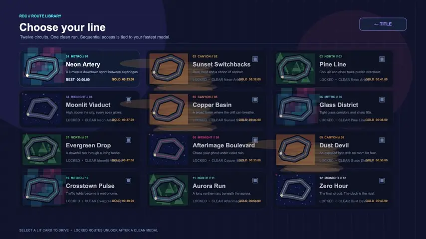

Requirement (D1). “At least 10 distinct tracks with different layouts
(varying corner types, widths, and lengths). Tracks are selectable from
a track-select screen showing preview thumbnails and medal status. Score
0 if there are fewer than 10 tracks, if tracks share the same layout, or
if there is no track selection screen. Score 1 requires content variants
to be visually distinct with real authored art (different sprites,
illustrated elements). Score 0.5 at most if variants exist but are
represented by programmatic shapes, color swaps, or text labels without
real asset differences.”  
GPT-5.5 (0.9 / 1.0 / 0.9): “The route library shows twelve selectable
tracks with distinct preview layouts, locked/completed state, and
medal/best-time information.”  
GPT-6.1-Sol (0.0 / 0.0 / 0.0): “The selection screen lists twelve
tracks, but its thumbnails repeatedly reuse four layouts rather than
demonstrate at least ten distinct circuits.”

Figure 6: Judge error case 1: Kimi Code + GPT-5.6-Luna (P2G) on Racing
Drift Circuit. The judged track-select frame: its twelve thumbnails
reuse four layouts, one per biome (e.g., the three Canyon tracks share
one layout).

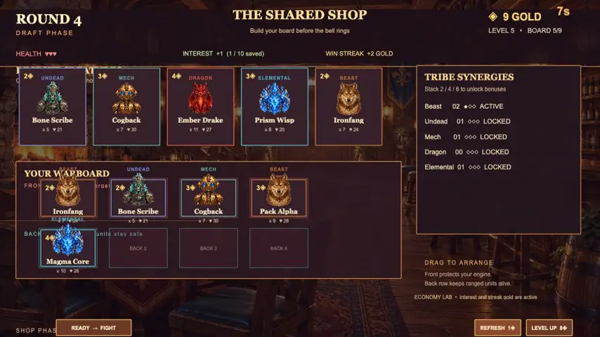

Requirement (V1). “The shop phase clearly shows: available creatures
with stats and tribe, the player’s board and bench, gold amount, level,
and round number. All elements are readable and non-overlapping at
1280x720. Tribal affiliations are visually indicated on creature cards.
Score 0 if any core element is missing or unreadable. Score 1 requires
the information to be presented through themed, styled UI with real
assets. Score 0.5 at most if readability relies on plain text, unstyled
labels, or raw geometric shapes.”  
GPT-5.5 (1.0 / 1.0 / 1.0): “The shop screen clearly shows available
creatures with stats and tribes, board and bench areas, gold, level,
round number, timer, and themed readable UI at 1280x720.”  
GPT-6.1-Sol (0.0 / 0.0 / 0.0): “The themed shop shows creature stats,
tribes, gold, level, and round, but no bench is visible and board
headings overlap creature labels and cards.”

Figure 7: Judge error case 2: OpenGame + GPT-5.6-Luna on Cardgame
Autobattler. The board has a front and a back row (BACK 2–4) and no
bench; the board heading and row labels are covered by cards.

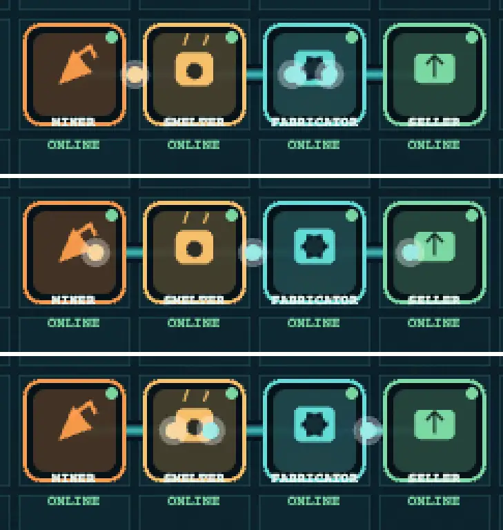

Requirement (M2). “Production chains exist: output from one machine
feeds input of the next via visible conveyor belts. Machines must be
connected in sequence (miner to smelter to fabricator to seller).
Resources visibly flow along conveyors between machines. Score 0 if
there are no production chains, if machines work independently without
connections, or if resource flow is not visible.”  
GPT-5.5 (0.0 / 0.0 / 0.0): “Machines are placed near each other, but
visible conveyor belts and resources flowing between miner, smelter,
fabricator, and seller are not clearly shown.”  
GPT-6.1-Sol (1.0 / 1.0 / 1.0): “Two sequential
miner-to-smelter-to-fabricator-to-seller chains have visible connecting
conveyors with resource particles changing position over time.”

Figure 8: Judge error case 3: Kimi Code + GPT-5.6-Luna (P2G) on Idle
Factory Planet. Three consecutive judged frames, cropped to one
production chain and shown at the source recording’s 1280$`\times`$720
resolution (the judges received them downscaled to 854$`\times`$480):
conveyors connect the four machines and the resource particles move
along them.

### 6.2 Results under GPT-5.5 Judge

Table 3 reports the results with GPT-5.5 as the judge model.

## 7 Benchmark Tasks

Our test set consists of 30 tasks from GameCraft-Bench \[11\], two from
each of its 15 game types, as listed in Table 4. The ablation set is a
10-task subset of the test set.

| Game type    | Tasks                                            |
| ------------ | ------------------------------------------------ |
| Card Game    | Autobattler^(†), Poker Roguelike^(†)             |
| Horror       | Lighthouse^(†), Tape Archive                     |
| Idle         | Dungeon Guild^(†), Factory Planet                |
| Open World   | Beast Tamer, Sky Islands                         |
| Platformer   | Shape Shift, Thunder Valkyrie                    |
| Puzzle       | Gravity Shift^(†), Pipe Crisis^(†)               |
| Racing       | Drift Circuit, Trick Runner                      |
| Rhythm       | Conductor, Note Highway                          |
| Roguelike    | Breach Tactics^(†), Potion Craft                 |
| Shooter      | Mech Sortie, Wave Commander                      |
| Simulation   | Air Control, Transit Web                         |
| Sports       | Boxing Gym, Skateboard Park^(†)                  |
| Strategy     | Chess Variant, Robot Factory                     |
| Tycoon       | Tiny Factory Foreman^(†), Trading Caravan Tycoon |
| Visual Novel | Arcane Academy^(†), Courtroom Clue Trial         |

Table 4: The 30 benchmark tasks, two per game type. ^(†) marks the 10
tasks of the ablation set.

## 8 Experiment Details

### 8.1 Setup

Every harness, including VibeGame, has a 24-hour budget per task and
runs its model at the xhigh reasoning effort. In the P2G setting,
harnesses without a native image generation tool are given GPT-Image-2
\[31\], the same image generation model used by VibeGame, as an external
tool together with its documentation. The judge GPT-6.1-Sol runs with
medium reasoning effort, and scoring follows the original benchmark
(Appendix 6). All results are obtained from our own runs and evaluation
rather than reused from GameCraft-Bench, because we changed the engine
and modified the task instructions.

For w/ Experience, we let VibeGame with GPT-6.1-Sol build and
self-evolve on 5 tasks randomly sampled from outside the ablation set,
using the task rubrics and the vision-language model (VLM) judge scores
in place of user feedback. We then add the evolved artifacts to the
initial project of VibeGame with GPT-5.6-Luna and let it build the
ablation tasks.

### 8.2 Task Instructions

To close the gap between the quality of a game and what its demos show,
we add the following demo hint to the original instructions:

We also use Phaser instead of Godot as the game engine, so we do not
claim that our results are comparable with those reported on the
original GameCraft-Bench.

#### 8.2.1 VibeGame

\promptfile

instructions/cardgame-autobattler_vibegame.md The first line of the
instruction invokes the one-shot mode of VibeGame through the
vibegame-build skill, whose prompt is as follows:
\promptfileinstructions/vibegame-build_SKILL.md

#### 8.2.2 Baselines, PA2G

\promptfile

instructions/cardgame-autobattler_pa2g.md

#### 8.2.3 Baselines, P2G (Qwen Code, Kimi Code, DSH)

\promptfile

instructions/cardgame-autobattler_p2g.md

#### 8.2.4 Baselines, P2G (Codex)

\promptfile

instructions/cardgame-autobattler_p2g-codex.md

## 9 Demonstrations

We demonstrate VibeGame in two scenarios: creating a game from a new
request (Game Creation), which corresponds to the P2G task defined in
Section 1, and continuing to edit an existing project (Game Edit).
Unless otherwise noted, the demonstrations use the automatic-by-default
setting described in Section 3.2.3: after the user approves the request,
the orchestrator continues development until reviewer acceptance, while
the user may still interrupt the process with feedback. The prompt boxes
in the figures report the final user-approved request rather than
interface commands or intermediate clarification turns.

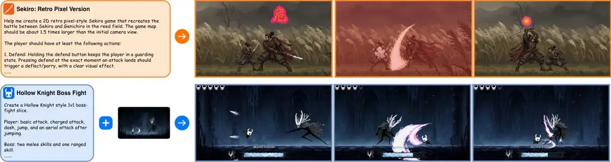

Figure 9: Game creation demonstrations. Top: Pixel Sekiro, a pixel-art
boss fight created from a text prompt. Bottom: Hollow Knight boss slice,
a side-scrolling boss fight created from a gameplay prompt and a concept
image.

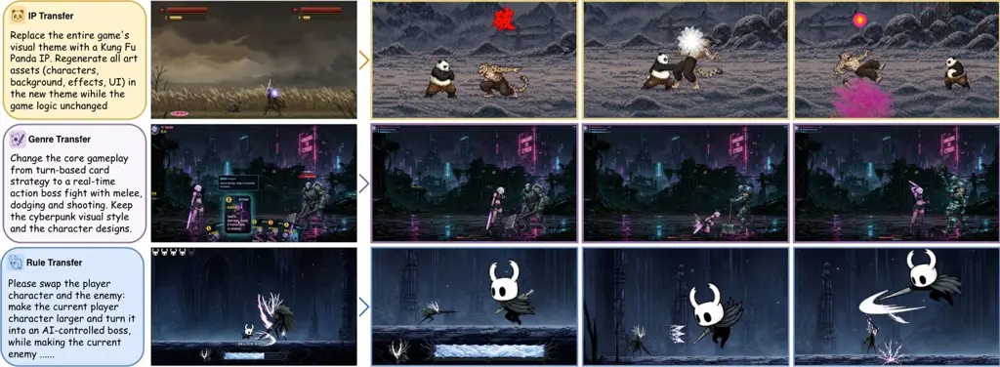

Figure 10: Game edit demonstrations. Top: intellectual property (IP)
transfer, replacing the visual theme while preserving gameplay logic.
Middle: genre transfer, converting a turn-based card game into a
real-time boss fight while preserving its visual identity. Bottom: rule
transfer, swapping the player and boss roles while preserving their
abilities and animations.

### 9.1 Game Creation

Game creation starts from a text request and optional reference images
and exercises the full loop from intention alignment to project
delivery. In this paper, we report results for both text-only and
multimodal requests.

#### 9.1.1 Text Input

To test creation driven by a compact text request, we asked the system
to build a Sekiro-style 2D boss fight: a retro pixel-art duel recreating
the reed-field battle between Sekiro and Genichiro. The request
specified the combat rules in a few sentences: the player can defend,
perform frame-perfect deflections, attack, step-dodge, jump, slash in
the air, and execute a deathblow once the boss posture is broken; the
boss can defend and deflect, and special attacks are made readable
through delayed wind-up frames.

The system started from an existing side-scrolling action skeleton,
inheriting its scene structure and UI modules. However, Sekiro’s core is
a deflection-posture system entirely different from the skeleton’s
simple hit-point-based combat, requiring the system to build the combat
layer from scratch: both sides have independent posture gauges, defense
distinguishes regular blocking from frame-perfect deflection, boss
attacks are divided into blockable normal attacks and perilous attacks
requiring specific responses, and a full posture gauge triggers a
multi-stage deathblow animation. The final output comprised 12 scripts,
2 character asset packs, 11 visual effect entities, and 1 UI asset pack.
This case demonstrates how a short request that names a genre convention
is expanded into a complete, correctly tuned combat system. The first
row of Figure 9 shows the request and resulting combat sequence.

#### 9.1.2 Multimodal Input

To test multimodal creation, we provided a text request together with an
author-created concept image for a Hollow Knight-style 1v1 boss fight.
The text request specified the mechanical scope: the player has a basic
attack, a charged attack, a dash, a jump, and an aerial attack, while
the boss combines two melee skills with a ranged attack on a
side-scrolling arena 1.5x the camera width. The concept image anchored
the character designs, the ruined-cathedral arena, and the overall
visual atmosphere, which the generated assets were required to match.

The second row of Figure 9 showcases the multimodal input and resulting
game. We can observe that the delivered slice realizes both sides of
this specification. The boss gates its melee sweep, ground slam, and
arcing projectile on the player’s distance, keeps its preferred range,
and can be staggered out of idle; the player’s five actions cover the
full movement-attack loop, including dash invincibility frames and
aerial slashes; hit feedback combines screen shake, flash, and spark
particles, with mask-style health icons and a full-width boss bar
completing the heads-up display (HUD). All character and arena art was
generated to match the concept image, preserving its silhouette language
and cold palette. This case demonstrates how text can specify gameplay
rules while the concept image anchors visual identity.

### 9.2 Game Edit

The next cases begin from accepted projects and alter different layers
of the existing game. Specifically, in this paper, we report three types
of editing: (1) intellectual property (IP) transfer that changes visual
assets while preserving mechanics; (2) genre transfer that replaces the
central gameplay while preserving visual identity; and (3) rule transfer
that changes the roles of existing characters while reusing their
abilities and animations.

#### 9.2.1 IP Transfer

Starting from a completed side-scrolling boss fight project, we ask the
system to replace the entire game’s visual theme with a Kung Fu Panda
IP. The system regenerates all art assets (including characters,
effects, UI, and background), and then adjusts configurations for the
new sprite size and frame counts. The delivered project retains the
original combat logic, illustrating an edit concentrated on the asset
and configuration layers. See top row of Figure 10. This validates the
code-asset decoupling in the engine: when the project structure is well
designed, IP transfer is accomplished primarily through asset
replacement, with no need to rewrite core logic.

#### 9.2.2 Genre Transfer

Starting from a completed turn-based card game project, we ask the
system to change the core gameplay from card strategy to a real-time
action boss fight. This is a deep transformation: the turn-based
card-playing mechanic was completely replaced with real-time melee,
dodging, and shooting, while the system preserved the original project’s
cyberpunk visual style and character designs. Unlike IP transfer where
only assets change, genre transfer requires the system to judge what can
be preserved and what must be rewritten, demonstrating the system’s
ability to perform selective deep modification while maintaining overall
consistency (Figure 10, middle row).

#### 9.2.3 Rule Transfer

Starting from the Hollow Knight-style boss fight created from multimodal
input in Section 9.1.2, we tested the system’s ability to handle
unconventional creative requests by asking it to swap the player and
boss roles, requiring only that each character keep its existing
abilities and animations. In that source game, the player controlled a
small horned warrior, while the antlered boss moved autonomously with a
melee slam, a lunge, and a ranged thorn volley. The edit enlarges the
former player character into an AI-driven boss and shrinks the former
boss into the player-controlled character, so the player now wields the
former boss’s moveset while the former player character fights
autonomously with its own dash, charged slash, and aerial attack. This
request is not a simple asset exchange: the system must convert the
former boss AI into a player control scheme, turn the former player’s
manual controls into autonomous boss AI, rebind inputs, and remap the
HUD and win/lose flow, all without adding any new art or moves. Our
system completed this transformation (Figure 10, bottom row),
demonstrating that it can restructure gameplay roles in response to
non-standard edit requests.

## 10 More Demonstrations

Beyond the cases analyzed in Appendix 9, we used VibeGame to build a
broader range of games spanning multiple genres and input modalities.
Each game was produced from a natural language prompt, some accompanied
by a reference image, exercising the same pipeline described in the main
text. Together they illustrate the breadth of game types the system
handles, from real-time action and arcade games to turn-based strategy
and an LLM-driven social-deduction game.

### Fruit Ninja

A fruit-slicing arcade game built from a text-only request (Figure 11).
Each fruit splits into two physically simulated halves with
fruit-specific weight, bounce, and juice effects; the game includes
pointer-driven slicing, combo scoring, missed-fruit indicators, and a
game-over state.

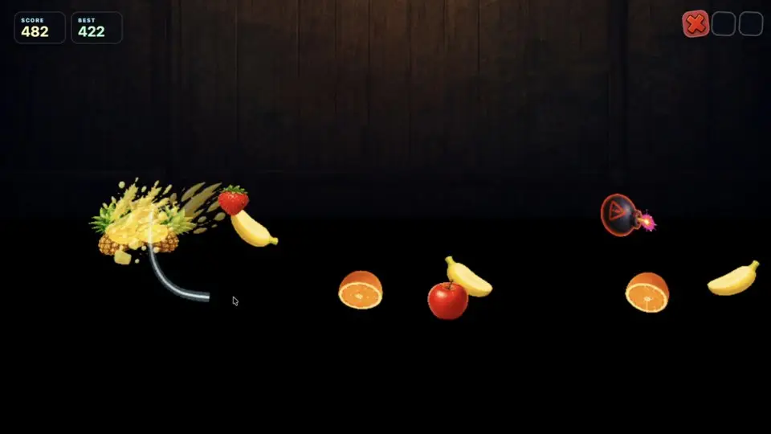

Figure 11: A three-fruit combo sliced mid-air with split halves and
juice effects.

### The King of Fighters

An arcade fighting game generated from a single-sentence prompt
requesting a King of Fighters remake, with no reference image (Figure
12). Two fighters trade combos under health bars, a round timer, and a
neon-lit stage.

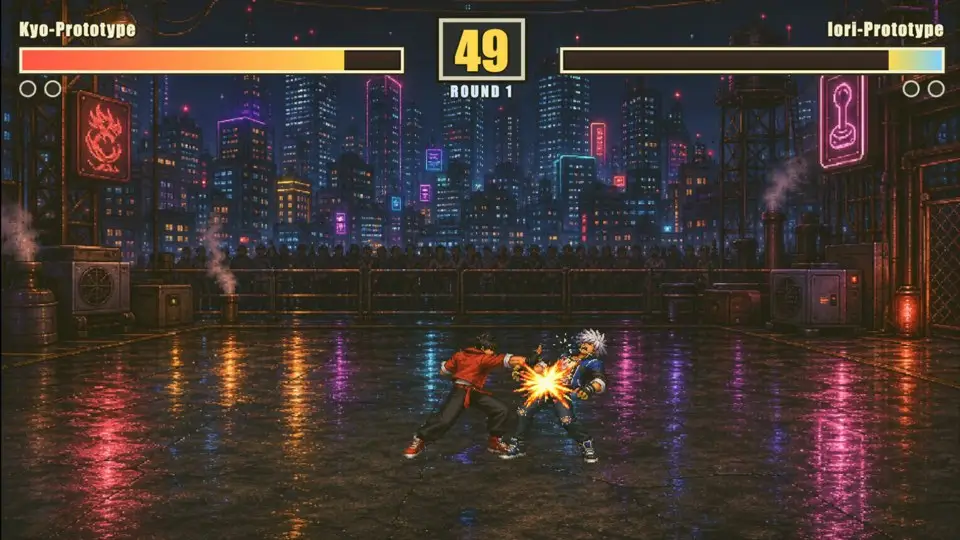

Figure 12: Two fighters trade blows with an impact spark on the neon
stage.

### Dungeon Roguelike

A Soul Knight-style dungeon-shooter roguelike (Figure 13). The map is
built from rooms and corridors; entering a room seals the doors and
starts combat. The player picks up weapons from chests, carries up to
two at a time, and aims toward the mouse, with health, shield, and mana
as stats.

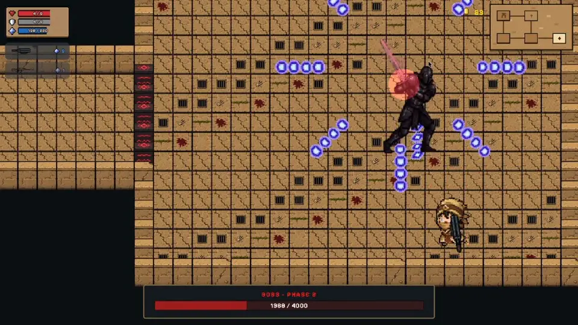

Figure 13: The player fires a spread of projectiles at an enemy inside a
sealed combat room.

### Parkour Platformer

A cartoon parkour platformer (Figure 14). The protagonist runs and
dashes across a field of floating balloons; stepping on a balloon pops
it and launches her upward, and the level is cleared by chaining precise
balloon landings.

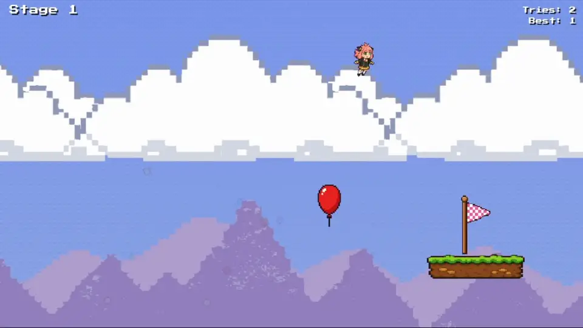

Figure 14: The protagonist floats above a balloon, with the goal flag on
its platform.

### Civilization prototype

A simplified Civilization-style 4X strategy game on a hex map, rendered
in a cartoon hand-drawn style with city management and unit combat
(Figure 15). It runs on a separated frontend and backend with
multiplayer support.

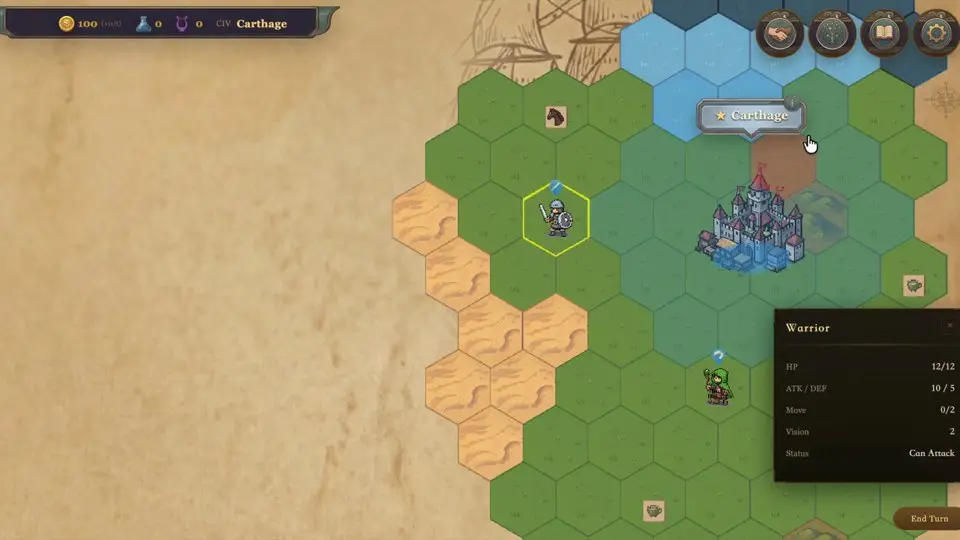

Figure 15: A selected warrior unit and its stats beside a city on the
hex map.

### AI Werewolf

A single-player Werewolf game driven by the engine’s built-in LLM module
(Figure 16). Eleven AI players fill a 12-role setup (villagers,
werewolves, seer, hunter, witch, idiot), conducting sheriff elections,
day discussions, and night actions; each AI’s speech is rendered as
on-screen text.

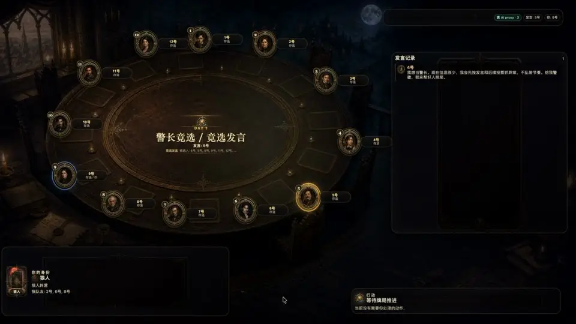

Figure 16: The round-table layout with AI player portraits and live
speech text during the sheriff election.

### Hollow Knight to Demon Slayer

An IP transfer applied to the Hollow Knight-style boss-fight prototype
from Appendix 9.1.2: the system restyled the entire game into a Demon
Slayer theme, recreating the Mugen Train battle between Tanjiro and
Upper Rank Three while keeping the underlying combat logic unchanged
(Figure 17).

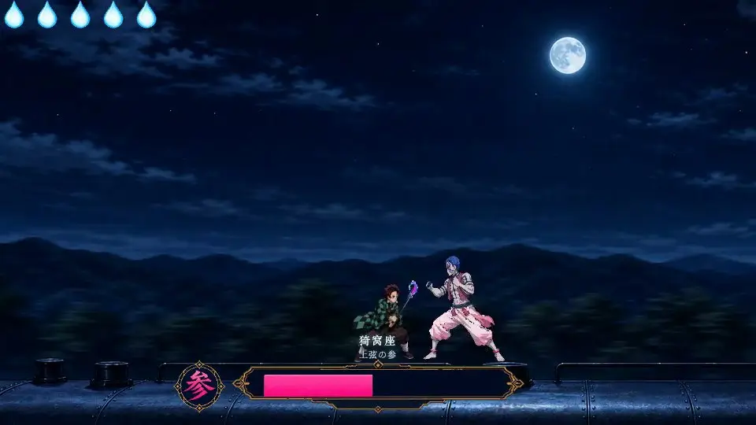

Figure 17: Tanjiro faces Upper Rank Three under the moon on the Mugen
Train night field.

## 11 Adversarial Agent Team Case Study

Three defects from one run of VibeGame with GPT-6.1-Sol on the
GameCraft-Bench task Open-World Beast Tamer \[11\], each reported by a
different review role. Quotes are the agents’ own reports.

##### Auditor (static review).

The PRD asks the player to tap “when the timing indicator is inside its
acceptance band” (beats at 1, 2, 4, and 5 s, $`\pm`$0.3 s). Figure 18
shows the game before and after the repair.

> “AdventureUI.js:53–54 renders four equally spaced flex cards and an
> indicator at elapsed / 6 … Beat centers 1/2/4/5 and
> $`\pm`$0.3/$`\pm`$0.45 exist only as text; no band-position/width … is
> computed from the scoring predicates. … This is a missing
> timing-to-presentation mapping, not a visual-quality judgment.”

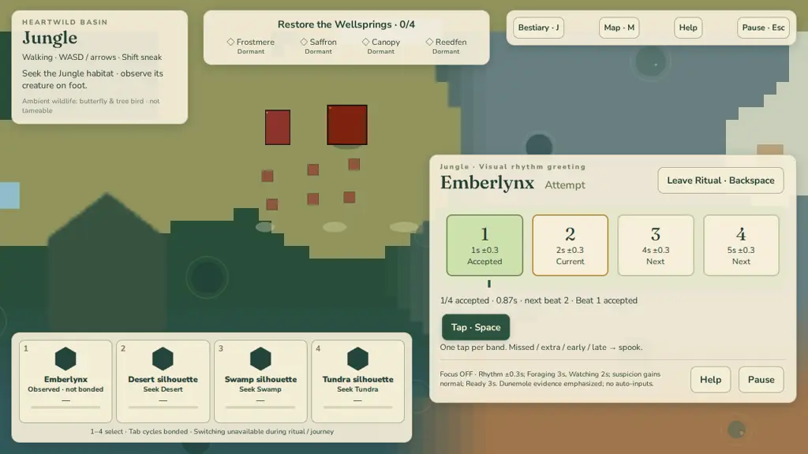

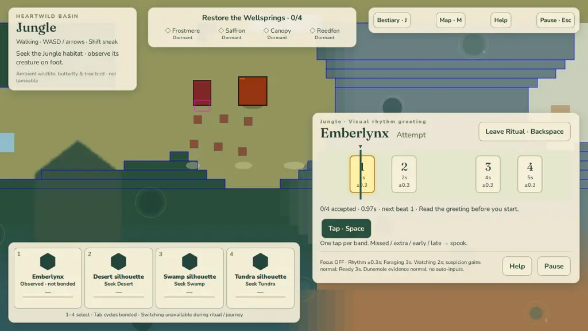

Figure 18: Auditor case, before (top) and after (bottom). After the
repair, each band is placed and sized by its tapping window on one time
axis. Placeholder art; the bottom image shows the physics debug overlay.

##### Player (runtime check).

An independent VLM pass first flagged the completed map; the player
confirmed it and measured it in the running game. Figure 19 shows the
game before and after the repair.

> “completed-map owned opportunity buttons visibly truncate names and
> type/status qualifiers with ellipses. Examples: Heartcamp Frost Gate
> $`\cdot`$ P… … label-overflow.json shows actual scroll widths
> exceeding client widths.”

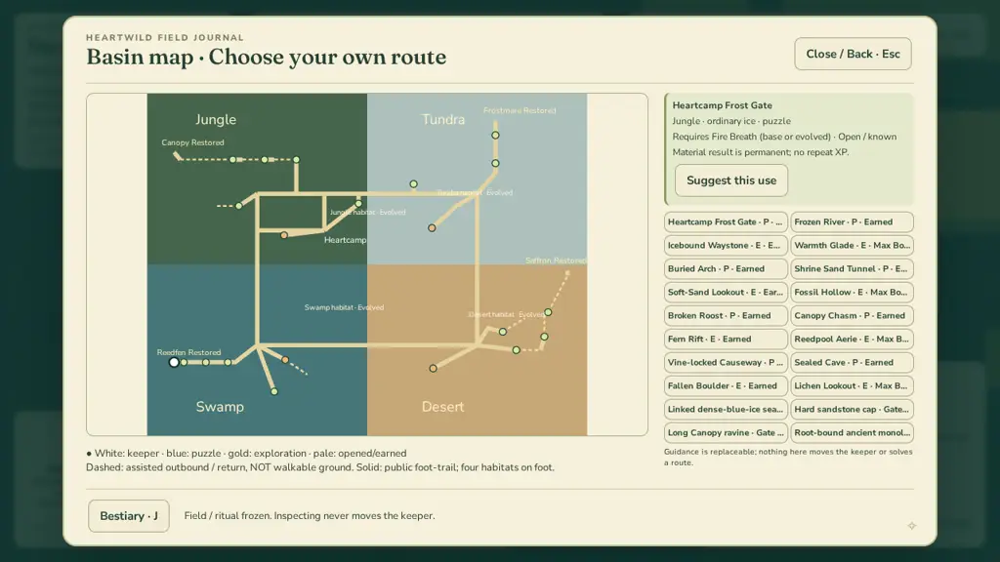

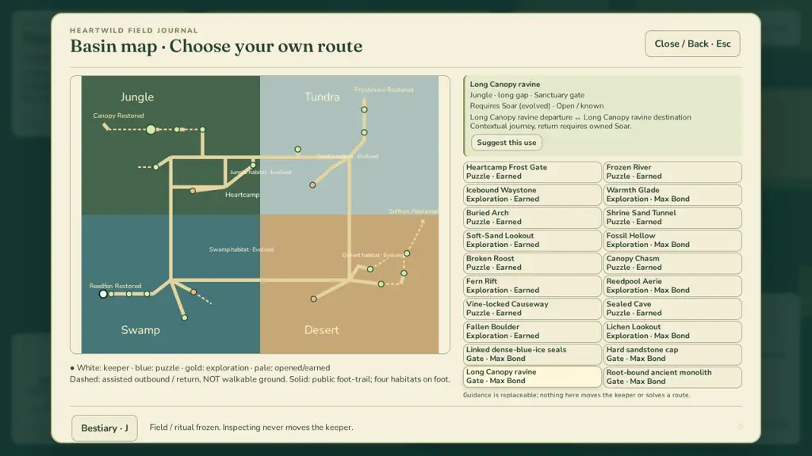

Figure 19: Player case, before (top) and after (bottom). After the
repair, every entry shows its full name, type, and status.

##### Reviewer (final check).

Found by stopping the game 120 frames after an ability and reading both
characters’ positions. Figure 20 shows the game before and after the
repair.

> “after a normal successful Fire Breath, waiting idle for two seconds
> leaves Emberlynx and the standing keeper at the exact same ground
> anchor, producing an inseparable/occluded central silhouette. VLM …
> FAIL: the orange body reads as flames attached to the keeper, not a
> companion.”

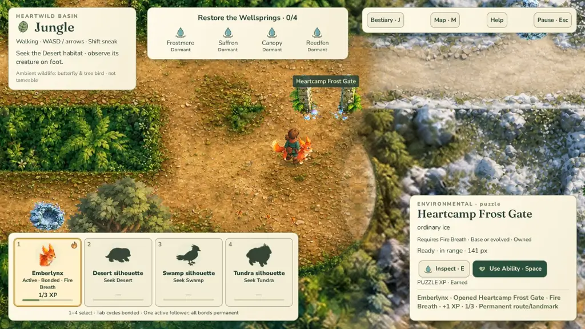

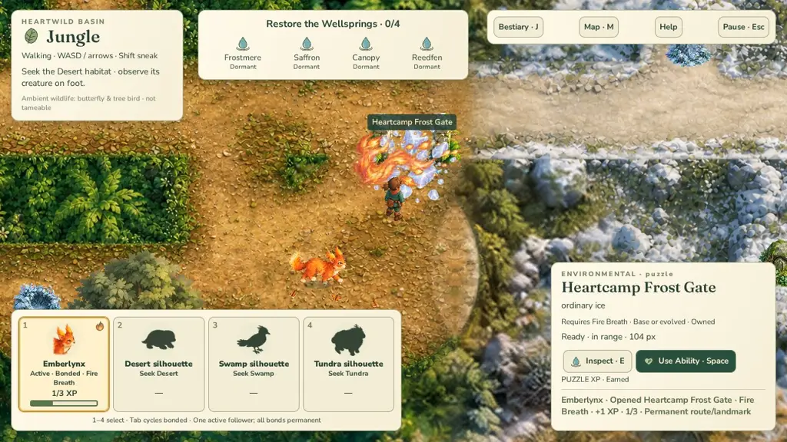

Figure 20: Reviewer case, before (top) and after (bottom). After the
repair, the companion stands beside the keeper.

## 12 Codex with the AI-Native Engine

To isolate the effect of the AI-native engine, we equip the native Codex
harness with the engine of VibeGame. Both settings use GPT-6.1-Sol on
all 30 tasks in the PA2G setting with the same asset library. With the
engine, the overall score of Codex rises from 64.44 to 67.13, with gains
in all four categories (Table 5). Since the art in both settings comes
from the same asset library, we attribute the improvement to the engine;
the largest gain, in Content Depth, suggests that the structured project
representation helps agents expand game content.

| Harness   | M     | D     | V     | A     | Overall |
| --------- | ----- | ----- | ----- | ----- | ------- |
| Codex     | 80.21 | 58.42 | 57.51 | 66.52 | 64.44   |
| w/ Engine | 82.41 | 62.37 | 58.94 | 68.75 | 67.13   |

Table 5: Codex with and without the AI-native engine of VibeGame
(GPT-6.1-Sol, PA2G, all 30 tasks). Columns as in Table 1.

## 13 Limitation of Self-Evolution

We observe that when VibeGame continuously develops games of different
types, the experience accumulated by self-evolution can instead lower
agent performance. Future work should analyze this phenomenon further
and separate general experience from genre-specific experience, so that
each can be injected adaptively. This observation is also one of the
motivations for our experimental design: the main experiments use
VibeGame without any accumulated experience, and we evaluate
self-evolution separately in the ablation study.
